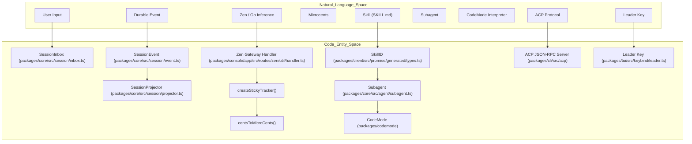
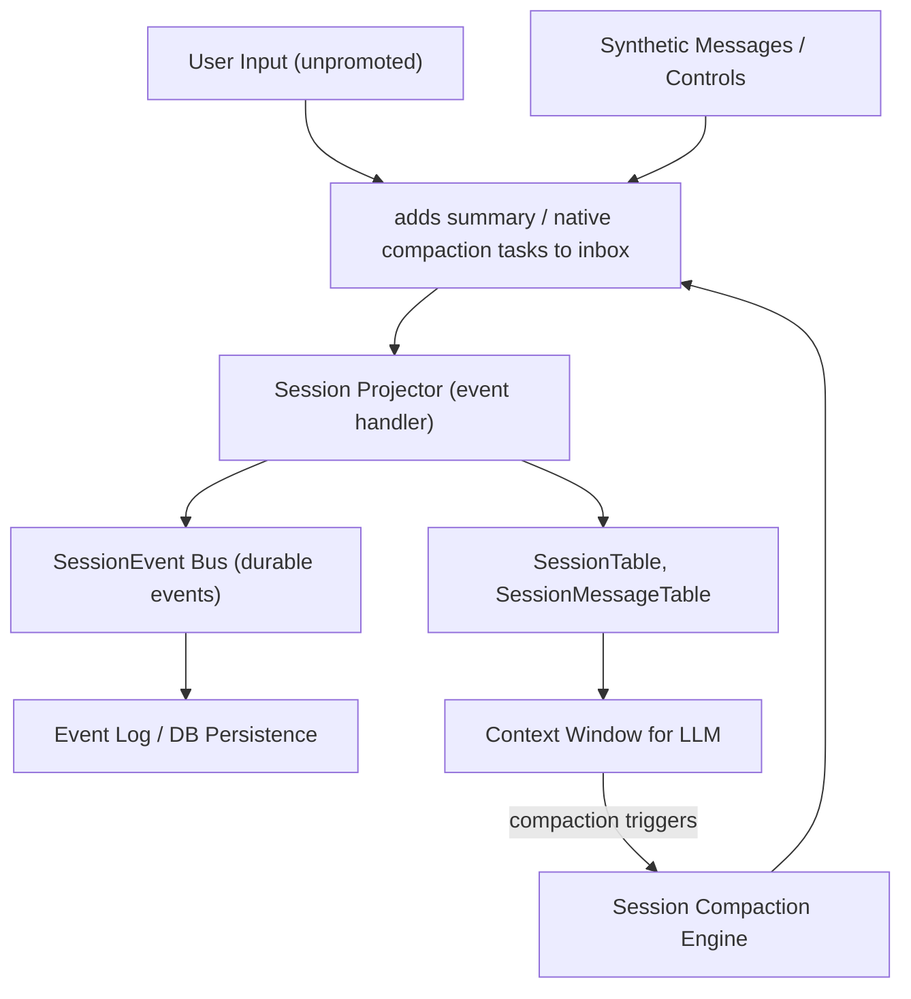

<!-- source: DeepWiki mcp.deepwiki.com · repo anomalyco/opencode · page 11 Glossary · fetched 2026-10-27 -->

# Glossary

<details>
<summary>Relevant source files</summary>

The following files were used as context for generating this wiki page:

- [bun.lock](bun.lock)
- [package.json](package.json)
- [packages/app/package.json](packages/app/package.json)
- [packages/console/app/package.json](packages/console/app/package.json)
- [packages/core/src/config/variable.ts](packages/core/src/config/variable.ts)
- [packages/core/src/location-services.ts](packages/core/src/location-services.ts)
- [packages/core/src/plugin/internal.ts](packages/core/src/plugin/internal.ts)
- [packages/core/src/plugin/sdk.ts](packages/core/src/plugin/sdk.ts)
- [packages/core/src/plugin/supervisor.ts](packages/core/src/plugin/supervisor.ts)
- [packages/core/src/session/compaction.ts](packages/core/src/session/compaction.ts)
- [packages/core/src/session/history.ts](packages/core/src/session/history.ts)
- [packages/core/src/session/model-request.ts](packages/core/src/session/model-request.ts)
- [packages/core/src/session/move.ts](packages/core/src/session/move.ts)
- [packages/core/src/session/runner/llm.ts](packages/core/src/session/runner/llm.ts)
- [packages/core/src/session/runner/publish-llm-event.ts](packages/core/src/session/runner/publish-llm-event.ts)
- [packages/core/src/session/runner/step.ts](packages/core/src/session/runner/step.ts)
- [packages/core/src/session/runner/to-llm-message.ts](packages/core/src/session/runner/to-llm-message.ts)
- [packages/core/src/session/store.ts](packages/core/src/session/store.ts)
- [packages/core/src/session/title.ts](packages/core/src/session/title.ts)
- [packages/core/test/config/compaction.test.ts](packages/core/test/config/compaction.test.ts)
- [packages/core/test/fixture/tmpdir.ts](packages/core/test/fixture/tmpdir.ts)
- [packages/core/test/location-layer.test.ts](packages/core/test/location-layer.test.ts)
- [packages/core/test/plugin/supervisor-reload.test.ts](packages/core/test/plugin/supervisor-reload.test.ts)
- [packages/core/test/plugin/supervisor.test.ts](packages/core/test/plugin/supervisor.test.ts)
- [packages/core/test/session-compact.test.ts](packages/core/test/session-compact.test.ts)
- [packages/core/test/session-compaction.test.ts](packages/core/test/session-compaction.test.ts)
- [packages/core/test/session-model-request-hooks.test.ts](packages/core/test/session-model-request-hooks.test.ts)
- [packages/core/test/session-model-request.test.ts](packages/core/test/session-model-request.test.ts)
- [packages/core/test/session-move.test.ts](packages/core/test/session-move.test.ts)
- [packages/core/test/session-native-compaction.test.ts](packages/core/test/session-native-compaction.test.ts)
- [packages/core/test/session-remove.test.ts](packages/core/test/session-remove.test.ts)
- [packages/core/test/session-revert.test.ts](packages/core/test/session-revert.test.ts)
- [packages/core/test/session-runner-message.test.ts](packages/core/test/session-runner-message.test.ts)
- [packages/core/test/session-runner-recorded.test.ts](packages/core/test/session-runner-recorded.test.ts)
- [packages/core/test/session-runner-tool-events.test.ts](packages/core/test/session-runner-tool-events.test.ts)
- [packages/core/test/session-runner.test.ts](packages/core/test/session-runner.test.ts)
- [packages/core/test/session-step.test.ts](packages/core/test/session-step.test.ts)
- [packages/core/test/session-title.test.ts](packages/core/test/session-title.test.ts)
- [packages/desktop/package.json](packages/desktop/package.json)
- [packages/function/package.json](packages/function/package.json)
- [packages/plugin/package.json](packages/plugin/package.json)
- [packages/protocol/src/api.ts](packages/protocol/src/api.ts)
- [packages/protocol/src/client.ts](packages/protocol/src/client.ts)
- [packages/server/src/handlers.ts](packages/server/src/handlers.ts)
- [packages/server/test/session-instances.test.ts](packages/server/test/session-instances.test.ts)
- [packages/ui/package.json](packages/ui/package.json)
- [packages/web/package.json](packages/web/package.json)
- [sdks/vscode/package.json](sdks/vscode/package.json)
- [services/www/src/docs/content/compaction.mdx](services/www/src/docs/content/compaction.mdx)

</details>


## Purpose and Scope
This page defines codebase-specific terms, architectural concepts, data structures, and jargon used throughout the OpenCode monorepo. It provides a technical reference linking domain terminology with code entities, services, Effect layers, protocol contracts, and runtime components. The goal is to clarify the intersection of the high-level concepts and their concrete implementations.

---

## 1. Effect Service and Layer Patterns

OpenCode leverages the `effect` library for structured dependency injection, asynchronous computations, and lifecycle management.

- **Effect Service**: An interface tagged by `Context.Tag` representing a service with defined behavior and state, accessed from the Effect runtime context.
  - *Implementation*: Services define both the interface and a concrete implementation layer.
  - *Example*: `Session.Interface` and `Session.Service` in [packages/core/src/session.ts:118-121]().
- **Layer**: Immutable, composable "blueprints" that produce services with lifecycle management, enabling modular and testable dependency graphs.
  - *Example of assembly and composition* in test layer groups: [packages/core/test/session-create.test.ts:44-62]().
- **LayerNode**: A utility structuring multiple layers into a group for efficient initialization and runtime scoping within app nodes.
  - *Example*: `AppNodeBuilder` uses `LayerNode.group` to assemble runtime layers [packages/core/test/session-create.test.ts:45-54]()

```mermaid
graph TD
  "AppNodeBuilder" -->|"builds with LayerNode.group"| "Database.node"
  "AppNodeBuilder" --> "Bus.node"
  "AppNodeBuilder" --> "Session.node"
  "Session.Service" -->|"resolved via Effect Context"| "SessionStore.Service"
```

Sources: [packages/core/src/session.ts:118-121](), [packages/core/test/session-create.test.ts:44-62]()

---

## 2. Session Subsystem: Inbox, Projector, Compaction, and Durable Events

The session subsystem manages the conversational state machine, ensuring reliable event delivery, state projection, compaction for context management, and operational semantics.

- **Session Inbox**: A durable queue of admitted but not yet projected session inputs and synthesized messages. It ensures messages are processed in order and enables retry or fork workflows.
  - *Key functions/classes*: Interface exposure via `Session.Interface.inbox` [packages/core/src/session.ts:153-158]()
- **Session Projector**: The state updater that consumes persisted durable session events from the inbox and updates session state tables such as `SessionTable` and `SessionMessageTable`. It is the authoritative source for session message histories and state.
  - *Implementation*: `SessionProjector` in [packages/core/src/session/projector.ts:1-17]()
- **Compaction**: Transforming long or costly session history into compressed summaries or specialized "native" provider context representations to fit within model context window constraints.
  - *Types of compaction*: Summary compaction (transforming messages), native compaction (provider-specific caches).
  - *Typescript Type*: `ProviderCompaction` in [packages/client/src/promise/generated/types.ts:23-23]()
- **Durable Events**: Immutable event entries published to the event bus and persisted in the event log, backing session history, enabling event replay, synchronization, and recovery.
  - *Events*: `SessionEvent.DurableEvent` defined and tested in [packages/core/test/session-create.test.ts:88-91]()

```mermaid
graph TD
  "UserInput" -->|"placed in"| "SessionInbox"
  "SessionInbox" -->|"consumed by"| "SessionProjector"
  "SessionProjector" -->|"updates"| "SessionTable"
  "SessionProjector" -->|"publishes"| "SessionEvent.DurableEvent"
```

Sources: [packages/core/src/session.ts:153-158](), [packages/core/src/session/projector.ts:1-17](), [packages/client/src/promise/generated/types.ts:23-23](), [packages/core/test/session-create.test.ts:88-91]()

---

## 3. Inference & Billing: Zen, Go, Sticky Provider, and Microcents

The SaaS inference gateway and billing subsystems incorporate domain-specific financial and routing concepts.

- **Zen / Go**: Product tiers and inference gateway modes. Zen supports full features and providerguided frontier models with Bring-Your-Own-Key (BYOK) or managed keys. Go provides lightweight, optimized, scaled tiers targeting enhanced usage patterns.
  - *Code*: Request handler routing by tier in [packages/console/app/src/routes/zen/util/handler.ts:131-138]()
- **Sticky Provider**: A session-aware provider affinity tracker that routes consecutive session requests consistently to the same API provider instance, preserving cache hit ratio and minimizing cold starts.
  - *Code*: `createStickyTracker` factory in [packages/console/app/src/routes/zen/util/handler.ts:40-40]()
- **Microcents**: Fine-grained integer units for fractional currency computations, with 100,000,000 microcents per USD dollar, facilitating accurate token cost accounting at scale.
  - *Code*: `centsToMicroCents` utility in [packages/console/app/src/routes/zen/util/handler.ts:5-5]()

```mermaid
graph TD
  "APIEvent" -->|"parses"| "ZenData.list"
  "ZenData.list" -->|"controls routing with"| "createStickyTracker"
  "createStickyTracker" -->|"uses for accounting"| "centsToMicroCents"
```

Sources: [packages/console/app/src/routes/zen/util/handler.ts:5-138]()

---

## 4. Runtime Components, Tools & Infrastructure Terms

- **CodeMode**: A sandboxed JavaScript interpreter environment implemented inside `packages/codemode` that permits safe programmatic script execution. It offers a filtering standard library plus dynamic runtime schema generation for embedded tool runtimes.
  - *See*: `packages/codemode` for interpreter details.
- **ACP (Agent Client Protocol)**: A JSON-RPC over stdio protocol implemented in the CLI and IDE integrations including the Zed editor. It manages multi-turn session state, access permissions, agent catalogs, and serves as the basis for IDE-native LLM interaction.
  - *Code Location*: `packages/cli/src/acp`
- **Leader Key**: A dedicated modifier key mechanism in the TUI keymap system enabling chorded shortcut sequences for efficient terminal navigation and command invocation.
  - *Found in*: `packages/tui` keybinding system and theme context.
- **FOD / node_modules hash**: Fixed-Output Derivation (FOD) hashes computed for the `node_modules` dependency tree. Used in the Nix build system and containerization to guarantee deterministic and reproducible dependency trees for builds, desktop app packaging and offline caching.
  - *Config files*: `flake.nix`, `nix/hashes.json`
- **Catalog**: Centralized registry and metadata catalog for models and providers. It defines capabilities, pricing, variants, and provider policies for client-side resolution.
  - *Type*: `ModelCapabilities` in [packages/client/src/promise/generated/types.ts:167-168]()
- **Variant**: Specific model variants or aliases defining behaviors such as reasoning effort, prompt styles, or experimental capabilities.
- **Skills**: Modular, markdown-defined semantic extensions (`SKILL.md` files) that expand agent behavior and intent handling in sessions. Skills are dynamically discovered and integrated into session agents.
  - *Types*: `SkillID` and `SkillName` in [packages/client/src/promise/generated/types.ts:89-91]()
- **Subagent**: Child agent tasks spawned within a session with isolated lifetimes, permissions, and capabilities for delegation of complex or multi-step user requests.

```mermaid
graph TD
  "ClientPrompt" -->|"executes skill identified by"| "SkillID"
  "SkillID" -->|"loads markdown definitions into"| "Subagent"
  "Subagent" -->|"runs scripts inside"| "CodeMode"
```

Sources: [packages/client/src/promise/generated/types.ts:89-91](), [packages/client/src/promise/generated/types.ts:167-168]()

---

# Diagram Bridging Natural Language Terms to Code Entities



Sources: multiple as above.

---

# Diagram Showing Session Inbox, Projector, Durable Events, and Compaction Data Flow



Sources: [packages/core/src/session.ts:153-158](), [packages/core/src/session/projector.ts:1-17](), [packages/core/src/session/compaction.ts]()

---

This glossary page connects OpenCode domain terms with the underlying code implementations to aid contributors and developers in understanding the system design and codebase structure. It is continually updated as the repository evolves to maintain accuracy and coverage.