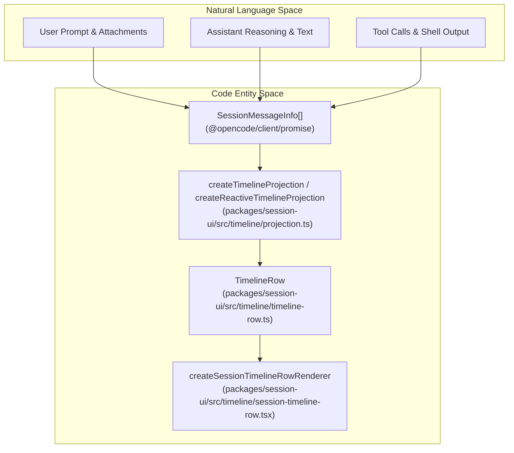
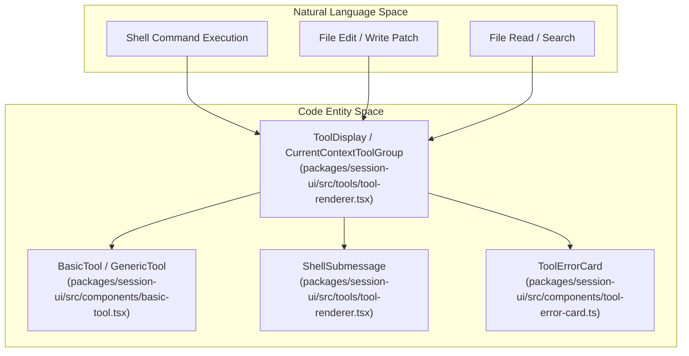
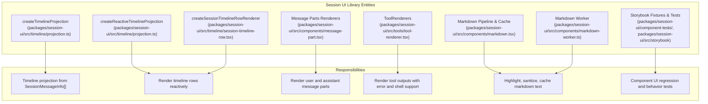

<!-- source: DeepWiki mcp.deepwiki.com · repo anomalyco/opencode · page 6.2 Session UI Library · fetched 2026-10-27 -->

# Session UI Library

Relevant source files

The following files were used as context for generating this wiki page:

- [packages/app/e2e/regression/session-timeline-tool-projection.spec.ts](packages/app/e2e/regression/session-timeline-tool-projection.spec.ts)
- [packages/app/e2e/regression/subagent-child-navigation.spec.ts](packages/app/e2e/regression/subagent-child-navigation.spec.ts)
- [packages/app/src/runtime/server/image.test.ts](packages/app/src/runtime/server/image.test.ts)
- [packages/app/src/runtime/server/image.ts](packages/app/src/runtime/server/image.ts)
- [packages/app/src/session/session-identity-header.tsx](packages/app/src/session/session-identity-header.tsx)
- [packages/app/src/session/timeline/message-timeline.tsx](packages/app/src/session/timeline/message-timeline.tsx)
- [packages/app/src/session/timeline/voice-delegation.test.ts](packages/app/src/session/timeline/voice-delegation.test.ts)
- [packages/app/src/session/timeline/voice-delegation.ts](packages/app/src/session/timeline/voice-delegation.ts)
- [packages/core/src/plugin/websearch/exa.ts](packages/core/src/plugin/websearch/exa.ts)
- [packages/core/src/plugin/websearch/firecrawl.ts](packages/core/src/plugin/websearch/firecrawl.ts)
- [packages/core/src/plugin/websearch/index.ts](packages/core/src/plugin/websearch/index.ts)
- [packages/core/src/plugin/websearch/parallel.ts](packages/core/src/plugin/websearch/parallel.ts)
- [packages/core/src/plugin/websearch/tinyfish.ts](packages/core/src/plugin/websearch/tinyfish.ts)
- [packages/core/test/plugin/websearch-fixture.ts](packages/core/test/plugin/websearch-fixture.ts)
- [packages/core/test/plugin/websearch.test.ts](packages/core/test/plugin/websearch.test.ts)
- [packages/session-ui/component-tests/markdown.fixture.tsx](packages/session-ui/component-tests/markdown.fixture.tsx)
- [packages/session-ui/component-tests/markdown.spec.ts](packages/session-ui/component-tests/markdown.spec.ts)
- [packages/session-ui/src/components/basic-tool.tsx](packages/session-ui/src/components/basic-tool.tsx)
- [packages/session-ui/src/components/image-preview.tsx](packages/session-ui/src/components/image-preview.tsx)
- [packages/session-ui/src/components/markdown-cache.tsx](packages/session-ui/src/components/markdown-cache.tsx)
- [packages/session-ui/src/components/markdown-github.svg](packages/session-ui/src/components/markdown-github.svg)
- [packages/session-ui/src/components/markdown-globe.svg](packages/session-ui/src/components/markdown-globe.svg)
- [packages/session-ui/src/components/markdown-image.test.ts](packages/session-ui/src/components/markdown-image.test.ts)
- [packages/session-ui/src/components/markdown-image.ts](packages/session-ui/src/components/markdown-image.ts)
- [packages/session-ui/src/components/markdown-session-links.test.ts](packages/session-ui/src/components/markdown-session-links.test.ts)
- [packages/session-ui/src/components/markdown-session-links.ts](packages/session-ui/src/components/markdown-session-links.ts)
- [packages/session-ui/src/components/markdown-solid.test.tsx](packages/session-ui/src/components/markdown-solid.test.tsx)
- [packages/session-ui/src/components/markdown-solid.tsx](packages/session-ui/src/components/markdown-solid.tsx)
- [packages/session-ui/src/components/markdown.css](packages/session-ui/src/components/markdown.css)
- [packages/session-ui/src/components/markdown.stories.tsx](packages/session-ui/src/components/markdown.stories.tsx)
- [packages/session-ui/src/components/markdown.tsx](packages/session-ui/src/components/markdown.tsx)
- [packages/session-ui/src/components/message-part.css](packages/session-ui/src/components/message-part.css)
- [packages/session-ui/src/components/message-part.tsx](packages/session-ui/src/components/message-part.tsx)
- [packages/session-ui/src/context/markdown.tsx](packages/session-ui/src/context/markdown.tsx)
- [packages/session-ui/src/message/current-message.tsx](packages/session-ui/src/message/current-message.tsx)
- [packages/session-ui/src/message/message-content.tsx](packages/session-ui/src/message/message-content.tsx)
- [packages/session-ui/src/storybook/current-session-fixtures.ts](packages/session-ui/src/storybook/current-session-fixtures.ts)
- [packages/session-ui/src/timeline/projection.test.ts](packages/session-ui/src/timeline/projection.test.ts)
- [packages/session-ui/src/timeline/projection.ts](packages/session-ui/src/timeline/projection.ts)
- [packages/session-ui/src/timeline/rows-current.test.ts](packages/session-ui/src/timeline/rows-current.test.ts)
- [packages/session-ui/src/timeline/session-timeline-row.tsx](packages/session-ui/src/timeline/session-timeline-row.tsx)
- [packages/session-ui/src/timeline/session-timeline.tsx](packages/session-ui/src/timeline/session-timeline.tsx)
- [packages/session-ui/src/timeline/timeline-row.stories.tsx](packages/session-ui/src/timeline/timeline-row.stories.tsx)
- [packages/session-ui/src/timeline/timeline-row.ts](packages/session-ui/src/timeline/timeline-row.ts)
- [packages/session-ui/src/tools/tool-renderer.tsx](packages/session-ui/src/tools/tool-renderer.tsx)
- [packages/tui/src/mini/permission.shared.ts](packages/tui/src/mini/permission.shared.ts)
- [packages/tui/src/util/permission.ts](packages/tui/src/util/permission.ts)
- [packages/tui/src/util/tool-display.ts](packages/tui/src/util/tool-display.ts)
- [packages/tui/test/mini/permission.shared.test.ts](packages/tui/test/mini/permission.shared.test.ts)
- [packages/tui/test/util/tool-display.test.ts](packages/tui/test/util/tool-display.test.ts)
- [packages/ui/src/icons/catalog.ts](packages/ui/src/icons/catalog.ts)
- [packages/ui/src/styles/base.css](packages/ui/src/styles/base.css)

## Purpose & Scope

This page documents the architecture and implementation of `packages/session-ui`, the dedicated component and projection library powering OpenCode's chat session timelines. It covers timeline projection algorithms, reactive row mapping, message part dispatchers, tool presentation and execution renderers, the markdown parsing pipeline and web worker highlighting system, as well as storybook fixtures and component testing strategies.

---

## Timeline Projection & Row Structure

The session timeline transforms raw backend message streams into structured, renderable row types. This pipeline is managed primarily by the functions `createTimelineProjection` and `createReactiveTimelineProjection` in the file `packages/session-ui/src/timeline/projection.ts`. These functions collaborate closely with the `TimelineRow` data types declared in the same file, encapsulating the various row types the UI renders, such as user messages, assistant parts, shell outputs, notices, and thinking indicators.

- **Row Derivation:**  
  The function `Timeline.constructSessionMessageRows` is the core transformer that analyzes the chronological list of messages (`SessionMessageInfo[]`), the current reasoning mode (`hidden`, `compact`, or `full`), session status, and optional parameters like pending input IDs, to produce a linear ordered list of typed timeline rows. These rows embed rich information about message parentage, content parts, tool invocations, and status [packages/session-ui/src/timeline/projection.ts:88-98]().

- **Reactive Projection:**  
  The `createReactiveTimelineProjection` wraps the row projection in Solid.js reactive primitives (`createMemo`) so that timeline row lists update efficiently as new messages or session statuses arrive, minimizing unnecessary recomputation and preserving stable identity for rows that have not mutated. This allows UI components to minimize DOM churn when rendering messages [packages/session-ui/src/timeline/projection.ts:127-174]().

- **Row Reusability:**  
  The helper `reuseTimelineRows` compares previous and new row lists to maintain identity where possible, further optimizing rendering performance by preventing Reactivity from recreating elements unnecessarily [packages/session-ui/src/timeline/projection.ts:100]().

### Timeline Projection Pipeline (Natural Language to Code Entity Mapping)

Sources:  
[packages/session-ui/src/timeline/projection.ts:73-186](),  
[packages/session-ui/src/timeline/session-timeline-row.tsx:56-110]()

---

## Message Parts & Content Display

Messages in a session are composed of multiple parts (or content elements), and each part is rendered appropriately with styles and interaction affordances.

- **User Messages:**  
  Styled with right-aligned layout and supporting multiple attachments such as images and files, user messages are encoded with CSS custom properties for mention highlighting and use truncation and copy utilities. Message parts have accessible slots for attachment previews and copy buttons, with reactive styling for hover and focus states [packages/session-ui/src/components/message-part.css:10-238]().

- **Assistant Content:**  
  Assistant messages render various parts including text, reasoning steps, and tool outputs. The components `AssistantTextContent`, `AssistantReasoningContent`, and grouped tool renders (`SessionContextToolGroup` etc.) handle these with expand/collapse controls and animated visibility. They carefully manage the default open state and visibility of reasoning content to balance UI density [packages/session-ui/src/components/message-part.tsx:1-3]().

- **Diagnostics & Errors:**  
  Error diagnostics related to tools or shell sessions are presented inline with messages, showing error labels and contextual line or location markers. The `DiagnosticsDisplay` component renders up to three high-severity error diagnostics in a compact form [packages/session-ui/src/tools/tool-renderer.tsx:142-162]().

Sources:  
[packages/session-ui/src/components/message-part.tsx:1-3](),  
[packages/session-ui/src/components/message-part.css:10-238](),  
[packages/session-ui/src/tools/tool-renderer.tsx:142-162]()

---

## Tool Renderers & Execution Views

Agent tools invoked during a session—such as file reads, edits, shell commands, patches, and subagents—are presented in the UI via dedicated tool renderer components, aggregated in the file `packages/session-ui/src/tools/tool-renderer.tsx`.

- **Tool Grouping and Visual Families:**  
  Tools are visually grouped by family (e.g., context reads, shell outputs, file patches). Each tool group's rendering includes headers with metadata (tool name, status), summaries, and detailed content. Patch file diffs show unified diffs with collapsible previews. Shell output tools animate streaming text and can embed submessages with smooth spring animations [packages/session-ui/src/tools/tool-renderer.tsx:1-93]().

- **Shell Submessages:**  
  The component `ShellSubmessage` animates output text expansion and opacity on mount if `animate` is true, leveraging the `motion` library for spring physics and ease curves. This improves the visual flow of streaming shell outputs [packages/session-ui/src/tools/tool-renderer.tsx:64-96]().

- **Error Cards:**  
  Tool executions which failed are wrapped in the `ToolErrorCard` component that displays error messages, exit codes, or stack traces, aiding the user in diagnosing failures [packages/session-ui/src/tools/tool-renderer.tsx:30]().

- **Basic and Generic Tool Components:**  
  Common UI patterns for tool displays reuse components like `BasicTool` and `GenericTool` from `packages/session-ui/src/components/basic-tool.tsx`, providing standard layouts and interaction primitives for tools.

### Tool Rendering Dispatch (Natural Language to Code Entity Mapping)

Sources:  
[packages/session-ui/src/tools/tool-renderer.tsx:1-93](),  
[packages/session-ui/src/components/basic-tool.tsx:1-27]()

---

## Markdown Pipeline, Worker, and Caching

Rendering rich text answers and tool outputs is powered by a sophisticated markdown pipeline that includes sanitization, incremental streaming parsing, syntax highlighting, and caching.

- **Markdown Component:**  
  The main `Markdown` component is implemented in `packages/session-ui/src/components/markdown.tsx` with styles in `markdown.css`. It supports parsing GitHub-flavored Markdown, rendering inline code spans, local file links, sanitized HTML, and embedded mermaid diagrams. It also integrates copy button overlays and link session annotation for local navigation [packages/session-ui/src/components/markdown.tsx:1-229](), [packages/session-ui/src/components/markdown.css:1-50]().

- **Worker-based Syntax Highlighting:**  
  To avoid blocking the UI thread, syntax highlighting uses a dedicated worker running shiki with streaming updates. Functions like `highlightStreamingCode` asynchronously yield tokens to the UI for live rendering. Error handling for worker unavailability and cancellation ensures graceful fallback [packages/session-ui/src/components/markdown.tsx:90-112]().

- **Caching Layer:**  
  The library caches previously rendered markdown blocks and syntax-highlighted tokens keyed by content hashes. This eliminates duplicate rendering on repeated session snapshots or fast re-renders, improving performance [packages/session-ui/src/components/markdown.tsx:31-36]().

Sources:  
[packages/session-ui/src/components/markdown.tsx:1-112](),  
[packages/session-ui/src/components/markdown.css:1-50]()

---

## Storybook Fixtures & Component Tests

`packages/session-ui` ensures robustness via automated component and integration tests, as well as reusable Storybook fixtures that simulate diverse message and tool scenarios.

- **Playwright Component Tests:**  
  Under `packages/session-ui/component-tests/`, tests like `markdown.spec.ts` cover critical functionalities such as sanitization security, incremental streaming rendering, and mermaid diagram integration [packages/session-ui/component-tests/markdown.spec.ts:1-128]().

- **Timeline Row Tests:**  
  Tests like `rows-current.test.ts` validate correct derivation of timeline rows from message streams, ensuring proper row keys, active message IDs, and turn construction [packages/session-ui/src/timeline/rows-current.test.ts:1-41]().

- **Storybook Fixtures:**  
  The codebase includes Storybook scenarios for various session states, markdown contents, and tool views, useful for visual regression testing and development [packages/session-ui/src/timeline/rows-current.test.ts:4-6]().

Sources:  
[packages/session-ui/component-tests/markdown.spec.ts:1-128](),  
[packages/session-ui/src/timeline/rows-current.test.ts:1-41]()

---

# Summary

`packages/session-ui` constitutes the core UI library responsible for transforming raw session data into structured, performant, and interactive timelines. Its key responsibilities include:

- Projecting session messages into timeline rows with nuanced handling of various message types and reasoning modes.
- Rendering message parts with rich display of text, reasoning, tool results, attachments, and diagnostics.
- Presenting agent tool executions using grouped, stateful, animated components.
- Supporting secure, efficient, and reactive markdown rendering with syntax highlighting offloaded to a worker thread.
- Backing UI consistency and regression safety with storybook fixtures and comprehensive component tests.

This modular architecture leveraging Solid.js reactivity and a careful separation of concerns optimizes user experience for large, continuously updating AI coding sessions.

---

# Additional Mermaid Diagram: Session UI Library Overview (Code Entities and Responsibilities)

Sources:  
All above-cited files.

# End of Session UI Library Documentation

---

