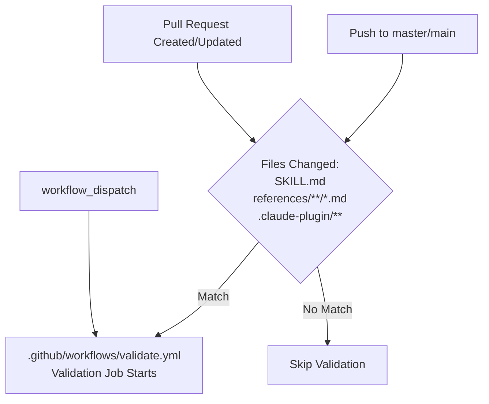
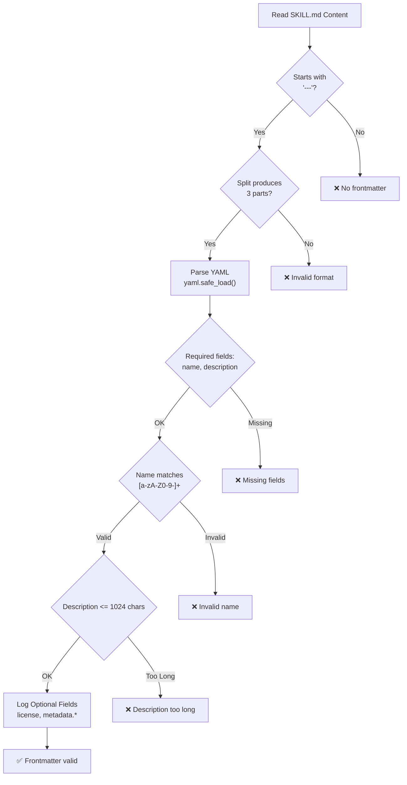
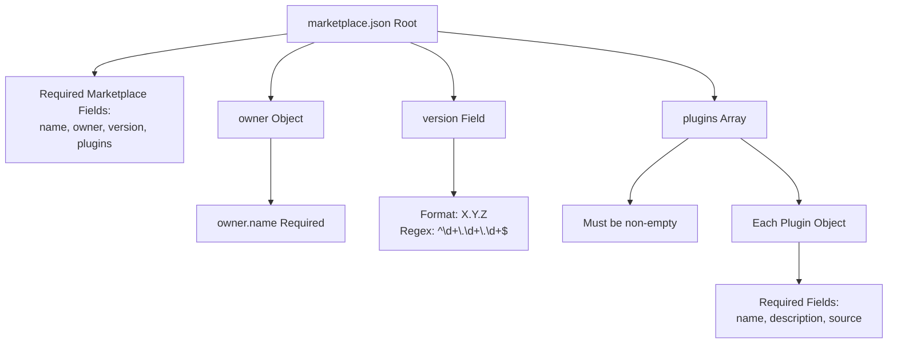
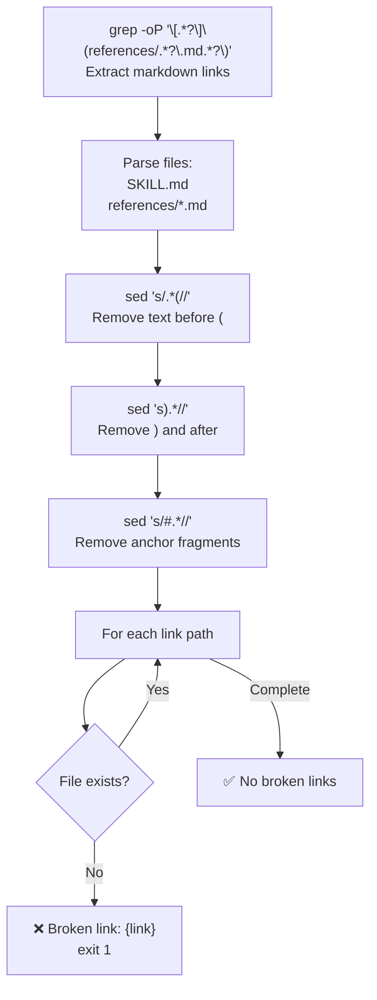
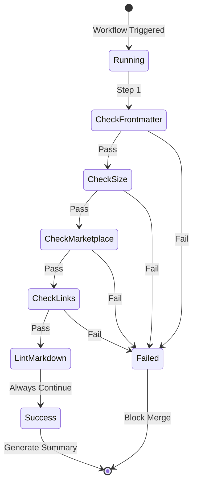
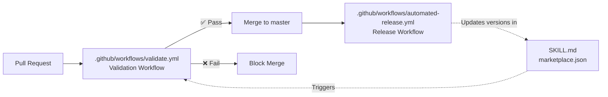

<!-- source: DeepWiki mcp.deepwiki.com · repo antonbabenko/terraform-skill · page 6.1 Validation Workflow · fetched 2026-10-27 -->

# Validation Workflow

<details>
<summary>Relevant source files</summary>

The following files were used as context for generating this wiki page:

- [.github/workflows/validate.yml](.github/workflows/validate.yml)

</details>


## Purpose and Scope

The Validation Workflow provides automated quality assurance for all skill content through GitHub Actions. It validates frontmatter structure, file sizes, configuration integrity, internal links, and markdown formatting whenever changes are proposed or merged.

This document covers the automated validation checks performed by the CI system. For manual testing methodology and the "Iron Law" of testing changes, see [Testing Methodology](#5.3). For the automated release process that runs after validation passes, see [Release Automation](#6.2). For content quality standards that inform these validations, see [Content Standards](#5.2).

**Sources:** [.github/workflows/validate.yml:1-183]()

---

## Workflow Trigger Conditions

The validation workflow runs automatically under three conditions:

| Trigger Type | Condition | Scope |
|--------------|-----------|-------|
| **Pull Request** | Any PR modifying skill content | `SKILL.md`, `references/**/*.md`, `.claude-plugin/**` |
| **Push to main/master** | Direct commits to protected branches | Same files as PR |
| **Manual Dispatch** | Developer-initiated via GitHub UI | All files |

### Trigger Diagram



**Sources:** [.github/workflows/validate.yml:3-15]()

---

## Validation Steps Overview

The workflow executes five sequential validation checks. All checks must pass for the workflow to succeed. The validation job runs on `ubuntu-latest` with Python 3.x.

```mermaid
flowchart LR
    CHECKOUT["Checkout Code<br/>actions/checkout@v4"]
    SETUP["Setup Python 3.x<br/>actions/setup-python@v5"]
    DEPS["Install Dependencies<br/>pip install pyyaml"]
    
    FM["Frontmatter Check<br/>SKILL.md frontmatter"]
    SIZE["File Size Check<br/>Line/word counts"]
    MARKET["marketplace.json Check<br/>Structure validation"]
    LINKS["Broken Links Check<br/>Internal references"]
    LINT["Markdown Linting<br/>markdownlint-cli2"]
    
    SUMMARY["Generate Summary<br/>GITHUB_STEP_SUMMARY"]
    
    CHECKOUT --> SETUP --> DEPS
    DEPS --> FM --> SIZE --> MARKET --> LINKS --> LINT --> SUMMARY
```



**Sources:** [.github/workflows/validate.yml:17-183]()

---

## Frontmatter Validation

### Purpose

Validates that `SKILL.md` contains valid YAML frontmatter with required metadata fields. This ensures Claude can properly discover and activate the skill.

### Validation Logic

The frontmatter check executes an inline Python script that performs four validations:

| Check | Requirement | Error Message |
|-------|-------------|---------------|
| **Presence** | File starts with `---` | "No frontmatter found" |
| **Format** | Properly delimited YAML block | "Invalid frontmatter format" |
| **Required Fields** | Must contain `name` and `description` | "Missing required fields: {missing}" |
| **Name Format** | Alphanumeric and hyphens only | "Invalid name: {name}" |
| **Description Length** | Maximum 1024 characters | "Description too long: {desc_len} chars" |

### Optional Fields

The validator recognizes but does not require these optional fields:

- `license` - Displayed in validation output if present
- `metadata.version` - Logged for informational purposes
- `metadata.author` - Logged for informational purposes

### Implementation Details



**Sources:** [.github/workflows/validate.yml:34-92]()

---

## File Size Checks

### Purpose

Monitors `SKILL.md` size to maintain token efficiency. While not a hard limit, size warnings encourage keeping the core skill content concise per the progressive disclosure architecture (see [Progressive Disclosure Pattern](#3.2)).

### Validation Thresholds

| Metric | Command | Guideline | Action on Exceed |
|--------|---------|-----------|------------------|
| **Lines** | `wc -l < SKILL.md` | < 500 lines | ⚠️ Warning (non-blocking) |
| **Words** | `wc -w < SKILL.md` | ~1,500 words | Informational only |

### Output Format

```bash
📊 SKILL.md: 450 lines, 3200 words
✅ Size OK
```

Or when exceeding guideline:

```bash
📊 SKILL.md: 650 lines, 4800 words
⚠️ WARNING: 650 lines (guideline: <500)
```

**Note:** This check always succeeds; it never blocks merges. It serves as a developer reminder to consider moving content to `references/*.md` files.

**Sources:** [.github/workflows/validate.yml:94-103]()

---

## marketplace.json Validation

### Purpose

Ensures the plugin definition file has correct structure for Claude Code integration. This is critical since `marketplace.json` is the entry point for skill discovery (importance: 28.17).

### Validation Hierarchy



### Validation Rules

| Level | Check | Requirement | Error Code |
|-------|-------|-------------|------------|
| **Marketplace** | Required fields | `name`, `owner`, `version`, `plugins` present | "Missing marketplace fields" |
| **Owner** | Structure | `owner.name` must exist | "owner must have 'name'" |
| **Version** | Format | Semantic versioning: `\d+\.\d+\.\d+` | "Invalid marketplace version" |
| **Plugins** | Array validity | Non-empty array | "'plugins' must be a non-empty array" |
| **Plugin** | Required fields | Each plugin has `name`, `description`, `source` | "Plugin {idx} missing fields" |

### Success Output

```
✅ marketplace.json valid (v2.1.0, 1 plugin(s))
```

**Sources:** [.github/workflows/validate.yml:105-151]()

---

## Link Validation

### Purpose

Detects broken internal references to ensure all `references/*.md` links in skill content resolve to actual files. Prevents 404 errors when Claude attempts to load reference documentation.

### Link Detection Algorithm



### Link Pattern Matching

The regex pattern `\[.*?\]\(references/.*?\.md.*?\)` matches:
- `[Module Patterns](references/module-patterns.md)` → validates `references/module-patterns.md`
- `[Quick Ref](references/quick-reference.md#testing)` → validates `references/quick-reference.md` (anchor ignored)

**Does not validate:**
- External URLs (`https://...`)
- Relative links not starting with `references/`
- Anchor-only links (`#section`)

**Sources:** [.github/workflows/validate.yml:153-166]()

---

## Markdown Linting

### Purpose

Enforces consistent markdown formatting across all documentation files using `markdownlint-cli2`. This check is informational and does not block merges (`continue-on-error: true`).

### Validated Files

| File Pattern | Purpose |
|--------------|---------|
| `SKILL.md` | Core skill content |
| `references/**/*.md` | Reference documentation |
| `README.md` | User documentation |
| `CONTRIBUTING.md` | Contributor guidelines |

### Linter Configuration

The workflow uses the GitHub Action `DavidAnson/markdownlint-cli2-action@v16` with default rules. Common issues flagged:

- Inconsistent heading styles
- Missing blank lines around code blocks
- Trailing whitespace
- Line length violations
- List formatting inconsistencies

### Non-Blocking Behavior

```yaml
continue-on-error: true
```

This setting means linting failures generate warnings but do not prevent the workflow from succeeding. This allows content changes to merge while encouraging formatting improvements.

**Sources:** [.github/workflows/validate.yml:168-176]()

---

## Validation Summary and Reporting

### GitHub Step Summary

Upon successful completion of all checks, the workflow generates a formatted summary visible in the GitHub Actions UI:

```markdown
## ✅ Validation Passed
All skill validation checks passed.
```

This summary is appended to `$GITHUB_STEP_SUMMARY`, making validation results immediately visible in the Actions tab without expanding individual steps.

### Failure Handling

If any validation check fails (except markdown linting):
1. The Python script calls `sys.exit(1)` or the shell command returns non-zero
2. Subsequent steps are skipped
3. The workflow status is marked as "Failed"
4. PR merge is blocked until issues are resolved

### Validation Status Flow



**Sources:** [.github/workflows/validate.yml:178-183]()

---

## Technical Dependencies

### GitHub Actions

| Action | Version | Purpose |
|--------|---------|---------|
| `actions/checkout@v4` | v4 | Check out repository code |
| `actions/setup-python@v5` | v5 | Install Python 3.x runtime |
| `DavidAnson/markdownlint-cli2-action@v16` | v16 | Markdown linting |

### Python Dependencies

```bash
pip install pyyaml
```

The `pyyaml` library is used for safe YAML parsing in frontmatter validation. No other Python dependencies are required.

### Shell Utilities

Standard Unix utilities used:
- `wc` - Word and line counting
- `grep` - Pattern matching with Perl regex (`-oP`)
- `sed` - Stream editing for link extraction
- `[ -f ]` - File existence testing

**Sources:** [.github/workflows/validate.yml:22-32]()

---

## Integration with Development Workflow

### Pre-Merge Gates

The validation workflow integrates with GitHub's branch protection rules. When configured as a required check, it enforces that:

1. All PRs must pass validation before merge
2. Direct commits to `master/main` are validated post-merge
3. Failed validations prevent release automation from triggering

### Relationship to Other Workflows



This creates a validation cycle:
1. **Pre-merge:** Developer changes trigger validation
2. **Post-merge:** Release automation updates trigger re-validation
3. **Continuous:** Manual dispatches allow on-demand validation

**Sources:** [.github/workflows/validate.yml:3-15](), Diagram 3 from system architecture

---

## Common Validation Failures

### Frontmatter Issues

**Missing Required Fields:**
```yaml
---
name: terraform-skill
# ERROR: Missing 'description'
---
```

**Invalid Name Format:**
```yaml
---
name: terraform skill  # ERROR: Contains space
description: "Terraform expertise"
---
```

### marketplace.json Issues

**Invalid Version:**
```json
{
  "version": "2.1",  // ERROR: Must be X.Y.Z
  "name": "terraform-skill"
}
```

**Missing Plugin Fields:**
```json
{
  "plugins": [
    {
      "name": "terraform-skill"
      // ERROR: Missing 'description' and 'source'
    }
  ]
}
```

### Broken Links

```markdown
See [Module Patterns](references/module-pattern.md)
                                          ^
                                          ERROR: File is module-patterns.md
```

**Sources:** [.github/workflows/validate.yml:34-166]()

---

## Validation Workflow File Structure

### Complete Step Mapping

| Step Name | Lines | Validation Type | Blocking? |
|-----------|-------|-----------------|-----------|
| Checkout | 23-24 | Setup | N/A |
| Set up Python | 26-29 | Setup | N/A |
| Install Dependencies | 31-32 | Setup | N/A |
| Check SKILL.md Frontmatter | 34-92 | Content | Yes |
| Check File Size | 94-103 | Content | No (warning only) |
| Validate marketplace.json | 105-151 | Configuration | Yes |
| Check for Broken Links | 153-166 | Content | Yes |
| Lint Markdown | 168-176 | Formatting | No (continue-on-error) |
| Summary | 178-183 | Reporting | N/A |

**Sources:** [.github/workflows/validate.yml:1-183]()

---

