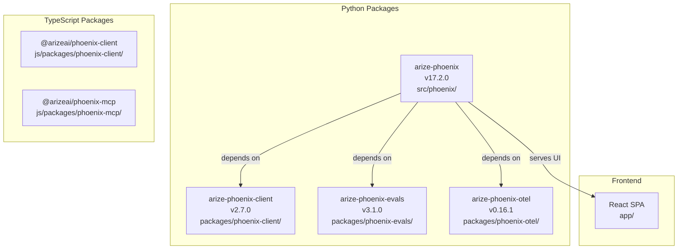
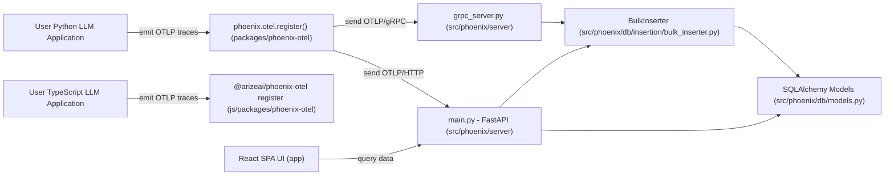
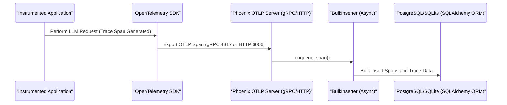

<!-- source: DeepWiki mcp.deepwiki.com · repo arize-ai/phoenix · page 1 Phoenix Overview · fetched 2026-10-27 -->

# Phoenix Overview

<details>
<summary>Relevant source files</summary>

The following files were used as context for generating this wiki page:

- [.release-please-manifest.json](.release-please-manifest.json)
- [CHANGELOG.md](CHANGELOG.md)
- [README.md](README.md)
- [app/schema.graphql](app/schema.graphql)
- [app/src/components/trace/SpanKindIcon.tsx](app/src/components/trace/SpanKindIcon.tsx)
- [app/src/pages/auth/AuthLayout.tsx](app/src/pages/auth/AuthLayout.tsx)
- [app/src/window.d.ts](app/src/window.d.ts)
- [cspell.json](cspell.json)
- [docs/phoenix/integrations/typescript/vercel/vercel-ai-sdk-tracing-js.mdx](docs/phoenix/integrations/typescript/vercel/vercel-ai-sdk-tracing-js.mdx)
- [docs/phoenix/sdk-api-reference/typescript/arizeai-phoenix-otel.mdx](docs/phoenix/sdk-api-reference/typescript/arizeai-phoenix-otel.mdx)
- [docs/phoenix/sdk-api-reference/typescript/overview.mdx](docs/phoenix/sdk-api-reference/typescript/overview.mdx)
- [docs/phoenix/sdk-api-reference/typescript/packages/phoenix-otel/manual-spans.mdx](docs/phoenix/sdk-api-reference/typescript/packages/phoenix-otel/manual-spans.mdx)
- [docs/phoenix/sdk-api-reference/typescript/packages/phoenix-otel/overview.mdx](docs/phoenix/sdk-api-reference/typescript/packages/phoenix-otel/overview.mdx)
- [internal_docs/specs/playground.md](internal_docs/specs/playground.md)
- [internal_docs/specs/prompts.md](internal_docs/specs/prompts.md)
- [internal_docs/specs/server_evaluators.md](internal_docs/specs/server_evaluators.md)
- [js/packages/phoenix-client/README.md](js/packages/phoenix-client/README.md)
- [js/packages/phoenix-config/README.md](js/packages/phoenix-config/README.md)
- [js/packages/phoenix-evals/README.md](js/packages/phoenix-evals/README.md)
- [js/packages/phoenix-mcp/README.md](js/packages/phoenix-mcp/README.md)
- [js/packages/phoenix-mcp/src/index.ts](js/packages/phoenix-mcp/src/index.ts)
- [js/packages/phoenix-mcp/src/projectTools.ts](js/packages/phoenix-mcp/src/projectTools.ts)
- [js/packages/phoenix-otel/README.md](js/packages/phoenix-otel/README.md)
- [kustomize/README.md](kustomize/README.md)
- [packages/phoenix-client/CHANGELOG.md](packages/phoenix-client/CHANGELOG.md)
- [packages/phoenix-client/README.md](packages/phoenix-client/README.md)
- [packages/phoenix-client/pyproject.toml](packages/phoenix-client/pyproject.toml)
- [packages/phoenix-evals/CHANGELOG.md](packages/phoenix-evals/CHANGELOG.md)
- [packages/phoenix-evals/README.md](packages/phoenix-evals/README.md)
- [packages/phoenix-evals/docs/source/api/evals.rst](packages/phoenix-evals/docs/source/api/evals.rst)
- [packages/phoenix-evals/docs/source/index.md](packages/phoenix-evals/docs/source/index.md)
- [packages/phoenix-evals/pyproject.toml](packages/phoenix-evals/pyproject.toml)
- [packages/phoenix-otel/CHANGELOG.md](packages/phoenix-otel/CHANGELOG.md)
- [packages/phoenix-otel/README.md](packages/phoenix-otel/README.md)
- [packages/phoenix-otel/pyproject.toml](packages/phoenix-otel/pyproject.toml)
- [packages/phoenix-otel/src/phoenix/otel/__init__.py](packages/phoenix-otel/src/phoenix/otel/__init__.py)
- [packages/phoenix-otel/src/phoenix/otel/otel.py](packages/phoenix-otel/src/phoenix/otel/otel.py)
- [packages/phoenix-otel/tests/__init__.py](packages/phoenix-otel/tests/__init__.py)
- [packages/phoenix-otel/tests/test_exports.py](packages/phoenix-otel/tests/test_exports.py)
- [packages/phoenix-otel/tests/test_otel.py](packages/phoenix-otel/tests/test_otel.py)
- [packages/phoenix-otel/tests/test_settings.py](packages/phoenix-otel/tests/test_settings.py)
- [pyproject.toml](pyproject.toml)
- [release-please-config.json](release-please-config.json)
- [requirements/packages/phoenix-evals.txt](requirements/packages/phoenix-evals.txt)
- [requirements/type-check.txt](requirements/type-check.txt)
- [requirements/unit-tests.txt](requirements/unit-tests.txt)
- [scripts/data/generate_traces.py](scripts/data/generate_traces.py)
- [scripts/docker/devops/oidc-server/frontend/package.json](scripts/docker/devops/oidc-server/frontend/package.json)
- [scripts/docker/devops/oidc-server/frontend/src/contexts/ThemeContext.tsx](scripts/docker/devops/oidc-server/frontend/src/contexts/ThemeContext.tsx)
- [scripts/docker/devops/oidc-server/package.json](scripts/docker/devops/oidc-server/package.json)
- [scripts/docker/devops/smtp-server/package.json](scripts/docker/devops/smtp-server/package.json)
- [src/phoenix/__init__.py](src/phoenix/__init__.py)
- [src/phoenix/config.py](src/phoenix/config.py)
- [src/phoenix/server/api/context.py](src/phoenix/server/api/context.py)
- [src/phoenix/server/api/dataloaders/__init__.py](src/phoenix/server/api/dataloaders/__init__.py)
- [src/phoenix/server/api/input_types/SpanSort.py](src/phoenix/server/api/input_types/SpanSort.py)
- [src/phoenix/server/api/mutations/__init__.py](src/phoenix/server/api/mutations/__init__.py)
- [src/phoenix/server/api/queries.py](src/phoenix/server/api/queries.py)
- [src/phoenix/server/api/schema.py](src/phoenix/server/api/schema.py)
- [src/phoenix/server/api/types/Dataset.py](src/phoenix/server/api/types/Dataset.py)
- [src/phoenix/server/api/types/Project.py](src/phoenix/server/api/types/Project.py)
- [src/phoenix/server/api/types/Span.py](src/phoenix/server/api/types/Span.py)
- [src/phoenix/server/api/types/Trace.py](src/phoenix/server/api/types/Trace.py)
- [src/phoenix/server/app.py](src/phoenix/server/app.py)
- [src/phoenix/server/main.py](src/phoenix/server/main.py)
- [src/phoenix/server/templates/index.html](src/phoenix/server/templates/index.html)
- [src/phoenix/server/thread_server.py](src/phoenix/server/thread_server.py)
- [src/phoenix/services.py](src/phoenix/services.py)
- [src/phoenix/session/session.py](src/phoenix/session/session.py)
- [src/phoenix/tests/test_config.py](src/phoenix/tests/test_config.py)
- [src/phoenix/trace/schemas.py](src/phoenix/trace/schemas.py)
- [src/phoenix/trace/span_json_decoder.py](src/phoenix/trace/span_json_decoder.py)
- [src/phoenix/trace/span_json_encoder.py](src/phoenix/trace/span_json_encoder.py)
- [src/phoenix/version.py](src/phoenix/version.py)
- [tests/conftest.py](tests/conftest.py)
- [tests/unit/conftest.py](tests/unit/conftest.py)
- [tests/unit/server/api/test_queries.py](tests/unit/server/api/test_queries.py)
- [tests/unit/server/api/types/test_Trace.py](tests/unit/server/api/types/test_Trace.py)
- [uv.lock](uv.lock)

</details>


Phoenix is an open-source AI observability platform for tracing, evaluating, and experimenting with LLM applications. It consists of a FastAPI server that ingests OpenTelemetry traces, stores them in PostgreSQL or SQLite, and exposes them via GraphQL and REST APIs for analysis and visualization.

## What is Phoenix?

Phoenix is a monorepo containing a complete observability platform and supporting client libraries. The architecture separates into three main layers:

**Server Layer** (`src/phoenix/server/`)
- `main.py` - FastAPI application serving HTTP on port 6006 [[src/phoenix/server/main.py:78-79]()]
- `grpc_server.py` - gRPC server for OTLP trace ingestion on port 4317 [[src/phoenix/config.py:41-42]()]
- `api/schema.py` - Strawberry GraphQL API [[src/phoenix/server/api/schema.py:1-50]()]
- `api/routers/` - REST API v1 endpoints [[src/phoenix/server/api/routers/v1/__init__.py:1-50]()]
- `static/` - Bundled React SPA assets [[pyproject.toml:233-233]()]

**Data Layer** (`src/phoenix/db/`)
- `models.py` - SQLAlchemy ORM models for traces, spans, datasets, experiments [[src/phoenix/db/models.py:1-200]()]
- `engines.py` - Database engine configuration (SQLite/PostgreSQL) [[src/phoenix/db/engines.py:1-80]()]
- `migrations/` - Alembic migration scripts [[src/phoenix/db/migrations/versions/__init__.py:1-5]()]

**Client Layer** (`packages/`)
- `arize-phoenix-client` - REST API client for Python [[packages/phoenix-client/pyproject.toml:2-24]()]
- `arize-phoenix-evals` - LLM evaluation framework [[packages/phoenix-evals/pyproject.toml:2-24]()]
- `arize-phoenix-otel` - OpenTelemetry registration helpers [[.release-please-manifest.json:1-1]()]
- TypeScript equivalents at `js/packages/` [[README.md:37-38]()]

**Frontend** (`app/`)
- React SPA built with Vite, using Relay for GraphQL and Zustand for state.
- Served as static assets from `src/phoenix/server/static/` [[src/phoenix/server/main.py:105-115]()]

## Key Capabilities

Phoenix provides six primary capabilities:

1. [**Tracing**](https://arize.com/docs/phoenix/tracing/llm-traces): OpenTelemetry OTLP protocol ingestion via gRPC (port 4317) or HTTP (port 6006). Auto-instrumentation support for LlamaIndex, LangChain, and OpenAI [[src/phoenix/__init__.py:85-144]()].
2. [**Evaluation**](https://arize.com/docs/phoenix/evaluation/llm-evals): LLM-as-judge evaluators for quality assessment [[README.md:47-47]()].
3. [**Datasets**](https://arize.com/docs/phoenix/datasets-and-experiments/overview-datasets): Versioned collections of examples for experimentation [[README.md:48-48]()].
4. [**Experiments**](https://arize.com/docs/phoenix/datasets-and-experiments/overview-datasets#experiments): Track and evaluate changes to prompts and retrieval [[README.md:49-49]()].
5. [**Playground**](https://arize.com/docs/phoenix/prompt-engineering/overview-prompts): Optimize prompts and compare models [[README.md:50-50]()].
6. [**Prompt Management**](https://arize.com/docs/phoenix/prompt-engineering/overview-prompts/prompt-management): Version control and tagging for prompt templates [[README.md:51-51]()].
7. [**PXI Agent (Built-in AI Assistant)**](https://arize.com/docs/phoenix/pxi) - Permission-gated AI assistant for debugging traces, iterating on prompts, and navigating the platform [[src/phoenix/server/api/routers/__init__.py:160-200]()] [[src/phoenix/server/agents/capabilities.py:70-110]()].

Sources:
- [README.md:44-53]()
- [src/phoenix/__init__.py:1-149]()
- [pyproject.toml:1-74]()

## Package Structure

Phoenix is organized as a monorepo with independently versioned packages managed via `release-please` [[.release-please-manifest.json:1-1]()]. The main package `arize-phoenix` contains the complete server and UI.

### Phoenix Monorepo Structure



| Package            | Version | Location                   | Purpose                                           |
|--------------------|---------|----------------------------|--------------------------------------------------|
| `arize-phoenix`    | 17.2.0  | Root directory             | Full platform: server, APIs, React UI [[src/phoenix/version.py:1-1]()] |
| `arize-phoenix-client` | 2.7.0  | `packages/phoenix-client/` | Python client for REST/GraphQL API [[packages/phoenix-client/pyproject.toml:2-24]()] |
| `arize-phoenix-evals`  | 3.1.0  | `packages/phoenix-evals/`  | LLM evaluation framework [[packages/phoenix-evals/pyproject.toml:2-24]()] |
| `arize-phoenix-otel`   | 0.16.1 | `packages/phoenix-otel/`   | OpenTelemetry registration helpers [[.release-please-manifest.json:1-1]()] |

For details, see [Package Structure & Monorepo](#1.1).

Sources:
- [.release-please-manifest.json:1-1]()
- [src/phoenix/version.py:1-1]()
- [pyproject.toml:60-67]()

## High-Level Architecture

Phoenix follows a client-server architecture where instrumented applications send telemetry data to a central Phoenix server via OTLP.

### Mapping Natural Language to Key Code Entities



The server runs two ingestion endpoints:

1. **gRPC Server**: OTLP protocol tracing ingestion on port 4317 `src/phoenix/server/grpc_server.py`.
2. **FastAPI HTTP Server**: Handles HTTP API, REST, GraphQL, and OTLP HTTP ingestion on port 6006 `src/phoenix/server/main.py`.

Data is processed and bulk inserted asynchronously into the database, which can be SQLite or PostgreSQL implemented via SQLAlchemy ORM models. The React frontend SPA is bundled and served from the server-side static routes.

Sources:
- [src/phoenix/server/main.py:30-180]()
- [src/phoenix/config.py:40-75]()
- [src/phoenix/db/insertion/bulk_inserter.py:1-80]()
- [src/phoenix/db/models.py:1-200]()

## Data Ingestion Flow

Phoenix receives trace data via the OpenTelemetry Protocol (OTLP) and processes it through a multi-stage pipeline to store, analyze, and visualize LLM call traces.



The system leverages the `opentelemetry-sdk` and `opentelemetry-proto` libraries for trace data representation and export [[pyproject.toml:45-47]()].

Sources:
- [pyproject.toml:45-47]()
- [src/phoenix/__init__.py:85-144]()

## Quick Start

### Installation

```bash
pip install arize-phoenix
```

### Launch Server

From Python or Jupyter:

```python
import phoenix as px
session = px.launch_app()  # Starts server on http://localhost:6006
```
[[src/phoenix/__init__.py:19-20]()]

### Instrument Your Application

Example of instrumenting OpenAI SDK with Phoenix OpenTelemetry helpers:

```python
from phoenix.otel import register
from openinference.instrumentation.openai import OpenAIInstrumentor

# Register tracer provider and auto-instrument OpenAI calls
tracer_provider = register()
OpenAIInstrumentor().instrument(tracer_provider=tracer_provider)
```
[[src/phoenix/__init__.py:94-97]()]

For details on core entities and terminology, see [Core Concepts & Terminology](#1.2).

Sources:
- [src/phoenix/__init__.py:13-44]()
- [pyproject.toml:78-79]()

---

