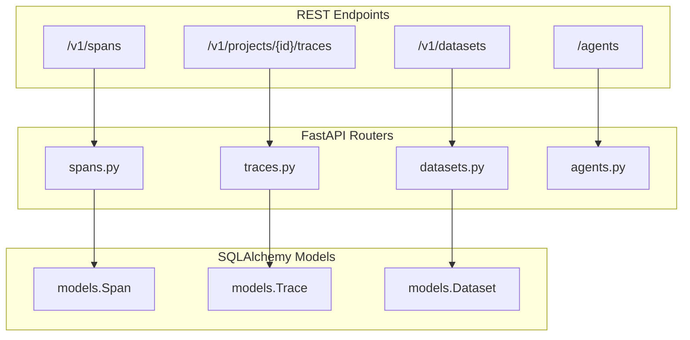
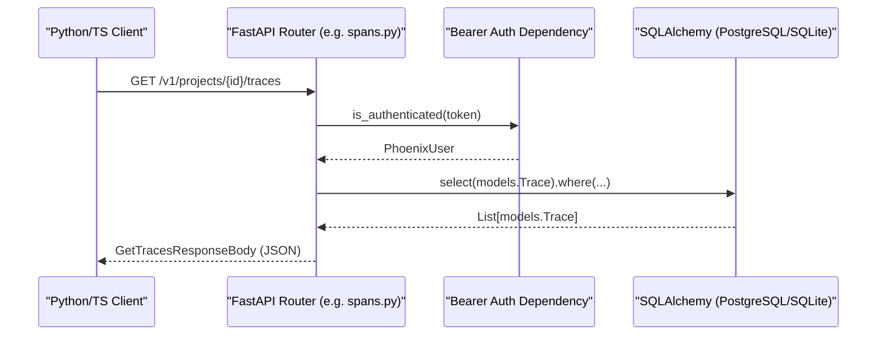

<!-- source: DeepWiki mcp.deepwiki.com · repo arize-ai/phoenix · page 2.3 REST API & OpenAPI · fetched 2026-10-27 -->

# REST API & OpenAPI

Relevant source files

The following files were used as context for generating this wiki page:

- [app/src/api/__generated__/v1.ts](app/src/api/__generated__/v1.ts)
- [app/src/pages/playground/__tests__/playgroundAgentContextUtils.test.ts](app/src/pages/playground/__tests__/playgroundAgentContextUtils.test.ts)
- [app/src/pages/playground/playgroundAgentContextUtils.ts](app/src/pages/playground/playgroundAgentContextUtils.ts)
- [docs/phoenix/tracing/how-to-tracing/setup-tracing/setup-projects.mdx](docs/phoenix/tracing/how-to-tracing/setup-tracing/setup-projects.mdx)
- [js/packages/phoenix-client/src/__generated__/api/v1.ts](js/packages/phoenix-client/src/__generated__/api/v1.ts)
- [packages/phoenix-client/src/phoenix/client/__generated__/v1/__init__.py](packages/phoenix-client/src/phoenix/client/__generated__/v1/__init__.py)
- [packages/phoenix-client/src/phoenix/client/helpers/sdk/anthropic/messages.py](packages/phoenix-client/src/phoenix/client/helpers/sdk/anthropic/messages.py)
- [packages/phoenix-client/src/phoenix/client/helpers/sdk/openai/chat.py](packages/phoenix-client/src/phoenix/client/helpers/sdk/openai/chat.py)
- [packages/phoenix-client/src/phoenix/client/resources/projects/__init__.py](packages/phoenix-client/src/phoenix/client/resources/projects/__init__.py)
- [packages/phoenix-client/src/phoenix/client/utils/encode_path_param.py](packages/phoenix-client/src/phoenix/client/utils/encode_path_param.py)
- [packages/phoenix-client/tests/canary/sdk/anthropic/test_messages.py](packages/phoenix-client/tests/canary/sdk/anthropic/test_messages.py)
- [packages/phoenix-client/tests/canary/sdk/openai/test_chat.py](packages/phoenix-client/tests/canary/sdk/openai/test_chat.py)
- [schemas/openapi.json](schemas/openapi.json)
- [src/phoenix/db/insertion/dataset.py](src/phoenix/db/insertion/dataset.py)
- [src/phoenix/server/agents/context.py](src/phoenix/server/agents/context.py)
- [src/phoenix/server/agents/prompts/context/PLAYGROUND_CONTEXT_INSTRUCTIONS.xml.j2](src/phoenix/server/agents/prompts/context/PLAYGROUND_CONTEXT_INSTRUCTIONS.xml.j2)
- [src/phoenix/server/agents/prompts/skills/playground/SKILL.md](src/phoenix/server/agents/prompts/skills/playground/SKILL.md)
- [src/phoenix/server/api/routers/agents.py](src/phoenix/server/api/routers/agents.py)
- [src/phoenix/server/api/routers/v1/__init__.py](src/phoenix/server/api/routers/v1/__init__.py)
- [src/phoenix/server/api/routers/v1/annotations.py](src/phoenix/server/api/routers/v1/annotations.py)
- [src/phoenix/server/api/routers/v1/datasets.py](src/phoenix/server/api/routers/v1/datasets.py)
- [src/phoenix/server/api/routers/v1/projects.py](src/phoenix/server/api/routers/v1/projects.py)
- [src/phoenix/server/api/routers/v1/spans.py](src/phoenix/server/api/routers/v1/spans.py)
- [src/phoenix/server/api/routers/v1/traces.py](src/phoenix/server/api/routers/v1/traces.py)
- [src/phoenix/server/api/routers/v1/utils.py](src/phoenix/server/api/routers/v1/utils.py)
- [src/phoenix/server/dml_event_handler.py](src/phoenix/server/dml_event_handler.py)
- [tests/integration/_helpers.py](tests/integration/_helpers.py)
- [tests/integration/auth/conftest.py](tests/integration/auth/conftest.py)
- [tests/integration/auth/test_auth.py](tests/integration/auth/test_auth.py)
- [tests/integration/client/conftest.py](tests/integration/client/conftest.py)
- [tests/integration/client/test_projects.py](tests/integration/client/test_projects.py)
- [tests/unit/db/insertion/test_dataset.py](tests/unit/db/insertion/test_dataset.py)
- [tests/unit/server/agents/capabilities/contexts/test_capabilities.py](tests/unit/server/agents/capabilities/contexts/test_capabilities.py)
- [tests/unit/server/api/routers/v1/test_annotations.py](tests/unit/server/api/routers/v1/test_annotations.py)
- [tests/unit/server/api/routers/v1/test_datasets.py](tests/unit/server/api/routers/v1/test_datasets.py)
- [tests/unit/server/api/routers/v1/test_projects.py](tests/unit/server/api/routers/v1/test_projects.py)
- [tests/unit/server/api/routers/v1/test_spans.py](tests/unit/server/api/routers/v1/test_spans.py)
- [tests/unit/server/api/routers/v1/test_traces.py](tests/unit/server/api/routers/v1/test_traces.py)

The Phoenix REST API provides HTTP endpoints for managing AI observability data including traces, spans, evaluations, datasets, experiments, and prompts. This document covers the v1 REST API implementation, the OpenAPI specification, and the automated client generation pipeline for Python and TypeScript.

## Architecture Overview

Phoenix utilizes [FastAPI](https://fastapi.tiangolo.com) to implement its RESTful interface. The API is structured under the `/v1` prefix and is organized into functional routers.

### Request Flow and Data Transformation

1.  **Routing**: Incoming requests are handled by routers defined in `src/phoenix/server/api/routers/v1/` [src/phoenix/server/api/routers/v1/__init__.py:10-23]().
2.  **Validation**: Pydantic models (subclasses of `V1RoutesBaseModel`) validate request bodies and query parameters [src/phoenix/server/api/routers/v1/models.py:53-53]().
3.  **Authorization**: FastAPI dependencies check for authentication (Bearer tokens) and role-based permissions (e.g., `restrict_access_by_viewers`) [src/phoenix/server/api/routers/v1/__init__.py:33-46]().
4.  **Database Interaction**: Routers use SQLAlchemy to query or mutate the underlying database [src/phoenix/server/api/routers/v1/spans.py:159-164]().
5.  **Response Formatting**: Data is serialized into JSON using Pydantic schemas or streamed as CSV/Arrow for large datasets [src/phoenix/server/api/routers/v1/datasets.py:21-21]().

### API to Code Entity Mapping

This diagram maps REST resources to their primary implementation files and database models.

Title: REST API Code Mapping

Sources: [src/phoenix/server/api/routers/v1/__init__.py:10-23](), [src/phoenix/server/api/routers/v1/spans.py:140-140](), [src/phoenix/server/api/routers/v1/traces.py:52-52](), [src/phoenix/server/api/routers/v1/datasets.py:77-77]().

## OpenAPI Specification

Phoenix maintains a comprehensive OpenAPI 3.1.0 specification located at `schemas/openapi.json` [schemas/openapi.json:1-6](). This schema is the "source of truth" for the API's structure, including:

*   **Operation IDs**: Unique identifiers for every endpoint (e.g., `list_annotation_configs_v1_annotation_configs_get`) [schemas/openapi.json:16-16]().
*   **Authentication**: Security schemes for Bearer Auth and API Keys.
*   **Schemas**: Detailed Pydantic-generated definitions for objects like `SpanQuery`, `Dataset`, and `Experiment` [src/phoenix/server/api/routers/v1/spans.py:143-150](), [src/phoenix/server/api/routers/v1/datasets.py:80-87]().

## Client Generation

Phoenix uses a code-generation pipeline to ensure that client libraries stay in sync with the server implementation.

### TypeScript Client Generation
The frontend and Node.js clients use `openapi-typescript` to generate type definitions from the JSON schema.
*   **Target File**: `js/packages/phoenix-client/src/__generated__/api/v1.ts` [js/packages/phoenix-client/src/__generated__/api/v1.ts:1-4]().
*   **Mechanism**: The generator creates an `interface paths` that maps URL patterns to their respective HTTP methods and response types [js/packages/phoenix-client/src/__generated__/api/v1.ts:6-27]().

### Python Client Generation
The Python client (`arize-phoenix-client`) contains generated `TypedDict` structures to provide type safety for API interactions.
*   **Target File**: `packages/phoenix-client/src/phoenix/client/__generated__/v1/__init__.py` [packages/phoenix-client/src/phoenix/client/__generated__/v1/__init__.py:1-6]().
*   **Key Entities**: Classes like `Dataset`, `Experiment`, and `PromptVersionData` are generated to match the server-side Pydantic models [packages/phoenix-client/src/phoenix/client/__generated__/v1/__init__.py:105-113](), [packages/phoenix-client/src/phoenix/client/__generated__/v1/__init__.py:151-164]().

## Key API Subsystems

### Traces & Spans
The API provides advanced filtering for spans using a JSON-based query DSL (`SpanQuery`) and specialized attribute parsing [src/phoenix/server/api/routers/v1/spans.py:143-150]().
*   **Attribute Filtering**: Spans can be filtered by `key:value` pairs where keys are dot-paths (e.g., `llm.model_name`) [src/phoenix/server/api/routers/v1/spans.py:126-137]().
*   **OTLP Ingestion**: The API supports OTLP trace ingestion via `POST /v1/traces` [src/phoenix/server/api/routers/v1/traces.py:9-12]().

### Datasets & Experiments
Datasets are managed via `/v1/datasets`.
*   **Pagination**: Uses a cursor-based pagination system where the cursor is a base64-encoded GlobalID [src/phoenix/server/api/routers/v1/datasets.py:102-105]().
*   **Bulk Operations**: Supports bulk deletion of datasets and associated projects/traces [src/phoenix/server/api/routers/v1/datasets.py:192-202]().

### AI Agent Interface (PxI)
The `/agents` endpoint provides a Vercel AI-compatible streaming interface for the Phoenix Intelligence (PxI) assistant [src/phoenix/server/api/routers/agents.py:1-17]().
*   **Context Resolution**: Injects relevant observability data (spans, traces) into the agent's prompt context [src/phoenix/server/api/routers/agents.py:47-51]().
*   **Tool Execution**: Supports executing tools on both the server (e.g., database queries) and the client [src/phoenix/server/api/routers/agents.py:79-80]().

## Implementation Diagram

The following diagram illustrates the interaction between the API layer, the generated clients, and the database.

Title: REST API Data Flow

Sources: [src/phoenix/server/api/routers/v1/traces.py:122-158](), [src/phoenix/server/api/routers/v1/__init__.py:45-45](), [src/phoenix/server/bearer_auth.py:37-37]().

---

