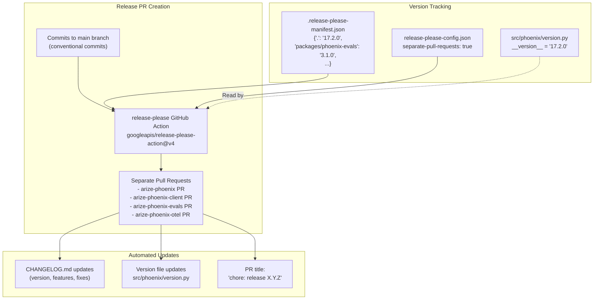
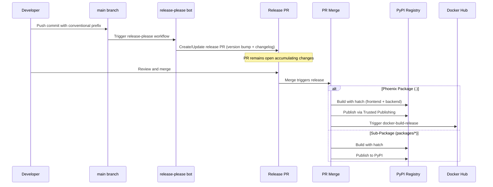
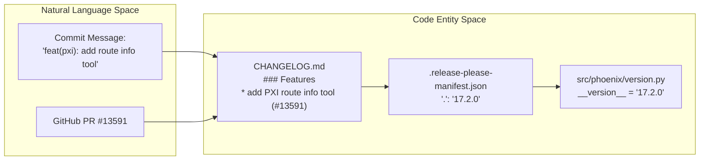

<!-- source: DeepWiki mcp.deepwiki.com · repo arize-ai/phoenix · page 6.4 Release Management · fetched 2026-10-27 -->

# Release Management

Relevant source files

The following files were used as context for generating this wiki page:

- [.agents/skills/phoenix-release-please/SKILL.md](.agents/skills/phoenix-release-please/SKILL.md)
- [.dockerignore](.dockerignore)
- [.github/workflows/cost-sync.yml](.github/workflows/cost-sync.yml)
- [.github/workflows/docker-build-experimental.yml](.github/workflows/docker-build-experimental.yml)
- [.github/workflows/docker-build-nightly.yml](.github/workflows/docker-build-nightly.yml)
- [.github/workflows/docker-build-release.yml](.github/workflows/docker-build-release.yml)
- [.github/workflows/helm-ci.yml](.github/workflows/helm-ci.yml)
- [.github/workflows/playwright.yaml](.github/workflows/playwright.yaml)
- [.github/workflows/publish.yaml](.github/workflows/publish.yaml)
- [.github/workflows/pull-requests.yaml](.github/workflows/pull-requests.yaml)
- [.github/workflows/python-CI.yml](.github/workflows/python-CI.yml)
- [.github/workflows/python-all-platforms.yml](.github/workflows/python-all-platforms.yml)
- [.github/workflows/release.yml](.github/workflows/release.yml)
- [.github/workflows/sync-lockfile-release-pr.yml](.github/workflows/sync-lockfile-release-pr.yml)
- [.github/workflows/typescript-CI.yml](.github/workflows/typescript-CI.yml)
- [.github/workflows/typescript-packages-CI.yml](.github/workflows/typescript-packages-CI.yml)
- [.github/workflows/typescript-packages-publish.yml](.github/workflows/typescript-packages-publish.yml)
- [.github/workflows/update-phoenix-package-versions.yml](.github/workflows/update-phoenix-package-versions.yml)
- [.release-please-manifest.json](.release-please-manifest.json)
- [CHANGELOG.md](CHANGELOG.md)
- [Dockerfile](Dockerfile)
- [MIGRATION.md](MIGRATION.md)
- [internal_docs/specs/playground.md](internal_docs/specs/playground.md)
- [internal_docs/specs/prompts.md](internal_docs/specs/prompts.md)
- [internal_docs/specs/server_evaluators.md](internal_docs/specs/server_evaluators.md)
- [kustomize/README.md](kustomize/README.md)
- [packages/phoenix-client/CHANGELOG.md](packages/phoenix-client/CHANGELOG.md)
- [packages/phoenix-client/pyproject.toml](packages/phoenix-client/pyproject.toml)
- [packages/phoenix-evals/CHANGELOG.md](packages/phoenix-evals/CHANGELOG.md)
- [packages/phoenix-evals/docs/source/api/evals.rst](packages/phoenix-evals/docs/source/api/evals.rst)
- [packages/phoenix-evals/docs/source/index.md](packages/phoenix-evals/docs/source/index.md)
- [packages/phoenix-evals/pyproject.toml](packages/phoenix-evals/pyproject.toml)
- [packages/phoenix-otel/CHANGELOG.md](packages/phoenix-otel/CHANGELOG.md)
- [packages/phoenix-otel/pyproject.toml](packages/phoenix-otel/pyproject.toml)
- [packages/phoenix-otel/src/phoenix/otel/__init__.py](packages/phoenix-otel/src/phoenix/otel/__init__.py)
- [packages/phoenix-otel/src/phoenix/otel/otel.py](packages/phoenix-otel/src/phoenix/otel/otel.py)
- [packages/phoenix-otel/tests/__init__.py](packages/phoenix-otel/tests/__init__.py)
- [packages/phoenix-otel/tests/test_exports.py](packages/phoenix-otel/tests/test_exports.py)
- [packages/phoenix-otel/tests/test_otel.py](packages/phoenix-otel/tests/test_otel.py)
- [packages/phoenix-otel/tests/test_settings.py](packages/phoenix-otel/tests/test_settings.py)
- [pyproject.toml](pyproject.toml)
- [release-please-config.json](release-please-config.json)
- [requirements/canary/sdk/anthropic.txt](requirements/canary/sdk/anthropic.txt)
- [requirements/ci.txt](requirements/ci.txt)
- [requirements/packages/phoenix-evals.txt](requirements/packages/phoenix-evals.txt)
- [requirements/type-check.txt](requirements/type-check.txt)
- [requirements/unit-tests.txt](requirements/unit-tests.txt)
- [scripts/docker/devops/oidc-server/frontend/package.json](scripts/docker/devops/oidc-server/frontend/package.json)
- [scripts/docker/devops/oidc-server/frontend/src/contexts/ThemeContext.tsx](scripts/docker/devops/oidc-server/frontend/src/contexts/ThemeContext.tsx)
- [scripts/docker/devops/oidc-server/package.json](scripts/docker/devops/oidc-server/package.json)
- [scripts/docker/devops/smtp-server/package.json](scripts/docker/devops/smtp-server/package.json)
- [scripts/update_helm.py](scripts/update_helm.py)
- [scripts/update_kustomize.py](scripts/update_kustomize.py)
- [src/phoenix/__init__.py](src/phoenix/__init__.py)
- [src/phoenix/db/migrations/versions/f1a6b2f0c9d5_add_span_session_id_index.py](src/phoenix/db/migrations/versions/f1a6b2f0c9d5_add_span_session_id_index.py)
- [src/phoenix/server/cli/commands/serve.py](src/phoenix/server/cli/commands/serve.py)
- [src/phoenix/tests/test_config.py](src/phoenix/tests/test_config.py)
- [src/phoenix/version.py](src/phoenix/version.py)
- [tests/conftest.py](tests/conftest.py)
- [tests/unit/conftest.py](tests/unit/conftest.py)
- [tox.ini](tox.ini)
- [uv.lock](uv.lock)

This document describes Phoenix's automated release process for Python packages, Docker images, and TypeScript packages. The release system uses `release-please` for version management and GitHub Actions for automated publishing.

For information about CI/CD testing and validation before releases, see [CI/CD Pipeline](#6.3). For Helm chart updates, see [Kubernetes Deployment](#6.5).

---

## Overview

Phoenix employs a fully automated release process with separate versioning for each package in the monorepo. The system supports:

- **Python packages**: Main `arize-phoenix` package plus three sub-packages (`arize-phoenix-client`, `arize-phoenix-evals`, `arize-phoenix-otel`).
- **Docker images**: Three release channels (latest, nightly, experimental) with multiple variants (root, nonroot, debug).
- **TypeScript packages**: Separate release flow for the JavaScript monorepo components.
- **Helm charts**: Automatic version bumping synchronized with Docker releases.

**Key Technologies**:
- [release-please](https://github.com/googleapis/release-please) for Python package versioning and changelog generation.
- [hatchling](https://hatch.pypa.io/latest) as the build backend for Python packages. [packages/phoenix-evals/pyproject.toml:70-70](), [packages/phoenix-client/pyproject.toml:42-42]()
- [uv](https://github.com/astral-sh/uv) for dependency management and CI execution. [pyproject.toml:81-82](), [tox.ini:9-9]()
- GitHub Actions for automation.

Sources: [.release-please-manifest.json:1-1](), [release-please-config.json:1-37](), [pyproject.toml:1-4]()

---

## Python Package Releases

### Release-Please Configuration

Phoenix uses `release-please` in `separate-pull-requests` mode, meaning each package in the monorepo triggers its own release PR. This allows independent versioning of the main package and its specialized sub-packages.

Title: Release-Please Workflow for Python Packages

**Configuration Mapping**:

| Package Path | Package Name | Release Type | Version Location |
|--------------|--------------|--------------|------------------|
| `.` | `arize-phoenix` | `python` | `src/phoenix/version.py` |
| `packages/phoenix-client` | `arize-phoenix-client` | `python` | `packages/phoenix-client/pyproject.toml` |
| `packages/phoenix-evals` | `arize-phoenix-evals` | `python` | `packages/phoenix-evals/pyproject.toml` |
| `packages/phoenix-otel` | `arize-phoenix-otel` | `python` | `packages/phoenix-otel/pyproject.toml` |

Sources: [release-please-config.json:1-37](), [.release-please-manifest.json:1-1](), [src/phoenix/version.py:1-1](), [packages/phoenix-evals/pyproject.toml:24-24](), [packages/phoenix-client/pyproject.toml:24-24]()

---

### Release Workflow

The workflow is driven by **Conventional Commits**. When a PR is merged to `main`, `release-please` analyzes the commit messages to determine the next version.

Title: Python Package Release Workflow

**Version Bump Logic**:
- `feat:` - Minor version bump (e.g., `17.1.0` -> `17.2.0`). [CHANGELOG.md:6-8]()
- `fix:` - Patch version bump (e.g., `17.1.0` -> `17.1.1`). [CHANGELOG.md:11-14]()
- `BREAKING CHANGE:` or `⚠` in commit body - Major version bump (e.g., `16.6.0` -> `17.0.0`). [CHANGELOG.md:39-41]()

Sources: [CHANGELOG.md:1-47](), [MIGRATION.md:1-9]()

---

### Publishing Process

#### Main Phoenix Package (`arize-phoenix`)

The main package is unique because it bundles the compiled React frontend assets.

1. **Dynamic Versioning**: The version is managed in `src/phoenix/version.py`. [src/phoenix/version.py:1-1]()
2. **Build Execution**: The build uses `hatchling`. During the build, the frontend is compiled via Vite and the assets are injected into the Python package structure. [pyproject.toml:234-235]()
3. **Distribution**: Packages are published to PyPI using GitHub's Trusted Publishing (OIDC).
4. **Validation**: CI runs `check-wheel-contents` and `twine check` to ensure package integrity. [pyproject.toml:83-84]()

Sources: [pyproject.toml:1-84](), [src/phoenix/version.py:1-1](), [.github/workflows/publish.yaml:1-50]()

#### Sub-Packages

Sub-packages are specialized libraries that can be installed independently of the full Phoenix server.

- **arize-phoenix-client**: The programmatic interface for REST/GraphQL interactions. [packages/phoenix-client/pyproject.toml:1-33]()
- **arize-phoenix-evals**: The evaluation framework containing LLM-based and code-based evaluators. [packages/phoenix-evals/pyproject.toml:1-35]()
- **arize-phoenix-otel**: OpenTelemetry configuration and registration helpers. [packages/phoenix-otel/pyproject.toml:1-25]()

Sources: [packages/phoenix-client/pyproject.toml:1-33](), [packages/phoenix-evals/pyproject.toml:1-35](), [packages/phoenix-otel/pyproject.toml:1-25]()

---

## Docker Image Releases

Phoenix maintains several Docker release channels to support different stability requirements.

### Release Channels

| Channel | Trigger | Tags |
|---------|---------|------|
| **Release** | Release PR merge (Git tag) | `latest`, `version-X.Y.Z`, `X.Y.Z` |
| **Nightly** | Scheduled / Push to `main` | `nightly`, `commit-<sha>` |
| **Experimental** | Push to feature branches | `dangerously-experimental` |

**Image Variants**:
- **Standard**: The default image.
- **Nonroot**: Hardened image running as a non-privileged user for production security.
- **Debug**: Includes additional troubleshooting tools and a shell.

Sources: [.github/workflows/docker-build-release.yml:1-30](), [.github/workflows/docker-build-nightly.yml:1-20](), [Dockerfile:1-50]()

---

## Versioning Strategy

Phoenix uses a "Loose Monorepo" versioning strategy. While all code resides in one repository, packages have independent version numbers tracked in `.release-please-manifest.json`.

Title: Association between Commit Messages and Version State

### Current Manifest State (v17.2.0)

| Package | Current Version |
|---------|-----------------|
| `arize-phoenix` (Root) | `17.2.0` |
| `arize-phoenix-evals` | `3.1.0` |
| `arize-phoenix-client` | `2.7.0` |
| `arize-phoenix-otel` | `0.16.1` |

Sources: [.release-please-manifest.json:1-1](), [CHANGELOG.md:1-21](), [packages/phoenix-evals/CHANGELOG.md:1-10](), [packages/phoenix-client/CHANGELOG.md:1-10]()

---

## Migration Documentation

When major versions or significant breaking changes are introduced, the `MIGRATION.md` file is updated to provide transition paths.

**Recent Breaking Changes (v17.0.0)**:
- **Server**: Introduction of system settings for admin-managed assistant enablement and trace recording policies. [CHANGELOG.md:39-45]()
- **Evals**: Removal of legacy `evals 1.0` and the legacy experiments module. [packages/phoenix-evals/CHANGELOG.md:24-30]()

Sources: [MIGRATION.md:1-41](), [CHANGELOG.md:36-46](), [packages/phoenix-evals/CHANGELOG.md:21-31]()

---

