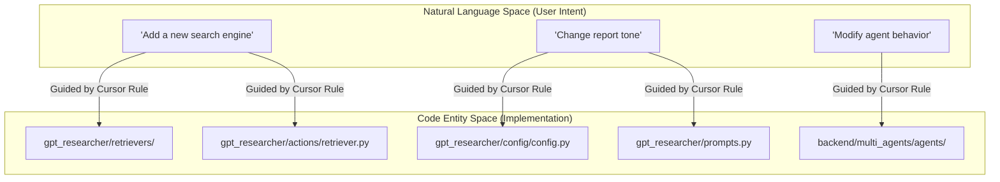
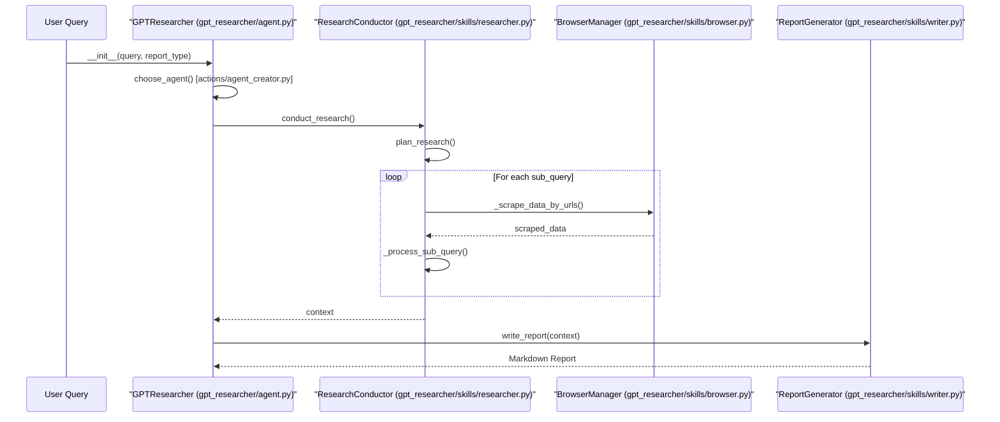

<!-- source: DeepWiki mcp.deepwiki.com · repo assafelovic/gpt-researcher · page 12.5 AI-Assisted Development · fetched 2026-10-27 -->

# AI-Assisted Development

Relevant source files

The following files were used as context for generating this wiki page:

- [.claude/SKILL.md](.claude/SKILL.md)
- [.claude/references/adding-features.md](.claude/references/adding-features.md)
- [.claude/references/advanced-patterns.md](.claude/references/advanced-patterns.md)
- [.claude/references/api-reference.md](.claude/references/api-reference.md)
- [.claude/references/architecture.md](.claude/references/architecture.md)
- [.claude/references/components.md](.claude/references/components.md)
- [.claude/references/config-reference.md](.claude/references/config-reference.md)
- [.claude/references/deep-research.md](.claude/references/deep-research.md)
- [.claude/references/flows.md](.claude/references/flows.md)
- [.claude/references/mcp.md](.claude/references/mcp.md)
- [.claude/references/multi-agents.md](.claude/references/multi-agents.md)
- [.codex-plugin/plugin.json](.codex-plugin/plugin.json)
- [.cursorrules](.cursorrules)
- [.github/workflows/plugin-quality-gate.yml](.github/workflows/plugin-quality-gate.yml)
- [.gitignore](.gitignore)
- [.mcp.json](.mcp.json)
- [CURSOR_RULES.md](CURSOR_RULES.md)
- [skills/gpt-researcher/SKILL.md](skills/gpt-researcher/SKILL.md)

## Purpose and Scope

This document details GPT Researcher's AI-assisted development infrastructure, specifically the skills system and configuration rules that enable AI assistants like Claude and Cursor to understand, navigate, and contribute to the codebase. The project utilizes a structured `.claude/skills/` directory and a comprehensive `CURSOR_RULES.md` file to provide architectural context, component interactions, and development patterns. This allows AI assistants to implement features following established conventions such as the "8-Step Feature Pattern."

For information about the general project structure, see [Project Structure and Dependencies](#12.1). For frontend-specific development, see [Frontend Development](#12.2).

## AI Skill Infrastructure

The repository contains specialized configuration files that bridge the gap between natural language requirements and the internal code entity space. These include Model Context Protocol (MCP) definitions and skill sets for AI plugins.

### Skills Directory (.claude/skills/ and skills)

The project maintains two distinct skill directories for different AI integrations:

| Directory | Purpose | Key Content |
|-----------|---------|-------------|
| `.claude/skills/` | Development Knowledge Base | Contains `SKILL.md` and deep references for AI agents helping developers. [.claude/SKILL.md:1-225]() |
| `skills/gpt-researcher/` | Codex/MCP Integration | Defines the `gpt-researcher` skill for use via MCP in Codex workflows. [skills/gpt-researcher/SKILL.md:1-13]() |

The `.claude/skills/` directory serves as a high-level knowledge base for AI agents:
* `SKILL.md`: Defines the planner-executor-publisher pattern and core class roles. [.claude/SKILL.md:8-10]()
* `references/adding-features.md`: Documents the "8-Step Pattern" for system extension. [.claude/references/adding-features.md:10-20]()
* `references/components.md`: Lists critical method signatures for `GPTResearcher` and `ResearchConductor`. [.claude/references/components.md:10-158]()

**Sources:** [.claude/SKILL.md:1-225](), [skills/gpt-researcher/SKILL.md:1-13](), [.claude/references/adding-features.md:1-20](), [.claude/references/components.md:1-158]()

### Codex and MCP Configuration

The project is configured as a Codex plugin, allowing AI assistants to invoke research capabilities directly through the Model Context Protocol (MCP).

* **Plugin Definition**: The `.codex-plugin/plugin.json` file identifies the repository as an autonomous research agent. [.codex-plugin/plugin.json:1-24]()
* **MCP Server**: The `.mcp.json` file defines the `gpt-researcher` server, which is executed via `uvx`. [.mcp.json:1-10]()
* **Quality Control**: A GitHub Action (`.github/workflows/plugin-quality-gate.yml`) ensures that changes to skills or MCP configs meet a minimum quality score. [.github/workflows/plugin-quality-gate.yml:1-21]()

**Sources:** [.codex-plugin/plugin.json:1-24](), [.mcp.json:1-10](), [.github/workflows/plugin-quality-gate.yml:1-21]()

### Cursor Rules (.cursorrules & CURSOR_RULES.md)

The `.cursorrules` file (and its readable copy `CURSOR_RULES.md`) defines the "Natural Language to Code" mapping for the Cursor AI editor. It enforces strict development guidelines and provides a lexicon for agent roles.

**Mapping Natural Language to Code Entities**

**Sources:** [.cursorrules:1-150](), [CURSOR_RULES.md:1-181]()

## Core Development Patterns

The AI-assisted workflow is built around specific code patterns that AI agents are instructed to follow.

### The 8-Step Feature Pattern
To ensure consistency, new features follow a rigid path documented in the AI skills:
1. **Config**: Update `gpt_researcher/config/variables/default.py`. [.claude/references/adding-features.md:24-32]()
2. **Provider**: Create in `gpt_researcher/llm_provider/`. [.claude/references/adding-features.md:45-59]()
3. **Skill**: Create in `gpt_researcher/skills/`. [.claude/references/adding-features.md:65-86]()
4. **Agent**: Integrate in `gpt_researcher/agent.py`. [.claude/references/adding-features.md:92-107]()
5. **Prompts**: Update `gpt_researcher/prompts.py`. [.claude/references/adding-features.md:111-117]()
6. **WebSocket**: Add events via `stream_output()`. [.claude/references/adding-features.md:119-121]()
7. **Frontend**: Update `useWebSocket.ts`. [.claude/references/adding-features.md:125-131]()
8. **Docs**: Update documentation. [.claude/references/adding-features.md:133-135]()

**Sources:** [.claude/references/adding-features.md:10-135](), [.claude/SKILL.md:86-97]()

### Research Orchestration Flow

AI assistants are trained to understand the internal method calls that drive the research process.

**Research Execution Path**

**Sources:** [.claude/references/components.md:55-156](), [.claude/SKILL.md:58-78]()

## Critical Development Guidelines

AI assistants are restricted by several "Critical Gotchas" to prevent common architectural errors:

*   **Case Sensitivity**: Configuration keys are lowercased when accessed (e.g., `SMART_LLM` in env becomes `self.cfg.smart_llm` in code). [.claude/SKILL.md:125-130]()
*   **Async/Await**: All research methods must be `async`. [.claude/SKILL.md:205-205]()
*   **Graceful Degradation**: Skills must use try-except blocks to stream errors via `stream_output` instead of crashing. [.claude/references/advanced-patterns.md:107-119]()
*   **Retriever Registration**: New retrievers must be registered in the `match` statement within `gpt_researcher/actions/retriever.py`. [.claude/SKILL.md:111-115]()

**Sources:** [.claude/SKILL.md:180-210](), [.claude/references/advanced-patterns.md:101-119]()

## AI-Assisted Contribution Workflow

Developers can use the following workflow to leverage these AI skills:

1.  **Context Loading**: When opening the project in Cursor or Claude, the `.cursorrules` and `.claude/skills/` are automatically indexed. [.cursorrules:1-5]()
2.  **Feature Request**: Prompt the AI using the defined lexicon (e.g., "Add a new specialized Agent Role for legal research"). [CURSOR_RULES.md:165-172]()
3.  **Validation**: The AI validates changes against the "Rule Violation Monitoring" section, which flags unauthorized library additions or TypeScript strict mode violations. [.cursorrules:126-134]()
4.  **Testing**: AI is instructed to run `python -m pytest` or `npm run test` after implementation. [CURSOR_RULES.md:145-155]()

**Sources:** [.cursorrules:126-155](), [CURSOR_RULES.md:165-172]()

---

