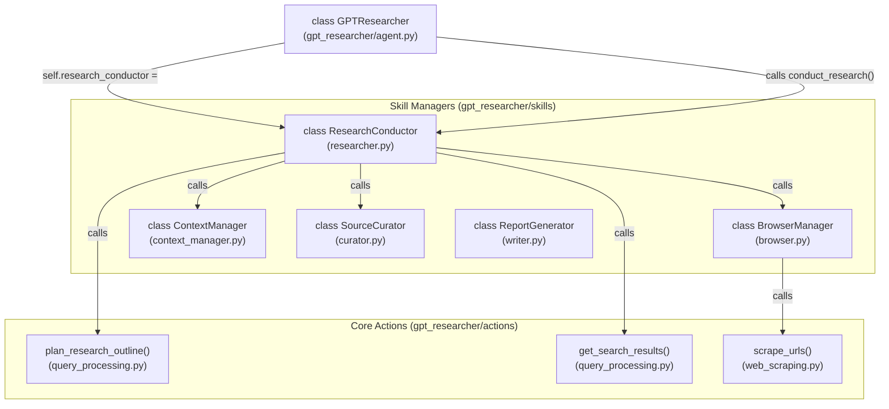
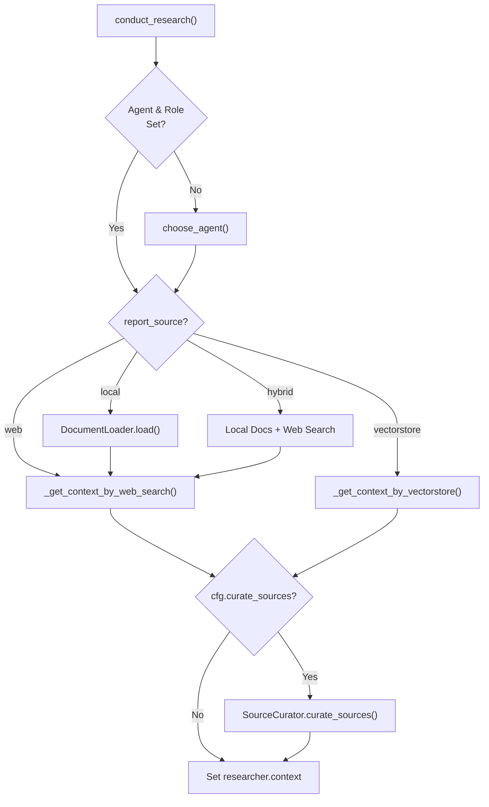
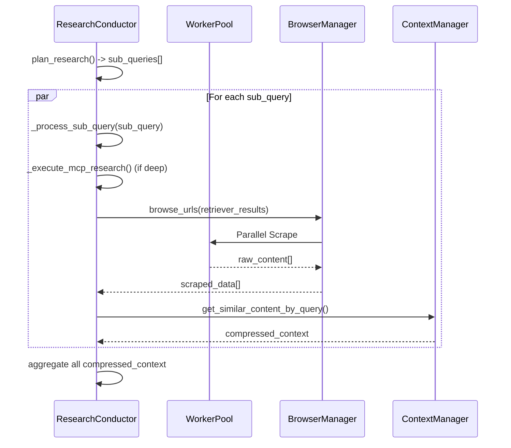

<!-- source: DeepWiki mcp.deepwiki.com · repo assafelovic/gpt-researcher · page 3.2 ResearchConductor and Workflow · fetched 2026-10-27 -->

# ResearchConductor and Workflow

Relevant source files

The following files were used as context for generating this wiki page:

- [docs/docs/gpt-researcher/gptr/config.md](docs/docs/gpt-researcher/gptr/config.md)
- [gpt_researcher/actions/agent_creator.py](gpt_researcher/actions/agent_creator.py)
- [gpt_researcher/actions/query_processing.py](gpt_researcher/actions/query_processing.py)
- [gpt_researcher/actions/utils.py](gpt_researcher/actions/utils.py)
- [gpt_researcher/agent.py](gpt_researcher/agent.py)
- [gpt_researcher/config/variables/base.py](gpt_researcher/config/variables/base.py)
- [gpt_researcher/config/variables/default.py](gpt_researcher/config/variables/default.py)
- [gpt_researcher/skills/browser.py](gpt_researcher/skills/browser.py)
- [gpt_researcher/skills/curator.py](gpt_researcher/skills/curator.py)
- [gpt_researcher/skills/researcher.py](gpt_researcher/skills/researcher.py)
- [gpt_researcher/utils/costs.py](gpt_researcher/utils/costs.py)
- [gpt_researcher/utils/tools.py](gpt_researcher/utils/tools.py)
- [tests/test_costs.py](tests/test_costs.py)
- [tests/test_llm_usage_tracking.py](tests/test_llm_usage_tracking.py)

## Purpose and Scope

This document explains the `ResearchConductor` class and the research workflow it orchestrates within GPT Researcher. The `ResearchConductor` is a specialized skill manager responsible for coordinating the multi-stage research process, including query planning, sub-query generation, parallel data gathering from multiple sources, and context aggregation.

It acts as the operational engine for the `GPTResearcher` agent, translating a high-level research goal into a series of executable technical steps across web retrievers, local documents, and Model Context Protocol (MCP) servers.

**Sources:** [gpt_researcher/skills/researcher.py:1-32](), [gpt_researcher/agent.py:29-30]()

## ResearchConductor in the Architecture

The `ResearchConductor` is instantiated during the initialization of the `GPTResearcher` class. It maintains a reference to its parent researcher instance to access shared configuration, memory, and WebSocket communication channels.

### Code Entity Association

The following diagram bridges the high-level research concepts to the specific classes and methods implemented in the codebase.

**Sources:** [gpt_researcher/agent.py:182-190](), [gpt_researcher/skills/researcher.py:34-46]()

## Core Workflow Stages

The `ResearchConductor.conduct_research()` method is the primary entry point for the research execution logic. It follows a structured pipeline:

1.  **Initialization**: Clears `visited_urls`, resets `research_data`, and logs active retrievers [gpt_researcher/skills/researcher.py:91-102]().
2.  **Agent Selection**: If not predefined, it calls `choose_agent()` to assign a persona and role based on the query [gpt_researcher/skills/researcher.py:119-127]().
3.  **Source Routing**: Determines the research path based on `self.researcher.report_source` (e.g., "web", "local", "hybrid") [gpt_researcher/skills/researcher.py:135-191]().
4.  **Context Gathering**: Executes the selected retrieval strategy (Web Search, Local Document Loading, or Vector Store Querying).
5.  **Curation (Optional)**: If `cfg.curate_sources` is enabled, it uses the `SourceCurator` to rank and filter results [gpt_researcher/skills/researcher.py:195-207]().

### Detailed Research Flow

**Sources:** [gpt_researcher/skills/researcher.py:89-211]()

## Query Planning and Decomposition

Before searching, the system decomposes the main query into sub-queries to ensure breadth. This is handled by `plan_research()`.

1.  **Initial Search**: Calls `get_search_results()` with the original query to get baseline context [gpt_researcher/skills/researcher.py:62]().
2.  **Outline Generation**: Calls `plan_research_outline()`, which uses the `STRATEGIC_LLM` to generate a list of focused sub-queries [gpt_researcher/skills/researcher.py:75-85]().
3.  **MCP Optimization**: If only an `MCPRetriever` is used, sub-query generation is skipped to prevent redundant iterations [gpt_researcher/actions/query_processing.py:145-153]().

**Sources:** [gpt_researcher/skills/researcher.py:48-87](), [gpt_researcher/actions/query_processing.py:112-169]()

## Web Search and Sub-Query Processing

The method `_get_context_by_web_search()` manages parallel execution across multiple retrievers and sub-queries.

### MCP Execution Strategies

The system implements specific logic for Model Context Protocol (MCP) servers via the `mcp_strategy` configuration [gpt_researcher/config/variables/default.py:44]().

| Strategy | Behavior | Implementation |
| :--- | :--- | :--- |
| **fast** | Runs MCP once with the original query; caches results for all sub-queries. | `_mcp_results_cache` [gpt_researcher/skills/researcher.py:44]() |
| **deep** | Runs MCP research for every generated sub-query. | `_execute_mcp_research_for_queries()` [gpt_researcher/skills/researcher.py:393]() |
| **disabled** | Skips MCP retrievers entirely. | `_get_mcp_strategy()` check [gpt_researcher/skills/researcher.py:283]() |

### Parallel Execution Diagram

**Sources:** [gpt_researcher/skills/researcher.py:348-365](), [gpt_researcher/skills/researcher.py:449-578](), [gpt_researcher/skills/browser.py:32-35]()

## Key Implementation Details

### Browser and Scraper Integration
The `BrowserManager` utilizes a `WorkerPool` to parallelize the scraping of URLs discovered by retrievers. It also handles image selection via `select_top_images`, filtering by image hash to avoid duplicates [gpt_researcher/skills/browser.py:32-35](), [gpt_researcher/skills/browser.py:86-115]().

### Context Compression
The `ContextManager` uses specialized compressors to reduce raw scraped text into relevant snippets. It performs similarity searches to select the top results based on embeddings generated for the query and document chunks.

### Source Curation
If `CURATE_SOURCES` is `True` [gpt_researcher/config/variables/default.py:14](), the `SourceCurator` performs an LLM-based evaluation of all gathered sources. It uses the `SMART_LLM` to rank sources by credibility and relevance, returning a structured JSON list of verified references [gpt_researcher/skills/curator.py:58-85]().

## Configuration Summary

The behavior of the `ResearchConductor` is governed by the following key variables in `BaseConfig`:

| Variable | Default | Description |
| :--- | :--- | :--- |
| `RETRIEVER` | `"tavily"` | Primary web search provider [gpt_researcher/config/variables/default.py:4]() |
| `MAX_SEARCH_RESULTS_PER_QUERY` | `5` | Results per sub-query [gpt_researcher/config/variables/default.py:18]() |
| `MAX_SCRAPER_WORKERS` | `15` | Concurrency for web scraping [gpt_researcher/config/variables/default.py:25]() |
| `MCP_STRATEGY` | `"fast"` | Execution mode for MCP servers [gpt_researcher/config/variables/default.py:44]() |
| `CURATE_SOURCES` | `False` | Whether to run the SourceCurator skill [gpt_researcher/config/variables/default.py:14]() |

**Sources:** [gpt_researcher/config/variables/default.py:1-54](), [gpt_researcher/config/variables/base.py:5-51]()

---

