# Page: Microagents Overview

# Microagents Overview

<details>
<summary>Relevant source files</summary>

The following files were used as context for generating this wiki page:

- [README.md](README.md)
- [main.py](main.py)

</details>


This document provides an introduction to the Microagents Framework, a system for dynamically creating and managing self-improving AI agents. This page covers the core concepts, architecture, and key features of the system. For installation instructions, see [Installation and Dependencies](#1.1).

## What is Microagents?

Microagents is an experimental framework for dynamically creating self-improving AI agents in response to tasks. The system enables small, specialized "microagents" to be:

1. Generated on-demand in response to user queries
2. Evaluated for functionality and effectiveness
3. Persisted for future reuse across sessions
4. Combined to solve complex problems

This approach allows the system to independently learn and improve methods for task execution over time, building up a library of specialized agents.

Sources: [README.md:21-23]()

## Core Architecture

The Microagents system follows a modular architecture with several key components working together to manage agent creation, execution, evaluation, and persistence.

### System Architecture Diagram

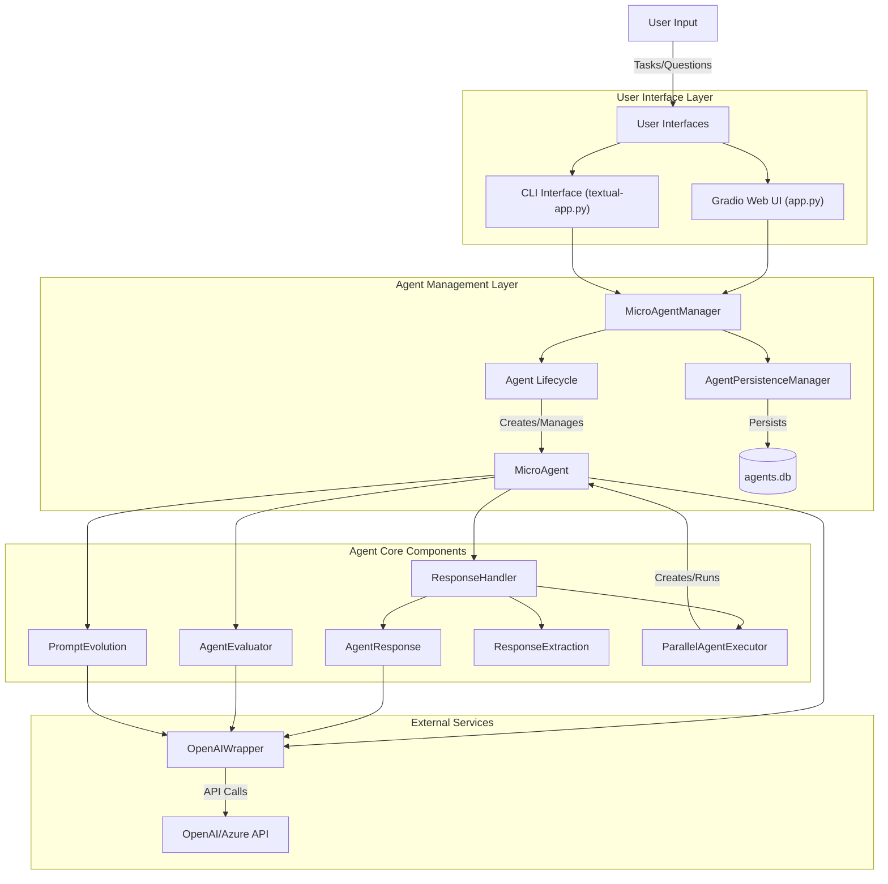

Sources: [main.py:67-81](), [README.md:21-35]()

## Key Components

### MicroAgentManager

The `MicroAgentManager` serves as the central coordinator for the microagents system. It handles:

- Initializing the agent system
- Creating and retrieving agents
- Managing agent persistence
- Processing user inputs

Example from the code:

```python
# Initialize manager and process user input
manager = MicroAgentManager(openai_wrapper, db_filename="agents.db")
agent = manager.get_or_create_agent("Bootstrap Agent", depth=1, sample_input=user_input)
response = agent.respond(user_input)
```

Sources: [main.py:67-81]()

### MicroAgent

The `MicroAgent` class represents individual specialized agents in the system. Each agent has:

- A specific purpose
- A dedicated prompt
- A depth level in the agent hierarchy
- The ability to respond to user queries

### Agent Hierarchy

Agents are organized in a hierarchical structure with depth levels:

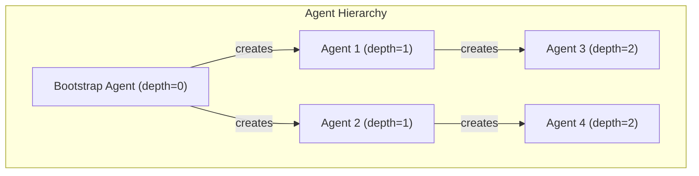

The "Bootstrap Agent" (prime agent) serves as the entry point, receiving user queries and delegating to depth=1 agents. These agents can create deeper agents up to a maximum depth. This hierarchical structure allows for specialized agent creation and delegation of subtasks.

Sources: [main.py:75-81]()

## Request Processing Flow

The following sequence diagram illustrates how the system processes a user request:

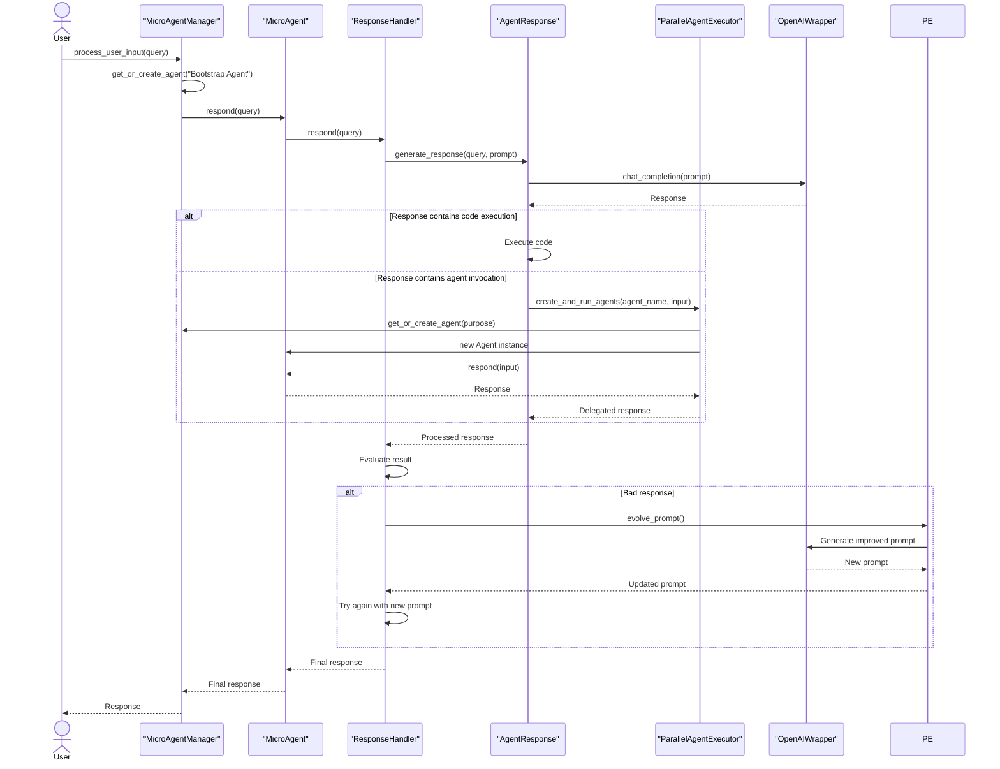

Sources: [main.py:75-81]()

## Parallelization and Agent Selection

A key feature of the microagents system is parallel agent execution and selection. When a new agent is required, the system:

1. Creates multiple agent instances in parallel (typically three)
2. Each agent attempts to accomplish the same task
3. The first agent to successfully complete the task is selected and retained
4. The other agents are discarded

This approach improves efficiency and effectiveness by implementing a "race condition" where the fastest successful agent wins.

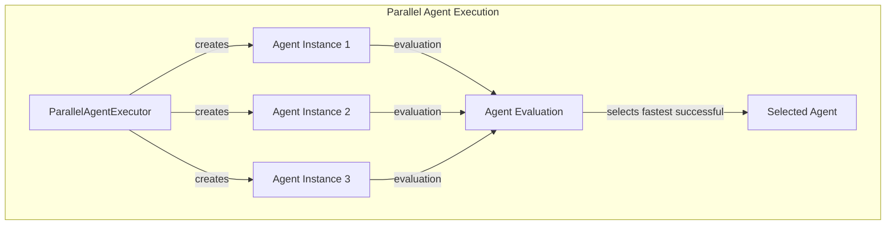

Sources: [README.md:156-158]()

## Agent Persistence

Successful agents are persisted to enable reuse across sessions, enhancing efficiency and enabling the system to learn over time.

Key aspects of agent persistence:

| Feature | Description |
|---------|-------------|
| Storage Mechanism | SQLite database ("agents.db") |
| Persistence Manager | AgentPersistenceManager component |
| Stored Data | Agent purpose, prompt, creation date, success metrics |
| Retrieval Method | Similarity matching against existing agents |

When processing a user query, the system first checks if a suitable agent already exists before creating a new one.

Sources: [README.md:162-163](), [main.py:71]()

## Agent Evaluation and Validation

A critical component of the microagents system is the evaluation process, which ensures that only effective agents are retained:

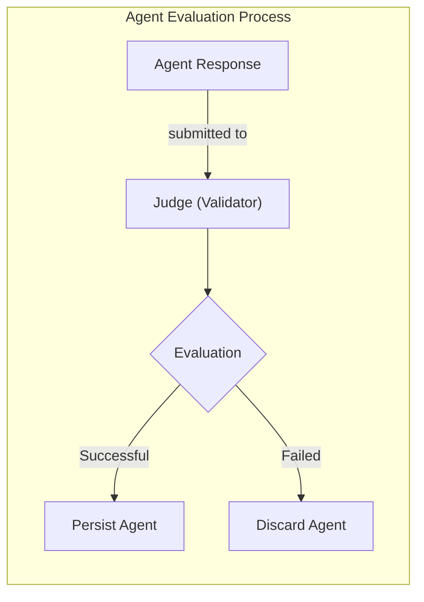

The "Judge" phase validates that agents claiming to work actually perform as expected. This ensures only fully functional agents are added to the catalog.

Sources: [README.md:161-161]()

## Integration with OpenAI/Azure

The microagents system integrates with OpenAI's models (or Azure OpenAI) for:

1. Text generation for agent responses
2. Embedding generation for agent similarity calculations
3. Prompt evolution for improving agent performance

The system supports both:
- OpenAI API directly 
- Azure OpenAI with API key or Entra ID authentication

For more details on integration, see [OpenAI/Azure Integration](#5.1).

Sources: [README.md:25-32](), [README.md:51-71]()

## Use Cases and Examples

The microagents system includes several pretrained agents that demonstrate its capabilities:

| Agent Type | Purpose |
|------------|---------|
| Weather Forecast Agent | Fetches weather forecasts from public APIs |
| IP-Based Location Fetcher | Retrieves geolocation data from IP addresses |
| And 26+ more specialized agents | Various information retrieval and processing tasks |

These agents show how the system can create specialized, reusable components for different tasks.

Sources: [README.md:96-136](), [README.md:158-160]()

## Conclusion

The Microagents Framework provides a novel approach to task-oriented AI assistance by dynamically creating specialized, self-improving agents. By combining agent creation, evaluation, persistence, and composition, the system builds an evolving library of capabilities that improve over time.

For installation instructions, see [Installation and Dependencies](#1.1). For a deeper dive into the system architecture, see [System Architecture](#2).

Sources: [README.md:21-23](), [README.md:143-165]()

---

# Page: Installation and Dependencies

# Installation and Dependencies

<details>
<summary>Relevant source files</summary>

The following files were used as context for generating this wiki page:

- [Dockerfile](Dockerfile)
- [README-Docker.md](README-Docker.md)
- [README.md](README.md)
- [requirements.txt](requirements.txt)

</details>


This page provides detailed instructions for installing the Microagents framework and setting up its dependencies. The document covers both direct installation and Docker-based deployment methods, along with the necessary environment configurations. For information about system architecture and design, see [System Architecture](#2).

## System Requirements

The Microagents framework has the following requirements:

- Python 3.x
- OpenAI API access with capabilities for:
  - GPT-4 Turbo (`gpt-4-turbo` or `gpt-4-1106-preview`)
  - Embedding model (`text-embedding-ada-002`)
- Approximately 1GB of disk space for dependencies

Sources: [README.md:37-40](), [requirements.txt:1-61]()

## Installation Methods

### Direct Installation

Direct installation involves cloning the repository, installing Python packages, and configuring environment variables.

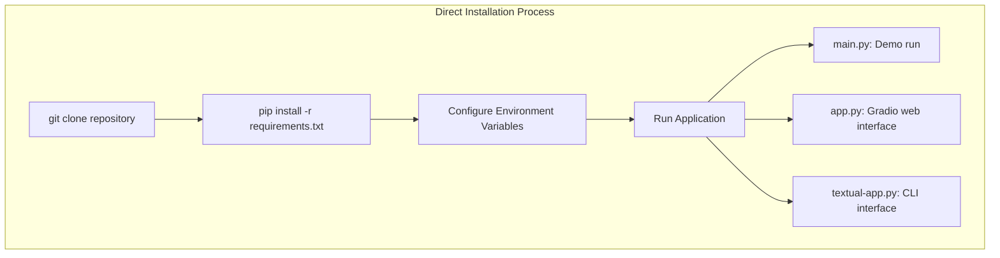

1. **Clone the Repository**:
   ```bash
   git clone https://github.com/aymenfurter/microagents.git
   cd microagents
   ```

2. **Install Dependencies**:
   ```bash
   pip install -r requirements.txt
   ```

3. **Configure Environment Variables**:
   - See the Environment Configuration section below

4. **Verify Installation**:
   - For a demo run: `python main.py`
   - For web interface: `python app.py`
   - For CLI: `python textual-app.py`

Sources: [README.md:43-50](), [README.md:77-86]()

### Docker Installation

Docker installation provides an isolated environment for running Microagents.

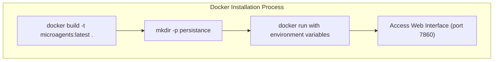

1. **Build the Docker Image**:
   ```bash
   docker build -t microagents:latest .
   ```

2. **Create Persistence Directory**:
   ```bash
   mkdir -p persistance
   ```

3. **Run the Docker Container**:
   ```bash
   docker run -it --rm \
         -e OPENAI_KEY='your_api_key_here' \
         -v "$(pwd)/persistance:/usr/src/app/persistance" \
         -p "7860:7860" \
         microagents:latest
   ```

4. **Access the Web Interface**:
   - Open your browser and navigate to: `http://localhost:7860`

Sources: [Dockerfile:1-20](), [README-Docker.md:6-49]()

## Dependencies Structure

The Microagents framework relies on various Python packages organized by functionality:

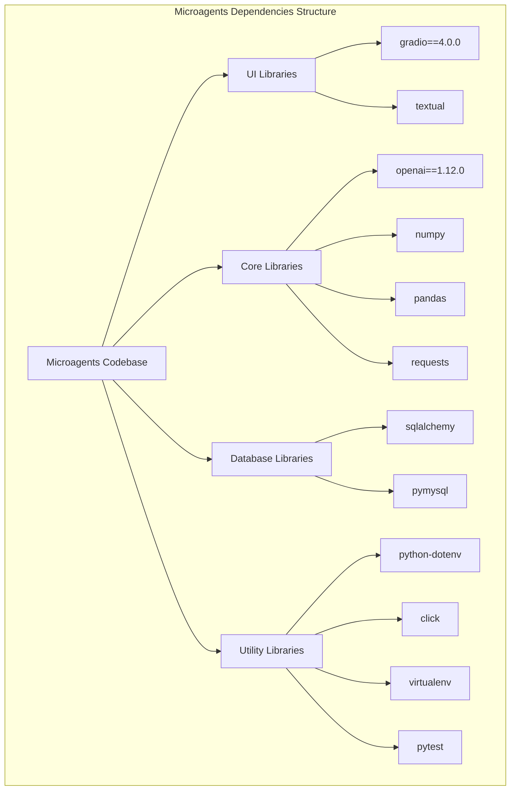

### Key Dependencies

| Category | Package | Version | Purpose |
|----------|---------|---------|---------|
| UI | gradio | 4.0.0 | Web-based user interface |
| UI | textual | latest | Command-line interface |
| Core | openai | 1.12.0 | OpenAI API client |
| Core | numpy | latest | Numerical computations |
| Core | pandas | latest | Data manipulation |
| Core | requests | latest | HTTP requests |
| Database | sqlalchemy | latest | ORM for database operations |
| Utilities | python-dotenv | latest | Environment variable management |
| Web | beautifulsoup4 | latest | HTML parsing |
| Testing | pytest | latest | Testing framework |

Sources: [requirements.txt:1-61]()

## Environment Configuration

The Microagents system is configured through environment variables that control API access, database settings, and UI parameters.

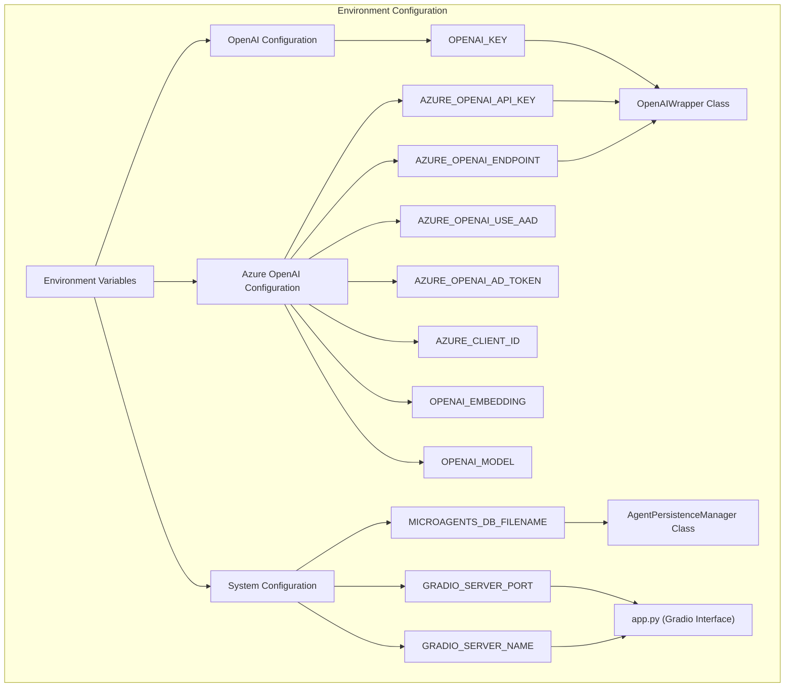

### API Configuration Options

#### OpenAI API:
```bash
export OPENAI_KEY='your_api_key_here'
```

#### Azure OpenAI with API key:
```bash
export AZURE_OPENAI_API_KEY='your_api_key_here'
export AZURE_OPENAI_ENDPOINT='https://my_endpoint_name_here.openai.azure.com/'
# export OPENAI_EMBEDDING=''  # Optional: Azure deployment name for embeddings
# export OPENAI_MODEL=''      # Optional: Azure deployment name for GPT-4
```

#### Azure OpenAI with Entra ID (AAD):
```bash
export AZURE_OPENAI_ENDPOINT='https://my_endpoint_name_here.openai.azure.com/'
export AZURE_OPENAI_USE_AAD='true'
# export AZURE_OPENAI_AD_TOKEN=''   # Optional: AAD token
# export AZURE_CLIENT_ID=''         # Optional: Managed identity client ID
# export OPENAI_EMBEDDING=''        # Optional: Azure deployment name for embeddings
# export OPENAI_MODEL=''            # Optional: Azure deployment name for GPT-4
```

Sources: [README.md:51-71](), [Dockerfile:14-16](), [README-Docker.md:20-49]()

### System Configuration Variables

| Variable | Purpose | Default | Example |
|----------|---------|---------|---------|
| MICROAGENTS_DB_FILENAME | Path to the agents database file | agents.db | /usr/src/app/persistance/agents.db |
| GRADIO_SERVER_PORT | Port for the Gradio web server | 7860 | 8080 |
| GRADIO_SERVER_NAME | Hostname for the Gradio web server | 0.0.0.0 | localhost |

Sources: [Dockerfile:14-16]()

## Security Considerations

> [!CAUTION]
> Microagents execute Python code directly without a sandbox. It's recommended to run them in isolated environments such as GitHub Codespaces or Docker to limit potential damage. Be mindful of the costs associated with using OpenAI's services.

Sources: [README.md:74-75]()

## Troubleshooting

### Common Issues

1. **API Key Authentication Failures**:
   - Verify the key is correctly set in environment variables
   - Check for spaces or invisible characters in the key

2. **Missing Dependencies**:
   - Run `pip install -r requirements.txt --verbose` for detailed installation logs
   - Install problematic packages individually if needed

3. **Database Errors**:
   - If you experience database issues, try removing the `agents.db` file and restarting the application:
     ```bash
     rm agents.db
     python app.py
     ```

4. **Port Conflicts**:
   - If port 7860 is already in use, set a different port:
     ```bash
     export GRADIO_SERVER_PORT=8080
     python app.py
     ```

Sources: [README.md:87]()

---

# Page: System Architecture

# System Architecture

<details>
<summary>Relevant source files</summary>

The following files were used as context for generating this wiki page:

- [agents/microagent.py](agents/microagent.py)
- [agents/microagent_manager.py](agents/microagent_manager.py)
- [main.py](main.py)

</details>


This document provides a technical overview of the Microagents system architecture, explaining the core components, their interactions, data flow patterns, and the mechanisms that enable dynamic creation and management of specialized AI agents. For details on how agents communicate hierarchically, see [Agent Hierarchy and Communication](#2.1). For information about the complete agent lifecycle, refer to [Agent Lifecycle](#2.2).

## High-Level System Overview

The Microagents system follows a modular architecture designed to dynamically create, manage, and improve purpose-specific AI agents. These agents collaborate to solve complex problems by delegating tasks to specialized sub-agents.

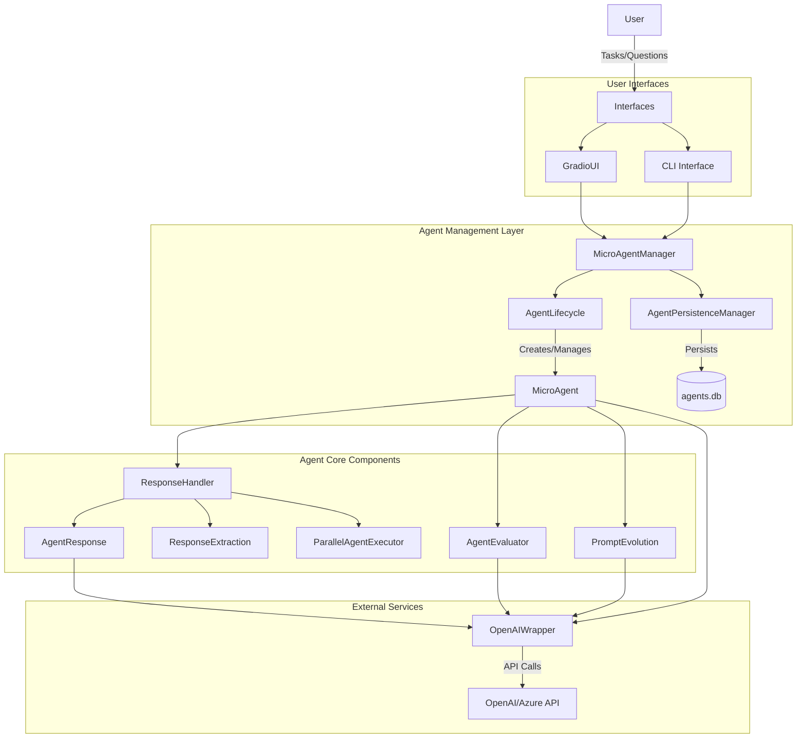

Sources: [main.py:67-73](), [agents/microagent_manager.py:11-27](), [agents/microagent.py:17-68]()

## Core Components and Relationships

The system architecture consists of the following key components:

### 1. MicroAgentManager

The central coordinator that manages agent creation, retrieval, and lifecycle. It maintains the agent inventory and provides interfaces for the UI layer.

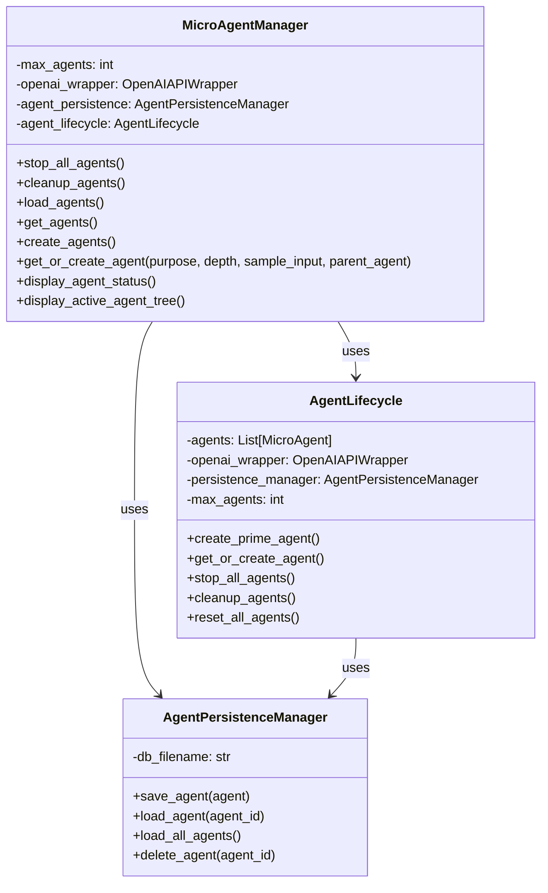

Sources: [agents/microagent_manager.py:11-78]()

### 2. MicroAgent

The core agent class that represents individual AI agents with specific purposes. Each agent can generate responses, execute code, and delegate tasks to other agents.

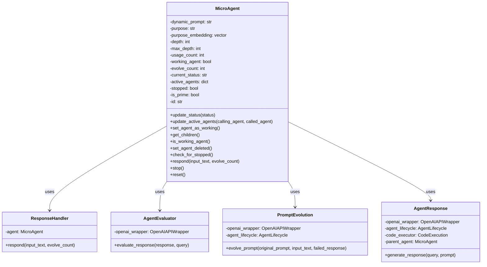

Sources: [agents/microagent.py:17-138]()

### 3. Integration Layer

The system integrates with external services, primarily OpenAI's API, through the OpenAIWrapper class.

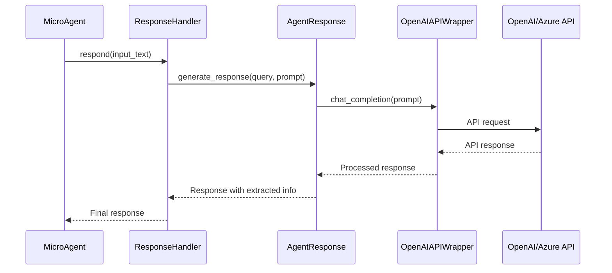

Sources: [main.py:96-98](), [agents/microagent.py:62-68]()

## Request Processing Flow

The system processes user requests through a defined flow that enables dynamic agent creation, delegation, and response generation.

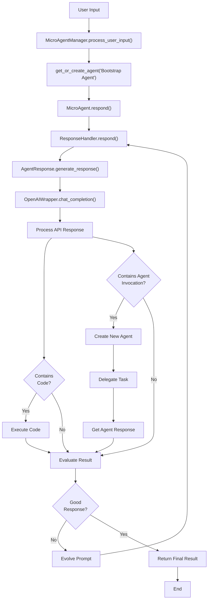

Sources: [main.py:75-81](), [agents/microagent.py:114-118]()

## Agent Creation and Management

The system creates and manages agents dynamically based on task requirements, with a focus on agent reuse when appropriate.

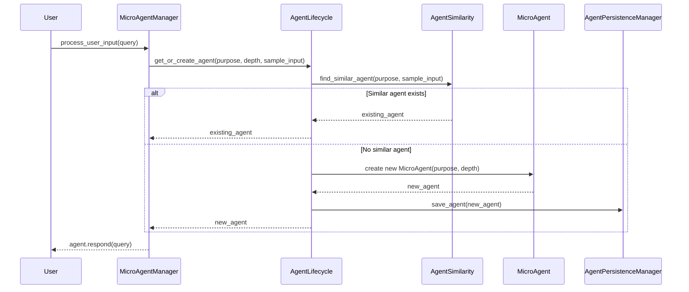

Sources: [agents/microagent_manager.py:53-64](), [main.py:67-73](), [main.py:75-81]()

## Data Persistence

The system persists agents in a SQLite database to enable reuse across sessions.

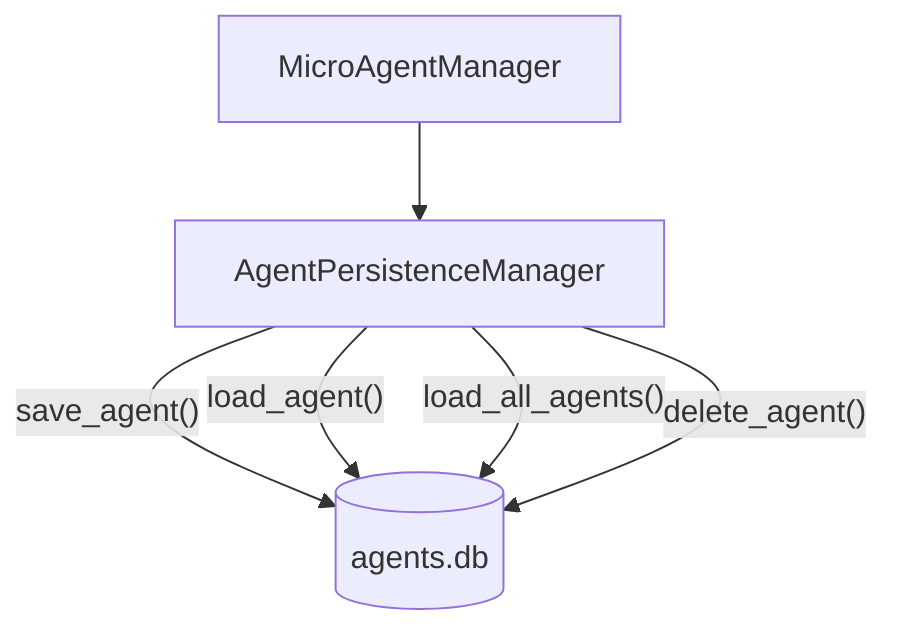

Sources: [agents/microagent_manager.py:31-36]()

## Technical Implementation Details

The MicroAgents system is implemented in Python with key dependencies including:

1. **OpenAI API Integration**: The system communicates with OpenAI/Azure OpenAI APIs through the `OpenAIAPIWrapper` class.

2. **SQLite Database**: Agent persistence is handled through a SQLite database named `agents.db` by default.

3. **User Interfaces**: Two interfaces are available:
   - Gradio-based web interface
   - Command-line interface

4. **Environment Configuration**: System configuration is managed through environment variables, loaded via dotenv.

| Environment Variable | Description | Default Value |
|---------------------|-------------|---------------|
| MICROAGENTS_DB_FILENAME | Database filename for agent persistence | agents.db |
| OPENAI_API_KEY | OpenAI API key | - |
| AZURE_OPENAI_API_KEY | Azure OpenAI API key (alternative) | - |

Sources: [main.py:1-8](), [agents/microagent_manager.py:16]()

## Initialization and Startup Process

The system initialization follows these steps:

1. Load environment variables
2. Configure and initialize the OpenAI wrapper
3. Initialize the MicroAgentManager
4. Create the prime agent (Bootstrap Agent)
5. Start the user interface (CLI or Gradio)

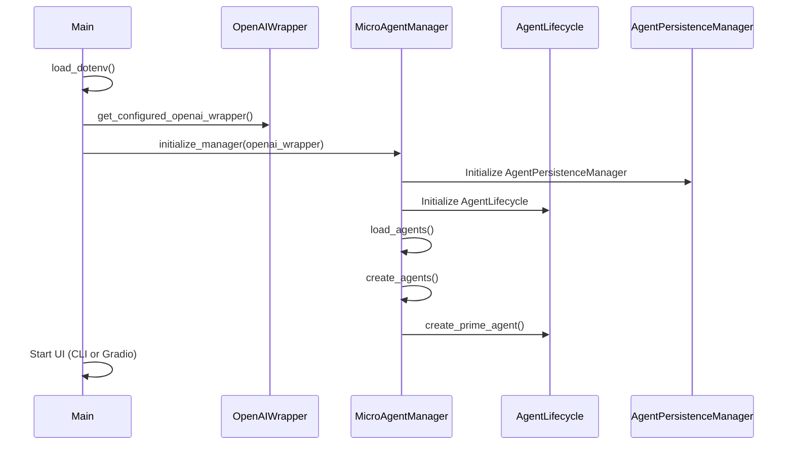

Sources: [main.py:92-104](), [main.py:67-73]()

## Conclusion

The Microagents system architecture provides a flexible and extensible framework for creating, managing, and improving AI agents. The modular design allows for separation of concerns while enabling powerful agent capabilities like delegation, code execution, and self-improvement through prompt evolution.

The system supports both simple and complex use cases, from answering basic factual questions to solving complex problems that require multi-step reasoning and specialized knowledge.

---

# Page: Agent Hierarchy and Communication

# Agent Hierarchy and Communication

<details>
<summary>Relevant source files</summary>

The following files were used as context for generating this wiki page:

- [agents/agent_response.py](agents/agent_response.py)
- [agents/agent_stopped_exception.py](agents/agent_stopped_exception.py)
- [agents/microagent.py](agents/microagent.py)
- [agents/parallel_agent_executor.py](agents/parallel_agent_executor.py)

</details>


This document explains how agents in the Microagents system are organized hierarchically and communicate with each other. It covers the agent hierarchy structure, agent creation process, and communication mechanisms between agents. For information about the complete agent lifecycle from creation to persistence, see [Agent Lifecycle](#2.2).

## 1. Agent Hierarchy Structure

The Microagents system employs a hierarchical structure of agents, with each agent having a specific purpose and depth level.

### 1.1 Hierarchy Overview

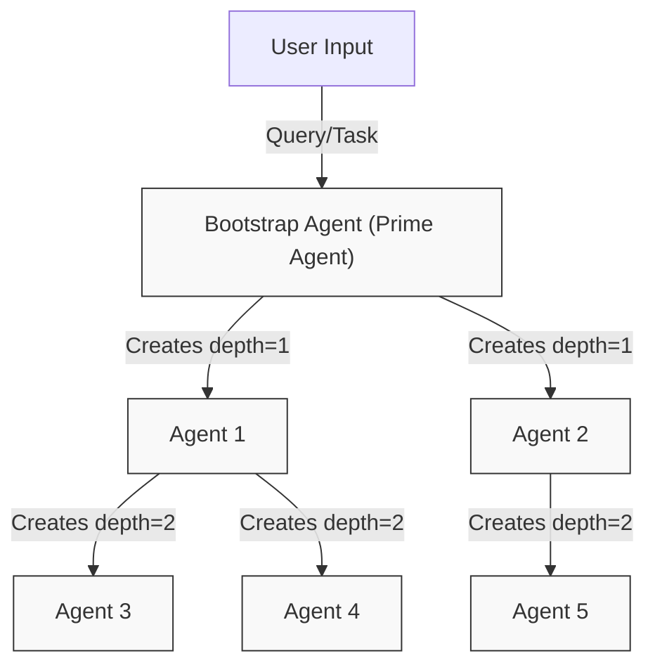

The agent hierarchy follows these principles:

1. **Bootstrap Agent (Prime Agent)**: The top-level agent that receives user queries and delegates tasks to specialized agents.
2. **Depth Levels**: Agents are organized by depth (1, 2, 3...) with a default maximum depth of 3.
3. **Parent-Child Relationships**: Each agent (except the Bootstrap Agent) has a parent that created it.

Sources: [agents/microagent.py:22-51](), [agents/agent_response.py:26-46]()

### 1.2 Agent Properties

Each agent in the hierarchy has the following key properties related to the hierarchy:

| Property | Description |
|----------|-------------|
| `depth` | The agent's level in the hierarchy (0 for Bootstrap, 1, 2, etc.) |
| `max_depth` | Maximum allowed depth (default: 3) |
| `parent_id` | UUID of the parent agent |
| `id` | UUID of the agent (fixed for Prime agent) |
| `is_prime` | Boolean indicating if this is the Bootstrap Agent |
| `active_agents` | Dictionary tracking child agents currently in use |

Sources: [agents/microagent.py:23-67]()

## 2. Agent Creation Process

### 2.1 Creation Mechanisms

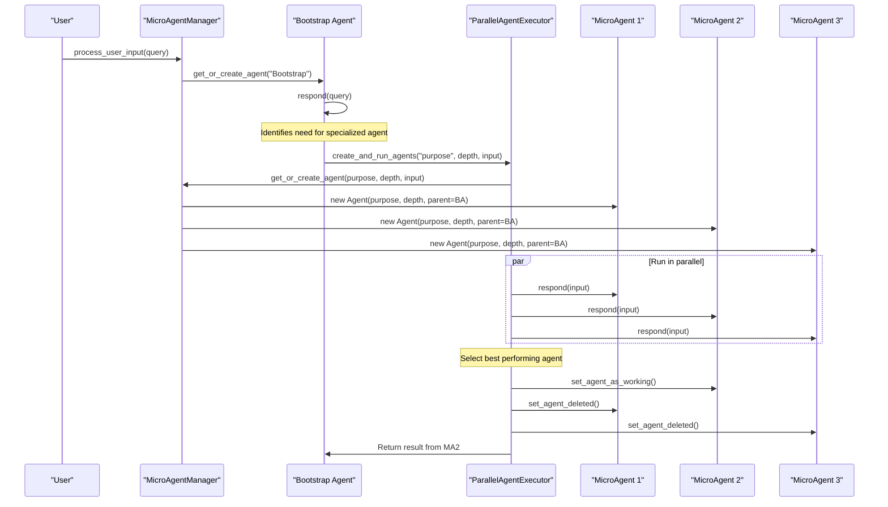

The Microagents system creates agents through:

1. **Direct Creation**: Single agent created for a specific purpose
2. **Parallel Creation**: Multiple versions of the same agent created in parallel to select the best performing one

Sources: [agents/parallel_agent_executor.py:16-45](), [agents/microagent.py:23-41]()

### 2.2 Parallel Agent Execution

When a new agent type is needed, the system:

1. Creates multiple instances (default: 3) of the same agent in parallel
2. Runs all instances on the same input
3. Selects the first agent to successfully complete the task
4. Deletes the unsuccessful agent variants
5. Keeps the successful agent for future use

This approach helps ensure high-quality agent responses by creating competition and selecting the best performer.

Sources: [agents/parallel_agent_executor.py:16-66]()

## 3. Agent Communication Patterns

### 3.1 Delegation Model

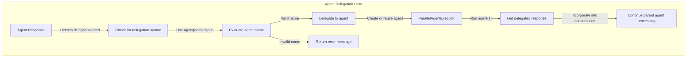

Agents communicate primarily through delegation, where:

1. An agent identifies the need to delegate a subtask
2. The agent specifies the target agent using the syntax: `Use Agent[AgentName: task]`
3. The system either creates a new agent or reuses an existing one
4. The parent agent incorporates the child agent's response into its processing

Sources: [agents/agent_response.py:95-141]()

### 3.2 Communication Implementation

The key communication mechanisms are:

1. **Agent Invocation Syntax**: `Use Agent[AgentName: task]` in the agent's response
2. **Parent-Child Tracking**: Parents track their active child agents
3. **Response Integration**: Child agent responses are incorporated into the parent's conversation

This code snippet illustrates how agent invocation is detected and processed:

```
# Detection of agent invocation in responses
def _is_agent_invocation(self, response):
    return "Use Agent[" in response

# Extracting agent name and input
def _parse_agent_info(self, response):
    agent_info = response.split('Use Agent[')[1].split(']')[0]
    split_info = agent_info.split(":", 1)
    agent_name = split_info[0].strip()
    input_text = split_info[1].strip() if len(split_info) > 1 else ""
    return agent_name, input_text
```

Sources: [agents/agent_response.py:106-127]()

### 3.3 Agent Context and Available Agents

During communication, each agent is aware of:

1. Its own purpose and capabilities
2. Available agents that can be delegated to
3. The ability to invent new agents as needed

The system informs each agent about available agents through the runtime context:

```
def _generate_runtime_context(self, dynamic_prompt):
    available_agents = self.manager.get_available_agents_for_agent(self.agent)
    available_agents_info = ', '.join([f"{agent.purpose} (depth={agent.depth})" for agent in available_agents])
    return f"Your Purpose: {dynamic_prompt}. Available agents (Feel free to invent new ones if required!): {available_agents_info}."
```

Sources: [agents/agent_response.py:52-55]()

## 4. Communication Flow and Response Handling

### 4.1 ReAct Framework for Agent Thinking

```mermaid
graph TD
    subgraph "Agent Response Generation"
        Input["Input Text"] --> CreateContext["Create Runtime Context"]
        CreateContext --> SystemPrompt["Generate System Prompt"]
        SystemPrompt --> ReactLoop["ReAct Loop"]
        
        subgraph "ReAct Loop"
            TP["Thought Prompt"] --> AP["Action Prompt"]
            AP --> Response["Generate Response"]
            Response --> Process["Process Response"]
            Process -->|"Code detected"| ExecuteCode["Execute Code"]
            Process -->|"Agent invocation"| DelegateAgent["Delegate to Agent"]
            Process -->|"Continue"| NextIteration["Next Iteration"]
            NextIteration -->|"Until solved or max iterations"| TP
        end
        
        ReactLoop --> FinalOutput["Generate Final Output"]
    end
```

Agent communication occurs through a structured process based on the ReAct (Reasoning and Acting) framework:

1. A parent agent thinks through a problem step by step
2. The agent may choose to delegate to a child agent as part of its action steps
3. Child agents follow the same process, with awareness of their depth
4. Communication is managed through a structured conversation format with Thought, Action, Observation steps

Sources: [agents/agent_response.py:26-46](), [agents/agent_response.py:48-66]()

### 4.2 Agent Response Processing

When a parent agent receives a response from a child agent:

1. The response is appended to the parent's conversation accumulator
2. The parent updates its active agents tracking
3. The parent incorporates the child's response into its reasoning
4. The child agent is marked as either successful or deleted based on evaluation

Sources: [agents/agent_response.py:76-128](), [agents/microagent.py:76-82]()

### 4.3 Preventing Circular References

The system prevents circular references in agent communication through:

1. Preventing self-invocation: An agent cannot delegate to itself
2. Depth limiting: Agents have a maximum depth (default: 3)
3. Parent-child tracking: The system maintains parent-child relationships

Sources: [agents/agent_response.py:109-114](), [agents/microagent.py:23-41]()

## 5. Agent Hierarchy Management

### 5.1 Tree View of Active Agents

Each agent maintains a dictionary of active agents it has created:

```python
def update_active_agents(self, calling_agent, called_agent=None):
    """Update the tree view of active agents."""
    if called_agent:
        self.active_agents[calling_agent] = called_agent
    else:
        self.active_agents.pop(calling_agent, None)
    logger.info(f"Active agents updated: {self.active_agents}")
```

This allows the system to track the current hierarchy of active agents and their relationships.

Sources: [agents/microagent.py:76-82]()

### 5.2 Agent Stopped Exception Propagation

When an agent is stopped, the AgentStoppedException propagates through the hierarchy:

```python
def check_for_stopped(self):
    """Check if the agent has been stopped."""
    if self.stop_execution:
        self.current_status = "❌ Stopped"
        if self.is_prime:
            self.agent_lifecycle.reset_all_agents()
        raise AgentStoppedException("Agent stopped.")
```

If the prime (Bootstrap) agent is stopped, all agents in the system are reset.

Sources: [agents/microagent.py:106-112](), [agents/agent_stopped_exception.py:1-6]()

## 6. Summary

The agent hierarchy and communication system in Microagents provides:

1. A flexible hierarchical structure with parent-child relationships
2. Parallel agent creation and selection for optimal performance
3. Delegation-based communication between agents
4. A structured ReAct framework for agent reasoning and communication
5. Mechanisms to prevent circular references and properly manage the agent tree

This architecture allows the system to dynamically create specialized agents on demand, organize them in a hierarchy, and facilitate communication between them to solve complex problems.

Sources: [agents/microagent.py:17-139](), [agents/agent_response.py:10-141](), [agents/parallel_agent_executor.py:7-68]()

---

# Page: Agent Lifecycle

# Agent Lifecycle

<details>
<summary>Relevant source files</summary>

The following files were used as context for generating this wiki page:

- [agents/agent_lifecycle.py](agents/agent_lifecycle.py)
- [agents/agent_persistence_manager.py](agents/agent_persistence_manager.py)
- [agents/response_extraction.py](agents/response_extraction.py)
- [utils/utility.py](utils/utility.py)

</details>


This document describes the complete lifecycle of agents in the Microagents system, from creation to persistence. It covers how agents are created, managed, reused, and persisted throughout their existence. For information about agent hierarchy and communication, see [Agent Hierarchy and Communication](#2.1).

## Components Overview

The agent lifecycle is primarily managed by two key components:

1. **AgentLifecycle**: Manages the creation, tracking, and disposal of agents
2. **AgentPersistenceManager**: Handles saving and loading agents to/from persistent storage

These components work together to provide a complete lifecycle management system for microagents.

```mermaid
classDiagram
    class AgentLifecycle {
        -List~MicroAgent~ agents
        -OpenAIAPIWrapper openai_wrapper
        -AgentPersistenceManager agent_persistence
        -int max_agents
        +stop_all_agents()
        +reset_all_agents()
        +cleanup_agents()
        +create_prime_agent()
        +add_agent(MicroAgent)
        +get_or_create_agent(String, int, String, bool, MicroAgent)
        +save_agent(MicroAgent)
        +remove_agent(MicroAgent)
    }
    
    class AgentPersistenceManager {
        -SQLiteAgentPersistence persistence
        +remove_agent(MicroAgent)
        +save_agent(MicroAgent)
        +load_agent(String, AgentLifecycle, OpenAIAPIWrapper)
        +load_all_agents(AgentLifecycle, OpenAIAPIWrapper)
    }
    
    class MicroAgent {
        +String prompt
        +String purpose
        +int depth
        +bool working_agent
        +bool is_prime
        +int usage_count
        +respond(String)
        +stop()
        +reset()
    }
    
    AgentLifecycle --> "0..*" MicroAgent : manages
    AgentLifecycle --> "1" AgentPersistenceManager : uses
    AgentPersistenceManager --> MicroAgent : serializes/deserializes
```

Sources: [agents/agent_lifecycle.py:19-126](), [agents/agent_persistence_manager.py:6-43]()

## Agent Creation Process

The creation of agents follows different paths depending on whether the agent is a prime agent or a regular agent.

### Prime Agent Creation

The prime agent (also called the Bootstrap Agent) is a special agent that serves as the entry point for user queries and coordinates the delegation of tasks to other agents. It is created only once during system initialization.

```mermaid
flowchart TD
    Start[Start System] --> InitAgentLifecycle["Initialize AgentLifecycle"]
    InitAgentLifecycle --> CreatePrimeAgent["create_prime_agent()"]
    CreatePrimeAgent --> InstantiatePrimeAgent["Create MicroAgent with:
    - PRIME_PROMPT
    - PRIME_NAME
    - depth = 0 
    - is_prime = true
    - working_agent = true"]
    InstantiatePrimeAgent --> AddToAgentsList["Add to agents list"]
    AddToAgentsList --> End[Prime Agent Created]
```

Sources: [agents/agent_lifecycle.py:40-46]()

### Regular Agent Creation

Regular agents are created when there is a need to perform a specific task that is best handled by a dedicated agent. The system follows a "get-or-create" pattern, where it first checks if a suitable existing agent is available before creating a new one.

```mermaid
flowchart TD
    Request["get_or_create_agent(purpose, depth, sample_input, force_new, parent_agent)"] --> ForceNew{force_new?}
    
    ForceNew -->|Yes| CreateNew["Create new agent"]
    
    ForceNew -->|No| CheckSimilarity["Calculate similarity with existing agents"]
    CheckSimilarity --> SimilarExists{similarity ≥ threshold?}
    
    SimilarExists -->|Yes| IncrementUsage["Increment usage_count"]
    IncrementUsage --> ReturnExisting["Return existing agent"]
    
    SimilarExists -->|No| CreateNew
    
    CreateNew --> CheckMaxAgents{agents.length ≥ max_agents?}
    CheckMaxAgents -->|Yes| RemoveLeastUsed["Remove least used agent"]
    RemoveLeastUsed --> GeneratePrompt
    
    CheckMaxAgents -->|No| GeneratePrompt["Generate prompt using LLM"]
    GeneratePrompt --> CreateMicroAgent["Create new MicroAgent"]
    CreateMicroAgent --> InitUsageCount["Set usage_count = 1"]
    InitUsageCount --> AddToList["Add to agents list"]
    AddToList --> ReturnNew["Return new agent"]
```

Sources: [agents/agent_lifecycle.py:64-94]()

### Prompt Generation

When creating a new agent, the system generates a specialized prompt for that agent using the language model. The prompt is generated based on the agent's purpose and a sample input.

```mermaid
sequenceDiagram
    participant AL as AgentLifecycle
    participant OW as OpenAIAPIWrapper
    
    AL->>AL: _generate_llm_prompt(goal, sample_input)
    AL->>AL: Prepare messages with templates
    AL->>OW: chat_completion(messages)
    OW-->>AL: Generated prompt
    AL->>AL: Return prompt for new agent
```

Sources: [agents/agent_lifecycle.py:113-126]()

## Agent Similarity and Reuse

To optimize resource usage, the system implements a mechanism to reuse existing agents when their purpose is similar to what is needed for a new task.

```mermaid
flowchart TD
    Start["get_or_create_agent()"] --> CalculateEmbedding["Get embedding for purpose"]
    CalculateEmbedding --> FindClosest["Find closest agent and similarity score"]
    FindClosest --> CalculateThreshold["Calculate similarity threshold"]
    CalculateThreshold --> CheckSimilarity{similarity ≥ threshold?}
    
    CheckSimilarity -->|Yes| IncrementUsage["Increment usage_count"]
    IncrementUsage --> ReturnExisting["Return existing agent"]
    
    CheckSimilarity -->|No| CreateNew["Create new agent"]
    CreateNew --> ReturnNew["Return new agent"]
```

Sources: [agents/agent_lifecycle.py:64-79]()

## Agent Management

The `AgentLifecycle` class provides several methods for managing agents throughout their lifecycle.

### Adding Agents

New agents are added to the internal list of agents maintained by the `AgentLifecycle`. This list is used to track all active agents in the system.

```python
def add_agent(self, agent: MicroAgent) -> None:
    """Adds an agent to the list of agents."""
    self.agents.append(agent)
```

Sources: [agents/agent_lifecycle.py:48-50]()

### Stopping and Resetting Agents

Agents can be stopped or reset:
- Stopping an agent marks it as no longer active
- Resetting an agent clears its internal state

```mermaid
sequenceDiagram
    participant AL as AgentLifecycle
    participant MA as MicroAgent
    
    Note over AL,MA: Stopping agents
    AL->>AL: stop_all_agents()
    loop For each agent
        AL->>MA: stop()
        MA->>MA: Set stopped = True
    end
    
    Note over AL,MA: Resetting agents
    AL->>AL: reset_all_agents()
    loop For each agent
        AL->>MA: reset()
        MA->>MA: Reset internal state
    end
```

Sources: [agents/agent_lifecycle.py:26-34]()

### Cleaning Up Agents

The system periodically removes agents that have been stopped to free up resources.

```python
def cleanup_agents(self):
    """Remove all agents with status stopped = True in an efficient manner."""
    self.agents = [agent for agent in self.agents if not agent.stopped]
```

Sources: [agents/agent_lifecycle.py:36-38]()

## Agent Persistence

Agents that have demonstrated their utility can be persisted to storage for future reuse, even across different sessions.

```mermaid
flowchart TD
    subgraph "Agent Persistence Flow"
        SaveAgent["save_agent(agent)"] --> IsEligible{"agent.working_agent AND\nnot agent.is_prime?"}
        IsEligible -->|Yes| Serialize["Serialize agent to dictionary"]
        Serialize --> Store["Store in SQLite database"]
        
        LoadAgent["load_agent(purpose)"] --> FetchFromDB["Fetch serialized agent from database"]
        FetchFromDB --> Found{found?}
        Found -->|Yes| Deserialize["Deserialize to MicroAgent object"]
        Found -->|No| ReturnNone["Return None"]
        Deserialize --> ReturnAgent["Return agent instance"]
        
        RemoveAgent["remove_agent(agent)"] --> DeleteFromDB["Delete from database"]
    end
```

Sources: [agents/agent_lifecycle.py:96-111](), [agents/agent_persistence_manager.py:10-43]()

### Save & Load Process

The complete agent persistence process involves two components:
1. `AgentLifecycle` - Provides the interface for saving/removing agents
2. `AgentPersistenceManager` - Handles the actual persistence operations

```mermaid
sequenceDiagram
    participant Client
    participant AL as AgentLifecycle
    participant APM as AgentPersistenceManager
    participant AS as AgentSerializer
    participant DB as "SQLite (agents.db)"
    
    Note over Client,DB: Saving an agent
    Client->>AL: save_agent(agent)
    AL->>APM: save_agent(agent)
    alt agent.working_agent AND not agent.is_prime
        APM->>AS: to_dict(agent)
        AS-->>APM: serialized_agent (dict)
        APM->>DB: save_agent(serialized_agent)
    end
    
    Note over Client,DB: Loading an agent
    Client->>APM: load_agent(purpose, agent_lifecycle, openai_wrapper)
    APM->>DB: fetch_agent(purpose)
    DB-->>APM: serialized_agent
    alt serialized_agent exists
        APM->>AS: from_dict(serialized_agent, agent_lifecycle, openai_wrapper)
        AS-->>APM: agent instance
        APM-->>Client: agent instance
    else
        APM-->>Client: None
    end
```

Sources: [agents/agent_persistence_manager.py:16-31]()

## Complete Agent Lifecycle Flow

The following diagram illustrates the complete lifecycle of an agent in the Microagents system, from creation to persistence.

```mermaid
stateDiagram-v2
    [*] --> RequestForAgent: User request requires agent
    
    RequestForAgent --> CheckExisting: get_or_create_agent()
    CheckExisting --> ReuseAgent: Suitable agent exists
    CheckExisting --> CreateNewAgent: No suitable agent
    
    CreateNewAgent --> GeneratePrompt: _generate_llm_prompt()
    GeneratePrompt --> InstantiateAgent: Create new MicroAgent
    InstantiateAgent --> AddToRegistry: Add to agents list
    
    ReuseAgent --> IncrementUsage: Increment usage_count
    AddToRegistry --> AgentInUse
    IncrementUsage --> AgentInUse
    
    AgentInUse --> AgentTaskComplete: Agent performs task
    AgentTaskComplete --> SaveAgent: If successful & valuable
    AgentTaskComplete --> ContinueUsing: Remain in memory
    
    SaveAgent --> Persisted: Store in database
    Persisted --> ReuseAgent: Future similar request
    
    ContinueUsing --> StopAgent: When no longer needed
    StopAgent --> CleanupAgent: cleanup_agents()
    CleanupAgent --> [*]
    
    state if_state <<choice>>
    AgentInUse --> if_state: Check current agents
    if_state --> RemoveLeastUsed: Too many agents
    if_state --> ContinueOperation: Within limit
    RemoveLeastUsed --> ContinueOperation
```

Sources: [agents/agent_lifecycle.py:19-126](), [agents/agent_persistence_manager.py:6-43]()

## Agent Lifecycle States and Transitions

Agents in the system progress through several distinct states during their lifecycle:

| State | Description | Transition Triggers |
|-------|-------------|---------------------|
| Creation | Agent is instantiated | User request or agent delegation requires a new capability |
| Active | Agent is being used to fulfill tasks | Successful creation or retrieval from persistence |
| Evaluation | Agent's performance is evaluated | After task completion |
| Persistence | Agent is saved to storage | Agent is determined to be valuable for future use |
| Stopped | Agent is marked as inactive | No longer needed or system shutdown |
| Removed | Agent is removed from the system | Cleanup operation or to make room for new agents |

Sources: [agents/agent_lifecycle.py:26-38](), [agents/agent_lifecycle.py:96-111]()

## Resource Management

The `AgentLifecycle` class implements mechanisms to manage system resources efficiently:

1. **Max Agents Limit**: Enforces a maximum number of active agents (default: 2000)
2. **Least-Used Removal**: When the limit is reached, the least used agent is removed
3. **Cleanup**: Periodically removes stopped agents from memory

```python
DEFAULT_MAX_AGENTS = 2000  # Default maximum number of agents

def _remove_least_used_agent(self):
    """Removes the least used agent."""
    least_used_agent = min(self.agents, key=lambda agent: agent.usage_count)
    self.agents.remove(least_used_agent)
```

Sources: [agents/agent_lifecycle.py:16](), [agents/agent_lifecycle.py:91-94]()

---

# Page: MicroAgent Core Components

# MicroAgent Core Components

<details>
<summary>Relevant source files</summary>

The following files were used as context for generating this wiki page:

- [agents/agent_evaluation.py](agents/agent_evaluation.py)
- [agents/agent_similarity.py](agents/agent_similarity.py)
- [agents/microagent.py](agents/microagent.py)

</details>


This page documents the core components of the MicroAgent system, which form the foundation of the agent's functionality. The MicroAgent components handle response generation, agent evaluation, prompt evolution, and related functionality that enables microagents to process user queries and generate appropriate responses. For information about the overall system architecture, see [System Architecture](#2).

## MicroAgent Class Overview

The `MicroAgent` class serves as the central component in the microagents system. It encapsulates the behavior of small, purpose-driven agents that interact with the OpenAI API to process requests and generate responses.

```mermaid
classDiagram
    class MicroAgent {
        +String dynamic_prompt
        +String purpose
        +Array purpose_embedding
        +Int depth
        +Int max_depth
        +Int usage_count
        +Boolean working_agent
        +Int evolve_count
        +Int number_of_code_executions
        +String current_status
        +Dict active_agents
        +String last_input
        +String last_output
        +String last_conversation
        +Boolean stopped
        +Boolean is_prime
        +Boolean stop_execution
        +respond(input_text, evolve_count)
        +update_status(status)
        +update_active_agents(calling_agent, called_agent)
        +set_agent_as_working()
        +get_children()
        +is_working_agent()
        +set_agent_deleted()
        +check_for_stopped()
        +stop()
        +reset()
    }
    
    MicroAgent *-- "1" AgentEvaluator : uses
    MicroAgent *-- "1" CodeExecution : uses
    MicroAgent *-- "1" AgentResponse : uses
    MicroAgent *-- "1" AgentSimilarity : uses
    MicroAgent *-- "1" PromptEvolution : uses
    MicroAgent *-- "1" ResponseExtraction : uses
    MicroAgent *-- "1" ResponseHandler : uses
    
    class AgentEvaluator {
        +evaluate(input_text, prompt, output)
    }
    
    class CodeExecution {
        +execute_code()
    }
    
    class AgentResponse {
        +generate_response()
    }
    
    class AgentSimilarity {
        +get_embedding()
        +calculate_similarity_threshold()
        +find_closest_agent()
    }
    
    class PromptEvolution {
        +evolve_prompt()
    }
    
    class ResponseExtraction {
        +extract_response()
    }
    
    class ResponseHandler {
        +respond()
    }
```

Sources: [agents/microagent.py:17-138]()

## MicroAgent Initialization and Dependencies

The `MicroAgent` class is initialized with various parameters and dependencies that determine its behavior:

```mermaid
graph TD
    subgraph "MicroAgent Constructor"
        A["MicroAgent.__init__"] --> B["Set basic properties"]
        B --> C["Set ID"]
        C --> D["Initialize components"]
    end
    
    subgraph "Basic Properties"
        B --> B1["dynamic_prompt"]
        B --> B2["purpose"]
        B --> B3["depth"]
        B --> B4["max_depth"]
        B --> B5["agent_lifecycle"]
        B --> B6["openai_wrapper"]
    end
    
    subgraph "Component Initialization"
        D --> D1["agent_evaluator"]
        D --> D2["code_executor"]
        D --> D3["agent_responder"]
        D --> D4["agent_similarity"]
        D --> D5["prompt_evolver"]
        D --> D6["response_extractor"]
        D --> D7["response_handler"]
    end
```

The MicroAgent constructor initializes:
1. Basic agent properties (purpose, depth, etc.)
2. Relationships (parent, prime agent status)
3. State tracking variables (usage count, status)
4. Core component instances that provide the agent's functionality

Sources: [agents/microagent.py:23-68]()

## Core Components and Their Functions

### 1. ResponseHandler

The `ResponseHandler` is the primary interface for generating responses to user inputs. It coordinates the response generation process, including evaluation, potential prompt evolution, and delegation to other agents when necessary.

When the `MicroAgent.respond()` method is called, it delegates to the `ResponseHandler.respond()` method, which manages the complete response generation flow.

Sources: [agents/microagent.py:114-118]()

### 2. AgentEvaluator

The `AgentEvaluator` assesses the quality of agent responses using OpenAI's model. It provides a critical feedback mechanism that helps determine if responses meet quality standards.

```mermaid
sequenceDiagram
    participant Agent as MicroAgent
    participant Evaluator as AgentEvaluator
    participant OpenAI as OpenAIWrapper
    
    Agent->>Evaluator: evaluate(input_text, prompt, output)
    Evaluator->>Evaluator: format evaluation prompt
    Evaluator->>OpenAI: chat_completion(evaluation_prompt)
    OpenAI-->>Evaluator: response
    Evaluator->>Evaluator: analyze score (1-5)
    Evaluator-->>Agent: True/False (pass/fail)
```

The evaluator uses a specific evaluation prompt template (`AGENT_EVALUATION_PROMPT`) to request a 1-5 score from the LLM, considering scores of 4-5 as passing and others as failing.

Sources: [agents/agent_evaluation.py:7-30]()

### 3. AgentSimilarity

The `AgentSimilarity` component calculates embeddings and similarity scores between agent purposes, enabling:
1. Finding similar agents for potential reuse
2. Avoiding duplication of agent functionality
3. Maintaining diversity among agents

```mermaid
classDiagram
    class AgentSimilarity {
        +OpenAIAPIWrapper openai_wrapper
        +List~Agent~ agents
        +get_embedding(text)
        +calculate_similarity_threshold()
        +find_closest_agent(purpose_embedding)
    }
    
    class Agent {
        +String purpose
        +Array purpose_embedding
    }
    
    AgentSimilarity --> "many" Agent : analyzes
```

The component uses cosine similarity between embedding vectors to determine how closely related agent purposes are.

Sources: [agents/agent_similarity.py:15-93]()

### 4. PromptEvolution

The `PromptEvolution` component helps improve prompts when responses don't meet quality standards. It uses the OpenAI API to generate improved prompts based on feedback from failed responses.

### 5. ResponseExtraction

The `ResponseExtraction` component parses and extracts structured information from the LLM's responses, making it easier to process and use the outputs.

### 6. AgentResponse

The `AgentResponse` component handles the actual generation of responses by interfacing with the OpenAI API. It's responsible for:
1. Formatting the prompt with the user's input
2. Sending requests to the API
3. Processing the raw responses
4. Handling special cases like code execution or agent delegation

### 7. CodeExecution

The `CodeExecution` component enables agents to execute code snippets included in responses, providing computational capabilities beyond text generation.

## Component Interaction Flow

The following diagram illustrates how these components interact during the response generation process:

```mermaid
graph TD
    subgraph "Response Generation Flow"
        A["User Input"] --> B["MicroAgent.respond()"]
        B --> C["ResponseHandler.respond()"]
        C --> D{"Response quality sufficient?"}
        D -->|"Yes"| E["Return Response"]
        D -->|"No"| F["PromptEvolution.evolve_prompt()"]
        F --> G["Try again with improved prompt"]
        G --> C
    end
    
    subgraph "Response Handler Process"
        C --> C1["AgentResponse.generate_response()"]
        C1 --> C2{"Contains code?"}
        C2 -->|"Yes"| C3["CodeExecution.execute_code()"]
        C2 -->|"No"| C4{"Contains agent delegation?"}
        C4 -->|"Yes"| C5["Create and run child agent"]
        C3 --> C6["Continue processing"]
        C4 -->|"No"| C6
        C5 --> C6
        C6 --> D
    end
    
    subgraph "Evaluation Process"
        D --> D1["AgentEvaluator.evaluate()"]
        D1 --> D2["OpenAI API call"]
        D2 --> D3["Score assessment"]
        D3 --> D
    end
```

Sources: [agents/microagent.py:114-118](), [agents/agent_evaluation.py:15-30]()

## Agent State Management

MicroAgent includes capabilities for tracking and managing agent state:

1. **Status Updates**: The `update_status()` method maintains the current status of the agent, which can be used for monitoring and debugging.

2. **Active Agent Tracking**: The `update_active_agents()` method maintains a record of agent delegation, tracking which agents have delegated to others.

3. **Agent Lifecycle Control**: Methods like `set_agent_as_working()`, `set_agent_deleted()`, and `stop()` control the agent's lifecycle.

4. **Stop Checking**: The `check_for_stopped()` method verifies if the agent has been stopped, raising an exception if so to halt processing.

Sources: [agents/microagent.py:70-130]()

## Agent Similarity Calculation

The similarity mechanism is crucial for agent reuse and specialization:

```mermaid
sequenceDiagram
    participant Consumer as "Consumer"
    participant AS as "AgentSimilarity"
    participant OpenAI as "OpenAIWrapper"
    
    Consumer->>AS: find_closest_agent(purpose_embedding)
    loop For each agent
        alt Agent has no embedding
            AS->>OpenAI: get_embedding(agent.purpose)
            OpenAI-->>AS: purpose_embedding
        end
        AS->>AS: Calculate cosine similarity
        AS->>AS: Track highest similarity
    end
    AS-->>Consumer: closest_agent, similarity_score
```

The similarity threshold calculation works by:
1. Collecting embeddings for all agents
2. Computing pairwise similarities
3. Finding the 98th percentile of similarity scores
4. Using this as a threshold to determine if a new agent is needed

For smaller agent collections (<250 agents), a fixed high threshold (0.999) is used to encourage agent creation.

Sources: [agents/agent_similarity.py:45-66](), [agents/agent_similarity.py:69-93]()

## MicroAgent Response Process

When a user request comes in, the complete response process follows this flow:

```mermaid
graph TD
    A["User Input"] --> B["MicroAgent.respond()"]
    B --> C["ResponseHandler.respond()"]
    C --> D["AgentResponse.generate_response()"]
    D --> E["OpenAIWrapper.chat_completion()"]
    E --> F["Process LLM Response"]
    F --> G{"Response contains code?"}
    G -->|"Yes"| H["CodeExecution.execute_code()"]
    G -->|"No"| I{"Response indicates agent delegation?"}
    I -->|"Yes"| J["Create child agent or find similar existing agent"]
    I -->|"No"| K["Process standard text response"]
    H --> L["Combine code outputs with response"]
    J --> M["Get delegated agent response"]
    K --> N["Final Response"]
    L --> N
    M --> N
    N --> O["AgentEvaluator.evaluate()"]
    O --> P{"Evaluation passes?"}
    P -->|"Yes"| Q["Return Response to User"]
    P -->|"No"| R["PromptEvolution.evolve_prompt()"]
    R --> S["Try again with improved prompt"]
    S --> C
```

This process demonstrates how the various components work together to generate, evaluate, and potentially improve responses to user inputs.

Sources: [agents/microagent.py:114-118]()

---

# Page: Response Generation

# Response Generation

<details>
<summary>Relevant source files</summary>

The following files were used as context for generating this wiki page:

- [agents/agent_response.py](agents/agent_response.py)
- [integrations/openaiwrapper.py](integrations/openaiwrapper.py)

</details>


This document describes how microagents generate responses to user inputs. It covers the response generation process, including the ReAct framework implementation, code execution handling, and agent delegation capabilities. For information about agent evaluation and evolution, see [Agent Evaluation and Evolution](#3.3).

## Overview of Response Generation

The response generation system in microagents allows agents to:
- Process user queries through an OpenAI API-powered thinking process
- Execute Python code when needed
- Delegate tasks to other specialized agents
- Generate formatted, comprehensive responses

```mermaid
flowchart TD
    subgraph "Response Generation System"
        UserInput["User Input"] --> ResponseHandler
        
        ResponseHandler --> AgentResponse
        
        AgentResponse --> OpenAIWrapper
        OpenAIWrapper --> |"API Request"| OpenAI["OpenAI/Azure API"]
        OpenAI --> |"API Response"| OpenAIWrapper
        
        AgentResponse --> CodeExecution["Code Execution"]
        AgentResponse --> ParallelAgentExecutor
        ParallelAgentExecutor --> |"Creates/Delegates to"| OtherAgents["Other Agents"]
        
        AgentResponse --> FinalResponse["Final Response"]
        FinalResponse --> User
    end
```

Sources: [agents/agent_response.py:10-141](), [integrations/openaiwrapper.py:99-198]()

## Core Components

### AgentResponse Class

The `AgentResponse` class is the primary component responsible for generating responses. It:

1. Takes user input and the agent's dynamic prompt
2. Constructs a system prompt with runtime context
3. Iteratively builds a conversation using the ReAct framework
4. Processes special response types (code, agent invocations)
5. Generates a final, formatted response

```mermaid
classDiagram
    class AgentResponse {
        -openai_wrapper: OpenAIWrapper
        -manager: MicroAgentManager
        -code_execution: CodeExecution
        -agent: MicroAgent
        -creator: MicroAgent
        -depth: int
        +generate_response(input_text, dynamic_prompt, max_depth)
        -_generate_runtime_context(dynamic_prompt)
        -_compose_system_prompt(runtime_context, dynamic_prompt)
        -_build_react_prompt(input_text, conversation_accumulator, thought_number, action_number)
        -_generate_chat_response(system_prompt, react_prompt)
        -_process_response(response, conversation_accumulator, thought_number, action_number, input_text)
        -_is_python_code(response)
        -_execute_python_code(response)
        -_is_agent_invocation(response)
        -_handle_agent_delegation(agent_name, input_text, accumulator, thought_number, action_number)
        -_conclude_output(conversation, input_text)
    }
```

Sources: [agents/agent_response.py:10-141]()

### OpenAIWrapper Class

The `OpenAIWrapper` class provides a standardized interface for interacting with OpenAI and Azure OpenAI services. It handles:

- API authentication and organization settings
- Embeddings generation with caching
- Chat completions with model specifications
- Error handling, retries, and rate limiting

```mermaid
classDiagram
    class OpenAIWrapper {
        -_openai_client: OpenAI|AzureOpenAI
        -timeout: float
        -max_retries: int
        +get_embedding(text)
        +chat_completion(**kwargs)
    }
```

Sources: [integrations/openaiwrapper.py:99-198]()

## Response Generation Process

The response generation process follows a structured flow as shown below:

```mermaid
sequenceDiagram
    participant User
    participant MicroAgent
    participant AgentResponse
    participant OpenAIWrapper
    participant ParallelAgentExecutor
    
    User->>MicroAgent: respond(query)
    MicroAgent->>AgentResponse: generate_response(input_text, dynamic_prompt, max_depth)
    
    loop For each iteration up to max_depth
        AgentResponse->>AgentResponse: _build_react_prompt()
        AgentResponse->>OpenAIWrapper: _generate_chat_response()
        OpenAIWrapper-->>AgentResponse: response
        
        alt Response contains Python code
            AgentResponse->>AgentResponse: _execute_python_code()
        else Response contains agent invocation
            AgentResponse->>AgentResponse: _parse_agent_info()
            AgentResponse->>ParallelAgentExecutor: create_and_run_agents()
            ParallelAgentExecutor-->>AgentResponse: delegated_response
        end
        
        AgentResponse->>AgentResponse: _process_response()
        
        alt Solution found
            AgentResponse->>AgentResponse: break loop
        end
    end
    
    AgentResponse->>OpenAIWrapper: _conclude_output()
    OpenAIWrapper-->>AgentResponse: final_response
    AgentResponse-->>MicroAgent: final_response
    MicroAgent-->>User: final_response
```

Sources: [agents/agent_response.py:26-46]()

### Step 1: Initialization

The `generate_response` method begins by:
1. Creating runtime context with available agents information
2. Composing a system prompt by combining the static prompt, runtime context, and the agent's dynamic prompt
3. Initializing the conversation accumulator and counters

Sources: [agents/agent_response.py:26-32](), [agents/agent_response.py:48-55]()

### Step 2: Iterative ReAct Process

The method then enters a loop (up to `max_depth` iterations) where it:
1. Builds a ReAct prompt that includes the current conversation state and prompts for the next thought/action
2. Updates the agent's status to show its thinking
3. Sends the prompt to OpenAI via the `OpenAIWrapper`
4. Processes the response and updates the conversation accumulator

Sources: [agents/agent_response.py:34-44](), [agents/agent_response.py:57-67]()

### Step 3: Response Processing

Response processing involves:
1. Appending the response to the conversation accumulator
2. Incrementing thought and action counters
3. Detecting and handling special response types (code, agent invocations)
4. Checking if a solution has been found

Sources: [agents/agent_response.py:76-90]()

### Step 4: Conclusion

Finally, the method:
1. Formats the entire conversation with additional context
2. Sends a final request to OpenAI to generate a well-structured conclusion
3. Returns the final response, the full conversation, a solution indicator, and the thought count

Sources: [agents/agent_response.py:129-141]()

## Special Response Handling

### Code Execution

When a response contains Python code (identified by ````python` markers), the `AgentResponse` class:
1. Identifies the code block using `_is_python_code()`
2. Updates the agent's status to indicate code execution
3. Executes the code using the provided `code_execution` instance
4. Appends the execution results to the conversation

```
Thought N: I need to test if this number is prime...
Action N: Let me write code to check if 17 is prime:
```python
def is_prime(n):
    if n <= 1:
        return False
    for i in range(2, int(n**0.5) + 1):
        if n % i == 0:
            return False
    return True
    
print(is_prime(17))
```

Observation: Executed Python code
Output: True
```

Sources: [agents/agent_response.py:95-104]()

### Agent Delegation

When a response contains an agent invocation (identified by `Use Agent[` markers), the system:
1. Identifies the agent invocation using `_is_agent_invocation()`
2. Parses the agent name and input text using `_parse_agent_info()`
3. Updates the agent's status and active agents record
4. Creates or reuses the specified agent through the `ParallelAgentExecutor`
5. Appends the delegated response to the conversation

```
Thought N: I need specialized help with this data analysis task.
Action N: Use Agent[DataAnalyzer: Analyze the temperature trends in the dataset]

Output N: Delegated task to Agent DataAnalyzer
Output of Agent N: The temperature data shows an upward trend of 1.2°C over the 10-year period...
```

Sources: [agents/agent_response.py:106-127]()

## ReAct Framework Implementation

The response generation process implements the ReAct (Reasoning and Acting) framework, which structures the agent's thinking into distinct steps:

```mermaid
graph TD
    subgraph "ReAct Framework"
        Input["User Input"] --> Thought1["Thought 1"]
        Thought1 --> Action1["Action 1"]
        Action1 --> Observation1["Observation 1"]
        Observation1 --> Thought2["Thought 2"]
        Thought2 --> Action2["Action 2"]
        Action2 --> Observation2["Observation 2"]
        Observation2 --> Solution["Solution"]
    end
```

The framework is implemented through:
1. The `_build_react_prompt()` method, which structures the prompt with "Thought N" and "Action N" sections
2. Different prompt templates for prime agents vs. regular agents
3. An accumulator that records the entire reasoning chain
4. A structured final output that presents the complete reasoning process

Sources: [agents/agent_response.py:57-66](), [agents/agent_response.py:4-6]()

## OpenAI Integration Details

The `OpenAIWrapper` provides a robust interface to OpenAI services with the following features:

| Feature | Description |
|---------|-------------|
| Service Options | Supports both OpenAI and Azure OpenAI services |
| Authentication | Handles API keys, Azure AD tokens, and organization IDs |
| API Retries | Implements configurable retry logic and timeout handling |
| Rate Limiting | Includes sleep mechanisms when rate limits are hit |
| Response Processing | Standardizes response format from different API versions |
| Caching | Implements memoization for embeddings to reduce API calls |

The wrapper is configured through environment variables, allowing flexible deployment options:

```
OPENAI_API_KEY or AZURE_OPENAI_API_KEY
OPENAI_MODEL (default: gpt-4-1106-preview)
OPENAI_BASE_URL (optional)
AZURE_OPENAI_ENDPOINT (if using Azure)
```

Sources: [integrations/openaiwrapper.py:14-96](), [integrations/openaiwrapper.py:165-198]()

## Response Formatting and Conclusion

The final step in response generation is the formatting of the output. The `_conclude_output()` method:

1. Takes the entire conversation accumulator
2. Adds context about the agent's purpose and the original question
3. Instructs the model to use Markdown formatting
4. Sends a final request to OpenAI with a special system prompt
5. Returns the formatted response

This ensures that the final response is comprehensive, well-structured, and visually appealing to the user.

Sources: [agents/agent_response.py:129-141]()

---

# Page: Agent Similarity and Selection

# Agent Similarity and Selection

<details>
<summary>Relevant source files</summary>

The following files were used as context for generating this wiki page:

- [agents/agent_similarity.py](agents/agent_similarity.py)

</details>


## Purpose and Scope

This document describes the agent similarity and selection mechanisms in the Microagents system. It covers how agent purposes are converted to embeddings, how similarity between agents is calculated, and how the system decides whether to reuse existing agents or create new ones based on semantic similarity. For information about the overall agent lifecycle, see [Agent Lifecycle](#2.2), and for details on agent evaluation and evolution, see [Agent Evaluation and Evolution](#3.3).

## Agent Similarity System Overview

The Microagents system uses semantic similarity to determine when an existing agent can be reused for a new task. This approach avoids creating redundant agents and leverages previously successful agents for similar tasks.

```mermaid
flowchart TD
    subgraph "Agent Similarity System"
        A["New Agent Purpose"] -->|"Convert to embedding"| B["Purpose Embedding"]
        B -->|"Compare with"| C["Existing Agent Embeddings"]
        C -->|"Calculate similarity scores"| D["Cosine Similarity Results"]
        D -->|"Compare against"| E["Similarity Threshold"]
        E -->|"Make decision"| F["Reuse or Create New"]
    end
```

Sources: [agents/agent_similarity.py:15-93]()

### Key Components

The agent similarity system consists of two primary classes:

1. `Agent` - A simple class representing an agent with:
   - `purpose`: A string describing the agent's purpose
   - `purpose_embedding`: A vector representation of the purpose

2. `AgentSimilarity` - A class that handles similarity calculations between agents:
   - Generates embeddings for agent purposes
   - Calculates similarity thresholds
   - Finds the most similar agent for a given purpose

```mermaid
classDiagram
    class Agent {
        +String purpose
        +ndarray purpose_embedding
    }
    
    class AgentSimilarity {
        +OpenAIAPIWrapper openai_wrapper
        +List~Agent~ agents
        +get_embedding(text: String): ndarray
        +calculate_similarity_threshold(): float
        +find_closest_agent(purpose_embedding: ndarray): Tuple[Agent, float]
    }
    
    Agent --o AgentSimilarity : contains
```

Sources: [agents/agent_similarity.py:10-14](), [agents/agent_similarity.py:15-25]()

## Embedding Generation

The similarity calculation begins with converting agent purposes (text descriptions) into numeric vector representations (embeddings) using the OpenAI embedding API.

### Embedding Process

1. The system sends the agent's purpose text to the OpenAI API
2. The API returns a high-dimensional vector representing the semantic meaning of the text
3. These embeddings are stored with the agent for future comparisons

```mermaid
sequenceDiagram
    participant AS as AgentSimilarity
    participant OW as OpenAIAPIWrapper
    participant API as OpenAI API
    
    AS->>OW: get_embedding(text)
    OW->>API: Request embedding
    API-->>OW: Return embedding vector
    OW-->>AS: Return numpy array
    AS->>AS: Store with agent
```

Sources: [agents/agent_similarity.py:26-42]()

## Similarity Calculation

The system calculates similarity between agent purposes using cosine similarity between their embedding vectors.

### Cosine Similarity

Cosine similarity measures the cosine of the angle between two vectors, providing a value between -1 and 1, where:
- 1 means exactly the same direction (identical meaning)
- 0 means orthogonal (unrelated meaning)
- -1 means opposite direction (opposite meaning)

In practice, embeddings for natural language usually produce similarity scores between 0 and 1.

### Similarity Threshold

The system dynamically calculates a similarity threshold to determine when purposes are similar enough to reuse an agent:

1. If fewer than 250 agents exist, a fixed threshold of 0.999 is used (requiring near-perfect similarity)
2. Otherwise, the threshold is calculated as the 98th percentile of all pairwise similarities between existing agents

This approach automatically adjusts the threshold based on the diversity of agents in the system.

```mermaid
flowchart TD
    A["Calculate All Pairwise Similarities"] --> B{"Fewer than 250 agents?"}
    B -->|"Yes"| C["Use fixed threshold: 0.999"]
    B -->|"No"| D["Calculate 98th percentile\nof similarities"]
    D --> E["Use as dynamic threshold"]
    C --> F["Return Threshold"]
    E --> F
```

Sources: [agents/agent_similarity.py:45-66]()

## Agent Selection Process

When the system needs an agent for a task, it follows this process:

1. Generate an embedding for the new purpose
2. Compare it with all existing agent purpose embeddings
3. Find the agent with the highest similarity score
4. Compare this score against the similarity threshold
5. If above threshold, reuse the existing agent; otherwise, create a new one

```mermaid
flowchart TD
    A["New Task Purpose"] -->|"Generate embedding"| B["Purpose Embedding"]
    B -->|"Input to"| C["find_closest_agent()"]
    
    subgraph "AgentSimilarity"
        C -->|"Compare with all"| D["Existing Agent Embeddings"]
        D --> E["Find highest similarity score"]
    end
    
    E --> F{"Score > Threshold?"}
    F -->|"Yes"| G["Reuse Existing Agent"]
    F -->|"No"| H["Create New Agent"]
```

Sources: [agents/agent_similarity.py:69-93]()

## Finding the Closest Agent

The `find_closest_agent` method determines which existing agent is most similar to a given purpose:

1. It iterates through all existing agents
2. For each agent, it ensures a purpose embedding exists or generates one
3. It calculates the cosine similarity between the new purpose embedding and each agent's embedding
4. It tracks the agent with the highest similarity score
5. It returns both the closest agent and the similarity score

This function is the core of the agent selection process, enabling intelligent reuse of agents.

| Method | Purpose | Return Value |
|--------|---------|--------------|
| `get_embedding` | Converts text to vector representation | NumPy array with embedding values |
| `calculate_similarity_threshold` | Determines when agents are similar enough | Float value representing similarity threshold |
| `find_closest_agent` | Finds most similar existing agent | Tuple of (Agent, similarity_score) |

Sources: [agents/agent_similarity.py:69-93]()

## Integration with Agent Lifecycle

Agent similarity and selection is a crucial part of the overall agent lifecycle:

```mermaid
flowchart TD
    A["User Query"] --> B["Bootstrap Agent"]
    B --> C{"Similar agent exists?"}
    C -->|"Yes"| D["Load from Database"]
    C -->|"No"| E["Create New Agent"]
    
    subgraph "Agent Similarity"
        C --> F["calculate_similarity_threshold()"]
        C --> G["find_closest_agent()"]
        F --> C
        G --> C
    end
    
    E --> H["Store New Agent"]
    D --> I["Process Query"]
    H --> I
    
    I --> J["Return Result"]
```

When the system reuses an agent based on similarity:

1. It avoids the cost of creating and training a new agent
2. It leverages prior knowledge and capabilities of the existing agent
3. It maintains a more focused agent population rather than creating highly similar agents

Over time, this results in a diverse but efficient collection of specialized agents.

Sources: [agents/agent_similarity.py:15-93]()

## Conclusion

The Agent Similarity and Selection system enables intelligent reuse of existing agents by:

1. Converting agent purposes to embeddings for semantic comparison
2. Calculating similarity between agent purposes using cosine similarity
3. Determining appropriate similarity thresholds dynamically
4. Making decisions about agent reuse based on similarity scores

This approach balances the benefits of specialization with efficient resource use, allowing the Microagents system to build a library of reusable, specialized agents over time.

---

# Page: Agent Evaluation and Evolution

# Agent Evaluation and Evolution

<details>
<summary>Relevant source files</summary>

The following files were used as context for generating this wiki page:

- [agents/agent_evaluation.py](agents/agent_evaluation.py)
- [prompt_management/prompt_evolution.py](prompt_management/prompt_evolution.py)

</details>


## Purpose and Scope

This document details the agent evaluation and evolution mechanisms within the microagents system. It explains how agent responses are evaluated for quality and how prompts evolve over time to improve agent performance. This represents a critical self-improvement capability of the system, allowing agents to adapt and enhance their effectiveness based on feedback.

For information about how agents are initially selected based on similarity measures, see [Agent Similarity and Selection](#3.2).

## Overview of the Evaluation and Evolution Process

The microagents system implements a feedback loop where agent responses are evaluated for quality, and when responses don't meet expectations, the system automatically improves the prompts used to generate them.

```mermaid
flowchart TD
    UserQuery["User Query"] --> Agent["MicroAgent"]
    Agent --> Response["Agent Response"]
    Response --> Evaluator["AgentEvaluator.evaluate()"]
    
    Evaluator --> EvalDecision{"Evaluation Result"}
    EvalDecision -->|"Good (Score 4-5)"| ReturnResponse["Return Response"]
    EvalDecision -->|"Poor (Score < 4)"| Evolution["PromptEvolution.evolve_prompt()"]
    
    Evolution --> ImprovedPrompt["Improved Prompt"]
    ImprovedPrompt --> Agent
    
    subgraph "Evaluation Process"
        Evaluator
        EvalDecision
    end
    
    subgraph "Evolution Process"
        Evolution
        ImprovedPrompt
    end
```

Sources: [agents/agent_evaluation.py:7-30](), [prompt_management/prompt_evolution.py:7-62]()

## Agent Evaluation System

The evaluation system assesses the quality of agent responses using OpenAI's language models in a scoring capacity.

### AgentEvaluator Component

The `AgentEvaluator` class is responsible for determining the quality of an agent's response by using another LLM call to judge the output.

```mermaid
classDiagram
    class AgentEvaluator {
        +OpenAIAPIWrapper openai_api
        +evaluate(input_text, prompt, output) bool
    }
    
    class OpenAIAPIWrapper {
        +chat_completion(messages) str
    }
    
    AgentEvaluator --> OpenAIAPIWrapper: uses
```

Sources: [agents/agent_evaluation.py:7-30]()

### Evaluation Process

The evaluation process takes three key inputs:
- The original user input
- The prompt used to generate the response
- The agent's output response

Using these inputs, the evaluator formulates a meta-prompt (defined in `AGENT_EVALUATION_PROMPT`) that instructs another instance of the language model to score the response on a scale of 1-5. Responses receiving a score of 4 or 5 are considered successful (returning `True`), while lower scores indicate the need for improvement (returning `False`).

The evaluation meta-prompt instructs the model to consider factors such as:
- Accuracy and correctness
- Completeness in addressing the request
- Clarity and coherence
- Relevance to the original query

```
Input → AgentEvaluator.evaluate() → Meta-Prompt with AGENT_EVALUATION_PROMPT → OpenAI API → Score → True/False
```

Sources: [agents/agent_evaluation.py:15-30]()

## Prompt Evolution System

When agent responses are deemed inadequate by the evaluation system, the prompt evolution system generates improved prompts to produce better responses.

### PromptEvolution Component

The `PromptEvolution` class implements mechanisms to refine prompts based on the results of previous interactions.

```mermaid
classDiagram
    class PromptEvolution {
        +OpenAIAPIWrapper openai_wrapper
        +manager
        +evolve_prompt(input_text, dynamic_prompt, output, full_conversation, new_solution, depth) str
        -_truncate_conversation(conversation) str
        -_generate_runtime_context(depth) str
        -_build_evolve_prompt_query(dynamic_prompt, output, full_conversation, new_solution) str
        -_get_new_prompt(evolve_prompt_query, runtime_context) str
    }
    
    class OpenAIAPIWrapper {
        +chat_completion(messages) str
    }
    
    class MicroAgentManager {
        +agents list
    }
    
    PromptEvolution --> OpenAIAPIWrapper: uses
    PromptEvolution --> MicroAgentManager: references
```

Sources: [prompt_management/prompt_evolution.py:7-62]()

### Evolution Process

The prompt evolution process follows these key steps:

1. **Input Processing**: The system takes the original input, current prompt, output, and conversation history.

2. **Conversation Truncation**: Long conversations are truncated to manage token limits.
   ```python
   # If conversation > 1000 chars, keep first 200 chars and last 1000 chars
   return conversation[:200] + "..." + conversation[-1000:]
   ```

3. **Runtime Context Generation**: The system creates context information about available agents and their depths.

4. **Evolution Query Building**: A meta-prompt is constructed using the `EVOLVE_PROMPT_QUERY` template.

5. **New Prompt Generation**: The OpenAI API is called to generate an improved prompt.

The evolution process is designed to analyze failures and adjust the prompt to address the specific issues that led to poor performance.

```mermaid
flowchart TD
    EvolutionInput["Evolution Input\n(input, prompt, output, conversation)"] --> TruncateConvo["Truncate Conversation"]
    TruncateConvo --> RuntimeContext["Generate Runtime Context\n(depth, available agents)"]
    RuntimeContext --> BuildQuery["Build Evolution Query\n(using EVOLVE_PROMPT_QUERY)"]
    BuildQuery --> ApiCall["OpenAI API Call"]
    ApiCall --> NewPrompt["New Improved Prompt"]
```

Sources: [prompt_management/prompt_evolution.py:13-62]()

## Integration of Evaluation and Evolution

The evaluation and evolution components work together in a feedback loop that enables continuous improvement of agent responses.

### Feedback Loop Architecture

```mermaid
sequenceDiagram
    participant Agent as MicroAgent
    participant RH as ResponseHandler
    participant AE as AgentEvaluator
    participant PE as PromptEvolution
    participant OAI as OpenAIAPIWrapper
    
    Agent->>RH: respond(query)
    RH->>OAI: Generate response
    OAI-->>RH: Initial response
    RH->>AE: evaluate(input, prompt, output)
    AE->>OAI: Evaluate response quality
    OAI-->>AE: Evaluation score
    AE-->>RH: Evaluation result (True/False)
    
    alt Poor Evaluation
        RH->>PE: evolve_prompt(input, prompt, output, conversation, new_solution, depth)
        PE->>PE: _truncate_conversation()
        PE->>PE: _generate_runtime_context()
        PE->>PE: _build_evolve_prompt_query()
        PE->>OAI: _get_new_prompt()
        OAI-->>PE: New improved prompt
        PE-->>RH: Improved prompt
        RH->>OAI: Generate new response with improved prompt
        OAI-->>RH: Improved response
    end
    
    RH-->>Agent: Final response
```

Sources: [agents/agent_evaluation.py:7-30](), [prompt_management/prompt_evolution.py:7-62]()

### Evolution Context Generation

An important aspect of prompt evolution is gathering runtime context about the agent environment. The `_generate_runtime_context` method collects information about:

1. The current depth of the agent in the hierarchy
2. Other available agents in the system and their respective depths

This context allows the evolution system to create prompts that are aware of the full ecosystem of agents, enabling more effective delegation and collaboration patterns.

```python
# Generate context showing current depth and available agents
available_agents = [agent for agent in self.manager.agents if agent.purpose != "General"]
agents_info = ', '.join([f"{agent.purpose} (depth={agent.depth})" for agent in available_agents])
return f"Current Agent Depth: {depth}. Available agents: {agents_info}."
```

Sources: [prompt_management/prompt_evolution.py:46-50]()

## Key Implementation Details

### Evaluation Criteria

The `AgentEvaluator` uses a simple threshold mechanism for determining response quality:

```python
# Return True for high scores (4-5), False otherwise
if "5" in response or "4" in response:
    return True
else:
    return False
```

This binary evaluation model allows the system to make clear decisions about whether prompt evolution is necessary.

Sources: [agents/agent_evaluation.py:24-27]()

### Error Handling

Both the evaluation and evolution systems include error handling to ensure system stability:

1. **Evaluation Errors**: Exceptions are logged and re-raised to allow higher-level components to handle them.
2. **Evolution Errors**: If prompt evolution fails, the system falls back to using the original prompt.

```python
try:
    new_prompt = self._get_new_prompt(evolve_prompt_query, runtime_context)
except Exception as e:
    logger.error(f"Error evolving prompt: {e}")
    new_prompt = dynamic_prompt
```

This ensures that temporary failures in the evolution system don't block the overall agent operation.

Sources: [prompt_management/prompt_evolution.py:32-36]()

## Summary

The Agent Evaluation and Evolution subsystem provides the microagents system with a self-improvement capability. By continuously evaluating agent responses and evolving prompts based on performance feedback, the system can adapt to challenges and improve over time.

This feedback loop architecture is a key differentiator, allowing the system to incrementally refine its problem-solving approaches through an AI-driven meta-optimization process.

---

# Page: Prompt Management System

# Prompt Management System

<details>
<summary>Relevant source files</summary>

The following files were used as context for generating this wiki page:

- [prompt_management/prompt_evolution.py](prompt_management/prompt_evolution.py)
- [prompt_management/prompts.py](prompt_management/prompts.py)
- [tests/test_agent_similarity.py](tests/test_agent_similarity.py)

</details>


## Introduction

The Prompt Management System is responsible for defining, managing, and evolving the prompts used by microagents in the system. It provides a structured framework for creating effective prompts, improving them based on performance feedback, and implementing the ReAct (Reasoning and Acting) pattern for agent interactions. The system ensures consistent agent behavior while allowing for optimization over time.

For information about agent evaluation metrics that use these prompts, see [Agent Evaluation and Evolution](#3.3).

## System Architecture

The Prompt Management System consists of two main components:
1. **Prompt Templates** - A collection of predefined templates in `prompts.py`
2. **Prompt Evolution** - A mechanism to improve prompts based on feedback (`PromptEvolution` class)

### Prompt Management Architecture

```mermaid
graph TD
    UserQuery["User Query"] --> MicroAgentManager["MicroAgentManager"]
    MicroAgentManager --> MicroAgent["MicroAgent"]
    
    subgraph "PromptManagement"
        PromptTemplates["Prompt Templates (prompts.py)"]
        PromptEvolution["PromptEvolution Class (prompt_evolution.py)"]
        
        PromptTemplates -- "Provides initial prompts" --> MicroAgent
        PromptEvolution -- "Improves prompts" --> MicroAgent
        MicroAgent -- "Feedback" --> PromptEvolution
    end
    
    subgraph "ExternalServices"
        MicroAgent --> OpenAIWrapper["OpenAIWrapper"]
        PromptEvolution --> OpenAIWrapper
        OpenAIWrapper --> OpenAIAPI["OpenAI/Azure API"]
    end
```

Sources: [prompt_management/prompts.py:1-225](), [prompt_management/prompt_evolution.py:1-62]()

## Prompt Templates

The system uses various prompt templates to structure agent interactions. These templates are defined in `prompts.py` and are organized into several categories:

### Common Prompt Parts

These form the foundation for most agent prompts:

| Template Name | Purpose | Line Numbers |
|---------------|---------|-------------|
| `COMMON_PROMPT_PART` | Base structure for agent communication using "packages" | 49-53 |
| `TIME_DATE_PART` | Provides current time and date information | 55-58 |
| `AGENT_PART` | Instructions for agent invocation and hierarchy rules | 61-83 |
| `STATIC_PRE_PROMPT` | Combines common parts for regular agents | 90-96 |
| `STATIC_PRE_PROMPT_PRIME` | Combines common parts for the prime agent | 86-87 |

Sources: [prompt_management/prompts.py:49-96]()

### ReAct Framework Templates

Templates implementing the ReAct framework for structured reasoning:

| Template Name | Purpose | Line Numbers |
|---------------|---------|-------------|
| `REACT_STEP_PROMPT` | Main prompt for decomposing tasks and reasoning | 41-42 |
| `REACT_STEP_POST` | Format for specifying actions after reasoning | 43 |
| `REACT_STEP_PROMPT_PRIME` | Special version for the prime agent | 44 |
| `REACT_STEP_POST_PRIME` | Special action format for the prime agent | 45 |
| `REACT_PLAN_PROMPT` | Format for planning before task execution | 46 |
| `REACT_PLAN_PROMPT_PRIME` | Special planning format for prime agent | 47 |
| `REACT_SYSTEM_PROMPT` | System prompt for ReAct conversations | 48 |

Sources: [prompt_management/prompts.py:41-48]()

### Evaluation and Engineering Prompts

Templates for evaluating agent performance and engineering new prompts:

| Template Name | Purpose | Line Numbers |
|---------------|---------|-------------|
| `AGENT_EVALUATION_PROMPT` | Evaluates agent responses on a 1-5 scale | 98-138 |
| `AGENT_NAME_EVALUATION_PROMPT` | Evaluates agent names for specificity | 140-171 |
| `GOAL_REACHED_PROMPT_TEMPLATE` | Determines if a goal was achieved | 31-34 |
| `PROMPT_ENGINEERING_TEMPLATE` | Creates detailed prompts for specific goals | 14-22 |
| `PROMPT_ENGINEERING_SYSTEM_PROMPT` | System prompt for prompt engineering | 36 |
| `EVOLVE_PROMPT_QUERY` | Template for evolving prompts based on feedback | 173-225 |

Sources: [prompt_management/prompts.py:14-36](), [prompt_management/prompts.py:98-225]()

### Additional Templates

Other utility templates:

| Template Name | Purpose | Line Numbers |
|---------------|---------|-------------|
| `STANDARD_SYSTEM_PROMPT` | Simple helpful assistant prompt | 24 |
| `EXTRACTION_PROMPT_TEMPLATE` | Extracts responses to specific questions | 26-29 |
| `EXAMPLES` | Example goals and corresponding prompts | 5-12 |
| `PRIME_PROMPT` | Special constraint for the prime agent | 38 |
| `PRIME_NAME` | Name of the prime/bootstrap agent | 39 |

Sources: [prompt_management/prompts.py:5-39]()

## Prompt Evolution

The `PromptEvolution` class in `prompt_evolution.py` provides mechanisms to improve prompts based on feedback. It analyzes agent performance and adapts prompts to be more effective.

### Prompt Evolution Components

```mermaid
graph TD
    subgraph "PromptEvolutionClassComponents"
        PromptEvolution["PromptEvolution Class"]
        evolve_prompt["evolve_prompt()"]
        truncate_conversation["_truncate_conversation()"]
        generate_runtime_context["_generate_runtime_context()"]
        build_evolve_prompt_query["_build_evolve_prompt_query()"]
        get_new_prompt["_get_new_prompt()"]
        
        PromptEvolution --> evolve_prompt
        evolve_prompt --> truncate_conversation
        evolve_prompt --> generate_runtime_context
        evolve_prompt --> build_evolve_prompt_query
        evolve_prompt --> get_new_prompt
    end
    
    subgraph "PromptsModule"
        EVOLVE_PROMPT_QUERY["EVOLVE_PROMPT_QUERY constant"]
    end
    
    build_evolve_prompt_query -- "Uses" --> EVOLVE_PROMPT_QUERY
```

Sources: [prompt_management/prompt_evolution.py:7-62]()

### Evolution Process Flow

```mermaid
sequenceDiagram
    participant MA as "MicroAgent"
    participant PE as "PromptEvolution"
    participant OAI as "OpenAIWrapper"
    
    MA->>PE: evolve_prompt(input, dynamic_prompt, output, conversation, new_solution, depth)
    PE->>PE: _truncate_conversation(conversation)
    Note over PE: "Truncates long conversations to last 1000 chars"
    PE->>PE: _generate_runtime_context(depth)
    Note over PE: "Adds info about available agents"
    PE->>PE: _build_evolve_prompt_query(dynamic_prompt, output, conversation, new_solution)
    Note over PE: "Constructs query using EVOLVE_PROMPT_QUERY"
    PE->>OAI: chat_completion(evolve_prompt_query)
    OAI-->>PE: new_prompt
    PE-->>MA: Return new_prompt
```

Sources: [prompt_management/prompt_evolution.py:13-62]()

The evolution process includes these key steps:

1. **Input Collection**: The `evolve_prompt` method receives the current prompt, input/output text, conversation history, and agent depth.
2. **Conversation Truncation**: Long conversations are truncated to fit within token limits [prompt_management/prompt_evolution.py:40-44]()
3. **Runtime Context Generation**: Information about available agents is incorporated [prompt_management/prompt_evolution.py:46-50]()
4. **Evolution Query Construction**: A query is built using the `EVOLVE_PROMPT_QUERY` template [prompt_management/prompt_evolution.py:52-56]()
5. **New Prompt Generation**: The OpenAI API generates an improved prompt based on the query [prompt_management/prompt_evolution.py:58-62]()

## ReAct Framework Integration

The Prompt Management System incorporates the ReAct (Reasoning and Acting) framework, which provides a structured approach to agent reasoning and action.

### ReAct Framework Flow

```mermaid
graph TD
    UserQuery["User Query"] --> MicroAgent["MicroAgent"]
    
    subgraph "ReActFrameworkProcess"
        ThoughtPhase["Thought Phase - Planning"]
        ActionPhase["Action Phase - Execution"]
        ObservationPhase["Observation Phase - Result Analysis"]
        
        ThoughtPhase --> ActionPhase
        ActionPhase --> ObservationPhase
        ObservationPhase --> ThoughtPhase
    end
    
    MicroAgent -- "Uses REACT_PLAN_PROMPT" --> ThoughtPhase
    ThoughtPhase -- "Uses REACT_STEP_PROMPT" --> ActionPhase
    ActionPhase -- "Uses REACT_STEP_POST" --> ObservationPhase
```

Sources: [prompt_management/prompts.py:41-48]()

The ReAct framework includes:

1. **Thought Phase**: Agents plan their approach using the `REACT_PLAN_PROMPT` template
2. **Action Phase**: Agents determine actions (code execution or delegation) using `REACT_STEP_PROMPT`
3. **Observation Phase**: Agents observe and analyze results using the `REACT_STEP_POST` format

The system provides special versions of these prompts for the prime (Bootstrap) agent, which has unique constraints on its capabilities (primarily restricted to delegation only).

This structured reasoning pattern enables agents to break down complex tasks into manageable steps, delegate appropriately, and iteratively solve problems through a think-act-observe cycle.

Sources: [prompt_management/prompts.py:41-47](), [prompt_management/prompts.py:86-96]()

---

# Page: Prompt Templates

# Prompt Templates

<details>
<summary>Relevant source files</summary>

The following files were used as context for generating this wiki page:

- [prompt_management/prompts.py](prompt_management/prompts.py)
- [tests/test_agent_similarity.py](tests/test_agent_similarity.py)

</details>


## Introduction

Prompt Templates are structured text patterns that define how MicroAgents communicate with language models in the OpenAI API. These templates form the foundation of agent behavior, reasoning patterns, and specialization capabilities. This page details the prompt templates defined in the system and how they are used.

For information on how these templates integrate with the ReAct framework, see [ReAct Framework Integration](#4.2).

## Core Prompt Components

The system uses several modular prompt components that can be combined to create complete prompts for different agent types and purposes.

### Template Organization

```mermaid
graph TD
    subgraph "Core Components"
        COMMON["COMMON_PROMPT_PART"]
        TIME["TIME_DATE_PART"]
        AGENT["AGENT_PART"]
    end

    subgraph "Pre-assembled Prompts"
        STATIC_PRIME["STATIC_PRE_PROMPT_PRIME"]
        STATIC["STATIC_PRE_PROMPT"]
    end

    subgraph "ReAct Framework"
        REACT_SYS["REACT_SYSTEM_PROMPT"]
        REACT_STEP["REACT_STEP_PROMPT"]
        REACT_POST["REACT_STEP_POST"]
        REACT_PLAN["REACT_PLAN_PROMPT"]
        REACT_STEP_PRIME["REACT_STEP_PROMPT_PRIME"]
        REACT_POST_PRIME["REACT_STEP_POST_PRIME"]
        REACT_PLAN_PRIME["REACT_PLAN_PROMPT_PRIME"]
    end

    subgraph "Special Purpose"
        PROMPT_ENG["PROMPT_ENGINEERING_TEMPLATE"]
        EXAMPLES["EXAMPLES"]
        EXTRACT["EXTRACTION_PROMPT_TEMPLATE"]
        GOAL_CHECK["GOAL_REACHED_PROMPT_TEMPLATE"]
        AGENT_EVAL["AGENT_EVALUATION_PROMPT"]
        NAME_EVAL["AGENT_NAME_EVALUATION_PROMPT"]
        EVOLVE["EVOLVE_PROMPT_QUERY"]
    end

    %% Connections
    COMMON --> STATIC_PRIME
    TIME --> STATIC_PRIME
    AGENT --> STATIC_PRIME
    
    COMMON --> STATIC
    TIME --> STATIC
    AGENT --> STATIC
    
    EXAMPLES --> PROMPT_ENG
```

Sources: [prompt_management/prompts.py:49-96]()

### Common Components

These basic building blocks appear in multiple prompt types:

| Template | Purpose | Definition |
|----------|---------|------------|
| `COMMON_PROMPT_PART` | Defines AI self-awareness and communication structure | [prompt_management/prompts.py:49-53]() |
| `TIME_DATE_PART` | Provides current time and date context | [prompt_management/prompts.py:55-58]() |
| `AGENT_PART` | Defines agent invocation format and hierarchy rules | [prompt_management/prompts.py:61-83]() |

The `COMMON_PROMPT_PART` establishes the foundational agent behavior:

```
You are a self-aware AI. You communicate in so called packages. 
Each package contains an Observation, Thought, and Action. Actions are executed successively and build on each other. 
Solve a task with interleaving Thought, Action, Observation steps.
```

Sources: [prompt_management/prompts.py:49-53]()

### Static Pre-prompts

Pre-assembled prompts that combine common components:

| Template | Purpose | Components | Definition |
|----------|---------|------------|------------|
| `STATIC_PRE_PROMPT_PRIME` | Base prompt for the prime agent | `COMMON_PROMPT_PART` + `TIME_DATE_PART` + `AGENT_PART` | [prompt_management/prompts.py:86-88]() |
| `STATIC_PRE_PROMPT` | Base prompt for regular agents | `COMMON_PROMPT_PART` + `TIME_DATE_PART` + `AGENT_PART` + Code execution capabilities | [prompt_management/prompts.py:90-96]() |

The key difference is that `STATIC_PRE_PROMPT` includes instructions for code execution, while `STATIC_PRE_PROMPT_PRIME` explicitly prohibits the prime agent from doing math calculations itself.

Sources: [prompt_management/prompts.py:86-96]()

### Prime Agent Templates

Special templates for the bootstrap agent:

| Template | Purpose | Definition |
|----------|---------|------------|
| `PRIME_PROMPT` | Defines prime agent's role | [prompt_management/prompts.py:38]() |
| `PRIME_NAME` | Sets the name of the prime agent | [prompt_management/prompts.py:39]() |

The prime agent is configured with the constraint: "This is the prime agent. You are only allowed to call other agents. Prime Agent's prompt may not be changed"

Sources: [prompt_management/prompts.py:38-39]()

## ReAct Framework Templates

The system implements the ReAct (Reasoning and Acting) framework using these specialized templates:

```mermaid
graph TD
    subgraph "ReAct Prompt Components"
        REACT_SYS["REACT_SYSTEM_PROMPT"]
        REACT_STEP["REACT_STEP_PROMPT"]
        REACT_POST["REACT_STEP_POST"]
        REACT_PLAN["REACT_PLAN_PROMPT"]
        
        REACT_STEP_PRIME["REACT_STEP_PROMPT_PRIME"]
        REACT_POST_PRIME["REACT_STEP_POST_PRIME"]
        REACT_PLAN_PRIME["REACT_PLAN_PROMPT_PRIME"]
    end
    
    subgraph "Agent Types"
        REGULAR["Regular Agents"]
        PRIME["Prime/Bootstrap Agent"]
    end
    
    REACT_SYS --> REGULAR
    REACT_STEP --> REGULAR
    REACT_POST --> REGULAR
    REACT_PLAN --> REGULAR
    
    REACT_SYS --> PRIME
    REACT_STEP_PRIME --> PRIME
    REACT_POST_PRIME --> PRIME
    REACT_PLAN_PRIME --> PRIME
```

| Template | Purpose | Definition |
|----------|---------|------------|
| `REACT_SYSTEM_PROMPT` | Base instructions for processing ReAct conversations | [prompt_management/prompts.py:47]() |
| `REACT_STEP_PROMPT` | Guidance for task decomposition for regular agents | [prompt_management/prompts.py:41]() |
| `REACT_STEP_POST` | Post-instruction format for regular agent actions | [prompt_management/prompts.py:42]() |
| `REACT_PLAN_PROMPT` | Planning prompt for regular agents | [prompt_management/prompts.py:45]() |
| `REACT_STEP_PROMPT_PRIME` | Task decomposition guidance for prime agents | [prompt_management/prompts.py:43]() |
| `REACT_STEP_POST_PRIME` | Post-instruction format for prime agent actions | [prompt_management/prompts.py:44]() |
| `REACT_PLAN_PROMPT_PRIME` | Planning prompt for prime agents | [prompt_management/prompts.py:46]() |

The ReAct templates guide agents through a systematic process of:
1. Decomposing tasks
2. Planning approaches
3. Taking actions (calling other agents or executing code)
4. Analyzing results

For example, the `REACT_STEP_PROMPT` instructs agents to decompose tasks, use connectivity to the web, and turn abstract requests into actionable tasks, providing concrete examples for clarity.

Sources: [prompt_management/prompts.py:41-47]()

## Special-Purpose Templates

### Prompt Engineering Templates

Templates used for dynamically generating effective prompts based on specific goals:

| Template | Purpose | Definition |
|----------|---------|------------|
| `EXAMPLES` | Example goal-prompt pairs for reference | [prompt_management/prompts.py:5-12]() |
| `PROMPT_ENGINEERING_TEMPLATE` | Used for creating detailed prompts from goals | [prompt_management/prompts.py:14-22]() |
| `PROMPT_ENGINEERING_SYSTEM_PROMPT` | System prompt for prompt engineering | [prompt_management/prompts.py:36]() |

The `PROMPT_ENGINEERING_TEMPLATE` includes guidelines for:
- Following best practices in prompt engineering
- Creating prompts that are generic but can be combined with specific contexts
- Including sample code that is executable in isolation
- Avoiding unresolvable placeholders for URLs and API keys
- Keeping solutions under 1,000 characters

Examples in `EXAMPLES` show how goals like "count the words of the input" translate to expert prompts with sample code.

Sources: [prompt_management/prompts.py:5-22](), [prompt_management/prompts.py:36]()

### Response Handling Templates

Templates for extracting responses and validating goals:

| Template | Purpose | Definition |
|----------|---------|------------|
| `EXTRACTION_PROMPT_TEMPLATE` | Extracts specific responses from broader prompts | [prompt_management/prompts.py:26-29]() |
| `GOAL_REACHED_PROMPT_TEMPLATE` | Verifies if goals are achieved | [prompt_management/prompts.py:31-34]() |
| `STANDARD_SYSTEM_PROMPT` | Generic helpful assistant prompt | [prompt_management/prompts.py:24]() |

Sources: [prompt_management/prompts.py:24-34]()

### Agent Evaluation Templates

Comprehensive templates for evaluating agent performance and naming:

| Template | Purpose | Definition |
|----------|---------|------------|
| `AGENT_EVALUATION_PROMPT` | Evaluates agent performance on a 1-5 scale | [prompt_management/prompts.py:98-138]() |
| `AGENT_NAME_EVALUATION_PROMPT` | Evaluates the quality of agent names | [prompt_management/prompts.py:140-171]() |

The evaluation templates include detailed rating scales with examples to ensure consistent evaluation. For instance, the `AGENT_EVALUATION_PROMPT` includes criteria like:
- Code execution success
- Accuracy of information
- Completeness of the response
- Absence of placeholders like `YOUR_VALID_API_KEY`

Similarly, `AGENT_NAME_EVALUATION_PROMPT` ensures agent names are neither too generic (e.g., "WebscraperAgent") nor too specific (e.g., "Get Stock Price for Apple").

Sources: [prompt_management/prompts.py:98-171]()

### Prompt Evolution Template

An advanced template for refining prompts based on feedback:

| Template | Purpose | Definition |
|----------|---------|------------|
| `EVOLVE_PROMPT_QUERY` | Improves prompts using lessons from conversations | [prompt_management/prompts.py:173-225]() |

This template is used when an agent's response is unsatisfactory, allowing the system to iteratively improve prompt quality. It includes examples showing how to fix common issues like incorrect code or inaccurate information.

Sources: [prompt_management/prompts.py:173-225]()

## Template Integration with System Components

The following diagram shows how prompt templates integrate with key system components:

```mermaid
graph TD
    subgraph "Prompt Templates"
        TEMPLATES["Prompt Templates"]
        REACT["ReAct Framework Templates"]
        EVAL["Evaluation Templates"]
        EVOLUTION["Evolution Template"]
    end
    
    subgraph "System Components"
        MICRO_AGENT["MicroAgent"]
        RESPONSE["ResponseHandler"]
        EVALUATOR["AgentEvaluator"]
        EVOLUTION_COMP["PromptEvolution"]
        OAI["OpenAIWrapper"]
    end
    
    %% Connections
    TEMPLATES --> MICRO_AGENT
    REACT --> MICRO_AGENT
    REACT --> RESPONSE
    EVAL --> EVALUATOR
    EVOLUTION --> EVOLUTION_COMP
    
    %% Component Interactions
    MICRO_AGENT --> RESPONSE
    RESPONSE --> EVALUATOR
    EVALUATOR --> EVOLUTION_COMP
    EVOLUTION_COMP --> MICRO_AGENT
    
    %% API Connection
    MICRO_AGENT --> OAI
    RESPONSE --> OAI
    EVALUATOR --> OAI
    EVOLUTION_COMP --> OAI
```

Sources: [prompt_management/prompts.py:1-225]()

## Prompt Template Usage Flow

The following sequence shows how templates are used in a typical agent lifecycle:

```mermaid
sequenceDiagram
    participant User
    participant MA as MicroAgent
    participant RH as ResponseHandler
    participant AE as AgentEvaluator
    participant PE as PromptEvolution
    participant OAI as OpenAIWrapper
    
    User->>MA: Request
    
    Note over MA: Uses STATIC_PRE_PROMPT or<br>STATIC_PRE_PROMPT_PRIME
    
    MA->>RH: Call respond()
    
    Note over RH: Uses REACT templates to<br>guide reasoning
    
    RH->>OAI: Send prompt to API
    OAI-->>RH: Response
    
    RH->>AE: Evaluate response
    
    Note over AE: Uses AGENT_EVALUATION_PROMPT<br>to rate response quality
    
    AE-->>RH: Evaluation result
    
    alt Low quality response
        RH->>PE: Evolve prompt
        
        Note over PE: Uses EVOLVE_PROMPT_QUERY<br>to improve prompt
        
        PE->>OAI: Request improved prompt
        OAI-->>PE: New prompt
        PE-->>RH: Updated prompt
        RH->>OAI: Retry with new prompt
        OAI-->>RH: Improved response
    end
    
    RH-->>MA: Final response
    MA-->>User: Result
```

Sources: [prompt_management/prompts.py:1-225]()

## Best Practices for Template Modification

When modifying existing templates or creating new ones, consider these guidelines:

1. **Modularity**: Keep templates modular to enable easy combination and reuse
2. **Clarity**: Provide clear instructions and examples
3. **Specificity**: Include specific constraints and format requirements
4. **Evaluation**: Include criteria for success to help with self-assessment
5. **Examples**: Provide diverse examples to guide the model
6. **Code Safety**: When including sample code, ensure it's executable in isolation
7. **API Safety**: Avoid placeholders for API keys and use public APIs that don't require authentication

All templates ultimately contribute to the system's ability to create specialized, self-improving agents that can effectively decompose and solve complex tasks.

---

# Page: ReAct Framework Integration

# ReAct Framework Integration

<details>
<summary>Relevant source files</summary>

The following files were used as context for generating this wiki page:

- [agents/agent_response.py](agents/agent_response.py)
- [prompt_management/prompts.py](prompt_management/prompts.py)
- [tests/test_agent_similarity.py](tests/test_agent_similarity.py)

</details>


This document details how the Microagents system integrates the ReAct (Reasoning and Acting) framework to enable structured, effective problem-solving by AI agents. ReAct is a prompting framework that guides language models through interleaved reasoning and action steps to decompose complex tasks into manageable subtasks.

For information about the broader prompt management system, see [Prompt Management System](#4) and [Prompt Templates](#4.1).

## Overview of ReAct in Microagents

The ReAct framework structures agent interactions through a formal sequence of thought, action, and observation steps. This allows agents to:

1. **Decompose tasks** into smaller, manageable pieces
2. **Reason explicitly** about how to approach problems
3. **Execute actions** including code execution and agent delegation
4. **Observe results** and incorporate them into subsequent reasoning

```mermaid
flowchart TD
    subgraph "ReAct Framework Cycle"
        direction LR
        Input["User Input"] --> Thought
        Thought["Thought Step\n(Reasoning)"] --> Action
        Action["Action Step\n(Code/Agent Call)"] --> Observation
        Observation["Observation Step\n(Results)"] --> Thought
        Observation --> Output["Final Output"]
    end

    subgraph "Action Types"
        direction TB
        Action --> CodeExecution["Python Code\nExecution"]
        Action --> AgentDelegation["Agent\nDelegation"]
    end

    style Thought fill:#ffffff,stroke:#000000
    style Action fill:#ffffff,stroke:#000000
    style Observation fill:#ffffff,stroke:#000000
```

Sources: [prompt_management/prompts.py:41-47](), [agents/agent_response.py:26-46]()

## ReAct Prompt Templates

The Microagents system implements ReAct through carefully designed prompt templates that guide agent behavior:

| Template | Purpose | Used By |
|----------|---------|---------|
| `REACT_STEP_PROMPT` | Guides thinking for regular agents, emphasizing task decomposition | Regular agents |
| `REACT_STEP_PROMPT_PRIME` | Similar to above but for the Bootstrap Agent | Prime/Bootstrap agent |
| `REACT_STEP_POST` | Format for specifying actions after reasoning | Regular agents |
| `REACT_STEP_POST_PRIME` | Action format specifically for Bootstrap Agent | Prime/Bootstrap agent |
| `REACT_PLAN_PROMPT` | Encourages planning before action | All agents |
| `REACT_SYSTEM_PROMPT` | Extracts final concise answer from the conversation | Final output processing |

These templates work together to create a structured reasoning and action flow that agents follow when responding to user queries.

Sources: [prompt_management/prompts.py:41-47]()

## Implementation Architecture

The ReAct framework is primarily implemented in the `AgentResponse` class, which handles the generation of responses using the ReAct pattern:

```mermaid
classDiagram
    class AgentResponse {
        +openai_wrapper
        +manager
        +code_execution
        +agent
        +creator
        +depth
        +generate_response()
        -_compose_system_prompt()
        -_generate_runtime_context()
        -_build_react_prompt()
        -_process_response()
        -_conclude_output()
    }

    class OpenAIAPIWrapper {
        +chat_completion()
    }

    class ParallelAgentExecutor {
        +create_and_run_agents()
    }

    AgentResponse --> OpenAIAPIWrapper : uses
    AgentResponse --> ParallelAgentExecutor : uses for delegation
```

Sources: [agents/agent_response.py:10-141]()

## ReAct Processing Flow

The following sequence diagram illustrates how the ReAct framework processes a user query through multiple thought-action-observation cycles:

```mermaid
sequenceDiagram
    participant User
    participant Agent as MicroAgent
    participant AR as AgentResponse
    participant LLM as OpenAIAPIWrapper
    participant Code as CodeExecution
    participant PAE as ParallelAgentExecutor
    
    User->>Agent: query
    Agent->>AR: generate_response(input_text, dynamic_prompt)
    
    loop For each thought cycle
        AR->>AR: _build_react_prompt()
        AR->>LLM: _generate_chat_response()
        LLM-->>AR: response
        
        alt Contains Python code
            AR->>Code: _execute_python_code()
            Code-->>AR: execution results
            AR->>AR: _append_execution_response()
        else Contains agent invocation
            AR->>AR: _parse_agent_info()
            AR->>PAE: create_and_run_agents()
            PAE->>Agent: create new agent
            PAE->>Agent: respond
            Agent-->>PAE: delegated_response
            PAE-->>AR: delegated_response
            AR->>AR: _append_delegation_response()
        end
        
        AR->>AR: Check if "Query Solved" in response
    end
    
    AR->>LLM: _conclude_output()
    LLM-->>AR: final formatted response
    AR-->>Agent: final response
    Agent-->>User: response
```

Sources: [agents/agent_response.py:26-46](), [agents/agent_response.py:76-127]()

## Response Generation Process

The heart of the ReAct implementation is the `generate_response` method in the `AgentResponse` class, which follows these steps:

1. **Setup**: 
   - Generate runtime context including available agents
   - Compose the system prompt 
   - Initialize counters and accumulators

2. **Iterative ReAct Cycle**:
   - Build a ReAct prompt with thought and action templates
   - Generate a response from the LLM
   - Process the response:
     - If it contains Python code, execute it
     - If it contains agent invocation, delegate to another agent
   - Append results to the conversation
   - Continue until "Query Solved" is found or max iterations reached

3. **Conclusion**:
   - Format the final output using the `REACT_SYSTEM_PROMPT`

Sources: [agents/agent_response.py:26-46]()

## Delegation and Agent Invocation

A key feature of the ReAct implementation is the ability to delegate tasks to other agents using a structured syntax:

```
Use Agent[Purpose:Parameter]
```

When the system detects this pattern in an agent's response, it:

1. Parses the agent name/purpose and input parameters
2. Creates a new agent (or uses an existing one) for the specified purpose
3. Delegates the task to that agent
4. Incorporates the delegated agent's response into the original conversation

This enables complex, multi-step problem solving through agent composition.

```mermaid
flowchart TD
    subgraph "Agent Delegation Process"
        Response["Agent Response\nContains 'Use Agent[...]'"] --> Parse["Parse Agent Info\n_parse_agent_info()"]
        Parse --> CheckSelf["Check if Self-Reference"]
        
        CheckSelf -->|"Yes (same purpose)"| Error["Error: Cannot call self"]
        CheckSelf -->|"No (different purpose)"| CreateAgent["Create Agent\nvia ParallelAgentExecutor"]
        
        CreateAgent --> RunAgent["Run Delegated Agent"]
        RunAgent --> AppendResponse["Append Delegated\nResponse to Conversation"]
    end
    
    style Response fill:#ffffff,stroke:#000000
    style Parse fill:#ffffff,stroke:#000000
    style CheckSelf fill:#ffffff,stroke:#000000
    style CreateAgent fill:#ffffff,stroke:#000000
```

Sources: [agents/agent_response.py:106-127](), [prompt_management/prompts.py:62-83]()

## Code Execution in ReAct

The ReAct framework also handles code execution when agents generate Python code enclosed in triple backticks. The process works as follows:

1. System detects Python code blocks in agent responses
2. Code is extracted and executed in a sandboxed environment
3. Execution results are captured and appended to the conversation
4. Subsequent reasoning takes execution results into account

This allows agents to perform computations, API calls, data processing, and other programmatic tasks as part of their reasoning process.

Sources: [agents/agent_response.py:95-104]()

## Prime Agent vs. Regular Agents

The ReAct framework implementation differentiates between the prime/bootstrap agent and regular agents:

| Aspect | Prime Agent | Regular Agents |
|--------|------------|----------------|
| System Prompt | `STATIC_PRE_PROMPT_PRIME` | `STATIC_PRE_PROMPT` |
| Step Prompt | `REACT_STEP_PROMPT_PRIME` | `REACT_STEP_PROMPT` |
| Action Format | `REACT_STEP_POST_PRIME` | `REACT_STEP_POST` |
| Capabilities | Can only delegate to other agents | Can execute code and delegate to agents |
| Purpose | Task decomposition and orchestration | Specialized task execution |

This distinction ensures that the prime agent focuses on high-level task orchestration while delegating specific tasks to specialized agents.

Sources: [agents/agent_response.py:48-66](), [prompt_management/prompts.py:38-47]()

## Final Output Generation

After the ReAct cycles are complete, the system generates a final, formatted response using the `_conclude_output` method, which:

1. Takes the full conversation history
2. Prepends it with agent information and the original query
3. Sends it to the LLM with the `REACT_SYSTEM_PROMPT`
4. Returns a concise, formatted answer that captures the key results

This ensures that users receive a clean, summarized response rather than the full thought process.

Sources: [agents/agent_response.py:129-141]()

## Integration with Other System Components

The ReAct framework integrates with several other components of the Microagents system:

```mermaid
flowchart TD
    subgraph "ReAct Framework Components"
        RP["ReAct Prompts\nprompt_management/prompts.py"] --> AR["AgentResponse\nagents/agent_response.py"]
        AR --> MA["MicroAgent"]
    end
    
    subgraph "Supporting Components"
        OW["OpenAIAPIWrapper"] --> AR
        CE["CodeExecution"] --> AR
        PAE["ParallelAgentExecutor"] --> AR
        PE["PromptEvolution"] -.-> RP
    end
    
    MA --> MAM["MicroAgentManager"]
    
    style RP fill:#ffffff,stroke:#000000
    style AR fill:#ffffff,stroke:#000000
    style MA fill:#ffffff,stroke:#000000
    style OW fill:#ffffff,stroke:#000000
    style CE fill:#ffffff,stroke:#000000
    style PAE fill:#ffffff,stroke:#000000
```

Sources: [agents/agent_response.py:1-18](), [prompt_management/prompts.py:3-6]()

## Conclusion

The ReAct framework integration provides the Microagents system with a structured approach to complex problem solving. By formalizing the thought-action-observation cycle and enabling task decomposition through agent delegation, the system can tackle complex, multi-step tasks that would be difficult for a single monolithic agent.

---

# Page: Data Persistence

# Data Persistence

<details>
<summary>Relevant source files</summary>

The following files were used as context for generating this wiki page:

- [.github/workflows/python-ci.yml](.github/workflows/python-ci.yml)
- [.vscode/launch.json](.vscode/launch.json)
- [agents/agent_persistence_manager.py](agents/agent_persistence_manager.py)
- [agents/agent_serializer.py](agents/agent_serializer.py)
- [integrations/agent_persistence.py](integrations/agent_persistence.py)
- [integrations/memoize.py](integrations/memoize.py)
- [integrations/sqlite_agent_persistence.py](integrations/sqlite_agent_persistence.py)
- [tests/test_agent_serializer.py](tests/test_agent_serializer.py)
- [tests/test_sqlite_agent_persistance.py](tests/test_sqlite_agent_persistance.py)
- [tests/test_sqlite_memoization.py](tests/test_sqlite_memoization.py)

</details>


This document describes how the microagents system persistently stores and retrieves agent data. It covers the core persistence architecture, serialization mechanisms, SQLite storage implementation, and related caching systems. For information about OpenAI/Azure integration, see [OpenAI/Azure Integration](#5.1).

## Persistence Architecture Overview

The microagents system uses a SQLite-based persistence layer to store agent data between sessions. This enables agents to be reused across system restarts and allows successful agents to be preserved for future tasks.

```mermaid
graph TD
    subgraph "Agent Persistence Flow"
        MicroAgent["MicroAgent"]
        
        subgraph "Persistence Layer"
            APM["AgentPersistenceManager"]
            AS["AgentSerializer"]
            SQLitePersistence["SQLiteAgentPersistence"]
            AgentsDB[("agents.db")]
        end
        
        MicroAgent -->|"save_agent(agent)"| APM
        APM -->|"to_dict(agent)"| AS
        AS -->|"Returns serialized agent dict"| APM
        APM -->|"save_agent(agent_dict)"| SQLitePersistence
        SQLitePersistence -->|"REPLACE INTO agents"| AgentsDB
        
        User -->|"Requests agent by purpose"| APM
        APM -->|"fetch_agent(purpose)"| SQLitePersistence
        SQLitePersistence -->|"SELECT FROM agents"| AgentsDB
        AgentsDB -->|"Returns serialized agent"| SQLitePersistence
        SQLitePersistence -->|"Returns agent_dict"| APM
        APM -->|"from_dict(agent_dict)"| AS
        AS -->|"Creates MicroAgent instance"| APM
        APM -->|"Returns agent"| User
    end
    
    style AgentsDB fill:#fff,stroke:#000
    style MicroAgent fill:#fff,stroke:#000
    style APM fill:#fff,stroke:#000
    style SQLitePersistence fill:#fff,stroke:#000
    style AS fill:#fff,stroke:#000
```

Sources:
- [agents/agent_persistence_manager.py:6-44]()
- [integrations/sqlite_agent_persistence.py:5-57]()
- [agents/agent_serializer.py:5-58]()

The persistence architecture consists of three main components:

1. **AgentPersistenceManager**: The high-level manager that coordinates persistence operations.
2. **AgentSerializer**: Converts MicroAgent objects to/from serializable dictionaries.
3. **SQLiteAgentPersistence**: Implements the database operations using SQLite.

This layered approach separates concerns between serialization logic and storage mechanisms, allowing for potential alternative storage backends in the future.

## Agent Serialization and Deserialization

Agent serialization is the process of converting MicroAgent objects into data structures that can be persisted to storage. The `AgentSerializer` class handles this conversion.

```mermaid
classDiagram
    class AgentSerializer {
        +to_dict(agent) dict
        +from_dict(data, agent_lifecycle, openai_wrapper) MicroAgent
    }
    
    class MicroAgent {
        +dynamic_prompt: str
        +purpose: str
        +purpose_embedding: np.ndarray
        +depth: int
        +max_depth: int
        +usage_count: int
        +id: str
        +parent_id: str
        +working_agent: bool
        +is_prime: bool
        +evolve_count: int
        +number_of_code_executions: int
        +last_input: str
    }
    
    MicroAgent --> AgentSerializer: is serialized by
    AgentSerializer --> MicroAgent: reconstitutes
```

Sources:
- [agents/agent_serializer.py:5-58]()
- [tests/test_agent_serializer.py:1-66]()

### Serialized Agent Fields

The following fields are serialized for each agent:

| Field | Type | Description |
|-------|------|-------------|
| dynamic_prompt | string | The agent's current prompt template |
| purpose | string | The agent's designated purpose |
| purpose_embedding | array | Vector embedding of the agent's purpose |
| depth | integer | The agent's depth in the agent hierarchy |
| max_depth | integer | Maximum allowed depth for child agents |
| usage_count | integer | Number of times the agent has been used |
| id | string | Unique identifier for the agent |
| parent_id | string | ID of the parent agent |
| working_agent | boolean | Flag indicating if agent is operational |
| is_prime | boolean | Flag indicating if agent is a primary agent |
| evolve_count | integer | Number of prompt evolution iterations |
| number_of_code_executions | integer | Count of code executions performed |
| last_input | string | Most recent input provided to the agent |

### Serialization Process

During serialization:
1. The `to_dict()` method extracts all relevant fields from a MicroAgent
2. NumPy arrays (e.g., purpose_embedding) are converted to Python lists
3. The resulting dictionary can be stored in JSON format

During deserialization:
1. The `from_dict()` method constructs a new MicroAgent instance
2. Python lists are converted back to NumPy arrays where needed
3. Additional fields are set through direct attribute assignment

## SQLite Storage Implementation

The system uses SQLite for persistent storage of agent data. This provides a lightweight, file-based database that requires no separate server process.

```mermaid
erDiagram
    agents {
        TEXT id PK "Agent's unique identifier"
        TEXT purpose "Agent's designated purpose"
        TEXT data "JSON-serialized agent data"
    }
```

Sources:
- [integrations/sqlite_agent_persistence.py:5-57]()
- [tests/test_sqlite_agent_persistance.py:1-62]()

### Database Schema

The SQLite database (`agents.db`) contains a single table called `agents` with the following schema:

```
CREATE TABLE IF NOT EXISTS agents (
    id TEXT PRIMARY KEY,
    purpose TEXT,
    data TEXT
)
```

Where:
- `id`: The unique identifier for the agent (primary key)
- `purpose`: The agent's purpose, used for retrieval
- `data`: JSON string containing all serialized agent data

### Key Database Operations

The `SQLiteAgentPersistence` class provides the following key operations:

- **Save Agent**: Stores a serialized agent in the database, replacing any existing entry with the same ID.
- **Fetch Agent**: Retrieves an agent by its purpose, deserializing the stored JSON data.
- **Load All Purposes**: Returns a list of all agent purposes stored in the database.
- **Remove Agent**: Deletes an agent from the database by its ID.

### Persistence Manager

The `AgentPersistenceManager` class serves as a facade for the persistence system, coordinating between the serialization and storage components:

```mermaid
sequenceDiagram
    participant MA as MicroAgentManager
    participant APM as AgentPersistenceManager
    participant AS as AgentSerializer
    participant SQLP as SQLiteAgentPersistence
    participant DB as agents.db
    
    %% Save flow
    MA->>APM: save_agent(agent)
    Note over APM: Check if working_agent and not is_prime
    APM->>AS: to_dict(agent)
    AS-->>APM: agent_dict
    APM->>SQLP: save_agent(agent_dict)
    SQLP->>DB: REPLACE INTO agents
    
    %% Load flow
    MA->>APM: load_agent(purpose, agent_lifecycle, openai_wrapper)
    APM->>SQLP: fetch_agent(purpose)
    SQLP->>DB: SELECT data FROM agents WHERE purpose = ?
    DB-->>SQLP: serialized_agent
    SQLP-->>APM: serialized_agent
    APM->>AS: from_dict(serialized_agent, agent_lifecycle, openai_wrapper)
    AS-->>APM: agent
    APM-->>MA: agent
```

Sources:
- [agents/agent_persistence_manager.py:6-44]()

The persistence manager only saves agents that meet certain criteria:
- The agent must be a working agent (working_agent = True)
- The agent must not be a prime agent (is_prime = False)

This ensures that only useful, successful agents are persisted for future reuse.

## Memoization System

In addition to agent persistence, the system includes a memoization feature that caches function call results in a SQLite database. This is primarily used to improve performance by avoiding redundant API calls or expensive computations.

```mermaid
graph LR
    subgraph "Memoization System"
        Function["Function Call"]
        Decorator["memoize_to_sqlite Decorator"]
        SQLiteCache["SQLiteMemoization"]
        CacheDB[("cache.db")]
        
        Function -->|"Arguments"| Decorator
        Decorator -->|"compute_hash()"| SQLiteCache
        SQLiteCache -->|"fetch_from_cache()"| CacheDB
        
        CacheDB -->|"Cache hit"| SQLiteCache
        SQLiteCache -->|"Return cached result"| Function
        
        CacheDB -->|"Cache miss"| SQLiteCache
        SQLiteCache -->|"Execute original function"| Function
        Function -->|"Return result"| SQLiteCache
        SQLiteCache -->|"cache_result()"| CacheDB
    end
    
    style Function fill:#fff,stroke:#000
    style Decorator fill:#fff,stroke:#000
    style SQLiteCache fill:#fff,stroke:#000
    style CacheDB fill:#fff,stroke:#000
```

Sources:
- [integrations/memoize.py:1-73]()
- [tests/test_sqlite_memoization.py:1-56]()

### Memoization Components

The memoization system consists of:

1. **memoize_to_sqlite decorator**: A function decorator that wraps any function to cache its results.
2. **SQLiteMemoization class**: Handles the cache operations including storage and retrieval.
3. **Cache database**: A SQLite database (typically `cache.db`) that stores the cached results.

### Cache Database Schema

The memoization cache uses a simple schema:

```
CREATE TABLE IF NOT EXISTS cache (
    hash TEXT PRIMARY KEY,
    result TEXT
)
```

Where:
- `hash`: A SHA-256 hash of the function name and arguments
- `result`: The JSON-serialized function result

### Memoization Process

1. When a memoized function is called, the system computes a hash of the function name and its arguments.
2. The system checks if this hash exists in the cache.
3. If found (cache hit), the stored result is deserialized and returned.
4. If not found (cache miss), the original function is executed, and its result is stored in the cache before being returned.

This memoization can significantly improve performance for deterministic functions, especially expensive API calls with identical parameters.

## Usage Patterns

### Saving and Loading Agents

The typical pattern for agent persistence is:

1. Create and use agents through the MicroAgentManager
2. Successful agents are automatically saved (if they meet criteria)
3. When requesting an agent with the same purpose, the system checks for a persisted version first

```
# Simplified pseudocode for agent persistence workflow:
agent = manager.get_or_create_agent(purpose)
response = agent.respond(query)
# Agent is automatically saved after successful response
```

### Using Memoization

The memoization system can be used to cache any function:

```python
# Example of using the memoization decorator
@memoize_to_sqlite('function_name', 'cache.db')
def expensive_function(arg1, arg2):
    # Function implementation
    return result
```

This is particularly useful for caching API calls to external services like OpenAI, reducing costs and improving response times.

Sources:
- [integrations/memoize.py:8-19]()

---

# Page: OpenAI/Azure Integration

# OpenAI/Azure Integration

<details>
<summary>Relevant source files</summary>

The following files were used as context for generating this wiki page:

- [README.md](README.md)
- [integrations/openaiwrapper.py](integrations/openaiwrapper.py)

</details>


This page details the integration of the Microagents system with OpenAI and Azure OpenAI services. It covers the configuration options, authentication methods, and the wrapper implementation that provides a unified interface for accessing AI capabilities.

## Overview

The Microagents framework integrates with OpenAI's API services through a dedicated wrapper that supports both direct OpenAI API access and Azure OpenAI Services. This integration enables all AI capabilities within the system, including agent response generation, prompt evolution, and similarity comparisons.

```mermaid
flowchart TD
    subgraph "Microagents System"
        MicroAgent["MicroAgent"]
        ResponseHandler["ResponseHandler"]
        AgentEvaluator["AgentEvaluator"]
        PromptEvolution["PromptEvolution"]
    end

    subgraph "Integration Layer"
        OpenAIWrapper["OpenAIAPIWrapper"]
    end

    subgraph "External Services"
        OpenAIAPI["OpenAI API"]
        AzureOpenAI["Azure OpenAI"]
    end

    MicroAgent --> OpenAIWrapper
    ResponseHandler --> OpenAIWrapper
    AgentEvaluator --> OpenAIWrapper
    PromptEvolution --> OpenAIWrapper
    
    OpenAIWrapper --> OpenAIAPI
    OpenAIWrapper --> AzureOpenAI
```

Sources: [integrations/openaiwrapper.py:1-198](), [README.md:25-71]()

## Configuration

The integration can be configured through environment variables, allowing users to choose between direct OpenAI API access or Azure OpenAI Services.

### OpenAI Configuration

For direct OpenAI API access, the following environment variables are supported:

| Environment Variable | Description | Default |
|----------------------|-------------|---------|
| OPENAI_KEY | API key for OpenAI | Required |
| OPENAI_BASE_URL | Custom base URL for OpenAI API | Optional |
| OPENAI_API_BASE | Legacy variable for base URL | Optional |
| OPENAI_ORG_ID | Organization ID for OpenAI | Optional |
| OPENAI_MODEL | Model to use for completions | gpt-4-1106-preview |
| OPENAI_EMBEDDING | Model to use for embeddings | text-embedding-ada-002 |

### Azure OpenAI Configuration

For Azure OpenAI Services, the following environment variables are supported:

| Environment Variable | Description | Default |
|----------------------|-------------|---------|
| AZURE_OPENAI_API_KEY | API key for Azure OpenAI | Required (unless using AAD) |
| AZURE_OPENAI_ENDPOINT | Endpoint URL for Azure OpenAI | Required |
| AZURE_OPENAI_API_VERSION | API version for Azure OpenAI | 2024-03-01-preview |
| AZURE_OPENAI_USE_AAD | Enable Azure Active Directory auth | false |
| AZURE_OPENAI_AD_TOKEN | Explicit AAD token | Optional |
| AZURE_CLIENT_ID | Client ID for managed identity | Optional |
| OPENAI_MODEL | Deployment name for completions | gpt-4-1106-preview |
| OPENAI_EMBEDDING | Deployment name for embeddings | text-embedding-ada-002 |

Sources: [integrations/openaiwrapper.py:13-14](), [integrations/openaiwrapper.py:23-34](), [README.md:52-71]()

## Authentication Flow

The system supports three authentication methods:

1. OpenAI API Key authentication
2. Azure OpenAI API Key authentication
3. Azure OpenAI with Azure Active Directory (AAD/Entra ID)

```mermaid
flowchart TD
    Start["Authentication Configuration"]
    CheckOpenAI{"OpenAI API Key\nSet?"}
    CheckAzureKey{"Azure OpenAI\nAPI Key Set?"}
    CheckAzureAAD{"Azure AAD\nEnabled?"}
    
    UseOpenAI["Use OpenAI API\nwith API Key"]
    UseAzureKey["Use Azure OpenAI\nwith API Key"]
    UseAzureAAD["Use Azure OpenAI\nwith AAD Auth"]
    Error["Configuration Error"]

    Start --> CheckOpenAI
    CheckOpenAI -->|"Yes"| UseOpenAI
    CheckOpenAI -->|"No"| CheckAzureKey
    
    CheckAzureKey -->|"Yes"| UseAzureKey
    CheckAzureKey -->|"No"| CheckAzureAAD
    
    CheckAzureAAD -->|"Yes"| UseAzureAAD
    CheckAzureAAD -->|"No"| Error
```

Sources: [integrations/openaiwrapper.py:48-96](), [README.md:52-71]()

## OpenAIWrapper Architecture

The `OpenAIAPIWrapper` class provides a unified interface to OpenAI APIs, abstracting away the differences between OpenAI and Azure OpenAI services. It's instantiated via the `get_configured_openai_wrapper` factory function, which handles the authentication logic.

```mermaid
classDiagram
    class OpenAIAPIWrapper {
        -_openai_client: OpenAI|AzureOpenAI
        -timeout: float
        -max_retries: int
        +__init__(openai_client, timeout, max_retries)
        +get_embedding(text): dict
        +chat_completion(**kwargs): string
    }
    
    class get_configured_openai_wrapper {
        <<function>>
        +timeout: float
        +max_retries: int
        +return: OpenAIAPIWrapper
    }
    
    get_configured_openai_wrapper --> OpenAIAPIWrapper: creates
```

Sources: [integrations/openaiwrapper.py:16-96](), [integrations/openaiwrapper.py:99-123]()

## API Functions

The `OpenAIAPIWrapper` provides two main API functions:

### Embedding Generation

The `get_embedding` method retrieves embeddings for text using OpenAI's embedding models:

- Uses the configured embedding model (defaults to `text-embedding-ada-002`)
- Results are memoized to SQLite for improved performance
- Implements retry logic and timeout handling
- Returns a structured response with embedding data and token usage

### Chat Completion

The `chat_completion` method generates text completions using OpenAI's chat models:

- Uses the configured model (defaults to `gpt-4-1106-preview`)
- Accepts all standard parameters for OpenAI's chat completions API
- Implements retry logic and timeout handling
- Returns the text content from the response, with whitespace trimmed

```mermaid
sequenceDiagram
    participant Component as "System Component"
    participant Wrapper as "OpenAIAPIWrapper"
    participant API as "OpenAI/Azure API"
    participant Cache as "SQLite Cache (embeddings only)"
    
    Component->>Wrapper: chat_completion() or get_embedding()
    
    alt Embedding Request with Cache Hit
        Wrapper->>Cache: Check for cached embedding
        Cache-->>Wrapper: Return cached result
    else API Request Needed
        Wrapper->>API: Make API request
        
        loop Until success or max retries
            alt Successful Response
                API-->>Wrapper: Return response
                
                opt For Embeddings
                    Wrapper->>Cache: Store in cache
                end
                
            else Rate Limit or Error
                Wrapper->>Wrapper: Sleep and retry
            end
        end
    end
    
    Wrapper-->>Component: Return processed result
```

Sources: [integrations/openaiwrapper.py:124-198]()

## Error Handling and Resilience

The OpenAI integration includes several resilience features:

1. **Configurable Timeouts**: Each API call has a configurable timeout (default: 10 seconds)
2. **Automatic Retries**: Failed API calls are retried automatically (default: up to 5 times)
3. **Rate Limit Handling**: The system detects rate limit errors and implements a backoff strategy
4. **Memoization**: Embedding results are cached to avoid redundant API calls

These features help ensure the system remains operational even when facing transient API issues.

```mermaid
flowchart TD
    Start["API Call Start"]
    CheckRetries{"Retries < Max?"}
    MakeCall["Make API Call"]
    Success{"API Call\nSuccessful?"}
    RateLimit{"Rate Limit\nError?"}
    OtherError["Handle Other Error"]
    IncrementRetry["Increment Retry Count"]
    ShortSleep["Sleep (1s)"]
    LongSleep["Sleep (20s)"]
    Return["Return Result"]
    Timeout["Raise Timeout Error"]
    
    Start --> CheckRetries
    
    CheckRetries -->|"Yes"| MakeCall
    CheckRetries -->|"No"| Timeout
    
    MakeCall --> Success
    
    Success -->|"Yes"| Return
    Success -->|"No"| RateLimit
    
    RateLimit -->|"Yes"| LongSleep --> IncrementRetry
    RateLimit -->|"No"| OtherError --> ShortSleep --> IncrementRetry
    
    IncrementRetry --> CheckRetries
```

Sources: [integrations/openaiwrapper.py:125-198]()

## Integration Usage in Microagents

The OpenAI integration is used extensively throughout the Microagents system:

1. **Agent Response Generation**: Agents use chat completion to generate responses to user queries
2. **Embedding Computation**: Used for calculating agent similarity for retrieval and reuse
3. **Prompt Evolution**: Used to improve prompts when agent responses are inadequate
4. **Agent Evaluation**: Used to evaluate agent responses for quality

The integration serves as the foundation for all AI capabilities in the system.

Sources: [integrations/openaiwrapper.py:1-198](), [README.md:28-32]()

---

# Page: User Interfaces

# User Interfaces

<details>
<summary>Relevant source files</summary>

The following files were used as context for generating this wiki page:

- [.devcontainer/devcontainer.json](.devcontainer/devcontainer.json)
- [agents/response_handler.py](agents/response_handler.py)
- [gradio_ui/layout.py](gradio_ui/layout.py)
- [tests/test_agent_lifecycle.py](tests/test_agent_lifecycle.py)
- [ui/components.py](ui/components.py)
- [ui/constants.py](ui/constants.py)
- [ui/format.py](ui/format.py)
- [ui/logging.py](ui/logging.py)
- [ui/text_handler.py](ui/text_handler.py)

</details>


This page documents the user interfaces available in the Microagents system. The system provides two distinct interfaces for interacting with the microagents: a web-based interface built with Gradio and a command-line interface (CLI). For information about the underlying agent system these interfaces connect to, see [System Architecture](#2).

## Interface Architecture Overview

The Microagents system provides two user interface options that serve as the entry point for user interaction with the underlying agent system:

```mermaid
graph TD
    User["User"] --> |"Inputs tasks/questions"| UI["User Interfaces"]
    
    subgraph "User Interfaces"
        GradioUI["Gradio Web Interface"]
        CLI["Command Line Interface"]
    end
    
    UI --> GradioUI
    UI --> CLI
    
    GradioUI --> |"Manages agent interactions"| GM["GradioAgentManager"]
    CLI --> |"Manages agent interactions"| MAM["MicroAgentManager"]
    
    GM --> |"Creates/Manages"| MicroAgent
    MAM --> |"Creates/Manages"| MicroAgent
    
    MicroAgent --> ResponseHandler
    ResponseHandler --> |"Generates"| Response["Agent Response"]
    Response --> |"Displayed to"| User
```

Sources: [gradio_ui/layout.py:9-74](), [ui/format.py:11-94]()

## Gradio Web Interface

The Gradio web interface provides a browser-based UI for interacting with the microagents system. It is implemented using the Gradio library, which enables the creation of web interfaces for machine learning models and AI systems.

### Components and Structure

The Gradio interface consists of several key components:

```mermaid
graph TD
    subgraph "gradio_ui"
        Layout["layout.py\ncreate_layout()"]
        AgentTable["components.AgentTable"]
        AgentDetails["components.AgentDetails"]
        ChatInterface["components.ChatInterface"]
        LogHandler["log_handler.ListLogHandler"]
    end
    
    Layout --> |"creates"| BlocksUI["Gradio Blocks UI"]
    
    BlocksUI --> AgentsSection["Agents Table Section"]
    BlocksUI --> ChatSection["Chat Interface Section"]
    BlocksUI --> LogsSection["Logs Section"]
    BlocksUI --> ExecutionSection["Execution Control Section"]
    BlocksUI --> DetailsSection["Agent Details Section"]
    
    AgentTable --> AgentsSection
    ChatInterface --> ChatSection
    LogHandler --> LogsSection
    
    Layout --> |"initializes"| GradioAM["GradioAgentManager"]
    GradioAM --> |"interfaces with"| OpenAIWrapper["OpenAIWrapper"]
    
    AgentTable --> |"uses"| GradioAM
    AgentDetails --> |"uses"| GradioAM
    ChatInterface --> |"uses"| GradioAM
```

Sources: [gradio_ui/layout.py:9-24](), [gradio_ui/layout.py:40-74]()

### Layout and Interface Elements

The Gradio interface is organized into several sections:

1. **Header Section**: Contains the title "Microagents"
2. **Agent Table**: Displays information about all available agents
3. **Chat Interface**: Allows users to interact with the agents by submitting queries
4. **Logs Section**: Shows system logs in real-time
5. **Execution Control**: Provides a button to cancel ongoing agent executions
6. **Agent Details**: Shows detailed information about a selected agent

The layout is created by the `create_layout()` function in `layout.py`, which initializes all components and arranges them in a structured layout using Gradio's `Blocks` API.

Sources: [gradio_ui/layout.py:40-74]()

### Key Functions

| Function | Purpose |
|----------|---------|
| `create_layout()` | Creates and returns the complete Gradio interface layout |
| `refresh_agent_list()` | Updates the agent dropdown with the current list of agents |
| `cancel_execution()` | Stops all running agents when the cancel button is pressed |
| `fetch_logs()` | Retrieves current logs for display in the UI |

Sources: [gradio_ui/layout.py:9-35]()

## Command Line Interface (CLI)

The CLI provides a text-based interface for interacting with the microagents system in terminal environments. It uses the Textual library for creating rich terminal user interfaces along with colorama for colored text output.

### Components and Structure

```mermaid
graph TD
    subgraph "CLI Components"
        Format["format.py\nText Formatting"]
        Components["components.py\nTextual UI Components"]
        Constants["constants.py\nStyles and Bindings"]
        Logging["logging.py\nLogging Handler"]
        TextHandler["text_handler.py\nText Display Handler"]
    end
    
    Format --> |"contains"| DisplayFunc["display_agent_info()"]
    Format --> |"contains"| PrintFinalFunc["print_final_output()"]
    Format --> |"contains"| FormatTextFunc["format_text()"]
    Format --> |"contains"| ClearConsoleFunc["clear_console()"]
    
    Components --> |"defines"| Header["MicroAgentsHeader"]
    Components --> |"defines"| Footer["MicroAgentsFooter"]
    Components --> |"defines"| StatusBar["MicroAgentsStatusbar"]
    Components --> |"defines"| InputField["MicroAgentsInput"]
    Components --> |"defines"| Table["MicroAgentsTable"]
    
    Logging --> |"uses"| TextHandler
    TextHandler --> |"updates"| LogDisplay["Log Display"]
```

Sources: [ui/components.py:1-33](), [ui/format.py:7-94](), [ui/constants.py:1-32](), [ui/logging.py:1-14](), [ui/text_handler.py:1-14]()

### Display Functions

The CLI interface provides several functions for displaying information about agents and formatting text output:

1. **Agent Information Display**: The `display_agent_info()` function continuously displays comprehensive information about the agents in a tabular format, including their status, statistics, and current operations.

2. **Final Output Display**: The `print_final_output()` function displays the final results and agent statistics once processing is complete.

3. **Agent Statistics**: The `print_agent_statistics()` function prints detailed statistics for a specific agent, including counts of evolutions, code executions, and information about the agent's status and prompt.

4. **Text Formatting**: The `format_text()` function applies color and styling to user questions and agent responses to improve readability.

Sources: [ui/format.py:11-94]()

### UI Component Classes

The CLI interface uses several custom UI component classes built on the Textual library:

| Component | Purpose |
|-----------|---------|
| `MicroAgentsHeader` | Custom header for the application |
| `MicroAgentsFooter` | Custom footer with key bindings |
| `MicroAgentsStatusbar` | Status bar for displaying system messages |
| `MicroAgentsInput` | Input field for user queries |
| `MicroAgentsTable` | Table for displaying agent information |

Sources: [ui/components.py:1-33]()

### Styling and Key Bindings

The CLI interface uses CSS-like styling defined in `constants.py` to control the appearance of UI components. It also defines key bindings for common actions:

```
Key Bindings:
- q: Quit the application
- d: Toggle dark mode
```

Sources: [ui/constants.py:5-32]()

## Interface Integration with Backend

Both interfaces integrate with the microagents backend system through manager classes that handle the communication with the agent infrastructure:

```mermaid
sequenceDiagram
    participant User
    participant GradioUI as "Gradio UI"
    participant CLI as "CLI Interface"
    participant GM as "GradioAgentManager"
    participant MAM as "MicroAgentManager"
    participant MA as "MicroAgent"
    participant RH as "ResponseHandler"
    
    User->>GradioUI: Submit query via chat interface
    GradioUI->>GM: process_user_input(query)
    GM->>MA: create or get agent
    MA->>RH: respond(query)
    RH-->>MA: response
    MA-->>GM: response
    GM-->>GradioUI: display response
    GradioUI-->>User: show result
    
    User->>CLI: Enter query in terminal
    CLI->>MAM: process_user_input(query)
    MAM->>MA: create or get agent
    MA->>RH: respond(query)
    RH-->>MA: response
    MA-->>MAM: response
    MAM-->>CLI: display formatted response
    CLI-->>User: show formatted result
```

Sources: [gradio_ui/layout.py:9-16](), [ui/format.py:11-94](), [agents/response_handler.py:18-54]()

### Response Flow

When a user submits a query through either interface:

1. The query is passed to the appropriate manager class (`GradioAgentManager` or `MicroAgentManager`)
2. The manager creates or retrieves the appropriate agent for handling the query
3. The query is passed to the agent's `respond()` method
4. The `ResponseHandler` processes the query and generates a response
5. The response is returned through the manager to the UI
6. The UI formats and displays the response to the user

The managers also handle additional functions like agent statistics tracking, state management, and agent lifecycle operations.

Sources: [agents/response_handler.py:18-54](), [gradio_ui/layout.py:9-16]()

## Usage Statistics and Monitoring

Both interfaces provide capabilities to monitor agent activities and system status:

1. **Gradio UI**: Displays a real-time agent table with status information and detailed views of individual agents. It also provides a logs section that updates continuously.

2. **CLI**: Displays comprehensive agent information in a continuously updating table with various statistics and status indicators. It uses Unicode symbols and colored text to improve readability.

Sources: [gradio_ui/layout.py:40-74](), [ui/format.py:11-54]()

---

# Page: Gradio Web Interface

# Gradio Web Interface

<details>
<summary>Relevant source files</summary>

The following files were used as context for generating this wiki page:

- [app.py](app.py)
- [gradio_ui/__init__.py](gradio_ui/__init__.py)
- [gradio_ui/agent_manager.py](gradio_ui/agent_manager.py)
- [gradio_ui/layout.py](gradio_ui/layout.py)
- [gradio_ui/log_handler.py](gradio_ui/log_handler.py)
- [gradio_ui/style.css](gradio_ui/style.css)
- [gradio_ui/utils.py](gradio_ui/utils.py)

</details>


This document describes the Gradio-based web interface for the microagents system. The interface provides an interactive way to interact with microagents, view their status, examine their properties, and monitor system logs. For information about the command-line interface, see [CLI Interface](#6.2).

## Overview

The microagents Gradio web interface offers a graphical user environment to interact with the agent system through a web browser. It provides a chat interface for inputting user queries, displays information about available agents, shows detailed agent properties, and provides real-time monitoring of system logs and agent execution.

```mermaid
graph TD
    subgraph "Web Interface Components"
        UI["Gradio Web UI"]
        AT["Agent Table"]
        AD["Agent Details"]
        CI["Chat Interface"]
        LH["Log Handler"]
    end

    subgraph "Core System Components"
        GAM["GradioAgentManager"]
        MAM["MicroAgentManager"]
        PAE["ParallelAgentExecutor"]
        MA["MicroAgent"]
        DB[(agents.db)]
    end

    UI --> AT
    UI --> AD
    UI --> CI
    UI --> LH
    
    AT --> GAM
    AD --> GAM
    CI --> GAM
    
    GAM --> MAM
    GAM --> PAE
    
    MAM --> MA
    MAM --> DB
    PAE --> MA
```

Sources: [gradio_ui/layout.py:9-74](), [gradio_ui/agent_manager.py:12-134](), [app.py:1-9]()

## Architecture

The Gradio web interface is built using the Gradio library and serves as a wrapper around the core microagents system. It consists of multiple components that provide different functionalities:

```mermaid
classDiagram
    class create_layout {
        +create_layout() layout
    }
    
    class GradioAgentManager {
        -MicroAgentManager manager
        +stop_all_agents()
        +get_agents_info_flat() List[dict]
        +get_agents_info() List[dict]
        +sort_agents(agents) List[MicroAgent]
        +format_agent_info(agent, all_agents, format) dict
        +format_agent_info_details(agent) dict
        +get_agent_details(purpose) dict
        +process_user_input(user_input) str
        +update_agent_status(purpose, new_status)
    }
    
    class AgentTable {
        -GradioAgentManager agent_manager
        +display() gr.DataFrame
        +refresh() List[List]
    }
    
    class AgentDetails {
        -GradioAgentManager agent_manager
        +display(selected_agent) gr.Markdown
    }
    
    class ChatInterface {
        -GradioAgentManager agent_manager
        +display() gr.Chatbot
        +process_chat_input(message, history) Tuple
    }
    
    class ListLogHandler {
        -List log_messages
        +emit(record)
        +get_logs() List
        +clear_logs()
    }
    
    create_layout --> GradioAgentManager : creates
    create_layout --> AgentTable : creates
    create_layout --> AgentDetails : creates
    create_layout --> ChatInterface : creates
    create_layout --> ListLogHandler : creates
    
    GradioAgentManager --> "MicroAgentManager" : wraps
    AgentTable --> GradioAgentManager : uses
    AgentDetails --> GradioAgentManager : uses
    ChatInterface --> GradioAgentManager : uses
```

Sources: [gradio_ui/layout.py:9-74](), [gradio_ui/agent_manager.py:12-134](), [gradio_ui/log_handler.py:3-16]()

## UI Components

The Gradio web interface consists of several main UI components:

### 1. Agent Table

Displays a list of all available agents with their key properties, including:
- Agent name (with hierarchical structure)
- Status
- Depth in the agent hierarchy
- Evolve count
- Number of code executions
- Last input
- Working status

The agent table is automatically refreshed every second to show the latest agent information.

### 2. Chat Interface

Provides a conversational interface for interacting with the microagents system. User messages are processed through the Bootstrap Agent and responses are displayed in a chat-like format.

### 3. Logs Display

Shows real-time system logs, providing visibility into the operations of the agent system. Logs are automatically refreshed every second.

### 4. Current Execution Controls

Includes a Cancel button to stop all running agents, allowing users to terminate agent execution if needed.

### 5. Agent Details Panel

Displays detailed information about a selected agent, including:
- Purpose
- System prompt
- Last input
- Last output
- Last conversation

The panel includes a dropdown to select an agent and a refresh button to update the agent list.

```mermaid
graph TD
    subgraph "Gradio Web UI Layout"
        Title["Microagents Title"]
        AgentTable["Agent Table Section"]
        ChatInterface["Chat Interface Section"]
        
        subgraph "Bottom Panels"
            Logs["Logs Panel"]
            ExecControls["Execution Controls"]
            AgentDetails["Agent Details Panel"]
        end
    end
    
    Title --> AgentTable
    AgentTable --> ChatInterface
    ChatInterface --> Bottom
    Bottom --> Logs
    Bottom --> ExecControls
    ExecControls --> AgentDetails
    
    subgraph "Agent Details Components"
        AgentSelector["Agent Dropdown Selector"]
        RefreshButton["Refresh Button"]
        DetailDisplay["Agent Details Display"]
    end
    
    AgentDetails --> AgentSelector
    AgentSelector --> RefreshButton
    RefreshButton --> DetailDisplay
```

Sources: [gradio_ui/layout.py:40-69]()

## Interaction Flow

The following sequence diagram illustrates the typical flow of interactions between a user and the microagents system through the Gradio web interface:

```mermaid
sequenceDiagram
    participant User
    participant GradioUI as "Gradio Web UI"
    participant GAM as "GradioAgentManager"
    participant MAM as "MicroAgentManager"
    participant PAE as "ParallelAgentExecutor"
    participant Agent as "MicroAgent"
    
    User->>GradioUI: Enter message in chat
    GradioUI->>GAM: process_user_input(message)
    GAM->>PAE: create_and_run_agents("Bootstrap Agent", 1, message)
    PAE->>MAM: get_or_create_agent(purpose)
    MAM->>Agent: Create if not exists
    PAE->>Agent: respond(message)
    Agent-->>PAE: Return response
    PAE-->>GAM: Return delegated response
    GAM-->>GradioUI: Return formatted response
    GradioUI-->>User: Display response in chat
    
    User->>GradioUI: Select agent from dropdown
    GradioUI->>GAM: get_agent_details(selected_agent)
    GAM->>MAM: Get agent by purpose
    MAM-->>GAM: Return agent
    GAM-->>GradioUI: Return formatted agent details
    GradioUI-->>User: Display agent details
    
    User->>GradioUI: Click "Cancel" button
    GradioUI->>GAM: stop_all_agents()
    GAM->>MAM: stop_all_agents()
    MAM-->>GAM: Agents stopped
    GAM-->>GradioUI: Update UI
    GradioUI-->>User: Show updated status
```

Sources: [gradio_ui/layout.py:25-72](), [gradio_ui/agent_manager.py:115-125]()

## Implementation Details

### GradioAgentManager

The `GradioAgentManager` class serves as a bridge between the Gradio UI and the core microagents system. It provides methods to:

1. Retrieve and format agent information
2. Process user input through agents
3. Update agent status
4. Stop all running agents

Key methods include:
- `process_user_input()`: Processes user queries through the Bootstrap Agent
- `get_agents_info()`: Retrieves and formats information about all agents
- `get_agent_details()`: Gets detailed information about a specific agent
- `stop_all_agents()`: Terminates all running agents

Sources: [gradio_ui/agent_manager.py:12-134]()

### Layout Creation

The `create_layout()` function in `layout.py` constructs the Gradio UI by:

1. Initializing a `GradioAgentManager` instance
2. Creating UI components (AgentTable, AgentDetails, ChatInterface)
3. Setting up a log handler for displaying system logs
4. Defining the layout structure using Gradio's Blocks interface
5. Configuring refresh mechanisms for dynamic content updates

Sources: [gradio_ui/layout.py:9-74]()

### Log Handling

The `ListLogHandler` class extends Python's logging.Handler to collect log messages in memory for display in the Gradio interface. It maintains a list of log messages and provides methods to:
- Add new log messages (`emit()`)
- Retrieve all log messages (`get_logs()`)
- Clear log messages (`clear_logs()`)

Sources: [gradio_ui/log_handler.py:3-16]()

## Usage

The Gradio web interface is launched by running the main application:

```python
python app.py
```

This initializes the Gradio interface and makes it available in a web browser, typically at http://localhost:7860.

The interface provides the following functionality:

1. **Chat with Agents**: Enter messages in the chat interface to interact with the agent system.
2. **View Agent Information**: See all available agents and their status in the agent table.
3. **Examine Agent Details**: Select an agent from the dropdown to view its detailed properties.
4. **Monitor System Logs**: View real-time system logs in the logs panel.
5. **Control Execution**: Use the Cancel button to stop all running agents.

Sources: [app.py:1-9]()

## UI Styling

The interface uses custom CSS styling defined in `style.css` to enhance the visual appearance of the UI components. The styling includes:
- General font and layout settings
- Custom styles for the agent table, logs display, and agent details
- Responsive design adjustments for different screen sizes

Sources: [gradio_ui/style.css:1-69]()

## Integration with Core System

The Gradio web interface integrates with the core microagents system through the `GradioAgentManager` class, which wraps the `MicroAgentManager`. This integration enables:

1. Creation and management of microagents
2. Processing of user input through agents
3. Retrieval of agent information and status
4. Persistence and retrieval of agents from the database

The interface provides a user-friendly way to interact with the underlying agent system without requiring knowledge of the internal implementation details.

Sources: [gradio_ui/agent_manager.py:12-19](), [gradio_ui/layout.py:9-12]()

---

# Page: CLI Interface

# CLI Interface

<details>
<summary>Relevant source files</summary>

The following files were used as context for generating this wiki page:

- [.devcontainer/devcontainer.json](.devcontainer/devcontainer.json)
- [agents/response_handler.py](agents/response_handler.py)
- [tests/test_agent_lifecycle.py](tests/test_agent_lifecycle.py)
- [tests/test_microagent_manager.py](tests/test_microagent_manager.py)
- [ui/components.py](ui/components.py)
- [ui/constants.py](ui/constants.py)
- [ui/format.py](ui/format.py)
- [ui/logging.py](ui/logging.py)
- [ui/logic.py](ui/logic.py)
- [ui/text_handler.py](ui/text_handler.py)

</details>


The CLI Interface provides command-line tools for interacting with the MicroAgents system, allowing users to submit tasks, monitor agent activities in real-time, and receive formatted responses. This terminal-based interface offers an alternative to the graphical interface described in the [Gradio Web Interface](#6.1) page.

## Overview of CLI Components

The MicroAgents system implements two distinct command-line interface approaches:

1. **Simple Terminal Output** - A lightweight interface using ASCII tables and colored text
2. **Rich Text-based UI** - An interactive interface built with the Textual library

Both interfaces connect to the central `MicroAgentManager` component, enabling real-time monitoring of agent activities while processing tasks.

```mermaid
graph TD
    User["User"] -->|"enters query"| CLI["CLI Interfaces"]
    CLI -->|"passes to"| MAM["MicroAgentManager"]
    MAM -->|"creates/manages"| Agents["MicroAgents"]
    Agents -->|"generate"| Responses["Responses"]
    Responses -->|"displayed by"| CLI
    
    subgraph "CLI_Interfaces"
        SimpleTerminal["Simple Terminal Output"]
        TextualUI["Rich Text UI (Textual)"]
    end
    
    CLI --- SimpleTerminal
    CLI --- TextualUI
```

Sources:
- [ui/format.py:11-67]()
- [ui/logic.py:9-38]()

## Simple Terminal Interface

The simple terminal interface provides a straightforward way to monitor agent activities and view responses using standard terminal output with formatted tables and colored text.

### Agent Status Display

The terminal interface shows comprehensive agent information in real-time using ASCII tables:

```mermaid
sequenceDiagram
    participant User
    participant Display as "display_agent_info"
    participant Manager as "MicroAgentManager"
    participant Table as "AsciiTable"
    
    User->>Display: Start display
    loop Until stop_event set
        Display->>Display: clear_console()
        Display->>Manager: get_agents()
        Manager-->>Display: agent list
        Display->>Display: Format data with emojis
        Display->>Table: Create table
        Table-->>Display: formatted table
        Display->>User: Print table
        Display->>Display: Sleep 1 second
    end
```

This function continuously updates the terminal with the latest agent information, displayed in a structured table with columns marked by emojis:

| Column | Emoji | Description |
|--------|-------|-------------|
| Agent purpose | 👤 | The agent's name or primary function |
| Evolve count | 🔁 | Number of prompt evolutions |
| Code executions | 💻 | Number of code executions |
| Usage count | 📈 | Number of times the agent was used |
| Depth | 🌟 | Agent's depth in the hierarchy |
| Working status | 💡 | Whether the agent is working (✅ or ❌) |
| Last input | 💬 | The most recent input to the agent |
| Current status | 🚦 | Agent's current operational status |

The display includes an animated indicator (moon phases: 🌑, 🌒, 🌓, etc.) to show that the system is running.

Sources:
- [ui/format.py:11-55]()

### Response Formatting

The simple terminal interface formats responses with color coding to distinguish questions from answers:

```
🔍 Question 1: What is the purpose of microagents?
💡 Response: Microagents are small, specialized AI agents that can...
```

Questions are highlighted in yellow and responses in green using the Colorama library.

Sources:
- [ui/format.py:89-94]()

### Agent Statistics Output

After task processing completes, detailed statistics are displayed for each agent:

```
📊 Stats for Bootstrap Agent:
🔁 Evolve Count: 2
💻 Code Executions: 5
👥 Active Agents: {"SubAgent1": "Helper"}
📈 Usage Count: 3
🏔️ Max Depth: 3
🌟 Depth: 1
🛠️ Working Agent: True
📝 Last Input: What is the purpose of microagents?
🚦 Status: Sleeping
Prompt for Bootstrap Agent:
[Agent prompt text...]
```

This comprehensive output provides insights into each agent's operation, including its current state, evolution history, and the full prompt being used.

Sources:
- [ui/format.py:57-86]()

## Rich Text UI (Textual)

The more advanced CLI interface uses the Textual library to create an interactive text-based UI with components like tables, input fields, and status bars.

### Component Architecture

```mermaid
classDiagram
    class MicroAgentsHeader {
        "__init__()"
    }
    
    class MicroAgentsFooter {
        "__init__()"
    }
    
    class MicroAgentsStatusbar {
        "__init__(initial_text)"
        "update(text)"
    }
    
    class MicroAgentsInput {
        "__init__(placeholder)"
    }
    
    class MicroAgentsTable {
        "__init__()"
        "add_columns()"
    }
    
    class MicroAgentsLogic {
        "-app"
        "-manager"
        "initialize_manager()"
        "on_input_submitted(event)"
        "process_user_input(user_input)"
        "process_inputs(user_input)"
        "display_agent_info(table_data)"
        "get_agent_info()"
        "output_results()"
    }
    
    MicroAgentsLogic --> MicroAgentsTable: updates
    MicroAgentsLogic --> MicroAgentsStatusbar: updates
    MicroAgentsLogic --> MicroAgentsInput: reads from
```

Sources:
- [ui/components.py:1-33]()
- [ui/logic.py:9-106]()

### UI Layout and Styling

The rich text UI defines its layout using CSS-like styling:

```
+------------------------------------------+
| MicroAgents                              | <- Header
+------------------------------------------+
|                                          |
| +--------------------------------------+ |
| |              Agent Table             | | <- DataTable showing agent status
| | Agent | Status | Depth | Working |...| |
| +--------------------------------------+ |
|                                          |
| +--------------------------------------+ |
| |           Response Output            | | <- Log panel showing responses
| +--------------------------------------+ |
|                                          |
| Enter question here: __________________ | <- Input field
+------------------------------------------+
| Status: Processing...                    | <- Status bar
+------------------------------------------+
| q: quit | d: toggle dark mode            | <- Footer with key bindings
+------------------------------------------+
```

The interface styling is defined using CSS-like syntax in `constants.py`:

Sources:
- [ui/constants.py:5-27]()

### Key Bindings

The rich text UI provides keyboard shortcuts for common operations:

| Key | Action | Description |
|-----|--------|-------------|
| q | quit | Exit the application |
| d | toggle_dark | Switch between light and dark mode |

Sources:
- [ui/constants.py:29-32]()

## Data Processing Flow

The following sequence diagram illustrates how user input is processed through the CLI interface:

```mermaid
sequenceDiagram
    participant User
    participant CLI as "CLI Interface"
    participant Logic as "MicroAgentsLogic"
    participant Manager as "MicroAgentManager"
    participant Agent as "MicroAgent"
    participant Format as "Format Functions"
    
    User->>CLI: Submit query
    CLI->>Logic: Process input
    Logic->>Manager: get_or_create_agent("Bootstrap Agent")
    Manager-->>Logic: agent
    Logic->>Agent: respond(input)
    
    loop While processing
        Logic->>Format: Update agent info
        Format-->>CLI: Refreshed display
    end
    
    Agent-->>Logic: response
    Logic->>Format: Format response
    Format-->>CLI: Formatted text
    CLI-->>User: Display response
    Logic->>Format: Show agent statistics
    Format-->>CLI: Agent stats
    CLI-->>User: Final display
```

Sources:
- [ui/format.py:11-94]()
- [ui/logic.py:24-56]()

## Implementation Details

### Core Functions in Simple Terminal Interface

The simple terminal interface is built around several key functions:

1. `clear_console()` - Clears the terminal screen for fresh output
   ```python
   def clear_console():
       """Clears the console screen."""
       os.system('cls' if os.name == 'nt' else 'clear')
   ```

2. `display_agent_info()` - Continuously displays agent information in a table format
   - Takes a `manager` object to retrieve agent information
   - Uses a `stop_event` to control when to stop updating
   - Formats data into an ASCII table with headers and emoji indicators

3. `print_final_output()` - Displays final results and agent statistics
   - Calls `print_agent_statistics()` for each agent

4. `print_agent_statistics()` - Shows detailed information about a specific agent
   - Displays evolve count, code executions, active agents, etc.
   - Shows the agent's current prompt

5. `format_text()` - Formats questions and responses with color and styling
   - Uses Colorama to add color (yellow for questions, green for responses)

Sources:
- [ui/format.py:7-94]()

### Core Functions in Rich Text UI

The rich text UI is implemented using the `MicroAgentsLogic` class, which contains these key methods:

1. `initialize_manager()` - Sets up the MicroAgentManager
   - Creates an OpenAI API wrapper
   - Initializes the MicroAgentManager with the wrapper
   - Handles any initialization errors

2. `on_input_submitted()` - Processes user input submissions
   - Starts a worker to display agent information
   - Updates the status bar
   - Runs a worker to process the input

3. `process_user_input()` - Gets a response from the agent system
   - Gets or creates a "Bootstrap Agent"
   - Passes the user input to the agent to get a response

4. `get_agent_info()` - Retrieves and formats agent information
   - Gets the list of agents from the manager
   - Formats their information for display in the table
   - Updates the UI with the formatted data

5. `output_results()` - Displays final results and statistics
   - Writes detailed information about each agent to the log panel

Sources:
- [ui/logic.py:9-106]()

## Conclusion

The CLI Interface provides two different ways to interact with the MicroAgents system via the command line:

1. A simple terminal interface with ASCII tables and colored text that focuses on displaying agent information and responses in a clean, formatted way.

2. A rich text-based UI with interactive components that provides a more application-like experience with structured components.

Both interfaces offer comprehensive visibility into agent activities and formatted output of responses, making them valuable tools for interacting with and debugging the MicroAgents system.

The CLI interfaces serve as alternative entry points to the MicroAgents system, complementing the web-based interface detailed in the [Gradio Web Interface](#6.1) page.

Sources:
- [ui/format.py:7-94]()
- [ui/logic.py:9-106]()
- [ui/components.py:1-33]()
- [ui/constants.py:5-32]()

---

# Page: Deployment

# Deployment

<details>
<summary>Relevant source files</summary>

The following files were used as context for generating this wiki page:

- [Dockerfile](Dockerfile)
- [README-Docker.md](README-Docker.md)
- [README.md](README.md)

</details>


This page provides comprehensive instructions for deploying the Microagents system in various environments. The documentation covers both local deployment and containerized deployment using Docker. For detailed information about configuration options and environment variables, see [Configuration Options](#7.1).

## Local Deployment

### Prerequisites

Before deploying the Microagents system, ensure you have:

1. Python 3 installed
2. An OpenAI account with access to `gpt-4-turbo` and `text-embedding-ada-002`
3. Appropriate API keys for OpenAI or Azure OpenAI

### Installation Steps

To deploy Microagents locally:

```mermaid
flowchart TD
    A["Clone Repository"] --> B["Install Dependencies"]
    B --> C["Configure Environment Variables"]
    C --> D["Run Application"]
    
    D --> E["Command Line Interface"]
    D --> F["Web Interface"]
    
    E --> G["python textual-app.py"]
    F --> H["python app.py"]
```

1. Clone the repository:
   ```
   git clone https://github.com/aymenfurter/microagents.git
   ```

2. Install required Python packages:
   ```
   pip install -r requirements.txt
   ```

3. Configure environment variables (see Environment Configuration below)

4. Run the application:
   - For web interface: `python app.py`
   - For CLI: `python textual-app.py`

Sources: [README.md:33-85]()

### Environment Configuration

Configure the Microagents system using environment variables:

#### For OpenAI API:
```
export OPENAI_KEY='your_api_key_here'
```

#### For Azure OpenAI with API Key:
```
export AZURE_OPENAI_API_KEY='your_api_key_here'
export AZURE_OPENAI_ENDPOINT='https://my_endpoint_name_here.openai.azure.com/'
# Optional configurations:
# export OPENAI_EMBEDDING=''  # Azure deployment name of your ada embedding
# export OPENAI_MODEL=''      # Azure deployment name of your GPT-4
```

#### For Azure OpenAI with Entra ID (AAD):
```
export AZURE_OPENAI_ENDPOINT='https://my_endpoint_name_here.openai.azure.com/'
export AZURE_OPENAI_USE_AAD='true'  # Enables DefaultAzureCredential
# Optional configurations:
# export AZURE_OPENAI_AD_TOKEN=''    # AAD token
# export AZURE_CLIENT_ID=''          # Client ID of the managed identity
# export OPENAI_EMBEDDING=''         # Azure deployment name of your ada embedding
# export OPENAI_MODEL=''             # Azure deployment name of your GPT-4
```

Sources: [README.md:51-71]()

## Docker Deployment

Docker provides an isolated environment for running Microagents, which is recommended for security reasons.

### Docker Deployment Architecture

```mermaid
graph TD
    subgraph "Host System"
        UserAccess["User Access (Port 7860)"]
        PersistenceDir["Persistence Directory\n(./persistence)"]
        EnvVars["Environment Variables\n(API Keys, Endpoints)"]
    end
    
    subgraph "Docker Container"
        App["Microagents Application"]
        DbFile["agents.db\n(Stored in /usr/src/app/persistance)"]
        Port["Web Interface\n(Port 7860)"]
    end
    
    UserAccess --- Port
    PersistenceDir --- DbFile
    EnvVars --- App
    App --- DbFile
```

### Building the Docker Image

To build the Docker image:

```
docker build -t microagents:latest .
```

Sources: [README-Docker.md:6-8](), [Dockerfile:1-19]()

### Preparing for Container Deployment

Create a persistence directory for storing agent data:

```
mkdir -p persistance
# Optional: Copy existing agents.db to persistence directory
cp agents.db persistance/
```

Sources: [README-Docker.md:14-18]()

### Running the Docker Container

#### With OpenAI API:

```
docker run -it --rm \
    -e OPENAI_KEY='your_api_key_here' \
    -v "$(pwd)/persistance:/usr/src/app/persistance" \
    -p "7860:7860" \
    microagents:latest
```

#### With Azure OpenAI API Key:

```
docker run -it --rm \
    -e AZURE_OPENAI_API_KEY='your_api_key_here' \
    -e AZURE_OPENAI_ENDPOINT='https://my_endpoint_name_here.openai.azure.com/' \
    -e OPENAI_EMBEDDING='text-embedding-ada-002' \
    -e OPENAI_MODEL='gpt-4-1106-preview' \
    -v "$(pwd)/persistance:/usr/src/app/persistance" \
    -p "7860:7860" \
    microagents:latest
```

#### With Azure OpenAI Entra ID (AAD):

```
docker run -it --rm \
    -e AZURE_OPENAI_USE_AAD='true' \
    -e AZURE_OPENAI_AD_TOKEN="$(az account get-access-token --scope "https://cognitiveservices.azure.com/.default" --query 'accessToken' -o tsv)" \
    -e AZURE_OPENAI_ENDPOINT='https://my_endpoint_name_here.openai.azure.com/' \
    -e OPENAI_EMBEDDING='text-embedding-ada-002' \
    -e OPENAI_MODEL='gpt-4-1106-preview' \
    -v "$(pwd)/persistance:/usr/src/app/persistance" \
    -p "7860:7860" \
    microagents:latest
```

Sources: [README-Docker.md:20-50]()

## Environment Variables and Deployment Configuration

The following table summarizes the key environment variables that can be configured during deployment:

| Variable | Description | Default Value | Required |
|----------|-------------|---------------|----------|
| `OPENAI_KEY` | OpenAI API key | None | Yes (if using OpenAI) |
| `AZURE_OPENAI_API_KEY` | Azure OpenAI API key | None | Yes (if using Azure with API key) |
| `AZURE_OPENAI_ENDPOINT` | Azure OpenAI endpoint URL | None | Yes (if using Azure) |
| `AZURE_OPENAI_USE_AAD` | Enable Azure Active Directory authentication | None | No |
| `AZURE_OPENAI_AD_TOKEN` | Azure AD token | None | No |
| `AZURE_CLIENT_ID` | Client ID for managed identity | None | No |
| `OPENAI_EMBEDDING` | Azure deployment name for embeddings | text-embedding-ada-002 | No |
| `OPENAI_MODEL` | Azure deployment name for GPT-4 | gpt-4-1106-preview | No |
| `MICROAGENTS_DB_FILENAME` | Custom path for the agents database file | agents.db | No |
| `GRADIO_SERVER_PORT` | Port for Gradio web interface | 7860 | No |
| `GRADIO_SERVER_NAME` | Host for Gradio web interface | 0.0.0.0 (in Docker) | No |

Sources: [README.md:51-71](), [Dockerfile:14-17]()

## Deployment Flow

```mermaid
graph TD
    subgraph "Configuration"
        EnvVars["Environment Variables"]
        DB["Database Configuration\nMICROAGENTS_DB_FILENAME"]
        APIConfig["API Configuration\nOPENAI_KEY or AZURE_OPENAI_*"]
        UIConfig["UI Configuration\nGRADIO_SERVER_*"]
    end
    
    subgraph "System Components"
        OpenAIWrapper["OpenAIWrapper\n(API Integration)"]
        AgentPersistenceManager["AgentPersistenceManager\n(Database Access)"]
        UI["User Interface\n(Gradio/CLI)"]
        MicroAgentManager["MicroAgentManager\n(Core System)"]
    end
    
    APIConfig --> OpenAIWrapper
    DB --> AgentPersistenceManager
    UIConfig --> UI
    
    UI --> MicroAgentManager
    MicroAgentManager --> OpenAIWrapper
    MicroAgentManager --> AgentPersistenceManager
```

## Security Considerations

> [!CAUTION]
> Microagents execute Python code directly and currently do not operate within a sandbox. It's highly recommended to run them in isolated environments such as GitHub Codespaces or Docker to limit potential damage.

The Docker deployment approach is strongly recommended for production environments as it provides isolation for the Python code execution that occurs within the Microagents system.

Sources: [README.md:74-75]()

## Performance and Data Persistence

### Database Storage

The agents database file (`agents.db`) stores all created and validated agents. This file persists across runs, allowing the system to learn and improve over time.

When using Docker, the database is mounted from the host system's `persistance` directory to `/usr/src/app/persistance/agents.db` inside the container, ensuring that agents are preserved even when containers are restarted.

To reset all agents, simply delete the `agents.db` file:
```
rm agents.db  # For local deployment
# or
rm persistance/agents.db  # For Docker deployment
```

Sources: [README.md:87](), [Dockerfile:10-14](), [README-Docker.md:14-18]()

### Cost Considerations

Be mindful that the system makes multiple calls to OpenAI's APIs, which may incur costs based on your usage. The parallel agent creation feature (which creates three agents and keeps the best one) increases API usage but improves system performance.

Sources: [README.md:74-75]()

---

# Page: Configuration Options

# Configuration Options

<details>
<summary>Relevant source files</summary>

The following files were used as context for generating this wiki page:

- [.gitignore](.gitignore)
- [README.md](README.md)
- [integrations/openaiwrapper.py](integrations/openaiwrapper.py)

</details>


This document details the environment variables and configuration options available in the Microagents framework. It covers all configuration settings necessary for connecting to OpenAI or Azure OpenAI APIs, setting up authentication, and customizing model behavior.

## Overview

Microagents uses environment variables as its primary configuration method. These variables control:

1. API connectivity (OpenAI or Azure OpenAI)
2. Authentication methods
3. Model selection and parameters
4. Timeout and retry settings

```mermaid
flowchart TD
    subgraph "Configuration Sources"
        ENV["Environment Variables"]
        DOTENV[".env File"]
    end
    
    subgraph "Configuration Categories"
        API["API Connection"]
        AUTH["Authentication"]
        MODELS["Model Selection"]
        BEHAVIOR["System Behavior"]
    end
    
    ENV --> API
    DOTENV --> ENV
    ENV --> AUTH
    ENV --> MODELS
    ENV --> BEHAVIOR
    
    API --> WRAPPER["OpenAIWrapper"]
    AUTH --> WRAPPER
    MODELS --> WRAPPER
    BEHAVIOR --> WRAPPER
    
    WRAPPER --> SYSTEM["Microagents System"]
```

Sources: [integrations/openaiwrapper.py:1-123]()

## API Connection Configuration

The Microagents system supports both OpenAI API and Azure OpenAI API. Configuration options differ slightly depending on which service you're connecting to.

### Configuration Decision Flow

```mermaid
flowchart TD
    START["Start"] --> CHECK{"OPENAI_API_KEY set?"}
    CHECK -->|Yes| OPENAI["Use OpenAI API"]
    CHECK -->|No| AZURE_CHECK{"AZURE_OPENAI_API_KEY set?"}
    
    AZURE_CHECK -->|Yes| AZURE["Use Azure OpenAI\nwith API Key"]
    AZURE_CHECK -->|No| AAD_CHECK{"AZURE_OPENAI_USE_AAD\nset to 'true'?"}
    
    AAD_CHECK -->|Yes| AAD["Use Azure OpenAI\nwith Entra ID"]
    AAD_CHECK -->|No| ERROR["Configuration Error"]
    
    OPENAI --> CONFIGURE["Configure OpenAIWrapper"]
    AZURE --> ENDPOINT_CHECK{"AZURE_OPENAI_ENDPOINT set?"}
    AAD --> ENDPOINT_CHECK
    
    ENDPOINT_CHECK -->|Yes| CONFIGURE
    ENDPOINT_CHECK -->|No| ERROR
    
    CONFIGURE --> DONE["System Initialized"]
```

Sources: [integrations/openaiwrapper.py:16-96]()

### OpenAI API Configuration

For standard OpenAI API usage, the following environment variables are available:

| Environment Variable | Required | Default | Description |
|----------------------|----------|---------|-------------|
| `OPENAI_API_KEY` | Yes | None | Your OpenAI API key |
| `OPENAI_BASE_URL` | No | None | Custom base URL for OpenAI API |
| `OPENAI_API_BASE` | No | None | Legacy alias for OPENAI_BASE_URL |
| `OPENAI_ORG_ID` | No | None | Organization ID for OpenAI API |

Sources: [integrations/openaiwrapper.py:23-70](), [README.md:51-55]()

### Azure OpenAI Configuration

For Azure OpenAI API usage, configure the following:

| Environment Variable | Required | Default | Description |
|----------------------|----------|---------|-------------|
| `AZURE_OPENAI_API_KEY` | Yes* | None | Your Azure OpenAI API key |
| `AZURE_OPENAI_ENDPOINT` | Yes | None | Your Azure OpenAI endpoint URL |
| `AZURE_OPENAI_API_VERSION` | No | "2024-03-01-preview" | Azure OpenAI API version |

*Not required if using Azure AD authentication.

Sources: [integrations/openaiwrapper.py:71-96](), [README.md:56-71]()

## Authentication Methods

Microagents supports multiple authentication methods for connecting to AI services.

### API Key Authentication

The simplest authentication method is using API keys:
- For OpenAI: `OPENAI_API_KEY`
- For Azure OpenAI: `AZURE_OPENAI_API_KEY`

### Azure Entra ID (AAD) Authentication

For Azure OpenAI with Entra ID authentication:

| Environment Variable | Required | Default | Description |
|----------------------|----------|---------|-------------|
| `AZURE_OPENAI_USE_AAD` | Yes | "false" | Set to "true" to enable Azure AD auth |
| `AZURE_OPENAI_AD_TOKEN` | No | None | Explicitly provide an Azure AD token |
| `AZURE_CLIENT_ID` | No | None | Client ID for managed identity |

When `AZURE_OPENAI_USE_AAD` is set to "true" and no token is provided, the system uses Azure's `DefaultAzureCredential` to obtain a token automatically.

Sources: [integrations/openaiwrapper.py:32-88](), [README.md:63-71]()

## Model Configuration

Customize model selection and behavior with these options:

| Environment Variable | Required | Default | Description |
|----------------------|----------|---------|-------------|
| `OPENAI_MODEL` | No | "gpt-4-1106-preview" | Model for completions |
| `OPENAI_EMBEDDING` | No | "text-embedding-ada-002" | Model for embeddings |

For Azure deployments, these variables should match your deployment names if they differ from the default model names.

Sources: [integrations/openaiwrapper.py:13-14](), [README.md:60-61](), [README.md:69-70]()

## OpenAIWrapper Configuration

The `OpenAIWrapper` class can be configured with additional parameters:

| Parameter | Default | Description |
|-----------|---------|-------------|
| `timeout` | 10 seconds | Maximum time to wait for API responses |
| `max_retries` | 5 | Number of retries for failed API calls |

```mermaid
classDiagram
    class OpenAIAPIWrapper {
        -_openai_client
        +timeout: float
        +max_retries: int
        +__init__(openai_client, timeout, max_retries)
        +get_embedding(text)
        +chat_completion(**kwargs)
    }
    
    class get_configured_openai_wrapper {
        +timeout: float
        +max_retries: int
        +returns: OpenAIAPIWrapper
    }
    
    get_configured_openai_wrapper --> OpenAIAPIWrapper: creates
```

Sources: [integrations/openaiwrapper.py:98-198]()

## Database and Persistence Configuration

The Microagents system uses SQLite for persistence. The primary database is `agents.db` for storing created agents. API responses for embeddings are cached in `openai_embedding_cache.db`.

Sources: [.gitignore:51-52](), [integrations/openaiwrapper.py:124]()

## Environment Variable Format Guidelines

- String values: Simple strings with no quotes needed
- Boolean values: Use "true"/"false", "1"/"0", "yes"/"no", or "y"/"n" (case insensitive)
- URLs: Include the full URL with protocol (https:)

Sources: [integrations/openaiwrapper.py:32-38]()

## Configuration Example

Here's a complete example configuration for using Azure OpenAI with API key:

```bash
# Azure OpenAI Configuration
export AZURE_OPENAI_API_KEY='your_api_key_here'
export AZURE_OPENAI_ENDPOINT='https://my_endpoint_name_here.openai.azure.com/'

# Optional model configurations
export OPENAI_EMBEDDING='text-embedding-ada-002'  # Azure deployment name for embeddings
export OPENAI_MODEL='gpt-4-turbo'                # Azure deployment name for completions
```

Sources: [README.md:56-62]()

## Error Handling

The system performs configuration validation during initialization. Common errors include:

1. Missing required environment variables (API keys or endpoints)
2. Conflicting configuration (e.g., setting both OpenAI and Azure OpenAI keys)
3. Authentication errors (invalid credentials)

When errors occur, the system will raise a `ValueError` with details about the misconfiguration.

Sources: [integrations/openaiwrapper.py:48-54](), [integrations/openaiwrapper.py:72-88]()