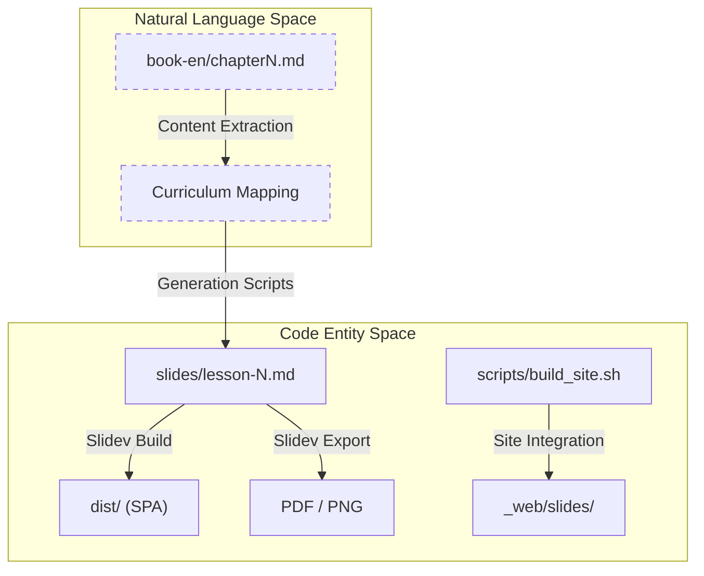
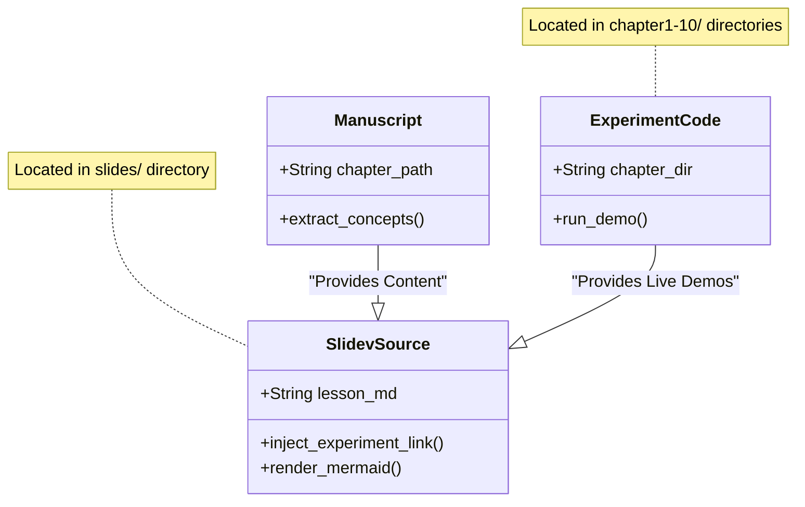

<!-- source: DeepWiki mcp.deepwiki.com · repo bojieli/ai-agent-book · page 1.4 Slidev Video Course (slides) · fetched 2026-10-27 -->

# Slidev Video Course (slides)

Relevant source files

The following files were used as context for generating this wiki page:

- [.github/workflows/i18n-check.yml](.github/workflows/i18n-check.yml)
- [README.md](README.md)
- [docs/STATIC_SITE_I18N.md](docs/STATIC_SITE_I18N.md)
- [docs/ar/README.md](docs/ar/README.md)
- [docs/en/README.md](docs/en/README.md)
- [docs/es/README.md](docs/es/README.md)
- [docs/ja/README.md](docs/ja/README.md)
- [docs/ko/README.md](docs/ko/README.md)
- [docs/ru/README.md](docs/ru/README.md)
- [docs/ta/README.md](docs/ta/README.md)
- [docs/tr/README.md](docs/tr/README.md)
- [docs/vi/README.md](docs/vi/README.md)
- [docs/zh-TW/README.md](docs/zh-TW/README.md)
- [extras/auto-translate.css](extras/auto-translate.css)
- [extras/auto-translate.js](extras/auto-translate.js)
- [extras/book-theme.css](extras/book-theme.css)
- [extras/lang-switcher.css](extras/lang-switcher.css)
- [extras/lang-switcher.js](extras/lang-switcher.js)
- [extras/nav-collapse.js](extras/nav-collapse.js)
- [extras/search-index-router.js](extras/search-index-router.js)
- [extras/site-nav-i18n.json](extras/site-nav-i18n.json)
- [index.ko.md](index.ko.md)
- [index.md](index.md)
- [mkdocs.yml](mkdocs.yml)
- [overrides/main.html](overrides/main.html)
- [overrides/partials/header.html](overrides/partials/header.html)
- [scripts/build_site.sh](scripts/build_site.sh)
- [scripts/check_i18n_consistency.py](scripts/check_i18n_consistency.py)
- [scripts/site_i18n.py](scripts/site_i18n.py)
- [scripts/split_search_index.py](scripts/split_search_index.py)
- [tests/js/auto-translate.test.js](tests/js/auto-translate.test.js)
- [tests/test_site_i18n.py](tests/test_site_i18n.py)
- [tests/test_split_search_index.py](tests/test_split_search_index.py)

The `slides/` directory contains a 42-lesson English video course derived from the *AI Agents in Depth* book. This course utilizes [Slidev](https://sli.dev), a web-based presentation tool that allows slides to be written in Markdown while supporting interactive elements and live-coding demonstrations. The course maps the theoretical foundations of the 10 chapters into a curriculum optimized for video delivery.

## Curriculum and Lesson Mapping

The course is structured into 42 modular lessons, providing a granular breakdown of the book's core formula: `Agent = LLM + Context + Tools` [README.md:10-10](). Each lesson is cross-linked to specific book chapters and hands-on experiments found in the `chapterN/` directories.

### Lesson Structure

| Module | Book Chapter | Key Lessons | Experiments Covered |
| :--- | :--- | :--- | :--- |
| **Foundations** | Chapter 1 | ReAct Loop, Harness Engineering | `chapter1/` (Web-search, ReAct) |
| **Context** | Chapter 2 | KV Cache, Compression, Skills | `chapter2/kv-cache`, `chapter2/context-compression` |
| **Memory** | Chapter 3 | RAG, GraphRAG, User Memory | `chapter3/agentic-rag`, `chapter3/structured-index` |
| **Tools** | Chapter 4 | MCP Protocol, Perception Tools | `chapter4/perception-tools`, `chapter4/collaboration-tools` |
| **Coding** | Chapter 5 | OpenClaw, Filesystem-as-Memory | `chapter5/coding-agent` |
| **Interaction** | Chapter 6 | Event-driven, Multimodal, Voice | `chapter6/` (Computer Use, VAD-ASR) |
| **Evaluation** | Chapter 7 | Benchmarking, ELO Leaderboards | `chapter7/` (Scoring, Metrics) |
| **Training** | Chapter 8 | SFT, DPO, RLVR/RLVP | `chapter8/` (Fine-tuning manifests) |
| **Evolution** | Chapter 9 | Experience Learning, RPA | `chapter9/` (Trajectory reflection) |
| **Multi-Agent** | Chapter 10 | Topologies, A2A Protocols | `chapter10/` (Multi-role-transfer) |

**Sources:** [README.md:60-69](), [docs/en/README.md:10-12]()

---

## Technical Implementation

The slide generation process bridges the "Natural Language Space" (book manuscript) and the "Code Entity Space" (Slidev Markdown and build scripts).

### Data Flow: From Manuscript to Slides

The generation pipeline involves extracting key concepts from the English book source (`book-en/`) and transforming them into Slidev-compatible Markdown files (`slides/*.md`).

#### Slide Generation Pipeline

**Sources:** [scripts/build_site.sh:2-5](), [docs/en/README.md:36-36]()

### Build and Export Commands

The course artifacts are managed through standard Slidev CLI commands, integrated into the repository's broader CI/CD workflows.

*   **Development**: `npm run dev` starts a local server with HMR (Hot Module Replacement).
*   **Production Build**: `npm run build` generates a static Single Page Application (SPA) located in the `_web/` directory during the site assembly process [scripts/build_site.sh:8-12]().
*   **Export**: `npm run export` utilizes Playwright to render slides into PDF or high-resolution PNGs for video editing.

---

## Contribution Workflow

The Slidev course follows a hybrid maintenance model where core curriculum structure is generated, but visual layouts and code demos are hand-refined.

### Code vs. Content Mapping

**Sources:** [README.md:39-39](), [scripts/build_site.sh:53-62]()

### Workflow Steps

1.  **Synchronization**: When the English manuscript in `book-en/` is updated, the corresponding `slides/*.md` files are flagged for review [docs/en/README.md:36-36]().
2.  **Experiment Linking**: Lessons must include direct links to the runnable experiments in `chapterN/` to ensure students can follow the "Agent = LLM + Context + Tools" formula in practice [README.md:10-10]().
3.  **Site Integration**: The `scripts/build_site.sh` script ensures that the generated slide SPA is included in the final documentation site under the `/slides/` path, enabling multi-language search via the `split_search_index.py` hook [mkdocs.yml:27-30](), [scripts/build_site.sh:64-66]().

**Sources:** [mkdocs.yml:14-30](), [scripts/build_site.sh:8-12](), [scripts/build_site.sh:64-66]()

---

