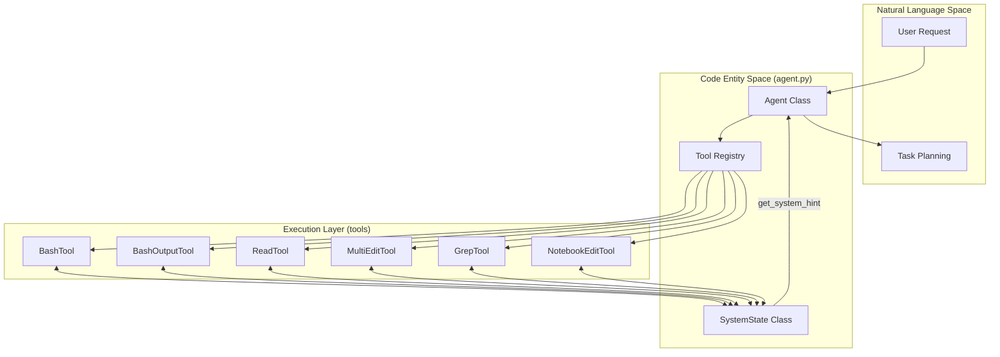
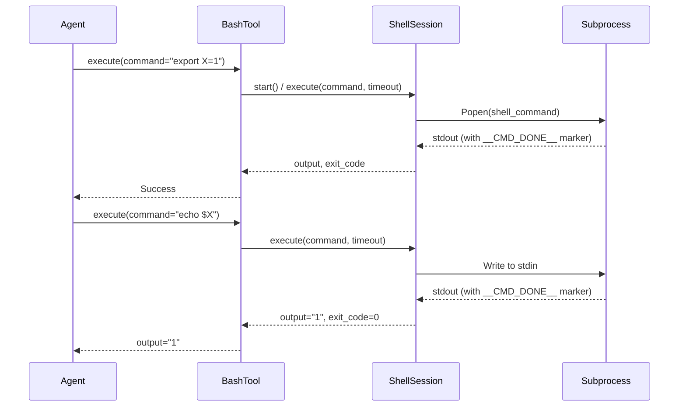

<!-- source: DeepWiki mcp.deepwiki.com · repo bojieli/ai-agent-book · page 6.1 OpenClaw Architecture and Core Tools · fetched 2026-10-27 -->

# 6.1 OpenClaw Architecture and Core Tools

Relevant source files

The following files were used as context for generating this wiki page:

- [chapter3/contextual-retrieval/README_LEGAL_INDEXING.md](chapter3/contextual-retrieval/README_LEGAL_INDEXING.md)
- [chapter3/structured-index/IMPLEMENTATION_GUIDE.md](chapter3/structured-index/IMPLEMENTATION_GUIDE.md)
- [chapter5/coding-agent/.env.example](chapter5/coding-agent/.env.example)
- [chapter5/coding-agent/PROVIDERS.md](chapter5/coding-agent/PROVIDERS.md)
- [chapter5/coding-agent/README_NEW.md](chapter5/coding-agent/README_NEW.md)
- [chapter5/coding-agent/agent.py](chapter5/coding-agent/agent.py)
- [chapter5/coding-agent/agent_new.py](chapter5/coding-agent/agent_new.py)
- [chapter5/coding-agent/config.py](chapter5/coding-agent/config.py)
- [chapter5/coding-agent/main.py](chapter5/coding-agent/main.py)
- [chapter5/coding-agent/system_state.py](chapter5/coding-agent/system_state.py)
- [chapter5/coding-agent/tests/test_bash_output_tool.py](chapter5/coding-agent/tests/test_bash_output_tool.py)
- [chapter5/coding-agent/tests/test_bash_tool.py](chapter5/coding-agent/tests/test_bash_tool.py)
- [chapter5/coding-agent/tests/test_grep_head_limit_zero.py](chapter5/coding-agent/tests/test_grep_head_limit_zero.py)
- [chapter5/coding-agent/tests/test_grep_multiline_content.py](chapter5/coding-agent/tests/test_grep_multiline_content.py)
- [chapter5/coding-agent/tests/test_grep_negative_context.py](chapter5/coding-agent/tests/test_grep_negative_context.py)
- [chapter5/coding-agent/tests/test_grep_negative_head_limit.py](chapter5/coding-agent/tests/test_grep_negative_head_limit.py)
- [chapter5/coding-agent/tests/test_grep_tool.py](chapter5/coding-agent/tests/test_grep_tool.py)
- [chapter5/coding-agent/tests/test_integration.py](chapter5/coding-agent/tests/test_integration.py)
- [chapter5/coding-agent/tests/test_kill_bash_tool.py](chapter5/coding-agent/tests/test_kill_bash_tool.py)
- [chapter5/coding-agent/tests/test_multi_edit_empty_old_on_existing.py](chapter5/coding-agent/tests/test_multi_edit_empty_old_on_existing.py)
- [chapter5/coding-agent/tests/test_multi_edit_tool.py](chapter5/coding-agent/tests/test_multi_edit_tool.py)
- [chapter5/coding-agent/tests/test_notebook_edit_tool.py](chapter5/coding-agent/tests/test_notebook_edit_tool.py)
- [chapter5/coding-agent/tests/test_read_limit_zero.py](chapter5/coding-agent/tests/test_read_limit_zero.py)
- [chapter5/coding-agent/tests/test_read_negative_limit.py](chapter5/coding-agent/tests/test_read_negative_limit.py)
- [chapter5/coding-agent/tests/test_read_tool.py](chapter5/coding-agent/tests/test_read_tool.py)
- [chapter5/coding-agent/tests/test_shell_session.py](chapter5/coding-agent/tests/test_shell_session.py)
- [chapter5/coding-agent/tools.json](chapter5/coding-agent/tools.json)
- [chapter5/coding-agent/tools/bash_output_tool.py](chapter5/coding-agent/tools/bash_output_tool.py)
- [chapter5/coding-agent/tools/bash_tool.py](chapter5/coding-agent/tools/bash_tool.py)
- [chapter5/coding-agent/tools/grep_tool.py](chapter5/coding-agent/tools/grep_tool.py)
- [chapter5/coding-agent/tools/kill_bash_tool.py](chapter5/coding-agent/tools/kill_bash_tool.py)
- [chapter5/coding-agent/tools/multi_edit_tool.py](chapter5/coding-agent/tools/multi_edit_tool.py)
- [chapter5/coding-agent/tools/notebook_edit_tool.py](chapter5/coding-agent/tools/notebook_edit_tool.py)
- [chapter5/coding-agent/tools/read_tool.py](chapter5/coding-agent/tools/read_tool.py)
- [chapter5/coding-agent/tools/shell_session.py](chapter5/coding-agent/tools/shell_session.py)
- [tests/test_ch5_grep_tool_file_filters.py](tests/test_ch5_grep_tool_file_filters.py)
- [tests/test_ch5_notebook_edit_zero_cell_id.py](tests/test_ch5_notebook_edit_zero_cell_id.py)

This page documents the architecture of OpenClaw, a reference implementation for a general-purpose Coding Agent located in `chapter5/coding-agent/`. It details the seven core tools, the sessionless workspace model, and the execution lifecycle that enables autonomous software development.

## 1. OpenClaw Core Architecture

OpenClaw follows the paradigm that a **Coding Agent + Persistent Filesystem** forms the core of an open-task general Agent. In this architecture, the filesystem acts as the central hub for memory, knowledge, and intermediate artifacts. The `SystemState` class tracks the environment across tool calls, including the current directory, tool usage statistics, and active shell sessions [chapter5/coding-agent/system_state.py:12-25]().

### 1.1 Component Interaction and Data Flow
The `Agent` runtime serves as the reasoning core, interacting with specialized tools that modify or query the `SystemState`.

**OpenClaw System Entity Mapping**

Sources: [chapter5/coding-agent/system_state.py:12-52](), [chapter5/coding-agent/tools/bash_tool.py:11-16](), [chapter5/coding-agent/tools/grep_tool.py:14-19](), [chapter5/coding-agent/tools/read_tool.py:11-16](), [chapter5/coding-agent/tools/multi_edit_tool.py:11-16](), [chapter5/coding-agent/tools/bash_output_tool.py:12-17](), [chapter5/coding-agent/tools/notebook_edit_tool.py:11-16]()

## 2. The Seven Core Tools

OpenClaw implements a minimalist but complete set of tools. Each tool inherits from `BaseTool` and implements `_execute_impl` [chapter5/coding-agent/tools/grep_tool.py:11-21]().

| Tool | Implementation Class | Key Capabilities |
| :--- | :--- | :--- |
| **Bash Shell** | `BashTool` | Persistent sessions, background execution, output truncation [chapter5/coding-agent/tools/bash_tool.py:11-27]() |
| **Bash Output** | `BashOutputTool` | Retrieves incremental new output from background jobs using offsets [chapter5/coding-agent/tools/bash_output_tool.py:12-27]() |
| **Read File** | `ReadTool` | Cat-n format, line limits (2000), support for text/IPYNB/PDF/Images [chapter5/coding-agent/tools/read_tool.py:11-54]() |
| **Multi-Edit** | `MultiEditTool` | Atomic sequential string replacements with lint checking [chapter5/coding-agent/tools/multi_edit_tool.py:11-27]() |
| **Grep** | `GrepTool` | Pure Python regex search, context lines (-A/B/C), glob filtering [chapter5/coding-agent/tools/grep_tool.py:14-35]() |
| **Notebook Edit** | `NotebookEditTool` | Edit Jupyter notebook cells (insert, delete, replace) [chapter5/coding-agent/tools/notebook_edit_tool.py:11-27]() |
| **Kill Bash** | `KillBashTool` | Terminates a running background bash job [chapter5/coding-agent/tools/kill_bash_tool.py]() |

### 2.1 Persistent Shell Mechanics
The `BashTool` uses `ShellSession` to maintain state (CWD, environment variables) across turns [chapter5/coding-agent/tools/bash_tool.py:37-45](). It supports background execution by generating a unique `bg_id` and logging output to a temporary file [chapter5/coding-agent/tools/bash_tool.py:50-58](). The `ShellSession` class handles platform-specific shell configurations, supporting PowerShell on Windows and Bash on Unix-like systems [chapter5/coding-agent/tools/shell_session.py:26-52](). It wraps commands with markers to reliably capture exit codes, environment variables, and current working directory [chapter5/coding-agent/tools/shell_session.py:111-172]().

**Shell Execution Flow**

Sources: [chapter5/coding-agent/tools/bash_tool.py:36-75](), [chapter5/coding-agent/tools/shell_session.py:55-180]()

### 2.2 Grep Tool Implementation
The `GrepTool` provides a pure Python implementation of regex search across files, avoiding external dependencies like `rg` or `grep` [chapter5/coding-agent/tools/grep_tool.py:1-11](). It supports a comprehensive set of features:
*   **Regex Syntax**: Full Python regex capabilities [chapter5/coding-agent/tools/grep_tool.py:36]().
*   **Case Insensitivity**: The `-i` parameter [chapter5/coding-agent/tools/grep_tool.py:42]().
*   **Context Lines**: `-A` (after), `-B` (before), and `-C` (around) parameters [chapter5/coding-agent/tools/grep_tool.py:43-51]().
*   **Line Numbers**: The `-n` parameter [chapter5/coding-agent/tools/grep_tool.py:52]().
*   **Multiline Mode**: For patterns spanning multiple lines [chapter5/coding-agent/tools/grep_tool.py:53]().
*   **Glob Filtering**: Filter files by glob patterns (e.g., `*.py`) [chapter5/coding-agent/tools/grep_tool.py:40]().
*   **File Type Filtering**: Filter by common file extensions (e.g., `py`, `js`, `md`) [chapter5/coding-agent/tools/grep_tool.py:64]().
*   **Output Modes**: `content` (matching lines), `files_with_matches` (list of files), `count` (match count per file) [chapter5/coding-agent/tools/grep_tool.py:41]().
*   **Head Limit**: Limit the number of results returned [chapter5/coding-agent/tools/grep_tool.py:54]().

The `_get_files_to_search` method handles recursive directory traversal and applies glob and file type filters [chapter5/coding-agent/tools/grep_tool.py:121-188](). Error handling includes invalid regex patterns and non-existent paths [chapter5/coding-agent/tools/grep_tool.py:82-88]().

### 2.3 Read Tool Implementation
The `ReadTool` is designed for reading various file types from the local filesystem [chapter5/coding-agent/tools/read_tool.py:11-16]().
*   **Text Files**: Reads up to 2000 lines by default, with support for `offset` and `limit` parameters for large files. Lines exceeding 2000 characters are truncated. Results are returned in `cat -n` format with 1-indexed line numbers [chapter5/coding-agent/tools/read_tool.py:29-35, 79-86](). It includes binary content sniffing to prevent decoding errors [chapter5/coding-agent/tools/read_tool.py:58-65]().
*   **Special File Types**: Handles images (`.png`, `.jpg`, etc.), PDFs (`.pdf`), and Jupyter notebooks (`.ipynb`) by returning metadata or structured content [chapter5/coding-agent/tools/read_tool.py:47-54](). For Jupyter notebooks, it extracts and formats cells, including source code and outputs [chapter5/coding-agent/tools/read_tool.py:147-175]().
*   **Error Handling**: Provides specific error messages for file not found, not a file, binary content, and general read errors [chapter5/coding-agent/tools/read_tool.py:37-41, 103-106]().

### 2.4 MultiEdit Tool Implementation
The `MultiEditTool` allows for multiple, atomic edits to a single file in one operation [chapter5/coding-agent/tools/multi_edit_tool.py:11-16]().
*   **Sequential Application**: Edits are applied in the order provided, with each edit operating on the result of the previous one [chapter5/coding-agent/tools/multi_edit_tool.py:55-56]().
*   **Atomicity**: If any edit fails (e.g., `old_string` not found), the entire operation is rolled back, ensuring the file remains in its original state. This is achieved by performing all edits on an in-memory copy and only writing to disk if all edits succeed [chapter5/coding-agent/tools/multi_edit_tool.py:34-41, 70-81]().
*   **File Creation**: Supports creating new files by providing an empty `old_string` in the first edit [chapter5/coding-agent/tools/multi_edit_tool.py:33-41]().
*   **Lint Checking**: For Python files, it performs a basic syntax check using `py_compile` after edits to provide immediate feedback on potential errors [chapter5/coding-agent/tools/multi_edit_tool.py:119-133]().

### 2.5 NotebookEdit Tool Implementation
The `NotebookEditTool` specializes in modifying Jupyter notebooks (`.ipynb`) [chapter5/coding-agent/tools/notebook_edit_tool.py:11-16]().
*   **Cell Manipulation**: Supports inserting new cells, deleting existing cells by `cell_id`, and replacing the content of a specific cell [chapter5/coding-agent/tools/notebook_edit_tool.py:31-106]().
*   **Content Format**: New cell content (`new_source`) is automatically split into lines with `keepends=True` to match Jupyter's internal representation [chapter5/coding-agent/tools/notebook_edit_tool.py:53-54]().
*   **Error Handling**: Catches `json.JSONDecodeError` for invalid notebook formats and provides specific errors for missing `cell_id` or `new_source` [chapter5/coding-agent/tools/notebook_edit_tool.py:120-123]().

## 3. Sessionless Workspace Persistence

OpenClaw uses the filesystem as its primary long-term memory.
*   **System Hints**: The `SystemState.get_system_hint()` function dynamically injects the current working directory, OS type, and tool call statistics into the LLM prompt to maintain context [chapter5/coding-agent/system_state.py:26-52]().
*   **Incremental Output**: `BashOutputTool` tracks a `bash_output_offsets` dictionary in the `SystemState` so that subsequent calls only return data produced since the last check [chapter5/coding-agent/tools/bash_output_tool.py:40-49]().

Sources: [chapter5/coding-agent/system_state.py:13-52](), [chapter5/coding-agent/tools/bash_output_tool.py:12-61]()

## 4. Project Instruction Files

The agent's behavior is governed by specific files located in the workspace root:
*   **CLAUDE.md**: Project-specific commands and coding style.
*   **MEMORY.md**: Long-term facts and user preferences.
*   **AGENTS.md / SOUL.md**: Persona definitions and behavioral constraints.

## 5. Execution Lifecycle

OpenClaw follows a structured lifecycle for every task:
1.  **Documentation**: Reads `CLAUDE.md` and `MEMORY.md` to understand context.
2.  **Design**: Uses `Grep` and `Read` to explore the codebase and proposes changes.
3.  **Implementation**: Uses `MultiEditTool` to apply changes atomically [chapter5/coding-agent/tools/multi_edit_tool.py:56-95]().
4.  **Test-Fix**: Uses `BashTool` to run tests and `py_compile` for linting [chapter5/coding-agent/tools/multi_edit_tool.py:119-133]().
5.  **Self-Review**: Verifies the implementation against the original request.

Sources: [chapter5/coding-agent/tools/multi_edit_tool.py:19-114](), [chapter5/coding-agent/system_state.py:38-44]()

## 6. Implementation Detail: `chapter5/coding-agent/`

The codebase is organized for modularity and testability:
*   **`tools/`**: Contains tool implementations. `grep_tool.py` provides a pure Python grep to avoid external dependencies [chapter5/coding-agent/tools/grep_tool.py:1-11]().
*   **`tests/`**: Contains comprehensive test suites for tools, such as `test_bash_tool.py` which verifies directory persistence and timeouts [chapter5/coding-agent/tests/test_bash_tool.py:59-91](). `test_grep_tool.py` covers various search parameters, including case insensitivity, context lines, glob filtering, and head limits [chapter5/coding-agent/tests/test_grep_tool.py:26-161](). `test_multi_edit_tool.py` ensures atomicity and sequential application of edits [chapter5/coding-agent/tests/test_multi_edit_tool.py:48-85](). `test_shell_session.py` specifically tests the robust handling of the `__CMD_DONE__` marker to prevent desynchronization issues [chapter5/coding-agent/tests/test_shell_session.py:90-125]().
*   **`agent.py`**: The main orchestration logic that manages the ReAct loop.

Sources: [chapter5/coding-agent/tools/grep_tool.py:1-15](), [chapter5/coding-agent/tests/test_bash_tool.py:1-209](), [chapter5/coding-agent/tests/test_grep_tool.py:1-194](), [chapter5/coding-agent/tests/test_multi_edit_tool.py:1-196](), [chapter5/coding-agent/tests/test_shell_session.py:1-140]()

---

