# Page: Overview: AI Agent Engineering Book

# Overview: AI Agent Engineering Book

<details>
<summary>Relevant source files</summary>

The following files were used as context for generating this wiki page:

- [README.md](README.md)
- [book/chapter1.md](book/chapter1.md)
- [book/chapter10.md](book/chapter10.md)
- [book/chapter2.md](book/chapter2.md)
- [book/chapter3.md](book/chapter3.md)
- [book/chapter4.md](book/chapter4.md)
- [book/chapter5.md](book/chapter5.md)
- [book/chapter6.md](book/chapter6.md)
- [book/chapter7.md](book/chapter7.md)
- [book/chapter8.md](book/chapter8.md)
- [book/chapter9.md](book/chapter9.md)
- [book/reference-answers.md](book/reference-answers.md)
- [docs/ar/README.md](docs/ar/README.md)
- [docs/en/README.md](docs/en/README.md)
- [docs/es/README.md](docs/es/README.md)
- [docs/ja/README.md](docs/ja/README.md)
- [docs/ko/README.md](docs/ko/README.md)
- [docs/ru/README.md](docs/ru/README.md)
- [docs/ta/README.md](docs/ta/README.md)
- [docs/tr/README.md](docs/tr/README.md)
- [docs/vi/README.md](docs/vi/README.md)
- [docs/zh-TW/README.md](docs/zh-TW/README.md)

</details>


This repository serves as a comprehensive guide and reference implementation for building production-grade AI Agents. It is centered around the core engineering formula: **Agent = LLM + Context + Tools** [README.md:10](). While Large Language Models (LLMs) provide the "reasoning engine," the repository emphasizes **Harness Engineering**—the surrounding infrastructure of constraints, verification, and memory that transforms a raw model into a reliable autonomous system [book/chapter1.md:25-28]().

The project bridges the gap between theoretical AI research and practical software engineering, providing a 10-chapter manuscript alongside **108配套实验** (108 companion experiments) [README.md:10-12]().

## The Core Formula: Agent = LLM + Context + Tools

The architecture of every agent in this repository follows a unified structural philosophy described in the introductory chapters [book/chapter1.md:13-19]():

| Component | Role | Chapter Focus |
| :--- | :--- | :--- |
| **LLM** | The **"Brain"**: Reasoning engine, intent recognition, and decision making via Policy. | Ch. 8 (Post-training) |
| **Context** | The **"Eyes"**: Observation Space including environment info, memory, and task progress. | Ch. 2 (Context Eng), Ch. 3 (Memory) |
| **Tools** | The **"Hands/Feet"**: Action Space including APIs, code execution, and messaging. | Ch. 4 (Tools), Ch. 5 (Coding Agent) |

### From Natural Language to Code Entities

The following diagram illustrates how the conceptual "Agent" formula maps to specific software entities within the codebase, particularly within the `agentbook/` shared package and chapter experiments.

**Conceptual to Implementation Mapping**
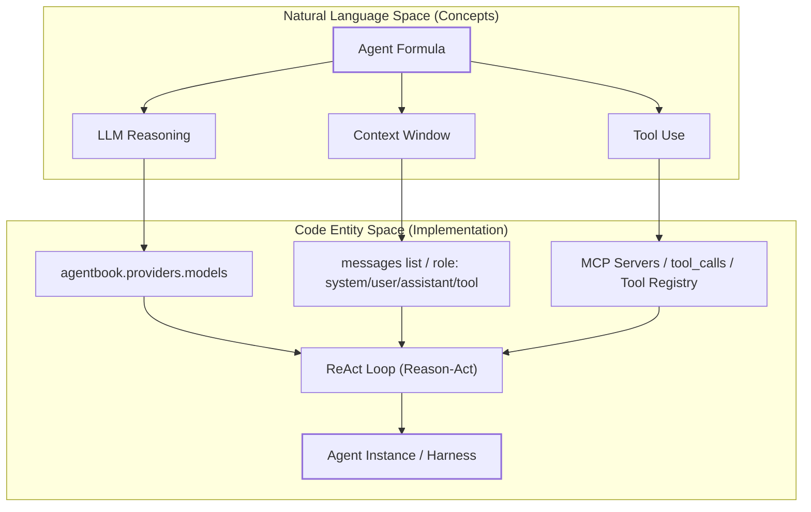
Sources: [book/chapter1.md:11-28](), [book/chapter2.md:47-56](), [README.md:10-12]()

## Harness Engineering Philosophy

A recurring theme is that "Model-as-an-Agent" is insufficient for production. Instead, the project advocates for **Harness Engineering**: the engineering effort outside the model (the "缰绳与挽具" or reins and harness) that provides safety, reliability, and persistence [book/chapter1.md:25-28](). The Harness is responsible for constructing context, exposing tool interfaces, and implementing "Poka-yoke" (error-proofing) mechanisms like circuit breakers and verification loops [book/chapter7.md:17-19]().

**The Harness Execution Flow**
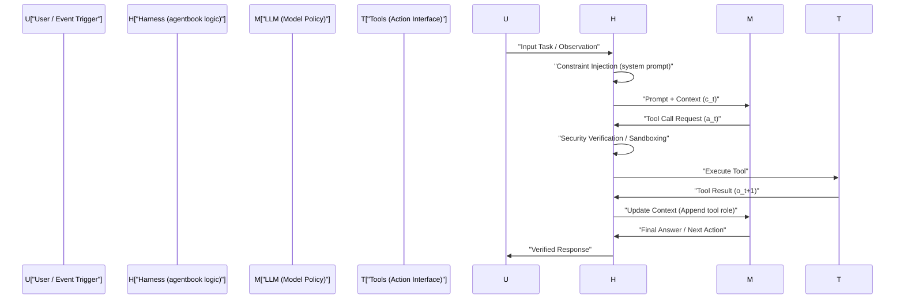
Sources: [book/chapter1.md:23-28](), [book/chapter2.md:31-37](), [book/chapter2.md:99-101]()

## Repository Structure

The repository is organized to support both readers of the book and developers looking for reference implementations.

*   **`book/`**: Contains the manuscript source (Markdown), LaTeX templates, and the build pipeline for the PDF [README.md:39-47]().
*   **`chapter1/` to `chapter10/`**: Independent, executable Python projects corresponding to each chapter's technical focus [README.md:60-68]().
*   **`agentbook/`**: A shared package containing LLM provider registries and core utilities used across experiments.
*   **`cursor-chats/`**: Development logs showing how AI-assisted coding was used to build the repository itself.
*   **`slides/`**: A 42-lesson Slidev-based video course derived from the manuscript [README.md:16]().

For a detailed breakdown of the file layout and environment setup, see [Repository Structure and Getting Started](#1.1).

## Publication Pipeline

The book is a software product using a sophisticated pipeline:
*   **Pandoc & XeLaTeX**: Converts Markdown into professional formats using the `ElegantBook` LaTeX class [README.md:41-52]().
*   **Localization**: Supports **14 languages** (English, Spanish, Traditional Chinese, etc.) via community contributions [README.md:22-35]().
*   **Static Site**: A multi-language MkDocs site with full-text search and chapter folding [README.md:37]().

For details on the build system, see [Book Publication Pipeline](#1.2) and [Online Documentation Site and Localization](#1.3).

## Chapter Roadmap (v2.0)

The book was recently updated to v2.0, reorganizing content for better interaction and evaluation flows [README.md:12-14]().

1.  **🚀 AI Agent Fundamentals**: The ReAct loop and the "Agent = LLM + Context + Tools" formula [README.md:62]().
2.  **🎯 Context Engineering**: KV Cache optimization, Prompt Engineering, and Agent Skills [README.md:63]().
3.  **📚 User Memory & Knowledge**: RAG pipelines, structured indexing, and memory evaluation [README.md:64]().
4.  **🛠️ Tools**: MCP protocol, Perception/Execution/Collaboration tools, and active tool discovery [README.md:65]().
5.  **💻 Coding Agent**: Production-grade Coding Agent architecture (OpenClaw style) and ACI design [README.md:66]().
6.  **🎙️ Interaction**: Expanding Observation and Action spaces (Multimodal, Computer Use, Voice, and Asynchronous events) [README.md:64]().
7.  **🎯 Agent Evaluation**: Environment types, τ²-bench, and ELO leaderboards [README.md:65]().
8.  **🧠 Model Post-Training**: SFT, RL (PPO/GRPO), and VLA robot training [README.md:66]().
9.  **🔄 Continuous Evolution**: Experience learning, trajectory-based optimization, and prompt distillation [README.md:67]().
10. **🤝 Multi-Agent Collaboration**: Topologies, context sharing vs. isolation, and collective intelligence [README.md:68]().

Sources: [README.md:55-68](), [book/chapter1.md:9]()

---

# Page: Repository Structure and Getting Started

# Repository Structure and Getting Started

<details>
<summary>Relevant source files</summary>

The following files were used as context for generating this wiki page:

- [.github/workflows/dependency-resolution.yml](.github/workflows/dependency-resolution.yml)
- [README.md](README.md)
- [agentbook/__init__.py](agentbook/__init__.py)
- [agentbook/providers/__init__.py](agentbook/providers/__init__.py)
- [agentbook/providers/legacy.py](agentbook/providers/legacy.py)
- [agentbook/providers/models.py](agentbook/providers/models.py)
- [agentbook/providers/registry.py](agentbook/providers/registry.py)
- [agentbook/providers/resolution.py](agentbook/providers/resolution.py)
- [chapter10/README.md](chapter10/README.md)
- [chapter10/autonomous-phone-registration/README.md](chapter10/autonomous-phone-registration/README.md)
- [chapter10/autonomous-phone-registration/browser.py](chapter10/autonomous-phone-registration/browser.py)
- [chapter10/autonomous-phone-registration/decision.py](chapter10/autonomous-phone-registration/decision.py)
- [chapter10/autonomous-phone-registration/demo.py](chapter10/autonomous-phone-registration/demo.py)
- [chapter10/autonomous-phone-registration/env.example](chapter10/autonomous-phone-registration/env.example)
- [chapter10/autonomous-phone-registration/models.py](chapter10/autonomous-phone-registration/models.py)
- [chapter10/autonomous-phone-registration/orchestration.py](chapter10/autonomous-phone-registration/orchestration.py)
- [chapter10/autonomous-phone-registration/run_acceptance.py](chapter10/autonomous-phone-registration/run_acceptance.py)
- [chapter10/autonomous-phone-registration/test_orchestration.py](chapter10/autonomous-phone-registration/test_orchestration.py)
- [chapter10/autonomous-phone-registration/test_validate_acceptance.py](chapter10/autonomous-phone-registration/test_validate_acceptance.py)
- [chapter10/autonomous-phone-registration/test_webrtc_channel.py](chapter10/autonomous-phone-registration/test_webrtc_channel.py)
- [chapter10/autonomous-phone-registration/validate_acceptance.py](chapter10/autonomous-phone-registration/validate_acceptance.py)
- [chapter10/autonomous-phone-registration/webrtc_channel.py](chapter10/autonomous-phone-registration/webrtc_channel.py)
- [chapter2/agent-skills-ppt/README.md](chapter2/agent-skills-ppt/README.md)
- [chapter2/agent-skills-ppt/demo.py](chapter2/agent-skills-ppt/demo.py)
- [chapter2/agent-skills-ppt/tests/conftest.py](chapter2/agent-skills-ppt/tests/conftest.py)
- [chapter2/agent-skills-ppt/tests/test_dispatch.py](chapter2/agent-skills-ppt/tests/test_dispatch.py)
- [chapter2/agent-skills-ppt/tests/test_generate_pptx_null_bullets.py](chapter2/agent-skills-ppt/tests/test_generate_pptx_null_bullets.py)
- [chapter2/agent-skills-ppt/tests/test_reasoning_degrade.py](chapter2/agent-skills-ppt/tests/test_reasoning_degrade.py)
- [chapter5/code-for-logic/requirements.txt](chapter5/code-for-logic/requirements.txt)
- [chapter5/code-for-logic/sandbox.py](chapter5/code-for-logic/sandbox.py)
- [chapter8/prompt-distillation/README.md](chapter8/prompt-distillation/README.md)
- [docs/EXPERIMENT_STATUS.md](docs/EXPERIMENT_STATUS.md)
- [docs/ar/README.md](docs/ar/README.md)
- [docs/en/README.md](docs/en/README.md)
- [docs/es/README.md](docs/es/README.md)
- [docs/ja/README.md](docs/ja/README.md)
- [docs/ko/README.md](docs/ko/README.md)
- [docs/ru/README.md](docs/ru/README.md)
- [docs/ta/README.md](docs/ta/README.md)
- [docs/tr/README.md](docs/tr/README.md)
- [docs/vi/README.md](docs/vi/README.md)
- [docs/zh-TW/README.md](docs/zh-TW/README.md)
- [pyproject.toml](pyproject.toml)
- [tests/test_ch10_field_spec_validate_none.py](tests/test_ch10_field_spec_validate_none.py)
- [tests/test_docs_experiment_status_links.py](tests/test_docs_experiment_status_links.py)
- [tests/test_providers.py](tests/test_providers.py)
- [tests/test_resolve_backend_whitespace_model.py](tests/test_resolve_backend_whitespace_model.py)
- [uv.lock](uv.lock)

</details>


This page details the organizational layout of the `ai-agent-book` repository, the shared `agentbook` provider package, and instructions for setting up the development environment using `uv`. The repository serves as both a theoretical guide and a reference implementation for building production-grade AI Agents based on the formula: **Agent = LLM + Context + Tools** [README.md:10-10]().

## Repository Layout

The repository is organized into four primary functional areas: the manuscript source, experimental codebases, shared utilities, and development logs.

### 1. Book Manuscript (`book/`)
Contains the Markdown sources for the book, LaTeX templates for PDF generation, and scripts for figure generation [README.md:45-53]().
*   **Source Files**: `introduction.md`, `chapter1.md` through `chapter10.md`, and `afterword.md` [README.md:45-45]().
*   **Assets**: `images/` directory containing diagrams and SVG figures [README.md:52-52]().
*   **Localization**: Translated manuscripts are located in language-specific directories such as `book-en/`, `book-es/`, and `book-ja/` [README.md:39-39]().

### 2. Code Experiments (`chapter1/` to `chapter10/`)
Each directory contains independent projects demonstrating specific Agent engineering concepts [README.md:60-69](). 
*   **Chapter 1-5**: Focus on core architecture, context engineering, memory, tools, and coding agents [README.md:62-66]().
*   **Chapter 6-10**: Cover multimodal interaction, evaluation, post-training, self-evolution, and multi-agent systems [README.md:12-12](), [docs/zh-TW/README.md:64-68]().

Experiments use an **Evidence Ledger** convention (e.g., `EXPERIMENT_LEDGER.md` or `validation/` manifests) to track results, latency, and model receipts [docs/EXPERIMENT_STATUS.md:32-36]().

### 3. Shared Provider Package (`agentbook/`)
A shared internal package providing a unified interface for LLM providers. It centralizes model resolution and API key management [pyproject.toml:5-8]().
*   **`agentbook/providers/`**: The core logic for handling multiple backends like OpenAI, Anthropic (via OpenRouter), and local providers [tests/test_providers.py:11-20]().
*   **`resolution.py`**: Implements `resolve_backend` to select between direct provider access and OpenRouter [tests/test_providers.py:18-19](), [agentbook/providers/resolution.py]().

### 4. Development Logs (`cursor-chats/`)
Contains logs of AI-assisted development sessions, documenting the interaction between the author and AI coding assistants during the creation of the codebase.

**Repository Mapping: Concepts to Code**
```mermaid
graph TD
    subgraph "NaturalLanguageSpace [book/]"
        [Manuscript] --> |"Explains Formula"| [Agent_LLM_Context_Tools]
        [Manuscript] --> |"Describes Loop"| [ReAct_Execution]
        [Manuscript] --> |"Defines Protocol"| [MCP_Spec]
    end

    subgraph "CodeEntitySpace [chapterN/]"
        [chapter1/context/] --> |"Implements"| [ReAct_Execution]
        [chapter4/perception-tools/] --> |"Implements"| [MCP_Spec]
        [chapter5/coding-agent/] --> |"Implements"| [Agent_LLM_Context_Tools]
    end

    subgraph "SharedPlumbing [agentbook/]"
        [providers/resolution.py] --> |"resolve_backend"| [LLM_API_Routing]
        [providers/registry.py] --> |"supported_providers"| [Provider_List]
    end

    [Manuscript] -.-> |"Cross-Reference"| [chapter1/context/]
    [chapter1/context/] --> |"Uses"| [SharedPlumbing]
```
**Sources:** [README.md:10-66](), [pyproject.toml:5-8](), [docs/EXPERIMENT_STATUS.md:3-12](), [agentbook/providers/resolution.py]()

---

## Getting Started with `uv`

The repository uses `uv` for reproducible dependency management via `pyproject.toml` and `uv.lock` [pyproject.toml:39-42](), [uv.lock:1-3]().

### Environment Setup
1.  **Install Dependencies**: Install the core package and chapter-specific extras.
    ```bash
    # Install Chapter 1 dependencies using uv
    uv sync --extra ch1
    ```
    [pyproject.toml:36-36]()
2.  **Python Version**: The project requires **Python >=3.11 and <3.14** [pyproject.toml:16-16]().
3.  **Extras Taxonomy**:
    *   `viz`: Plotting and data analysis (matplotlib, pandas, rich) [pyproject.toml:60-70]().
    *   `rag`: Vector stores and embeddings (chromadb, faiss, sentence-transformers) [pyproject.toml:147-168]().
    *   `web`: Browser automation and fetching (playwright, beautifulsoup4) [pyproject.toml:94-102]().
    *   `torch`: Local model inference runtime [pyproject.toml:138-144]().

### LLM Provider Configuration
Configure providers via a `.env` file. The `agentbook.providers` module resolves keys using a fallback hierarchy [tests/test_providers.py:47-52]().

**Configuration Priority:**
1.  **Direct Key**: Uses specific variables like `DASHSCOPE_API_KEY`, `DEEPSEEK_API_KEY`, or `MOONSHOT_API_KEY` [tests/test_providers.py:24-33]().
2.  **OpenRouter Fallback**: If a direct provider key is missing, it routes through OpenRouter using `OPENROUTER_API_KEY` [tests/test_providers.py:155-161]().
3.  **Model Mapping**: `map_model_to_openrouter` converts short names (e.g., `gpt-4o`) to full OpenRouter IDs (e.g., `openai/gpt-4o`) [tests/test_providers.py:57-75]().

**Provider Data Flow**
```mermaid
graph LR
    subgraph "ConfigSpace [.env]"
        [ENV_VARS] --> [resolve_backend]
    end

    subgraph "CodeEntitySpace [agentbook/providers/]"
        [resolve_backend] --> |"Check Direct Key"| [Direct_API_Connection]
        [resolve_backend] -- "Key Missing" --> [build_openrouter_backend]
        [build_openrouter_backend] --> |"map_model_to_openrouter"| [OpenRouter_API_Request]
    end

    [Direct_API_Connection] --> [Provider_Endpoint]
    [OpenRouter_API_Request] --> [OpenRouter_Endpoint]
```
**Sources:** [pyproject.toml:16-57](), [tests/test_providers.py:24-161](), [agentbook/providers/resolution.py]()

---

## Experiment Status and Evidence

The repository maintains a status taxonomy in `docs/EXPERIMENT_STATUS.md` to track the validity of claims made in the book against code execution [docs/EXPERIMENT_STATUS.md:1-7]().

### Status Taxonomy
*   **Complete**: Manuscript claims are backed by substantive saved evidence (e.g., `latest.json` manifests) [docs/EXPERIMENT_STATUS.md:16-17]().
*   **Incomplete**: Implementation or evidence gates are not yet satisfied (e.g., missing API credentials for Google Calendar) [docs/EXPERIMENT_STATUS.md:18-19](), [docs/EXPERIMENT_STATUS.md:33-33]().
*   **Reader Exercise**: Requires the reader to run a local campaign to generate evidence [docs/EXPERIMENT_STATUS.md:20-21]().

### Evidence Ledgers
Experiments like `Active tool discovery` (4-1) or `Interruptible asynchronous Agent` (6-2) record "canonical evidence" including tool traces, subprocess logs, and model receipts [docs/EXPERIMENT_STATUS.md:32-40](). This ensures that the engineering patterns described in the book are verified by actual runs.

**Sources:** [docs/EXPERIMENT_STATUS.md:1-46]()

---

# Page: Book Publication Pipeline

# Book Publication Pipeline

<details>
<summary>Relevant source files</summary>

The following files were used as context for generating this wiki page:

- [.github/scripts/install_apple_fonts.sh](.github/scripts/install_apple_fonts.sh)
- [.github/workflows/build-latest.yml](.github/workflows/build-latest.yml)
- [EPUB.md](EPUB.md)
- [README.en.md](README.en.md)
- [README.ta.md](README.ta.md)
- [README.vi.md](README.vi.md)
- [README.zhtw.md](README.zhtw.md)
- [book-en/build_pdf.sh](book-en/build_pdf.sh)
- [book-en/cover.tex](book-en/cover.tex)
- [book-ja/build_pdf.sh](book-ja/build_pdf.sh)
- [book-ja/cover.tex](book-ja/cover.tex)
- [book-ko/build_pdf.sh](book-ko/build_pdf.sh)
- [book-ko/crossref.lua](book-ko/crossref.lua)
- [book-ko/images/fig3-8.svg](book-ko/images/fig3-8.svg)
- [book-ko/korean_spacing.lua](book-ko/korean_spacing.lua)
- [book-ko/preamble.tex](book-ko/preamble.tex)
- [book-ta/build_pdf.sh](book-ta/build_pdf.sh)
- [book-ta/cover.tex](book-ta/cover.tex)
- [book-ta/tamil-fonts.tex](book-ta/tamil-fonts.tex)
- [book-vi/build_pdf.sh](book-vi/build_pdf.sh)
- [book-vi/cover.tex](book-vi/cover.tex)
- [book-zhtw/build_pdf.sh](book-zhtw/build_pdf.sh)
- [book-zhtw/cover.tex](book-zhtw/cover.tex)
- [book/.gitignore](book/.gitignore)
- [book/build_pdf.sh](book/build_pdf.sh)
- [book/cover.tex](book/cover.tex)
- [build_epub.sh](build_epub.sh)
- [docs/LEARNING.zhtw.md](docs/LEARNING.zhtw.md)
- [epub.css](epub.css)
- [flatten_epub_toc.py](flatten_epub_toc.py)
- [tests/test_flatten_epub_toc.py](tests/test_flatten_epub_toc.py)

</details>


The book publication pipeline is a sophisticated build system designed to convert Markdown manuscripts into professionally typeset PDF and EPUB editions. It leverages **Pandoc** as the core document converter, **XeLaTeX** for high-quality multi-language typesetting, and a suite of **Lua filters**, **Python scripts**, and **GitHub Actions** to automate the transformation from raw text to distribution-ready artifacts.

## Build System Architecture

The pipeline is orchestrated by language-specific shell scripts that sequence the transformation using the `ElegantBook` LaTeX class for PDFs and a custom CSS/Python pipeline for EPUBs.

### Core PDF Build Sequence
The primary entry point for the Chinese edition is `book/build_pdf.sh`, with similar scripts for other languages like `book-en/build_pdf.sh` and `book-ko/build_pdf.sh`.
1.  **Chapter Assembly**: Defines the ordered sequence of Markdown files [book/build_pdf.sh:15-28]().
2.  **Runtime Environment Tweaks**: Adjusts XeTeX memory limits (`extra_mem_top=8000000`) to handle large documents [book-ko/build_pdf.sh:21-24]().
3.  **Metadata Injection**: Sets document attributes such as author, title-meta, and theme (`cyan`) [book/build_pdf.sh:49-55]().
4.  **Transformation Pipeline**: Executes `pandoc` with specialized Lua filters for semantic processing [book/build_pdf.sh:40-45]().
5.  **LaTeX Rendering**: Uses the `xelatex` engine to process the `preamble.tex` and `cover.tex` files [book/build_pdf.sh:43-57]().

### EPUB Generation Pipeline
EPUB generation is managed by `build_epub.sh`, which supports 15+ languages including Arabic (RTL) and Hebrew [build_epub.sh:3]().
1.  **PDF-to-Cover Extraction**: Uses `pdftoppm` to extract the first page of the corresponding PDF as the EPUB cover [EPUB.md:5]().
2.  **Pandoc Conversion**: Converts Markdown to `epub3` using `epub.css` for styling [build_epub.sh:12-28]().
3.  **TOC Flattening**: Runs `flatten_epub_toc.py` to strip section numbers from labels and maintain nested hierarchy in `nav.xhtml` and `toc.ncx` [flatten_epub_toc.py:2-3]().
4.  **RTL Support**: For Arabic (`ar`) and Hebrew (`he`), the pipeline sets `page-progression-direction="rtl"` in the OPF package and applies RTL directions to XHTML files [flatten_epub_toc.py:164-176]().

**Figure 1.2.1: Multi-Format Publication Pipeline**
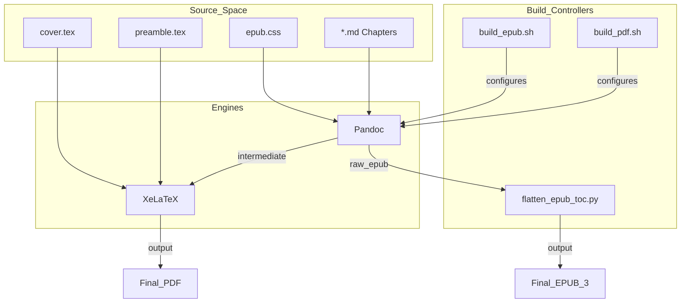
**Sources:** [book/build_pdf.sh:1-60](), [build_epub.sh:30-165](), [flatten_epub_toc.py:152-185](), [EPUB.md:1-35]()

## Specialized Lua Filters

The pipeline uses Lua filters to extend Markdown syntax without polluting source text with raw LaTeX or HTML.

*   **`crossref.lua`**: Automates internal linking for figures and chapters. It scans for patterns like `图N-M` or `第N章` and converts them into clickable `\hyperref` links [book/build_pdf.sh:44]().
*   **`experiment_box.lua`**: Detects headers starting with "Experiment" or "Review Questions" and wraps the content in `tcolorbox` environments (`experimentbox` or `questionbox`) [book-ko/preamble.tex:107-119]().
*   **`korean_spacing.lua`**: Handles specific spacing requirements for the Korean edition, ensuring CJK/Latin boundaries are handled correctly [book-ko/build_pdf.sh:60](), [book-ko/preamble.tex:52-55]().
*   **`epub_external_links.lua`**: Processes links specifically for the EPUB format to ensure they open correctly in various readers [.github/workflows/build-latest.yml:28]().

**Sources:** [book/build_pdf.sh:44-45](), [book-ko/preamble.tex:107-119](), [book-ko/build_pdf.sh:60]()

## Multi-Language CI/CD Pipeline

The build process is fully automated via GitHub Actions in `.github/workflows/build-latest.yml`.

### Environment and Caching
*   **Runners**: Uses `macos-latest` to leverage native Apple font rendering and Homebrew tools [ .github/workflows/build-latest.yml:67]().
*   **Caching**: Caches the MacTeX tree (~5 min) and document fonts (~2 min) to reduce build times [ .github/workflows/build-latest.yml:71-98]().
*   **Font Installation**: Installs a wide array of fonts including Noto Sans CJK (SC/TC/JP/KR), Arabic fonts (Amiri, Naskh), and Tamil fonts [ .github/workflows/build-latest.yml:132-143]().

### Concurrent Builds
The workflow builds multiple language editions concurrently. It iterates through a list of languages (zh-CN, zh-TW, en, es, id, ru, vi, ta, ar, tr, ko, hu, he) and captures output per language to prevent log interleaving [ .github/workflows/build-latest.yml:160-172]().

**Figure 1.2.2: CI/CD Build Logic (`build-latest.yml`)**
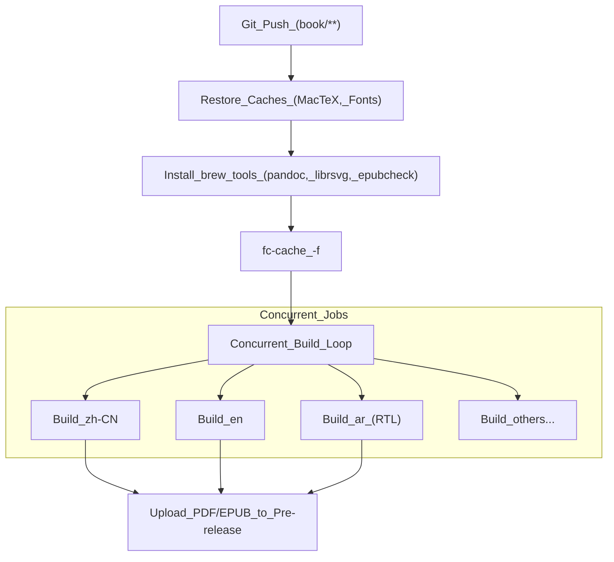
**Sources:** [ .github/workflows/build-latest.yml:8-30](), [ .github/workflows/build-latest.yml:132-150](), [ .github/workflows/build-latest.yml:160-172]()

## EPUB Styling and Post-Processing

EPUBs are styled to match the PDF "ElegantBook" cyan theme using `epub.css`.

*   **Typography**: Uses `system-ui` with fallbacks to CJK fonts like "PingFang SC" and "Noto Sans CJK" [epub.css:34-37]().
*   **Code Blocks**: Styled with a grey background (`--code-bg: #f5f5f5`) and automatic word-wrapping to prevent horizontal scrolling on mobile devices [epub.css:237-253]().
*   **Post-Processing**: `flatten_epub_toc.py` modifies the EPUB ZIP package directly. It:
    *   Removes `section-header-number` spans from `nav.xhtml` to keep the TOC clean [flatten_epub_toc.py:47-62]().
    *   Ensures `playOrder` in `toc.ncx` follows a depth-first search order for Apple Books compatibility [flatten_epub_toc.py:133-143]().
    *   Sets `dir="rtl"` for Arabic and Hebrew editions [flatten_epub_toc.py:94-98]().

**Sources:** [epub.css:7-15](), [epub.css:237-253](), [flatten_epub_toc.py:47-62](), [flatten_epub_toc.py:133-143]()

---

# Page: Online Documentation Site and Localization

# Online Documentation Site and Localization

<details>
<summary>Relevant source files</summary>

The following files were used as context for generating this wiki page:

- [.github/workflows/deploy-pages.yml](.github/workflows/deploy-pages.yml)
- [.github/workflows/i18n-check.yml](.github/workflows/i18n-check.yml)
- [.github/workflows/star-history.yml](.github/workflows/star-history.yml)
- [assets/star-history-dark.png](assets/star-history-dark.png)
- [assets/star-history-light.png](assets/star-history-light.png)
- [docs/STATIC_SITE_I18N.md](docs/STATIC_SITE_I18N.md)
- [extras/auto-translate.css](extras/auto-translate.css)
- [extras/auto-translate.js](extras/auto-translate.js)
- [extras/book-theme.css](extras/book-theme.css)
- [extras/lang-switcher.css](extras/lang-switcher.css)
- [extras/lang-switcher.js](extras/lang-switcher.js)
- [extras/nav-collapse.js](extras/nav-collapse.js)
- [extras/search-index-router.js](extras/search-index-router.js)
- [extras/site-nav-i18n.json](extras/site-nav-i18n.json)
- [index.ko.md](index.ko.md)
- [index.md](index.md)
- [mkdocs.yml](mkdocs.yml)
- [overrides/main.html](overrides/main.html)
- [overrides/partials/header.html](overrides/partials/header.html)
- [requirements-docs.txt](requirements-docs.txt)
- [scripts/build_site.sh](scripts/build_site.sh)
- [scripts/check_i18n_consistency.py](scripts/check_i18n_consistency.py)
- [scripts/clean_site_files.py](scripts/clean_site_files.py)
- [scripts/gen_star_history.py](scripts/gen_star_history.py)
- [scripts/git_revision_dates.py](scripts/git_revision_dates.py)
- [scripts/mkdocs_pandoc_strip.py](scripts/mkdocs_pandoc_strip.py)
- [scripts/site_edit_urls.py](scripts/site_edit_urls.py)
- [scripts/site_i18n.py](scripts/site_i18n.py)
- [scripts/site_source_paths.py](scripts/site_source_paths.py)
- [scripts/split_search_index.py](scripts/split_search_index.py)
- [scripts/star-history-data.json](scripts/star-history-data.json)
- [tests/js/auto-translate.test.js](tests/js/auto-translate.test.js)
- [tests/test_core_clean_site_links.py](tests/test_core_clean_site_links.py)
- [tests/test_gen_star_history_iso_formats.py](tests/test_gen_star_history_iso_formats.py)
- [tests/test_git_revision_dates.py](tests/test_git_revision_dates.py)
- [tests/test_mkdocs_pandoc_strip.py](tests/test_mkdocs_pandoc_strip.py)
- [tests/test_mkdocs_pandoc_strip_null.py](tests/test_mkdocs_pandoc_strip_null.py)
- [tests/test_site_edit_urls.py](tests/test_site_edit_urls.py)
- [tests/test_site_i18n.py](tests/test_site_i18n.py)
- [tests/test_split_search_index.py](tests/test_split_search_index.py)

</details>


The AI Agent Engineering Book online documentation site is a static site built using **MkDocs Material**. It serves as the primary reading interface for the book's 10 chapters and 94 companion experiments across 13 supported languages. The system utilizes a hybrid localization strategy, combining build-time assembly with client-side URL rewriting and navigation translation.

## Site Build Pipeline

The build process is managed by `scripts/build_site.sh`, which assembles a staging directory `_web/` from the repository root before invoking `mkdocs build`.

### Data Flow and Assembly
The pipeline performs several critical transformations to adapt the repository's "monorepo" structure into a web-friendly format:

1.  **Staging Preparation**: The `_web/` directory is created to isolate site content from code and LaTeX sources [scripts/build_site.sh:9-12]().
2.  **Chapter Promotion**: For the default Chinese edition, chapter files (e.g., `chapter1.md`) are moved into subdirectories as `index.md` (e.g., `chapter1/index.md`). This allows the `navigation.indexes` feature in `mkdocs.yml` to make chapter titles clickable in the sidebar [scripts/build_site.sh:34-51]().
3.  **Link Rewriting**: Relative links in experiment `README.md` files are adjusted to ensure they resolve correctly within the MkDocs directory structure. For example, GitHub-style `.md` suffixes are stripped, and links in translated experiment indexes are prefixed with `../` to point back to the language-agnostic experiment folders [scripts/build_site.sh:93-132]().
4.  **Asset Filtering**: `scripts/clean_site_files.py` is invoked to remove large datasets (e.g., legal document sets in Chapter 3) and `node_modules` that are not required for the reading site [scripts/build_site.sh:75-91]().

### Build Pipeline Diagram
The following diagram illustrates the transformation from the source repository to the deployed GitHub Pages site.

**Static Site Assembly Flow**
```mermaid
graph TD
    subgraph "Source Space"
        [index.md] --> BSH["scripts/build_site.sh"]
        [book/*.md] --> BSH
        [chapter*/*.md] --> BSH
        [extras/*] --> BSH
    end

    subgraph "Staging Space (_web)"
        BSH --> W_IDX["_web/index.md"]
        BSH --> W_CH["_web/book/chapterN/index.md"]
        BSH --> W_EXP["_web/chapterN/README.md"]
        BSH --> W_EXT["_web/extras/"]
    end

    subgraph "Build Engine"
        W_IDX --> MKD["mkdocs build"]
        W_CH --> MKD
        W_EXP --> MKD
        W_EXT --> MKD
        MYML["mkdocs.yml"] --> MKD
        GRD["scripts/git_revision_dates.py"] -.-> MKD
        SI18N["scripts/site_i18n.py"] -.-> MKD
    end

    MKD --> SITE["site/ (HTML/JS/CSS)"]
    SITE --> GHA["deploy-pages.yml"]
```
Sources: [scripts/build_site.sh:1-134](), [mkdocs.yml:8-23](), [.github/workflows/deploy-pages.yml:16-40]()

## Localization Strategy

The site supports 13 language editions including `zh`, `en`, `es`, `id`, `ru`, `ta`, `vi`, `ja`, `ar`, `tr`, `ko`, `hu`, and `he` [scripts/build_site.sh:29](). It uses a **hybrid localization** approach to handle the mix of translated prose and language-agnostic code experiments.

### Client-Side Language Switcher
The `extras/lang-switcher.js` script handles language transitions without requiring a full page reload for every configuration change.

*   **Language Configuration**: The configuration is injected into the global `window.LANG_CONFIG` by the header template [overrides/partials/header.html:108]().
*   **Path Translation**: The `translatePath` function in `lang-switcher.js` maps the current URL to its equivalent in the target language [extras/lang-switcher.js:94-161](). It handles three primary cases:
    1.  **Site Home**: Maps `/` to `/index.<code>/` if a translated homepage exists [extras/lang-switcher.js:104-107]().
    2.  **Chapter Prose**: Rewrites `/book/chapter1/` to `/book-en/chapter1/` based on prefix/suffix rules [extras/lang-switcher.js:121-125]().
    3.  **Experiment Indexes**: Maps `/chapter1/` to `/chapter1/README.<readmeSuffix>/` [extras/lang-switcher.js:151-161]().
*   **Search Index Splitting**: To prevent the search index from becoming bloated, `scripts/split_search_index.py` splits the `search_index.json` into one file per book edition [mkdocs.yml:27-30]().

### Theme Overrides and UX
The site uses a custom CSS file `extras/book-theme.css` to "de-materialize" the theme, adopting a flatter aesthetic inspired by `icyfenix.cn` [extras/book-theme.css:1-14](). 

*   **Navigation Collapser**: The left sidebar (book structure) can be toggled via a button in the header [overrides/partials/header.html:33-42](). The state is persisted in `localStorage` to prevent UI flickering during navigation [overrides/partials/header.html:22-28]().
*   **CJK Search**: The search plugin is configured with `ja` and `ko` tokenizers to improve Chinese, Japanese, and Korean search quality [mkdocs.yml:98-103]().

**Localization Entity Mapping**
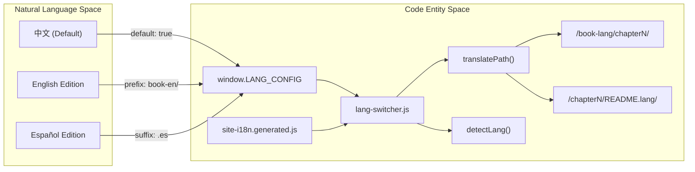
Sources: [extras/lang-switcher.js:31-74](), [extras/lang-switcher.js:94-161](), [mkdocs.yml:149-163](), [overrides/partials/header.html:84-109]()

## Automation and CI/CD

### GitHub Actions Deployment
The site is automatically deployed via `.github/workflows/deploy-pages.yml` on every push to the `main` branch.
1.  **Build Job**: Installs dependencies from `requirements-docs.txt` and runs `scripts/build_site.sh` before `mkdocs build` [deploy-pages.yml:32-36]().
2.  **Deploy Job**: Publishes the `site/` artifact to GitHub Pages [deploy-pages.yml:53-55]().

### Git Revision Mapping
Because the build process moves files into a staging directory (`_web/`), standard Git timestamp plugins would fail. The `scripts/git_revision_dates.py` hook maps staged files back to their original tracked paths in the repository using `source_path_for_page` so that MkDocs can accurately display the "Last Updated" date for each page [mkdocs.yml:14-17](), [scripts/site_source_paths.py:15-31]().

### Star History Automation
The repository includes a `star-history.yml` workflow that runs daily to generate updated star growth charts [star-history.yml:4-6]().
*   **Function**: Calls `scripts/gen_star_history.py` to fetch star timestamps via the GitHub GraphQL API [star-history.yml:32-36](), [scripts/gen_star_history.py:4-6]().
*   **Incremental Updates**: Star counts are stored in `scripts/star-history-data.json` as per-hour counts to allow incremental fetching [scripts/gen_star_history.py:52-55](), [scripts/star-history-data.json:1-15]().
*   **Output**: Generates `assets/star-history-light.png` and `assets/star-history-dark.png` [assets/star-history-light.png:1-8](), [assets/star-history-dark.png:1-14]().

Sources: [.github/workflows/deploy-pages.yml:1-54](), [.github/workflows/star-history.yml:1-46](), [mkdocs.yml:14-23](), [scripts/build_site.sh:1-134](), [scripts/gen_star_history.py:1-184]()

---

# Page: Slidev Video Course (slides)

# Slidev Video Course (slides)

<details>
<summary>Relevant source files</summary>

The following files were used as context for generating this wiki page:

- [.github/workflows/i18n-check.yml](.github/workflows/i18n-check.yml)
- [README.md](README.md)
- [docs/STATIC_SITE_I18N.md](docs/STATIC_SITE_I18N.md)
- [docs/ar/README.md](docs/ar/README.md)
- [docs/en/README.md](docs/en/README.md)
- [docs/es/README.md](docs/es/README.md)
- [docs/ja/README.md](docs/ja/README.md)
- [docs/ko/README.md](docs/ko/README.md)
- [docs/ru/README.md](docs/ru/README.md)
- [docs/ta/README.md](docs/ta/README.md)
- [docs/tr/README.md](docs/tr/README.md)
- [docs/vi/README.md](docs/vi/README.md)
- [docs/zh-TW/README.md](docs/zh-TW/README.md)
- [extras/auto-translate.css](extras/auto-translate.css)
- [extras/auto-translate.js](extras/auto-translate.js)
- [extras/book-theme.css](extras/book-theme.css)
- [extras/lang-switcher.css](extras/lang-switcher.css)
- [extras/lang-switcher.js](extras/lang-switcher.js)
- [extras/nav-collapse.js](extras/nav-collapse.js)
- [extras/search-index-router.js](extras/search-index-router.js)
- [extras/site-nav-i18n.json](extras/site-nav-i18n.json)
- [index.ko.md](index.ko.md)
- [index.md](index.md)
- [mkdocs.yml](mkdocs.yml)
- [overrides/main.html](overrides/main.html)
- [overrides/partials/header.html](overrides/partials/header.html)
- [scripts/build_site.sh](scripts/build_site.sh)
- [scripts/check_i18n_consistency.py](scripts/check_i18n_consistency.py)
- [scripts/site_i18n.py](scripts/site_i18n.py)
- [scripts/split_search_index.py](scripts/split_search_index.py)
- [tests/js/auto-translate.test.js](tests/js/auto-translate.test.js)
- [tests/test_site_i18n.py](tests/test_site_i18n.py)
- [tests/test_split_search_index.py](tests/test_split_search_index.py)

</details>


The `slides/` directory contains a 42-lesson English video course derived from the *AI Agents in Depth* book. This course utilizes [Slidev](https://sli.dev), a web-based presentation tool that allows slides to be written in Markdown while supporting interactive elements and live-coding demonstrations. The course maps the theoretical foundations of the 10 chapters into a curriculum optimized for video delivery.

## Curriculum and Lesson Mapping

The course is structured into 42 modular lessons, providing a granular breakdown of the book's core formula: `Agent = LLM + Context + Tools` [README.md:10-10](). Each lesson is cross-linked to specific book chapters and hands-on experiments found in the `chapterN/` directories.

### Lesson Structure

| Module | Book Chapter | Key Lessons | Experiments Covered |
| :--- | :--- | :--- | :--- |
| **Foundations** | Chapter 1 | ReAct Loop, Harness Engineering | `chapter1/` (Web-search, ReAct) |
| **Context** | Chapter 2 | KV Cache, Compression, Skills | `chapter2/kv-cache`, `chapter2/context-compression` |
| **Memory** | Chapter 3 | RAG, GraphRAG, User Memory | `chapter3/agentic-rag`, `chapter3/structured-index` |
| **Tools** | Chapter 4 | MCP Protocol, Perception Tools | `chapter4/perception-tools`, `chapter4/collaboration-tools` |
| **Coding** | Chapter 5 | OpenClaw, Filesystem-as-Memory | `chapter5/coding-agent` |
| **Interaction** | Chapter 6 | Event-driven, Multimodal, Voice | `chapter6/` (Computer Use, VAD-ASR) |
| **Evaluation** | Chapter 7 | Benchmarking, ELO Leaderboards | `chapter7/` (Scoring, Metrics) |
| **Training** | Chapter 8 | SFT, DPO, RLVR/RLVP | `chapter8/` (Fine-tuning manifests) |
| **Evolution** | Chapter 9 | Experience Learning, RPA | `chapter9/` (Trajectory reflection) |
| **Multi-Agent** | Chapter 10 | Topologies, A2A Protocols | `chapter10/` (Multi-role-transfer) |

**Sources:** [README.md:60-69](), [docs/en/README.md:10-12]()

---

## Technical Implementation

The slide generation process bridges the "Natural Language Space" (book manuscript) and the "Code Entity Space" (Slidev Markdown and build scripts).

### Data Flow: From Manuscript to Slides

The generation pipeline involves extracting key concepts from the English book source (`book-en/`) and transforming them into Slidev-compatible Markdown files (`slides/*.md`).

#### Slide Generation Pipeline
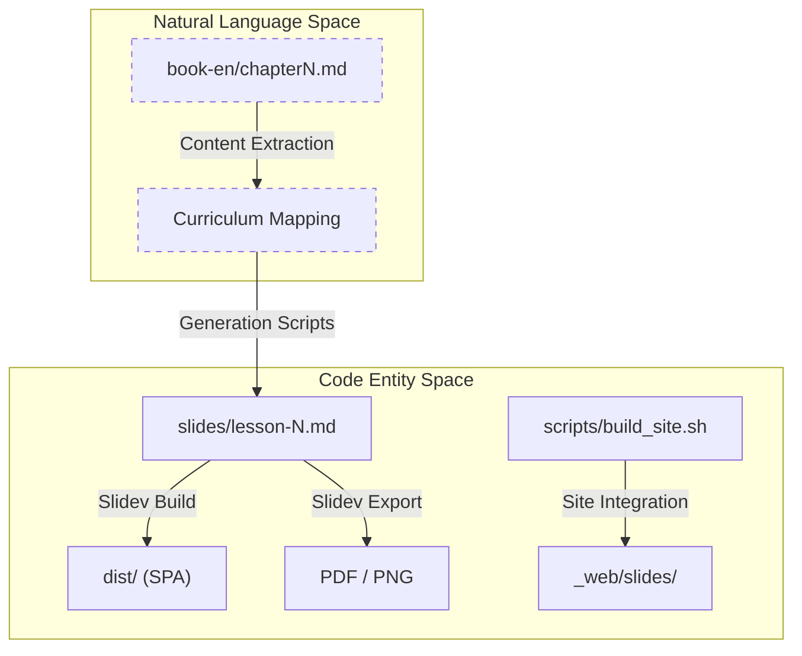
**Sources:** [scripts/build_site.sh:2-5](), [docs/en/README.md:36-36]()

### Build and Export Commands

The course artifacts are managed through standard Slidev CLI commands, integrated into the repository's broader CI/CD workflows.

*   **Development**: `npm run dev` starts a local server with HMR (Hot Module Replacement).
*   **Production Build**: `npm run build` generates a static Single Page Application (SPA) located in the `_web/` directory during the site assembly process [scripts/build_site.sh:8-12]().
*   **Export**: `npm run export` utilizes Playwright to render slides into PDF or high-resolution PNGs for video editing.

---

## Contribution Workflow

The Slidev course follows a hybrid maintenance model where core curriculum structure is generated, but visual layouts and code demos are hand-refined.

### Code vs. Content Mapping
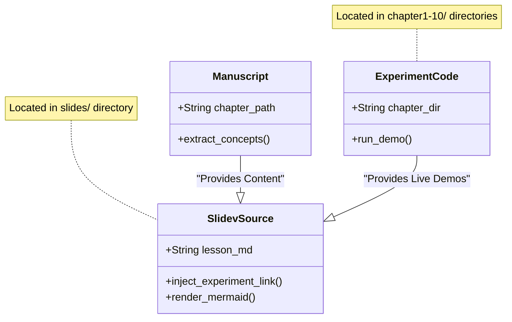
**Sources:** [README.md:39-39](), [scripts/build_site.sh:53-62]()

### Workflow Steps

1.  **Synchronization**: When the English manuscript in `book-en/` is updated, the corresponding `slides/*.md` files are flagged for review [docs/en/README.md:36-36]().
2.  **Experiment Linking**: Lessons must include direct links to the runnable experiments in `chapterN/` to ensure students can follow the "Agent = LLM + Context + Tools" formula in practice [README.md:10-10]().
3.  **Site Integration**: The `scripts/build_site.sh` script ensures that the generated slide SPA is included in the final documentation site under the `/slides/` path, enabling multi-language search via the `split_search_index.py` hook [mkdocs.yml:27-30](), [scripts/build_site.sh:64-66]().

**Sources:** [mkdocs.yml:14-30](), [scripts/build_site.sh:8-12](), [scripts/build_site.sh:64-66]()

---

# Page: Core Agent Architecture (Chapter 1)

# Core Agent Architecture (Chapter 1)

<details>
<summary>Relevant source files</summary>

The following files were used as context for generating this wiki page:

- [book-ar/chapter1.ar.md](book-ar/chapter1.ar.md)
- [book-en/chapter1.md](book-en/chapter1.md)
- [book-es/chapter1.es.md](book-es/chapter1.es.md)
- [book-hu/chapter1.md](book-hu/chapter1.md)
- [book-id/chapter1.md](book-id/chapter1.md)
- [book-ja/chapter1.ja.md](book-ja/chapter1.ja.md)
- [book-ko/chapter1.ko.md](book-ko/chapter1.ko.md)
- [book-ru/chapter1.md](book-ru/chapter1.md)
- [book-ta/chapter1.ta.md](book-ta/chapter1.ta.md)
- [book-tr/chapter1.tr.md](book-tr/chapter1.tr.md)
- [book-vi/chapter1.vi.md](book-vi/chapter1.vi.md)
- [book-zhtw/chapter1.zhtw.md](book-zhtw/chapter1.zhtw.md)
- [book/chapter1.md](book/chapter1.md)
- [book/chapter10.md](book/chapter10.md)
- [book/chapter2.md](book/chapter2.md)
- [book/chapter3.md](book/chapter3.md)
- [book/chapter4.md](book/chapter4.md)
- [book/chapter5.md](book/chapter5.md)
- [book/chapter6.md](book/chapter6.md)
- [book/chapter7.md](book/chapter7.md)
- [book/chapter8.md](book/chapter8.md)
- [book/chapter9.md](book/chapter9.md)
- [book/reference-answers.md](book/reference-answers.md)

</details>


This page provides a high-level overview of the foundational architecture of AI Agents as introduced in Chapter 1. It establishes the "Agent = LLM + Context + Tools" formula and introduces the core execution patterns and engineering philosophies used throughout the repository.

## The Agent Formula: Brain, Eyes, and Hands

The functional essence of a modern AI Agent is defined by the synergy of three core components. This repository treats the **Agent** as the combination of a decision-making model and the engineering harness that surrounds it, distinct from the **Environment** it interacts with [book/chapter1.md:11-13]().

| Component | Role | RL Concept | Description |
| :--- | :--- | :--- | :--- |
| **LLM** | **The Brain** | **Policy** | The reasoning engine responsible for intent parsing, planning, and judgment [book/chapter1.md:15](). |
| **Context** | **The Eyes** | **Observation & History** | The working set of information including environment data, user memory, and task progress [book/chapter1.md:16](). |
| **Tools** | **The Hands** | **Action Interfaces** | The set of interfaces (APIs, code execution) allowing the agent to perceive or change the world [book/chapter1.md:17](). |

### Mapping Natural Language to Code Entities

The following diagram bridges the conceptual "Brain, Eyes, Hands" formula to specific data structures used in modern LLM APIs, specifically the `messages` list and `tools` registry.

**Diagram: Architectural Mapping**
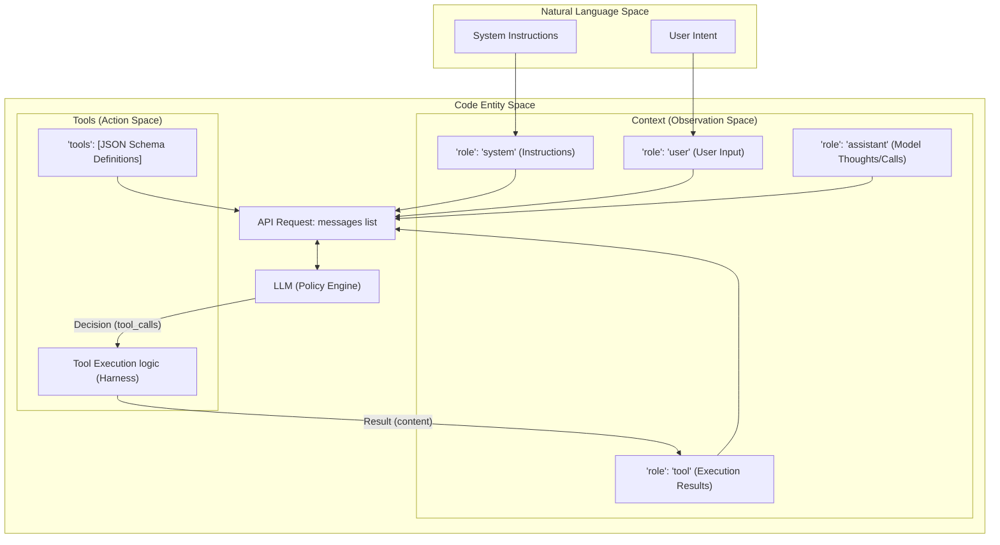
Sources: [book/chapter1.md:23-35](), [book/chapter2.md:45-56]()

---

## The ReAct Loop and Tool Calling

The operational heart of an agent is the **ReAct (Reason + Act)** loop. Instead of a single-turn response, the agent enters a cycle where the next action depends on the cumulative context $c_t$, which includes all prior observations and actions [book/chapter2.md:31-35]().

The tool calling protocol typically follows four stages:
1.  **Declaration**: Developers define tool metadata (name, description, parameters) in the `tools` field [book/chapter2.md:119-147]().
2.  **Decision**: The LLM analyzes the context and emits a `tool_calls` payload instead of a final answer [book/chapter2.md:151-155]().
3.  **Execution**: The Agent framework (the Harness) executes the function and captures the output [book/chapter1.md:81]().
4.  **Response**: The result is sent back to the model with the `tool` role, and the cycle repeats until a final answer is generated [book/chapter2.md:52-53]().

For a deep dive into the four-step protocol and failure modes like tool JSON errors or looping, see **[The ReAct Loop and Tool Calling](#2.1)**.

Sources: [book/chapter1.md:79-81](), [book/chapter2.md:33-35](), [book/chapter2.md:95-101]()

---

## Harness Engineering and Safety

As models become more autonomous, the engineering focus shifts from simple "Prompt Engineering" to **"Harness Engineering."** The Harness is the runtime and governance layer that manages the Model/Environment boundary [book/chapter1.md:25]().

The Harness formula: **Model + Context + Tools + Constrain + Verify + Correct**.

Key engineering pillars include:
*   **Observation/Action Space Expansion**: Improving performance by adding task-relevant data to context or new tools to the action space [book/chapter1.md:41]().
*   **Sandboxing**: Executing high-risk tools (like code execution) in isolated environments with resource limits [book/chapter1.md:103]().
*   **Human-in-the-Loop (HITL)**: Escalating high-risk actions (e.g., payments, deployments) for manual confirmation [book/chapter1.md:107]().
*   **Verification**: Using automated assertions (e.g., `env_assertions`) to judge the success of an agent's trajectory [book/chapter7.md:73-80]().

For details on ACI design, circuit breakers, and safety layers, see **[Harness Engineering and Safety](#2.2)**.

Sources: [book/chapter1.md:25-27](), [book/chapter1.md:103-107](), [book/chapter7.md:17-19]()

---

## Evolution of Learning

Agents in this repository utilize three distinct learning timescales:

1.  **Post-training (RL/SFT)**: Hard-coding foundational capabilities like tool-use and reasoning into model weights [book/chapter8.md:9-12]().
2.  **In-Context Learning (ICL)**: Short-term adaptation using the current conversation history [book/chapter2.md:35]().
3.  **Experience Learning**: Capturing trajectories and reflecting on them to create persistent "Skills" or "User Memory" [book/chapter3.md:31-39]().

**Diagram: Learning Timescales in Code**
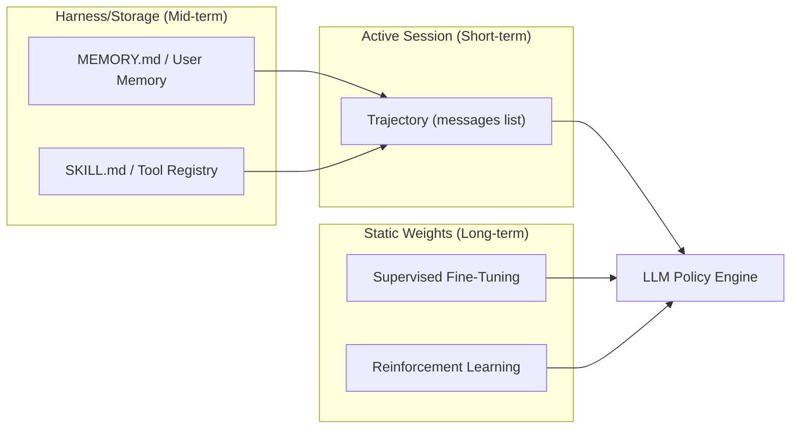
Sources: [book/chapter3.md:78-82](), [book/chapter5.md:78-80](), [book/chapter8.md:26-38]()

---

## Chapter 1 Code Experiments

The concepts in this chapter are supported by hands-on experiments located in the `chapter1/` directory. These projects demonstrate the foundational Agent loop and the transition from prompt-based instructions to tool-based actions.

*   **Context Management**: Demonstrating how the `messages` structure and system roles influence model behavior.
*   **Web-Search Agent**: A practical implementation of a multi-turn search-and-summarize loop.
*   **RL vs. ICL**: A comparison of learning from experience (Reinforcement Learning) versus learning from the prompt (In-Context Learning).
*   **Search-Codegen**: Demonstrating the "元能力" (meta-capability) of agents generating their own tools.

For a guide to entrypoints, configuration, and validation artifacts for these projects, see **[Chapter 1 Code Experiments](#2.3)**.

Sources: [book/chapter1.md:7-9](), [book/chapter5.md:7-9]()

---

# Page: The ReAct Loop and Tool Calling

# The ReAct Loop and Tool Calling

<details>
<summary>Relevant source files</summary>

The following files were used as context for generating this wiki page:

- [book-ar/chapter1.ar.md](book-ar/chapter1.ar.md)
- [book-ar/chapter2.ar.md](book-ar/chapter2.ar.md)
- [book-en/chapter1.md](book-en/chapter1.md)
- [book-en/chapter2.md](book-en/chapter2.md)
- [book-es/chapter1.es.md](book-es/chapter1.es.md)
- [book-es/chapter2.es.md](book-es/chapter2.es.md)
- [book-hu/chapter1.md](book-hu/chapter1.md)
- [book-id/chapter1.md](book-id/chapter1.md)
- [book-id/chapter2.md](book-id/chapter2.md)
- [book-ja/chapter1.ja.md](book-ja/chapter1.ja.md)
- [book-ja/chapter2.ja.md](book-ja/chapter2.ja.md)
- [book-ko/chapter1.ko.md](book-ko/chapter1.ko.md)
- [book-ko/chapter2.ko.md](book-ko/chapter2.ko.md)
- [book-ru/chapter1.md](book-ru/chapter1.md)
- [book-ru/chapter2.md](book-ru/chapter2.md)
- [book-ta/chapter1.ta.md](book-ta/chapter1.ta.md)
- [book-ta/chapter2.ta.md](book-ta/chapter2.ta.md)
- [book-tr/chapter1.tr.md](book-tr/chapter1.tr.md)
- [book-tr/chapter2.tr.md](book-tr/chapter2.tr.md)
- [book-vi/chapter1.vi.md](book-vi/chapter1.vi.md)
- [book-vi/chapter2.vi.md](book-vi/chapter2.vi.md)
- [book-zhtw/chapter1.zhtw.md](book-zhtw/chapter1.zhtw.md)
- [book-zhtw/chapter2.zhtw.md](book-zhtw/chapter2.zhtw.md)
- [chapter1/context/grounding.py](chapter1/context/grounding.py)
- [chapter1/context/requirements.txt](chapter1/context/requirements.txt)
- [chapter1/context/run_experiment_1_1.py](chapter1/context/run_experiment_1_1.py)
- [chapter1/context/test_experiment_1_1.py](chapter1/context/test_experiment_1_1.py)
- [chapter1/context/test_grounding.py](chapter1/context/test_grounding.py)
- [chapter1/context/test_main_result_semantics.py](chapter1/context/test_main_result_semantics.py)
- [chapter1/context/tests/test_malformed_tool_json.py](chapter1/context/tests/test_malformed_tool_json.py)
- [chapter1/context/validation/latest.json](chapter1/context/validation/latest.json)
- [chapter1/context/validation/probes_20260825T/index.json](chapter1/context/validation/probes_20260825T/index.json)
- [chapter1/context/validation/real_20260901T163146Z/evidence.json](chapter1/context/validation/real_20260901T163146Z/evidence.json)
- [chapter1/context/validation/real_20260901T163146Z/evidence.sha256](chapter1/context/validation/real_20260901T163146Z/evidence.sha256)

</details>


This page provides a technical deep dive into the **ReAct (Reason-Act-Observe)** execution cycle, which serves as the foundational operational logic for modern AI Agents. It explores the four-step tool calling protocol, the management of execution trajectories, and the implementation details of the message-based communication loop.

## The ReAct Execution Cycle

The ReAct pattern combines reasoning (internal thought) and acting (external tool use) in an iterative loop. This cycle allows an Agent to decompose complex tasks, execute actions, observe outcomes, and refine its strategy dynamically based on environmental feedback [book-en/chapter1.md:79-81]().

### The Four-Step Tool Calling Protocol

Tool calling (also known as Function Calling) is the mechanism by which the LLM interacts with the external world. The process follows a strict four-step protocol at the API level [book-en/chapter1.md:80-82]():

1.  **Declaration**: The developer defines available tools, including their names, purposes, and parameter schemas (typically using JSON Schema), in the context provided to the model [book-en/chapter1.md:83-92]().
2.  **Decision**: The LLM autonomously judges whether a tool is needed, which tool to call, and what arguments to pass based on the user request [book-en/chapter1.md:86-92]().
3.  **Execution**: The Agent framework (Harness) executes the tool (e.g., calling an API or running code) and captures the result [book-en/chapter1.md:94-98]().
4.  **Response**: The tool result is appended to the message history, and the model generates a final response or plans the next action based on this observation [book-en/chapter1.md:94-98]().

### ReAct Data Flow Diagram

The following diagram maps the logical ReAct loop to the data structures and roles defined in modern LLM APIs, bridging the gap between reasoning and code execution.

**Title: ReAct Loop to Message History Mapping**
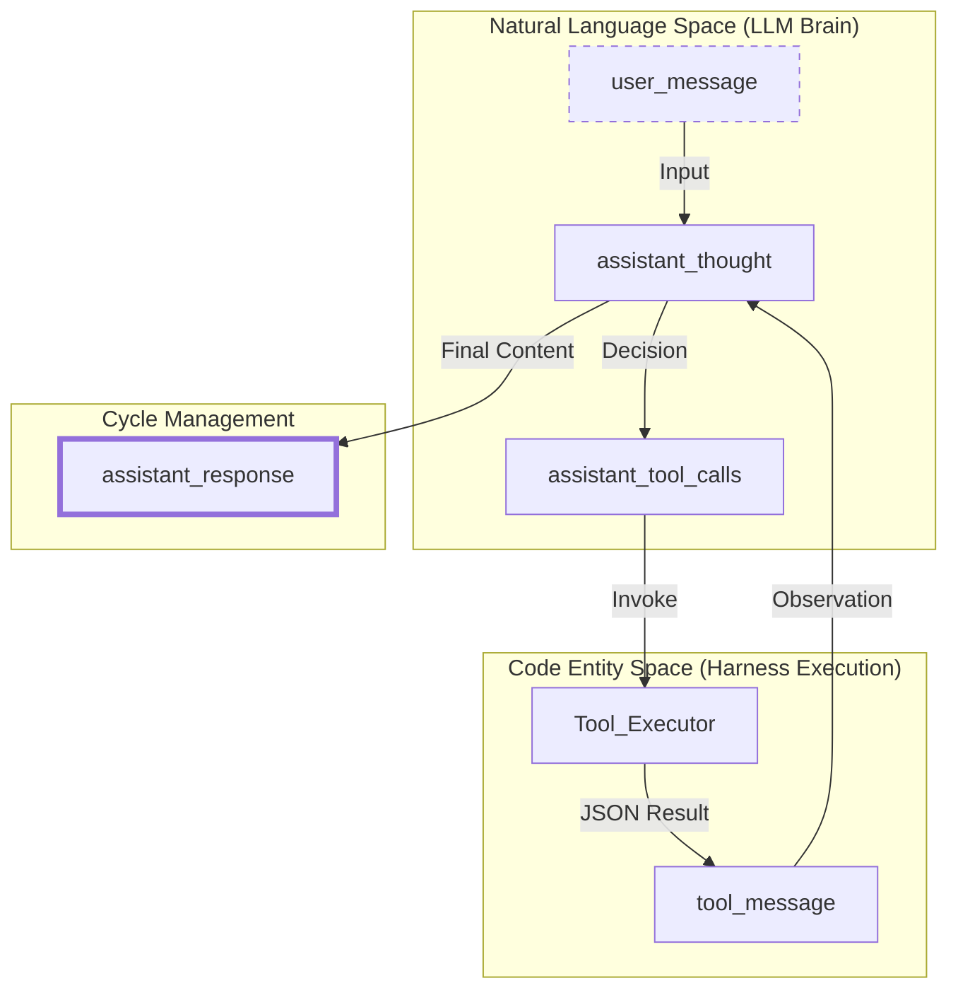
Sources: [book-en/chapter1.md:79-98](), [book-zhtw/chapter2.zhtw.md:45-56]()

## Trajectory Management

A **Trajectory** is the complete sequence of reasoning steps, tool calls, and observations generated during a task. This sequence is maintained in the `messages` list to provide the model with a "memory" of the current session [book-en/chapter2.md:31-35]().

### Context Structure and Roles
In a ReAct loop, the context is reconstructed for every API call. Each model call is stateless, meaning the entire history must be sent each time [book-zhtw/chapter2.zhtw.md:35-36](). The API uses specific roles to identify message types [book-zhtw/chapter2.zhtw.md:45-54]():

*   **system**: Developer-written rules, identity definitions, and tool descriptions [book-zhtw/chapter2.zhtw.md:49-49]().
*   **user**: Direct input from the end-user [book-zhtw/chapter2.zhtw.md:50-50]().
*   **assistant**: The model's generated thoughts and tool-call requests [book-zhtw/chapter2.zhtw.md:51-51]().
*   **tool**: The output of a tool execution, linked to a specific call via `tool_call_id` [book-zhtw/chapter2.zhtw.md:52-52]().

### Trajectory Sequence Example
| Step | Role | Entity / Data | Function |
| :--- | :--- | :--- | :--- |
| 1 | `system` | `Instructions + Tools` | Capability Definition [book-zhtw/chapter2.zhtw.md:109-113]() |
| 2 | `user` | "Weather in Vancouver?" | Task Initiation [book-zhtw/chapter2.zhtw.md:115-117]() |
| 3 | `assistant` | `tool_calls: get_weather` | Reasoning/Action Decision [book-zhtw/chapter2.zhtw.md:151-152]() |
| 4 | `tool` | `{"temp": 12, "unit": "c"}` | Observation Result [book-zhtw/chapter2.zhtw.md:94-98]() |
| 5 | `assistant` | "It is currently 12°C..." | Final Answer Generation [book-zhtw/chapter2.zhtw.md:94-98]() |

Sources: [book-en/chapter2.md:31-35](), [book-zhtw/chapter2.zhtw.md:45-56](), [book-zhtw/chapter2.zhtw.md:103-152]()

## Common Failure Modes in the Loop

Engineering a robust ReAct loop requires handling several specific failure modes that occur at the boundary between the model and the execution harness.

### 1. Tool JSON Errors
The model may generate malformed JSON or arguments that do not adhere to the defined schema. The harness must validate the `arguments` field in `assistant_tool_calls` before execution [chapter1/context/tests/test_malformed_tool_json.py:1-20]().

### 2. Missing Tool Results
If the model requests multiple tool calls (parallel tool calling), the harness must provide a corresponding `tool` message for *every* `tool_call_id`. Missing results often cause the model to hang or repeat the request [book-zhtw/chapter2.zhtw.md:101-102]().

### 3. Infinite Looping
A "hallucination loop" occurs when the model repeatedly calls the same tool with the same parameters despite receiving an error or the same result. Harness implementations typically include a `max_iterations` circuit breaker to prevent token exhaustion [book-en/chapter1.md:25-27]().

## Harness Engineering Philosophy

The **Harness** is the engineering shell that surrounds the LLM "Brain" to make it a reliable Agent system [book-en/chapter1.md:23-25]().

**Title: Model-Harness Boundary and Code Entities**
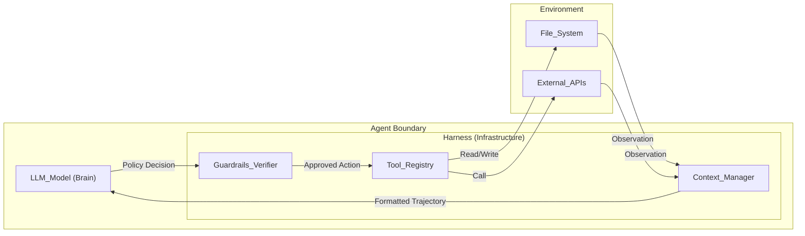
Sources: [book-en/chapter1.md:11-27](), [book-en/chapter2.md:1-5]()

*   **Context Management**: Handles the reconstruction of the `messages` list and ensures `system` instructions remain at the head of the context window [book-zhtw/chapter2.zhtw.md:49-56]().
*   **Observation Space**: Translates environment state into text/JSON that the model can "see" [book-en/chapter1.md:37-41]().
*   **Action Space**: Translates tool call requests into actual system operations, enforcing safety boundaries and sandboxing [book-en/chapter1.md:103-107]().

Sources: [book-en/chapter1.md:11-41](), [book-en/chapter2.md:1-5](), [book-zhtw/chapter2.zhtw.md:31-56]()

---

# Page: Harness Engineering and Safety

# Harness Engineering and Safety

<details>
<summary>Relevant source files</summary>

The following files were used as context for generating this wiki page:

- [book-ar/chapter1.ar.md](book-ar/chapter1.ar.md)
- [book-ar/chapter7.ar.md](book-ar/chapter7.ar.md)
- [book-en/chapter1.md](book-en/chapter1.md)
- [book-en/chapter7.md](book-en/chapter7.md)
- [book-es/chapter1.es.md](book-es/chapter1.es.md)
- [book-es/chapter7.es.md](book-es/chapter7.es.md)
- [book-hu/chapter1.md](book-hu/chapter1.md)
- [book-hu/chapter7.md](book-hu/chapter7.md)
- [book-id/chapter1.md](book-id/chapter1.md)
- [book-id/chapter7.md](book-id/chapter7.md)
- [book-ja/chapter1.ja.md](book-ja/chapter1.ja.md)
- [book-ja/chapter7.ja.md](book-ja/chapter7.ja.md)
- [book-ko/chapter1.ko.md](book-ko/chapter1.ko.md)
- [book-ko/chapter7.ko.md](book-ko/chapter7.ko.md)
- [book-ru/chapter1.md](book-ru/chapter1.md)
- [book-ru/chapter7.md](book-ru/chapter7.md)
- [book-ta/chapter1.ta.md](book-ta/chapter1.ta.md)
- [book-ta/chapter7.ta.md](book-ta/chapter7.ta.md)
- [book-tr/chapter1.tr.md](book-tr/chapter1.tr.md)
- [book-tr/chapter7.tr.md](book-tr/chapter7.tr.md)
- [book-vi/chapter1.vi.md](book-vi/chapter1.vi.md)
- [book-vi/chapter7.vi.md](book-vi/chapter7.vi.md)
- [book-zhtw/chapter1.zhtw.md](book-zhtw/chapter1.zhtw.md)
- [book-zhtw/chapter7.zhtw.md](book-zhtw/chapter7.zhtw.md)

</details>


Harness Engineering represents the transition from "prompting" to "engineering" in AI Agent development. While the Large Language Model (LLM) serves as the stochastic reasoning core, the **Harness** acts as the deterministic infrastructure that guides, constrains, and secures the Agent's behavior. This page details the Harness formula, the multi-layer safety guardrails required for production deployment, and the design philosophy of the Agent-Computer Interface (ACI).

## The Harness Formula

The effectiveness of a modern Agent is governed by the Harness formula, which extends the basic `Agent = LLM + Context + Tools` definition into a robust engineering framework:

**Agent = Model + Context + Tools + Constrain + Verify + Correct** [[book-en/chapter1.md:25-27]()]

In this paradigm, the "Harness" refers to the engineering outer shell that wraps the model to ensure reliable task execution [[book-en/chapter1.md:25-27]()]:
1.  **Constrain**: Defining the boundaries of operation via system prompts, ACI design, and permission sets [[book-en/chapter1.md:107-108]()].
2.  **Verify**: Independent evaluation of the model's output or tool execution results [[book-en/chapter1.md:25-27]()].
3.  **Correct**: Mechanisms to loop back and fix errors, such as self-repair or Human-in-the-Loop (HITL) escalation [[book-en/chapter1.md:25-27]()].

### Data Flow in the Harness Lifecycle

The following diagram illustrates how the Harness wraps the core ReAct loop to ensure safety and reliability, bridging the gap between natural language intent and code execution.

**Harness-Wrapped Execution Loop**
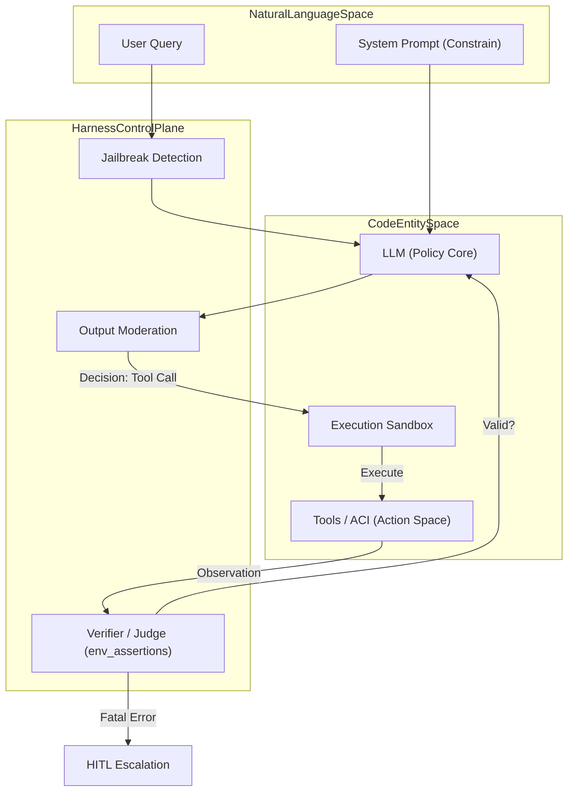
Sources: [[book-en/chapter1.md:21-27](), [book-en/chapter7.md:67-82]()]

---

## Multi-Layer Safety Guardrails

Safety in Agent systems is implemented as a defense-in-depth strategy across three primary layers: input, execution, and output.

### 1. Input-Side: Jailbreak and Intent Detection
Before the LLM processes a request, the Harness must detect adversarial prompts (e.g., prompt injection, jailbreaking). This is often implemented using a dedicated classifier to ensure the query stays within the defined **Observation Space** [[book-en/chapter1.md:37-41]()].

### 2. Execution-Side: Sandboxing and ACI
Agents should never execute code or system commands directly on the host OS. 
*   **Sandboxing**: All execution tools must run within isolated environments. For example, Python code interpreters must be restricted in execution time, CPU, memory, and output size [[book-en/chapter1.md:103-105]()].
*   **ACI (Agent-Computer Interface)**: Unlike a GUI designed for humans, an ACI is optimized for LLM consumption. It defines which observations the Agent can read and which actions it can issue [[book-en/chapter1.md:31-35]()].

### 3. Output-Side: Moderation and Circuit Breakers
The Harness monitors the Agent's generated content and behavior for anomalies:
*   **Moderation**: Filtering harmful content using predefined rubrics.
*   **Circuit Breakers**: Monitoring for "infinite loops" or excessive resource consumption. If a tool fails repeatedly, the Harness prevents the Agent from entering a "deadlock" state [[book-en/chapter1.md:107-108]()].

| Guardrail Layer | Mechanism | Purpose |
| :--- | :--- | :--- |
| **Input** | Intent Classifier | Detects jailbreaks and out-of-scope requests. |
| **Execution** | Sandbox | Prevents unauthorized file system or network access [[book-en/chapter1.md:103-105]()]. |
| **Execution** | ACI Constraints | Limits tool parameters to safe ranges [[book-en/chapter1.md:107-108]()]. |
| **Output** | Verifier LLM | Checks if the answer satisfies safety rubrics (Verify) [[book-en/chapter1.md:25-27]()]. |
| **System** | Circuit Breaker | Stops execution if max turns or error limits are exceeded. |

Sources: [[book-en/chapter1.md:31-35](), [book-en/chapter1.md:103-108]()]

---

## Human-in-the-Loop (HITL) and Escalation

The Harness is responsible for identifying "uncertainty" and escalating to a human operator. Escalation triggers include:
1.  **High-Value Actions**: Transactions, deleting data, or production deployments require explicit confirmation [[book-en/chapter1.md:107-108]()].
2.  **Ambiguity**: When the user's initial statement is vague (e.g., "I can't get online"), the Agent must ask for clarification rather than guessing [[book-en/chapter7.md:87-89]()].
3.  **Verification Failure**: When the `env_assertions` (e.g., checking if internet speed is "excellent") fail despite the Agent's attempts [[book-en/chapter7.md:67-82]()].

**HITL Escalation Data Flow**
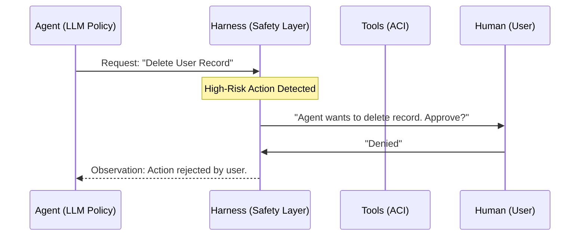
Sources: [[book-en/chapter1.md:107-108](), [book-en/chapter7.md:67-82]()]

---

## ACI Design Philosophy

The **Agent-Computer Interface (ACI)** is the specific subset of the Harness that defines how the Agent interacts with software. Key principles include:

*   **Structured Output**: Forcing the model to use tools via a schema (e.g., JSON) rather than free-form text [[book-en/chapter1.md:85-99]()].
*   **Progressive Disclosure**: Only showing the Agent the parts of the system state relevant to the current task to save context window space. This is modeled via `known_info` fields in task definitions [[book-en/chapter7.md:87-89]()].
*   **Model Context Protocol (MCP)**: Utilizing standardized protocols to allow the Agent to discover and use tools across different environments [[book-en/chapter1.md:77-79]()].

### Bridging Natural Language to Code Entities

This diagram maps the conceptual Harness components to their implementation strategies in the codebase, showing how reasoning translates to tool calls.

**ACI and Harness Implementation Map**
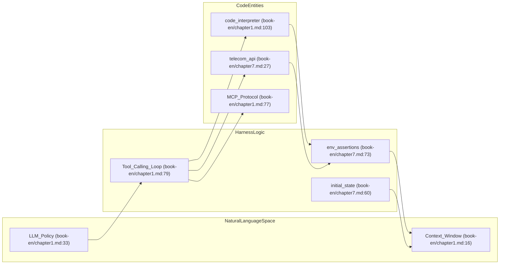
Sources: [[book-en/chapter1.md:11-19](), [book-en/chapter1.md:77-82](), [book-en/chapter7.md:27-82]()]

---

# Page: Chapter 1 Code Experiments

# Chapter 1 Code Experiments

<details>
<summary>Relevant source files</summary>

The following files were used as context for generating this wiki page:

- [.github/workflows/web-search-agent-tests.yml](.github/workflows/web-search-agent-tests.yml)
- [chapter1/EXPERIMENT_LEDGER.md](chapter1/EXPERIMENT_LEDGER.md)
- [chapter1/README.en.md](chapter1/README.en.md)
- [chapter1/README.ja.md](chapter1/README.ja.md)
- [chapter1/README.md](chapter1/README.md)
- [chapter1/README.zh-TW.md](chapter1/README.zh-TW.md)
- [chapter1/context/README.md](chapter1/context/README.md)
- [chapter1/context/agent.py](chapter1/context/agent.py)
- [chapter1/context/config.py](chapter1/context/config.py)
- [chapter1/context/env.example](chapter1/context/env.example)
- [chapter1/context/main.py](chapter1/context/main.py)
- [chapter1/learning-from-experience/README.md](chapter1/learning-from-experience/README.md)
- [chapter1/learning-from-experience/demo.py](chapter1/learning-from-experience/demo.py)
- [chapter1/learning-from-experience/env.example](chapter1/learning-from-experience/env.example)
- [chapter1/learning-from-experience/experiment.py](chapter1/learning-from-experience/experiment.py)
- [chapter1/learning-from-experience/llm_agent.py](chapter1/learning-from-experience/llm_agent.py)
- [chapter1/learning-from-experience/quick_demo.py](chapter1/learning-from-experience/quick_demo.py)
- [chapter1/learning-from-experience/rl_agent.py](chapter1/learning-from-experience/rl_agent.py)
- [chapter1/search-codegen/README.md](chapter1/search-codegen/README.md)
- [chapter1/search-codegen/agent.py](chapter1/search-codegen/agent.py)
- [chapter1/search-codegen/config.py](chapter1/search-codegen/config.py)
- [chapter1/search-codegen/env.example](chapter1/search-codegen/env.example)
- [chapter1/search-codegen/example_request.py](chapter1/search-codegen/example_request.py)
- [chapter1/search-codegen/main.py](chapter1/search-codegen/main.py)
- [chapter1/search-codegen/run_experiment_1_3.py](chapter1/search-codegen/run_experiment_1_3.py)
- [chapter1/search-codegen/test_config_and_usage.py](chapter1/search-codegen/test_config_and_usage.py)
- [chapter1/search-codegen/test_responses_agent.py](chapter1/search-codegen/test_responses_agent.py)
- [chapter1/search-codegen/validation/latest.json](chapter1/search-codegen/validation/latest.json)
- [chapter1/web-search-agent/README.md](chapter1/web-search-agent/README.md)
- [chapter1/web-search-agent/agent.py](chapter1/web-search-agent/agent.py)
- [chapter1/web-search-agent/config.py](chapter1/web-search-agent/config.py)
- [chapter1/web-search-agent/env.example](chapter1/web-search-agent/env.example)
- [chapter1/web-search-agent/examples.py](chapter1/web-search-agent/examples.py)
- [chapter1/web-search-agent/pytest.ini](chapter1/web-search-agent/pytest.ini)
- [chapter1/web-search-agent/tests/conftest.py](chapter1/web-search-agent/tests/conftest.py)
- [chapter1/web-search-agent/tests/test_agent.py](chapter1/web-search-agent/tests/test_agent.py)
- [chapter1/web-search-agent/tests/test_config.py](chapter1/web-search-agent/tests/test_config.py)
- [chapter1/web-search-agent/tests/test_examples.py](chapter1/web-search-agent/tests/test_examples.py)
- [chapter1/web-search-agent/tests/test_main.py](chapter1/web-search-agent/tests/test_main.py)
- [chapter1/web-search-agent/tests/test_offline_demo.py](chapter1/web-search-agent/tests/test_offline_demo.py)
- [chapter2/README.md](chapter2/README.md)
- [chapter3/README.md](chapter3/README.md)
- [chapter4/README.md](chapter4/README.md)
- [chapter5/README.md](chapter5/README.md)
- [chapter8/README.md](chapter8/README.md)
- [chapter9/README.md](chapter9/README.md)
- [tests/test_ch1_learning_agents_empty_eval_windows.py](tests/test_ch1_learning_agents_empty_eval_windows.py)

</details>


The experiments in Chapter 1 provide a hands-on foundation for the core formula: **Agent = LLM + Context + Tools** [chapter1/README.md:3-3](). These experiments demonstrate how agents perceive the world through context, act via tools, and learn through different paradigms.

## 1. Kimi Web-Search Agent

The `web-search-agent` experiment (Experiment 1-2) demonstrates a "Model as Agent" pattern using the Kimi K3 model and Moonshot's official Formula API [chapter1/web-search-agent/README.md:3-4]().

### Implementation and Data Flow
The agent implements a ReAct (Reason-Act-Observe) loop using the `moonshot/web-search:latest` Formula [chapter1/web-search-agent/README.md:14-15](). The execution follows a specific provider-controlled sequence where the agent fetches standard `function` declarations and executes search "Fibers" [chapter1/web-search-agent/README.md:26-38]().

**Search Agent Execution Flow**
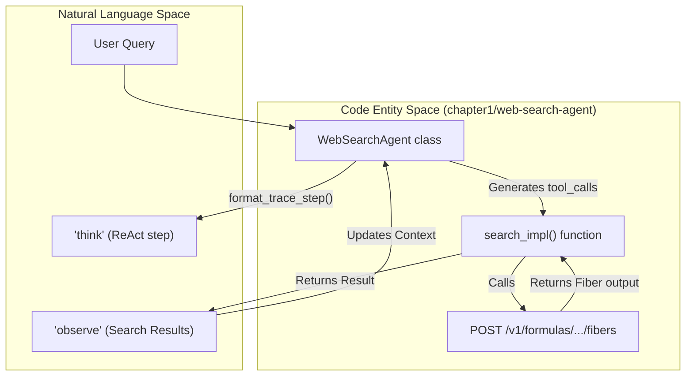
Sources: [chapter1/web-search-agent/agent.py:96-143](), [chapter1/web-search-agent/README.md:47-59]()

---

## 2. Context Management and Ablation

The `context` experiment (Experiment 1-1) explores the systematic importance of context components through a `ContextAwareAgent` and an `AblationTestSuite` [chapter1/context/agent.py:2-5]().

### Key Components
- **ContextMode**: An Enum defining five ablation states: `FULL`, `NO_HISTORY`, `NO_REASONING`, `NO_TOOL_CALLS`, and `NO_TOOL_RESULTS` [chapter1/context/agent.py:44-51]().
- **AgentTrajectory**: Tracks the execution path, including `reasoning_steps`, `tool_calls`, and raw `api_turns` [chapter1/context/agent.py:63-73]().
- **ToolRegistry**: Provides local tools like `parse_pdf`, `convert_currency`, and `calculate` to simulate an environment [chapter1/context/agent.py:75-178]().

### Ablation Study Logic
The `AblationTestSuite` runs tasks (e.g., `create_multinational_budget_task`) across different modes to measure the impact on success rates and iteration counts [chapter1/context/main.py:123-173](). In the `NO_TOOL_RESULTS` arm, the harness runs the tools but the model is shown a placeholder (e.g., `HIDDEN_RESULT_MARKER`), making the agent blind to tool execution outcomes [chapter1/context/agent.py:33-41](), [chapter1/context/main.py:176-178]().

Sources: [chapter1/context/agent.py:33-73](), [chapter1/context/main.py:87-194]()

---

## 3. RL vs LLM In-Context Learning

This experiment (Experiments 7-1 and 7-2) compares traditional tabular Q-learning with LLM in-context learning (ICL) using a `TreasureHuntGame` [chapter1/learning-from-experience/README.md:1-4]().

### Comparison Architecture
- **QLearningAgent**: Uses a `q_table` (state-action map) and the Bellman equation to learn, requiring thousands of episodes (e.g., 10,000) to discover hidden mechanics [chapter1/learning-from-experience/rl_agent.py:14-51](), [chapter1/learning-from-experience/README.md:168-174]().
- **LLMAgent**: Uses a `GameExperience` buffer and reasoning to generalize from very few examples (e.g., 20 episodes) [chapter1/learning-from-experience/llm_agent.py:61-130](), [chapter1/learning-from-experience/README.md:158-160]().

**Learning Mechanism Comparison**
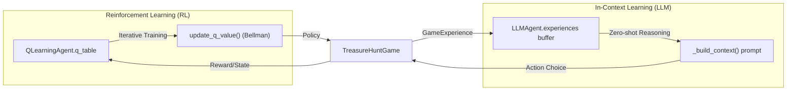
Sources: [chapter1/learning-from-experience/rl_agent.py:42-51](), [chapter1/learning-from-experience/llm_agent.py:117-171](), [chapter1/learning-from-experience/README.md:154-165]()

---

## 4. Search-Codegen (Deep Research)

The `search-codegen` experiment (Experiment 1-3) demonstrates the **Responses API** pattern where an agent performs hosted web search and server-side code execution in a single loop [chapter1/search-codegen/README.md:3-9]().

### Implementation Detail
1. **Tool Specification**: The `GPT5NativeAgent` requests `web_search` and `code_interpreter` within the same `responses` request [chapter1/search-codegen/agent.py:65-76]().
2. **Intent Clarification**: A system prompt enforces a "Hard rule" to ask clarifying questions before calling tools if user preferences are ambiguous [chapter1/search-codegen/agent.py:47-63]().
3. **Continuation**: Uses `previous_response_id` in the `_build_responses_request` to maintain state across turns, allowing the agent to continue a research thread after clarification [chapter1/search-codegen/agent.py:115-117]().

**Responses API Data Flow**
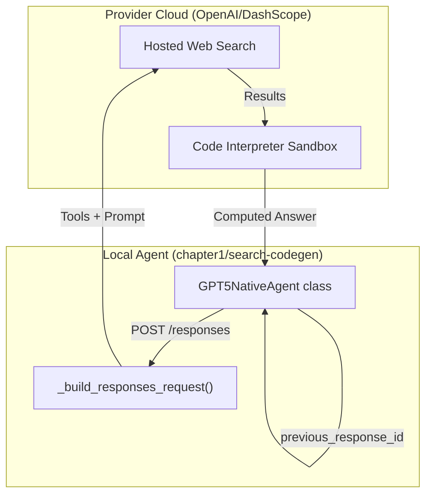
Sources: [chapter1/search-codegen/agent.py:21-117](), [chapter1/search-codegen/README.md:13-50]()

---

# Page: Context Engineering (Chapter 2)

# Context Engineering (Chapter 2)

<details>
<summary>Relevant source files</summary>

The following files were used as context for generating this wiki page:

- [book-ar/chapter2.ar.md](book-ar/chapter2.ar.md)
- [book-en/chapter2.md](book-en/chapter2.md)
- [book-es/chapter2.es.md](book-es/chapter2.es.md)
- [book-id/chapter2.md](book-id/chapter2.md)
- [book-ja/chapter2.ja.md](book-ja/chapter2.ja.md)
- [book-ko/chapter2.ko.md](book-ko/chapter2.ko.md)
- [book-ru/chapter2.md](book-ru/chapter2.md)
- [book-ta/chapter2.ta.md](book-ta/chapter2.ta.md)
- [book-tr/chapter2.tr.md](book-tr/chapter2.tr.md)
- [book-vi/chapter2.vi.md](book-vi/chapter2.vi.md)
- [book-zhtw/chapter2.zhtw.md](book-zhtw/chapter2.zhtw.md)
- [book/chapter1.md](book/chapter1.md)
- [book/chapter10.md](book/chapter10.md)
- [book/chapter2.md](book/chapter2.md)
- [book/chapter3.md](book/chapter3.md)
- [book/chapter4.md](book/chapter4.md)
- [book/chapter5.md](book/chapter5.md)
- [book/chapter6.md](book/chapter6.md)
- [book/chapter7.md](book/chapter7.md)
- [book/chapter8.md](book/chapter8.md)
- [book/chapter9.md](book/chapter9.md)
- [book/reference-answers.md](book/reference-answers.md)

</details>


Context Engineering is the systematic design, organization, and delivery of information to an AI Agent. If the LLM is the "brain," the context window serves as its "operating system" and "eyes." The quality and structure of the context window—including system instructions, conversation history, and tool definitions—directly define the upper bound of an Agent's performance in production environments [book/chapter2.md:1-3]().

## The Context Window as an Operating System

In the **Harness Engineering** framework, context is the core implementation layer that bridges the gap between a model's general intelligence and specific task execution. A well-engineered context ensures the Agent has access to three critical categories of information:
1.  **Real-time Code Context**: Directory structures, module responsibilities, and data definitions [book/chapter2.md:15-15]().
2.  **Process Specifications**: Git branching strategies, commit conventions, and CI/CD requirements [book/chapter2.md:16-16]().
3.  **Environment Information**: Development setups, database connection strings, and API key management [book/chapter2.md:17-17]().

### The Messages List Structure
Modern Agent interaction relies on a stateful message list sent to stateless APIs. Every factual decision by the Agent is based on the specific roles within this list:
*   **system**: High-priority behavioral rules, identity definitions, and constraints [book/chapter2.md:49-49]().
*   **user**: The specific request or query from the end-user [book/chapter2.md:50-50]().
*   **assistant**: Previous model responses, including text and `tool_calls` requests [book/chapter2.md:51-51]().
*   **tool**: The results of executed functions, linked via `tool_call_id` [book/chapter2.md:52-52]().

### Agent-Model Interaction Flow
The following diagram illustrates how the Agent framework manages the transition between Natural Language Space (User/System messages) and Code Entity Space (Tool definitions and execution results).

**Diagram: Context Interaction Sequence**
```mermaid
sequenceDiagram
    participant U as "User"
    participant AF as "Agent Framework (Python/Node.js)"
    participant LLM as "Large Language Model (API)"
    participant T as "Tools (Code Entities)"

    U->>AF: "What's the weather in Vancouver?"
    Note over AF: AF constructs message list [system, user]
    AF->>LLM: POST /chat/completions (messages, tools)
    LLM-->>AF: assistant: tool_calls (get_weather)
    Note over AF: Model-to-Code Transition
    AF->>T: execute get_weather(city="Vancouver")
    T-->>AF: return {"temp": 15, "sky": "cloudy"}
    Note over AF: Append "tool" message to history
    AF->>LLM: POST /chat/completions (history + tool_result)
    LLM-->>AF: assistant: "It is 15°C and cloudy in Vancouver."
    AF->>U: Final Response
```
Sources: [book/chapter2.md:65-151](), [book/chapter1.md:83-101]()

---

## Key Sub-Topics

### KV Cache Optimization and Prompt Engineering
The KV Cache is a hardware-level optimization that stores the keys and values of previously processed tokens. In Agent workflows, maintaining a **stable prefix** is critical for performance and cost reduction. Anti-patterns like dynamic timestamps in system prompts or shuffling tool definitions break the cache, leading to increased Time to First Token (TTFT) and higher costs.

For details on prefix stability, implementation modes (correct vs. anti-patterns), and Prompt Cache APIs, see **[KV Cache Optimization and Prompt Engineering](#3.1)**.

### Agent Skills, Status Bar, and Context Compression
As Agent capabilities grow, the context window can become saturated with tool definitions, leading to "context rot." 
*   **Agent Skills**: A "progressive disclosure" strategy where tools are bundled into skills (e.g., `SKILL.md`) and only relevant skills are loaded into the active context [book/chapter10.md:85-92]().
*   **Status Bar**: A meta-information side-channel providing high-level state (e.g., working directory, git branch) without cluttering history.
*   **Compression**: Strategies to handle failure modes such as null content, malformed tool JSON, and summary drift.

For details on skill routing, the Status Bar, and context compression implementation, see **[Agent Skills, Status Bar, and Context Compression](#3.2)**.

---

## Context Architecture Overview

The relationship between the various context components and the underlying code structures is mapped below.

**Diagram: Context Entity Mapping**
```mermaid
graph TD
    subgraph "Context Window (LLM Input)"
        SY["System Prompt"]
        MS["Message History / Trajectory"]
        TL["Tool Definitions"]
        SB["Status Bar / Metadata"]
    end

    subgraph "Code Entity Space"
        SK["SKILL.md / load_skill()"]
        KC["KV Cache / chapter2/kv-cache/"]
        PE["Prompt Templates / chapter2/prompt-engineering/"]
        TC["tool_calls / tool_call_id"]
    end

    SY --> PE
    MS --> KC
    TL --> SK
    SB --> TC
    
    style SK stroke-dasharray: 5 5
    style KC stroke-dasharray: 5 5
```
Sources: [book/chapter2.md:3-5](), [book/chapter2.md:45-56](), [book/chapter3.md:78-82](), [book/chapter10.md:90-90]()

## Implementation Experiments
The concepts discussed in this chapter are implemented and evaluated in the following directories:
*   `chapter2/kv-cache/`: Benchmarking the impact of prefix stability on inference speed.
*   `chapter2/prompt-engineering/`: Ablation studies on prompt structures using `tau-bench` assets [book/chapter7.md:29-30]().
*   `chapter2/context-compression/`: Implementation of techniques for task-oriented pruning and adaptive windowing.
*   `chapter7/tau2-bench/`: Evaluation of progressive information disclosure and grounding [book/chapter7.md:87-94]().

Sources: [book/chapter2.md:1-29](), [book/chapter7.md:27-82](), [book/chapter10.md:94-101]()

---

# Page: KV Cache Optimization and Prompt Engineering

# KV Cache Optimization and Prompt Engineering

<details>
<summary>Relevant source files</summary>

The following files were used as context for generating this wiki page:

- [chapter2/attention_visualization/README.md](chapter2/attention_visualization/README.md)
- [chapter2/context-compression/README.md](chapter2/context-compression/README.md)
- [chapter2/context-compression/experiment.py](chapter2/context-compression/experiment.py)
- [chapter2/context-compression/main.py](chapter2/context-compression/main.py)
- [chapter2/context-compression/quickstart.py](chapter2/context-compression/quickstart.py)
- [chapter2/context-compression/run_all_strategies.py](chapter2/context-compression/run_all_strategies.py)
- [chapter2/kv-cache/README.md](chapter2/kv-cache/README.md)
- [chapter2/kv-cache/agent.py](chapter2/kv-cache/agent.py)
- [chapter2/kv-cache/main.py](chapter2/kv-cache/main.py)
- [chapter2/local_llm_serving/README.md](chapter2/local_llm_serving/README.md)
- [chapter2/local_llm_serving/agent.py](chapter2/local_llm_serving/agent.py)
- [chapter2/local_llm_serving/check_compatibility.py](chapter2/local_llm_serving/check_compatibility.py)
- [chapter2/local_llm_serving/demo_streaming.py](chapter2/local_llm_serving/demo_streaming.py)
- [chapter2/local_llm_serving/main.py](chapter2/local_llm_serving/main.py)
- [chapter2/local_llm_serving/ollama_native.py](chapter2/local_llm_serving/ollama_native.py)
- [chapter2/local_llm_serving/requirements.txt](chapter2/local_llm_serving/requirements.txt)
- [chapter2/local_llm_serving/setup.sh](chapter2/local_llm_serving/setup.sh)
- [chapter2/local_llm_serving/test_ollama_thinking.py](chapter2/local_llm_serving/test_ollama_thinking.py)
- [chapter2/local_llm_serving/test_parallel_tools.py](chapter2/local_llm_serving/test_parallel_tools.py)
- [chapter2/local_llm_serving/test_vllm_structured_streaming.py](chapter2/local_llm_serving/test_vllm_structured_streaming.py)
- [chapter2/prompt-engineering/README.md](chapter2/prompt-engineering/README.md)
- [chapter2/prompt-engineering/run_ablation.py](chapter2/prompt-engineering/run_ablation.py)
- [chapter2/system-hint/CHANGELOG.md](chapter2/system-hint/CHANGELOG.md)
- [chapter2/system-hint/README.md](chapter2/system-hint/README.md)
- [chapter2/system-hint/agent.py](chapter2/system-hint/agent.py)
- [chapter2/system-hint/config.py](chapter2/system-hint/config.py)
- [chapter2/system-hint/main.py](chapter2/system-hint/main.py)
- [chapter2/system-hint/test_basic.py](chapter2/system-hint/test_basic.py)
- [chapter2/system-hint/test_malformed_tool_json.py](chapter2/system-hint/test_malformed_tool_json.py)
- [chapter3/agentic-rag-for-user-memory/config.py](chapter3/agentic-rag-for-user-memory/config.py)
- [chapter3/agentic-rag/config.py](chapter3/agentic-rag/config.py)
- [chapter3/contextual-retrieval-for-user-memory/config.py](chapter3/contextual-retrieval-for-user-memory/config.py)
- [chapter3/contextual-retrieval/config.py](chapter3/contextual-retrieval/config.py)
- [chapter3/log-sanitization/agent.py](chapter3/log-sanitization/agent.py)
- [chapter3/log-sanitization/config.py](chapter3/log-sanitization/config.py)
- [tests/test_ch1_ch2_system_hint_tool_error_null.py](tests/test_ch1_ch2_system_hint_tool_error_null.py)

</details>


This page explains the mechanics of the Key-Value (KV) Cache, the technical requirements for prefix stability, and the implementation of Prompt Cache APIs. It contrasts correct engineering patterns with common anti-patterns that degrade performance and provides an overview of experimental results from the `chapter2/kv-cache/`, `chapter2/prompt-engineering/`, and `chapter2/local_llm_serving/` directories.

## KV Cache Mechanics and Prefix Stability

The KV Cache is a memory optimization in Transformer-based models that stores the Key and Value tensors of previous tokens to avoid redundant computations during auto-regressive generation. For an Agent, the efficiency of this cache is determined by **Prefix Stability**: if the beginning of a prompt remains identical across multiple turns, the model can reuse the cached computations, significantly reducing Time to First Token (TTFT) and computational cost [chapter2/kv-cache/README.md:20-22]().

### The "Static Prefix + Dynamic Trajectory" Structure
To maximize KV Cache utilization, the context should be structured into a static part and a growing part. The `KVCacheMode.CORRECT` implementation in the experiment demonstrates this by maintaining a stable message list and appending results rather than rebuilding the full context from scratch [chapter2/kv-cache/agent.py:59-61]().

| Component | Content | Stability |
| :--- | :--- | :--- |
| **Static Prefix** | `system` prompt, `tools` definitions, and few-shot examples | High (Should never change) |
| **Dynamic Trajectory** | Conversation history (`user`, `assistant`, `tool` messages) | Low (Appends new tokens) |

**Prefix Stability Requirement Diagram**
This diagram maps the logical structure of a prompt to the underlying Transformer cache mechanism as implemented in `chapter2/kv-cache/agent.py`.

```mermaid
graph TD
    subgraph "Natural Language Space (Prompt Structure)"
        A["'system' Role Message"] --> B["'tools' Definitions"]
        B --> C["'user' / 'assistant' History"]
    end

    subgraph "Code Entity Space (KV Cache Blocks)"
        direction LR
        Block1["Static Cache Block (Reusable)"] 
        Block2["Incremental Cache Block (Appended)"]
    end

    A -.-> Block1
    B -.-> Block1
    C -.-> Block2

    style Block1 stroke-dasharray: 5 5
```
Sources: [chapter2/kv-cache/agent.py:59-62](), [chapter2/kv-cache/README.md:20-24](), [chapter2/kv-cache/agent.py:151-174]()

## Implementation Modes: Correct vs. Anti-Patterns

The `chapter2/kv-cache/` experiment defines six distinct modes to measure the impact of context management on cache hits and TTFT [chapter2/kv-cache/agent.py:59-67]().

### The Six Implementation Modes

1.  **CORRECT**: Stable context with a fixed system prompt and consistent tool order [chapter2/kv-cache/agent.py:61]().
2.  **DYNAMIC_SYSTEM**: Adds a timestamp to the system prompt in every request, forcing a full context recompute [chapter2/kv-cache/agent.py:62]().
3.  **SHUFFLED_TOOLS**: Randomizes the order of tool definitions each request, which breaks the prefix hash even if the tools are identical [chapter2/kv-cache/agent.py:63]().
4.  **DYNAMIC_PROFILE**: Simulates a common production error where user metadata (like "credits remaining") is injected into the system prompt, causing invalidation [chapter2/kv-cache/agent.py:64]().
5.  **SLIDING_WINDOW**: Only keeps the most recent $N$ messages. While it limits total tokens, it breaks cache continuity once the "window" moves [chapter2/kv-cache/agent.py:65]().
6.  **TEXT_FORMAT**: Formats the entire history as a single plain text block instead of structured messages, breaking provider-level optimizations [chapter2/kv-cache/agent.py:66]().

### Prompt Cache Data Flow
The following diagram illustrates how the `KVCacheMode` logic affects the interaction with LLM backends like Moonshot or vLLM.

```mermaid
sequenceDiagram
    participant Agent as "KVCacheAgent (agent.py)"
    participant Provider as "LLM Provider (Ollama/vLLM/Moonshot)"
    participant Cache as "KV Cache Memory"

    Note over Agent: build_messages(mode)
    Agent->>Provider: chat(messages)
    Provider->>Cache: Lookup Prefix Hash
    alt Hash Match (Mode: CORRECT)
        Cache-->>Provider: Return Cached Tensors
        Note right of Provider: TTFT reduced by ~90%
    else Hash Mismatch (Mode: DYNAMIC_SYSTEM / SHUFFLED)
        Provider->>Provider: Full Prefill Computation
        Provider->>Cache: Update Cache with New Prefix
    end
    Provider-->>Agent: response (includes cached_tokens)
```
Sources: [chapter2/kv-cache/agent.py:80-92](), [chapter2/kv-cache/README.md:55-62](), [chapter2/kv-cache/README.md:103-110]()

## Local LLM Serving and Tool Calling

Experiment 2-1 covers local deployment using Ollama and vLLM. The `chapter2/local_llm_serving/` project provides a unified entry point for cross-platform tool calling [chapter2/local_llm_serving/README.md:14-18]().

*   **vLLM Backend**: Optimized for Linux/WSL2 with NVIDIA GPUs, supporting continuous batching and high-performance KV cache management [chapter2/local_llm_serving/README.md:78-80]().
*   **Ollama Backend**: Default for macOS and Windows, providing an OpenAI-compatible API for models like Qwen3 [chapter2/local_llm_serving/README.md:73-75]().
*   **Parallel Tool Execution**: The `OllamaNativeAgent` and `VLLMToolAgent` implement `_execute_tool_calls` using a `ThreadPoolExecutor` to run independent tool calls concurrently, which is critical for minimizing latency in complex ReAct loops [chapter2/local_llm_serving/ollama_native.py:102-104](), [chapter2/local_llm_serving/agent.py:146-148]().
*   **Reasoning Stream Handling**: For models supporting thinking (e.g., Kimi, Qwen3), the `OllamaNativeAgent` handles the `thinking` field vs raw `<think>` tags, ensuring reasoning is captured even when streaming [chapter2/local_llm_serving/README.md:193-196](), [chapter2/local_llm_serving/test_ollama_thinking.py:47-66]().

Sources: [chapter2/local_llm_serving/agent.py:20-37](), [chapter2/local_llm_serving/ollama_native.py:17-37](), [chapter2/local_llm_serving/test_parallel_tools.py:55-60]()

## Advanced Trajectory Management

### System Hints and Status Bars
The `SystemHintAgent` in `chapter2/system-hint/` demonstrates advanced context management by injecting meta-information into the trajectory [chapter2/system-hint/agent.py:88-91]().
*   **Timestamps**: Allows the agent to understand the temporal sequence of events [chapter2/system-hint/agent.py:73]().
*   **Tool Counter**: Prevents infinite loops by tracking how many times a tool has been called [chapter2/system-hint/agent.py:74]().
*   **TODO List**: A structured state tracking mechanism that the agent updates using `rewrite_todo_list` and `update_todo_status` [chapter2/system-hint/agent.py:157-166]().
*   **System State**: Injects environment details like the `current_directory` to provide context for tool execution [chapter2/system-hint/agent.py:77](), [chapter2/system-hint/agent.py:144]().

### Context Compression
`chapter2/context-compression/` evaluates six strategies for managing long histories, including **Context-Aware Summarization** (query-focused) and **Windowed Context** (keeping latest full content while compressing history) [chapter2/context-compression/README.md:35-64]().

**Compression Strategy Comparison Table**

| Strategy | Description | Pros | Cons |
| :--- | :--- | :--- | :--- |
| **Individual Summary** | Summarize each page/tool result separately [chapter2/context-compression/README.md:42-45]() | Preserves detail | High LLM call count |
| **Combined Summary** | Concatenate all and summarize once [chapter2/context-compression/README.md:47-50]() | Better overview | May lose attribution |
| **Context-Aware** | Query-focused summary [chapter2/context-compression/README.md:52-54]() | High relevance | Extra LLM overhead |
| **Windowed** | Keep latest $N$, compress old [chapter2/context-compression/README.md:60-64]() | Balance | Potential context break |

Sources: [chapter2/system-hint/agent.py:71-82](), [chapter2/context-compression/README.md:35-64](), [chapter2/system-hint/README.md:52-78]()

---

# Page: Agent Skills, Status Bar, and Context Compression

# Agent Skills, Status Bar, and Context Compression

<details>
<summary>Relevant source files</summary>

The following files were used as context for generating this wiki page:

- [book-ar/chapter2.ar.md](book-ar/chapter2.ar.md)
- [book-en/chapter2.md](book-en/chapter2.md)
- [book-es/chapter2.es.md](book-es/chapter2.es.md)
- [book-id/chapter2.md](book-id/chapter2.md)
- [book-ja/chapter2.ja.md](book-ja/chapter2.ja.md)
- [book-ko/chapter2.ko.md](book-ko/chapter2.ko.md)
- [book-ru/chapter2.md](book-ru/chapter2.md)
- [book-ta/chapter2.ta.md](book-ta/chapter2.ta.md)
- [book-tr/chapter2.tr.md](book-tr/chapter2.tr.md)
- [book-vi/chapter2.vi.md](book-vi/chapter2.vi.md)
- [book-zhtw/chapter2.zhtw.md](book-zhtw/chapter2.zhtw.md)
- [chapter2/context-compression/agent.py](chapter2/context-compression/agent.py)
- [chapter2/context-compression/compression_strategies.py](chapter2/context-compression/compression_strategies.py)
- [chapter2/context-compression/config.py](chapter2/context-compression/config.py)
- [chapter2/context-compression/env.example](chapter2/context-compression/env.example)
- [chapter2/context-compression/test_malformed_tool_json.py](chapter2/context-compression/test_malformed_tool_json.py)
- [chapter2/context-compression/test_null_content_compression.py](chapter2/context-compression/test_null_content_compression.py)
- [chapter2/system-hint/env.example](chapter2/system-hint/env.example)
- [chapter3/contextual-retrieval-for-user-memory/contextual_evaluator.py](chapter3/contextual-retrieval-for-user-memory/contextual_evaluator.py)

</details>


This page documents the technical implementation of advanced context engineering techniques within the AI Agent framework. It covers the hierarchical **Agent Skills** system for progressive tool disclosure, the **Status Bar** pattern for out-of-band state communication, and systematic **Context Compression** strategies to manage the "context rot" inherent in long-running agent trajectories.

## 1. Agent Skills System

The Agent Skills system solves the "context saturation" problem where providing descriptions for hundreds of tools simultaneously degrades model performance and increases KV cache costs. It employs a **progressive disclosure** architecture that keeps the initial system prompt lean [chapter2/context-compression/agent.py:111-143]().

### 1.1 Hierarchical Structure
The system is organized into three layers of increasing detail:
1.  **Metadata Layer**: A lightweight catalog of available skills. Only the `name` and `description` are typically loaded into the system prompt at startup to minimize initial token usage.
2.  **Core Skill Layer**: Detailed workflows and primary tool logic. This is loaded only when the Agent decides a specific skill is required, often triggered by a search for capabilities [chapter2/context-compression/agent.py:121-139]().
3.  **Sub-document Layer**: Specialized reference files and executable scripts loaded for deep task execution.

### 1.2 Skill Routing Data Flow
The implementation uses an isomorphic loader to simulate the progressive disclosure mechanism.

**Skill Discovery and Execution Logic**
```mermaid
sequenceDiagram
    participant A as "ResearchAgent"
    participant C as "Catalog (Metadata)"
    participant S as "Skill_Definitions"
    participant R as "Execution_Tools"

    A->>C: "Initialize with System Prompt"
    Note right of C: "Loads minimal tool descriptions"
    A->>A: "Process User Request"
    A->>S: "Request specific tool details (e.g. search_web)"
    Note right of S: "Loads full parameters & requirements"
    A->>R: "Execute tool_call"
    R-->>A: "Return observation (o_t)"
```
*Sources: [chapter2/context-compression/agent.py:111-168](), [book-en/chapter2.md:31-37]()*

## 2. Agent Status Bar Pattern

The Status Bar is a "meta-information side-channel" implemented via **System Hints**. It provides the agent with real-time state tracking, timestamps, and error context without polluting the permanent conversation history.

### 2.1 System Hint and Status Tracking
The `ResearchAgent` maintains a `trajectory` using the `AgentTrajectory` class to track internal state [chapter2/context-compression/agent.py:49-63]():
*   **Temporal Context**: The `start_time` and `end_time` are tracked to calculate execution duration [chapter2/context-compression/agent.py:62-63]().
*   **Token Monitoring**: Tracks `total_tokens_used`, `prompt_tokens_used`, and `completion_tokens_used` to manage budget and context window limits [chapter2/context-compression/agent.py:52-54]().
*   **Context Health**: Monitors `last_prompt_tokens` and `context_overflows` to trigger compression when the model's limit is approached [chapter2/context-compression/agent.py:59-60]().

### 2.2 Status Bar Implementation
| Code Entity | Role in Status Tracking |
| :--- | :--- |
| `ToolCall` | Represents a single tool interaction, including `timestamp` and `id` [chapter2/context-compression/agent.py:35-45]() |
| `AgentTrajectory` | Aggregates all `ToolCall` objects and token metrics [chapter2/context-compression/agent.py:49-51]() |
| `today` | Dynamic date injection in system prompt to prevent temporal disorientation [chapter2/context-compression/agent.py:115-141]() |

*Sources: [chapter2/context-compression/agent.py:34-65](), [chapter2/context-compression/agent.py:111-143]()*

## 3. Context Compression Strategies

Context compression addresses "context rot"—the accumulation of irrelevant tool outputs that lead to context window overflow and increased latency. The `ContextCompressor` class manages these transformations [chapter2/context-compression/agent.py:100]().

### 3.1 Compression Strategies and Failure Modes
The framework defines a `CompressionStrategy` enum to handle different scenarios [chapter2/context-compression/agent.py:74]():

1.  **NO_COMPRESSION**: The default lossless approach, providing the complete message history [book-en/chapter2.md:35]().
2.  **Context-Aware Compression**: Summarizes tool results based on the specific `query` and existing `conversation_history` to retain only relevant information [chapter2/context-compression/agent.py:100]().
3.  **Failure Modes**:
    *   **Null Content**: Handled by specific tests to ensure the compressor doesn't crash on empty tool outputs.
    *   **Malformed Tool JSON**: Occurs when the model generates invalid arguments; caught during the `ToolCall` lifecycle [chapter2/context-compression/agent.py:38]().
    *   **Summary Drift**: The risk that repeated summarization loses critical "needle-in-a-haystack" details over long trajectories.

### 3.2 Context Management Data Flow
The `ResearchAgent` acts as the harness, coordinating between the LLM and the `ContextCompressor`.

**Context Compression and Token Flow**
```mermaid
graph TD
    subgraph "Natural Language Space"
        UserQuery["User Query"]
        SysPrompt["System Prompt (Instructions)"]
        Observations["Tool Results (Observations)"]
    end

    subgraph "Code Entity Space (agent.py)"
        Agent["ResearchAgent Class"]
        History["self.conversation_history"]
        Trajectory["AgentTrajectory Class"]
        Compressor["ContextCompressor Class"]
    end

    UserQuery --> Agent
    SysPrompt --> History
    Agent --> Trajectory
    Trajectory -- "Token Count > Threshold" --> Compressor
    Compressor -- "CompressedContent" --> History
    History -- "messages[]" --> LLM["LLM API Call"]
```
*Sources: [chapter2/context-compression/agent.py:49-66](), [chapter2/context-compression/agent.py:100-107](), [book-en/chapter2.md:31-35]()*

## 4. Implementation Details

### 4.1 Tool Call Lifecycle
Every interaction with the environment is encapsulated in a `ToolCall` object [chapter2/context-compression/agent.py:35](). This object stores the `tool_name`, `arguments`, and the `result`. If compression is active, the `compressed_result` field (of type `CompressedContent`) stores the transformed output to be sent to the LLM in subsequent rounds [chapter2/context-compression/agent.py:37-40]().

### 4.2 Streaming and Reasoning Models
The agent includes a `_reasoning_safe_temperature` utility to handle specific model constraints, such as Kimi K3 or GPT-5, which may only accept a temperature of 1.0 [chapter2/context-compression/agent.py:22-27](). This ensures the context engineering remains compatible with advanced reasoning models that have strict parameter requirements.

*Sources: [chapter2/context-compression/agent.py:22-45](), [chapter2/context-compression/agent.py:88-96]()*

---

# Page: Memory and Knowledge Systems (Chapter 3)

# Memory and Knowledge Systems (Chapter 3)

<details>
<summary>Relevant source files</summary>

The following files were used as context for generating this wiki page:

- [book-ar/chapter3.ar.md](book-ar/chapter3.ar.md)
- [book-en/chapter3.md](book-en/chapter3.md)
- [book-es/chapter3.es.md](book-es/chapter3.es.md)
- [book-hu/chapter3.md](book-hu/chapter3.md)
- [book-id/chapter3.md](book-id/chapter3.md)
- [book-ja/chapter3.ja.md](book-ja/chapter3.ja.md)
- [book-ko/chapter3.ko.md](book-ko/chapter3.ko.md)
- [book-ru/chapter3.md](book-ru/chapter3.md)
- [book-ta/chapter3.ta.md](book-ta/chapter3.ta.md)
- [book-tr/chapter3.tr.md](book-tr/chapter3.tr.md)
- [book-vi/chapter3.vi.md](book-vi/chapter3.vi.md)
- [book-zhtw/chapter3.zhtw.md](book-zhtw/chapter3.zhtw.md)

</details>


This chapter addresses the transition from single-session context management to persistent intelligence. It explores the dual-layer architecture required for production-grade agents: **User Memory** for cross-session personalization and **Knowledge Bases (RAG)** for shared expertise. While context engineering (Chapter 2) handles temporary information, Memory and Knowledge systems focus on the active, continuous process of learning, compressing, and retrieving information at scale. [book-en/chapter3.md:3-9]()

## Architecture Overview

The memory system is organized into three distinct layers based on persistence and scope:
1.  **Trajectory**: An append-only record of the current session (messages, tool calls, and observations). [book-en/chapter3.md:78-80]()
2.  **User Long-term Memory**: Persistent, structured data tied to a specific User ID, refined over multiple sessions. [book-en/chapter3.md:81-83]()
3.  **Knowledge Base (RAG)**: A collective repository of domain-specific information shared across all users. [book-en/chapter3.md:5-7]()

### Mapping Natural Language to Code Entities

The following diagram illustrates how abstract memory concepts map to specific implementations and data structures within the `chapter3/` codebase.

**Diagram: Memory Representation and Storage**
```mermaid
graph TD
    subgraph "Natural Language Space"
        A["User Preference"]
        B["Shared Domain Knowledge"]
        C["Current Conversation"]
    end

    subgraph "Code Entity Space"
        D["SimpleNotes / JSONCards"]
        E["Vector Store / RAG Pipeline"]
        F["Trajectory / Message List"]
        
        D -- "Implemented in" --> G["chapter3/user-memory/"]
        E -- "Implemented in" --> H["chapter3/retrieval-pipeline/"]
        F -- "Defined in" --> I["chapter1/context/"]
    end

    A -.-> D
    B -.-> E
    C -.-> F
```
**Sources:** [book-en/chapter3.md:78-90](), [book-en/chapter3.md:114-118]()

---

## User Memory Architecture

User memory transforms raw dialogue into a concise, actionable model of the user. This involves extracting key facts (e.g., dietary restrictions, loyalty numbers) while discarding transient session data through a dedicated LLM extraction call. [book-en/chapter3.md:31-41]()

### Storage Formats
The system supports four evolving formats for storing user data, balancing simplicity against semantic richness:
*   **Simple Notes**: Atomic facts (O(1) operations) but lacks context. [book-en/chapter3.md:94-96]()
*   **Enhanced Notes**: Narrative paragraphs preserving context, though harder to update. [book-en/chapter3.md:97-98]()
*   **JSON Cards**: Hierarchical key-value pairs (e.g., `personal.contact.email`). [book-en/chapter3.md:99-100]()
*   **Advanced JSON Cards**: Includes `backstory`, `person`, `relationship`, and `timestamps` for disambiguation. [book-en/chapter3.md:101-104]()

### The Memory Pipeline
The repository implements a sophisticated extraction-comparison-decision pipeline. This includes **User as Code** paradigms where user states are represented as executable Python objects (e.g., `PassportInfo` or `Trip` dataclasses) to allow for deterministic logical reasoning, conflict detection, and validation. [book-en/chapter3.md:116-155]()

For details on implementation, storage strategies, and the three-tier evaluation framework (Basic Recall, Multi-session Retrieval, Proactive Service), see **[User Memory Architecture](#4.1)**.

**Sources:** [book-en/chapter3.md:60-64](), [book-en/chapter3.md:92-113](), [book-en/chapter3.md:122-156]()

---

## RAG Retrieval Pipeline and Agentic RAG

Retrieval-Augmented Generation (RAG) extends the agent's capabilities by providing access to massive external datasets that cannot fit within a context window. [book-en/chapter3.md:7-9]()

### The Hybrid Pipeline
The codebase utilizes a modern retrieval stack to mitigate common failure modes like stale knowledge or inaccurate retrieval:
*   **Dense Embedding**: Semantic search using vector representations.
*   **Sparse Embedding**: Keyword-based search (BM25) to capture specific technical terms.
*   **Reranking**: Refining top-K results for maximum relevance before injection into the prompt.

### Advanced RAG Patterns
Beyond simple retrieval, the system implements:
*   **Contextual Retrieval**: Improving vector search accuracy by enriching chunks with context.
*   **Structured Indexing**: Utilizing methods like RAPTOR (recursive clustering) and GraphRAG for global reasoning across documents.
*   **Agentic RAG**: Enabling the agent to perform multi-hop reasoning by iteratively searching and refining its query based on intermediate results.

For details on the retrieval stack and multi-hop reasoning experiments, see **[RAG Retrieval Pipeline and Agentic RAG](#4.2)**.

**Sources:** [book-en/chapter3.md:7-9](), [book-zhtw/chapter3.zhtw.md:7-9]()

---

## System Integration: The Memory Loop

The following diagram shows how the memory and retrieval systems interact during an agent's execution cycle, bridging natural language requests to code-level tool calls.

**Diagram: Memory and RAG Execution Flow**
```mermaid
sequenceDiagram
    participant U as "User"
    participant A as "Agent (ReAct Loop)"
    participant M as "UserMemoryManager"
    participant R as "RAGPipeline"

    U->>A: "Plan a trip based on my preferences"
    A->>M: "retrieve_user_context(user_id)"
    Note over M: Accesses JSONCards / AdvancedJSONCards
    M-->>A: "Returns User Profile (e.g., Vegetarian, Window Seat)"
    A->>R: "search_knowledge_base('Tokyo travel regs')"
    Note over R: Performs Dense + Sparse Search
    R-->>A: "Returns Ranked Documents"
    A->>A: "Reasoning (LLM) & Tool Call"
    A->>U: "Response"
    A->>M: "update_memory(session_trajectory)"
    Note over M: Trigger Memory Consolidation / Extraction Call
```
**Sources:** [book-en/chapter3.md:21-39](), [book-en/chapter3.md:78-86]()

---

## Child Pages

*   **[User Memory Architecture](#4.1)**: Detailed documentation on the `chapter3/user-memory/` and `chapter3/user-memory-evaluation/` implementations, focusing on memory consolidation, "User as Code", and evaluation against the 3-level framework.
*   **[RAG Retrieval Pipeline and Agentic RAG](#4.2)**: Deep dive into the `chapter3/retrieval-pipeline/`, `chapter3/contextual-retrieval/`, and `chapter3/agentic-rag/` implementations, covering hybrid search, RAPTOR tree indexing, and GraphRAG.

---

# Page: User Memory Architecture

# User Memory Architecture

<details>
<summary>Relevant source files</summary>

The following files were used as context for generating this wiki page:

- [chapter3/agentic-rag-for-user-memory/README.md](chapter3/agentic-rag-for-user-memory/README.md)
- [chapter3/agentic-rag/README.md](chapter3/agentic-rag/README.md)
- [chapter3/contextual-retrieval-for-user-memory/README.md](chapter3/contextual-retrieval-for-user-memory/README.md)
- [chapter3/contextual-retrieval-for-user-memory/contextual_indexer.py](chapter3/contextual-retrieval-for-user-memory/contextual_indexer.py)
- [chapter3/contextual-retrieval-for-user-memory/test_fallback_search_empty_query.py](chapter3/contextual-retrieval-for-user-memory/test_fallback_search_empty_query.py)
- [chapter3/contextual-retrieval/README.md](chapter3/contextual-retrieval/README.md)
- [chapter3/mem0/README.md](chapter3/mem0/README.md)
- [chapter3/memobase/README.md](chapter3/memobase/README.md)
- [chapter3/memobase/locomo_benchmark.py](chapter3/memobase/locomo_benchmark.py)
- [chapter3/memobase/test_evaluate_generic_empty_query.py](chapter3/memobase/test_evaluate_generic_empty_query.py)
- [chapter3/structured-index/README.md](chapter3/structured-index/README.md)
- [chapter3/structured-knowledge-extraction/README.md](chapter3/structured-knowledge-extraction/README.md)
- [chapter3/structured-knowledge-extraction/extractor.py](chapter3/structured-knowledge-extraction/extractor.py)
- [chapter3/structured-knowledge-extraction/test_normalize_numeric.py](chapter3/structured-knowledge-extraction/test_normalize_numeric.py)
- [chapter3/user-memory-evaluation/README.md](chapter3/user-memory-evaluation/README.md)
- [chapter3/user-memory/README.md](chapter3/user-memory/README.md)
- [chapter3/user-memory/agent.py](chapter3/user-memory/agent.py)
- [chapter3/user-memory/config.py](chapter3/user-memory/config.py)
- [chapter3/user-memory/conversation_history.py](chapter3/user-memory/conversation_history.py)
- [chapter3/user-memory/conversational_agent.py](chapter3/user-memory/conversational_agent.py)
- [chapter3/user-memory/main.py](chapter3/user-memory/main.py)
- [chapter3/user-memory/memory_manager.py](chapter3/user-memory/memory_manager.py)
- [chapter3/user-memory/test_consolidate_created_at.py](chapter3/user-memory/test_consolidate_created_at.py)
- [chapter3/user-memory/test_evaluation_memory_view.py](chapter3/user-memory/test_evaluation_memory_view.py)
- [chapter3/user-memory/test_json_cards_string_payload.py](chapter3/user-memory/test_json_cards_string_payload.py)
- [chapter3/user-memory/test_recent_turns_limit_zero.py](chapter3/user-memory/test_recent_turns_limit_zero.py)
- [chapter3/user-memory/test_search_history_limit_zero.py](chapter3/user-memory/test_search_history_limit_zero.py)
- [chapter3/user-memory/test_session_scoped_history.py](chapter3/user-memory/test_session_scoped_history.py)
- [chapter3/user-memory/test_stream_empty_choices.py](chapter3/user-memory/test_stream_empty_choices.py)
- [chapter6/agent-with-event-trigger/README.md](chapter6/agent-with-event-trigger/README.md)

</details>


The User Memory system is a core component of the AI Agent architecture, enabling cross-session personalization and continuous learning. Unlike temporary context, user memory is a persistent, structured, and searchable model of the user’s preferences, habits, and history [chapter3/user-memory/conversational_agent.py:142-145](). It transforms the Agent from a stateless tool into a personalized assistant by employing specialized LLM pipelines to extract, compress, and organize information [chapter3/user-memory/main.py:3-5]().

## Memory Hierarchy and Implementation

The codebase implements a **Separated Architecture** where dialogue and memory management are decoupled into distinct processes [chapter3/user-memory/main.py:3-5]().

1.  **Conversational Agent**: A pure dialogue handler that reads memory for context but does not update it directly during the interaction [chapter3/user-memory/conversational_agent.py:41-45]().
2.  **Background Memory Processor**: A separate process that monitors conversation history and performs extraction and consolidation tasks [chapter3/user-memory/background_memory_processor.py:25-28]().
3.  **Conversation History**: An append-only record of turns, with optional vector search integration via `DifySearchClient` [chapter3/user-memory/conversation_history.py:36-37]().

### Three-Layer Evaluation Framework
To measure memory effectiveness, the `user-memory-evaluation` framework tests three levels of capability [chapter3/user-memory-evaluation/README.md:16-23]():
*   **Layer 1: Basic Recall**: Retrieval of explicit facts (e.g., account numbers, confirmation codes) [chapter3/user-memory-evaluation/README.md:16-17]().
*   **Layer 2: Contextual Reasoning**: Disambiguating information across multiple conversations and knowing when to clarify [chapter3/user-memory-evaluation/README.md:19-20]().
*   **Layer 3: Cross-Session Synthesis**: Proactive assistance based on connections surfaced across disparate sessions [chapter3/user-memory-evaluation/README.md:22-23]().

The framework uses two primary metrics: `keyword-recall` (offline substring matching) and `llm-judge` (Experiment 6-3 structured rubric covering precision, recall, reasoning, and proactivity) [chapter3/user-memory-evaluation/README.md:143-154]().

**Sources:** [chapter3/user-memory/main.py:3-17](), [chapter3/user-memory/conversational_agent.py:41-134](), [chapter3/user-memory-evaluation/README.md:10-33]()

## Storage Formats

The architecture supports four primary data formats, managed by specific subclasses of `BaseMemoryManager` [chapter3/user-memory/memory_manager.py:68-70]().

| Format | Implementation Class | Structure |
| :--- | :--- | :--- |
| **Simple Notes** | `NotesMemoryManager` | Atomic `MemoryNote` objects with IDs and tags [chapter3/user-memory/memory_manager.py:120-125](). |
| **Enhanced Notes** | `EnhancedNotesManager` | Narrative paragraphs providing full semantic context. |
| **JSON Cards** | `JSONCardMemoryManager` | Nested categories (e.g., `category`, `subcategory`, `key`, `value`) [chapter3/user-memory/memory_manager.py:48-56](). |
| **Advanced JSON Cards** | `AdvancedMemoryManager` | Entities with `backstory`, `person`, and `relationship` metadata [chapter3/contextual-retrieval-for-user-memory/README.md:77-93](). |

### "User as Code" Paradigm
Advanced implementations treat the user model as a "living software project." The system uses `MemoryProcessorConfig` to trigger periodic consolidation [chapter3/user-memory/main.py:134-140](). During this phase, raw dialogue is transformed into structured `MemoryCard` entities [chapter3/user-memory/memory_manager.py:48-56]().

**Sources:** [chapter3/user-memory/memory_manager.py:28-191](), [chapter3/contextual-retrieval-for-user-memory/README.md:60-93]()

## Memory Pipeline Implementation

The memory lifecycle follows an **Extraction-Comparison-Decision** pipeline. In Experiment 3-11, the system applies **Contextual Retrieval** to user memory, generating a "context prefix" for each conversation chunk before indexing to improve recall accuracy for fragmented dialogue [chapter3/contextual-retrieval-for-user-memory/README.md:48-57]().

### The Mem0 Pipeline
The `Mem0Agent` implements a hybrid retrieval strategy [chapter3/mem0/README.md:23-25]():
1.  **Extraction**: `Mem0` performs ADD-only extraction of facts from dialogue.
2.  **Comparison**: The system compares new facts against the `Chroma` or `Cloud` backend to prevent duplication [chapter3/mem0/README.md:132-145]().
3.  **Decision**: The system organizes memory by `user_id`, `agent_id`, and `session_id` levels [chapter3/mem0/README.md:124-130]().

### Dual-Layer Memory Flow
The `contextual-retrieval-for-user-memory` experiment implements a dual-layer system:
*   **Layer 1 (Always-on)**: Advanced JSON Cards for core facts [chapter3/contextual-retrieval-for-user-memory/README.md:60-65]().
*   **Layer 2 (On-demand)**: Contextual RAG for raw dialogue detail [chapter3/contextual-retrieval-for-user-memory/README.md:67-72]().

### Natural Language to Code Entity Mapping

This diagram bridges the gap between user dialogue and the internal classes in `chapter3/user-memory/`.

```mermaid
graph TD
    subgraph "Natural Language Space"
        UserMsg["'I prefer Python for backend'"]
        RawFact["User prefers Python"]
    end

    subgraph "Code Entity Space (chapter3/user-memory)"
        ConvAgent["ConversationalAgent"]
        MemManager["NotesMemoryManager"]
        MemNote["MemoryNote (dataclass)"]
        History["ConversationHistory"]
        Storage["{user_id}_memory.json"]
    end

    UserMsg --> ConvAgent
    ConvAgent -- "add_turn()" --> History
    ConvAgent -- "load_memory()" --> MemManager
    MemManager -- "add_memory()" --> MemNote
    MemNote -- "save_memory()" --> Storage
    RawFact -.-> MemNote
```
**Sources:** [chapter3/user-memory/conversational_agent.py:41-134](), [chapter3/user-memory/memory_manager.py:120-191](), [chapter3/user-memory/conversation_history.py:95-112]()

## Advanced Frameworks: Memobase

**Memobase** introduces a separation between **Profiles** (stable attributes) and **Events** (dynamic interactions) to support the LOCOMO benchmark [chapter3/memobase/README.md:14-19]().

*   **Profile**: Long-term, structured user attributes (e.g., city, job title) [chapter3/memobase/README.md:82]().
*   **Event Memory**: A timeline of interactions used to answer temporal questions (e.g., "When did we discuss budget?") [chapter3/memobase/README.md:82]().

### Data Flow: User Memory Architecture

The following diagram illustrates the interaction between the conversational agent and the background processor.

```mermaid
sequenceDiagram
    participant U as User
    participant CA as ConversationalAgent
    participant CH as ConversationHistory
    participant BP as BackgroundMemoryProcessor
    participant MM as NotesMemoryManager

    U->>CA: "I'm moving to Shanghai"
    CA->>CH: add_turn(session_id, user_msg, assistant_msg)
    CH-->>BP: Trigger (interval reached)
    BP->>CH: get_recent_turns(limit)
    BP->>MM: add_memory(content="User moved to Shanghai")
    MM->>MM: save_memory() (Atomic replace .tmp)
    
    Note over CA,MM: Next Interaction
    CA->>MM: load_memory()
    MM-->>CA: get_context_string()
    CA->>U: "How is Shanghai treating you?"
```
**Sources:** [chapter3/user-memory/main.py:131-160](), [chapter3/user-memory/conversational_agent.py:165-172](), [chapter3/user-memory/memory_manager.py:142-157](), [chapter3/user-memory/conversation_history.py:76-93]()

---

# Page: RAG Retrieval Pipeline and Agentic RAG

# RAG Retrieval Pipeline and Agentic RAG

<details>
<summary>Relevant source files</summary>

The following files were used as context for generating this wiki page:

- [book-ar/chapter3.ar.md](book-ar/chapter3.ar.md)
- [book-en/chapter3.md](book-en/chapter3.md)
- [book-es/chapter3.es.md](book-es/chapter3.es.md)
- [book-hu/chapter3.md](book-hu/chapter3.md)
- [book-id/chapter3.md](book-id/chapter3.md)
- [book-ja/chapter3.ja.md](book-ja/chapter3.ja.md)
- [book-ko/chapter3.ko.md](book-ko/chapter3.ko.md)
- [book-ru/chapter3.md](book-ru/chapter3.md)
- [book-ta/chapter3.ta.md](book-ta/chapter3.ta.md)
- [book-tr/chapter3.tr.md](book-tr/chapter3.tr.md)
- [book-vi/chapter3.vi.md](book-vi/chapter3.vi.md)
- [book-zhtw/chapter3.zhtw.md](book-zhtw/chapter3.zhtw.md)
- [chapter3/agentic-rag-for-user-memory/indexer.py](chapter3/agentic-rag-for-user-memory/indexer.py)
- [chapter3/agentic-rag-for-user-memory/test_pipeline.py](chapter3/agentic-rag-for-user-memory/test_pipeline.py)
- [chapter3/agentic-rag/chunking.py](chapter3/agentic-rag/chunking.py)
- [chapter3/agentic-rag/index_local_laws.py](chapter3/agentic-rag/index_local_laws.py)
- [chapter3/agentic-rag/test_chunk_size_zero.py](chapter3/agentic-rag/test_chunk_size_zero.py)
- [chapter3/agentic-rag/tools.py](chapter3/agentic-rag/tools.py)
- [chapter3/contextual-retrieval-for-user-memory/indexer.py](chapter3/contextual-retrieval-for-user-memory/indexer.py)
- [chapter3/contextual-retrieval-for-user-memory/test_pipeline.py](chapter3/contextual-retrieval-for-user-memory/test_pipeline.py)
- [chapter3/contextual-retrieval/chunking.py](chapter3/contextual-retrieval/chunking.py)
- [chapter3/contextual-retrieval/contextual_chunking.py](chapter3/contextual-retrieval/contextual_chunking.py)
- [chapter3/contextual-retrieval/contextual_tools.py](chapter3/contextual-retrieval/contextual_tools.py)
- [chapter3/sparse-embedding/bm25_engine.py](chapter3/sparse-embedding/bm25_engine.py)
- [chapter3/sparse-embedding/test_bm25_empty_term.py](chapter3/sparse-embedding/test_bm25_empty_term.py)
- [chapter3/sparse-embedding/test_tokenize_apostrophes.py](chapter3/sparse-embedding/test_tokenize_apostrophes.py)
- [chapter3/structured-index/graphrag_indexer.py](chapter3/structured-index/graphrag_indexer.py)
- [chapter3/structured-index/test_graphrag_search_top_k.py](chapter3/structured-index/test_graphrag_search_top_k.py)
- [tests/test_ch3_bm25_reindex_doc.py](tests/test_ch3_bm25_reindex_doc.py)
- [tests/test_ch3_bm25_zero_avgdl.py](tests/test_ch3_bm25_zero_avgdl.py)

</details>


This page documents the implementation of advanced knowledge retrieval systems and the transition from static RAG to Agentic RAG. It covers hybrid search strategies, contextual indexing, structured knowledge representation (GraphRAG), and the iterative reasoning loops used in multi-hop retrieval, specifically mapping to the `chapter3/` implementations.

## 1. Hybrid Retrieval Pipeline

The core retrieval pipeline utilizes a multi-stage approach to balance semantic understanding with keyword precision. It combines dense vector embeddings with sparse BM25 scores, followed by Reciprocal Rank Fusion (RRF) and Cross-Encoder reranking.

### 1.1 Dense and Sparse Embedding
*   **Dense Retrieval**: Maps text into a continuous vector space, enabling semantic matching. The implementation in `chapter3/agentic-rag/chunking.py` handles the creation of these embeddings `[chapter3/agentic-rag/chunking.py:1-15]()`.
*   **Sparse Retrieval (BM25)**: Handles exact keyword matches, critical for technical terms or specific IDs. The `BM25Engine` implementation in `chapter3/sparse-embedding/bm25_engine.py` provides the `search` and `reindex` capabilities `[chapter3/sparse-embedding/bm25_engine.py:1-120]()`.
*   **Robust Tokenization**: The sparse engine is tested against complex scenarios, such as handling apostrophes in tokens `[chapter3/sparse-embedding/test_tokenize_apostrophes.py:1-10]()` and empty search terms `[chapter3/sparse-embedding/test_bm25_empty_term.py:1-10]()`.

### 1.2 Fusion and Reranking
To combine these disparate scoring systems, the pipeline uses **Reciprocal Rank Fusion (RRF)**. Finally, a **Cross-Encoder** (reranker) performs a computationally accurate comparison between the query and the top-N candidates.

**Hybrid Retrieval Architecture**
```mermaid
graph TD
    UserQuery["User Query"] --> DenseBranch["Dense Branch (e.g. BGE-M3)"]
    UserQuery --> SparseBranch["Sparse Branch (BM25Engine)"]
    
    subgraph "Vector Space"
        DenseBranch --> Embedding["Vector Embedding"]
        Embedding --> VectorSearch["Top-K Semantic Match"]
    end
    
    subgraph "Inverted Index"
        SparseBranch --> Tokenization["bm25_engine.py: _tokenize()"]
        Tokenization --> BM25Search["BM25Engine.search()"]
    end
    
    VectorSearch --> RRF["RRF Fusion (Reciprocal Rank Fusion)"]
    BM25Search --> RRF
    
    RRF --> TopCandidates["Top-N Candidates"]
    TopCandidates --> CrossEncoder["Cross-Encoder Reranker"]
    CrossEncoder --> FinalResults["Final Ranked Documents"]
```
Sources: `[chapter3/sparse-embedding/bm25_engine.py:45-90]()`, `[chapter3/agentic-rag/chunking.py:18-154]()`.

## 2. Contextual Retrieval

Traditional RAG often fails when document chunks lose their context. **Contextual Retrieval** addresses this by prepending a "Contextual Prefix" to every chunk during the indexing phase.

*   **Implementation**: The `ContextualChunker` uses an LLM to generate chunk-specific context based on the whole document `[chapter3/contextual-retrieval/contextual_chunking.py:62-71]()`.
*   **Indexing**: The `ContextualChunk` dataclass stores the `contextualized_text`, which is the `context` + `original text` `[chapter3/contextual-retrieval/contextual_chunking.py:34-45]()`.
*   **User Memory Integration**: The `chapter3/contextual-retrieval-for-user-memory/` module applies this to personalized memory, using a specialized `indexer.py` to contextualize user facts `[chapter3/contextual-retrieval-for-user-memory/indexer.py:1-50]()`.

**Code Entity Mapping: Contextual Indexing**
```mermaid
graph LR
    subgraph "Natural Language Space"
        Doc["Original Document"]
        Context["Document Summary/Context"]
    end

    subgraph "Code Entity Space (chapter3/contextual-retrieval)"
        Doc --> CC["ContextualChunker.chunk_document()"]
        CC --> LLM["_generate_contextual_chunks()"]
        LLM --> CChunk["ContextualChunk object"]
        CChunk --> Text["contextualized_text"]
    end
```
Sources: `[chapter3/contextual-retrieval/contextual_chunking.py:34-177]()`, `[chapter3/contextual-retrieval-for-user-memory/indexer.py:10-45]()`.

## 3. Structured Indexing and GraphRAG

For complex technical documents, the repository implements `GraphRAGIndexer` to transform unstructured text into a graph of entities and relationships.

### 3.1 Knowledge Graph Construction
The `GraphRAGIndexer` uses an LLM to extract structured data from text chunks:
*   **Entity Extraction**: Identifies technical entities like "instructions", "registers", and "CPU features" `[chapter3/structured-index/graphrag_indexer.py:118-127]()`.
*   **Relationship Mapping**: Identifies how entities connect (e.g., "uses", "modifies", "depends_on") `[chapter3/structured-index/graphrag_indexer.py:129-130]()`.
*   **Community Detection**: Groups related entities into communities for high-level summaries `[chapter3/structured-index/graphrag_indexer.py:49-56]()`.

### 3.2 Retrieval Logic
The search implementation in `GraphRAGIndexer.search` ensures that results are only returned for positive `top_k` values to prevent unnecessary LLM or embedding calls `[chapter3/structured-index/test_graphrag_search_top_k.py:136-143]()`.

**GraphRAG Data Flow**
```mermaid
graph TD
    RawText["Raw Technical Text"] --> Chunker["GraphRAGIndexer.chunk_text()"]
    Chunker --> Extractor["extract_entities_relationships()"]
    Extractor --> GraphBuilder["build_knowledge_graph()"]
    
    subgraph "Knowledge Graph (NetworkX)"
        GraphBuilder --> Entities["Entity Dataclass"]
        GraphBuilder --> Rel["Relationship Dataclass"]
    end
    
    Entities --> CommDetect["Community Detection"]
    CommDetect --> Communities["Community Dataclass"]
```
Sources: `[chapter3/structured-index/graphrag_indexer.py:26-193]()`.

## 4. Agentic RAG

Agentic RAG transitions from a fixed pipeline to an iterative, agent-driven process where the LLM can use tools to navigate the index.

### 4.1 Chunking and Tooling
*   **Intelligent Chunking**: The `DocumentChunker` in `chapter3/agentic-rag/chunking.py` supports semantic-aware splitting `[chapter3/agentic-rag/chunking.py:18-43]()`. It includes safety checks for edge cases like zero chunk sizes `[chapter3/agentic-rag/test_chunk_size_zero.py:1-12]()`.
*   **Retrieval Tools**: The agent uses tools defined in `chapter3/agentic-rag/tools.py` to query the knowledge base `[chapter3/agentic-rag/tools.py:1-50]()`.
*   **User Memory RAG**: In `chapter3/agentic-rag-for-user-memory/`, the `indexer.py` manages the storage of user-specific facts in a RAG-accessible format `[chapter3/agentic-rag-for-user-memory/indexer.py:1-40]()`.

### 4.2 Practical Application: Local Laws
The `chapter3/agentic-rag/index_local_laws.py` script demonstrates how to index specialized domain knowledge (e.g., local regulations) for an agent to provide expert advice `[chapter3/agentic-rag/index_local_laws.py:1-60]()`.

**Agentic RAG Tool Loop**
```mermaid
sequenceDiagram
    participant A as Agent
    participant T as chapter3/agentic-rag/tools.py
    participant I as chapter3/agentic-rag/chunking.py
    participant KB as Knowledge Base

    A->>T: search_knowledge(query)
    T->>I: Vector/BM25 Search
    I->>KB: Retrieve Chunks
    KB-->>I: Ranked Results
    I-->>T: Formatted Context
    T-->>A: Contextual Information
    Note over A: Agent decides if more info is needed
```
Sources: `[chapter3/agentic-rag/tools.py:10-45]()`, `[chapter3/agentic-rag-for-user-memory/test_pipeline.py:1-30]()`.

## 5. Validation and Testing

The RAG modules are validated through comprehensive test suites:
*   **BM25 Validation**: Tests for document re-indexing `[tests/test_ch3_bm25_reindex_doc.py:1-25]()` and the `avgdl` (average document length) edge case `[tests/test_ch3_bm25_zero_avgdl.py:1-20]()`.
*   **Pipeline Verification**: The `test_pipeline.py` in both `agentic-rag-for-user-memory` `[chapter3/agentic-rag-for-user-memory/test_pipeline.py:1-35]()` and `contextual-retrieval-for-user-memory` `[chapter3/contextual-retrieval-for-user-memory/test_pipeline.py:1-35]()` ensures that the extraction-to-retrieval loop works correctly for personalized data.

Sources: `[tests/test_ch3_bm25_reindex_doc.py:5-20]()`, `[chapter3/agentic-rag-for-user-memory/test_pipeline.py:10-25]()`.

---

# Page: Tool Integration and Event-Driven Agents (Chapter 4)

# Tool Integration and Event-Driven Agents (Chapter 4)

<details>
<summary>Relevant source files</summary>

The following files were used as context for generating this wiki page:

- [book-ar/chapter4.ar.md](book-ar/chapter4.ar.md)
- [book-en/chapter4.md](book-en/chapter4.md)
- [book-es/chapter4.es.md](book-es/chapter4.es.md)
- [book-he/chapter4.he.md](book-he/chapter4.he.md)
- [book-hu/chapter4.md](book-hu/chapter4.md)
- [book-id/chapter4.md](book-id/chapter4.md)
- [book-ja/chapter4.ja.md](book-ja/chapter4.ja.md)
- [book-ko/chapter4.ko.md](book-ko/chapter4.ko.md)
- [book-ru/chapter4.md](book-ru/chapter4.md)
- [book-ta/chapter4.ta.md](book-ta/chapter4.ta.md)
- [book-tr/chapter4.tr.md](book-tr/chapter4.tr.md)
- [book-vi/chapter4.vi.md](book-vi/chapter4.vi.md)
- [book-zhtw/chapter4.zhtw.md](book-zhtw/chapter4.zhtw.md)

</details>


This page provides an overview of how AI Agents interface with the digital world through tools and respond to external stimuli via event-driven architectures. While the LLM serves as the "brain," tools provide the "hands, feet, and senses" necessary to connect the language model to the real digital world [book-en/chapter4.md:3]().

## Overview of Tool Categories

In the Agent architecture, tools are classified into five functional categories based on their **Invocation Direction** (who initiates) and **Target of Action** (what it acts on) [book-en/chapter4.md:9-11]().

| Tool Category | Invocation Direction | Target of Action | Purpose |
| :--- | :--- | :--- | :--- |
| **Perception Tools** | Agent actively invokes | Acquire information | Obtain data (e.g., `web_search`, `grep_file`, `read_file`) [book-en/chapter4.md:21](). |
| **Execution Tools** | Agent actively invokes | Change the world | Modify the environment (e.g., `shell_exec`, `write_file`, `send_email`) [book-en/chapter4.md:23](). |
| **Collaboration Tools** | Agent actively invokes | Drive other Agents/Humans | Parallelism and specialization (e.g., `spawn_subagent`, `list_agents`) [book-en/chapter4.md:25](). |
| **User Communication** | Agent actively invokes | Convey information to user | Multi-channel messaging (e.g., `reply_to_user`, `send_card_to_user`) [book-en/chapter4.md:27](). |
| **Event-Triggered Tools** | Agent registers, external triggers | Drive Agent execution | Autonomous reaction to time or external events (e.g., `set_timer`, `monitor_shell`) [book-en/chapter4.md:29](). |

### Tool Design Principles (ACI)
Designing tools for Agents (**Agent-Computer Interface** or **ACI**) focuses on making tools friendly to models rather than humans [book-en/chapter4.md:35](). Key principles include:

*   **Forms of Expression**: Choosing between **Dedicated Tools** (structured, schema-constrained) and **Skills** (natural language descriptions executed via general executors like `bash`) [book-ja/chapter4.ja.md:40-43]().
*   **Generality vs. Specificity**: Preferring general tools like `code_interpreter` to provide "meta-capabilities," unless security, auditing, or complex parameter structures require a dedicated tool [book-ja/chapter4.ja.md:49-53]().
*   **Descriptive Precision**: Using clear boundary conditions (what the tool *cannot* do) and providing 1-5 concrete calling examples to improve model selection accuracy [book-zhtw/chapter4.zhtw.md:81-87]().
*   **Code Orchestration**: Allowing the model to generate scripts that chain multiple tool calls together, keeping intermediate data in the execution environment to save context tokens [book-zhtw/chapter4.zhtw.md:73]().

Sources: [book-en/chapter4.md:7-37](), [book-ja/chapter4.ja.md:38-61](), [book-zhtw/chapter4.zhtw.md:73-91]()

---

## Model Context Protocol (MCP) and Tool Ecosystems

The **Model Context Protocol (MCP)** and **Skill Hubs** are the two primary channels for distributing Agent capabilities [book-en/chapter4.md:5](). MCP standardizes the communication between the Agent "Host" and the tool "Server," significantly lowering the cost of adding new capabilities to a single command [book-en/chapter4.md:5]().

For a deep dive into MCP implementation, tool discovery, and patterns like the **Proposer-Reviewer** model, see **[Model Context Protocol (MCP) and Tool Design](#5.1)**.

---

## Event-Driven Architecture

Traditional Agents operate in a passive request-response mode. Production-grade Agents require an **Event-Driven Architecture** to act autonomously at specified times or react to external events like new emails or system alerts [book-en/chapter4.md:29]().

### Registration and Triggering
Event-triggered tools involve two distinct moments:
1.  **Registration**: The Agent actively invokes a tool (e.g., `connect_channel`) to declare interest in specific events [book-en/chapter4.md:29]().
2.  **Triggering**: An external event asynchronously calls back to wake the Agent and start processing [book-en/chapter4.md:29]().

### System Component Mapping
The following diagram bridges the conceptual event-driven flow to the system entities.

**Event-Driven Interaction Flow**
```mermaid
graph TD
    subgraph "Natural Language Space (Intent)"
        UserIntent["'Notify me when the build finishes'"]
    end

    subgraph "Code Entity Space (Implementation)"
        Agent["Agent (LLM Brain)"] -- "Tool Call" --> Register["Tool: monitor_shell"]
        Register -- "Register" --> EventBus["Event Loop / Runtime"]
        ExternalEvent["Shell Process Exit"] -- "Callback" --> EventBus
        EventBus -- "Wake Up" --> AgentLoop["Agent: reply_to_user"]
    end

    UserIntent -.-> Agent
```
Sources: [book-en/chapter4.md:29-31](), [book-zhtw/chapter4.zhtw.md:35]()

For details on async execution strategies, safe points, and validation, see **[Event-Driven Agent Architecture](#5.2)**.

---

## Tool Integration to Code Mapping

The codebase organizes experiments by tool category to demonstrate ACI principles and integration strategies.

**Tool Implementation Mapping**
```mermaid
graph LR
    subgraph "Tool Categories (Chapter 4)"
        P["Perception Tools"]
        E["Execution Tools"]
        C["Collaboration Tools"]
        ET["Event-Triggered"]
    end

    subgraph "Codebase Directories"
        P --> P_Dir["chapter4/perception-tools/"]
        E --> E_Dir["chapter4/execution-tools/"]
        C --> C_Dir["chapter4/collaboration-tools/"]
        ET --> ET_Dir["chapter4/active-tool-selection/"]
    end
```
Sources: [book-en/chapter4.md:21-31](), [book-ar/chapter4.ar.md:7]()

---

## Child Pages
*   **[Model Context Protocol (MCP) and Tool Design](#5.1)**: Deep dive into tool design principles (ACI, idempotency), MCP client-server structures, and specific implementations for Perception, Execution, and Collaboration tools.
*   **[Event-Driven Agent Architecture](#5.2)**: Technical implementation of event loops, asynchronous triggers (cron/webhooks), and strategies for handling parallel or queued agent tasks safely.

---

# Page: Model Context Protocol (MCP) and Tool Design

# Model Context Protocol (MCP) and Tool Design

<details>
<summary>Relevant source files</summary>

The following files were used as context for generating this wiki page:

- [book-ar/chapter4.ar.md](book-ar/chapter4.ar.md)
- [book-en/chapter4.md](book-en/chapter4.md)
- [book-es/chapter4.es.md](book-es/chapter4.es.md)
- [book-he/chapter4.he.md](book-he/chapter4.he.md)
- [book-hu/chapter4.md](book-hu/chapter4.md)
- [book-id/chapter4.md](book-id/chapter4.md)
- [book-ja/chapter4.ja.md](book-ja/chapter4.ja.md)
- [book-ko/chapter4.ko.md](book-ko/chapter4.ko.md)
- [book-ru/chapter4.md](book-ru/chapter4.md)
- [book-ta/chapter4.ta.md](book-ta/chapter4.ta.md)
- [book-tr/chapter4.tr.md](book-tr/chapter4.tr.md)
- [book-vi/chapter4.vi.md](book-vi/chapter4.vi.md)
- [book-zhtw/chapter4.zhtw.md](book-zhtw/chapter4.zhtw.md)
- [chapter4/active-tool-discovery/README.md](chapter4/active-tool-discovery/README.md)
- [chapter4/active-tool-selection/README.md](chapter4/active-tool-selection/README.md)
- [chapter4/active-tool-selection/benchmark.py](chapter4/active-tool-selection/benchmark.py)
- [chapter4/active-tool-selection/demo_comparison.py](chapter4/active-tool-selection/demo_comparison.py)
- [chapter4/active-tool-selection/examples.py](chapter4/active-tool-selection/examples.py)
- [chapter4/active-tool-selection/semantic_router.py](chapter4/active-tool-selection/semantic_router.py)
- [chapter4/active-tool-selection/tests/conftest.py](chapter4/active-tool-selection/tests/conftest.py)
- [chapter4/active-tool-selection/tests/test_basic.py](chapter4/active-tool-selection/tests/test_basic.py)
- [chapter4/active-tool-selection/tests/test_parse_request_closing_tag.py](chapter4/active-tool-selection/tests/test_parse_request_closing_tag.py)
- [chapter4/active-tool-selection/tests/test_usage_none.py](chapter4/active-tool-selection/tests/test_usage_none.py)
- [chapter4/collaboration-tools/.gitignore](chapter4/collaboration-tools/.gitignore)
- [chapter4/collaboration-tools/README.md](chapter4/collaboration-tools/README.md)
- [chapter4/collaboration-tools/requirements.txt](chapter4/collaboration-tools/requirements.txt)
- [chapter4/collaboration-tools/src/intelligence_tools.py](chapter4/collaboration-tools/src/intelligence_tools.py)
- [chapter4/collaboration-tools/src/main.py](chapter4/collaboration-tools/src/main.py)
- [chapter4/collaboration-tools/subagent_comparison.py](chapter4/collaboration-tools/subagent_comparison.py)
- [chapter4/execution-tools/README.md](chapter4/execution-tools/README.md)
- [chapter4/execution-tools/execution_tools.py](chapter4/execution-tools/execution_tools.py)
- [chapter4/execution-tools/extended_tools.py](chapter4/execution-tools/extended_tools.py)
- [chapter4/execution-tools/multilang_executor.py](chapter4/execution-tools/multilang_executor.py)
- [chapter4/execution-tools/server.py](chapter4/execution-tools/server.py)
- [chapter4/execution-tools/test_github_idempotency.py](chapter4/execution-tools/test_github_idempotency.py)
- [chapter4/execution-tools/test_gui_tools.py](chapter4/execution-tools/test_gui_tools.py)
- [chapter4/execution-tools/test_multilang_output.py](chapter4/execution-tools/test_multilang_output.py)
- [chapter4/execution-tools/test_null_language.py](chapter4/execution-tools/test_null_language.py)
- [chapter4/execution-tools/test_truncate_tail_lines_zero.py](chapter4/execution-tools/test_truncate_tail_lines_zero.py)
- [chapter4/perception-tools/README.md](chapter4/perception-tools/README.md)
- [chapter4/perception-tools/cli.py](chapter4/perception-tools/cli.py)
- [chapter4/perception-tools/env.example](chapter4/perception-tools/env.example)
- [chapter4/perception-tools/src/expanded_catalog.py](chapter4/perception-tools/src/expanded_catalog.py)
- [chapter4/perception-tools/src/main.py](chapter4/perception-tools/src/main.py)
- [chapter4/perception-tools/src/xquik_tools.py](chapter4/perception-tools/src/xquik_tools.py)
- [chapter4/perception-tools/test_expanded_catalog.py](chapter4/perception-tools/test_expanded_catalog.py)
- [chapter4/perception-tools/test_imports.py](chapter4/perception-tools/test_imports.py)
- [chapter4/perception-tools/test_xquik_tools.py](chapter4/perception-tools/test_xquik_tools.py)
- [tests/test_ch4_expanded_catalog_limit_null.py](tests/test_ch4_expanded_catalog_limit_null.py)
- [tests/test_ch4_semantic_router_empty_servers.py](tests/test_ch4_semantic_router_empty_servers.py)
- [tests/test_ch4_semantic_router_stop_words_query.py](tests/test_ch4_semantic_router_stop_words_query.py)

</details>


This page documents the architecture and design principles for Agent tools, centered around the **Model Context Protocol (MCP)**. It covers the classification of tools, the transition from static to dynamic tool discovery, and the engineering patterns required to build secure, idempotent, and high-fidelity Agent-Computer Interfaces (ACI).

## 1. Tool Classification and ACI Principles

Tools are the "hands, feet, and senses" of an Agent, connecting the LLM's reasoning to the digital world [book-en/chapter4.md:3](). In this framework, tools are classified by their **Invocation Direction** and **Target of Action** [book-en/chapter4.md:9-11]().

### The Five Tool Categories
| Tool Type | Direction | Target of Action | Implementation Examples |
| :--- | :--- | :--- | :--- |
| **Perception** | Agent actively invokes | Acquire information | `web_search`, `fetch_url`, `grep_file` [book-en/chapter4.md:21]() |
| **Execution** | Agent actively invokes | Change the world | `shell_exec`, `code_interpreter`, `edit_file` [book-en/chapter4.md:23]() |
| **Collaboration** | Agent actively invokes | Drive other Agents/Humans | `spawn_subagent`, `list_agents` [book-en/chapter4.md:25]() |
| **Event-Trigger** | External triggers | Start Agent execution | `set_timer`, `monitor_shell` [book-en/chapter4.md:29]() |
| **User Comm.** | Agent actively invokes | Convey info to user | `reply_to_user`, `send_card_to_user` [book-en/chapter4.md:27]() |

### Agent-Computer Interface (ACI) Design
ACI focuses on making tools friendly to Agents rather than humans [book-en/chapter4.md:35]().
*   **Granularity vs. Generality**: Prefer general executors (like `code_interpreter`) over dozens of specialized tools to leverage the LLM's native code-generation ability [book-ja/chapter4.ja.md:49-51]().
*   **Fidelity and Schema**: Model-native tools use JSON schemas to guide correct parameter passing, which is more reliable than natural language "Skills" for complex nested objects [book-ja/chapter4.ja.md:55-57]().
*   **Description Art**: Tool descriptions should specify *when* to use them and their *boundaries* (what they cannot do) to prevent model hallucination [book-zhtw/chapter4.zhtw.md:79-81]().

**Sources:** [book-en/chapter4.md:1-35](), [book-ja/chapter4.ja.md:34-61](), [book-zhtw/chapter4.zhtw.md:12-81]()

---

## 2. Model Context Protocol (MCP)

The Model Context Protocol (MCP) is an open standard designed to solve the integration problem between diverse Agent frameworks and tool providers [book-en/chapter4.md:5]().

### MCP Architecture
MCP uses a client-server architecture where the **MCP Client** (the Agent) connects to an **MCP Server** (the tool provider). It supports transports like **stdio** for local processes and **SSE** for remote execution.

### MCP Communication Flow
The protocol follows a lifecycle of Handshake, Discovery, and Invocation. The `FastMCP` or `MCPServer` class in the SDK facilitates these interactions [chapter4/perception-tools/src/main.py:53-91]().

**Title: MCP Protocol Sequence**
```mermaid
sequenceDiagram
    participant C as "MCP_Client"
    participant S as "mcp.server.MCPServer"
    
    Note over C,S: ① Handshake (Initialize)
    C->>S: JSON-RPC: initialize {"capabilities": {"tools": true}}
    S-->>C: serverInfo {"name": "perception-tools"}
    
    Note over C,S: ② Discovery (List Tools)
    C->>S: JSON-RPC: tools/list
    S-->>C: {"tools": [{"name": "web_search", "inputSchema": {...}}]}
    
    Note over C,S: ③ Invocation (Call Tool)
    C->>S: JSON-RPC: tools/call {"name": "web_search", "arguments": {"query": "AI Agent"}}
    S-->>C: {"content": [{"type": "text", "text": "{'success': true, ...}"}]}
```
**Sources:** [book-en/chapter4.md:5-31](), [chapter4/perception-tools/src/main.py:52-105](), [chapter4/perception-tools/README.md:125-144]()

---

## 3. Tool Execution and Testing Patterns

Reliability in tool design is achieved through idempotency, safety reviewers, and structured output handling.

### Execution and Security Patterns
*   **Idempotency**: The `GitHubManager` in `test_github_idempotency.py` demonstrates ensuring that repeated calls (e.g., creating a comment) do not result in duplicate side effects [chapter4/execution-tools/test_github_idempotency.py:10-45]().
*   **Sidecar/Reviewer Pattern**: The `guard_reasoning_process` tool acts as a safety gate, evaluating proposed actions against constraints before execution [chapter4/collaboration-tools/src/intelligence_tools.py:140-182]().
*   **Output Truncation**: To prevent context overflow, tools use `truncate_tail_lines` to return only the most relevant parts of a large output while persisting the full log [chapter4/execution-tools/test_truncate_tail_lines_zero.py:5-20]().

### Active Tool Selection
To handle catalogs of hundreds of tools, the `ActiveToolAgent` uses a two-step process: first identifying the required tool via a `SemanticRouter`, then fetching the schema [chapter4/active-tool-selection/semantic_router.py:12-45]().

**Title: Tool Selection Data Flow**
```mermaid
graph TD
    subgraph "Natural Language Space"
        UserQuery["User Query: 'Check my GitHub PRs'"]
    end

    subgraph "Code Entity Space"
        Router["SemanticRouter (chapter4/active-tool-selection/semantic_router.py)"]
        Agent["ActiveToolAgent (chapter4/active-tool-selection/benchmark.py)"]
        
        subgraph "Tool Implementation"
            Exec["LanguageExecutor (chapter4/execution-tools/multilang_executor.py)"]
            Collab["IntelligenceTools (chapter4/collaboration-tools/src/intelligence_tools.py)"]
        end
    end

    UserQuery --> Agent
    Agent --> Router
    Router -->|Selects| Exec
    Router -->|Selects| Collab
    Exec -->|Returns Result| Agent
```
**Sources:** [chapter4/active-tool-selection/semantic_router.py:12-55](), [chapter4/execution-tools/test_github_idempotency.py:1-50](), [chapter4/collaboration-tools/src/intelligence_tools.py:140-155]()

---

## 4. Implementation Structure

The repository organizes tools into functional modules with corresponding test suites.

### Perception Tools (`chapter4/perception-tools/`)
*   **Expanded Catalog**: `expanded_catalog.py` manages a large set of perception capabilities, including `web_search` and `fetch_url` [chapter4/perception-tools/src/expanded_catalog.py:15-120]().
*   **Testing**: `test_expanded_catalog.py` verifies tool discovery and schema integrity [chapter4/perception-tools/test_expanded_catalog.py:10-35]().

### Execution Tools (`chapter4/execution-tools/`)
*   **Multi-language Support**: `multilang_executor.py` provides a unified interface for running Python, JavaScript, and shell scripts in a controlled environment [chapter4/execution-tools/multilang_executor.py:107-125]().
*   **Error Handling**: `test_null_language.py` and `test_multilang_output.py` ensure the executor handles malformed requests and captures `stdout/stderr` correctly [chapter4/execution-tools/test_null_language.py:5-15]().

### Collaboration Tools (`chapter4/collaboration-tools/`)
*   **Intelligence Delegation**: Tools like `complex_problem_reasoning` allow an agent to delegate heavy reasoning tasks to specialized models [chapter4/collaboration-tools/src/intelligence_tools.py:85-137]().
*   **Agent Comparison**: `subagent_comparison.py` evaluates the performance of different sub-agent configurations [chapter4/collaboration-tools/subagent_comparison.py:5-27]().

**Sources:** [chapter4/perception-tools/src/expanded_catalog.py:1-150](), [chapter4/execution-tools/multilang_executor.py:100-150](), [chapter4/collaboration-tools/src/intelligence_tools.py:32-155]()

---

# Page: Event-Driven Agent Architecture

# Event-Driven Agent Architecture

<details>
<summary>Relevant source files</summary>

The following files were used as context for generating this wiki page:

- [book-ar/chapter6.ar.md](book-ar/chapter6.ar.md)
- [book-en/chapter6.md](book-en/chapter6.md)
- [book-es/chapter6.es.md](book-es/chapter6.es.md)
- [book-hu/chapter6.md](book-hu/chapter6.md)
- [book-id/chapter6.md](book-id/chapter6.md)
- [book-ja/chapter6.ja.md](book-ja/chapter6.ja.md)
- [book-ko/chapter6.ko.md](book-ko/chapter6.ko.md)
- [book-ru/chapter6.md](book-ru/chapter6.md)
- [book-ta/chapter6.ta.md](book-ta/chapter6.ta.md)
- [book-tr/chapter6.tr.md](book-tr/chapter6.tr.md)
- [book-vi/chapter6.vi.md](book-vi/chapter6.vi.md)
- [book-zhtw/chapter6.zhtw.md](book-zhtw/chapter6.zhtw.md)
- [chapter10/README.ja.md](chapter10/README.ja.md)
- [chapter4/collaboration-tools/src/timer_tools.py](chapter4/collaboration-tools/src/timer_tools.py)
- [chapter4/collaboration-tools/test_load_expired_timer_callback.py](chapter4/collaboration-tools/test_load_expired_timer_callback.py)
- [chapter4/collaboration-tools/test_recurring_interval_positive.py](chapter4/collaboration-tools/test_recurring_interval_positive.py)
- [chapter4/collaboration-tools/test_recurring_max_occurrences_zero.py](chapter4/collaboration-tools/test_recurring_max_occurrences_zero.py)
- [chapter4/collaboration-tools/test_timer_tools.py](chapter4/collaboration-tools/test_timer_tools.py)
- [chapter6/EXPERIMENT_LEDGER.md](chapter6/EXPERIMENT_LEDGER.md)
- [chapter6/README.ar.md](chapter6/README.ar.md)
- [chapter6/README.en.md](chapter6/README.en.md)
- [chapter6/README.hu.md](chapter6/README.hu.md)
- [chapter6/README.id.md](chapter6/README.id.md)
- [chapter6/README.ja.md](chapter6/README.ja.md)
- [chapter6/README.md](chapter6/README.md)
- [chapter6/README.ru.md](chapter6/README.ru.md)
- [chapter6/README.ta.md](chapter6/README.ta.md)
- [chapter6/README.tr.md](chapter6/README.tr.md)
- [chapter6/README.vi.md](chapter6/README.vi.md)
- [chapter6/README.zh-TW.md](chapter6/README.zh-TW.md)

</details>


This page covers the architecture and implementation of agents capable of handling asynchronous events, background tasks, and human-in-the-loop (HITL) workflows. Moving beyond simple request-response loops, the event-driven approach allows agents to respond to external triggers (emails, system alerts, timers) and manage long-running execution states through the `AgentRuntime`.

## Overview of Event-Driven Architecture

Traditional agents operate in a synchronous "Wait-for-User" loop, assuming the world stands still while the model thinks [book-en/chapter6.md:5-7](). An event-driven agent, however, treats user messages as just one type of event in a continuous stream [book-en/chapter6.md:49-50](). This architecture is essential for:

*   **Proactive Action**: Taking initiative based on time (cron) or system state [book-en/chapter6.md:58-59]().
*   **Asynchronous Execution**: Handling tasks that take minutes or hours without blocking the communication channel [book-en/chapter6.md:43-45]().
*   **Timing Expansion**: Moving from turn-based interaction to continuous streams where the world "pushes" observations [book-en/chapter6.md:21-22]().

### Data Flow: Event to Action

The following diagram bridges the Natural Language Space (User/System Intent) to the Code Entity Space (FastAPI routes and Agent Logic).

**Title: Event-Driven Request Flow**
```mermaid
sequenceDiagram
    participant Ext as "External Event Source (Webhook/Cron)"
    participant API as "FastAPI Gateway (server.py)"
    participant Inbox as "asyncio.Queue (AgentRuntime.inbox)"
    participant Dispatch as "_dispatcher (runtime.py)"
    participant Worker as "_worker (runtime.py)"
    participant Agent as "Agent Instance (agent.py)"

    Ext->>API: POST /event
    API->>Inbox: put(Event)
    Inbox->>Dispatch: classify_urgency()
    alt URGENT
        Dispatch->>Worker: cancel current turn_task
        Dispatch->>Worker: execute immediately
    else DEFERRED
        Dispatch->>Dispatch: buffer in pending[]
    end
    Worker->>Agent: run_llm_turn()
    Agent->>Worker: ToolCall (run_terminal_command)
    Worker->>Ext: spawn TaskManager process
```
Sources: [book-en/chapter6.md:49-51](), [book-en/chapter6.md:55-57](), [book-zhtw/chapter6.zhtw.md:73-75]()

## Implementation: Event-Driven Mechanisms

The core of the event-driven system is the `AgentRuntime`, which manages the lifecycle of events and background tasks using three primary automation mechanisms [book-en/chapter6.md:55-56]().

### Key Components

1.  **Hooks**: Respond to lifecycle events such as session creation or resets [book-en/chapter6.md:57]().
2.  **Cron**: Executes periodic tasks according to standard cron expressions (e.g., generating weekly reports) [book-en/chapter6.md:58]().
3.  **Heartbeat**: A daemon process that wakes the agent every $N$ minutes to check for items requiring attention, preventing "alert fatigue" through model judgment [book-en/chapter6.md:59]().
4.  **External Channels**: Real-time event channels (e.g., `PineClaw`) that push urgent notifications like OTP requests or call status changes directly to the agent [book-zhtw/chapter6.zhtw.md:73-75]().

### Event Handling Strategies

| Strategy | Implementation Logic | Use Case |
| :--- | :--- | :--- |
| **Cancellation-based** | Urgent events (e.g., "stop") immediately cancel the current operation to handle the emergency [book-en/chapter6.md:44-45](). | User-initiated emergency stops or goal pivots. |
| **Queued (Deferred)** | Routine events are added to a queue to be processed after the current task finishes [book-en/chapter6.md:44-45](). | Non-urgent status updates or low-priority emails. |
| **Parallel Processing** | Independent lightweight queries are processed concurrently without interrupting the main task [book-en/chapter6.md:44-45](). | Status queries like "is the task done yet?". |

Sources: [book-en/chapter6.md:41-47](), [book-zhtw/chapter6.zhtw.md:81-85]()

## Human-in-the-Loop (HITL) and Triggers

In an event-driven system, HITL is treated as a specialized asynchronous event where the agent pauses and waits for external resolution.

**Title: HITL and Trigger Mapping**
```mermaid
graph TD
    subgraph "Natural Language Space"
        A["Agent needs approval"] --> B["Human provides input"]
        C["Scheduled task"] --> D["Cron wake-up"]
    end

    subgraph "Code Entity Space"
        Agent["agent.py:EventTriggeredAgent"] -- "call_tool" --> HITL["subagent_tools.py:ask_human"]
        HITL -- "register" --> State["server.py:mcp_loading_status"]
        Cron["timer_tools.py:set_timer"] -- "put_event" --> Queue["runtime.py:inbox"]
        HumanAction["server.py:POST /event"] -- "inject" --> Queue
        Queue -- "wake" --> Agent
    end
```
Sources: [book-zhtw/chapter6.zhtw.md:81-83](), [book-zhtw/chapter6.zhtw.md:111-113](), [chapter4/collaboration-tools/src/timer_tools.py:1-10]()

## Robustness and Safe Points

The architecture implements several patterns to ensure robustness in a non-turn-based world:

*   **Virtual Identity**: Agents are assigned independent virtual identities (email, phone, storage) to isolate their actions from the user's primary accounts [book-zhtw/chapter6.zhtw.md:107-109]().
*   **Isolated Environments**: Execution occurs in sandboxed VMs or containers to prevent side effects on the host system [book-zhtw/chapter6.zhtw.md:109-110]().
*   **Shared Filesystems**: Data exchange between the agent and virtual environments uses shared volumes (e.g., `/workspace/shared`) to avoid bloating the LLM context window with large file contents [book-zhtw/chapter6.zhtw.md:113-114]().
*   **Safe Interruption**: Conversations or tasks that are interrupted are designed to be resumed naturally by maintaining a chronological event log [book-en/chapter6.md:45-49]().

### Asynchronous Tool Design
Tools in this architecture often return immediate placeholders or initiate background monitoring. For example, `monitor_shell` allows an agent to watch for specific keywords in long-running terminal output rather than blocking until the process exits [book-zhtw/chapter6.zhtw.md:83-84]().

Sources: [book-en/chapter6.md:47-49](), [book-zhtw/chapter6.zhtw.md:109-113](), [book-zhtw/chapter6.zhtw.md:113-115]()

---

# Page: Coding Agent (Chapter 5)

# Coding Agent (Chapter 5)

<details>
<summary>Relevant source files</summary>

The following files were used as context for generating this wiki page:

- [book-ar/chapter5.ar.md](book-ar/chapter5.ar.md)
- [book-en/chapter5.md](book-en/chapter5.md)
- [book-es/chapter5.es.md](book-es/chapter5.es.md)
- [book-id/chapter5.md](book-id/chapter5.md)
- [book-ja/chapter5.ja.md](book-ja/chapter5.ja.md)
- [book-ko/chapter5.ko.md](book-ko/chapter5.ko.md)
- [book-ru/chapter5.md](book-ru/chapter5.md)
- [book-ta/chapter5.ta.md](book-ta/chapter5.ta.md)
- [book-tr/chapter5.tr.md](book-tr/chapter5.tr.md)
- [book-vi/chapter5.vi.md](book-vi/chapter5.vi.md)
- [book-zhtw/chapter5.zhtw.md](book-zhtw/chapter5.zhtw.md)

</details>


The Coding Agent represents the architectural core of a general-purpose AI agent capable of handling open-ended tasks. By combining a minimalist set of tools with a persistent file system, a Coding Agent moves beyond predefined functions to dynamically create, execute, and refine its own capabilities. This chapter explores the **OpenClaw** framework as a reference implementation of this "Agent = Coding + File System" paradigm [book-en/chapter5.md:5-5]().

## The Minimalist Seven-Tool Toolbox

A production-grade Coding Agent does not require hundreds of specialized tools. Instead, it relies on a "meta-capability"—the ability to generate and run code to solve problems at runtime [book-en/chapter5.md:7-7](). OpenClaw defines seven core tools that cover the vast majority of software development and data processing tasks:

1.  **Code Interpreter**: A sandboxed Python environment for safe computation and math reasoning [book-en/chapter5.md:23-23]().
2.  **Bash Shell**: A terminal for executing system commands, running tests, and managing environments [book-en/chapter5.md:24-24]().
3.  **Read File**: For inspecting code, logs, configuration, and documentation [book-en/chapter5.md:25-25]().
4.  **Write File**: For creating new assets or performing complete file rewrites [book-en/chapter5.md:26-26]().
5.  **Edit File**: For precise, incremental modifications to existing code [book-en/chapter5.md:27-27]().
6.  **Glob**: Pattern-based file discovery (e.g., `**/*.py`) to locate targets [book-en/chapter5.md:28-28]().
7.  **Grep**: Content-based pattern searching within files [book-en/chapter5.md:29-29]().

### Mapping Natural Language to Code Operations
The following diagram illustrates how high-level user intents are translated into specific tool calls within the OpenClaw architecture, bridging the gap between human request and file system action.

**Diagram: Intent-to-Tool Mapping**
```mermaid
graph TD
    User["User Intent: 'Fix the bug in the API'"] --> Agent["Coding Agent (OpenClaw)"]
    
    subgraph "Perception Space"
        Agent --> Grep["grep_search(pattern='error', path='src/')"]
        Agent --> Glob["list_files(pattern='**/*.py')"]
    end
    
    subgraph "Execution Space"
        Agent --> Edit["edit_file(path='src/api.py', diff='...')"]
        Agent --> Bash["run_command(cmd='pytest tests/')"]
    end
    
    Grep -.-> FS[("File System (Memory)")]
    Edit -.-> FS
    Bash -.-> Sandbox["Isolated Sandbox"]
```
Sources: [book-en/chapter5.md:19-31](), [book-en/chapter5.md:39-49]()

---

## The OpenClaw Architecture

OpenClaw moves away from transient chat sessions toward a design where the **File System is the Central Hub** for memory, knowledge, and capabilities [book-zhtw/chapter5.zhtw.md:76-76](). In this model, persistence is achieved through human-readable files:

*   **`MEMORY.md`**: Stores high-level facts, user preferences, and cross-session knowledge [book-zhtw/chapter5.zhtw.md:68-68](), [book-zhtw/chapter5.zhtw.md:76-76]().
*   **Project Instruction Files**: Files like `CLAUDE.md` or `.cursorrules` act as project-level system prompts, defining build commands and code styles [book-zhtw/chapter5.zhtw.md:92-93]().
*   **Workspace Hub**: The file system serves as the nexus for information flow—reading memory, writing products, and saving experience through a persistent workspace [book-zhtw/chapter5.zhtw.md:74-74]().

### The Execution Lifecycle
OpenClaw follows a rigorous engineering loop to ensure code quality:
1.  **Project Documentation**: Read `README.md` and architecture docs to establish a cognitive framework [book-zhtw/chapter5.zhtw.md:88-90]().
2.  **Task Clarification**: Identify boundaries and active dialogue with the user for ambiguous requirements [book-zhtw/chapter5.zhtw.md:100-100]().
3.  **Design Documentation**: Plan the implementation strategy before coding to allow human intervention [book-zhtw/chapter5.zhtw.md:104-104]().
4.  **Implementation & Test-Fix**: Execute changes and run test suites; iterative repair is mandatory [book-zhtw/chapter5.zhtw.md:110-110]().
5.  **Self-Review & Sync**: Critical review of generated code and updating architectural docs [book-zhtw/chapter5.zhtw.md:112-116]().

For a deep dive into these tools and the workspace model, see **[OpenClaw Architecture and Core Tools](#6.1)**.

---

## Meta-Capabilities and Verification

Coding is not just about writing programs; it is a general-purpose problem-solving medium. It provides **rigor in thinking** (eliminating ambiguity) and **objectivity in expression** (runnable code as proof of consistency) [book-en/chapter5.md:9-9]().

### Bridging Intent to File Modification
The following diagram shows the internal logic of the file editing strategies, bridging the gap between a model's textual suggestion and the physical file system entities.

**Diagram: File Editing Flow**
```mermaid
graph LR
    subgraph "Natural Language Space"
        LLM["LLM Suggestion"] -- "Textual Diff" --> Strategy["Editing Strategy"]
    end

    subgraph "Code Entity Space"
        Strategy -- "Partial Modification" --> EditTool["edit_file()"]
        Strategy -- "Full Rewrite" --> WriteTool["write_file()"]
        EditTool --> TargetFile["src/api.py"]
        WriteTool --> TargetFile
    end

    TargetFile -- "Verification Loop" --> Bash["pytest / bash"]
```
Sources: [book-en/chapter5.md:26-27](), [book-zhtw/chapter5.zhtw.md:110-110]()

### Multi-Agent Feedback Loops
For complex tasks like UI generation or data analysis, Chapter 5 utilizes verification loops where the result of code execution (e.g., a rendered chart or a test log) is fed back into the agent for refinement. This "Test-Fix" loop is what distinguishes a Coding Agent from a simple code generator [book-zhtw/chapter5.zhtw.md:110-110]().

For details on editing strategies and multi-agent feedback loops, see **[File Editing Strategies and Multi-Agent Feedback Loops](#6.2)**.

---

## Child Pages
*   **[OpenClaw Architecture and Core Tools](#6.1)**: Documents the seven core tools, the sessionless workspace persistence model, project instruction files (`CLAUDE.md`, `SOUL.md`), and the core execution lifecycle.
*   **[File Editing Strategies and Multi-Agent Feedback Loops](#6.2)**: Covers file editing modes, the Proposer-Reviewer pattern for complex outputs (UI, PPT, logs), and validation artifacts used in Chapter 5 projects.

---

# Page: OpenClaw Architecture and Core Tools

# 6.1 OpenClaw Architecture and Core Tools

<details>
<summary>Relevant source files</summary>

The following files were used as context for generating this wiki page:

- [chapter3/contextual-retrieval/README_LEGAL_INDEXING.md](chapter3/contextual-retrieval/README_LEGAL_INDEXING.md)
- [chapter3/structured-index/IMPLEMENTATION_GUIDE.md](chapter3/structured-index/IMPLEMENTATION_GUIDE.md)
- [chapter5/coding-agent/.env.example](chapter5/coding-agent/.env.example)
- [chapter5/coding-agent/PROVIDERS.md](chapter5/coding-agent/PROVIDERS.md)
- [chapter5/coding-agent/README_NEW.md](chapter5/coding-agent/README_NEW.md)
- [chapter5/coding-agent/agent.py](chapter5/coding-agent/agent.py)
- [chapter5/coding-agent/agent_new.py](chapter5/coding-agent/agent_new.py)
- [chapter5/coding-agent/config.py](chapter5/coding-agent/config.py)
- [chapter5/coding-agent/main.py](chapter5/coding-agent/main.py)
- [chapter5/coding-agent/system_state.py](chapter5/coding-agent/system_state.py)
- [chapter5/coding-agent/tests/test_bash_output_tool.py](chapter5/coding-agent/tests/test_bash_output_tool.py)
- [chapter5/coding-agent/tests/test_bash_tool.py](chapter5/coding-agent/tests/test_bash_tool.py)
- [chapter5/coding-agent/tests/test_grep_head_limit_zero.py](chapter5/coding-agent/tests/test_grep_head_limit_zero.py)
- [chapter5/coding-agent/tests/test_grep_multiline_content.py](chapter5/coding-agent/tests/test_grep_multiline_content.py)
- [chapter5/coding-agent/tests/test_grep_negative_context.py](chapter5/coding-agent/tests/test_grep_negative_context.py)
- [chapter5/coding-agent/tests/test_grep_negative_head_limit.py](chapter5/coding-agent/tests/test_grep_negative_head_limit.py)
- [chapter5/coding-agent/tests/test_grep_tool.py](chapter5/coding-agent/tests/test_grep_tool.py)
- [chapter5/coding-agent/tests/test_integration.py](chapter5/coding-agent/tests/test_integration.py)
- [chapter5/coding-agent/tests/test_kill_bash_tool.py](chapter5/coding-agent/tests/test_kill_bash_tool.py)
- [chapter5/coding-agent/tests/test_multi_edit_empty_old_on_existing.py](chapter5/coding-agent/tests/test_multi_edit_empty_old_on_existing.py)
- [chapter5/coding-agent/tests/test_multi_edit_tool.py](chapter5/coding-agent/tests/test_multi_edit_tool.py)
- [chapter5/coding-agent/tests/test_notebook_edit_tool.py](chapter5/coding-agent/tests/test_notebook_edit_tool.py)
- [chapter5/coding-agent/tests/test_read_limit_zero.py](chapter5/coding-agent/tests/test_read_limit_zero.py)
- [chapter5/coding-agent/tests/test_read_negative_limit.py](chapter5/coding-agent/tests/test_read_negative_limit.py)
- [chapter5/coding-agent/tests/test_read_tool.py](chapter5/coding-agent/tests/test_read_tool.py)
- [chapter5/coding-agent/tests/test_shell_session.py](chapter5/coding-agent/tests/test_shell_session.py)
- [chapter5/coding-agent/tools.json](chapter5/coding-agent/tools.json)
- [chapter5/coding-agent/tools/bash_output_tool.py](chapter5/coding-agent/tools/bash_output_tool.py)
- [chapter5/coding-agent/tools/bash_tool.py](chapter5/coding-agent/tools/bash_tool.py)
- [chapter5/coding-agent/tools/grep_tool.py](chapter5/coding-agent/tools/grep_tool.py)
- [chapter5/coding-agent/tools/kill_bash_tool.py](chapter5/coding-agent/tools/kill_bash_tool.py)
- [chapter5/coding-agent/tools/multi_edit_tool.py](chapter5/coding-agent/tools/multi_edit_tool.py)
- [chapter5/coding-agent/tools/notebook_edit_tool.py](chapter5/coding-agent/tools/notebook_edit_tool.py)
- [chapter5/coding-agent/tools/read_tool.py](chapter5/coding-agent/tools/read_tool.py)
- [chapter5/coding-agent/tools/shell_session.py](chapter5/coding-agent/tools/shell_session.py)
- [tests/test_ch5_grep_tool_file_filters.py](tests/test_ch5_grep_tool_file_filters.py)
- [tests/test_ch5_notebook_edit_zero_cell_id.py](tests/test_ch5_notebook_edit_zero_cell_id.py)

</details>


This page documents the architecture of OpenClaw, a reference implementation for a general-purpose Coding Agent located in `chapter5/coding-agent/`. It details the seven core tools, the sessionless workspace model, and the execution lifecycle that enables autonomous software development.

## 1. OpenClaw Core Architecture

OpenClaw follows the paradigm that a **Coding Agent + Persistent Filesystem** forms the core of an open-task general Agent. In this architecture, the filesystem acts as the central hub for memory, knowledge, and intermediate artifacts. The `SystemState` class tracks the environment across tool calls, including the current directory, tool usage statistics, and active shell sessions [chapter5/coding-agent/system_state.py:12-25]().

### 1.1 Component Interaction and Data Flow
The `Agent` runtime serves as the reasoning core, interacting with specialized tools that modify or query the `SystemState`.

**OpenClaw System Entity Mapping**
```mermaid
graph TD
    subgraph "Natural Language Space"
        User["User Request"]
        Plan["Task Planning"]
    end

    subgraph "Code Entity Space (agent.py)"
        Agent["Agent Class"]
        State["SystemState Class"]
        Registry["Tool Registry"]
    end

    subgraph "Execution Layer (tools)"
        BT[BashTool]
        BOT[BashOutputTool]
        RT[ReadTool]
        MET[MultiEditTool]
        GT[GrepTool]
        NET[NotebookEditTool]
    end

    User --> Agent
    Agent --> Plan
    Agent --> Registry
    Registry --> BT
    Registry --> BOT
    Registry --> RT
    Registry --> MET
    Registry --> GT
    Registry --> NET
    
    BT <--> State
    BOT <--> State
    RT <--> State
    MET <--> State
    GT <--> State
    NET <--> State
    
    State -->|get_system_hint| Agent
```
Sources: [chapter5/coding-agent/system_state.py:12-52](), [chapter5/coding-agent/tools/bash_tool.py:11-16](), [chapter5/coding-agent/tools/grep_tool.py:14-19](), [chapter5/coding-agent/tools/read_tool.py:11-16](), [chapter5/coding-agent/tools/multi_edit_tool.py:11-16](), [chapter5/coding-agent/tools/bash_output_tool.py:12-17](), [chapter5/coding-agent/tools/notebook_edit_tool.py:11-16]()

## 2. The Seven Core Tools

OpenClaw implements a minimalist but complete set of tools. Each tool inherits from `BaseTool` and implements `_execute_impl` [chapter5/coding-agent/tools/grep_tool.py:11-21]().

| Tool | Implementation Class | Key Capabilities |
| :--- | :--- | :--- |
| **Bash Shell** | `BashTool` | Persistent sessions, background execution, output truncation [chapter5/coding-agent/tools/bash_tool.py:11-27]() |
| **Bash Output** | `BashOutputTool` | Retrieves incremental new output from background jobs using offsets [chapter5/coding-agent/tools/bash_output_tool.py:12-27]() |
| **Read File** | `ReadTool` | Cat-n format, line limits (2000), support for text/IPYNB/PDF/Images [chapter5/coding-agent/tools/read_tool.py:11-54]() |
| **Multi-Edit** | `MultiEditTool` | Atomic sequential string replacements with lint checking [chapter5/coding-agent/tools/multi_edit_tool.py:11-27]() |
| **Grep** | `GrepTool` | Pure Python regex search, context lines (-A/B/C), glob filtering [chapter5/coding-agent/tools/grep_tool.py:14-35]() |
| **Notebook Edit** | `NotebookEditTool` | Edit Jupyter notebook cells (insert, delete, replace) [chapter5/coding-agent/tools/notebook_edit_tool.py:11-27]() |
| **Kill Bash** | `KillBashTool` | Terminates a running background bash job [chapter5/coding-agent/tools/kill_bash_tool.py]() |

### 2.1 Persistent Shell Mechanics
The `BashTool` uses `ShellSession` to maintain state (CWD, environment variables) across turns [chapter5/coding-agent/tools/bash_tool.py:37-45](). It supports background execution by generating a unique `bg_id` and logging output to a temporary file [chapter5/coding-agent/tools/bash_tool.py:50-58](). The `ShellSession` class handles platform-specific shell configurations, supporting PowerShell on Windows and Bash on Unix-like systems [chapter5/coding-agent/tools/shell_session.py:26-52](). It wraps commands with markers to reliably capture exit codes, environment variables, and current working directory [chapter5/coding-agent/tools/shell_session.py:111-172]().

**Shell Execution Flow**
```mermaid
sequenceDiagram
    participant A as Agent
    participant BT as BashTool
    participant SS as ShellSession
    participant P as Subprocess

    A->>BT: execute(command="export X=1")
    BT->>SS: start() / execute(command, timeout)
    SS->>P: Popen(shell_command)
    P-->>SS: stdout (with __CMD_DONE__ marker)
    SS-->>BT: output, exit_code
    BT-->>A: Success

    A->>BT: execute(command="echo $X")
    BT->>SS: execute(command, timeout)
    SS->>P: Write to stdin
    P-->>SS: stdout (with __CMD_DONE__ marker)
    SS-->>BT: output="1", exit_code=0
    BT-->>A: output="1"
```
Sources: [chapter5/coding-agent/tools/bash_tool.py:36-75](), [chapter5/coding-agent/tools/shell_session.py:55-180]()

### 2.2 Grep Tool Implementation
The `GrepTool` provides a pure Python implementation of regex search across files, avoiding external dependencies like `rg` or `grep` [chapter5/coding-agent/tools/grep_tool.py:1-11](). It supports a comprehensive set of features:
*   **Regex Syntax**: Full Python regex capabilities [chapter5/coding-agent/tools/grep_tool.py:36]().
*   **Case Insensitivity**: The `-i` parameter [chapter5/coding-agent/tools/grep_tool.py:42]().
*   **Context Lines**: `-A` (after), `-B` (before), and `-C` (around) parameters [chapter5/coding-agent/tools/grep_tool.py:43-51]().
*   **Line Numbers**: The `-n` parameter [chapter5/coding-agent/tools/grep_tool.py:52]().
*   **Multiline Mode**: For patterns spanning multiple lines [chapter5/coding-agent/tools/grep_tool.py:53]().
*   **Glob Filtering**: Filter files by glob patterns (e.g., `*.py`) [chapter5/coding-agent/tools/grep_tool.py:40]().
*   **File Type Filtering**: Filter by common file extensions (e.g., `py`, `js`, `md`) [chapter5/coding-agent/tools/grep_tool.py:64]().
*   **Output Modes**: `content` (matching lines), `files_with_matches` (list of files), `count` (match count per file) [chapter5/coding-agent/tools/grep_tool.py:41]().
*   **Head Limit**: Limit the number of results returned [chapter5/coding-agent/tools/grep_tool.py:54]().

The `_get_files_to_search` method handles recursive directory traversal and applies glob and file type filters [chapter5/coding-agent/tools/grep_tool.py:121-188](). Error handling includes invalid regex patterns and non-existent paths [chapter5/coding-agent/tools/grep_tool.py:82-88]().

### 2.3 Read Tool Implementation
The `ReadTool` is designed for reading various file types from the local filesystem [chapter5/coding-agent/tools/read_tool.py:11-16]().
*   **Text Files**: Reads up to 2000 lines by default, with support for `offset` and `limit` parameters for large files. Lines exceeding 2000 characters are truncated. Results are returned in `cat -n` format with 1-indexed line numbers [chapter5/coding-agent/tools/read_tool.py:29-35, 79-86](). It includes binary content sniffing to prevent decoding errors [chapter5/coding-agent/tools/read_tool.py:58-65]().
*   **Special File Types**: Handles images (`.png`, `.jpg`, etc.), PDFs (`.pdf`), and Jupyter notebooks (`.ipynb`) by returning metadata or structured content [chapter5/coding-agent/tools/read_tool.py:47-54](). For Jupyter notebooks, it extracts and formats cells, including source code and outputs [chapter5/coding-agent/tools/read_tool.py:147-175]().
*   **Error Handling**: Provides specific error messages for file not found, not a file, binary content, and general read errors [chapter5/coding-agent/tools/read_tool.py:37-41, 103-106]().

### 2.4 MultiEdit Tool Implementation
The `MultiEditTool` allows for multiple, atomic edits to a single file in one operation [chapter5/coding-agent/tools/multi_edit_tool.py:11-16]().
*   **Sequential Application**: Edits are applied in the order provided, with each edit operating on the result of the previous one [chapter5/coding-agent/tools/multi_edit_tool.py:55-56]().
*   **Atomicity**: If any edit fails (e.g., `old_string` not found), the entire operation is rolled back, ensuring the file remains in its original state. This is achieved by performing all edits on an in-memory copy and only writing to disk if all edits succeed [chapter5/coding-agent/tools/multi_edit_tool.py:34-41, 70-81]().
*   **File Creation**: Supports creating new files by providing an empty `old_string` in the first edit [chapter5/coding-agent/tools/multi_edit_tool.py:33-41]().
*   **Lint Checking**: For Python files, it performs a basic syntax check using `py_compile` after edits to provide immediate feedback on potential errors [chapter5/coding-agent/tools/multi_edit_tool.py:119-133]().

### 2.5 NotebookEdit Tool Implementation
The `NotebookEditTool` specializes in modifying Jupyter notebooks (`.ipynb`) [chapter5/coding-agent/tools/notebook_edit_tool.py:11-16]().
*   **Cell Manipulation**: Supports inserting new cells, deleting existing cells by `cell_id`, and replacing the content of a specific cell [chapter5/coding-agent/tools/notebook_edit_tool.py:31-106]().
*   **Content Format**: New cell content (`new_source`) is automatically split into lines with `keepends=True` to match Jupyter's internal representation [chapter5/coding-agent/tools/notebook_edit_tool.py:53-54]().
*   **Error Handling**: Catches `json.JSONDecodeError` for invalid notebook formats and provides specific errors for missing `cell_id` or `new_source` [chapter5/coding-agent/tools/notebook_edit_tool.py:120-123]().

## 3. Sessionless Workspace Persistence

OpenClaw uses the filesystem as its primary long-term memory.
*   **System Hints**: The `SystemState.get_system_hint()` function dynamically injects the current working directory, OS type, and tool call statistics into the LLM prompt to maintain context [chapter5/coding-agent/system_state.py:26-52]().
*   **Incremental Output**: `BashOutputTool` tracks a `bash_output_offsets` dictionary in the `SystemState` so that subsequent calls only return data produced since the last check [chapter5/coding-agent/tools/bash_output_tool.py:40-49]().

Sources: [chapter5/coding-agent/system_state.py:13-52](), [chapter5/coding-agent/tools/bash_output_tool.py:12-61]()

## 4. Project Instruction Files

The agent's behavior is governed by specific files located in the workspace root:
*   **CLAUDE.md**: Project-specific commands and coding style.
*   **MEMORY.md**: Long-term facts and user preferences.
*   **AGENTS.md / SOUL.md**: Persona definitions and behavioral constraints.

## 5. Execution Lifecycle

OpenClaw follows a structured lifecycle for every task:
1.  **Documentation**: Reads `CLAUDE.md` and `MEMORY.md` to understand context.
2.  **Design**: Uses `Grep` and `Read` to explore the codebase and proposes changes.
3.  **Implementation**: Uses `MultiEditTool` to apply changes atomically [chapter5/coding-agent/tools/multi_edit_tool.py:56-95]().
4.  **Test-Fix**: Uses `BashTool` to run tests and `py_compile` for linting [chapter5/coding-agent/tools/multi_edit_tool.py:119-133]().
5.  **Self-Review**: Verifies the implementation against the original request.

Sources: [chapter5/coding-agent/tools/multi_edit_tool.py:19-114](), [chapter5/coding-agent/system_state.py:38-44]()

## 6. Implementation Detail: `chapter5/coding-agent/`

The codebase is organized for modularity and testability:
*   **`tools/`**: Contains tool implementations. `grep_tool.py` provides a pure Python grep to avoid external dependencies [chapter5/coding-agent/tools/grep_tool.py:1-11]().
*   **`tests/`**: Contains comprehensive test suites for tools, such as `test_bash_tool.py` which verifies directory persistence and timeouts [chapter5/coding-agent/tests/test_bash_tool.py:59-91](). `test_grep_tool.py` covers various search parameters, including case insensitivity, context lines, glob filtering, and head limits [chapter5/coding-agent/tests/test_grep_tool.py:26-161](). `test_multi_edit_tool.py` ensures atomicity and sequential application of edits [chapter5/coding-agent/tests/test_multi_edit_tool.py:48-85](). `test_shell_session.py` specifically tests the robust handling of the `__CMD_DONE__` marker to prevent desynchronization issues [chapter5/coding-agent/tests/test_shell_session.py:90-125]().
*   **`agent.py`**: The main orchestration logic that manages the ReAct loop.

Sources: [chapter5/coding-agent/tools/grep_tool.py:1-15](), [chapter5/coding-agent/tests/test_bash_tool.py:1-209](), [chapter5/coding-agent/tests/test_grep_tool.py:1-194](), [chapter5/coding-agent/tests/test_multi_edit_tool.py:1-196](), [chapter5/coding-agent/tests/test_shell_session.py:1-140]()

---

# Page: File Editing Strategies and Multi-Agent Feedback Loops

# File Editing Strategies and Multi-Agent Feedback Loops

<details>
<summary>Relevant source files</summary>

The following files were used as context for generating this wiki page:

- [.github/workflows/provider-adoption-tests.yml](.github/workflows/provider-adoption-tests.yml)
- [agentbook/providers/openrouter.py](agentbook/providers/openrouter.py)
- [chapter4/multimodal-agent/config.py](chapter4/multimodal-agent/config.py)
- [chapter5/adaptive-log-parser/README.md](chapter5/adaptive-log-parser/README.md)
- [chapter5/code-for-logic/README.md](chapter5/code-for-logic/README.md)
- [chapter5/code-for-logic/demo.py](chapter5/code-for-logic/demo.py)
- [chapter5/code-for-logic/env.example](chapter5/code-for-logic/env.example)
- [chapter5/code-for-logic/test_parse_answer_boolean.py](chapter5/code-for-logic/test_parse_answer_boolean.py)
- [chapter5/code-for-math/README.md](chapter5/code-for-math/README.md)
- [chapter5/code-for-math/demo.py](chapter5/code-for-math/demo.py)
- [chapter5/coding-agent/README.md](chapter5/coding-agent/README.md)
- [chapter5/coding-agent/tests/README.md](chapter5/coding-agent/tests/README.md)
- [chapter5/conversational-ui/README.md](chapter5/conversational-ui/README.md)
- [chapter5/conversational-ui/agent.py](chapter5/conversational-ui/agent.py)
- [chapter5/conversational-ui/backend/main.py](chapter5/conversational-ui/backend/main.py)
- [chapter5/conversational-ui/test_customize_malformed_args.py](chapter5/conversational-ui/test_customize_malformed_args.py)
- [chapter5/dynamic-form/README.md](chapter5/dynamic-form/README.md)
- [chapter5/dynamic-form/demo.py](chapter5/dynamic-form/demo.py)
- [chapter5/dynamic-form/env.example](chapter5/dynamic-form/env.example)
- [chapter5/dynamic-form/generated_form.html](chapter5/dynamic-form/generated_form.html)
- [chapter5/dynamic-form/requirements.txt](chapter5/dynamic-form/requirements.txt)
- [chapter5/dynamic-form/test_round_trip_destination.py](chapter5/dynamic-form/test_round_trip_destination.py)
- [chapter5/dynamic-form/test_summarize_numeric_zero_baggage.py](chapter5/dynamic-form/test_summarize_numeric_zero_baggage.py)
- [chapter5/erp-agent/README.md](chapter5/erp-agent/README.md)
- [chapter5/erp-agent/agent.py](chapter5/erp-agent/agent.py)
- [chapter5/erp-agent/demo.py](chapter5/erp-agent/demo.py)
- [chapter5/erp-agent/test_parse_only.py](chapter5/erp-agent/test_parse_only.py)
- [chapter5/log-diagnosis/README.md](chapter5/log-diagnosis/README.md)
- [chapter5/log-diagnosis/data/PRD.md](chapter5/log-diagnosis/data/PRD.md)
- [chapter5/log-diagnosis/data/architecture.md](chapter5/log-diagnosis/data/architecture.md)
- [chapter5/log-diagnosis/data/trajectories.jsonl](chapter5/log-diagnosis/data/trajectories.jsonl)
- [chapter5/log-diagnosis/demo.py](chapter5/log-diagnosis/demo.py)
- [chapter5/log-diagnosis/diagnoser.py](chapter5/log-diagnosis/diagnoser.py)
- [chapter5/log-diagnosis/env.example](chapter5/log-diagnosis/env.example)
- [chapter5/log-diagnosis/github_mcp.py](chapter5/log-diagnosis/github_mcp.py)
- [chapter5/log-diagnosis/replay.py](chapter5/log-diagnosis/replay.py)
- [chapter5/log-diagnosis/requirements.txt](chapter5/log-diagnosis/requirements.txt)
- [chapter5/log-diagnosis/sut.py](chapter5/log-diagnosis/sut.py)
- [chapter5/log-diagnosis/test_github_mcp_bare_output.py](chapter5/log-diagnosis/test_github_mcp_bare_output.py)
- [chapter5/log-diagnosis/test_replay_latency.py](chapter5/log-diagnosis/test_replay_latency.py)
- [chapter5/paper-to-ppt/README.md](chapter5/paper-to-ppt/README.md)
- [chapter5/paper-to-ppt/agents.py](chapter5/paper-to-ppt/agents.py)
- [chapter5/paper-to-ppt/demo.py](chapter5/paper-to-ppt/demo.py)
- [chapter5/paper-to-ppt/test_null_issues.py](chapter5/paper-to-ppt/test_null_issues.py)
- [chapter5/paper-to-video/README.md](chapter5/paper-to-video/README.md)
- [chapter5/paper-to-video/demo.py](chapter5/paper-to-video/demo.py)
- [chapter5/paper-to-video/test_ffprobe_duration.py](chapter5/paper-to-video/test_ffprobe_duration.py)
- [chapter5/small-model-codified-rules/README.md](chapter5/small-model-codified-rules/README.md)
- [chapter5/small-model-codified-rules/agent.py](chapter5/small-model-codified-rules/agent.py)
- [chapter5/small-model-codified-rules/env.example](chapter5/small-model-codified-rules/env.example)
- [chapter5/video-edit/README.md](chapter5/video-edit/README.md)
- [chapter5/video-edit/agents.py](chapter5/video-edit/agents.py)
- [chapter5/video-edit/blender_editor.py](chapter5/video-edit/blender_editor.py)
- [chapter5/video-edit/demo.py](chapter5/video-edit/demo.py)
- [chapter5/video-edit/ffmpeg_utils.py](chapter5/video-edit/ffmpeg_utils.py)
- [chapter5/video-edit/make_test_video.py](chapter5/video-edit/make_test_video.py)
- [chapter5/video-edit/test_bare_output_filename.py](chapter5/video-edit/test_bare_output_filename.py)
- [chapter5/video-edit/test_extract_json_adjacent.py](chapter5/video-edit/test_extract_json_adjacent.py)
- [chapter5/video-edit/test_slowmo_factor_zero.py](chapter5/video-edit/test_slowmo_factor_zero.py)
- [chapter5/video-edit/test_slowmo_null_factor.py](chapter5/video-edit/test_slowmo_null_factor.py)
- [chapter5/video-edit/video_editor.py](chapter5/video-edit/video_editor.py)

</details>


This page details the technical implementation of file editing mechanisms, the architectural patterns for non-textual output generation, and the security models governing autonomous coding agents. It focuses on how agents transition from reasoning to concrete file system modifications and how multi-agent loops provide the necessary verification for complex tasks like UI generation, video editing, and self-repair.

## File Editing Strategies

In a Coding Agent architecture, editing existing files is more complex than simple writing because it requires precision to avoid breaking existing code. The codebase implements three primary strategies for file modification, particularly within the `conversational-ui`, `video-edit`, and `coding-agent` experiments.

### 1. String Replacement and Patching
This mode involves identifying a unique block of text and providing a replacement. The `coding-agent` implements this via specialized tools to minimize context overhead.
*   **Implementation**: The `Edit` tool provides search-and-replace functionality, while `MultiEdit` allows multiple atomic changes in one turn [chapter5/coding-agent/README.md:46-47]().
*   **Safety**: The `Write` and `Edit` tools in the `coding-agent` suite include an **Auto Lint Detection** layer that checks Python, JavaScript, and TypeScript syntax immediately after writing to the disk [chapter5/coding-agent/README.md:96-102]().

### 2. Full File Rewrite (Apply Edits)
For smaller frontend files or complex UI changes, the system often opts for a full rewrite to ensure syntactic integrity.
*   **Mechanism**: The `APPLY_EDITS_TOOL` in the conversational UI agent [chapter5/conversational-ui/agent.py:67-105]() requires the model to return the complete content of the modified file.
*   **Implementation**: The `customize` function [chapter5/conversational-ui/agent.py:128-182]() reads editable sources like `App.jsx` and `theme.css`, sends them to the LLM, and expects a full-content replacement via the `apply_edits` function call.
*   **Validation**: The agent is restricted to a whitelist of `EDITABLE_FILES` [chapter5/conversational-ui/agent.py:36-39]() to prevent accidental corruption of the build system.

### 3. Programmatic Code Generation (Blender bpy)
In the video editing experiment, the agent does not edit the video file directly; instead, it generates a Python script that uses the Blender API (`bpy`) to perform the edits [chapter5/video-edit/video_editor.py:4-13]().
*   **Strategy**: The `apply_edit` function ensures that regardless of the execution backend (Blender or FFmpeg), the Proposer's generated `bpy` script is persisted to `output/edit.py` for verification [chapter5/video-edit/video_editor.py:52-61]().
*   **Execution**: If Blender is available, the system calls `render_with_blender` which executes `blender --background --python` [chapter5/video-edit/video_editor.py:63-65]().

**Sources:** [chapter5/conversational-ui/agent.py:67-105](), [chapter5/video-edit/video_editor.py:4-13](), [chapter5/coding-agent/README.md:96-102]()

---

## Multi-Agent Feedback Loops: Proposer-Reviewer Pattern

For outputs that cannot be easily verified by a compiler (e.g., PPT slides, Video, UI layouts), the system employs a **Proposer-Reviewer** pattern. This is a multi-agent loop where one agent generates the artifact and another evaluates it using multimodal capabilities.

### Vision-Based Feedback Loops (Paper-to-PPT)
The `paper-to-ppt` experiment compares two collaboration modes:
1.  **Dual Agent (Proposer-Reviewer)**: A `Proposer` generates Slidev markdown, a `renderer` produces PNGs, and a `Reviewer` (Vision LLM) provides structured feedback.
2.  **Single Agent (Self-Review)**: A `SelfReviewAgent` generates the slides and then views its own screenshots in the same context to perform revisions.

### Video Editing Feedback
In the `video-edit` experiment, the core logic is decoupled into a `Proposer Agent` that generates the plan and a `Reviewer Agent` that validates the output [chapter5/video-edit/video_editor.py:124-126](). The `Reviewer` can extract keyframes to check if effects like `subtitle` or `slowmo` were applied at the correct timestamps [chapter5/video-edit/video_editor.py:82-99]().

### A2UI: Conversational UI and HMR
The `conversational-ui` project implements a feedback loop through **Hot Module Replacement (HMR)**. When the `customize` agent modifies `App.jsx`, the Vite dev server applies changes instantly [chapter5/conversational-ui/README.md:12-16](). The `demo.py` script then performs automated assertions on the source code (e.g., checking for specific CSS hex codes) followed by a `vite build` to ensure no regressions [chapter5/conversational-ui/README.md:137-143]().

### Multi-Agent Vision Feedback Loop
Title: Multi-Agent Vision Feedback Loop
```mermaid
graph TD
    subgraph "NaturalLanguageSpace"
        UserReq["User Requirement"]
        Reviewer["ReviewerAgent (Vision)"]
        Feedback["Review JSON / Issues"]
    end

    subgraph "CodeEntitySpace"
        Proposer["ProposerAgent / Proposer"]
        VFS["Virtual File System (output)"]
        Renderer["Slidev / Blender / FFmpeg"]
        Artifact["PNG / MP4 Artifacts"]
    end

    UserReq --> Proposer
    Proposer -- "write_bpy_script / apply_edits" --> VFS
    VFS --> Renderer
    Renderer --> Artifact
    Artifact -- "Vision Input" --> Reviewer
    Reviewer -- "Review Feedback" --> Feedback
    Feedback -- "Iterate" --> Proposer
```
**Sources:** [chapter5/video-edit/video_editor.py:124-126](), [chapter5/conversational-ui/README.md:12-16](), [chapter5/conversational-ui/agent.py:128-182]()

---

## Agent Bootstrapping and Self-Repair

Agent Bootstrapping refers to the "Self-Evolution" capability where an agent repairs its own environment or code based on diagnostic feedback.

### Log Diagnosis and Regression Testing
The `log-diagnosis` experiment demonstrates a self-repair loop for software bugs [chapter5/log-diagnosis/README.md:56-59]():
1.  **Diagnosis**: The `diagnoser.py` analyzes production logs (`trajectories.jsonl`), architecture docs, and PRDs to identify the root cause of a failure [chapter5/log-diagnosis/README.md:79-82]().
2.  **Test Generation**: The agent generates executable regression tests tied to specific trajectory IDs and turn numbers [chapter5/log-diagnosis/README.md:19-20]().
3.  **Verification**: The `replay.py` framework executes these tests against the System Under Test (`sut.py`). It verifies the bug is reproducible in the "buggy" state and resolved in the "fixed" state [chapter5/log-diagnosis/README.md:142-154]().

### Code-Assisted Logic and Math
In `code-for-math` and `code-for-logic`, the agent "heals" its own reasoning by delegating calculation to a sandbox. The `run_python` tool [chapter5/code-for-math/demo.py:106-126]() allows the model to execute `sympy` or `python-constraint` code, using the sandbox output to correct its internal Chain-of-Thought (CoT) [chapter5/code-for-math/README.md:37-48]().

**Sources:** [chapter5/log-diagnosis/README.md:19-20](), [chapter5/code-for-math/demo.py:106-126](), [chapter5/code-for-math/README.md:37-48]()

---

## Security and Provider Failover Patterns

The repository implements patterns for safely using external services and handling provider-specific limitations.

### Provider Failover and OpenRouter
The `agentbook.providers` package manages the mapping of model IDs and API keys.
*   **OpenRouter Fallback**: If a primary key (e.g., `OPENAI_API_KEY`) is missing, the system automatically routes requests through OpenRouter if `OPENROUTER_API_KEY` is present [chapter5/conversational-ui/agent.py:42-59]().
*   **Model Mapping**: The `map_model_to_openrouter` function handles namespacing (e.g., prefixing `gpt-` with `openai/`) to ensure compatibility across different model families [agentbook/providers/openrouter.py:81-112]().

### Security Boundaries: The Triple Guard
The `small-model-codified-rules` experiment implements a "Triple Guard" security model [chapter5/small-model-codified-rules/README.md:66-74]():
1.  **System Prompt**: Natural language policy.
2.  **Tool Description**: A checklist in the tool schema nudging the model to verify facts before calling.
3.  **Inside Tool (Gatekeeper)**: Codified validation within the tool itself (e.g., `airline_env.is_refundable`) that checks database truth and server time, rejecting illegal model requests [chapter5/small-model-codified-rules/README.md:72-74]().

### Security Architecture Diagram
Title: Security Boundaries and Execution Guardrails
```mermaid
graph LR
    subgraph "UntrustedZone"
        UserReq["User Natural Language Request"]
    end

    subgraph "AgentController"
        Agent["CodingAgent / Diagnoser"]
        Whitelist["EDITABLE_FILES / Tool Checklists"]
    end

    subgraph "IsolatedExecution"
        Sandbox["run_python Subprocess / Docker"]
        VFS["Workspace (output)"]
        SUT["System Under Test (sut.py)"]
    end

    UserReq --> Agent
    Agent -- "apply_edits" --> Whitelist
    Whitelist -- "Validation" --> VFS
    Agent -- "run_python" --> Sandbox
    Sandbox -- "Restricted Access" --> SUT
```
**Sources:** [chapter5/small-model-codified-rules/README.md:66-74](), [agentbook/providers/openrouter.py:81-112](), [chapter5/conversational-ui/agent.py:177-181]()

---

# Page: Agent Evaluation and Benchmarking (Chapter 6)

# Agent Evaluation and Benchmarking (Chapter 6)

<details>
<summary>Relevant source files</summary>

The following files were used as context for generating this wiki page:

- [book-ar/chapter6.ar.md](book-ar/chapter6.ar.md)
- [book-ar/chapter7.ar.md](book-ar/chapter7.ar.md)
- [book-en/chapter6.md](book-en/chapter6.md)
- [book-en/chapter7.md](book-en/chapter7.md)
- [book-es/chapter6.es.md](book-es/chapter6.es.md)
- [book-es/chapter7.es.md](book-es/chapter7.es.md)
- [book-hu/chapter6.md](book-hu/chapter6.md)
- [book-hu/chapter7.md](book-hu/chapter7.md)
- [book-id/chapter6.md](book-id/chapter6.md)
- [book-id/chapter7.md](book-id/chapter7.md)
- [book-ja/chapter6.ja.md](book-ja/chapter6.ja.md)
- [book-ja/chapter7.ja.md](book-ja/chapter7.ja.md)
- [book-ko/chapter6.ko.md](book-ko/chapter6.ko.md)
- [book-ko/chapter7.ko.md](book-ko/chapter7.ko.md)
- [book-ru/chapter6.md](book-ru/chapter6.md)
- [book-ru/chapter7.md](book-ru/chapter7.md)
- [book-ta/chapter6.ta.md](book-ta/chapter6.ta.md)
- [book-ta/chapter7.ta.md](book-ta/chapter7.ta.md)
- [book-tr/chapter6.tr.md](book-tr/chapter6.tr.md)
- [book-tr/chapter7.tr.md](book-tr/chapter7.tr.md)
- [book-vi/chapter6.vi.md](book-vi/chapter6.vi.md)
- [book-vi/chapter7.vi.md](book-vi/chapter7.vi.md)
- [book-zhtw/chapter6.zhtw.md](book-zhtw/chapter6.zhtw.md)
- [book-zhtw/chapter7.zhtw.md](book-zhtw/chapter7.zhtw.md)

</details>


Building production-grade AI Agents requires moving beyond intuition to data-driven decision-making. Evaluation provides the scientific basis for choosing models, designing tools, and structuring context. In the **Harness** framework (Model + Context + Tools + Constrain + Verify + Correct), evaluation serves as the core of the **Verify** component.

This page provides a high-level overview of the evaluation infrastructure, environments, and scoring methodologies used to benchmark agents within the `ai-agent-book` repository.

## Overview of the Evaluation Framework

Evaluation in the context of agents is not just about the model; it is about the **Model + Harness** combination [book-en/chapter7.md:17-18](). A powerful model in a poorly designed harness (weak tools, cluttered prompts) will underperform a weaker model in a highly optimized harness.

The evaluation system is structured into four stages:
1.  **Task Definition**: Where tasks come from and how cognitive boundaries are modeled [book-en/chapter7.md:21-23]().
2.  **Verification**: Who verifies the result (User Simulators, Environment Assertions, or LLM-as-a-Judge) [book-en/chapter7.md:21-23]().
3.  **Scoring**: What counts as success (Pass@k, Rubrics, ELO) [book-en/chapter7.md:21-23]().
4.  **Decision Making**: How scores turn into engineering actions (Model swap, ablation, or deployment) [book-en/chapter7.md:21-23]().

### System Architecture: Bridging Code and Logic
The following diagram maps the logical evaluation components to the implementation patterns found in the codebase, specifically focusing on the environment abstractions and scoring loops.

**Agent Evaluation Flow**
```mermaid
graph TD
    subgraph "Environment_Space_(Code_Entities)"
        A["initial_state"]
        B["env_type:user"]
        C["env_type:assistant"]
        D["Dual-Control_Mechanism"]
    end

    subgraph "Evaluation_Logic"
        E["Task_Dataset_(jsonc)"] --> F["Agent_Trajectory"]
        F --> G["evaluation_criteria"]
        G --> H["ELO_Leaderboard"]
    end

    A -- "Reset State" --> E
    B -- "User Simulator Tools" --> D
    C -- "Agent Tools" --> D
    D -- "Interaction Loop" --> F

    G -- "env_assertions" --> I["chapter7/tau2-bench"]
    F -- "Trajectory Analysis" --> J["chapter7/tau2-bench-eval/"]
```
**Sources:** [book-en/chapter7.md:34-82](), [book-en/chapter7.md:111-122](), [book-en/chapter7.md:129-132]()

---

## 7.1 Evaluation Environments and Benchmarks

Agent evaluation requires environments that can maintain state and simulate interaction. The codebase utilizes a taxonomy of environments based on their complexity and isolation needs, with a particular focus on **Dual-Control** mechanisms where both the agent and the simulated user have their own toolsets [book-en/chapter7.md:111-122]().

### Key Environment Concepts
*   **Progressive Information Disclosure**: Modeling the user's cognitive boundary so the agent must clarify needs rather than receiving full specs upfront [book-en/chapter7.md:87-89]().
*   **Fact Anchoring (Grounding)**: Ensuring user simulators base responses on tool results rather than hallucinating success [book-en/chapter7.md:89-91]().
*   **Environment Assertions**: Verifying final states (e.g., internet speed, account status) rather than just text matching [book-en/chapter7.md:93-95]().

### Major Benchmarks Covered
The repository integrates several industry-standard benchmarks:
*   **τ²-bench**: Focused on structured business processes (e.g., telecom, retail) using dual-control environments [book-en/chapter7.md:25-27]().
*   **GAIA & SWE-Bench**: Tasks requiring tool use and autonomous code generation.
*   **AndroidWorld**: Mobile GUI automation evaluation.

For details, see [Evaluation Environments and Benchmarks](#7.1).

**Sources:** [book-en/chapter7.md:25-82](), [book-en/chapter7.md:87-95](), [book-en/chapter7.md:111-122]()

---

## 7.2 Scoring, Metrics, and the ELO Leaderboard

Quantifying agent performance requires measuring reliability, efficiency, and safety through multi-dimensional rubrics and statistical models.

### Metrics and Analysis
*   **Pass@k**: Measuring the probability of at least one success in $k$ attempts, useful for "Technical Wonders" (high-complexity, low-frequency tasks) [book-en/chapter7.md:133-136]().
*   **Model Swap Experiments**: Fixing the Harness and changing the model to determine if the bottleneck is model capability or system design [book-en/chapter7.md:17-18]().
*   **Ablation Studies**: Disabling specific Harness components (e.g., memory, specific tools) to measure their contribution to success [book-en/chapter7.md:15-16]().

### The ELO Leaderboard System
To compare agents objectively, the repository implements an ELO-based leaderboard approach. This allows for relative ranking of models even when benchmarks are noisy or rapidly evolving.

**Leaderboard Implementation Mapping**
```mermaid
graph LR
    subgraph "Scoring_Models"
        BT["Bradley-Terry_Model"]
        ELO["ELO_Ranking"]
    end

    subgraph "Data_Sources"
        TRAJ["Trajectory_Logs"]
        RUBRIC["Multi-layer_Criteria"]
    end

    TRAJ --> RUBRIC
    RUBRIC -- "env_assertions" --> BT
    RUBRIC -- "nl_assertions" --> BT
    BT --> ELO
```
**Sources:** [book-en/chapter7.md:17-18](), [book-en/chapter7.md:91-93](), [book-en/chapter7.md:133-136]()

For details, see [Scoring, Metrics, and the ELO Leaderboard](#7.2).

---

## Summary of Chapter 6 Experiments
*   **`chapter7/tau2-bench`**: Implementation of the telecom domain evaluation [book-en/chapter7.md:27-27]().
*   **`chapter7/tau2-bench-eval`**: Sample execution records and failure mode analysis [book-en/chapter7.md:103-105]().
*   **`chapter6/`**: Core interaction experiments (Async, Event-driven, Computer Use) which provide the action space for evaluation.

**Sources:** [book-en/chapter7.md:27-27](), [book-en/chapter7.md:103-105](), [book-en/chapter6.md:33-35]()

---

# Page: Evaluation Environments and Benchmarks

# Evaluation Environments and Benchmarks

<details>
<summary>Relevant source files</summary>

The following files were used as context for generating this wiki page:

- [book-ar/chapter7.ar.md](book-ar/chapter7.ar.md)
- [book-en/chapter7.md](book-en/chapter7.md)
- [book-es/chapter7.es.md](book-es/chapter7.es.md)
- [book-hu/chapter7.md](book-hu/chapter7.md)
- [book-id/chapter7.md](book-id/chapter7.md)
- [book-ja/chapter7.ja.md](book-ja/chapter7.ja.md)
- [book-ko/chapter7.ko.md](book-ko/chapter7.ko.md)
- [book-ru/chapter7.md](book-ru/chapter7.md)
- [book-ta/chapter7.ta.md](book-ta/chapter7.ta.md)
- [book-tr/chapter7.tr.md](book-tr/chapter7.tr.md)
- [book-vi/chapter7.vi.md](book-vi/chapter7.vi.md)
- [book-zhtw/chapter7.zhtw.md](book-zhtw/chapter7.zhtw.md)
- [chapter10/README.ja.md](chapter10/README.ja.md)
- [chapter6/EXPERIMENT_LEDGER.md](chapter6/EXPERIMENT_LEDGER.md)
- [chapter6/README.ar.md](chapter6/README.ar.md)
- [chapter6/README.en.md](chapter6/README.en.md)
- [chapter6/README.hu.md](chapter6/README.hu.md)
- [chapter6/README.id.md](chapter6/README.id.md)
- [chapter6/README.ja.md](chapter6/README.ja.md)
- [chapter6/README.md](chapter6/README.md)
- [chapter6/README.ru.md](chapter6/README.ru.md)
- [chapter6/README.ta.md](chapter6/README.ta.md)
- [chapter6/README.tr.md](chapter6/README.tr.md)
- [chapter6/README.vi.md](chapter6/README.vi.md)
- [chapter6/README.zh-TW.md](chapter6/README.zh-TW.md)

</details>


The evaluation of AI Agents is a core component of the Harness engineering philosophy, serving as the "Verify" layer in the Agent = LLM + Context + Tools formula. Unlike traditional LLM evaluation, Agent evaluation must assess the combination of the model and its surrounding Harness (prompts, tools, and constraints) [book-en/chapter7.md:17-17](). This page documents the taxonomy of automated evaluation environments, the simulation of human-computer interaction, and the industry-standard benchmarks used to measure Agent performance.

## Evaluation Environment Taxonomy

Agent evaluation requires a repeatable, automated environment that manages task definitions, state, and tool interfaces. The repository adopts a hierarchical environment design to accommodate different levels of task complexity and state persistence.

### Environment Types and State
The framework distinguishes between different environment types based on their handling of state and tool interactions:

| Environment Type | State Persistence | Tool Support | Typical Use Case |
| :--- | :--- | :--- | :--- |
| **Single-Turn** | None | No | Single-turn Q&A, math problems |
| **Tool-Based** | None | Multi-turn | Search-based information synthesis |
| **Stateful-Tool** | Persistent | Multi-turn | Database record modification |
| **Sandbox** | Persistent + Isolated | Multi-turn | Code execution and testing |

A critical insight is that evaluation results should be used for **Comparative Experiments** (changing one variable) and **Ablation Experiments** (disabling one component) to distinguish between model capability bottlenecks and Harness design flaws [book-en/chapter7.md:15-17]().

### Implementation Mapping: Public Health Reporting Case Study
The `chapter6/public-health-reporting-eval/` experiment demonstrates a stateful implementation where an agent interacts with synthetic DHIS2-style data [chapter6/public-health-reporting-eval/README.md:5-7]().

**Reporting Evaluation Architecture**
```mermaid
graph TD
    subgraph "Natural Language Space"
        A["Task Prompt (tasks.json)"]
        B["Health Data (synthetic_reports.csv)"]
        C["Scoring Rubric (6-point scale)"]
    end

    subgraph "Code Entity Space (public-health-reporting-eval)"
        D["DeterministicReportingAgent"]
        E["ReportingEnvironment"]
        F["evaluator.py (score_prediction)"]
        
        E1["calculate_test_positivity"]
        E2["calculate_reporting_completeness"]
        E3["compare_confirmed_cases"]
        E4["find_data_quality_issues"]
    end

    A --> D
    B --> E
    C --> F
    D -- "calls" --> E
    E --> E1
    E --> E2
    E --> E3
    E --> E4
```
Sources: [chapter6/public-health-reporting-eval/reporting_tools.py:20-149](), [chapter6/public-health-reporting-eval/evaluator.py:48-81](), [chapter6/public-health-reporting-eval/agent.py:1-25]()

## Human-Agent Interaction Simulation

For tasks requiring dialogue (e.g., customer support), the environment must simulate a human user. The core challenge is avoiding "information leakage" where the Agent receives all details upfront.

### Progressive Information Disclosure
In real scenarios, users rarely provide complete requirements initially. The evaluation environment employs **Progressive Information Disclosure**, where the user's knowledge is modeled as a restricted field (`known_info`), and the Agent must actively inquire to uncover hidden details (`unknown_info`) [book-en/chapter7.md:85-85]().

### τ²-bench (Dual-Control)
The repository uses **τ²-bench** to evaluate agents in complex service domains like telecom. A key feature is the **Dual-Control** mechanism: the simulated user has their own set of tools (e.g., `check_status_bar`, `toggle_airplane_mode`) to manipulate the environment state independently of the Agent [book-en/chapter7.md:117-119]().

**Dual-Control Interaction Flow**
```mermaid
sequenceDiagram
    participant US as "User Simulator (LLM)"
    participant AG as "Agent (System under Test)"
    participant ENV as "tau2-bench Environment"

    Note over US, ENV: Experiment 7-1: [mobile_data_issue]
    US->>AG: "My phone shows 'No Service'."
    AG->>ENV: get_customer_by_phone("555-123-2002")
    ENV-->>AG: {customer_id: "C1001", lines: ["L1001", "L1002"]}
    AG->>US: "I see line L1002. Please check your status bar."
    US->>ENV: check_status_bar()
    ENV-->>US: {Airplane Mode: ON, Roaming: OFF}
    Note over US, ENV: Dual-Control: User calls tools based on grounding instructions
    US->>AG: "It says Airplane Mode is ON."
    AG->>US: "Please turn off Airplane Mode."
    US->>ENV: toggle_airplane_mode(state="off")
```
Sources: [book-en/chapter7.md:34-82](), [book-en/chapter7.md:111-122](), [chapter6/tau2-bench-eval/README.md:45-60]()

## Major Benchmarks and Validation Conventions

The repository references and implements experiments across several high-impact benchmarks that test different Agent capabilities.

### Task Definition Components
A standard evaluation task in the repo (exemplified by τ²-bench) consists of four parts [book-en/chapter7.md:31-82]():
1.  **Ticket/Prompt**: The initial instruction given to the Agent.
2.  **User Scenario**: Behavioral specs for the simulator, including `known_info` and `grounding` rules (preventing the simulator from making up tool results).
3.  **Initial State**: Actions to reset the environment for both `user` and `assistant` sides.
4.  **Evaluation Criteria**: A mix of `env_assertions` (final state), `actions` (process check), and `nl_assertions` (communication check).

### AndroidWorld and OSWorld
Benchmarks like **AndroidWorld** evaluate GUI automation. **Experiment 6-11** in the repo uses a "Text-only / accessibility-tree style mobile agent" (T3A) to navigate virtual devices [chapter6/android-world/README.md:14-14](). It utilizes `experiment_core.py` for evidence aggregation and recording results in `evidence.json` [chapter6/android-world/README.md:22-23]().

**AndroidWorld T3A Execution Loop**
```mermaid
graph LR
    subgraph "Agent (T3A)"
        P["Prompt (Goal)"] --> LLM["LLM (Planner)"]
        LLM --> ACT["Action (open_app, click, status)"]
    end

    subgraph "AndroidWorld (Environment)"
        ACT --> V["Virtual Device (AVD)"]
        V --> OBS["Accessibility Tree (gRPC)"]
        OBS --> P
    end

    subgraph "Verification (experiment_core.py)"
        V --> REW["Evaluator Reward"]
        REW --> EV["evidence.json"]
    end
```
Sources: [chapter6/android-world/README.md:31-35](), [chapter6/android-world/experiment_core.py:1-20](), [chapter6/EXPERIMENT_LEDGER.md:19-19]()

## Scoring Principles

### Pass@k and Reliability
For research and discovery tasks (e.g., finding security vulnerabilities), the repository uses **Pass@k**—the probability that at least one of $k$ generated trajectories is successful [book-en/chapter7.md:133-135](). This highlights the "Technical Wonder" or capability ceiling of the agent.

### Failure Attribution
Evaluation systems in the repo are designed to distinguish between:
*   **Model Capability Failure**: The Agent reads the correct information (e.g., a phone number mismatch) but fails to correct its internal state [book-en/chapter7.md:124-126]().
*   **Harness Design Failure**: The Agent fails because the prompt is ambiguous or the tool interface is too restrictive [book-en/chapter7.md:17-17]().

Sources: [book-en/chapter7.md:15-23](), [book-en/chapter7.md:133-142](), [chapter6/EXPERIMENT_LEDGER.md:1-25]()

---

# Page: Scoring, Metrics, and the ELO Leaderboard

# Scoring, Metrics, and the ELO Leaderboard

<details>
<summary>Relevant source files</summary>

The following files were used as context for generating this wiki page:

- [book-ar/chapter7.ar.md](book-ar/chapter7.ar.md)
- [book-en/chapter7.md](book-en/chapter7.md)
- [book-es/chapter7.es.md](book-es/chapter7.es.md)
- [book-hu/chapter7.md](book-hu/chapter7.md)
- [book-id/chapter7.md](book-id/chapter7.md)
- [book-ja/chapter7.ja.md](book-ja/chapter7.ja.md)
- [book-ko/chapter7.ko.md](book-ko/chapter7.ko.md)
- [book-ru/chapter7.md](book-ru/chapter7.md)
- [book-ta/chapter7.ta.md](book-ta/chapter7.ta.md)
- [book-tr/chapter7.tr.md](book-tr/chapter7.tr.md)
- [book-vi/chapter7.vi.md](book-vi/chapter7.vi.md)
- [book-zhtw/chapter7.zhtw.md](book-zhtw/chapter7.zhtw.md)
- [chapter4/collaboration-tools/src/excel_tools.py](chapter4/collaboration-tools/src/excel_tools.py)
- [chapter4/collaboration-tools/src/test_excel_max_rows_all_sheets.py](chapter4/collaboration-tools/src/test_excel_max_rows_all_sheets.py)
- [tests/test_build_site_assets.py](tests/test_build_site_assets.py)
- [tests/test_ch6_bradley_terry_calibration.py](tests/test_ch6_bradley_terry_calibration.py)
- [tests/test_ch6_bradley_terry_single_model.py](tests/test_ch6_bradley_terry_single_model.py)
- [tests/test_ch6_char_error_rate.py](tests/test_ch6_char_error_rate.py)
- [tests/test_ch6_rate_ramp_benchmark.py](tests/test_ch6_rate_ramp_benchmark.py)
- [tests/test_ch6_score_prediction_unhashable_claims.py](tests/test_ch6_score_prediction_unhashable_claims.py)
- [tests/test_ch7_evaluate_multilingual.py](tests/test_ch7_evaluate_multilingual.py)
- [tests/test_ch7_multilingual_reasoning_sft.py](tests/test_ch7_multilingual_reasoning_sft.py)

</details>


This page covers the technical implementation of Agent evaluation frameworks within the `ai-agent-book` repository. It focuses on the transition from raw agent trajectories to structured scores using rubric-based judging, the calculation of statistical metrics for reliability, the monitoring of performance-specific metrics (TTFT, TPOT), and the implementation of competitive ranking systems using the Bradley-Terry model.

## Rubric-Based Judging and Veto Dimensions

Evaluating AI Agents requires moving beyond simple string matching to semantic and procedural verification. The codebase adopts a **Rubric-based** approach where an LLM evaluates agent performance across multiple dimensions, distinguishing between "model capability" and "Harness design flaws" [book-en/chapter7.md:17]().

### The Anatomy of an Evaluation Task
A robust evaluation task, as exemplified by the `τ²-bench` telecom domain, consists of four key components:
1.  **Task Definition**: The specific ticket or request handed to the Agent [book-en/chapter7.md:37-42]().
2.  **User Scenario**: Behavioral specifications for the user simulator, including **known_info** (cognitive boundaries) and **task_instructions** (grounding requirements) [book-en/chapter7.md:44-57]().
3.  **Initial State**: Resetting both the user environment and the assistant's backend to a consistent starting point [book-en/chapter7.md:59-65]().
4.  **Evaluation Criteria**: Multi-dimensional assertions including `actions` (procedural checks), `env_assertions` (state-based verification), and `nl_assertions` (natural language correctness) [book-en/chapter7.md:67-81]().

### Dual-Control and Fact Anchoring
To prevent the "hallucination loop" where two models simply agree with each other, the framework uses a **Dual-Control** mechanism. The user simulator has its own toolset (e.g., `check_status_bar`, `run_speed_test`) and is strictly bound by **Fact Anchoring (Grounding)** [book-zhtw/chapter7.zhtw.md:89-91, 117-119]().

```mermaid
graph TD
    subgraph "Dual-Control Environment"
        AGENT["Agent (LLM)"] -- "Calls Tools" --> OPERATOR_TOOLS["Operator/Backend Tools"]
        USER_SIM["User Simulator (LLM)"] -- "Calls Tools" --> DEVICE_TOOLS["User Device Tools"]
        AGENT <--> USER_SIM["Chat Interface"]
    end

    subgraph "Verification Layer"
        ENV_STATE["Environment State"] -- "asserts" --> JUDGE["Judge / Evaluator"]
        TRAJECTORY["Trajectory Logs"] -- "checks actions" --> JUDGE
    end

    subgraph "Code Entities"
        AGENT -- "impl in" --> REACT["agentbook.react.loop"]
        USER_SIM -- "config in" --> T2B_JSON["chapter7/tau2-bench/data/.../tasks_small.json"]
    end
```
Sources: [book-en/chapter7.md:87-93](), [book-ko/chapter7.ko.md:117-119]()

## Performance and Observability Metrics

Correctness is only one facet of Agent quality. The repository tracks cost, latency, and throughput to assess production readiness.

### Key Performance Indicators (KPIs)
*   **TTFT (Time to First Token)**: Measures the responsiveness of the model, critical for streaming interfaces [chapter6/model-benchmark/README.md:83]().
*   **TPOT (Time Per Output Token)**: Indicates the generation speed once the context is processed [chapter6/model-benchmark/README.md:85]().
*   **KV Cache Efficiency**: Tracking `cached_tokens` allows for measuring the impact of prompt caching on both latency and cost [chapter6/agent-cost-analysis/tracer.py:48-51]().

### Cost Attribution via `Tracer`
The `Tracer` class in `chapter6/agent-cost-analysis/tracer.py` implements a hierarchical span model to attribute costs to specific components [chapter6/agent-cost-analysis/tracer.py:4-18]().

| Metric | Code Reference | Description |
| :--- | :--- | :--- |
| **Span Cost** | `tracer.py:70-133` | Total financial spend for a specific LLM or Tool call. |
| **Reasoning Tokens** | `tracer.py:48-51` | Specifically tracks tokens used by CoT models (e.g., o1). |
| **Throughput** | `README.md:85` | `output_tokens / (total_latency - TTFT)`. |

Sources: [chapter6/model-benchmark/README.md:80-90](), [chapter6/agent-cost-analysis/tracer.py:4-51]()

## Statistical Reliability: Pass@k vs. Pass^k

In stochastic environments, a single run is insufficient for evaluation.

*   **Pass@k**: The probability that at least one of $k$ generated trajectories is successful. This measures the **Capability Ceiling**—what the model is capable of achieving under ideal conditions [book-zhtw/chapter7.zhtw.md:133-136]().
*   **Pass^k (Reliability)**: The probability that the model succeeds consistently across multiple runs. This measures the **Reliability Floor**—how often the Agent will work in production [book-en/chapter7.md:135-140]().

To manage ranking uncertainty, the framework utilizes **Bootstrap Resampling** (`get_bootstrap_result`) to generate 95% confidence intervals for model ratings [tests/test_ch6_bradley_terry_calibration.py](), [chapter6/elo-leaderboard/bradley_terry.py:166-192]().

Sources: [book-zhtw/chapter7.zhtw.md:133-142](), [chapter6/elo-leaderboard/bradley_terry.py:166-180]()

## Competitive Ranking: The ELO Leaderboard

The `chapter6/elo-leaderboard/` directory implements a ranking system based on the **Bradley-Terry model**, which converts pairwise win/loss data into a global Elo rating [chapter6/elo-leaderboard/README.md:5-7]().

### Bradley-Terry MLE Implementation
The core logic uses Maximum Likelihood Estimation (MLE) to find the strength parameters that best explain the observed voting data [chapter6/elo-leaderboard/bradley_terry.py:114-116]().

```mermaid
graph LR
    subgraph "Ranking Pipeline"
        DATA["Arena JSON Data"] --> LOAD["load_arena_data()"]
        LOAD --> DEDUP["filter_data (Deduplication)"]
        DEDUP --> BT_MODEL["Bradley-Terry (Logistic Regression)"]
        BT_MODEL --> ELO["Elo Rating Calculation"]
    end

    subgraph "Mitigation Strategies"
        ELO -- "Calibration" --> CALIB["Bradley-Terry Calibration"]
        DEDUP -- "Removes Bias" --> BIAS["Position Bias Mitigation"]
    end

    subgraph "Code Entities"
        LOAD -- "in" --> D_LOAD["chapter6/elo-leaderboard/data_loader.py"]
        BT_MODEL -- "in" --> BT_PY["chapter6/elo-leaderboard/bradley_terry.py"]
        CALIB -- "tested in" --> T_CALIB["tests/test_ch6_bradley_terry_calibration.py"]
    end
```

### Advanced Ranking Features
*   **Online Elo Updates**: Incremental rating updates using a K-factor, allowing the leaderboard to evolve as new data arrives [chapter6/elo-leaderboard/README.md:30-41]().
*   **Position Bias Mitigation**: When judging, the system swaps model order (A/B vs B/A). A win is only recorded if the judge remains consistent [chapter6/elo-leaderboard/README.md:143-144]().
*   **Calibration**: The system uses `tests/test_ch6_bradley_terry_calibration.py` to ensure that predicted win rates match observed outcomes.

Sources: [chapter6/elo-leaderboard/README.md:24-41](), [chapter6/elo-leaderboard/data_loader.py:153-160](), [tests/test_ch6_bradley_terry_calibration.py]()

---

# Page: Model Post-Training: SFT, RLVR, and RLVP (Chapter 7)

# Model Post-Training: SFT, RLVR, and RLVP (Chapter 7)

<details>
<summary>Relevant source files</summary>

The following files were used as context for generating this wiki page:

- [book-ar/chapter7.ar.md](book-ar/chapter7.ar.md)
- [book-en/chapter7.md](book-en/chapter7.md)
- [book-en/chapter8.md](book-en/chapter8.md)
- [book-es/chapter7.es.md](book-es/chapter7.es.md)
- [book-es/chapter8.es.md](book-es/chapter8.es.md)
- [book-he/chapter8.he.md](book-he/chapter8.he.md)
- [book-hu/chapter7.md](book-hu/chapter7.md)
- [book-hu/chapter8.md](book-hu/chapter8.md)
- [book-id/chapter7.md](book-id/chapter7.md)
- [book-id/chapter8.md](book-id/chapter8.md)
- [book-ja/chapter7.ja.md](book-ja/chapter7.ja.md)
- [book-ja/chapter8.ja.md](book-ja/chapter8.ja.md)
- [book-ko/chapter7.ko.md](book-ko/chapter7.ko.md)
- [book-ko/chapter8.ko.md](book-ko/chapter8.ko.md)
- [book-ru/chapter7.md](book-ru/chapter7.md)
- [book-ru/chapter8.md](book-ru/chapter8.md)
- [book-ta/chapter7.ta.md](book-ta/chapter7.ta.md)
- [book-ta/chapter8.ta.md](book-ta/chapter8.ta.md)
- [book-tr/chapter7.tr.md](book-tr/chapter7.tr.md)
- [book-tr/chapter8.tr.md](book-tr/chapter8.tr.md)
- [book-vi/chapter7.vi.md](book-vi/chapter7.vi.md)
- [book-vi/chapter8.vi.md](book-vi/chapter8.vi.md)
- [book-zhtw/chapter7.zhtw.md](book-zhtw/chapter7.zhtw.md)
- [book-zhtw/chapter8.zhtw.md](book-zhtw/chapter8.zhtw.md)

</details>


This page provides a high-level overview of the post-training pipeline used to transform a base Large Language Model (LLM) into a functional AI Agent. While pre-training provides the foundational "world knowledge," post-training focuses on aligning the model to follow instructions, use tools reliably, and generalize strategies across diverse environments.

The core philosophy of this chapter is: **SFT for memory and protocol stabilization, RL for strategy generalization and performance ceilings.**

## The Four Stages of Model Capability
Modern model development is divided into four distinct phases. The transition from a raw base model to an Agent follows this structured pipeline.

| Stage | Data Type | Optimization Goal | Outcome |
| :--- | :--- | :--- | :--- |
| **Pre-training** | Massive raw internet text | Next Token Prediction (NTP) | Language rules & world knowledge |
| **Mid-training** | Domain/Target documents | NTP (Continued) | Specialized knowledge & reasoning |
| **SFT** | Input-Output pairs | NTP with Loss Masking | Instruction following & tool protocol |
| **RL** | Task + Reward Function | Maximize Expected Reward | Strategy generalization & exploration |

Sources: [book-en/chapter8.md:7-12](), [book-en/chapter8.md:30-37]()

---

## 8.1 Supervised Fine-Tuning and Preference Optimization
Supervised Fine-Tuning (SFT) is the "cold start" phase of post-training. It uses high-quality demonstrations to teach the model the "Agent Protocol"—how to format JSON, when to call a tool, and how to structure a thought process.

*   **SFT & Loss Masking**: Mathematically identical to pre-training but applies a mask to the prompt tokens, calculating gradients only on the assistant's response [book-en/chapter8.md:36-36]().
*   **LoRA (Low-Rank Adaptation)**: A parameter-efficient method that updates only a small fraction of the model's weights, making it feasible for domain-specific agent tuning.
*   **Preference Optimization**: Approaches like DPO (Direct Preference Optimization) align model behavior with human or environmental preferences without requiring a complex reward model.
*   **Protocol Stabilization**: SFT is used to establish the baseline behavior for tool-calling agents, ensuring they adhere to schemas before undergoing reinforcement learning.

For details, see [Supervised Fine-Tuning and Preference Optimization](#8.1).

---

## 8.2 Reinforcement Learning: PPO, GRPO, RLVR, and RLVP
Reinforcement Learning (RL) allows an Agent to explore beyond its training data. Unlike SFT, which encourages the model to "mimic" a demonstration, RL encourages the model to "solve" the task by maximizing a reward signal.

### RL Methodologies
*   **PPO (Proximal Policy Optimization)**: The traditional actor-critic framework using a value network to stabilize training [book-en/chapter8.md:19-19]().
*   **GRPO (Group Relative Policy Optimization)**: A more efficient approach that eliminates the value network by using group-relative scores, popular in reasoning-heavy tasks [book-en/chapter8.md:19-19]().
*   **RLVR (Reinforcement Learning from Verifiable Rewards)**: Using sandboxed environments (e.g., code execution results, math verifiers) to provide objective rewards rather than subjective LLM judgments.
*   **RLVP (Reinforcement Learning from Verified Penalties)**: A technique to shape the Agent's path by penalizing invalid actions or dangerous trajectories.

### Agent-Environment Interaction
The RL loop bridges the model's internal probability space with external execution environments. In the `tau2-bench` telecom domain, this involves a **Dual-Control** mechanism where both the Agent and a User Simulator interact with a shared environment [book-en/chapter7.md:103-103]().

**Diagram: RL Loop and Code Entity Mapping**
```mermaid
graph LR
    subgraph "Natural Language / Probability Space"
        Model["LLM_Policy_Actor"]
        Logits["Logit_Distribution"]
    end

    subgraph "Execution / Code Entity Space"
        Env["tau2_bench_Environment"]
        Verifier["Evaluation_Criteria"]
        Tool["check_network_status"]
    end

    Model -- "Sample Action" --> Logits
    Logits -- "Tool Call" --> Tool
    Tool -- "Execution" --> Env
    Env -- "env_assertions" --> Verifier
    Verifier -- "Reward Signal" --> Model
    Env -- "Observation" --> Model
```
Sources: [book-en/chapter7.md:21-23](), [book-en/chapter7.md:68-80](), [book-en/chapter7.md:113-117]()

For details, see [Reinforcement Learning: PPO, GRPO, RLVR, and RLVP](#8.2).

---

## 8.3 Specialized Training: VLA, Multilingual, and Audio Models
Standard post-training is often insufficient for specialized Agent domains. This section covers specialized training tracks for different modalities.

*   **VLA (Vision-Language-Action)**: Training models for robotics where the output is physical control signals rather than just text.
*   **Multilingual Reasoning**: Post-training focused on cross-lingual transfer, ensuring reasoning capabilities are preserved across languages.
*   **Audio Models**: Training for real-time speech interaction, focusing on paralinguistic tags and low-latency response generation.

**Diagram: Post-Training Data Flow for Agents**
```mermaid
graph TD
    subgraph "Data Preparation"
        Raw["Raw_Corpus"]
        Demo["SFT_Demonstrations"]
        Tasks["RL_Task_Library"]
    end

    subgraph "Training Process"
        CPT["Continued_Pretraining_CPT"]
        SFT["Supervised_Fine_Tuning"]
        RL["Reinforcement_Learning"]
    end

    subgraph "Model Artifacts"
        Base["Base_Model"]
        Specialized["Domain_Adapted_Model"]
        Agent["Instruct_Agent_Model"]
        Optimized["RL_Optimized_Agent"]
    end

    Raw --> CPT
    Base --> CPT
    CPT --> Specialized
    Specialized --> SFT
    Demo --> SFT
    SFT --> Agent
    Agent --> RL
    Tasks --> RL
    RL --> Optimized
```
Sources: [book-en/chapter8.md:7-14](), [book-en/chapter8.md:30-37]()

For details, see [Specialized Training: VLA, Multilingual, and Audio Models](#8.3).

---

## Why RL is Essential for Agents
The "Agent" use case demands RL for three primary reasons:
1.  **Overcoming the Data Ceiling**: SFT is limited by the quality of the human demonstrator. RL can discover strategies that the teacher never considered [book-en/chapter8.md:12-12]().
2.  **Generalization**: SFT tends to memorize demonstrations, while RL learns a transferable strategy under distribution shifts [book-en/chapter8.md:18-18]().
3.  **Harness vs. Model**: Evaluation must distinguish between "insufficient model capability" and "Harness design flaws" using techniques like **Model Swap Experiments** [book-en/chapter7.md:17-17]().

Sources: [book-en/chapter7.md:17-19](), [book-en/chapter8.md:12-19]()

---

# Page: Supervised Fine-Tuning and Preference Optimization

# Supervised Fine-Tuning and Preference Optimization

<details>
<summary>Relevant source files</summary>

The following files were used as context for generating this wiki page:

- [book-en/chapter8.md](book-en/chapter8.md)
- [book-es/chapter8.es.md](book-es/chapter8.es.md)
- [book-he/chapter8.he.md](book-he/chapter8.he.md)
- [book-hu/chapter8.md](book-hu/chapter8.md)
- [book-id/chapter8.md](book-id/chapter8.md)
- [book-ja/chapter8.ja.md](book-ja/chapter8.ja.md)
- [book-ko/chapter8.ko.md](book-ko/chapter8.ko.md)
- [book-ru/chapter8.md](book-ru/chapter8.md)
- [book-ta/chapter8.ta.md](book-ta/chapter8.ta.md)
- [book-tr/chapter8.tr.md](book-tr/chapter8.tr.md)
- [book-vi/chapter8.vi.md](book-vi/chapter8.vi.md)
- [book-zhtw/chapter8.zhtw.md](book-zhtw/chapter8.zhtw.md)
- [chapter8/README.ar.md](chapter8/README.ar.md)
- [chapter8/README.en.md](chapter8/README.en.md)
- [chapter8/README.es.md](chapter8/README.es.md)
- [chapter8/README.hu.md](chapter8/README.hu.md)
- [chapter8/README.id.md](chapter8/README.id.md)
- [chapter8/README.ja.md](chapter8/README.ja.md)
- [chapter8/README.ru.md](chapter8/README.ru.md)
- [chapter8/README.ta.md](chapter8/README.ta.md)
- [chapter8/README.tr.md](chapter8/README.tr.md)
- [chapter8/README.vi.md](chapter8/README.vi.md)
- [chapter8/README.zh-TW.md](chapter8/README.zh-TW.md)
- [chapter9/README.hu.md](chapter9/README.hu.md)
- [chapter9/README.id.md](chapter9/README.id.md)

</details>


This page documents the post-training pipeline used to transform a base LLM into a functional Agent. It covers the transition from **Supervised Fine-Tuning (SFT)**, which establishes instruction-following and formatting protocols, to **Preference Optimization (DPO)**, which refines model behavior using human or AI preferences. The section also details the underlying mechanics of reward modeling, KL regularization, and parameter-efficient fine-tuning via LoRA.

## 1. Overview: The Four-Part Panorama of Model Development

The repository defines the modern model capability development process as a four-stage map [book-en/chapter8.md:7-12]():
1.  **Pre-training**: Training on massive internet text to learn language rules, world knowledge, and reasoning via Next Token Prediction (NTP) [book-en/chapter8.md:9]().
2.  **Mid-training (Continued Pre-training)**: Filling gaps in domain knowledge, specific languages, or long-context capabilities using target-distribution data while maintaining the NTP objective [book-en/chapter8.md:10]().
3.  **Supervised Fine-Tuning (SFT)**: Teaching the model to follow specific protocols (e.g., JSON output, tool calling, style) using thousands of "Input-Output" pairs [book-en/chapter8.md:11]().
4.  **Reinforcement Learning (RL) / Preference Optimization**: Allowing the model to explore and improve through rewards and penalties to improve decision-making in unseen situations [book-en/chapter8.md:12]().

### SFT vs. RL: Memory vs. Generalization
The manuscript emphasizes two core threads for agent engineering:
*   **Thread One**: In controlled experiments, SFT tends to **memorize** demonstrations, while RL **generalizes** better by learning transferable strategies [book-en/chapter8.md:18]().
*   **Thread Two**: **Data and environment matter more than algorithms**. Success is determined by the Mid-training corpus, behavioral protocols in SFT, and the reliability of the simulation environment/reward signal in RL [book-en/chapter8.md:19]().

| Dimension | SFT (Supervised Fine-Tuning) | RL / Preference Optimization |
| :--- | :--- | :--- |
| **Goal** | Maximize Likelihood of Label (NTP) | Maximize Expected Reward |
| **Learning Signal** | Token-level supervision (masked) | Sequence-level reward/preference |
| **Data Type** | Thousands of "Input-Output" pairs | Task + Reward Function (No standard answer) |
| **Mechanism** | Mass-covering (covers all modes) | Mode-seeking (finds optimal peaks) |
| **Cost** | Low (hours to days) | High (often 10x-100x SFT) |

Sources: [book-en/chapter8.md:16-19](), [book-en/chapter8.md:30-37](), [book-zhtw/chapter8.zhtw.md:93-105]()

---

## 2. Supervised Fine-Tuning (SFT) Implementation

SFT is mathematically identical to pre-training (Next Token Prediction) but differs in data structure and loss calculation [book-zhtw/chapter8.zhtw.md:56-57]().

### Loss Masking and Protocol Encoding
To prevent the model from learning "how to ask the question" and focus only on "how to answer," SFT employs **Loss Masking**. During training, the tokens of the user prompt are masked so that gradients are only backpropagated through the response tokens [book-zhtw/chapter8.zhtw.md:59-60](). This process encodes **protocol knowledge** (format, style, procedure) rather than large-scale factual knowledge [book-zhtw/chapter8.zhtw.md:63-64]().

### LoRA: Parameter-Efficient Fine-Tuning
The experiments utilize **LoRA (Low-Rank Adaptation)** to reduce hardware requirements and mitigate catastrophic forgetting [book-zhtw/chapter8.zhtw.md:65-66]().
*   **Implementation**: Instead of updating the original weight matrices, LoRA attaches small low-rank "patches" (rank 1-256) [book-zhtw/chapter8.zhtw.md:66]().
*   **Application Rules**: LoRA must be applied to all major weight matrices, particularly the MLP layers. Applying it only to attention layers results in performance degradation [book-zhtw/chapter8.zhtw.md:66]().
*   **Hyperparameters**: The optimal learning rate for LoRA is typically 10x higher than that used for full-parameter fine-tuning [book-zhtw/chapter8.zhtw.md:66]().

### Data Flow: SFT Training Logic
The following diagram illustrates the SFT data flow, specifically how `loss_masking` is applied to separate prompt logic from response generation.

Title: SFT Data Flow with Loss Masking
```mermaid
graph TD
    subgraph "Data_Preparation"
        A["Instruction Pair (Q, A)"] --> B["Chat Template Formatting"]
        B --> C["Tokenization"]
    end

    subgraph "Loss_Masking_Logic"
        C --> D["Input IDs"]
        C --> E["Labels (Clone of Input IDs)"]
        D --> F["Mask Prompt Tokens"]
        F --> G["Set Label IDs for Prompt to -100"]
    end

    subgraph "Model_Training"
        D --> H["Forward Pass (LoRA Layers)"]
        H --> I["Compute CrossEntropyLoss (Ignored -100)"]
        I --> J["Backward Pass & Optimizer Step"]
    end
```
Sources: [book-zhtw/chapter8.zhtw.md:56-66](), [book-ko/chapter8.ko.md:56-65]()

---

## 3. Preference Optimization and DPO

While SFT teaches "format," **Direct Preference Optimization (DPO)** teaches "preference." DPO is an offline optimization technique that removes the need for a separate reward model training step in the RLHF pipeline.

### The Bradley-Terry Model and Optimization Goal
DPO maximizes the log-likelihood of the "chosen" response relative to the "rejected" response. It uses the **Bradley-Terry Model** to represent the probability that one response is preferred over another [book-zhtw/chapter8.zhtw.md:86-91]().

### Regularization and mode-seeking
*   **Reference Model**: During DPO, a frozen reference model (the SFT checkpoint) is used to calculate a KL divergence penalty. This ensures the policy model does not drift too far from the instruction-following base [book-zhtw/chapter8.zhtw.md:106-108]().
*   **Mode-Seeking Behavior**: Unlike SFT, which is "mass-covering" (trying to cover all reasonable answers), RL and DPO are "mode-seeking," concentrating probability mass on high-reward peaks [book-zhtw/chapter8.zhtw.md:106-108]().

Title: DPO Preference Optimization Logic
```mermaid
graph LR
    subgraph "Preference_Dataset"
        P["Prompt (x)"]
        C["Chosen Response (yw)"]
        R["Rejected Response (yl)"]
    end

    subgraph "Training_Architecture"
        PM["Policy Model (LoRA)"]
        RefM["Reference Model (Frozen SFT)"]
    end

    P --> PM
    C --> PM
    R --> PM
    
    P --> RefM
    C --> RefM
    R --> RefM

    PM -- "log P_policy" --> Loss["DPO Loss Function"]
    RefM -- "log P_ref" --> Loss
    
    Loss --> Grad["Update LoRA Weights"]
```
Sources: [book-zhtw/chapter8.zhtw.md:86-108](), [book-en/chapter8.md:12-19]()

---

## 4. Capability Pre-requisites for RL

The manuscript defines a clear decision framework for when to use SFT versus RL based on model capability [book-zhtw/chapter8.zhtw.md:70-84]():

1.  **Format Support**: If a model cannot output the required format (e.g., JSON), SFT must be used first to "smooth the speech" and make rewards calculable [book-zhtw/chapter8.zhtw.md:71-72]().
2.  **Capability Support**: RL is effective only if the base model has a non-zero probability of exploring successful trajectories. If `pass@k` (the probability of at least one success in $k$ samples) is near zero, RL will fail to find positive samples to reinforce [book-zhtw/chapter8.zhtw.md:74-80]().
3.  **Mid-training Necessity**: If the model lacks domain-specific facts or long-context reasoning, Mid-training should be prioritized over SFT/RL [book-zhtw/chapter8.zhtw.md:82]().

### Pass@k and Success Probability
The probability of success $pass@k$ is calculated as:
$$ \operatorname{pass@}k = 1-(1-p)^k $$
Where $p$ is the single-sample success probability (`pass@1`). If `pass@k` is low even for large $k$, the model requires Mid-training or SFT to inject basic capabilities before RL can optimize them [book-zhtw/chapter8.zhtw.md:76-80]().

Sources: [book-zhtw/chapter8.zhtw.md:70-84](), [book-ko/chapter8.ko.md:67-70]()

---

# Page: Reinforcement Learning: PPO, GRPO, RLVR, and RLVP

# Reinforcement Learning: PPO, GRPO, RLVR, and RLVP

<details>
<summary>Relevant source files</summary>

The following files were used as context for generating this wiki page:

- [book-en/chapter8.md](book-en/chapter8.md)
- [book-es/chapter8.es.md](book-es/chapter8.es.md)
- [book-he/chapter8.he.md](book-he/chapter8.he.md)
- [book-hu/chapter8.md](book-hu/chapter8.md)
- [book-id/chapter8.md](book-id/chapter8.md)
- [book-ja/chapter8.ja.md](book-ja/chapter8.ja.md)
- [book-ko/chapter8.ko.md](book-ko/chapter8.ko.md)
- [book-ru/chapter8.md](book-ru/chapter8.md)
- [book-ta/chapter8.ta.md](book-ta/chapter8.ta.md)
- [book-tr/chapter8.tr.md](book-tr/chapter8.tr.md)
- [book-vi/chapter8.vi.md](book-vi/chapter8.vi.md)
- [book-zhtw/chapter8.zhtw.md](book-zhtw/chapter8.zhtw.md)
- [chapter7/EXPERIMENT_LEDGER.md](chapter7/EXPERIMENT_LEDGER.md)
- [chapter7/README.ar.md](chapter7/README.ar.md)
- [chapter7/README.en.md](chapter7/README.en.md)
- [chapter7/README.es.md](chapter7/README.es.md)
- [chapter7/README.hu.md](chapter7/README.hu.md)
- [chapter7/README.id.md](chapter7/README.id.md)
- [chapter7/README.ja.md](chapter7/README.ja.md)
- [chapter7/README.ko.md](chapter7/README.ko.md)
- [chapter7/README.md](chapter7/README.md)
- [chapter7/README.ru.md](chapter7/README.ru.md)
- [chapter7/README.ta.md](chapter7/README.ta.md)
- [chapter7/README.tr.md](chapter7/README.tr.md)
- [chapter7/README.vi.md](chapter7/README.vi.md)
- [chapter7/README.zh-TW.md](chapter7/README.zh-TW.md)

</details>


The core formula of this repository is **Agent = LLM + Context + Tools**. This page focuses on optimizing the "Brain" (the LLM) through post-training techniques to better utilize context and tools. While Supervised Fine-Tuning (SFT) is effective for format stabilization and protocol adherence, Reinforcement Learning (RL) is essential for strategy generalization and performance in unseen scenarios.

## Overview of Model Capability Development

Modern model capabilities are developed in a four-part pipeline. While Pre-training provides the foundation, post-training (SFT and RL) shapes the behavior and decision-making strategies of the agent [book-en/chapter8.md:7-12]().

| Stage | Data Used | Optimization Objective | What Is Learned | Typical Cost |
| :--- | :--- | :--- | :--- | :--- |
| **Pre-training** | Massive raw internet text | Predict the next token (NTP) | Language rules, world knowledge | Very High |
| **Mid-training** | Domain/Target corpus | Continued NTP (all tokens) | Domain knowledge, specialized skills | Medium to High |
| **SFT** | Instruction-Output pairs | NTP (Response-only loss) | Format, style, protocols | Low |
| **RL** | Task + Reward Function | Maximize Expected Reward | Generalizable decision strategies | High |

Sources: [book-en/chapter8.md:7-14](), [book-en/chapter8.md:30-37](), [book-ko/chapter8.ko.md:29-36](), [book-zhtw/chapter8.zhtw.md:30-37]()

## The SFT vs. RL Generalization Gap

A key finding throughout the repository's experiments is that **SFT tends to memorize demonstrations while RL generalizes better** [book-en/chapter8.md:18-19]().

*   **SFT (Supervised Fine-Tuning)**: Mathematically identical to pre-training, but uses "Loss Masking" to only calculate gradients on the response tokens [book-en/chapter8.md:54-60](). It is highly efficient for encoding "Protocol Knowledge" (how to speak/act) but prone to overfitting on surface patterns if the data lacks diversity [book-en/chapter8.md:61-64]().
*   **RL (Reinforcement Learning)**: Does not imitate tokens; instead, it lets the model explore multiple paths and increases the probability of high-reward behaviors [book-zhtw/chapter8.zhtw.md:91-92](). This "mode-seeking" behavior concentrates probability mass on successful strategies rather than just covering the distribution of demonstrations [book-zhtw/chapter8.zhtw.md:106-108]().

Sources: [book-en/chapter8.md:16-19](), [book-en/chapter8.md:54-64](), [book-zhtw/chapter8.zhtw.md:86-108]()

## RL Algorithms: PPO and GRPO

### Proximal Policy Optimization (PPO)
PPO is the standard Actor-Critic architecture for alignment. It requires a Value Network (Critic) to estimate expected rewards and calculate the "Advantage" of specific actions.

### Group Relative Policy Optimization (GRPO)
GRPO is increasingly used for agentic tasks to save VRAM. It removes the Critic network by sampling a group of responses for each prompt and using the group's mean reward as the baseline [book-zhtw/chapter8.zhtw.md:19-20]().
*   **KL Constraint**: Ensures the policy does not drift too far from the reference model to prevent "reward hacking" or catastrophic forgetting.
*   **Adaptive Sampling**: Balances exploration of different reasoning modes (e.g., Chain-of-Thought vs. Direct Answer).

Sources: [book-en/chapter8.md:19-20](), [book-zhtw/chapter8.zhtw.md:19-20](), [book-zhtw/chapter8.zhtw.md:65-66]()

## Verifiable Rewards: RLVR and RLVP

For tool-use and sandboxable tasks, rewards are derived from the environment rather than human labels.

### RLVR (Reinforcement Learning from Verifiable Rewards)
RLVR relies on objective outcomes (e.g., code execution, math answer verification).
*   **Pre-requisites**: The model must have "Capability Support" (non-zero `pass@k` rate) before RL can effectively amplify successful behaviors [book-zhtw/chapter8.zhtw.md:70-82]().
*   **Cold-start**: If the model cannot generate valid formats (e.g., JSON), SFT is used to "stabilize the protocol" before RL begins [book-zhtw/chapter8.zhtw.md:71-73]().

### RLVP (Reinforcement Learning from Verified Penalties)
RLVP focuses on shaping the trajectory by penalizing violations.
*   **Safety & Efficiency**: Penalties are applied for infinite loops in tool calls, violating system constraints, or inefficient resource usage.

Sources: [book-zhtw/chapter8.zhtw.md:68-84](), [chapter7/README.md:46-49]()

## Training Implementation: LoRA

The repository treats **LoRA (Low-Rank Adaptation)** as the default engineering choice for post-training due to its efficiency [book-ko/chapter8.ko.md:65]().
*   **MLP Coverage**: LoRA must be applied to all major weight matrices, especially the MLP layers which contain the most parameters [book-zhtw/chapter8.zhtw.md:66]().
*   **Learning Rates**: The optimal learning rate for LoRA is typically 10x higher than that of full-parameter fine-tuning [book-zhtw/chapter8.zhtw.md:66]().
*   **Rank Selection**: SFT benefits from medium-high ranks (64-256), while RL can succeed with lower ranks (8-32) or even `rank=1` [book-zhtw/chapter8.zhtw.md:66]().

Sources: [book-ko/chapter8.ko.md:65-66](), [book-zhtw/chapter8.zhtw.md:65-66]()

## Data Flow: From Environment to Parameters

The following diagram maps the transition from natural language reasoning to the verifiable code entities that drive reinforcement.

**Verifiable Reward Data Flow**
```mermaid
graph TD
    subgraph "Natural Language Space (Trajectory)"
        T["Thought Process"] --> A["Action (Tool Call)"]
        A --> O["Observation (Result)"]
        O --> F["Final Answer"]
    end

    subgraph "Code Entity Space (Verifier)"
        F -->|extract_answer| E["Extracted Value"]
        E -->|normalize| N["Normalized Signal"]
        N -->|compare| V["Verifier Logic"]
    end

    subgraph "Reinforcement Signal"
        V -->|Reward/Penalty| R["Reward Score"]
        R -->|GRPO/PPO| P["Parameter Update (LoRA)"]
    end
```
Sources: [book-zhtw/chapter8.zhtw.md:68-84](), [chapter7/README.md:9-18]()

## Architecture: The Post-Training Pipeline

The following diagram illustrates the relationship between the different training stages as implemented in the `chapter8/` experiments.

**Agent Post-Training Pipeline**
```mermaid
graph LR
    subgraph "Stage 1: Foundation"
        BASE["Base Model"] -->|Mid-training| DOMAIN["Domain-Adaptive Model"]
    end

    subgraph "Stage 2: Protocol Alignment"
        DOMAIN -->|SFT with Loss Masking| INST["Instruct Model"]
    end

    subgraph "Stage 3: Strategy Optimization"
        INST -->|RLVR/RLVP| AGENT["Optimized Agent"]
    end

    subgraph "Code Implementation"
        SFT_CODE["chapter8/curly-quote-sft/"] --- INST
        RL_CODE["chapter8/exact-copy-sft/"] --- AGENT
    end
```
Sources: [book-en/chapter8.md:7-14](), [chapter7/README.md:46-49](), [book-zhtw/chapter8.zhtw.md:30-37]()

## Decision Framework: When to use SFT vs. RL

| Scenario | Recommended Approach | Reason |
| :--- | :--- | :--- |
| Missing domain knowledge | **Mid-training** | SFT is too sparse to absorb massive factual associations [book-ko/chapter8.ko.md:52](). |
| Unstable output format | **SFT** | Rapidly encodes protocol mapping with high sample efficiency [book-zhtw/chapter8.zhtw.md:64](). |
| High labeling cost | **RL** | Uses environment feedback instead of human demonstrations [book-en/chapter8.md:12](). |
| Strategy refinement | **RL** | Explores better decision paths than the teacher's examples [book-zhtw/chapter8.zhtw.md:91-92](). |

Sources: [book-en/chapter8.md:12-20](), [book-ko/chapter8.ko.md:52](), [book-zhtw/chapter8.zhtw.md:64-92]()

---

# Page: Specialized Training: VLA, Multilingual, and Audio Models

# Specialized Training: VLA, Multilingual, and Audio Models

<details>
<summary>Relevant source files</summary>

The following files were used as context for generating this wiki page:

- [book-en/chapter8.md](book-en/chapter8.md)
- [book-es/chapter8.es.md](book-es/chapter8.es.md)
- [book-he/chapter8.he.md](book-he/chapter8.he.md)
- [book-hu/chapter8.md](book-hu/chapter8.md)
- [book-id/chapter8.md](book-id/chapter8.md)
- [book-ja/chapter8.ja.md](book-ja/chapter8.ja.md)
- [book-ko/chapter8.ko.md](book-ko/chapter8.ko.md)
- [book-ru/chapter8.md](book-ru/chapter8.md)
- [book-ta/chapter8.ta.md](book-ta/chapter8.ta.md)
- [book-tr/chapter8.tr.md](book-tr/chapter8.tr.md)
- [book-vi/chapter8.vi.md](book-vi/chapter8.vi.md)
- [book-zhtw/chapter8.zhtw.md](book-zhtw/chapter8.zhtw.md)
- [chapter8/prompt-distillation/create_data.py](chapter8/prompt-distillation/create_data.py)
- [chapter8/prompt-distillation/evaluate.py](chapter8/prompt-distillation/evaluate.py)
- [chapter8/prompt-distillation/test_create_data_empty.py](chapter8/prompt-distillation/test_create_data_empty.py)
- [chapter8/prompt-distillation/test_evaluate_empty_parse_rate.py](chapter8/prompt-distillation/test_evaluate_empty_parse_rate.py)
- [chapter8/prompt-distillation/test_evaluate_none_pred_label.py](chapter8/prompt-distillation/test_evaluate_none_pred_label.py)

</details>


This section documents specialized post-training tracks within the `chapter8/` directory (previously `chapter7/` in earlier iterations). While standard Supervised Fine-Tuning (SFT) and Reinforcement Learning (RL) establish general instruction-following, specialized models require custom architectures and data pipelines to handle specific modalities (Vision-Language-Action, Audio) or cognitive domains (Spatial Reasoning, Multilingual Reasoning).

## 1. Overview of Specialized Post-Training

Modern model capability development is divided into four parts: Pre-training, Mid-training, SFT, and RL [book-en/chapter8.md:7-12](). Specialized models often rely heavily on **Mid-training** (Continued Pre-training) to fill domain-specific knowledge gaps before behavior is shaped by SFT or RL [book-en/chapter8.md:10]().

### The Training Pipeline
1.  **Mid-training**: Absorbs large bodies of knowledge (domain docs, code, target languages) [book-en/chapter8.md:10]().
2.  **SFT**: Encodes "protocol knowledge" such as output formats (JSON, Tool Calls) and style [book-zhtw/chapter8.zhtw.md:64]().
3.  **RL**: Generalizes behavior to unseen situations and optimizes for verifiable rewards [book-en/chapter8.md:12]().

**Sources:** [book-en/chapter8.md:7-14](), [book-zhtw/chapter8.zhtw.md:64]()

---

## 2. SimpleVLA-RL: Vision-Language-Action Training

The `SimpleVLA-RL` sub-project implements a Reinforcement Learning pipeline for robotic control. Unlike standard LLMs that output text, VLA models output discretized action tokens that map to physical robot movements.

### Key Implementation Details
*   **Action Chunking**: Evaluated to improve success rates in robotic environments (e.g., RoboTwin2). Larger chunk sizes (e.g., 25) often outperform single-step actions [docs/EXPERIMENT_STATUS.md:40]().
*   **LoRA for RL**: For RL tasks, lower ranks (rank=8 to 32) are often sufficient as the information gain per round is smaller compared to SFT [book-zhtw/chapter8.zhtw.md:66]().
*   **Stability**: The pipeline uses techniques like "Clip Higher" and specific sampling temperatures to stabilize policy updates in trajectory optimization.

### VLA Training Data Flow
The following diagram illustrates the transition from raw sensory input to robotic action within the `SimpleVLA-RL` framework.

**SimpleVLA-RL Data Flow**
```mermaid
graph TD
    subgraph "Natural Language Space"
        Task["Task Instruction: 'Pick up the red mug'"]
    end

    subgraph "Vision-Language-Action Space"
        Obs["Visual Observation (RGB/Proprioception)"]
        VLA["SimpleVLA-RL Policy"]
        Action["14-D Action Tokens"]
    end

    subgraph "Code Entity Space"
        Env["RoboTwin2/LIBERO Simulator"]
        Rew["Reward Signal (Success-based)"]
        Verl["chapter8/verl/ (RL Backend)"]
    end

    Task --> VLA
    Obs --> VLA
    VLA --> Action
    Action --> Env
    Env --> Rew
    Rew --> Verl
    Verl -- "PPO/GRPO Update" --> VLA
```
**Sources:** [book-zhtw/chapter8.zhtw.md:66](), [docs/EXPERIMENT_STATUS.md:40](), [book-en/chapter8.md:18-19]()

---

## 3. Specialized Reasoning and Multilingual Models

The repository includes specialized training logic for enhancing cognitive dimensions, particularly focusing on the distinction between SFT (memorization) and RL (generalization) [book-en/chapter8.md:18]().

### Multilingual and Logic Training
*   **MultilingualReasoning**: Focuses on cross-lingual logic. The `Mid-training` stage is critical here to fill gaps in target-language data that general pre-training covered poorly [book-en/chapter8.md:10]().
*   **AdaptThink**: A specialized router training project that decides when to engage "Thinking" (Long CoT) vs "NoThinking" (Direct Response) to optimize latency and cost [book-zhtw/chapter8.zhtw.md:110]().

### Prompt Distillation
The `chapter8/prompt-distillation/` directory contains tools for distilling complex reasoning capabilities into smaller models.
*   **Evaluation**: `evaluate.py` calculates metrics like `empty_parse_rate` and `none_pred_label` to validate if distilled models maintain the protocol knowledge of the teacher [chapter8/prompt-distillation/evaluate.py:1-50]().
*   **Data Creation**: `create_data.py` generates the SFT pairs needed to "solidify" the teacher's reasoning style into the student's parameters [chapter8/prompt-distillation/create_data.py:1-40]().

**Sources:** [book-en/chapter8.md:10-18](), [chapter8/prompt-distillation/evaluate.py:1-20](), [book-zhtw/chapter8.zhtw.md:110]()

---

## 4. Audio Models: Orpheus and Sesame

These projects utilize efficient LoRA fine-tuning for Text-to-Speech (TTS) and audio-modality models.

### Orpheus (3B)
Focuses on cross-sentence voice consistency and expressive speech using paralinguistic tags.
*   **Architecture**: Utilizes SNAC (Stochastic Neural Audio Codec) for hierarchical audio representation.
*   **Inference Logic**: Handles token redistribution and frame decoding to ensure smooth speech transitions.

### Sesame (1B)
A compact model focused on paralinguistic tag modeling (e.g., `<laugh>`, `<sigh>`).
*   **Training Strategy**: Uses SFT to encode the "protocol" of how these tags should be expressed in the audio stream [book-zhtw/chapter8.zhtw.md:64]().

**Audio Training and Inference Entity Map**
```mermaid
graph LR
    subgraph "Natural Language Space"
        Text["Text + Tags (e.g., '<laugh>')"]
    end

    subgraph "Audio Processing Space"
        SNAC["SNAC Hierarchical Codec"]
        WAV["24kHz WAV Output"]
    end

    subgraph "Code Entity Space"
        SFT["orpheus_sft_unsloth.py"]
        Inf["chapter8/orpheus/inference.py"]
        Model["unsloth/orpheus-3b-ft"]
    end

    Text --> Inf
    Inf --> Model
    Model --> SNAC
    SNAC --> WAV
    SFT -- "LoRA Update" --> Model
```
**Sources:** [book-zhtw/chapter8.zhtw.md:64-66](), [book-en/chapter8.md:11]()

---

## 5. Validation and Artifacts

Specialized training success is determined by the **Simulation Environment** and **Reward Signal** rather than the algorithm itself [book-en/chapter8.md:19]().

### Evidence Ledger
All specialized training runs in `chapter8/` must record evidence in the `EXPERIMENT_LEDGER.md`.
*   **Rollouts**: Saved trajectories from RL runs (e.g., `verl` rollouts).
*   **Checkpoints**: LoRA adapters saved at specific steps.
*   **Manifests**: Records of data distribution (e.g., the ratio of domain data to general retention data in Mid-training) [book-en/chapter8.md:10]().

### SFT vs RL Validation
*   **SFT Validation**: Measures how well the model reproduces the "ideal answer" format (Loss Masking) [book-zhtw/chapter8.zhtw.md:60]().
*   **RL Validation**: Measures the `pass@k` rate in a sandbox environment to ensure the model has learned a transferable strategy [book-zhtw/chapter8.zhtw.md:74-80]().

**Sources:** [book-en/chapter8.md:19](), [book-zhtw/chapter8.zhtw.md:60-80](), [docs/EXPERIMENT_STATUS.md:1-12]()

---

# Page: Agent Self-Evolution (Chapter 8)

# Agent Self-Evolution (Chapter 8)

<details>
<summary>Relevant source files</summary>

The following files were used as context for generating this wiki page:

- [book-ar/chapter10.ar.md](book-ar/chapter10.ar.md)
- [book-ar/chapter9.ar.md](book-ar/chapter9.ar.md)
- [book-en/chapter10.md](book-en/chapter10.md)
- [book-en/chapter9.md](book-en/chapter9.md)
- [book-es/chapter10.es.md](book-es/chapter10.es.md)
- [book-es/chapter9.es.md](book-es/chapter9.es.md)
- [book-hu/chapter10.md](book-hu/chapter10.md)
- [book-hu/chapter9.md](book-hu/chapter9.md)
- [book-id/chapter10.md](book-id/chapter10.md)
- [book-id/chapter9.md](book-id/chapter9.md)
- [book-ja/chapter10.ja.md](book-ja/chapter10.ja.md)
- [book-ja/chapter9.ja.md](book-ja/chapter9.ja.md)
- [book-ko/chapter10.ko.md](book-ko/chapter10.ko.md)
- [book-ko/chapter9.ko.md](book-ko/chapter9.ko.md)
- [book-ru/chapter10.md](book-ru/chapter10.md)
- [book-ru/chapter9.md](book-ru/chapter9.md)
- [book-ta/chapter10.ta.md](book-ta/chapter10.ta.md)
- [book-ta/chapter9.ta.md](book-ta/chapter9.ta.md)
- [book-tr/chapter10.tr.md](book-tr/chapter10.tr.md)
- [book-tr/chapter9.tr.md](book-tr/chapter9.tr.md)
- [book-vi/chapter10.vi.md](book-vi/chapter10.vi.md)
- [book-vi/chapter9.vi.md](book-vi/chapter9.vi.md)
- [book-zhtw/chapter10.zhtw.md](book-zhtw/chapter10.zhtw.md)
- [book-zhtw/chapter9.zhtw.md](book-zhtw/chapter9.zhtw.md)

</details>


This page provides an overview of **Agent Self-Evolution**, the process by which AI Agents improve their performance, expand their toolsets, and refine their strategies through externalized learning without modifying the underlying model weights. While post-training (Chapter 7) focuses on "making the model smarter," self-evolution focuses on "making the Agent more capable" by converting experiences into reusable external resources.

## Overview: Externalized Learning

Self-evolution addresses the limitations of fixed model parameters. Since deployed models do not change weights during inference, "learning" is constructed as an autonomous system around the model [book-en/chapter9.md:3-11](). This system records evidence, verifies results, and extracts patterns to update the Agent's external components [book-en/chapter9.md:13-17]().

### The Evolution Cycle
The evolution process follows a cycle of capturing execution trajectories, validating them against environmental ground truth, and storing refined knowledge [book-en/chapter9.md:13-15]().

**Agent Evolution Architecture**
```mermaid
graph TD
    subgraph "Execution Space"
        A["Agent Task Execution"] --> B["Action Trajectory"]
        B --> C["Verification (trajectory-verifier)"]
    end

    subgraph "Reflection Space (Natural Language)"
        C --> D["LLM Diagnosis & Reflection"]
        D --> E["Strategy Extraction"]
    end

    subgraph "Entity Space (Code & Storage)"
        E --> F["Experience Knowledge Base (gaia-experience)"]
        E --> G["Skill Library (SKILL.md)"]
        E --> H["Self-Evolving Tools (tool_library)"]
    end

    F -.-> I["Context Injection"]
    G -.-> I
    H -.-> I
    I --> A
```
**Sources:** [book-en/chapter9.md:15-15](), [book-en/chapter9.md:27-29](), [book-en/chapter9.md:11-11]()

---

## Experience Learning and RPA Workflow Recording {#9.1}

Experience learning transforms raw execution history into actionable intelligence. This involves a three-layer verification structure (Outcome, Process, and Quality) to ensure that only valid experiences are learned [book-en/chapter9.md:27-29]().

### Key Components
*   **Trajectory Verification**: The system uses a multi-dimensional Rubric (Task Outcome, Rule Compliance, Privacy, etc.) to evaluate runs [book-en/chapter9.md:33-34]().
*   **Outcome Verifier**: Reads test results and tool returns to determine if a task was actually completed [book-en/chapter9.md:27-28]().
*   **Process Verifier**: Checks business rules and action sequences to ensure the task was completed in an allowed manner [book-en/chapter9.md:27-28]().
*   **Experience Distillation**: Successful trajectories are summarized to identify recurring steps and effective strategies, distinguishing sound strategies from environmental chance [book-en/chapter9.md:7-7]().

For details, see [Experience Learning and RPA Workflow Recording](#9.1).

**Sources:** [book-en/chapter9.md:7-7](), [book-en/chapter9.md:27-29](), [book-en/chapter9.md:33-34]()

---

## Prompt Distillation and System Prompt Learning {#9.2}

This section focuses on refining the Agent's instructional core and tool library through automated optimization and generation.

### Key Components
*   **Prompt Learning**: The system decides whether to update instructions or programs based on extracted patterns from multiple trajectories [book-en/chapter9.md:11-11]().
*   **Continual Evolution vs. Learning**: Updates are managed as an autonomous system where modifications are first candidate versions, released only after regression testing [book-en/chapter9.md:11-11]().
*   **Tool Evolution**: Agents can be given meta-capabilities to create tools and modify the system, as discussed in the context of meta-tooling [book-en/chapter9.md:13-13]().
*   **Skill Management**: Using `SKILL.md` or similar artifacts to load specific behavior patterns into the trajectory without changing the static system prompt [book-zhtw/chapter10.zhtw.md:89-89]().

For details, see [Prompt Distillation and System Prompt Learning](#9.2).

**Sources:** [book-en/chapter9.md:11-13](), [book-zhtw/chapter10.zhtw.md:89-89]()

---

## Bridging Language and Code Space

The diagram below maps how natural language reflections are converted into specific code entities and storage formats within the evolution loop.

**Evolution Entity Mapping**
```mermaid
graph LR
    subgraph "Natural Language (Diagnosis)"
        FAIL["'Failed to find element'"]
        STRAT["'Use regex for parsing'"]
    end

    subgraph "Code Entity Space"
        FAIL -->|RPA Recording| WORKFLOW["browser-use-rpa/workflow.py"]
        STRAT -->|Prompt Optimization| PATCH["prompt-auto-optimization/patch.diff"]
        STRAT -->|Tool Generation| PYTOOL["tool_library/new_tool.py"]
    end

    subgraph "Execution & Validation"
        WORKFLOW -->|Replay| PW["Playwright/Chromium"]
        PATCH -->|Regression Test| GATE["verifier.py"]
        PYTOOL -->|Verification| SANDBOX["code_interpreter"]
    end
```
**Sources:** [book-en/chapter9.md:11-11](), [book-en/chapter9.md:23-23](), [book-zhtw/chapter10.zhtw.md:25-27]()

### Summary of Evolution Mechanisms

| Mechanism | Storage Format | Primary Benefit | Verification Method |
| :--- | :--- | :--- | :--- |
| **Experience Docs** | Markdown / Vector | Strategy reuse & trap avoidance | Cross-trajectory induction [book-en/chapter9.md:7-7]() |
| **RPA Workflow** | JSON / Python | Speedup & cost reduction | Environmental ground truth [book-en/chapter9.md:23-23]() |
| **Tool Creation** | Python / JSON | New capabilities | Sandbox execution & Type checks [book-en/chapter9.md:23-23]() |
| **Prompt Learning** | Text Diff | Precise rule refinement | Regression testing [book-en/chapter9.md:11-11]() |

**Sources:** [book-en/chapter9.md:7-11](), [book-en/chapter9.md:23-23]()

---

# Page: Experience Learning and RPA Workflow Recording

# 9.1 Experience Learning and RPA Workflow Recording

<details>
<summary>Relevant source files</summary>

The following files were used as context for generating this wiki page:

- [book-ar/chapter9.ar.md](book-ar/chapter9.ar.md)
- [book-en/chapter9.md](book-en/chapter9.md)
- [book-es/chapter9.es.md](book-es/chapter9.es.md)
- [book-hu/chapter9.md](book-hu/chapter9.md)
- [book-id/chapter9.md](book-id/chapter9.md)
- [book-ja/chapter9.ja.md](book-ja/chapter9.ja.md)
- [book-ko/chapter9.ko.md](book-ko/chapter9.ko.md)
- [book-ru/chapter9.md](book-ru/chapter9.md)
- [book-ta/chapter9.ta.md](book-ta/chapter9.ta.md)
- [book-tr/chapter9.tr.md](book-tr/chapter9.tr.md)
- [book-vi/chapter9.vi.md](book-vi/chapter9.vi.md)
- [book-zhtw/chapter9.zhtw.md](book-zhtw/chapter9.zhtw.md)
- [chapter4/README.en.md](chapter4/README.en.md)
- [chapter4/README.ta.md](chapter4/README.ta.md)
- [chapter4/README.vi.md](chapter4/README.vi.md)
- [chapter9/README.ar.md](chapter9/README.ar.md)
- [chapter9/README.en.md](chapter9/README.en.md)
- [chapter9/README.ja.md](chapter9/README.ja.md)
- [chapter9/README.ru.md](chapter9/README.ru.md)
- [chapter9/README.ta.md](chapter9/README.ta.md)
- [chapter9/README.tr.md](chapter9/README.tr.md)
- [chapter9/README.vi.md](chapter9/README.vi.md)
- [chapter9/README.zh-TW.md](chapter9/README.zh-TW.md)

</details>


This page documents the mechanisms through which an Agent evolves externally by accumulating strategies, recording workflows, and creating new tools without modifying model weights. It covers the core "Experience-Reflection-Storage" loop, semantic experience retrieval, browser-based RPA recording, and the multi-layer trajectory verification patterns used to turn operational runs into reliable signals.

## Overview: Continual Evolution vs. Continual Learning

The repository distinguishes between **Continual Learning** (model weight updates) and **Continual Evolution** (system-level updates) [book-en/chapter9.md:11-13](). While foundation models cannot yet reliably update their parameters after every inference without risking catastrophic forgetting or policy drift [book-en/chapter9.md:9-11](), a system can evolve by:
1.  Recording operational evidence and trajectories [book-en/chapter9.md:11-12]().
2.  Verifying outcomes and processes [book-en/chapter9.md:27-29]().
3.  Extracting common patterns from multiple trajectories [book-en/chapter9.md:74-76]().
4.  Updating external knowledge, instructions (Prompts), or programs (Tools) [book-en/chapter9.md:53-55]().

## The Learning-Application Loop

The core philosophy is to treat the Agent's exploration as a source of structured knowledge. Instead of relying solely on the transient context window, the system captures successful trajectories, reflects on them to extract generalizable insights, and stores them for future retrieval.

### Experience Taxonomy
The system categorizes externalized learning into four distinct outputs based on the nature of the information and the target carrier:

| Update Method | Suitable Content | Key Advantage |
|:---|:---|:---|
| **Experience Knowledge Base** | Facts, experience patterns, exceptions | Fast updates, traceable, on-demand search [book-en/chapter9.md:63-63]() |
| **Prompts and Skills** | Principles and operating procedures | Interpretable, controllable scope [book-en/chapter9.md:64-64]() |
| **Programs and Harness** | Deterministic procedures, tools, constraints | Testable, stable execution, low cost [book-en/chapter9.md:65-65]() |
| **Model Parameters** | High-dimensional perception, style, implicit strategy | Strong generalization, low overhead [book-en/chapter9.md:66-66]() |

Sources: [book-en/chapter9.md:53-68]()

---

## Trajectory Verification: LLM-as-Judge

Continual evolution starts with **Evaluation**, not summarization [book-en/chapter9.md:21-22](). A correct outcome does not imply a correct process (e.g., deleting failing tests to pass a build) [book-en/chapter9.md:23-24](). The repository implements a three-layer verification structure to ensure signals are reliable.

### Three-Layer Verification Structure
The system moves from deterministic environmental ground truth to nuanced LLM-based judgment:

1.  **Outcome Verifier (Bottom Layer)**: Reads test results, database states, and tool returns to confirm if the task was actually completed [book-en/chapter9.md:27-28]().
2.  **Process Verifier (Middle Layer)**: Checks business rules, permissions, and action sequences to ensure the task was handled in an allowed manner [book-en/chapter9.md:27-29]().
3.  **Quality Verifier (Upper Layer)**: Evaluates language and strategy according to a predefined **Rubric** to judge if the handling was appropriate [book-en/chapter9.md:27-30]().

### Experience Distillation Pipeline
A complete pipeline for turning trajectories into formal knowledge follows five steps:
1.  **Preservation**: Store immutable trajectories and environmental results [book-en/chapter9.md:82-82]().
2.  **Analysis**: Generate structured analysis per run (task type, strategies, errors) [book-en/chapter9.md:82-82]().
3.  **Aggregation**: Group executions by task family and create evidence tables showing support/refutation for candidate patterns [book-en/chapter9.md:82-82]().
4.  **Formalization**: Write candidates that meet the support threshold into formal Markdown knowledge documents [book-en/chapter9.md:82-82]().
5.  **Evaluation**: Test the transfer effect on new tasks not used in distillation [book-en/chapter9.md:82-83]().

### Data Flow: From Trajectory to Knowledge
```mermaid
graph TD
    subgraph "Natural Language Space"
        RawTraj["Raw Trajectory (Log)"]
        Reflection["LLM Reflection / Analysis"]
        Doc["Markdown Experience Doc"]
    end

    subgraph "Code Entity Space"
        OV["OutcomeVerifier (Env State)"]
        PV["ProcessVerifier (Rules)"]
        QV["QualityVerifier (Rubric)"]
        KB["KnowledgeBase (FAISS/Vector)"]
    end

    RawTraj --> OV
    RawTraj --> PV
    RawTraj --> QV
    OV & PV & QV -->|Verified Signal| Reflection
    Reflection -->|Clustering & Induction| Doc
    Doc -->|Indexing| KB
```
Sources: [book-en/chapter9.md:27-32](), [book-en/chapter9.md:78-83]()

---

## Browser-Use RPA: Workflow Recording and Replay

In the context of computer use, experience learning often takes the form of converting expensive multimodal LLM reasoning into low-cost RPA (Robotic Process Automation) scripts.

### Workflow Capture and Reflection
Raw trajectories are often too noisy for direct reuse [book-en/chapter9.md:74-74](). The system maintains three layers of data for browser tasks:
*   **Immutable Raw Trajectories**: Used for auditing [book-en/chapter9.md:74-74]().
*   **Execution Analysis**: Records success/failure and candidate lessons [book-en/chapter9.md:74-74]().
*   **Markdown Knowledge**: Future-oriented documents specifying applicable scenarios, recommended strategies, and prohibited actions [book-en/chapter9.md:74-75]().

### RPA Recording Pattern
```mermaid
graph LR
    subgraph "Natural Language Space"
        Task["User Task Description"]
    end

    subgraph "Code Entity Space"
        Agent["browser_use.Agent"]
        Recorder["WorkflowRecorder (Step Capture)"]
        Verifier["TrajectoryVerifier (Outcome/Process)"]
        Store["ExperienceStore"]
    end

    Task --> Agent
    Agent -->|Action/State| Recorder
    Recorder -->|Raw Trace| Verifier
    Verifier -->|Success Signal| Store
    Store -->|Distilled Script| RPA["RPA Replay Script"]
```
Sources: [book-en/chapter9.md:74-78](), [book-en/chapter9.md:15-16]()

---

## System Prompt Learning

When multiple trajectories expose the same strategy error that can be described in language, the experience is elevated to a **System Prompt** or **Skill** [book-en/chapter9.md:94-94]().

### The "Min-Diff" Evolution Pattern
Updating prompts follows a "Minimal Diff + Rollback" mode to ensure safety:
*   **Boundary Set**: A collection of tasks that previously failed, used to verify the improvement [book-en/chapter9.md:98-99]().
*   **Retention Set**: A collection of tasks that previously worked, used to ensure no regression occurs [book-en/chapter9.md:98-99]().
*   **Audit**: Modifications must be minimal diffs with clear sources, rather than full rewrites [book-en/chapter9.md:98-98]().

### Example: Transfer Boundary Regularization
In the $\tau^2$-bench environment, an agent might repeatedly fail by calling tools with missing parameters or failing to hand over to a human [book-en/chapter9.md:100-102](). By summarizing these failures (e.g., 19 failed trajectories), the model can generate new rules:
*   **Actionable Rule**: "If a tool fails three times, transfer to human" [book-en/chapter9.md:108-108]().
*   **Responsibility Shift**: "Network/SIM issues belong to the user side; guide the user instead of calling internal tools" [book-en/chapter9.md:106-106]().

Sources: [book-en/chapter9.md:92-111]()

---

# Page: Prompt Distillation and System Prompt Learning

# Prompt Distillation and System Prompt Learning

<details>
<summary>Relevant source files</summary>

The following files were used as context for generating this wiki page:

- [book-ar/chapter9.ar.md](book-ar/chapter9.ar.md)
- [book-en/chapter9.md](book-en/chapter9.md)
- [book-es/chapter9.es.md](book-es/chapter9.es.md)
- [book-hu/chapter9.md](book-hu/chapter9.md)
- [book-id/chapter9.md](book-id/chapter9.md)
- [book-ja/chapter9.ja.md](book-ja/chapter9.ja.md)
- [book-ko/chapter9.ko.md](book-ko/chapter9.ko.md)
- [book-ru/chapter9.md](book-ru/chapter9.md)
- [book-ta/chapter9.ta.md](book-ta/chapter9.ta.md)
- [book-tr/chapter9.tr.md](book-tr/chapter9.tr.md)
- [book-vi/chapter9.vi.md](book-vi/chapter9.vi.md)
- [book-zhtw/chapter9.zhtw.md](book-zhtw/chapter9.zhtw.md)
- [chapter8/prompt-distillation/create_data.py](chapter8/prompt-distillation/create_data.py)
- [chapter8/prompt-distillation/evaluate.py](chapter8/prompt-distillation/evaluate.py)
- [chapter8/prompt-distillation/test_create_data_empty.py](chapter8/prompt-distillation/test_create_data_empty.py)
- [chapter8/prompt-distillation/test_evaluate_empty_parse_rate.py](chapter8/prompt-distillation/test_evaluate_empty_parse_rate.py)
- [chapter8/prompt-distillation/test_evaluate_none_pred_label.py](chapter8/prompt-distillation/test_evaluate_none_pred_label.py)

</details>


This section covers the mechanisms of **Externalized Learning**—how Agents evolve by accumulating strategies, recording workflows, and refining their internal logic without modifying underlying model weights. It details prompt distillation from reasoning-heavy "thinking" models to efficient "non-thinking" models, iterative system prompt refinement via automated optimization, and the self-evolving tool system.

## 9.2.1 Overview of Self-Evolution

Agent self-evolution is the process of separating knowledge and procedures from transient conversation contexts and static model parameters, externalizing them into persistent, retrievable resources: tool libraries and knowledge bases. While post-training (Chapter 7) makes a model "smarter," self-evolution makes an Agent "more capable" by building a repertoire of specialized skills [book-en/chapter9.md:7-11]().

### The Learning Loop
The evolution cycle follows a Capture → Reflect → Store → Retrieve loop. In the context of tools, this manifests as a "Trial-Verify-Solidify" workflow:
1.  **Trial:** Attempt a task using raw code in a `code_interpreter` [chapter8/self-evolving-tools/base_tools.py:142-152]().
2.  **Verify:** Confirm the code works using `test_args` in a sandbox before registration [chapter8/self-evolving-tools/tool_manager.py:59-63]().
3.  **Solidify:** Wrap the code as a reusable tool with a JSON schema via `create_tool` [chapter8/self-evolving-tools/tool_manager.py:51-52]().

**Sources:** [book-en/chapter9.md:11-17](), [chapter8/self-evolving-tools/tool_manager.py:4-8](), [chapter8/self-evolving-tools/base_tools.py:4-9]()

---

## 9.2.2 Prompt Distillation: Thinking to Non-Thinking Models

Prompt distillation (or context distillation) involves transferring the reasoning capabilities and internalized knowledge of high-parameter "thinking" models (e.g., Qwen3-Thinking) with long prompts into smaller "instruct" models without those prompts [chapter8/prompt-distillation/README.md:9-11]().

### Implementation via TRL SFT
The `chapter8/prompt-distillation/` experiment demonstrates using the Hugging Face TRL library to train a student model to predict responses directly, bypassing explicit reasoning tokens and long system prompts [chapter8/prompt-distillation/README.md:21-23]().

**Data Flow for Distillation:**
1.  **Generation:** A teacher model (e.g., `Qwen3-30B-Thinking`) uses a 2000+ token prompt to generate high-quality labels [chapter8/prompt-distillation/README.md:10-11]().
2.  **Data Structuring:** The `create_data.py` script formats these into simple User/Assistant pairs [chapter8/prompt-distillation/README.md:161-169]().
3.  **Training:** The student (e.g., `Qwen3-30B-Instruct`) is fine-tuned using LoRA (Rank 32, Alpha 16) [chapter8/prompt-distillation/README.md:58-63]().
4.  **Evaluation:** The `evaluate.py` script measures accuracy and latency, typically showing significant speedups [chapter8/prompt-distillation/README.md:40-41]().

**Comparison Metrics (Experiment 7-8):**
| Metric | Teacher (Kimi-k3) | Student (SmolLM2-135M) |
| :--- | :--- | :--- |
| **Accuracy** | 100% | 95% |
| **Mean Latency** | ~4.14s | ~0.02s |
| **Speedup** | 1x | ~196x |
| **Input Tokens** | 30,898 | 7,738 |

**Sources:** [chapter8/prompt-distillation/README.md:5-17](), [chapter8/prompt-distillation/validation/exp7-8-kimi3-smollm2-20260730/comparison.json:4-14]()

---

## 9.2.3 System Prompt Learning and Auto-Optimization

System prompt learning (or "System Prompt Learning" as coined by Andrej Karpathy) is an automated process where the Agent's "operating instructions" are refined based on failure diagnostics [book-zhtw/chapter9.zhtw.md:96-98]().

### Iterative Refinement and Verification
Updates are gated by **boundary sets** (failed cases to improve) and **retention sets** (previously successful cases to prevent regression) [book-zhtw/chapter9.zhtw.md:98-99]().

The `chapter8/prompt-auto-optimization/` experiment uses a `CodingAgent` to apply precise edits:
- **Tool-based Editing:** The agent uses `apply_edits` to perform `old_str` -> `new_str` replacements rather than full rewrites [chapter8/prompt-auto-optimization/coding_agent.py:15-24]().
- **Evidence Manifests:** Modifications are treated as candidate versions. A modification only alters operation after passing regression tests [book-en/chapter9.md:11-12]().
- **Learning Signal:** Feedback from failed trajectories (e.g., "over-escalation to human") drives the optimization [book-zhtw/chapter9.zhtw.md:102-105]().

**Sources:** [book-en/chapter9.md:11-12](), [book-zhtw/chapter9.zhtw.md:96-105](), [chapter8/prompt-auto-optimization/coding_agent.py:15-24]()

---

## 9.2.4 Self-Evolving Tools System

The `tool_manager.py` implements a persistent tool library where an agent can search for existing solutions or create new ones.

### Dynamic Schema Normalization
To ensure compatibility with LLM providers, the system includes `normalize_schema`. This function corrects common model errors, such as providing only a property map without the top-level `{"type": "object"}` wrapper [chapter8/self-evolving-tools/tool_manager.py:22-27]().

### Hierarchical Tool Discovery
To prevent context saturation, the `SelfEvolvingAgent` uses a two-tier approach:
1.  **Meta-Tools:** `web_search`, `read_webpage`, `code_interpreter`, `create_tool`, and `search_tools` [chapter8/self-evolving-tools/demo.py:42-42]().
2.  **Domain-Specific Tools:** Discovered via `search_tools` and loaded dynamically into the context only when relevant [chapter8/self-evolving-tools/tool_manager.py:105-106]().

### Logic Flow: Tool Solidification and Reuse

```mermaid
graph TD
    subgraph "Natural Language Space (Reasoning)"
        UserTask["User Task (e.g. Get NVDA Price)"] --> Search["search_tools (Query)"]
        Search -- "Not Found" --> Browse["web_search & read_webpage"]
        Browse --> Verify["code_interpreter (Sandbox)"]
    end

    subgraph "Code Entity Space (Implementation)"
        Verify -- "Success" --> Create["ToolLibrary.create_tool()"]
        Create --> ToolJSON[("tool_library/*.json")]
        ToolJSON --> Run["ToolLibrary.execute_tool()"]
        
        Search -- "Found" --> Run
    end

    Run --> Result["Final Answer"]
```
**Sources:** [chapter8/self-evolving-tools/tool_manager.py:5-8](), [chapter8/self-evolving-tools/tool_manager.py:51-63](), [chapter8/self-evolving-tools/demo.py:39-42]()

---

## 9.2.5 Technical Architecture: The Evolution Pipeline

The `ToolLibrary` class manages the lifecycle of evolved tools, including persistence and execution in a sub-process sandbox.

### Component Interaction Diagram

```mermaid
sequenceDiagram
    participant Agent as "SelfEvolvingAgent"
    participant Manager as "ToolLibrary (tool_manager.py)"
    participant Sandbox as "Sandbox (.sandbox_packages)"
    participant FS as "File System (tool_library)"

    Agent->>Manager: search_tools("stock price")
    Manager->>FS: glob *.json
    FS-->>Manager: [get_stock_price.json]
    Manager-->>Agent: Hit: get_stock_price

    Note over Agent, FS: If no hit, Agent creates tool
    Agent->>Manager: create_tool(name, code, test_args)
    Manager->>Manager: compile(code) check
    Manager->>Sandbox: _run_record(code, test_args)
    Sandbox-->>Manager: return Success
    Manager->>FS: write_text(name.json)
    Manager-->>Agent: Tool Created & Validated

    Agent->>Manager: execute_tool(name, arguments)
    Manager->>Sandbox: subprocess.run(script, PYTHONPATH)
    Sandbox-->>Manager: __TOOL_RESULT__ JSON
    Manager-->>Agent: Execution Result
```
**Sources:** [chapter8/self-evolving-tools/tool_manager.py:46-52](), [chapter8/self-evolving-tools/tool_manager.py:70-73](), [chapter8/self-evolving-tools/tool_manager.py:155-159](), [chapter8/self-evolving-tools/tool_manager.py:179-180]()

### Key Implementation Details

| Component | Function / Class | Role |
| :--- | :--- | :--- |
| **Tool Registry** | `ToolLibrary` [chapter8/self-evolving-tools/tool_manager.py:43]() | Manages the file-based persistence of tools. |
| **Schema Guard** | `normalize_schema` [chapter8/self-evolving-tools/tool_manager.py:22]() | Fixes invalid JSON schemas from LLMs to prevent 400 errors. |
| **Validation Gate** | `create_tool` (test_args) [chapter8/self-evolving-tools/tool_manager.py:84-90]() | Executes code in sandbox before saving to prevent library pollution. |
| **Sandbox Isolation** | `_run_record` [chapter8/self-evolving-tools/tool_manager.py:165-180]() | Uses `subprocess.run` with a custom `PYTHONPATH` pointing to `.sandbox_packages`. |
| **Dependency Mgmt** | `code_interpreter` (pip_install) [chapter8/self-evolving-tools/base_tools.py:161-167]() | Installs 3rd-party packages to a local target directory for persistent use. |

**Sources:** [chapter8/self-evolving-tools/tool_manager.py:43-180](), [chapter8/self-evolving-tools/base_tools.py:153-172]()

---

# Page: Multimodal and Real-Time Interaction (Chapter 9)

# Multimodal and Real-Time Interaction (Chapter 9)

<details>
<summary>Relevant source files</summary>

The following files were used as context for generating this wiki page:

- [book-ar/chapter6.ar.md](book-ar/chapter6.ar.md)
- [book-ar/chapter9.ar.md](book-ar/chapter9.ar.md)
- [book-en/chapter6.md](book-en/chapter6.md)
- [book-en/chapter9.md](book-en/chapter9.md)
- [book-es/chapter6.es.md](book-es/chapter6.es.md)
- [book-es/chapter9.es.md](book-es/chapter9.es.md)
- [book-hu/chapter6.md](book-hu/chapter6.md)
- [book-hu/chapter9.md](book-hu/chapter9.md)
- [book-id/chapter6.md](book-id/chapter6.md)
- [book-id/chapter9.md](book-id/chapter9.md)
- [book-ja/chapter6.ja.md](book-ja/chapter6.ja.md)
- [book-ja/chapter9.ja.md](book-ja/chapter9.ja.md)
- [book-ko/chapter6.ko.md](book-ko/chapter6.ko.md)
- [book-ko/chapter9.ko.md](book-ko/chapter9.ko.md)
- [book-ru/chapter6.md](book-ru/chapter6.md)
- [book-ru/chapter9.md](book-ru/chapter9.md)
- [book-ta/chapter6.ta.md](book-ta/chapter6.ta.md)
- [book-ta/chapter9.ta.md](book-ta/chapter9.ta.md)
- [book-tr/chapter6.tr.md](book-tr/chapter6.tr.md)
- [book-tr/chapter9.tr.md](book-tr/chapter9.tr.md)
- [book-vi/chapter6.vi.md](book-vi/chapter6.vi.md)
- [book-vi/chapter9.vi.md](book-vi/chapter9.vi.md)
- [book-zhtw/chapter6.zhtw.md](book-zhtw/chapter6.zhtw.md)
- [book-zhtw/chapter9.zhtw.md](book-zhtw/chapter9.zhtw.md)

</details>


This page provides an overview of multimodal Agent architectures, focusing on the transition from static text processing to real-time interaction with the physical and digital world. It covers the evolution of voice interaction pipelines, GUI automation (Computer Use), and robotic Vision-Language-Action (VLA) control.

While static multimodal perception (e.g., analyzing a single image or PDF) is treated as a standard tool call in earlier chapters, Chapter 9 addresses scenarios where input is continuous and latency is critical. The core thesis is that when the underlying model is fixed, the primary engineering lever for improving performance is expanding the **observation space** and **action space** across two axes: **Modality** (form) and **Timing** (rhythm) [book-en/chapter6.md:1-14]().

## Two Axes of Expansion: Modality and Timing

Traditional agents operate on a turn-based premise where the world stands still while the agent thinks [book-en/chapter6.md:5-7](). Multimodal and real-time agents break this by expanding into:

*   **Modality:** Moving beyond text to hear sound, see screens, and sense physical torque; and acting by speaking, clicking, or driving robotic joints [book-en/chapter6.md:12-13]().
*   **Timing:** Moving from "pulling" observations to having the world "push" them (continuous streams). Actions may span multiple turns, be interrupted, or be preempted by urgent events [book-en/chapter6.md:14-15]().

### Interaction Scale and Scenarios

| Scale | Scenario | Observation Change | Action Change |
| :--- | :--- | :--- | :--- |
| **Seconds — Days** | Async & Event-Driven | World wakes Agent (mail, timers) | Actions span turns; finish via event |
| **10ms — 1s** | Voice | Listen while speaking | Think while speaking; interruptible |
| **Sub-second** | Computer Use | Screen changes between frames | Re-confirm reality against plan |
| **Milliseconds** | Robotics | Continuous sensor feedback | Action chunking; preemptible |

**Sources:** [book-en/chapter6.md:25-31]()

## Voice Interaction: VAD-ASR-LLM-TTS Pipeline

Voice interaction has evolved through three primary paradigms to minimize latency and preserve paralinguistic information such as prosody and emotion [book-en/chapter6.md:29]().

*   **Cascaded (Modular):** A serial pipeline of Voice Activity Detection (VAD), Automatic Speech Recognition (ASR), Large Language Model (LLM), and Text-to-Speech (TTS). This suffers from high cumulative latency [book-en/chapter6.md:41-47]().
*   **Full-Duplex (Interactive):** Models that listen and speak simultaneously, making real-time decisions on whether to interrupt or respond without relying on traditional silence thresholds [book-en/chapter6.md:29]().

### Voice Interaction Architecture

The following diagram illustrates the flow from raw audio input to synthesized response, mapping high-level concepts to implementation components.

```mermaid
graph TD
    subgraph "NaturalLanguage_AudioSpace"
        UserAudio["User Voice Input"]
        SystemVoice["Agent Voice Output"]
    end

    subgraph "Code_Entity_Space_chapter9_live_audio"
        VAD["VAD_Silero_VAD"]
        ASR["ASR_Provider_Whisper_SenseVoice"]
        LLM["LLM_Provider_OpenAI_ARK"]
        TTS["TTS_Provider_FishAudio_Doubao"]
        
        WebSocket["WebSocket_Server"]
    end

    UserAudio --> WebSocket
    WebSocket --> VAD
    VAD -->|Segments| ASR
    ASR -->|Text_Stream| LLM
    LLM -->|Text_Tokens| TTS
    TTS --> WebSocket
    WebSocket --> SystemVoice

    style VAD stroke-dasharray: 5 5
```
**Sources:** [book-en/chapter6.md:29](), [book-en/chapter6.md:49-51]()

For details on streaming optimizations and full-duplex models, see **[Voice Interaction: VAD-ASR-LLM-TTS Pipeline](#10.1)**.

## Computer Use and Robotic VLA Control

This section covers how Agents interact with graphical user interfaces (GUIs) and physical hardware. The core challenge is mapping high-level goals to precise coordinates and actions [book-en/chapter6.md:30-31]().

*   **Computer Use:** Agents navigate operating systems using techniques like **Set-of-Mark (SoM)** visual grounding and **Accessibility Trees**. The environment is dynamic; the screen may change between the agent's observation and its action [book-en/chapter6.md:30]().
*   **Robotic VLA:** Vision-Language-Action models translate visual observations directly into motor commands. Because sensors flow back without pause, actions are often "chunked"—planned in short segments that can be preempted if the environment changes (e.g., a cup being knocked over) [book-en/chapter6.md:24-31]().

### VLA Control Loop

This diagram bridges the physical/visual environment with the code-level action execution.

```mermaid
graph LR
    subgraph "Visual_Action_Space"
        Env["Environment_GUI_Robot"]
        Obs["Visual_Observation_Screenshot"]
        Act["Action_Click_Move_Grasp"]
    end

    subgraph "Code_Entity_Space"
        VLA_Model["VLA_Model_SimpleVLA_RL"]
        SoM["Set_of_Mark_Grounding"]
        ActionChunker["Action_Chunking_Logic"]
        Executor["Action_Executor_Playwright_ROS"]
    end

    Env --> Obs
    Obs --> SoM
    SoM --> VLA_Model
    VLA_Model --> ActionChunker
    ActionChunker --> Executor
    Executor --> Act
    Act --> Env
```
**Sources:** [book-en/chapter6.md:9-31](), [book-en/chapter9.md:13-15]()

## Event-Driven Asynchrony

To support real-time interaction, the architecture must move from synchronous "polling" to an event-driven model [book-en/chapter6.md:49](). OpenClaw implements this via:
*   **Hooks:** Responding to lifecycle events like session creation [book-en/chapter6.md:57]().
*   **Cron & Heartbeat:** Time-driven triggers for proactive tasks [book-en/chapter6.md:58-59]().
*   **External Channels:** Real-time push for events like incoming calls or API callbacks [book-en/chapter6.zhtw.md:85]().

For details on GUI automation and VLA training, see **[Computer Use and Robotic VLA Control](#10.2)**.

## Related Code Experiments
*   **OpenClaw Event Loop:** Implementation of hooks, cron, and heartbeat mechanisms [book-en/chapter6.md:53-60]().
*   **Dynamic Form Generation:** Intent clarification via generated HTML forms to reduce multi-turn latency [chapter5/dynamic-form/demo.py:1-13]().
*   **PineClaw Channel:** Real-time event channel between Gateway and external telephony APIs [book-en/chapter6.zhtw.md:73-75]().
*   **Monitor Shell:** Tracking background task progress without blocking the main agent loop [book-en/chapter6.zhtw.md:83]().

**Sources:** [book-en/chapter6.md:1-60](), [book-en/chapter6.zhtw.md:61-85](), [chapter5/dynamic-form/demo.py:1-31]()

---

# Page: Voice Interaction: VAD-ASR-LLM-TTS Pipeline

# Voice Interaction: VAD-ASR-LLM-TTS Pipeline

<details>
<summary>Relevant source files</summary>

The following files were used as context for generating this wiki page:

- [book-ar/chapter6.ar.md](book-ar/chapter6.ar.md)
- [book-ar/chapter9.ar.md](book-ar/chapter9.ar.md)
- [book-en/chapter6.md](book-en/chapter6.md)
- [book-en/chapter9.md](book-en/chapter9.md)
- [book-es/chapter6.es.md](book-es/chapter6.es.md)
- [book-es/chapter9.es.md](book-es/chapter9.es.md)
- [book-hu/chapter6.md](book-hu/chapter6.md)
- [book-hu/chapter9.md](book-hu/chapter9.md)
- [book-id/chapter6.md](book-id/chapter6.md)
- [book-id/chapter9.md](book-id/chapter9.md)
- [book-ja/chapter6.ja.md](book-ja/chapter6.ja.md)
- [book-ja/chapter9.ja.md](book-ja/chapter9.ja.md)
- [book-ko/chapter6.ko.md](book-ko/chapter6.ko.md)
- [book-ko/chapter9.ko.md](book-ko/chapter9.ko.md)
- [book-ru/chapter6.md](book-ru/chapter6.md)
- [book-ru/chapter9.md](book-ru/chapter9.md)
- [book-ta/chapter6.ta.md](book-ta/chapter6.ta.md)
- [book-ta/chapter9.ta.md](book-ta/chapter9.ta.md)
- [book-tr/chapter6.tr.md](book-tr/chapter6.tr.md)
- [book-tr/chapter9.tr.md](book-tr/chapter9.tr.md)
- [book-vi/chapter6.vi.md](book-vi/chapter6.vi.md)
- [book-vi/chapter9.vi.md](book-vi/chapter9.vi.md)
- [book-zhtw/chapter6.zhtw.md](book-zhtw/chapter6.zhtw.md)
- [book-zhtw/chapter9.zhtw.md](book-zhtw/chapter9.zhtw.md)

</details>


This page documents the engineering of real-time voice interaction systems for AI Agents. It covers the evolution from traditional cascaded pipelines to end-to-end Omni models and Full-Duplex architectures, with a specific focus on latency reduction, streaming optimizations, and the implementation found in `chapter9/live-audio/`, `chapter9/streaming-speech/`, and `chapter9/phone-agent/`.

## 1. The Cascaded Pipeline (VAD-ASR-LLM-TTS)

The cascaded architecture is the industry standard for modular voice systems. It decomposes voice interaction into four distinct functional blocks, allowing for pluggable providers.

### 1.1 Data Flow and Component Roles

1.  **VAD (Voice Activity Detection):** Monitors the audio stream to distinguish between speech and background noise. The `VoiceActivityDetector` in `chapter9/live-audio/` uses Silero VAD to detect end-of-speech triggers [chapter9/live-audio/backend/server.js:62-62](), [chapter9/live-audio/README.md:7-8]().
2.  **ASR (Automatic Speech Recognition):** Transcribes audio into text. The `SpeechToTextService` manages providers like OpenAI Whisper and SenseVoice [chapter9/live-audio/backend/server.js:63-63](), [chapter9/live-audio/README.md:21-23]().
3.  **LLM (Large Language Model):** Processes text to generate a response. `LLMProviderFactory` creates instances for GPT-4o, Gemini, or ARK Doubao [chapter9/live-audio/backend/server.js:83-87](), [chapter9/live-audio/README.md:25-29]().
4.  **TTS (Text-to-Speech):** Synthesizes audio. Implementation includes `Fish Audio S1` for controllable markers and `CosyVoice2` [chapter9/controllable-tts/README.md:1-3](), [chapter9/live-audio/README.md:31-32]().

### 1.2 Latency Analysis: Waterfall vs. Streaming

In a naive **Serial Pipeline**, cumulative latency reaches 0.9–2.0 seconds. The `chapter9/live-audio/` implementation utilizes **Full-Link Streaming** to reduce this:
*   **Audio Capture:** The frontend uses `audioWorklet.js` to stream microphone data via WebSockets [chapter9/live-audio/README.md:39-41]().
*   **Sentence Preprocessing:** The `preprocessSentence` function cleans markdown, emojis, and normalizes numbers to speed up TTS synthesis [chapter9/live-audio/backend/utils/textProcessor.js:180-189]().
*   **Concurrent Synthesis:** The backend queues TTS requests to ensure audio playback is ready as soon as the first sentence is processed [chapter9/live-audio/backend/server.js:38-41]().

### Pipeline Architecture Diagram

This diagram maps the conceptual pipeline to the implementation entities in the `live-audio` experiment.

```mermaid
graph LR
    subgraph "Client (Next.js)"
        MIC["audioWorklet.js"]
        PLAYER["Audio Playback"]
    end

    subgraph "Backend Orchestrator (server.js)"
        WS["ConnectionHandler"]
        VAD_PROC["VoiceActivityDetector"]
        TEXT_PROC["preprocessSentence"]
    end

    subgraph "Provider Layer"
        ASR_MOD["asrProviders.js (Whisper/SenseVoice)"]
        LLM_MOD["llmProviders.js (GPT/Gemini/ARK)"]
        TTS_MOD["ttsProviders.js (Fish/CosyVoice)"]
    end

    MIC -->|WebSocket Binary| WS
    WS --> VAD_PROC
    VAD_PROC -->|Speech End| ASR_MOD
    ASR_MOD -->|Transcript| LLM_MOD
    LLM_MOD -->|Text Stream| TEXT_PROC
    TEXT_PROC -->|Clean Text| TTS_MOD
    TTS_MOD -->|Audio Chunks| WS
    WS -->|WebSocket Binary| PLAYER
```
Sources: [chapter9/live-audio/README.md:38-53](), [chapter9/live-audio/backend/server.js:26-78]()

---

## 2. Advanced Paradigms: Omni and Full-Duplex

### 2.1 Paradigm Comparison

| Paradigm | Implementation Example | Input Type | Latency |
| :--- | :--- | :--- | :--- |
| **Cascaded** | `live-audio` | Audio Buffer | High (0.8s+) |
| **Omni (Turn-based)** | `MiniCPM-o 4.5` | Raw WAV (Latent) | Medium (0.5s+) |
| **Streaming Omni** | `Qwen2-Audio` | Growing Prefix | Low-Medium |

### 2.2 End-to-End Omni Models (Experiment 9-4)
`chapter9/end-to-end-speech/` compares two paths using `MiniCPM-o 4.5`:
*   **End-to-End Path:** WAV enters the audio encoder directly, preserving paralinguistic information like speed [chapter9/end-to-end-speech/README.md:5-6]().
*   **Self-Cascade Path:** The model transcribes the audio to text first, then reasons based only on the text [chapter9/end-to-end-speech/README.md:14-20]().
*   **Result:** End-to-end models capture emotion and speed better, while self-cascade is more robust for semantic tasks like math [chapter9/end-to-end-speech/README.md:73-75]().

### 2.3 Growing Prefix Perception (Experiment 9-3)
`chapter9/streaming-speech/` implements `Qwen2-Audio` using a **growing prefix** strategy. Every new chunk `[0:t]` is re-encoded to output transcripts and acoustic events like `<|silence|>` or `<|noise|>` [chapter9/streaming-speech/README.md:1-3](), [chapter9/streaming-speech/demo.py:127-130]().

---

## 3. Specialized Implementations

### 3.1 WebRTC Phone Agent (Experiment 9-2)
The `chapter9/phone-agent/` experiment implements a full-duplex-like experience via WebRTC. It bypasses PSTN by using `aiortc` to handle browser audio streams [chapter9/phone-agent/README.md:1-3]().
*   **CallPlan:** Defines the `goal`, `context`, and `instructions` for the call [chapter9/phone-agent/agent.py:28-39]().
*   **ReAct Planning:** The agent uses an external LLM to identify missing information (e.g., confirmation codes) before initiating the call [chapter9/phone-agent/README.md:21-23]().

### 3.2 Controllable TTS (Experiment 9-5)
`chapter9/controllable-tts/` uses **Fish Audio S1** for zero-shot voice cloning. It supports 24 reference audio combinations (4 emotions × 3 speeds × 2 styles) [chapter9/controllable-tts/README.md:3-10]().
*   **Control Markers:** Uses tags like `[THINKING]` to trigger 1.2s pauses and uncertainty sounds, or `[LAUGH]` for native S1 chuckling [chapter9/controllable-tts/README.md:53-55]().

### 3.3 Audio Logic Flow: User to Phone Agent

```mermaid
sequenceDiagram
    participant B as "Browser (WebRTC)"
    participant S as "Server (webrtc_app.py)"
    participant ASR as "Whisper (Local)"
    participant LLM as "External LLM (ARK/OpenAI)"
    participant TTS as "System TTS (say/eSpeak)"

    B->>S: "RTP Audio Stream"
    S->>ASR: "Transcribe PCM Buffer"
    ASR-->>S: "I'd like to book for Tuesday"
    S->>LLM: "chat.completions (with CallPlan context)"
    LLM-->>S: { "action": "clarify", "text": "What time on Tuesday?" }
    S->>TTS: "Generate PCM"
    TTS-->>S: "Audio Data"
    S->>B: "RTP Audio Track"
```
Sources: [chapter9/phone-agent/README.md:8-12](), [chapter9/phone-agent/agent.py:126-155]()

---

## 4. Engineering Summary Table

| Feature | Code Entity | File Reference |
| :--- | :--- | :--- |
| **VAD Service** | `VoiceActivityDetector` | [chapter9/live-audio/backend/utils/vad.js:1-20]() |
| **ASR Logic** | `SpeechToTextService` | [chapter9/live-audio/backend/utils/speechToText.js:1-30]() |
| **Omni Client** | `MiniCPMOClient` | [chapter9/end-to-end-speech/speech_model.py:53-70]() |
| **Audio Metadata** | `audio_metadata()` | [chapter9/end-to-end-speech/speech_model.py:37-50]() |
| **Streaming Recognizer**| `Qwen2AudioRecognizer`| [chapter9/streaming-speech/demo.py:122-122]() |
| **Call Plan** | `CallPlan` | [chapter9/phone-agent/agent.py:28-39]() |

Sources: [chapter9/live-audio/README.md](), [chapter9/end-to-end-speech/README.md](), [chapter9/phone-agent/README.md](), [chapter9/controllable-tts/README.md]()

---

# Page: Computer Use and Robotic VLA Control

# Computer Use and Robotic VLA Control

<details>
<summary>Relevant source files</summary>

The following files were used as context for generating this wiki page:

- [book-ar/chapter6.ar.md](book-ar/chapter6.ar.md)
- [book-en/chapter6.md](book-en/chapter6.md)
- [book-en/chapter8.md](book-en/chapter8.md)
- [book-es/chapter6.es.md](book-es/chapter6.es.md)
- [book-es/chapter8.es.md](book-es/chapter8.es.md)
- [book-he/chapter8.he.md](book-he/chapter8.he.md)
- [book-hu/chapter6.md](book-hu/chapter6.md)
- [book-hu/chapter8.md](book-hu/chapter8.md)
- [book-id/chapter6.md](book-id/chapter6.md)
- [book-id/chapter8.md](book-id/chapter8.md)
- [book-ja/chapter6.ja.md](book-ja/chapter6.ja.md)
- [book-ja/chapter8.ja.md](book-ja/chapter8.ja.md)
- [book-ko/chapter6.ko.md](book-ko/chapter6.ko.md)
- [book-ko/chapter8.ko.md](book-ko/chapter8.ko.md)
- [book-ru/chapter6.md](book-ru/chapter6.md)
- [book-ru/chapter8.md](book-ru/chapter8.md)
- [book-ta/chapter6.ta.md](book-ta/chapter6.ta.md)
- [book-ta/chapter8.ta.md](book-ta/chapter8.ta.md)
- [book-tr/chapter6.tr.md](book-tr/chapter6.tr.md)
- [book-tr/chapter8.tr.md](book-tr/chapter8.tr.md)
- [book-vi/chapter6.vi.md](book-vi/chapter6.vi.md)
- [book-vi/chapter8.vi.md](book-vi/chapter8.vi.md)
- [book-zhtw/chapter6.zhtw.md](book-zhtw/chapter6.zhtw.md)
- [book-zhtw/chapter8.zhtw.md](book-zhtw/chapter8.zhtw.md)

</details>


This page covers the architectural transition from text-based Agents to multimodal systems capable of interacting with graphical user interfaces (GUIs) and physical robotic hardware. It details the implementation of Vision-Language-Action (VLA) models, the engineering of Agent-Computer Interfaces (ACI), and the strategies used to manage real-time control loops and high-precision coordinate mapping.

## GUI Automation and Computer Use

Computer Use refers to an Agent's ability to perceive a screen and execute actions (clicks, keystrokes, scrolls) as a human would. This requires a robust ACI that maps model-generated intents to pixel-perfect coordinates. In the "Interaction" framework, Computer Use is characterized by a sub-second to second timing scale where the screen changes continuously between frames [book-en/chapter6.md:30]().

### Grounding Strategies: SoM and Accessibility Tree
To bridge the gap between high-level reasoning and low-level pixel coordinates, grounding techniques are employed:
*   **Set-of-Mark (SoM)**: Overlays visual alphanumeric tags or bounding boxes on interactable elements before the screenshot is sent to the VLM to improve spatial reasoning.
*   **Accessibility Tree Indexing**: In mobile and browser environments, the Accessibility Tree is used to identify interactable nodes. The `chapter6/android-world/` experiment utilizes a T3A (Text-only / accessibility-tree style) agent that plans from UI state observations [chapter6/android-world/README.md:14-34]().
*   **Reality Confirmation**: Unlike turn-based text agents, computer-use agents must re-confirm that reality still matches the plan after every action, as the environment does not wait for the model [book-en/chapter6.md:30]().

### Dual-Directional Scaling
Coordinate mapping is a critical failure point. Systems must handle different screen resolutions:
*   **Scaling Logic**: The Agent must scale model-predicted coordinates back to the original screen resolution to execute precise clicks.
*   **Anthropic Native Protocol**: The `chapter9/claude-computer-use-native/` experiment uses the `computer_use_20250124` tool version, executing 15 native `computer` actions such as clicks and key actions [chapter9/claude-computer-use-native/README.md:35-37]().

### Implementation: Browser-Use and Open Models
The `chapter9/computer-use-open-model/` experiment provides a portable entry point using `browser-use` to connect visual agents to OpenAI-compatible endpoints, such as `qwen/qwen3-vl-32b-instruct` [chapter9/README.md:22-29](). It uses Playwright to install Chromium for execution [chapter9/README.md:32-36]().

**Sources:** [book-en/chapter6.md:24-31](), [chapter9/README.md:16-45](), [chapter6/android-world/README.md:31-34](), [chapter9/claude-computer-use-native/README.md:35-37]()

---

## Robotic VLA Control

Vision-Language-Action (VLA) models extend VLMs by adding an "Action" modality, allowing them to output control tokens for robotic manipulators. This shifts the Agent from turn-based reasoning to continuous stream processing [book-en/chapter6.md:22]().

### VLA Control Principles
*   **Action Chunking**: To handle high-frequency sensor feedback (millisecond scale), actions are planned in short blocks or "chunks" that can be preempted if the environment changes [book-en/chapter6.md:31]().
*   **π₀ (Pi-zero)**: Utilizes **Flow Matching** for continuous action space control.
*   **SimpleVLA-RL**: A specialized project for Vision-Language-Action robot training on LIBERO and RoboTwin2.0, utilizing dynamic sampling and "Clip Higher" techniques to stabilize Reinforcement Learning [chapter9/README.en.md:9-10]().

### Robotic Control Experiments
The repository integrates several robotic frameworks and training artifacts:
*   **XLeRobot**: Used for teleoperation via keyboard, Xbox, or VR [chapter9/README.md:45]().
*   **lerobot-sim2real**: A five-stage pipeline (RGB → PPO → SO-100) for Sim2Real transfer [chapter9/README.md:45]().
*   **Post-Training for VLA**: Chapter 8 artifacts cover specialized post-training tracks for robotics, focusing on rollouts, checkpoints, and manifests [book-en/chapter8.md:8.3]().

### Robotic Control Loop: Perception to Actuation
```mermaid
graph TD
    subgraph "Perception_Layer"
        "CAMERA_FEED"["Camera_Feed_RGB_Depth"] --> "PRE"["Pre-processor"]
        "PRE" --> "SOM"["Visual_Grounding_SoM"]
    end

    subgraph "VLA_Model_Core"
        "SOM" --> "VLM_ENC"["Vision_Encoder"]
        "TEXT_INST"["Instruction_Prompt"] --> "LLM_BACK"["LLM_Backbone"]
        "VLM_ENC" --> "LLM_BACK"
        "LLM_BACK" --> "ACTION_HEAD"["Action_Head_Flow_Matching"]
    end

    subgraph "Execution_Layer"
        "ACTION_HEAD" --> "CHUNK"["Action_Chunking_Buffer"]
        "CHUNK" --> "ROBOT_CMD"["Robot_Controller_API"]
        "ROBOT_CMD" --> "MOTOR"["Actuators_Servos"]
    end

    "MOTOR" -.-> |"State_Feedback"| "CAMERA_FEED"
```
**Sources:** [book-en/chapter6.md:31](), [chapter9/README.md:18-20](), [chapter9/README.md:45](), [chapter9/README.en.md:9-10]()

---

## Evaluation and Diagnostics: AndroidWorld

The `chapter6/android-world/` directory serves as a diagnostic environment for mobile agents. It uses `run_controlled_experiment.py` to execute a **diagnose → hypothesize → experiment → decide → iterate** loop [chapter6/android-world/README.md:14-23]().

### Key Diagnostic Components
*   **`experiment_core.py`**: Handles evidence aggregation and success/cost decisions [chapter6/android-world/README.md:22]().
*   **`merge_candidate_shards.py`**: Strictly merges trial shards while rejecting provenance drift [chapter6/android-world/README.md:24]().
*   **Failure Taxonomy**: Documented in `t3a_failed_analysis.md`, covering issues like transcription errors, complex UI logic, and math/counting failures [chapter6/android-world/README.md:65-73]().

### Hypotheses for Improvement (Ablation Runners)
The system tests specific interventions via `run_controlled_experiment.py`:
*   **H1**: Adding Wi-Fi navigation hints [chapter6/android-world/run_controlled_experiment.py:52-61]().
*   **H5**: Replacing gRPC accessibility feeds with UIAutomator for better observation [chapter6/android-world/run_controlled_experiment.py:80-89]().
*   **H5C**: Filtering non-semantic nodes to reduce token cost [chapter6/android-world/run_controlled_experiment.py:90-99]().

**Sources:** [chapter6/android-world/README.md:14-26](), [chapter6/android-world/run_controlled_experiment.py:51-106](), [chapter6/android-world/experiment_core.py:141-187]()

---

## System Mapping: Agent to Code Entities

This diagram bridges the gap between high-level multimodal concepts and the specific Python implementations in the repository.

**Code Entity Mapping for Multimodal Control**
```mermaid
graph LR
    subgraph "Natural_Language_Space"
        direction TB
        "Computer_Use"
        "Robotic_Teleop"
        "VLA_Training"
        "Mobile_Evaluation"
    end

    subgraph "Code_Entity_Space"
        direction TB
        "CU_NATIVE"["chapter9/claude-computer-use-native/"]
        "CU_OPEN"["chapter9/computer-use-open-model/main.py"]
        "ROBO_TELE"["chapter9/xlerobot-teleoperation/"]
        "VLA_RL"["chapter8/SimpleVLA-RL/"]
        "AW_CORE"["chapter6/android-world/experiment_core.py"]
        "AW_RUNNER"["chapter6/android-world/run_controlled_experiment.py"]
    end

    "Computer_Use" --> "CU_NATIVE"
    "Computer_Use" --> "CU_OPEN"
    "Robotic_Teleop" --> "ROBO_TELE"
    "VLA_Training" --> "VLA_RL"
    "Mobile_Evaluation" --> "AW_CORE"
    "Mobile_Evaluation" --> "AW_RUNNER"
```

**Sources:** [chapter9/README.md:16-20](), [chapter6/android-world/README.md:22-23](), [chapter9/README.en.md:9-10]()

## Comparison: VLA Control Modes

| Feature | Computer Use (GUI) | Robotic VLA (Physical) |
| :--- | :--- | :--- |
| **Primary Input** | Screenshots / Accessibility Tree | Camera RGB / Depth / Proprioception |
| **Action Space** | Discrete (Click, Type) | Continuous (Joint velocities, End-effector pose) |
| **Control Rate** | Step-based (Sub-second to seconds) | Real-time (Millisecond scale) |
| **Key Mechanism** | Dual-Directional Scaling / SoM | Action Chunking / Flow Matching |
| **Timing Scale** | Latency tolerant (Turn-based logic) | Latency sensitive (Continuous stream) |

**Sources:** [book-en/chapter6.md:30-31](), [chapter6/android-world/README.md:33-34](), [chapter9/README.md:45](), [chapter9/claude-computer-use-native/README.md:36-39]()

---

# Page: Multi-Agent Systems (Chapter 10)

# Multi-Agent Systems (Chapter 10)

<details>
<summary>Relevant source files</summary>

The following files were used as context for generating this wiki page:

- [book-ar/chapter10.ar.md](book-ar/chapter10.ar.md)
- [book-en/chapter10.md](book-en/chapter10.md)
- [book-es/chapter10.es.md](book-es/chapter10.es.md)
- [book-hu/chapter10.md](book-hu/chapter10.md)
- [book-id/chapter10.md](book-id/chapter10.md)
- [book-ja/chapter10.ja.md](book-ja/chapter10.ja.md)
- [book-ko/chapter10.ko.md](book-ko/chapter10.ko.md)
- [book-ru/chapter10.md](book-ru/chapter10.md)
- [book-ta/chapter10.ta.md](book-ta/chapter10.ta.md)
- [book-tr/chapter10.tr.md](book-tr/chapter10.tr.md)
- [book-vi/chapter10.vi.md](book-vi/chapter10.vi.md)
- [book-zhtw/chapter10.zhtw.md](book-zhtw/chapter10.zhtw.md)
- [chapter10/book-translation/README.md](chapter10/book-translation/README.md)
- [chapter10/book-translation/agents.py](chapter10/book-translation/agents.py)
- [chapter10/book-translation/demo.py](chapter10/book-translation/demo.py)
- [chapter10/multi-role-transfer/README.md](chapter10/multi-role-transfer/README.md)
- [chapter10/multi-role-transfer/demo.py](chapter10/multi-role-transfer/demo.py)
- [chapter10/multi-role-transfer/orchestrator.py](chapter10/multi-role-transfer/orchestrator.py)
- [chapter10/parallel-web-research/README.md](chapter10/parallel-web-research/README.md)
- [chapter10/parallel-web-research/agents.py](chapter10/parallel-web-research/agents.py)
- [chapter10/parallel-web-research/demo.py](chapter10/parallel-web-research/demo.py)
- [chapter10/parallel-web-research/sources.py](chapter10/parallel-web-research/sources.py)
- [chapter10/parallel-web-research/test_completed_worker_ack_regression.py](chapter10/parallel-web-research/test_completed_worker_ack_regression.py)
- [chapter10/parallel-web-research/test_worker_terminate_before_task.py](chapter10/parallel-web-research/test_worker_terminate_before_task.py)
- [chapter10/parallel-web-research/validation/latest.json](chapter10/parallel-web-research/validation/latest.json)
- [chapter10/staged-system-prompt/README.md](chapter10/staged-system-prompt/README.md)
- [chapter10/staged-system-prompt/agent.py](chapter10/staged-system-prompt/agent.py)
- [chapter10/staged-system-prompt/demo.py](chapter10/staged-system-prompt/demo.py)
- [tests/test_ch10_multi_role_transfer_unhashable_target.py](tests/test_ch10_multi_role_transfer_unhashable_target.py)
- [tests/test_ch10_orchestrator_non_dict_tool_arguments.py](tests/test_ch10_orchestrator_non_dict_tool_arguments.py)

</details>


This page provides a high-level overview of multi-agent collaboration architectures. While a single Agent (defined as LLM + Context + Tools) is powerful, complex real-world tasks often exceed the capabilities or context window of a single instance. Multi-agent systems (MAS) allow for specialized roles, parallel execution, and emergent collective intelligence that can surpass individual expert performance [book-en/chapter10.md:3-7]().

The engineering of these systems focuses on two primary dimensions: **Context Sharing** (how information moves) and **Collaboration Topology** (how control flows) [book-en/chapter10.md:11-13]().

## Multi-Agent Classification Framework

Designing a multi-agent system requires making fundamental architectural decisions based on the task's complexity, safety requirements, and token budget.

### 1. Context Sharing Strategies
This dimension determines how agents access the conversation history and task trajectory [book-en/chapter10.md:15-17]().

*   **Shared Context (Implicit Coordination):** A subsequent Agent receives the complete conversation history and trajectory of the preceding Agent [book-en/chapter10.md:19-19](). While the system prompt or tool set may change (effectively switching roles), the memory remains continuous. This is often implemented via `transfer_to_agent` [book-en/chapter10.md:88-88]().
*   **Non-Shared Context (Explicit Coordination):** Each Agent maintains an independent context and conversation history. Information is passed through explicit mechanisms like **Tool call parameters**, **Shared file systems**, or a **Message bus** [book-en/chapter10.md:21-27](). This maps to the Inter-Process Communication (IPC) paradigms of shared memory and message passing [book-en/chapter10.md:23-29]().

### 2. Collaboration Topologies
Topologies define the structure of control and information flow between agents [book-en/chapter10.md:33-35]().

*   **Peer Collaboration Pattern:** A small number of Agents (typically 2-3) interact as equals, forming an iterative improvement loop (e.g., proposer and reviewer) [book-en/chapter10.md:37-37]().
*   **Manager Pattern (Orchestration):** A centralized Manager Agent is responsible for task planning and scheduling, while multiple sub-agents handle specific subtasks [book-en/chapter10.md:38-38]().
*   **Decentralized Pattern:** There is no runtime central controller; Agents communicate with each other like humans to collaborate on tasks [book-en/chapter10.md:39-39]().

For a detailed breakdown of these patterns and the "New Information" utility framework, see **[Context Sharing and Collaboration Topologies](#11.1)**.

**Sources:** [book-en/chapter10.md:11-40]()

---

## The "New Information" Utility Framework

Multi-agent systems are only effective if the collaboration introduces **new information** that a single agent could not generate alone during its initial reasoning [book-en/chapter10.md:47-51]().

| Collaboration Mode | New Information Source | Effectiveness |
| :--- | :--- | :--- |
| Self-Review | None (same model reading own text) | Low/Harmful [book-zhtw/chapter10.zhtw.md:55]() |
| Multi-Agent Debate | None (static text analysis) | Marginal [book-zhtw/chapter10.zhtw.md:56]() |
| **Execution Feedback** | **Compiler/Test results (RLEF)** | **High** [book-zhtw/chapter10.zhtw.md:57]() |
| **Visual Feedback** | **UI Screenshots/Rendering** | **High** [book-zhtw/chapter10.zhtw.md:58]() |
| **Tool Feedback** | **External API/Search results** | **High** [book-zhtw/chapter10.zhtw.md:59]() |

**Sources:** [book-zhtw/chapter10.zhtw.md:47-66]()

---

## Infrastructure and Protocols

Building robust MAS requires a data plane for shared assets and a control plane for inter-agent communication, often referred to as "Graph Engineering" [book-en/chapter10.md:41-41]().

### Virtual Filesystem and Concurrency
To collaborate on complex projects, agents need a structured data plane. The repository emphasizes the **Shared File System** as the "shared memory" of the agent world [book-en/chapter10.md:29-29]().
1.  **Shared Workspace:** Common directory for intermediate artifacts like code, documents, or data [book-en/chapter10.md:26-26]().
2.  **Concurrency Control:** Managing parallel access to the filesystem to prevent race conditions during artifact exchange.

### The A2A (Agent-to-Agent) Protocol
Effective collaboration requires a standardized communication protocol. The codebase treats agents as distinct processes within an "Operating System" framework [book-zhtw/chapter10.zhtw.md:107-118]():
*   **fork/spawn:** Creating sub-agents to handle delegated work [book-zhtw/chapter10.zhtw.md:116]().
*   **Message Bus:** An intermediary for asynchronous message delivery [book-en/chapter10.md:27-27]().
*   **Budget Awareness:** Managing "Step Budgets" (tool call limits) to prevent agents from saturating resources without progress [book-ja/chapter10.ja.md:72-74]().

For details on the VFS, A2A protocol, and emergent agent societies, see **[Virtual Filesystem, Concurrency, and A2A Protocol](#11.2)**.

---

## Architecture Mapping: Natural Language to Code

The following diagrams bridge conceptual MAS patterns to the specific code entities used in the experiments.

### Orchestration Pattern Code Mapping
Title: Orchestration Pattern Code Mapping
```mermaid
graph TD
    subgraph "Natural Language Space"
        UserRequest["User Task: 'Translate Book'"]
        ManagerRole["Manager: Plans Chapters"]
        WorkerRole["Worker: Translates Text"]
    end

    subgraph "Code Entity Space"
        Orchestrator["orchestrator.py: OrchestratorAgent"]
        WorkerAgent["agents.py: TranslationWorker"]
        
        TaskDispatch["transfer_to_agent()"]
        MessageBus["Message Bus / JSON Payload"]
        
        VFS["Virtual Filesystem (Shared Directory)"]
    end

    UserRequest --> Orchestrator
    Orchestrator -- "Delegates via" --> TaskDispatch
    TaskDispatch --> WorkerAgent
    WorkerAgent -- "Writes .md to" --> VFS
    WorkerAgent -- "Signals Finish via" --> MessageBus
    MessageBus --> Orchestrator

    style VFS stroke-dasharray: 5 5
```
**Sources:** [book-en/chapter10.md:38-39](), [chapter10/multi-role-transfer/orchestrator.py]()

### Context Strategy Implementation
Title: Context Strategy Implementation
```mermaid
graph LR
    subgraph "Shared Context (Implicit)"
        A1["Agent(Role: Researcher)"] -->|"Full Trajectory"| A2["Agent(Role: Coder)"]
        A2 -->|"Full Trajectory"| A3["Agent(Role: Writer)"]
    end

    subgraph "Non-Shared Context (Explicit)"
        B1["Agent X"] -- "Tool Params" --> Tool["tool_call(target_agent, data)"]
        Tool -- "JSON Message" --> B2["Agent Y"]
        B2 -- "Read/Write" --> VFS[("Shared Workspace")]
    end
```
**Sources:** [book-en/chapter10.md:19-27](), [book-zhtw/chapter10.zhtw.md:88-89]()

---

## Child Pages
- **[Context Sharing and Collaboration Topologies](#11.1)**: Detailed analysis of `transfer_to_agent`, Peer/Orchestration/Decentralized patterns, and budget-aware scaling (Chapter 10 experiments like `multi-role-transfer` and `parallel-web-research`).
- **[Virtual Filesystem, Concurrency, and A2A Protocol](#11.2)**: Deep dive into the data plane, inter-agent communication via tool parameters and message buses, and the A2A-style interoperability model.

---

# Page: Context Sharing and Collaboration Topologies

# Context Sharing and Collaboration Topologies

<details>
<summary>Relevant source files</summary>

The following files were used as context for generating this wiki page:

- [book-ar/chapter10.ar.md](book-ar/chapter10.ar.md)
- [book-en/chapter10.md](book-en/chapter10.md)
- [book-es/chapter10.es.md](book-es/chapter10.es.md)
- [book-hu/chapter10.md](book-hu/chapter10.md)
- [book-id/chapter10.md](book-id/chapter10.md)
- [book-ja/chapter10.ja.md](book-ja/chapter10.ja.md)
- [book-ko/chapter10.ko.md](book-ko/chapter10.ko.md)
- [book-ru/chapter10.md](book-ru/chapter10.md)
- [book-ta/chapter10.ta.md](book-ta/chapter10.ta.md)
- [book-tr/chapter10.tr.md](book-tr/chapter10.tr.md)
- [book-vi/chapter10.vi.md](book-vi/chapter10.vi.md)
- [book-zhtw/chapter10.zhtw.md](book-zhtw/chapter10.zhtw.md)
- [chapter10/book-translation/README.md](chapter10/book-translation/README.md)
- [chapter10/book-translation/agents.py](chapter10/book-translation/agents.py)
- [chapter10/book-translation/demo.py](chapter10/book-translation/demo.py)
- [chapter10/multi-role-transfer/README.md](chapter10/multi-role-transfer/README.md)
- [chapter10/multi-role-transfer/demo.py](chapter10/multi-role-transfer/demo.py)
- [chapter10/multi-role-transfer/env.example](chapter10/multi-role-transfer/env.example)
- [chapter10/multi-role-transfer/orchestrator.py](chapter10/multi-role-transfer/orchestrator.py)
- [chapter10/multi-role-transfer/requirements.txt](chapter10/multi-role-transfer/requirements.txt)
- [chapter10/multi-role-transfer/roles.py](chapter10/multi-role-transfer/roles.py)
- [chapter10/multi-role-transfer/tools.py](chapter10/multi-role-transfer/tools.py)
- [chapter10/parallel-web-research/README.md](chapter10/parallel-web-research/README.md)
- [chapter10/parallel-web-research/agents.py](chapter10/parallel-web-research/agents.py)
- [chapter10/parallel-web-research/demo.py](chapter10/parallel-web-research/demo.py)
- [chapter10/parallel-web-research/env.example](chapter10/parallel-web-research/env.example)
- [chapter10/parallel-web-research/llm.py](chapter10/parallel-web-research/llm.py)
- [chapter10/parallel-web-research/message_bus.py](chapter10/parallel-web-research/message_bus.py)
- [chapter10/parallel-web-research/requirements.txt](chapter10/parallel-web-research/requirements.txt)
- [chapter10/parallel-web-research/sources.py](chapter10/parallel-web-research/sources.py)
- [chapter10/parallel-web-research/test_completed_worker_ack_regression.py](chapter10/parallel-web-research/test_completed_worker_ack_regression.py)
- [chapter10/parallel-web-research/test_worker_terminate_before_task.py](chapter10/parallel-web-research/test_worker_terminate_before_task.py)
- [chapter10/parallel-web-research/validation/latest.json](chapter10/parallel-web-research/validation/latest.json)
- [chapter10/staged-system-prompt/README.md](chapter10/staged-system-prompt/README.md)
- [chapter10/staged-system-prompt/agent.py](chapter10/staged-system-prompt/agent.py)
- [chapter10/staged-system-prompt/config.py](chapter10/staged-system-prompt/config.py)
- [chapter10/staged-system-prompt/demo.py](chapter10/staged-system-prompt/demo.py)
- [chapter10/staged-system-prompt/env.example](chapter10/staged-system-prompt/env.example)
- [chapter10/staged-system-prompt/requirements.txt](chapter10/staged-system-prompt/requirements.txt)
- [chapter10/staged-system-prompt/simulated_user.py](chapter10/staged-system-prompt/simulated_user.py)
- [chapter10/staged-system-prompt/tools.py](chapter10/staged-system-prompt/tools.py)
- [tests/test_ch10_message_bus_non_json_payload.py](tests/test_ch10_message_bus_non_json_payload.py)
- [tests/test_ch10_multi_role_transfer_unhashable_target.py](tests/test_ch10_multi_role_transfer_unhashable_target.py)
- [tests/test_ch10_orchestrator_non_dict_tool_arguments.py](tests/test_ch10_orchestrator_non_dict_tool_arguments.py)
- [tests/test_ch10_subscription_empty_types.py](tests/test_ch10_subscription_empty_types.py)

</details>


This page documents the architectural patterns for Multi-Agent Systems (MAS) as implemented in Chapter 10. It focuses on the fundamental trade-offs between Shared and Non-Shared Context, the three primary collaboration topologies (Peer, Orchestration, and Decentralized), and the utility framework for determining when multi-agent coordination provides a performance gain over single-agent execution.

## 1. Context Sharing Strategies

The most fundamental architectural decision in a multi-agent system is how information is passed between participants. This decision dictates the system's scalability, information density, and coordination complexity [book-en/chapter10.md:15-17]().

### 1.1 Shared Context (Implicit Coordination)
In a shared context model, subsequent agents receive the complete conversation history and execution trajectory of their predecessors [book-en/chapter10.md:19-19](). Even when the system prompt and toolset change, the underlying memory remains intact.

*   **Mechanism**: The `StagedAgent` maintains a single `self.history` list [chapter10/staged-system-prompt/agent.py:153-153](). When switching phases, the `system` prompt is replaced and the available `tools` are swapped, but the message list is preserved [chapter10/staged-system-prompt/agent.py:9-10]().
*   **Handoff**: In the `MultiRoleOrchestrator`, the `transfer_to_agent` tool allows autonomous role switching [chapter10/multi-role-transfer/orchestrator.py:11-12]().
*   **Pros**: Zero information loss; agents can review the "raw thinking" and tool outputs of previous stages [book-en/chapter10.md:19-19]().
*   **Cons**: Rapid context window consumption ("context bloating") [book-en/chapter10.md:19-19]().

### 1.2 Non-Shared Context (Explicit Coordination)
Agents maintain independent context windows and communicate through explicit, structured interfaces. This provides better modularity and isolation [book-en/chapter10.md:21-21]().

*   **Communication Paradigms**:
    *   **Shared File System (Shared Memory)**: Agents exchange large artifacts (documents, code) via a shared directory [book-en/chapter10.md:26-26](). Used in `book-translation` to pass chapter files [chapter10/book-translation/README.md:20-22]().
    *   **Tool Call Parameters (Message Passing)**: Downstream agents are wrapped as tools; upstream agents pass structured data via parameters [book-en/chapter10.md:25-25]().
    *   **Message Bus**: A dedicated intermediary (e.g., `MessageBus` in `parallel-web-research`) handles asynchronous message delivery between agents [book-en/chapter10.md:27-27](), [chapter10/parallel-web-research/message_bus.py:5-10]().

### 1.3 Comparison Table

| Selection Criteria | Shared Context (Exp 10-1) | Non-Shared Context (Exp 10-3) |
| :--- | :--- | :--- |
| **Implementation** | `StagedAgent` / `transfer_to_agent` | `Manager` + Independent Sub-Agents |
| **Data Flow** | Single `history` message list | Filesystem / Message Bus / JSON |
| **Context Window** | Accumulates total trajectory | Manager context stays near-constant |
| **Parallelism** | Serial (Relay-style) | Massive Parallelism possible |
| **Isolation** | Low (Full visibility) | High (Security/Reviewer isolation) |

*Sources: [book-en/chapter10.md:15-31](), [chapter10/staged-system-prompt/agent.py:7-13](), [chapter10/multi-role-transfer/orchestrator.py:4-14](), [chapter10/book-translation/README.md:5-22]()*

---

## 2. Collaboration Topologies

The collaboration topology defines the structure of control and information flow between agents [book-en/chapter10.md:33-35]().

### 2.1 Peer Collaboration (Iterative Improvement)
A small number of agents (typically 2-3) interact as equals to form an iterative improvement loop [book-en/chapter10.md:37-37]().

**Data Flow: Proposer-Reviewer in StagedAgent**
```mermaid
graph LR
    subgraph ["Natural Language Space"]
        Requirement["User Requirement"]
    end

    subgraph ["Code Entity Space"]
        Engineer["implementation Role"]
        Reviewer["review Role"]
        Workspace["T.Workspace"]
        Linter["run_linter()"]
        
        Engineer -- "write_file()" --> Workspace
        Reviewer -- "run_linter() / run_tests()" --> Linter
        Linter -- "stdout / errors" --> Reviewer
        Reviewer -- "request_revision(issues)" --> Engineer
    end

    Requirement --> Engineer
```
*Sources: [book-en/chapter10.md:37-37](), [chapter10/staged-system-prompt/agent.py:42-62](), [chapter10/staged-system-prompt/tools.py:1-20]()*

### 2.2 Orchestration (Manager Pattern)
A centralized **Manager Agent** is responsible for task planning, decomposition, and scheduling [book-en/chapter10.md:38-38]().

*   **Manager Role**: In `book-translation`, the Manager schedules the `Glossary Agent`, then triggers `Translation Agents` for each chapter [chapter10/book-translation/README.md:20-22]().
*   **Token Efficiency**: By isolating translation contexts, the Manager context peak is significantly reduced compared to a single-agent approach [chapter10/README.md:13-13]().

**System Architecture: Translation Orchestration**
```mermaid
graph TD
    subgraph ["Orchestration Layer"]
        Manager["Manager Agent"]
    end

    subgraph ["Specialized Executors"]
        Glossary["Glossary Agent"]
        Translator["Translation Agent (N)"]
        Proofreader["Proofreading Agent"]
    end

    subgraph ["Data Plane"]
        VFS["Local Filesystem (*.md, glossary.json)"]
    end

    Manager -- "1. Analyze Book" --> Glossary
    Glossary -- "write_json" --> VFS
    Manager -- "2. Translate Chapter" --> Translator
    VFS -- "read glossary" --> Translator
    Translator -- "write_zh.md" --> VFS
    Manager -- "3. Verify" --> Proofreader
    VFS -- "read all" --> Proofreader
    Proofreader -- "report.json" --> Manager
```
*Sources: [book-en/chapter10.md:38-38](), [chapter10/book-translation/README.md:13-24](), [chapter10/book-translation/agents.py:178-205]()*

### 2.3 Decentralized Pattern
There is no runtime central controller; agents communicate directly to collaborate on tasks [book-en/chapter10.md:39-39](). This is often implemented as a series of handoffs or a shared message bus where agents subscribe to specific task types.

*   **Autonomous Handoff**: The `MultiRoleOrchestrator` allows a `triage` agent to route a request to `research`, which may then `transfer_to_agent` to `data_analysis` [chapter10/multi-role-transfer/README.md:35-43]().
*   **Trigger Mechanism**: Transitions are triggered by the `transfer_to_agent(target_role, reason)` tool call [chapter10/multi-role-transfer/orchestrator.py:187-198]().

---

## 3. The "New Information" Utility Framework

Multi-agent systems are most effective when they introduce **new information** that a single agent cannot obtain during a single generation cycle [book-zhtw/chapter10.zhtw.md:47-49]().

| Collaboration Mode | Introduces New Info? | Implementation Example |
| :--- | :--- | :--- |
| **Self-Review** | **No** | Same model reading its own output [book-zhtw/chapter10.zhtw.md:55-55]() |
| **Execution Feedback** | **Yes** | `run_tests()` results in `staged-system-prompt` [book-zhtw/chapter10.zhtw.md:57-57]() |
| **Visual Feedback** | **Yes** | VLM reviewing rendered screenshots [book-zhtw/chapter10.zhtw.md:58-58]() |
| **External Tools** | **Yes** | `web_search()` (Tavily) results [book-zhtw/chapter10.zhtw.md:59-59]() |

### 3.1 Budget-Aware Coordination
Simple increases in step budget (tool calls) do not guarantee performance. Effective systems use **Budget-Aware** mechanisms where the Manager dynamically allocates steps based on task complexity [book-zhtw/chapter10.zhtw.md:72-74]().

---

## 4. Implementation: Staged Role Switching

Experiment 10-1 (`staged-system-prompt`) implements a state-machine based agent that transitions through three roles by swapping system prompts and toolsets while sharing history:

1.  **Requirements Analyst**: Tools: `ask_clarifying_question`, `save_requirement` [chapter10/staged-system-prompt/agent.py:31-40]().
2.  **Software Engineer**: Tools: `write_file`, `execute_code` [chapter10/staged-system-prompt/agent.py:42-52]().
3.  **Code Reviewer**: Tools: `run_linter`, `run_tests` [chapter10/staged-system-prompt/agent.py:54-62]().

The `Orchestrator` manages the lifecycle, detecting signal tools like `submit_for_review` to trigger the transition [chapter10/staged-system-prompt/agent.py:73-79](), [chapter10/staged-system-prompt/agent.py:192-205]().

*Sources: [chapter10/staged-system-prompt/README.md:14-18](), [chapter10/staged-system-prompt/agent.py:7-62]()*

---

# Page: Virtual Filesystem, Concurrency, and A2A Protocol

# Virtual Filesystem, Concurrency, and A2A Protocol

<details>
<summary>Relevant source files</summary>

The following files were used as context for generating this wiki page:

- [book-ar/chapter10.ar.md](book-ar/chapter10.ar.md)
- [book-en/chapter10.md](book-en/chapter10.md)
- [book-es/chapter10.es.md](book-es/chapter10.es.md)
- [book-hu/chapter10.md](book-hu/chapter10.md)
- [book-id/chapter10.md](book-id/chapter10.md)
- [book-ja/chapter10.ja.md](book-ja/chapter10.ja.md)
- [book-ko/chapter10.ko.md](book-ko/chapter10.ko.md)
- [book-ru/chapter10.md](book-ru/chapter10.md)
- [book-ta/chapter10.ta.md](book-ta/chapter10.ta.md)
- [book-tr/chapter10.tr.md](book-tr/chapter10.tr.md)
- [book-vi/chapter10.vi.md](book-vi/chapter10.vi.md)
- [book-zhtw/chapter10.zhtw.md](book-zhtw/chapter10.zhtw.md)
- [chapter10/book-translation/consistency_auditor.py](chapter10/book-translation/consistency_auditor.py)
- [chapter10/voice-werewolf/README.md](chapter10/voice-werewolf/README.md)
- [chapter10/voice-werewolf/demo.py](chapter10/voice-werewolf/demo.py)
- [chapter10/voice-werewolf/env.example](chapter10/voice-werewolf/env.example)
- [chapter10/voice-werewolf/evaluate_audio_run.py](chapter10/voice-werewolf/evaluate_audio_run.py)
- [chapter10/voice-werewolf/test_live_human.py](chapter10/voice-werewolf/test_live_human.py)
- [chapter10/voice-werewolf/test_simultaneous_deaths_consensus.py](chapter10/voice-werewolf/test_simultaneous_deaths_consensus.py)
- [chapter10/voice-werewolf/test_user_simulator.py](chapter10/voice-werewolf/test_user_simulator.py)
- [chapter10/voice-werewolf/test_witch_killed_no_poison.py](chapter10/voice-werewolf/test_witch_killed_no_poison.py)
- [chapter10/voice-werewolf/validate_simulator_run.py](chapter10/voice-werewolf/validate_simulator_run.py)
- [chapter10/voice-werewolf/werewolf/agent.py](chapter10/voice-werewolf/werewolf/agent.py)
- [chapter10/voice-werewolf/werewolf/game.py](chapter10/voice-werewolf/werewolf/game.py)
- [chapter10/voice-werewolf/werewolf/simulator.py](chapter10/voice-werewolf/werewolf/simulator.py)
- [chapter10/voice-werewolf/werewolf/strategy_audit.py](chapter10/voice-werewolf/werewolf/strategy_audit.py)
- [tests/test_ch10_bilingual_consistency_auditor.py](tests/test_ch10_bilingual_consistency_auditor.py)
- [tests/test_ch10_consistency_auditor_empty_inputs.py](tests/test_ch10_consistency_auditor_empty_inputs.py)
- [tests/test_ch10_werewolf_wolf_vote_tie_consensus.py](tests/test_ch10_werewolf_wolf_vote_tie_consensus.py)

</details>


This page details the technical infrastructure required for robust Multi-Agent Systems (MAS). It covers the data plane for agent artifact exchange (Virtual Filesystem), mechanisms for managing simultaneous operations (Concurrency), and the formal communication protocols (A2A) that enable emergent collective intelligence through experiments like Voice Werewolf and autonomous coordination.

## Virtual Filesystem: The Multi-Agent Data Plane

In multi-agent systems, especially those where agents do not share a context window (Non-shared context), a shared data plane is required for exchanging large artifacts like code, datasets, or documentation [book-en/chapter10.md:21-27](). The Virtual Filesystem (VFS) provides a tiered storage architecture that balances isolation with collaboration.

### Storage Paradigms
As described in the manuscript, communication mechanisms between agents fall into two paradigms derived from classical Operating Systems: **Shared Memory** (Shared File System) and **Message Passing** (Tool Parameters or Message Bus) [book-en/chapter10.md:23-29]().

*   **Shared File System**: Agents exchange information by reading and writing intermediate artifacts (documents, code) in a shared directory. This is suitable for large artifacts or where persistence is required [book-en/chapter10.md:26-27]().
*   **Message Bus**: A dedicated intermediary that passes messages asynchronously. Agents do not call each other directly but send messages to the bus, which forwards them to the target [book-en/chapter10.md:27-27]().

### Concurrency Control: Optimistic Locking and Worktrees
When multiple agents operate on the same codebase, the repo references patterns to prevent race conditions:
*   **Optimistic Locking**: Agents check file hashes before writing to ensure the state hasn't changed since the last read.
*   **Worktree Isolation**: For complex coding tasks, agents operate in dedicated Git worktrees, merging to the main branch only after verification.

**Diagram: Context Sharing vs. Non-Shared Communication**
```mermaid
graph TD
    subgraph "Shared Context (Threads)"
        A1["Agent A (Role: Analyst)"] -->|"Full Trajectory"| A2["Agent B (Role: Developer)"]
        A2 -->|"Full Trajectory"| A3["Agent C (Role: Tester)"]
    end

    subgraph "Non-Shared Context (Processes)"
        P1["Agent X"] <-->|"Message Bus / IPC"| P2["Agent Y"]
        P1 -.->|"Shared VFS (Shared Memory)"| VFS[("Virtual Filesystem")]
        P2 -.->|"Shared VFS (Shared Memory)"| VFS
    end

    Sources: [book-en/chapter10.md:15-31](), [book-zhtw/chapter10.zhtw.md:105-118]()
```

## Concurrency and Cascading Termination

Multi-agent systems utilize parallel execution to reduce latency and increase search coverage. However, simple parallelization requires "budget awareness" to avoid token saturation [book-en/chapter10.md:72-74]().

### Cascading Termination
In parallel search scenarios, once the target information is found by any single agent, the system triggers **Cascading Termination** to clean up resources and stop unnecessary token consumption across all other active worker sessions.

### Information Isolation in MAS
In the `voice-werewolf` project, isolation is enforced by a `Judge` class that controls information flow to the `PlayerAgent.memory` [chapter10/voice-werewolf/werewolf/agent.py:4-9]().

**Diagram: Werewolf Game State Isolation**
```mermaid
graph TD
    Judge["Judge (werewolf.game.Judge)"] -- "observe(PublicEvent)" --> P1["PlayerAgent (Villager)"]
    Judge -- "observe(PrivateEvent)" --> P2["PlayerAgent (Werewolf)"]
    
    subgraph "Agent Internal State"
        P1_Mem["PlayerAgent.memory (Public History)"]
        P2_Mem["PlayerAgent.memory (Public + Team History)"]
    end

    P1 --> P1_Mem
    P2 --> P2_Mem

    Sources: [chapter10/voice-werewolf/werewolf/agent.py:115-120](), [chapter10/voice-werewolf/werewolf/agent.py:134-149]()
```

## A2A (Agent-to-Agent) Protocol

The A2A protocol defines the formal interface for agent interaction, moving beyond simple text strings to structured tool calls and state machines.

### Agent Cards and Hand-offs
A **Handoff** occurs when one agent transfers control to another. In the repository, this is often implemented via the `transfer_to_agent` tool [book-zhtw/chapter10.zhtw.md:88-88]().
*   **Schema Layer Visibility**: In a `transfer_to_agent` call, the system prompt and toolset are replaced, ensuring the new agent only sees tools relevant to its role [book-zhtw/chapter10.zhtw.md:88-91]().

### Translation Consistency Auditor
For complex multi-agent workflows like book translation, the repo provides a `ConsistencyAuditor` to ensure terminology remains uniform across different agents/chapters [chapter10/book-translation/consistency_auditor.py:1-10]().
*   It validates message bus payloads to ensure that translated entities match the global glossary defined in the A2A exchange.

## Strategy Audit and Validation

To ensure emergent behavior remains consistent with role goals, the system uses auditors to verify trajectories.

### Werewolf Strategy Audit
The `evaluate_strategy` function runs a separate LLM judge over the `action_history` [chapter10/voice-werewolf/werewolf/strategy_audit.py:76-96](). It validates:
*   **Concealment**: Whether Werewolf agents successfully hid their identity in public logs.
*   **Reasoning Consistency**: Whether Villager agents' decisions were based on public evidence rather than "hallucinated" private information.

| Mechanism | Implementation / Entity | Role |
| :--- | :--- | :--- |
| **Artifact Exchange** | Shared File System [book-en/chapter10.md:26-26]() | "Shared Memory" for large data |
| **Role Transfer** | `transfer_to_agent` [book-zhtw/chapter10.zhtw.md:88-88]() | Context-sharing handoff |
| **Validation** | `ConsistencyAuditor` [chapter10/book-translation/consistency_auditor.py]() | Multi-agent output alignment |
| **Memory Isolation** | `PlayerAgent.memory` [chapter10/voice-werewolf/werewolf/agent.py:115]() | Private scratchpad for internal reasoning |

**Sources:**
* [book-en/chapter10.md:15-39]()
* [book-zhtw/chapter10.zhtw.md:86-118]()
* [chapter10/voice-werewolf/werewolf/agent.py:4-149]()
* [chapter10/voice-werewolf/werewolf/strategy_audit.py:76-96]()
* [chapter10/book-translation/consistency_auditor.py:1-10]()

---

# Page: Glossary

# Glossary

<details>
<summary>Relevant source files</summary>

The following files were used as context for generating this wiki page:

- [.github/workflows/i18n-check.yml](.github/workflows/i18n-check.yml)
- [agentbook/providers/__init__.py](agentbook/providers/__init__.py)
- [agentbook/providers/legacy.py](agentbook/providers/legacy.py)
- [agentbook/providers/models.py](agentbook/providers/models.py)
- [agentbook/providers/registry.py](agentbook/providers/registry.py)
- [agentbook/providers/resolution.py](agentbook/providers/resolution.py)
- [book-ar/chapter1.ar.md](book-ar/chapter1.ar.md)
- [book-en/chapter1.md](book-en/chapter1.md)
- [book-es/chapter1.es.md](book-es/chapter1.es.md)
- [book-hu/chapter1.md](book-hu/chapter1.md)
- [book-id/chapter1.md](book-id/chapter1.md)
- [book-ja/chapter1.ja.md](book-ja/chapter1.ja.md)
- [book-ko/chapter1.ko.md](book-ko/chapter1.ko.md)
- [book-ru/chapter1.md](book-ru/chapter1.md)
- [book-ta/chapter1.ta.md](book-ta/chapter1.ta.md)
- [book-tr/chapter1.tr.md](book-tr/chapter1.tr.md)
- [book-vi/chapter1.vi.md](book-vi/chapter1.vi.md)
- [book-zhtw/chapter1.zhtw.md](book-zhtw/chapter1.zhtw.md)
- [book/chapter1.md](book/chapter1.md)
- [book/chapter10.md](book/chapter10.md)
- [book/chapter2.md](book/chapter2.md)
- [book/chapter3.md](book/chapter3.md)
- [book/chapter4.md](book/chapter4.md)
- [book/chapter5.md](book/chapter5.md)
- [book/chapter6.md](book/chapter6.md)
- [book/chapter7.md](book/chapter7.md)
- [book/chapter8.md](book/chapter8.md)
- [book/chapter9.md](book/chapter9.md)
- [book/reference-answers.md](book/reference-answers.md)
- [chapter2/agent-skills-ppt/README.md](chapter2/agent-skills-ppt/README.md)
- [chapter2/agent-skills-ppt/demo.py](chapter2/agent-skills-ppt/demo.py)
- [chapter2/agent-skills-ppt/tests/conftest.py](chapter2/agent-skills-ppt/tests/conftest.py)
- [chapter2/agent-skills-ppt/tests/test_dispatch.py](chapter2/agent-skills-ppt/tests/test_dispatch.py)
- [chapter2/agent-skills-ppt/tests/test_generate_pptx_null_bullets.py](chapter2/agent-skills-ppt/tests/test_generate_pptx_null_bullets.py)
- [chapter2/agent-skills-ppt/tests/test_reasoning_degrade.py](chapter2/agent-skills-ppt/tests/test_reasoning_degrade.py)
- [docs/STATIC_SITE_I18N.md](docs/STATIC_SITE_I18N.md)
- [extras/auto-translate.css](extras/auto-translate.css)
- [extras/auto-translate.js](extras/auto-translate.js)
- [extras/book-theme.css](extras/book-theme.css)
- [extras/lang-switcher.css](extras/lang-switcher.css)
- [extras/lang-switcher.js](extras/lang-switcher.js)
- [extras/nav-collapse.js](extras/nav-collapse.js)
- [extras/search-index-router.js](extras/search-index-router.js)
- [extras/site-nav-i18n.json](extras/site-nav-i18n.json)
- [index.ko.md](index.ko.md)
- [index.md](index.md)
- [mkdocs.yml](mkdocs.yml)
- [overrides/main.html](overrides/main.html)
- [overrides/partials/header.html](overrides/partials/header.html)
- [scripts/build_site.sh](scripts/build_site.sh)
- [scripts/check_i18n_consistency.py](scripts/check_i18n_consistency.py)
- [scripts/site_i18n.py](scripts/site_i18n.py)
- [scripts/split_search_index.py](scripts/split_search_index.py)
- [tests/js/auto-translate.test.js](tests/js/auto-translate.test.js)
- [tests/test_providers.py](tests/test_providers.py)
- [tests/test_resolve_backend_whitespace_model.py](tests/test_resolve_backend_whitespace_model.py)
- [tests/test_site_i18n.py](tests/test_site_i18n.py)
- [tests/test_split_search_index.py](tests/test_split_search_index.py)

</details>


This page provides definitions for codebase-specific terms, jargon, and domain concepts used throughout the book and the accompanying repository. It serves as a technical onboarding reference for engineers to map conceptual terminology to specific code entities and implementation patterns.

## 1. Core Architectural Formulas

### Agent = LLM + Context + Tools
The foundational formula of the repository. It defines an Agent not as a monolithic model, but as a system where the LLM acts as the "Brain" (decision-making), Context acts as the "Eyes" (perception/memory), and Tools act as the "Hands/Feet" (action/execution).
*   **Implementation**: This formula is explored through ablation studies in `chapter1/context/main.py`.
*   **Sources**: [book/chapter1.md:11-21](), [book-en/chapter1.md:11-19](), [book-zhtw/chapter1.zhtw.md:11-19](), [book-vi/chapter1.vi.md:11-19]().

### Harness Engineering
The philosophy that an Agent's production-grade reliability comes from the engineering "harness" surrounding the model. The formula is expanded to: **Harness = Model + Context + Tools + Constrain + Verify + Correct**.
*   **Key Concept**: Harnessing the "unpredictable horse" (LLM) into a reliable "workhorse" via engineering guardrails.
*   **Sources**: [book/chapter1.md:23-27](), [book-en/chapter1.md:23-27](), [book/chapter7.md:17-19]().

---

## 2. Execution and Orchestration

### ReAct (Reason-Act-Observe) Loop
A paradigm where the Agent interleaves reasoning traces and action-specific steps. The loop follows: Thought → Action → Observation → Thought.
*   **Code Pointer**: Implemented as a recursive or iterative loop in `chapter1/context/main.py`.
*   **Sources**: [book/chapter2.md:31-37](), [book/chapter1.md:81-82](), [book-en/chapter1.md:81-82]().

### Tool Calling (Function Calling)
A protocol where the LLM outputs a structured request (usually JSON) to invoke a function, rather than just text.
*   **Protocol Steps**: 1. Declaration, 2. Decision, 3. Execution, 4. Response.
*   **Sources**: [book/chapter1.md:79-101](), [book-en/chapter1.md:79-101](), [book/chapter2.md:95-155]().

### Trajectory
The complete sequence of messages in a single session, including system prompts, user inputs, assistant thoughts, tool calls, and tool outputs.
*   **Implementation**: Managed as a message list in `chapter2/local_llm_serving/app.py`.
*   **Sources**: [book/chapter3.md:78-81](), [book/chapter2.md:45-57]().

---

## 3. Context and Memory Systems

### KV Cache Optimization / Prompt Cache
Techniques to maximize the reuse of Key-Value tensors in the transformer's attention mechanism to reduce latency and cost. Prompt Cache specifically refers to reusing the KV cache for static prefixes.
*   **Experiment**: `chapter2/kv-cache/` demonstrates how dynamic system prompts break prefix stability.
*   **Sources**: [book/chapter2.md:35-36](), [mkdocs.yml:129-130]().

### Static Prefix
A portion of the context (e.g., system prompt, tool definitions) that remains constant across multiple turns of a conversation, allowing for KV Cache reuse.
*   **Sources**: [book/chapter2.md:49-57](), [book/chapter10.md:87-90]().

### Agent Skills / SKILL.md
Bundles of specialized knowledge and tools that an Agent can dynamically load and use. `SKILL.md` refers to the markdown file format used to define these skills.
*   **Sources**: [book/chapter10.md:87-90](), [chapter2/agent-skills-ppt/README.md:1-10]().

### Agent Status Bar
A meta-information side-channel within the context window, used to convey critical, concise, and frequently updated information to the Agent without consuming significant token space.
*   **Sources**: [book/chapter6.md:113-115](), [book/chapter7.md:113-115]().

### User Memory / JSON Cards
A persistent storage system for user preferences and facts that spans across different chat sessions.
*   **Storage Formats**: Simple Notes, Enhanced Notes, JSON Cards, and Advanced JSON Cards.
*   **Implementation**: `chapter3/user-memory/` evaluation suite.
*   **Sources**: [book/chapter3.md:88-105](), [book/chapter3.md:113-155]().

### RAG (Retrieval-Augmented Generation) / Agentic RAG
A technique to grant the Agent access to external knowledge by retrieving relevant document chunks and injecting them into the context window.
*   **Sources**: [book/chapter3.md:5-9]().

---

## 4. Model Training and Evaluation

### SFT (Supervised Fine-Tuning)
Training a pre-trained model on a dataset of (Input, Output) pairs to teach it specific behaviors or format adherence.
*   **Sources**: [book/chapter8.md:11-11](), [book/chapter8.md:55-66]().

### RLVR (Reinforcement Learning from Verifiable Rewards)
Using verifiable outcomes (e.g., code execution success, sandbox state) as reward signals for reinforcement learning.
*   **Sources**: [book/chapter8.md:12-12](), [book/chapter10.md:62-65]().

### LoRA (Low-Rank Adaptation)
A parameter-efficient fine-tuning technique that injects small, trainable matrices into the transformer layers.
*   **Sources**: [book/chapter8.md:66-66]().

### GRPO (Group Relative Policy Optimization)
A reinforcement learning algorithm that optimizes policies by comparing rewards within a group of samples, avoiding the need for a separate value network.
*   **Sources**: [book/chapter8.md:80-84]().

### VLA (Vision-Language-Action)
Models that integrate visual perception, language understanding, and physical action capabilities.
*   **Sources**: [book/chapter6.md:27-27]().

### ELO / Bradley-Terry
ELO is a rating system used to rank models. The Bradley-Terry model is a probabilistic model for paired comparisons, often used to derive ratings from head-to-head evaluations.
*   **Sources**: [book/chapter7.md:68-81]().

---

## 5. Agent-Computer Interface (ACI) and Protocols

### ACI (Agent-Computer Interface)
A design philosophy for tools and interfaces optimized for LLM interaction rather than human interaction.
*   **Sources**: [book/chapter4.md:101-104]().

### MCP (Model Context Protocol)
A standard protocol for connecting models to external data sources and tools.
*   **Sources**: [book/chapter1.md:77-78]().

### Proposer-Reviewer Pattern
A multi-agent collaboration pattern where one agent generates a solution and another critiques it.
*   **Sources**: [book/chapter10.md:38-38]().

---

## 6. Development Environment and Utilities

### uv / pyproject.toml
`uv` is used for fast dependency management. `pyproject.toml` defines the environment and extras for the book's experiments.
*   **Sources**: [README.md:75-79]().

### Provider Registry
A centralized system in `agentbook/providers/` for managing and resolving different LLM backends (OpenAI, Anthropic, local, etc.).
*   **Implementation**: [agentbook/providers/registry.py:1-50](), [agentbook/providers/resolution.py:1-50]().

---

## 7. Technical Diagrams

### Diagram 1: Multi-Modal Voice Pipeline (Natural Language to Code)
This diagram maps the natural language concept of "Voice Interaction" to specific processing stages defined in the text.

```mermaid
graph TD
    subgraph "Natural Language Space"
        A["'Hello, how are you?' (Voice)"] --> B["Agent Response (Voice)"]
    end

    subgraph "Code Entity Space (chapter6/voice-pipeline)"
        direction TB
        Input["AudioStream"] --> VAD["VAD_Logic"]
        VAD --> ASR["ASR_Provider"]
        ASR --> LLM["LLM_Model_Call"]
        LLM --> TTS["TTS_Provider"]
        TTS --> Output["AudioOutput"]
    end

    A -.-> Input
    Output -.-> B
```
**Sources**: [book/chapter6.md:25-25]().

### Diagram 2: Coding Agent Tool Interaction
This diagram maps the concept of "Coding Agent" to specific tool call sequences and file entities.

```mermaid
graph LR
    subgraph "Natural Language Space"
        User["'Fix the bug in main.py'"]
    end

    subgraph "Code Entity Space (chapter5/coding-agent)"
        direction TB
        Agent["OpenClaw_Agent"] -- "calls" --> T1["read_file"]
        Agent -- "calls" --> T2["edit_file"]
        Agent -- "calls" --> T3["bash_shell"]
        
        T1 --> F1["main.py"]
        T2 --> F1
        T3 --> F2["pytest"]
    end

    User -.-> Agent
```
**Sources**: [book/chapter1.md:53-53](), [book/chapter6.md:79-81]().

---

## 8. Glossary Table

| Term | Definition | Code Reference |
| :--- | :--- | :--- |
| **MCP** | Model Context Protocol; standard for tool/data connection. | [book/chapter1.md:77-78]() |
| **SFT** | Supervised Fine-Tuning; imitation learning from demonstrations. | [book/chapter8.md:11-11]() |
| **RLVR** | Reinforcement Learning from Verifiable Rewards. | [book/chapter8.md:12-12]() |
| **LoRA** | Low-Rank Adaptation; efficient fine-tuning. | [book/chapter8.md:66-66]() |
| **GRPO** | Group Relative Policy Optimization; RL without value net. | [book/chapter8.md:80-84]() |
| **Trajectory** | The history of an agent's interactions in a session. | [book/chapter3.md:78-81]() |
| **KV Cache** | Attention mechanism optimization for inference speed. | [book/chapter2.md:35-36]() |
| **Status Bar** | A side-channel in context for meta-info. | [book/chapter6.md:113-115]() |
| **JSON Cards** | Structured format for user memory storage. | [book/chapter3.md:99-101]() |
| **transfer_to_agent** | Tool for switching agent roles in shared context. | [book/chapter10.md:87-90]() |

**Sources**: [book/chapter1.md:1-110](), [book/chapter2.md:1-155](), [book/chapter3.md:1-155](), [book/chapter6.md:1-118](), [book/chapter8.md:1-105](), [book/chapter10.md:1-104]().