# Page: Overview

# Overview

<details>
<summary>Relevant source files</summary>

The following files were used as context for generating this wiki page:

- [.github/ISSUE_TEMPLATE/config.yml](.github/ISSUE_TEMPLATE/config.yml)
- [.github/ISSUE_TEMPLATE/issue.yml](.github/ISSUE_TEMPLATE/issue.yml)
- [.github/actions/deploy-interfaces/action.yml](.github/actions/deploy-interfaces/action.yml)
- [.github/actions/deploy-plugins/action.yml](.github/actions/deploy-plugins/action.yml)
- [.github/scripts/interface-exists.sh](.github/scripts/interface-exists.sh)
- [.github/scripts/plugin-exists.sh](.github/scripts/plugin-exists.sh)
- [.gitignore](.gitignore)
- [LICENSE](LICENSE)
- [integrations/shopify-admin/definitions/actions.ts](integrations/shopify-admin/definitions/actions.ts)
- [integrations/shopify-admin/definitions/events.ts](integrations/shopify-admin/definitions/events.ts)
- [integrations/shopify-admin/definitions/index.ts](integrations/shopify-admin/definitions/index.ts)
- [integrations/shopify-admin/definitions/schemas.ts](integrations/shopify-admin/definitions/schemas.ts)
- [integrations/shopify-admin/definitions/states.ts](integrations/shopify-admin/definitions/states.ts)
- [integrations/shopify-admin/hub.md](integrations/shopify-admin/hub.md)
- [integrations/shopify-admin/icon.svg](integrations/shopify-admin/icon.svg)
- [package.json](package.json)
- [packages/cli/package.json](packages/cli/package.json)
- [packages/cli/templates/empty-bot/package.json](packages/cli/templates/empty-bot/package.json)
- [packages/cli/templates/empty-integration/package.json](packages/cli/templates/empty-integration/package.json)
- [packages/cli/templates/empty-plugin/package.json](packages/cli/templates/empty-plugin/package.json)
- [packages/cli/templates/hello-world/package.json](packages/cli/templates/hello-world/package.json)
- [packages/cli/templates/webhook-message/package.json](packages/cli/templates/webhook-message/package.json)
- [packages/client/package.json](packages/client/package.json)
- [packages/cognitive/package.json](packages/cognitive/package.json)
- [packages/llmz/package.json](packages/llmz/package.json)
- [packages/sdk/package.json](packages/sdk/package.json)
- [packages/vai/package.json](packages/vai/package.json)
- [packages/zai/package.json](packages/zai/package.json)
- [pnpm-lock.yaml](pnpm-lock.yaml)
- [readme.md](readme.md)
- [tsconfig.json](tsconfig.json)

</details>


This document provides a comprehensive overview of the Botpress repository structure, architecture, and core systems. Botpress is a conversational AI platform built as a monorepo containing core packages, 50+ integrations, plugins, and development tools for building AI-powered bots and assistants.

This overview covers the monorepo structure, core packages, integration framework, and development workflows. For detailed information about specific components, see [Architecture](#1.1) for system design details, [Core Packages](#2) for foundational libraries, [Integration Framework](#4) for external service connections, and [CLI & Development Tools](#3) for the development experience.

## Repository Structure

The Botpress repository is organized as a pnpm workspace monorepo with five main categories:

| Category | Path | Count | Description |
|----------|------|-------|-------------|
| **Core Packages** | `packages/` | ~12 | Foundational libraries: CLI, SDK, Client, AI/LLM packages |
| **Integrations** | `integrations/` | 50+ | External service connectors across messaging, AI, CRM, storage |
| **Interfaces** | `interfaces/` | ~8 | Standardized contracts: `hitl`, `llm`, `crud`, `speech-to-text` |
| **Plugins** | `plugins/` | ~5 | Extensible functionality: HITL orchestration, knowledge, synchronizer |
| **Bots** | `bots/` | ~8 | Example implementations: hello-world, bugbuster, hit-looper |

Sources: [pnpm-lock.yaml:1-11](), [package.json:1-32]()

**High-Level System Architecture**

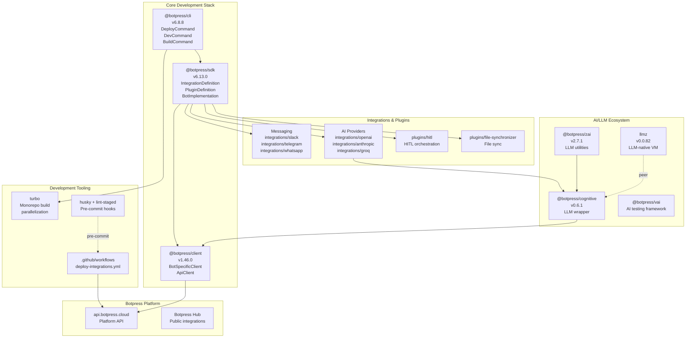

Sources: [packages/cli/package.json:2-31](), [packages/sdk/package.json:2-23](), [packages/client/package.json:2-27](), [packages/zai/package.json:2-35](), [packages/llmz/package.json:2-78](), [pnpm-lock.yaml:14-112]()

## Core Architecture Components

The system is built around a three-tier dependency stack: CLI → SDK → Client, with parallel AI/LLM infrastructure. For details, see [Architecture](#1.1).

**Core Package Dependencies and Code Entities**

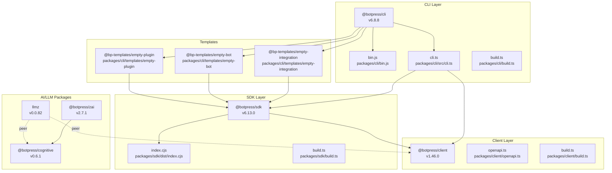

Sources: [packages/cli/package.json:1-77](), [packages/sdk/package.json:1-45](), [packages/client/package.json:1-45](), [packages/zai/package.json:1-67](), [packages/llmz/package.json:1-100](), [packages/cli/templates/empty-integration/package.json:1-16]()

### SDK (`@botpress/sdk`)

The SDK provides the core framework for building bots and integrations. It defines the structure for `IntegrationDefinition`, `PluginImplementation`, and the runtime handler system used by the Botpress Cloud. For details, see [SDK](#2.1).

### CLI (`@botpress/cli`)

The CLI (`bp`) manages the project lifecycle, including scaffolding from templates (found in `packages/cli/templates/`), building projects using `esbuild`, and deploying to the Botpress Cloud. For details, see [CLI](#2.2).

### Client (`@botpress/client`)

The client library provides a TypeScript-first wrapper around the Botpress Platform API. It handles communication for managing conversations, users, and messages. For details, see [Client](#2.3).

Sources: [packages/cli/package.json:22-24](), [packages/sdk/package.json:5-7](), [packages/client/package.json:5-7]()

## Integration Framework

The integration system provides 50+ connectors across messaging platforms (Slack, WhatsApp), AI providers (OpenAI, Anthropic), and productivity tools (Notion, GitHub).

- **Messaging Integrations**: Handle webhooks and message routing for platforms like Slack and Telegram.
- **LLM Integrations**: Standardize AI provider interactions via the `generateContent` action.
- **Support & CRM**: Connect Botpress to tools like Zendesk and HubSpot, often implementing Human-in-the-Loop (HITL) interfaces.

For details, see [Integration Framework](#4).

Sources: [pnpm-lock.yaml:128-140](), [pnpm-lock.yaml:159-162]()

## Plugin System

Plugins extend bot functionality through handler composition and hook interception. The system allows adding features like knowledge base synchronization or personality modifiers to any bot.

- **HITL Plugin**: Manages human-agent handoffs.
- **File Synchronizer**: Syncs external files to the Botpress Knowledge Base.

For details, see [Plugin System](#5).

Sources: [pnpm-lock.yaml:203-205](), [packages/cli/templates/empty-plugin/package.json:1-16]()

## Development Workflow

The development workflow is managed via `pnpm` and `turbo`.

| Command | Script | Purpose |
|---------|--------|---------|
| `pnpm build` | `turbo run build` | Build all packages and integrations |
| `pnpm check` | `pnpm check:lint && pnpm check:type` | Run quality checks (oxlint, eslint, tsc) |
| `pnpm fix` | `pnpm fix:lint && pnpm fix:format` | Auto-fix linting and formatting issues |
| `pnpm test` | `turbo test` | Run vitest across the monorepo |

For details, see [Development & Deployment](#6).

Sources: [package.json:4-23](), [packages/cli/package.json:5-15]()

---

# Page: Architecture

# Architecture

<details>
<summary>Relevant source files</summary>

The following files were used as context for generating this wiki page:

- [package.json](package.json)
- [packages/cli/package.json](packages/cli/package.json)
- [packages/cli/templates/empty-bot/package.json](packages/cli/templates/empty-bot/package.json)
- [packages/cli/templates/empty-integration/package.json](packages/cli/templates/empty-integration/package.json)
- [packages/cli/templates/empty-plugin/package.json](packages/cli/templates/empty-plugin/package.json)
- [packages/cli/templates/hello-world/package.json](packages/cli/templates/hello-world/package.json)
- [packages/cli/templates/webhook-message/package.json](packages/cli/templates/webhook-message/package.json)
- [packages/client/package.json](packages/client/package.json)
- [packages/cognitive/package.json](packages/cognitive/package.json)
- [packages/llmz/package.json](packages/llmz/package.json)
- [packages/sdk/package.json](packages/sdk/package.json)
- [packages/sdk/src/bot/definition.ts](packages/sdk/src/bot/definition.ts)
- [packages/sdk/src/index.ts](packages/sdk/src/index.ts)
- [packages/sdk/src/integration/definition/index.ts](packages/sdk/src/integration/definition/index.ts)
- [packages/sdk/src/interface/definition.ts](packages/sdk/src/interface/definition.ts)
- [packages/sdk/src/plugin/definition.ts](packages/sdk/src/plugin/definition.ts)
- [packages/vai/package.json](packages/vai/package.json)
- [packages/zai/package.json](packages/zai/package.json)
- [pnpm-lock.yaml](pnpm-lock.yaml)

</details>


## Purpose and Scope

This page describes the high-level architecture of the Botpress monorepo, explaining how core packages, integrations, plugins, bots, and interfaces are organized and interact. It covers the dependency hierarchy, the distinction between definition and implementation layers, and the runtime server architecture.

---

## Monorepo Organization

The Botpress repository is a pnpm workspace-based monorepo. It manages dependencies using pnpm and orchestrates builds with Turbo.

| Directory | Package Type | Purpose |
|-----------|-------------|---------|
| `packages/` | Core packages | Foundational tools: CLI, SDK, Client, and AI/LLM utilities (`llmz`, `zai`, `cognitive`). |
| `integrations/` | Integration packages | External platform connectors (Slack, OpenAI, WhatsApp, etc.). |
| `interfaces/` | Interface definitions | Contracts for standardized capabilities (e.g., `llm`, `hitl`). |
| `plugins/` | Plugin packages | Reusable bot extensions (e.g., `hitl`, `file-synchronizer`). |
| `bots/` | Example bots | Reference implementations (e.g., `bugbuster`, `hello-world`). |

The workspace uses pnpm's `workspace:*` protocol for internal dependencies, ensuring that packages always reference the local versions during development.

**Sources:** [pnpm-lock.yaml:1-100](), [package.json:1-74]()

---

## Core Dependency Stack

The Botpress platform is built on a three-tier dependency hierarchy:

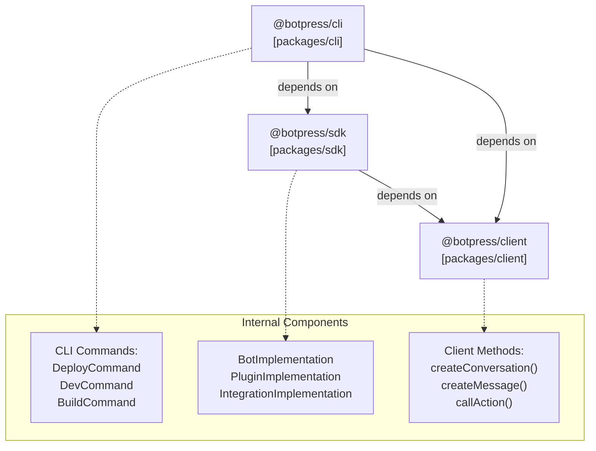

### @botpress/client
The foundational package providing HTTP communication with the Botpress platform API. It wraps the API into a type-safe TypeScript client.
- **Key Files:** [packages/client/package.json:1-45]()
- **Functionality:** Handles retries (via `axios-retry`) and provides dual Node.js/Browser support [packages/client/package.json:27-32]().

### @botpress/sdk
The development SDK for building bots, integrations, and plugins. It provides the base classes and runtime logic for the platform.
- **Key Classes:** `BotImplementation`, `IntegrationImplementation`, `PluginImplementation`.
- **Key Files:** [packages/sdk/package.json:1-45](), [packages/sdk/src/index.ts:1-87]().

### @botpress/cli
The command-line interface for project scaffolding, local development, and deployment.
- **Binary:** `bp` [packages/cli/package.json:22-24]().
- **Key Functionality:** Bundling code via `esbuild` and generating types via `bp gen` [packages/cli/package.json:5-15]().

**Sources:** [packages/cli/package.json:1-78](), [packages/sdk/package.json:1-46](), [packages/client/package.json:1-45]()

---

## Definition vs Implementation Pattern

Botpress uses a two-layer architecture pattern to separate the **contract** (what it does) from the **logic** (how it does it).

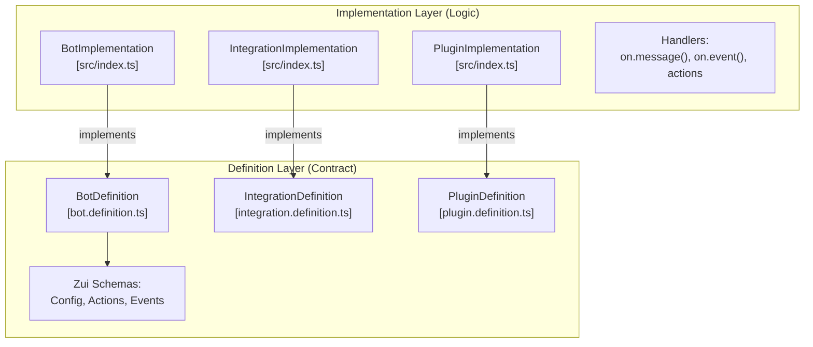

### Definition Layer
The definition layer declares the **contract** using the `@bpinternal/zui` schema system.
- **BotDefinition:** [packages/sdk/src/bot/definition.ts]()
- **IntegrationDefinition:** [packages/sdk/src/integration/definition/index.ts]()
- **PluginDefinition:** [packages/sdk/src/plugin/definition.ts]()

### Implementation Layer
The implementation layer provides the **runtime logic**.
- **BotImplementation:** [packages/sdk/src/bot/implementation.ts:40-452]()
- **PluginImplementation:** [packages/sdk/src/plugin/implementation.ts:55-513]()

**Sources:** [packages/sdk/src/bot/implementation.ts:33-452](), [packages/sdk/src/plugin/implementation.ts:41-513]()

---

## Project Type Architecture

### Bots
Bots orchestrate conversations by consuming integrations and plugins. They are defined by a `bot.definition.ts` and implemented in `src/index.ts`.
- **Reference Implementation:** `bots/hello-world` [packages/cli/templates/hello-world/package.json:1-17]().
- **Logic:** Bots register `messageHandlers`, `eventHandlers`, and `actionHandlers` [packages/sdk/src/bot/implementation.ts:105-275]().

### Integrations
Integrations connect Botpress to external platforms (e.g., Slack, WhatsApp).
- **Lifecycle:** Includes `register`, `unregister`, and a `handler` for incoming webhooks.
- **Reference Implementation:** `empty-integration` [packages/cli/templates/empty-integration/package.json:1-16]().

### Plugins
Plugins are reusable units of logic that can be injected into bots to extend their functionality.
- **Mechanism:** Plugins can define their own actions, events, and states which are merged into the bot's runtime context [packages/sdk/src/plugin/implementation.ts:55-513]().

### Interfaces
Interfaces (found in `interfaces/`) define standardized contracts that integrations can implement, allowing bots to interact with different platforms using the same code (e.g., the `llm` interface).
- **Interface Definition:** [packages/sdk/src/interface/definition.ts]()

**Sources:** [packages/cli/templates/hello-world/package.json:1-17](), [packages/sdk/src/bot/implementation.ts:40-452](), [packages/sdk/src/plugin/implementation.ts:55-513]()

---

## Runtime Server Architecture

When a bot or integration is deployed, it runs as a server that handles webhooks from the Botpress platform.

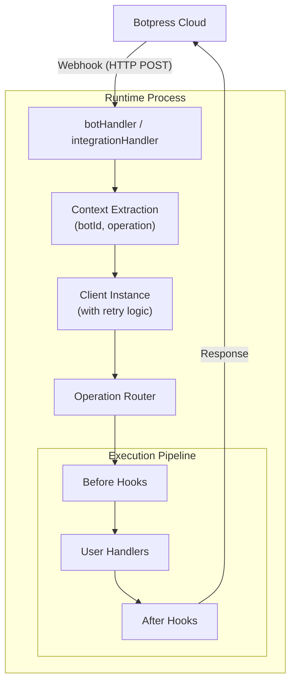

- **Context:** Extracted from headers like `x-bp-bot-id` and `x-bp-operation`.
- **Client:** A `BotSpecificClient` is instantiated for every request, providing scoped access to the platform API.
- **Pipeline:** Handlers are executed in order: `before_incoming_message` -> `on.message` -> `after_incoming_message`.

**Sources:** [packages/sdk/src/bot/implementation.ts:105-275](), [packages/sdk/src/bot/server/index.ts:15-312]()

---

## AI and LLM Architecture

Botpress includes a sophisticated AI stack built on top of the core Client and SDK.

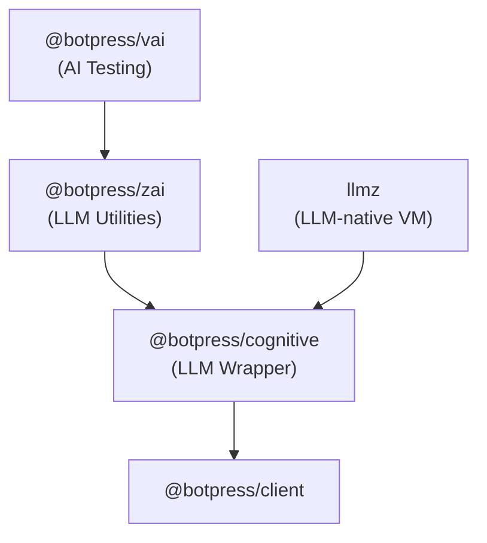

- **@botpress/cognitive:** A wrapper for various LLM providers (OpenAI, Anthropic, etc.) providing a unified interface for text generation.
- **@botpress/zai:** A utility library for schema-based LLM interactions using Zui [packages/zai/package.json:1-67]().
- **llmz:** An LLM-native TypeScript VM built on top of Zui and QuickJS [packages/llmz/package.json:1-100]().
- **@botpress/vai:** A framework for AI-driven testing and validation [packages/vai/package.json:1-52]().

**Sources:** [packages/zai/package.json:1-67](), [packages/llmz/package.json:1-100](), [packages/cognitive/package.json:1-51](), [packages/vai/package.json:1-52]()

---

# Page: Monorepo Structure

# Monorepo Structure

<details>
<summary>Relevant source files</summary>

The following files were used as context for generating this wiki page:

- [.oxlintrc.json](.oxlintrc.json)
- [eslint.config.mjs](eslint.config.mjs)
- [integrations/calcom/src/actions/bookEvent.ts](integrations/calcom/src/actions/bookEvent.ts)
- [integrations/calcom/src/actions/getEventTypes.ts](integrations/calcom/src/actions/getEventTypes.ts)
- [integrations/linear/definitions/actions.ts](integrations/linear/definitions/actions.ts)
- [integrations/linear/src/actions/find-target.ts](integrations/linear/src/actions/find-target.ts)
- [integrations/linear/src/actions/get-issue.ts](integrations/linear/src/actions/get-issue.ts)
- [integrations/linear/src/actions/get-user.ts](integrations/linear/src/actions/get-user.ts)
- [integrations/linear/src/index.ts](integrations/linear/src/index.ts)
- [package.json](package.json)
- [packages/cli/package.json](packages/cli/package.json)
- [packages/cli/src/typings.ts](packages/cli/src/typings.ts)
- [packages/cli/templates/empty-bot/package.json](packages/cli/templates/empty-bot/package.json)
- [packages/cli/templates/empty-integration/package.json](packages/cli/templates/empty-integration/package.json)
- [packages/cli/templates/empty-plugin/package.json](packages/cli/templates/empty-plugin/package.json)
- [packages/cli/templates/hello-world/package.json](packages/cli/templates/hello-world/package.json)
- [packages/cli/templates/webhook-message/package.json](packages/cli/templates/webhook-message/package.json)
- [packages/client/package.json](packages/client/package.json)
- [packages/cognitive/package.json](packages/cognitive/package.json)
- [packages/llmz/package.json](packages/llmz/package.json)
- [packages/sdk/package.json](packages/sdk/package.json)
- [packages/vai/package.json](packages/vai/package.json)
- [packages/zai/package.json](packages/zai/package.json)
- [pnpm-lock.yaml](pnpm-lock.yaml)
- [tsconfig.json](tsconfig.json)

</details>


This document details the organization of the Botpress monorepo, including workspace structure, package categories, dependency management with pnpm, and versioning strategies. The monorepo contains core development packages, 50+ integrations, plugins, example bots, and interface definitions, all managed as a unified codebase.

For information about the high-level architecture and how these components interact, see section 1.1. For build system details, see section 3.2.

## Workspace Organization

The Botpress repository is organized as a pnpm workspace with distinct package categories, each serving a specific purpose in the platform ecosystem.

### Directory Structure

```
botpress/
├── packages/          # Core platform packages
│   ├── cli/          # @botpress/cli - Build and deployment tooling
│   ├── sdk/          # @botpress/sdk - Bot and integration API
│   ├── client/       # @botpress/client - Platform API client
│   ├── common/       # Shared utilities across packages
│   ├── cognitive/    # @botpress/cognitive - LLM wrapper
│   ├── zai/          # @botpress/zai - LLM utilities
│   ├── llmz/         # llmz - LLM-native VM
│   └── vai/          # @botpress/vai - AI testing framework
│
├── integrations/     # 50+ external service integrations
│   ├── openai/       # @botpresshub/openai
│   ├── slack/        # @botpresshub/slack
│   ├── linear/       # @botpresshub/linear
│   └── ...
│
├── plugins/          # Bot functionality extensions
│   ├── hitl/         # @botpresshub/hitl-plugin
│   ├── file-sync/    # @botpresshub/file-synchronizer
│   └── ...
│
├── interfaces/       # Interface contracts
│   ├── hitl/         # @botpresshub/hitl - HITL interface
│   ├── llm/          # @botpresshub/llm - LLM interface
│   └── ...
│
└── bots/            # Example bot implementations
    ├── hello-world/  # Basic bot example
    ├── bugbuster/    # GitHub/Linear issue triage bot
    └── echo/         # Simple echo bot
```

**Sources:** [pnpm-lock.yaml:12-232](), [package.json:1-73]()

### Directory Structure Diagram

```mermaid
graph TB
    ROOT["botpress/"]
    
    subgraph "Core Packages"
        PACKAGES["packages/"]
        CLI["cli/<br/>@botpress/cli<br/>v6.8.8"]
        SDK["sdk/<br/>@botpress/sdk<br/>v6.13.0"]
        CLIENT["client/<br/>@botpress/client<br/>v1.46.0"]
        COG["cognitive/<br/>@botpress/cognitive<br/>v0.6.1"]
        ZAI["zai/<br/>@botpress/zai<br/>v2.7.1"]
        LLMZ["llmz/<br/>llmz<br/>v0.0.82"]
    end
    
    subgraph "Integrations"
        INTEGRATIONS["integrations/"]
        INT_AI["AI Providers<br/>openai, anthropic,<br/>groq, mistral"]
        INT_MSG["Messaging<br/>slack, telegram,<br/>whatsapp"]
        INT_PROD["Productivity<br/>linear, notion,<br/>github"]
    end
    
    subgraph "Plugins"
        PLUGINS["plugins/"]
        PLUG_HITL["hitl/<br/>@botpresshub/hitl-plugin"]
        PLUG_FILE["file-synchronizer/<br/>@botpresshub/file-synchronizer"]
    end
    
    subgraph "Bots"
        BOTS["bots/"]
        BOT_HELLO["hello-world/"]
        BOT_BUG["bugbuster/"]
        BOT_CLOG["clog/"]
    end
    
    ROOT --> PACKAGES
    ROOT --> INTEGRATIONS
    ROOT --> PLUGINS
    ROOT --> BOTS
    
    PACKAGES --> CLI
    PACKAGES --> SDK
    PACKAGES --> CLIENT
    PACKAGES --> COG
    PACKAGES --> ZAI
    PACKAGES --> LLMZ
    
    INTEGRATIONS --> INT_AI
    INTEGRATIONS --> INT_MSG
    INTEGRATIONS --> INT_PROD
    
    PLUGINS --> PLUG_HITL
    PLUGINS --> PLUG_FILE
    
    BOTS --> BOT_HELLO
    BOTS --> BOT_BUG
    BOTS --> BOT_CLOG
```

**Sources:** [pnpm-lock.yaml:113-232](), [packages/cli/package.json:2-3](), [packages/sdk/package.json:2-3](), [packages/client/package.json:2-3]()

## Package Manager Configuration

The monorepo uses pnpm as its package manager with specific configuration for workspace management and dependency patching.

### pnpm Workspace Settings

The `pnpm-lock.yaml` and `package.json` define the workspace configuration:

| Setting | Value | Purpose |
|---------|-------|---------|
| `lockfileVersion` | `'9.0'` | Lock file format version [pnpm-lock.yaml:1]() |
| `autoInstallPeers` | `true` | Automatically install peer dependencies [pnpm-lock.yaml:4]() |
| `packageManager` | `pnpm@10.29.3` | Enforced pnpm version [package.json:67]() |

### Patched Dependencies

The monorepo applies custom patches to upstream dependencies to fix issues or add required functionality [pnpm-lock.yaml:7-10]():

```yaml
patchedDependencies:
  source-map-js@1.2.1:
    hash: 0354139cbc5dbd66e1bc59167ff8e42d3a9a2169038a35f1b7b1b4b843e08a6c
    path: patches/source-map-js@1.2.1.patch
```

This patch is referenced in the root configuration [package.json:68-72]().

**Sources:** [pnpm-lock.yaml:1-11](), [package.json:67-72]()

## Dependency Management

### Workspace Protocol

Internal dependencies use the `workspace:*` protocol to link packages within the monorepo. This ensures packages always use the local version during development rather than pulling from a registry.

#### Core Package Dependencies

The core dependency chain is established in the package manifests:

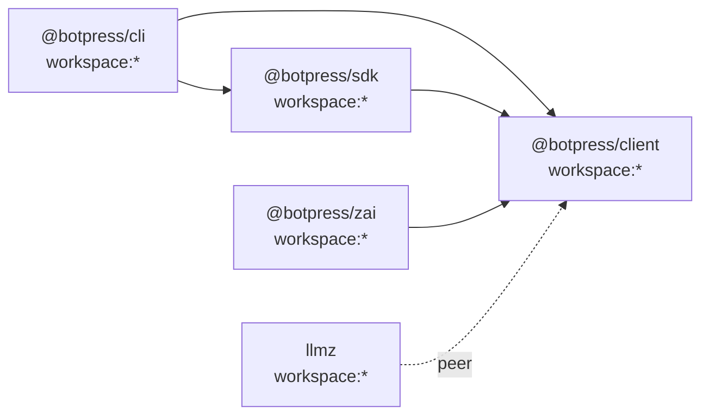

**Sources:** [packages/cli/package.json:27-31](), [packages/sdk/package.json:22-23](), [packages/llmz/package.json:73-74]()

#### Example: CLI Package Dependencies

[packages/cli/package.json:27-31]() shows how the CLI depends on the SDK and Client:

```json
"dependencies": {
  "@botpress/client": "1.46.0",
  "@botpress/sdk": "6.13.0",
  // ...
}
```

In the root lockfile, these resolve to workspace links [pnpm-lock.yaml:25-30]():

```yaml
'@botpress/client':
  specifier: workspace:*
  version: link:packages/client
'@botpress/sdk':
  specifier: workspace:*
  version: link:packages/sdk
```

### Template Package Dependencies

CLI templates define the dependencies for newly scaffolded projects. Unlike core packages, these often use fixed versions to ensure stability for end-users [packages/cli/templates/empty-integration/package.json:8-11]():

| Template | Dependencies | Purpose |
|----------|-------------|---------|
| `empty-integration` | `@botpress/client`, `@botpress/sdk` | Integration scaffold [packages/cli/templates/empty-integration/package.json:8-11]() |
| `empty-bot` | `@botpress/client`, `@botpress/sdk` | Bot scaffold [packages/cli/templates/empty-bot/package.json:7-10]() |
| `empty-plugin` | `@botpress/sdk` | Plugin scaffold [packages/cli/templates/empty-plugin/package.json:8-10]() |
| `webhook-message` | `@botpress/client`, `@botpress/sdk`, `axios` | Webhook example [packages/cli/templates/webhook-message/package.json:8-12]() |

### Peer Dependencies

Several packages use peer dependencies to manage shared state or heavy requirements like `esbuild` or `zui`.

#### SDK Peer Dependencies

The SDK requires `@bpinternal/zui` and optionally `esbuild` for bundling [packages/sdk/package.json:32-40]():

```json
"peerDependencies": {
  "@bpinternal/zui": "^2.3.0",
  "esbuild": "^0.16.12"
},
"peerDependenciesMeta": {
  "esbuild": {
    "optional": true
  }
}
```

#### LLM Package Peer Dependencies

`llmz` (the LLM-native VM) has strict peer requirements to ensure compatibility with the platform's AI wrapper and schema system [packages/llmz/package.json:73-78]():

```json
"peerDependencies": {
  "@botpress/client": "1.46.0",
  "@botpress/cognitive": "0.6.1",
  "@bpinternal/thicktoken": "^2.0.0",
  "@bpinternal/zui": "^2.3.0"
}
```

**Sources:** [packages/sdk/package.json:32-40](), [packages/llmz/package.json:73-97](), [packages/zai/package.json:58-61]()

## Package Categories

### Core Packages

Core packages provide the foundation for the Botpress ecosystem.

| Package | Version | Role |
|---------|---------|------|
| `@botpress/cli` | 6.8.8 | Project lifecycle management (init, build, deploy) [packages/cli/package.json:2-3]() |
| `@botpress/sdk` | 6.13.0 | Type-safe APIs for bots and integrations [packages/sdk/package.json:2-3]() |
| `@botpress/client` | 1.46.0 | Axios-based client for Botpress Cloud API [packages/client/package.json:2-3]() |
| `@botpress/cognitive`| 0.6.1 | Abstracted LLM interaction layer [packages/cognitive/package.json:2-4]() |
| `@botpress/zai` | 2.7.1 | AI utility library built on Zui [packages/zai/package.json:2-4]() |
| `llmz` | 0.0.82 | LLM-native Typescript VM [packages/llmz/package.json:2-5]() |

### Integrations and Plugins

Integrations and plugins are organized as sub-workspaces. They consume core packages as dependencies.

#### Integration Structure Example

The `bugbuster` bot demonstrates how a bot package consumes multiple integrations and core packages [pnpm-lock.yaml:113-143]():

```yaml
bots/bugbuster:
  dependencies:
    '@botpress/client': workspace:*
    '@botpress/sdk': workspace:*
  devDependencies:
    '@botpress/cli': workspace:*
    '@botpresshub/github': workspace:*
    '@botpresshub/linear': workspace:*
    '@botpresshub/slack': workspace:*
```

## Root Scripts and Quality Control

The root `package.json` orchestrates the entire monorepo using `turbo` for task execution and several tools for code quality.

### Task Orchestration

| Command | Action | Implementation |
|---------|--------|----------------|
| `pnpm build` | Build all workspace packages | `turbo run build` [package.json:5]() |
| `pnpm test` | Run tests across monorepo | `turbo test` [package.json:7]() |
| `pnpm check` | Comprehensive quality check | `sherif`, `depsynky`, `format`, `lint`, `type` [package.json:22]() |
| `pnpm fix` | Auto-fix quality issues | `sherif`, `depsynky`, `oxlint`, `format`, `eslint` [package.json:23]() |

### Code Quality Tools

The monorepo employs a multi-layered linting strategy:
1. **Sherif:** Checks for version mismatches across the workspace [package.json:10]().
2. **DepSynky:** Ensures internal workspace dependency consistency [package.json:9]().
3. **Oxlint:** High-performance linting for quick feedback [package.json:13]().
4. **ESLint:** Deep structural and stylistic linting [package.json:12]().
5. **Prettier:** Enforces consistent code formatting [package.json:11]().

**Sources:** [package.json:1-24](), [pnpm-lock.yaml:12-112]()

---

# Page: Core Packages

# Core Packages

<details>
<summary>Relevant source files</summary>

The following files were used as context for generating this wiki page:

- [package.json](package.json)
- [packages/cli/package.json](packages/cli/package.json)
- [packages/cli/templates/empty-bot/package.json](packages/cli/templates/empty-bot/package.json)
- [packages/cli/templates/empty-integration/package.json](packages/cli/templates/empty-integration/package.json)
- [packages/cli/templates/empty-plugin/package.json](packages/cli/templates/empty-plugin/package.json)
- [packages/cli/templates/hello-world/package.json](packages/cli/templates/hello-world/package.json)
- [packages/cli/templates/webhook-message/package.json](packages/cli/templates/webhook-message/package.json)
- [packages/client/package.json](packages/client/package.json)
- [packages/client/src/index.ts](packages/client/src/index.ts)
- [packages/cognitive/package.json](packages/cognitive/package.json)
- [packages/llmz/package.json](packages/llmz/package.json)
- [packages/sdk/package.json](packages/sdk/package.json)
- [packages/sdk/src/index.ts](packages/sdk/src/index.ts)
- [packages/vai/package.json](packages/vai/package.json)
- [packages/zai/package.json](packages/zai/package.json)
- [pnpm-lock.yaml](pnpm-lock.yaml)

</details>


This document covers the core packages that form the Botpress development toolkit. The primary packages are `@botpress/sdk`, `@botpress/cli`, and `@botpress/client`, which provide the essential building blocks for creating integrations, bots, and plugins. Additionally, the AI/LLM ecosystem packages (`@botpress/cognitive`, `@botpress/zai`, `llmz`, `@botpress/vai`) provide utilities for working with language models.

For information about the integration framework that uses these packages, see [Integration Framework](#4). For details about CLI commands and development workflows, see [CLI & Development Tools](#3). For specific documentation on each package, see:
- SDK details in [SDK](#2.1)
- CLI details in [CLI](#2.2)
- Client details in [Client](#2.3)
- AI/LLM packages in [AI/LLM Packages](#2.4)

## Package Overview

The core packages form a layered architecture where each package serves a specific purpose in the development stack:

### Package Dependency Architecture

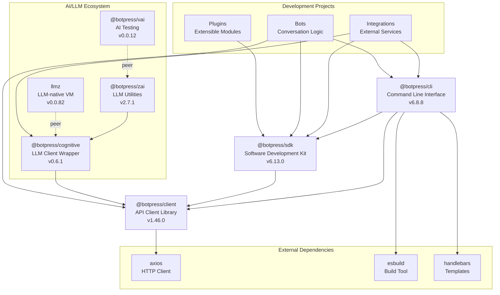

Sources: [packages/cli/package.json:2-3](), [packages/sdk/package.json:2-3](), [packages/client/package.json:2-3](), [packages/cognitive/package.json:2-3](), [packages/zai/package.json:2-4](), [packages/llmz/package.json:2-5](), [packages/vai/package.json:2-3](), [pnpm-lock.yaml:22-30]()

### Package Responsibilities

| Package | Purpose | Key Features |
|---------|---------|--------------|
| `@botpress/client` | Low-level API client | HTTP client, authentication, raw API operations |
| `@botpress/sdk` | Development framework | Type-safe wrappers, definition schemas, build tools |
| `@botpress/cli` | Development tooling | Project scaffolding, deployment, local development |
| `@botpress/cognitive` | LLM client wrapper | Model registry, cost tracking, streaming support |
| `@botpress/zai` | LLM utilities | Schema validation, prompt helpers, token counting |
| `llmz` | LLM-native VM | TypeScript VM for LLM execution |
| `@botpress/vai` | AI testing framework | LLM-based test assertions for vitest |

## SDK Architecture

The SDK provides typed client wrappers that enhance the base client with type safety and domain-specific operations. It is designed to run in both Node.js and browser environments.

### SDK Client Type System

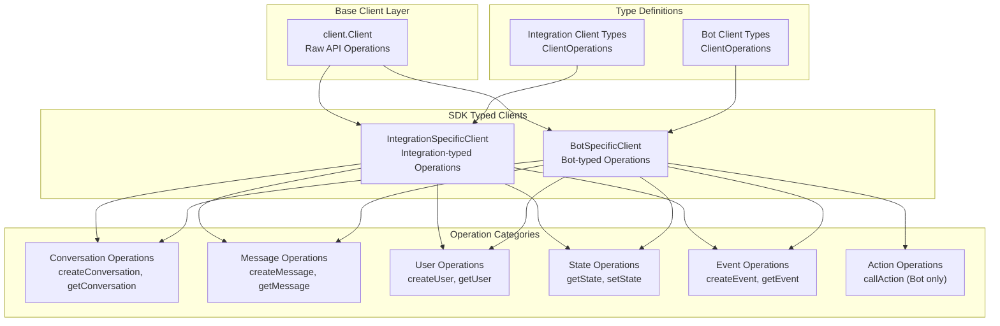

Sources: [packages/sdk/src/index.ts:1-10](), [packages/sdk/package.json:5-7](), [packages/sdk/package.json:22-26]()

### IntegrationSpecificClient

The `IntegrationSpecificClient` provides type-safe operations for integrations. It ensures that when an integration interacts with the Botpress API, it respects the schemas defined in its `IntegrationDefinition`.

Key features:
- **Type-safe conversations**: Channel-specific conversation creation with typed tags.
- **Typed messages**: Message operations with payload and tag type inference.
- **State management**: Integration-specific state operations.
- **Event handling**: Typed event creation and retrieval.

Sources: [packages/sdk/package.json:2-4](), [packages/sdk/package.json:22-26]()

### BotSpecificClient

The `BotSpecificClient` extends functionality for bot implementations, allowing them to interact with integrations and manage their own internal state and tables.

Additional bot-specific features:
- **Action calls**: `callAction` for invoking integration actions.
- **Client hooks**: Before/after operation hooks for customization.
- **Table operations**: CRUD operations on bot tables.
- **Workflow management**: Workflow creation and execution.

Sources: [packages/sdk/package.json:2-4](), [packages/sdk/package.json:22-26]()

## CLI Package

The CLI package (`@botpress/cli`) provides development tools and project management capabilities via the `bp` command.

### CLI Command Structure

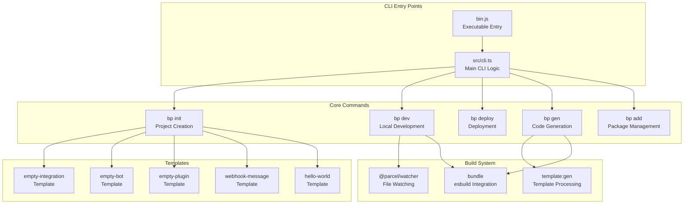

Sources: [packages/cli/package.json:22-24](), [packages/cli/package.json:5-15](), [packages/cli/templates/empty-integration/package.json:1-16](), [packages/cli/templates/empty-bot/package.json:1-15]()

### CLI Dependencies and Build Tools

The CLI integrates multiple build and development tools to streamline the developer experience:

| Dependency | Purpose | Usage |
|------------|---------|-------|
| `esbuild` | JavaScript bundling | Fast compilation and bundling of TypeScript projects for deployment |
| `handlebars` | Template engine | Scaffolding new projects from templates |
| `@parcel/watcher` | File watching | Powering the `bp dev` hot-reload cycle |
| `prettier` | Code formatting | Automated formatting of generated code |
| `dotenv` | Environment variables | Loading secrets and configuration for local development |

Sources: [packages/cli/package.json:48](), [packages/cli/package.json:49](), [packages/cli/package.json:36](), [packages/cli/package.json:53](), [packages/cli/package.json:47]()

## Client Package

The client package (`@botpress/client`) provides the foundational HTTP client for Botpress API operations, using `axios` with retry logic.

### Client Architecture

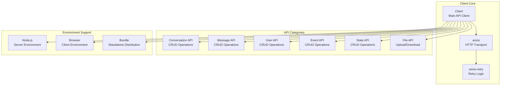

Sources: [packages/client/package.json:27-31](), [packages/client/src/index.ts:1-5](), [packages/client/package.json:17-23]()

### Client Build Targets

The client package supports multiple deployment environments to ensure it can be used in both backend scripts and frontend dashboards:

| Build Target | Purpose | Output |
|--------------|---------|--------|
| `build:node` | Node.js servers | CommonJS/ESM modules |
| `build:browser` | Web browsers | Browser-compatible bundle |
| `build:bundle` | Standalone distribution | Self-contained bundle for direct inclusion |

Sources: [packages/client/package.json:20-23]()

## Development Workflow Integration

The core packages work together to provide a complete development lifecycle, from local coding to production deployment.

### Package Integration Flow

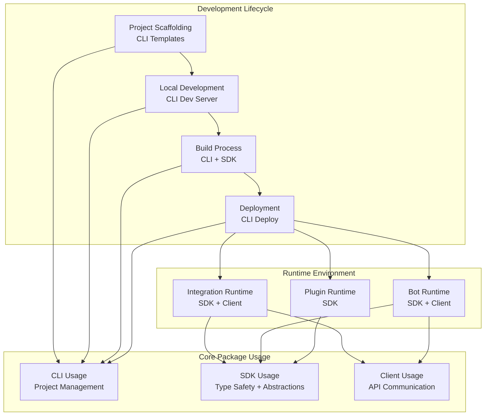

Sources: [packages/cli/package.json:5-15](), [packages/sdk/package.json:11-17](), [packages/client/package.json:17-23]()

### Version Management

The packages maintain coordinated versioning across the monorepo to ensure compatibility:

| Package | Version | Role |
|---------|---------|------|
| `@botpress/client` | 1.46.0 | Stable API client |
| `@botpress/sdk` | 6.13.0 | Development framework |
| `@botpress/cli` | 6.8.8 | Development tools |

Sources: [packages/client/package.json:3](), [packages/sdk/package.json:3](), [packages/cli/package.json:3](), [pnpm-lock.yaml:20-30]()

---

# Page: SDK

# SDK

<details>
<summary>Relevant source files</summary>

The following files were used as context for generating this wiki page:

- [packages/sdk/src/base-logger.test.ts](packages/sdk/src/base-logger.test.ts)
- [packages/sdk/src/base-logger.ts](packages/sdk/src/base-logger.ts)
- [packages/sdk/src/bot/client/index.ts](packages/sdk/src/bot/client/index.ts)
- [packages/sdk/src/bot/client/types.test.ts](packages/sdk/src/bot/client/types.test.ts)
- [packages/sdk/src/bot/client/types.ts](packages/sdk/src/bot/client/types.ts)
- [packages/sdk/src/bot/definition.ts](packages/sdk/src/bot/definition.ts)
- [packages/sdk/src/bot/implementation.ts](packages/sdk/src/bot/implementation.ts)
- [packages/sdk/src/bot/server/index.ts](packages/sdk/src/bot/server/index.ts)
- [packages/sdk/src/bot/server/types.test.ts](packages/sdk/src/bot/server/types.test.ts)
- [packages/sdk/src/bot/server/types.ts](packages/sdk/src/bot/server/types.ts)
- [packages/sdk/src/integration/client/index.ts](packages/sdk/src/integration/client/index.ts)
- [packages/sdk/src/integration/client/sub-types.ts](packages/sdk/src/integration/client/sub-types.ts)
- [packages/sdk/src/integration/client/types.ts](packages/sdk/src/integration/client/types.ts)
- [packages/sdk/src/integration/definition/index.ts](packages/sdk/src/integration/definition/index.ts)
- [packages/sdk/src/integration/implementation.ts](packages/sdk/src/integration/implementation.ts)
- [packages/sdk/src/integration/server/index.ts](packages/sdk/src/integration/server/index.ts)
- [packages/sdk/src/integration/server/integration-logger.ts](packages/sdk/src/integration/server/integration-logger.ts)
- [packages/sdk/src/integration/server/types.ts](packages/sdk/src/integration/server/types.ts)
- [packages/sdk/src/interface/definition.ts](packages/sdk/src/interface/definition.ts)
- [packages/sdk/src/plugin/definition.ts](packages/sdk/src/plugin/definition.ts)
- [packages/sdk/src/plugin/implementation.ts](packages/sdk/src/plugin/implementation.ts)
- [packages/sdk/src/plugin/server/types.ts](packages/sdk/src/plugin/server/types.ts)

</details>


## Purpose and Scope

The `@botpress/sdk` package provides the core API for building bots, integrations, and plugins in the Botpress platform. It defines the handler system, type definitions, runtime server architecture, and client wrappers that enable event-driven bot development with strong TypeScript support.

This page covers the SDK's implementation classes, handler system, runtime server, and type system. For CLI usage and project management, see [CLI](#2.2). For the underlying platform API client, see [Client](#2.3). For integration development patterns, see [Integration Framework](#4). For plugin architecture, see [Plugin System](#5).

**Sources:** [packages/sdk/src/bot/implementation.ts:1-32](), [packages/sdk/src/integration/server/index.ts:1-20]()

---

## Main Exports

```mermaid
graph TB
    SDK["@botpress/sdk"]
    
    subgraph "Bot Development"
        BOT_DEF["BotDefinition"]
        BOT_IMPL["BotImplementation (Bot)"]
        BOT_CLIENT["BotSpecificClient"]
    end
    
    subgraph "Integration Development"
        INT_DEF["IntegrationDefinition"]
        INT_IMPL["IntegrationImplementation (Integration)"]
        INT_CLIENT["IntegrationSpecificClient"]
    end
    
    subgraph "Plugin Development"
        PLUG_DEF["PluginDefinition"]
        PLUG_IMPL["PluginImplementation (Plugin)"]
    end
    
    subgraph "Common Utilities"
        SERVE["serve()"]
        ZUI["zui"]
        BOT_HANDLER["botHandler()"]
        INT_HANDLER["integrationHandler()"]
    end
    
    SDK --> BOT_DEF
    SDK --> BOT_IMPL
    SDK --> BOT_CLIENT
    SDK --> INT_DEF
    SDK --> INT_IMPL
    SDK --> INT_CLIENT
    SDK --> PLUG_DEF
    SDK --> PLUG_IMPL
    SDK --> SERVE
    SDK --> ZUI
    SDK --> BOT_HANDLER
    SDK --> INT_HANDLER
```

**Diagram: SDK Main Export Structure**

The SDK exports aliased types for consistency. `BotImplementation` is typically used as the base for bot logic [packages/sdk/src/bot/implementation.ts:43-45](), while `IntegrationImplementation` serves the same role for integrations.

---

## BotImplementation Class

The `BotImplementation` class is the primary class for building bot logic. It provides an event-driven handler registration system and composes handlers from both the bot itself and any installed plugins.

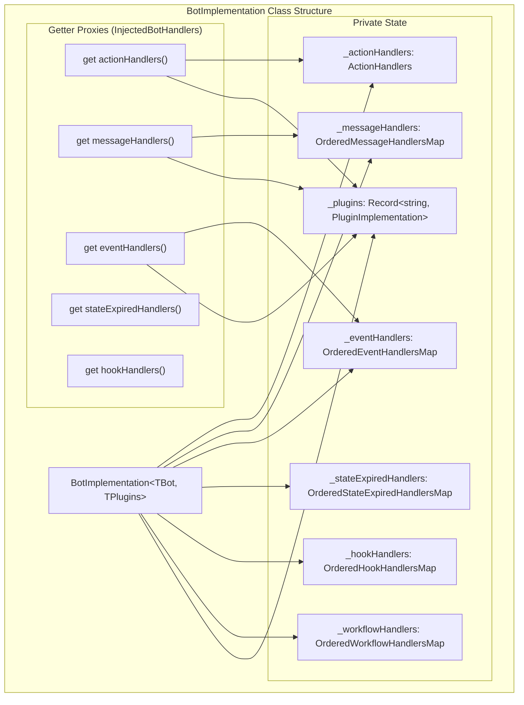

**Diagram: BotImplementation Internal Structure**

### Constructor and Properties

The `BotImplementation` constructor accepts `BotImplementationProps<TBot, TPlugins>` [packages/sdk/src/bot/implementation.ts:35-41]():

- `actions`: Action handlers not provided by plugins [packages/sdk/src/bot/implementation.ts:37-37]().
- `plugins`: Map of plugin alias to `PluginImplementation` instances [packages/sdk/src/bot/implementation.ts:38-40]().

### Handler Maps

The class maintains internal handler maps, each storing handlers with registration order [packages/sdk/src/bot/implementation.ts:47-67]():

| Map | Purpose |
|-----|---------|
| `_actionHandlers` | Action implementations [packages/sdk/src/bot/implementation.ts:47-47]() |
| `_messageHandlers` | Message type handlers with order [packages/sdk/src/bot/implementation.ts:48-48]() |
| `_eventHandlers` | Event type handlers with order [packages/sdk/src/bot/implementation.ts:49-49]() |
| `_hookHandlers` | Before/after hooks (e.g., `before_incoming_message`) [packages/sdk/src/bot/implementation.ts:51-62]() |
| `_workflowHandlers` | Workflow lifecycle handlers (started, continued, timed_out) [packages/sdk/src/bot/implementation.ts:63-67]() |

### Handler Composition with Plugins

The getter proxies compose handlers from both the bot and plugins. For example, the `messageHandlers` getter retrieves handlers from all plugins and merges them with the bot's own specific and global handlers, sorting them by their registration order [packages/sdk/src/bot/implementation.ts:111-136]().

### Action Handler Resolution

Action handlers support plugin prefixing using `PLUGIN_PREFIX_SEPARATOR` (`#`) [packages/sdk/src/bot/implementation.ts:3-3](). If an action is not found on the bot, the proxy attempts to split the name to find the corresponding plugin and its action handler [packages/sdk/src/bot/implementation.ts:83-109]().

---

## Bot Runtime Server

The `botHandler` function creates an HTTP request handler that routes incoming requests to appropriate handlers based on the operation type [packages/sdk/src/bot/server/index.ts:15-128]().

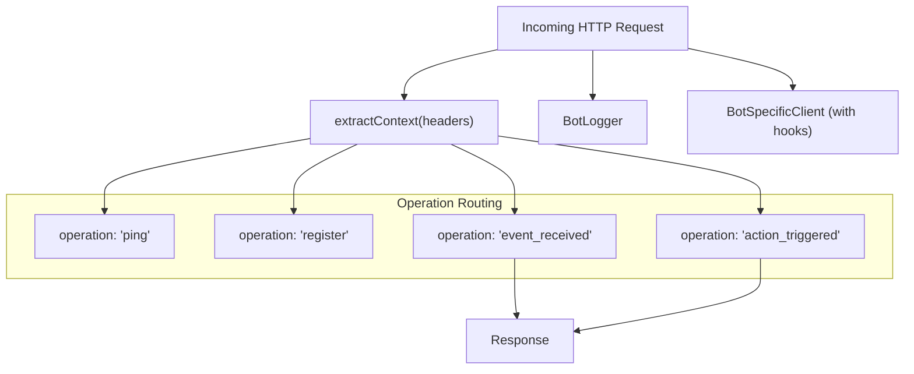

**Diagram: botHandler Request Flow**

### Context Extraction

The `extractContext()` function parses HTTP headers to create a `BotContext` [packages/sdk/src/bot/server/index.ts:18-18](). This context identifies the `botId`, the `operation` (e.g., `event_received`), and the specific `type` of the payload [packages/sdk/src/bot/server/types.ts:11-18]().

### BotSpecificClient Hook Wrapping

The runtime creates a `BotSpecificClient` that wraps the vanilla client with before/after hooks for operations like `createMessage` and `callAction` [packages/sdk/src/bot/server/index.ts:25-94](). This allows hooks registered via `on.beforeOutgoingMessage` to intercept and modify outgoing data [packages/sdk/src/bot/server/index.ts:28-38]().

### Operation Handlers

- **`onRegister`**: Calls the bot's `registerHandler` if defined [packages/sdk/src/bot/server/index.ts:134-141]().
- **`onEventReceived`**: Routes events based on type. If the type is `message_created`, it executes `before_incoming_message` hooks, then the specific message handlers, and finally `after_incoming_message` hooks [packages/sdk/src/bot/server/index.ts:166-206]().
- **`onActionTriggered`**: Parses the action input and type, executes before hooks, runs the action handler, and executes after hooks [packages/sdk/src/bot/server/index.ts:260-311]().

---

## Integration Runtime Server

Similar to bots, integrations use `integrationHandler` to process incoming requests from the Botpress platform [packages/sdk/src/integration/server/index.ts:94-125]().

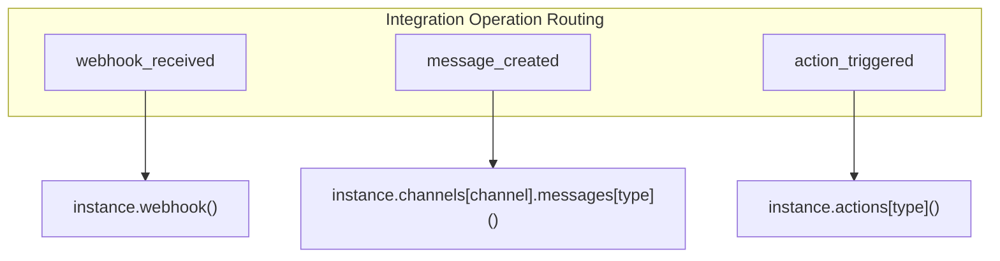

**Diagram: Integration Operation Routing**

### Integration Operation Handlers

- **`onWebhook`**: Directly calls the `webhook` handler defined in the integration implementation [packages/sdk/src/integration/server/index.ts:129-132]().
- **`onMessageCreated`**: Finds the appropriate channel and message type handler. It provides an `ack` function to update the message tags upon successful processing [packages/sdk/src/integration/server/index.ts:166-190]().
- **`onActionTriggered`**: Executes the requested action and returns the output along with any metadata collected during execution [packages/sdk/src/integration/server/index.ts:192-212]().

**Sources:** [packages/sdk/src/integration/server/index.ts:70-92]()

---

## PluginImplementation Class

The `PluginImplementation` class enables reusable logic that can be injected into bots. It implements `BotHandlers` [packages/sdk/src/plugin/implementation.ts:57-57]().

### Injected Tools

Plugins receive a set of "tools" in their handlers, which are proxies to platform resources prefixed or scoped to the plugin's context [packages/sdk/src/plugin/implementation.ts:102-125]():

| Tool | Purpose |
|------|---------|
| `actions` | `ActionProxy` for calling actions of integration/interface dependencies [packages/sdk/src/plugin/implementation.ts:104-104]() |
| `states` | `StateProxy` for querying and mutating plugin-defined states [packages/sdk/src/plugin/implementation.ts:105-105]() |
| `workflows` | `WorkflowProxy` for interacting with bot workflows [packages/sdk/src/plugin/implementation.ts:106-106]() |
| `users` | `UserFinder` for scoped user management [packages/sdk/src/plugin/implementation.ts:108-108]() |

### Interface Resolution

Plugins can handle events defined by interfaces. The `eventHandlers` getter uses `_eventResolvesTo` to determine if a received event (e.g., from a specific integration) matches an interface event the plugin is listening to [packages/sdk/src/plugin/implementation.ts:188-214]().

---

## Client Wrappers

### BotSpecificClient

The `BotSpecificClient` wraps the standard `@botpress/client` to provide a typed interface matching the bot's definition [packages/sdk/src/bot/client/index.ts:10-10](). It supports a hook system for intercepting API calls [packages/sdk/src/bot/client/index.ts:13-13]().

### IntegrationSpecificClient

The `IntegrationSpecificClient` provides a similar typed wrapper for integrations, ensuring that calls to `createMessage` or `getConversation` use the types defined in the integration's schema [packages/sdk/src/integration/client/index.ts:10-11]().

**Sources:** [packages/sdk/src/bot/client/index.ts:1-123](), [packages/sdk/src/integration/client/index.ts:1-93]()

---

## Type System and Definitions

The SDK uses `BotDefinition` and `IntegrationDefinition` to define the structure of the project, including configuration, states, events, and actions.

- **BotDefinition**: Defines bot-level entities like `states`, `events`, and `workflows` [packages/sdk/src/bot/definition.ts:213-219]().
- **IntegrationDefinition**: Defines integration-specific components like `channels` (with message types) and `entities` [packages/sdk/src/integration/definition/index.ts:178-188]().
- **PluginDefinition**: Defines plugin metadata and its own `states`, `actions`, and `events` [packages/sdk/src/plugin/definition.ts:168-179]().

These definitions are powered by **Zui**, a Zod-based schema system that includes UI metadata [packages/sdk/src/bot/definition.ts:12-12]().

**Sources:** [packages/sdk/src/bot/definition.ts:1-212](), [packages/sdk/src/integration/definition/index.ts:1-177](), [packages/sdk/src/plugin/definition.ts:1-167]()

---

# Page: CLI

# CLI

<details>
<summary>Relevant source files</summary>

The following files were used as context for generating this wiki page:

- [packages/cli/e2e/api.ts](packages/cli/e2e/api.ts)
- [packages/cli/e2e/defaults.ts](packages/cli/e2e/defaults.ts)
- [packages/cli/e2e/index.ts](packages/cli/e2e/index.ts)
- [packages/cli/e2e/tests/bot-secrets.ts](packages/cli/e2e/tests/bot-secrets.ts)
- [packages/cli/e2e/tests/create-deploy-bot-with-dependencies.ts](packages/cli/e2e/tests/create-deploy-bot-with-dependencies.ts)
- [packages/cli/e2e/tests/create-deploy-bot.ts](packages/cli/e2e/tests/create-deploy-bot.ts)
- [packages/cli/e2e/tests/create-deploy-integration.ts](packages/cli/e2e/tests/create-deploy-integration.ts)
- [packages/cli/e2e/tests/dev-bot.ts](packages/cli/e2e/tests/dev-bot.ts)
- [packages/cli/e2e/tests/install-interfaces.ts](packages/cli/e2e/tests/install-interfaces.ts)
- [packages/cli/e2e/tests/install-package.ts](packages/cli/e2e/tests/install-package.ts)
- [packages/cli/e2e/tests/install-plugins.ts](packages/cli/e2e/tests/install-plugins.ts)
- [packages/cli/e2e/tests/integration-secrets.ts](packages/cli/e2e/tests/integration-secrets.ts)
- [packages/cli/e2e/tests/manage-workspace-handle.ts](packages/cli/e2e/tests/manage-workspace-handle.ts)
- [packages/cli/e2e/typings.ts](packages/cli/e2e/typings.ts)
- [packages/cli/e2e/utils.ts](packages/cli/e2e/utils.ts)
- [packages/cli/src/api/client.ts](packages/cli/src/api/client.ts)
- [packages/cli/src/api/types.ts](packages/cli/src/api/types.ts)
- [packages/cli/src/cli.ts](packages/cli/src/cli.ts)
- [packages/cli/src/code-generation/bot-implementation/index.ts](packages/cli/src/code-generation/bot-implementation/index.ts)
- [packages/cli/src/code-generation/generators.ts](packages/cli/src/code-generation/generators.ts)
- [packages/cli/src/code-generation/integration-implementation/index.ts](packages/cli/src/code-generation/integration-implementation/index.ts)
- [packages/cli/src/code-generation/plugin-package/plugin-package-definition/index.ts](packages/cli/src/code-generation/plugin-package/plugin-package-definition/index.ts)
- [packages/cli/src/code-generation/plugin-package/plugin-package-definition/typings.ts](packages/cli/src/code-generation/plugin-package/plugin-package-definition/typings.ts)
- [packages/cli/src/code-generation/secret-module.ts](packages/cli/src/code-generation/secret-module.ts)
- [packages/cli/src/code-generation/typings.ts](packages/cli/src/code-generation/typings.ts)
- [packages/cli/src/command-definitions.ts](packages/cli/src/command-definitions.ts)
- [packages/cli/src/command-implementations/add-command.ts](packages/cli/src/command-implementations/add-command.ts)
- [packages/cli/src/command-implementations/base-command.ts](packages/cli/src/command-implementations/base-command.ts)
- [packages/cli/src/command-implementations/bot-commands.ts](packages/cli/src/command-implementations/bot-commands.ts)
- [packages/cli/src/command-implementations/build-command.ts](packages/cli/src/command-implementations/build-command.ts)
- [packages/cli/src/command-implementations/bundle-command.ts](packages/cli/src/command-implementations/bundle-command.ts)
- [packages/cli/src/command-implementations/deploy-command.ts](packages/cli/src/command-implementations/deploy-command.ts)
- [packages/cli/src/command-implementations/dev-command.ts](packages/cli/src/command-implementations/dev-command.ts)
- [packages/cli/src/command-implementations/global-command.ts](packages/cli/src/command-implementations/global-command.ts)
- [packages/cli/src/command-implementations/index.ts](packages/cli/src/command-implementations/index.ts)
- [packages/cli/src/command-implementations/init-command.ts](packages/cli/src/command-implementations/init-command.ts)
- [packages/cli/src/command-implementations/integration-commands.ts](packages/cli/src/command-implementations/integration-commands.ts)
- [packages/cli/src/command-implementations/interface-commands.ts](packages/cli/src/command-implementations/interface-commands.ts)
- [packages/cli/src/command-implementations/plugin-commands.ts](packages/cli/src/command-implementations/plugin-commands.ts)
- [packages/cli/src/command-implementations/profile-commands.ts](packages/cli/src/command-implementations/profile-commands.ts)
- [packages/cli/src/command-implementations/project-command.ts](packages/cli/src/command-implementations/project-command.ts)
- [packages/cli/src/command-implementations/serve-command.ts](packages/cli/src/command-implementations/serve-command.ts)
- [packages/cli/src/config.test.ts](packages/cli/src/config.test.ts)
- [packages/cli/src/config.ts](packages/cli/src/config.ts)
- [packages/cli/src/consts.ts](packages/cli/src/consts.ts)
- [packages/cli/src/errors.test.ts](packages/cli/src/errors.test.ts)
- [packages/cli/src/errors.ts](packages/cli/src/errors.ts)
- [packages/cli/src/index.ts](packages/cli/src/index.ts)
- [packages/cli/src/init.ts](packages/cli/src/init.ts)
- [packages/cli/src/package-ref.test.ts](packages/cli/src/package-ref.test.ts)
- [packages/cli/src/package-ref.ts](packages/cli/src/package-ref.ts)
- [packages/cli/src/register-yargs.ts](packages/cli/src/register-yargs.ts)
- [packages/cli/src/root.ts](packages/cli/src/root.ts)
- [packages/cli/src/utils/cache-utils.ts](packages/cli/src/utils/cache-utils.ts)
- [packages/cli/src/utils/esbuild-utils.test.ts](packages/cli/src/utils/esbuild-utils.test.ts)
- [packages/cli/src/utils/esbuild-utils.ts](packages/cli/src/utils/esbuild-utils.ts)
- [packages/cli/src/utils/index.ts](packages/cli/src/utils/index.ts)
- [packages/cli/src/utils/json-utils.ts](packages/cli/src/utils/json-utils.ts)
- [packages/cli/src/utils/pkgjson-utils.ts](packages/cli/src/utils/pkgjson-utils.ts)
- [packages/cli/src/utils/prompt-utils.ts](packages/cli/src/utils/prompt-utils.ts)
- [packages/cli/src/utils/record-utils.test.ts](packages/cli/src/utils/record-utils.test.ts)
- [packages/cli/src/utils/record-utils.ts](packages/cli/src/utils/record-utils.ts)
- [packages/cli/src/utils/semver-utils.ts](packages/cli/src/utils/semver-utils.ts)
- [packages/cli/src/utils/tunnel-utils.ts](packages/cli/src/utils/tunnel-utils.ts)
- [packages/cli/src/worker/child-entrypoint.ts](packages/cli/src/worker/child-entrypoint.ts)
- [packages/cli/tsconfig.json](packages/cli/tsconfig.json)
- [packages/cognitive/build.ts](packages/cognitive/build.ts)
- [packages/llmz/examples/package.json](packages/llmz/examples/package.json)
- [packages/llmz/src/prompts/dual-modes.ts](packages/llmz/src/prompts/dual-modes.ts)
- [packages/llmz/src/typings.ts](packages/llmz/src/typings.ts)
- [packages/sdk/src/version-utils.ts](packages/sdk/src/version-utils.ts)
- [packages/sdk/src/zui.ts](packages/sdk/src/zui.ts)
- [scripts/upload-sandbox-scripts.ts](scripts/upload-sandbox-scripts.ts)

</details>


## Purpose and Scope

The **@botpress/cli** package provides the `bp` command-line interface for managing the lifecycle of Botpress projects (bots, integrations, plugins, and interfaces). It handles project initialization, dependency management, code generation, building, local development, and deployment to the Botpress platform.

For information about the SDK that the CLI depends on, see [SDK](#2.1). For deployment pipelines and CI/CD workflows, see [6.2 CI/CD Pipeline]().

---

## Overview

The CLI is distributed as an npm package with a binary entry point at [packages/cli/package.json:28-28](). The main implementation is built and bundled to [packages/cli/dist/cli.js](). It provides a command-line interface that orchestrates:

- **Project scaffolding** via templates [packages/cli/src/command-implementations/init-command.ts:9-11]()
- **Dependency management** for integrations, plugins, and interfaces [packages/cli/src/command-implementations/add-command.ts:38-42]()
- **Code generation** from definitions to TypeScript typings [packages/cli/src/command-implementations/project-command.ts:9-9]()
- **Building and bundling** with esbuild [packages/cli/src/command-implementations/bundle-command.ts:60-60]()
- **Local development** with hot reload and tunneling [packages/cli/src/command-implementations/dev-command.ts:158-180]()
- **Deployment** to Botpress cloud infrastructure [packages/cli/src/command-implementations/deploy-command.ts:16-42]()

**Key Design Patterns:**
- Command pattern with class hierarchy: `GlobalCommand` → `ProjectCommand` → specific command implementations [packages/cli/src/command-implementations/index.ts:1-15]()
- API client wrapper (`ApiClient`) for all Botpress platform interactions [packages/cli/src/api/client.ts:29-37]()
- Build context caching for incremental builds [packages/cli/src/utils/esbuild-utils.ts:31-48]()
- File system caching for project state [packages/cli/src/command-implementations/project-command.ts:134-136]()

Sources: [packages/cli/package.json:1-73](), [packages/cli/src/command-implementations/global-command.ts:43-56](), [packages/cli/src/command-implementations/project-command.ts:116-124]()

---

## Command Class Hierarchy

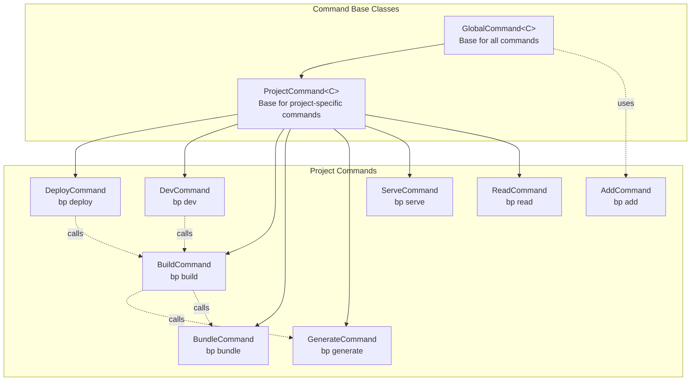

**GlobalCommand** provides:
- Logger instance [packages/cli/src/command-implementations/base-command.ts:14-14]()
- Prompt utilities via `CLIPrompt` [packages/cli/src/command-implementations/global-command.ts:45-45]()
- API client creation via `ensureLoginAndCreateClient()` [packages/cli/src/command-implementations/global-command.ts:166-174]()
- Bootstrap lifecycle method [packages/cli/src/command-implementations/global-command.ts:66-77]()

**ProjectCommand** adds:
- Project path resolution via `ProjectPaths` [packages/cli/src/command-implementations/project-command.ts:130-132]()
- Project definition reading from filesystem [packages/cli/src/command-implementations/project-command.ts:155-198]()
- Project cache management (`projectCache`) [packages/cli/src/command-implementations/project-command.ts:134-136]()
- Definition context for incremental builds (`ProjectDefinitionContext`) [packages/cli/src/command-implementations/project-command.ts:84-111]()
- Dependency resolution methods (`prepareBotDependencies`, `prepareIntegrationDependencies`) [packages/cli/src/command-implementations/project-command.ts:546-608]()
- Secret prompting utilities [packages/cli/src/command-implementations/project-command.ts:323-394]()

Sources: [packages/cli/src/command-implementations/global-command.ts:43-175](), [packages/cli/src/command-implementations/project-command.ts:116-200]()

---

## Project Types and Definition Loading

The CLI supports four project types, each with a corresponding definition file:

| Project Type | Definition File | Purpose |
|-------------|----------------|---------|
| **integration** | `integration.definition.ts` | External service connector |
| **interface** | `interface.definition.ts` | Shared contract between integrations |
| **bot** | `bot.definition.ts` | Conversational AI application |
| **plugin** | `plugin.definition.ts` | Bot functionality extension |

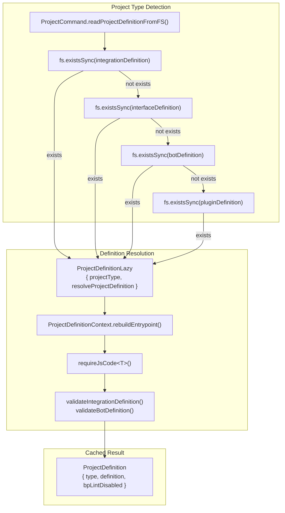

**Definition Loading Process:**

1. **Type Detection** - Checks for existence of definition files in order: integration → interface → bot → plugin [packages/cli/src/command-implementations/project-command.ts:138-153]().

2. **Lazy Resolution** - Returns a `ProjectDefinitionLazy` object with:
   - `projectType`: The detected type [packages/cli/src/command-implementations/project-command.ts:155-198]()
   - `resolveProjectDefinition`: Async function to build and load the definition.

3. **Build and Require** - When resolution is invoked:
   - Runs `esbuild` on the definition file via `ProjectDefinitionContext.rebuildEntrypoint()` [packages/cli/src/command-implementations/project-command.ts:98-100]().
   - Executes bundled JavaScript with `requireJsCode()` to extract the default export [packages/cli/src/command-implementations/project-command.ts:93-95]().
   - Caches the result in `ProjectDefinitionContext._codeCache` to avoid rebuilding [packages/cli/src/command-implementations/project-command.ts:89-95]().

4. **Validation** - For integrations and bots, validates the definition structure using `validateIntegrationDefinition` and `validateBotDefinition` [packages/cli/src/command-implementations/project-command.ts:223-223]().

Sources: [packages/cli/src/command-implementations/project-command.ts:138-279](), [packages/cli/src/command-implementations/project-command.ts:84-111]()

---

## Core Commands

### Init Command (Project Scaffolding)

The `bp init` command scaffolds new projects from templates. Templates are managed via `ProjectTemplates` [packages/cli/src/command-implementations/init-command.ts:9-9]():

| Template | Package Name | Purpose |
|----------|-------------|---------|
| `empty-bot` | `@bp-templates/empty-bot` | Minimal bot project |
| `empty-integration` | `@bp-templates/empty-integration` | Minimal integration project |
| `empty-plugin` | `@bp-templates/empty-plugin` | Minimal plugin project |
| `hello-world` | `@bp-templates/hello-world` | Bot with example handlers |

The initialization process prompts for project type [packages/cli/src/command-implementations/init-command.ts:69-83](), workspace handle [packages/cli/src/command-implementations/init-command.ts:53-67](), and template [packages/cli/src/command-implementations/init-command.ts:102-119]().

Sources: [packages/cli/src/command-implementations/init-command.ts:20-51](), [packages/cli/src/project-templates.ts]()

---

### Add Command (Dependency Management)

```mermaid
graph TB
    subgraph "bp add Execution Flow"
        ParseRef["Parse Package Reference<br/>parsePackageRef()"]
        CheckType["Determine Reference Type"]
        
        subgraph "Local Package (path:...)"
            ReadLocal["Read Local Project<br/>_readProject()"]
            BuildLocal["Build Definition<br/>prepareCreateIntegrationBody()"]
            LocalPkg["Local Package<br/>{ path, name, version }"]
        end
        
        subgraph "Remote Package (name@version)"
            LoginAPI["ensureLoginAndCreateClient()"]
            FetchInt["api.findPublicOrPrivateIntegration()"]
            FetchIface["api.findPublicOrPrivateInterface()"]
            FetchPlug["api.findPublicOrPrivatePlugin()"]
            RemotePkg["Remote Package<br/>{ name, version, id }"]
        end
        
        Generate["generateIntegrationPackage()<br/>generateInterfacePackage()<br/>generatePluginPackage()"]
        Install["Write Files to<br/>bp_modules/&lt;package-name&gt;/"]
        UpdatePkgJson["Add to bpDependencies<br/>in package.json"]
    end
    
    ParseRef --> CheckType
    CheckType -->|"path:..."| ReadLocal
    CheckType -->|"name@version"| LoginAPI
    
    ReadLocal --> BuildLocal
    BuildLocal --> LocalPkg
    
    LoginAPI --> FetchInt
    FetchInt --> FetchIface
    FetchIface --> FetchPlug
    FetchPlug --> RemotePkg
    
    LocalPkg --> Generate
    RemotePkg --> Generate
    Generate --> Install
    Install --> UpdatePkgJson
```

**Package Reference Formats:**

- **By Name:** `integration:openai@1.0.0` or `plugin:hitl@^2.0.0` [packages/cli/src/package-ref.ts:64-70]()
- **By ID:** `id:01234567-89ab-cdef-0123-456789abcdef` [packages/cli/src/package-ref.ts:72-76]()
- **By Path:** `path:../my-integration` (local development) [packages/cli/src/package-ref.ts:78-83]()

**Installation Process:**

1. Parse package reference from argv or `package.json` bpDependencies [packages/cli/src/command-implementations/add-command.ts:39-63]().
2. Resolve package from remote API [packages/cli/src/command-implementations/add-command.ts:190-213]() or local filesystem [packages/cli/src/command-implementations/add-command.ts:215-241]().
3. Generate TypeScript files with typings using `codegen` [packages/cli/src/command-implementations/add-command.ts:118-127]().
4. Write to `bp_modules/<package-name>/` [packages/cli/src/command-implementations/add-command.ts:106-129]().
5. Update `package.json` bpDependencies field [packages/cli/src/command-implementations/add-command.ts:174-175]().

Sources: [packages/cli/src/command-implementations/add-command.ts:37-177](), [packages/cli/src/package-ref.ts:10-84]()

---

### Generate Command (Code Generation)

The `bp generate` command triggers the creation of TypeScript typings based on the project definition. It is a prerequisite for building bots, integrations, and plugins [packages/cli/src/command-implementations/gen-command.ts:12-25]().

**Generated Output Structure:**

For each project type, the CLI generates TypeScript declaration files in `.botpress/`:
- **index.d.ts** - Entry point with exported types.
- **implementation.d.ts** - Implementation-specific types (Client, Events, Actions, etc.).
- **package/** - For dependencies, contains generated package typings.

**Secret Validation:**
Integration secrets must follow `SCREAMING_SNAKE_CASE` naming convention during generation [packages/cli/src/command-implementations/gen-command.ts:89-100]().

Sources: [packages/cli/src/command-implementations/gen-command.ts:12-101](), [packages/cli/src/code-generation/generators.ts]()

---

### Build Command (Compilation)

The `bp build` command orchestrates code generation and bundling [packages/cli/src/command-implementations/build-command.ts:16-25]().

**Build Options:**
- `--minify` - Minify the bundled code (default: true) [packages/cli/src/config.ts:93-97]().
- `--source-map` - Generate source maps [packages/cli/src/config.ts:87-91]().

**Platform-Specific Builds:**
- **Bots & Integrations:** Bundled for Node.js platform [packages/cli/src/command-implementations/bundle-command.ts:22-25]().
- **Plugins:** Dual builds for Node.js (CommonJS) and Browser (ESM) [packages/cli/src/command-implementations/bundle-command.ts:27-31]().

Sources: [packages/cli/src/command-implementations/build-command.ts:8-36](), [packages/cli/src/command-implementations/bundle-command.ts:8-77]()

---

### Deploy Command (Production Deployment)

The `bp deploy` command uploads the bundled project to the Botpress cloud [packages/cli/src/command-implementations/deploy-command.ts:16-42]().

**Deployment Lifecycle:**
1. Ensures user is logged in [packages/cli/src/command-implementations/deploy-command.ts:17-17]().
2. Runs build (unless `--no-build` is specified) [packages/cli/src/command-implementations/deploy-command.ts:19-21]().
3. Reads project definition and prepares the request body [packages/cli/src/command-implementations/deploy-command.ts:112-119]().
4. Prompts for missing secrets [packages/cli/src/command-implementations/deploy-command.ts:132-132]().
5. Calls the Botpress API to create or update the resource [packages/cli/src/command-implementations/deploy-command.ts:145-156]().

**Workspace Handle Management:**
Integrations require a workspace handle prefix. The CLI validates that the handle matches the target workspace [packages/cli/src/command-implementations/deploy-command.ts:522-631]().

Sources: [packages/cli/src/command-implementations/deploy-command.ts:15-647]()

---

### Dev Command (Local Development)

The `bp dev` command enables a local development loop with hot reload and cloud connectivity [packages/cli/src/command-implementations/dev-command.ts:36-172]().

**Dev Mode Features:**
1. **Hot Reload** - Watches for file changes and restarts the worker [packages/cli/src/command-implementations/dev-command.ts:178-216]().
2. **Tunnel** - Establishes a WebSocket tunnel to receive events from Botpress Cloud [packages/cli/src/command-implementations/dev-command.ts:115-158]().
3. **Worker** - Spawns a local process to execute the bot or integration code [packages/cli/src/command-implementations/dev-command.ts:161-161]().

**Tunnel Configuration:**
- Uses a `TunnelSupervisor` to manage the connection [packages/cli/src/command-implementations/dev-command.ts:115-115]().
- Forwards incoming tunnel requests to the local HTTP server [packages/cli/src/command-implementations/dev-command.ts:127-151]().

Sources: [packages/cli/src/command-implementations/dev-command.ts:25-425](), [packages/cli/src/worker.ts]()

---

## ApiClient Wrapper

The `ApiClient` class wraps the `@botpress/client` to provide CLI-specific utilities like workspace switching and resource finding [packages/cli/src/api/client.ts:29-37]().

```mermaid
graph TB
    subgraph "ApiClient Architecture"
        ApiClient["ApiClient<br/>(api/client.ts)"]
        BPClient["@botpress/client.Client"]
        
        subgraph "Resource Finders"
            FindInt["findPublicOrPrivateIntegration()"]
            FindIface["findPublicOrPrivateInterface()"]
            FindPlug["findPublicOrPrivatePlugin()"]
            FindPrevVer["findPreviousIntegrationVersion()"]
        end
        
        subgraph "Workspace Operations"
            GetWS["getWorkspace()"]
            UpdateWS["updateWorkspace()"]
            FindWSByHandle["findWorkspaceByHandle()"]
            SwitchWS["switchWorkspace()"]
        end
        
        subgraph "Properties"
            URL["url: string"]
            Token["token: string"]
            WorkspaceId["workspaceId: string"]
            IsBP["isBotpressWorkspace: boolean"]
        end
    end
    
    ApiClient --> BPClient
    ApiClient --> FindInt
    ApiClient --> FindIface
    ApiClient --> FindPlug
    ApiClient --> FindPrevVer
    ApiClient --> GetWS
    ApiClient --> UpdateWS
    ApiClient --> FindWSByHandle
    ApiClient --> SwitchWS
```

**Key Features:**
- **Workspace Switching:** Creates a new client instance for a specific workspace [packages/cli/src/api/client.ts:113-118]().
- **Public/Private Search:** Automatically searches both the current workspace and the public hub for dependencies [packages/cli/src/api/client.ts:141-157]().
- **Retry Logic:** Uses a global retry configuration for API calls [packages/cli/src/api/client.ts:49-49]().

Sources: [packages/cli/src/api/client.ts:29-308]()

---

## Project Paths and File Structure

The CLI defines path constants relative to the project work directory [packages/cli/src/consts.ts:42-56]().

| Constant | Path | Purpose |
|----------|------|---------|
| `outDir` | `.botpress` | Root for all generated files |
| `distDir` | `.botpress/dist` | Bundled code output |
| `outFileCJS` | `.botpress/dist/index.cjs` | CommonJS bundle |
| `projectCacheFile` | `.botpress/project.cache.json` | JSON cache for project state |
| `integrationDefinition` | `integration.definition.ts` | Integration definition file |
| `botDefinition` | `bot.definition.ts` | Bot definition file |
| `entryPoint` | `src/index.ts` | Implementation entry point |

Sources: [packages/cli/src/consts.ts:42-56](), [packages/cli/src/command-implementations/project-command.ts:74-82]()

---

## Secret Management

The CLI handles secret collection for both deployment and local development [packages/cli/src/command-implementations/project-command.ts:323-394]().

**Secret Prompting:**
- Checks for secrets in the project definition [packages/cli/src/command-implementations/project-command.ts:335-335]().
- Allows providing values via the `--secrets` flag [packages/cli/src/command-implementations/project-command.ts:328-332]().
- Prompts for missing required secrets and optional secrets [packages/cli/src/command-implementations/project-command.ts:345-357]().

**Dev Mode Injection:**
In `bp dev`, secrets are injected into the worker process as environment variables with the `BP_SECRET_` prefix [packages/cli/src/command-implementations/dev-command.ts:65-79]().

Sources: [packages/cli/src/command-implementations/project-command.ts:323-394](), [packages/cli/src/command-implementations/dev-command.ts:65-79]()

---

# Page: Client

# Client

<details>
<summary>Relevant source files</summary>

The following files were used as context for generating this wiki page:

- [bots/echo/src/index.ts](bots/echo/src/index.ts)
- [echo.Tiltfile](echo.Tiltfile)
- [integrations/chat/definitions/channels/messages.ts](integrations/chat/definitions/channels/messages.ts)
- [integrations/chat/integration.definition.ts](integrations/chat/integration.definition.ts)
- [integrations/chat/openapi.ts](integrations/chat/openapi.ts)
- [integrations/chat/package.json](integrations/chat/package.json)
- [integrations/chat/src/api/message-payload.ts](integrations/chat/src/api/message-payload.ts)
- [integrations/chat/src/api/operations/conversation.ts](integrations/chat/src/api/operations/conversation.ts)
- [integrations/chat/src/api/operations/event.ts](integrations/chat/src/api/operations/event.ts)
- [integrations/chat/src/api/operations/message.ts](integrations/chat/src/api/operations/message.ts)
- [integrations/chat/src/api/operations/model.ts](integrations/chat/src/api/operations/model.ts)
- [integrations/chat/src/api/operations/user.ts](integrations/chat/src/api/operations/user.ts)
- [integrations/chat/src/handler.ts](integrations/chat/src/handler.ts)
- [integrations/chat/src/id-store/dynamo-db-store.ts](integrations/chat/src/id-store/dynamo-db-store.ts)
- [integrations/chat/src/index.ts](integrations/chat/src/index.ts)
- [integrations/chat/src/signal-emitter/pushpin.ts](integrations/chat/src/signal-emitter/pushpin.ts)
- [integrations/chat/src/tracing.ts](integrations/chat/src/tracing.ts)
- [integrations/chat/src/websocket.ts](integrations/chat/src/websocket.ts)
- [packages/chat-api/src/api.ts](packages/chat-api/src/api.ts)
- [packages/chat-api/src/index.ts](packages/chat-api/src/index.ts)
- [packages/chat-api/src/models/message.ts](packages/chat-api/src/models/message.ts)
- [packages/chat-api/src/operations/message.ts](packages/chat-api/src/operations/message.ts)
- [packages/chat-api/src/version.ts](packages/chat-api/src/version.ts)
- [packages/chat-client/e2e/message.test.ts](packages/chat-client/e2e/message.test.ts)
- [packages/chat-client/e2e/participant.test.ts](packages/chat-client/e2e/participant.test.ts)
- [packages/chat-client/openapi.ts](packages/chat-client/openapi.ts)
- [packages/chat-client/package.json](packages/chat-client/package.json)
- [packages/chat-client/readme.md](packages/chat-client/readme.md)
- [packages/chat-client/src/client.ts](packages/chat-client/src/client.ts)
- [packages/chat-client/src/consts.ts](packages/chat-client/src/consts.ts)
- [packages/chat-client/src/eventsource.ts](packages/chat-client/src/eventsource.ts)
- [packages/chat-client/src/index.ts](packages/chat-client/src/index.ts)
- [packages/chat-client/src/signal-listener.ts](packages/chat-client/src/signal-listener.ts)
- [packages/chat-client/src/types.ts](packages/chat-client/src/types.ts)
- [packages/cli/src/api/bot-body.ts](packages/cli/src/api/bot-body.ts)
- [packages/cli/src/api/integration-body.ts](packages/cli/src/api/integration-body.ts)
- [packages/cli/src/api/interface-body.ts](packages/cli/src/api/interface-body.ts)
- [packages/cli/src/api/plugin-body.ts](packages/cli/src/api/plugin-body.ts)
- [packages/cli/src/chat/index.ts](packages/cli/src/chat/index.ts)
- [packages/cli/src/command-implementations/chat-command.ts](packages/cli/src/command-implementations/chat-command.ts)
- [packages/cli/src/command-implementations/read-command.ts](packages/cli/src/command-implementations/read-command.ts)
- [packages/client/src/index.ts](packages/client/src/index.ts)

</details>


The `@botpress/client` package provides a TypeScript client for interacting with the Botpress Platform API. It serves as the foundational HTTP client used by both the CLI and SDK to manage workspaces, bots, integrations, interfaces, plugins, and runtime operations. The client is auto-generated from OpenAPI specifications and provides strongly-typed methods for all platform operations.

For information about how the CLI uses the client for deployment operations, see [CLI](#2.2). For SDK-level bot and integration runtime functionality, see [SDK](#2.1).

## Package Structure and Build System

The client package is published to npm as `@botpress/client` and provides dual-format exports for both Node.js and browser environments.

**Package Configuration**

```mermaid
graph TB
    subgraph "Source Generation"
        OPENAPI["openapi.ts"]
        SPEC["Platform API Spec"]
    end
    
    subgraph "Build Pipeline"
        TS_SRC["src/index.ts"]
        TSUP_TYPE["tsup --dts-only"]
        BUILD_NODE["build.ts --node"]
        BUILD_BROWSER["build.ts --browser"]
        BUILD_BUNDLE["build.ts --bundle"]
    end
    
    subgraph "Output Artifacts"
        DTS["dist/index.d.ts"]
        CJS["dist/index.cjs"]
        MJS["dist/index.mjs"]
        BUNDLE["Browser bundle"]
    end
    
    SPEC --> OPENAPI
    OPENAPI --> TS_SRC
    
    TS_SRC --> TSUP_TYPE
    TS_SRC --> BUILD_NODE
    TS_SRC --> BUILD_BROWSER
    TS_SRC --> BUILD_BUNDLE
    
    TSUP_TYPE --> DTS
    BUILD_NODE --> CJS
    BUILD_BROWSER --> MJS
    BUILD_BUNDLE --> BUNDLE
```

The client generation and build process consists of:
- **Source Export**: [packages/client/src/index.ts:1-12]() exports modules for `admin`, `billing`, `files`, `tables`, and generated `public` models.
- **Dual Support**: The package supports both browser and Node.js through specialized build scripts and dependencies like `browser-or-node` [packages/chat-client/package.json:23]().

Sources: [packages/client/src/index.ts:1-12](), [packages/chat-client/package.json:1-53]()

## Client Class Architecture

The core `Client` class provides direct access to all Botpress Platform API endpoints.

**Client Instantiation Flow**

```mermaid
graph TB
    subgraph "Client Configuration"
        CONFIG["Client Constructor Input"]
        API_URL["apiUrl: string"]
        TOKEN["token: string"]
        WORKSPACE_ID["workspaceId?: string"]
        BOT_ID["botId?: string"]
        RETRY_CFG["retry?: RetryConfig"]
        HEADERS["headers?: Record"]
    end
    
    subgraph "Client Instance"
        CLIENT["Client instance"]
        AXIOS["axios client"]
        BASE_URL["Base URL configuration"]
        AUTH_HEADERS["Authorization headers"]
    end
    
    subgraph "API Methods"
        BOTS_API["Bots API"]
        INTEGRATIONS_API["Integrations API"]
        INTERFACES_API["Interfaces API"]
        PLUGINS_API["Plugins API"]
        WORKSPACE_API["Workspaces API"]
        RUNTIME_API["Runtime APIs"]
    end
    
    API_URL --> CONFIG
    TOKEN --> CONFIG
    WORKSPACE_ID --> CONFIG
    BOT_ID --> CONFIG
    RETRY_CFG --> CONFIG
    HEADERS --> CONFIG
    
    CONFIG --> CLIENT
    CLIENT --> AXIOS
    CLIENT --> BASE_URL
    CLIENT --> AUTH_HEADERS
    
    CLIENT --> BOTS_API
    CLIENT --> INTEGRATIONS_API
    CLIENT --> INTERFACES_API
    CLIENT --> PLUGINS_API
    CLIENT --> WORKSPACE_API
    CLIENT --> RUNTIME_API
```

The client is instantiated with authentication and workspace context, then provides typed methods for all API operations. It uses `axios` and `axios-retry` for resilient network communication [packages/client/src/index.ts:1-2]().

Sources: [packages/client/src/index.ts:1-12](), [packages/chat-client/src/client.ts:42-49]()

## Chat API Client

In addition to the platform client, `@botpress/chat` (found in `packages/chat-client`) provides a specialized client for the Botpress Chat API. This is used by front-end applications or external services to communicate with bots via the Chat Integration.

**Chat Client Interaction**

```mermaid
graph TD
    subgraph "Natural Language Space"
        USER_MSG["User: 'Hello Bot'"]
        BOT_RESP["Bot: 'How can I help?'"]
    end

    subgraph "Code Entity Space"
        CHAT_CLIENT["@botpress/chat Client"]
        AUTH_CLIENT["AuthenticatedClient"]
        CONV_OP["createConversation"]
        MSG_OP["createMessage"]
        LISTEN_OP["listenConversation"]
        SSE["SignalListener (SSE)"]
    end

    USER_MSG -.-> MSG_OP
    MSG_OP --> CHAT_CLIENT
    CHAT_CLIENT --> AUTH_CLIENT
    AUTH_CLIENT --> CONV_OP
    AUTH_CLIENT --> LISTEN_OP
    LISTEN_OP --> SSE
    SSE -.-> BOT_RESP
```

Key features of the Chat Client:
- **Authentication**: Supports connecting via `userKey` or `encryptionKey` (HS256) [packages/chat-client/src/client.ts:58-88]().
- **Real-time**: Implements `listenConversation` using Server-Sent Events (SSE) via `SignalListener` [packages/chat-client/src/client.ts:129-142]().
- **Operations**: Provides methods for managing `conversations`, `messages`, `users`, and `participants` [packages/chat-client/src/client.ts:90-111]().

Sources: [packages/chat-client/src/client.ts:42-142](), [integrations/chat/integration.definition.ts:6-118]()

## CLI Data Preparation

The CLI uses `@botpress/client` types to prepare request bodies when deploying bots, integrations, or plugins. This process involves converting Zui (Zod-based) schemas into JSON schemas that the Platform API understands.

**Data Flow: SDK Definition to API Body**

```mermaid
graph LR
    subgraph "SDK Space"
        SDK_DEF["sdk.BotDefinition"]
        ZUI_SCHEMA["Zui (Zod) Schema"]
    end

    subgraph "CLI Preparation"
        PREP_FN["prepareCreateBotBody"]
        MAP_ZUI["mapZodToJsonSchema"]
    end

    subgraph "Platform API"
        REQ_BODY["types.CreateBotRequestBody"]
        API_CALL["client.createBot(REQ_BODY)"]
    end

    SDK_DEF --> PREP_FN
    ZUI_SCHEMA --> MAP_ZUI
    MAP_ZUI --> REQ_BODY
    REQ_BODY --> API_CALL
```

Implementation details:
- **Bots**: `prepareCreateBotBody` maps bot configurations, actions, and states [packages/cli/src/api/bot-body.ts:7-94]().
- **Integrations**: `prepareCreateIntegrationBody` converts channel, action, and event schemas [packages/cli/src/api/integration-body.ts:7-105]().
- **Plugins**: `prepareCreatePluginBody` handles plugin-specific metadata and tags [packages/cli/src/api/plugin-body.ts:7-94]().

Sources: [packages/cli/src/api/bot-body.ts:7-130](), [packages/cli/src/api/integration-body.ts:7-160](), [packages/cli/src/api/plugin-body.ts:7-134]()

## CLI Chat Command

The CLI includes a `chat` command that leverages the `@botpress/chat` client to provide an interactive terminal interface for testing bots.

**Chat Command Workflow**
1. **Login**: Ensures the user is logged in and creates a platform client [packages/cli/src/command-implementations/chat-command.ts:24]().
2. **Bot Selection**: Selects the target bot [packages/cli/src/command-implementations/chat-command.ts:25]().
3. **Integration Check**: Verifies if the `chat` integration is installed; if not, it offers to install it [packages/cli/src/command-implementations/chat-command.ts:31-40]().
4. **Connection**: Connects to the chat integration's webhook using the chat client [packages/cli/src/command-implementations/chat-command.ts:47]().
5. **Session**: Creates a new conversation and launches the interactive chat loop [packages/cli/src/command-implementations/chat-command.ts:51-60]().

Sources: [packages/cli/src/command-implementations/chat-command.ts:18-158]()

## Error Handling

The clients provide robust error mapping to translate HTTP errors into actionable TypeScript errors.
- **Platform Client**: Uses `axios-retry` for transient failure recovery [packages/client/src/index.ts:2]().
- **Chat Client**: Implements `_checkPayloadForError` to handle cases where the API returns a 200 OK but the payload contains a functional error [packages/chat-client/src/client.ts:163-172]().

Sources: [packages/client/src/index.ts:1-12](), [packages/chat-client/src/client.ts:144-156]()

---

# Page: AI/LLM Packages

# AI/LLM Packages

<details>
<summary>Relevant source files</summary>

The following files were used as context for generating this wiki page:

- [.github/actions/docker-build/action.yml](.github/actions/docker-build/action.yml)
- [.github/scripts/integration-implements-sandbox.sh](.github/scripts/integration-implements-sandbox.sh)
- [.github/workflows/deploy-chat-production.yml](.github/workflows/deploy-chat-production.yml)
- [.github/workflows/deploy-chat-staging.yml](.github/workflows/deploy-chat-staging.yml)
- [.github/workflows/docker-chat.yml](.github/workflows/docker-chat.yml)
- [.github/workflows/run-cognitive-tests.yml](.github/workflows/run-cognitive-tests.yml)
- [.github/workflows/run-vai-tests.yml](.github/workflows/run-vai-tests.yml)
- [.github/workflows/run-zai-tests.yml](.github/workflows/run-zai-tests.yml)
- [packages/cognitive/e2e/client.test.ts](packages/cognitive/e2e/client.test.ts)
- [packages/cognitive/e2e/cognitive-beta.test.ts](packages/cognitive/e2e/cognitive-beta.test.ts)
- [packages/cognitive/e2e/models.test.ts](packages/cognitive/e2e/models.test.ts)
- [packages/cognitive/refresh-models.ts](packages/cognitive/refresh-models.ts)
- [packages/cognitive/src/client.ts](packages/cognitive/src/client.ts)
- [packages/cognitive/src/cognitive-v2/adapter.test.ts](packages/cognitive/src/cognitive-v2/adapter.test.ts)
- [packages/cognitive/src/cognitive-v2/adapter.ts](packages/cognitive/src/cognitive-v2/adapter.ts)
- [packages/cognitive/src/cognitive-v2/index.ts](packages/cognitive/src/cognitive-v2/index.ts)
- [packages/cognitive/src/cognitive-v2/models.ts](packages/cognitive/src/cognitive-v2/models.ts)
- [packages/cognitive/src/cognitive-v2/types.ts](packages/cognitive/src/cognitive-v2/types.ts)
- [packages/cognitive/src/errors.ts](packages/cognitive/src/errors.ts)
- [packages/cognitive/src/index.ts](packages/cognitive/src/index.ts)
- [packages/cognitive/src/models.ts](packages/cognitive/src/models.ts)
- [packages/cognitive/src/schemas.gen.ts](packages/cognitive/src/schemas.gen.ts)
- [packages/cognitive/src/types.ts](packages/cognitive/src/types.ts)
- [packages/cognitive/tsconfig.json](packages/cognitive/tsconfig.json)
- [packages/llmz/DOCS.md](packages/llmz/DOCS.md)
- [packages/llmz/examples/21_chat_tool_components/README.md](packages/llmz/examples/21_chat_tool_components/README.md)
- [packages/llmz/examples/21_chat_tool_components/demo.svg](packages/llmz/examples/21_chat_tool_components/demo.svg)
- [packages/llmz/examples/21_chat_tool_components/index.ts](packages/llmz/examples/21_chat_tool_components/index.ts)
- [packages/llmz/examples/record-demo.sh](packages/llmz/examples/record-demo.sh)
- [packages/llmz/src/component.ts](packages/llmz/src/component.ts)
- [packages/llmz/src/context.ts](packages/llmz/src/context.ts)
- [packages/llmz/src/errors.ts](packages/llmz/src/errors.ts)
- [packages/llmz/src/index.ts](packages/llmz/src/index.ts)
- [packages/llmz/src/llmz.test.ts](packages/llmz/src/llmz.test.ts)
- [packages/llmz/src/llmz.ts](packages/llmz/src/llmz.ts)
- [packages/llmz/src/quickjs-variant.ts](packages/llmz/src/quickjs-variant.ts)
- [packages/llmz/src/tool.ts](packages/llmz/src/tool.ts)
- [packages/llmz/src/vm/drivers/node.ts](packages/llmz/src/vm/drivers/node.ts)
- [packages/llmz/src/vm/drivers/quickjs.ts](packages/llmz/src/vm/drivers/quickjs.ts)
- [packages/llmz/src/vm/errors.ts](packages/llmz/src/vm/errors.ts)
- [packages/llmz/src/vm/index.ts](packages/llmz/src/vm/index.ts)
- [packages/llmz/src/vm/instrument.ts](packages/llmz/src/vm/instrument.ts)
- [packages/llmz/src/vm/types.ts](packages/llmz/src/vm/types.ts)
- [packages/zai/CLAUDE.md](packages/zai/CLAUDE.md)
- [packages/zai/README.md](packages/zai/README.md)
- [packages/zai/e2e/data/cache.jsonl](packages/zai/e2e/data/cache.jsonl)
- [packages/zai/e2e/extract.test.ts](packages/zai/e2e/extract.test.ts)
- [packages/zai/e2e/group.test.ts](packages/zai/e2e/group.test.ts)
- [packages/zai/e2e/json-utils.test.ts](packages/zai/e2e/json-utils.test.ts)
- [packages/zai/e2e/micropatch.test.ts](packages/zai/e2e/micropatch.test.ts)
- [packages/zai/e2e/patch.test.ts](packages/zai/e2e/patch.test.ts)
- [packages/zai/e2e/rate.test.ts](packages/zai/e2e/rate.test.ts)
- [packages/zai/e2e/sort.test.ts](packages/zai/e2e/sort.test.ts)
- [packages/zai/src/context.ts](packages/zai/src/context.ts)
- [packages/zai/src/index.ts](packages/zai/src/index.ts)
- [packages/zai/src/json-utils.ts](packages/zai/src/json-utils.ts)
- [packages/zai/src/micropatch.ts](packages/zai/src/micropatch.ts)
- [packages/zai/src/operations/answer.ts](packages/zai/src/operations/answer.ts)
- [packages/zai/src/operations/check.ts](packages/zai/src/operations/check.ts)
- [packages/zai/src/operations/errors.ts](packages/zai/src/operations/errors.ts)
- [packages/zai/src/operations/extract.ts](packages/zai/src/operations/extract.ts)
- [packages/zai/src/operations/filter.ts](packages/zai/src/operations/filter.ts)
- [packages/zai/src/operations/group.ts](packages/zai/src/operations/group.ts)
- [packages/zai/src/operations/label.ts](packages/zai/src/operations/label.ts)
- [packages/zai/src/operations/patch.ts](packages/zai/src/operations/patch.ts)
- [packages/zai/src/operations/rate.ts](packages/zai/src/operations/rate.ts)
- [packages/zai/src/operations/rewrite.ts](packages/zai/src/operations/rewrite.ts)
- [packages/zai/src/operations/sort.ts](packages/zai/src/operations/sort.ts)
- [packages/zai/src/operations/summarize.ts](packages/zai/src/operations/summarize.ts)
- [packages/zai/src/operations/text.ts](packages/zai/src/operations/text.ts)
- [packages/zai/src/response.ts](packages/zai/src/response.ts)
- [packages/zai/src/zai.ts](packages/zai/src/zai.ts)
- [services.json](services.json)

</details>


The AI/LLM packages provide a layered architecture for interacting with Large Language Models in the Botpress ecosystem. This document covers the core AI packages (`@botpress/cognitive`, `@botpress/zai`, `llmz`, and `@botpress/vai`) that form the foundation for AI-native features and provider integrations.

---

## Package Architecture

The AI ecosystem is organized into specialized layers, ranging from low-level API wrappers to high-level utility frameworks and sandboxed execution environments.

### Package Dependency Structure

```mermaid
graph TB
    subgraph "AI Packages"
        COGNITIVE["@botpress/cognitive<br/>LLM Client Wrapper"]
        ZAI["@botpress/zai<br/>LLM Utilities"]
        LLMZ["llmz<br/>LLM-native VM"]
        VAI["@botpress/vai<br/>AI Testing"]
    end
    
    subgraph "Core Packages"
        CLIENT["@botpress/client<br/>Platform API"]
    end
    
    subgraph "Supporting Libraries"
        ZUI["@bpinternal/zui<br/>Schema Validation"]
    end
    
    ZAI -->|depends| COGNITIVE
    LLMZ -->|uses| COGNITIVE
    VAI -->|uses| COGNITIVE
    
    COGNITIVE -->|wraps| CLIENT
    ZAI -->|uses| ZUI
    LLMZ -->|uses| ZUI
```

**Sources:** [packages/cognitive/src/client.ts:1-21](), [packages/zai/src/zai.ts:1-13](), [packages/llmz/src/llmz.ts:1-10]()

---

## @botpress/cognitive

The `@botpress/cognitive` package is the foundational LLM client wrapper. It provides a consistent interface for calling language models through the Botpress Cloud API (v2) and legacy integration paths.

### Core Components

- **`Cognitive` Class**: The main entry point that handles model selection, preference management, and interceptors [packages/cognitive/src/client.ts:23-56]().
- **`CognitiveBeta` Class**: A specialized client for the v2 Cognitive API, supporting text generation, audio transcription (STT), text-to-speech (TTS), and image generation [packages/cognitive/src/cognitive-v2/index.ts:82-132]().
- **Model Registry**: A comprehensive list of supported models, their capabilities (vision, search, etc.), and pricing [packages/cognitive/src/cognitive-v2/models.ts:3-184]().

### Model Selection Logic

The `Cognitive` client supports "virtual" model references like `auto`, `best`, and `fast`. It resolves these by querying the model provider and applying user preferences [packages/cognitive/src/client.ts:143-166]().

```mermaid
graph TD
    REQ["Cognitive.generateContent(InputProps)"]
    SELECT["_selectModel(ref)"]
    PREF["fetchPreferences()"]
    DOWNTIME["Check Downtimes"]
    PICK["pickModel()"]
    
    REQ --> SELECT
    SELECT --> PREF
    SELECT --> DOWNTIME
    DOWNTIME --> PICK
    PREF --> PICK
    PICK -->|"Resolved Model"| EXEC["Execute API Call"]
```

**Sources:** [packages/cognitive/src/client.ts:143-166](), [packages/cognitive/src/models.ts:11-19]()

---

## @botpress/zai

The `@botpress/zai` package (Zui AI) provides high-level operations for structured data processing using LLMs and Zui schemas.

### Key Operations

| Function | Description | File |
|----------|-------------|------|
| `extract` | Parses unstructured text into a Zui-validated object or array [packages/zai/src/operations/extract.ts:46-56](). | [packages/zai/src/operations/extract.ts:122-127]() |
| `patch` | Applies partial updates to an object based on natural language instructions. | [packages/zai/src/operations/patch.ts:1-20]() |
| `summarize` | Condenses long text while preserving key information. | [packages/zai/src/operations/summarize.ts:1-15]() |
| `classify` | Assigns labels to text based on a predefined set of categories. | [packages/zai/src/operations/label.ts:1-10]() |

### Data Flow: Structured Extraction

The `extract` operation handles large inputs by chunking the text and recursively merging the results [packages/zai/src/operations/extract.ts:164-189]().

```mermaid
graph TB
    INPUT["Unstructured Text"]
    SCHEMA["Zui Schema"]
    TOKENIZER["Tokenizer.split()"]
    CHUNKS["Text Chunks"]
    
    subgraph "Parallel Processing"
        LLM1["LLM Extract (Chunk 1)"]
        LLM2["LLM Extract (Chunk 2)"]
    end
    
    MERGE["Recursive Merge LLM Call"]
    VALIDATE["Zui Validation"]
    OUTPUT["Validated JSON Object"]
    
    INPUT --> TOKENIZER
    TOKENIZER --> CHUNKS
    CHUNKS --> LLM1
    CHUNKS --> LLM2
    LLM1 --> MERGE
    LLM2 --> MERGE
    MERGE --> VALIDATE
    VALIDATE --> OUTPUT
```

**Sources:** [packages/zai/src/operations/extract.ts:122-200]()

---

## llmz

`llmz` is an LLM-native TypeScript Virtual Machine. It allows an LLM to generate and execute TypeScript code in a sandboxed environment to perform complex reasoning or tool orchestration.

### VM Execution Lifecycle

The VM executes code in "iterations." In each iteration, the LLM observes the state, generates code, and the VM executes it [packages/llmz/src/llmz.ts:17-31]().

1. **Context Initialization**: Sets up `instructions`, `objects` (tools), and `chat` history [packages/llmz/src/llmz.ts:164-200]().
2. **Iteration Start**: Calls `onIterationStart` hooks [packages/llmz/src/llmz.ts:83-88]().
3. **Code Generation**: The LLM generates a TypeScript block.
4. **Execution**: The `runAsyncFunction` utility executes the code in a `QuickJS` isolate [packages/llmz/src/llmz.ts:45](), [packages/llmz/src/vm/drivers/quickjs.ts:1-50]().
5. **Observation**: Side effects (tool calls, state changes) are captured as `Trace` events [packages/llmz/src/llmz.ts:74]().

### Tool & Object Mapping

The VM bridges the "Natural Language Space" to "Code Entity Space" by exposing JavaScript objects to the LLM via `ObjectInstance` [packages/llmz/src/llmz.ts:34]().

```mermaid
graph LR
    subgraph "Natural Language Space (LLM)"
        LLM_THINK["'I need to search the KB'"]
        LLM_CODE["knowledge.search({ query: '...' })"]
    end
    
    subgraph "Code Entity Space (VM)"
        OBJ["ObjectInstance: 'knowledge'"]
        TOOL["Tool: 'search'"]
        HANDLER["tool.handler()"]
    end
    
    LLM_THINK --> LLM_CODE
    LLM_CODE -->|"VM Bridge"| OBJ
    OBJ --> TOOL
    TOOL --> HANDLER
```

**Sources:** [packages/llmz/src/llmz.ts:184-205](), [packages/llmz/src/tool.ts:1-20]()

---

## @botpress/vai

The `@botpress/vai` package is an AI testing framework designed to validate bot behavior using LLM-powered assertions. It is typically used within Vitest environments to verify that bot responses meet qualitative criteria.

### Implementation Details

- **JSON Repair**: Uses `jsonrepair` and `json5` to handle non-standard JSON output from testing models [packages/zai/src/operations/extract.ts:4-5]().
- **Integration with Cognitive**: Leverages `@botpress/cognitive` to perform the underlying evaluations.

**Sources:** [packages/zai/src/operations/extract.ts:4-5](), [packages/cognitive/src/client.ts:23-50]()

---

## Refreshing Model Metadata

The ecosystem relies on up-to-date model information (pricing, context limits). This is maintained via a `refresh-models.ts` script that syncs the local registry with the Botpress Cloud production API.

### Sync Workflow

1. Fetches models from `https://api.botpress.cloud/v2/cognitive/models` [packages/cognitive/refresh-models.ts:22-33]().
2. Filters by lifecycle (removes `deprecated`, `discontinued`) [packages/cognitive/refresh-models.ts:63-65]().
3. Generates TypeScript unions for `Models` and `SttModels` in `types.ts` [packages/cognitive/refresh-models.ts:75-107]().
4. Updates `models.ts` with full metadata objects [packages/cognitive/refresh-models.ts:47-52]().

**Sources:** [packages/cognitive/refresh-models.ts:1-114]()

---

# Page: CLI & Development Tools

# CLI & Development Tools

<details>
<summary>Relevant source files</summary>

The following files were used as context for generating this wiki page:

- [package.json](package.json)
- [packages/cli/e2e/defaults.ts](packages/cli/e2e/defaults.ts)
- [packages/cli/package.json](packages/cli/package.json)
- [packages/cli/src/api/client.ts](packages/cli/src/api/client.ts)
- [packages/cli/src/api/types.ts](packages/cli/src/api/types.ts)
- [packages/cli/src/command-implementations/bot-commands.ts](packages/cli/src/command-implementations/bot-commands.ts)
- [packages/cli/src/command-implementations/build-command.ts](packages/cli/src/command-implementations/build-command.ts)
- [packages/cli/src/command-implementations/bundle-command.ts](packages/cli/src/command-implementations/bundle-command.ts)
- [packages/cli/src/command-implementations/deploy-command.ts](packages/cli/src/command-implementations/deploy-command.ts)
- [packages/cli/src/command-implementations/dev-command.ts](packages/cli/src/command-implementations/dev-command.ts)
- [packages/cli/src/command-implementations/integration-commands.ts](packages/cli/src/command-implementations/integration-commands.ts)
- [packages/cli/src/command-implementations/interface-commands.ts](packages/cli/src/command-implementations/interface-commands.ts)
- [packages/cli/src/command-implementations/plugin-commands.ts](packages/cli/src/command-implementations/plugin-commands.ts)
- [packages/cli/src/command-implementations/project-command.ts](packages/cli/src/command-implementations/project-command.ts)
- [packages/cli/src/command-implementations/serve-command.ts](packages/cli/src/command-implementations/serve-command.ts)
- [packages/cli/src/config.test.ts](packages/cli/src/config.test.ts)
- [packages/cli/src/config.ts](packages/cli/src/config.ts)
- [packages/cli/src/utils/esbuild-utils.test.ts](packages/cli/src/utils/esbuild-utils.test.ts)
- [packages/cli/src/utils/esbuild-utils.ts](packages/cli/src/utils/esbuild-utils.ts)
- [packages/cli/templates/empty-bot/package.json](packages/cli/templates/empty-bot/package.json)
- [packages/cli/templates/empty-integration/package.json](packages/cli/templates/empty-integration/package.json)
- [packages/cli/templates/empty-plugin/package.json](packages/cli/templates/empty-plugin/package.json)
- [packages/cli/templates/hello-world/package.json](packages/cli/templates/hello-world/package.json)
- [packages/cli/templates/webhook-message/package.json](packages/cli/templates/webhook-message/package.json)
- [packages/client/package.json](packages/client/package.json)
- [packages/cognitive/package.json](packages/cognitive/package.json)
- [packages/llmz/package.json](packages/llmz/package.json)
- [packages/sdk/package.json](packages/sdk/package.json)
- [packages/vai/package.json](packages/vai/package.json)
- [packages/zai/package.json](packages/zai/package.json)
- [pnpm-lock.yaml](pnpm-lock.yaml)

</details>


## Purpose and Scope

This document provides a comprehensive overview of the Botpress CLI and development tooling ecosystem. It covers the command-line interface architecture, development workflows, build system, and tooling for building, testing, and deploying Botpress projects (integrations, interfaces, bots, and plugins).

For detailed documentation of individual CLI commands and their options, see [CLI Commands](#3.1). For in-depth information about the build system configuration and compilation strategies, see [Build System](#3.2).

## CLI Architecture

The Botpress CLI is organized around a hierarchical command structure with shared base classes that provide common functionality for authentication, project detection, and API communication.

### Command Class Hierarchy

```mermaid
graph TB
    GlobalCommand["GlobalCommand&lt;C&gt;<br/>[global-command.ts]"]
    ProjectCommand["ProjectCommand&lt;C&gt;<br/>[project-command.ts]"]
    
    DeployCommand["DeployCommand<br/>[deploy-command.ts]"]
    DevCommand["DevCommand<br/>[dev-command.ts]"]
    BuildCommand["BuildCommand<br/>[build-command.ts]"]
    BundleCommand["BundleCommand<br/>[bundle-command.ts]"]
    GenerateCommand["GenerateCommand<br/>[gen-command.ts]"]
    AddCommand["AddCommand<br/>[add-command.ts]"]
    ServeCommand["ServeCommand<br/>[serve-command.ts]"]
    ReadCommand["ReadCommand<br/>[read-command.ts]"]
    
    ApiClient["ApiClient<br/>[api/client.ts]"]
    ProjectPaths["ProjectPaths<br/>[project-command.ts:61-69]"]
    ProjectCache["FSKeyValueCache&lt;ProjectCache&gt;<br/>[project-command.ts:107-109]"]
    ProjectDefinitionContext["ProjectDefinitionContext<br/>[project-command.ts:71-88]"]
    
    GlobalCommand -->|extends| ProjectCommand
    ProjectCommand -->|extends| DeployCommand
    ProjectCommand -->|extends| DevCommand
    ProjectCommand -->|extends| BuildCommand
    ProjectCommand -->|extends| BundleCommand
    ProjectCommand -->|extends| GenerateCommand
    ProjectCommand -->|extends| ServeCommand
    ProjectCommand -->|extends| ReadCommand
    GlobalCommand -->|extends| AddCommand
    
    ProjectCommand -->|uses| ApiClient
    ProjectCommand -->|uses| ProjectPaths
    ProjectCommand -->|uses| ProjectCache
    ProjectCommand -->|uses| ProjectDefinitionContext
    
    ApiClient -->|wraps| ClientSDK["@botpress/client"]
```

**Sources:** [packages/cli/src/command-implementations/project-command.ts:90-622](), [packages/cli/src/command-implementations/global-command.ts](), [packages/cli/src/api/client.ts:30-309]()

### Base Command Classes

| Class | Purpose | Key Features |
|-------|---------|--------------|
| `GlobalCommand<C>` | Base for all CLI commands | Logger, prompt, API client factory, package.json reading |
| `ProjectCommand<C>` | Base for project-specific commands | Project type detection, definition parsing, dependency resolution, secrets management |

**Sources:** [packages/cli/src/command-implementations/global-command.ts](), [packages/cli/src/command-implementations/project-command.ts:90-126]()

### Project Detection and Definition Loading

The CLI automatically detects project type by checking for definition files in the working directory:

```mermaid
graph LR
    Start["readProjectDefinitionFromFS()"]
    CheckIntegration["Check<br/>integration.definition.ts"]
    CheckInterface["Check<br/>interface.definition.ts"]
    CheckBot["Check<br/>bot.definition.ts"]
    CheckPlugin["Check<br/>plugin.definition.ts"]
    
    ResolveIntegration["Return<br/>IntegrationDefinitionLazy"]
    ResolveInterface["Return<br/>InterfaceDefinitionLazy"]
    ResolveBot["Return<br/>BotDefinitionLazy"]
    ResolvePlugin["Return<br/>PluginDefinitionLazy"]
    
    Error["Throw<br/>UnsupportedProjectType"]
    
    Start --> CheckIntegration
    CheckIntegration -->|exists| ResolveIntegration
    CheckIntegration -->|not found| CheckInterface
    CheckInterface -->|exists| ResolveInterface
    CheckInterface -->|not found| CheckBot
    CheckBot -->|exists| ResolveBot
    CheckBot -->|not found| CheckPlugin
    CheckPlugin -->|exists| ResolvePlugin
    CheckPlugin -->|not found| Error
```

**Sources:** [packages/cli/src/command-implementations/project-command.ts:111-171]()

### API Client and Authentication

The `ApiClient` class wraps `@botpress/client` and provides convenient methods for interacting with the Botpress Platform API:

```mermaid
graph TB
    ApiClient["ApiClient<br/>[api/client.ts:30]"]
    
    Auth["Authentication<br/>token + workspaceId"]
    Client["client.Client<br/>[@botpress/client]"]
    
    Methods_Integration["findPublicOrPrivateIntegration()<br/>findPrivateIntegration()<br/>findPublicIntegration()"]
    Methods_Interface["findPublicOrPrivateInterface()<br/>findPrivateInterface()<br/>findPublicInterface()"]
    Methods_Plugin["findPublicOrPrivatePlugin()<br/>findPrivatePlugin()<br/>findPublicPlugin()"]
    Methods_Workspace["getWorkspace()<br/>findWorkspaceByHandle()<br/>updateWorkspace()"]
    Methods_Switch["switchWorkspace()<br/>switchBot()"]
    
    ApiClient --> Auth
    ApiClient --> Client
    ApiClient --> Methods_Integration
    ApiClient --> Methods_Interface
    ApiClient --> Methods_Plugin
    ApiClient --> Methods_Workspace
    ApiClient --> Methods_Switch
```

**Sources:** [packages/cli/src/api/client.ts:30-309]()

## Development Workflow

The `bp dev` command provides a complete local development environment with hot reload, tunneling, and automatic deployment.

### Development Server Architecture

```mermaid
graph TB
    subgraph "CLI Process"
        DevCommand["DevCommand.run()<br/>[dev-command.ts:34]"]
        FileWatcher["FileWatcher<br/>[dev-command.ts:141-166]"]
        TunnelSupervisor["TunnelSupervisor<br/>[dev-command.ts:95-128]"]
        BuildContext["BuildCodeContext<br/>[dev-command.ts:27-31]"]
    end
    
    subgraph "Worker Process"
        Worker["Worker<br/>[dev-command.ts:227-242]"]
        HTTPServer["HTTP Server<br/>localhost:port"]
        Implementation["Integration/Bot<br/>Implementation"]
    end
    
    subgraph "Botpress Platform"
        DevIntegration["Dev Integration<br/>or Dev Bot"]
        API["Platform API"]
    end
    
    subgraph "External"
        TunnelService["Tunnel Service<br/>wss://tunnel-url"]
        Webhook["Webhook Requests"]
    end
    
    DevCommand -->|spawn| Worker
    DevCommand -->|watch| FileWatcher
    DevCommand -->|connect| TunnelSupervisor
    DevCommand -->|deploy| API
    
    FileWatcher -->|on change| BuildContext
    BuildContext -->|rebuild| Worker
    Worker -->|reload| Implementation
    
    TunnelSupervisor -->|establish| TunnelService
    TunnelService -->|forward| Webhook
    Webhook -->|proxy to| HTTPServer
    HTTPServer -->|handle| Implementation
    
    API -->|create/update| DevIntegration
    DevIntegration -->|webhooks to| TunnelService
```

**Sources:** [packages/cli/src/command-implementations/dev-command.ts:24-425]()

### Hot Reload Process

The development server watches for file changes and automatically rebuilds and reloads the implementation:

1. **File Watcher** monitors TypeScript files (excluding output directory) [packages/cli/src/command-implementations/dev-command.ts:141-166]()
2. **Debouncing** prevents rapid rebuilds (500ms debounce) [packages/cli/src/command-implementations/dev-command.ts:21,164]()
3. **Build Pipeline** runs when TypeScript files change [packages/cli/src/command-implementations/dev-command.ts:156,186]()
4. **Worker Reload** restarts the worker process with new code [packages/cli/src/command-implementations/dev-command.ts:160,194]()
5. **Definition Sync** deploys updated definitions to platform [packages/cli/src/command-implementations/dev-command.ts:193,353-356]()

**Sources:** [packages/cli/src/command-implementations/dev-command.ts:141-195]()

### Tunnel Configuration

The development server uses a tunnel to expose the local server to the internet:

| Configuration | Default | Purpose |
|---------------|---------|---------|
| `--tunnelUrl` | Required | WebSocket tunnel service URL |
| `--tunnelId` | Generated/Cached | Unique tunnel identifier (UUID) |
| `--port` | 8075 (bot) / 8076 (integration) | Local HTTP server port |

**Sources:** [packages/cli/src/command-implementations/dev-command.ts:18-19,61-92]()

## Build System

The build system orchestrates TypeScript compilation, code generation, and bundling using Turbo, esbuild, and custom code generators.

### Build Pipeline Overview

```mermaid
graph LR
    subgraph "BuildCommand<br/>[build-command.ts]"
        Build["run()"]
        Generate["_runGenerate()"]
        Bundle["_runBundle()"]
    end
    
    subgraph "GenerateCommand<br/>[gen-command.ts]"
        GenIntegration["_generateIntegration()"]
        GenBot["_generateBot()"]
        GenPlugin["_generatePlugin()"]
        CodeGen["codegen.*"]
    end
    
    subgraph "BundleCommand<br/>[bundle-command.ts]"
        BundleIntegration["Integration<br/>CJS"]
        BundleBot["Bot<br/>CJS"]
        BundlePluginNode["Plugin<br/>Node CJS"]
        BundlePluginBrowser["Plugin<br/>Browser ESM"]
    end
    
    subgraph "Build Contexts"
        BuildCodeContext["BuildCodeContext<br/>[esbuild-utils.ts:51]"]
        BuildEntrypointContext["BuildEntrypointContext<br/>[esbuild-utils.ts:65]"]
    end
    
    Build --> Generate
    Build --> Bundle
    
    Generate --> GenIntegration
    Generate --> GenBot
    Generate --> GenPlugin
    
    GenIntegration --> CodeGen
    GenBot --> CodeGen
    GenPlugin --> CodeGen
    
    Bundle --> BundleIntegration
    Bundle --> BundleBot
    Bundle --> BundlePluginNode
    Bundle --> BundlePluginBrowser
    
    BundleIntegration --> BuildCodeContext
    BundleBot --> BuildCodeContext
    BundlePluginNode --> BuildCodeContext
    BundlePluginBrowser --> BuildCodeContext
```

**Sources:** [packages/cli/src/command-implementations/build-command.ts:8-36](), [packages/cli/src/command-implementations/gen-command.ts:12-101](), [packages/cli/src/command-implementations/bundle-command.ts:8-73]()

### esbuild Build Contexts

The CLI uses two types of build contexts for incremental compilation:

| Context | Purpose | Input | Output | Use Case |
|---------|---------|-------|--------|----------|
| `BuildCodeContext` | Bundle inline code | Code string | File on disk | Final bundling (implementations) |
| `BuildEntrypointContext` | Bundle entry file | File path | In-memory | Definition parsing (no write) |

**Sources:** [packages/cli/src/utils/esbuild-utils.ts:31-77]()

### Build Options

Default esbuild configuration used across all builds:

```typescript
{
  bundle: true,
  sourcemap: false,
  logLevel: 'silent',
  platform: 'node',
  target: 'es2020',
  legalComments: 'none',
  logOverride: { 'equals-negative-zero': 'silent' },
  keepNames: true,
  minify: false
}
```

**Sources:** [packages/cli/src/utils/esbuild-utils.ts:19-29]()

## CLI Commands Reference

### Command Summary

| Command | Purpose | Project Types | Key Class |
|---------|---------|---------------|-----------|
| `bp init` | Scaffold new project | All | `InitCommand` |
| `bp dev` | Local development server | Integration, Bot, Plugin | `DevCommand` |
| `bp build` | Generate types and bundle | Integration, Bot, Plugin | `BuildCommand` |
| `bp deploy` | Deploy to platform | All | `DeployCommand` |
| `bp add` | Install package | N/A (adds to any project) | `AddCommand` |
| `bp bundle` | Bundle implementation | Integration, Bot, Plugin | `BundleCommand` |
| `bp generate` | Generate typings | Integration, Bot, Plugin | `GenerateCommand` |
| `bp serve` | Serve bundle locally | Integration, Bot, Plugin | `ServeCommand` |
| `bp read` | Output parsed definition | All | `ReadCommand` |

For detailed command documentation, see [CLI Commands](#3.1).

**Sources:** [packages/cli/src/command-implementations/]()

### Command Execution Flow

```mermaid
sequenceDiagram
    participant User
    participant CLI["CLI Entry Point"]
    participant Command["Command Instance"]
    participant ProjectCommand["ProjectCommand Base"]
    participant ApiClient
    participant Platform["Botpress Platform"]
    
    User->>CLI: bp deploy
    CLI->>Command: new DeployCommand(argv)
    Command->>ProjectCommand: bootstrap()
    ProjectCommand->>ProjectCommand: readProjectDefinitionFromFS()
    ProjectCommand->>ProjectCommand: _notifyUpdateSdk()
    
    Command->>Command: run()
    Command->>ApiClient: ensureLoginAndCreateClient()
    ApiClient->>Platform: testLogin()
    Platform-->>ApiClient: Success
    
    Command->>Command: _runBuild()
    Command->>Command: prepareCreateBody()
    Command->>ApiClient: client.createIntegration()
    ApiClient->>Platform: POST /integrations
    Platform-->>ApiClient: Integration Created
    ApiClient-->>Command: Integration Data
    Command->>User: Success Message
```

**Sources:** [packages/cli/src/command-implementations/deploy-command.ts:15-647](), [packages/cli/src/command-implementations/project-command.ts:98-101]()

## Deployment Workflow

The `bp deploy` command handles the complete deployment pipeline for all project types.

### Deployment Process

```mermaid
graph TB
    Start["DeployCommand.run()"]
    
    CheckNoBuild{{"--noBuild<br/>flag?"}}
    RunBuild["BuildCommand.run()"]
    
    ReadDef["readProjectDefinitionFromFS()"]
    
    CheckType{{"Project<br/>Type?"}}
    
    DeployInt["_deployIntegration()"]
    DeployIface["_deployInterface()"]
    DeployPlug["_deployPlugin()"]
    DeployBot["_deployBot()"]
    
    ManageHandle["_manageWorkspaceHandle()"]
    PromptSecrets["promptSecrets()"]
    PrepareBody["prepareCreateBody()"]
    
    CheckExists{{"Already<br/>Exists?"}}
    
    CreateAPI["client.createIntegration()"]
    UpdateAPI["client.updateIntegration()"]
    
    Success["Success Message"]
    
    Start --> CheckNoBuild
    CheckNoBuild -->|false| RunBuild
    CheckNoBuild -->|true| ReadDef
    RunBuild --> ReadDef
    
    ReadDef --> CheckType
    
    CheckType -->|integration| DeployInt
    CheckType -->|interface| DeployIface
    CheckType -->|plugin| DeployPlug
    CheckType -->|bot| DeployBot
    
    DeployInt --> ManageHandle
    ManageHandle --> PromptSecrets
    PromptSecrets --> PrepareBody
    PrepareBody --> CheckExists
    
    CheckExists -->|no| CreateAPI
    CheckExists -->|yes| UpdateAPI
    
    CreateAPI --> Success
    UpdateAPI --> Success
```

**Sources:** [packages/cli/src/command-implementations/deploy-command.ts:15-647]()

### Visibility Modes

Integrations and plugins support different visibility modes:

| Visibility | Integrations | Interfaces | Plugins | Description |
|------------|--------------|------------|---------|-------------|
| `public` | ✅ | ✅ | ✅ | Available in public hub |
| `private` | ✅ | ✅ | ✅ | Only in workspace |
| `unlisted` | ✅ | ❌ | ❌ | Public but not searchable |

**Sources:** [packages/cli/src/command-implementations/deploy-command.ts:48-59,183-187,270-274]()

### Workspace Handle Management

For integrations, the CLI manages workspace handles to ensure proper namespacing:

1. **Parse Name** - Extract handle and name from integration name (e.g., `handle/name`) [packages/cli/src/command-implementations/deploy-command.ts:633-646]()
2. **Check Local Handle** - Compare with current workspace handle [packages/cli/src/command-implementations/deploy-command.ts:542-568]()
3. **Claim Handle** - If needed, claim the handle for the workspace [packages/cli/src/command-implementations/deploy-command.ts:584-626]()
4. **Update Name** - Prepend handle to integration name if missing [packages/cli/src/command-implementations/deploy-command.ts:572-581]()

**Sources:** [packages/cli/src/command-implementations/deploy-command.ts:522-646]()

## Package Management

The `bp add` command installs integrations, interfaces, and plugins into a project by generating type-safe wrapper code.

### Package Installation Flow

```mermaid
graph TB
    Start["AddCommand.run()"]
    
    CheckRef{{"Package<br/>Reference?"}}
    ParseSingle["_parseArgvRef()"]
    ParsePkgJson["Read bpDependencies<br/>from package.json"]
    
    AddSingle["_addSinglePackage()"]
    
    CheckType{{"Reference<br/>Type?"}}
    
    FindRemote["_findRemotePackage()"]
    FindLocal["_findLocalPackage()"]
    
    CheckAlreadyInstalled{{"Already<br/>Installed?"}}
    Confirm["Prompt Overwrite"]
    
    GenerateFiles["generatePackage()"]
    Install["_install()<br/>Write files to<br/>.botpress/"]
    UpdatePkgJson["_addDependencyToPackage()"]
    
    Start --> CheckRef
    CheckRef -->|provided| ParseSingle
    CheckRef -->|none| ParsePkgJson
    
    ParseSingle --> AddSingle
    ParsePkgJson --> AddSingle
    
    AddSingle --> CheckType
    
    CheckType -->|name/id| FindRemote
    CheckType -->|path| FindLocal
    
    FindRemote --> CheckAlreadyInstalled
    FindLocal --> CheckAlreadyInstalled
    
    CheckAlreadyInstalled -->|yes| Confirm
    CheckAlreadyInstalled -->|no| GenerateFiles
    Confirm --> GenerateFiles
    
    GenerateFiles --> Install
    Install --> UpdatePkgJson
```

**Sources:** [packages/cli/src/command-implementations/add-command.ts:36-374]()

### Package Reference Formats

The CLI supports multiple package reference formats:

| Format | Example | Type | Purpose |
|--------|---------|------|---------|
| Name + Version | `@botpress/slack@1.0.0` | Remote | Install specific version |
| Name + Latest | `@botpress/slack@latest` | Remote | Install latest major |
| ID | `integration:01HXXX` | Remote | Install by ID |
| Path | `../my-integration` | Local | Install from local project |

**Sources:** [packages/cli/src/command-implementations/add-command.ts:71-96](), [packages/cli/src/package-ref.ts]()

### Code Generation for Packages

When installing a package, the CLI generates TypeScript wrapper code in `.botpress/<package-name>/`:

```mermaid
graph LR
    Package["Integration/Interface/Plugin"]
    
    IndexFile["index.ts<br/>Package definition"]
    ActionsFile["actions.ts<br/>Action types"]
    EventsFile["events.ts<br/>Event types"]
    ChannelsFile["channels.ts<br/>Channel types"]
    ConfigFile["configuration.ts<br/>Config schema"]
    
    Package --> IndexFile
    Package --> ActionsFile
    Package --> EventsFile
    Package --> ChannelsFile
    Package --> ConfigFile
```

**Sources:** [packages/cli/src/command-implementations/add-command.ts:139-152](), [packages/cli/src/code-generation/]()

### Version Handling for Latest Tag

When installing with `@latest`, the CLI automatically expands it to a version range covering the latest major version:

```typescript
// Input: integration:slack@latest
// Latest version: 2.5.3
// Generated: ">=2.0.0 <3.0.0"
```

**Sources:** [packages/cli/src/command-implementations/add-command.ts:123-137]()

## Code Quality Tools

The repository uses multiple code quality tools orchestrated through pnpm scripts in the root `package.json`.

### Quality Check Scripts

| Script | Tools | Purpose |
|--------|-------|---------|
| `pnpm check:bplint` | bplint | Custom linting rules [package.json:8]() |
| `pnpm check:dep` | depsynky | Dependency consistency [package.json:9]() |
| `pnpm check:sherif` | sherif | Monorepo dependency policy [package.json:10]() |
| `pnpm check:format` | prettier | Code formatting [package.json:11]() |
| `pnpm check:oxlint` | oxlint | Fast Rust-based linting [package.json:13]() |
| `pnpm check:eslint` | eslint | JavaScript/TypeScript linting [package.json:12]() |
| `pnpm check:type` | turbo + tsc | TypeScript type checking [package.json:15]() |

**Sources:** [package.json:8-15]()

### Pre-commit Hooks

Lint-staged runs quality checks on staged files before each commit:

```typescript
{
  "**/*.{js,mjs,cjs,jsx,ts,mts,cts,tsx}": [
    "oxlint -c .oxlintrc.json --fix --fix-suggestions",
    "prettier --write"
  ],
  "**/*.{json,yaml,yml,md}": "prettier --write",
  "**/*.test.ts": "vitest --run"
}
```

**Sources:** [package.json:25-32]()

## Turbo Monorepo Orchestration

The repository uses Turborepo for parallelized task execution across packages.

### Common Turbo Tasks

| Task | Purpose | Dependencies |
|------|---------|--------------|
| `generate` | Generate TypeScript types | None |
| `build` | Build packages | `generate` |
| `test` | Run tests | `build` |
| `check:type` | Type checking | `generate` |
| `check:bplint` | Custom linting | None |

**Sources:** [package.json:5](), [turbo.json]()

### Build Execution

The root `build` script orchestrates type generation and compilation:

```bash
turbo run build
```

**Sources:** [package.json:5]()

---

# Page: CLI Commands

# CLI Commands

<details>
<summary>Relevant source files</summary>

The following files were used as context for generating this wiki page:

- [packages/cli/e2e/api.ts](packages/cli/e2e/api.ts)
- [packages/cli/e2e/defaults.ts](packages/cli/e2e/defaults.ts)
- [packages/cli/e2e/index.ts](packages/cli/e2e/index.ts)
- [packages/cli/e2e/tests/bot-secrets.ts](packages/cli/e2e/tests/bot-secrets.ts)
- [packages/cli/e2e/tests/create-deploy-bot-with-dependencies.ts](packages/cli/e2e/tests/create-deploy-bot-with-dependencies.ts)
- [packages/cli/e2e/tests/create-deploy-bot.ts](packages/cli/e2e/tests/create-deploy-bot.ts)
- [packages/cli/e2e/tests/create-deploy-integration.ts](packages/cli/e2e/tests/create-deploy-integration.ts)
- [packages/cli/e2e/tests/dev-bot.ts](packages/cli/e2e/tests/dev-bot.ts)
- [packages/cli/e2e/tests/install-interfaces.ts](packages/cli/e2e/tests/install-interfaces.ts)
- [packages/cli/e2e/tests/install-package.ts](packages/cli/e2e/tests/install-package.ts)
- [packages/cli/e2e/tests/install-plugins.ts](packages/cli/e2e/tests/install-plugins.ts)
- [packages/cli/e2e/tests/integration-secrets.ts](packages/cli/e2e/tests/integration-secrets.ts)
- [packages/cli/e2e/tests/manage-workspace-handle.ts](packages/cli/e2e/tests/manage-workspace-handle.ts)
- [packages/cli/e2e/typings.ts](packages/cli/e2e/typings.ts)
- [packages/cli/e2e/utils.ts](packages/cli/e2e/utils.ts)
- [packages/cli/src/api/client.ts](packages/cli/src/api/client.ts)
- [packages/cli/src/api/types.ts](packages/cli/src/api/types.ts)
- [packages/cli/src/code-generation/bot-implementation/index.ts](packages/cli/src/code-generation/bot-implementation/index.ts)
- [packages/cli/src/code-generation/generators.ts](packages/cli/src/code-generation/generators.ts)
- [packages/cli/src/code-generation/integration-implementation/index.ts](packages/cli/src/code-generation/integration-implementation/index.ts)
- [packages/cli/src/code-generation/interface-implementation/integration-typings/index.ts](packages/cli/src/code-generation/interface-implementation/integration-typings/index.ts)
- [packages/cli/src/code-generation/plugin-package/plugin-package-definition/index.ts](packages/cli/src/code-generation/plugin-package/plugin-package-definition/index.ts)
- [packages/cli/src/code-generation/plugin-package/plugin-package-definition/typings.ts](packages/cli/src/code-generation/plugin-package/plugin-package-definition/typings.ts)
- [packages/cli/src/code-generation/secret-module.ts](packages/cli/src/code-generation/secret-module.ts)
- [packages/cli/src/code-generation/typings.ts](packages/cli/src/code-generation/typings.ts)
- [packages/cli/src/command-definitions.ts](packages/cli/src/command-definitions.ts)
- [packages/cli/src/command-implementations/add-command.ts](packages/cli/src/command-implementations/add-command.ts)
- [packages/cli/src/command-implementations/bot-commands.ts](packages/cli/src/command-implementations/bot-commands.ts)
- [packages/cli/src/command-implementations/build-command.ts](packages/cli/src/command-implementations/build-command.ts)
- [packages/cli/src/command-implementations/bundle-command.ts](packages/cli/src/command-implementations/bundle-command.ts)
- [packages/cli/src/command-implementations/deploy-command.ts](packages/cli/src/command-implementations/deploy-command.ts)
- [packages/cli/src/command-implementations/dev-command.ts](packages/cli/src/command-implementations/dev-command.ts)
- [packages/cli/src/command-implementations/global-command.ts](packages/cli/src/command-implementations/global-command.ts)
- [packages/cli/src/command-implementations/index.ts](packages/cli/src/command-implementations/index.ts)
- [packages/cli/src/command-implementations/init-command.ts](packages/cli/src/command-implementations/init-command.ts)
- [packages/cli/src/command-implementations/integration-commands.ts](packages/cli/src/command-implementations/integration-commands.ts)
- [packages/cli/src/command-implementations/interface-commands.ts](packages/cli/src/command-implementations/interface-commands.ts)
- [packages/cli/src/command-implementations/lint-command.ts](packages/cli/src/command-implementations/lint-command.ts)
- [packages/cli/src/command-implementations/plugin-commands.ts](packages/cli/src/command-implementations/plugin-commands.ts)
- [packages/cli/src/command-implementations/profile-commands.ts](packages/cli/src/command-implementations/profile-commands.ts)
- [packages/cli/src/command-implementations/project-command.ts](packages/cli/src/command-implementations/project-command.ts)
- [packages/cli/src/command-implementations/serve-command.ts](packages/cli/src/command-implementations/serve-command.ts)
- [packages/cli/src/config.test.ts](packages/cli/src/config.test.ts)
- [packages/cli/src/config.ts](packages/cli/src/config.ts)
- [packages/cli/src/consts.ts](packages/cli/src/consts.ts)
- [packages/cli/src/index.ts](packages/cli/src/index.ts)
- [packages/cli/src/linter/base-linter.test.ts](packages/cli/src/linter/base-linter.test.ts)
- [packages/cli/src/linter/base-linter.ts](packages/cli/src/linter/base-linter.ts)
- [packages/cli/src/linter/bot-linter.ts](packages/cli/src/linter/bot-linter.ts)
- [packages/cli/src/linter/integration-linter.ts](packages/cli/src/linter/integration-linter.ts)
- [packages/cli/src/linter/interface-linter.ts](packages/cli/src/linter/interface-linter.ts)
- [packages/cli/src/linter/ruleset-functions.ts](packages/cli/src/linter/ruleset-functions.ts)
- [packages/cli/src/linter/ruleset-tests/bot.ruleset.test.ts](packages/cli/src/linter/ruleset-tests/bot.ruleset.test.ts)
- [packages/cli/src/linter/ruleset-tests/common.ts](packages/cli/src/linter/ruleset-tests/common.ts)
- [packages/cli/src/linter/ruleset-tests/integration.ruleset.test.ts](packages/cli/src/linter/ruleset-tests/integration.ruleset.test.ts)
- [packages/cli/src/linter/ruleset-tests/interface.ruleset.test.ts](packages/cli/src/linter/ruleset-tests/interface.ruleset.test.ts)
- [packages/cli/src/linter/rulesets/bot.ruleset.ts](packages/cli/src/linter/rulesets/bot.ruleset.ts)
- [packages/cli/src/linter/rulesets/integration.ruleset.ts](packages/cli/src/linter/rulesets/integration.ruleset.ts)
- [packages/cli/src/linter/rulesets/interface.ruleset.ts](packages/cli/src/linter/rulesets/interface.ruleset.ts)
- [packages/cli/src/linter/spectral-functions.ts](packages/cli/src/linter/spectral-functions.ts)
- [packages/cli/src/package-ref.test.ts](packages/cli/src/package-ref.test.ts)
- [packages/cli/src/package-ref.ts](packages/cli/src/package-ref.ts)
- [packages/cli/src/utils/cache-utils.ts](packages/cli/src/utils/cache-utils.ts)
- [packages/cli/src/utils/esbuild-utils.test.ts](packages/cli/src/utils/esbuild-utils.test.ts)
- [packages/cli/src/utils/esbuild-utils.ts](packages/cli/src/utils/esbuild-utils.ts)
- [packages/cli/src/utils/index.ts](packages/cli/src/utils/index.ts)
- [packages/cli/src/utils/json-utils.ts](packages/cli/src/utils/json-utils.ts)
- [packages/cli/src/utils/pkgjson-utils.ts](packages/cli/src/utils/pkgjson-utils.ts)
- [packages/cli/src/utils/prompt-utils.ts](packages/cli/src/utils/prompt-utils.ts)
- [packages/cli/src/utils/record-utils.test.ts](packages/cli/src/utils/record-utils.test.ts)
- [packages/cli/src/utils/record-utils.ts](packages/cli/src/utils/record-utils.ts)
- [packages/cli/src/utils/schema-utils.ts](packages/cli/src/utils/schema-utils.ts)
- [packages/cli/src/worker/child-entrypoint.ts](packages/cli/src/worker/child-entrypoint.ts)
- [packages/cli/tsconfig.json](packages/cli/tsconfig.json)
- [packages/cognitive/build.ts](packages/cognitive/build.ts)
- [packages/llmz/examples/package.json](packages/llmz/examples/package.json)
- [packages/llmz/src/prompts/dual-modes.ts](packages/llmz/src/prompts/dual-modes.ts)
- [packages/llmz/src/typings.ts](packages/llmz/src/typings.ts)
- [packages/sdk/src/integration/definition/generic.ts](packages/sdk/src/integration/definition/generic.ts)
- [packages/sdk/src/schema.ts](packages/sdk/src/schema.ts)
- [packages/sdk/src/version-utils.ts](packages/sdk/src/version-utils.ts)
- [packages/sdk/src/zui.ts](packages/sdk/src/zui.ts)
- [scripts/upload-sandbox-scripts.ts](scripts/upload-sandbox-scripts.ts)

</details>


This page documents the command implementations in the Botpress CLI (`@botpress/cli`). Each command extends from a base class hierarchy and provides specific functionality for building, deploying, and managing Botpress projects (integrations, interfaces, plugins, and bots).

For information about the CLI architecture and usage patterns, see [CLI & Development Tools](#3). For details on the build system tooling, see [Build System](#3.2). For local development workflows, see [Local Development](#6.1).

## Command Class Hierarchy

The CLI commands follow an inheritance hierarchy that provides shared functionality for authentication, logging, prompting, and project management.

### Class Relationship Diagram
```mermaid
graph TB
    GlobalCommand["GlobalCommand&lt;C&gt;<br/>Base command class"]
    ProjectCommand["ProjectCommand&lt;C&gt;<br/>Project-aware commands"]
    
    DeployCommand["DeployCommand<br/>Deploy projects"]
    DevCommand["DevCommand<br/>Development server"]
    BuildCommand["BuildCommand<br/>Build projects"]
    AddCommand["AddCommand<br/>Add packages"]
    BundleCommand["BundleCommand<br/>Bundle code"]
    GenerateCommand["GenerateCommand<br/>Generate types"]
    InitCommand["InitCommand<br/>Initialize projects"]
    ReadCommand["ReadCommand<br/>Read definitions"]
    
    GlobalCommand --> ProjectCommand
    ProjectCommand --> DeployCommand
    ProjectCommand --> DevCommand
    ProjectCommand --> BuildCommand
    ProjectCommand --> BundleCommand
    ProjectCommand --> GenerateCommand
    ProjectCommand --> ReadCommand
    GlobalCommand --> AddCommand
    GlobalCommand --> InitCommand
    
    GlobalCommand -.provides.-> Auth["Authentication<br/>ensureLoginAndCreateClient"]
    GlobalCommand -.provides.-> Logger["Logging<br/>this.logger"]
    GlobalCommand -.provides.-> Prompt["User prompts<br/>this.prompt"]
    
    ProjectCommand -.provides.-> Paths["Project paths<br/>this.projectPaths"]
    ProjectCommand -.provides.-> Cache["Project cache<br/>this.projectCache"]
    ProjectCommand -.provides.-> ReadDef["Read definitions<br/>readProjectDefinitionFromFS"]
```
**Sources:** [packages/cli/src/command-implementations/global-command.ts:43-174](), [packages/cli/src/command-implementations/project-command.ts:116-279]()

### GlobalCommand Base Class

`GlobalCommand<C>` provides core functionality shared by all commands:

| Property/Method | Description |
|----------------|-------------|
| `this.argv` | Parsed command-line arguments using `@bpinternal/yargs-extra`. |
| `this.logger` | Logger instance for standard and debug output. |
| `this.prompt` | Prompting interface (`CLIPrompt`) for interactive user input. |
| `this.api` | `ApiClientFactory` for creating authenticated Botpress API clients. |
| `ensureLoginAndCreateClient()` | Authenticates using profiles or environment variables and creates an `ApiClient`. |
| `readCLIPkgJson()` | Reads the CLI's own `package.json` for versioning. |

**Sources:** [packages/cli/src/command-implementations/global-command.ts:43-174]()

### ProjectCommand Base Class

`ProjectCommand<C>` extends `GlobalCommand` and adds project-specific filesystem awareness:

| Property/Method | Description |
|----------------|-------------|
| `this.projectPaths` | Instance of `ProjectPaths` providing absolute paths to `integration.definition.ts`, `bot.definition.ts`, etc. |
| `this.projectCache` | `FSKeyValueCache` for project metadata stored in `.botpress/project.cache.json`. |
| `this.projectContext` | `ProjectDefinitionContext` for caching esbuild results and compiled code modules. |
| `readProjectDefinitionFromFS()` | Lazily detects project type and returns a resolver for the definition. |
| `prepareCreateIntegrationBody()` | Prepares the API payload for integration deployment, including icons and READMEs. |
| `promptSecrets()` | Interactively prompts for missing secrets defined in the project. |

**Sources:** [packages/cli/src/command-implementations/project-command.ts:116-279]()

## DeployCommand

`DeployCommand` handles the lifecycle of pushing local project code and metadata to the Botpress Cloud. It supports bots, integrations, plugins, and interfaces.

### Deployment Flow Diagram
```mermaid
graph TB
    Start["run()"]
    Login["ensureLoginAndCreateClient"]
    Build["_runBuild<br/>BuildCommand.run()"]
    ReadDef["readProjectDefinitionFromFS"]
    
    IntegrationDeploy["_deployIntegration"]
    BotDeploy["_deployBot"]
    
    WorkspaceHandle["manageWorkspaceHandle<br/>Verify handle vs workspace"]
    PrepareBody["prepareCreateIntegrationBody<br/>Read assets"]
    PromptSecrets["promptSecrets<br/>Update/Create secrets"]
    
    ConfirmPrompt["Prompt user confirmation"]
    CreateOrUpdate["API: updateIntegration / createIntegration"]
    
    Start --> Login
    Login --> Build
    Build --> ReadDef
    
    ReadDef --> IntegrationDeploy
    ReadDef --> BotDeploy
    
    IntegrationDeploy --> WorkspaceHandle
    WorkspaceHandle --> ConfirmPrompt
    ConfirmPrompt --> PrepareBody
    PrepareBody --> PromptSecrets
    PromptSecrets --> CreateOrUpdate
```
**Sources:** [packages/cli/src/command-implementations/deploy-command.ts:16-180]()

### Integration Deployment Details
- **Workspace Handle Validation**: The CLI ensures the handle in the integration name (e.g., `my-handle/my-integration`) matches the authenticated workspace handle. [packages/cli/src/command-implementations/deploy-command.ts:522-631]()
- **Breaking Changes**: If the user is in a Botpress-internal workspace, the CLI performs breaking change detection unless `--bypassBreakingChangeDetection` is used. [packages/cli/src/command-implementations/deploy-command.ts:69-71]()
- **Visibility**: Supports `public`, `private`, and `unlisted`. Unlisted is restricted to integrations and plugins. [packages/cli/src/command-implementations/deploy-command.ts:48-59]()

**Sources:** [packages/cli/src/command-implementations/deploy-command.ts:61-180]()

## DevCommand

`DevCommand` provides a local development environment with hot-reloading and a secure tunnel for webhooks.

### Local Dev Architecture
```mermaid
graph LR
    External["External Service<br/>(Slack/WhatsApp)"]
    BotpressCloud["Botpress Cloud<br/>(Webhook Gateway)"]
    Tunnel["WebSocket Tunnel<br/>(TunnelSupervisor)"]
    LocalWorker["Worker Process<br/>(Local Node.js)"]
    
    External -->|HTTP POST| BotpressCloud
    BotpressCloud -->|TunnelRequest| Tunnel
    Tunnel -->|Forward| LocalWorker
    LocalWorker -->|TunnelResponse| Tunnel
    Tunnel -->|HTTP Response| BotpressCloud
```
**Sources:** [packages/cli/src/command-implementations/dev-command.ts:115-152]()

### Key Features
- **Tunnel Management**: Uses `TunnelSupervisor` to maintain a WebSocket connection. It generates a unique `tunnelId` (cached in `project.cache.json`) to provide a stable URL. [packages/cli/src/command-implementations/dev-command.ts:88-112]()
- **File Watcher**: Monitors the `workDir` for changes. On TypeScript changes, it triggers a rebuild and worker restart. [packages/cli/src/command-implementations/dev-command.ts:178-220]()
- **Secret Caching**: Saves prompted secrets locally in `.botpress/project.cache.json` unless `--noSecretCaching` is specified. [packages/cli/src/command-implementations/dev-command.ts:74-79]()

**Sources:** [packages/cli/src/command-implementations/dev-command.ts:25-360]()

## Build & Bundle Commands

`BuildCommand` is a high-level orchestrator that runs `GenerateCommand` followed by `BundleCommand`.

### Data Flow: From Source to Bundle
```mermaid
graph TD
    Source["src/index.ts<br/>integration.definition.ts"]
    
    Generate["GenerateCommand<br/>generateIntegrationImplementation"]
    Types[".botpress/implementation/index.ts"]
    
    Bundle["BundleCommand<br/>esbuild.build()"]
    Dist[".botpress/dist/index.cjs"]
    
    Source --> Generate
    Generate --> Types
    Types --> Bundle
    Bundle --> Dist
```
**Sources:** [packages/cli/src/command-implementations/build-command.ts:8-36](), [packages/cli/src/command-implementations/gen-command.ts:12-101]()

- **GenerateCommand**: Transforms Zui schemas in the definition file into TypeScript types used by the SDK. [packages/cli/src/command-implementations/gen-command.ts:12-101]()
- **BundleCommand**: Uses `esbuild` to package the implementation code. Integrations and bots are bundled as CommonJS (`.cjs`), while plugins generate both CJS and ESM (`.mjs`) bundles. [packages/cli/src/command-implementations/bundle-command.ts:8-73]()

## AddCommand

`AddCommand` manages `bpDependencies` in `package.json`. It installs integrations, interfaces, or plugins into the local project.

### Installation Workflow
1. **Reference Parsing**: Supports `name@version`, `id`, or `path:./local-path`. [packages/cli/src/package-ref.ts:11-40]()
2. **Remote Resolution**: Fetches definitions from the Botpress Hub via `ApiClient.findPublicOrPrivateIntegration`. [packages/cli/src/api/client.ts:141-157]()
3. **Code Generation**: Calls `codegen.generateIntegrationPackage` (or equivalent) to create TypeScript wrappers in `bp_modules/`. [packages/cli/src/command-implementations/add-command.ts:113-130]()
4. **Manifest Update**: Updates the `bpDependencies` field in the local `package.json`. [packages/cli/src/command-implementations/add-command.ts:281-309]()

**Sources:** [packages/cli/src/command-implementations/add-command.ts:37-177]()

## InitCommand

`InitCommand` bootstraps new projects from templates.

- **Project Types**: Supports `bot`, `integration`, and `plugin`. [packages/cli/src/command-implementations/init-command.ts:13-15]()
- **Templates**: Fetches available templates from `ProjectTemplates`. [packages/cli/src/project-templates.ts]()
- **Scaffolding**: Copies template files and performs string replacement in `package.json` for project names. [packages/cli/src/command-implementations/init-command.ts:187-210]()

**Sources:** [packages/cli/src/command-implementations/init-command.ts:19-211]()

## Project Paths and Constants

The CLI relies on a standardized directory structure defined in `consts.ts`.

| Path Key | Default Value | Description |
|----------|---------------|-------------|
| `outDir` | `.botpress` | Metadata and build artifacts. |
| `distDir` | `.botpress/dist` | Bundled executable code. |
| `projectCacheFile` | `.botpress/project.cache.json` | Local project state (IDs, secrets). |
| `integrationDefinition` | `integration.definition.ts` | Integration entry point. |
| `botDefinition` | `bot.definition.ts` | Bot entry point. |

**Sources:** [packages/cli/src/consts.ts:42-56]()

---

# Page: Build System

# Build System

<details>
<summary>Relevant source files</summary>

The following files were used as context for generating this wiki page:

- [.github/actions/deploy-integrations/action.yml](.github/actions/deploy-integrations/action.yml)
- [.github/actions/setup/action.yml](.github/actions/setup/action.yml)
- [.github/workflows/check-integration-versions.yml](.github/workflows/check-integration-versions.yml)
- [.github/workflows/deploy-bots.yml](.github/workflows/deploy-bots.yml)
- [.github/workflows/deploy-integrations-production.yml](.github/workflows/deploy-integrations-production.yml)
- [.github/workflows/deploy-integrations-staging.yml](.github/workflows/deploy-integrations-staging.yml)
- [.github/workflows/prod-master-version-verification.yml](.github/workflows/prod-master-version-verification.yml)
- [.github/workflows/publish-packages.yml](.github/workflows/publish-packages.yml)
- [.github/workflows/run-chat-tests.yml](.github/workflows/run-chat-tests.yml)
- [.github/workflows/run-checks.yml](.github/workflows/run-checks.yml)
- [.github/workflows/run-cli-tests.yml](.github/workflows/run-cli-tests.yml)
- [.github/workflows/run-client-tests.yml](.github/workflows/run-client-tests.yml)
- [.tool-versions](.tool-versions)
- [CODEOWNERS](CODEOWNERS)
- [integrations/groq/hub.md](integrations/groq/hub.md)
- [integrations/openai/hub.md](integrations/openai/hub.md)
- [package.json](package.json)
- [packages/cli/package.json](packages/cli/package.json)
- [packages/cli/src/code-generation/bot-implementation/bot-plugins/index.ts](packages/cli/src/code-generation/bot-implementation/bot-plugins/index.ts)
- [packages/cli/src/code-generation/bot-implementation/bot-plugins/plugin-module.ts](packages/cli/src/code-generation/bot-implementation/bot-plugins/plugin-module.ts)
- [packages/cli/src/code-generation/bot-implementation/bot-typings/index.ts](packages/cli/src/code-generation/bot-implementation/bot-typings/index.ts)
- [packages/cli/src/code-generation/module.ts](packages/cli/src/code-generation/module.ts)
- [packages/cli/src/code-generation/plugin-implementation/plugin-typings/index.ts](packages/cli/src/code-generation/plugin-implementation/plugin-typings/index.ts)
- [packages/cli/src/code-generation/strings.ts](packages/cli/src/code-generation/strings.ts)
- [packages/cli/src/command-implementations/gen-command.ts](packages/cli/src/command-implementations/gen-command.ts)
- [packages/cli/src/sdk/index.ts](packages/cli/src/sdk/index.ts)
- [packages/cli/src/sdk/validate-bot.test.ts](packages/cli/src/sdk/validate-bot.test.ts)
- [packages/cli/src/sdk/validate-bot.ts](packages/cli/src/sdk/validate-bot.ts)
- [packages/cli/templates/empty-bot/package.json](packages/cli/templates/empty-bot/package.json)
- [packages/cli/templates/empty-integration/package.json](packages/cli/templates/empty-integration/package.json)
- [packages/cli/templates/empty-plugin/package.json](packages/cli/templates/empty-plugin/package.json)
- [packages/cli/templates/hello-world/package.json](packages/cli/templates/hello-world/package.json)
- [packages/cli/templates/webhook-message/package.json](packages/cli/templates/webhook-message/package.json)
- [packages/client/package.json](packages/client/package.json)
- [packages/cognitive/package.json](packages/cognitive/package.json)
- [packages/llmz/package.json](packages/llmz/package.json)
- [packages/sdk/package.json](packages/sdk/package.json)
- [packages/sdk/src/package.ts](packages/sdk/src/package.ts)
- [packages/sdk/src/utils/type-utils.test.ts](packages/sdk/src/utils/type-utils.test.ts)
- [packages/sdk/src/utils/type-utils.ts](packages/sdk/src/utils/type-utils.ts)
- [packages/vai/package.json](packages/vai/package.json)
- [packages/zai/package.json](packages/zai/package.json)
- [pnpm-lock.yaml](pnpm-lock.yaml)
- [tsconfig.json](tsconfig.json)
- [turbo.json](turbo.json)

</details>


The Build System orchestrates compilation, bundling, and type generation across the Botpress monorepo. It uses Turborepo for task orchestration and parallelization, esbuild/tsup for efficient bundling, and TypeScript for type checking and declaration file generation. The system supports multi-target compilation (Node.js, browser, neutral) and manages dependencies between 50+ packages.

For information about the CLI commands that trigger builds, see [CLI Commands](#3.1). For information about the monorepo structure, see [Monorepo Structure](#1.2).

## Turborepo Orchestration

Turborepo (`turbo`) coordinates build tasks across the monorepo, enabling parallel execution and intelligent caching based on task dependencies.

### Task Pipeline

```mermaid
graph TB
    subgraph "Root Tasks"
        ROOT_BUILD["turbo run build"]
        ROOT_GEN["turbo run generate"]
        ROOT_CHECK["turbo check:type"]
        ROOT_BPLINT["turbo check:bplint"]
    end
    
    subgraph "Package Tasks"
        PKG_GEN["generate task<br/>(type definitions)"]
        PKG_BUILD["build task<br/>(compile & bundle)"]
        PKG_CHECK["check:type task<br/>(tsc --noEmit)"]
        PKG_TEST["test task<br/>(vitest)"]
    end
    
    subgraph "Task Execution"
        CACHE["Turborepo Cache<br/>Hash-based"]
        PARALLEL["Parallel Execution<br/>Respects dependencies"]
        SEQUENTIAL["Sequential When<br/>Dependencies Exist"]
    end
    
    ROOT_GEN --> PKG_GEN
    ROOT_BUILD --> PKG_GEN
    PKG_GEN --> PKG_BUILD
    ROOT_BUILD --> PKG_BUILD
    ROOT_CHECK --> PKG_CHECK
    ROOT_BPLINT --> PKG_CHECK
    
    PKG_GEN --> CACHE
    PKG_BUILD --> CACHE
    PKG_CHECK --> CACHE
    
    CACHE --> PARALLEL
    CACHE --> SEQUENTIAL
    
    PKG_BUILD -.depends on.-> PKG_GEN
```

**Sources:** [package.json:5-15](), [turbo.json]() (implied by scripts)

The `turbo run build` command executes the `build` script in all packages, respecting workspace dependencies. The `generate` task must complete before `build` tasks can start, as build processes often depend on generated type definitions.

### Execution Strategy

| Strategy | When Used | Example |
|----------|-----------|---------|
| Parallel | Independent packages | Building multiple integrations simultaneously |
| Sequential | Dependency chain | `@botpress/sdk` must build before packages that import it |
| Cached | Unchanged inputs | Skipping rebuild if source files haven't changed |

**Sources:** [package.json:5-7]()

## Build Tools and Targets

The monorepo uses different build tools optimized for specific output targets.

```mermaid
graph TB
    subgraph "Build Tools"
        ESBUILD["esbuild<br/>Fast bundler"]
        TSUP["tsup<br/>Zero-config bundler<br/>(wraps esbuild)"]
        TSC["tsc<br/>TypeScript compiler"]
    end
    
    subgraph "Output Targets"
        NODE["Node.js<br/>.cjs / .mjs"]
        BROWSER["Browser<br/>Polyfilled"]
        NEUTRAL["Neutral<br/>Platform-agnostic"]
        TYPES["Type Definitions<br/>.d.ts"]
        BUNDLE["Bundled<br/>Single file"]
    end
    
    subgraph "Packages Using Tools"
        CLI["@botpress/cli"]
        SDK["@botpress/sdk"]
        CLIENT["@botpress/client"]
        ZAI["@botpress/zai"]
        LLMZ["llmz"]
    end
    
    ESBUILD --> NODE
    ESBUILD --> BROWSER
    ESBUILD --> BUNDLE
    
    TSUP --> NODE
    TSUP --> BROWSER
    TSUP --> NEUTRAL
    TSUP --> TYPES
    
    TSC --> TYPES
    
    CLI --> ESBUILD
    CLI --> TSC
    
    SDK --> ESBUILD
    SDK --> TSC
    
    CLIENT --> ESBUILD
    CLIENT --> TSC
    
    ZAI --> ESBUILD
    
    LLMZ --> TSUP
    LLMZ --> TSC
```

**Sources:** [packages/cli/package.json:6-11](), [packages/sdk/package.json:11-16](), [packages/client/package.json:17-23](), [packages/zai/package.json:15-19](), [packages/llmz/package.json:18-21]()

### Tool Selection Criteria

| Tool | Use Case | Advantages |
|------|----------|------------|
| `esbuild` | Direct bundling, custom build scripts | Maximum speed, full control |
| `tsup` | Standard library packaging | Zero-config, multiple formats, DTS bundling |
| `tsc` | Type checking and `.d.ts` generation | Official TypeScript support, precise types |

**Sources:** [packages/cli/package.json:48](), [packages/sdk/package.json:29](), [packages/llmz/package.json:70]()

## Package Build Patterns

### CLI Package Build Strategy

The CLI package uses a custom build script with esbuild for maximum bundle optimization.

```mermaid
graph LR
    subgraph "CLI Build Pipeline"
        BUILD_CMD["pnpm run build"]
        BUILD_TYPES["build:types<br/>tsc -p tsconfig.build.json"]
        BUNDLE["bundle<br/>ts-node build.ts"]
        TEMPLATE_GEN["template:gen<br/>pnpm -r exec bp gen"]
    end
    
    subgraph "Outputs"
        DIST_TYPES["dist/index.d.ts"]
        DIST_CLI["dist/cli.js<br/>Bundled executable"]
        TEMPLATE_DEFS["Template type definitions"]
    end
    
    BUILD_CMD --> BUILD_TYPES
    BUILD_CMD --> BUNDLE
    BUILD_CMD --> TEMPLATE_GEN
    
    BUILD_TYPES --> DIST_TYPES
    BUNDLE --> DIST_CLI
    TEMPLATE_GEN --> TEMPLATE_DEFS
```

**Sources:** [packages/cli/package.json:6-12]()

Key aspects:
- **Custom bundler**: `ts-node -T build.ts` uses esbuild directly [packages/cli/package.json:10]().
- **Template generation**: Runs `bp gen` on all template packages after build [packages/cli/package.json:12]().
- **Type compilation**: Separate step using `tsc` with `tsconfig.build.json` [packages/cli/package.json:11]().

### SDK Package Build Strategy

The SDK builds for multiple environments: Node.js and browser.

```mermaid
graph TB
    subgraph "SDK Build Pipeline"
        BUILD["pnpm build"]
        BUILD_TYPE["build:type<br/>tsc --emitDeclarationOnly"]
        BUILD_NODE["build:node<br/>ts-node build.ts --node"]
        BUILD_BROWSER["build:browser<br/>ts-node build.ts --browser"]
    end
    
    subgraph "Outputs"
        TYPES["dist/index.d.ts"]
        CJS["dist/index.cjs<br/>CommonJS"]
        MJS["dist/index.mjs<br/>ES Module"]
    end
    
    subgraph "Package Exports"
        PKG_MAIN["main: ./dist/index.cjs"]
        PKG_MODULE["module: ./dist/index.mjs"]
        PKG_TYPES["types: ./dist/index.d.ts"]
    end
    
    BUILD --> BUILD_TYPE
    BUILD --> BUILD_NODE
    BUILD --> BUILD_BROWSER
    
    BUILD_TYPE --> TYPES
    BUILD_NODE --> CJS
    BUILD_NODE --> MJS
    BUILD_BROWSER --> CJS
    BUILD_BROWSER --> MJS
    
    TYPES --> PKG_TYPES
    CJS --> PKG_MAIN
    MJS --> PKG_MODULE
```

**Sources:** [packages/sdk/package.json:5-16]()

The SDK generates dual formats (CJS and MJS) for both Node.js and browser environments. The build process uses `esbuild-plugin-polyfill-node` for browser compatibility [packages/sdk/package.json:30]().

### Client Package Build Strategy

The Client builds for three targets: Node.js, browser, and a bundled version.

```mermaid
graph TB
    subgraph "Client Build Process"
        BUILD["pnpm build"]
        BUILD_TYPE["build:type<br/>rollup -c rollup.dts.config.mjs"]
        BUILD_NODE["build:node<br/>ts-node build.ts --node"]
        BUILD_BROWSER["build:browser<br/>ts-node build.ts --browser"]
        BUILD_BUNDLE["build:bundle<br/>ts-node build.ts --bundle"]
    end
    
    subgraph "Outputs"
        CJS["dist/index.cjs"]
        MJS["dist/index.mjs"]
        DTS["dist/index.d.ts"]
        BUNDLE["dist/bundle.js"]
    end
    
    subgraph "Browser Polyfills"
        CRYPTO["crypto: false"]
        HTTP["http: false"]
        HTTPS["https: false"]
    end
    
    BUILD --> BUILD_TYPE
    BUILD --> BUILD_NODE
    BUILD --> BUILD_BROWSER
    BUILD --> BUILD_BUNDLE
    
    BUILD_TYPE --> DTS
    BUILD_NODE --> CJS
    BUILD_NODE --> MJS
    BUILD_BROWSER --> CJS
    BUILD_BROWSER --> MJS
    BUILD_BUNDLE --> BUNDLE
    
    BUILD_BROWSER --> CRYPTO
    BUILD_BROWSER --> HTTP
    BUILD_BROWSER --> HTTPS
```

**Sources:** [packages/client/package.json:12-23]()

The Client package explicitly disables Node.js-specific modules for browser targets in its `package.json` [packages/client/package.json:12-16]().

### AI Package Build Strategies

AI packages (zai, llmz) follow patterns involving specialized generation steps and size limits.

```mermaid
graph TB
    subgraph "ZAI Build"
        ZAI_BUILD["pnpm build"]
        ZAI_ADD["bp add -y<br/>Sync integrations"]
        ZAI_TYPE["build:types<br/>tsdown"]
        ZAI_NEUTRAL["build:neutral<br/>ts-node build.ts"]
        ZAI_SIZE["size-limit<br/>50 kB limit"]
    end
    
    subgraph "LLMZ Build"
        LLMZ_BUILD["pnpm build"]
        LLMZ_TSUP["tsup"]
        LLMZ_TSC["tsc --emitDeclarationOnly"]
        LLMZ_GEN["pnpm generate<br/>build:markdown"]
    end
    
    ZAI_BUILD --> ZAI_ADD
    ZAI_ADD --> ZAI_TYPE
    ZAI_ADD --> ZAI_NEUTRAL
    ZAI_NEUTRAL --> ZAI_SIZE
    
    LLMZ_BUILD --> LLMZ_TSUP
    LLMZ_BUILD --> LLMZ_TSC
    LLMZ_GEN --> LLMZ_BUILD
```

**Sources:** [packages/zai/package.json:17-18](), [packages/llmz/package.json:19-20]()

Key characteristics:
- **Size monitoring**: ZAI enforces a 50 kB bundle limit using `size-limit` [packages/zai/package.json:25-30]().
- **Integration Sync**: ZAI runs `bp add -y` before building to ensure dependencies are available [packages/zai/package.json:17]().
- **Markdown Compilation**: LLMZ includes a `build:markdown` step using a custom loader [packages/llmz/package.json:27]().

## TypeScript Compilation

TypeScript compilation occurs in two modes: type checking and declaration file generation.

| Script | Purpose | Output | Tool |
|--------|---------|--------|------|
| `check:type` | Validate TypeScript types | None (`--noEmit`) | `tsc` |
| `build:type` | Generate `.d.ts` files | Type declarations | `tsc` or `rollup` |

**Sources:** [packages/cli/package.json:9-11](), [packages/sdk/package.json:12-13](), [packages/client/package.json:18-19]()

## Root-Level Build Scripts

The root `package.json` provides monorepo-wide build and validation commands.

### Quality Check Commands

| Command | Purpose | Tool |
|---------|---------|------|
| `check:sherif` | Validate dependency consistency | `sherif` |
| `check:dep` | Verify version alignment | `depsynky` |
| `check:format` | Check code formatting | `prettier` |
| `check:lint` | Run all linters | `bplint`, `oxlint`, `eslint` |
| `check:type` | Type check all packages | `turbo` |

**Sources:** [package.json:8-15]()

### Fix Commands

The `fix` script provides an automated pipeline to resolve issues found by the check commands. It runs `sherif --fix`, `depsynky sync`, `oxlint --fix`, `prettier --write`, and `eslint --fix` in sequence [package.json:23]().

## Build Pipeline Flow

The complete build pipeline from source to deployable artifacts.

```mermaid
graph TB
    subgraph "Source"
        TS_SRC["TypeScript Source<br/>src/**/*.ts"]
    end
    
    subgraph "Pre-build"
        GEN_TASK["turbo run generate"]
        DEP_INSTALL["pnpm install"]
    end
    
    subgraph "Compile & Bundle"
        BUILD_TASK["turbo run build"]
        TSC_CHECK["tsc --noEmit"]
        ESBUILD_BUNDLE["esbuild"]
        TSC_DTS["tsc --declaration"]
    end
    
    subgraph "Post-build"
        SIZE_CHECK["size-limit"]
        TEMPLATE_GEN["bp gen"]
    end
    
    TS_SRC --> DEP_INSTALL
    DEP_INSTALL --> GEN_TASK
    GEN_TASK --> BUILD_TASK
    
    BUILD_TASK --> TSC_CHECK
    BUILD_TASK --> ESBUILD_BUNDLE
    BUILD_TASK --> TSC_DTS
    
    ESBUILD_BUNDLE --> SIZE_CHECK
    TSC_DTS --> TEMPLATE_GEN
```

**Sources:** [package.json:5-23](), [packages/cli/package.json:6-12]()

## Multi-Target Compilation

| Package | Targets | Formats |
|---------|---------|---------|
| `@botpress/cli` | Node.js | Bundled `.js` [packages/cli/package.json:8]() |
| `@botpress/sdk` | Node, Browser | `.cjs`, `.mjs` [packages/sdk/package.json:5-6]() |
| `@botpress/client` | Node, Browser | `.cjs`, `.mjs`, `bundle.js` [packages/client/package.json:5-6,22]() |
| `llmz` | ESM, CJS | `.js`, `.cjs` [packages/llmz/package.json:9-14]() |

**Sources:** [packages/cli/package.json:8](), [packages/sdk/package.json:5-6](), [packages/client/package.json:5-6](), [packages/llmz/package.json:9-14]()

---

# Page: Integration Framework

# Integration Framework

<details>
<summary>Relevant source files</summary>

The following files were used as context for generating this wiki page:

- [interfaces/creatable/interface.definition.ts](interfaces/creatable/interface.definition.ts)
- [interfaces/deletable/interface.definition.ts](interfaces/deletable/interface.definition.ts)
- [interfaces/files-readonly/interface.definition.ts](interfaces/files-readonly/interface.definition.ts)
- [interfaces/listable/interface.definition.ts](interfaces/listable/interface.definition.ts)
- [interfaces/readable/interface.definition.ts](interfaces/readable/interface.definition.ts)
- [interfaces/speech-to-text/interface.definition.ts](interfaces/speech-to-text/interface.definition.ts)
- [interfaces/text-to-image/interface.definition.ts](interfaces/text-to-image/interface.definition.ts)
- [interfaces/typing-indicator/interface.definition.ts](interfaces/typing-indicator/interface.definition.ts)
- [interfaces/typing-indicator/package.json](interfaces/typing-indicator/package.json)
- [interfaces/typing-indicator/tsconfig.json](interfaces/typing-indicator/tsconfig.json)
- [interfaces/updatable/interface.definition.ts](interfaces/updatable/interface.definition.ts)
- [packages/sdk/src/bot/definition.ts](packages/sdk/src/bot/definition.ts)
- [packages/sdk/src/integration/definition/index.ts](packages/sdk/src/integration/definition/index.ts)
- [packages/sdk/src/integration/implementation.ts](packages/sdk/src/integration/implementation.ts)
- [packages/sdk/src/integration/server/index.ts](packages/sdk/src/integration/server/index.ts)
- [packages/sdk/src/integration/server/types.ts](packages/sdk/src/integration/server/types.ts)
- [packages/sdk/src/interface/definition.ts](packages/sdk/src/interface/definition.ts)
- [packages/sdk/src/plugin/definition.ts](packages/sdk/src/plugin/definition.ts)

</details>


The Integration Framework is the core system that enables Botpress bots to communicate with external services and APIs. It provides a standardized way to define, implement, and manage integrations with third-party services including language models, messaging platforms, and productivity tools.

The framework consists of two main components: `IntegrationDefinition` for specifying integration structure and capabilities, and `IntegrationImplementation` for implementing the actual functionality. All integrations are built using the `@botpress/sdk` [packages/sdk/src/integration/definition/index.ts:178-188]() and can extend reusable interfaces for common functionality.

## Architecture Overview

The framework enforces a strict separation between the contract (definition) and the execution (implementation).

### Integration Two-Layer Architecture

```mermaid
graph TB
    subgraph "Definition Layer (integration.definition.ts)"
        IntDef["new IntegrationDefinition({...})"]
        DefConfig["configuration: z.object({...})"]
        DefEntities["entities: Record<string, {schema}>"]
        DefActions["actions: Record<string, {input, output}>"]
        DefEvents["events: Record<string, {schema}>"]
        DefChannels["channels: Record<string, {messages}>"]
        DefSecrets["secrets: Record<string, {description}>"]
        DefStates["states: Record<string, {schema}>"]
    end
    
    subgraph "Implementation Layer (src/index.ts)"
        BpInt["new IntegrationImplementation({...})"]
        RegisterFn["register: async () => {...}"]
        UnregisterFn["unregister: async () => {...}"]
        HandlerFn["handler: async (WebhookHandlerProps) => {...}"]
        ActionsImpl["actions: { actionName: async ({input}) => {...} }"]
        ChannelsImpl["channels: { channelName: {...} }"]
    end
    
    subgraph "External Services"
        ExtClient["External API Client"]
        ExtAPI["External API/Service"]
    end
    
    IntDef --> DefConfig
    IntDef --> DefEntities
    IntDef --> DefActions
    IntDef --> DefEvents
    IntDef --> DefChannels
    IntDef --> DefSecrets
    IntDef --> DefStates
    
    BpInt --> RegisterFn
    BpInt --> UnregisterFn
    BpInt --> HandlerFn
    BpInt --> ActionsImpl
    BpInt --> ChannelsImpl
    
    DefActions -.defines contract.-> ActionsImpl
    DefChannels -.defines contract.-> ChannelsImpl
    
    ActionsImpl --> ExtClient
    HandlerFn --> ExtClient
    ExtClient --> ExtAPI
```

Sources: [packages/sdk/src/integration/definition/index.ts:178-212](), [packages/sdk/src/integration/implementation.ts:36-65]()

## Core Concepts

### Integration Definition
The `IntegrationDefinition` class is used to describe the integration's capabilities, metadata, and the schemas for all data exchanged with Botpress [packages/sdk/src/integration/definition/index.ts:178-188](). It defines:
*   **Configuration**: The settings required to enable the integration [packages/sdk/src/integration/definition/index.ts:53-56]().
*   **Actions**: Remote procedures the bot can call [packages/sdk/src/integration/definition/index.ts:60-62]().
*   **Channels**: Messaging pathways (e.g., "SMS", "Chat") [packages/sdk/src/integration/definition/index.ts:64-66]().
*   **Events**: Asynchronous notifications emitted by the integration [packages/sdk/src/integration/definition/index.ts:58-58]().
*   **States**: Persistent data storage scoped to users, conversations, or the integration itself [packages/sdk/src/integration/definition/index.ts:68-70]().

For details, see [Integration Definition](#4.1).

### Integration Implementation
The `IntegrationImplementation` class contains the logic to fulfill the definition [packages/sdk/src/integration/implementation.ts:36-65](). It handles:
*   **Lifecycle Hooks**: `register` and `unregister` methods for setup and cleanup [packages/sdk/src/integration/implementation.ts:39-40]().
*   **Webhook Handling**: The `handler` (or `webhook`) method processes incoming HTTP requests from external services [packages/sdk/src/integration/implementation.ts:43-43]().
*   **Action Execution**: Functions that map definition actions to external API calls [packages/sdk/src/integration/implementation.ts:37-37]().

### Runtime Communication
When an operation is triggered (like a webhook or an action), the SDK uses `integrationHandler` to route the request to the correct internal method [packages/sdk/src/integration/server/index.ts:94-125]().

```mermaid
sequenceDiagram
    participant Ext as External Service
    participant SDK as Integration Server
    participant Impl as IntegrationImplementation
    participant Client as Botpress Client

    Ext->>SDK: POST /webhook (JSON Payload)
    SDK->>SDK: extractContext(headers)
    SDK->>Impl: webhook({client, ctx, req, logger})
    Impl->>Client: client.createMessage(...)
    Client-->>Impl: Message Created
    Impl-->>SDK: Response(200)
    SDK-->>Ext: HTTP 200 OK
```

Sources: [packages/sdk/src/integration/server/index.ts:70-92](), [packages/sdk/src/integration/server/index.ts:129-132]()

## Specialized Integrations

The framework is used to implement several categories of integrations, each with specific patterns.

### LLM Integrations
These integrations connect AI providers (OpenAI, Anthropic, etc.) to the Botpress AI engine. They primarily implement the `generateContent` action and handle message transformation between Botpress and provider-specific formats [packages/sdk/src/interface/definition.ts:131-147]().
For details, see [LLM Integrations](#4.2).

### Messaging Integrations
Integrations for platforms like WhatsApp, Slack, and Telegram. They focus on `ChannelDefinitions`, webhook signature validation, and media processing [packages/sdk/src/integration/definition/types.ts:44-53]().
For details, see [Messaging Integrations](#4.3).

### Support & CRM Integrations
Focus on Human-in-the-Loop (HITL) workflows, syncing tickets, and managing agent assignments in platforms like Zendesk or Salesforce.
For details, see [Support & CRM Integrations](#4.4).

### Productivity & Data Integrations
Connect tools like Notion, Google Sheets, and GitHub. These often utilize OAuth flows and implement "CRUD" actions (Create, Read, Update, Delete) through standardized interfaces like `creatable` or `listable` [interfaces/listable/interface.definition.ts:7-45]().
For details, see [Productivity & Data Integrations](#4.5).

## Interface System
Integrations can implement one or more **Interfaces**. An `InterfaceDefinition` provides a reusable contract (actions, entities, events) that multiple integrations can fulfill [packages/sdk/src/interface/definition.ts:81-104](). For example, both OpenAI and Anthropic implement the `llm` interface.

**Example Interfaces:**
*   `typing-indicator`: Actions to start/stop typing animations [interfaces/typing-indicator/interface.definition.ts:3-60]().
*   `text-to-image`: Actions like `generateImage` [interfaces/text-to-image/interface.definition.ts:4-42]().
*   `listable`: A standard `list` action for data-heavy services [interfaces/listable/interface.definition.ts:7-45]().

Sources: [packages/sdk/src/interface/definition.ts:1-79](), [interfaces/readable/interface.definition.ts:6-28]()

---

# Page: Integration Definition

# Integration Definition

<details>
<summary>Relevant source files</summary>

The following files were used as context for generating this wiki page:

- [integrations/github/src/misc/error-handling.ts](integrations/github/src/misc/error-handling.ts)
- [integrations/whatsapp/src/webhook/handlers/oauth/index.ts](integrations/whatsapp/src/webhook/handlers/oauth/index.ts)
- [interfaces/creatable/interface.definition.ts](interfaces/creatable/interface.definition.ts)
- [interfaces/deletable/interface.definition.ts](interfaces/deletable/interface.definition.ts)
- [interfaces/files-readonly/interface.definition.ts](interfaces/files-readonly/interface.definition.ts)
- [interfaces/listable/interface.definition.ts](interfaces/listable/interface.definition.ts)
- [interfaces/readable/interface.definition.ts](interfaces/readable/interface.definition.ts)
- [interfaces/speech-to-text/interface.definition.ts](interfaces/speech-to-text/interface.definition.ts)
- [interfaces/text-to-image/interface.definition.ts](interfaces/text-to-image/interface.definition.ts)
- [interfaces/typing-indicator/interface.definition.ts](interfaces/typing-indicator/interface.definition.ts)
- [interfaces/typing-indicator/package.json](interfaces/typing-indicator/package.json)
- [interfaces/typing-indicator/tsconfig.json](interfaces/typing-indicator/tsconfig.json)
- [interfaces/updatable/interface.definition.ts](interfaces/updatable/interface.definition.ts)
- [packages/common/src/error-handling/try-catch-wrapper.test.ts](packages/common/src/error-handling/try-catch-wrapper.test.ts)
- [packages/common/src/error-handling/try-catch-wrapper.ts](packages/common/src/error-handling/try-catch-wrapper.ts)
- [packages/common/src/html-dialogs/components/index.ts](packages/common/src/html-dialogs/components/index.ts)
- [packages/common/src/html-dialogs/components/pages/form-dialog.tsx](packages/common/src/html-dialogs/components/pages/form-dialog.tsx)
- [packages/common/src/html-dialogs/components/pages/input-dialog.tsx](packages/common/src/html-dialogs/components/pages/input-dialog.tsx)
- [packages/common/src/html-dialogs/index.ts](packages/common/src/html-dialogs/index.ts)
- [packages/common/src/oauth-wizard/consts.ts](packages/common/src/oauth-wizard/consts.ts)
- [packages/common/src/oauth-wizard/index.ts](packages/common/src/oauth-wizard/index.ts)
- [packages/common/src/oauth-wizard/schema-to-fields.ts](packages/common/src/oauth-wizard/schema-to-fields.ts)
- [packages/common/src/oauth-wizard/types.ts](packages/common/src/oauth-wizard/types.ts)
- [packages/common/src/oauth-wizard/wizard-handler.ts](packages/common/src/oauth-wizard/wizard-handler.ts)
- [packages/common/tsconfig.json](packages/common/tsconfig.json)
- [packages/sdk/src/bot/definition.ts](packages/sdk/src/bot/definition.ts)
- [packages/sdk/src/integration/definition/index.ts](packages/sdk/src/integration/definition/index.ts)
- [packages/sdk/src/integration/implementation.ts](packages/sdk/src/integration/implementation.ts)
- [packages/sdk/src/integration/server/index.ts](packages/sdk/src/integration/server/index.ts)
- [packages/sdk/src/integration/server/types.ts](packages/sdk/src/integration/server/types.ts)
- [packages/sdk/src/interface/definition.ts](packages/sdk/src/interface/definition.ts)
- [packages/sdk/src/plugin/definition.ts](packages/sdk/src/plugin/definition.ts)

</details>


## Purpose and Scope

The Integration Definition is the declarative contract layer that defines an integration's public API, configuration schema, and runtime capabilities. It specifies what secrets are required, what actions can be called, what events can be emitted, what message types are supported, and what data entities exist. This definition serves as the interface between the Botpress platform and external services, providing the schema validation and type safety used by the SDK and CLI.

---

## IntegrationDefinition Structure

An integration definition is created by instantiating `IntegrationDefinition` from `@botpress/sdk`. This class centralizes the schemas for configuration, actions, channels, and events using the Zui (Zod-based) schema system.

### Core Metadata and Schema Map

```mermaid
graph TB
    IntegrationDefinition["IntegrationDefinition<br/>(packages/sdk/src/integration/definition/index.ts)"]
    
    subgraph "Core Metadata"
        Name["name: string"]
        Version["version: string"]
        Title["title: string"]
        Description["description: string"]
        Icon["icon: string"]
        Readme["readme: string"]
    end
    
    subgraph "Schema Definitions"
        Configuration["configuration/configurations<br/>(ConfigurationDefinition)"]
        Secrets["secrets<br/>(Record&lt;string, SecretDefinition&gt;)"]
        Entities["entities<br/>(Record&lt;string, EntityDefinition&gt;)"]
        Actions["actions<br/>(Record&lt;string, ActionDefinition&gt;)"]
        Events["events<br/>(Record&lt;string, EventDefinition&gt;)"]
        Channels["channels<br/>(Record&lt;string, ChannelDefinition&gt;)"]
        States["states<br/>(Record&lt;string, StateDefinition&gt;)"]
        User["user<br/>(UserDefinition)"]
    end
    
    subgraph "Runtime & Advanced"
        Identifier["identifier<br/>(extractScript, fallbackHandlerScript)"]
        Advanced["__advanced<br/>(SchemaTransformOptions, esbuild)"]
    end
    
    IntegrationDefinition --> Name
    IntegrationDefinition --> Version
    IntegrationDefinition --> Configuration
    IntegrationDefinition --> Secrets
    IntegrationDefinition --> Entities
    IntegrationDefinition --> Actions
    IntegrationDefinition --> Events
    IntegrationDefinition --> Channels
    IntegrationDefinition --> States
    IntegrationDefinition --> User
    IntegrationDefinition --> Identifier
    IntegrationDefinition --> Advanced
```

**Sources:** [packages/sdk/src/integration/definition/index.ts:27-86](), [packages/sdk/src/integration/definition/index.ts:178-203]()

---

## Configuration System

Integrations support two configuration approaches defined in `IntegrationDefinitionProps`:
1.  `configuration`: A single `ConfigurationDefinition` for straightforward setups.
2.  `configurations`: A record of `AdditionalConfigurationDefinition` for multi-mode setups (e.g., separating "OAuth" from "Manual API Key" setups).

### Configuration Components

| Property | Type | Description |
| :--- | :--- | :--- |
| `schema` | `z.ZuiObjectSchema` | The Zui schema defining the configuration fields. |
| `title` | `string` | Display name for the configuration mode. |
| `description` | `string` | Help text for the UI. |

**Sources:** [packages/sdk/src/integration/definition/index.ts:53-56](), [packages/sdk/src/integration/definition/types.ts:13-17]()

---

## Actions and Events

### Actions
Actions are remote procedures provided by the integration. The `ActionDefinition` requires an `input` schema and an `output` schema.
*   **Input/Output:** Defined using `SchemaDefinition<T>`, which wraps Zui schemas.
*   **Attributes:** Optional metadata used by the Botpress Studio to categorize or hide actions.

### Events
Events are payloads emitted by the integration (e.g., via webhooks). The `EventDefinition` includes a `schema` and optional `recurrence` settings for scheduled triggers.

```typescript
// Example Action Definition in SDK
export type ActionDefinition<TAction extends BaseActions[string] = BaseActions[string]> = {
  title?: string
  description?: string
  input: SchemaDefinition<TAction>
  output: SchemaDefinition<z.ZuiObjectOrRefSchema>
  attributes?: Record<string, string>
}
```

**Sources:** [packages/sdk/src/integration/definition/types.ts:34-40](), [packages/sdk/src/bot/definition.ts:71-77](), [packages/sdk/src/bot/definition.ts:44-50]()

---

## Channels and Messages

Channels represent the medium of communication (e.g., "dm", "group"). Each `ChannelDefinition` contains:
*   **Messages:** A map of message types (text, image, etc.) to their respective Zui schemas.
*   **Tags:** Metadata definitions for both `conversation` and `message` objects within that channel.

**Sources:** [packages/sdk/src/integration/definition/types.ts:25-32](), [packages/sdk/src/bot/definition.ts:58-64]()

---

## Runtime Lifecycle & Handlers

The `IntegrationImplementation` class manages the runtime logic associated with a definition. It maps the declarative schemas to executable functions.

### Lifecycle Operations

| Operation | Trigger | Purpose |
| :--- | :--- | :--- |
| `register` | Integration enabled | Perform setup (e.g., creating webhooks on the external service). |
| `unregister` | Integration disabled | Perform cleanup (e.g., deleting webhooks). |
| `handler` | Webhook received | Process incoming HTTP requests from external services. |
| `actions` | Bot/User call | Execute logic for a specific defined action. |

### Data Flow: Request to Handler

```mermaid
graph LR
    subgraph "Entry Point"
        HTTP["Incoming HTTP Request"]
    end

    subgraph "SDK Runtime (packages/sdk/src/integration/server/index.ts)"
        Handler["integrationHandler()"]
        Ctx["extractContext(headers)"]
        Props["getServerProps()"]
        Op["handleOperation()"]
    end

    subgraph "Implementation (packages/sdk/src/integration/implementation.ts)"
        Impl["IntegrationImplementation"]
        OnWebhook["webhook()"]
        OnAction["actions[type]()"]
        OnRegister["register()"]
    end

    HTTP --> Handler
    Handler --> Ctx
    Ctx --> Props
    Props --> Op
    Op -- "webhook_received" --> OnWebhook
    Op -- "action_triggered" --> OnAction
    Op -- "register" --> OnRegister
    
    Impl -. "provides" .-> OnWebhook
    Impl -. "provides" .-> OnAction
```

**Sources:** [packages/sdk/src/integration/server/index.ts:70-92](), [packages/sdk/src/integration/server/index.ts:94-125](), [packages/sdk/src/integration/implementation.ts:36-65]()

---

## OAuth Wizard System

For integrations requiring complex authentication, the `OAuthWizard` provides a structured way to handle multi-step UI flows (choices, inputs, forms) during the registration phase.

*   **WizardStep:** A discrete step in the authentication flow.
*   **Responses:** The wizard can return `displayChoices`, `displayForm`, or `redirectToExternalUrl` to guide the user through OAuth.
*   **Integration Identifier:** The `setIntegrationIdentifier` function allows the wizard to tag the integration instance with a unique ID (like a workspace ID) using the `x-bp-integration-identifier` header.

**Sources:** [packages/common/src/oauth-wizard/wizard-handler.ts:9-23](), [packages/common/src/oauth-wizard/types.ts:30-74]()

---

## Error Handling

The SDK provides a `RuntimeError` class and utility wrappers to ensure errors occurring within integration handlers are properly logged and optionally redacted before being sent to the bot owner.

*   **`wrapAsyncFnWithTryCatch`**: Wraps integration functions to catch unhandled exceptions.
*   **`handlerErrorToHttpResponse`**: Converts caught errors into standard HTTP responses (e.g., 500 for internal errors).

**Sources:** [packages/common/src/error-handling/try-catch-wrapper.ts:138-144](), [packages/sdk/src/integration/server/index.ts:110-124]()

---

# Page: LLM Integrations

# LLM Integrations

<details>
<summary>Relevant source files</summary>

The following files were used as context for generating this wiki page:

- [integrations/anthropic/integration.definition.ts](integrations/anthropic/integration.definition.ts)
- [integrations/anthropic/package.json](integrations/anthropic/package.json)
- [integrations/anthropic/src/actions/generate-content.ts](integrations/anthropic/src/actions/generate-content.ts)
- [integrations/anthropic/src/index.ts](integrations/anthropic/src/index.ts)
- [integrations/anthropic/src/schemas.ts](integrations/anthropic/src/schemas.ts)
- [integrations/asana/integration.definition.ts](integrations/asana/integration.definition.ts)
- [integrations/cerebras/integration.definition.ts](integrations/cerebras/integration.definition.ts)
- [integrations/cerebras/package.json](integrations/cerebras/package.json)
- [integrations/cerebras/src/index.ts](integrations/cerebras/src/index.ts)
- [integrations/cerebras/src/schemas.ts](integrations/cerebras/src/schemas.ts)
- [integrations/dalle/hub.md](integrations/dalle/hub.md)
- [integrations/dalle/icon.svg](integrations/dalle/icon.svg)
- [integrations/dalle/integration.definition.ts](integrations/dalle/integration.definition.ts)
- [integrations/dalle/src/client.ts](integrations/dalle/src/client.ts)
- [integrations/dalle/src/index.ts](integrations/dalle/src/index.ts)
- [integrations/dalle/src/schemas.ts](integrations/dalle/src/schemas.ts)
- [integrations/dalle/src/types.ts](integrations/dalle/src/types.ts)
- [integrations/dalle/tsconfig.json](integrations/dalle/tsconfig.json)
- [integrations/fireworks-ai/integration.definition.ts](integrations/fireworks-ai/integration.definition.ts)
- [integrations/fireworks-ai/package.json](integrations/fireworks-ai/package.json)
- [integrations/fireworks-ai/src/index.ts](integrations/fireworks-ai/src/index.ts)
- [integrations/fireworks-ai/src/schemas.ts](integrations/fireworks-ai/src/schemas.ts)
- [integrations/google-ai/integration.definition.ts](integrations/google-ai/integration.definition.ts)
- [integrations/google-ai/package.json](integrations/google-ai/package.json)
- [integrations/google-ai/src/actions/generate-content.ts](integrations/google-ai/src/actions/generate-content.ts)
- [integrations/google-ai/src/index.ts](integrations/google-ai/src/index.ts)
- [integrations/google-ai/src/schemas.ts](integrations/google-ai/src/schemas.ts)
- [integrations/groq/integration.definition.ts](integrations/groq/integration.definition.ts)
- [integrations/groq/package.json](integrations/groq/package.json)
- [integrations/groq/src/index.ts](integrations/groq/src/index.ts)
- [integrations/groq/src/schemas.ts](integrations/groq/src/schemas.ts)
- [integrations/make/hub.md](integrations/make/hub.md)
- [integrations/make/icon.svg](integrations/make/icon.svg)
- [integrations/make/integration.definition.ts](integrations/make/integration.definition.ts)
- [integrations/make/src/index.ts](integrations/make/src/index.ts)
- [integrations/make/tsconfig.json](integrations/make/tsconfig.json)
- [integrations/openai/integration.definition.ts](integrations/openai/integration.definition.ts)
- [integrations/openai/package.json](integrations/openai/package.json)
- [integrations/openai/src/index.ts](integrations/openai/src/index.ts)
- [integrations/openai/src/schemas.ts](integrations/openai/src/schemas.ts)
- [integrations/trello/integration.definition.ts](integrations/trello/integration.definition.ts)
- [interfaces/llm/interface.definition.ts](interfaces/llm/interface.definition.ts)
- [interfaces/llm/package.json](interfaces/llm/package.json)
- [interfaces/llm/tsconfig.json](interfaces/llm/tsconfig.json)
- [interfaces/speech-to-text/package.json](interfaces/speech-to-text/package.json)
- [packages/common/package.json](packages/common/package.json)
- [packages/common/src/llm/openai.ts](packages/common/src/llm/openai.ts)
- [packages/common/src/llm/schemas.ts](packages/common/src/llm/schemas.ts)

</details>


LLM integrations provide standardized access to AI provider APIs for language model operations. These integrations expose a unified `generateContent` action that handles message transformation, model selection, cost tracking, and provider-specific features like reasoning modes and vision inputs. The system supports multiple providers including OpenAI, Anthropic, Groq, Fireworks AI, Cerebras, Google AI, and Mistral.

## Architecture Overview

The architecture bridges the high-level `llm` interface with specific provider SDKs. Most providers (Groq, Fireworks, Cerebras, Mistral) utilize an OpenAI-compatible implementation provided in `packages/common`, while Anthropic and Google AI use custom implementations to handle unique features like "Extended Thinking" or specific content part structures.

```mermaid
graph TB
    subgraph "Bot Layer"
        BOT["Bot Action Call"]
    end
    
    subgraph "LLM Interface"
        LLM_INTF["llm Interface<br/>interfaces/llm"]
        GEN_ACTION["generateContent Action"]
        MODEL_REF["modelRef Entity"]
    end
    
    subgraph "Integration Layer"
        INT_OAI["openai Integration"]
        INT_ANTH["anthropic Integration"]
        INT_GROQ["groq Integration"]
        INT_FW["fireworks-ai Integration"]
        INT_GOOGLE["google-ai Integration"]
    end
    
    subgraph "Common LLM Layer"
        COMMON_OAI["packages/common/src/llm/openai.ts<br/>generateContent helper"]
        COMMON_ANTH["anthropic/src/actions/generate-content.ts<br/>Custom implementation"]
        COMMON_GOOGLE["google-ai/src/actions/generate-content.ts<br/>Custom implementation"]
        
        MAPPER["Message Mappers<br/>mapToOpenAIMessage<br/>mapToAnthropicMessage"]
        COST_CALC["Cost Calculator<br/>calculateTokenCost"]
    end
    
    subgraph "External APIs"
        API_OAI["OpenAI API"]
        API_ANTH["Anthropic API"]
        API_GROQ["Groq API"]
        API_GOOGLE["Google Gemini API"]
    end
    
    BOT --> LLM_INTF
    LLM_INTF --> GEN_ACTION
    
    GEN_ACTION --> INT_OAI
    GEN_ACTION --> INT_ANTH
    GEN_ACTION --> INT_GROQ
    GEN_ACTION --> INT_FW
    GEN_ACTION --> INT_GOOGLE
    
    INT_OAI --> COMMON_OAI
    INT_GROQ --> COMMON_OAI
    INT_FW --> COMMON_OAI
    
    INT_ANTH --> COMMON_ANTH
    INT_GOOGLE --> COMMON_GOOGLE
    
    COMMON_OAI --> API_OAI
    COMMON_OAI --> API_GROQ
    COMMON_ANTH --> API_ANTH
    COMMON_GOOGLE --> API_GOOGLE
```

**Sources:** [integrations/openai/integration.definition.ts:15-106](), [integrations/anthropic/integration.definition.ts:5-30](), [packages/common/src/llm/openai.ts:39-53](), [integrations/google-ai/src/actions/generate-content.ts:18-35]()

## Integration Definition Pattern

All LLM integrations follow a consistent definition pattern by extending the `llm` interface module. The integration definition specifies entities for model referencing and secrets for API authentication.

| Element | Purpose | Code Entity |
|---------|---------|-------------|
| `modelRef` | Reference to a specific language model | `entities.modelRef` |
| `secrets` | Provider API key storage | `secrets.OPENAI_API_KEY` etc. |
| `generateContent` | Primary action for text/tool generation | `actions.generateContent` |
| `listLanguageModels` | Action to retrieve model capabilities | `actions.listLanguageModels` |

Each integration extends the `llm` interface using the SDK's `.extend()` method:

```typescript
// Example from OpenAI
export default new IntegrationDefinition({
  name: 'openai',
  // ... configuration
  secrets: {
    OPENAI_API_KEY: { description: 'OpenAI API key' },
  },
}).extend(llm, ({ entities: { modelRef } }) => ({ entities: { modelRef } }))
```

**Sources:** [integrations/openai/integration.definition.ts:15-107](), [integrations/anthropic/integration.definition.ts:5-30](), [integrations/groq/integration.definition.ts:6-35](), [integrations/google-ai/integration.definition.ts:5-28]()

## Common LLM Layer & OpenAI Compatibility

The `packages/common/src/llm/openai.ts` module provides a reusable `generateContent` function used by providers that follow the OpenAI API specification (OpenAI, Groq, Fireworks, Cerebras).

### Input Processing and Validation
The common helper performs several checks before sending the request:
- **Model Validation**: Ensures the requested `modelId` exists in the integration's model registry [packages/common/src/llm/openai.ts:54-62]().
- **Max Tokens Capping**: If `input.maxTokens` exceeds the model's physical limit, it is capped and a warning is logged [packages/common/src/llm/openai.ts:88-99]().
- **System Prompt Handling**: Automatically prepends the system prompt as a `system` role message [packages/common/src/llm/openai.ts:79-84]().

### Request Customization
Integrations can inject logic via `overrideRequest` and `overrideResponse` callbacks:
- **Groq**: Uses `overrideRequest` to handle `gpt-oss` reasoning efforts and strip incompatible parameters like `stop` sequences or `temperature` [integrations/groq/src/index.ts:104-116]().
- **Cerebras**: Uses `overrideRequest` to append `/no_think` to user prompts when reasoning is disabled for Qwen models [integrations/cerebras/src/index.ts:103-129]().

**Sources:** [packages/common/src/llm/openai.ts:39-183](), [integrations/groq/src/index.ts:95-121]()

## Anthropic Extended Thinking

Anthropic's integration requires a specialized implementation to handle "Extended Thinking" (reasoning mode).

```mermaid
graph TD
    subgraph "Reasoning Logic"
        INPUT_EFFORT["input.reasoningEffort"]
        BUDGET_MAP["ThinkingModeBudgetTokens Map"]
        REQ_THINK["request.thinking = { type: 'enabled', budget_tokens }"]
    end
    
    subgraph "Constraint Handling"
        MAX_TOKENS["request.max_tokens = budget + user_max"]
        STRIP_PARAMS["Remove temperature, top_p, top_k"]
    end
    
    INPUT_EFFORT --> BUDGET_MAP
    BUDGET_MAP --> REQ_THINK
    REQ_THINK --> MAX_TOKENS
    MAX_TOKENS --> STRIP_PARAMS
```

### Key Thinking Configurations:
- **Budget Mapping**: Maps `low`, `medium`, `high` to specific token budgets (e.g., `high` = 16,384 tokens) [integrations/anthropic/src/index.ts:15-23]().
- **Token Calculation**: Anthropic requires `max_tokens` to include the thinking budget. The implementation adds the budget to the user-provided `maxTokens` [integrations/anthropic/src/actions/generate-content.ts:132]().
- **Model Replacements**: Maps internal "reasoning" model IDs to standard Anthropic IDs with reasoning enabled [integrations/anthropic/src/index.ts:25-30]().

**Sources:** [integrations/anthropic/src/actions/generate-content.ts:121-138](), [integrations/anthropic/src/index.ts:15-23]()

## Model Registry and Cost Tracking

Every LLM integration maintains a `languageModels` record containing `ModelDetails`. This metadata is used for both the `listLanguageModels` action and internal cost calculation.

### Cost Calculation Logic
Costs are calculated per 1 million tokens and returned in the `usage` object.

```typescript
// packages/common/src/llm/openai.ts
function calculateTokenCost(costPer1MTokens: number, tokenCount: number) {
  return (costPer1MTokens / 1_000_000) * tokenCount
}
```

The total cost is the sum of `inputCost` and `outputCost` [packages/common/src/llm/openai.ts:157-159](). This value is passed to `metadata.setCost()` to track billing within the Botpress platform [integrations/groq/src/index.ts:119]().

### Example Model Registry (OpenAI)
| Model ID | Input Cost ($/1M) | Output Cost ($/1M) | Context Window |
|----------|-------------------|--------------------|----------------|
| `gpt-5.4-2026-03-05` | 2.5 | 15 | 1,047,576 |
| `gpt-4o-mini` | 0.15 | 0.6 | 128,000 |
| `o3-2025-04-16` | 10 | 40 | 200,000 |

**Sources:** [integrations/openai/src/index.ts:23-150](), [packages/common/src/llm/openai.ts:154-187](), [integrations/anthropic/src/actions/generate-content.ts:174-177]()

## Message and Content Transformation

The integrations transform Botpress `Message` types into provider-specific payloads.

### OpenAI Mapping (`mapToOpenAIMessage`)
- **Multipart**: Converts Botpress multipart content (text/image) into OpenAI's `ChatCompletionContentPart` array [packages/common/src/llm/openai.ts:228-262]().
- **Tool Results**: Maps `tool_result` role to OpenAI's `tool` role using the `toolResultCallId` [packages/common/src/llm/openai.ts:194-203]().

### Anthropic Mapping (`mapToAnthropicMessage`)
- **Image Handling**: Fetches image URLs and converts them to base64 blocks required by Anthropic's API [integrations/anthropic/src/actions/generate-content.ts:256-285]().
- **Tool Use**: Maps assistant tool calls to `tool_use` content blocks [integrations/anthropic/src/actions/generate-content.ts:233-250]().

**Sources:** [packages/common/src/llm/openai.ts:189-226](), [integrations/anthropic/src/actions/generate-content.ts:202-231]()

## Provider-Specific Handling

### Reasoning Effort Validation
Providers have different constraints on reasoning:
- **OpenAI**: Validates reasoning effort for `o1`, `o3`, and `gpt-5` models, removing temperature and stop sequences when active [packages/common/src/llm/openai.ts:444-460]().
- **GPT-OSS (Groq/Fireworks)**: Does not allow `none` for reasoning effort; it must be `low`, `medium`, or `high` [packages/common/src/llm/openai.ts:412-422]().

### Speech and Image Generation (OpenAI)
The OpenAI integration includes specialized actions:
- **`generateSpeech`**: Uses `openai.audio.speech.create`. It supports multiple voices (`alloy`, `echo`, etc.) and formats (`mp3`, `opus`) [integrations/openai/integration.definition.ts:54-100]().
- **`transcribeAudio`**: Implements the `speech-to-text` interface, using OpenAI's Whisper models [integrations/openai/src/index.ts:436-456]().

**Sources:** [integrations/openai/src/index.ts:368-434](), [integrations/groq/src/index.ts:122-135](), [packages/common/src/llm/openai.ts:412-460]()

---

# Page: Messaging Integrations

# Messaging Integrations

<details>
<summary>Relevant source files</summary>

The following files were used as context for generating this wiki page:

- [integrations/dropbox/integration.definition.ts](integrations/dropbox/integration.definition.ts)
- [integrations/dropbox/src/webhook-events/oauth/wizard.ts](integrations/dropbox/src/webhook-events/oauth/wizard.ts)
- [integrations/instagram/definitions/channel.ts](integrations/instagram/definitions/channel.ts)
- [integrations/instagram/hub.md](integrations/instagram/hub.md)
- [integrations/instagram/integration.definition.ts](integrations/instagram/integration.definition.ts)
- [integrations/instagram/linkTemplate.vrl](integrations/instagram/linkTemplate.vrl)
- [integrations/instagram/src/actions/proactive-conversation.ts](integrations/instagram/src/actions/proactive-conversation.ts)
- [integrations/instagram/src/channels/channel.ts](integrations/instagram/src/channels/channel.ts)
- [integrations/instagram/src/channels/comment-replies.ts](integrations/instagram/src/channels/comment-replies.ts)
- [integrations/instagram/src/channels/index.ts](integrations/instagram/src/channels/index.ts)
- [integrations/instagram/src/index.ts](integrations/instagram/src/index.ts)
- [integrations/instagram/src/misc/client.ts](integrations/instagram/src/misc/client.ts)
- [integrations/instagram/src/misc/types.ts](integrations/instagram/src/misc/types.ts)
- [integrations/instagram/src/misc/utils.ts](integrations/instagram/src/misc/utils.ts)
- [integrations/instagram/src/webhook/handler.ts](integrations/instagram/src/webhook/handler.ts)
- [integrations/instagram/src/webhook/handlers/comments.ts](integrations/instagram/src/webhook/handlers/comments.ts)
- [integrations/instagram/src/webhook/handlers/messages.ts](integrations/instagram/src/webhook/handlers/messages.ts)
- [integrations/instagram/src/webhook/handlers/sandbox.ts](integrations/instagram/src/webhook/handlers/sandbox.ts)
- [integrations/instagram/tsconfig.json](integrations/instagram/tsconfig.json)
- [integrations/line/hub.md](integrations/line/hub.md)
- [integrations/line/integration.definition.ts](integrations/line/integration.definition.ts)
- [integrations/line/src/index.ts](integrations/line/src/index.ts)
- [integrations/line/src/proactive-conversation.ts](integrations/line/src/proactive-conversation.ts)
- [integrations/line/src/proactive-user.ts](integrations/line/src/proactive-user.ts)
- [integrations/messenger/hub.md](integrations/messenger/hub.md)
- [integrations/messenger/integration.definition.ts](integrations/messenger/integration.definition.ts)
- [integrations/messenger/src/actions/proactive-conversation.ts](integrations/messenger/src/actions/proactive-conversation.ts)
- [integrations/messenger/src/actions/proactive-user.ts](integrations/messenger/src/actions/proactive-user.ts)
- [integrations/messenger/src/actions/typing-indicator.ts](integrations/messenger/src/actions/typing-indicator.ts)
- [integrations/messenger/src/channels/channel.ts](integrations/messenger/src/channels/channel.ts)
- [integrations/messenger/src/channels/index.ts](integrations/messenger/src/channels/index.ts)
- [integrations/messenger/src/index.ts](integrations/messenger/src/index.ts)
- [integrations/messenger/src/misc/auth.ts](integrations/messenger/src/misc/auth.ts)
- [integrations/messenger/src/misc/messenger-client.ts](integrations/messenger/src/misc/messenger-client.ts)
- [integrations/messenger/src/misc/meta-client.ts](integrations/messenger/src/misc/meta-client.ts)
- [integrations/messenger/src/misc/types.ts](integrations/messenger/src/misc/types.ts)
- [integrations/messenger/src/misc/utils.ts](integrations/messenger/src/misc/utils.ts)
- [integrations/messenger/src/webhook/handler.ts](integrations/messenger/src/webhook/handler.ts)
- [integrations/messenger/src/webhook/handlers/message.ts](integrations/messenger/src/webhook/handlers/message.ts)
- [integrations/messenger/src/webhook/handlers/oauth/wizard.ts](integrations/messenger/src/webhook/handlers/oauth/wizard.ts)
- [integrations/slack/definitions/actions.ts](integrations/slack/definitions/actions.ts)
- [integrations/slack/definitions/channels/text-input-schema.ts](integrations/slack/definitions/channels/text-input-schema.ts)
- [integrations/slack/definitions/events.ts](integrations/slack/definitions/events.ts)
- [integrations/slack/hub.md](integrations/slack/hub.md)
- [integrations/slack/integration.definition.ts](integrations/slack/integration.definition.ts)
- [integrations/slack/linkTemplate.vrl](integrations/slack/linkTemplate.vrl)
- [integrations/slack/package.json](integrations/slack/package.json)
- [integrations/slack/src/actions/add-reaction.ts](integrations/slack/src/actions/add-reaction.ts)
- [integrations/slack/src/actions/find-target.ts](integrations/slack/src/actions/find-target.ts)
- [integrations/slack/src/actions/get-channels-info.ts](integrations/slack/src/actions/get-channels-info.ts)
- [integrations/slack/src/actions/get-user-profile.ts](integrations/slack/src/actions/get-user-profile.ts)
- [integrations/slack/src/actions/index.ts](integrations/slack/src/actions/index.ts)
- [integrations/slack/src/channels.ts](integrations/slack/src/channels.ts)
- [integrations/slack/src/misc/markdown-to-slack.ts](integrations/slack/src/misc/markdown-to-slack.ts)
- [integrations/slack/src/misc/replace-mentions.test.ts](integrations/slack/src/misc/replace-mentions.test.ts)
- [integrations/slack/src/misc/replace-mentions.ts](integrations/slack/src/misc/replace-mentions.ts)
- [integrations/slack/src/misc/utils.ts](integrations/slack/src/misc/utils.ts)
- [integrations/slack/src/setup.ts](integrations/slack/src/setup.ts)
- [integrations/slack/src/slack-api/slack-client.ts](integrations/slack/src/slack-api/slack-client.ts)
- [integrations/slack/src/slack-api/slack-scopes.ts](integrations/slack/src/slack-api/slack-scopes.ts)
- [integrations/slack/src/webhook-events/handler-dispatcher.ts](integrations/slack/src/webhook-events/handler-dispatcher.ts)
- [integrations/slack/src/webhook-events/handlers/function-executed.ts](integrations/slack/src/webhook-events/handlers/function-executed.ts)
- [integrations/slack/src/webhook-events/handlers/index.ts](integrations/slack/src/webhook-events/handlers/index.ts)
- [integrations/slack/src/webhook-events/handlers/message-received.ts](integrations/slack/src/webhook-events/handlers/message-received.ts)
- [integrations/teams/integration.definition.ts](integrations/teams/integration.definition.ts)
- [integrations/telegram/definitions/channels.ts](integrations/telegram/definitions/channels.ts)
- [integrations/telegram/hub.md](integrations/telegram/hub.md)
- [integrations/telegram/integration.definition.ts](integrations/telegram/integration.definition.ts)
- [integrations/telegram/linkTemplate.vrl](integrations/telegram/linkTemplate.vrl)
- [integrations/telegram/package.json](integrations/telegram/package.json)
- [integrations/telegram/src/botToken.ts](integrations/telegram/src/botToken.ts)
- [integrations/telegram/src/index.ts](integrations/telegram/src/index.ts)
- [integrations/telegram/src/misc/markdown-to-telegram-html.test.ts](integrations/telegram/src/misc/markdown-to-telegram-html.test.ts)
- [integrations/telegram/src/misc/markdown-to-telegram-html.ts](integrations/telegram/src/misc/markdown-to-telegram-html.ts)
- [integrations/telegram/src/misc/message-handlers.ts](integrations/telegram/src/misc/message-handlers.ts)
- [integrations/telegram/src/misc/string-utils.ts](integrations/telegram/src/misc/string-utils.ts)
- [integrations/telegram/src/misc/telegram-to-markdown.test.ts](integrations/telegram/src/misc/telegram-to-markdown.test.ts)
- [integrations/telegram/src/misc/telegram-to-markdown.ts](integrations/telegram/src/misc/telegram-to-markdown.ts)
- [integrations/telegram/src/misc/types.ts](integrations/telegram/src/misc/types.ts)
- [integrations/telegram/src/misc/utils.ts](integrations/telegram/src/misc/utils.ts)
- [integrations/telegram/src/wizard.ts](integrations/telegram/src/wizard.ts)
- [integrations/telegram/tsconfig.json](integrations/telegram/tsconfig.json)
- [integrations/twilio/integration.definition.ts](integrations/twilio/integration.definition.ts)
- [integrations/twilio/package.json](integrations/twilio/package.json)
- [integrations/twilio/src/index.ts](integrations/twilio/src/index.ts)
- [integrations/twilio/src/markdown-to-twilio.test.ts](integrations/twilio/src/markdown-to-twilio.test.ts)
- [integrations/twilio/src/markdown-to-twilio.ts](integrations/twilio/src/markdown-to-twilio.ts)
- [integrations/twilio/src/types.ts](integrations/twilio/src/types.ts)
- [integrations/viber/hub.md](integrations/viber/hub.md)
- [integrations/viber/integration.definition.ts](integrations/viber/integration.definition.ts)
- [integrations/viber/src/index.ts](integrations/viber/src/index.ts)
- [integrations/vonage/integration.definition.ts](integrations/vonage/integration.definition.ts)
- [integrations/whatsapp/definitions/events.ts](integrations/whatsapp/definitions/events.ts)
- [integrations/whatsapp/hub.md](integrations/whatsapp/hub.md)
- [integrations/whatsapp/integration.definition.ts](integrations/whatsapp/integration.definition.ts)
- [integrations/whatsapp/src/actions/index.ts](integrations/whatsapp/src/actions/index.ts)
- [integrations/whatsapp/src/actions/list-templates.ts](integrations/whatsapp/src/actions/list-templates.ts)
- [integrations/whatsapp/src/actions/start-conversation.ts](integrations/whatsapp/src/actions/start-conversation.ts)
- [integrations/whatsapp/src/actions/typing-indicator.ts](integrations/whatsapp/src/actions/typing-indicator.ts)
- [integrations/whatsapp/src/auth.ts](integrations/whatsapp/src/auth.ts)
- [integrations/whatsapp/src/channels/channel.ts](integrations/whatsapp/src/channels/channel.ts)
- [integrations/whatsapp/src/channels/message-types/card.ts](integrations/whatsapp/src/channels/message-types/card.ts)
- [integrations/whatsapp/src/channels/message-types/carousel.ts](integrations/whatsapp/src/channels/message-types/carousel.ts)
- [integrations/whatsapp/src/channels/message-types/choice.ts](integrations/whatsapp/src/channels/message-types/choice.ts)
- [integrations/whatsapp/src/channels/message-types/dropdown.ts](integrations/whatsapp/src/channels/message-types/dropdown.ts)
- [integrations/whatsapp/src/channels/message-types/image.ts](integrations/whatsapp/src/channels/message-types/image.ts)
- [integrations/whatsapp/src/channels/message-types/interactive/body.ts](integrations/whatsapp/src/channels/message-types/interactive/body.ts)
- [integrations/whatsapp/src/channels/message-types/interactive/button.ts](integrations/whatsapp/src/channels/message-types/interactive/button.ts)
- [integrations/whatsapp/src/channels/message-types/interactive/footer.ts](integrations/whatsapp/src/channels/message-types/interactive/footer.ts)
- [integrations/whatsapp/src/channels/message-types/raw-interactive.ts](integrations/whatsapp/src/channels/message-types/raw-interactive.ts)
- [integrations/whatsapp/src/misc/markdown-to-whatsapp-rtf.test.ts](integrations/whatsapp/src/misc/markdown-to-whatsapp-rtf.test.ts)
- [integrations/whatsapp/src/misc/markdown-to-whatsapp-rtf.ts](integrations/whatsapp/src/misc/markdown-to-whatsapp-rtf.ts)
- [integrations/whatsapp/src/misc/phone-number-to-whatsapp.test.ts](integrations/whatsapp/src/misc/phone-number-to-whatsapp.test.ts)
- [integrations/whatsapp/src/misc/phone-number-to-whatsapp.ts](integrations/whatsapp/src/misc/phone-number-to-whatsapp.ts)
- [integrations/whatsapp/src/misc/template-utils.ts](integrations/whatsapp/src/misc/template-utils.ts)
- [integrations/whatsapp/src/misc/types.ts](integrations/whatsapp/src/misc/types.ts)
- [integrations/whatsapp/src/misc/util.ts](integrations/whatsapp/src/misc/util.ts)
- [integrations/whatsapp/src/misc/whatsapp-utils.ts](integrations/whatsapp/src/misc/whatsapp-utils.ts)
- [integrations/whatsapp/src/setup.ts](integrations/whatsapp/src/setup.ts)
- [integrations/whatsapp/src/webhook/handler.ts](integrations/whatsapp/src/webhook/handler.ts)
- [integrations/whatsapp/src/webhook/handlers/echo.ts](integrations/whatsapp/src/webhook/handlers/echo.ts)
- [integrations/whatsapp/src/webhook/handlers/messages.ts](integrations/whatsapp/src/webhook/handlers/messages.ts)
- [integrations/whatsapp/src/webhook/handlers/oauth/wizard.ts](integrations/whatsapp/src/webhook/handlers/oauth/wizard.ts)
- [integrations/whatsapp/src/webhook/handlers/reaction.ts](integrations/whatsapp/src/webhook/handlers/reaction.ts)
- [integrations/whatsapp/src/webhook/handlers/sandbox.ts](integrations/whatsapp/src/webhook/handlers/sandbox.ts)
- [integrations/whatsapp/src/webhook/handlers/status.ts](integrations/whatsapp/src/webhook/handlers/status.ts)
- [integrations/whatsapp/vitest.config.ts](integrations/whatsapp/vitest.config.ts)
- [integrations/zendesk/src/oauth/wizard.ts](integrations/zendesk/src/oauth/wizard.ts)
- [packages/common/src/html-dialogs/components/pages/button-dialog.tsx](packages/common/src/html-dialogs/components/pages/button-dialog.tsx)
- [packages/common/src/posthog/boolean-generator.test.ts](packages/common/src/posthog/boolean-generator.test.ts)
- [packages/common/src/posthog/boolean-generator.ts](packages/common/src/posthog/boolean-generator.ts)
- [packages/common/src/posthog/helper.ts](packages/common/src/posthog/helper.ts)

</details>


## Purpose and Scope

This document covers the architecture and implementation patterns for messaging platform integrations in the Botpress codebase. Messaging integrations connect external chat platforms (WhatsApp, Slack, Telegram, Messenger, Instagram, Line, Teams, Twilio, Viber) to the Botpress platform, enabling bidirectional communication between users and bots.

Messaging integrations implement a common pattern:
- **Webhook handlers**: Receive incoming messages and events from external platforms.
- **Message transformers**: Convert between platform-specific formats and Botpress message types.
- **Channel handlers**: Send outbound messages in platform-specific formats.
- **User/conversation managers**: Maintain identity mapping between platforms and Botpress.

---

## Architecture Overview

### Common Integration Structure

All messaging integrations follow a standardized architecture pattern defined by the SDK.

Title: Messaging Integration Architecture
```mermaid
graph TB
    subgraph "External Platform"
        PLATFORM["Platform API<br/>(WhatsApp, Slack, etc.)"]
        WEBHOOK_SOURCE["Webhook Events"]
    end
    
    subgraph "Integration Layer"
        DEFINITION["integration.definition.ts<br/>IntegrationDefinition"]
        INDEX["src/index.ts<br/>bp.Integration"]
        
        subgraph "Core Functions"
            REGISTER["register()<br/>Webhook setup"]
            UNREGISTER["unregister()<br/>Cleanup"]
            HANDLER["handler()<br/>Webhook processor"]
        end
        
        subgraph "Implementation"
            CHANNELS["channels<br/>Message senders"]
            ACTIONS["actions<br/>Platform operations"]
            WEBHOOK_HANDLERS["webhook handlers<br/>Event processors"]
        end
    end
    
    subgraph "Botpress Platform"
        CLIENT["@botpress/client<br/>Client"]
        CONV["Conversations"]
        USERS["Users"]
        MSGS["Messages"]
    end
    
    WEBHOOK_SOURCE -->|POST request| HANDLER
    HANDLER --> WEBHOOK_HANDLERS
    WEBHOOK_HANDLERS -->|getOrCreateUser| CLIENT
    WEBHOOK_HANDLERS -->|getOrCreateConversation| CLIENT
    WEBHOOK_HANDLERS -->|getOrCreateMessage| CLIENT
    
    CLIENT --> CONV
    CLIENT --> USERS
    CLIENT --> MSGS
    
    REGISTER -->|setWebhook| PLATFORM
    CHANNELS -->|sendMessage| PLATFORM
    ACTIONS -->|API calls| PLATFORM
    
    DEFINITION --> INDEX
    INDEX --> REGISTER
    INDEX --> UNREGISTER
    INDEX --> HANDLER
    INDEX --> CHANNELS
    INDEX --> ACTIONS
```
Sources: [integrations/telegram/src/index.ts:33-107](), [integrations/whatsapp/src/webhook/handler.ts:1-20](), [integrations/slack/integration.definition.ts:13-86]()

---

## Integration Definition Structure

### Configuration Schema

Each messaging integration defines its configuration requirements using Zod/Zui schemas. Configurations typically include authentication credentials, webhook tokens, and platform-specific settings.

**WhatsApp Configuration Example:**
[integrations/whatsapp/integration.definition.ts:20-57]()
- `messageReadBehavior`: Controls how the bot acknowledges received messages (`mark_as_read`, `typing_indicator`, `none`).
- `downloadMedia`: Boolean flag to automatically download media files via the Files API.
- `downloadedMediaExpiry`: Expiry time in hours for downloaded media.

**Slack Configuration Example:**
[integrations/slack/integration.definition.ts:24-53]()
- `botName`: Custom display name for the bot in Slack.
- `replyBehaviour`: Defines where the bot sends replies (`channel`, `thread`, or `both`).
- `onlyOnBotMention`: Boolean to restrict bot replies to explicit mentions.

Sources: [integrations/whatsapp/integration.definition.ts:20-57](), [integrations/slack/integration.definition.ts:24-53](), [integrations/telegram/integration.definition.ts:16-31]()

### Channel Definitions

Messaging integrations define channels that represent different conversation contexts on each platform.

| Platform | Channel | Description |
|----------|---------|-------------|
| **Slack** | `channel` | Public/private Slack channels [integrations/slack/integration.definition.ts:66-77]() |
| **Telegram** | `channel` | Standard Telegram chat [integrations/telegram/integration.definition.ts:41-61]() |
| **Messenger** | `channel` | Messenger direct conversation [integrations/messenger/integration.definition.ts:103-131]() |
| **Messenger** | `commentReplies` | Replies to Facebook post comments [integrations/messenger/integration.definition.ts:132-150]() |
| **Instagram** | `commentReplies` | Replies to Instagram post comments [integrations/instagram/integration.definition.ts:130-165]() |

Sources: [integrations/slack/integration.definition.ts:66-77](), [integrations/telegram/integration.definition.ts:41-61](), [integrations/messenger/integration.definition.ts:103-150](), [integrations/instagram/integration.definition.ts:89-165]()

---

## Webhook Handler Flow

### Registration and Setup

The `register` function sets up webhook subscriptions with external platforms.

**Telegram Example:**
[integrations/telegram/src/index.ts:34-40]()
The `register` function retrieves the `botToken` and uses the `Telegraf` client to call `setWebhook(webhookUrl)`.

**WhatsApp Example:**
[integrations/whatsapp/src/setup.ts:14-25]()
The registration logic handles different configuration modes (Manual vs. Sandbox) and ensures the webhook URL is correctly registered with Meta's Graph API.

Sources: [integrations/telegram/src/index.ts:34-40](), [integrations/whatsapp/src/setup.ts:14-25](), [integrations/slack/src/setup.ts:30-51]()

### Webhook Processing Pipeline

The `handler` function processes incoming webhook events from the platform.

Title: Webhook Processing Pipeline
```mermaid
graph TB
    REQ["HTTP Request<br/>(req.body)"]
    
    subgraph "Validation & Parsing"
        PARSE["JSON.parse(req.body)"]
        OK["assert/strict ok() checks"]
    end
    
    subgraph "Entity Resolution"
        USER["client.getOrCreateUser()"]
        CONV["client.getOrCreateConversation()"]
    end
    
    subgraph "Message Processing"
        TRANSFORM["convertPlatformMessageToBotpressMessage()"]
        CREATE["client.getOrCreateMessage()"]
    end
    
    REQ --> PARSE
    PARSE --> OK
    OK --> USER
    OK --> CONV
    USER --> TRANSFORM
    CONV --> TRANSFORM
    TRANSFORM --> CREATE
```
Sources: [integrations/telegram/src/index.ts:107-160](), [integrations/whatsapp/src/webhook/handlers/messages.ts:35-135]()

---

## Message Type Conversion

### Incoming Message Transformation

Platform-specific message formats are converted to standardized Botpress message types.

**WhatsApp Message Handling:**
[integrations/whatsapp/src/webhook/handlers/messages.ts:155-200]()
- `text`: Maps to Botpress `text` type.
- `button`: Maps to Botpress `text` with `payload` as the value.
- `image`/`sticker`: Downloads media via `_getOrDownloadWhatsappMedia` and maps to Botpress `image`.
- `location`: Maps to Botpress `location` with latitude and longitude.

**Telegram Message Handling:**
[integrations/telegram/src/misc/utils.ts:175-230]()
- `photo`: Selects the largest photo size and extracts the file URL via `telegram.getFileLink`.
- `sticker`: Handled as an `image`.
- `audio`/`voice`: Extracts file URL and maps to Botpress `audio`.

Sources: [integrations/whatsapp/src/webhook/handlers/messages.ts:155-200](), [integrations/telegram/src/misc/utils.ts:175-230]()

### Outgoing Message Transformation

Botpress message types are converted to platform-specific API formats within the `channels` implementation.

**WhatsApp Outgoing Messages:**
[integrations/whatsapp/src/channels/channel.ts:34-118]()
- `text`: Uses `convertMarkdownToWhatsApp` and `splitTextMessageIfNeeded` to handle length limits [integrations/whatsapp/src/channels/channel.ts:42-43]().
- `image`: Generates an outgoing message using the `image.generateOutgoingMessage` utility [integrations/whatsapp/src/channels/channel.ts:77-86]().
- `location`: Maps to `whatsapp-api-js` `Location` class [integrations/whatsapp/src/channels/channel.ts:113-118]().

Sources: [integrations/whatsapp/src/channels/channel.ts:34-147](), [integrations/telegram/src/misc/message-handlers.ts:1-20]()

---

## User and Conversation Management

### User Identity Mapping

Messaging integrations map platform-specific user IDs to Botpress user entities using tags.

| Platform | User ID Tag | Code Entity |
|----------|-------------|-------------|
| **WhatsApp** | `userId` | `contact.wa_id` or `contact.user_id` [integrations/whatsapp/src/webhook/handlers/messages.ts:94-105]() |
| **Slack** | `id` | `slackUserId` [integrations/slack/src/misc/utils.ts:55-64]() |
| **Telegram** | `id` | `telegramUserId.toString()` [integrations/telegram/src/index.ts:154-160]() |
| **Instagram** | `id` | `instagramUserId` [integrations/instagram/integration.definition.ts:192-199]() |

Sources: [integrations/whatsapp/src/webhook/handlers/messages.ts:94-105](), [integrations/slack/src/misc/utils.ts:55-64](), [integrations/telegram/src/index.ts:154-160]()

### Conversation Context Management

Conversations are created with platform-specific tags to maintain context across messages.

**WhatsApp Conversation Tags:**
[integrations/whatsapp/src/webhook/handlers/messages.ts:77-88]()
- `userPhone`: The formatted phone number of the user.
- `botPhoneNumberId`: The ID of the bot's phone number.
- `userId`: The stable WhatsApp user ID.

**Slack Conversation Tags:**
[integrations/slack/src/misc/utils.ts:93-118]()
- `id`: The Slack channel ID.
- `thread`: The Slack thread timestamp (for threaded conversations).

Sources: [integrations/whatsapp/src/webhook/handlers/messages.ts:77-88](), [integrations/slack/src/misc/utils.ts:93-118](), [integrations/telegram/src/index.ts:142-152]()

---

## Platform-Specific Features

### WhatsApp Proactive Conversations

WhatsApp allows starting conversations using pre-approved templates.

**Start Conversation Action:**
[integrations/whatsapp/src/actions/start-conversation.ts:17-89]()
- Takes `userPhone`, `templateName`, and `templateLanguage`.
- Supports `templateHeaderParams`, `templateBodyParams`, and `templateButtonParams`.
- Creates a Botpress conversation and sends the template message via the WhatsApp API.

Sources: [integrations/whatsapp/src/actions/start-conversation.ts:17-89](), [integrations/whatsapp/integration.definition.ts:66-152]()

### Typing Indicators

Integrations implement typing indicators to improve user experience.

**Telegram Typing Indicator:**
[integrations/telegram/src/index.ts:49-69]()
- Calls `telegraf.telegram.sendChatAction(chat, 'typing')`.
- If `typingIndicatorEmoji` is enabled, it adds a reaction (👀) to the message.

**WhatsApp Typing Indicator:**
[integrations/whatsapp/src/actions/typing-indicator.ts:6-40]()
- Marks the message as read.
- Optionally adds a reaction emoji while the bot is processing.

Sources: [integrations/telegram/src/index.ts:49-89](), [integrations/whatsapp/src/actions/typing-indicator.ts:6-40]()

### Media Processing

Integrations handle media files by either using direct URLs or downloading them to the Botpress Files API.

**WhatsApp Media Download:**
[integrations/whatsapp/src/webhook/handlers/messages.ts:173-195]()
The function `_getOrDownloadWhatsappMedia` checks the `downloadMedia` configuration. If enabled, it downloads the file from WhatsApp's servers and uploads it to Botpress using `client.upsertFile`.

Sources: [integrations/whatsapp/src/webhook/handlers/messages.ts:173-195](), [integrations/whatsapp/integration.definition.ts:34-48](), [integrations/slack/src/misc/utils.ts:16-44]()

---

# Page: Support & CRM Integrations

# Support & CRM Integrations

<details>
<summary>Relevant source files</summary>

The following files were used as context for generating this wiki page:

- [bots/hit-looper/bot.definition.ts](bots/hit-looper/bot.definition.ts)
- [bots/hit-looper/src/api-utils.ts](bots/hit-looper/src/api-utils.ts)
- [bots/hit-looper/src/index.ts](bots/hit-looper/src/index.ts)
- [integrations/freshchat/integration.definition.ts](integrations/freshchat/integration.definition.ts)
- [integrations/freshchat/package.json](integrations/freshchat/package.json)
- [integrations/freshchat/src/actions/hitl.ts](integrations/freshchat/src/actions/hitl.ts)
- [integrations/freshchat/src/channels.ts](integrations/freshchat/src/channels.ts)
- [integrations/freshchat/src/client.ts](integrations/freshchat/src/client.ts)
- [integrations/freshchat/src/definitions/freshchat-events.ts](integrations/freshchat/src/definitions/freshchat-events.ts)
- [integrations/freshchat/src/definitions/index.ts](integrations/freshchat/src/definitions/index.ts)
- [integrations/freshchat/src/definitions/schemas.ts](integrations/freshchat/src/definitions/schemas.ts)
- [integrations/freshchat/src/events/conversationAssignment.ts](integrations/freshchat/src/events/conversationAssignment.ts)
- [integrations/freshchat/src/events/messageCreate.ts](integrations/freshchat/src/events/messageCreate.ts)
- [integrations/freshchat/src/handler.ts](integrations/freshchat/src/handler.ts)
- [integrations/freshchat/src/util.ts](integrations/freshchat/src/util.ts)
- [integrations/hubspot/definitions/actions/company.ts](integrations/hubspot/definitions/actions/company.ts)
- [integrations/hubspot/definitions/actions/contact.ts](integrations/hubspot/definitions/actions/contact.ts)
- [integrations/hubspot/definitions/actions/deal.ts](integrations/hubspot/definitions/actions/deal.ts)
- [integrations/hubspot/definitions/actions/file.ts](integrations/hubspot/definitions/actions/file.ts)
- [integrations/hubspot/definitions/actions/index.ts](integrations/hubspot/definitions/actions/index.ts)
- [integrations/hubspot/definitions/actions/lead.ts](integrations/hubspot/definitions/actions/lead.ts)
- [integrations/hubspot/definitions/actions/owner.ts](integrations/hubspot/definitions/actions/owner.ts)
- [integrations/hubspot/definitions/actions/ticket.ts](integrations/hubspot/definitions/actions/ticket.ts)
- [integrations/hubspot/definitions/events.ts](integrations/hubspot/definitions/events.ts)
- [integrations/hubspot/definitions/index.ts](integrations/hubspot/definitions/index.ts)
- [integrations/hubspot/definitions/states.ts](integrations/hubspot/definitions/states.ts)
- [integrations/hubspot/hub.md](integrations/hubspot/hub.md)
- [integrations/hubspot/integration.definition.ts](integrations/hubspot/integration.definition.ts)
- [integrations/hubspot/linkTemplate.vrl](integrations/hubspot/linkTemplate.vrl)
- [integrations/hubspot/src/actions/company.ts](integrations/hubspot/src/actions/company.ts)
- [integrations/hubspot/src/actions/contact.ts](integrations/hubspot/src/actions/contact.ts)
- [integrations/hubspot/src/actions/deal.ts](integrations/hubspot/src/actions/deal.ts)
- [integrations/hubspot/src/actions/file.ts](integrations/hubspot/src/actions/file.ts)
- [integrations/hubspot/src/actions/index.ts](integrations/hubspot/src/actions/index.ts)
- [integrations/hubspot/src/actions/lead.ts](integrations/hubspot/src/actions/lead.ts)
- [integrations/hubspot/src/actions/owner.ts](integrations/hubspot/src/actions/owner.ts)
- [integrations/hubspot/src/actions/ticket.ts](integrations/hubspot/src/actions/ticket.ts)
- [integrations/hubspot/src/auth.ts](integrations/hubspot/src/auth.ts)
- [integrations/hubspot/src/hubspot-api/hubspot-client.ts](integrations/hubspot/src/hubspot-api/hubspot-client.ts)
- [integrations/hubspot/src/setup.ts](integrations/hubspot/src/setup.ts)
- [integrations/hubspot/src/utils.ts](integrations/hubspot/src/utils.ts)
- [integrations/hubspot/src/webhook/handler.ts](integrations/hubspot/src/webhook/handler.ts)
- [integrations/hubspot/src/webhook/handlers/index.ts](integrations/hubspot/src/webhook/handlers/index.ts)
- [integrations/hubspot/src/webhook/handlers/oauth-wizard.ts](integrations/hubspot/src/webhook/handlers/oauth-wizard.ts)
- [integrations/instagram/package.json](integrations/instagram/package.json)
- [integrations/intercom/integration.definition.ts](integrations/intercom/integration.definition.ts)
- [integrations/intercom/package.json](integrations/intercom/package.json)
- [integrations/intercom/src/auth.ts](integrations/intercom/src/auth.ts)
- [integrations/intercom/src/index.ts](integrations/intercom/src/index.ts)
- [integrations/line/package.json](integrations/line/package.json)
- [integrations/messenger/package.json](integrations/messenger/package.json)
- [integrations/sunco/definitions/index.ts](integrations/sunco/definitions/index.ts)
- [integrations/sunco/src/events/conversation-created.ts](integrations/sunco/src/events/conversation-created.ts)
- [integrations/sunco/src/events/conversation-message.ts](integrations/sunco/src/events/conversation-message.ts)
- [integrations/sunco/src/handler.ts](integrations/sunco/src/handler.ts)
- [integrations/viber/package.json](integrations/viber/package.json)
- [integrations/vonage/package.json](integrations/vonage/package.json)
- [integrations/webhook/package.json](integrations/webhook/package.json)
- [integrations/zapier/package.json](integrations/zapier/package.json)
- [integrations/zendesk-messaging-hitl/hub.md](integrations/zendesk-messaging-hitl/hub.md)
- [integrations/zendesk-messaging-hitl/integration.definition.ts](integrations/zendesk-messaging-hitl/integration.definition.ts)
- [integrations/zendesk-messaging-hitl/package.json](integrations/zendesk-messaging-hitl/package.json)
- [integrations/zendesk-messaging-hitl/src/actions/hitl.ts](integrations/zendesk-messaging-hitl/src/actions/hitl.ts)
- [integrations/zendesk-messaging-hitl/src/channels.ts](integrations/zendesk-messaging-hitl/src/channels.ts)
- [integrations/zendesk-messaging-hitl/src/client.ts](integrations/zendesk-messaging-hitl/src/client.ts)
- [integrations/zendesk-messaging-hitl/src/handler.ts](integrations/zendesk-messaging-hitl/src/handler.ts)
- [integrations/zendesk-messaging-hitl/src/setup/index.ts](integrations/zendesk-messaging-hitl/src/setup/index.ts)
- [integrations/zendesk-messaging-hitl/src/setup/register.ts](integrations/zendesk-messaging-hitl/src/setup/register.ts)
- [integrations/zendesk-messaging-hitl/src/sunshine-api.ts](integrations/zendesk-messaging-hitl/src/sunshine-api.ts)
- [integrations/zendesk/hub.md](integrations/zendesk/hub.md)
- [integrations/zendesk/integration.definition.ts](integrations/zendesk/integration.definition.ts)
- [integrations/zendesk/src/actions/call-api.ts](integrations/zendesk/src/actions/call-api.ts)
- [integrations/zendesk/src/actions/close-ticket.ts](integrations/zendesk/src/actions/close-ticket.ts)
- [integrations/zendesk/src/actions/create-ticket.ts](integrations/zendesk/src/actions/create-ticket.ts)
- [integrations/zendesk/src/actions/create-user.ts](integrations/zendesk/src/actions/create-user.ts)
- [integrations/zendesk/src/actions/find-customer.ts](integrations/zendesk/src/actions/find-customer.ts)
- [integrations/zendesk/src/actions/get-ticket.ts](integrations/zendesk/src/actions/get-ticket.ts)
- [integrations/zendesk/src/actions/hitl.ts](integrations/zendesk/src/actions/hitl.ts)
- [integrations/zendesk/src/actions/index.ts](integrations/zendesk/src/actions/index.ts)
- [integrations/zendesk/src/actions/list-agents.ts](integrations/zendesk/src/actions/list-agents.ts)
- [integrations/zendesk/src/actions/sync-kb.ts](integrations/zendesk/src/actions/sync-kb.ts)
- [integrations/zendesk/src/channels.ts](integrations/zendesk/src/channels.ts)
- [integrations/zendesk/src/client.ts](integrations/zendesk/src/client.ts)
- [integrations/zendesk/src/definitions/actions.ts](integrations/zendesk/src/definitions/actions.ts)
- [integrations/zendesk/src/definitions/channels.ts](integrations/zendesk/src/definitions/channels.ts)
- [integrations/zendesk/src/definitions/index.ts](integrations/zendesk/src/definitions/index.ts)
- [integrations/zendesk/src/definitions/schemas.ts](integrations/zendesk/src/definitions/schemas.ts)
- [integrations/zendesk/src/events/article-published.ts](integrations/zendesk/src/events/article-published.ts)
- [integrations/zendesk/src/events/hitl-ticket-filter.ts](integrations/zendesk/src/events/hitl-ticket-filter.ts)
- [integrations/zendesk/src/events/message-received.ts](integrations/zendesk/src/events/message-received.ts)
- [integrations/zendesk/src/events/ticket-assigned.ts](integrations/zendesk/src/events/ticket-assigned.ts)
- [integrations/zendesk/src/events/ticket-solved.ts](integrations/zendesk/src/events/ticket-solved.ts)
- [integrations/zendesk/src/handler.ts](integrations/zendesk/src/handler.ts)
- [integrations/zendesk/src/misc/axios-utils.ts](integrations/zendesk/src/misc/axios-utils.ts)
- [integrations/zendesk/src/misc/upload-articles-to-kb.ts](integrations/zendesk/src/misc/upload-articles-to-kb.ts)
- [integrations/zendesk/src/misc/utils.ts](integrations/zendesk/src/misc/utils.ts)
- [integrations/zendesk/src/setup.ts](integrations/zendesk/src/setup.ts)
- [integrations/zendesk/src/triggers.ts](integrations/zendesk/src/triggers.ts)
- [integrations/zendesk/src/webhookEvents.ts](integrations/zendesk/src/webhookEvents.ts)
- [interfaces/hitl/interface.definition.ts](interfaces/hitl/interface.definition.ts)
- [packages/cli/src/code-generation/plugin-implementation/plugin-implementation.ts](packages/cli/src/code-generation/plugin-implementation/plugin-implementation.ts)

</details>


This document covers support and CRM integrations within the Botpress platform, focusing on Human-in-the-Loop (HITL) implementations that enable seamless handoff from bots to human agents. Support integrations include Zendesk, Freshchat, Intercom, HubSpot, and Salesforce, which implement the `hitl` interface for ticket/conversation management and agent assignment.

For information about AI/LLM integrations, see [LLM Integrations](#4.2). For messaging platform integrations, see [Messaging Integrations](#4.3). For HITL plugin orchestration, see [HITL Plugin](#5.2).

## Overview

Support and CRM integrations enable bots to escalate conversations to human agents through external ticketing and support systems. These integrations implement the `hitl` interface, providing a standardized contract for HITL operations including session creation, agent assignment, bidirectional message routing, and session termination.

**Architecture: Support Integrations and HITL Interface**

```mermaid
graph TB
    subgraph "HITL Plugin Layer"
        HITL_PLUGIN["hitl plugin<br/>Orchestration logic<br/>Message routing<br/>Session management"]
    end
    
    subgraph "HITL Interface"
        INTF["hitl interface<br/>InterfaceDefinition"]
        INTF_ACTIONS["Actions:<br/>startHitl<br/>stopHitl<br/>createUser"]
        INTF_EVENTS["Events:<br/>hitlAssigned<br/>hitlStopped"]
        INTF_CHANNEL["Channel:<br/>hitl"]
        INTF_ENTITY["Entity:<br/>hitlSession"]
    end
    
    subgraph "Support Integrations"
        ZENDESK["zendesk<br/>IntegrationDefinition"]
        FRESHCHAT["freshchat<br/>IntegrationDefinition"]
        INTERCOM["intercom<br/>IntegrationDefinition"]
        HUBSPOT["hubspot<br/>IntegrationDefinition"]
    end
    
    subgraph "External Services"
        ZENDESK_API["Zendesk API<br/>Tickets & Comments"]
        FRESHCHAT_API["Freshchat API<br/>Conversations & Messages"]
        HUBSPOT_API["HubSpot API<br/>CRM & Conversations"]
    end
    
    subgraph "Botpress Core"
        CLIENT["@botpress/client<br/>Conversations API<br/>Users API<br/>Messages API"]
        TRANSCRIPT["@botpress/common<br/>buildConversationTranscript"]
    end
    
    HITL_PLUGIN --> INTF
    
    INTF --> INTF_ACTIONS
    INTF --> INTF_EVENTS
    INTF --> INTF_CHANNEL
    INTF --> INTF_ENTITY
    
    ZENDESK -.implements.-> INTF
    FRESHCHAT -.implements.-> INTF
    INTERCOM -.implements.-> INTF
    HUBSPOT -.implements.-> INTF
    
    ZENDESK --> ZENDESK_API
    FRESHCHAT --> FRESHCHAT_API
    HUBSPOT --> HUBSPOT_API
    
    ZENDESK --> CLIENT
    FRESHCHAT --> CLIENT
    ZENDESK --> TRANSCRIPT
```

Sources: [interfaces/hitl/interface.definition.ts:43-202](), [integrations/zendesk/integration.definition.ts:5-77](), [integrations/freshchat/integration.definition.ts:6-35](), [integrations/hubspot/integration.definition.ts:5-105]()

## HITL Interface Contract

The `hitl` interface defines a standardized contract that all support integrations must implement. This ensures interoperability between different support platforms and the HITL plugin.

### Interface Definition Structure

**HITL Interface Components**

```mermaid
graph TB
    subgraph "hitl InterfaceDefinition"
        ENTITY["entities.hitlSession<br/>schema: z.object({})"]
        
        ACTION_CREATE["actions.createUser<br/>Create external user"]
        ACTION_START["actions.startHitl<br/>Start HITL session"]
        ACTION_STOP["actions.stopHitl<br/>Stop HITL session"]
        
        EVENT_ASSIGNED["events.hitlAssigned<br/>Agent joined session"]
        EVENT_STOPPED["events.hitlStopped<br/>Session terminated"]
        
        CHANNEL["channels.hitl<br/>Bidirectional messaging"]
    end
    
    subgraph "Action Inputs/Outputs"
        START_INPUT["startHitl input:<br/>userId<br/>title<br/>description<br/>hitlSession<br/>messageHistory"]
        START_OUTPUT["startHitl output:<br/>conversationId"]
        
        STOP_INPUT["stopHitl input:<br/>conversationId"]
        STOP_OUTPUT["stopHitl output:<br/>{}"]
    end
    
    subgraph "Message Types"
        MSG_TEXT["text"]
        MSG_IMAGE["image"]
        MSG_AUDIO["audio"]
        MSG_VIDEO["video"]
        MSG_FILE["file"]
        MSG_BLOC["bloc"]
    end
    
    ACTION_START --> START_INPUT
    ACTION_START --> START_OUTPUT
    ACTION_STOP --> STOP_INPUT
    ACTION_STOP --> STOP_OUTPUT
    
    CHANNEL --> MSG_TEXT
    CHANNEL --> MSG_IMAGE
    CHANNEL --> MSG_AUDIO
    CHANNEL --> MSG_VIDEO
    CHANNEL --> MSG_FILE
    CHANNEL --> MSG_BLOC
```

Sources: [interfaces/hitl/interface.definition.ts:43-202]()

### Entity Schema

The `hitlSession` entity is extensible, allowing integrations to add platform-specific configuration:

| Integration | Entity Name | Custom Fields |
|------------|-------------|---------------|
| Zendesk | `hitlTicket` | `priority`, `chatbotName`, `chatbotPhotoUrl`, `requesterEmail`, `ticketFormId` |
| Freshchat | `hitlConversation` | `priority` |
| HubSpot | `ticket` | `inboxId` |

The base `hitlSession` schema is empty (`z.object({})`), enabling each integration to extend it with platform-specific properties. Integrations map their custom entity to `hitlSession` using the `.extend()` method.

Sources: [interfaces/hitl/interface.definition.ts:47-52](), [integrations/zendesk/integration.definition.ts:31-71](), [integrations/freshchat/integration.definition.ts:19-30](), [integrations/hubspot/integration.definition.ts:59-64]()

### Action Definitions

The `startHitl` action accepts a `messageHistory` array containing all prior conversation messages. Each message includes a `source` (identifying if the sender is a `'user'` or `'bot'`), a `type` (e.g., `'text'`, `'image'`), and the actual `payload`.

Sources: [interfaces/hitl/interface.definition.ts:21-41](), [interfaces/hitl/interface.definition.ts:113-165]()

### Event Definitions

Support integrations emit events to notify the bot of HITL lifecycle changes:

| Event | Payload | Description |
|-------|---------|-------------|
| `hitlAssigned` | `conversationId`, `userId` | Agent joined HITL session |
| `hitlStopped` | `conversationId` | HITL session terminated |

Sources: [interfaces/hitl/interface.definition.ts:53-86]()

## Zendesk Integration

The Zendesk integration implements HITL through Zendesk's ticketing system, creating tickets for HITL sessions and routing messages via ticket comments.

### HITL Action Implementation

**startHitl Action Flow**

```mermaid
graph TD
    START["startHitl<br/>Action Invoked"]
    
    GET_BOT_USER["Get Bot User<br/>bpClient.getUser(ctx.botUserId)"]
    GET_END_USER["Get End User<br/>bpClient.getUser(input.userId)"]
    
    VALIDATE["Validate Zendesk User<br/>Check user.tags.id exists"]
    
    UPDATE_BOT["Update Bot User<br/>chatbotName<br/>chatbotPhotoUrl"]
    
    CREATE_ZENDESK_BOT["Create/Update Zendesk Bot User<br/>zendeskClient.createOrUpdateUser"]
    
    BUILD_BODY["Build Ticket Body<br/>buildConversationTranscript<br/>Append to description"]
    
    CREATE_TICKET["Create Zendesk Ticket<br/>zendeskClient.createTicket<br/>subject: input.title<br/>priority: from input"]
    
    CREATE_CONV["Create Botpress Conversation<br/>channel: 'hitl'<br/>tags: {id: ticketId}"]
    
    UPDATE_TICKET["Update Ticket<br/>external_id: conversationId"]
    
    RETURN["Return conversationId"]
    
    START --> GET_BOT_USER
    GET_BOT_USER --> GET_END_USER
    GET_END_USER --> VALIDATE
    VALIDATE --> UPDATE_BOT
    UPDATE_BOT --> CREATE_ZENDESK_BOT
    CREATE_ZENDESK_BOT --> BUILD_BODY
    BUILD_BODY --> CREATE_TICKET
    CREATE_TICKET --> CREATE_CONV
    CREATE_CONV --> UPDATE_TICKET
    UPDATE_TICKET --> RETURN
```

Sources: [integrations/zendesk/src/actions/hitl.ts:6-65]()

### Zendesk API Client

The `ZendeskApi` class handles communication with the Zendesk V2 API. It includes specialized methods for ticket management and user synchronization.

| Function | Purpose |
|----------|---------|
| `createTicket` | Creates a new ticket with a subject, comment, and requester. |
| `updateTicket` | Updates ticket fields, including status and `external_id`. |
| `createPlaintextComment` | Adds a comment to a ticket and extracts the `zendeskCommentId`. |
| `createOrUpdateUser` | Syncs Botpress user data to Zendesk users. |

Sources: [integrations/zendesk/src/client.ts:71-91](), [integrations/zendesk/src/client.ts:137-146](), [integrations/zendesk/src/client.ts:158-176](), [integrations/zendesk/src/client.ts:185-192]()

## HubSpot Integration

HubSpot implementation focuses on CRM entities (Contacts, Companies, Deals) and HITL via HubSpot's Conversations/Inbox system.

### HITL Extension

The HubSpot integration extends the `hitl` interface by mapping its `ticket` entity to `hitlSession`. It uses custom tags on the HITL channel to track HubSpot thread IDs and integration thread IDs.

| Tag | Description |
|-----|-------------|
| `id` | The HubSpot conversations thread ID. |
| `integrationThreadId` | UUID used for custom channel messages in HubSpot. |
| `inboxId` | The specific HubSpot inbox used for the session. |

Sources: [integrations/hubspot/integration.definition.ts:106-130]()

### HubSpot API Client

The `HubspotClient` uses the official `@hubspot/api-client` and implements advanced features like property caching and search filters.

```mermaid
graph TB
    subgraph "HubspotClient Entities"
        HS_CLIENT["OfficialHubspotClient"]
        PROP_CACHE["PropertiesCache<br/>contact, deal, lead, ticket, company"]
    end
    
    subgraph "Search Operations"
        SEARCH_CONTACT["searchContact<br/>Filter by email/phone"]
        SEARCH_COMPANY["searchCompany<br/>Filter by name/domain"]
    end
    
    subgraph "CRM Operations"
        GET_BY_ID["getContactById<br/>getCompanyById"]
        VALIDATE_PROP["_validateProperties<br/>Check against cache"]
    end
    
    HS_CLIENT --> SEARCH_CONTACT
    HS_CLIENT --> SEARCH_COMPANY
    HS_CLIENT --> GET_BY_ID
    PROP_CACHE --> VALIDATE_PROP
```

Sources: [integrations/hubspot/src/hubspot-api/hubspot-client.ts:60-94](), [integrations/hubspot/src/hubspot-api/hubspot-client.ts:103-151](), [integrations/hubspot/src/hubspot-api/hubspot-client.ts:163-216]()

## Intercom Integration

The Intercom integration enables real-time engagement. It handles user and conversation identification through specific tags and state management.

### Integration Lifecycle

During `register`, the integration retrieves the `adminId` (the bot's ID in Intercom) and stores it in the `credentials` state. It also tags the Botpress bot user with this Intercom ID.

Sources: [integrations/intercom/src/index.ts:9-22]()

### Configuration & State

Intercom requires an `accessToken` and an optional `adminId`. The `credentials` state is used to persist these values for use in handlers and actions.

| State | Fields |
|-------|--------|
| `credentials` | `adminId`, `accessToken` |

Sources: [integrations/intercom/integration.definition.ts:12-22](), [integrations/intercom/integration.definition.ts:94-102]()

## Common Implementation Details

### User Creation (`createUser`)

Support integrations implement `createUser` to ensure the end-user exists in the external system before starting a HITL session. For example, in Zendesk, this involves:
1. Creating/Retrieving a Botpress user via `getOrCreateUser`.
2. Syncing that user to Zendesk via `createOrUpdateUser`.
3. Updating the Botpress user with the Zendesk ID tag.

Sources: [integrations/zendesk/src/actions/create-user.ts:4-54]()

### Message History Formatting

Integrations use `buildConversationTranscript` to provide agents with context. This function converts the `messageHistory` array from the `startHitl` input into a readable text format.

Sources: [integrations/zendesk/src/actions/hitl.ts:88-96]()

---

# Page: Productivity & Data Integrations

# Productivity & Data Integrations

<details>
<summary>Relevant source files</summary>

The following files were used as context for generating this wiki page:

- [.greptile/config.json](.greptile/config.json)
- [.prettierignore](.prettierignore)
- [bots/sheetzy/src/bot.ts](bots/sheetzy/src/bot.ts)
- [bots/sheetzy/src/commands.ts](bots/sheetzy/src/commands.ts)
- [integrations/airtable/integration.definition.ts](integrations/airtable/integration.definition.ts)
- [integrations/airtable/linkTemplate.vrl](integrations/airtable/linkTemplate.vrl)
- [integrations/airtable/package.json](integrations/airtable/package.json)
- [integrations/airtable/src/actions/record.ts](integrations/airtable/src/actions/record.ts)
- [integrations/airtable/src/actions/table.ts](integrations/airtable/src/actions/table.ts)
- [integrations/airtable/src/airtable-api/airtable-client.ts](integrations/airtable/src/airtable-api/airtable-client.ts)
- [integrations/airtable/src/airtable-api/airtable-oauth-client.ts](integrations/airtable/src/airtable-api/airtable-oauth-client.ts)
- [integrations/airtable/src/api/error-handling.ts](integrations/airtable/src/api/error-handling.ts)
- [integrations/airtable/src/index.ts](integrations/airtable/src/index.ts)
- [integrations/airtable/src/misc/custom-schemas.ts](integrations/airtable/src/misc/custom-schemas.ts)
- [integrations/airtable/src/misc/field-schemas.ts](integrations/airtable/src/misc/field-schemas.ts)
- [integrations/airtable/src/misc/sub-schemas.ts](integrations/airtable/src/misc/sub-schemas.ts)
- [integrations/airtable/src/misc/types.ts](integrations/airtable/src/misc/types.ts)
- [integrations/airtable/src/oauth-wizard/index.ts](integrations/airtable/src/oauth-wizard/index.ts)
- [integrations/airtable/src/oauth-wizard/wizard.ts](integrations/airtable/src/oauth-wizard/wizard.ts)
- [integrations/airtable/tsconfig.json](integrations/airtable/tsconfig.json)
- [integrations/bamboohr/definitions/actions.ts](integrations/bamboohr/definitions/actions.ts)
- [integrations/bamboohr/definitions/bamboohr-schemas.ts](integrations/bamboohr/definitions/bamboohr-schemas.ts)
- [integrations/bamboohr/definitions/common.ts](integrations/bamboohr/definitions/common.ts)
- [integrations/bamboohr/definitions/events.ts](integrations/bamboohr/definitions/events.ts)
- [integrations/bamboohr/definitions/index.ts](integrations/bamboohr/definitions/index.ts)
- [integrations/bamboohr/hub.md](integrations/bamboohr/hub.md)
- [integrations/bamboohr/icon.svg](integrations/bamboohr/icon.svg)
- [integrations/bamboohr/integration.definition.ts](integrations/bamboohr/integration.definition.ts)
- [integrations/bamboohr/linkTemplate.vrl](integrations/bamboohr/linkTemplate.vrl)
- [integrations/bamboohr/src/actions/company.ts](integrations/bamboohr/src/actions/company.ts)
- [integrations/bamboohr/src/actions/employees.ts](integrations/bamboohr/src/actions/employees.ts)
- [integrations/bamboohr/src/actions/index.ts](integrations/bamboohr/src/actions/index.ts)
- [integrations/bamboohr/src/api/auth.ts](integrations/bamboohr/src/api/auth.ts)
- [integrations/bamboohr/src/api/bamboohr-client.ts](integrations/bamboohr/src/api/bamboohr-client.ts)
- [integrations/bamboohr/src/api/signing.ts](integrations/bamboohr/src/api/signing.ts)
- [integrations/bamboohr/src/api/utils.ts](integrations/bamboohr/src/api/utils.ts)
- [integrations/bamboohr/src/events.ts](integrations/bamboohr/src/events.ts)
- [integrations/bamboohr/src/index.ts](integrations/bamboohr/src/index.ts)
- [integrations/bamboohr/src/wizard.ts](integrations/bamboohr/src/wizard.ts)
- [integrations/browser/integration.definition.ts](integrations/browser/integration.definition.ts)
- [integrations/browser/package.json](integrations/browser/package.json)
- [integrations/browser/src/actions/browse-pages.ts](integrations/browser/src/actions/browse-pages.ts)
- [integrations/browser/src/actions/capture-screenshot.ts](integrations/browser/src/actions/capture-screenshot.ts)
- [integrations/browser/src/actions/discover-urls.ts](integrations/browser/src/actions/discover-urls.ts)
- [integrations/browser/src/actions/get-website-logo.ts](integrations/browser/src/actions/get-website-logo.ts)
- [integrations/browser/src/actions/web-search.ts](integrations/browser/src/actions/web-search.ts)
- [integrations/browser/src/definitions/actions.ts](integrations/browser/src/definitions/actions.ts)
- [integrations/browser/src/index.ts](integrations/browser/src/index.ts)
- [integrations/browser/src/tracking.ts](integrations/browser/src/tracking.ts)
- [integrations/browser/src/utils/globs.test.ts](integrations/browser/src/utils/globs.test.ts)
- [integrations/browser/src/utils/globs.ts](integrations/browser/src/utils/globs.ts)
- [integrations/calendly/integration.definition.ts](integrations/calendly/integration.definition.ts)
- [integrations/calendly/src/calendly-api/auth.ts](integrations/calendly/src/calendly-api/auth.ts)
- [integrations/charts/package.json](integrations/charts/package.json)
- [integrations/chat/src/metrics-server.ts](integrations/chat/src/metrics-server.ts)
- [integrations/confluence/integration.definition.ts](integrations/confluence/integration.definition.ts)
- [integrations/confluence/package.json](integrations/confluence/package.json)
- [integrations/confluence/src/actions/implementations/list-items-in-folder.ts](integrations/confluence/src/actions/implementations/list-items-in-folder.ts)
- [integrations/confluence/src/actions/implementations/transfer-file-to-botpress.ts](integrations/confluence/src/actions/implementations/transfer-file-to-botpress.ts)
- [integrations/confluence/src/actions/index.ts](integrations/confluence/src/actions/index.ts)
- [integrations/confluence/src/channels/index.ts](integrations/confluence/src/channels/index.ts)
- [integrations/confluence/src/channels/publishers/page-comment.ts](integrations/confluence/src/channels/publishers/page-comment.ts)
- [integrations/confluence/src/client.ts](integrations/confluence/src/client.ts)
- [integrations/confluence/src/index.ts](integrations/confluence/src/index.ts)
- [integrations/confluence/src/parser/markdownToHtml.ts](integrations/confluence/src/parser/markdownToHtml.ts)
- [integrations/github/integration.definition.ts](integrations/github/integration.definition.ts)
- [integrations/github/linkTemplate.vrl](integrations/github/linkTemplate.vrl)
- [integrations/github/package.json](integrations/github/package.json)
- [integrations/github/src/actions/find-target.ts](integrations/github/src/actions/find-target.ts)
- [integrations/github/src/definitions/actions.ts](integrations/github/src/definitions/actions.ts)
- [integrations/github/src/definitions/index.ts](integrations/github/src/definitions/index.ts)
- [integrations/github/src/handler.ts](integrations/github/src/handler.ts)
- [integrations/github/src/misc/github-client.ts](integrations/github/src/misc/github-client.ts)
- [integrations/github/src/setup.ts](integrations/github/src/setup.ts)
- [integrations/github/tsconfig.json](integrations/github/tsconfig.json)
- [integrations/gmail/definitions/channels.ts](integrations/gmail/definitions/channels.ts)
- [integrations/gmail/definitions/configuration.ts](integrations/gmail/definitions/configuration.ts)
- [integrations/gmail/definitions/events.ts](integrations/gmail/definitions/events.ts)
- [integrations/gmail/definitions/index.ts](integrations/gmail/definitions/index.ts)
- [integrations/gmail/definitions/secrets.ts](integrations/gmail/definitions/secrets.ts)
- [integrations/gmail/definitions/states.ts](integrations/gmail/definitions/states.ts)
- [integrations/gmail/definitions/user-tags.ts](integrations/gmail/definitions/user-tags.ts)
- [integrations/gmail/hub.md](integrations/gmail/hub.md)
- [integrations/gmail/integration.definition.ts](integrations/gmail/integration.definition.ts)
- [integrations/gmail/linkTemplate.vrl](integrations/gmail/linkTemplate.vrl)
- [integrations/gmail/package.json](integrations/gmail/package.json)
- [integrations/gmail/src/channels/channel-wrapper.ts](integrations/gmail/src/channels/channel-wrapper.ts)
- [integrations/gmail/src/channels/channels.ts](integrations/gmail/src/channels/channels.ts)
- [integrations/gmail/src/config/integration-config.ts](integrations/gmail/src/config/integration-config.ts)
- [integrations/gmail/src/google-api/google-client.ts](integrations/gmail/src/google-api/google-client.ts)
- [integrations/gmail/src/google-api/index.ts](integrations/gmail/src/google-api/index.ts)
- [integrations/gmail/src/google-api/jwt-validation.ts](integrations/gmail/src/google-api/jwt-validation.ts)
- [integrations/gmail/src/index.ts](integrations/gmail/src/index.ts)
- [integrations/gmail/src/setup.ts](integrations/gmail/src/setup.ts)
- [integrations/gmail/src/utils/datetime-utils.ts](integrations/gmail/src/utils/datetime-utils.ts)
- [integrations/gmail/src/utils/mail-composing.tsx](integrations/gmail/src/utils/mail-composing.tsx)
- [integrations/gmail/src/webhook-events/handler.ts](integrations/gmail/src/webhook-events/handler.ts)
- [integrations/gmail/src/webhook-events/new-mail.ts](integrations/gmail/src/webhook-events/new-mail.ts)
- [integrations/gmail/src/webhook-events/oauth-callback.ts](integrations/gmail/src/webhook-events/oauth-callback.ts)
- [integrations/gmail/tsconfig.json](integrations/gmail/tsconfig.json)
- [integrations/googlecalendar/definitions/secrets.ts](integrations/googlecalendar/definitions/secrets.ts)
- [integrations/googlecalendar/definitions/states.ts](integrations/googlecalendar/definitions/states.ts)
- [integrations/googlecalendar/hub.md](integrations/googlecalendar/hub.md)
- [integrations/googlecalendar/integration.definition.ts](integrations/googlecalendar/integration.definition.ts)
- [integrations/googlecalendar/src/actions/implementations/check-availability.ts](integrations/googlecalendar/src/actions/implementations/check-availability.ts)
- [integrations/googlecalendar/src/google-api/error-handling.ts](integrations/googlecalendar/src/google-api/error-handling.ts)
- [integrations/googlecalendar/src/index.ts](integrations/googlecalendar/src/index.ts)
- [integrations/googlecalendar/src/webhook-events/handler-dispatcher.ts](integrations/googlecalendar/src/webhook-events/handler-dispatcher.ts)
- [integrations/googlecalendar/src/webhook-events/index.ts](integrations/googlecalendar/src/webhook-events/index.ts)
- [integrations/googledrive/hub.md](integrations/googledrive/hub.md)
- [integrations/googledrive/integration.definition.ts](integrations/googledrive/integration.definition.ts)
- [integrations/googledrive/package.json](integrations/googledrive/package.json)
- [integrations/googledrive/src/actions.ts](integrations/googledrive/src/actions.ts)
- [integrations/googledrive/src/client.ts](integrations/googledrive/src/client.ts)
- [integrations/googledrive/src/error-handling.ts](integrations/googledrive/src/error-handling.ts)
- [integrations/googledrive/src/file-channels-cache.ts](integrations/googledrive/src/file-channels-cache.ts)
- [integrations/googledrive/src/file-event-handler.ts](integrations/googledrive/src/file-event-handler.ts)
- [integrations/googledrive/src/file-notification-token.ts](integrations/googledrive/src/file-notification-token.ts)
- [integrations/googledrive/src/files-cache.ts](integrations/googledrive/src/files-cache.ts)
- [integrations/googledrive/src/handler.ts](integrations/googledrive/src/handler.ts)
- [integrations/googledrive/src/mime-types.ts](integrations/googledrive/src/mime-types.ts)
- [integrations/googledrive/src/notification-handler.ts](integrations/googledrive/src/notification-handler.ts)
- [integrations/googledrive/src/schemas.ts](integrations/googledrive/src/schemas.ts)
- [integrations/googledrive/src/types.ts](integrations/googledrive/src/types.ts)
- [integrations/googledrive/src/utils.ts](integrations/googledrive/src/utils.ts)
- [integrations/googledrive/src/validation.ts](integrations/googledrive/src/validation.ts)
- [integrations/gsheets/definitions/actions.ts](integrations/gsheets/definitions/actions.ts)
- [integrations/gsheets/definitions/configuration.ts](integrations/gsheets/definitions/configuration.ts)
- [integrations/gsheets/definitions/events.ts](integrations/gsheets/definitions/events.ts)
- [integrations/gsheets/definitions/secrets.ts](integrations/gsheets/definitions/secrets.ts)
- [integrations/gsheets/definitions/states.ts](integrations/gsheets/definitions/states.ts)
- [integrations/gsheets/hub.md](integrations/gsheets/hub.md)
- [integrations/gsheets/integration.definition.ts](integrations/gsheets/integration.definition.ts)
- [integrations/gsheets/linkTemplate.vrl](integrations/gsheets/linkTemplate.vrl)
- [integrations/gsheets/package.json](integrations/gsheets/package.json)
- [integrations/gsheets/src/actions/action-wrapper.ts](integrations/gsheets/src/actions/action-wrapper.ts)
- [integrations/gsheets/src/actions/implementations/add-sheet.ts](integrations/gsheets/src/actions/implementations/add-sheet.ts)
- [integrations/gsheets/src/actions/implementations/append-values-utils.ts](integrations/gsheets/src/actions/implementations/append-values-utils.ts)
- [integrations/gsheets/src/actions/implementations/append-values.test.ts](integrations/gsheets/src/actions/implementations/append-values.test.ts)
- [integrations/gsheets/src/actions/implementations/append-values.ts](integrations/gsheets/src/actions/implementations/append-values.ts)
- [integrations/gsheets/src/actions/implementations/clear-values.ts](integrations/gsheets/src/actions/implementations/clear-values.ts)
- [integrations/gsheets/src/actions/implementations/get-info-spread-sheet.ts](integrations/gsheets/src/actions/implementations/get-info-spread-sheet.ts)
- [integrations/gsheets/src/actions/implementations/get-values.ts](integrations/gsheets/src/actions/implementations/get-values.ts)
- [integrations/gsheets/src/actions/implementations/set-values.ts](integrations/gsheets/src/actions/implementations/set-values.ts)
- [integrations/gsheets/src/actions/index.ts](integrations/gsheets/src/actions/index.ts)
- [integrations/gsheets/src/google-api/error-handling.ts](integrations/gsheets/src/google-api/error-handling.ts)
- [integrations/gsheets/src/google-api/google-client.ts](integrations/gsheets/src/google-api/google-client.ts)
- [integrations/gsheets/src/google-api/oauth-client.ts](integrations/gsheets/src/google-api/oauth-client.ts)
- [integrations/gsheets/src/index.ts](integrations/gsheets/src/index.ts)
- [integrations/gsheets/src/setup.ts](integrations/gsheets/src/setup.ts)
- [integrations/gsheets/src/webhook-events/handler-dispatcher.ts](integrations/gsheets/src/webhook-events/handler-dispatcher.ts)
- [integrations/gsheets/src/webhook-events/handlers/oauth-callback.ts](integrations/gsheets/src/webhook-events/handlers/oauth-callback.ts)
- [integrations/gsheets/src/webhook-events/handlers/oauth-wizard.ts](integrations/gsheets/src/webhook-events/handlers/oauth-wizard.ts)
- [integrations/gsheets/tsconfig.json](integrations/gsheets/tsconfig.json)
- [integrations/jira/integration.definition.ts](integrations/jira/integration.definition.ts)
- [integrations/jira/readme.md](integrations/jira/readme.md)
- [integrations/jira/src/actions/add-attachment.ts](integrations/jira/src/actions/add-attachment.ts)
- [integrations/jira/src/actions/index.ts](integrations/jira/src/actions/index.ts)
- [integrations/jira/src/client/index.ts](integrations/jira/src/client/index.ts)
- [integrations/jira/src/definitions/actions.ts](integrations/jira/src/definitions/actions.ts)
- [integrations/jira/src/misc/custom-schemas.ts](integrations/jira/src/misc/custom-schemas.ts)
- [integrations/jira/src/oauth-wizard/index.ts](integrations/jira/src/oauth-wizard/index.ts)
- [integrations/jira/src/oauth-wizard/wizard.ts](integrations/jira/src/oauth-wizard/wizard.ts)
- [integrations/linear/definitions/states.ts](integrations/linear/definitions/states.ts)
- [integrations/linear/integration.definition.ts](integrations/linear/integration.definition.ts)
- [integrations/linear/linkTemplate.vrl](integrations/linear/linkTemplate.vrl)
- [integrations/linear/package.json](integrations/linear/package.json)
- [integrations/linear/src/handler.ts](integrations/linear/src/handler.ts)
- [integrations/linear/src/misc/linear.ts](integrations/linear/src/misc/linear.ts)
- [integrations/linear/src/misc/utils.ts](integrations/linear/src/misc/utils.ts)
- [integrations/linear/src/oauth-wizard.ts](integrations/linear/src/oauth-wizard.ts)
- [integrations/linear/src/setup.ts](integrations/linear/src/setup.ts)
- [integrations/linear/tsconfig.json](integrations/linear/tsconfig.json)
- [integrations/linkedin/integration.definition.ts](integrations/linkedin/integration.definition.ts)
- [integrations/linkedin/src/handler.ts](integrations/linkedin/src/handler.ts)
- [integrations/linkedin/src/setup.ts](integrations/linkedin/src/setup.ts)
- [integrations/mailchimp/integration.definition.ts](integrations/mailchimp/integration.definition.ts)
- [integrations/mailchimp/src/misc/custom-schemas.ts](integrations/mailchimp/src/misc/custom-schemas.ts)
- [integrations/mailchimp/src/misc/sub-schemas.ts](integrations/mailchimp/src/misc/sub-schemas.ts)
- [integrations/mailchimp/src/utils.ts](integrations/mailchimp/src/utils.ts)
- [integrations/monday/hub.md](integrations/monday/hub.md)
- [integrations/monday/integration.definition.ts](integrations/monday/integration.definition.ts)
- [integrations/monday/linkTemplate.vrl](integrations/monday/linkTemplate.vrl)
- [integrations/monday/package.json](integrations/monday/package.json)
- [integrations/monday/src/actions/index.ts](integrations/monday/src/actions/index.ts)
- [integrations/monday/src/index.ts](integrations/monday/src/index.ts)
- [integrations/monday/src/misc/auth.ts](integrations/monday/src/misc/auth.ts)
- [integrations/monday/src/misc/custom-schemas.ts](integrations/monday/src/misc/custom-schemas.ts)
- [integrations/monday/src/misc/graphql-queries.ts](integrations/monday/src/misc/graphql-queries.ts)
- [integrations/monday/src/misc/monday-client.ts](integrations/monday/src/misc/monday-client.ts)
- [integrations/monday/src/oauth-wizard/index.ts](integrations/monday/src/oauth-wizard/index.ts)
- [integrations/monday/src/oauth-wizard/wizard.ts](integrations/monday/src/oauth-wizard/wizard.ts)
- [integrations/monday/tsconfig.json](integrations/monday/tsconfig.json)
- [integrations/notion/integration.definition.ts](integrations/notion/integration.definition.ts)
- [integrations/notion/src/webhook-events/handlers/oauth-callback.ts](integrations/notion/src/webhook-events/handlers/oauth-callback.ts)
- [integrations/resend/definitions/actions.ts](integrations/resend/definitions/actions.ts)
- [integrations/resend/definitions/common.ts](integrations/resend/definitions/common.ts)
- [integrations/resend/definitions/events.ts](integrations/resend/definitions/events.ts)
- [integrations/resend/hub.md](integrations/resend/hub.md)
- [integrations/resend/icon.svg](integrations/resend/icon.svg)
- [integrations/resend/integration.definition.ts](integrations/resend/integration.definition.ts)
- [integrations/resend/package.json](integrations/resend/package.json)
- [integrations/resend/src/actions/index.ts](integrations/resend/src/actions/index.ts)
- [integrations/resend/src/actions/send-mail.ts](integrations/resend/src/actions/send-mail.ts)
- [integrations/resend/src/index.ts](integrations/resend/src/index.ts)
- [integrations/resend/src/misc/ResendError.ts](integrations/resend/src/misc/ResendError.ts)
- [integrations/resend/src/misc/markdown-utils.ts](integrations/resend/src/misc/markdown-utils.ts)
- [integrations/resend/src/misc/types.ts](integrations/resend/src/misc/types.ts)
- [integrations/resend/src/misc/utils.ts](integrations/resend/src/misc/utils.ts)
- [integrations/resend/src/misc/webhook-utils.ts](integrations/resend/src/misc/webhook-utils.ts)
- [integrations/resend/src/webhook-events/event-dispatcher.ts](integrations/resend/src/webhook-events/event-dispatcher.ts)
- [integrations/resend/src/webhook-events/handlers/email.ts](integrations/resend/src/webhook-events/handlers/email.ts)
- [integrations/resend/src/webhook-events/schemas/email.ts](integrations/resend/src/webhook-events/schemas/email.ts)
- [integrations/resend/src/webhook-events/schemas/ignored.ts](integrations/resend/src/webhook-events/schemas/ignored.ts)
- [integrations/resend/src/webhook-events/schemas/index.ts](integrations/resend/src/webhook-events/schemas/index.ts)
- [integrations/sendgrid/definitions/actions.ts](integrations/sendgrid/definitions/actions.ts)
- [integrations/sendgrid/definitions/common.ts](integrations/sendgrid/definitions/common.ts)
- [integrations/sendgrid/definitions/events.ts](integrations/sendgrid/definitions/events.ts)
- [integrations/sendgrid/hub.md](integrations/sendgrid/hub.md)
- [integrations/sendgrid/icon.svg](integrations/sendgrid/icon.svg)
- [integrations/sendgrid/integration.definition.ts](integrations/sendgrid/integration.definition.ts)
- [integrations/sendgrid/package.json](integrations/sendgrid/package.json)
- [integrations/sendgrid/resources.txt](integrations/sendgrid/resources.txt)
- [integrations/sendgrid/src/actions/index.ts](integrations/sendgrid/src/actions/index.ts)
- [integrations/sendgrid/src/actions/send-mail.ts](integrations/sendgrid/src/actions/send-mail.ts)
- [integrations/sendgrid/src/index.ts](integrations/sendgrid/src/index.ts)
- [integrations/sendgrid/src/misc/custom-types.ts](integrations/sendgrid/src/misc/custom-types.ts)
- [integrations/sendgrid/src/misc/markdown-utils.ts](integrations/sendgrid/src/misc/markdown-utils.ts)
- [integrations/sendgrid/src/misc/sendgrid-api.ts](integrations/sendgrid/src/misc/sendgrid-api.ts)
- [integrations/sendgrid/src/misc/utils.ts](integrations/sendgrid/src/misc/utils.ts)
- [integrations/sendgrid/src/misc/webhook-utils.ts](integrations/sendgrid/src/misc/webhook-utils.ts)
- [integrations/sendgrid/src/webhook-events/handlers/index.ts](integrations/sendgrid/src/webhook-events/handlers/index.ts)
- [integrations/stripe/hub.md](integrations/stripe/hub.md)
- [integrations/stripe/integration.definition.ts](integrations/stripe/integration.definition.ts)
- [integrations/stripe/src/events/charge-failed.ts](integrations/stripe/src/events/charge-failed.ts)
- [integrations/stripe/src/events/index.ts](integrations/stripe/src/events/index.ts)
- [integrations/stripe/src/events/invoice-payment-failed.ts](integrations/stripe/src/events/invoice-payment-failed.ts)
- [integrations/stripe/src/events/payment-intent-failed.ts](integrations/stripe/src/events/payment-intent-failed.ts)
- [integrations/stripe/src/events/subscription-created.ts](integrations/stripe/src/events/subscription-created.ts)
- [integrations/stripe/src/events/subscription-deleted.ts](integrations/stripe/src/events/subscription-deleted.ts)
- [integrations/stripe/src/events/subscription-schedule-created.ts](integrations/stripe/src/events/subscription-schedule-created.ts)
- [integrations/stripe/src/events/subscription-schedule-updated.ts](integrations/stripe/src/events/subscription-schedule-updated.ts)
- [integrations/stripe/src/events/subscription-updated.ts](integrations/stripe/src/events/subscription-updated.ts)
- [integrations/stripe/src/events/utils.ts](integrations/stripe/src/events/utils.ts)
- [integrations/stripe/src/misc/custom-schemas.ts](integrations/stripe/src/misc/custom-schemas.ts)
- [integrations/stripe/src/setup/handler.ts](integrations/stripe/src/setup/handler.ts)
- [integrations/stripe/src/setup/register.ts](integrations/stripe/src/setup/register.ts)
- [integrations/webhook/integration.definition.ts](integrations/webhook/integration.definition.ts)
- [integrations/webhook/src/cors.ts](integrations/webhook/src/cors.ts)
- [integrations/webhook/src/index.ts](integrations/webhook/src/index.ts)
- [integrations/whatsapp/.greptile/config.json](integrations/whatsapp/.greptile/config.json)
- [integrations/zapier/integration.definition.ts](integrations/zapier/integration.definition.ts)
- [integrations/zapier/src/helpers.ts](integrations/zapier/src/helpers.ts)
- [integrations/zapier/src/index.ts](integrations/zapier/src/index.ts)
- [integrations/zapier/src/types.ts](integrations/zapier/src/types.ts)

</details>


This page details the Botpress integrations designed to enhance productivity and manage data across various platforms. These integrations cover a wide range of services, from project management tools like Notion and Linear to communication platforms like Gmail and Slack, and data management services such as Google Sheets and Airtable. The documentation focuses on the technical aspects of these integrations, including their OAuth flows, webhook handling, and entity management.

## Integration Definition Structure

Each integration is defined using an `IntegrationDefinition` object, which specifies its name, version, title, description, icon, and various functional components like actions, events, configurations, and secrets. This structure allows the Botpress SDK to understand and interact with the external service.

For example, the Linear integration's definition includes:
- `name`: 'linear' [integrations/linear/integration.definition.ts:15-15]()
- `version`: '2.6.1' [integrations/linear/integration.definition.ts:16-16]()
- `title`: 'Linear' [integrations/linear/integration.definition.ts:17-17]()
- `description`: 'Manage your projects autonomously. Have your bot participate in discussions, manage issues and teams, and track progress.' [integrations/linear/integration.definition.ts:18-19]()
- `secrets`: OAuth client IDs and secrets, and a webhook signing secret [integrations/linear/integration.definition.ts:33-50]()
- `actions`, `events`, `states`, `entities`: Defined in separate files and imported [integrations/linear/integration.definition.ts:9-9]()

The `IntegrationDefinition` also supports extending its capabilities through modules like `listable`, `deletable`, `proactiveConversation`, and `filesReadonly`. These modules add common functionalities such as listing items, deleting items, managing proactive conversations, and handling read-only files.

For instance, the Linear integration extends `listable` for issues, `deletable` for issues, `proactiveConversation` for issue conversations, and `filesReadonly` for file management actions [integrations/linear/integration.definition.ts:56-89]().

Sources:
- [integrations/linear/integration.definition.ts]()
- [integrations/notion/integration.definition.ts]()
- [integrations/gmail/integration.definition.ts]()
- [integrations/googlecalendar/integration.definition.ts]()
- [integrations/gsheets/integration.definition.ts]()
- [integrations/github/integration.definition.ts]()
- [integrations/googledrive/integration.definition.ts]()
- [integrations/browser/integration.definition.ts]()

## OAuth Flows

Many productivity and data integrations require OAuth for secure authentication and authorization. The Botpress SDK provides utilities to streamline this process.

### Linear OAuth Flow

The Linear integration uses an OAuth wizard for authentication. The `handler` function in `integrations/linear/src/handler.ts` manages the OAuth flow:
1.  **OAuth Wizard URL Handling**: If the request path matches an OAuth wizard URL, `buildOAuthWizard(props).handleRequest()` is called to process the request [integrations/linear/src/handler.ts:27-33]().
2.  **OAuth Callback**: For the `/oauth` path, the handler processes the OAuth callback, potentially returning an identifier in the headers [integrations/linear/src/handler.ts:37-54]().

The `LinearOauthClient` class [integrations/linear/src/misc/linear.ts:108-114]() is responsible for handling OAuth-related operations, including:
-   `_handleOAuthRequest`: A private method to send OAuth requests to the Linear API [integrations/linear/src/misc/linear.ts:119-137]().
-   `_parseCredentials`: Parses the OAuth response into a `Credentials` object, including `accessToken`, `refreshToken`, and `expiresAt` [integrations/linear/src/misc/linear.ts:140-153]().
-   `migrateOldToken`: Migrates older Linear OAuth tokens [integrations/linear/src/misc/linear.ts:156-164]().
-   `getAccessTokenFromRefreshToken`: Refreshes an access token using a refresh token [integrations/linear/src/misc/linear.ts:167-175]().
-   `getAccessTokenFromOAuthCode`: Obtains an access token from an authorization code [integrations/linear/src/misc/linear.ts:178-189]().
-   `resolveValidCredentials`: Checks if the current credentials are valid and refreshes them if they are expired [integrations/linear/src/misc/linear.ts:192-201]().
-   `create` and `createAdmin`: Static methods to create a `LinearClient` instance using stored credentials [integrations/linear/src/misc/linear.ts:204-210]().

#### Linear OAuth Flow Diagram

```mermaid
sequenceDiagram
    participant User
    participant BotpressIntegration as "Botpress Linear Integration"
    participant LinearAPI as "Linear API"
    participant OAuthWizard as "OAuth Wizard"

    User->>BotpressIntegration: Initiates Linear integration setup
    BotpressIntegration->>OAuthWizard: Redirects to OAuth authorization URL
    OAuthWizard->>User: Presents Linear authorization page
    User->>LinearAPI: Authorizes Botpress application
    LinearAPI->>OAuthWizard: Redirects with authorization code
    OAuthWizard->>BotpressIntegration: Sends authorization code to /oauth callback
    BotpressIntegration->>LinearAPI: Exchanges code for access/refresh tokens (getAccessTokenFromOAuthCode)
    LinearAPI-->>BotpressIntegration: Returns tokens
    BotpressIntegration->>BotpressIntegration: Stores credentials (bp.states.credentials)
    BotpressIntegration->>User: Redirects to success/failure page
```
Sources:
- [integrations/linear/src/handler.ts]()
- [integrations/linear/src/misc/linear.ts]()
- [integrations/linear/src/oauth-wizard.ts]()
- [@botpress/common/src/oauth-wizard]()

## Webhook Handling

Webhooks are crucial for real-time updates from external services. Botpress integrations implement a `handler` function to process incoming webhook events.

### Linear Webhook Handling

The Linear integration's `handler` function [integrations/linear/src/handler.ts:19-131]() is responsible for processing incoming Linear webhook events.
1.  **Request Logging**: Logs details about the incoming request [integrations/linear/src/handler.ts:21-25]().
2.  **OAuth Wizard Check**: Prioritizes OAuth wizard requests [integrations/linear/src/handler.ts:27-54]().
3.  **Body Parsing**: Parses the request body into a `LinearEvent` object [integrations/linear/src/handler.ts:60-61]().
4.  **Signature Verification**: Calls `_safeCheckWebhookSignature` to verify the webhook's authenticity using the `WEBHOOK_SIGNING_SECRET` [integrations/linear/src/handler.ts:63-68](). This uses `LinearWebhookClient` from `@linear/sdk/webhooks` [integrations/linear/src/handler.ts:148-148]().
5.  **Bot Event Filtering**: Skips events generated by the bot itself to prevent infinite loops [integrations/linear/src/handler.ts:70-74]().
6.  **Event Handling**:
    -   **Issue Events**: If the event type is 'issue' and the action is 'create', 'restore', 'update', or 'remove', it triggers corresponding Botpress events (`fireIssueCreated`, `fireIssueUpdated`, `fireIssueDeleted`) and emits file change events [integrations/linear/src/handler.ts:77-93]().
    -   **Comment Events**: If the event type is 'comment' and the action is 'create', it extracts the comment content, user ID, and issue ID, then creates a new message in Botpress using `client.createMessage` [integrations/linear/src/handler.src/handler.ts:104-128]().

#### Linear Webhook Processing Diagram

```mermaid
graph TD
    A[Linear Webhook Event] --> B{Request to Botpress Integration Handler};
    B --> C{Is OAuth Wizard URL?};
    C -- Yes --> D[Handle OAuth Wizard Request];
    C -- No --> E{Is /oauth Callback?};
    E -- Yes --> F[Handle OAuth Callback];
    E -- No --> G{Request Body Exists?};
    G -- No --> H[Return (No Body)];
    G -- Yes --> I[Parse Request Body to LinearEvent];
    I --> J{Verify Webhook Signature (_safeCheckWebhookSignature)};
    J -- Failure --> K[Log Error & Throw RuntimeError];
    J -- Success --> L{Is Event from Bot Itself?};
    L -- Yes --> H;
    L -- No --> M{Event Type: 'issue' and Action: 'create'/'restore'};
    M -- Yes --> N[Fire Issue Created Event];
    M -- Yes --> O[Emit File Change Event (created)];
    M -- No --> P{Event Type: 'issue' and Action: 'update'};
    P -- Yes --> Q[Fire Issue Updated Event];
    P -- Yes --> R[Emit File Change Event (updated)];
    P -- No --> S{Event Type: 'issue' and Action: 'remove'};
    S -- Yes --> T[Fire Issue Deleted Event];
    S -- Yes --> U[Emit File Change Event (deleted)];
    S -- No --> V{Event Type: 'comment' and Action: 'create'};
    V -- Yes --> W[Get User and Conversation IDs];
    W --> X[Create Botpress Message (client.createMessage)];
    V -- No --> H;
```
Sources:
- [integrations/linear/src/handler.ts]()
- [integrations/linear/src/misc/linear.ts]()

### Gmail Webhook Handling

The Gmail integration also handles webhooks, specifically for new email notifications. The `newMail` event is triggered when a new email arrives [integrations/gmail/src/webhook-events/new-mail.ts:1-1](). The `handler` function in `integrations/gmail/src/index.ts` processes these events.

Sources:
- [integrations/gmail/src/webhook-events/new-mail.ts]()
- [integrations/gmail/src/index.ts]()

## Entity Management

Integrations often define custom entities to represent data from the external service within Botpress. These entities are used in actions, events, and states.

### Linear Entities

The Linear integration defines several entities, including `issue` and `issueConversation` [integrations/linear/integration.definition.ts:57-74](). These entities are used by the `listable`, `deletable`, and `proactiveConversation` modules to manage Linear issues and their associated conversations.

The `LinearIssueEvent` type [integrations/linear/src/misc/linear.ts:23-58]() defines the structure of an issue event received from Linear, including fields like `id`, `identifier`, `title`, `description`, `team`, and `state`.

### Google Drive Entities

The Google Drive integration defines schemas for various file and folder entities, such as `fileSchema`, `folderSchema`, and `baseDiscriminatedFileSchema` [integrations/googledrive/integration.definition.ts:19-19](). These schemas are used for actions like `listFiles`, `createFile`, `readFile`, `updateFile`, and `deleteFile`, as well as for events like `fileCreated`, `fileDeleted`, `folderCreated`, and `folderDeleted` [integrations/googledrive/integration.definition.ts:46-163]().

The integration also maintains states for `filesCache` and `filesChannelsCache` to keep track of known files and file change subscription channels [integrations/googledrive/integration.definition.ts:175-192]().

Sources:
- [integrations/linear/integration.definition.ts]()
- [integrations/linear/src/misc/linear.ts]()
- [integrations/googledrive/integration.definition.ts]()

## Specific Productivity & Data Integrations

This section provides an overview of various productivity and data integrations, highlighting their key features and how they interact with Botpress.

### Notion

The Notion integration allows bots to interact with Notion pages and databases. It extends the `filesReadonly` module, providing actions like `listItemsInFolder` and `transferFileToBotpress` [integrations/notion/integration.definition.ts:28-39](). This enables bots to manage files and content within Notion.

Sources:
- [integrations/notion/integration.definition.ts]()

### Linear

As detailed above, the Linear integration focuses on project management, allowing bots to manage issues, comments, and teams. It supports OAuth for authentication and handles webhooks for real-time updates on issue creation, updates, and deletions.

Sources:
- [integrations/linear/integration.definition.ts]()
- [integrations/linear/src/handler.ts]()
- [integrations/linear/src/misc/linear.ts]()

### GitHub

The GitHub integration enables bots to manage GitHub issues, pull requests, and repositories. Similar to Linear, it extends the `filesReadonly` module for file-related actions [integrations/github/integration.definition.ts:29-40](). It also defines actions and events specific to GitHub operations.

Sources:
- [integrations/github/integration.definition.ts]()

### Google Drive

The Google Drive integration provides comprehensive file management capabilities. Bots can list, create, read, update, and delete files and folders. It also supports syncing channels for file change subscriptions, allowing bots to react to modifications in Google Drive in real-time [integrations/googledrive/integration.definition.ts:132-141]().

Sources:
- [integrations/googledrive/integration.definition.ts]()

### Gmail

The Gmail integration allows bots to send, receive, and manage emails. It defines actions for email operations and events for new mail notifications [integrations/gmail/integration.definition.ts:29-30]().

Sources:
- [integrations/gmail/integration.definition.ts]()

### Google Sheets

The Google Sheets integration enables bots to access, update, and append data in Google Sheets. It provides actions for interacting with spreadsheet data [integrations/gsheets/integration.definition.ts:25-25]().

Sources:
- [integrations/gsheets/integration.definition.ts]()

### Google Calendar

The Google Calendar integration allows bots to sync with calendars to manage events, appointments, and schedules [integrations/googlecalendar/integration.definition.ts:10-10](). It defines actions for calendar operations and events for calendar updates.

Sources:
- [integrations/googlecalendar/integration.definition.ts]()

### Browser

The Browser integration provides actions for web browsing and data extraction. Key actions include:
-   `captureScreenshot`: Captures a screenshot of a specified page [integrations/browser/src/definitions/actions.ts:5-32]().
-   `getWebsiteLogo`: Retrieves the logo of a website [integrations/browser/src/definitions/actions.ts:45-70]().
-   `browsePages`: Extracts the full content and metadata of specified web pages as markdown, using the Firecrawl API [integrations/browser/src/definitions/actions.ts:73-107](). This action also tracks costs and events [integrations/browser/src/actions/browse-pages.ts:93-94]().
-   `webSearch`: Performs web searches and can optionally browse to the pages to get full content [integrations/browser/src/definitions/actions.ts:116-175]().
-   `discoverUrls`: Discovers URLs of a website using sitemaps, robots.txt, and crawling [integrations/browser/src/definitions/actions.ts:184-220]().

Sources:
- [integrations/browser/integration.definition.ts]()
- [integrations/browser/src/definitions/actions.ts]()
- [integrations/browser/src/actions/browse-pages.ts]()

### Other Integrations

Botpress supports a wide array of other productivity and data integrations, each with its own `IntegrationDefinition` and specific actions, events, and configurations:

-   **Airtable**: For database management.
-   **Slack**: For communication and collaboration.
-   **Confluence**: For knowledge management.
-   **Dropbox**: For file storage and sharing.
-   **Todoist**: For task management.
-   **Asana**: For project and task management.
-   **Monday**: For work management and project tracking. The Monday integration includes an OAuth wizard for authentication [integrations/monday/src/oauth-wizard/wizard.ts:1-1]().
-   **Webflow**: For website building and content management.
-   **Stripe**: For payment processing. The Stripe integration defines custom schemas for its entities [integrations/stripe/src/misc/custom-schemas.ts:1-1]().
-   **Sendgrid**: For email delivery. It includes an action for sending emails [integrations/sendgrid/src/actions/send-mail.ts:1-1]().
-   **Resend**: Another email delivery service.
-   **Jira**: For issue tracking and project management.
-   **Trello**: For project management with boards, lists, and cards.
-   **Mailchimp**: For email marketing and audience management.
-   **Calendly**: For scheduling appointments.
-   **BambooHR**: For human resources management.
-   **Zapier**: For connecting various web applications.
-   **Webhook**: A generic webhook integration for custom event handling.

Each of these integrations follows the `IntegrationDefinition` pattern, specifying their unique attributes, actions, events, and secrets to enable seamless interaction with the Botpress platform.

Sources:
- [integrations/stripe/integration.definition.ts]()
- [integrations/sendgrid/integration.definition.ts]()
- [integrations/monday/integration.definition.ts]()
- [integrations/resend/integration.definition.ts]()
- [integrations/webhook/integration.definition.ts]()
- [integrations/sendgrid/src/actions/send-mail.ts]()
- [integrations/mailchimp/integration.definition.ts]()
- [integrations/monday/src/oauth-wizard/wizard.ts]()
- [integrations/confluence/integration.definition.ts]()
- [integrations/bamboohr/integration.definition.ts]()
- [integrations/airtable/integration.definition.ts]()
- [integrations/zapier/integration.definition.ts]()
- [integrations/stripe/src/misc/custom-schemas.ts]()
- [integrations/calendly/integration.definition.ts]()

---

# Page: Plugin System

# Plugin System

<details>
<summary>Relevant source files</summary>

The following files were used as context for generating this wiki page:

- [bots/knowledgiani/package.json](bots/knowledgiani/package.json)
- [bots/synchrotron/package.json](bots/synchrotron/package.json)
- [packages/sdk/src/bot/implementation.ts](packages/sdk/src/bot/implementation.ts)
- [packages/sdk/src/bot/server/index.ts](packages/sdk/src/bot/server/index.ts)
- [packages/sdk/src/bot/server/types.test.ts](packages/sdk/src/bot/server/types.test.ts)
- [packages/sdk/src/bot/server/types.ts](packages/sdk/src/bot/server/types.ts)
- [packages/sdk/src/plugin/implementation.ts](packages/sdk/src/plugin/implementation.ts)
- [packages/sdk/src/plugin/server/types.ts](packages/sdk/src/plugin/server/types.ts)
- [plugins/file-synchronizer/package.json](plugins/file-synchronizer/package.json)
- [plugins/hitl/package.json](plugins/hitl/package.json)
- [plugins/hitl/src/hooks/before-incoming-event/all.ts](plugins/hitl/src/hooks/before-incoming-event/all.ts)
- [plugins/hitl/src/hooks/before-incoming-event/index.ts](plugins/hitl/src/hooks/before-incoming-event/index.ts)
- [plugins/hitl/src/hooks/index.ts](plugins/hitl/src/hooks/index.ts)
- [plugins/hitl/src/index.ts](plugins/hitl/src/index.ts)
- [plugins/knowledge/package.json](plugins/knowledge/package.json)
- [plugins/personality/package.json](plugins/personality/package.json)
- [plugins/synchronizer/package.json](plugins/synchronizer/package.json)
- [plugins/synchronizer/src/index.ts](plugins/synchronizer/src/index.ts)

</details>


The plugin system provides a framework for extending bot functionality with reusable modules that encapsulate actions, event handlers, message processors, and lifecycle hooks. Plugins are defined using `PluginDefinition`, implemented via `PluginImplementation`, and integrated into bots through the `BotImplementation` class.

This page covers the core plugin architecture and how plugins integrate with bots. For plugin creation details, see [Plugin Definition & Implementation](#5.1). For the HITL plugin implementation, see [HITL Plugin](#5.2). For details on other specialized plugins, see [Other Plugins](#5.3).

## Plugin Architecture Overview

The plugin system consists of three main layers: definition (contract), implementation (logic), and integration (bot composition).

### Plugin System Layers

**Plugin Definition Layer**

The `PluginDefinition` class defines the plugin contract: configuration schema, actions, events, states, and interface requirements.

```mermaid
graph TB
    subgraph "Definition Layer"
        PD["PluginDefinition<br/>@botpress/sdk"]
        CONFIG["configuration.schema<br/>z.object()"]
        ACTIONS["actions<br/>Action definitions"]
        EVENTS["events<br/>Event definitions"]
        STATES["states<br/>State definitions"]
        INTERFACES["interfaces<br/>Interface requirements"]
    end
    
    subgraph "Implementation Layer"
        PIMPL["PluginImplementation<br/>packages/sdk/src/plugin/implementation.ts"]
        PROPS["PluginImplementationProps<br/>actions: ActionHandlers"]
        INIT["initialize(PluginRuntimeProps)"]
    end
    
    subgraph "Bot Integration Layer"
        BI["BotImplementation<br/>packages/sdk/src/bot/implementation.ts"]
        PLUGINS["_plugins: Record<string, PluginImplementation>"]
        MERGE["Handler Merging<br/>Plugin + Bot Handlers"]
    end
    
    PD --> PIMPL
    CONFIG --> PROPS
    ACTIONS --> PROPS
    
    PIMPL --> INIT
    INIT --> BI
    BI --> PLUGINS
    PLUGINS --> MERGE
```

Sources: [packages/sdk/src/plugin/implementation.ts:46-57](), [packages/sdk/src/bot/implementation.ts:35-41](), [packages/sdk/src/bot/implementation.ts:43-77]()

### Plugin Component Architecture

```mermaid
graph TB
    subgraph "PluginImplementation Core"
        PIMPL["PluginImplementation<TPlugin><br/>packages/sdk/src/plugin/implementation.ts:57"]
        RUNTIME["_runtimeProps?: PluginRuntimeProps<br/>Line 58"]
        ACTION_H["_actionHandlers: ActionHandlers<br/>Line 60"]
        MSG_H["_messageHandlers: OrderedMessageHandlersMap<br/>Line 61"]
        EVT_H["_eventHandlers: OrderedEventHandlersMap<br/>Line 62"]
        STATE_H["_stateExpiredHandlers: OrderedStateExpiredHandlersMap<br/>Line 63"]
        HOOK_H["_hookHandlers: OrderedHookHandlersMap<br/>Line 64-75"]
        WF_H["_workflowHandlers: OrderedWorkflowHandlersMap<br/>Line 76-80"]
        REG_ORDER["_registerOrder: number<br/>Line 82"]
    end
    
    subgraph "Handler Proxies"
        AH_PROXY["actionHandlers getter<br/>Line 127-145"]
        MH_PROXY["messageHandlers getter<br/>Line 147-186"]
        EH_PROXY["eventHandlers getter<br/>Line 188-228"]
        SH_PROXY["stateExpiredHandlers getter<br/>Line 230-262"]
        HH_PROXY["hookHandlers getter<br/>Line 264-325"]
        WH_PROXY["workflowHandlers getter<br/>Line 327-393"]
    end
    
    subgraph "Registration API"
        ON["on object<br/>Line 395"]
        MSG_REG["on.message(type, handler)<br/>Line 396-404"]
        EVT_REG["on.event(type, handler)<br/>Line 406-414"]
        HOOK_REG["on.beforeIncomingMessage(type, handler)<br/>Line 436-444"]
        WF_REG["on.workflowStart(type, handler)<br/>Line 542-550"]
    end
    
    PIMPL --> ACTION_H
    PIMPL --> MSG_H
    PIMPL --> EVT_H
    PIMPL --> STATE_H
    PIMPL --> HOOK_H
    PIMPL --> WF_H
    
    ACTION_H --> AH_PROXY
    MSG_H --> MH_PROXY
    EVT_H --> EH_PROXY
    STATE_H --> SH_PROXY
    HOOK_H --> HH_PROXY
    WF_H --> WH_PROXY
    
    MSG_REG --> MSG_H
    EVT_REG --> EVT_H
    HOOK_REG --> HOOK_H
    WF_REG --> WF_H
```

Sources: [packages/sdk/src/plugin/implementation.ts:57-580]()

## Plugin Lifecycle

Plugins follow a two-phase lifecycle: construction and initialization. Construction creates the plugin instance with action handlers, while initialization injects runtime context.

### Initialization Flow

```mermaid
graph TB
    subgraph "Construction Phase"
        CONSTR["new PluginImplementation(props)<br/>packages/sdk/src/plugin/implementation.ts:84"]
        PROPS["PluginImplementationProps<br/>actions: ActionHandlers<TPlugin>"]
        ASSIGN["this._actionHandlers = props.actions<br/>Line 85"]
    end
    
    subgraph "Initialization Phase"
        INIT["initialize(PluginRuntimeProps)<br/>Line 88"]
        RUNTIME["PluginRuntimeProps<br/>configuration, interfaces, integrations, alias"]
        STORE["this._runtimeProps = props<br/>Line 89"]
    end
    
    subgraph "Runtime Access"
        GETTER["get _runtime()<br/>Line 93"]
        CHECK["if (!this._runtimeProps)<br/>Line 94"]
        ERROR["throw Error<br/>'Plugin not correctly initialized'"]
        RETURN["return this._runtimeProps<br/>Line 99"]
    end
    
    subgraph "Tool Generation"
        TOOLS["_getTools(client)<br/>Line 102"]
        CONFIG["configuration from _runtime"]
        INTERFACES["interfaces from _runtime"]
        PROXIES["proxyActions, proxyStates,<br/>proxyWorkflows, proxyEvents"]
    end
    
    CONSTR --> PROPS
    PROPS --> ASSIGN
    
    ASSIGN --> INIT
    INIT --> RUNTIME
    RUNTIME --> STORE
    
    STORE --> GETTER
    GETTER --> CHECK
    CHECK --> ERROR
    CHECK --> RETURN
    
    RETURN --> TOOLS
    TOOLS --> CONFIG
    TOOLS --> INTERFACES
    TOOLS --> PROXIES
```

Sources: [packages/sdk/src/plugin/implementation.ts:84-125]()

### Handler Registration and Execution

Handlers are registered via the `on` object and stored in ordered maps. When accessed via proxy getters, they are merged with interface handlers, sorted by registration order, and injected with plugin tools (actions, states, users, conversations, etc.).

```mermaid
graph LR
    subgraph "Handler Registration"
        REG["on.message('text', handler)<br/>Line 396-404"]
        PUSH["utils.arrays.safePush<br/>Add to _messageHandlers[type]"]
        ORDER["{ handler, order: _registerOrder++ }"]
    end
    
    subgraph "Handler Access"
        PROXY["get messageHandlers[messageName]<br/>Line 147-186"]
        STRIP["_stripAliasPrefix(messageName)<br/>Line 152"]
        SPECIFIC["specificHandlers = _messageHandlers[messageName]"]
        GLOBAL["globalHandlers = _messageHandlers['*']"]
        UNIQUE["utils.arrays.unique([...])<br/>Line 155"]
        SORT["sort((a, b) => a.order - b.order)<br/>Line 157"]
    end
    
    subgraph "Handler Execution"
        INJECT["handler({...input, ...this._getTools(input.client)})<br/>Line 161"]
        TOOLS["Tools: actions, states, users, conversations, messages"]
    end
    
    REG --> PUSH
    PUSH --> ORDER
    ORDER --> SPECIFIC
    
    PROXY --> STRIP
    STRIP --> SPECIFIC
    STRIP --> GLOBAL
    
    SPECIFIC --> UNIQUE
    GLOBAL --> UNIQUE
    UNIQUE --> SORT
    SORT --> INJECT
    
    INJECT --> TOOLS
```

Sources: [packages/sdk/src/plugin/implementation.ts:147-186](), [packages/sdk/src/plugin/implementation.ts:396-404](), [packages/sdk/src/plugin/implementation.ts:102-125]()

## Plugin Integration into Bots

The `BotImplementation` class integrates plugins by storing them in a `_plugins` map and merging their handlers with bot handlers. Action calls use the `PLUGIN_PREFIX_SEPARATOR` (`#`) to route to the correct plugin.

### Bot-Plugin Handler Composition

```mermaid
graph TB
    subgraph "BotImplementation Constructor"
        CONSTR["constructor(props)<br/>packages/sdk/src/bot/implementation.ts:73"]
        ACTION_ASSIGN["this._actionHandlers = props.actions<br/>Line 75"]
        PLUGIN_ASSIGN["this._plugins = props.plugins<br/>Line 76"]
    end
    
    subgraph "Action Handler Proxy"
        ACTION_GET["get actionHandlers<br/>Line 83-109"]
        PROXY["new Proxy({}, { get })<br/>Line 84"]
        SPLIT["actionName.split(PLUGIN_PREFIX_SEPARATOR)<br/>Line 98"]
        BOT_CHECK["let action = this._actionHandlers[actionName]<br/>Line 88"]
        PLUGIN_LOOP["for plugin in this._plugins<br/>Line 97"]
        PREFIX_MATCH["if (actionPrefix !== pluginAlias)<br/>Line 99"]
        PLUGIN_ACTION["return plugin.actionHandlers[nameWithoutPrefix]<br/>Line 102"]
    end
    
    subgraph "Message Handler Proxy"
        MSG_GET["get messageHandlers<br/>Line 111-136"]
        PLUGIN_FLAT["Object.values(this._plugins).flatMap<br/>Line 117"]
        SELF_SPECIFIC["this._messageHandlers[messageName]<br/>Line 120"]
        SELF_GLOBAL["this._messageHandlers['*']<br/>Line 121"]
        MERGE["[...pluginHandlers, ...selfHandlers]<br/>Line 132"]
        SORT["sort((a, b) => a.order - b.order)<br/>Line 123"]
    end
    
    CONSTR --> ACTION_ASSIGN
    CONSTR --> PLUGIN_ASSIGN
    
    PLUGIN_ASSIGN --> ACTION_GET
    ACTION_GET --> PROXY
    PROXY --> BOT_CHECK
    BOT_CHECK --> PLUGIN_LOOP
    PLUGIN_LOOP --> SPLIT
    SPLIT --> PREFIX_MATCH
    PREFIX_MATCH --> PLUGIN_ACTION
    
    PLUGIN_ASSIGN --> MSG_GET
    MSG_GET --> PLUGIN_FLAT
    MSG_GET --> SELF_SPECIFIC
    MSG_GET --> SELF_GLOBAL
    PLUGIN_FLAT --> MERGE
    SELF_SPECIFIC --> MERGE
    SELF_GLOBAL --> MERGE
    MERGE --> SORT
```

Sources: [packages/sdk/src/bot/implementation.ts:73-136](), [packages/sdk/src/consts.ts:3]()

## Handler Types and Registration

Plugins support multiple handler types, each registered via the `on` object. Handlers are stored in ordered maps with registration sequence numbers to preserve execution order.

### Handler Registration Methods

| Handler Type | Registration Method | Storage Type |
|--------------|-------------------|--------------|
| Action | Constructor `props.actions` | `ActionHandlers` |
| Message | `on.message(type, handler)` | `OrderedMessageHandlersMap` |
| Event | `on.event(type, handler)` | `OrderedEventHandlersMap` |
| State Expired | `on.stateExpired(name, handler)` | `OrderedStateExpiredHandlersMap` |
| Hook | `on.beforeIncomingMessage(type, handler)` | `OrderedHookHandlersMap` |
| Workflow | `on.workflowStart(name, handler)` | `OrderedWorkflowHandlersMap` |

Sources: [packages/sdk/src/plugin/implementation.ts:395-580]()

### Hook Handler Types

The plugin system provides hooks for intercepting operations at different lifecycle points. Hooks can be stoppable (returning `{ stop: true }`) or data-transforming.

```mermaid
graph TB
    subgraph "Incoming Hooks (Stoppable)"
        BIE["before_incoming_event<br/>packages/sdk/src/plugin/server/types.ts:245"]
        BIM["before_incoming_message<br/>Line 249"]
        AIE["after_incoming_event<br/>Line 265"]
        AIM["after_incoming_message<br/>Line 269"]
        BICA["before_incoming_call_action<br/>Line 261"]
        AICA["after_incoming_call_action<br/>Line 281"]
    end
    
    subgraph "Outgoing Hooks (Non-stoppable)"
        BOM["before_outgoing_message<br/>Line 253"]
        AOM["after_outgoing_message<br/>Line 273"]
        BOCA["before_outgoing_call_action<br/>Line 257"]
        AOCA["after_outgoing_call_action<br/>Line 277"]
    end
    
    subgraph "Hook Output"
        STOPPABLE["{ data?: T, stop?: boolean }<br/>For stoppable hooks"]
        NON_STOP["{ data?: T }<br/>For non-stoppable hooks"]
    end
    
    BIE --> STOPPABLE
    BIM --> STOPPABLE
    AIE --> STOPPABLE
    AIM --> STOPPABLE
    BICA --> STOPPABLE
    AICA --> STOPPABLE
    
    BOM --> NON_STOP
    AOM --> NON_STOP
    BOCA --> NON_STOP
    AOCA --> NON_STOP
```

Sources: [packages/sdk/src/plugin/server/types.ts:244-285]()

## Plugin Runtime Environment

Plugins receive a runtime environment through `initialize(PluginRuntimeProps)` containing configuration, interface mappings, and an optional alias. The `_getTools` method creates proxy objects for actions, states, events, and workflows.

### Runtime Props Structure

| Property | Description | Source |
|----------|-------------|--------|
| `configuration` | Plugin configuration values defined in schema | [packages/sdk/src/plugin/server/types.ts:139]() |
| `interfaces` | Mapping of interface dependencies to implementations | [packages/sdk/src/plugin/server/types.ts:144]() |
| `integrations` | Mapping of integration dependencies to implementations | [packages/sdk/src/plugin/server/types.ts:149]() |
| `alias` | The unique identifier for the plugin instance in the bot | [packages/sdk/src/plugin/server/types.ts:155]() |

Sources: [packages/sdk/src/plugin/server/types.ts:138-155]()

### Plugin Tool Generation

```mermaid
graph TB
    subgraph "_getTools Method"
        GET_TOOLS["_getTools(client)<br/>packages/sdk/src/plugin/implementation.ts:102"]
        EXTRACT["const { configuration, interfaces, integrations, alias } = this._runtime<br/>Line 103"]
    end
    
    subgraph "Proxy Creation"
        ACTION_P["proxyActions(client, this._runtime)<br/>Line 104"]
        STATE_P["proxyStates(client, this._runtime)<br/>Line 105"]
        WORKFLOW_P["proxyWorkflows({ client, pluginAlias })<br/>Line 106"]
        USER_P["proxyUsers({ client, pluginAlias })<br/>Line 108"]
        CONV_P["proxyConversations({ client, plugin })<br/>Line 109"]
    end
    
    subgraph "Tools Object Return"
        RETURN["return { configuration, interfaces, integrations, actions, states, alias, workflows, events, users, conversations, messages }<br/>Line 112-124"]
    end
    
    GET_TOOLS --> EXTRACT
    EXTRACT --> ACTION_P
    EXTRACT --> STATE_P
    EXTRACT --> WORKFLOW_P
    EXTRACT --> USER_P
    EXTRACT --> CONV_P
    
    ACTION_P --> RETURN
    STATE_P --> RETURN
    WORKFLOW_P --> RETURN
    USER_P --> RETURN
    CONV_P --> RETURN
```

Sources: [packages/sdk/src/plugin/implementation.ts:102-125]()

## Plugin Prefix System

Actions implemented by plugins use a prefix system to avoid naming conflicts. The prefix format is `{pluginAlias}#{actionName}` using the `PLUGIN_PREFIX_SEPARATOR` constant.

### Action Resolution with Prefixes

```mermaid
graph LR
    subgraph "BotImplementation Resolution"
        CALL["Action Call<br/>'myPlugin#doSomething'"]
        SPLIT["Split on PLUGIN_PREFIX_SEPARATOR<br/>'myPlugin' + 'doSomething'"]
        LOOKUP["Plugin Lookup<br/>this._plugins['myPlugin']"]
    end
    
    subgraph "PluginImplementation Resolution"
        STRIP["_stripAliasPrefix(actionName)<br/>Remove 'myPlugin#'"]
        EXEC["Handler Execution<br/>handler({...input, ...tools})"]
    end
    
    CALL --> SPLIT
    SPLIT --> LOOKUP
    LOOKUP --> STRIP
    STRIP --> EXEC
```

Sources: [packages/sdk/src/bot/implementation.ts:97-103](), [packages/sdk/src/plugin/implementation.ts:132-141](), [packages/sdk/src/consts.ts:3]()

---

# Page: Plugin Definition & Implementation

# Plugin Definition & Implementation

<details>
<summary>Relevant source files</summary>

The following files were used as context for generating this wiki page:

- [packages/sdk/src/bot/implementation.ts](packages/sdk/src/bot/implementation.ts)
- [packages/sdk/src/bot/server/index.ts](packages/sdk/src/bot/server/index.ts)
- [packages/sdk/src/bot/server/types.test.ts](packages/sdk/src/bot/server/types.test.ts)
- [packages/sdk/src/bot/server/types.ts](packages/sdk/src/bot/server/types.ts)
- [packages/sdk/src/plugin/implementation.ts](packages/sdk/src/plugin/implementation.ts)
- [packages/sdk/src/plugin/server/types.ts](packages/sdk/src/plugin/server/types.ts)
- [plugins/analytics/package.json](plugins/analytics/package.json)
- [plugins/analytics/plugin.definition.ts](plugins/analytics/plugin.definition.ts)
- [plugins/analytics/src/index.ts](plugins/analytics/src/index.ts)
- [plugins/conversation-insights/plugin.definition.ts](plugins/conversation-insights/plugin.definition.ts)
- [plugins/conversation-insights/src/error-handler.ts](plugins/conversation-insights/src/error-handler.ts)
- [plugins/conversation-insights/src/handlers/after-incoming-message.ts](plugins/conversation-insights/src/handlers/after-incoming-message.ts)
- [plugins/conversation-insights/src/handlers/after-outgoing-message.ts](plugins/conversation-insights/src/handlers/after-outgoing-message.ts)
- [plugins/conversation-insights/src/handlers/index.ts](plugins/conversation-insights/src/handlers/index.ts)
- [plugins/conversation-insights/src/handlers/update-ai-insight.ts](plugins/conversation-insights/src/handlers/update-ai-insight.ts)
- [plugins/conversation-insights/src/handlers/update-all-conversations.ts](plugins/conversation-insights/src/handlers/update-all-conversations.ts)
- [plugins/conversation-insights/src/index.ts](plugins/conversation-insights/src/index.ts)
- [plugins/conversation-insights/src/onNewMessageHandler.ts](plugins/conversation-insights/src/onNewMessageHandler.ts)
- [plugins/conversation-insights/src/prompt/parse-content.ts](plugins/conversation-insights/src/prompt/parse-content.ts)
- [plugins/conversation-insights/src/prompt/prompt.ts](plugins/conversation-insights/src/prompt/prompt.ts)
- [plugins/conversation-insights/src/prompt/sentiment-prompt.ts](plugins/conversation-insights/src/prompt/sentiment-prompt.ts)
- [plugins/conversation-insights/src/prompt/summary-prompt.ts](plugins/conversation-insights/src/prompt/summary-prompt.ts)
- [plugins/conversation-insights/src/tagsUpdater.ts](plugins/conversation-insights/src/tagsUpdater.ts)
- [plugins/conversation-insights/src/types.ts](plugins/conversation-insights/src/types.ts)
- [plugins/conversation-insights/src/updateAllConversations.test.ts](plugins/conversation-insights/src/updateAllConversations.test.ts)
- [plugins/conversation-insights/src/updateAllConversations.ts](plugins/conversation-insights/src/updateAllConversations.ts)
- [plugins/file-synchronizer/plugin.definition.ts](plugins/file-synchronizer/plugin.definition.ts)
- [plugins/file-synchronizer/src/actions/sync-files-to-botpress.ts](plugins/file-synchronizer/src/actions/sync-files-to-botpress.ts)
- [plugins/file-synchronizer/src/consts.ts](plugins/file-synchronizer/src/consts.ts)
- [plugins/file-synchronizer/src/hooks/on-event/file-created.ts](plugins/file-synchronizer/src/hooks/on-event/file-created.ts)
- [plugins/file-synchronizer/src/hooks/on-event/file-deleted.ts](plugins/file-synchronizer/src/hooks/on-event/file-deleted.ts)
- [plugins/file-synchronizer/src/hooks/on-event/file-updated.ts](plugins/file-synchronizer/src/hooks/on-event/file-updated.ts)
- [plugins/file-synchronizer/src/hooks/on-event/folder-deleted-recursive.ts](plugins/file-synchronizer/src/hooks/on-event/folder-deleted-recursive.ts)
- [plugins/file-synchronizer/src/hooks/on-event/index.ts](plugins/file-synchronizer/src/hooks/on-event/index.ts)
- [plugins/file-synchronizer/src/hooks/workflow-continued/index.ts](plugins/file-synchronizer/src/hooks/workflow-continued/index.ts)
- [plugins/file-synchronizer/src/hooks/workflow-started/index.ts](plugins/file-synchronizer/src/hooks/workflow-started/index.ts)
- [plugins/file-synchronizer/src/hooks/workflow-timed-out/index.ts](plugins/file-synchronizer/src/hooks/workflow-timed-out/index.ts)
- [plugins/file-synchronizer/src/index.ts](plugins/file-synchronizer/src/index.ts)
- [plugins/file-synchronizer/src/sync-queue/directory-traversal-with-batching.test.ts](plugins/file-synchronizer/src/sync-queue/directory-traversal-with-batching.test.ts)
- [plugins/file-synchronizer/src/sync-queue/directory-traversal-with-batching.ts](plugins/file-synchronizer/src/sync-queue/directory-traversal-with-batching.ts)
- [plugins/file-synchronizer/src/sync-queue/file-processor.test.ts](plugins/file-synchronizer/src/sync-queue/file-processor.test.ts)
- [plugins/file-synchronizer/src/sync-queue/file-processor.ts](plugins/file-synchronizer/src/sync-queue/file-processor.ts)
- [plugins/file-synchronizer/src/sync-queue/glob-matcher.test.ts](plugins/file-synchronizer/src/sync-queue/glob-matcher.test.ts)
- [plugins/file-synchronizer/src/sync-queue/glob-matcher.ts](plugins/file-synchronizer/src/sync-queue/glob-matcher.ts)
- [plugins/file-synchronizer/src/sync-queue/index.ts](plugins/file-synchronizer/src/sync-queue/index.ts)
- [plugins/file-synchronizer/src/sync-queue/job-file-manager.ts](plugins/file-synchronizer/src/sync-queue/job-file-manager.ts)
- [plugins/file-synchronizer/src/sync-queue/queue-batching.test.ts](plugins/file-synchronizer/src/sync-queue/queue-batching.test.ts)
- [plugins/file-synchronizer/src/sync-queue/queue-batching.ts](plugins/file-synchronizer/src/sync-queue/queue-batching.ts)
- [plugins/file-synchronizer/src/sync-queue/queue-processor.test.ts](plugins/file-synchronizer/src/sync-queue/queue-processor.test.ts)
- [plugins/file-synchronizer/src/sync-queue/queue-processor.ts](plugins/file-synchronizer/src/sync-queue/queue-processor.ts)
- [plugins/knowledge/plugin.definition.ts](plugins/knowledge/plugin.definition.ts)
- [plugins/logger/package.json](plugins/logger/package.json)
- [plugins/logger/plugin.definition.ts](plugins/logger/plugin.definition.ts)
- [plugins/logger/src/index.ts](plugins/logger/src/index.ts)
- [plugins/personality/plugin.definition.ts](plugins/personality/plugin.definition.ts)
- [plugins/synchronizer/plugin.definition.ts](plugins/synchronizer/plugin.definition.ts)

</details>


This document explains how to define and implement plugins in the Botpress platform. Plugins are modular components that extend bot functionality by providing reusable actions, event handlers, and state management capabilities.

## Plugin Architecture Overview

The plugin system consists of two main files:
- `plugin.definition.ts` - Declares the plugin's schema using `PluginDefinition` class
- `src/index.ts` - Implements runtime behavior using `PluginImplementation` class

Plugins integrate with bots through the `BotImplementation` class, which stores plugin instances in its `_plugins` property and resolves their handlers at runtime.

**Plugin Architecture: Definition to Runtime**

```mermaid
graph TD
    subgraph "Plugin Files"
        PluginDefFile["plugin.definition.ts<br/>new PluginDefinition()"]
        PluginImplFile["src/index.ts<br/>new PluginImplementation()"]
    end
    
    subgraph "SDK Classes"
        PluginDef["sdk.PluginDefinition<br/>configuration, actions, states, events"]
        PluginImpl["sdk.PluginImplementation<br/>_actionHandlers, _messageHandlers, etc."]
        BasePlugin["BasePlugin<br/>Type definition from PluginDefinition"]
    end
    
    subgraph "Bot Integration"
        BotImpl["BotImplementation<br/>_plugins: Record<string, PluginImplementation>"]
        BotProps["BotImplementationProps<br/>plugins property"]
    end
    
    subgraph "Runtime Handler Maps"
        ActionHandlersMap["_actionHandlers<br/>ActionHandlers<TPlugin>"]
        MessageHandlersMap["_messageHandlers<br/>OrderedMessageHandlersMap<TPlugin>"]
        EventHandlersMap["_eventHandlers<br/>OrderedEventHandlersMap<TPlugin>"]
        HookHandlersMap["_hookHandlers<br/>OrderedHookHandlersMap<TPlugin>"]
    end
    
    PluginDefFile --> PluginDef
    PluginImplFile --> PluginImpl
    PluginDef --> BasePlugin
    BasePlugin --> PluginImpl
    
    PluginImpl --> BotProps
    BotProps --> BotImpl
    
    PluginImpl --> ActionHandlersMap
    PluginImpl --> MessageHandlersMap
    PluginImpl --> EventHandlersMap
    PluginImpl --> HookHandlersMap
```

Sources: [packages/sdk/src/bot/implementation.ts:35-40](), [packages/sdk/src/plugin/implementation.ts:46-48](), [packages/sdk/src/plugin/implementation.ts:55-89]()

## Plugin Definition

A plugin is defined in `plugin.definition.ts` using the `PluginDefinition` class from `@botpress/sdk`. The definition declares the plugin's configuration schema, actions, states, events, and interfaces.

### Plugin Definition Components

**File Synchronizer Plugin Definition Structure (plugins/file-synchronizer/plugin.definition.ts)**

```mermaid
graph TD
    subgraph "PluginDefinition Constructor"
        FileSynchronizerDef["new sdk.PluginDefinition({...})"]
        
        Meta["name: 'file-synchronizer'<br/>version: '1.1.2'<br/>title: 'File Synchronizer'"]
        
        Config["configuration: {<br/>  schema: sdk.z.object({...})<br/>}"]
        
        Actions["actions: {<br/>  syncFilesToBotpess: {...}<br/>  listItemsInFolder: {...}<br/>}"]
        
        Workflows["workflows: {<br/>  buildQueue: {...}<br/>  processQueue: {...}<br/>}"]
        
        States["states: {<br/>  buildQueueRuntimeState: { type: 'workflow' }<br/>  processQueueRuntimeState: { type: 'workflow' }<br/>}"]
        
        FileSynchronizerDef --> Meta
        FileSynchronizerDef --> Config
        FileSynchronizerDef --> Actions
        FileSynchronizerDef --> Workflows
        FileSynchronizerDef --> States
    end
```

Sources: [plugins/file-synchronizer/plugin.definition.ts:60-67](), [plugins/file-synchronizer/plugin.definition.ts:68-83](), [plugins/file-synchronizer/plugin.definition.ts:85-110](), [plugins/file-synchronizer/plugin.definition.ts:112-170](), [plugins/file-synchronizer/plugin.definition.ts:171-209]()

### Configuration Schema

Plugin configuration is defined using Zod schemas. The File Synchronizer plugin defines rules for including and excluding files:

| Configuration Field | Type | Purpose |
|-------------------|------|---------|
| `enableRealTimeSync` | `boolean` (default: true) | Enable immediate synchronization on file changes. |
| `includeFiles` | `sdk.z.array` | List of rules to include files based on glob patterns, max size, and modified date. |
| `excludeFiles` | `sdk.z.array` | List of rules to exclude files based on glob patterns. Takes precedence over `includeFiles`. |

The `FILE_FILTER_PROPS` object defines reusable Zod schemas for file filtering criteria, including `pathGlobPattern`, `maxSizeInBytes`, `modifiedAfter`, and `applyOptionsToMatchedFiles`.
The `applyOptionsToMatchedFiles` property allows specifying a `addToKbId` to automatically add matched files to a specific Knowledge Base.

Sources: [plugins/file-synchronizer/plugin.definition.ts:4-58](), [plugins/file-synchronizer/plugin.definition.ts:68-83]()

### Action Definitions

Actions define the plugin's callable operations. Each action specifies input/output schemas:

**File Synchronizer Plugin Actions**

```mermaid
graph LR
    subgraph "syncFilesToBotpess Action"
        SyncInput["input.schema:<br/>includeFiles?: FILE_FILTER_PROPS.shape.includeFiles<br/>excludeFiles?: FILE_FILTER_PROPS.shape.excludeFiles"]
        SyncOutput["output.schema:<br/>status: 'queued' | 'already-running' | 'error'"]
        SyncInput --> SyncOutput
    end
    
    subgraph "listItemsInFolder Action"
        ListInput["input.schema:<br/>path?: string<br/>recursive?: boolean"]
        ListOutput["output.schema:<br/>items: FolderItem[]"]
        ListInput --> ListOutput
    end
```

The `syncFilesToBotpess` action allows triggering a file synchronization job, optionally overriding the global include/exclude rules. The `listItemsInFolder` action is re-exported from the `files-readonly` interface, demonstrating how plugins can expose actions from their dependencies.

Sources: [plugins/file-synchronizer/plugin.definition.ts:85-110]()

### Workflow Definitions

Workflows define long-running, multi-step processes within a plugin. They have input/output schemas and can define tags for metadata.

**File Synchronizer Plugin Workflows**

```mermaid
graph LR
    subgraph "buildQueue Workflow"
        BuildQueueInput["input.schema:<br/>includeFiles: FILE_FILTER_PROPS.shape.includeFiles<br/>excludeFiles: FILE_FILTER_PROPS.shape.excludeFiles"]
        BuildQueueOutput["output.schema:<br/>{}"]
        BuildQueueTags["tags:<br/>syncJobId: string<br/>syncType: string<br/>syncInitiatedAt: string"]
        BuildQueueInput --> BuildQueueOutput
        BuildQueueOutput --> BuildQueueTags
    end
    
    subgraph "processQueue Workflow"
        ProcessQueueInput["input.schema:<br/>jobFileId: string"]
        ProcessQueueOutput["output.schema:<br/>{}"]
        ProcessQueueTags["tags:<br/>syncJobId: string<br/>syncType: string<br/>syncInitiatedAt: string"]
        ProcessQueueInput --> ProcessQueueOutput
        ProcessQueueOutput --> ProcessQueueTags
    end
```

The `buildQueue` workflow is responsible for enumerating files based on the provided rules and creating a queue. The `processQueue` workflow then processes this queue. Both workflows define tags to track job-specific metadata.

Sources: [plugins/file-synchronizer/plugin.definition.ts:112-170]()

### State Definitions

Plugin states store data scoped to different levels (conversation, user, bot, workflow). The File Synchronizer plugin uses workflow-scoped states to manage the progress of its synchronization workflows.

**File Synchronizer Plugin State Definitions**

| State Name | Type | Schema | Purpose |
|-----------|------|--------|---------|
| `buildQueueRuntimeState` | `workflow` | `{ jobFileId: string, enumerationState: object }` | Stores the current state of the `buildQueue` workflow, including pending folders and pagination tokens. |
| `processQueueRuntimeState` | `workflow` | `{ jobFileId: string, fileProcessingState: object }` | Stores the current state of the `processQueue` workflow, including processed files and errors. |

Sources: [plugins/file-synchronizer/plugin.definition.ts:171-209]()

### Tags

Tags attach metadata to users and conversations. The `conversation-insights` plugin uses tags to enrich conversation data with AI-generated insights.

**Conversation Insights Plugin Tags**

```mermaid
graph TD
    subgraph "Conversation Tags"
        Title["title: 'The title of the conversation.'"]
        Summary["summary: 'A summary of the current conversation.'"]
        MessageCount["message_count: 'The count of messages sent...'"]
        ParticipantCount["participant_count: 'The count of users...'"]
        Sentiment["sentiment: 'The sentiment that best describes...'"]
        IsDirty["isDirty: 'Indicates whether a conversation's AI insight has been updated...'"]
    end
```

These tags are defined within the `conversation.tags` property of the `PluginDefinition`.

Sources: [plugins/conversation-insights/plugin.definition.ts:17-40]()

### Example Plugin Definition

The `conversation-insights` plugin demonstrates a complete plugin definition with configuration, conversation tags, events, and workflows:

```mermaid
graph TD
    subgraph "Conversation Insights Plugin Definition"
        PluginDef["new PluginDefinition({...})"]
        
        Meta["name: 'conversation-insights'<br/>version: '0.5.1'"]
        
        Config["configuration: {<br/>  schema: z.object({<br/>    aiEnabled: z.boolean(),<br/>    aiGenerationInterval: z.number().optional()<br/>  })<br/>}"]
        
        ConvTags["conversation.tags: {<br/>  title: { title: 'Title' },<br/>  summary: { title: 'Summary' },<br/>  message_count: { title: 'Message count' },<br/>  participant_count: { title: 'Participant count' },<br/>  sentiment: { title: 'Sentiment' },<br/>  isDirty: { title: 'Is Dirty' }<br/>}"]
        
        Events["events: {<br/>  updateAiInsight: { schema: z.object({}) }<br/>}"]
        
        Workflows["workflows: {<br/>  updateAllConversations: {<br/>    input: { schema: z.object({}) },<br/>    output: { schema: z.object({}) }<br/>  }<br/>}"]
        
        PluginDef --> Meta
        PluginDef --> Config
        PluginDef --> ConvTags
        PluginDef --> Events
        PluginDef --> Workflows
    end
```

Sources: [plugins/conversation-insights/plugin.definition.ts:3-48]()

## Plugin Implementation

The `PluginImplementation` class in `src/index.ts` provides runtime behavior. It stores handlers in ordered maps and exposes them via proxy objects for dynamic resolution.

### PluginImplementation Internal Structure

**PluginImplementation Class Members**

```mermaid
graph TD
    subgraph "PluginImplementation Class"
        Props["props: PluginImplementationProps<br/>{ actions: ActionHandlers }"]
        RuntimeProps["_runtimeProps: PluginRuntimeProps<br/>configuration, interfaces, alias"]
        
        ActionHandlers["_actionHandlers: ActionHandlers<br/>Stored action implementations"]
        MessageHandlers["_messageHandlers: OrderedMessageHandlersMap<br/>{ [type]: { handler, order }[] }"]
        EventHandlers["_eventHandlers: OrderedEventHandlersMap<br/>{ [type]: { handler, order }[] }"]
        StateHandlers["_stateExpiredHandlers: OrderedStateExpiredHandlersMap<br/>{ [type]: { handler, order }[] }"]
        HookHandlers["_hookHandlers: OrderedHookHandlersMap<br/>{ [hookType]: { [dataName]: { handler, order }[] } }"]
        WorkflowHandlers["_workflowHandlers: OrderedWorkflowHandlersMap<br/>{ [updateType]: { [name]: { handler, order }[] } }"]
        
        RegisterOrder["_registerOrder: number<br/>Increments for each registered handler"]
        
        OnMethods["on.message(type, handler)<br/>on.event(type, handler)<br/>on.stateExpired(type, handler)<br/>on.beforeIncomingMessage(type, handler)<br/>on.workflowStart(type, handler)<br/>..."]
    end
    
    Props --> ActionHandlers
    Props --> RuntimeProps
    OnMethods --> MessageHandlers
    OnMethods --> EventHandlers
    OnMethods --> StateHandlers
    OnMethods --> HookHandlers
    OnMethods --> WorkflowHandlers
    OnMethods --> RegisterOrder
```

Sources: [packages/sdk/src/plugin/implementation.ts:55-82]()

### Plugin Implementation Example

A typical plugin implementation file (`src/index.ts`) instantiates `PluginImplementation` and registers handlers:

**Plugin Implementation Pattern**

```mermaid
sequenceDiagram
    participant File as "src/index.ts"
    participant PluginImpl as "PluginImplementation"
    participant Handlers as "Handler Functions"
    
    File->>PluginImpl: "new bp.Plugin({ actions: {...} })"
    File->>PluginImpl: "plugin.on.afterIncomingMessage('*', handler)"
    PluginImpl->>PluginImpl: "_hookHandlers.after_incoming_message['*'].push({ handler, order: 0 })"
    File->>PluginImpl: "plugin.on.event('updateAiInsight', handler)"
    PluginImpl->>PluginImpl: "_eventHandlers['updateAiInsight'].push({ handler, order: 1 })"
    
    Note over File,PluginImpl: Export plugin instance
    File->>File: "export default plugin"
```

The `conversation-insights` plugin registers `afterIncomingMessage` and `afterOutgoingMessage` hooks, an `updateAiInsight` event handler, and handlers for its `updateAllConversations` workflow.

Sources: [plugins/conversation-insights/src/index.ts:6-8](), [plugins/conversation-insights/src/index.ts:10-17](), [plugins/conversation-insights/src/index.ts:19-26](), [plugins/conversation-insights/src/index.ts:28-35](), [plugins/conversation-insights/src/index.ts:38-42](), [plugins/conversation-insights/src/index.ts:44-48](), [plugins/conversation-insights/src/index.ts:50-57]()

### Handler Registration Methods

The `on` object provides methods to register different handler types:

| Method | Parameters | Purpose |
|--------|-----------|---------|
| `on.message(type, handler)` | type: message type or `'*'`, handler function | Register message handler |
| `on.event(type, handler)` | type: event type or `'*'`, handler function | Register event handler |
| `on.stateExpired(type, handler)` | type: state name or `'*'`, handler function | Register state expiration handler |
| `on.beforeIncomingMessage(type, handler)` | type: message type or `'*'`, handler function | Register pre-processing hook for incoming messages |
| `on.beforeIncomingEvent(type, handler)` | type: event type or `'*'`, handler function | Register pre-processing hook for incoming events |
| `on.afterIncomingMessage(type, handler)` | type: message type or `'*'`, handler function | Register post-processing hook for incoming messages |
| `on.afterOutgoingMessage(type, handler)` | type: message type or `'*'`, handler function | Register post-processing hook for outgoing messages |
| `on.workflowStart(name, handler)` | name: workflow name, handler function | Register handler for workflow start |
| `on.workflowContinue(name, handler)` | name: workflow name, handler function | Register handler for workflow continuation |
| `on.workflowTimeout(name, handler)` | name: workflow name, handler function | Register handler for workflow timeout |

Each registration increments `_registerOrder` to maintain execution order.

Sources: [packages/sdk/src/plugin/implementation.ts:306-489]()

### Plugin Integration with BotImplementation

The `BotImplementation` class integrates plugins through its `plugins` property and provides handler resolution:

```mermaid
sequenceDiagram
    participant Bot as "BotImplementation"
    participant PluginSystem as "Plugin Resolution System"
    participant Plugin as "PluginImplementation"
    participant Handler as "Handler Function"
    
    Bot->>PluginSystem: "Resolve action 'alias#actionName'"
    PluginSystem->>Plugin: "Get actionHandlers['actionName']"
    Plugin->>Handler: "Execute with plugin tools"
    Handler->>Plugin: "Return result"
    Plugin->>Bot: "Return action result"
    
    Bot->>PluginSystem: "Resolve message handlers for 'text'"
    PluginSystem->>Plugin: "Get messageHandlers['text']"
    Plugin->>Handler: "Execute with plugin context"
    Handler->>Plugin: "Complete processing"
    Plugin->>Bot: "Return handler results"
```

Sources: [packages/sdk/src/bot/implementation.ts:71-96](), [packages/sdk/src/bot/implementation.ts:98-116]()

### Plugin Handler Props (InjectedHandlerProps)

Plugin handlers receive enhanced context through `InjectedHandlerProps`, which are injected by `_getTools()` method:

**Plugin Handler Context Injection**

```mermaid
graph TD
    subgraph "Base Handler Props"
        Ctx["ctx: BotContext<br/>botId, type, operation, configuration"]
        Logger["logger: BotLogger<br/>with(), info(), error()"]
        Client["client: PluginClient<br/>BotSpecificClient instance"]
    end
    
    subgraph "InjectedHandlerProps (from _getTools)"
        Configuration["configuration<br/>Plugin config values"]
        Interfaces["interfaces<br/>PluginInterfaceExtensions"]
        Integrations["integrations<br/>PluginIntegrationExtensions"]
        Alias["alias?: string<br/>Plugin instance alias"]
        Actions["actions: ActionProxy<br/>proxyActions(client, runtime)"]
        States["states: StateProxy<br/>proxyStates(client, runtime)"]
        Events["events: EventProxy<br/>proxyEvents(client, runtime)"]
        Workflows["workflows: WorkflowProxy<br/>proxyWorkflows(client)"]
        Users["users: UserFinder<br/>proxyUsers(client)"]
        Conversations["conversations: ConversationFinder<br/>proxyConversations(client)"]
        Messages["messages: MessageFinder<br/>proxyMessages(client)"]
    end
    
    subgraph "Handler-Specific Props"
        MessageProps["message: IncomingMessage<br/>user: User<br/>conversation: Conversation"]
        EventProps["event: IncomingEvent"]
        StateProps["state: IncomingState"]
        ActionProps["input: ActionInput<br/>type: ActionName"]
    end
    
    Ctx --> Configuration
    Logger --> Configuration
    Client --> Configuration
    
    Configuration --> Actions
    Interfaces --> Actions
    Integrations --> Actions
    Alias --> Actions
    Actions --> States
    States --> Events
    Events --> Workflows
    Workflows --> Users
    Users --> Conversations
    Conversations --> Messages
```

The `_getTools()` method retrieves runtime props and creates proxy objects for actions, states, events, workflows, users, conversations, and messages, enabling plugins to interact with the bot platform.

Sources: [packages/sdk/src/plugin/implementation.ts:102-124](), [packages/sdk/src/plugin/server/types.ts:138-182]()

### Action Handler Implementation

Action handlers implement the operations defined in the plugin definition. They receive typed input and return typed output:

**File Synchronizer Plugin Action Handler Example (syncFilesToBotpess)**

```mermaid
flowchart TD
    Input["Input:<br/>includeFiles?, excludeFiles?"]
    
    CheckRunning["_isSyncAlreadyInProgress(props)"]
    
    AlreadyRunning{"Sync already running?"}
    
    ReturnAlreadyRunning["Return { status: 'already-running' }"]
    
    GetRules["includeFiles = input.includeFiles ?? config.includeFiles<br/>excludeFiles = input.excludeFiles ?? config.excludeFiles"]
    
    CheckIncludeRules["includeFiles.length === 0"]
    
    NoIncludeRules{"No include rules?"}
    
    ThrowError["Throw sdk.RuntimeError('No include rules defined.')"]
    
    StartWorkflow["props.workflows.buildQueue.startNewInstance({<br/>  input: { includeFiles, excludeFiles },<br/>  tags: { syncJobId, syncType, syncInitiatedAt }<br/>})"]
    
    ReturnQueued["Return { status: 'queued' }"]
    
    Input --> CheckRunning
    CheckRunning --> AlreadyRunning
    AlreadyRunning -- Yes --> ReturnAlreadyRunning
    AlreadyRunning -- No --> GetRules
    GetRules --> CheckIncludeRules
    CheckIncludeRules -- Yes --> NoIncludeRules
    NoIncludeRules -- Yes --> ThrowError
    NoIncludeRules -- No --> StartWorkflow
    StartWorkflow --> ReturnQueued
```

The `syncFilesToBotpess` action checks if a sync is already in progress, validates include rules, and then starts a new instance of the `buildQueue` workflow. It uses `props.workflows.buildQueue.startNewInstance()` to initiate the workflow.

Sources: [plugins/file-synchronizer/src/actions/sync-files-to-botpress.ts:5-36]()

### Hook System

Hooks intercept events and messages at different lifecycle stages. Stoppable hooks can return `{ stop: true }` to prevent further processing.

**Hook Types and Stoppability**

| Hook Type | Stoppable | When Executed |
|-----------|-----------|---------------|
| `before_incoming_event` | Yes | Before event handlers run |
| `before_incoming_message` | Yes | Before message handlers run |
| `before_outgoing_message` | No | Before sending messages |
| `before_outgoing_call_action` | No | Before calling actions |
| `before_incoming_call_action` | No | Before action handlers execute |
| `after_incoming_event` | Yes | After event handlers run |
| `after_incoming_message` | Yes | After message handlers run |
| `after_outgoing_message` | No | After sending messages |
| `after_outgoing_call_action` | No | After calling actions |
| `after_incoming_call_action` | No | After action handlers execute |

Sources: [packages/sdk/src/plugin/server/types.ts:231-272]()

**Hook Execution Flow (Conversation Insights Example)**

```mermaid
sequenceDiagram
    participant Platform as "Botpress Platform"
    participant Hook as "after_incoming_message hook"
    participant Handler as "handleAfterIncomingMessage"
    
    Platform->>Hook: "Message received (props)"
    Hook->>Handler: "handleAfterIncomingMessage(props)"
    Handler->>Handler: "Update conversation tags (message_count, isDirty)"
    Handler->>Handler: "Check if AI generation is enabled and interval passed"
    alt AI Generation Triggered
        Handler->>Handler: "Call updateAiInsight event"
    end
    Handler-->>Hook: "Return"
    Hook-->>Platform: "undefined (continue)"
```

The `conversation-insights` plugin's `after_incoming_message` hook (`'*'` type) updates conversation tags and conditionally triggers AI insight generation.

Sources: [plugins/conversation-insights/src/index.ts:10-17](), [plugins/conversation-insights/src/handlers/after-incoming-message.ts:5-20]()

### Hook Return Values

Hooks return `HookOutputs`, which can include:
- `data`: Modified version of the input data
- `stop`: Boolean flag to halt further processing (only for stoppable hooks)

**Hook Output Examples**

```typescript
// Stop processing (stoppable hooks only)
return { stop: true }

// Modify data and continue
return { data: modifiedMessage }

// Modify data and stop
return { data: modifiedMessage, stop: true }

// Continue without changes
return undefined
```

Sources: [packages/sdk/src/plugin/server/types.ts:290-296]()

### Plugin Handler Resolution

`PluginImplementation` uses Proxy objects to resolve handlers dynamically. When a bot accesses handlers, the proxy intercepts the request and applies transformations.

**Event Handler Resolution Flow**

```mermaid
flowchart TD
    subgraph "Handler Access"
        Access["bot.plugins.myPlugin<br/>.eventHandlers['myIntegration:eventType']"]
    end
    
    subgraph "Proxy Get Trap (eventHandlers getter)"
        GetTrap["get: (_, eventName: string)"]
        StripAlias["_stripAliasPrefix(eventName)<br/>Remove 'alias#' prefix if present"]
    end
    
    subgraph "Handler Collection"
        Specific["_eventHandlers[eventName]<br/>Handlers for exact event type"]
        Interface["Object.entries(_eventHandlers)<br/>.filter(e => _eventResolvesTo(e, eventName))<br/>Handlers for interface events"]
        Global["_eventHandlers['*']<br/>Wildcard handlers"]
    end
    
    subgraph "Processing"
        Combine["[...specificHandlers,<br/>...interfaceHandlers,<br/>...globalHandlers]"]
        Dedupe["utils.arrays.unique()"]
        Sort["sort((a, b) => a.order - b.order)"]
        Transform["map(handler => setName(<br/>  input => handler({<br/>    ...input,<br/>    ...this._getTools(input.client)<br/>  })<br/>))"]
    end
    
    subgraph "Return"
        HandlerArray["Return handler array"]
    end
    
    Access --> GetTrap
    GetTrap --> StripAlias
    StripAlias --> Specific
    StripAlias --> Interface
    StripAlias --> Global
    Specific --> Combine
    Interface --> Combine
    Global --> Combine
    Combine --> Dedupe
    Dedupe --> Sort
    Sort --> Transform
    Transform --> HandlerArray
```

The `_eventResolvesTo()` method checks if an interface event (e.g., `creatable:itemCreated`) resolves to the requested concrete event (e.g., `github:prOpened`).

Sources: [packages/sdk/src/plugin/implementation.ts:188-218](), [packages/sdk/src/plugin/implementation.ts:494-503]()

### Interface Event Resolution

When a plugin registers a handler for an interface event, it automatically receives concrete events from integrations implementing that interface.

**Interface Resolution Example**

```mermaid
graph TD
    subgraph "Plugin Registration"
        Register["plugin.on.event(<br/>'creatable:itemCreated',<br/>handler)"]
    end
    
    subgraph "Event Dispatch"
        Incoming["Concrete event:<br/>'github:prOpened'"]
    end
    
    subgraph "Resolution Process"
        Parse["parseEventRef('creatable:itemCreated')<br/>{ interfaceName: 'creatable', eventName: 'itemCreated' }"]
        Resolve["resolveEvent(parsedRef, interfaces)<br/>Check if github implements creatable"]
        Format["formatEventRef(resolvedRef)<br/>'github:prOpened'"]
        Match{"Match?"}
    end
    
    subgraph "Handler Execution"
        Execute["Execute handler with<br/>github:prOpened event data"]
    end
    
    Register --> Parse
    Incoming --> Match
    Parse --> Resolve
    Resolve --> Format
    Format --> Match
    Match -->|"Yes"| Execute
    Match -->|"No"| Skip["Skip handler"]
```

Sources: [packages/sdk/src/plugin/implementation.ts:494-503](), [packages/sdk/src/plugin/interface-resolution.ts]()

### Plugin Tools and Context

When plugin handlers are executed, they receive enhanced context through the `_getTools()` method:

```mermaid
graph TD
    subgraph "Plugin Handler Context"
        HandlerInput["Handler Input<br/>(client, ctx, logger, etc.)"]
        
        GetTools["_getTools(client)<br/>Enhance with plugin tools"]
        
        Configuration["configuration<br/>Plugin config values"]
        
        Interfaces["interfaces<br/>Plugin interface extensions"]
        
        Integrations["integrations<br/>Plugin integration extensions"]
        
        Actions["actions: ActionProxy<br/>Call other actions"]
        
        States["states: StateProxy<br/>Manage plugin state"]
        
        Events["events: EventProxy<br/>Emit events"]
        
        Workflows["workflows: WorkflowProxy<br/>Manage workflows"]
        
        Users["users: UserFinder<br/>Query/mutate users"]
        
        Conversations["conversations: ConversationFinder<br/>Query/mutate conversations"]
        
        Messages["messages: MessageFinder<br/>Query/mutate messages"]
        
        Alias["alias<br/>Plugin instance alias"]
        
        HandlerInput --> GetTools
        GetTools --> Configuration
        GetTools --> Interfaces
        GetTools --> Integrations
        GetTools --> Actions
        GetTools --> States
        GetTools --> Events
        GetTools --> Workflows
        GetTools --> Users
        GetTools --> Conversations
        GetTools --> Messages
        GetTools --> Alias
    end
```

Sources: [packages/sdk/src/plugin/implementation.ts:102-124](), [packages/sdk/src/plugin/server/types.ts:138-182]()

## Plugin Integration with BotImplementation

### Plugin Registration

Bots register plugins in `BotImplementationProps` and `BotImplementation` stores them in `_plugins`:

**Bot-Plugin Integration**

```mermaid
sequenceDiagram
    participant Dev as "src/index.ts"
    participant BotImpl as "BotImplementation"
    participant Runtime as "PluginRuntimeProps"
    participant PluginImpl as "PluginImplementation"
    
    Dev->>BotImpl: "new BotImplementation({<br/>  actions: {...},<br/>  plugins: { fileSynchronizer: fileSynchronizerPlugin }<br/>})"
    BotImpl->>BotImpl: "this._plugins = props.plugins"
    
    Note over BotImpl,PluginImpl: At runtime, initialize plugins
    
    BotImpl->>Runtime: "Create PluginRuntimeProps:<br/>{ configuration, interfaces, integrations, alias }"
    BotImpl->>PluginImpl: "plugin.initialize(runtimeProps)"
    PluginImpl->>PluginImpl: "this._runtimeProps = props"
```

The `initialize()` method injects runtime props (configuration, interfaces, integrations, alias) into the plugin after bot instantiation.

Sources: [packages/sdk/src/bot/implementation.ts:35-40](), [packages/sdk/src/plugin/implementation.ts:86-89]()

### Action Resolution with PLUGIN_PREFIX_SEPARATOR

When a bot action name includes a plugin prefix (e.g., `'fileSynchronizer#syncFilesToBotpess'`), `BotImplementation` resolves it to the plugin's action handler:

**Plugin Action Resolution**

```mermaid
flowchart TD
    subgraph "BotImplementation.actionHandlers getter"
        ProxyGet["Proxy get trap:<br/>actionName = 'fileSynchronizer#syncFilesToBotpess'"]
        CheckBot["Check _actionHandlers[actionName]"]
        BotAction{"Found?"}
    end
    
    subgraph "Plugin Search"
        LoopPlugins["for (pluginAlias, plugin) in _plugins"]
        Split["actionName.split(PLUGIN_PREFIX_SEPARATOR)<br/>[actionPrefix, nameWithoutPrefix]"]
        Match{"actionPrefix === pluginAlias?"}
        GetAction["plugin.actionHandlers[nameWithoutPrefix]"]
        FoundAction{"Found?"}
    end
    
    subgraph "Transform & Return"
        WrapWorkflows["Wrap action with<br/>proxyWorkflows(props.client)"]
        SetName["utils.functions.setName(wrappedAction)"]
        Return["Return wrapped action"]
    end
    
    ProxyGet --> CheckBot
    CheckBot --> BotAction
    BotAction -->|"Yes"| Return
    BotAction -->|"No"| LoopPlugins
    LoopPlugins --> Split
    Split --> Match
    Match -->|"No"| LoopPlugins
    Match -->|"Yes"| GetAction
    GetAction --> FoundAction
    FoundAction -->|"Yes"| WrapWorkflows
    FoundAction -->|"No"| LoopPlugins
    WrapWorkflows --> SetName
    SetName --> Return
```

The `PLUGIN_PREFIX_SEPARATOR` constant is `'#'`, enabling namespaced action names.

Sources: [packages/sdk/src/bot/implementation.ts:98-103](), [packages/sdk/src/consts.ts:1]()

## Handler Aggregation and Execution Order

### Message Handler Aggregation

`BotImplementation` aggregates message handlers from plugins and bot, preserving registration order:

**Message Handler Aggregation (BotImplementation.messageHandlers getter)**

```mermaid
flowchart TD
    subgraph "Input"
        Request["Access: messageHandlers['text']"]
    end
    
    subgraph "Collect Plugin Handlers"
        LoopPlugins["Object.values(this._plugins)<br/>.flatMap(plugin => ...)"]
        PluginGet["plugin.messageHandlers['text']<br/>Returns handler array"]
        PluginHandlers["pluginHandlers: Handler[]"]
    end
    
    subgraph "Collect Bot Handlers"
        BotSpecific["this._messageHandlers['text']<br/>Specific handlers"]
        BotGlobal["this._messageHandlers['*']<br/>Global handlers"]
        Merge["[...selfSpecificHandlers,<br/>...selfGlobalHandlers]"]
        Sort["sort((a, b) => a.order - b.order)"]
        MapHandler["map(({ handler }) => handler)"]
        BotHandlers["selfHandlers: Handler[]"]
    end
    
    subgraph "Combine & Transform"
        Combine["utils.arrays.unique(<br/>[...pluginHandlers, ...selfHandlers])"]
        Transform["map(handler => setName(<br/>  props => handler({<br/>    ...props,<br/>    workflows: proxyWorkflows(props.client)<br/>  })<br/>))"]
        Return["Return combined handler array"]
    end
    
    Request --> LoopPlugins
    LoopPlugins --> PluginGet
    PluginGet --> PluginHandlers
    Request --> BotSpecific
    Request --> BotGlobal
    BotSpecific --> Merge
    BotGlobal --> Merge
    Merge --> Sort
    Sort --> MapHandler
    MapHandler --> BotHandlers
    PluginHandlers --> Combine
    BotHandlers --> Combine
    Combine --> Transform
    Transform --> Return
```

Plugin handlers execute before bot handlers. Within each group, handlers execute in registration order (tracked by `_registerOrder`).

Sources: [packages/sdk/src/bot/implementation.ts:111-131]()

### Event Handler Aggregation

Event handler aggregation follows the same pattern as message handlers, with the addition of supporting wildcard (`'*'`) handlers:

**Handler Execution Order**

1. **Plugin handlers** (from all plugins, in registration order)
2. **Bot-specific handlers** (registered for the exact event type)
3. **Bot global handlers** (registered with `'*'` type)

The `utils.arrays.unique()` function removes duplicate handler references, ensuring each handler executes at most once.

Sources: [packages/sdk/src/bot/implementation.ts:133-157]()

## Best Practices for Plugin Development

1.  **Clear Separation of Concerns**:
    *   Keep plugin definition and implementation separate.
    *   Use a modular approach for actions and hooks.

2.  **Proper State Management**:
    *   Define clear state schemas.
    *   Use the `states` proxy to manage plugin-specific state.

3.  **Error Handling**:
    *   Implement robust error handling in actions and hooks.
    *   Use the `logger` to track issues.

4.  **Interface Design**:
    *   Design interfaces that can be implemented by multiple integrations.
    *   Keep interface definitions focused and cohesive.

5.  **Configuration**:
    *   Provide sensible defaults.
    *   Use descriptive titles and descriptions for configuration options.

## Conclusion

Plugins provide a powerful way to extend Botpress functionality. By understanding the plugin definition and implementation patterns, developers can create custom features that integrate seamlessly with the platform.

For information about specific plugin implementations, see [5.2. HITL Plugin]() for an example of a complete plugin that provides human-in-the-loop capabilities.

---

# Page: HITL Plugin

# HITL Plugin

<details>
<summary>Relevant source files</summary>

The following files were used as context for generating this wiki page:

- [bots/hit-looper/bot.definition.ts](bots/hit-looper/bot.definition.ts)
- [bots/hit-looper/src/api-utils.ts](bots/hit-looper/src/api-utils.ts)
- [bots/hit-looper/src/index.ts](bots/hit-looper/src/index.ts)
- [bots/knowledgiani/package.json](bots/knowledgiani/package.json)
- [bots/synchrotron/package.json](bots/synchrotron/package.json)
- [integrations/freshchat/integration.definition.ts](integrations/freshchat/integration.definition.ts)
- [integrations/freshchat/src/actions/hitl.ts](integrations/freshchat/src/actions/hitl.ts)
- [integrations/freshchat/src/client.ts](integrations/freshchat/src/client.ts)
- [integrations/zendesk/hub.md](integrations/zendesk/hub.md)
- [integrations/zendesk/integration.definition.ts](integrations/zendesk/integration.definition.ts)
- [integrations/zendesk/src/actions/create-user.ts](integrations/zendesk/src/actions/create-user.ts)
- [integrations/zendesk/src/actions/hitl.ts](integrations/zendesk/src/actions/hitl.ts)
- [integrations/zendesk/src/actions/index.ts](integrations/zendesk/src/actions/index.ts)
- [integrations/zendesk/src/channels.ts](integrations/zendesk/src/channels.ts)
- [integrations/zendesk/src/client.ts](integrations/zendesk/src/client.ts)
- [integrations/zendesk/src/definitions/actions.ts](integrations/zendesk/src/definitions/actions.ts)
- [integrations/zendesk/src/definitions/channels.ts](integrations/zendesk/src/definitions/channels.ts)
- [integrations/zendesk/src/definitions/schemas.ts](integrations/zendesk/src/definitions/schemas.ts)
- [integrations/zendesk/src/misc/axios-utils.ts](integrations/zendesk/src/misc/axios-utils.ts)
- [interfaces/hitl/interface.definition.ts](interfaces/hitl/interface.definition.ts)
- [packages/cli/src/code-generation/plugin-implementation/plugin-implementation.ts](packages/cli/src/code-generation/plugin-implementation/plugin-implementation.ts)
- [plugins/file-synchronizer/package.json](plugins/file-synchronizer/package.json)
- [plugins/hitl/package.json](plugins/hitl/package.json)
- [plugins/hitl/plugin.definition.ts](plugins/hitl/plugin.definition.ts)
- [plugins/hitl/src/actions/start-hitl.ts](plugins/hitl/src/actions/start-hitl.ts)
- [plugins/hitl/src/actions/stop-hitl.ts](plugins/hitl/src/actions/stop-hitl.ts)
- [plugins/hitl/src/configuration.ts](plugins/hitl/src/configuration.ts)
- [plugins/hitl/src/conv-manager.ts](plugins/hitl/src/conv-manager.ts)
- [plugins/hitl/src/hooks/before-incoming-event/all.ts](plugins/hitl/src/hooks/before-incoming-event/all.ts)
- [plugins/hitl/src/hooks/before-incoming-event/hitl-assigned.ts](plugins/hitl/src/hooks/before-incoming-event/hitl-assigned.ts)
- [plugins/hitl/src/hooks/before-incoming-event/hitl-stopped.ts](plugins/hitl/src/hooks/before-incoming-event/hitl-stopped.ts)
- [plugins/hitl/src/hooks/before-incoming-event/human-agent-assigned-timeout.ts](plugins/hitl/src/hooks/before-incoming-event/human-agent-assigned-timeout.ts)
- [plugins/hitl/src/hooks/before-incoming-event/index.ts](plugins/hitl/src/hooks/before-incoming-event/index.ts)
- [plugins/hitl/src/hooks/before-incoming-message/all.ts](plugins/hitl/src/hooks/before-incoming-message/all.ts)
- [plugins/hitl/src/hooks/consts.ts](plugins/hitl/src/hooks/consts.ts)
- [plugins/hitl/src/hooks/index.ts](plugins/hitl/src/hooks/index.ts)
- [plugins/hitl/src/hooks/operations.ts](plugins/hitl/src/hooks/operations.ts)
- [plugins/hitl/src/index.ts](plugins/hitl/src/index.ts)
- [plugins/hitl/src/types.ts](plugins/hitl/src/types.ts)
- [plugins/hitl/src/user-linker.ts](plugins/hitl/src/user-linker.ts)
- [plugins/hitl/src/webchat.ts](plugins/hitl/src/webchat.ts)
- [plugins/knowledge/package.json](plugins/knowledge/package.json)
- [plugins/personality/package.json](plugins/personality/package.json)
- [plugins/synchronizer/package.json](plugins/synchronizer/package.json)
- [plugins/synchronizer/src/index.ts](plugins/synchronizer/src/index.ts)

</details>


This document covers the Human-in-the-Loop (HITL) plugin, which enables seamless escalation of bot conversations to human agents through external ticketing systems. The plugin manages bidirectional message routing, session lifecycle, and integration with customer support platforms.

For information about the broader plugin system architecture, see [Plugin Definition & Implementation](#5.1). For details on specific messaging platform integrations, see [Messaging Integrations](#4.3).

## Purpose and Architecture

The HITL plugin creates a bridge between bot conversations (upstream) and human agent conversations (downstream) through external ticketing systems. When a user requests human assistance, the plugin creates a linked conversation in the external system while maintaining message synchronization between both sides.

### Core Architecture

```mermaid
graph TB
    subgraph "User Interface"
        U["User"]
        UI["Bot Interface<br/>(Webchat, Slack, etc.)"]
    end
    
    subgraph "Botpress Core"
        UPSTREAM["Upstream Conversation<br/>(Bot ↔ User)"]
        PLUGIN["HITL Plugin"]
        DOWNSTREAM["Downstream Conversation<br/>(Agent ↔ User)"]
    end
    
    subgraph "External Systems"
        ZENDESK["Zendesk Tickets"]
        FRESHCHAT["Freshchat"]
        OTHER["Other HITL Providers"]
    end
    
    subgraph "Human Agents"
        AGENT["Support Agent"]
        TICKET_UI["Ticket Interface"]
    end
    
    U --> UI
    UI --> UPSTREAM
    UPSTREAM --> PLUGIN
    PLUGIN --> DOWNSTREAM
    DOWNSTREAM --> ZENDESK
    DOWNSTREAM --> FRESHCHAT
    DOWNSTREAM --> OTHER
    
    ZENDESK --> TICKET_UI
    FRESHCHAT --> TICKET_UI
    OTHER --> TICKET_UI
    TICKET_UI --> AGENT
    
    PLUGIN -.->|"Message Routing"| UPSTREAM
    PLUGIN -.->|"Session Management"| DOWNSTREAM
```

**Sources:** [plugins/hitl/plugin.definition.ts:1-227](), [plugins/hitl/src/conv-manager.ts:1-102](), [interfaces/hitl/interface.definition.ts:1-178]()

## Plugin Configuration

The HITL plugin accepts extensive configuration options for customizing user messages and behavior during session transitions.

### Configuration Schema

| Parameter | Type | Description | Default |
|-----------|------|-------------|---------|
| `onHitlHandoffMessage` | string | Message sent when transferring to human agent | "I have escalated this conversation..." |
| `onHumanAgentAssignedMessage` | string | Message sent when human agent is assigned | "A human agent has joined..." |
| `onHitlStoppedMessage` | string | Message sent when HITL session ends | "The human agent closed the conversation..." |
| `onUserHitlCancelledMessage` | string | Message sent to agent when user ends session | "( The user has ended the session. )" |
| `onIncompatibleMsgTypeMessage` | string | Warning sent to agent for unsupported message types | "Sorry, the user can not receive..." |
| `onUserHitlCloseMessage` | string | Message sent to the user when they end the HITL session using the termination command. | "You have ended the session with the human agent. I will continue assisting you." |
| `onAgentAssignedTimeoutMessage` | string | Message sent to the user when no human agent is assigned within the timeout period. | "No human agent is available at the moment. Please try again later. I will continue assisting you for the time being." |
| `userHitlCloseCommand` | string | Command users can send to end session | "/end" |
| `agentAssignedTimeoutSeconds` | number | Timeout for agent assignment (0 = disabled) | 0 |
| `useHumanAgentInfo` | boolean | Use agent's name/photo in webchat (webchat only) | true |
| `flowOnHitlStopped` | boolean | Continue bot flow when session ends | true |

Configuration can be overridden per session using the `configurationOverrides` parameter in `startHitl`.

**Sources:** [plugins/hitl/plugin.definition.ts:18-101]()

## Core Components

### Actions

The plugin provides two primary actions for session management:

#### startHitl Action

```mermaid
graph LR
    INPUT["startHitl Input<br/>• title<br/>• description<br/>• userId<br/>• conversationId"]
    
    VALIDATE["Validation<br/>• Check if HITL already active<br/>• Validate upstream conversation"]
    
    SETUP["Session Setup<br/>• Create session config<br/>• Link users<br/>• Build message history"]
    
    CREATE["Create Downstream<br/>• Call hitl.startHitl<br/>• Link conversations<br/>• Activate HITL state"]
    
    TIMEOUT["Setup Timeout<br/>• Schedule agentAssignedTimeout<br/>• If configured"]
    
    INPUT --> VALIDATE
    VALIDATE --> SETUP
    SETUP --> CREATE
    CREATE --> TIMEOUT
```

The `startHitl` action performs the following steps:

1.  **Validation**: Checks if conversation is already in HITL mode or is itself a downstream conversation [plugins/hitl/src/actions/start-hitl.ts:24-36]()
2.  **Configuration**: Creates per-session configuration using `configureNewHitlSession` [plugins/hitl/src/actions/start-hitl.ts:47-51]()
3.  **User Linking**: Uses `UserLinker.getDownstreamUserId` to create/link users in external system [plugins/hitl/src/actions/start-hitl.ts:54-55]()
4.  **Message History**: Builds transcript via `_buildMessageHistory` from upstream conversation [plugins/hitl/src/actions/start-hitl.ts:57]()
5.  **Downstream Creation**: Calls `actions.hitl.startHitl` on the HITL integration (e.g., Zendesk) [plugins/hitl/src/actions/start-hitl.ts:116-123]()
6.  **Conversation Linking**: Links upstream/downstream conversations via tags [plugins/hitl/src/actions/start-hitl.ts:68](), [plugins/hitl/src/actions/start-hitl.ts:133-147]()
7.  **State Activation**: Sets `hitl.hitlActive = true` on both conversations [plugins/hitl/src/actions/start-hitl.ts:69](), [plugins/hitl/src/actions/start-hitl.ts:149]()
8.  **Timeout**: Schedules `humanAgentAssignedTimeout` event if configured [plugins/hitl/src/actions/start-hitl.ts:70](), [plugins/hitl/src/actions/start-hitl.ts:151-171]()

**Sources:** [plugins/hitl/src/actions/start-hitl.ts:1-213]()

#### stopHitl Action

The `stopHitl` action terminates an active HITL session:

1.  Checks if HITL is active via `upstreamCm.isHitlActive()` [plugins/hitl/src/actions/stop-hitl.ts:19]()
2.  Sends cancellation message to downstream conversation [plugins/hitl/src/actions/stop-hitl.ts:22]()
3.  Sets HITL inactive on both conversations with reason `CLOSE_ACTION_CALLED` [plugins/hitl/src/actions/stop-hitl.ts:24-27]()
4.  Calls `actions.hitl.stopHitl` on the HITL integration to close ticket/conversation [plugins/hitl/src/actions/stop-hitl.ts:30]()

**Sources:** [plugins/hitl/src/actions/stop-hitl.ts:1-49]()

### States

The plugin maintains two conversation-level states:

| State Name | Type | Schema | Purpose |
|------------|------|--------|---------|
| `hitl` | conversation | `{ hitlActive: boolean }` | Tracks whether HITL is active for a conversation |
| `effectiveSessionConfig` | conversation | `PLUGIN_CONFIG_SCHEMA` | Stores per-session configuration overrides |

**Sources:** [plugins/hitl/plugin.definition.ts:172-183]()

### Tags

The plugin uses tags on both users and conversations to maintain bidirectional links:

**User Tags:**

| Tag | Description |
|-----|-------------|
| `downstream` | ID of the downstream user bound to the upstream user |
| `upstream` | ID of the upstream user bound to the downstream user |
| `integrationName` | Name of the integration that created the downstream user |

**Conversation Tags:**

| Tag | Description |
|-----|-------------|
| `downstream` | ID of the downstream conversation bound to the upstream one |
| `upstream` | ID of the upstream conversation bound to the downstream one |
| `humanAgentId` | ID of the human agent assigned to the ticket |
| `humanAgentName` | Name of the human agent assigned to the ticket |
| `hitlEndReason` | Reason why the HITL session ended |
| `startMessageId` | ID of the user message that initiated the HITL session |

**Sources:** [plugins/hitl/plugin.definition.ts:184-227]()

### Events

| Event | Purpose |
|-------|---------|
| `humanAgentAssignedTimeout` | Triggered when no agent is assigned within timeout |
| `continueWorkflow` | Signals bot to continue conversation flow |

**Sources:** [plugins/hitl/plugin.definition.ts:217-226]()

## Message Routing System

### Conversation and User Linking

The HITL system uses conversation and user tags to maintain bidirectional links between upstream and downstream conversations. The linking is established during `startHitl`:

**Conversation Linking Flow**

```mermaid
graph TB
    START["startHitl Initiated"]
    
    USER_LINK["UserLinker.getDownstreamUserId<br/>Creates/finds downstream user"]
    
    DOWNSTREAM_CREATE["actions.hitl.startHitl<br/>Creates downstream conversation"]
    
    CONV_LINK["_linkConversations<br/>Bidirectional tag setup"]
    
    subgraph "Upstream"
        UP_CONV["Upstream Conversation<br/>tags.downstream = downstream_conv_id"]
        UP_USER["Upstream User<br/>tags.downstream = downstream_user_id"]
    end
    
    subgraph "Downstream"
        DOWN_CONV["Downstream Conversation<br/>tags.upstream = upstream_conv_id"]
        DOWN_USER["Downstream User<br/>tags.upstream = upstream_user_id<br/>tags.integrationName = hitl_integration"]
    end
    
    START --> USER_LINK
    USER_LINK --> UP_USER
    USER_LINK --> DOWN_USER
    
    USER_LINK --> DOWNSTREAM_CREATE
    DOWNSTREAM_CREATE --> CONV_LINK
    
    CONV_LINK --> UP_CONV
    CONV_LINK --> DOWN_CONV
    
    UP_CONV -.-> DOWN_CONV
    DOWN_CONV -.-> UP_CONV
    UP_USER -.-> DOWN_USER
    DOWN_USER -.-> UP_USER
```

**Sources:** [plugins/hitl/src/actions/start-hitl.ts:53-69](), [plugins/hitl/src/actions/start-hitl.ts:133-147]()

### ConversationManager Class

The `ConversationManager` class provides a high-level API for managing HITL state and sending messages:

| Method | Purpose |
|--------|---------|
| `from(props, convId)` | Static factory method to create instance [plugins/hitl/src/conv-manager.ts:24]() |
| `isHitlActive()` | Returns whether HITL is active on conversation [plugins/hitl/src/conv-manager.ts:46]() |
| `setHitlActive()` | Activates HITL mode [plugins/hitl/src/conv-manager.ts:51]() |
| `setHitlInactive(reason)` | Deactivates HITL mode with end reason [plugins/hitl/src/conv-manager.ts:56]() |
| `isHumanAgentAssigned()` | Checks if agent has been assigned [plugins/hitl/src/conv-manager.ts:42]() |
| `setHumanAgent(id, name)` | Records agent assignment in conversation tags [plugins/hitl/src/conv-manager.ts:38]() |
| `respond(payload)` | Sends message to conversation [plugins/hitl/src/conv-manager.ts:88]() |
| `continueWorkflow()` | Emits `continueWorkflow` event to resume bot flow [plugins/hitl/src/conv-manager.ts:64]() |
| `abortHitlSession(errorMsg)` | Emergency session termination with error message [plugins/hitl/src/conv-manager.ts:150]() |

**Sources:** [plugins/hitl/src/conv-manager.ts:1-102]()

### Message Handling Flow

The `before_incoming_message` hook intercepts all incoming messages and routes them based on conversation type. This hook is registered on `'*'` to catch all messages.

**Message Routing Logic**

```mermaid
graph TB
    MSG["handleMessage Hook<br/>before_incoming_message.*"]
    
    CHECK_INTEGRATION["Check conversation.integration"]
    
    subgraph "Upstream Flow (_handleUpstreamMessage)"
        UP_ACTIVE["isHitlActive?"]
        UP_CHECK_CMD["_isHitlCloseCommand?"]
        UP_GET_DOWNSTREAM["Get downstream conv/user<br/>from tags"]
        UP_ROUTE["downstreamCm.respond<br/>Route to downstream"]
        UP_CLOSE["_handleHitlCloseCommand"]
        UP_BOT["LET_BOT_HANDLE_EVENT<br/>return { stop: false }"]
    end
    
    subgraph "Downstream Flow (_handleDownstreamMessage)"
        DOWN_ACTIVE["isHitlActive?"]
        DOWN_VALIDATE["_getMessagePayloadIfSupported<br/>Check SUPPORTED_MESSAGE_TYPES"]
        DOWN_GET_UPSTREAM["Get upstream conv/user<br/>from tags"]
        DOWN_LINK["tryLinkWebchatUser<br/>Create agent user in webchat"]
        DOWN_ROUTE["upstreamCm.respond<br/>Route to upstream"]
        DOWN_STOP["STOP_EVENT_HANDLING<br/>return { stop: true }"]
    end
    
    MSG --> CHECK_INTEGRATION
    
    CHECK_INTEGRATION -->|"hitl integration"| DOWN_ACTIVE
    CHECK_INTEGRATION -->|"other integration"| UP_ACTIVE
    
    UP_ACTIVE -->|"false"| UP_BOT
    UP_ACTIVE -->|"true"| UP_CHECK_CMD
    UP_CHECK_CMD -->|"is close cmd"| UP_CLOSE
    UP_CHECK_CMD -->|"normal msg"| UP_GET_DOWNSTREAM
    UP_GET_DOWNSTREAM --> UP_ROUTE
    UP_ROUTE --> DOWN_STOP
    UP_CLOSE --> DOWN_STOP
    
    DOWN_ACTIVE -->|"false"| DOWN_STOP
    DOWN_ACTIVE -->|"true"| DOWN_VALIDATE
    DOWN_VALIDATE -->|"valid"| DOWN_GET_UPSTREAM
    DOWN_VALIDATE -->|"invalid"| DOWN_STOP
    DOWN_GET_UPSTREAM --> DOWN_LINK
    DOWN_LINK --> DOWN_ROUTE
    DOWN_ROUTE --> DOWN_STOP
```

**Key Functions:**

-   `handleMessage`: Main hook handler registered on `'*'` [plugins/hitl/src/hooks/before-incoming-message/all.ts:16]()
-   `_handleUpstreamMessage`: Routes user messages to agent [plugins/hitl/src/hooks/before-incoming-message/all.ts:105]()
-   `_handleDownstreamMessage`: Routes agent messages to user [plugins/hitl/src/hooks/before-incoming-message/all.ts:29]()
-   `_isHitlCloseCommand`: Checks if message matches `userHitlCloseCommand` [plugins/hitl/src/hooks/before-incoming-message/all.ts:193]()
-   `_handleHitlCloseCommand`: Terminates session when user sends close command [plugins/hitl/src/hooks/before-incoming-message/all.ts:159]()
-   `_getMessagePayloadIfSupported`: Validates message type against `SUPPORTED_MESSAGE_TYPES` [plugins/hitl/src/hooks/before-incoming-message/all.ts:91]()

**Sources:** [plugins/hitl/src/hooks/before-incoming-message/all.ts:15-218]()

## Session Lifecycle

### Session States

The HITL session progresses through several states tracked by the `hitl.hitlActive` flag and conversation tags:

| State | hitlActive | humanAgentId | Description |
|-------|-----------|--------------|-------------|
| Inactive | false | empty | No HITL session active |
| Active, Waiting | true | empty | HITL session created, waiting for agent assignment |
| Active, Assigned | true | set | Human agent assigned to session |
| Closed | false | set | Session ended, end reason in tags |

**State Transition Diagram**

```mermaid
graph LR
    INACTIVE["Inactive<br/>hitlActive: false"]
    WAITING["Waiting for Agent<br/>hitlActive: true<br/>humanAgentId: empty"]
    ASSIGNED["Agent Assigned<br/>hitlActive: true<br/>humanAgentId: set"]
    CLOSED["Closed<br/>hitlActive: false<br/>hitlEndReason: set"]
    
    INACTIVE -->|"startHitl action"| WAITING
    WAITING -->|"hitlAssigned event"| ASSIGNED
    WAITING -->|"timeout"| CLOSED
    ASSIGNED -->|"stopHitl/close command"| CLOSED
    ASSIGNED -->|"hitlStopped event"| CLOSED
```

**Sources:** [plugins/hitl/src/conv-manager.ts:1-102]()

### End Reasons

Sessions can end for various reasons tracked in the `HITL_END_REASON` constant:

```typescript
const HITL_END_REASON = {
  PATIENT_USED_TERMINATION_COMMAND: 'patient-used-termination-command',
  AGENT_ASSIGNMENT_TIMEOUT: 'agent-assignment-timeout',
  AGENT_CLOSED_TICKET: 'agent-closed-ticket',
  CLOSE_ACTION_CALLED: 'close-action-called',
  INTERNAL_ERROR: 'internal-error',
}
```

Each end reason is stored in the `hitlEndReason` conversation tag when `setHitlInactive(reason)` is called.

**Sources:** [plugins/hitl/src/conv-manager.ts:8-21]()

### Event Handlers

The plugin registers three event handlers for session lifecycle management:

#### hitlAssigned Event Handler

Triggered when a human agent is assigned to the HITL session:

1.  Validates HITL is active [plugins/hitl/src/hooks/before-incoming-event/hitl-assigned.ts:17]()
2.  Retrieves human agent information [plugins/hitl/src/hooks/before-incoming-event/hitl-assigned.ts:20]()
3.  Sends `onHumanAgentAssignedMessage` to upstream conversation [plugins/hitl/src/hooks/before-incoming-event/hitl-assigned.ts:26]()
4.  Sets human agent tags via `setHumanAgent()` [plugins/hitl/src/hooks/before-incoming-event/hitl-assigned.ts:30]()
5.  Attempts `tryLinkWebchatUser` to enable agent impersonation [plugins/hitl/src/hooks/before-incoming-event/hitl-assigned.ts:44]()

**Sources:** [plugins/hitl/src/hooks/before-incoming-event/hitl-assigned.ts:1-48]()

#### hitlStopped Event Handler

Triggered when the external system closes the HITL session:

1.  Validates HITL is active [plugins/hitl/src/hooks/before-incoming-event/hitl-stopped.ts:17]()
2.  Sends `onHitlStoppedMessage` to upstream conversation [plugins/hitl/src/hooks/before-incoming-event/hitl-stopped.ts:23]()
3.  Deactivates HITL with reason `AGENT_CLOSED_TICKET` [plugins/hitl/src/hooks/before-incoming-event/hitl-stopped.ts:25]()
4.  Emits `continueWorkflow` event if `flowOnHitlStopped` is enabled [plugins/hitl/src/hooks/before-incoming-event/hitl-stopped.ts:30]()

**Sources:** [plugins/hitl/src/hooks/before-incoming-event/hitl-stopped.ts:1-49]()

#### humanAgentAssignedTimeout Event Handler

Triggered when no agent is assigned within the configured timeout:

1.  Checks if agent has been assigned (via `isHumanAgentAssigned()`) [plugins/hitl/src/hooks/before-incoming-event/human-agent-assigned-timeout.ts:21]()
2.  Validates timeout has elapsed [plugins/hitl/src/hooks/before-incoming-event/human-agent-assigned-timeout.ts:36]()
3.  Sends cancellation message to downstream conversation [plugins/hitl/src/hooks/before-incoming-event/human-agent-assigned-timeout.ts:82]()
4.  Deactivates HITL with reason `AGENT_ASSIGNMENT_TIMEOUT` [plugins/hitl/src/hooks/before-incoming-event/human-agent-assigned-timeout.ts:84-87]()
5.  Calls `actions.hitl.stopHitl` to close external session [plugins/hitl/src/hooks/before-incoming-event/human-agent-assigned-timeout.ts:95]()
6.  Sends `onAgentAssignedTimeoutMessage` to upstream conversation [plugins/hitl/src/hooks/before-incoming-event/human-agent-assigned-timeout.ts:97]()
7.  Emits `continueWorkflow` if `flowOnHitlStopped` is enabled [plugins/hitl/src/hooks/before-incoming-event/human-agent-assigned-timeout.ts:48]()

**Sources:** [plugins/hitl/src/hooks/before-incoming-event/human-agent-assigned-timeout.ts:1-108]()

## Integration with External Systems

### HITL Interface

The plugin uses the `hitl` interface to communicate with external systems:

```mermaid
graph TB
    subgraph "HITL Interface"
        INTERFACE["hitl Interface<br/>interface.definition.ts"]
        
        ACTIONS["Actions<br/>• createUser<br/>• startHitl<br/>• stopHitl"]
        
        EVENTS["Events<br/>• hitlAssigned<br/>• hitlStopped"]
        
        CHANNELS["Channels<br/>• hitl channel<br/>• Message types"]
    end
    
    subgraph "Implementations"
        ZENDESK["Zendesk Integration<br/>• Ticket creation<br/>• Comment routing"]
        
        FRESHCHAT["Freshchat Integration<br/>• Conversation creation<br/>• Message routing"]
        
        OTHER["Other Integrations<br/>• Custom implementations"]
    end
    
    INTERFACE --> ACTIONS
    INTERFACE --> EVENTS
    INTERFACE --> CHANNELS
    
    ACTIONS --> ZENDESK
    ACTIONS --> FRESHCHAT
    ACTIONS --> OTHER
    
    EVENTS --> ZENDESK
    EVENTS --> FRESHCHAT
    EVENTS --> OTHER
```

**Sources:** [interfaces/hitl/interface.definition.ts:1-178](), [integrations/zendesk/integration.definition.ts:22-44](), [integrations/freshchat/integration.definition.ts:18-39]()

### Zendesk Implementation

The Zendesk integration implements HITL through the ticket system:

**Entity Configuration:**

The integration extends the hitl interface with a `hitlTicket` entity:

```typescript
entities: {
  hitlSession: self.entities.hitlTicket,
}
```

The `hitlTicket` schema includes:
- `priority`: Ticket priority (low, normal, high, urgent) [integrations/zendesk/integration.definition.ts:32-36]()
- `chatbotName`: Name displayed for bot in Zendesk [integrations/zendesk/integration.definition.ts:37-41]()
- `chatbotPhotoUrl`: Photo URL for bot in Zendesk [integrations/zendesk/integration.definition.ts:42-49]()

**Action Implementations:**

**`startHitl`** ([integrations/zendesk/src/actions/hitl.ts:6-59]()):
1.  Updates bot user with custom name/photo via `_updateZendeskBotpressUser` [integrations/zendesk/src/actions/hitl.ts:27-31]()
2.  Builds ticket body using `_buildTicketBody` with conversation transcript [integrations/zendesk/src/actions/hitl.ts:41-43]()
3.  Creates Zendesk ticket via `zendeskClient.createTicket` [integrations/zendesk/src/actions/hitl.ts:40-47]()
4.  Creates or retrieves hitl channel conversation [integrations/zendesk/src/actions/hitl.ts:50-56]()
5.  Updates ticket with external\_id linking to Botpress conversation [integrations/zendesk/src/actions/hitl.ts:58-60]()

**`stopHitl`** ([integrations/zendesk/src/actions/hitl.ts:92-113]()):
1.  Retrieves conversation and ticket ID from tags [integrations/zendesk/src/actions/hitl.ts:101]()
2.  Closes ticket via `zendeskClient.updateTicket` with status 'closed' [integrations/zendesk/src/actions/hitl.ts:111-113]()

**Message Routing:**

Zendesk routes messages through ticket comments, with the bot user representing the chatbot.

**Sources:** [integrations/zendesk/integration.definition.ts:1-73](), [integrations/zendesk/src/actions/hitl.ts:1-114]()

### Freshchat Implementation

The Freshchat integration implements HITL through the conversation system:

**Entity Configuration:**

The integration extends the hitl interface with a `hitlConversation` entity:

```typescript
entities: {
  hitlSession: self.entities.hitlConversation,
}
```

The `hitlConversation` schema includes:
- `priority`: Conversation priority (Low, Medium, High, Urgent) [integrations/freshchat/integration.definition.ts:23-28]()

**Action Implementations:**

**`createUser`** ([integrations/freshchat/src/actions/hitl.ts:121-153]()):
1.  Gets or creates Botpress user [integrations/freshchat/src/actions/hitl.ts:124-131]()
2.  Gets or creates Freshchat user via `freshchatClient.getOrCreateUser` [integrations/freshchat/src/actions/hitl.ts:133-140]()
3.  Links users by storing Freshchat user ID in Botpress user tags [integrations/freshchat/src/actions/hitl.ts:142-147]()

**`startHitl`** ([integrations/freshchat/src/actions/hitl.ts:7-95]()):
1.  Retrieves user and validates Freshchat user ID exists [integrations/freshchat/src/actions/hitl.ts:14-19]()
2.  Builds message history with title, description, and transcript [integrations/freshchat/src/actions/hitl.ts:21-22]()
3.  Creates Freshchat conversation via `freshchatClient.createConversation` [integrations/freshchat/src/actions/hitl.ts:24-31]()
4.  Returns conversation ID for linking [integrations/freshchat/src/actions/hitl.ts:33]()

**`stopHitl`** ([integrations/freshchat/src/actions/hitl.ts:97-118]()):
1.  Retrieves conversation and Freshchat conversation ID from tags [integrations/freshchat/src/actions/hitl.ts:100-103]()
2.  Resolves conversation via `freshchatClient.setConversationAsResolved` [integrations/freshchat/src/actions/hitl.ts:110]()

**Message Routing:**

Freshchat routes messages through conversation messages, with actors identified by user IDs.

**Sources:** [integrations/freshchat/integration.definition.ts:1-56](), [integrations/freshchat/src/actions/hitl.ts:1-153]()

## Advanced Features

### Agent Assignment Timeout

The plugin supports automatic session termination when no agent is assigned within a configured timeout period.

**Timeout Flow**

```mermaid
graph TB
    START["startHitl Action"]
    
    CHECK_CONFIG["Check agentAssignedTimeoutSeconds"]
    
    SCHEDULE["_startHitlTimeout<br/>events.humanAgentAssignedTimeout.schedule"]
    
    WAIT["Wait agentAssignedTimeoutSeconds"]
    
    CHECK_ASSIGNED["Event Handler<br/>isHumanAgentAssigned?"]
    
    ASSIGNED["Agent Assigned<br/>(hitlAssigned event)<br/>Ignore timeout event"]
    
    TIMEOUT_HANDLER["handleEvent<br/>_handleTimeout"]
    
    NOTIFY_DOWN["Notify downstream<br/>onUserHitlCancelledMessage"]
    
    DEACTIVATE["setHitlInactive<br/>AGENT_ASSIGNMENT_TIMEOUT"]
    
    STOP_HITL["actions.hitl.stopHitl"]
    
    NOTIFY_UP["Notify upstream<br/>onAgentAssignedTimeoutMessage"]
    
    CONTINUE["continueWorkflow?<br/>if flowOnHitlStopped"]
    
    START --> CHECK_CONFIG
    CHECK_CONFIG -->|"timeout > 0"| SCHEDULE
    CHECK_CONFIG -->|"timeout = 0"| WAIT
    
    SCHEDULE --> WAIT
    
    WAIT --> CHECK_ASSIGNED
    CHECK_ASSIGNED -->|"true"| ASSIGNED
    CHECK_ASSIGNED -->|"false"| TIMEOUT_HANDLER
    
    TIMEOUT_HANDLER --> NOTIFY_DOWN
    NOTIFY_DOWN --> DEACTIVATE
    DEACTIVATE --> STOP_HITL
    STOP_HITL --> NOTIFY_UP
    NOTIFY_UP --> CONTINUE
```

**Implementation Details:**

The timeout is scheduled using the `schedule` method with a delay:

```typescript
await props.events.humanAgentAssignedTimeout
  .withConversationId(upstreamCm.conversationId)
  .withUserId(upstreamUserId)
  .schedule(
    {
      sessionStartedAt: new Date().toISOString(),
      downstreamConversationId: downstreamCm.conversationId,
    },
    { delay: agentAssignedTimeoutSeconds * 1000 }
  )
```

The event handler validates the timeout has actually elapsed before taking action.

**Sources:** [plugins/hitl/src/actions/start-hitl.ts:152-175](), [plugins/hitl/src/hooks/before-incoming-event/human-agent-assigned-timeout.ts:1-108]()

### Webchat User Linking

The `tryLinkWebchatUser` function enables agent impersonation in webchat by creating a user representation that makes messages appear to come from the human agent rather than the bot.

**Linking Flow**

```mermaid
graph TB
    CALL["tryLinkWebchatUser"]
    
    CHECK_INTEGRATION["Check upstream<br/>integration === 'webchat'"]
    
    CHECK_CONFIG["Check useHumanAgentInfo<br/>config setting"]
    
    GET_DOWNSTREAM["Get downstream user<br/>name, pictureUrl, email"]
    
    CHECK_LINKED["Check if already linked<br/>downstreamUser.tags.upstream"]
    
    WEBCHAT_ACTION["Call webchat:getOrCreateUser<br/>with downstream user info"]
    
    UPDATE_TAG["Update downstream user<br/>tags.upstream = upstreamUserId"]
    
    RETURN_ID["Return upstream user ID<br/>for message sending"]
    
    RETURN_UNDEFINED["Return undefined<br/>Use bot user ID"]
    
    CALL --> CHECK_INTEGRATION
    CHECK_INTEGRATION -->|"not webchat"| RETURN_UNDEFINED
    CHECK_INTEGRATION -->|"webchat"| CHECK_CONFIG
    
    CHECK_CONFIG -->|"false"| RETURN_UNDEFINED
    CHECK_CONFIG -->|"true"| GET_DOWNSTREAM
    
    GET_DOWNSTREAM --> CHECK_LINKED
    CHECK_LINKED -->|"linked && !forceLink"| RETURN_ID
    CHECK_LINKED -->|"not linked || forceLink"| WEBCHAT_ACTION
    
    WEBCHAT_ACTION --> UPDATE_TAG
    UPDATE_TAG --> RETURN_ID
```

**When Used:**

-   Called in `_handleDownstreamMessage` when routing agent messages to user [plugins/hitl/src/hooks/before-incoming-message/all.ts:70-71]()
-   Called in `hitlAssigned` event handler when agent is assigned (with `forceLink: true`) [plugins/hitl/src/hooks/before-incoming-event/hitl-assigned.ts:44]()

**Limitations:**

This feature only works with the webchat integration and is considered a workaround. It's not part of the formal interface contract.

**Sources:** [plugins/hitl/src/webchat.ts:1-100](), [plugins/hitl/src/hooks/before-incoming-message/all.ts:70-71](), [plugins/hitl/src/hooks/before-incoming-event/hitl-assigned.ts:44]()

### Message Type Support

The plugin only routes specific message types to ensure compatibility across platforms. Unsupported message types are rejected with a warning.

**Supported Message Types:**

```typescript
const SUPPORTED_MESSAGE_TYPES = ['text', 'image', 'audio', 'video', 'file', 'bloc']
```

**Validation:**

The `_getMessagePayloadIfSupported` function validates incoming messages:

```typescript
const _getMessagePayloadIfSupported = (msg: client.Message): types.MessagePayload | undefined =>
  consts.SUPPORTED_MESSAGE_TYPES.includes(msg.type as types.SupportedMessageTypes)
    ? ({ type: msg.type, ...msg.payload } as types.MessagePayload)
    : undefined
```

When an unsupported message type is received, the plugin sends the `onIncompatibleMsgTypeMessage` warning to the sender.

**Sources:** [plugins/hitl/src/hooks/consts.ts:1-2](), [plugins/hitl/src/types.ts:1-23](), [plugins/hitl/src/hooks/before-incoming-message/all.ts:91-94]()

### User Management

The HITL system requires creating/linking users across systems. The `UserLinker` class (defined in [plugins/hitl/src/user-linker.ts]()) manages this process.

**User Creation in Interface:**

The hitl interface defines a `createUser` action that integrations must implement:

```typescript
createUser: {
  input: {
    name: string
    pictureUrl?: string
    email?: string
  },
  output: {
    userId: string  // Botpress user ID
  }
}
```

This action creates the user in both the external system and Botpress, establishing the bidirectional link through user tags.

**Sources:** [interfaces/hitl/interface.definition.ts:79-112]()

### Configuration Overrides

The plugin supports per-session configuration overrides via the `startHitl` action:

```typescript
input: {
  // ... other fields
  configurationOverrides: PLUGIN_CONFIG_SCHEMA.partial().optional()
}
```

These overrides are stored in the `effectiveSessionConfig` conversation state and retrieved by all event handlers to ensure consistent behavior throughout the session.

**Configuration Management:**

-   `configureNewHitlSession`: Merges global config with overrides and stores in state [plugins/hitl/src/configuration.ts:10]()
-   `retrieveSessionConfig`: Retrieves session config from state, falls back to global config [plugins/hitl/src/configuration.ts:21]()

**Sources:** [plugins/hitl/plugin.definition.ts:148-152](), [plugins/hitl/src/configuration.ts:1-30]()

---

# Page: Other Plugins

# Other Plugins

<details>
<summary>Relevant source files</summary>

The following files were used as context for generating this wiki page:

- [plugins/analytics/package.json](plugins/analytics/package.json)
- [plugins/analytics/plugin.definition.ts](plugins/analytics/plugin.definition.ts)
- [plugins/analytics/src/index.ts](plugins/analytics/src/index.ts)
- [plugins/conversation-insights/package.json](plugins/conversation-insights/package.json)
- [plugins/conversation-insights/plugin.definition.ts](plugins/conversation-insights/plugin.definition.ts)
- [plugins/conversation-insights/src/error-handler.ts](plugins/conversation-insights/src/error-handler.ts)
- [plugins/conversation-insights/src/handlers/after-incoming-message.ts](plugins/conversation-insights/src/handlers/after-incoming-message.ts)
- [plugins/conversation-insights/src/handlers/after-outgoing-message.ts](plugins/conversation-insights/src/handlers/after-outgoing-message.ts)
- [plugins/conversation-insights/src/handlers/index.ts](plugins/conversation-insights/src/handlers/index.ts)
- [plugins/conversation-insights/src/handlers/update-ai-insight.ts](plugins/conversation-insights/src/handlers/update-ai-insight.ts)
- [plugins/conversation-insights/src/handlers/update-all-conversations.ts](plugins/conversation-insights/src/handlers/update-all-conversations.ts)
- [plugins/conversation-insights/src/index.ts](plugins/conversation-insights/src/index.ts)
- [plugins/conversation-insights/src/onNewMessageHandler.ts](plugins/conversation-insights/src/onNewMessageHandler.ts)
- [plugins/conversation-insights/src/prompt/parse-content.ts](plugins/conversation-insights/src/prompt/parse-content.ts)
- [plugins/conversation-insights/src/prompt/prompt.ts](plugins/conversation-insights/src/prompt/prompt.ts)
- [plugins/conversation-insights/src/prompt/sentiment-prompt.ts](plugins/conversation-insights/src/prompt/sentiment-prompt.ts)
- [plugins/conversation-insights/src/prompt/summary-prompt.ts](plugins/conversation-insights/src/prompt/summary-prompt.ts)
- [plugins/conversation-insights/src/tagsUpdater.ts](plugins/conversation-insights/src/tagsUpdater.ts)
- [plugins/conversation-insights/src/types.ts](plugins/conversation-insights/src/types.ts)
- [plugins/conversation-insights/src/updateAllConversations.test.ts](plugins/conversation-insights/src/updateAllConversations.test.ts)
- [plugins/conversation-insights/src/updateAllConversations.ts](plugins/conversation-insights/src/updateAllConversations.ts)
- [plugins/file-synchronizer/plugin.definition.ts](plugins/file-synchronizer/plugin.definition.ts)
- [plugins/file-synchronizer/src/actions/sync-files-to-botpress.ts](plugins/file-synchronizer/src/actions/sync-files-to-botpress.ts)
- [plugins/file-synchronizer/src/consts.ts](plugins/file-synchronizer/src/consts.ts)
- [plugins/file-synchronizer/src/hooks/on-event/file-created.ts](plugins/file-synchronizer/src/hooks/on-event/file-created.ts)
- [plugins/file-synchronizer/src/hooks/on-event/file-deleted.ts](plugins/file-synchronizer/src/hooks/on-event/file-deleted.ts)
- [plugins/file-synchronizer/src/hooks/on-event/file-updated.ts](plugins/file-synchronizer/src/hooks/on-event/file-updated.ts)
- [plugins/file-synchronizer/src/hooks/on-event/folder-deleted-recursive.ts](plugins/file-synchronizer/src/hooks/on-event/folder-deleted-recursive.ts)
- [plugins/file-synchronizer/src/hooks/on-event/index.ts](plugins/file-synchronizer/src/hooks/on-event/index.ts)
- [plugins/file-synchronizer/src/hooks/workflow-continued/index.ts](plugins/file-synchronizer/src/hooks/workflow-continued/index.ts)
- [plugins/file-synchronizer/src/hooks/workflow-started/index.ts](plugins/file-synchronizer/src/hooks/workflow-started/index.ts)
- [plugins/file-synchronizer/src/hooks/workflow-timed-out/index.ts](plugins/file-synchronizer/src/hooks/workflow-timed-out/index.ts)
- [plugins/file-synchronizer/src/index.ts](plugins/file-synchronizer/src/index.ts)
- [plugins/file-synchronizer/src/sync-queue/directory-traversal-with-batching.test.ts](plugins/file-synchronizer/src/sync-queue/directory-traversal-with-batching.test.ts)
- [plugins/file-synchronizer/src/sync-queue/directory-traversal-with-batching.ts](plugins/file-synchronizer/src/sync-queue/directory-traversal-with-batching.ts)
- [plugins/file-synchronizer/src/sync-queue/file-processor.test.ts](plugins/file-synchronizer/src/sync-queue/file-processor.test.ts)
- [plugins/file-synchronizer/src/sync-queue/file-processor.ts](plugins/file-synchronizer/src/sync-queue/file-processor.ts)
- [plugins/file-synchronizer/src/sync-queue/glob-matcher.test.ts](plugins/file-synchronizer/src/sync-queue/glob-matcher.test.ts)
- [plugins/file-synchronizer/src/sync-queue/glob-matcher.ts](plugins/file-synchronizer/src/sync-queue/glob-matcher.ts)
- [plugins/file-synchronizer/src/sync-queue/index.ts](plugins/file-synchronizer/src/sync-queue/index.ts)
- [plugins/file-synchronizer/src/sync-queue/job-file-manager.ts](plugins/file-synchronizer/src/sync-queue/job-file-manager.ts)
- [plugins/file-synchronizer/src/sync-queue/queue-batching.test.ts](plugins/file-synchronizer/src/sync-queue/queue-batching.test.ts)
- [plugins/file-synchronizer/src/sync-queue/queue-batching.ts](plugins/file-synchronizer/src/sync-queue/queue-batching.ts)
- [plugins/file-synchronizer/src/sync-queue/queue-processor.test.ts](plugins/file-synchronizer/src/sync-queue/queue-processor.test.ts)
- [plugins/file-synchronizer/src/sync-queue/queue-processor.ts](plugins/file-synchronizer/src/sync-queue/queue-processor.ts)
- [plugins/knowledge/plugin.definition.ts](plugins/knowledge/plugin.definition.ts)
- [plugins/logger/package.json](plugins/logger/package.json)
- [plugins/logger/plugin.definition.ts](plugins/logger/plugin.definition.ts)
- [plugins/logger/src/index.ts](plugins/logger/src/index.ts)
- [plugins/personality/plugin.definition.ts](plugins/personality/plugin.definition.ts)
- [plugins/synchronizer/plugin.definition.ts](plugins/synchronizer/plugin.definition.ts)

</details>


This page documents several additional plugins within the Botpress ecosystem, detailing their purpose, implementation, and how they extend Botpress functionality. These plugins include `conversation-insights`, `file-synchronizer`, `knowledge-connector`, `personality`, `logger`, `analytics`, and `synchronizer`.

## Conversation Insights Plugin

The `conversation-insights` plugin provides AI-powered analysis of conversations, generating titles, summaries, and sentiment insights.

### Purpose and Configuration

The plugin's primary purpose is to enrich conversation data with AI-generated metadata. It can be configured to enable or disable AI generation and set the interval for AI insight generation.

The configuration schema is defined in `plugins/conversation-insights/plugin.definition.ts`:
```typescript
export default new PluginDefinition({
  name: 'conversation-insights',
  version: '0.5.1',
  configuration: {
    schema: z.object({
      aiEnabled: z.boolean().default(true).describe('Set to true to enable title, summary and sentiment ai generation'),
      aiGenerationInterval: z
        .number()
        .optional()
        .title('AI Generation Interval')
        .describe('Interval in minutes between AI insight generations'),
    }),
  },
  // ...
})
```
[plugins/conversation-insights/plugin.definition.ts:3-15]()

It adds several tags to conversations to store the generated insights: `title`, `summary`, `message_count`, `participant_count`, `sentiment`, and `isDirty`.
```typescript
  conversation: {
    tags: {
      title: { title: 'Title', description: 'The title of the conversation.' },
      summary: {
        title: 'Summary',
        description: 'A summary of the current conversation.',
      },
      message_count: {
        title: 'Message count',
        description: 'The count of messages sent in the conversation by both the bot and user(s). Type: int',
      },
      participant_count: {
        title: 'Participant count',
        description: 'The count of users having participated in the conversation, including the bot. Type: int',
      },
      sentiment: {
        title: 'Sentiment',
        description: 'The sentiment that best describes the conversation. Type: enum Sentiments',
      },
      isDirty: {
        title: 'Is Dirty',
        description:
          "Indicates whether a conversation's AI insight has been updated since the last message. Type: boolean",
      },
    },
  },
```
[plugins/conversation-insights/plugin.definition.ts:16-40]()

### Event Handling and Workflows

The plugin listens to `afterIncomingMessage` and `afterOutgoingMessage` events to trigger AI insight generation. It also defines an `updateAiInsight` event and an `updateAllConversations` workflow.

The main event handlers are defined in `plugins/conversation-insights/src/index.ts`:
```typescript
plugin.on.afterIncomingMessage('*', async (props) => {
  if (isBrowser) {
    return
  }
  return await handlers
    .handleAfterIncomingMessage(props)
    .catch(handleError({ context: 'trying to process an incoming message', logger: props.logger }))
})

plugin.on.afterOutgoingMessage('*', async (props) => {
  if (isBrowser) {
    return
  }
  return await handlers
    .handleAfterOutgoingMessage(props)
    .catch(handleError({ context: 'trying to process an outgoing message', logger: props.logger }))
})

plugin.on.event('updateAiInsight', async (props) => {
  if (isBrowser) {
    props.logger.error('This event is not supported by the browser')
    return
  }
  return await handlers
    .handleUpdateAiInsight(props)
    .catch(handleError({ context: 'trying to update an AI insight', logger: props.logger }))
})

plugin.on.workflowStart('updateAllConversations', async (props) => {
  return await handlers
    .handleStartUpdateAllConversations(props)
    .catch(handleError({ context: 'trying to start the updateAllConversations workflow', logger: props.logger }))
})

plugin.on.workflowContinue('updateAllConversations', async (props) => {
  return await handlers
    .handleContinueUpdateAllConversations(props)
    .catch(handleError({ context: 'trying to continue the updateAllConversations workflow', logger: props.logger }))
})

plugin.on.workflowTimeout('updateAllConversations', async (props) => {
  return await handlers.handleTimeoutUpdateAllConversations(props).catch(
    handleError({
      context: 'trying to process the timeout of the updateAllConversations workflow',
      logger: props.logger,
    })
  )
})
```
[plugins/conversation-insights/src/index.ts:10-57]()

The `handleAfterIncomingMessage` and `handleAfterOutgoingMessage` functions (defined in `plugins/conversation-insights/src/handlers/after-incoming-message.ts` and `plugins/conversation-insights/src/handlers/after-outgoing-message.ts` respectively) are responsible for triggering the AI insight generation process after a message is sent or received. This typically involves calling an LLM to generate the title, summary, and sentiment based on the conversation history. The `updateAiInsight` event handler (defined in `plugins/conversation-insights/src/handlers/update-ai-insight.ts`) directly updates the AI insights for a conversation.

The `updateAllConversations` workflow (handlers in `plugins/conversation-insights/src/handlers/update-all-conversations.ts`) is designed to process and update AI insights for all conversations, potentially in batches, to handle large datasets or periodic updates.

### AI Generation Process

The AI generation process involves:
1.  **Prompt Engineering**: Crafting specific prompts to extract title, summary, and sentiment from conversation messages. Examples of prompt definitions can be found in `plugins/conversation-insights/src/prompt/summary-prompt.ts` and `plugins/conversation-insights/src/prompt/sentiment-prompt.ts`.
2.  **LLM Interaction**: Using the `@botpress/cognitive` package to interact with a configured LLM to get the AI-generated content.
3.  **Parsing**: Parsing the LLM's response to extract the structured insights. The `parseContent` function in `plugins/conversation-insights/src/prompt/parse-content.ts` is used for this.
4.  **Tagging**: Updating the conversation tags with the generated insights. This is handled by `tagsUpdater.ts`.

### Diagram: Conversation Insights Data Flow

```mermaid
graph TD
    A[User/Bot Message] --> B{plugin.on.afterIncomingMessage / afterOutgoingMessage}
    B --> C[handlers.handleAfterMessage]
    C --> D{Check aiEnabled config}
    D -- Yes --> E[Fetch Conversation History]
    E --> F[Generate Prompts (Title, Summary, Sentiment)]
    F --> G[Call LLM (via @botpress/cognitive)]
    G --> H[Parse LLM Response]
    H --> I[Update Conversation Tags (title, summary, sentiment, isDirty)]
    D -- No --> J[Skip AI Generation]

    K[Manual Trigger / Scheduled Event] --> L{plugin.on.event('updateAiInsight') / workflowStart('updateAllConversations')}
    L --> M[handlers.handleUpdateAiInsight / handleStartUpdateAllConversations]
    M --> E
```
**Diagram 1: Conversation Insights Data Flow**

Sources:
- `plugins/conversation-insights/package.json`
- `plugins/conversation-insights/plugin.definition.ts`
- `plugins/conversation-insights/src/index.ts`
- `plugins/conversation-insights/src/tagsUpdater.ts`
- `plugins/conversation-insights/src/types.ts`
- `plugins/conversation-insights/src/handlers/after-incoming-message.ts`
- `plugins/conversation-insights/src/updateAllConversations.test.ts`
- `plugins/conversation-insights/src/updateAllConversations.ts`
- `plugins/conversation-insights/src/prompt/prompt.ts`
- `plugins/conversation-insights/src/onNewMessageHandler.ts`
- `plugins/conversation-insights/src/prompt/parse-content.ts`
- `plugins/conversation-insights/src/prompt/summary-prompt.ts`
- `plugins/conversation-insights/src/handlers/after-outgoing-message.ts`
- `plugins/conversation-insights/src/handlers/update-all-conversations.ts`
- `plugins/conversation-insights/src/handlers/update-ai-insight.ts`
- `plugins/conversation-insights/src/error-handler.ts`
- `plugins/conversation-insights/src/handlers/index.ts`
- `plugins/conversation-insights/src/prompt/sentiment-prompt.ts`

## File Synchronizer Plugin

The `file-synchronizer` plugin enables the synchronization of files from external services into Botpress, typically for use in the Botpress Knowledge Base.

### Purpose and Configuration

This plugin allows users to define rules for including and excluding files based on glob patterns, size, and modification date. It supports both real-time and manual synchronization.

The plugin definition in `plugins/file-synchronizer/plugin.definition.ts` outlines its capabilities:
```typescript
export default new sdk.PluginDefinition({
  name: 'file-synchronizer',
  version: '1.1.2',
  title: 'File Synchronizer',
  description: 'Synchronize files from external services to Botpress',
  icon: 'icon.svg',
  readme: 'hub.md',
  configuration: {
    schema: sdk.z.object({
      enableRealTimeSync: sdk.z
        .boolean()
        .default(true)
        .describe(
          'Enable real-time synchronization. Whenever a file is created, updated, or deleted, synchronize it to Botpress immediately. This does not work with every integration.'
        ),
      includeFiles: FILE_FILTER_PROPS.shape.includeFiles
        .title('Include Rules')
        .describe('A list of rules to include files. Only files that match one or more rules will be synchronized.'),
      excludeFiles: FILE_FILTER_PROPS.shape.excludeFiles
        .title('Exclude Rules')
        .describe(
          'A list of rules to exclude files. Files that match one or more rules will be ignored. This takes precedence over Include Rules.'
        ),
    }),
  },
  // ...
})
```
[plugins/file-synchronizer/plugin.definition.ts:60-83]()

The `FILE_FILTER_PROPS` schema defines the structure for `includeFiles` and `excludeFiles` rules, allowing specification of `pathGlobPattern`, `maxSizeInBytes`, `modifiedAfter`, and `applyOptionsToMatchedFiles` (e.g., `addToKbId`).
```typescript
const FILE_FILTER_PROPS = sdk.z.object({
  includeFiles: sdk.z.array(
    sdk.z
      .object({
        pathGlobPattern: sdk.z
          .string()
          .placeholder('Example: /path/to/folder/**')
          .describe(
            'A glob pattern to match against the file path. Only files that match the pattern will be synchronized. Any pattern supported by picomatch is supported. For example, use rule "**" to match all files, or enter a path like "/path/to/folder/**" to match all files in a specific folder.'
          ),
        maxSizeInBytes: sdk.z
          .number()
          .optional()
          .describe(
            'Filter by maximum size (in bytes). Only files smaller than the specified size will be synchronized.'
          ),
        modifiedAfter: sdk.z
          .string()
          .datetime()
          .optional()
          .describe(
            'Filter the items by modified date. Only files modified after the specified date will be synchronized.'
          ),
        applyOptionsToMatchedFiles: sdk.z
          .object({
            addToKbId: sdk.z
              .string()
              .placeholder('Example: kb-2f0a7ea639')
              .optional()
              .title('Knowledge Base ID')
              .describe(
                'The ID of the knowledge base to add the file to. Note that files added to knowledge bases will count towards both the Vector DB Storage quota and the File Storage quota of the workspace.'
              ),
          })
          .optional()
          .title('Apply to Matched Files')
          .describe('Options to apply to the matched files.'),
      })
      .title('Include Criteria')
      .describe('A file must match all criteria to be synchronized.')
  ),
  excludeFiles: sdk.z.array(
    sdk.z
      .object({
        pathGlobPattern: sdk.z
          .string()
          .placeholder('Example: /path/to/folder/**')
          .describe(
            'A glob pattern to match against the file path. Files that match the pattern will be ignored, even if they match the includeFiles configuration.'
          ),
      })
      .title('Exclude Criteria')
      .describe('A file must match all exclude criteria to be ignored.')
  ),
})
```
[plugins/file-synchronizer/plugin.definition.ts:5-58]()

### Actions and Workflows

The plugin exposes an `syncFilesToBotpess` action for manual synchronization and two workflows: `buildQueue` and `processQueue`.
```typescript
  actions: {
    syncFilesToBotpess: {
      title: 'Sync files to Botpress',
      description: 'Start synchronization of files from the external service to Botpress',
      input: {
        schema: sdk.z.object({
          includeFiles: FILE_FILTER_PROPS.shape.includeFiles
            .title('Include Rules Override')
            .describe('If omitted, the global Include Rules will be used.')
            .optional(),
          excludeFiles: FILE_FILTER_PROPS.shape.excludeFiles
            .title('Exclude Rules Override')
            .describe('If omitted, the global Exclude Rules will be used')
            .optional(),
        }),
      },
      output: {
        schema: sdk.z.object({
          status: sdk.z.enum(['queued', 'already-running', 'error']),
        }),
      },
    },
    listItemsInFolder: {
      // Re-export the action from the files-readonly interface:
      ...filesReadonly.definition.actions.listItemsInFolder,
    },
  },
  workflows: {
    buildQueue: {
      title: 'Build file sync queue',
      description: 'Build the file sync queue and synchronize files to Botpress',
      input: {
        schema: sdk.z.object({
          includeFiles: FILE_FILTER_PROPS.shape.includeFiles
            .title('Include Rules Override')
            .describe('If omitted, the global Include Rules will be used.'),
          excludeFiles: FILE_FILTER_PROPS.shape.excludeFiles
            .title('Exclude Rules Override')
            .describe('If omitted, the global Exclude Rules will be used'),
        }),
      },
      output: {
        schema: sdk.z.object({}),
      },
      tags: {
        syncJobId: {
          title: 'Sync job ID',
          description: 'The unique ID of the sync job',
        },
        syncType: {
          title: 'Sync type',
          description: 'The type of sync job',
        },
        syncInitiatedAt: {
          title: 'Created at',
          description: 'The date and time when the sync job was created',
        },
      },
    },
    processQueue: {
      title: 'Process file sync queue',
      description: 'Process the file sync queue and synchronize files to Botpress',
      input: {
        schema: sdk.z.object({
          jobFileId: sdk.z.string().title('Job File').describe("The ID of the job's queue file"),
        }),
      },
      output: {
        schema: sdk.z.object({}),
      },
      tags: {
        syncJobId: {
          title: 'Sync job ID',
          description: 'The unique ID of the sync job',
        },
        syncType: {
          title: 'Sync type',
          description: 'The type of sync job',
        },
        syncInitiatedAt: {
          title: 'Created at',
          description: 'The date and time when the sync job was created',
        },
      },
    },
  },
```
[plugins/file-synchronizer/plugin.definition.ts:85-170]()

The `syncFilesToBotpess` action, implemented in `plugins/file-synchronizer/src/actions/sync-files-to-botpress.ts`, initiates the synchronization process by starting a `buildQueue` workflow instance. It also checks if a sync is already in progress to prevent concurrent runs.
```typescript
export const callAction: bp.PluginHandlers['actionHandlers']['syncFilesToBotpess'] = async (props) => {
  if (await _isSyncAlreadyInProgress(props)) {
    props.logger.info('Sync is already in progress. Ignoring sync event...')
    return { status: 'already-running' }
  }

  const includeFiles = props.input.includeFiles ?? props.configuration.includeFiles
  const excludeFiles = props.input.excludeFiles ?? props.configuration.excludeFiles

  if (includeFiles.length === 0) {
    throw new sdk.RuntimeError(
      'No include rules defined. Please define at least one include rule. For example, create a rule with glob pattern "**" to include all files.'
    )
  }

  props.logger.info('Syncing files to Botpress...', {
    includeFiles,
    excludeFiles,
  })

  props.logger.info('Enumerating files...')
  await props.workflows.buildQueue.startNewInstance({
    input: { includeFiles, excludeFiles },
    tags: {
      syncJobId: await randomUUID(),
      syncType: 'manual',
      syncInitiatedAt: new Date().toISOString(),
    },
  })

  return { status: 'queued' }
}
```
[plugins/file-synchronizer/src/actions/sync-files-to-botpress.ts:5-36]()

The `buildQueue` workflow is responsible for enumerating files from the external service based on the configured rules and building a queue of files to be processed. The `processQueue` workflow then takes items from this queue and synchronizes them to Botpress.

### File Matching Logic

The core logic for matching files against include/exclude rules is in `plugins/file-synchronizer/src/sync-queue/glob-matcher.ts`. The `matchItem` function uses `picomatch` for glob pattern matching and applies additional filters like `maxSizeInBytes` and `modifiedAfter`.
```typescript
export const matchItem = ({ configuration, item, itemPath }: GlobMatcherProps): GlobMatchResult => {
  for (const { pathGlobPattern } of configuration.excludeFiles) {
    if (!pathGlobPattern) {
      continue
    }

    if (picomatch.isMatch(itemPath, pathGlobPattern)) {
      return {
        shouldBeIgnored: true,
        reason: 'matches-exclude-pattern',
      }
    }
  }

  let matchesButHasUnmetRequirements = false

  for (const { pathGlobPattern, applyOptionsToMatchedFiles, ...requirements } of configuration.includeFiles) {
    const isAncestorFolder = item.type === 'folder' && _isAncestorOfGlob(itemPath, pathGlobPattern)

    if (!pathGlobPattern || (!_isMatch(itemPath, pathGlobPattern) && !isAncestorFolder)) {
      continue
    }

    if (_isFileWithUnmetRequirements(item, requirements)) {
      matchesButHasUnmetRequirements = true
      continue
    }

    return {
      shouldBeIgnored: false,
      shouldApplyOptions: applyOptionsToMatchedFiles ?? {},
    }
  }

  return {
    shouldBeIgnored: true,
    reason: matchesButHasUnmetRequirements ? 'unmet-include-requirements' : 'does-not-match-any-pattern',
  }
}
```
[plugins/file-synchronizer/src/sync-queue/glob-matcher.ts:24-62]()

### Real-time Synchronization

When `enableRealTimeSync` is true, the plugin listens to events from the `files-readonly` interface (e.g., `fileCreated`, `fileDeleted`, `fileUpdated`, `folderDeletedRecursive`, `aggregateFileChanges`) to trigger immediate synchronization. These event handlers are defined in `plugins/file-synchronizer/src/index.ts`.
```typescript
plugin.on.event('files-readonly:fileCreated', async (props) => {
  if (!props.configuration.enableRealTimeSync) {
    return
  }

  props.logger.info('File created event triggered', props.event.payload.file)
  await hooks.onEvent.fileCreated.handleEvent(props)
})

plugin.on.event('files-readonly:fileDeleted', async (props) => {
  if (!props.configuration.enableRealTimeSync) {
    return
  }

  props.logger.info('File deleted event triggered', props.event.payload.file)
  await hooks.onEvent.fileDeleted.handleEvent(props)
})

plugin.on.event('files-readonly:fileUpdated', async (props) => {
  if (!props.configuration.enableRealTimeSync) {
    return
  }

  props.logger.info('File updated event triggered', props.event.payload.file)
  await hooks.onEvent.fileUpdated.handleEvent(props)
})

plugin.on.event('files-readonly:folderDeletedRecursive', async (props) => {
  if (!props.configuration.enableRealTimeSync) {
    return
  }

  props.logger.info('Folder deleted event triggered', props.event.payload.folder)
  await hooks.onEvent.folderDeletedRecursive.handleEvent(props)
})

plugin.on.event('files-readonly:aggregateFileChanges', async (props) => {
  if (!props.configuration.enableRealTimeSync) {
    return
  }

  props.logger.info('Aggregate file changes event triggered', props.event.payload.modifiedItems)
  await hooks.onEvent.aggregateFileChanges.handleEvent(props)
})
```
[plugins/file-synchronizer/src/index.ts:18-61]()

### Diagram: File Synchronizer Data Flow

```mermaid
graph TD
    A[External File Service] --> B{files-readonly:fileCreated/Updated/Deleted Events}
    B -- if enableRealTimeSync --> C[plugin.on.event handlers]
    C --> D[hooks.onEvent.handleEvent]
    D --> E[Queue File for Processing]

    F[User Action: syncFilesToBotpess] --> G[actions.syncFilesToBotpess.callAction]
    G --> H{Check if sync already in progress}
    H -- No --> I[Start buildQueue Workflow]
    H -- Yes --> J[Return 'already-running']

    I --> K[buildQueue Workflow: Enumerate Files]
    K --> L{Apply Include/Exclude Rules (glob-matcher.ts)}
    L -- Matched & Included --> M[Add File to Sync Queue]
    L -- Excluded / Unmatched --> N[Ignore File]
    M --> O[processQueue Workflow: Process Files]
    O --> P[Upload File to Botpress KB]
    P --> Q[Botpress Knowledge Base]
```
**Diagram 2: File Synchronizer Data Flow**

Sources:
- `plugins/file-synchronizer/plugin.definition.ts`
- `plugins/file-synchronizer/src/actions/sync-files-to-botpress.ts`
- `plugins/file-synchronizer/src/sync-queue/glob-matcher.ts`
- `plugins/file-synchronizer/src/sync-queue/glob-matcher.test.ts`
- `plugins/file-synchronizer/src/index.ts`
- `plugins/file-synchronizer/src/hooks/on-event/index.ts`
- `plugins/file-synchronizer/src/hooks/on-event/file-created.ts`
- `plugins/file-synchronizer/src/hooks/on-event/file-deleted.ts`
- `plugins/file-synchronizer/src/hooks/on-event/file-updated.ts`
- `plugins/file-synchronizer/src/hooks/workflow-started/index.ts`
- `plugins/file-synchronizer/src/hooks/workflow-continued/index.ts`
- `plugins/file-synchronizer/src/hooks/workflow-timed-out/index.ts`
- `plugins/file-synchronizer/src/sync-queue/queue-processor.ts`
- `plugins/file-synchronizer/src/sync-queue/directory-traversal-with-batching.ts`
- `plugins/file-synchronizer/src/sync-queue/file-processor.ts`
- `plugins/file-synchronizer/src/sync-queue/job-file-manager.ts`
- `plugins/file-synchronizer/src/sync-queue/queue-batching.ts`

## Knowledge Connector Plugin

The `knowledge-connector` plugin (named `synchronizer` in the codebase) is designed for scheduled synchronization of items from external services into Botpress. It uses a generic `listable` interface to fetch items and a `deletable` interface for cleanup.

### Purpose and Configuration

The plugin's main goal is to keep a Botpress table synchronized with an external data source. It defines a `tableName` in its configuration to specify where to store the synchronized items.

The plugin definition in `plugins/synchronizer/plugin.definition.ts` shows its structure:
```typescript
import * as sdk from '@botpress/sdk'
import deletable from './bp_modules/deletable'
import listable from './bp_modules/listable'

const itemSchema = listable.definition.entities.item.schema

export default new sdk.PluginDefinition({
  name: 'synchronizer',
  version: '1.0.0',
  configuration: {
    schema: sdk.z.object({
      tableName: sdk.z.string().title('Table Name').describe('The name of the table to store items'),
    }),
  },
  // ...
})
```
[plugins/synchronizer/plugin.definition.ts:1-15]()

### Actions, States, and Events

The plugin provides `synchronize` and `clear` actions. It maintains `table` and `job` states to track the synchronization process, including `nextToken` for pagination.
```typescript
  actions: {
    synchronize: {
      title: 'Synchronize',
      description: 'Manually synchronize a page of items without waiting for the cron job',
      input: { schema: sdk.z.object({}) },
      output: { schema: sdk.z.object({ itemsLeft: sdk.z.boolean() }) },
    },
    clear: {
      title: 'Clear',
      description: 'Clear the table',
      input: { schema: sdk.z.object({}) },
      output: { schema: sdk.z.object({}) },
    },
  },
  states: {
    table: {
      type: 'bot',
      schema: sdk.z.object({
        tableCreated: sdk.z.boolean().optional().title('Table Created').describe('Whether the table has been created'),
      }),
    },
    job: {
      type: 'bot',
      schema: sdk.z.object({
        nextToken: sdk.z
          .string()
          .optional()
          .title('Next Token')
          .describe('The token to use to get the next page of items'),
      }),
    },
  },
  events: {
    listItems: {
      schema: sdk.z.object({}),
    },
    rowInserted: {
      schema: sdk.z.object({ row: itemSchema }),
    },
    rowUpdated: {
      schema: sdk.z.object({ row: itemSchema }),
    },
    rowDeleted: {
      schema: sdk.z.object({ row: itemSchema.pick({ id: true }) }),
    },
  },
```
[plugins/synchronizer/plugin.definition.ts:16-59]()

It defines events like `listItems`, `rowInserted`, `rowUpdated`, and `rowDeleted` to signal changes. A `recurringEvents` entry schedules the `listItems` event to run every minute, ensuring continuous synchronization.
```typescript
  recurringEvents: {
    runListItem: {
      type: 'listItems',
      payload: {},
      schedule: {
        cron: '* * * * *', // every minute
      },
    },
  },
```
[plugins/synchronizer/plugin.definition.ts:61-68]()

### Interfaces

The plugin relies on the `listable` and `deletable` interfaces to interact with external services.
```typescript
  interfaces: {
    listable: sdk.version.allWithinMajorOf(listable),
    deletable: sdk.version.allWithinMajorOf(deletable),
  },
```
[plugins/synchronizer/plugin.definition.ts:70-73]()

The `listable` interface provides a way to fetch items from an external source, typically with pagination. The `deletable` interface allows the plugin to remove items from the external source if needed.

Sources:
- `plugins/synchronizer/plugin.definition.ts`

## Personality Plugin

The `personality` plugin allows defining a specific personality for the bot, influencing how it responds to users.

### Purpose and Configuration

This plugin integrates with an LLM to inject a defined personality into the bot's responses. The configuration includes the `model` to use and a `personality` string that describes the bot's behavior and traits.

The plugin definition in `plugins/personality/plugin.definition.ts` shows:
```typescript
import * as sdk from '@botpress/sdk'
import llm from './bp_modules/llm'

export default new sdk.PluginDefinition({
  name: 'personality',
  version: '1.0.0',
  configuration: {
    schema: sdk.z.object({
      model: sdk.z.string().describe('Model to use to handle bot personality'),
      personality: sdk.z
        .string()
        .max(1000)
        .describe(
          'Describe what your chatbot is meant to do and how it should behave. You can include some personality traits here as well to influence how the chatbot will respond. Expressions are supported.'
        ),
    }),
  },
  interfaces: {
    llm: sdk.version.allWithinMajorOf(llm),
  },
})
```
[plugins/personality/plugin.definition.ts:1-21]()

The `personality` field is a string where users can describe the desired persona, including behavioral instructions and personality traits. This description is likely used as part of the prompt sent to the LLM when generating responses.

### LLM Integration

The plugin declares an interface dependency on `llm`, indicating that it uses an LLM integration to fulfill its functionality. This means the actual personality injection happens through calls to the configured LLM, using the `personality` string as part of the system prompt or context.

Sources:
- `plugins/personality/plugin.definition.ts`

## Logger Plugin

The `logger` plugin is a simple utility plugin designed to log various events and messages within the Botpress system to the console.

### Purpose and Implementation

Its primary purpose is for debugging and monitoring by providing visibility into the flow of events and messages. It intercepts different types of events and logs their data.

The implementation in `plugins/logger/src/index.ts` shows how it hooks into various `plugin.on` events:
```typescript
import * as bp from '.botpress'

const plugin = new bp.Plugin({
  actions: {},
})

const log = (...x: any[]): undefined => {
  console.info(...x)
  return
}

plugin.on.beforeIncomingEvent('*', async (x) => log('before_incoming_event', { data: x.data }))
plugin.on.beforeIncomingMessage('*', async (x) =>
  log('before_incoming_message', { data: x.data, user: x.user?.id, conversation: x.conversation?.id })
)
plugin.on.beforeOutgoingMessage('*', async (x) => log('before_outgoing_message', { data: x.data }))
plugin.on.beforeOutgoingCallAction('*', async (x) => log('before_call_action', { data: x.data }))
plugin.on.afterIncomingEvent('*', async (x) => log('after_incoming_event', { data: x.data }))
plugin.on.afterIncomingMessage('*', async (x) =>
  log('after_incoming_message', { data: x.data, user: x.user?.id, conversation: x.conversation?.id })
)
plugin.on.afterOutgoingMessage('*', async (x) => log('after_outgoing_message', { data: x.data }))
plugin.on.afterOutgoingCallAction('*', async (x) => log('after_call_action', { data: x.data }))
plugin.on.beforeIncomingCallAction('*', async (x) => log('before_incoming_call_action', { data: x.data }))
plugin.on.afterIncomingCallAction('*', async (x) => log('after_incoming_call_action', { data: x.data }))

export default plugin
```
[plugins/logger/src/index.ts:1-27]()

The plugin logs events such as:
- `beforeIncomingEvent`
- `beforeIncomingMessage`
- `beforeOutgoingMessage`
- `beforeOutgoingCallAction`
- `afterIncomingEvent`
- `afterIncomingMessage`
- `afterOutgoingMessage`
- `afterOutgoingCallAction`
- `beforeIncomingCallAction`
- `afterIncomingCallAction`

For messages, it also logs the `user.id` and `conversation.id` for better context.

Sources:
- `plugins/logger/plugin.definition.ts`
- `plugins/logger/src/index.ts`
- `plugins/logger/package.json`

## Analytics Plugin

The `analytics` plugin is a placeholder or minimal implementation for collecting analytics data within Botpress.

### Purpose and Implementation

As of the provided code, the `analytics` plugin is very basic. Its `plugin.definition.ts` is empty, and its `src/index.ts` only defines an empty plugin. This suggests it's either a stub for future development or intended for custom analytics integrations where the actual logic would be added by the user.

The `package.json` indicates it's a private package, meaning it's not intended for public distribution as-is.
```json
{
  "name": "@botpresshub/analytics",
  "scripts": {
    "check:type": "tsc --noEmit",
    "build": "bp add -y && bp build",
    "test": "vitest --run"
  },
  "private": true,
  "dependencies": {
    "@botpress/sdk": "workspace:*"
  },
  "devDependencies": {
    "@botpress/cli": "workspace:*",
    "@botpress/sdk": "workspace:*"
  }
}
```
[plugins/analytics/package.json:1-19]()

Sources:
- `plugins/analytics/plugin.definition.ts`
- `plugins/analytics/src/index.ts`
- `plugins/analytics/package.json`

---

# Page: Development & Deployment

# Development & Deployment

<details>
<summary>Relevant source files</summary>

The following files were used as context for generating this wiki page:

- [.github/actions/deploy-integrations/action.yml](.github/actions/deploy-integrations/action.yml)
- [.github/actions/setup/action.yml](.github/actions/setup/action.yml)
- [.github/workflows/check-integration-versions.yml](.github/workflows/check-integration-versions.yml)
- [.github/workflows/deploy-bots.yml](.github/workflows/deploy-bots.yml)
- [.github/workflows/deploy-integrations-production.yml](.github/workflows/deploy-integrations-production.yml)
- [.github/workflows/deploy-integrations-staging.yml](.github/workflows/deploy-integrations-staging.yml)
- [.github/workflows/prod-master-version-verification.yml](.github/workflows/prod-master-version-verification.yml)
- [.github/workflows/publish-packages.yml](.github/workflows/publish-packages.yml)
- [.github/workflows/run-chat-tests.yml](.github/workflows/run-chat-tests.yml)
- [.github/workflows/run-checks.yml](.github/workflows/run-checks.yml)
- [.github/workflows/run-cli-tests.yml](.github/workflows/run-cli-tests.yml)
- [.github/workflows/run-client-tests.yml](.github/workflows/run-client-tests.yml)
- [.tool-versions](.tool-versions)
- [CODEOWNERS](CODEOWNERS)
- [integrations/groq/hub.md](integrations/groq/hub.md)
- [integrations/openai/hub.md](integrations/openai/hub.md)
- [packages/cli/e2e/defaults.ts](packages/cli/e2e/defaults.ts)
- [packages/cli/src/api/client.ts](packages/cli/src/api/client.ts)
- [packages/cli/src/api/types.ts](packages/cli/src/api/types.ts)
- [packages/cli/src/command-implementations/bot-commands.ts](packages/cli/src/command-implementations/bot-commands.ts)
- [packages/cli/src/command-implementations/build-command.ts](packages/cli/src/command-implementations/build-command.ts)
- [packages/cli/src/command-implementations/bundle-command.ts](packages/cli/src/command-implementations/bundle-command.ts)
- [packages/cli/src/command-implementations/deploy-command.ts](packages/cli/src/command-implementations/deploy-command.ts)
- [packages/cli/src/command-implementations/dev-command.ts](packages/cli/src/command-implementations/dev-command.ts)
- [packages/cli/src/command-implementations/gen-command.ts](packages/cli/src/command-implementations/gen-command.ts)
- [packages/cli/src/command-implementations/integration-commands.ts](packages/cli/src/command-implementations/integration-commands.ts)
- [packages/cli/src/command-implementations/interface-commands.ts](packages/cli/src/command-implementations/interface-commands.ts)
- [packages/cli/src/command-implementations/plugin-commands.ts](packages/cli/src/command-implementations/plugin-commands.ts)
- [packages/cli/src/command-implementations/project-command.ts](packages/cli/src/command-implementations/project-command.ts)
- [packages/cli/src/command-implementations/serve-command.ts](packages/cli/src/command-implementations/serve-command.ts)
- [packages/cli/src/config.test.ts](packages/cli/src/config.test.ts)
- [packages/cli/src/config.ts](packages/cli/src/config.ts)
- [packages/cli/src/utils/esbuild-utils.test.ts](packages/cli/src/utils/esbuild-utils.test.ts)
- [packages/cli/src/utils/esbuild-utils.ts](packages/cli/src/utils/esbuild-utils.ts)
- [turbo.json](turbo.json)

</details>


This document covers the development workflows, build system, and deployment infrastructure for the Botpress repository. It includes local development setup, the CI/CD pipeline architecture, automated deployment processes, and testing infrastructure.

For information about the CLI commands used during development, see [CLI & Development Tools](#3). For details about specific integration deployment patterns, see [Integration Framework](#4).

## Overview

The Botpress repository uses a monorepo structure with pnpm workspaces and Turbo for build orchestration. The development and deployment system provides an integrated workflow from local development to production deployment:

- **Local Development**: Hot-reloading dev server with file watching and tunnel support
- **Code Quality**: Pre-commit hooks and automated linting/formatting with multiple tools
- **Build System**: Turbo-based build pipeline with esbuild bundling and dependency management
- **CI/CD Pipeline**: GitHub Actions workflows for automated testing and deployment
- **Deployment**: Staging (`api.botpress.dev`) and production (`api.botpress.cloud`) environments
- **Package Publishing**: Automated NPM package publishing for core libraries

The workflow progresses through several stages: local development → code quality checks → build → automated tests → deployment to staging → manual deployment to production.

## Local Development

The local development workflow focuses on providing a fast and efficient environment for building and testing Botpress projects. It leverages the `bp dev` command for hot-reloading, file watching, and secure tunneling. For details, see [Local Development](#6.1).

### Development Server Architecture

The `bp dev` command provides a local development environment with hot reload capabilities. It consists of several components working together:

**Development Server Components**

```mermaid
graph TB
    subgraph "CLI Dev Command"
        DevCommand["DevCommand.run()"]
        BuildCommand["BuildCommand"]
        DeployIntegration["_deployDevIntegration()"]
        DeployBot["_deployDevBot()"]
        SpawnWorker["_spawnWorker()"]
    end

    subgraph "File Watching"
        FileWatcher["FileWatcher.watch()"]
        DebounceTimer["Debounce: 500ms"]
        TypescriptFilter["Filter: *.ts files"]
        DistFilter["Filter: .botpress/dist/*"]
    end

    subgraph "Tunnel System"
        TunnelSupervisor["TunnelSupervisor"]
        WSTunnel["WebSocket Tunnel"]
        HelloTimer["Hello Interval: 5s"]
        RequestHandler["Request Handler"]
    end

    subgraph "Worker Process"
        WorkerSpawn["Worker.spawn()"]
        WorkerReload["worker.reload()"]
        LocalServer["HTTP Server: localhost:8075/8076"]
    end

    subgraph "External Access"
        TunnelURL["Tunnel URL<br/>tunnelId/{path}"]
        BotpressAPI["Botpress API<br/>Dev Integration/Bot"]
    end

    DevCommand --> BuildCommand
    DevCommand --> TunnelSupervisor
    DevCommand --> DeployIntegration
    DevCommand --> DeployBot
    DevCommand --> SpawnWorker
    DevCommand --> FileWatcher

    TunnelSupervisor --> WSTunnel
    TunnelSupervisor --> HelloTimer
    WSTunnel --> RequestHandler
    RequestHandler --> LocalServer

    FileWatcher --> DebounceTimer
    DebounceTimer --> TypescriptFilter
    DebounceTimer --> DistFilter
    TypescriptFilter --> BuildCommand
    TypescriptFilter --> DeployIntegration
    TypescriptFilter --> DeployBot
    TypescriptFilter --> WorkerReload
    DistFilter --> WorkerReload

    SpawnWorker --> WorkerSpawn
    WorkerSpawn --> LocalServer

    DeployIntegration --> BotpressAPI
    DeployBot --> BotpressAPI
    TunnelURL --> WSTunnel
```

**Sources**: [packages/cli/src/command-implementations/dev-command.ts:1-426]()

### Development Workflow

The development workflow is triggered by the `bp dev` command and follows this sequence:

1.  **Initial Setup** [packages/cli/src/command-implementations/dev-command.ts:34-135]():
    -   Read project definition from filesystem using `readProjectDefinitionFromFS()` [packages/cli/src/command-implementations/dev-command.ts:42]().
    -   Set up environment variables (API URL, token, secrets for integrations).
    -   Determine port (default: 8075 for bots, 8076 for integrations) [packages/cli/src/command-implementations/dev-command.ts:20-21]().
    -   Configure tunnel URL and generate/cache tunnel ID [packages/cli/src/command-implementations/dev-command.ts:81-101]().

2.  **Tunnel Initialization** [packages/cli/src/command-implementations/dev-command.ts:95-134]():
    -   Create `TunnelSupervisor` with WebSocket connection [packages/cli/src/command-implementations/dev-command.ts:115]().
    -   Start hello interval timer (5000ms) to keep tunnel alive [packages/cli/src/command-implementations/dev-command.ts:118]().
    -   Set up request forwarding from tunnel to local server [packages/cli/src/command-implementations/dev-command.ts:127-150]().
    -   Handle tunnel closure and reconnection.

3.  **Build and Deploy** [packages/cli/src/command-implementations/dev-command.ts:136-138]():
    -   Run initial build via `_runBuild()` [packages/cli/src/command-implementations/dev-command.ts:160]().
    -   Deploy dev integration/bot to Botpress platform via `_deploy()` [packages/cli/src/command-implementations/dev-command.ts:161]().
    -   Spawn worker process with compiled code via `_spawnWorker()` [packages/cli/src/command-implementations/dev-command.ts:162]().

4.  **File Watching** [packages/cli/src/command-implementations/dev-command.ts:141-166]():
    -   Watch for file changes with 500ms debounce using `utils.filewatcher.FileWatcher.watch()` [packages/cli/src/command-implementations/dev-command.ts:178]().
    -   Filter TypeScript files (excluding output directory).
    -   Filter distribution directory changes.
    -   Trigger rebuild/reload on changes.

**Sources**: [packages/cli/src/command-implementations/dev-command.ts:34-182]()

### Hot Reload Mechanism

The hot reload system distinguishes between two types of changes:

**TypeScript Source Changes** [packages/cli/src/command-implementations/dev-command.ts:155-157]():
```
Changes detected → Rebuild → Deploy → Reload Worker
```

**Distribution Directory Changes** [packages/cli/src/command-implementations/dev-command.ts:158-160]():
```
Changes detected → Reload Worker (skip rebuild)
```

The restart process is defined in `_restart()`:

```mermaid
graph LR
    DetectChange["File Change Detected"]
    RunBuild["_runBuild()"]
    CatchError["Catch Build Error"]
    Deploy["_deploy()"]
    WorkerReload["worker.reload()"]

    DetectChange --> RunBuild
    RunBuild --> CatchError
    RunBuild --> Deploy
    Deploy --> WorkerReload
    CatchError --> LogError["Log Error<br/>Continue Running"]
```

**Sources**: [packages/cli/src/command-implementations/dev-command.ts:184-195]()

### Worker Process Management

The worker process is spawned using Node.js code evaluation:

| Property | Value |
|----------|-------|
| Entry Point | `projectPaths.abs.outFileCJS` |
| Worker Code | `require('{importPath}').default.start({port})` |
| Environment | API URL, token, secrets (for integrations) |
| Reload Strategy | Kill and respawn on code changes |

**Sources**: [packages/cli/src/command-implementations/dev-command.ts:227-243]()

### Development Integration/Bot Deployment

Development deployments create special `dev: true` entities that:
- Use the tunnel URL instead of bundled code
- Maintain a cached `devId` in the project cache
- Skip deployment if definition hasn't changed (for bots)
- Support integration secret prompting

**Dev Integration Deployment** [packages/cli/src/command-implementations/dev-command.ts:251-304]():
- Cache `devId` in `.botpress/cache.json`
- Create or update integration with `dev: true` flag
- Use tunnel URL for external access
- Prompt for secrets on first run

**Dev Bot Deployment** [packages/cli/src/command-implementations/dev-command.ts:306-379]():
- Create bot with `dev: true` flag if not exists
- Update bot definition and dependencies
- Deploy tables via `TablesPublisher`
- Validate integration registration
- Display webhook URLs

**Sources**: [packages/cli/src/command-implementations/dev-command.ts:251-379]()

### Tunnel Request Forwarding

The tunnel forwards incoming requests to the local server:

```mermaid
graph LR
    TunnelRequest["Tunnel Request<br/>method, path, headers, body"]
    AxiosConfig["Axios Config<br/>baseUrl: localhost:port"]
    LocalServer["Local HTTP Server"]
    TunnelResponse["Tunnel Response<br/>status, headers, body"]

    TunnelRequest --> AxiosConfig
    AxiosConfig --> LocalServer
    LocalServer --> TunnelResponse
```

The forwarding logic handles:
- Query string concatenation
- Header extraction and filtering
- Status code pass-through
- Response body forwarding

**Sources**: [packages/cli/src/command-implementations/dev-command.ts:387-424]()

## CI/CD Pipeline

The CI/CD pipeline automates testing, building, and deployment of the Botpress monorepo using GitHub Actions. It includes workflows for staging and production deployments, package publishing, and various quality checks. For details, see [CI/CD Pipeline](#6.2).

### Workflow Overview

```mermaid
graph TB
    subgraph "Trigger Events"
        push_master["Push to master"]
        pull_request["Pull Request"]
        manual_dispatch["Manual Dispatch"]
    end

    subgraph "Core Workflows"
        deploy_staging["deploy-integrations-staging.yml"]
        deploy_production["deploy-integrations-production.yml"]
        publish_packages["publish-packages.yml"]
        run_checks["run-checks.yml"]
        cli_tests["run-cli-tests.yml"]
        client_tests["run-client-tests.yml"]
    end

    subgraph "Deployment Actions"
        setup_action[".github/actions/setup"]
        deploy_integrations[".github/actions/deploy-integrations"]
        deploy_interfaces[".github/actions/deploy-interfaces"]
        deploy_plugins[".github/actions/deploy-plugins"]
    end

    subgraph "Target Environments"
        staging["api.botpress.dev"]
        production["api.botpress.cloud"]
        npm_registry["NPM Registry"]
    end

    push_master --> deploy_staging
    push_master --> publish_packages
    pull_request --> run_checks
    pull_request --> cli_tests
    pull_request --> client_tests
    manual_dispatch --> deploy_production

    deploy_staging --> setup_action
    deploy_production --> setup_action

    setup_action --> deploy_integrations
    setup_action --> deploy_interfaces
    setup_action --> deploy_plugins

    deploy_integrations --> staging
    deploy_integrations --> production
    publish_packages --> npm_registry
```

**Sources**: [.github/workflows/deploy-integrations-staging.yml:1-55](), [.github/workflows/deploy-integrations-production.yml:1-47](), [.github/workflows/publish-packages.yml:1-66]()

### Setup Action

The setup action provides a standardized environment for all workflows:

```mermaid
graph LR
    subgraph "Setup Steps"
        pnpm_setup["pnpm/action-setup@v4<br/>version: 8.6.2"]
        node_setup["actions/setup-node@v3<br/>node-version: '18.x'"]
        install_deps["pnpm i --frozen-lockfile"]
        build_step["pnpm build"]
    end

    pnpm_setup --> node_setup
    node_setup --> install_deps
    install_deps --> build_step
```

The setup action accepts `extra_filters` to selectively build packages using Turbo filters.

**Sources**: [.github/actions/setup/action.yml:1-28]()

## Deployment Processes

### Integration Deployment Flow

The integration deployment process handles the lifecycle of deploying integrations to staging and production environments.

```mermaid
graph TB
    subgraph "Pre-Deployment"
        list_integrations["List integrations<br/>pnpm list -F '{integrations/*}'"]
        check_exists["integration-exists.sh"]
        sentry_setup["List & upload Sentry sourcemaps"]
    end

    subgraph "Deployment Logic"
        bp_login["bp login<br/>--api-url $api_url"]
        deploy_loop["For each integration"]
        deploy_cmd["bp deploy -v -y --noBuild --public"]
        sandbox_upload["uploadSandboxScripts"]
        shopify_manifest_deploy["Shopify App Manifest Deploy"]
    end

    subgraph "Environment Targets"
        staging_env["Staging<br/>api.botpress.dev"]
        production_env["Production<br/>api.botpress.cloud"]
    end

    list_integrations --> check_exists
    check_exists --> sentry_setup
    sentry_setup --> bp_login
    bp_login --> deploy_loop
    deploy_loop --> deploy_cmd
    deploy_cmd --> sandbox_upload
    sandbox_upload --> shopify_manifest_deploy

    deploy_cmd --> staging_env
    deploy_cmd --> production_env
```

The deployment process includes conditional logic for re-deployment based on the `force` parameter and existence checks. It also handles Shopify app manifest deployment for relevant integrations [github/actions/deploy-integrations/action.yml:118-133]().

**Sources**: [.github/actions/deploy-integrations/action.yml:66-135]()

### Deployment Filtering

The deployment system uses pnpm filters to control which integrations and plugins are deployed:

**Integration Filters**:

| Environment | Excluded Integrations |
|-------------|----------------------|
| Production | `docusign`, `chat`, `grafana` [github/workflows/deploy-integrations-production.yml:34]() |
| Staging | `chat` [github/workflows/deploy-integrations-staging.yml:42]() |

**Plugin Filters**:

| Environment | Excluded Plugins |
|-------------|------------------|
| Production | `analytics`, `logger`, `personality`, `synchronizer`, `knowledge` [github/workflows/deploy-integrations-production.yml:43]() |
| Staging | None (all plugins deployed) |

**Sources**: [.github/workflows/deploy-integrations-production.yml:34-47](), [.github/workflows/deploy-integrations-staging.yml:42-56]()

### Deploy Command Implementation

The `DeployCommand` [packages/cli/src/command-implementations/deploy-command.ts:15]() handles deployment of different project types with specific validation and preparation steps:

**Deployment Flow by Project Type**

```mermaid
graph TB
    DeployCommand["DeployCommand.run()"]
    EnsureLogin["ensureLoginAndCreateClient()"]
    CheckNoBuild["Check --noBuild flag"]
    RunBuild["BuildCommand"]
    ReadDefinition["readProjectDefinitionFromFS()"]

    subgraph "Project Type Routing"
        IntegrationDeploy["_deployIntegration()"]
        InterfaceDeploy["_deployInterface()"]
        PluginDeploy["_deployPlugin()"]
        BotDeploy["_deployBot()"]
    end

    subgraph "Integration Deployment"
        ManageWorkspace["_manageWorkspaceHandle()"]
        CheckIntegration["findPublicOrPrivateIntegration()"]
        PromptSecrets["promptSecrets()"]
        PrepareBody["prepareCreateIntegrationBody()"]
        CreateUpdate["createIntegration() or<br/>updateIntegration()"]
        DryRun["validateIntegration*()"]
    end

    DeployCommand --> EnsureLogin
    EnsureLogin --> CheckNoBuild
    CheckNoBuild --> RunBuild
    CheckNoBuild --> ReadDefinition

    ReadDefinition --> IntegrationDeploy
    ReadDefinition --> InterfaceDeploy
    ReadDefinition --> PluginDeploy
    ReadDefinition --> BotDeploy

    IntegrationDeploy --> ManageWorkspace
    ManageWorkspace --> CheckIntegration
    CheckIntegration --> PromptSecrets
    PromptSecrets --> PrepareBody
    PrepareBody --> DryRun
    PrepareBody --> CreateUpdate
```

**Sources**: [packages/cli/src/command-implementations/deploy-command.ts:15-42]()

### Integration Deployment Details

The integration deployment process [packages/cli/src/command-implementations/deploy-command.ts:61-180]() includes several validation steps:

**Validation Checks**:
1.  Icon must be SVG format [packages/cli/src/command-implementations/deploy-command.ts:75-77]().
2.  Readme must be Markdown format [packages/cli/src/command-implementations/deploy-command.ts:79-81]().
3.  Version must be unique if deployed publicly by non-Botpress workspace [packages/cli/src/command-implementations/deploy-command.ts:83-94]().
4.  Public integrations cannot be updated without version bump [packages/cli/src/command-implementations/deploy-command.ts:90-94]().

**Workspace Handle Management** [packages/cli/src/command-implementations/project-command.ts:522-631]():
-   Validates workspace handle in integration name.
-   Prompts to claim available handles.
-   Allows deployment to alternate workspaces.
-   Format: `{workspaceHandle}/{integrationName}`.

**Deprecated Feature Detection** [packages/cli/src/command-implementations/deploy-command.ts:381-410]():
-   Warns about deprecated `user.creation` field.
-   Warns about deprecated `channels.{channel}.creation` field.
-   Allows deprecated features in minor/patch version bumps with `--allowDeprecated`.

**Sources**: [packages/cli/src/command-implementations/deploy-command.ts:61-410]()

### Bot Deployment Details

The bot deployment process [packages/cli/src/command-implementations/deploy-command.ts:412-477]() includes:

1.  **Bot Selection**:
    -   Use `--botId` to specify existing bot [packages/cli/src/config.ts:190]().
    -   Use `--createNewBot` to create new bot [packages/cli/src/config.ts:194]().
    -   Prompt user to select from existing bots if neither flag provided.

2.  **Deployment Steps**:
    -   Update bot code and definition.
    -   Prepare bot dependencies (integrations and plugins).
    -   Validate integration registration status.
    -   Deploy tables via `TablesPublisher`.
    -   Display webhook URLs.

**Integration Registration Validation**:
-   Checks if any integrations have `status === 'registration_failed'`.
-   Logs warning with `statusReason` for each failed integration.
-   Continues deployment despite failures (non-blocking).

**Sources**: [packages/cli/src/command-implementations/deploy-command.ts:412-477](), [packages/cli/src/command-implementations/project-command.ts:608-622]()

### Deployment Configuration Options

The `DeployCommand` supports several configuration options, defined in `config.ts` [packages/cli/src/config.ts:186-226]():

| Option | Description | Default |
|--------|-------------|---------|
| `--noBuild` | Skip build step before deployment | `false` |
| `--public` | Deploy as public (deprecated, use `--visibility`) | `false` |
| `--visibility` | Set visibility: `public`, `private`, `unlisted` | `private` |
| `--dryRun` | Validate without deploying | `false` |
| `--allowDeprecated` | Allow deprecated features | `false` |
| `--botId` | Target bot ID for bot deployment | N/A |
| `--createNewBot` | Create new bot for deployment | `false` |
| `--url` | Custom URL for the integration. Only used when deploying an integration | N/A |
| `--bypassBreakingChangeDetection` | Bypass breaking changes detection (hidden) | `false` |

**Sources**: [packages/cli/src/config.ts:186-226]()

### Package Publishing

The package publishing workflow handles NPM releases for core Botpress packages:

```mermaid
graph TB
    subgraph "Published Packages"
        zui_pkg["@bpinternal/zui<br/>./packages/zui"]
        client_pkg["@botpress/client<br/>./packages/client"]
        sdk_pkg["@botpress/sdk<br/>./packages/sdk"]
        cli_pkg["@botpress/cli<br/>./packages/cli"]
        chat_pkg["@botpress/chat-client<br/>./packages/chat-client"]
        cognitive_pkg["@botpress/cognitive<br/>./packages/cognitive"]
        vai_pkg["@botpress/vai<br/>./packages/vai"]
        zai_pkg["@botpress/zai<br/>./packages/zai"]
        llmz_pkg["llmz<br/>./packages/llmz"]
    end

    subgraph "Publishing Process"
        publish_action["botpress/gh-actions/publish-if-not-exists"]
        npm_registry["NPM Registry"]
    end

    zui_pkg --> publish_action
    client_pkg --> publish_action
    sdk_pkg --> publish_action
    cli_pkg --> publish_action
    chat_pkg --> publish_action
    cognitive_pkg --> publish_action
    vai_pkg --> publish_action
    zai_pkg --> publish_action
    llmz_pkg --> publish_action

    publish_action --> npm_registry
```

The publishing process uses the `publish-if-not-exists` action to avoid duplicate publications.

**Sources**: [.github/workflows/publish-packages.yml:26-65]()

## Code Quality

The codebase maintains high quality through a combination of pre-commit hooks, linting, formatting, and type-checking tools. For details, see [Code Quality](#6.3).

### Pre-commit Hook System

The repository uses Husky and lint-staged to enforce code quality before commits:

**Pre-commit Workflow**

```mermaid
graph TB
    GitCommit["git commit"]
    Husky["Husky Hook"]
    LintStaged["lint-staged"]

    subgraph "File Type Filters"
        JSFiles["*.{js,jsx,ts,tsx}"]
        JSONFiles["*.{json,yaml,yml,md}"]
        TestFiles["*.test.ts"]
    end

    subgraph "Quality Tools"
        Oxlint["oxlint --fix --fix-suggestions"]
        Prettier["prettier --write"]
        Vitest["vitest --run"]
    end

    subgraph "Outcomes"
        Success["Commit Proceeds"]
        Failure["Commit Blocked<br/>Manual Fix Required"]
    end

    GitCommit --> Husky
    Husky --> LintStaged

    LintStaged --> JSFiles
    LintStaged --> JSONFiles
    LintStaged --> TestFiles

    JSFiles --> Oxlint
    JSFiles --> Prettier
    JSONFiles --> Prettier
    TestFiles --> Vitest

    Oxlint --> Success
    Oxlint --> Failure
    Vitest --> Success
    Vitest --> Failure
```

**Sources**: [package.json:25-32]()

### Lint-Staged Configuration

The `lint-staged` section defines file-specific processing:

```json
{
  "lint-staged": {
    "**/*.{js,mjs,cjs,jsx,ts,mts,cts,tsx}": [
      "oxlint -c .oxlintrc.json --fix --fix-suggestions",
      "prettier --write"
    ],
    "**/*.{json,yaml,yml,md}": "prettier --write",
    "**/*.test.ts": "vitest --run"
  }
}
```

**Sources**: [package.json:25-32]()

### Available Quality Scripts

The repository provides multiple scripts for checking and fixing code quality:

**Check Scripts** (lines 8-15):

| Script | Tool | Purpose |
|--------|------|---------|
| `check:bplint` | bplint | Botpress-specific linting rules |
| `check:dep` | depsynky | Dependency version consistency |
| `check:sherif` | sherif | Package.json policy enforcement |
| `check:format` | prettier | Code formatting validation |
| `check:eslint` | eslint | JavaScript/TypeScript linting |
| `check:oxlint` | oxlint | Fast Rust-based linting |
| `check:lint` | Combined | All linting tools |
| `check:type` | tsc | TypeScript type checking |

**Fix Scripts** (lines 16-23):

| Script | Tool | Purpose |
|--------|------|---------|
| `fix:dep` | depsynky | Sync dependency versions |
| `fix:sherif` | sherif | Fix package.json issues |
| `fix:format` | prettier | Auto-format code |
| `fix:oxlint` | oxlint | Auto-fix linting issues |
| `fix:eslint` | eslint | Auto-fix ESLint issues |
| `fix:lint` | Combined | All auto-fixable linting |

**Combined Scripts**:
- `check`: Runs all check scripts sequentially
- `fix`: Runs all fix scripts sequentially

**Sources**: [package.json:4-24]()

### Linting Tool Configuration

**Oxlint** (Fast Rust-based linter):
- Configuration: `.oxlintrc.json`
- Supports auto-fix with `--fix` flag
- Includes suggestion fixes with `--fix-suggestions`

**ESLint**:
- Used for JavaScript/TypeScript files
- Configured with `--max-warnings 0` (fail on any warning)
- Runs across all packages with `pnpm -r --no-bail exec`

**bplint** (Botpress-specific linter):
- Enforces Botpress coding standards
- Runs via Turbo: `turbo check:bplint`

**Sources**: [package.json:8-23]()

### Dependency Management Tools

**Sherif** (lines 10, 17):
- Enforces package.json policies across the monorepo
- Ignores specific packages: `zod`, `axios`, `query-string`, `googleapis`, `@linear/sdk`, `openai`
- Can auto-fix issues with `--fix` flag

**Depsynky** (lines 9, 16):
- Checks and syncs dependency versions across packages
- Ignores dev dependencies with `--ignore-dev`
- Command `bump` updates dependencies to latest versions
- Command `check` validates consistency
- Command `sync` fixes inconsistencies

**Sources**: [package.json:6-17]()

## Build System Architecture

The build system is orchestrated by Turbo using the configuration defined in `turbo.json`. It manages dependencies between packages and provides optimized build caching.

### Turbo Build Pipeline

```mermaid
graph TB
    subgraph "Core Build Tasks"
        generate["generate"]
        build["build"]
        check_type["check:type"]
        check_bplint["check:bplint"]
    end

    subgraph "Package-Specific Tasks"
        zui_build["@bpinternal/zui#build"]
        client_build["@botpress/client#build"]
        sdk_build["@botpress/sdk#build"]
        cli_build["@botpress/cli#build"]
        cognitive_build["@botpress/cognitive#build"]
        llmz_build["llmz#build"]
        vai_build["@botpress/vai#build"]
        zai_build["@botpress/zai#build"]
        chat_build["@botpress/chat#build"]
    end

    subgraph "Build Outputs"
        bp_modules["bp_modules/**"]
        botpress_dir[".botpress/**"]
        dist_dir["dist/**"]
        templates["templates/*/.botpress/**"]
        md_ts["src/**/*.md.ts"]
    end

    generate --> build
    build --> check_type
    build --> check_bplint

    generate --> zui_build
    generate --> client_build
    generate --> sdk_build
    generate --> cli_build
    generate --> cognitive_build
    generate --> vai_build
    generate --> zai_build
    generate --> chat_build

    cognitive_build --> llmz_build
    zui_build --> sdk_build
    zui_build --> cognitive_build
    zui_build --> vai_build
    zui_build --> zai_build

    llmz_build --> md_ts

    zui_build --> dist_dir
    client_build --> dist_dir
    sdk_build --> dist_dir
    cli_build --> dist_dir
    cli_build --> templates
    cognitive_build --> dist_dir
    llmz_build --> dist_dir
    vai_build --> dist_dir
    zai_build --> dist_dir
    chat_build --> dist_dir

    build --> bp_modules
    build --> botpress_dir
```

The build system defines specific output directories and dependencies for each package type. The `generate` task creates TypeScript definitions, while `build` compiles the final artifacts.

**Sources**: [turbo.json:1-57]()

### Package Build Dependencies

| Package | Dependencies | Outputs |
|---------|-------------|---------|
| `@bpinternal/zui` | `generate`, `^build` | `dist/**` |
| `@botpress/client` | `generate`, `^build` | `dist/**` |
| `@botpress/sdk` | `generate`, `^build`, `@bpinternal/zui#build` | `dist/**` |
| `@botpress/cli` | `generate`, `^build` | `dist/**`, `templates/*/.botpress/**` |
| `@botpress/cognitive` | `generate`, `^build`, `@bpinternal/zui#build` | `dist/**` |
| `@botpress/vai` | `generate`, `^build`, `@bpinternal/zui#build` | `dist/**` |
| `@botpress/zai` | `generate`, `^build`, `@bpinternal/zui#build` | `dist/**` |
| `llmz` | `generate`, `^build`, `@botpress/cognitive#build` | `dist/**`, `src/**/*.md.ts` |
| `@botpress/chat` | `generate`, `^build` | `dist/**` |

**Sources**: [turbo.json:17-52]()

### Build Command Implementation

The `BuildCommand` [packages/cli/src/command-implementations/build-command.ts:15]() orchestrates the build process through two sub-commands:

**Build Process Flow**

```mermaid
graph TB
    BuildCommand["BuildCommand.run()"]
    CheckProjectType["Check Project Type"]
    GenerateCommand["GenerateCommand"]
    BundleCommand["BundleCommand"]
    InterfaceSkip["Interface: Skip<br/>No implementation to build"]

    BuildCommand --> CheckProjectType
    CheckProjectType --> InterfaceSkip
    CheckProjectType --> GenerateCommand
    GenerateCommand --> BundleCommand
```

**Sources**: [packages/cli/src/command-implementations/build-command.ts:1-37]()

### Bundle Process

The `BundleCommand` [packages/cli/src/command-implementations/bundle-command.ts:15]() uses esbuild to compile and bundle project code:

**Bundling Strategy by Project Type**

| Project Type | Platform | Format | Output File |
|--------------|----------|--------|-------------|
| Integration | `node` | `cjs` | `.botpress/dist/index.cjs` |
| Bot | `node` | `cjs` | `.botpress/dist/index.cjs` |
| Plugin (node) | `node` | `cjs` | `.botpress/dist/index.cjs` |
| Plugin (browser) | `browser` | `esm` | `.botpress/dist/index.mjs` |
| Interface | N/A | N/A | No bundle needed |

The bundler generates entry point code that imports the project implementation:

```typescript
// Generated entry point
import x from './{importFrom}';
export default x;
export const handler = x.handler;
```

**esbuild Configuration**:
- Bundling: `true`
- Target: `es2020`
- Platform: `node` (default) or `browser` (for plugins)
- Sourcemap: Controlled by `--sourceMap` flag
- Minify: Controlled by `--minify` flag
- Keep Names: `true` (for node-fetch compatibility)

**Sources**: [packages/cli/src/command-implementations/bundle-command.ts:1-74](), [packages/cli/src/utils/esbuild-utils.ts:19-29]()

### Build Context Caching

The build system uses `BuildContext` classes to cache esbuild contexts and avoid unnecessary rebuilds:

**BuildCodeContext** [packages/cli/src/utils/esbuild-utils.ts:31-63]()
- Caches build context based on props and options
- Rebuilds only when props or options change
- Used for code string compilation

**BuildEntrypointContext** [packages/cli/src/utils/esbuild-utils.ts:65-77]()
- Caches build context for entry point files
- Used for definition file compilation
- Returns output files without writing to disk

**Sources**: [packages/cli/src/utils/esbuild-utils.ts:31-78]()

## Testing Infrastructure

### Test Workflows

The repository includes multiple test workflows targeting different components:

| Workflow | Trigger | Target | Environment |
|----------|---------|--------|-------------|
| `run-checks.yml` | Pull Request | All packages | - |
| `run-cli-tests.yml` | Pull Request | `@botpress/cli` | Staging |
| `run-client-tests.yml` | Pull Request | `@botpress/client` | - |
| `run-chat-tests.yml` | Pull Request | Chat components | Staging |

**Sources**: [.github/workflows/run-checks.yml:1-27](), [.github/workflows/run-cli-tests.yml:1-31](), [.github/workflows/run-client-tests.yml:1-24]()

### CLI Testing

The CLI tests run end-to-end tests against the staging environment:

```bash
pnpm run -F cli test:e2e -v \
  --api-url https://api.botpress.dev \
  --workspace-id $STAGING_E2E_TESTS_WORKSPACE_ID \
  --workspace-handle clitests \
  --token $STAGING_TOKEN_CLOUD_OPS_ACCOUNT
```

**Sources**: [.github/workflows/run-cli-tests.yml:24-30]()

### Quality Checks in CI

The check workflow runs comprehensive quality assurance on every pull request:

**Run Checks Workflow** [github/workflows/run-checks.yml:19-26]()

```mermaid
graph TB
    PRTrigger["Pull Request"]
    Setup["Setup Action<br/>Install & Build"]

    subgraph "Quality Checks"
        CheckDep["check:dep<br/>depsynky check"]
        CheckSherif["check:sherif<br/>sherif policy"]
        CheckOxlint["check:oxlint<br/>Fast linting"]
        CheckFormat["check:format<br/>prettier check"]
        CheckESLint["check:eslint<br/>ESLint validation"]
        CheckBplint["check:bplint<br/>Botpress linting"]
        CheckType["check:type<br/>tsc --noEmit"]
        RunTest["test<br/>vitest --run"]
    end

    subgraph "Results"
        Success["All Checks Pass<br/>PR can merge"]
        Failure["Check Failed<br/>PR blocked"]
    end

    PRTrigger --> Setup
    Setup --> CheckDep
    CheckDep --> CheckSherif
    CheckSherif --> CheckOxlint
    CheckOxlint --> CheckFormat
    CheckFormat --> CheckESLint
    CheckESLint --> CheckBplint
    CheckBplint --> CheckType
    CheckType --> RunTest

    RunTest --> Success
    CheckDep --> Failure
    CheckSherif --> Failure
    CheckOxlint --> Failure
    CheckFormat --> Failure
    CheckESLint --> Failure
    CheckBplint --> Failure
    CheckType --> Failure
    RunTest --> Failure
```

The workflow runs on `depot-ubuntu-22.04-8` runners with a 10-minute timeout and 8192MB Node.js memory allocation.

**Sources**: [.github/workflows/run-checks.yml:1-27](), [package.json:8-15,22]()

### Integration Version Validation

The `check-integration-versions` workflow ensures that modified integrations have updated version numbers:

**Version Check Workflow** [github/workflows/check-integration-versions.yml:26-44]():
1.  Detect changed files in `integrations/**/*.{ts,md,svg}`.
2.  Extract integration names from changed file paths.
3.  For each modified integration:
    -   Check if it exists in production with same version.
    -   Fail if version already deployed publicly.
4.  Require version bump before merging.

This prevents accidental overwrites of published integrations.

**Sources**: [.github/workflows/check-integration-versions.yml:1-45]()

## Environment Configuration

### Node.js and Package Manager Versions

The repository uses specific versions for consistency across environments:

-   **Node.js**: `18.13.0`
-   **pnpm**: `8.6.2`

**Sources**: [.tool-versions:1-2](), [.github/actions/setup/action.yml:14]()

### Environment Variables

The build system supports environment variable injection through the `globalEnv` configuration:

```json
{
  "globalEnv": ["BP_*"]
}
```

This allows all environment variables prefixed with `BP_` to be available during build tasks.

**Sources**: [turbo.json:3]()

---

# Page: Local Development

# Local Development

<details>
<summary>Relevant source files</summary>

The following files were used as context for generating this wiki page:

- [packages/cli/e2e/api.ts](packages/cli/e2e/api.ts)
- [packages/cli/e2e/defaults.ts](packages/cli/e2e/defaults.ts)
- [packages/cli/e2e/index.ts](packages/cli/e2e/index.ts)
- [packages/cli/e2e/tests/bot-secrets.ts](packages/cli/e2e/tests/bot-secrets.ts)
- [packages/cli/e2e/tests/create-deploy-bot-with-dependencies.ts](packages/cli/e2e/tests/create-deploy-bot-with-dependencies.ts)
- [packages/cli/e2e/tests/create-deploy-bot.ts](packages/cli/e2e/tests/create-deploy-bot.ts)
- [packages/cli/e2e/tests/create-deploy-integration.ts](packages/cli/e2e/tests/create-deploy-integration.ts)
- [packages/cli/e2e/tests/dev-bot.ts](packages/cli/e2e/tests/dev-bot.ts)
- [packages/cli/e2e/tests/install-interfaces.ts](packages/cli/e2e/tests/install-interfaces.ts)
- [packages/cli/e2e/tests/install-package.ts](packages/cli/e2e/tests/install-package.ts)
- [packages/cli/e2e/tests/install-plugins.ts](packages/cli/e2e/tests/install-plugins.ts)
- [packages/cli/e2e/tests/integration-secrets.ts](packages/cli/e2e/tests/integration-secrets.ts)
- [packages/cli/e2e/tests/manage-workspace-handle.ts](packages/cli/e2e/tests/manage-workspace-handle.ts)
- [packages/cli/e2e/typings.ts](packages/cli/e2e/typings.ts)
- [packages/cli/e2e/utils.ts](packages/cli/e2e/utils.ts)
- [packages/cli/src/api/client.ts](packages/cli/src/api/client.ts)
- [packages/cli/src/api/types.ts](packages/cli/src/api/types.ts)
- [packages/cli/src/cli.ts](packages/cli/src/cli.ts)
- [packages/cli/src/code-generation/bot-implementation/index.ts](packages/cli/src/code-generation/bot-implementation/index.ts)
- [packages/cli/src/code-generation/integration-implementation/index.ts](packages/cli/src/code-generation/integration-implementation/index.ts)
- [packages/cli/src/code-generation/secret-module.ts](packages/cli/src/code-generation/secret-module.ts)
- [packages/cli/src/command-implementations/base-command.ts](packages/cli/src/command-implementations/base-command.ts)
- [packages/cli/src/command-implementations/bot-commands.ts](packages/cli/src/command-implementations/bot-commands.ts)
- [packages/cli/src/command-implementations/build-command.ts](packages/cli/src/command-implementations/build-command.ts)
- [packages/cli/src/command-implementations/bundle-command.ts](packages/cli/src/command-implementations/bundle-command.ts)
- [packages/cli/src/command-implementations/deploy-command.ts](packages/cli/src/command-implementations/deploy-command.ts)
- [packages/cli/src/command-implementations/dev-command.ts](packages/cli/src/command-implementations/dev-command.ts)
- [packages/cli/src/command-implementations/init-command.ts](packages/cli/src/command-implementations/init-command.ts)
- [packages/cli/src/command-implementations/integration-commands.ts](packages/cli/src/command-implementations/integration-commands.ts)
- [packages/cli/src/command-implementations/interface-commands.ts](packages/cli/src/command-implementations/interface-commands.ts)
- [packages/cli/src/command-implementations/plugin-commands.ts](packages/cli/src/command-implementations/plugin-commands.ts)
- [packages/cli/src/command-implementations/project-command.ts](packages/cli/src/command-implementations/project-command.ts)
- [packages/cli/src/command-implementations/serve-command.ts](packages/cli/src/command-implementations/serve-command.ts)
- [packages/cli/src/config.test.ts](packages/cli/src/config.test.ts)
- [packages/cli/src/config.ts](packages/cli/src/config.ts)
- [packages/cli/src/errors.test.ts](packages/cli/src/errors.test.ts)
- [packages/cli/src/errors.ts](packages/cli/src/errors.ts)
- [packages/cli/src/init.ts](packages/cli/src/init.ts)
- [packages/cli/src/register-yargs.ts](packages/cli/src/register-yargs.ts)
- [packages/cli/src/root.ts](packages/cli/src/root.ts)
- [packages/cli/src/utils/esbuild-utils.test.ts](packages/cli/src/utils/esbuild-utils.test.ts)
- [packages/cli/src/utils/esbuild-utils.ts](packages/cli/src/utils/esbuild-utils.ts)
- [packages/cli/src/utils/semver-utils.ts](packages/cli/src/utils/semver-utils.ts)
- [packages/cli/src/utils/tunnel-utils.ts](packages/cli/src/utils/tunnel-utils.ts)
- [packages/cli/tsconfig.json](packages/cli/tsconfig.json)
- [packages/sdk/src/version-utils.ts](packages/sdk/src/version-utils.ts)

</details>


This page documents the local development workflow for Botpress projects, focusing on the `bp dev` command, which provides hot-reload development with file watching, tunnel access, and automatic redeployment.

The `bp dev` command is the primary tool for active development of bots, integrations, and plugins. It combines building, serving, and tunnel management into a single command with automatic restart on code changes.

For deployment workflows, see [CI/CD Pipeline](#6.2). For other CLI commands, see [CLI Commands](#3.1).

## Overview of Local Development

The local development workflow centers on the `DevCommand` class, which orchestrates multiple subsystems to provide a live development experience.

### DevCommand Workflow

Title: DevCommand Execution Flow

```mermaid
graph TB
    DevCommand["DevCommand.run()"]
    
    Login["ensureLoginAndCreateClient()"]
    ReadDef["readProjectDefinitionFromFS()"]
    SetupEnv["Setup environment variables"]
    TunnelSetup["TunnelSupervisor.start()"]
    InitialBuild["BuildCommand.run()"]
    Deploy["_deploy() to dev endpoint"]
    SpawnWorker["Worker.spawn()"]
    WatchFiles["FileWatcher.watch()"]
    
    DevCommand --> Login
    Login --> ReadDef
    ReadDef --> SetupEnv
    SetupEnv --> TunnelSetup
    TunnelSetup --> InitialBuild
    InitialBuild --> Deploy
    Deploy --> SpawnWorker
    SpawnWorker --> WatchFiles
    
    WatchFiles -->|on change| Restart["_restart()"]
    Restart --> BuildCommand["BuildCommand.run()"]
    BuildCommand --> ReDeploy["_deploy()"]
    ReDeploy --> WorkerReload["worker.reload()"]
```

Sources: [packages/cli/src/command-implementations/dev-command.ts:34-182]()

The `DevCommand` performs these steps:

1.  **Authentication**: Creates an `ApiClient` with workspace credentials [packages/cli/src/command-implementations/dev-command.ts:41]()
2.  **Project Resolution**: Reads project definition from `*.definition.ts` files [packages/cli/src/command-implementations/dev-command.ts:43]()
3.  **Environment Setup**: Configures `BP_API_URL`, `BP_TOKEN`, and integration secrets [packages/cli/src/command-implementations/dev-command.ts:58-78]()
4.  **Tunnel Initialization**: Establishes WebSocket tunnel for external access [packages/cli/src/command-implementations/dev-command.ts:158]()
5.  **Initial Build**: Runs `BuildCommand` to compile TypeScript [packages/cli/src/command-implementations/dev-command.ts:160]()
6.  **Deployment**: Creates or updates dev integration/bot on platform [packages/cli/src/command-implementations/dev-command.ts:164]()
7.  **Worker Spawn**: Starts local HTTP server in child process [packages/cli/src/command-implementations/dev-command.ts:161]()
8.  **File Watching**: Monitors source files for changes [packages/cli/src/command-implementations/dev-command.ts:177-182]()

Sources: [packages/cli/src/command-implementations/dev-command.ts:34-182]()

### Default Port Configuration

The `DevCommand` uses different default ports based on project type:

| Project Type | Default Port | Constant |
|--------------|--------------|----------|
| Bot | 8075 | `DEFAULT_BOT_PORT` |
| Integration | 8076 | `DEFAULT_INTEGRATION_PORT` |

Sources: [packages/cli/src/command-implementations/dev-command.ts:19-20]()

The port can be overridden using the `--port` command-line argument [packages/cli/src/config.ts:235]().

### Project Structure

Botpress projects follow a standardized directory structure:

```mermaid
graph TD
    WorkDir["workDir"]
    SrcDir["src/"]
    EntryPoint["src/index.ts"]
    DefFile["*.definition.ts"]
    OutDir[".botpress/"]
    DistDir[".botpress/dist/"]
    ProjectCache[".botpress/.botpress.cache.json"]
    ModulesDir["bp_modules/"]
    
    WorkDir --> SrcDir
    WorkDir --> DefFile
    WorkDir --> OutDir
    WorkDir --> ModulesDir
    
    SrcDir --> EntryPoint
    OutDir --> DistDir
    OutDir --> ProjectCache
    
    DistDir --> OutFileCJS["index.cjs"]
```

Sources: [packages/cli/src/consts.ts:17-52](), [packages/cli/src/command-implementations/project-command.ts:61-68]()

Key paths referenced in code:

-   `projectPaths.abs.workDir` - Project root directory [packages/cli/src/command-implementations/project-command.ts:77]()
-   `projectPaths.abs.entryPoint` - `src/index.ts` entry file [packages/cli/src/consts.ts:20]()
-   `projectPaths.abs.outFileCJS` - `.botpress/dist/index.cjs` output [packages/cli/src/consts.ts:22]()
-   `projectPaths.abs.projectCacheFile` - `.botpress/.botpress.cache.json` [packages/cli/src/consts.ts:24]()
-   `projectPaths.abs.integrationDefinition` - `integration.definition.ts` [packages/cli/src/consts.ts:26]()
-   `projectPaths.abs.botDefinition` - `bot.definition.ts` [packages/cli/src/consts.ts:28]()

Sources: [packages/cli/src/consts.ts:17-52]()

## File Watcher and Hot Reload

The `DevCommand` uses a file watcher to detect changes and trigger automatic rebuilds. This system provides rapid feedback during development without manual intervention.

### FileWatcher Architecture

Title: File Watcher System Components

```mermaid
graph TB
    FileWatcher["FileWatcher.watch()"]
    Chokidar["chokidar library"]
    DebounceLogic["Debounce logic"]
    EventHandler["Event handler callback"]
    
    FileWatcher --> Chokidar
    Chokidar --> DebounceLogic
    DebounceLogic --> EventHandler
    
    EventHandler --> FilterTS["Filter .ts files"]
    EventHandler --> FilterDist["Filter .botpress/dist/"]
    
    FilterTS --> RestartFlow["_restart()"]
    FilterDist --> ReloadWorker["worker.reload()"]
```

Sources: [packages/cli/src/command-implementations/dev-command.ts:177-195]()

The file watcher monitors the `workDir` and processes two types of changes:

1.  **TypeScript changes**: Files outside `.botpress/` with `.ts` extension trigger full restart [packages/cli/src/command-implementations/dev-command.ts:187-188]()
2.  **Output changes**: Files inside `.botpress/dist/` trigger worker reload only [packages/cli/src/command-implementations/dev-command.ts:189-190]()

Sources: [packages/cli/src/command-implementations/dev-command.ts:187-190]()

### Debouncing Configuration

File change events are debounced to prevent excessive rebuilds:

```typescript
const FILEWATCHER_DEBOUNCE_MS = 500
```

This 500ms delay ensures multiple rapid file saves are batched into a single rebuild operation.

Sources: [packages/cli/src/command-implementations/dev-command.ts:21]()

### Restart vs Reload

The system distinguishes between two types of updates:

**Full Restart** (`_restart`):
-   Triggered by TypeScript source changes [packages/cli/src/command-implementations/dev-command.ts:187-188]()
-   Executes `BuildCommand.run()` to recompile [packages/cli/src/command-implementations/dev-command.ts:185]()
-   Calls `_deploy()` to update dev integration/bot [packages/cli/src/command-implementations/dev-command.ts:191]()
-   Invokes `worker.reload()` to refresh runtime [packages/cli/src/command-implementations/dev-command.ts:194]()

**Worker Reload** (`worker.reload()`):
-   Triggered by output directory changes [packages/cli/src/command-implementations/dev-command.ts:189-190]()
-   Skips build and deploy steps
-   Only reloads the worker process [packages/cli/src/command-implementations/dev-command.ts:194]()

Sources: [packages/cli/src/command-implementations/dev-command.ts:184-195]()

### Error Handling During Restart

Build errors during restart are caught and logged without crashing the dev server:

```typescript
private _restart = async (api: ApiClient, worker: Worker, tunnelUrl: string) => {
  try {
    await this._runBuild()
  } catch (thrown) {
    const error = errors.BotpressCLIError.wrap(thrown, 'Build failed')
    this.logger.error(error.message)
    return // Continue watching despite build failure
  }
  // ...
}
```

This allows developers to fix syntax errors without restarting `bp dev`.

Sources: [packages/cli/src/command-implementations/dev-command.ts:184-195]()

## Tunnel System

The tunnel system provides external HTTP access to the local development server, enabling webhook delivery from external services like Slack or Telegram.

### TunnelSupervisor Architecture

Title: Tunnel System Components

```mermaid
graph TB
    TunnelSupervisor["TunnelSupervisor"]
    WebSocketClient["WebSocket connection"]
    TunnelServer["tunnel.botpress.cloud"]
    LocalWorker["Local Worker (HTTP server)"]
    
    TunnelSupervisor --> WebSocketClient
    WebSocketClient -->|wss://| TunnelServer
    TunnelServer -->|HTTP requests| WebSocketClient
    WebSocketClient -->|forward| LocalWorker
    
    TunnelRequest["TunnelRequest"]
    AxiosForward["axios request"]
    TunnelResponse["TunnelResponse"]
    
    WebSocketClient --> TunnelRequest
    TunnelRequest --> AxiosForward
    AxiosForward -->|http://localhost:port| LocalWorker
    LocalWorker --> TunnelResponse
    TunnelResponse --> WebSocketClient
```

Sources: [packages/cli/src/command-implementations/dev-command.ts:95-128]()

### Tunnel URL Format

The tunnel URL is constructed from configuration and a unique tunnel ID:

```typescript
const tunnelId = uuid.v4() // or from cache/CLI arg
const wsTunnelUrl = `wss://tunnel.botpress.cloud`
const httpTunnelUrl = `https://tunnel.botpress.cloud/${tunnelId}`
```

The `httpTunnelUrl` is registered with the Botpress platform as the webhook endpoint for the dev integration or bot.

Sources: [packages/cli/src/command-implementations/dev-command.ts:88-111]()

### Tunnel Keep-Alive Mechanism

The tunnel connection maintains activity with periodic hello messages:

```typescript
const TUNNEL_HELLO_INTERVAL = 5000 // 5 seconds

tunnel.events.on('connected', ({ tunnel }) => {
  const timer = setInterval(() => {
    if (tunnel.closed) {
      return handleClose()
    }
    tunnel.hello()
  }, TUNNEL_HELLO_INTERVAL)
})
```

This prevents the tunnel from closing due to inactivity.

Sources: [packages/cli/src/command-implementations/dev-command.ts:22](), [packages/cli/src/command-implementations/dev-command.ts:117-126]()

### Request Forwarding

Incoming tunnel requests are forwarded to the local worker:

Title: Tunnel Request Flow

```mermaid
graph LR
    ExternalService["External Service"]
    TunnelServer["tunnel.botpress.cloud"]
    TunnelSupervisor["TunnelSupervisor"]
    ForwardRequest["_forwardTunnelRequest()"]
    AxiosClient["axios HTTP client"]
    LocalWorker["Worker (localhost:port)"]
    
    ExternalService -->|webhook| TunnelServer
    TunnelServer -->|WebSocket| TunnelSupervisor
    TunnelSupervisor --> ForwardRequest
    ForwardRequest --> AxiosClient
    AxiosClient --> LocalWorker
    LocalWorker --> AxiosClient
    AxiosClient --> ForwardRequest
    ForwardRequest --> TunnelSupervisor
    TunnelSupervisor -->|WebSocket| TunnelServer
    TunnelServer --> ExternalService
```

Sources: [packages/cli/src/command-implementations/dev-command.ts:134-151]()

The `_forwardTunnelRequest` method:
1.  Extracts method, path, headers, and body from `TunnelRequest` [packages/cli/src/command-implementations/dev-command.ts:390-393]()
2.  Constructs local URL: `http://localhost:${port}${path}` [packages/cli/src/command-implementations/dev-command.ts:389]()
3.  Forwards via axios with `validateStatus: () => true` (accepts all status codes) [packages/cli/src/command-implementations/dev-command.ts:394-400]()
4.  Returns `TunnelResponse` with status, headers, and body [packages/cli/src/command-implementations/dev-command.ts:401-407]()

Sources: [packages/cli/src/command-implementations/dev-command.ts:387-407]()

### Tunnel ID Caching

The tunnel ID is cached in `projectCache` to maintain consistency across restarts:

```typescript
const cachedTunnelId = await this.projectCache.get('tunnelId')
let tunnelId: string
if (this.argv.tunnelId) {
  tunnelId = this.argv.tunnelId
} else if (cachedTunnelId) {
  tunnelId = cachedTunnelId
} else {
  tunnelId = uuid.v4()
}
if (cachedTunnelId !== tunnelId) {
  await this.projectCache.set('tunnelId', tunnelId)
}
```

This ensures webhook URLs remain stable between development sessions.

Sources: [packages/cli/src/command-implementations/dev-command.ts:88-101]()

## Worker Process Management

The worker process runs the actual bot or integration code in a child process, isolating it from the CLI process and enabling hot reload without restarting the entire development environment.

### Worker Spawning

Title: Worker Process Lifecycle

```mermaid
graph TB
    SpawnWorker["Worker.spawn()"]
    CodeGeneration["Generate require() code"]
    ChildProcess["Child process"]
    HTTPServer["HTTP server on port"]
    
    SpawnWorker --> CodeGeneration
    CodeGeneration --> ChildProcess
    ChildProcess --> HTTPServer
    
    RequireCode["require('outfile').default.start(port)"]
    
    CodeGeneration --> RequireCode
    RequireCode --> ChildProcess
```

Sources: [packages/cli/src/command-implementations/dev-command.ts:227-243]()

The worker is spawned with dynamically generated code:

```typescript
private _spawnWorker = async (env: Record<string, string>, port: number) => {
  const outfile = this.projectPaths.abs.outFileCJS
  const importPath = utils.path.toUnix(outfile)
  const code = `require('${importPath}').default.start(${port})`
  const worker = await Worker.spawn(
    {
      type: 'code',
      code,
      env,
    },
    this.logger
  )
  return worker
}
```

This loads the compiled `.botpress/dist/index.cjs` and calls the `.start()` method exported by the SDK's `BotImplementation` or `IntegrationImplementation`.

Sources: [packages/cli/src/command-implementations/dev-command.ts:227-243]()

### Environment Variables

The worker process receives these environment variables:

| Variable | Value | Purpose |
|----------|-------|---------|
| `BP_API_URL` | `api.url` | Botpress API endpoint |
| `BP_TOKEN` | `api.token` | Authentication token |
| `SECRET_*` | Secret values | Integration secrets (for integrations only) |

Sources: [packages/cli/src/command-implementations/dev-command.ts:59-78]()

For integrations, secrets are prompted and formatted as environment variables:

```typescript
const secretEnvVariables = await this.promptSecrets(
  this._initialDef.definition, 
  this.argv, 
  { formatEnv: true }
)
env = { ...env, ...nonNullSecretEnvVariables }
```

The `formatEnv: true` option converts secret names to `SECRET_NAME` format.

Sources: [packages/cli/src/command-implementations/dev-command.ts:66-71]()

### Worker Reload Mechanism

The `Worker` class supports hot reload without process termination:

```typescript
await worker.reload()
```

This reloads the module cache and restarts the HTTP server without killing the child process, providing faster iteration than full process restart.

Sources: [packages/cli/src/command-implementations/dev-command.ts:194]()

### Worker Lifecycle Management

The worker's lifecycle is managed with promises:

```typescript
await Promise.race([
  worker.wait(),    // Resolves on worker exit
  watcher.wait(),   // Resolves on watcher error
  supervisor.wait() // Resolves on tunnel close
])

if (worker.running) {
  await worker.kill()
}
```

This ensures proper cleanup when any subsystem terminates.

Sources: [packages/cli/src/command-implementations/dev-command.ts:176-180]()

## Development File Management

### Path Management System

The CLI uses a sophisticated path management system through the `ProjectPaths` and `GlobalPaths` classes:

```mermaid
graph TB
    BaseCommand["BaseCommand"]
    GlobalCommand["GlobalCommand"]
    ProjectCommand["ProjectCommand"]
    
    BaseCommand --> GlobalCommand
    GlobalCommand --> ProjectCommand
    
    GlobalPaths["GlobalPaths"]
    ProjectPaths["ProjectPaths"]
    
    GlobalCommand --> GlobalPaths
    ProjectCommand --> ProjectPaths
    
    BotpressHome["botpressHomeDir"]
    WorkDir["workDir"]
    OutDir["outDir"]
    DistDir["distDir"]
    
    GlobalPaths --> BotpressHome
    ProjectPaths --> WorkDir
    ProjectPaths --> OutDir
    ProjectPaths --> DistDir
```

Sources: [packages/cli/src/command-implementations/project-command.ts:116-123](), [packages/cli/src/command-implementations/base-command.ts:1-42]()

### File Organization Constants

The CLI defines standard file and directory names:

-   `outDirName`: ".botpress" - Main output directory [packages/cli/src/consts.ts:17]()
-   `distDirName`: "dist" - Compiled output location [packages/cli/src/consts.ts:18]()
-   `installDirName`: "bp_modules" - Package installation directory [packages/cli/src/consts.ts:19]()
-   `defaultWorkDir`: `process.cwd()` - Current working directory [packages/cli/src/consts.ts:20]()
-   `defaultBotpressHome`: `~/.botpress` - Global configuration directory [packages/cli/src/consts.ts:21]()

Sources: [packages/cli/src/consts.ts:17-21]()

## Development Workflow Integration

### Package.json Scripts

Most Botpress projects use standardized npm scripts for development:

```json
{
  "scripts": {
    "build": "bp add -y && bp build",
    "check:type": "tsc --noEmit", 
    "check:bplint": "bp lint"
  }
}
```

These scripts integrate TypeScript checking, linting, and Botpress build processes for consistent development workflows.

Sources: [packages/cli/e2e/tests/create-deploy-integration.ts:42](), [packages/cli/e2e/tests/create-deploy-bot.ts:42](), [packages/cli/e2e/tests/create-deploy-bot-with-dependencies.ts:42]()

---

# Page: CI/CD Pipeline

# CI/CD Pipeline

<details>
<summary>Relevant source files</summary>

The following files were used as context for generating this wiki page:

- [.github/ISSUE_TEMPLATE/config.yml](.github/ISSUE_TEMPLATE/config.yml)
- [.github/ISSUE_TEMPLATE/issue.yml](.github/ISSUE_TEMPLATE/issue.yml)
- [.github/actions/deploy-integrations/action.yml](.github/actions/deploy-integrations/action.yml)
- [.github/actions/deploy-interfaces/action.yml](.github/actions/deploy-interfaces/action.yml)
- [.github/actions/deploy-plugins/action.yml](.github/actions/deploy-plugins/action.yml)
- [.github/actions/docker-build/action.yml](.github/actions/docker-build/action.yml)
- [.github/actions/setup/action.yml](.github/actions/setup/action.yml)
- [.github/scripts/integration-exists.sh](.github/scripts/integration-exists.sh)
- [.github/scripts/integration-has-valid-category.sh](.github/scripts/integration-has-valid-category.sh)
- [.github/scripts/integration-implements-sandbox.sh](.github/scripts/integration-implements-sandbox.sh)
- [.github/scripts/interface-exists.sh](.github/scripts/interface-exists.sh)
- [.github/scripts/plugin-exists.sh](.github/scripts/plugin-exists.sh)
- [.github/workflows/check-integration-categories.yml](.github/workflows/check-integration-categories.yml)
- [.github/workflows/check-integration-versions.yml](.github/workflows/check-integration-versions.yml)
- [.github/workflows/deploy-bots.yml](.github/workflows/deploy-bots.yml)
- [.github/workflows/deploy-chat-production.yml](.github/workflows/deploy-chat-production.yml)
- [.github/workflows/deploy-chat-staging.yml](.github/workflows/deploy-chat-staging.yml)
- [.github/workflows/deploy-integrations-production.yml](.github/workflows/deploy-integrations-production.yml)
- [.github/workflows/deploy-integrations-staging.yml](.github/workflows/deploy-integrations-staging.yml)
- [.github/workflows/docker-chat.yml](.github/workflows/docker-chat.yml)
- [.github/workflows/prod-master-version-verification.yml](.github/workflows/prod-master-version-verification.yml)
- [.github/workflows/publish-packages.yml](.github/workflows/publish-packages.yml)
- [.github/workflows/run-chat-tests.yml](.github/workflows/run-chat-tests.yml)
- [.github/workflows/run-checks.yml](.github/workflows/run-checks.yml)
- [.github/workflows/run-cli-tests.yml](.github/workflows/run-cli-tests.yml)
- [.github/workflows/run-client-tests.yml](.github/workflows/run-client-tests.yml)
- [.tool-versions](.tool-versions)
- [CODEOWNERS](CODEOWNERS)
- [LICENSE](LICENSE)
- [integrations/asana/hub.md](integrations/asana/hub.md)
- [integrations/freshdesk/integration.definition.ts](integrations/freshdesk/integration.definition.ts)
- [integrations/groq/hub.md](integrations/groq/hub.md)
- [integrations/kommo/integration.definition.ts](integrations/kommo/integration.definition.ts)
- [integrations/openai/hub.md](integrations/openai/hub.md)
- [integrations/postmark/integration.definition.ts](integrations/postmark/integration.definition.ts)
- [integrations/zoom/integration.definition.ts](integrations/zoom/integration.definition.ts)
- [packages/cli/src/command-implementations/gen-command.ts](packages/cli/src/command-implementations/gen-command.ts)
- [packages/llmz/examples/21_chat_tool_components/README.md](packages/llmz/examples/21_chat_tool_components/README.md)
- [packages/llmz/examples/21_chat_tool_components/demo.svg](packages/llmz/examples/21_chat_tool_components/demo.svg)
- [packages/llmz/examples/21_chat_tool_components/index.ts](packages/llmz/examples/21_chat_tool_components/index.ts)
- [packages/llmz/examples/record-demo.sh](packages/llmz/examples/record-demo.sh)
- [packages/llmz/src/component.ts](packages/llmz/src/component.ts)
- [packages/llmz/src/tool.ts](packages/llmz/src/tool.ts)
- [readme.md](readme.md)
- [services.json](services.json)
- [turbo.json](turbo.json)

</details>


## Purpose and Scope

This document describes the Continuous Integration and Continuous Deployment (CI/CD) pipeline for the Botpress repository. It covers the GitHub Actions workflows that automatically deploy integrations, interfaces, and plugins to staging and production environments, as well as the quality checks and package publishing processes.

For information about local development workflows, see [Local Development](#6.1). For details on code quality tooling, see [Code Quality](#6.3).

## Overview

The CI/CD pipeline orchestrates the deployment of 50+ integrations, interfaces, plugins, and bots across staging and production environments. The pipeline uses GitHub Actions workflows that invoke reusable deployment actions, which in turn call the Botpress CLI to deploy projects.

**Key Components:**
- **Workflow Triggers**: Push to master, pull requests, manual dispatch
- **Reusable Actions**: `deploy-integrations`, `deploy-interfaces`, `deploy-plugins`, `setup`
- **CLI Commands**: `bp login`, `bp deploy`, `bp build`
- **Environments**: Staging (`https://api.botpress.dev`), Production (`https://api.botpress.cloud`)
- **Secrets Management**: Workspace tokens, Sentry tokens, bot-specific secrets

### CI/CD Architecture

```mermaid
graph TB
    subgraph "Trigger Events"
        PUSH_MASTER["push to master"]
        PULL_REQUEST["pull_request on integrations/**"]
        MANUAL["workflow_dispatch"]
    end
    
    subgraph "Workflows"
        DEPLOY_STAGING["deploy-integrations-staging.yml"]
        DEPLOY_PROD["deploy-integrations-production.yml"]
        PUBLISH["publish-packages.yml"]
        RUN_CHECKS["run-checks.yml"]
        CHECK_VERSIONS["check-integration-versions.yml"]
        PROD_VERSION_VERIF["prod-master-version-verification.yml"]
    end
    
    subgraph "Reusable Actions"
        SETUP["setup action"]
        DEPLOY_INT["deploy-integrations action"]
        DEPLOY_INTF["deploy-interfaces action"]
        DEPLOY_PLUG["deploy-plugins action"]
    end
    
    subgraph "CLI Commands"
        BP_LOGIN["bp login"]
        BP_DEPLOY["bp deploy"]
        BP_BUILD["bp build"]
    end
    
    subgraph "Environments"
        STAGING_ENV["Staging Environment<br/>api.botpress.dev"]
        PROD_ENV["Production Environment<br/>api.botpress.cloud"]
    end
    
    PUSH_MASTER --> DEPLOY_STAGING
    PUSH_MASTER --> PUBLISH
    PULL_REQUEST --> DEPLOY_STAGING
    PULL_REQUEST --> CHECK_VERSIONS
    PULL_REQUEST --> RUN_CHECKS
    MANUAL --> DEPLOY_STAGING
    MANUAL --> DEPLOY_PROD
    MANUAL --> PROD_VERSION_VERIF
    
    DEPLOY_STAGING --> SETUP
    DEPLOY_STAGING --> DEPLOY_INTF
    DEPLOY_STAGING --> DEPLOY_INT
    DEPLOY_STAGING --> DEPLOY_PLUG
    DEPLOY_PROD --> SETUP
    DEPLOY_PROD --> DEPLOY_INTF
    DEPLOY_PROD --> DEPLOY_INT
    DEPLOY_PROD --> DEPLOY_PLUG
    
    SETUP --> BP_BUILD
    DEPLOY_INT --> BP_LOGIN
    DEPLOY_INT --> BP_DEPLOY
    DEPLOY_INTF --> BP_LOGIN
    DEPLOY_INTF --> BP_DEPLOY
    DEPLOY_PLUG --> BP_LOGIN
    DEPLOY_PLUG --> BP_DEPLOY
    
    DEPLOY_STAGING --> STAGING_ENV
    DEPLOY_PROD --> PROD_ENV
```

Sources: [.github/workflows/deploy-integrations-staging.yml:1-55](), [.github/workflows/deploy-integrations-production.yml:1-47](), [.github/workflows/publish-packages.yml:1-62](), [.github/workflows/prod-master-version-verification.yml:1-79]()

## Workflow Triggers

The CI/CD pipeline is triggered by three main events:

| Trigger | Workflow | Description |
|---------|----------|-------------|
| `push` to `master` | `deploy-integrations-staging.yml` | Automatically deploys to staging |
| `pull_request` on `integrations/**` | `deploy-integrations-staging.yml` | Runs dry-run validation |
| `workflow_dispatch` | `deploy-integrations-production.yml` | Manual production deployment |
| `workflow_dispatch` | `deploy-integrations-staging.yml` | Manual staging deployment |
| `workflow_dispatch` | `prod-master-version-verification.yml` | Manual production version verification |
| `push` to `master` | `publish-packages.yml` | Publishes core packages to NPM |
| `schedule` (cron) | `prod-master-version-verification.yml` | Daily production version verification |

Sources: [.github/workflows/deploy-integrations-staging.yml:3-17](), [.github/workflows/deploy-integrations-production.yml:3-10](), [.github/workflows/prod-master-version-verification.yml:3-6]()

## GitHub Actions Workflows

### Staging Deployment Workflow

The `deploy-integrations-staging.yml` workflow handles deployments to the staging environment:

```mermaid
graph LR
    TRIGGER["Trigger:<br/>push/PR/manual"] --> CHECKOUT["actions/checkout@v2"]
    CHECKOUT --> SETUP["Setup Action"]
    SETUP --> DEPLOY_INTF["Deploy Interfaces"]
    DEPLOY_INTF --> DEPLOY_INT["Deploy Integrations"]
    DEPLOY_INT --> DEPLOY_PLUG["Deploy Plugins"]
    
    DEPLOY_INTF -."if: not PR".-> SKIP_INTF["Skip on PR"]
    DEPLOY_PLUG -."if: not PR".-> SKIP_PLUG["Skip on PR"]
    
    DEPLOY_INT -."PR mode".-> DRY_RUN["dry_run: true"]
    DEPLOY_INT -."push mode".-> REAL_DEPLOY["dry_run: false"]
```

**Key Features:**
- **Conditional Deployment**: Interfaces and plugins are skipped on PRs; only integrations run in dry-run mode
- **Force Flag**: Manual dispatch allows forcing re-deployment via `github.event.inputs.force`
- **Secrets**: Uses `STAGING_TOKEN_CLOUD_OPS_ACCOUNT` and `STAGING_CLOUD_OPS_WORKSPACE_ID`

Sources: [.github/workflows/deploy-integrations-staging.yml:24-54]()

### Production Deployment Workflow

The `deploy-integrations-production.yml` workflow requires manual approval:

```mermaid
graph LR
    MANUAL["Manual Trigger<br/>workflow_dispatch"] --> FORCE_INPUT["Input: force=true/false"]
    FORCE_INPUT --> CHECKOUT["actions/checkout@v2"]
    CHECKOUT --> SETUP["Setup Action"]
    SETUP --> DEPLOY_INTF["Deploy Interfaces"]
    DEPLOY_INTF --> DEPLOY_INT["Deploy Integrations<br/>exclude: docusign, chat, grafana"]
    DEPLOY_INT --> DEPLOY_PLUG["Deploy Plugins<br/>exclude: analytics, logger, personality, synchronizer, knowledge"]
    DEPLOY_PLUG --> UPDATE_LINEAR["Update Linear Status"]
```

**Production Exclusions:**
- **Integrations**: `docusign`, `chat`, `grafana` are excluded via `extra_filter: "-F '!docusign' -F '!chat' -F '!grafana'"`
- **Plugins**: Multiple plugins excluded: `analytics`, `logger`, `personality`, `synchronizer`, `knowledge` via `extra_filter: "-F '!analytics' -F '!logger' -F '!personality' -F '!synchronizer' -F '!knowledge'"`

Sources: [.github/workflows/deploy-integrations-production.yml:16-46]()

### Package Publishing Workflow

The `publish-packages.yml` workflow publishes core packages to NPM when changes are pushed to `master`:

**Published Packages:**
1. `@bpinternal/zui`
2. `@botpress/client` - Platform API client
3. `@botpress/sdk` - Bot and integration development SDK
4. `@botpress/cli` - Command-line interface
5. `@botpress/chat-client` - Chat-specific client
6. `@botpress/cognitive` - LLM wrapper
7. `@botpress/vai` - AI testing framework
8. `@botpress/zai` - LLM utilities
9. `llmz` - LLM-native VM

Each package uses the `botpress/gh-actions/publish-if-not-exists@master` action, which only publishes if the version doesn't already exist on NPM.

Sources: [.github/workflows/publish-packages.yml:30-61]()

### Production Version Verification Workflow

The `prod-master-version-verification.yml` workflow checks if production integrations are up-to-date with `master`:

```mermaid
graph TD
    CRON_OR_MANUAL["Cron Schedule or Manual Trigger"] --> CHECKOUT["actions/checkout@v2"]
    CHECKOUT --> SETUP["Setup Action"]
    SETUP --> LOGIN["bp login"]
    LOGIN --> GET_INTEGRATIONS["Find integrations in 'integrations/' directory"]
    GET_INTEGRATIONS --> LOOP_INTEGRATIONS["For each integration:"]
    LOOP_INTEGRATIONS --> SKIP_CHECK["Check if integration is in SKIP_INTEGRATIONS list"]
    SKIP_CHECK -- "If skipped" --> NEXT_INTEGRATION["Continue to next integration"]
    SKIP_CHECK -- "If not skipped" --> CHECK_EXISTS["Run integration-exists.sh"]
    CHECK_EXISTS -- "If exists (not up-to-date)" --> MARK_OUTDATED["Mark integration as outdated"]
    CHECK_EXISTS -- "If not exists (up-to-date)" --> MARK_UPTODATE["Mark integration as up-to-date"]
    LOOP_INTEGRATIONS --> END_LOOP["End loop"]
    END_LOOP --> REPORT_STATUS["If any outdated, send Slack notification and fail job"]
    REPORT_STATUS -- "No outdated integrations" --> SUCCESS["Job Success"]
    REPORT_STATUS -- "Outdated integrations" --> FAILURE["Job Failure"]
```

**Key Features:**
- **Scheduled Check**: Runs daily on weekdays at 8 AM UTC.
- **Manual Trigger**: Can be triggered manually via `workflow_dispatch`.
- **Integration Filtering**: Skips specific integrations (e.g., `chat`, `docusign`, `zendesk-messaging-hitl`) using `SKIP_INTEGRATIONS` array.
- **Version Check**: Uses `.github/scripts/integration-exists.sh` to determine if the current `master` version of an integration is deployed to production.
- **Notification**: If outdated integrations are found, a Slack message is sent to a configured webhook URL (`SLACK_WEBHOOK_URL`).
- **Failure Condition**: The job fails if any non-skipped integration is found to be outdated.

Sources: [.github/workflows/prod-master-version-verification.yml:1-79]()

## Reusable Deployment Actions

### Setup Action

The `setup` action installs dependencies and builds all packages:

```yaml
# .github/actions/setup/action.yml
steps:
  - uses: pnpm/action-setup@v4
  - uses: actions/setup-node@v6
  - name: Install Node Gyp Build
  - name: Install dependencies (pnpm i --frozen-lockfile)
  - name: Cache Turbo
  - name: Build (pnpm turbo run build + extra_filters)
```

**Build Process:**
- Uses `pnpm` workspace protocol for monorepo management
- Installs dependencies with frozen lockfile
- Caches Turborepo artifacts for faster subsequent builds
- Runs `pnpm turbo run build` with optional filters (e.g., `-F @botpress/cli`)

Sources: [.github/actions/setup/action.yml:1-46]()

### Deploy Integrations Action

The `deploy-integrations` action is the most complex reusable action:

```mermaid
graph TB
    INPUT["Inputs:<br/>environment, force, dry_run,<br/>token_cloud_ops_account, cloud_ops_workspace_id, shopify_tokens"] --> LOGIN["bp login"]
    LOGIN --> FILTER_INTEGRATIONS["pnpm list -F '{integrations/*}' $INPUT_EXTRA_FILTER"]
    FILTER_INTEGRATIONS --> LOOP_INTEGRATIONS["For each integration_path:"]
    
    LOOP_INTEGRATIONS --> GET_INTEGRATION_NAME["integration = basename(integration_path)"]
    LOOP_INTEGRATIONS --> CHECK_EXISTS["./.github/scripts/integration-exists.sh $integration"]
    
    CHECK_EXISTS -- "exists=0" --> DEPLOY_NEW["Deploy new integration: bp deploy"]
    CHECK_EXISTS -- "exists=1 && INPUT_FORCE=true" --> DEPLOY_FORCE["Re-deploy integration: bp deploy"]
    CHECK_EXISTS -- "exists=1 && INPUT_FORCE=false" --> SKIP_INTEGRATION["Skip integration"]
    
    DEPLOY_NEW --> INTEGRATION_DEPLOYED["integration_deployed=true"]
    DEPLOY_FORCE --> INTEGRATION_DEPLOYED
    
    INTEGRATION_DEPLOYED -- "true && !is_dry_run" --> CHECK_SANDBOX["./.github/scripts/integration-implements-sandbox.sh $integration"]
    CHECK_SANDBOX -- "true" --> UPLOAD_SANDBOX["Upload sandbox scripts"]
    
    INTEGRATION_DEPLOYED -- "true && !is_dry_run" --> CHECK_SHOPIFY_MANIFEST["Check for shopify.app.$INPUT_ENVIRONMENT.toml"]
    CHECK_SHOPIFY_MANIFEST -- "file exists && shopify_token exists" --> DEPLOY_SHOPIFY_MANIFEST["pnpm shopify app deploy"]
    
    UPLOAD_SANDBOX --> END_LOOP["End loop"]
    DEPLOY_SHOPIFY_MANIFEST --> END_LOOP
    SKIP_INTEGRATION --> END_LOOP
```

**Deployment Logic:**
- **Login**: Authenticates with Botpress Cloud using `bp login` [github/actions/deploy-integrations/action.yml:67-67]().
- **Integration Listing**: Uses `pnpm list` with filters to identify integrations to deploy [github/actions/deploy-integrations/action.yml:86-86]().
- **Conditional Deployment**: Only deploys if integration doesn't exist or `force` flag is set [github/actions/deploy-integrations/action.yml:91-100]().
- **Sandbox Scripts**: Uploads sandbox scripts if integration implements sandbox functionality and it's not a dry run [github/actions/deploy-integrations/action.yml:103-115]().
- **Shopify App Manifests**: Deploys Shopify app manifests (`shopify.app.<env>.toml`) if present and a Shopify automation token is provided [github/actions/deploy-integrations/action.yml:117-134]().
- **Retry Logic**: Uses `pnpm retry -n 2` for network resilience for `bp deploy` and `uploadSandboxScripts` commands [github/actions/deploy-integrations/action.yml:98, 107]().

Sources: [.github/actions/deploy-integrations/action.yml:1-136]()

### Sentry Source Maps

The integration with Sentry enables error tracking in production. This functionality is not directly visible in the provided `deploy-integrations/action.yml` but is typically handled by a separate script or action called within the deployment process.

**Process (Conceptual):**
1. Identify integrations with Sentry configuration.
2. `sentry-cli sourcemaps inject` injects source map references into bundled output.
3. `sentry-cli sourcemaps upload` uploads maps with release tag `${{ github.sha }}`.

**Environment Variables (Conceptual):**
- `SENTRY_AUTH_TOKEN`: Authentication token
- `SENTRY_ORG`: `botpress-rm`
- `SENTRY_RELEASE`: Git commit SHA
- `SENTRY_ENVIRONMENT`: `staging` or `production`

## Deployment Process Details

### CLI Deployment Command Flow

The `bp deploy` command orchestrates the deployment of projects:

```mermaid
graph TB
    START["bp deploy invoked"] --> CHECK_BUILD["Check --noBuild flag"]
    CHECK_BUILD -->|false| BUILD["BuildCommand.run()"]
    CHECK_BUILD -->|true| SKIP_BUILD["Skip build"]
    BUILD --> READ_DEF["readProjectDefinitionFromFS()"]
    SKIP_BUILD --> READ_DEF
    
    READ_DEF --> TYPE_CHECK{Project Type?}
    TYPE_CHECK -->|integration| DEPLOY_INT["_deployIntegration()"]
    TYPE_CHECK -->|interface| DEPLOY_INTF["_deployInterface()"]
    TYPE_CHECK -->|plugin| DEPLOY_PLUG["_deployPlugin()"]
    TYPE_CHECK -->|bot| DEPLOY_BOT["_deployBot()"]
    
    DEPLOY_INT --> HANDLE_WORKSPACE["_manageWorkspaceHandle()"]
    HANDLE_WORKSPACE --> CHECK_EXISTS["findPublicOrPrivateIntegration()"]
    CHECK_EXISTS -->|exists| UPDATE["updateIntegration()"]
    CHECK_EXISTS -->|not exists| CREATE["createIntegration()"]
    
    UPDATE --> DONE["Deployment complete"]
    CREATE --> DONE
```

**Key Methods:**
- `DeployCommand.run()` - Entry point at [packages/cli/src/command-implementations/deploy-command.ts:16-42]()
- `_deployIntegration()` - Integration deployment logic at [packages/cli/src/command-implementations/deploy-command.ts:61-180]()
- `_manageWorkspaceHandle()` - Workspace handle validation at [packages/cli/src/command-implementations/deploy-command.ts:522-631]()

Sources: [packages/cli/src/command-implementations/deploy-command.ts:15-647]()

### Integration Deployment Pipeline

The deployment of an integration follows these steps:

**1. Build Phase:**
```mermaid
graph LR
    SRC["src/index.ts"] --> GENERATE["GenerateCommand<br/>generate typings"]
    GENERATE --> BUNDLE["BundleCommand<br/>esbuild bundle"]
    BUNDLE --> OUTPUT[".botpress/dist/index.cjs"]
```

**2. Validation Phase:**
- Icon file must be `.svg` format
- Readme file must be `.md` format
- Version must be valid semver
- Workspace handle must be valid (if public/unlisted)

**3. Deployment Phase:**
```typescript
// Pseudocode from deploy-command.ts
const createBody = {
  ...prepareCreateIntegrationBody(integrationDef),
  ...prepareIntegrationDependencies(integrationDef, api),
  visibility: 'public' | 'private' | 'unlisted',
  secrets: promptSecrets(integrationDef),
}

if (integration) {
  await api.client.updateIntegration(updateBody)
} else {
  await api.client.createIntegration(createBody)
}
```

**Dry Run Mode:**
- When `--dryRun` flag is set, uses `validateIntegrationCreation()` or `validateIntegrationUpdate()`
- No actual deployment occurs, only validation

Sources: [packages/cli/src/command-implementations/deploy-command.ts:61-180](), [packages/cli/src/command-implementations/build-command.ts:1-36]()

### Workspace Handle Management

The CLI enforces workspace handle naming conventions for public integrations:

**Handle Format:** `{workspace-handle}/{integration-name}`

**Handle Resolution Flow:**
```mermaid
graph TB
    CHECK["Integration name format"] --> HAS_HANDLE{Has handle<br/>prefix?}
    HAS_HANDLE -->|yes| VERIFY["Verify handle<br/>matches workspace"]
    HAS_HANDLE -->|no| CHECK_WS["Check workspace<br/>has handle"]
    
    VERIFY -->|match| PROCEED["Proceed with deploy"]
    VERIFY -->|mismatch| SWITCH["Switch to correct<br/>workspace or abort"]
    
    CHECK_WS -->|has handle| ADD_HANDLE["Add handle prefix<br/>workspace-handle/name"]
    CHECK_WS -->|no handle| PROMPT["Prompt user to<br/>claim handle"]
    
    ADD_HANDLE --> PROCEED
    PROMPT --> CLAIM["claimHandle()"]
    CLAIM --> PROCEED
```

**Special Case:** Botpress workspace (IDs: `6a76fa10-...`, `95de33eb-...`, `11111111-...`) can omit workspace handle.

Sources: [packages/cli/src/command-implementations/deploy-command.ts:522-631]()

## Environment Management

### Staging vs Production

| Aspect | Staging | Production |
|--------|---------|------------|
| API URL | `https://api.botpress.dev` | `https://api.botpress.cloud` |
| Trigger | Automatic (push to master) + Manual | Manual only |
| Dry Run | Yes (on PR) | No |
| Token Secret | `STAGING_TOKEN_CLOUD_OPS_ACCOUNT` | `PRODUCTION_TOKEN_CLOUD_OPS_ACCOUNT` |
| Workspace ID Secret | `STAGING_CLOUD_OPS_WORKSPACE_ID` | `PRODUCTION_CLOUD_OPS_WORKSPACE_ID` |
| Deployment Filter | All integrations (excluding `chat`) | Excludes: `docusign`, `chat`, `grafana` |

**API URL Selection:**
```bash
# From deploy-integrations action
api_url="${{ inputs.environment == 'staging' && 'https://api.botpress.dev' || 'https://api.botpress.cloud' }}"
```

Sources: [.github/actions/deploy-integrations/action.yml:67]()

### Secrets Management

**Workspace-Level Secrets:**
- `STAGING_TOKEN_CLOUD_OPS_ACCOUNT`: Cloud ops account token for staging
- `STAGING_CLOUD_OPS_WORKSPACE_ID`: Workspace ID for staging deployments
- `PRODUCTION_TOKEN_CLOUD_OPS_ACCOUNT`: Cloud ops account token for production
- `PRODUCTION_CLOUD_OPS_WORKSPACE_ID`: Workspace ID for production deployments
- `SENTRY_AUTH_TOKEN`: Sentry authentication for source map uploads
- `SHOPIFY_ADMIN_AUTOMATION_TOKEN`: Shopify app automation token for Shopify Admin app (environment-specific) [github/actions/deploy-integrations/action.yml:33-36]()
- `SHOPIFY_STOREFRONT_AUTOMATION_TOKEN`: Shopify app automation token for Shopify Storefront app (environment-specific) [github/actions/deploy-integrations/action.yml:37-40]()
- `SLACK_WEBHOOK_URL`: Slack webhook for notifications (e.g., production version verification) [github/workflows/prod-master-version-verification.yml:25]()

**Bot-Specific Secrets:** (used in `deploy-bots.yml`)
- `BUGBUSTER_GITHUB_TOKEN`
- `BUGBUSTER_GITHUB_WEBHOOK_SECRET`
- `BUGBUSTER_LINEAR_API_KEY`
- `BUGBUSTER_LINEAR_WEBHOOK_SIGNING_SECRET`
- `BUGBUSTER_TELEGRAM_BOT_TOKEN`

Sources: [.github/workflows/deploy-integrations-staging.yml:36-37](), [.github/workflows/deploy-integrations-production.yml:28-39](), [.github/workflows/prod-master-version-verification.yml:25]()

## Version Management

### Version Checking

The `check-integration-versions.yml` workflow prevents accidental overwrites:

```mermaid
graph TB
    PR["Pull Request"] --> CHANGED["Get changed files<br/>tj-actions/changed-files"]
    CHANGED --> FILTER["Filter integrations/**/*.{ts,md,svg,vrl}"]
    FILTER --> EXTRACT["Extract unique integration names<br/>awk -F'/' '{print $2}'"]
    EXTRACT --> LOOP["For each modified integration..."]
    
    LOOP --> SKIP_CHECK["Check if integration is in SKIP_INTEGRATIONS list"]
    SKIP_CHECK -- "If skipped" --> NEXT_INTEGRATION["Continue to next integration"]
    SKIP_CHECK -- "If not skipped" --> CHECK["integration-exists.sh<br/>checks if version deployed"]
    CHECK -->|exists| FAIL["Fail with error:<br/>version already deployed"]
    CHECK -->|not exists| PASS["Continue"]
    
    FAIL --> BLOCK["Block PR merge"]
    PASS --> ALLOW["Allow PR merge"]
```

**Script Logic:**
```bash
# .github/scripts/integration-exists.sh
pnpm bp read | jq -r '.name, .version'
exists=$(pnpm bp get integration ... --json | jq ...)
[ $exists == "true" ] && echo "1" || echo "0"
```

Sources: [.github/workflows/check-integration-versions.yml:1-65]()

### Integration Existence Check

The `integration-exists.sh` script determines if an integration is already deployed:

**Implementation:**
1. Read integration name and version from `bp read` command.
2. Query Botpress API for existing integration with same name/version.
3. Return exit code: `0` = not exists, `1` = exists.

**Used By:**
- `check-integration-versions.yml` workflow
- `deploy-integrations` action's smart deployment logic
- `prod-master-version-verification.yml` workflow

Sources: [.github/actions/deploy-integrations/action.yml:91](), [.github/workflows/check-integration-versions.yml:53](), [.github/workflows/prod-master-version-verification.yml:51]()

## Quality Checks

### Pre-Deployment Checks

The `run-checks.yml` workflow validates code quality before deployment:

```mermaid
graph TB
    PR["Pull Request"] --> SETUP["Setup Action"]
    SETUP --> DEP["pnpm run check:dep<br/>depsynky"]
    DEP --> SHERIF["pnpm run check:sherif<br/>sherif"]
    SHERIF --> OXLINT["pnpm run check:oxlint<br/>oxlint"]
    OXLINT --> FORMAT["pnpm run check:format<br/>prettier"]
    FORMAT --> ESLINT["pnpm run check:eslint<br/>eslint"]
    ESLINT --> BPLINT["pnpm run check:bplint<br/>bplint"]
    BPLINT --> TYPE["pnpm run check:type<br/>tsc"]
    TYPE --> TEST["pnpm run test<br/>vitest"]
    
    TEST --> PASS["All checks pass"]
    TEST --> FAIL["Block PR"]
```

**Check Types:**
- **Dependency Checks**: `depsynky`, `sherif` validate monorepo dependencies
- **Linting**: `oxlint`, `eslint`, `bplint` check code quality
- **Formatting**: `prettier` validates code formatting
- **Type Checking**: `tsc --noEmit` validates TypeScript types
- **Testing**: `vitest` runs unit tests

Sources: [.github/workflows/run-checks.yml:1-27]()

## Deployment Flags and Options

### Force Re-deployment

The `force` flag controls whether to re-deploy existing integrations:

**Usage:**
```yaml
# In workflow dispatch
inputs:
  force:
    description: 'Force re-deploying integrations'
    type: boolean
    default: false
```

**Logic in deploy-integrations action:**
```bash
redeploy=${{ inputs.force == 'true' && 1 || 0 }}
if [ $exists -eq 0 ]; then
    # Deploy new integration
elif [ $redeploy -eq 1 ]; then
    # Re-deploy existing integration
else
    # Skip
fi
```

Sources: [.github/actions/deploy-integrations/action.yml:76-100]()

### Visibility Control

The `--visibility` flag (or legacy `--public` flag) controls integration visibility:

**Visibility Options:**
- `public`: Visible in public hub, anyone can install
- `private`: Only visible in workspace
- `unlisted`: Accessible via direct link, not in hub search

**CLI Implementation:**
```typescript
private get _visibility(): 'public' | 'private' | 'unlisted' {
  if (this.argv.public && this.argv.visibility === 'private') {
    this.logger.warn('The --public flag is deprecated. Please use "--visibility public" instead.')
    return 'public'
  }
  return this.argv.visibility
}
```

**Constraints:**
- Interfaces and plugins: Only support `public` or `private` (not `unlisted`)
- Public integrations: Cannot be updated, must bump version

Sources: [packages/cli/src/command-implementations/deploy-command.ts:48-59]()

## Advanced Deployment Features

### Sandbox Script Upload

Some integrations implement sandbox functionality, requiring script uploads:

```bash
# Check if integration implements sandbox
integration_implements_sandbox=$(./.github/scripts/integration-implements-sandbox.sh $integration)

if [ $integration_implements_sandbox == "true" ] && [ $upload_sandbox_scripts == "true" ]; then
  base_upload_command="uploadSandboxScripts --apiUrl=$api_url --workspaceId=$CLOUD_OPS_WORKSPACE_ID ..."
  pnpm retry -n 2 -- pnpm -F "{integrations/$integration}" run -- $base_upload_command
fi
```

**When Triggered:**
- Only after successful deployment (not on skip)
- Only in non-dry-run mode
- Only if integration has sandbox implementation

Sources: [.github/actions/deploy-integrations/action.yml:103-108]()

### Deprecated Feature Detection

The CLI detects and warns about deprecated features:

**Deprecated Fields:**
- `user.creation.enabled`
- `channels.{channelName}.conversation.creation.enabled`

**Handling:**
```typescript
private _detectDeprecatedFeatures(integrationDef: sdk.IntegrationDefinition, opts: { allowDeprecated?: boolean }) {
  const deprecatedFields: string[] = []
  if (user?.creation?.enabled) {
    deprecatedFields.push('user.creation')
  }
  // ... check channels
  
  if (opts.allowDeprecated) {
    this.logger.warn(errorMessage)
  } else {
    throw new BotpressCLIError(errorMessage)
  }
}
```

**Allowed When:**
- `--allowDeprecated` flag is set
- Deploying a minor/patch version (not major)

Sources: [packages/cli/src/command-implementations/deploy-command.ts:381-410]()

### Integration Registration Validation

After bot deployment, the CLI validates integration registration:

```typescript
protected validateIntegrationRegistration(
  updatedBot: UpdatedBot,
  onFailCallback: (failedIntegrations: UpdatedBot['integrations']) => void
) {
  let failedIntegrations: UpdatedBot['integrations'] = {}
  for (const [integrationName, integration] of Object.entries(updatedBot.integrations)) {
    if (integration.status === 'registration_failed') {
      failedIntegrations = { ...failedIntegrations, [integrationName]: integration }
    }
  }
  if (Object.keys(failedIntegrations).length > 0) {
    onFailCallback(failedIntegrations)
  }
}
```

**Behavior:**
- In `deploy` command: Logs warning
- In `dev` command: Throws error and stops

Sources: [packages/cli/src/command-implementations/project-command.ts:608-621]()

## Testing Workflows

### CLI End-to-End Tests

The `run-cli-tests.yml` workflow validates CLI functionality:

```mermaid
graph LR
    PR["Pull Request"] --> SETUP["Setup Action<br/>-F @botpress/cli"]
    SETUP --> E2E["pnpm run -F cli test:e2e"]
    E2E --> TESTS["Test Scenarios:<br/>create-deploy-bot,<br/>create-deploy-integration,<br/>dev-bot, etc."]
```

**Test Configuration:**
- API URL: `https://api.botpress.dev` (staging)
- Workspace ID: `secrets.STAGING_E2E_TESTS_WORKSPACE_ID`
- Token: `secrets.STAGING_TOKEN_CLOUD_OPS_ACCOUNT`
- SDK Path: Custom path for unreleased SDK versions
- Client Path: Custom path for unreleased client versions

Sources: [.github/workflows/run-cli-tests.yml:1-31]()

### Test Suite Architecture

The E2E test suite runs multiple test scenarios:

**Test Cases:**
- `createDeployBot` - Creates and deploys a bot
- `createDeployBotWithDependencies` - Bot with integrations/plugins
- `createDeployIntegration` - Integration deployment
- `devBot` - Dev mode testing
- `requiredSecrets` - Secret handling
- `prependWorkspaceHandle` - Workspace handle logic
- `enforceWorkspaceHandle` - Handle validation
- `addIntegration` - Add command for integrations
- `addPlugin` - Add command for plugins
- `installAllInterfaces` - Interface installation

**Test Execution:**
```typescript
for (const { name, handler } of filteredTests) {
  const tmpDir = TmpDirectory.create()
  await Promise.race([
    handler({ tmpDir: tmpDir.path, dependencies, logger, ...argv }),
    timeout(argv.timeout),
  ])
}
```

Sources: [packages/cli/e2e/index.ts:15-119]()

## Build System Integration

### Turborepo Configuration

The CI/CD pipeline uses Turborepo for efficient monorepo builds:

**Build Tasks:**
- `generate`: Generate type definitions (depends on `^generate`, `^build`)
- `llmz#generate`: Specific generation for `llmz` package [turbo.json:9-12]()
- `build`: Compile and bundle projects (depends on `generate`, `^build`)
- `@bpinternal/zui#build`: Specific build for `@bpinternal/zui` [turbo.json:17-20]()
- `@botpress/client#build`: Specific build for `@botpress/client` [turbo.json:21-24]()
- `@botpress/chat#build`: Specific build for `@botpress/chat` [turbo.json:25-28]()
- `@botpress/sdk#build`: Specific build for `@botpress/sdk` [turbo.json:29-32]()
- `@botpress/cli#build`: Specific build for `@botpress/cli` [turbo.json:33-36]()
- `@botpress/cognitive#build`: Specific build for `@botpress/cognitive` [turbo.json:37-40]()
- `@botpress/vai#build`: Specific build for `@botpress/vai` [turbo.json:41-44]()
- `@botpress/zai#build`: Specific build for `@botpress/zai` [turbo.json:45-48]()
- `llmz#build`: Specific build for `llmz` [turbo.json:49-52]()
- `check:type`: TypeScript type checking
- `check:bplint`: Custom linting
- `test`: Run tests

**Parallel Execution:**
Turborepo automatically parallelizes tasks that don't depend on each other, speeding up CI builds.

Sources: [turbo.json:1-57]()

### Setup Action Build Process

The `setup` action orchestrates the build:

```bash
# Install dependencies
pnpm i --frozen-lockfile

# Build with optional filters
pnpm turbo run build ${{ inputs.extra_filters }}
```

**Filter Examples:**
- `-F @botpress/cli` - Only build CLI package
- `-F @botpress/* -F llmz` - Build all @botpress packages and llmz
- `-F '{integrations/*}'` - Build all integrations

Sources: [.github/actions/setup/action.yml:26-45]()

## Deployment Scripts

### Integration Existence Script

The `.github/scripts/integration-exists.sh` script checks if an integration version is deployed:

**Purpose:** Prevent deploying unchanged integrations

**Usage in CI:**
```bash
exists=$(./.github/scripts/integration-exists.sh $integration)
if [ $exists -eq 0 ]; then
    # Deploy
elif [ $redeploy -eq 1 ]; then
    # Force redeploy
else
    # Skip
fi
```

Sources: [.github/actions/deploy-integrations/action.yml:91-100]()

### Sandbox Implementation Check

The `.github/scripts/integration-implements-sandbox.sh` determines if an integration has sandbox functionality:

**Purpose:** Decide whether to upload sandbox scripts after deployment

**Output:** `true` or `false`

Sources: [.github/actions/deploy-integrations/action.yml:103]()

### Sentry Integration List

The `.github/scripts/ls-sentry-integrations.sh` generates a pnpm filter for integrations with Sentry. This script is not directly referenced in the provided `deploy-integrations/action.yml` but is a common pattern for Sentry integration.

**Purpose:** Only inject/upload source maps for integrations that use Sentry

**Output Example:** `-F integration1 -F integration2 -F integration3`

**Usage (Conceptual):**
```bash
filter=$(./.github/scripts/ls-sentry-integrations.sh)
pnpm -r --stream $filter exec sentry-cli sourcemaps inject .botpress/dist
```

## CLI Command Implementation

### DeployCommand Class

The `DeployCommand` class implements the `bp deploy` command:

**Key Methods:**

| Method | Purpose | Line Reference |
|--------|---------|----------------|
| `run()` | Entry point, determines project type | [packages/cli/src/command-implementations/deploy-command.ts:16-42]() |
| `_deployIntegration()` | Deploy integration logic | [packages/cli/src/command-implementations/deploy-command.ts:61-180]() |
| `_deployInterface()` | Deploy interface logic | [packages/cli/src/command-implementations/deploy-command.ts:182-267]() |
| `_deployPlugin()` | Deploy plugin logic | [packages/cli/src/command-implementations/deploy-command.ts:269-359]() |
| `_deployBot()` | Deploy bot logic | [packages/cli/src/command-implementations/deploy-command.ts:412-477]() |
| `_manageWorkspaceHandle()` | Handle workspace handle logic | [packages/cli/src/command-implementations/deploy-command.ts:522-631]()

**Class Hierarchy:**
```mermaid
graph TD
    GlobalCommand
    ProjectCommand
    DeployCommand
    GlobalCommand --> ProjectCommand
    ProjectCommand --> DeployCommand
```

Sources: [packages/cli/src/command-implementations/deploy-command.ts:15-647]()

### ProjectCommand Base Class

The `ProjectCommand` abstract class provides shared functionality:

**Key Features:**
- `readProjectDefinitionFromFS()`: Read definition file (bot/integration/plugin/interface)
- `prepareCreateIntegrationBody()`: Prepare API request body
- `prepareBotDependencies()`: Fetch bot dependencies
- `promptSecrets()`: Interactive secret prompting
- `validateIntegrationRegistration()`: Check integration registration status

Sources: [packages/cli/src/command-implementations/project-command.ts:90-622]()

## Retry Mechanism

### Network Resilience

The deployment process includes retry logic for network failures:

```bash
# In deploy-integrations action
pnpm retry -n 2 -- pnpm -F "{integrations/$integration}" -c exec -- "$base_command"
```

**Retry Configuration:**
- **Attempts**: 2 retries (3 total attempts)
- **Commands**: `bp deploy`, `uploadSandboxScripts`, `shopify app deploy`

**Purpose:** Handle transient network failures during deployment

Sources: [.github/actions/deploy-integrations/action.yml:98, 107, 132]()

## Error Handling and Debugging

### Sentry Source Maps

Source maps enable better error tracking in production. While the direct Sentry source map upload steps are not explicitly in the provided `deploy-integrations/action.yml`, the `SENTRY_AUTH_TOKEN` input suggests its usage.

**Benefits:**
- Readable stack traces for bundled code
- Line-accurate error locations
- Integration-specific error tracking

**Upload Process (Conceptual):**
```bash
# Inject source map references
pnpm -r --stream $filter exec sentry-cli sourcemaps inject .botpress/dist

# Upload to Sentry with release tag
pnpm -r --stream $filter exec sentry-cli sourcemaps upload \
  --release=${{ github.sha }} \
  --url-prefix '~' \
  .botpress/dist
```

**Environment Variables (Conceptual):**
- `SENTRY_AUTH_TOKEN`: Authentication
- `SENTRY_ORG`: `botpress-rm`
- `SENTRY_RELEASE`: Git SHA for version tracking
- `SENTRY_ENVIRONMENT`: `staging` or `production`

### Verbose Logging

The CLI supports verbose logging for debugging:

**Usage:**
```bash
bp deploy -v --verbose
```

**Effect:**
- Enables `logLevel: 'info'` in esbuild
- Shows detailed API requests
- Displays deployment progress

Sources: [packages/cli/src/command-implementations/bundle-command.ts:68]()

---

# Page: Code Quality

# Code Quality

<details>
<summary>Relevant source files</summary>

The following files were used as context for generating this wiki page:

- [.oxlintrc.json](.oxlintrc.json)
- [eslint.config.mjs](eslint.config.mjs)
- [integrations/calcom/src/actions/bookEvent.ts](integrations/calcom/src/actions/bookEvent.ts)
- [integrations/calcom/src/actions/getEventTypes.ts](integrations/calcom/src/actions/getEventTypes.ts)
- [integrations/linear/definitions/actions.ts](integrations/linear/definitions/actions.ts)
- [integrations/linear/src/actions/find-target.ts](integrations/linear/src/actions/find-target.ts)
- [integrations/linear/src/actions/get-issue.ts](integrations/linear/src/actions/get-issue.ts)
- [integrations/linear/src/actions/get-user.ts](integrations/linear/src/actions/get-user.ts)
- [integrations/linear/src/index.ts](integrations/linear/src/index.ts)
- [package.json](package.json)
- [packages/cli/package.json](packages/cli/package.json)
- [packages/cli/src/code-generation/interface-implementation/integration-typings/index.ts](packages/cli/src/code-generation/interface-implementation/integration-typings/index.ts)
- [packages/cli/src/command-implementations/lint-command.ts](packages/cli/src/command-implementations/lint-command.ts)
- [packages/cli/src/linter/base-linter.test.ts](packages/cli/src/linter/base-linter.test.ts)
- [packages/cli/src/linter/base-linter.ts](packages/cli/src/linter/base-linter.ts)
- [packages/cli/src/linter/bot-linter.ts](packages/cli/src/linter/bot-linter.ts)
- [packages/cli/src/linter/integration-linter.ts](packages/cli/src/linter/integration-linter.ts)
- [packages/cli/src/linter/interface-linter.ts](packages/cli/src/linter/interface-linter.ts)
- [packages/cli/src/linter/ruleset-functions.ts](packages/cli/src/linter/ruleset-functions.ts)
- [packages/cli/src/linter/ruleset-tests/bot.ruleset.test.ts](packages/cli/src/linter/ruleset-tests/bot.ruleset.test.ts)
- [packages/cli/src/linter/ruleset-tests/common.ts](packages/cli/src/linter/ruleset-tests/common.ts)
- [packages/cli/src/linter/ruleset-tests/integration.ruleset.test.ts](packages/cli/src/linter/ruleset-tests/integration.ruleset.test.ts)
- [packages/cli/src/linter/ruleset-tests/interface.ruleset.test.ts](packages/cli/src/linter/ruleset-tests/interface.ruleset.test.ts)
- [packages/cli/src/linter/rulesets/bot.ruleset.ts](packages/cli/src/linter/rulesets/bot.ruleset.ts)
- [packages/cli/src/linter/rulesets/integration.ruleset.ts](packages/cli/src/linter/rulesets/integration.ruleset.ts)
- [packages/cli/src/linter/rulesets/interface.ruleset.ts](packages/cli/src/linter/rulesets/interface.ruleset.ts)
- [packages/cli/src/linter/spectral-functions.ts](packages/cli/src/linter/spectral-functions.ts)
- [packages/cli/src/typings.ts](packages/cli/src/typings.ts)
- [packages/cli/src/utils/schema-utils.ts](packages/cli/src/utils/schema-utils.ts)
- [packages/cli/templates/empty-bot/package.json](packages/cli/templates/empty-bot/package.json)
- [packages/cli/templates/empty-integration/package.json](packages/cli/templates/empty-integration/package.json)
- [packages/cli/templates/empty-plugin/package.json](packages/cli/templates/empty-plugin/package.json)
- [packages/cli/templates/hello-world/package.json](packages/cli/templates/hello-world/package.json)
- [packages/cli/templates/webhook-message/package.json](packages/cli/templates/webhook-message/package.json)
- [packages/client/package.json](packages/client/package.json)
- [packages/cognitive/package.json](packages/cognitive/package.json)
- [packages/llmz/package.json](packages/llmz/package.json)
- [packages/sdk/package.json](packages/sdk/package.json)
- [packages/sdk/src/integration/definition/generic.ts](packages/sdk/src/integration/definition/generic.ts)
- [packages/sdk/src/schema.ts](packages/sdk/src/schema.ts)
- [packages/vai/package.json](packages/vai/package.json)
- [packages/zai/package.json](packages/zai/package.json)
- [pnpm-lock.yaml](pnpm-lock.yaml)

</details>


The Botpress repository implements a comprehensive code quality system that enforces consistency, correctness, and best practices across the monorepo. This system operates at multiple layers: pre-commit hooks for instant feedback, pnpm scripts for local validation, and CI/CD workflows for automated enforcement. The quality checks cover linting, formatting, type safety, dependency consistency, and unit testing.

For information about the build system and compilation, see [Build System](#3.2). For CI/CD deployment workflows, see [CI/CD Pipeline](#6.2).

## Code Quality Layers

The code quality system operates at three enforcement levels, providing progressive validation from development to deployment.

### Quality Enforcement Flow

```mermaid
graph TB
    DEV["Developer<br/>Modifies Code"]
    
    subgraph "Layer 1: Pre-commit (Instant)"
        HUSKY["husky<br/>Git Hook Trigger"]
        LINT_STAGED["lint-staged<br/>Filter Changed Files"]
        
        subgraph "Pre-commit Actions"
            OXLINT_FIX["oxlint --fix<br/>Fast Linting"]
            PRETTIER_WRITE["prettier --write<br/>Auto Format"]
            VITEST_RUN["vitest --run<br/>Test Runner"]
        end
        
        BLOCK["Block Commit<br/>if Failed"]
    end
    
    subgraph "Layer 2: Local Scripts (Manual)"
        CHECK_CMDS["pnpm run check<br/>Full Validation"]
        FIX_CMDS["pnpm run fix<br/>Auto Repair"]
        
        subgraph "Check Tasks"
            CHECK_SHERIF["sherif<br/>Dep Policy"]
            CHECK_DEP["depsynky check<br/>Dep Consistency"]
            CHECK_FORMAT["prettier --check<br/>Format Check"]
            CHECK_LINT["bplint + oxlint<br/>+ eslint"]
            CHECK_TYPE["turbo check:type<br/>TypeScript"]
            CHECK_TEST["vitest --run<br/>Unit Tests"]
        end
    end
    
    subgraph "Layer 3: CI Pipeline (Automatic)"
        PR_TRIGGER["Pull Request<br/>Created"]
        SETUP["setup action<br/>Install & Build"]
        
        subgraph "CI Checks"
            CI_DEP["check:dep"]
            CI_SHERIF["check:sherif"]
            CI_OXLINT["check:oxlint"]
            CI_FORMAT["check:format"]
            CI_ESLINT["check:eslint"]
            CI_BPLINT["check:bplint"]
            CI_TYPE["check:type"]
            CI_TEST["test"]
        end
        
        CI_PASS["Checks Pass<br/>✓ Merge Ready"]
        CI_FAIL["Checks Fail<br/>✗ Block Merge"]
    end
    
    DEV -->|git commit| HUSKY
    HUSKY --> LINT_STAGED
    
    LINT_STAGED -->|*.ts,*.tsx,*.js| OXLINT_FIX
    LINT_STAGED -->|*.ts,*.tsx,*.js| PRETTIER_WRITE
    LINT_STAGED -->|*.test.ts| VITEST_RUN
    LINT_STAGED -->|*.json,*.yaml,*.md| PRETTIER_WRITE
    
    OXLINT_FIX -.fail.-> BLOCK
    PRETTIER_WRITE -.fail.-> BLOCK
    VITEST_RUN -.fail.-> BLOCK
    
    BLOCK -->|reject| DEV
    
    OXLINT_FIX -.pass.-> HUSKY
    PRETTIER_WRITE -.pass.-> HUSKY
    VITEST_RUN -.pass.-> HUSKY
    
    DEV -->|manual| CHECK_CMDS
    DEV -->|manual| FIX_CMDS
    
    CHECK_CMDS --> CHECK_SHERIF
    CHECK_CMDS --> CHECK_DEP
    CHECK_CMDS --> CHECK_FORMAT
    CHECK_CMDS --> CHECK_LINT
    CHECK_CMDS --> CHECK_TYPE
    CHECK_CMDS --> CHECK_TEST
    
    DEV -->|git push| PR_TRIGGER
    PR_TRIGGER --> SETUP
    
    SETUP --> CI_DEP
    CI_DEP --> CI_SHERIF
    CI_SHERIF --> CI_OXLINT
    CI_OXLINT --> CI_FORMAT
    CI_FORMAT --> CI_ESLINT
    CI_ESLINT --> CI_BPLINT
    CI_BPLINT --> CI_TYPE
    CI_TYPE --> CI_TEST
    
    CI_TEST -.pass.-> CI_PASS
    CI_TEST -.fail.-> CI_FAIL
    CI_DEP -.fail.-> CI_FAIL
    CI_SHERIF -.fail.-> CI_FAIL
```

Sources: [package.json:25-32]()

## Pre-commit Hook System

The repository uses `husky` and `lint-staged` to enforce quality checks before commits reach the remote repository. This provides immediate feedback to developers and prevents common issues from entering the codebase.

### Husky Configuration

The `husky` package manages Git hooks, triggering `lint-staged` on every commit attempt. This is configured through the devDependencies and requires initialization during project setup.

**Package:** `husky@^9.1.7` [pnpm-lock.yaml:81]()

Sources: [pnpm-lock.yaml:81]()

### lint-staged Rules

The `lint-staged` configuration defines file-specific checks that run only on staged files, minimizing execution time. Each file type receives targeted processing.

| File Pattern | Actions | Purpose |
|--------------|---------|---------|
| `**/*.{js,mjs,cjs,jsx,ts,mts,cts,tsx}` | `oxlint -c .oxlintrc.json --fix --fix-suggestions`, `prettier --write` | Fast linting and formatting for TypeScript/JavaScript |
| `**/*.{json,yaml,yml,md}` | `prettier --write` | Format configuration and documentation files |
| `**/*.test.ts` | `vitest --run` | Execute unit tests for modified test files |

The lint-staged configuration ensures that:
1. Code files are linted with `oxlint` before formatting (fixes are automatically applied)
2. All files are formatted consistently with `prettier`
3. Test files are executed to catch regressions immediately

Sources: [package.json:25-32]()

## Linting Tools

The repository employs three complementary linting tools, each serving a specific purpose in the code quality pipeline.

### Tool Responsibilities

```mermaid
graph LR
    subgraph "Code Files"
        TS_FILES["TypeScript/JavaScript<br/>Files"]
    end
    
    subgraph "Linting Tools"
        OXLINT["oxlint<br/>Fast Rust-based Linter"]
        ESLINT["eslint<br/>Configurable Rules"]
        BPLINT["bplint<br/>Custom Botpress Rules"]
    end
    
    subgraph "Rule Categories"
        PERF["Performance<br/>Patterns"]
        STYLE["Code Style<br/>Conventions"]
        ERRORS["Common<br/>Errors"]
        BP_SPECIFIC["Botpress<br/>Conventions"]
        TS_STRICT["TypeScript<br/>Strictness"]
    end
    
    TS_FILES --> OXLINT
    TS_FILES --> ESLINT
    TS_FILES --> BPLINT
    
    OXLINT --> PERF
    OXLINT --> ERRORS
    
    ESLINT --> STYLE
    ESLINT --> TS_STRICT
    
    BPLINT --> BP_SPECIFIC
```

Sources: [package.json:8-24]()

### oxlint

`oxlint` is a fast Rust-based linter that provides rapid feedback with minimal configuration. It runs first in both pre-commit hooks and CI pipelines due to its speed.

**Package:** `oxlint@^1.58.0` [pnpm-lock.yaml:86]()

**Configuration:** `.oxlintrc.json`

**Commands:**
- Check: `oxlint -c .oxlintrc.json` [package.json:13]()
- Fix: `oxlint -c .oxlintrc.json --fix --fix-suggestions` [package.json:19]()

The `--fix-suggestions` flag enables automatic application of suggested fixes, which are safe transformations that improve code quality.

Sources: [package.json:13](), [package.json:19](), [pnpm-lock.yaml:86](), [.oxlintrc.json:1-10]()

### eslint

`eslint` provides deep, configurable linting with TypeScript-specific rules and plugin support. It runs across all packages in the monorepo using pnpm's recursive execution.

**Package:** `eslint@^9.34.0` [pnpm-lock.yaml:59]()

**Plugins:**
- `@typescript-eslint/eslint-plugin@^8.42.0` [pnpm-lock.yaml:49]() - TypeScript-specific rules
- `@typescript-eslint/parser@^8.42.0` [pnpm-lock.yaml:53]() - TypeScript parsing
- `@stylistic/eslint-plugin@^5.3.1` [pnpm-lock.yaml:43]() - Code style rules
- `eslint-plugin-import@^2.32.0` [pnpm-lock.yaml:65]() - Import/export validation
- `eslint-plugin-jsdoc@^54.3.1` [pnpm-lock.yaml:68]() - JSDoc comment validation
- `eslint-plugin-oxlint@^1.58.0` [pnpm-lock.yaml:70]() - Integration with oxlint
- `eslint-plugin-prettier@^5.5.4` [pnpm-lock.yaml:73]() - Prettier integration
- `eslint-config-prettier@^10.1.8` [pnpm-lock.yaml:62]() - Disable style rules conflicting with Prettier

**Commands:**
- Check: `pnpm -r --no-bail exec eslint --max-warnings 0` [package.json:12]()
- Fix: `pnpm -r --no-bail exec eslint --fix` [package.json:20]()

The `--max-warnings 0` flag treats all warnings as errors, enforcing strict code quality standards.

Sources: [package.json:12](), [package.json:20](), [pnpm-lock.yaml:43-74]()

### bplint

`bplint` is a custom linting tool specific to Botpress conventions and patterns. It runs through Turbo's task system to leverage caching and parallelization.

**Command:** `turbo check:bplint` [package.json:8]()

The tool enforces Botpress-specific patterns and conventions that are not covered by general-purpose linters. It is configured as a Turbo task for efficient execution across the monorepo. The linter is implemented in `packages/cli/src/linter/` and uses `spectral-core` for defining rulesets.

**Linter Implementation:**
- `BaseLinter` [packages/cli/src/linter/base-linter.ts:10-10]() provides the core logic for linting.
- `IntegrationLinter` [packages/cli/src/linter/integration-linter.ts:10-10]() and `BotLinter` [packages/cli/src/linter/bot-linter.ts:10-10]() extend `BaseLinter` for specific project types.
- Rulesets are defined in `packages/cli/src/linter/rulesets/` for `bot` [packages/cli/src/linter/rulesets/bot.ruleset.ts:1-10]() and `integration` [packages/cli/src/linter/rulesets/integration.ruleset.ts:1-10]() types.
- Custom functions for rules are in `packages/cli/src/linter/ruleset-functions.ts` [packages/cli/src/linter/ruleset-functions.ts:1-10]().

Sources: [package.json:8](), [packages/cli/src/linter/base-linter.ts:10-10](), [packages/cli/src/linter/integration-linter.ts:10-10](), [packages/cli/src/linter/bot-linter.ts:10-10](), [packages/cli/src/linter/rulesets/bot.ruleset.ts:1-10](), [packages/cli/src/linter/rulesets/integration.ruleset.ts:1-10](), [packages/cli/src/linter/ruleset-functions.ts:1-10]()

### Combined Linting

The `check:lint` command executes all three linters in sequence:

```
pnpm check:lint
# Runs: check:bplint && check:oxlint && check:eslint
```

The `fix:lint` command applies automatic fixes from oxlint and eslint:

```
pnpm fix:lint
# Runs: fix:oxlint && fix:eslint
```

Sources: [package.json:14](), [package.json:21]()

## Code Formatting

The repository uses Prettier for consistent code formatting across all file types. Prettier enforces a unified style without manual intervention.

### Prettier Configuration

**Package:** `prettier@^3.4.2` [pnpm-lock.yaml:89]()

**Supported File Types:**
- TypeScript/JavaScript: `.ts`, `.mts`, `.cts`, `.tsx`, `.js`, `.mjs`, `.cjs`, `.jsx`
- Configuration: `.json`, `.yaml`, `.yml`
- Documentation: `.md`

**Commands:**
- Check: `prettier --check .` [package.json:11]()
- Fix: `prettier --write .` [package.json:18]()

The `--write` flag modifies files in place, while `--check` only validates formatting without making changes. In CI, the check command ensures all code is properly formatted before merging.

### Integration Points

```mermaid
graph TB
    subgraph "Formatting Enforcement"
        LINT_STAGED_FMT["lint-staged<br/>On Commit"]
        LOCAL_FMT["pnpm run fix:format<br/>Manual"]
        CI_FMT["check:format<br/>CI Pipeline"]
    end
    
    subgraph "Prettier Execution"
        PRETTIER_WRITE["prettier --write<br/>Auto Format"]
        PRETTIER_CHECK["prettier --check<br/>Validate Only"]
    end
    
    subgraph "Integration with Linters"
        ESLINT_PRETTIER["eslint-plugin-prettier<br/>Prettier as ESLint Rule"]
        ESLINT_CONFIG["eslint-config-prettier<br/>Disable Style Rules"]
    end
    
    LINT_STAGED_FMT --> PRETTIER_WRITE
    LOCAL_FMT --> PRETTIER_WRITE
    CI_FMT --> PRETTIER_CHECK
    
    PRETTIER_WRITE -.used by.-> ESLINT_PRETTIER
    PRETTIER_CHECK -.validates.-> ESLINT_CONFIG
```

Sources: [package.json:11](), [package.json:18](), [package.json:27-30](), [pnpm-lock.yaml:73](), [pnpm-lock.yaml:62]()

## Type Checking

TypeScript type checking is performed across the entire monorepo using Turbo's parallelization capabilities. This ensures type safety without the overhead of transpilation during checks.

### TypeScript Configuration

**Package:** `typescript@^5.6.3` [pnpm-lock.yaml:104]()

**Command:** `turbo check:type` [package.json:15]()

**Turbo Task:** Defined in `turbo.json` as a dependency-aware task.

The `check:type` task runs `tsc --noEmit` in each package, validating types without generating output files. Turbo caches successful type checks and only re-runs when dependencies change. Examples of `check:type` scripts in packages include:
- `@botpress/cli`: `tsc --noEmit` [packages/cli/package.json:9]()
- `@botpress/sdk`: `tsc -p ./tsconfig.json --noEmit` [packages/sdk/package.json:12]()
- `@botpress/client`: `tsc --noEmit` [packages/client/package.json:18]()
- `llmz`: `tsc --noEmit` [packages/llmz/package.json:21]()
- `@botpress/zai`: `tsc --noEmit` [packages/zai/package.json:16]()

### Type Check Execution

The type checking process runs in topological order, respecting package dependencies:

1. Core packages (`@botpress/client`, `@botpress/sdk`) are checked first
2. Dependent packages wait for their dependencies to pass
3. Failures in core packages prevent dependent checks from running
4. Successful checks are cached by Turbo for subsequent runs

Sources: [package.json:15](), [pnpm-lock.yaml:104](), [packages/cli/package.json:9](), [packages/sdk/package.json:12](), [packages/client/package.json:18](), [packages/llmz/package.json:21](), [packages/zai/package.json:16]()

## Dependency Management

The repository uses two tools to maintain dependency consistency and enforce policies across the monorepo.

### Dependency Management Tools

```mermaid
graph TB
    subgraph "Package Files"
        PKG_JSON["package.json<br/>Root & Packages"]
        PNPM_LOCK["pnpm-lock.yaml"]
    end
    
    subgraph "Management Tools"
        SHERIF["sherif<br/>Duplicate Detection"]
        DEPSYNKY["depsynky<br/>Version Sync"]
    end
    
    subgraph "Policies"
        NO_DUPS["No Duplicate<br/>Dependencies"]
        VERSION_SYNC["Consistent<br/>Versions"]
        EXCEPTIONS["Allowed<br/>Exceptions"]
    end
    
    subgraph "Actions"
        CHECK_SHERIF["sherif check<br/>Detect Issues"]
        FIX_SHERIF["sherif --fix<br/>Auto Fix"]
        CHECK_DEP["depsynky check<br/>Validate Sync"]
        FIX_DEP["depsynky sync<br/>Synchronize"]
        BUMP["depsynky bump<br/>Update All"]
    end
    
    PKG_JSON --> SHERIF
    PKG_JSON --> DEPSYNKY
    PNPM_LOCK --> DEPSYNKY
    
    SHERIF --> NO_DUPS
    SHERIF --> EXCEPTIONS
    
    DEPSYNKY --> VERSION_SYNC
    
    NO_DUPS --> CHECK_SHERIF
    NO_DUPS --> FIX_SHERIF
    
    VERSION_SYNC --> CHECK_DEP
    VERSION_SYNC --> FIX_DEP
    VERSION_SYNC --> BUMP
```

Sources: [package.json:6](), [package.json:9-10](), [package.json:16-17]()

### sherif

`sherif` detects duplicate dependencies across the monorepo, ensuring that each dependency appears only once unless explicitly allowed.

**Package:** `sherif@1.0.1` [pnpm-lock.yaml:95]()

**Commands:**
- Check: `sherif -i zod -i axios -i query-string -i googleapis -i @linear/sdk -i openai` [package.json:10]()
- Fix: `sherif -i zod -i axios -i query-string -i googleapis -i @linear/sdk -i openai --fix` [package.json:17]()

**Ignored Packages:** The `-i` flag allows specific packages to have multiple versions:
- `zod` - Schema validation library
- `axios` - HTTP client
- `query-string` - URL query parsing
- `googleapis` - Google API client
- `@linear/sdk` [pnpm-lock.yaml:40]() - Linear API SDK
- `openai` - OpenAI API client

These packages are allowed to have version conflicts due to transitive dependencies from external SDKs.

Sources: [package.json:10](), [package.json:17](), [pnpm-lock.yaml:95](), [pnpm-lock.yaml:40]()

### depsynky

`depsynky` ensures that dependencies declared across packages remain synchronized to their resolved versions in `pnpm-lock.yaml`.

**Package:** `@bpinternal/depsynky@0.3.2` [pnpm-lock.yaml:33]()

**Commands:**
- Check: `depsynky check --ignore-dev` [package.json:9]()
- Sync: `depsynky sync --ignore-dev` [package.json:16]()
- Bump: `depsynky bump --ignore-dev` [package.json:6]()

**Flag:** `--ignore-dev` excludes devDependencies from synchronization checks, allowing packages to have varying development tooling versions.

**Workflow:**
1. `depsynky check` validates that all non-dev dependencies match their locked versions
2. `depsynky sync` updates package.json files to match the lock file
3. `depsynky bump` updates dependencies and runs `pnpm -w install` to regenerate the lock file

Sources: [package.json:6](), [package.json:9](), [package.json:16](), [pnpm-lock.yaml:33]()

## CI/CD Integration

The code quality system integrates with GitHub Actions to enforce checks on every pull request. This prevents code quality issues from reaching the master branch.

### run-checks Workflow

```mermaid
graph TB
    PR["Pull Request<br/>Opened/Updated"]
    
    subgraph "GitHub Actions Workflow"
        TRIGGER["on: pull_request<br/>Trigger"]
        
        RUNNER["depot-ubuntu-22.04-8<br/>Runner"]
        TIMEOUT["10 minute<br/>Timeout"]
        
        CHECKOUT["actions/checkout@v2"]
        SETUP["setup action<br/>pnpm install & build"]
        
        subgraph "Sequential Checks"
            CHECK1["check:dep<br/>depsynky"]
            CHECK2["check:sherif<br/>duplicates"]
            CHECK3["check:oxlint<br/>fast lint"]
            CHECK4["check:format<br/>prettier"]
            CHECK5["check:eslint<br/>deep lint"]
            CHECK6["check:bplint<br/>custom lint"]
            CHECK7["check:type<br/>TypeScript"]
            CHECK8["test<br/>vitest"]
        end
        
        SUCCESS["✓ All Checks Pass<br/>Ready to Merge"]
        FAILURE["✗ Check Failed<br/>Block Merge"]
    end
    
    PR --> TRIGGER
    TRIGGER --> RUNNER
    RUNNER --> TIMEOUT
    TIMEOUT --> CHECKOUT
    CHECKOUT --> SETUP
    
    SETUP --> CHECK1
    CHECK1 --> CHECK2
    CHECK2 --> CHECK3
    CHECK3 --> CHECK4
    CHECK4 --> CHECK5
    CHECK5 --> CHECK6
    CHECK6 --> CHECK7
    CHECK7 --> CHECK8
    
    CHECK8 -.pass.-> SUCCESS
    CHECK1 -.fail.-> FAILURE
    CHECK2 -.fail.-> FAILURE
    CHECK3 -.fail.-> FAILURE
    CHECK4 -.fail.-> FAILURE
    CHECK5 -.fail.-> FAILURE
    CHECK6 -.fail.-> FAILURE
    CHECK7 -.fail.-> FAILURE
    CHECK8 -.fail.-> FAILURE
```

**Workflow File:** `.github/workflows/run-checks.yml`

**Configuration:**
- Trigger: All pull requests
- Runner: `depot-ubuntu-22.04-8`
- Timeout: 10 minutes
- Node Options: `--max_old_space_size=8192`

**Steps:**
1. Checkout repository
2. Run setup action (install dependencies and build)
3. Execute checks in sequence

The checks run sequentially, with each step blocking on the previous step's success. This ensures rapid failure for fundamental issues like dependency conflicts before running expensive type checks.

Sources: [package.json:8-24]()

## Test Execution

Unit tests are executed using Vitest, both in pre-commit hooks and CI pipelines. Tests run only for modified test files during commits, but run completely in CI.

### Vitest Configuration

**Package:** `vitest@^2.1.4` [pnpm-lock.yaml:109]()

**Commands:**
- Run all tests: `turbo test` [package.json:7]() (which executes `vitest --run` in each package)
- Pre-commit (changed files): `vitest --run` [package.json:31]()

The `--run` flag executes tests once without watch mode, suitable for CI environments and pre-commit hooks.

### Test Integration Points

| Context | Command | Scope |
|---------|---------|-------|
| Pre-commit | `vitest --run` on `**/*.test.ts` | Changed test files only |
| Local | `pnpm run test` | All test files in workspace |
| CI | `pnpm run test` | All test files in workspace |

Sources: [package.json:7](), [package.json:31](), [pnpm-lock.yaml:109]()

## Command Reference

The repository provides two command families: `check` commands for validation and `fix` commands for automatic repair.

### Check Commands

| Command | Script | Purpose |
|---------|--------|---------|
| `check:bplint` | `turbo check:bplint` | Run custom Botpress linter |
| `check:dep` | `depsynky check --ignore-dev` | Validate dependency synchronization |
| `check:sherif` | `sherif -i <packages>` | Detect duplicate dependencies |
| `check:format` | `prettier --check .` | Validate code formatting |
| `check:eslint` | `pnpm -r --no-bail exec eslint --max-warnings 0` | Run ESLint across packages |
| `check:oxlint` | `oxlint -c .oxlintrc.json` | Run fast Rust linter |
| `check:lint` | `check:bplint && check:oxlint && check:eslint` | Run all linters |
| `check:type` | `turbo check:type` | Validate TypeScript types |
| `check` | All check commands in sequence | Run complete validation suite |

Sources: [package.json:8-15](), [package.json:22]()

### Fix Commands

| Command | Script | Purpose |
|---------|--------|---------|
| `fix:dep` | `depsynky sync --ignore-dev` | Synchronize dependencies to lock file |
| `fix:sherif` | `sherif -i <packages> --fix` | Remove duplicate dependencies |
| `fix:format` | `prettier --write .` | Auto-format all files |
| `fix:oxlint` | `oxlint -c .oxlintrc.json --fix --fix-suggestions` | Apply oxlint fixes |
| `fix:eslint` | `pnpm -r --no-bail exec eslint --fix` | Apply ESLint fixes |
| `fix:lint` | `fix:oxlint && fix:eslint` | Apply all lint fixes |
| `fix` | All fix commands in sequence | Apply all automatic fixes |

**Usage Pattern:**
```bash
# Check for issues
pnpm run check

# Automatically fix issues
pnpm run fix

# Re-check after fixes
pnpm run check
```

Sources: [package.json:16-23]()

### Bump Command

The `bump` command updates dependencies and regenerates the lock file:

```bash
pnpm run bump
# Runs: depsynky bump --ignore-dev && pnpm -w install
```

This command:
1. Updates dependency versions in package.json files
2. Runs workspace install to regenerate pnpm-lock.yaml
3. Preserves devDependencies at their current versions

Sources: [package.json:6]()

## Quality Check Matrix

The following matrix shows which checks run in each context:

| Check | Pre-commit | Local Manual | CI Pipeline | Production Deploy |
|-------|-----------|--------------|-------------|-------------------|
| oxlint | ✓ | ✓ | ✓ | - |
| prettier | ✓ | ✓ | ✓ | - |
| vitest (changed) | ✓ | - | - | - |
| vitest (all) | - | ✓ | ✓ | - |
| eslint | - | ✓ | ✓ | - |
| bplint | - | ✓ | ✓ | - |
| TypeScript | - | ✓ | ✓ | - |
| depsynky | - | ✓ | ✓ | - |
| sherif | - | ✓ | ✓ | - |

Pre-commit checks prioritize speed (oxlint + prettier) while CI runs comprehensive validation including the slower tools (eslint, TypeScript). Production deployments bypass checks as they assume code has already passed CI validation.

Sources: [package.json:25-32]()

---

# Page: Zui Schema System

# Zui Schema System

<details>
<summary>Relevant source files</summary>

The following files were used as context for generating this wiki page:

- [packages/zui/package.json](packages/zui/package.json)
- [packages/zui/src/assertions.utils.test.ts](packages/zui/src/assertions.utils.test.ts)
- [packages/zui/src/transforms/common/errors.ts](packages/zui/src/transforms/common/errors.ts)
- [packages/zui/src/transforms/common/eval-zui-string.ts](packages/zui/src/transforms/common/eval-zui-string.ts)
- [packages/zui/src/transforms/zui-from-json-schema-legacy/json-schema-to-zui.test.ts](packages/zui/src/transforms/zui-from-json-schema-legacy/json-schema-to-zui.test.ts)
- [packages/zui/src/transforms/zui-from-json-schema/guards.ts](packages/zui/src/transforms/zui-from-json-schema/guards.ts)
- [packages/zui/src/transforms/zui-from-json-schema/index.test.ts](packages/zui/src/transforms/zui-from-json-schema/index.test.ts)
- [packages/zui/src/transforms/zui-from-json-schema/index.ts](packages/zui/src/transforms/zui-from-json-schema/index.ts)
- [packages/zui/src/transforms/zui-from-json-schema/iterables/array.ts](packages/zui/src/transforms/zui-from-json-schema/iterables/array.ts)
- [packages/zui/src/transforms/zui-from-json-schema/primitives/index.ts](packages/zui/src/transforms/zui-from-json-schema/primitives/index.ts)
- [packages/zui/src/transforms/zui-from-object/index.ts](packages/zui/src/transforms/zui-from-object/index.ts)
- [packages/zui/src/transforms/zui-from-object/object-to-zui.test.ts](packages/zui/src/transforms/zui-from-object/object-to-zui.test.ts)
- [packages/zui/src/transforms/zui-to-json-schema/index.test.ts](packages/zui/src/transforms/zui-to-json-schema/index.test.ts)
- [packages/zui/src/transforms/zui-to-json-schema/index.ts](packages/zui/src/transforms/zui-to-json-schema/index.ts)
- [packages/zui/src/transforms/zui-to-json-schema/type-processors/string.ts](packages/zui/src/transforms/zui-to-json-schema/type-processors/string.ts)
- [packages/zui/src/transforms/zui-to-json-schema/type-processors/tuple.ts](packages/zui/src/transforms/zui-to-json-schema/type-processors/tuple.ts)
- [packages/zui/src/transforms/zui-to-typescript-schema/index.test.ts](packages/zui/src/transforms/zui-to-typescript-schema/index.test.ts)
- [packages/zui/src/transforms/zui-to-typescript-schema/index.ts](packages/zui/src/transforms/zui-to-typescript-schema/index.ts)
- [packages/zui/src/transforms/zui-to-typescript-type/index.test.ts](packages/zui/src/transforms/zui-to-typescript-type/index.test.ts)
- [packages/zui/src/transforms/zui-to-typescript-type/index.ts](packages/zui/src/transforms/zui-to-typescript-type/index.ts)
- [packages/zui/src/transforms/zui-to-typescript-type/primitives.test.ts](packages/zui/src/transforms/zui-to-typescript-type/primitives.test.ts)
- [packages/zui/src/utils/ds-utils.ts](packages/zui/src/utils/ds-utils.ts)
- [packages/zui/src/utils/property-path-utils.test.ts](packages/zui/src/utils/property-path-utils.test.ts)
- [packages/zui/src/utils/property-path-utils.ts](packages/zui/src/utils/property-path-utils.ts)
- [packages/zui/src/z/__tests__/crazySchema.ts](packages/zui/src/z/__tests__/crazySchema.ts)
- [packages/zui/src/z/__tests__/deref.test.ts](packages/zui/src/z/__tests__/deref.test.ts)
- [packages/zui/src/z/__tests__/preprocess.test.ts](packages/zui/src/z/__tests__/preprocess.test.ts)
- [packages/zui/src/z/__tests__/transformer.test.ts](packages/zui/src/z/__tests__/transformer.test.ts)
- [packages/zui/src/z/builders.ts](packages/zui/src/z/builders.ts)
- [packages/zui/src/z/guards.ts](packages/zui/src/z/guards.ts)
- [packages/zui/src/z/index.ts](packages/zui/src/z/index.ts)
- [packages/zui/src/z/types/array/index.ts](packages/zui/src/z/types/array/index.ts)
- [packages/zui/src/z/types/basetype/index.ts](packages/zui/src/z/types/basetype/index.ts)
- [packages/zui/src/z/types/basetype/parseUtil.ts](packages/zui/src/z/types/basetype/parseUtil.ts)
- [packages/zui/src/z/types/discriminatedUnion/index.ts](packages/zui/src/z/types/discriminatedUnion/index.ts)
- [packages/zui/src/z/types/effects/index.ts](packages/zui/src/z/types/effects/index.ts)
- [packages/zui/src/z/types/function/index.ts](packages/zui/src/z/types/function/index.ts)
- [packages/zui/src/z/types/index.ts](packages/zui/src/z/types/index.ts)
- [packages/zui/src/z/types/intersection/index.ts](packages/zui/src/z/types/intersection/index.ts)
- [packages/zui/src/z/types/map/index.ts](packages/zui/src/z/types/map/index.ts)
- [packages/zui/src/z/types/object/index.ts](packages/zui/src/z/types/object/index.ts)
- [packages/zui/src/z/types/promise/index.ts](packages/zui/src/z/types/promise/index.ts)
- [packages/zui/src/z/types/readonly/index.ts](packages/zui/src/z/types/readonly/index.ts)
- [packages/zui/src/z/types/record/index.ts](packages/zui/src/z/types/record/index.ts)
- [packages/zui/src/z/types/set/index.ts](packages/zui/src/z/types/set/index.ts)
- [packages/zui/src/z/types/tuple/index.ts](packages/zui/src/z/types/tuple/index.ts)
- [packages/zui/src/z/types/union/index.ts](packages/zui/src/z/types/union/index.ts)
- [packages/zui/src/z/typings.ts](packages/zui/src/z/typings.ts)

</details>


The `@bpinternal/zui` library is Botpress's extended Zod-based type system. It is used throughout the Botpress platform for defining schemas for configurations, inputs, and outputs across integrations, bots, and plugins. Zui extends Zod by incorporating additional metadata for UI rendering and providing a robust transformation pipeline for various schema representations.

This page provides a high-level overview of the Zui schema system. For detailed information on specific aspects, please refer to the linked child pages.

Sources:
- [packages/zui/package.json:1-40]()

## Zui Core Types

Zui builds upon the popular Zod library, providing a powerful schema validation and parsing system. Its core innovation lies in extending Zod's capabilities with UI-specific metadata. This metadata allows developers to attach information like titles, descriptions, display hints, and other properties directly to schema definitions, which can then be used by UI components to render forms and other interactive elements automatically.

The Zui type system includes a comprehensive set of base types, such as strings, numbers, booleans, objects, arrays, and unions, mirroring Zod's offerings. It also provides a builders API (`z.string()`, `z.object()`, etc.) for easy schema construction. The `ZuiExtensionObject` type defines the structure for this UI metadata, including properties like `tooltip`, `displayAs`, `title`, `disabled`, `hidden`, `placeholder`, `secret`, and `coerce`.

For details, see [Zui Core Types](#7.1).

Sources:
- [packages/zui/src/z/typings.ts:15-36]()
- [packages/zui/src/z/builders.ts:107-249]()
- [packages/zui/src/z/index.ts:202-249]()
- [packages/zui/src/z/types/basetype/index.ts:54-70]()

## Zui Transforms

A key feature of the Zui schema system is its extensive transformation pipeline. This pipeline enables the conversion of Zui schemas into various other formats and vice-versa, facilitating code generation, API serialization, and interoperability with different systems.

The primary transformations include:
- **`zui-to-json-schema`**: Converts a Zui schema into a JSON Schema, which is widely used for data validation and API documentation. This transformation handles various Zui types and their corresponding JSON Schema representations, including objects, arrays, unions, and discriminated unions.
- **`zui-to-typescript-type`**: Generates TypeScript type definitions from Zui schemas, allowing for strong typing in application code. This is crucial for maintaining type safety and improving developer experience.
- **`zui-to-typescript-schema`**: Converts Zui schemas into TypeScript schema definitions, which can be used for runtime validation in TypeScript environments.
- **`zui-from-json-schema`**: Creates Zui schemas from existing JSON Schema definitions, enabling the integration of external schema sources into the Zui system.
- **`zui-from-object`**: Infers a Zui schema from a plain JavaScript object, useful for quickly generating schemas from example data.

These transformations are vital for Botpress's code generation processes and for ensuring consistent schema definitions across the platform.

For details, see [Zui Transforms](#7.2).

Sources:
- [packages/zui/src/transforms/zui-to-json-schema/index.ts:51-52]()
- [packages/zui/src/transforms/zui-to-typescript-type/index.ts:102-103]()
- [packages/zui/src/transforms/zui-to-typescript-schema/index.ts]()
- [packages/zui/src/transforms/zui-from-json-schema/index.ts]()
- [packages/zui/src/transforms/zui-from-object/index.ts]()
- [packages/zui/src/transforms/common/errors.ts:11-11]()

### Zui Transformation Pipeline

The following diagram illustrates the various transformations supported by the Zui schema system:

```mermaid
graph TD
    subgraph "Zui Schema System"
        ZuiSchema["Zui Schema (z.ZodType)"]
    end

    subgraph "Transformation Functions"
        ZuiToJsonSchema["zui-to-json-schema (toJSONSchema)"]
        ZuiToTsType["zui-to-typescript-type (toTypescriptType)"]
        ZuiToTsSchema["zui-to-typescript-schema (toTypescriptSchema)"]
        JsonSchemaToZui["zui-from-json-schema (fromJSONSchema)"]
        ObjectToZui["zui-from-object (fromObject)"]
    end

    subgraph "Target Formats"
        JsonSchema["JSON Schema (json.Schema)"]
        TsType["TypeScript Type (string)"]
        TsSchema["TypeScript Schema (string)"]
        PlainObject["Plain JavaScript Object"]
    end

    ZuiSchema -- "Converts to" --> ZuiToJsonSchema
    ZuiToJsonSchema -- "Outputs" --> JsonSchema

    ZuiSchema -- "Generates" --> ZuiToTsType
    ZuiToTsType -- "Outputs" --> TsType

    ZuiSchema -- "Generates" --> ZuiToTsSchema
    ZuiToTsSchema -- "Outputs" --> TsSchema

    JsonSchema -- "Converts from" --> JsonSchemaToZui
    JsonSchemaToZui -- "Outputs" --> ZuiSchema

    PlainObject -- "Infers from" --> ObjectToZui
    ObjectToZui -- "Outputs" --> ZuiSchema

    style ZuiSchema fill:#f9f,stroke:#333,stroke-width:2px
    style JsonSchema fill:#bbf,stroke:#333,stroke-width:2px
    style TsType fill:#bbf,stroke:#333,stroke-width:2px
    style TsSchema fill:#bbf,stroke:#333,stroke-width:2px
    style PlainObject fill:#bbf,stroke:#333,stroke-width:2px
```
Sources:
- [packages/zui/src/transforms/zui-to-json-schema/index.ts:51-52]()
- [packages/zui/src/transforms/zui-to-typescript-type/index.ts:102-103]()
- [packages/zui/src/transforms/zui-to-typescript-schema/index.ts]()
- [packages/zui/src/transforms/zui-from-json-schema/index.ts]()
- [packages/zui/src/transforms/zui-from-object/index.ts]()

### Zui Object Schema Parsing

The `ZodObjectImpl` class is central to how Zui handles object schemas. It manages the parsing of input data against a defined object shape, including handling unknown keys based on specified strategies (`strip`, `strict`, `passthrough`). During parsing, it iterates through the defined shape, validates each property, and collects any issues. It also supports asynchronous parsing for complex scenarios.

```mermaid
graph TD
    A[Input Data] --> B{_parse(input)}
    B --> C{_getType(input)}
    C -- "Not 'object'" --> D[Add 'invalid_type' issue]
    C -- "'object'" --> E{_processInputParams(input)}
    E --> F[Get cached shape and keys]
    F --> G{Identify extraKeys}
    G -- "unknownKeys = 'passthrough'" --> H[Add extraKeys to pairs]
    G -- "unknownKeys = 'strict'" --> I{Check extraKeys length}
    I -- "> 0" --> J[Add 'unrecognized_keys' issue]
    G -- "unknownKeys = 'strip'" --> K[Do nothing]
    G -- "unknownKeys = ZodType" --> L[Validate extraKeys with ZodType]
    F --> M[Iterate shape keys]
    M --> N{keyValidator._parse(value)}
    N --> O[Collect key-value pairs]
    O --> P{Check ctx.common.async}
    P -- "true (async)" --> Q[Await all pairs]
    Q --> R[ParseStatus.mergeObjectSync]
    P -- "false (sync)" --> R
    R --> S[Return ParseResult]

    style A fill:#f9f,stroke:#333,stroke-width:2px
    style S fill:#bbf,stroke:#333,stroke-width:2px
```
Sources:
- [packages/zui/src/z/types/object/index.ts:78-172]()
- [packages/zui/src/z/types/basetype/parseUtil.ts:68-117]()
- [packages/zui/src/z/types/basetype/index.ts:78-127]()

---

# Page: Zui Core Types

# Zui Core Types

<details>
<summary>Relevant source files</summary>

The following files were used as context for generating this wiki page:

- [packages/zui/package.json](packages/zui/package.json)
- [packages/zui/src/assertions.utils.test.ts](packages/zui/src/assertions.utils.test.ts)
- [packages/zui/src/transforms/common/errors.ts](packages/zui/src/transforms/common/errors.ts)
- [packages/zui/src/transforms/common/eval-zui-string.ts](packages/zui/src/transforms/common/eval-zui-string.ts)
- [packages/zui/src/transforms/zui-from-json-schema-legacy/json-schema-to-zui.test.ts](packages/zui/src/transforms/zui-from-json-schema-legacy/json-schema-to-zui.test.ts)
- [packages/zui/src/transforms/zui-to-json-schema/index.test.ts](packages/zui/src/transforms/zui-to-json-schema/index.test.ts)
- [packages/zui/src/transforms/zui-to-json-schema/index.ts](packages/zui/src/transforms/zui-to-json-schema/index.ts)
- [packages/zui/src/transforms/zui-to-json-schema/type-processors/string.ts](packages/zui/src/transforms/zui-to-json-schema/type-processors/string.ts)
- [packages/zui/src/transforms/zui-to-json-schema/type-processors/tuple.ts](packages/zui/src/transforms/zui-to-json-schema/type-processors/tuple.ts)
- [packages/zui/src/transforms/zui-to-typescript-schema/index.test.ts](packages/zui/src/transforms/zui-to-typescript-schema/index.test.ts)
- [packages/zui/src/transforms/zui-to-typescript-schema/index.ts](packages/zui/src/transforms/zui-to-typescript-schema/index.ts)
- [packages/zui/src/transforms/zui-to-typescript-type/index.test.ts](packages/zui/src/transforms/zui-to-typescript-type/index.test.ts)
- [packages/zui/src/transforms/zui-to-typescript-type/index.ts](packages/zui/src/transforms/zui-to-typescript-type/index.ts)
- [packages/zui/src/transforms/zui-to-typescript-type/primitives.test.ts](packages/zui/src/transforms/zui-to-typescript-type/primitives.test.ts)
- [packages/zui/src/utils/property-path-utils.test.ts](packages/zui/src/utils/property-path-utils.test.ts)
- [packages/zui/src/utils/property-path-utils.ts](packages/zui/src/utils/property-path-utils.ts)
- [packages/zui/src/z/__tests__/crazySchema.ts](packages/zui/src/z/__tests__/crazySchema.ts)
- [packages/zui/src/z/__tests__/deref.test.ts](packages/zui/src/z/__tests__/deref.test.ts)
- [packages/zui/src/z/__tests__/preprocess.test.ts](packages/zui/src/z/__tests__/preprocess.test.ts)
- [packages/zui/src/z/__tests__/transformer.test.ts](packages/zui/src/z/__tests__/transformer.test.ts)
- [packages/zui/src/z/builders.ts](packages/zui/src/z/builders.ts)
- [packages/zui/src/z/guards.ts](packages/zui/src/z/guards.ts)
- [packages/zui/src/z/index.ts](packages/zui/src/z/index.ts)
- [packages/zui/src/z/types/array/index.ts](packages/zui/src/z/types/array/index.ts)
- [packages/zui/src/z/types/basetype/index.ts](packages/zui/src/z/types/basetype/index.ts)
- [packages/zui/src/z/types/basetype/parseUtil.ts](packages/zui/src/z/types/basetype/parseUtil.ts)
- [packages/zui/src/z/types/discriminatedUnion/index.ts](packages/zui/src/z/types/discriminatedUnion/index.ts)
- [packages/zui/src/z/types/effects/index.ts](packages/zui/src/z/types/effects/index.ts)
- [packages/zui/src/z/types/function/index.ts](packages/zui/src/z/types/function/index.ts)
- [packages/zui/src/z/types/index.ts](packages/zui/src/z/types/index.ts)
- [packages/zui/src/z/types/intersection/index.ts](packages/zui/src/z/types/intersection/index.ts)
- [packages/zui/src/z/types/map/index.ts](packages/zui/src/z/types/map/index.ts)
- [packages/zui/src/z/types/object/index.ts](packages/zui/src/z/types/object/index.ts)
- [packages/zui/src/z/types/promise/index.ts](packages/zui/src/z/types/promise/index.ts)
- [packages/zui/src/z/types/readonly/index.ts](packages/zui/src/z/types/readonly/index.ts)
- [packages/zui/src/z/types/record/index.ts](packages/zui/src/z/types/record/index.ts)
- [packages/zui/src/z/types/set/index.ts](packages/zui/src/z/types/set/index.ts)
- [packages/zui/src/z/types/tuple/index.ts](packages/zui/src/z/types/tuple/index.ts)
- [packages/zui/src/z/types/union/index.ts](packages/zui/src/z/types/union/index.ts)
- [packages/zui/src/z/typings.ts](packages/zui/src/z/typings.ts)

</details>


This page details Zui, Botpress's extended Zod-based type system. Zui enhances Zod by incorporating UI-specific metadata, enabling richer schema definitions for integrations, bots, and plugins. It defines a base type hierarchy, handles complex types like objects, unions, and records, and provides a builders API for schema construction.

## Zui's Extension of Zod with UI Metadata

Zui extends the popular Zod library to include metadata specifically for user interface rendering and interaction. This metadata allows developers to attach information such as titles, descriptions, display hints, and other UI-related properties directly to schema definitions. This approach ensures that the UI representation of data types is consistent and automatically derived from the schema.

The core mechanism for this extension is the `ZuiExtensionObject` type, which can be attached to any Zui schema definition.

```typescript
export type ZuiExtensionObject = {
  tooltip?: boolean
  displayAs?: [string, ZuiMetadata]
  title?: string
  disabled?: boolean | string
  hidden?: boolean | string
  placeholder?: string
  secret?: boolean
  coerce?: boolean
  [key: string]: ZuiMetadata
}
```
[packages/zui/src/z/typings.ts:26-36]()

This `ZuiExtensionObject` is stored within the `_def['x-zui']` property of a Zui schema. For example, when converting a Zui schema to a JSON Schema, this `x-zui` property is preserved, allowing UI frameworks to interpret these hints.
[packages/zui/src/transforms/zui-to-json-schema/index.ts:82-82, 99-99, 105-105]()

The `displayAs` property is particularly powerful, allowing developers to specify how a type should be rendered in the UI. It takes a tuple where the first element is a string identifier for a UI component and the second is `ZuiMetadata` containing parameters for that component. The `ZodKindToBaseType` utility helps map Zod's internal type definitions to a `BaseDisplayAsType` (e.g., 'string', 'number', 'object', 'array', 'discriminatedUnion'), which can then be used to look up available UI components.
[packages/zui/src/z/typings.ts:28-29, 38-70]()

### Diagram: Zui UI Metadata Flow

```mermaid
graph TD
    A[Zui Schema Definition] --> B{_def['x-zui'] property}
    B --> C{ZuiExtensionObject}
    C --> D[title: string]
    C --> E[description: string]
    C --> F[displayAs: [string, ZuiMetadata]]
    C --> G[secret: boolean]
    C --> H[hidden: boolean | string]
    C --> I[disabled: boolean | string]
    C --> J[placeholder: string]
    C --> K[tooltip: boolean]
    C --> L[coerce: boolean]
    C --> M[...other ZuiMetadata]

    subgraph Zui Type System
        A
        B
        C
    end

    subgraph UI Rendering
        D
        E
        F
        G
        H
        I
        J
        K
        L
        M
    end

    style A fill:#ace,stroke:#333,stroke-width:2px
    style B fill:#f9f,stroke:#333,stroke-width:2px
    style C fill:#f9f,stroke:#333,stroke-width:2px
```
Sources:
- [packages/zui/src/z/typings.ts:26-36]()
- [packages/zui/src/transforms/zui-to-json-schema/index.ts:82-82, 99-99, 105-105]()

## Base Type Hierarchy

Zui's type system is built upon a base class `ZodBaseTypeImpl`, which provides fundamental parsing, validation, and metadata handling capabilities. All Zui types inherit from this base class.
[packages/zui/src/z/types/basetype/index.ts:54-56]()

Key properties and methods of `ZodBaseTypeImpl` include:
- `_type`, `_output`, `_input`: Type parameters for input and output types.
- `_def`: Stores the type definition, including `typeName` and `errorMap`.
- `description`: Accesses the schema's description.
- `typeName`: Returns the string identifier for the type (e.g., 'ZodString', 'ZodObject').
- `_parse`, `parse`, `safeParse`, `parseAsync`, `safeParseAsync`: Core methods for parsing and validating data, supporting both synchronous and asynchronous operations.
- `refine`, `superRefine`: Methods for adding custom validation logic.
- `optional`, `nullable`, `default`, `readonly`, `describe`: Methods for modifying type behavior and adding metadata.
[packages/zui/src/z/types/basetype/index.ts:57-280]()

The parsing process involves `ParseInput` and `ParseContext` to manage the input data, current path, and accumulated issues. `ParseStatus` tracks the validation state (valid, dirty, aborted).
[packages/zui/src/z/types/basetype/parseUtil.ts:68-75]()

### Diagram: Zui Base Type Hierarchy

```mermaid
graph TD
    ZodBaseTypeImpl["ZodBaseTypeImpl<Output, Def, Input>"]
    ZodBaseTypeImpl -- extends --> IZodType["IZodType<Output, Def, Input>"]

    subgraph Core Zui Types
        ZodStringImpl["ZodStringImpl"]
        ZodNumberImpl["ZodNumberImpl"]
        ZodBooleanImpl["ZodBooleanImpl"]
        ZodObjectImpl["ZodObjectImpl"]
        ZodArrayImpl["ZodArrayImpl"]
        ZodUnionImpl["ZodUnionImpl"]
        ZodDiscriminatedUnionImpl["ZodDiscriminatedUnionImpl"]
        ZodRecordImpl["ZodRecordImpl"]
        ZodLiteralImpl["ZodLiteralImpl"]
        ZodEnumImpl["ZodEnumImpl"]
        ZodAnyImpl["ZodAnyImpl"]
        ZodUnknownImpl["ZodUnknownImpl"]
        ZodNeverImpl["ZodNeverImpl"]
        ZodNullImpl["ZodNullImpl"]
        ZodUndefinedImpl["ZodUndefinedImpl"]
        ZodDateImpl["ZodDateImpl"]
        ZodBigIntImpl["ZodBigIntImpl"]
        ZodSymbolImpl["ZodSymbolImpl"]
        ZodNaNImpl["ZodNaNImpl"]
        ZodVoidImpl["ZodVoidImpl"]
        ZodLazyImpl["ZodLazyImpl"]
        ZodRefImpl["ZodRefImpl"]
        ZodIntersectionImpl["ZodIntersectionImpl"]
        ZodTupleImpl["ZodTupleImpl"]
        ZodMapImpl["ZodMapImpl"]
        ZodSetImpl["ZodSetImpl"]
        ZodFunctionImpl["ZodFunctionImpl"]
        ZodPromiseImpl["ZodPromiseImpl"]
        ZodBrandedImpl["ZodBrandedImpl"]
        ZodCatchImpl["ZodCatchImpl"]
        ZodDefaultImpl["ZodDefaultImpl"]
        ZodOptionalImpl["ZodOptionalImpl"]
        ZodNullableImpl["ZodNullableImpl"]
        ZodPipelineImpl["ZodPipelineImpl"]
        ZodReadonlyImpl["ZodReadonlyImpl"]
        ZodEffectsImpl["ZodEffectsImpl"]
        ZodNativeEnumImpl["ZodNativeEnumImpl"]
    end

    ZodStringImpl -- inherits from --> ZodBaseTypeImpl
    ZodNumberImpl -- inherits from --> ZodBaseTypeImpl
    ZodBooleanImpl -- inherits from --> ZodBaseTypeImpl
    ZodObjectImpl -- inherits from --> ZodBaseTypeImpl
    ZodArrayImpl -- inherits from --> ZodBaseTypeImpl
    ZodUnionImpl -- inherits from --> ZodBaseTypeImpl
    ZodDiscriminatedUnionImpl -- inherits from --> ZodBaseTypeImpl
    ZodRecordImpl -- inherits from --> ZodBaseTypeImpl
    ZodLiteralImpl -- inherits from --> ZodBaseTypeImpl
    ZodEnumImpl -- inherits from --> ZodBaseTypeImpl
    ZodAnyImpl -- inherits from --> ZodBaseTypeImpl
    ZodUnknownImpl -- inherits from --> ZodBaseTypeImpl
    ZodNeverImpl -- inherits from --> ZodBaseTypeImpl
    ZodNullImpl -- inherits from --> ZodBaseTypeImpl
    ZodUndefinedImpl -- inherits from --> ZodBaseTypeImpl
    ZodDateImpl -- inherits from --> ZodBaseTypeImpl
    ZodBigIntImpl -- inherits from --> ZodBaseTypeImpl
    ZodSymbolImpl -- inherits from --> ZodBaseTypeImpl
    ZodNaNImpl -- inherits from --> ZodBaseTypeImpl
    ZodVoidImpl -- inherits from --> ZodBaseTypeImpl
    ZodLazyImpl -- inherits from --> ZodBaseTypeImpl
    ZodRefImpl -- inherits from --> ZodBaseTypeImpl
    ZodIntersectionImpl -- inherits from --> ZodBaseTypeImpl
    ZodTupleImpl -- inherits from --> ZodBaseTypeImpl
    ZodMapImpl -- inherits from --> ZodBaseTypeImpl
    ZodSetImpl -- inherits from --> ZodBaseTypeImpl
    ZodFunctionImpl -- inherits from --> ZodBaseTypeImpl
    ZodPromiseImpl -- inherits from --> ZodBaseTypeImpl
    ZodBrandedImpl -- inherits from --> ZodBaseTypeImpl
    ZodCatchImpl -- inherits from --> ZodBaseTypeImpl
    ZodDefaultImpl -- inherits from --> ZodBaseTypeImpl
    ZodOptionalImpl -- inherits from --> ZodBaseTypeImpl
    ZodNullableImpl -- inherits from --> ZodBaseTypeImpl
    ZodPipelineImpl -- inherits from --> ZodBaseTypeImpl
    ZodReadonlyImpl -- inherits from --> ZodBaseTypeImpl
    ZodEffectsImpl -- inherits from --> ZodBaseTypeImpl
    ZodNativeEnumImpl -- inherits from --> ZodBaseTypeImpl
```
Sources:
- [packages/zui/src/z/types/basetype/index.ts:54-56]()
- [packages/zui/src/z/types/index.ts:1-39]()
- [packages/zui/src/z/builders.ts:5-42]()

## Object, Union, and Record Types

Zui provides robust implementations for complex data structures:

### Object Types (`ZodObjectImpl`)

`ZodObjectImpl` represents object schemas. It manages the shape of the object, including properties and their respective schemas.
[packages/zui/src/z/types/object/index.ts:23-29]()

Key features:
- **Shape Definition**: The `shape()` method returns the object's property schemas.
- **Unknown Keys Handling**: Zui objects can be configured to handle unknown keys in three ways:
    - `'strip'` (default): Unknown keys are removed during parsing.
    - `'strict'`: Unknown keys cause a validation error.
    - `'passthrough'`: Unknown keys are allowed and preserved.
    - Custom `IZodType`: A schema can be provided to validate additional properties.
[packages/zui/src/z/types/object/index.ts:38-40, 95-146, 179-229]()
- **`strict()`, `strip()`, `passthrough()`**: Convenience methods to configure unknown key behavior.
[packages/zui/src/z/types/object/index.ts:179-213]()
- **`additionalProperties()`**: Returns the schema used for validating additional properties, or `undefined` if unknown keys are stripped.
[packages/zui/src/z/types/object/index.ts:219-229]()

When converting to JSON Schema, `ZodObjectImpl` maps to a JSON Schema `object` type, with `properties`, `required`, and `additionalProperties` reflecting the Zui object's configuration.
[packages/zui/src/transforms/zui-to-json-schema/index.ts:123-141]()

### Union Types (`ZodUnionImpl` and `ZodDiscriminatedUnionImpl`)

Zui supports two main types of unions:

- **`ZodUnionImpl`**: Represents a union of multiple schemas. An input is valid if it matches any of the provided schemas.
[packages/zui/src/z/types/union/index.ts:10-10]()
When converting to JSON Schema, `ZodUnionImpl` maps to either `anyOf` or `oneOf` based on the `unionStrategy` option.
[packages/zui/src/transforms/zui-to-json-schema/index.ts:143-156]()

- **`ZodDiscriminatedUnionImpl`**: A more efficient union type where a specific property (the discriminator) determines which sub-schema to use for validation. This is useful for polymorphic data structures.
[packages/zui/src/z/types/discriminatedUnion/index.ts:10-10]()
In JSON Schema conversion, `ZodDiscriminatedUnionImpl` maps to `oneOf` with an optional `discriminator` property, again configurable via `discriminatedUnionStrategy`.
[packages/zui/src/transforms/zui-to-json-schema/index.ts:158-177]()

### Record Types (`ZodRecordImpl`)

`ZodRecordImpl` defines an object type where all keys are of a specific schema (e.g., `string()`) and all values are of another specific schema.
[packages/zui/src/z/types/record/index.ts:10-10]()
This maps to a JSON Schema `object` with `additionalProperties` set to the value schema.
[packages/zui/src/transforms/zui-to-json-schema/index.ts:200-207]()

## Builders API

Zui provides a comprehensive builders API, accessible via the `z` object (e.g., `z.string()`, `z.object()`), for constructing schemas. These builders are implemented in `packages/zui/src/z/builders.ts` and instantiate the corresponding `Zod...Impl` classes.
[packages/zui/src/z/builders.ts:207-249]()

The `_processCreateParams` function handles common parameters like `errorMap`, `description`, and `zuiKey` extensions, ensuring that UI metadata is correctly attached during schema creation.
[packages/zui/src/z/builders.ts:68-105]()

Example builders:
- `z.string()`: Creates a string schema.
- `z.number()`: Creates a number schema.
- `z.boolean()`: Creates a boolean schema.
- `z.object({ ... })`: Creates an object schema.
- `z.array(z.string())`: Creates an array of strings schema.
- `z.union([z.string(), z.number()])`: Creates a union schema.
- `z.discriminatedUnion('type', [...])`: Creates a discriminated union schema.
- `z.record(z.string(), z.number())`: Creates a record schema with string keys and number values.
[packages/zui/src/z/builders.ts:152-230]()

These builders often include options for `coerce` (type coercion) and `supportsExtensions` to control which `ZuiExtensionObject` properties are allowed.
[packages/zui/src/z/builders.ts:70-71, 156-157, 160-161, 164-165, 170-171]()

### Diagram: Zui Builders API

```mermaid
graph TD
    A[User Code] --> B[z.string()]
    A --> C[z.number()]
    A --> D[z.boolean()]
    A --> E[z.object()]
    A --> F[z.array()]
    A --> G[z.union()]
    A --> H[z.discriminatedUnion()]
    A --> I[z.record()]
    A --> J[z.any()]
    A --> K[z.unknown()]
    A --> L[z.never()]
    A --> M[z.null()]
    A --> N[z.undefined()]
    A --> O[z.date()]
    A --> P[z.bigint()]
    A --> Q[z.literal()]
    A --> R[z.enum()]
    A --> S[z.nativeEnum()]
    A --> T[z.ref()]
    A --> U[z.lazy()]
    A --> V[z.intersection()]
    A --> W[z.tuple()]
    A --> X[z.map()]
    A --> Y[z.set()]
    A --> Z[z.function()]
    A --> AA[z.promise()]
    A --> BB[z.branded()]
    A --> CC[z.catch()]
    A --> DD[z.default()]
    A --> EE[z.optional()]
    A --> FF[z.nullable()]
    A --> GG[z.pipeline()]
    A --> HH[z.readonly()]
    A --> II[z.downstream()]
    A --> JJ[z.upstream()]
    A --> KK[z.preprocess()]
    A --> LL[z.custom()]
    A --> MM[z.instanceof()]

    B --> ZodStringImpl["ZodStringImpl"]
    C --> ZodNumberImpl["ZodNumberImpl"]
    D --> ZodBooleanImpl["ZodBooleanImpl"]
    E --> ZodObjectImpl["ZodObjectImpl"]
    F --> ZodArrayImpl["ZodArrayImpl"]
    G --> ZodUnionImpl["ZodUnionImpl"]
    H --> ZodDiscriminatedUnionImpl["ZodDiscriminatedUnionImpl"]
    I --> ZodRecordImpl["ZodRecordImpl"]
    J --> ZodAnyImpl["ZodAnyImpl"]
    K --> ZodUnknownImpl["ZodUnknownImpl"]
    L --> ZodNeverImpl["ZodNeverImpl"]
    M --> ZodNullImpl["ZodNullImpl"]
    N --> ZodUndefinedImpl["ZodUndefinedImpl"]
    O --> ZodDateImpl["ZodDateImpl"]
    P --> ZodBigIntImpl["ZodBigIntImpl"]
    Q --> ZodLiteralImpl["ZodLiteralImpl"]
    R --> ZodEnumImpl["ZodEnumImpl"]
    S --> ZodNativeEnumImpl["ZodNativeEnumImpl"]
    T --> ZodRefImpl["ZodRefImpl"]
    U --> ZodLazyImpl["ZodLazyImpl"]
    V --> ZodIntersectionImpl["ZodIntersectionImpl"]
    W --> ZodTupleImpl["ZodTupleImpl"]
    X --> ZodMapImpl["ZodMapImpl"]
    Y --> ZodSetImpl["ZodSetImpl"]
    Z --> ZodFunctionImpl["ZodFunctionImpl"]
    AA --> ZodPromiseImpl["ZodPromiseImpl"]
    BB --> ZodBrandedImpl["ZodBrandedImpl"]
    CC --> ZodCatchImpl["ZodCatchImpl"]
    DD --> ZodDefaultImpl["ZodDefaultImpl"]
    EE --> ZodOptionalImpl["ZodOptionalImpl"]
    FF --> ZodNullableImpl["ZodNullableImpl"]
    GG --> ZodPipelineImpl["ZodPipelineImpl"]
    HH --> ZodReadonlyImpl["ZodReadonlyImpl"]
    II --> ZodEffectsImpl["ZodEffectsImpl"]
    JJ --> ZodEffectsImpl
    KK --> ZodEffectsImpl
    LL --> ZodEffectsImpl
    MM --> ZodEffectsImpl

    subgraph "Zui Builders (packages/zui/src/z/builders.ts)"
        B
        C
        D
        E
        F
        G
        H
        I
        J
        K
        L
        M
        N
        O
        P
        Q
        R
        S
        T
        U
        V
        W
        X
        Y
        Z
        AA
        BB
        CC
        DD
        EE
        FF
        GG
        HH
        II
        JJ
        KK
        LL
        MM
    end

    subgraph "Zui Type Implementations (packages/zui/src/z/types)"
        ZodStringImpl
        ZodNumberImpl
        ZodBooleanImpl
        ZodObjectImpl
        ZodArrayImpl
        ZodUnionImpl
        ZodDiscriminatedUnionImpl
        ZodRecordImpl
        ZodAnyImpl
        ZodUnknownImpl
        ZodNeverImpl
        ZodNullImpl
        ZodUndefinedImpl
        ZodDateImpl
        ZodBigIntImpl
        ZodLiteralImpl
        ZodEnumImpl
        ZodNativeEnumImpl
        ZodRefImpl
        ZodLazyImpl
        ZodIntersectionImpl
        ZodTupleImpl
        ZodMapImpl
        ZodSetImpl
        ZodFunctionImpl
        ZodPromiseImpl
        ZodBrandedImpl
        ZodCatchImpl
        ZodDefaultImpl
        ZodOptionalImpl
        ZodNullableImpl
        ZodPipelineImpl
        ZodReadonlyImpl
        ZodEffectsImpl
    end
```
Sources:
- [packages/zui/src/z/builders.ts:207-249]()
- [packages/zui/src/z/builders.ts:68-105]()
- [packages/zui/src/z/builders.ts:152-230]()
- [packages/zui/src/z/builders.ts:70-71, 156-157, 160-161, 164-165, 170-171]()

---

# Page: Zui Transforms

# Zui Transforms

<details>
<summary>Relevant source files</summary>

The following files were used as context for generating this wiki page:

- [packages/zui/package.json](packages/zui/package.json)
- [packages/zui/src/assertions.utils.test.ts](packages/zui/src/assertions.utils.test.ts)
- [packages/zui/src/transforms/common/errors.ts](packages/zui/src/transforms/common/errors.ts)
- [packages/zui/src/transforms/common/eval-zui-string.ts](packages/zui/src/transforms/common/eval-zui-string.ts)
- [packages/zui/src/transforms/zui-from-json-schema-legacy/json-schema-to-zui.test.ts](packages/zui/src/transforms/zui-from-json-schema-legacy/json-schema-to-zui.test.ts)
- [packages/zui/src/transforms/zui-from-json-schema/guards.ts](packages/zui/src/transforms/zui-from-json-schema/guards.ts)
- [packages/zui/src/transforms/zui-from-json-schema/index.test.ts](packages/zui/src/transforms/zui-from-json-schema/index.test.ts)
- [packages/zui/src/transforms/zui-from-json-schema/index.ts](packages/zui/src/transforms/zui-from-json-schema/index.ts)
- [packages/zui/src/transforms/zui-from-json-schema/iterables/array.ts](packages/zui/src/transforms/zui-from-json-schema/iterables/array.ts)
- [packages/zui/src/transforms/zui-from-json-schema/primitives/index.ts](packages/zui/src/transforms/zui-from-json-schema/primitives/index.ts)
- [packages/zui/src/transforms/zui-from-object/index.ts](packages/zui/src/transforms/zui-from-object/index.ts)
- [packages/zui/src/transforms/zui-from-object/object-to-zui.test.ts](packages/zui/src/transforms/zui-from-object/object-to-zui.test.ts)
- [packages/zui/src/transforms/zui-to-json-schema/index.test.ts](packages/zui/src/transforms/zui-to-json-schema/index.test.ts)
- [packages/zui/src/transforms/zui-to-json-schema/index.ts](packages/zui/src/transforms/zui-to-json-schema/index.ts)
- [packages/zui/src/transforms/zui-to-json-schema/type-processors/string.ts](packages/zui/src/transforms/zui-to-json-schema/type-processors/string.ts)
- [packages/zui/src/transforms/zui-to-json-schema/type-processors/tuple.ts](packages/zui/src/transforms/zui-to-json-schema/type-processors/tuple.ts)
- [packages/zui/src/transforms/zui-to-typescript-schema/index.test.ts](packages/zui/src/transforms/zui-to-typescript-schema/index.test.ts)
- [packages/zui/src/transforms/zui-to-typescript-schema/index.ts](packages/zui/src/transforms/zui-to-typescript-schema/index.ts)
- [packages/zui/src/transforms/zui-to-typescript-type/index.test.ts](packages/zui/src/transforms/zui-to-typescript-type/index.test.ts)
- [packages/zui/src/transforms/zui-to-typescript-type/index.ts](packages/zui/src/transforms/zui-to-typescript-type/index.ts)
- [packages/zui/src/transforms/zui-to-typescript-type/primitives.test.ts](packages/zui/src/transforms/zui-to-typescript-type/primitives.test.ts)
- [packages/zui/src/utils/ds-utils.ts](packages/zui/src/utils/ds-utils.ts)
- [packages/zui/src/utils/property-path-utils.test.ts](packages/zui/src/utils/property-path-utils.test.ts)
- [packages/zui/src/utils/property-path-utils.ts](packages/zui/src/utils/property-path-utils.ts)

</details>


This page details the Zui transform pipeline, which provides mechanisms to convert Zui schemas to and from other schema formats, and to generate code artifacts. These transforms are crucial for code generation, API serialization, and ensuring interoperability within the Botpress ecosystem. The primary transforms covered are `zui-to-json-schema`, `zui-to-typescript-type`, `zui-to-typescript-schema`, `zui-from-json-schema`, and `zui-from-object`.

Sources:
- [packages/zui/package.json:1-40]()

## Zui Transform Pipeline Overview

The Zui transform pipeline facilitates the conversion of Zui schemas into various useful representations. This is essential for tasks such as:
*   **Code Generation**: Automatically generating TypeScript types or Zod schemas from Zui definitions.
*   **API Serialization**: Converting Zui schemas into JSON Schema for validation and documentation in APIs.
*   **Schema Ingestion**: Creating Zui schemas from existing JSON Schema or plain JavaScript objects.

The core of the Zui transform system is built around the `PropertyPath` utility, which tracks the location of a schema element during transformation, aiding in error reporting and debugging. [packages/zui/src/utils/property-path-utils.ts:22-58]()

The following diagram illustrates the relationships between the different Zui transforms:

```mermaid
graph TD
    subgraph "Natural Language Space"
        NL_ZuiSchema["Zui Schema (Conceptual)"]
        NL_JSONSchema["JSON Schema (Conceptual)"]
        NL_TypeScriptType["TypeScript Type (Conceptual)"]
        NL_TypeScriptSchema["TypeScript Schema (Conceptual)"]
        NL_JSObject["JavaScript Object (Conceptual)"]
    end

    subgraph "Code Entity Space"
        ZuiSchema[z.ZodType]
        JSONSchema[json.Schema]
        TypeScriptType[string (TypeScript Code)]
        TypeScriptSchema[string (TypeScript Zod Schema Code)]
        JSObject[object (Runtime Value)]

        ZuiSchema -- "toJSONSchema()" --> JSONSchema
        ZuiSchema -- "toTypescriptType()" --> TypeScriptType
        ZuiSchema -- "toTypescriptSchema()" --> TypeScriptSchema
        JSONSchema -- "fromJSONSchema()" --> ZuiSchema
        JSObject -- "fromObject()" --> ZuiSchema

        NL_ZuiSchema --> ZuiSchema
        NL_JSONSchema --> JSONSchema
        NL_TypeScriptType --> TypeScriptType
        NL_TypeScriptSchema --> TypeScriptSchema
        NL_JSObject --> JSObject
    end

    style ZuiSchema fill:#f9f,stroke:#333,stroke-width:2px
    style JSONSchema fill:#bbf,stroke:#333,stroke-width:2px
    style TypeScriptType fill:#bfb,stroke:#333,stroke-width:2px
    style TypeScriptSchema fill:#bfb,stroke:#333,stroke-width:2px
    style JSObject fill:#ffb,stroke:#333,stroke-width:2px
```
**Diagram: Zui Transform Pipeline**

Sources:
- [packages/zui/src/transforms/zui-to-json-schema/index.ts:51-53]()
- [packages/zui/src/transforms/zui-to-typescript-type/index.ts:102-104]()
- [packages/zui/src/transforms/zui-to-typescript-schema/index.ts:27-29]()
- [packages/zui/src/transforms/zui-from-json-schema/index.ts:17-19]()
- [packages/zui/src/transforms/zui-from-object/index.ts]()

### Error Handling

All Zui transforms utilize a common error handling mechanism based on the `ZuiTransformError` abstract class. Specific error types like `UnsupportedZuiToJSONSchemaError` or `UnsupportedZuiToTypescriptTypeError` are used to indicate when a Zui type or check cannot be accurately represented in the target format. These errors include the `transform` type, a descriptive message, and the `path` within the schema where the error occurred, which is managed by `PropertyPath`. [packages/zui/src/transforms/common/errors.ts:11-87]()

Sources:
- [packages/zui/src/transforms/common/errors.ts:11-87]()
- [packages/zui/src/utils/property-path-utils.ts:22-58]()

## `zui-to-json-schema`

The `zui-to-json-schema` transform converts a Zui schema (`z.ZodType`) into a JSON Schema (`json.Schema`). This is particularly useful for API documentation, validation, and integration with systems that consume JSON Schema.

The main function for this transform is `toJSONSchema(schema: z.ZodType, options: Partial<JSONSchemaGenerationOptions> = {})`. [packages/zui/src/transforms/zui-to-json-schema/index.ts:51-53]()

### Implementation Details

The `_toJSONSchema` recursive function [packages/zui/src/transforms/zui-to-json-schema/index.ts:55-59]() handles the conversion of individual Zod types. It iterates through various `ZodNativeTypeName` values and maps them to their corresponding JSON Schema representations.

Key aspects of the implementation include:
*   **Type Mapping**: A `switch` statement handles different Zod types (e.g., `ZodString`, `ZodNumber`, `ZodObject`, `ZodUnion`). [packages/zui/src/transforms/zui-to-json-schema/index.ts:63-205]()
*   **Options**: `JSONSchemaGenerationOptions` allow customization of the conversion, such as the strategy for handling unions (`unionStrategy` and `discriminatedUnionStrategy` can be `'oneOf'` or `'anyOf'`) and whether to include discriminator properties. [packages/zui/src/transforms/zui-to-json-schema/index.ts:17-44]()
*   **PropertyPath**: The `PropertyPath` utility [packages/zui/src/utils/property-path-utils.ts:22-58]() is used to track the current location within the schema, which is vital for generating informative error messages. [packages/zui/src/transforms/zui-to-json-schema/index.ts:55-59]()
*   **Unsupported Types**: Certain Zod types (e.g., `ZodNaN`, `ZodBigInt`, `ZodDate`, `ZodVoid`) are not directly supported by JSON Schema and will throw an `UnsupportedZuiToJSONSchemaError`. [packages/zui/src/transforms/zui-to-json-schema/index.ts:70-77]()

#### Example Type Mappings

| Zod Type          | JSON Schema Output                                                                                                                                                                                                                                                                                                                                                                                                                                                                                                                                                                                                                                                                                                                                                                                                                                                                                                                                                                                                                                                                                                                                                                                                                                                                                                                                                                                                                                                                                                                                                                                                                                                                                                                                                                                                                                                                                                                                                                                                                                                                                                                                                                                                                                                                                                                                                                                                                                                                                                                                                                                                                                                                                                                                                                                                                                                                                                                                                                                                                                                                                                                                                                                                                                                                                                                                                                                                                                                                                                                                                                                                                                                                                                                                                                                                                                                                                                                                                                                                                                                                                                                                                                                                                                                                                                                                                                                                                                                                                                                                                                                                                                                                                                                                                                                                                                                                                                                                                                                                                                                                                                                                                                                                                                                                                                                                                                                                                                                                                                                                                                                                                                                                                                                                                                                                                                                                                                                                                                                                                                                                                                                                                                                                                                                                                                                                                                                                                                                                                                                                                                                                                                                                                                                                                                                                                                                                                                                                                                                                                                                                                                                                                                                                                                                                                                                                                                                                                                                                                                                                                                                                                                                                                                                                                                                                                                                                                                                                                                                                                                                                                                                                                                                                                                                                                                                                                                                                                                                                                                                                                                                                                                                                                                                                                                                                                                                                                                                                                                                                                                                                                                                                                                                                                                                                                                                                                                                                                                                                                                                                                                                                                                                                                                                                                                                                                                                                                                                                                                                                                                                                                                                                                                                                                                                                                                                                                                                                                                                                                                                                                                                                                                                                                                                                                                                                                                                                                                                                                                                                                                                                                                                                                                                                                                                                                                                                                                                                                                                                                                                                                                                                                                                                                                                                                                                                                                                                                                                                                                                                                                                                                                                                                                                                                                                                                                                                                                                                                                                                                                                                                                                                                                                                                                                                                                                                                                                                                                                                                                                                                                                                                                                                                                                                                                                                                                                                                                                                                                                                                                                                                                                                                                                                                                                                                                                                                                                                                                                                                                                                                                                                                                                                                                                                                                                                                                                                                                                                                                                                                                                                                                                                                                                                                                                                                                                                                                                                                                                                                                                                                                                                                                                                                                                                                                                                                                                                                                                                                                                                                                                                                                                                                                                                                                                                                                                                                                                                                                                                                                                                                                                                                                                                                                                                                                                                                                                                                                                                                                                                                                                                                                                                                                                                                                                                                                                                                                                                                                                                                                                                                                                                                                                                                                                                                                                                                                                                                                                                                                                                                                                                                                                                                                                                                                                                                                                                                                                                                                                                                                                                                                                                                                                                                                                                                                                                                                                                                                                                                                                                                                                                                                                                                                                                                                                                                                                                                                                                                                                                                                                                                                                                                                                                                                                                                                                                                                                                                                                                                                                                                                                                                                                                                                                                                                                                                                                                                                                                                                                                                                                                                                                                                                                                                                                                                                                                                                                                                                                                                                                                                                                                                                                                                                                                                                                                                                                                                                                                                                                                                                                                                                                                                                                                                                                                                                                                                                                                                                                                                                                                                                                                                                                                                                                                                                                                                                                                                                                                                                                                                                                                                                                                                                                                                                                                                                                                                                                                                                                                                                                                                                                                                                                                                                                                                                                                                                                                                                                                                                                                                                                                                                                                                                                                                                                                                                                                                                                                                                                                                                                                                                                                                                                                                                                                                                                                                                                                                                                                                                                                                                                                                                                                                                                                                                                                                                                                                                                                                                                                                                                                                                                                                                                                                                                                                                                                                                                                                                                                                                                                                                                                                                                                                                                                                                                                                                                                                                                                                                                                                                                                                                                                                                                                                                                                                                                                                                                                                                                                                                                                                                                                                                                                                                                                                                                                                                                                                                                                                                                                                                                                                                                                                                                                                                                                                                                                                                                                                                                                                                                                                                                                                                                                                                                                                                                                                                                                                                                                                                                                                                                                                                                                                                                                                                                                                                                                                                                                                                                                                                                                                                                                                                                                                                                                                                                                                                                                                                                                                                                                                                                                                                                                                                                                                                                                                                                                                                                                                                                                                                                                                                                                                                                                                                                                                                                                                                                                                                                                                                                                                                                                                                                                                                                                                                                                                                                                                                                                                                                                                                                                                                                                                                                                                                                                                                                                                                                                                                                                                                                                                                                                                                                                                                                                                                                                                                                                                                                                                                                                                                                                                                                                                                                                                                                                                                                                                                                                                                                                                                                                                                                                                                                                                                                                                                                                                                                                                                                                                                                                                                                                                                                                                                                                                                                                                                                                                                                                                                                                                                                                                                                                                                                                                                                                                                                                                                                                                                                                                                                                                                                                                                                                                                                                                                                                                                                                                                                                                                                                                                                                                                                                                                                                                                                                                                                                                                                                                                                                                                                                                                                                                                                                                                                                                                                                                                                                                                                                                                                                                                                                                                                                                                                                                                                                                                                                                                                                                                                                                                                                                                                                                                                                                                                                                                                                                                                                                                                                                                                                                                                                                                                                                                                                                                                                                                                                                                                                                                                                                                                                                                                                                                                                                                                                                                                                                                                                                                                                                                                                                                                                                                                                                                                                                                                                                                                                                                                                                                                                                                                                                                                                                                                                                                                                                                                                                                                                                                                                                                                                                                                                                                                                                                                                                                                                                                                                                                                                                                                                                                                                                                                                                                                                                                                                                                                                                                                                                                                                                                                                                                                                                                                                                                                                                                                                                                                                                                                                                                                                                                                                                                                                                                                                                                                                                                                                                                                                                                                                                                                                                                                                                                                                                                                                                                                                                                                                                                                                                                                                                                                                                                                                                                                                                                                                                                                                                                                                                                                                                                                                                                                                                                                                                                                                                                                                                                                                                                                                                                                                                                                                                                                                                                                                                                                                                                                                                                                                                                                                                                                                                                                                                                                                                                                                                                                                                                                                                                                                                                                                                                                                                                                                                                                                                                                                                                                                                                                                                                                                                                                                                                                                                                                                                                                                                                                                                                                                                                                                                                                                                                                                                                                                                                                                                                                                                                                                                                                                                                                                                                                                                                                                                                                                                                                                                                                                                                                                                                                                                                                                                                                                                                                                                                                                                                                                                                                                                                                                                                                                                                                                                                                                                                                                                                                                                                                                                                                                                                                                                                                                                                                                                                                                                                                                                                                                                                                                                                                                                                                                                                                                                                                                                                                                                                                                                                                                                                                                                                                                                                                                                                                                                                                                                                                                                                                                                                                                                                                                                                                                                                                                                                                                                                                                                                                                                                                                                                                                                                                                                                                                                                                                                                                                                                                                                                                                                                                                                                                                                                                                                                                                                                                                                                                                                                                                                                                                                                                                                                                                                                                                                                                                                                                                                                                                                                                                                                                                                                                                                                                                                                                                                                                                                                                                                                                                                                                                                                                                                                                                                                                                                                                                                                                                                                                                                                                                                                                                                                                                                                                                                                                                                                                                                                                                                                                                                                                                                                                                                                                                                                                                                                                                                                                                                                                                                                                                                                                                                                                                                                                                                                                                                                                                                                                                                                                                                                                                                                                                                                                                                                                                                                                                                                                                                                                                                                                                                                                                                                                                                                                                                                                                                                                                                                                                                                                                                                                                                                                                                                                                                                                                                                                                                                                                                                                                                                                                                                                                                                                                                                                                                                                                                                                                                                                                                                                                                                                                                                                                                                                                                                                                                                                                                                                                                                                                                                                                                                                                                                                                                                                                                                                                                                                                                                                                                                                                                                                                                                                                                                                                                                                                                                                                                                                                                                                                                                                                                                                                                                                                                                                                                                                                                                                                                                                                                                                                                                                                                                                                                                                                                                                                                                                                                                                                                                                                                                                                                                                                                                                                                                                                                                                                                                                                                                                                                                                                                                                                                                                                                                                                                                                                                                                                                                                                                                                                                                                                                                                                                                                                                                                                                                                                                                                                                                                                                                                                                                                                                                                                                                                                                                                                                                                                                                                                                                                                                                                                                                                                                                                                                                                                                                                                                                                                                                                                                                                                                                                                                                                                                                                                                                                                                                                                                                                                                                                                                                                                                                                                                                                                                                                                                                                                                                                                                                                                                                                                                                                                                                                                                                                                                                                                                                                                                                                                                                                                                                                                                                                                                                                                                                                                                                                                                                                                                                                                                                                                                                                                                                                                                                                                                                                                                                                                                                                                                                                                                                                                                                                                                                                                                                                                                                                                                                                                                                                                                                                                                                                                                                                                                                                                                                                                                                                                                                                                                                                                                                                                                                                                                                                                                                                                                                                                                                                                                                                                                                                                                                                                                                                                                                                                                                                                                                                                                                                                                                                                                                                                                                                                                                                                                                                                                                                                                                                                                                                                                                                                                                                                                                                                                                                                                                                                                                                                                                                                                                                                                                                                                                                                                                                                                                                                                                                                                                                                                                                                                                                                                                                                                                                                                                                                                                                                                                                                                                                                                                                                                                                                                                                                                                                                                                                                                                                                                                                                                                                                                                                                                                                                                                                                                                                                                                                                                                                                                                                                                                                                                                                                                                                                                                                                                                                                                                                                                                                                                                                                                                                                                                                                                                                                                                                                                                                                                                                                                                                                                                                                                                                                                                                                                                                                                                                                                                                                                                                                                                                                                                                                                                                                                                                                                                                                                                                                                                                                                                                                                                                                                                                                                                                                                                                                                                                                                                                                                                                                                                                                                                                                                                                                                                                                                                                                                                                                                                                                                                                                                                                                                                                                                                                                                                                                                                                                                                                                                                                                                                                                                                                                                                                                                                                                                                                                                                                                                                                                                                                                                                                                                                                                                                                                                                                                                                                                                                                                                                                                                                                                                                                                                                                                                                                                                                                                                                                                                                                                                                                                                                                                                                                                                                                                                                                                                                                                                                                                                                                                                                                                                                                                                                                                                                                                                                                                                                                                                                                                                                                                                                                                                                                                                                                                                                                                                                                                                                                                                                                                                                                                                                                                                                                                                                                                                                                                                                                                                                                                                                                                                                                                                                                                                                                                                                                                                                                                                                                                                                                                                                                                                                                                                                                                                                                                                                                                                                                                                                                                                                                                                                                                                                                                                                                                                                                                                                                                                                                                                                                                                                                                                                                                                                                                                                                                                                                                                                                                                                                                                                                                                                                                                                                                                                                                                                                                                                                                                                                                                                                                                                                                                                                                                                                                                                                                                                                                                                                                                                                                                                                                                                                                                                                                                                                                                                                                                                                                                                                                                                                                                                                                                                                                                                                                                                                                                                                                                                                                                                                                                                                                                                                                                                                                                                                                                                                                                                                                                                                                                                                                                                                                                                                                                                                                                                                                                                                                                                                                                                                                                                                                                                                                                                                                                                                                                                                                                                                                                                                                                                                                                                                                                                                                                                                                                                                                                                                                                                                                                                                                                                                                                                                                                                                                                                                                                                                                                                                                                                                                                                                                                                                                                                                                                                                                                                                                                                                                                                                                                                                                                                                                                                                                                                                                                                                                                                                                                                                                                                                                                                                                                                                                                                                                                                                                                                                                                                                                                                                                                                                                                                                                                                                                                                                                                                                                                                                                                                                                                                                                                                                                                                                                                                                                                                                                                                                                                                                                                                                                                                                                                                                                                                                                                                                                                                                                                                                                                                                                                                                                                                                                                                                                                                                                                                                                                                                                                                                                                                                                                                                                                                                                                                                                                                                                                                                                                                                                                                                                                                                                                                                                                                                                                                                                                                                                                                                                                                                                                                                                                                                                                                                                                                                                                                                                                                                                                                                                                                                                                                                                                                                                                                                                                                                                                                                                                                                                                                                                                                                                                                                                                                                                                                                                                                                                                                                                                                                                                                                                                                                                                                                                                                                                                                                                                                                                                                                                                                                                                                                                                                                                                                                                                                                                                                                                                                                                                                                                                                                                                                                                                                                                                                                                                                                                                                                                                                                                                                                                                                                                                                                                                                                                                                                                                                                                                                                                                                                                                                                                                                                                                                                                                                                                                                                                                                                                                                                                                                                                                                                                                                                                                                                                                                                                                                                                                                                                                                                                                                                                                                                                                                                                                                                                                                                                                                                                                                                                                                                                                                                                                                                                                                                                                                                                                                                                                                                                                                                                                                                                                                                                                                                                                                                                                                                                                                                                                                                                                                                                                                                                                                                                                                                                                                                                                                                                                                                                                                                                                                                                                                                                                                                                                                                                                                                                                                                                                                                                                                                                                                                                                                                                                                                                                                                                                                                                                                                                                                                                                                                                                                                                                                                                                                                                                                                                                                                                                                                                                                                                                                                                                                                                                                                                                                                                                                                                                                                                                                                                                                                                                                                                                                                                                                                                                                                                                                                                                                                                                                                                                                                                                                                                                                                                                                                                                                                                                                                                                                                                                                                                                                                                                                                                                                                                                                                                                                                                                                                                                                                                                                                                                                                                                                                                                                                                                                                                                                                                                                                                                                                                                                                                                                                                                                                                                                                                                                                                                                                                                                                                                                                                                                                                                                                                                                                                                                                                                                                                                                                                                                                                                                                                                                                                                                                                                                                                                                                                                                                                                                                                                                                                                                                                                                                                                                                                                                                                                                                                                                                                                                                                                                                        ```

---

# Page: Example Bots

# Example Bots

<details>
<summary>Relevant source files</summary>

The following files were used as context for generating this wiki page:

- [Tiltfile](Tiltfile)
- [bots/bugbuster/bot.definition.ts](bots/bugbuster/bot.definition.ts)
- [bots/bugbuster/package.json](bots/bugbuster/package.json)
- [bots/bugbuster/src/bootstrap.ts](bots/bugbuster/src/bootstrap.ts)
- [bots/bugbuster/src/handlers/github-issue-opened.ts](bots/bugbuster/src/handlers/github-issue-opened.ts)
- [bots/bugbuster/src/handlers/index.ts](bots/bugbuster/src/handlers/index.ts)
- [bots/bugbuster/src/handlers/linear-issue-created.ts](bots/bugbuster/src/handlers/linear-issue-created.ts)
- [bots/bugbuster/src/handlers/linear-issue-updated.ts](bots/bugbuster/src/handlers/linear-issue-updated.ts)
- [bots/bugbuster/src/handlers/lint-all.ts](bots/bugbuster/src/handlers/lint-all.ts)
- [bots/bugbuster/src/handlers/message-created.ts](bots/bugbuster/src/handlers/message-created.ts)
- [bots/bugbuster/src/handlers/time-to-check-issues-state.ts](bots/bugbuster/src/handlers/time-to-check-issues-state.ts)
- [bots/bugbuster/src/index.ts](bots/bugbuster/src/index.ts)
- [bots/bugbuster/src/services/command-processor.ts](bots/bugbuster/src/services/command-processor.ts)
- [bots/bugbuster/src/services/issue-processor/index.ts](bots/bugbuster/src/services/issue-processor/index.ts)
- [bots/bugbuster/src/services/issue-processor/lint-issue.ts](bots/bugbuster/src/services/issue-processor/lint-issue.ts)
- [bots/bugbuster/src/services/issue-state-checker.ts](bots/bugbuster/src/services/issue-state-checker.ts)
- [bots/bugbuster/src/services/recently-linted-manager.ts](bots/bugbuster/src/services/recently-linted-manager.ts)
- [bots/bugbuster/src/services/teams-manager.ts](bots/bugbuster/src/services/teams-manager.ts)
- [bots/bugbuster/src/types.ts](bots/bugbuster/src/types.ts)
- [bots/bugbuster/src/utils/botpress-utils.ts](bots/bugbuster/src/utils/botpress-utils.ts)
- [bots/bugbuster/src/utils/linear-utils/client.ts](bots/bugbuster/src/utils/linear-utils/client.ts)
- [bots/bugbuster/src/utils/linear-utils/graphql-queries.ts](bots/bugbuster/src/utils/linear-utils/graphql-queries.ts)
- [bots/clog/bot.definition.ts](bots/clog/bot.definition.ts)
- [bots/clog/package.json](bots/clog/package.json)
- [bots/clog/src/index.ts](bots/clog/src/index.ts)
- [bots/hello-world/bot.definition.ts](bots/hello-world/bot.definition.ts)
- [bots/hello-world/package.json](bots/hello-world/package.json)
- [bots/hello-world/src/index.ts](bots/hello-world/src/index.ts)
- [bots/hit-looper/package.json](bots/hit-looper/package.json)
- [bots/knowledgiani/bot.definition.ts](bots/knowledgiani/bot.definition.ts)
- [bots/sheetzy/bot.definition.ts](bots/sheetzy/bot.definition.ts)
- [bots/sheetzy/package.json](bots/sheetzy/package.json)
- [bots/sheetzy/src/index.ts](bots/sheetzy/src/index.ts)
- [bots/sheetzy/src/types.ts](bots/sheetzy/src/types.ts)
- [bots/sinlin/bot.definition.ts](bots/sinlin/bot.definition.ts)
- [bots/sinlin/package.json](bots/sinlin/package.json)
- [bots/sinlin/src/index.ts](bots/sinlin/src/index.ts)
- [bots/slackbox/bot.definition.ts](bots/slackbox/bot.definition.ts)
- [bots/slackbox/eslint.config.mjs](bots/slackbox/eslint.config.mjs)
- [bots/slackbox/package.json](bots/slackbox/package.json)
- [bots/slackbox/src/index.ts](bots/slackbox/src/index.ts)
- [bots/slackbox/tsconfig.json](bots/slackbox/tsconfig.json)
- [integrations/asana/package.json](integrations/asana/package.json)
- [integrations/mailchimp/package.json](integrations/mailchimp/package.json)
- [integrations/stripe/package.json](integrations/stripe/package.json)
- [integrations/teams/package.json](integrations/teams/package.json)
- [integrations/todoist/package.json](integrations/todoist/package.json)
- [integrations/whatsapp/package.json](integrations/whatsapp/package.json)
- [integrations/whatsapp/src/index.ts](integrations/whatsapp/src/index.ts)
- [integrations/zendesk/package.json](integrations/zendesk/package.json)
- [packages/sdk-addons/package.json](packages/sdk-addons/package.json)

</details>


This page provides a high-level overview of the reference bot implementations located in the `bots/` directory of the Botpress monorepo. These examples serve as practical demonstrations of how to build various types of bots using the Botpress SDK and integrate with different external services. Each bot showcases specific features and integration patterns, ranging from simple conversational agents to complex automation workflows.

The `bots/` directory contains several examples, each designed to illustrate different aspects of the Botpress platform:
- **Bugbuster**: An advanced bot for automated GitHub/Linear issue triage.
- **Hello-World**: A minimal bot template to get started with Botpress.
- **HIT-Looper**: A bot designed for Human-in-the-Loop (HITL) testing.
- **Sheetzy**: A bot that interacts with Google Sheets.
- **Slackbox**: A bot demonstrating Slack integration capabilities.
- **Sinlin**: A bot showcasing integration with Linear.
- **Knowledgiani**: A bot focused on knowledge base interactions.
- **Synchrotron**: Another example bot.
- **Clog**: A bot for monitoring Meta API versions.

For detailed information on each specific bot, please refer to their respective child pages.

Sources:
- [bots/bugbuster/package.json]()
- [bots/hello-world/package.json]()
- [bots/hit-looper/package.json]()
- [bots/sheetzy/package.json]()
- [bots/slackbox/package.json]()
- [bots/sinlin/package.json]()
- [bots/knowledgiani/bot.definition.ts]()
- [bots/clog/package.json]()

## Bugbuster Bot

The Bugbuster bot is a sophisticated example demonstrating automated issue triage for GitHub and Linear. It leverages Large Language Models (LLMs) for intelligent processing, handles command-line interactions, implements a lint-issue pipeline, manages teams, and integrates seamlessly with the Linear and GitHub integrations. This bot is a prime example of building an intelligent automation agent within the Botpress ecosystem.

The `bot.definition.ts` file for Bugbuster defines its states, workflows, events, and recurring events, along with its integrations. For instance, it defines `watchedTeams` and `notificationChannels` as bot-level states, and `lintAll` as a workflow [bots/bugbuster/bot.definition.ts:14-72](). It also sets up recurring events like `timeToLintAll` and `timeToCheckIssuesState` [bots/bugbuster/bot.definition.ts:83-96](). The bot integrates with GitHub, Telegram, Linear, and Slack, configuring their respective tokens and settings [bots/bugbuster/bot.definition.ts:102-136]().

The bot's core logic is handled by various event listeners defined in `src/index.ts`. It listens for GitHub and Linear issue events, as well as internal `timeToLintAll` and `timeToCheckIssuesState` events. It also processes messages from users via the `handleMessageCreated` handler [bots/bugbuster/src/index.ts:6-11](). Workflows like `lintAll` are managed with `on.workflowStart`, `on.workflowContinue`, and `on.workflowTimeout` handlers [bots/bugbuster/src/index.ts:13-15]().

The `handleMessageCreated` handler [bots/bugbuster/src/handlers/message-created.ts:7-61]() is responsible for parsing user commands and executing them. It supports commands for managing watched teams, adding/removing notification channels, and triggering the `lintAll` workflow. The `CommandProcessor` class [bots/bugbuster/src/services/command-processor.ts:7-231]() encapsulates the logic for these commands, interacting with Botpress states and integration actions.

For details, see [Bugbuster Bot](#8.1).

Sources:
- [bots/bugbuster/bot.definition.ts:14-72]()
- [bots/bugbuster/bot.definition.ts:83-96]()
- [bots/bugbuster/bot.definition.ts:102-136]()
- [bots/bugbuster/src/index.ts:6-11]()
- [bots/bugbuster/src/index.ts:13-15]()
- [bots/bugbuster/src/handlers/message-created.ts:7-61]()
- [bots/bugbuster/src/services/command-processor.ts:7-231]()

## Other Reference Bots

Beyond Bugbuster, the `bots/` directory includes several other reference implementations, each serving a unique purpose and demonstrating different Botpress capabilities.

### Hello-World Bot

The Hello-World bot is the simplest possible Botpress bot, serving as a minimal template for new projects. It demonstrates basic bot registration and message handling. The `bot.definition.ts` defines a single action `sayHello` [bots/hello-world/bot.definition.ts:8-17]() and integrates with Telegram and a generic chat integration [bots/hello-world/bot.definition.ts:20-30](). The `src/index.ts` file shows how to register the bot and respond to any incoming message by calling the `sayHello` action and sending its output back to the user [bots/hello-world/src/index.ts:3-28]().

Sources:
- [bots/hello-world/bot.definition.ts:8-17]()
- [bots/hello-world/bot.definition.ts:20-30]()
- [bots/hello-world/src/index.ts:3-28]()

### HIT-Looper Bot

The HIT-Looper bot is designed as a harness for Human-in-the-Loop (HITL) testing. It facilitates scenarios where human intervention is required to validate or assist bot conversations, which is crucial for developing robust conversational AI systems.

Sources:
- [bots/hit-looper/package.json]()

### Sheetzy Bot

Sheetzy is an example bot that demonstrates integration with Google Sheets. It showcases how to read from and write to Google Sheets, enabling bots to interact with structured data stored in spreadsheets. This is useful for tasks like data entry, reporting, or dynamic content retrieval.

Sources:
- [bots/sheetzy/package.json]()
- [bots/sheetzy/bot.definition.ts]()
- [bots/sheetzy/src/index.ts]()
- [bots/sheetzy/src/types.ts]()

### Slackbox Bot

The Slackbox bot provides a comprehensive example of integrating a Botpress bot with Slack. It covers various aspects of Slack interaction, such as sending messages, handling events, and utilizing Slack-specific features.

Sources:
- [bots/slackbox/package.json]()
- [bots/slackbox/bot.definition.ts]()
- [bots/slackbox/src/index.ts]()
- [bots/slackbox/tsconfig.json]()
- [bots/slackbox/eslint.config.mjs]()

### Sinlin Bot

Sinlin is a bot that integrates with Linear, a popular issue tracking tool. It demonstrates how to interact with Linear's API to manage issues, projects, and teams, similar to some functionalities in the Bugbuster bot but potentially focusing on different use cases or simpler interactions.

Sources:
- [bots/sinlin/package.json]()
- [bots/sinlin/bot.definition.ts]()
- [bots/sinlin/src/index.ts]()

### Knowledgiani Bot

The Knowledgiani bot focuses on knowledge base interactions. It illustrates how a bot can retrieve, process, and respond with information from a knowledge base, which is fundamental for building informative and helpful conversational agents.

Sources:
- [bots/knowledgiani/bot.definition.ts]()

### Clog Bot

The Clog bot is designed to monitor Meta API versions. It defines a bot-level state `metaApiVersions` to store the current Graph API version [bots/clog/bot.definition.ts:5-15]() and uses a recurring event `timeToCheckApi` to periodically check for updates [bots/clog/bot.definition.ts:17-27](). It integrates with Slack to potentially send notifications about API changes [bots/clog/bot.definition.ts:29-40]().

Sources:
- [bots/clog/bot.definition.ts:5-15]()
- [bots/clog/bot.definition.ts:17-27]()
- [bots/clog/bot.definition.ts:29-40]()
- [bots/clog/package.json]()
- [bots/clog/src/index.ts]()

For details, see [Other Reference Bots](#8.2).

---

# Page: Bugbuster Bot

# Bugbuster Bot

<details>
<summary>Relevant source files</summary>

The following files were used as context for generating this wiki page:

- [bots/bugbuster/bot.definition.ts](bots/bugbuster/bot.definition.ts)
- [bots/bugbuster/src/bootstrap.ts](bots/bugbuster/src/bootstrap.ts)
- [bots/bugbuster/src/handlers/github-issue-opened.ts](bots/bugbuster/src/handlers/github-issue-opened.ts)
- [bots/bugbuster/src/handlers/index.ts](bots/bugbuster/src/handlers/index.ts)
- [bots/bugbuster/src/handlers/linear-issue-created.ts](bots/bugbuster/src/handlers/linear-issue-created.ts)
- [bots/bugbuster/src/handlers/linear-issue-updated.ts](bots/bugbuster/src/handlers/linear-issue-updated.ts)
- [bots/bugbuster/src/handlers/lint-all.ts](bots/bugbuster/src/handlers/lint-all.ts)
- [bots/bugbuster/src/handlers/message-created.ts](bots/bugbuster/src/handlers/message-created.ts)
- [bots/bugbuster/src/handlers/time-to-check-issues-state.ts](bots/bugbuster/src/handlers/time-to-check-issues-state.ts)
- [bots/bugbuster/src/index.ts](bots/bugbuster/src/index.ts)
- [bots/bugbuster/src/services/command-processor.ts](bots/bugbuster/src/services/command-processor.ts)
- [bots/bugbuster/src/services/issue-processor/index.ts](bots/bugbuster/src/services/issue-processor/index.ts)
- [bots/bugbuster/src/services/issue-processor/lint-issue.ts](bots/bugbuster/src/services/issue-processor/lint-issue.ts)
- [bots/bugbuster/src/services/issue-state-checker.ts](bots/bugbuster/src/services/issue-state-checker.ts)
- [bots/bugbuster/src/services/recently-linted-manager.ts](bots/bugbuster/src/services/recently-linted-manager.ts)
- [bots/bugbuster/src/services/teams-manager.ts](bots/bugbuster/src/services/teams-manager.ts)
- [bots/bugbuster/src/types.ts](bots/bugbuster/src/types.ts)
- [bots/bugbuster/src/utils/botpress-utils.ts](bots/bugbuster/src/utils/botpress-utils.ts)
- [bots/bugbuster/src/utils/linear-utils/client.ts](bots/bugbuster/src/utils/linear-utils/client.ts)
- [bots/bugbuster/src/utils/linear-utils/graphql-queries.ts](bots/bugbuster/src/utils/linear-utils/graphql-queries.ts)
- [bots/clog/bot.definition.ts](bots/clog/bot.definition.ts)
- [bots/clog/package.json](bots/clog/package.json)
- [bots/clog/src/index.ts](bots/clog/src/index.ts)
- [bots/slackbox/bot.definition.ts](bots/slackbox/bot.definition.ts)
- [bots/slackbox/eslint.config.mjs](bots/slackbox/eslint.config.mjs)
- [bots/slackbox/package.json](bots/slackbox/package.json)
- [bots/slackbox/src/index.ts](bots/slackbox/src/index.ts)
- [bots/slackbox/tsconfig.json](bots/slackbox/tsconfig.json)

</details>


The Bugbuster Bot is an example Botpress bot designed to automate issue triage and linting for GitHub and Linear. It leverages LLMs for issue analysis, processes commands from chat, manages teams, and integrates with the Linear and GitHub integrations to provide a comprehensive issue management solution. This page provides a deep dive into its implementation, data flow, and key functionalities.

## Purpose and Scope

The primary purpose of the Bugbuster Bot is to enforce best practices and consistency in issue tracking across GitHub and Linear. It automatically lints issues based on predefined rules, notifies relevant teams of issues that violate these rules, and provides a command-line interface within chat platforms to manage its operations. The bot aims to reduce manual overhead in issue triage, improve data quality in issue trackers, and facilitate communication around development tasks.

## Bot Definition and Integrations

The Bugbuster Bot is defined in `bots/bugbuster/bot.definition.ts` [bots/bugbuster/bot.definition.ts:1-101] using the Botpress SDK. This definition outlines the bot's states, workflows, events, and recurring events.

### States

The bot maintains several states to keep track of its operations:
*   `watchedTeams`: Stores a list of team keys for which Bugbuster should lint issues [bots/bugbuster/bot.definition.ts:16-23].
*   `lastLintedId`: Records the ID of the last successfully linted issue within a workflow [bots/bugbuster/bot.definition.ts:24-30].
*   `lintResults`: Stores the results of issue linting, including identifiers, results (succeeded, failed, ignored), and error messages [bots/bugbuster/bot.definition.ts:31-48].
*   `notificationChannels`: Manages a list of Slack channels where notifications will be sent, along with the teams associated with each channel [bots/bugbuster/bot.definition.ts:49-66].

### Workflows

The bot defines one primary workflow:
*   `lintAll`: This workflow is responsible for initiating and managing the comprehensive linting process for all relevant issues [bots/bugbuster/bot.definition.ts:69-72].

### Events and Recurring Events

Bugbuster responds to various events and triggers recurring events:
*   `github:issueOpened`: Triggered when a new issue is opened on GitHub [bots/bugbuster/src/index.ts:6] (handled by `handleGithubIssueOpened`).
*   `linear:issueUpdated`: Triggered when an issue is updated in Linear [bots/bugbuster/src/index.ts:7] (handled by `handleLinearIssueUpdated`).
*   `linear:issueCreated`: Triggered when a new issue is created in Linear [bots/bugbuster/src/index.ts:8] (handled by `handleLinearIssueCreated`).
*   `timeToLintAll`: A recurring event scheduled to run every Monday at 8 AM EST to initiate a full linting cycle [bots/bugbuster/bot.definition.ts:75-77, bots/bugbuster/bot.definition.ts:83-89].
*   `timeToCheckIssuesState`: A recurring event scheduled to run every hour to check the state of issues [bots/bugbuster/bot.definition.ts:78-80, bots/bugbuster/bot.definition.ts:90-96].
*   `message-created`: Handles incoming messages from integrated chat platforms to process commands [bots/bugbuster/src/index.ts:11] (handled by `handleMessageCreated`).

### Integrations

The bot integrates with several external services:
*   **GitHub**: Used to monitor and react to GitHub issue events [bots/bugbuster/bot.definition.ts:102-109].
*   **Telegram**: Enables communication with users via Telegram [bots/bugbuster/bot.definition.ts:110-117].
*   **Linear**: Used for issue management, including fetching, updating, and commenting on Linear issues [bots/bugbuster/bot.definition.ts:118-125].
*   **Slack**: Facilitates communication and notification delivery to Slack channels [bots/bugbuster/bot.definition.ts:126-136].

```mermaid
graph TD
    subgraph "Bot Definition (bot.definition.ts)"
        BD[BotDefinition]
        BD -- "Defines" --> S1(State: watchedTeams)
        BD -- "Defines" --> S2(State: lastLintedId)
        BD -- "Defines" --> S3(State: lintResults)
        BD -- "Defines" --> S4(State: notificationChannels)
        BD -- "Defines" --> W1(Workflow: lintAll)
        BD -- "Defines" --> E1(Event: timeToLintAll)
        BD -- "Defines" --> E2(Event: timeToCheckIssuesState)
        BD -- "Defines" --> E3(Event: github:issueOpened)
        BD -- "Defines" --> E4(Event: linear:issueUpdated)
        BD -- "Defines" --> E5(Event: linear:issueCreated)
        BD -- "Defines" --> E6(Event: message-created)
        BD -- "Adds" --> I1(Integration: GitHub)
        BD -- "Adds" --> I2(Integration: Telegram)
        BD -- "Adds" --> I3(Integration: Linear)
        BD -- "Adds" --> I4(Integration: Slack)
    end

    subgraph "Event Handlers (src/index.ts)"
        H1[handleGithubIssueOpened]
        H2[handleLinearIssueUpdated]
        H3[handleLinearIssueCreated]
        H4[handleTimeToLintAll]
        H5[handleTimeToCheckIssuesState]
        H6[handleMessageCreated]
        H7[handleLintAll]
        H8[handleLintAllTimeout]

        E3 --> H1
        E4 --> H2
        E5 --> H3
        E1 --> H4
        E2 --> H5
        E6 --> H6
        W1 -- "on workflow start/continue" --> H7
        W1 -- "on workflow timeout" --> H8
    end

    subgraph "Services"
        SM[TeamsManager]
        CP[CommandProcessor]
        IP[IssueProcessor]
        RCM[RecentlyLintedManager]
        ISC[IssueStateChecker]
        LA[LinearApi]
    end

    H6 -- "Uses" --> CP
    H4 -- "Uses" --> IP
    H5 -- "Uses" --> ISC
    H7 -- "Uses" --> IP
    H7 -- "Uses" --> RCM

    CP -- "Manages" --> SM
    CP -- "Interacts with" --> LA
    IP -- "Manages" --> SM
    IP -- "Interacts with" --> LA
    ISC -- "Interacts with" --> LA
    ISC -- "Manages" --> SM

    I1 -- "Provides events to" --> E3
    I3 -- "Provides events to" --> E4
    I3 -- "Provides events to" --> E5
    I2 -- "Provides messages to" --> E6
    I4 -- "Provides messages to" --> E6
    CP -- "Sends messages via" --> I2
    CP -- "Sends messages via" --> I4
    IP -- "Sends messages via" --> I2
    IP -- "Sends messages via" --> I4
    ISC -- "Sends messages via" --> I2
    ISC -- "Sends messages via" --> I4
```
**Diagram: Bugbuster Bot Architecture Overview**
Sources:
- [bots/bugbuster/bot.definition.ts:1-101]()
- [bots/bugbuster/src/index.ts:6]()
- [bots/bugbuster/src/index.ts:7]()
- [bots/bugbuster/src/index.ts:8]()
- [bots/bugbuster/src/index.ts:11]()
- [bots/bugbuster/bot.definition.ts:16-23]()
- [bots/bugbuster/bot.definition.ts:24-30]()
- [bots/bugbuster/bot.definition.ts:31-48]()
- [bots/bugbuster/bot.definition.ts:49-66]()
- [bots/bugbuster/bot.definition.ts:69-72]()
- [bots/bugbuster/bot.definition.ts:75-77]()
- [bots/bugbuster/bot.definition.ts:83-89]()
- [bots/bugbuster/bot.definition.ts:78-80]()
- [bots/bugbuster/bot.definition.ts:90-96]()
- [bots/bugbuster/bot.definition.ts:102-109]()
- [bots/bugbuster/bot.definition.ts:110-117]()
- [bots/bugbuster/bot.definition.ts:118-125]()
- [bots/bugbuster/bot.definition.ts:126-136]()

## Command Processing

The Bugbuster Bot allows users to interact with it through chat commands. The `handleMessageCreated` handler [bots/bugbuster/src/handlers/message-created.ts:7-62] is responsible for parsing incoming messages, identifying commands, and executing the corresponding logic.

### Command Structure

Commands are simple text messages starting with a command name, followed by arguments. For example, `addTeam my-team`.

### `CommandProcessor` Service

The `CommandProcessor` class [bots/bugbuster/src/services/command-processor.ts:7-234] is central to handling commands. It is initialized with a Botpress `Client` and a `TeamsManager`.

Key command implementations include:
*   `_listTeams`: Lists all teams currently watched by the bot [bots/bugbuster/src/services/command-processor.ts:14-18].
*   `_addTeam`: Adds a new team to the watched teams list [bots/bugbuster/src/services/command-processor.ts:20-31].
*   `_removeTeam`: Removes a team from the watched teams list [bots/bugbuster/src/services/command-processor.ts:33-42].
*   `_lintAll`: Triggers the `lintAll` workflow, which performs a full linting cycle [bots/bugbuster/src/services/command-processor.ts:46-59].
*   `_addNotifChannel`: Configures a Slack channel to receive notifications for specific teams [bots/bugbuster/src/services/command-processor.ts:61-115].
*   `_removeNotifChannel`: Removes a Slack notification channel [bots/bugbuster/src/services/command-processor.ts:127-161].
*   `_removeNotifChannelTeam`: Removes a specific team from a notification channel's subscription [bots/bugbuster/src/services/command-processor.ts:163-207].
*   `_listNotifChannels`: Lists all configured Slack notification channels and their associated teams [bots/bugbuster/src/services/command-processor.ts:209-230].

```mermaid
graph TD
    A[User Message] --> B{handleMessageCreated}
    B -- "Extracts command and args" --> C{CommandProcessor}
    C -- "Calls specific command implementation" --> D{_listTeams}
    C -- "Calls specific command implementation" --> E{_addTeam}
    C -- "Calls specific command implementation" --> F{_removeTeam}
    C -- "Calls specific command implementation" --> G{_lintAll}
    C -- "Calls specific command implementation" --> H{_addNotifChannel}
    C -- "Calls specific command implementation" --> I{_removeNotifChannel}
    C -- "Calls specific command implementation" --> J{_removeNotifChannelTeam}
    C -- "Calls specific command implementation" --> K{_listNotifChannels}

    D -- "Reads bot state" --> L[TeamsManager.listWatchedTeams]
    E -- "Updates bot state" --> M[TeamsManager.addWatchedTeam]
    F -- "Updates bot state" --> N[TeamsManager.removeWatchedTeam]
    G -- "Starts workflow" --> O[Client.getOrCreateWorkflow("lintAll")]
    H -- "Updates bot state, calls Slack integration" --> P[Client.getOrSetState("notificationChannels")]
    H -- "Updates bot state, calls Slack integration" --> Q[Client.callAction("slack:getOrCreateChannelConversation")]
    I -- "Updates bot state" --> R[Client.setState("notificationChannels")]
    J -- "Updates bot state" --> S[Client.setState("notificationChannels")]
    K -- "Reads bot state" --> T[Client.getOrSetState("notificationChannels")]

    L --> U[Response to User]
    M --> U
    N --> U
    O --> U
    P --> U
    Q --> U
    R --> U
    S --> U
    T --> U
```
**Diagram: Command Processing Flow**
Sources:
- [bots/bugbuster/src/handlers/message-created.ts:7-62]()
- [bots/bugbuster/src/services/command-processor.ts:7-234]()
- [bots/bugbuster/src/services/command-processor.ts:14-18]()
- [bots/bugbuster/src/services/command-processor.ts:20-31]()
- [bots/bugbuster/src/services/command-processor.ts:33-42]()
- [bots/bugbuster/src/services/command-processor.ts:46-59]()
- [bots/bugbuster/src/services/command-processor.ts:61-115]()
- [bots/bugbuster/src/services/command-processor.ts:127-161]()
- [bots/bugbuster/src/services/command-processor.ts:163-207]()
- [bots/bugbuster/src/services/command-processor.ts:209-230]()

## Lint-Issue Pipeline

The core functionality of Bugbuster is its issue linting pipeline. This pipeline is triggered by various events and workflows.

### `IssueProcessor` Service

The `IssueProcessor` class [bots/bugbuster/src/services/issue-processor/index.ts:10-91] orchestrates the linting process. It uses a `LinearApi` client to interact with Linear and a `TeamsManager` to determine which teams' issues to process.

Key methods:
*   `findIssue`: Retrieves a specific Linear issue based on its number and team key [bots/bugbuster/src/services/issue-processor/index.ts:21-40].
*   `listRelevantIssues`: Fetches issues from Linear for all watched teams, excluding those in ignored states [bots/bugbuster/src/services/issue-processor/index.ts:42-54].
*   `lintIssue`: Performs the actual linting of a given Linear issue. It checks for various conditions and returns a `LintResult` [bots/bugbuster/src/services/issue-processor/index.ts:56-91]. If linting fails, it creates a comment on the Linear issue.

### Linting Logic (`lintIssue` function)

The `lintIssue` function [bots/bugbuster/src/services/issue-processor/lint-issue.ts:9-64] contains the specific rules for validating Linear issues. It checks for:
*   Presence of a type label [bots/bugbuster/src/services/issue-processor/lint-issue.ts:11-13].
*   Assignee and blocked status for issues in a "BLOCKED" state [bots/bugbuster/src/services/issue-processor/lint-issue.ts:19-24].
*   Assignee for issues in a "BACKLOG" state [bots/bugbuster/src/services/issue-processor/lint-issue.ts:25-27].
*   Presence of an "area/" label [bots/bugbuster/src/services/issue-processor/lint-issue.ts:29-31].
*   Priority and estimate [bots/bugbuster/src/services/issue-processor/lint-issue.ts:33-42].
*   Estimate exceeding 8 for non-epic issues [bots/bugbuster/src/services/issue-processor/lint-issue.ts:44-49].
*   Issue title format (ensuring it doesn't follow unconventional commit syntax) [bots/bugbuster/src/services/issue-processor/lint-issue.ts:51-54].
*   Association with completed projects [bots/bugbuster/src/services/issue-processor/lint-issue.ts:56-61].

### `lintAll` Workflow Handler

The `handleLintAll` workflow handler [bots/bugbuster/src/handlers/lint-all.ts:7-105] executes the full linting process.
1.  It retrieves the `lastLintedId` and `lintResults` from the workflow's state [bots/bugbuster/src/handlers/lint-all.ts:15-39].
2.  It iteratively calls `issueProcessor.listRelevantIssues` to fetch issues, paginating through them [bots/bugbuster/src/handlers/lint-all.ts:43-45].
3.  For each issue, it calls `issueProcessor.lintIssue` to perform the linting [bots/bugbuster/src/handlers/lint-all.ts:47-49].
4.  It updates the workflow's state with the `lastLintedId` and `lintResults` [bots/bugbuster/src/handlers/lint-all.ts:53-70].
5.  Finally, it sends a summary of the linting results to the conversation that initiated the workflow or to configured notification channels [bots/bugbuster/src/handlers/lint-all.ts:77-102].

```mermaid
graph TD
    A[Trigger: timeToLintAll Event] --> B{handleTimeToLintAll}
    B --> C[IssueProcessor.listRelevantIssues]
    C -- "Iterates through issues" --> D{IssueProcessor.lintIssue}
    D -- "Checks rules (lintIssue function)" --> E{Issue Title Format Valid?}
    D -- "Checks rules (lintIssue function)" --> F{Has Type Label?}
    D -- "Checks rules (lintIssue function)" --> G{Has Area Label?}
    D -- "Checks rules (lintIssue function)" --> H{Has Priority?}
    D -- "Checks rules (lintIssue function)" --> I{Has Estimate?}
    D -- "Checks rules (lintIssue function)" --> J{Estimate > 8 for non-epic?}
    D -- "Checks rules (lintIssue function)" --> K{Blocked state rules?}
    D -- "Checks rules (lintIssue function)" --> L{Associated with completed project?}

    E -- "No" --> M[Add "unconventional commit syntax" lint]
    F -- "No" --> N[Add "missing type label" lint]
    G -- "No" --> O[Add "missing area label" lint]
    H -- "No" --> P[Add "missing priority" lint]
    I -- "No" --> Q[Add "missing estimate" lint]
    J -- "Yes" --> R[Add "estimate too high" lint]
    K -- "No" --> S[Add "blocked state rule violation" lint]
    L -- "Yes" --> T[Add "completed project association" lint]

    M --> U[Lint Results]
    N --> U
    O --> U
    P --> U
    Q --> U
    R --> U
    S --> U
    T --> U

    U -- "If errors" --> V[LinearApi.createComment on Issue]
    U -- "If no errors" --> W[LinearApi.resolveComments on Issue]

    V --> X[Update workflow state: lintResults]
    W --> X
    X --> Y[Send Linting Summary to Chat/Notification Channels]
```
**Diagram: Lint-Issue Pipeline**
Sources:
- [bots/bugbuster/src/services/issue-processor/index.ts:10-91]()
- [bots/bugbuster/src/services/issue-processor/index.ts:21-40]()
- [bots/bugbuster/src/services/issue-processor/index.ts:42-54]()
- [bots/bugbuster/src/services/issue-processor/index.ts:56-91]()
- [bots/bugbuster/src/services/issue-processor/lint-issue.ts:9-64]()
- [bots/bugbuster/src/services/issue-processor/lint-issue.ts:11-13]()
- [bots/bugbuster/src/services/issue-processor/lint-issue.ts:19-24]()
- [bots/bugbuster/src/services/issue-processor/lint-issue.ts:25-27]()
- [bots/bugbuster/src/services/issue-processor/lint-issue.ts:29-31]()
- [bots/bugbuster/src/services/issue-processor/lint-issue.ts:33-42]()
- [bots/bugbuster/src/services/issue-processor/lint-issue.ts:44-49]()
- [bots/bugbuster/src/services/issue-processor/lint-issue.ts:51-54]()
- [bots/bugbuster/src/services/issue-processor/lint-issue.ts:56-61]()
- [bots/bugbuster/src/handlers/lint-all.ts:7-105]()
- [bots/bugbuster/src/handlers/lint-all.ts:15-39]()
- [bots/bugbuster/src/handlers/lint-all.ts:43-45]()
- [bots/bugbuster/src/handlers/lint-all.ts:47-49]()
- [bots/bugbuster/src/handlers/lint-all.ts:53-70]()
- [bots/bugbuster/src/handlers/lint-all.ts:77-102]()

## Teams Management

The bot manages a list of "watched teams" to focus its operations.

### `TeamsManager` Service

The `TeamsManager` class [bots/bugbuster/src/services/teams-manager.ts:7-40]() is responsible for managing the `watchedTeams` bot state.
*   `listWatchedTeams`: Retrieves the list of team keys from the bot's `watchedTeams` state [bots/bugbuster/src/services/teams-manager.ts:12-19]().
*   `addWatchedTeam`: Adds a new team key to the `watchedTeams` state, ensuring it's a valid Linear team [bots/bugbuster/src/services/teams-manager.ts:21-30]().
*   `removeWatchedTeam`: Removes a team key from the `watchedTeams` state [bots/bugbuster/src/services/teams-manager.ts:32-39]().

This service ensures that the bot only processes issues relevant to the configured teams.

## Integration with Linear and GitHub

The Bugbuster Bot heavily relies on the Botpress Linear and GitHub integrations to perform its tasks.

### Linear Integration (`LinearApi` Client)

The `LinearApi` class [bots/bugbuster/src/utils/linear-utils/client.ts:15-21] acts as a wrapper around the Botpress Linear integration's actions. It provides a more convenient interface for interacting with Linear's GraphQL API.

Key functionalities:
*   `getViewerId`: Retrieves the ID of the authenticated Linear user [bots/bugbuster/src/utils/linear-utils/client.ts:21-34].
*   `isTeam`: Checks if a given team key corresponds to an existing Linear team [bots/bugbuster/src/utils/linear-utils/client.ts:36-38].
*   `findIssue`: Searches for a specific Linear issue [bots/bugbuster/src/utils/linear-utils/client.ts:40-53].
*   `listIssues`: Fetches a list of Linear issues based on various filters, including team keys, issue numbers, and states [bots/bugbuster/src/utils/linear-utils/client.ts:55-92]. This method uses the `linear:sendRawGraphqlQuery` action [bots/bugbuster/src/utils/linear-utils/client.ts:215-220] to execute custom GraphQL queries defined in `graphql-queries.ts` [bots/bugbuster/src/utils/linear-utils/graphql-queries.ts:71-141].
*   `issueState`: Determines the state key (e.g., "BACKLOG", "BLOCKED") of a given Linear issue [bots/bugbuster/src/utils/linear-utils/client.ts:94-101].
*   `resolveComments`: Marks comments made by the bot on an issue as resolved [bots/bugbuster/src/utils/linear-utils/client.ts:103-115].
*   `createComment`: Adds a new comment to a Linear issue [bots/bugbuster/src/utils/linear-utils/client.ts:117-132]. This involves creating a conversation for the issue using `linear:getOrCreateIssueConversation` [bots/bugbuster/src/utils/linear-utils/client.ts:118-123] and then sending a message via `client.createMessage` [bots/bugbuster/src/utils/linear-utils/client.ts:125-131].
*   `getTeams`: Retrieves all Linear teams [bots/bugbuster/src/utils/linear-utils/client.ts:148-151].
*   `getStates`: Retrieves all Linear issue states [bots/bugbuster/src/utils/linear-utils/client.ts:153-159].

### GitHub Integration

The bot listens for `github:issueOpened` events [bots/bugbuster/src/index.ts:6]. The `handleGithubIssueOpened` handler is responsible for processing these events, though its specific implementation is not detailed in the provided snippets. It would typically involve fetching issue details from GitHub and potentially creating corresponding Linear issues or triggering linting.

```mermaid
graph TD
    subgraph "Bugbuster Bot"
        BB[Bugbuster Bot]
        BB -- "Calls" --> LA[LinearApi]
        BB -- "Listens for" --> GH_EV[GitHub Events]
    end

    subgraph "Linear Integration"
        LI[Botpress Linear Integration]
        LA -- "Calls action: linear:getUser" --> LI
        LA -- "Calls action: linear:listTeams" --> LI
        LA -- "Calls action: linear:listStates" --> LI
        LA -- "Calls action: linear:sendRawGraphqlQuery" --> LI
        LA -- "Calls action: linear:resolveComment" --> LI
        LA -- "Calls action: linear:getOrCreateIssueConversation" --> LI
        LA -- "Calls action: client.createMessage" --> LI
    end

    subgraph "GitHub Integration"
        GI[Botpress GitHub Integration]
        GH_EV -- "Emits event: github:issueOpened" --> GI
    end

    LI -- "Interacts with" --> LinearAPI[Linear API]
    GI -- "Interacts with" --> GitHubAPI[GitHub API]
```
**Diagram: Integration with Linear and GitHub**
Sources:
- [bots/bugbuster/src/utils/linear-utils/client.ts:15-21]()
- [bots/bugbuster/src/utils/linear-utils/client.ts:21-34]()
- [bots/bugbuster/src/utils/linear-utils/client.ts:36-38]()
- [bots/bugbuster/src/utils/linear-utils/client.ts:40-53]()
- [bots/bugbuster/src/utils/linear-utils/client.ts:55-92]()
- [bots/bugbuster/src/utils/linear-utils/client.ts:215-220]()
- [bots/bugbuster/src/utils/linear-utils/graphql-queries.ts:71-141]()
- [bots/bugbuster/src/utils/linear-utils/client.ts:94-101]()
- [bots/bugbuster/src/utils/linear-utils/client.ts:103-115]()
- [bots/bugbuster/src/utils/linear-utils/client.ts:117-132]()
- [bots/bugbuster/src/utils/linear-utils/client.ts:118-123]()
- [bots/bugbuster/src/utils/linear-utils/client.ts:125-131]()
- [bots/bugbuster/src/utils/linear-utils/client.ts:148-151]()
- [bots/bugbuster/src/utils/linear-utils/client.ts:153-159]()
- [bots/bugbuster/src/index.ts:6]()

---

# Page: Other Reference Bots

# Other Reference Bots

<details>
<summary>Relevant source files</summary>

The following files were used as context for generating this wiki page:

- [Tiltfile](Tiltfile)
- [bots/bugbuster/package.json](bots/bugbuster/package.json)
- [bots/hello-world/bot.definition.ts](bots/hello-world/bot.definition.ts)
- [bots/hello-world/package.json](bots/hello-world/package.json)
- [bots/hello-world/src/index.ts](bots/hello-world/src/index.ts)
- [bots/hit-looper/package.json](bots/hit-looper/package.json)
- [bots/knowledgiani/bot.definition.ts](bots/knowledgiani/bot.definition.ts)
- [bots/sheetzy/bot.definition.ts](bots/sheetzy/bot.definition.ts)
- [bots/sheetzy/package.json](bots/sheetzy/package.json)
- [bots/sheetzy/src/bot.ts](bots/sheetzy/src/bot.ts)
- [bots/sheetzy/src/index.ts](bots/sheetzy/src/index.ts)
- [bots/sheetzy/src/types.ts](bots/sheetzy/src/types.ts)
- [bots/sinlin/bot.definition.ts](bots/sinlin/bot.definition.ts)
- [bots/sinlin/package.json](bots/sinlin/package.json)
- [bots/sinlin/src/index.ts](bots/sinlin/src/index.ts)
- [integrations/asana/package.json](integrations/asana/package.json)
- [integrations/gsheets/definitions/configuration.ts](integrations/gsheets/definitions/configuration.ts)
- [integrations/gsheets/definitions/events.ts](integrations/gsheets/definitions/events.ts)
- [integrations/gsheets/definitions/secrets.ts](integrations/gsheets/definitions/secrets.ts)
- [integrations/gsheets/definitions/states.ts](integrations/gsheets/definitions/states.ts)
- [integrations/gsheets/integration.definition.ts](integrations/gsheets/integration.definition.ts)
- [integrations/gsheets/linkTemplate.vrl](integrations/gsheets/linkTemplate.vrl)
- [integrations/gsheets/package.json](integrations/gsheets/package.json)
- [integrations/gsheets/src/actions/action-wrapper.ts](integrations/gsheets/src/actions/action-wrapper.ts)
- [integrations/gsheets/src/google-api/error-handling.ts](integrations/gsheets/src/google-api/error-handling.ts)
- [integrations/gsheets/src/google-api/google-client.ts](integrations/gsheets/src/google-api/google-client.ts)
- [integrations/gsheets/src/google-api/oauth-client.ts](integrations/gsheets/src/google-api/oauth-client.ts)
- [integrations/gsheets/src/index.ts](integrations/gsheets/src/index.ts)
- [integrations/gsheets/src/setup.ts](integrations/gsheets/src/setup.ts)
- [integrations/gsheets/src/webhook-events/handler-dispatcher.ts](integrations/gsheets/src/webhook-events/handler-dispatcher.ts)
- [integrations/gsheets/src/webhook-events/handlers/oauth-callback.ts](integrations/gsheets/src/webhook-events/handlers/oauth-callback.ts)
- [integrations/gsheets/src/webhook-events/handlers/oauth-wizard.ts](integrations/gsheets/src/webhook-events/handlers/oauth-wizard.ts)
- [integrations/gsheets/tsconfig.json](integrations/gsheets/tsconfig.json)
- [integrations/mailchimp/package.json](integrations/mailchimp/package.json)
- [integrations/stripe/package.json](integrations/stripe/package.json)
- [integrations/teams/package.json](integrations/teams/package.json)
- [integrations/todoist/package.json](integrations/todoist/package.json)
- [integrations/whatsapp/package.json](integrations/whatsapp/package.json)
- [integrations/whatsapp/src/index.ts](integrations/whatsapp/src/index.ts)
- [integrations/zendesk/package.json](integrations/zendesk/package.json)
- [packages/sdk-addons/package.json](packages/sdk-addons/package.json)

</details>


This page documents the remaining reference bots found in the `bots/` directory of the Botpress monorepo. These examples serve various purposes, from minimal templates to specialized testing harnesses and integration showcases. Each bot demonstrates different aspects of the Botpress SDK and integration capabilities.

## Hello World Bot

The `hello-world` bot is a minimal template designed to showcase the basic structure of a Botpress bot. It demonstrates how to define actions, register integrations, and handle incoming messages.

### Implementation Details

The bot defines a single action, `sayHello`, which takes an optional `name` input and returns a greeting message [bots/hello-world/bot.definition.ts:8-17]().

```typescript
// bots/hello-world/bot.definition.ts
export default new sdk.BotDefinition({
  actions: {
    sayHello: {
      title: 'Say Hello',
      description: 'Says hello to the caller',
      input: {
        schema: sdk.z.object({ name: sdk.z.string().optional() }),
      },
      output: {
        schema: sdk.z.object({ message: sdk.z.string() }),
      },
    },
  },
})
```

The bot is configured to use the `telegram` and `chat` integrations [bots/hello-world/bot.definition.ts:20-30](). The Telegram integration requires a `botToken` which is loaded from environment variables [bots/hello-world/bot.definition.ts:23-24]().

The core logic resides in `src/index.ts`. The bot registers itself and defines the `sayHello` action handler [bots/hello-world/src/index.ts:4-12]().

```typescript
// bots/hello-world/src/index.ts
const bot = new bp.Bot({
  register: async (props) => {
    props.logger.info('Registering Hello World bot!')
  },
  actions: {
    sayHello: async ({ input }) => {
      const name = input?.name || 'World'
      return { message: `Hello, ${name}!` }
    },
  },
})
```

When any message is received (`bot.on.message('*')`), the bot calls its own `sayHello` action and sends the resulting message back to the conversation [bots/hello-world/src/index.ts:15-27]().

### Data Flow

The `hello-world` bot's data flow is straightforward:

1.  An incoming message is received by one of the configured integrations (e.g., Telegram or Chat).
2.  The `bot.on.message('*')` handler is triggered [bots/hello-world/src/index.ts:15]().
3.  The `sayHello` action handler is invoked internally [bots/hello-world/src/index.ts:18]().
4.  The `sayHello` action constructs a greeting message [bots/hello-world/src/index.ts:9-11]().
5.  The bot uses `client.createMessage` to send the greeting back to the user in the same conversation [bots/hello-world/src/index.ts:19-26]().

```mermaid
graph TD
    A[User sends message] --> B(Integration: Telegram/Chat);
    B --> C{Bot.on.message('*') handler};
    C --> D[Call bot.actionHandlers.sayHello];
    D --> E{sayHello Action Logic};
    E --> F[Return "Hello, World!"];
    F --> G[client.createMessage];
    G --> H[Integration sends message to user];
    H --> I[User receives greeting];
```
**Diagram: Hello World Bot Data Flow**

Sources:
- [bots/hello-world/bot.definition.ts:8-17]()
- [bots/hello-world/bot.definition.ts:20-30]()
- [bots/hello-world/bot.definition.ts:23-24]()
- [bots/hello-world/src/index.ts:4-12]()
- [bots/hello-world/src/index.ts:15-27]()
- [bots/hello-world/src/index.ts:15]()
- [bots/hello-world/src/index.ts:18]()
- [bots/hello-world/src/index.ts:9-11]()
- [bots/hello-world/src/index.ts:19-26]()

## HIT-Looper Bot

The `hit-looper` bot is a testing harness designed for Human-in-the-Loop (HITL) scenarios. It's used to simulate and test the interaction between a bot and a human agent.

### Implementation Details

The `hit-looper` bot's `package.json` defines its dependencies, including `@botpress/client` and `@botpress/sdk` [bots/hit-looper/package.json:11-12](). It also specifies `bpDependencies` for the `chat` and `hitl` integrations [bots/hit-looper/package.json:25-28](). The `hitl` integration is crucial for its purpose.

The `postinstall` script uses `genenv` to generate environment variables for `HIT_LOOPER_TELEGRAM_BOT_TOKEN` [bots/hit-looper/package.json:6](), indicating it can also be used with Telegram.

The core logic of the `hit-looper` bot would typically involve:
*   Receiving messages from a user.
*   Potentially routing these messages to a human agent via the HITL integration.
*   Handling responses from the human agent and relaying them back to the user.
*   Managing the conversation state to track the HITL session.

While the full source code for `hit-looper` is not provided, its `package.json` clearly indicates its reliance on the `hitl` integration, which is central to its functionality.

```mermaid
graph TD
    A[User Message] --> B(Chat Integration);
    B --> C{HIT-Looper Bot};
    C -- Route to Agent --> D[HITL Integration];
    D --> E[Human Agent Interface];
    E -- Agent Response --> D;
    D -- Route to User --> C;
    C --> B;
    B --> A;
```
**Diagram: HIT-Looper Bot Interaction Flow**

Sources:
- [bots/hit-looper/package.json:11-12]()
- [bots/hit-looper/package.json:25-28]()
- [bots/hit-looper/package.json:6]()

## Sheetzy Bot

The `sheetzy` bot is an example of integrating with Google Sheets. It demonstrates how to use the `gsheets` integration to read, write, and manage data in Google Sheets.

### Implementation Details

The `sheetzy` bot's `package.json` lists `@botpress/client` and `@botpress/sdk` as dependencies, and crucially, `@botpresshub/gsheets` as a `bpDependency` [bots/sheetzy/package.json:11-12, bots/sheetzy/package.json:25](). This confirms its reliance on the Google Sheets integration.

The `bot.definition.ts` for `sheetzy` would define actions and events related to Google Sheets operations. For instance, it might have actions like `readSheet`, `writeRow`, `appendRow`, etc. It would also configure the `gsheets` integration, likely requiring OAuth credentials for Google API access.

The `gsheets` integration itself defines its capabilities in `integration.definition.ts`. It includes actions, channels, configuration, events, secrets, and states [integrations/gsheets/integration.definition.ts:24-33](). The integration uses `googleapis` for interacting with Google Sheets [integrations/gsheets/package.json:15](). OAuth 2.0 is used for authentication, with handlers for the OAuth callback and wizard [integrations/gsheets/src/webhook-events/handlers/oauth-callback.ts](), [integrations/gsheets/src/webhook-events/handlers/oauth-wizard.ts]().

The `sheetzy` bot's `src/bot.ts` (or `src/index.ts`) would contain the actual bot logic, calling the `gsheets` integration's actions based on user input. For example, a user might say "read sheet X" and the bot would invoke the `gsheets` integration's `readSheet` action.

### Data Flow

1.  User sends a message to the `sheetzy` bot (e.g., "List items in my shopping list sheet").
2.  The bot's message handler processes the intent.
3.  The bot invokes an action from the `gsheets` integration (e.g., `gsheets.readSheet`).
4.  The `gsheets` integration uses the configured Google API credentials (managed via OAuth) to make requests to the Google Sheets API.
5.  The Google Sheets API returns data to the `gsheets` integration.
6.  The `gsheets` integration passes the data back to the `sheetzy` bot.
7.  The `sheetzy` bot formats the data and sends a response message back to the user.

```mermaid
graph TD
    A[User Message] --> B(Sheetzy Bot);
    B -- Invoke gsheets.readSheet --> C(Google Sheets Integration);
    C -- OAuth 2.0 Token --> D[Google API Client];
    D -- API Request --> E[Google Sheets API];
    E -- Sheet Data --> D;
    D -- Data Response --> C;
    C -- Sheet Data --> B;
    B -- Formatted Response --> A;
```
**Diagram: Sheetzy Bot Data Flow**

Sources:
- [bots/sheetzy/package.json:11-12]()
- [bots/sheetzy/package.json:25]()
- [integrations/gsheets/integration.definition.ts:24-33]()
- [integrations/gsheets/package.json:15]()
- [integrations/gsheets/src/webhook-events/handlers/oauth-callback.ts]()
- [integrations/gsheets/src/webhook-events/handlers/oauth-wizard.ts]()

## Slackbox Bot

The `slackbox` bot is an example of a bot designed to interact with Slack. It would typically demonstrate how to send and receive messages, manage channels, and potentially use Slack-specific features like blocks or modals.

### Implementation Details

The `slackbox` bot's `package.json` would list `@botpresshub/slack` as a `bpDependency`, indicating its reliance on the Slack integration. The Slack integration itself handles the complexities of interacting with the Slack API, including webhook processing, message formatting, and authentication (e.g., OAuth for Slack apps).

The bot's `bot.definition.ts` would define actions specific to Slack, such as `sendMessageToChannel`, `postEphemeralMessage`, or `updateMessage`. It would also configure the Slack integration with necessary credentials (e.g., bot token, signing secret).

The bot's `src/index.ts` would contain the logic for responding to Slack events, such as new messages, mentions, or slash commands. It would use the Slack integration's actions to perform operations within Slack.

Sources:
- [bots/bugbuster/package.json:20]() (Example of Slack integration dependency in another bot)
- [integrations/whatsapp/src/index.ts:9-15]() (Example of integration definition structure)

## Sinlin Bot

The `sinlin` bot is an example that integrates with Linear, a project management tool. It demonstrates how to manage Linear issues directly from a chat interface.

### Implementation Details

The `sinlin` bot's `package.json` includes `@botpress/client` and `@botpress/sdk` as dependencies, and `@botpresshub/linear` as a `bpDependency` [bots/sinlin/package.json:11-12, bots/sinlin/package.json:25](). This confirms its integration with Linear. It also uses `genenv` to manage environment variables for the Linear API key and webhook signing secret [bots/sinlin/package.json:6]().

The bot defines several commands: `/sync`, `/list`, and `/clear` [bots/sinlin/src/index.ts:29-74]().

*   `/sync`: Clears existing Linear issues and then presumably re-syncs them (though the provided code only shows `linear#clear` [bots/sinlin/src/index.ts:33]()).
*   `/list`: Retrieves and lists up to 10 Linear issues from a table, if the table exists [bots/sinlin/src/index.ts:38-65](). It uses `props.client._inner` to access the underlying Botpress client and `findTableRows` [bots/sinlin/src/index.ts:49-52]().
*   `/clear`: Clears all Linear issues [bots/sinlin/src/index.ts:68-71]().

The bot uses a `reply` helper function to send text messages back to the user [bots/sinlin/src/index.ts:11-20](). It also has a `summarize` function to truncate long messages [bots/sinlin/src/index.ts:8-9]().

The main message handler `bot.on.message('*')` checks if the incoming message is a text message and if it matches one of the defined commands. If a command is found, its handler is executed. Otherwise, it provides a help message listing available commands [bots/sinlin/src/index.ts:76-98]().

### Data Flow

1.  User sends a command (e.g., `/list`) to the `sinlin` bot.
2.  The `bot.on.message('*')` handler receives the message [bots/sinlin/src/index.ts:76]().
3.  It identifies the command and dispatches to the corresponding handler (e.g., `commands['/list'].handler` [bots/sinlin/src/index.ts:85-89]()).
4.  The command handler interacts with the `linear` integration's actions (e.g., `linear#clear` [bots/sinlin/src/index.ts:33, bots/sinlin/src/index.ts:70]()) or directly with the Botpress client's table API (`getVanillaClient(props).findTableRows` [bots/sinlin/src/index.ts:49-52]()).
5.  The `linear` integration (or Botpress client) communicates with the Linear API.
6.  Results are returned to the `sinlin` bot.
7.  The bot uses the `reply` function to send a formatted response back to the user [bots/sinlin/src/index.ts:11-20]().

```mermaid
graph TD
    A[User sends command (e.g., /list)] --> B(Sinlin Bot);
    B -- Identify Command --> C{commands['/list'].handler};
    C -- Check bot state for 'linear#table' --> D[Botpress Client.getOrSetState];
    D -- Table State --> C;
    C -- Find Table Rows --> E[Botpress Client.findTableRows];
    E -- Linear Issue Data --> C;
    C -- Format Issues --> F[reply function];
    F --> G[Botpress Client.createMessage];
    G --> A;
```
**Diagram: Sinlin Bot Command Flow**

Sources:
- [bots/sinlin/package.json:11-12]()
- [bots/sinlin/package.json:25]()
- [bots/sinlin/package.json:6]()
- [bots/sinlin/src/index.ts:29-74]()
- [bots/sinlin/src/index.ts:33]()
- [bots/sinlin/src/index.ts:38-65]()
- [bots/sinlin/src/index.ts:49-52]()
- [bots/sinlin/src/index.ts:68-71]()
- [bots/sinlin/src/index.ts:11-20]()
- [bots/sinlin/src/index.ts:8-9]()
- [bots/sinlin/src/index.ts:76-98]()
- [bots/sinlin/src/index.ts:76]()
- [bots/sinlin/src/index.ts:85-89]()
- [bots/sinlin/src/index.ts:33]()
- [bots/sinlin/src/index.ts:70]()
- [bots/sinlin/src/index.ts:49-52]()
- [bots/sinlin/src/index.ts:11-20]()

## Knowledgiani Bot

The `knowledgiani` bot is designed to demonstrate knowledge base (KB) capabilities. It would typically integrate with a knowledge base system to answer user queries based on stored information.

### Implementation Details

The `knowledgiani` bot's `bot.definition.ts` would likely include the `knowledge-base` plugin as a dependency. This plugin provides actions and events for interacting with a knowledge base, such as `queryKnowledgeBase`, `addDocument`, or `searchDocuments`.

The bot's logic in `src/index.ts` would involve:
*   Receiving user queries.
*   Invoking the `knowledge-base` plugin's actions to search for relevant information.
*   Processing the search results and formulating a response.
*   Potentially allowing users to add or update knowledge base entries.

This bot serves as an example of how to build a Q&A bot using Botpress's knowledge base features.

Sources:
- [bots/knowledgiani/bot.definition.ts]() (File exists, but content not provided)

## Synchrotron Bot

The `synchrotron` bot's purpose is not explicitly detailed in the provided file contents, but its name suggests a focus on synchronization or data transfer. It might be an example of a bot that synchronizes data between different systems or acts as a central hub for various integrations.

### Implementation Details

A `synchrotron` bot would likely involve multiple integrations, similar to `bugbuster` which integrates with GitHub, Linear, Slack, and Telegram [bots/bugbuster/package.json:25-29](). Its `bot.definition.ts` would declare these integrations and define actions for data manipulation or transfer.

The core logic in `src/index.ts` would orchestrate the flow of data between these integrations, potentially using webhooks, scheduled tasks, or direct API calls through the Botpress SDK. It could involve:
*   Listening for events from one integration.
*   Transforming the data.
*   Invoking actions on another integration to update or create records.

Without specific file content, the exact implementation details remain speculative, but the pattern would follow the general Botpress bot structure of defining integrations, actions, and event handlers.

Sources:
- [bots/bugbuster/package.json:25-29]() (Example of multiple integration dependencies)
- [integrations/whatsapp/src/index.ts:9-15]() (General integration structure)

---

# Page: Glossary

# Glossary

<details>
<summary>Relevant source files</summary>

The following files were used as context for generating this wiki page:

- [.github/actions/deploy-integrations/action.yml](.github/actions/deploy-integrations/action.yml)
- [.github/actions/setup/action.yml](.github/actions/setup/action.yml)
- [.github/workflows/check-integration-versions.yml](.github/workflows/check-integration-versions.yml)
- [.github/workflows/deploy-bots.yml](.github/workflows/deploy-bots.yml)
- [.github/workflows/deploy-integrations-production.yml](.github/workflows/deploy-integrations-production.yml)
- [.github/workflows/deploy-integrations-staging.yml](.github/workflows/deploy-integrations-staging.yml)
- [.github/workflows/prod-master-version-verification.yml](.github/workflows/prod-master-version-verification.yml)
- [.github/workflows/publish-packages.yml](.github/workflows/publish-packages.yml)
- [.github/workflows/run-chat-tests.yml](.github/workflows/run-chat-tests.yml)
- [.github/workflows/run-checks.yml](.github/workflows/run-checks.yml)
- [.github/workflows/run-cli-tests.yml](.github/workflows/run-cli-tests.yml)
- [.github/workflows/run-client-tests.yml](.github/workflows/run-client-tests.yml)
- [.tool-versions](.tool-versions)
- [CODEOWNERS](CODEOWNERS)
- [bots/hit-looper/bot.definition.ts](bots/hit-looper/bot.definition.ts)
- [bots/hit-looper/src/api-utils.ts](bots/hit-looper/src/api-utils.ts)
- [bots/hit-looper/src/index.ts](bots/hit-looper/src/index.ts)
- [integrations/anthropic/integration.definition.ts](integrations/anthropic/integration.definition.ts)
- [integrations/anthropic/src/actions/generate-content.ts](integrations/anthropic/src/actions/generate-content.ts)
- [integrations/anthropic/src/index.ts](integrations/anthropic/src/index.ts)
- [integrations/anthropic/src/schemas.ts](integrations/anthropic/src/schemas.ts)
- [integrations/cerebras/integration.definition.ts](integrations/cerebras/integration.definition.ts)
- [integrations/cerebras/src/index.ts](integrations/cerebras/src/index.ts)
- [integrations/cerebras/src/schemas.ts](integrations/cerebras/src/schemas.ts)
- [integrations/fireworks-ai/integration.definition.ts](integrations/fireworks-ai/integration.definition.ts)
- [integrations/fireworks-ai/src/index.ts](integrations/fireworks-ai/src/index.ts)
- [integrations/fireworks-ai/src/schemas.ts](integrations/fireworks-ai/src/schemas.ts)
- [integrations/freshchat/integration.definition.ts](integrations/freshchat/integration.definition.ts)
- [integrations/freshchat/src/actions/hitl.ts](integrations/freshchat/src/actions/hitl.ts)
- [integrations/freshchat/src/client.ts](integrations/freshchat/src/client.ts)
- [integrations/groq/hub.md](integrations/groq/hub.md)
- [integrations/groq/integration.definition.ts](integrations/groq/integration.definition.ts)
- [integrations/groq/src/index.ts](integrations/groq/src/index.ts)
- [integrations/groq/src/schemas.ts](integrations/groq/src/schemas.ts)
- [integrations/openai/hub.md](integrations/openai/hub.md)
- [integrations/openai/integration.definition.ts](integrations/openai/integration.definition.ts)
- [integrations/openai/src/index.ts](integrations/openai/src/index.ts)
- [integrations/openai/src/schemas.ts](integrations/openai/src/schemas.ts)
- [integrations/zendesk/hub.md](integrations/zendesk/hub.md)
- [integrations/zendesk/integration.definition.ts](integrations/zendesk/integration.definition.ts)
- [integrations/zendesk/src/actions/create-user.ts](integrations/zendesk/src/actions/create-user.ts)
- [integrations/zendesk/src/actions/hitl.ts](integrations/zendesk/src/actions/hitl.ts)
- [integrations/zendesk/src/actions/index.ts](integrations/zendesk/src/actions/index.ts)
- [integrations/zendesk/src/channels.ts](integrations/zendesk/src/channels.ts)
- [integrations/zendesk/src/client.ts](integrations/zendesk/src/client.ts)
- [integrations/zendesk/src/definitions/actions.ts](integrations/zendesk/src/definitions/actions.ts)
- [integrations/zendesk/src/definitions/channels.ts](integrations/zendesk/src/definitions/channels.ts)
- [integrations/zendesk/src/definitions/schemas.ts](integrations/zendesk/src/definitions/schemas.ts)
- [integrations/zendesk/src/misc/axios-utils.ts](integrations/zendesk/src/misc/axios-utils.ts)
- [interfaces/hitl/interface.definition.ts](interfaces/hitl/interface.definition.ts)
- [package.json](package.json)
- [packages/cli/package.json](packages/cli/package.json)
- [packages/cli/src/code-generation/plugin-implementation/plugin-implementation.ts](packages/cli/src/code-generation/plugin-implementation/plugin-implementation.ts)
- [packages/cli/src/command-implementations/gen-command.ts](packages/cli/src/command-implementations/gen-command.ts)
- [packages/cli/templates/empty-bot/package.json](packages/cli/templates/empty-bot/package.json)
- [packages/cli/templates/empty-integration/package.json](packages/cli/templates/empty-integration/package.json)
- [packages/cli/templates/empty-plugin/package.json](packages/cli/templates/empty-plugin/package.json)
- [packages/cli/templates/hello-world/package.json](packages/cli/templates/hello-world/package.json)
- [packages/cli/templates/webhook-message/package.json](packages/cli/templates/webhook-message/package.json)
- [packages/client/package.json](packages/client/package.json)
- [packages/cognitive/package.json](packages/cognitive/package.json)
- [packages/common/src/llm/openai.ts](packages/common/src/llm/openai.ts)
- [packages/llmz/package.json](packages/llmz/package.json)
- [packages/sdk/package.json](packages/sdk/package.json)
- [packages/sdk/src/bot/definition.ts](packages/sdk/src/bot/definition.ts)
- [packages/sdk/src/integration/definition/index.ts](packages/sdk/src/integration/definition/index.ts)
- [packages/sdk/src/interface/definition.ts](packages/sdk/src/interface/definition.ts)
- [packages/sdk/src/plugin/definition.ts](packages/sdk/src/plugin/definition.ts)
- [packages/vai/package.json](packages/vai/package.json)
- [packages/zai/package.json](packages/zai/package.json)
- [packages/zui/src/z/__tests__/crazySchema.ts](packages/zui/src/z/__tests__/crazySchema.ts)
- [packages/zui/src/z/__tests__/deref.test.ts](packages/zui/src/z/__tests__/deref.test.ts)
- [packages/zui/src/z/__tests__/preprocess.test.ts](packages/zui/src/z/__tests__/preprocess.test.ts)
- [packages/zui/src/z/__tests__/transformer.test.ts](packages/zui/src/z/__tests__/transformer.test.ts)
- [packages/zui/src/z/builders.ts](packages/zui/src/z/builders.ts)
- [packages/zui/src/z/guards.ts](packages/zui/src/z/guards.ts)
- [packages/zui/src/z/index.ts](packages/zui/src/z/index.ts)
- [packages/zui/src/z/types/array/index.ts](packages/zui/src/z/types/array/index.ts)
- [packages/zui/src/z/types/basetype/index.ts](packages/zui/src/z/types/basetype/index.ts)
- [packages/zui/src/z/types/basetype/parseUtil.ts](packages/zui/src/z/types/basetype/parseUtil.ts)
- [packages/zui/src/z/types/discriminatedUnion/index.ts](packages/zui/src/z/types/discriminatedUnion/index.ts)
- [packages/zui/src/z/types/effects/index.ts](packages/zui/src/z/types/effects/index.ts)
- [packages/zui/src/z/types/function/index.ts](packages/zui/src/z/types/function/index.ts)
- [packages/zui/src/z/types/index.ts](packages/zui/src/z/types/index.ts)
- [packages/zui/src/z/types/intersection/index.ts](packages/zui/src/z/types/intersection/index.ts)
- [packages/zui/src/z/types/map/index.ts](packages/zui/src/z/types/map/index.ts)
- [packages/zui/src/z/types/object/index.ts](packages/zui/src/z/types/object/index.ts)
- [packages/zui/src/z/types/promise/index.ts](packages/zui/src/z/types/promise/index.ts)
- [packages/zui/src/z/types/readonly/index.ts](packages/zui/src/z/types/readonly/index.ts)
- [packages/zui/src/z/types/record/index.ts](packages/zui/src/z/types/record/index.ts)
- [packages/zui/src/z/types/set/index.ts](packages/zui/src/z/types/set/index.ts)
- [packages/zui/src/z/types/tuple/index.ts](packages/zui/src/z/types/tuple/index.ts)
- [packages/zui/src/z/types/union/index.ts](packages/zui/src/z/types/union/index.ts)
- [packages/zui/src/z/typings.ts](packages/zui/src/z/typings.ts)
- [plugins/hitl/plugin.definition.ts](plugins/hitl/plugin.definition.ts)
- [plugins/hitl/src/actions/start-hitl.ts](plugins/hitl/src/actions/start-hitl.ts)
- [plugins/hitl/src/actions/stop-hitl.ts](plugins/hitl/src/actions/stop-hitl.ts)
- [plugins/hitl/src/configuration.ts](plugins/hitl/src/configuration.ts)
- [plugins/hitl/src/conv-manager.ts](plugins/hitl/src/conv-manager.ts)
- [plugins/hitl/src/hooks/before-incoming-event/hitl-assigned.ts](plugins/hitl/src/hooks/before-incoming-event/hitl-assigned.ts)
- [plugins/hitl/src/hooks/before-incoming-event/hitl-stopped.ts](plugins/hitl/src/hooks/before-incoming-event/hitl-stopped.ts)
- [plugins/hitl/src/hooks/before-incoming-event/human-agent-assigned-timeout.ts](plugins/hitl/src/hooks/before-incoming-event/human-agent-assigned-timeout.ts)
- [plugins/hitl/src/hooks/before-incoming-message/all.ts](plugins/hitl/src/hooks/before-incoming-message/all.ts)
- [plugins/hitl/src/hooks/consts.ts](plugins/hitl/src/hooks/consts.ts)
- [plugins/hitl/src/hooks/operations.ts](plugins/hitl/src/hooks/operations.ts)
- [plugins/hitl/src/types.ts](plugins/hitl/src/types.ts)
- [plugins/hitl/src/user-linker.ts](plugins/hitl/src/user-linker.ts)
- [plugins/hitl/src/webchat.ts](plugins/hitl/src/webchat.ts)
- [pnpm-lock.yaml](pnpm-lock.yaml)
- [turbo.json](turbo.json)

</details>


This page provides definitions for codebase-specific terms, jargon, abbreviations, and domain concepts used within the Botpress monorepo. It aims to clarify SDK primitives, integration patterns, AI terminology, CI/CD concepts, and monorepo tooling for onboarding engineers.

## Monorepo Tooling & Concepts

### pnpm
A fast, disk space efficient package manager used in the Botpress monorepo. It uses a content-addressable store to link packages, saving disk space and speeding up installations.
Sources: [pnpm-lock.yaml:1-6]()

### Workspace
A feature of pnpm that allows managing multiple packages within a single repository. The Botpress monorepo is structured as a pnpm workspace, with packages categorized into `packages/`, `integrations/`, `plugins/`, `bots/`, and `interfaces/`.
Sources: [pnpm-lock.yaml:113-114]()

### Turbo
A high-performance build system for JavaScript and TypeScript monorepos. Botpress uses Turbo to orchestrate builds, tests, and other scripts across its many packages, enabling efficient caching and parallel execution.
Sources: [package.json:5](), [pnpm-lock.yaml:100-102]()

### depsynky
A custom tool used within the Botpress monorepo for managing and synchronizing dependencies. It helps ensure that all packages use consistent versions of shared dependencies.
Sources: [package.json:6,9,16](), [pnpm-lock.yaml:31-33]()

### sherif
A dependency constraint checker used to enforce rules on package dependencies, preventing unwanted or insecure dependencies from being introduced.
Sources: [package.json:10,17]()

### oxlint
A linter used for code quality checks, focusing on performance and correctness. It's integrated into the CI/CD pipeline and pre-commit hooks.
Sources: [package.json:13,19,21](), [pnpm-lock.yaml:71-72,85-87]()

### husky
A tool that enables Git hooks, such as pre-commit hooks. Botpress uses husky to run linters and formatters before commits, ensuring code quality.
Sources: [package.json:25](), [pnpm-lock.yaml:79-81]()

### lint-staged
A tool that runs linters on Git staged files. Used in conjunction with husky to only lint files that are about to be committed, improving performance.
Sources: [package.json:25-32](), [pnpm-lock.yaml:82-84]()

## Botpress SDK Primitives

### `@botpress/sdk`
The core Software Development Kit for building bots, integrations, and plugins on the Botpress platform. It provides the necessary APIs and types for defining and implementing Botpress components.
Sources: [packages/sdk/package.json:2-3](), [pnpm-lock.yaml:29-30]()

### `BotImplementation`
The main class or interface that defines the behavior of a Botpress bot. Developers implement this to create their custom bot logic.
Sources: [packages/sdk/src/bot/definition.ts]()

### `IntegrationDefinition`
A schema that describes the capabilities and configuration of an integration. It includes definitions for actions, events, channels, entities, and configuration fields.
Sources: [packages/sdk/src/integration/definition/index.ts]()

### `PluginImplementation`
The main class or interface for defining the behavior of a Botpress plugin. Plugins extend the core functionality of bots or the platform itself.
Sources: [packages/sdk/src/plugin/definition.ts]()

### Handler System
A mechanism within the SDK for processing various types of events (e.g., incoming messages, action calls, webhook events). Handlers are functions registered to respond to specific events.

### Hooks
Extension points within the Botpress platform that allow integrations and plugins to inject custom logic at specific stages of execution, such as `beforeIncomingMessage`.
Sources: [plugins/hitl/src/hooks/before-incoming-message/all.ts]()

## Integration Patterns

### Integration
A module that connects Botpress to external services, such as messaging platforms (e.g., Slack, WhatsApp), LLM providers (e.g., OpenAI, Anthropic), or CRM systems (e.g., Zendesk, HubSpot).
Sources: [packages/cli/templates/empty-integration/package.json:2]()

### LLM Integration
An integration specifically designed to connect Botpress to Large Language Model providers. These integrations typically implement actions like `generateContent`.
Sources: [integrations/openai/integration.definition.ts](), [integrations/anthropic/integration.definition.ts](), [integrations/groq/integration.definition.ts](), [integrations/fireworks-ai/integration.definition.ts](), [integrations/cerebras/integration.definition.ts]()

#### `generateContent`
A common action provided by LLM integrations, used to send prompts to an LLM and receive generated text.
Sources: [integrations/anthropic/src/actions/generate-content.ts]()

### Messaging Integration
An integration that enables communication with users through various messaging channels. These handle incoming messages, send outgoing messages, and manage channel-specific features.
Sources: [pnpm-lock.yaml:135-136,159-160,218-220]()

### Support & CRM Integration
Integrations that connect Botpress to customer support and CRM platforms, often involving Human-in-the-Loop (HITL) functionality.
Sources: [integrations/zendesk/integration.definition.ts](), [integrations/freshchat/integration.definition.ts]()

#### HITL (Human-in-the-Loop)
A pattern where a human agent can intervene in a conversation managed by a bot. This is often facilitated by integrations with support systems.
Sources: [plugins/hitl/plugin.definition.ts](), [integrations/zendesk/src/actions/hitl.ts]()

## AI Terminology

### `@botpress/cognitive`
A core package that provides an abstraction layer for interacting with various LLM providers, offering a unified API for common LLM operations.
Sources: [packages/cognitive/package.json](), [packages/zai/package.json:35]()

### `@botpress/zai`
(Zui AI) An LLM utility library built on top of Zui and the Botpress API, providing tools and helpers for AI-powered features.
Sources: [packages/zai/package.json:2-3]()

### `llmz`
An LLM-native TypeScript Virtual Machine (VM) built on top of Zui. It enables running LLM-generated code or logic within a controlled environment.
Sources: [packages/llmz/package.json:2-3]()

### `@botpress/vai`
An AI testing framework used for evaluating and validating AI models and bot behaviors.
Sources: [packages/vai/package.json](), [packages/zai/package.json:44]()

## CI/CD Concepts

### GitHub Actions
The CI/CD platform used by Botpress for automating workflows such as building, testing, and deploying code.
Sources: [.github/workflows/deploy-integrations-production.yml](), [.github/workflows/deploy-integrations-staging.yml](), [.github/workflows/publish-packages.yml](), [.github/workflows/run-cli-tests.yml](), [.github/workflows/run-checks.yml](), [.github/workflows/check-integration-versions.yml](), [.github/workflows/prod-master-version-verification.yml]()

### `deploy-integrations`
A reusable GitHub Action used to deploy integrations to various environments (staging, production).
Sources: [.github/actions/deploy-integrations/action.yml]()

### `setup`
A reusable GitHub Action for setting up the development environment in CI workflows, including installing dependencies and configuring Node.js.
Sources: [.github/actions/setup/action.yml]()

## Zui Schema System

### `@bpinternal/zui`
Botpress's extended Zod-based type system used for defining schemas across integrations, bots, and plugins. It adds UI metadata to Zod schemas.
Sources: [packages/llmz/package.json:77](), [packages/zai/package.json:59](), [packages/zui/src/z/typings.ts]()

### Zod
A TypeScript-first schema declaration and validation library that `@bpinternal/zui` extends.

### UI Metadata
Additional properties added to Zui schemas (e.g., `title`, `description`, `ui.widget`) to provide hints for generating user interfaces for configuration.

## Other Key Terms

### `@botpress/cli`
The Command Line Interface for Botpress, used by developers to initialize projects, develop, build, and deploy bots and integrations.
Sources: [packages/cli/package.json:2-3](), [pnpm-lock.yaml:23-24]()

### `@botpress/client`
A client library for interacting with the Botpress platform API. It's used by the SDK, CLI, and bots to manage conversations, users, messages, and other platform resources.
Sources: [packages/client/package.json:2-3](), [pnpm-lock.yaml:26-27]()

### Bot
A conversational agent built using the Botpress SDK, capable of interacting with users through various channels.
Sources: [packages/cli/templates/empty-bot/package.json:2]()

### Plugin
An extension that adds functionality to a Botpress bot or the platform itself, often providing reusable logic or integrations.
Sources: [packages/cli/templates/empty-plugin/package.json:2]()

### Template
Pre-configured project structures available through the CLI for quickly starting new bots, integrations, or plugins (e.g., `empty-integration`, `hello-world`, `webhook-message`, `empty-bot`, `empty-plugin`).
Sources: [packages/cli/templates/empty-integration/package.json:2](), [packages/cli/templates/hello-world/package.json:2](), [packages/cli/templates/webhook-message/package.json:2](), [packages/cli/templates/empty-bot/package.json:2](), [packages/cli/templates/empty-plugin/package.json:2]()

### `bp dev`
A CLI command used for local development, which typically includes features like hot-reloading, tunneling, and a development server.
Sources: [packages/cli/package.json:6]()

### `bp gen`
A CLI command used to generate code, often for templates or boilerplate.
Sources: [packages/cli/package.json:12]()

### `bp add`
A CLI command used to add dependencies or components to a project.
Sources: [packages/zai/package.json:17]()

## Diagrams

### Diagram: Botpress Monorepo Structure
```mermaid
graph TD
    A[Botpress Monorepo] --> B(packages);
    A --> C(integrations);
    A --> D(plugins);
    A --> E(bots);
    A --> F(interfaces);

    B --> B1[@botpress/sdk];
    B --> B2[@botpress/cli];
    B --> B3[@botpress/client];
    B --> B4[@botpress/cognitive];
    B --> B5[llmz];
    B --> B6[@botpress/zai];
    B --> B7[@botpress/vai];
    B --> B8[@bpinternal/zui];

    C --> C1[openai];
    C --> C2[anthropic];
    C --> C3[zendesk];
    C --> C4[slack];
    C --> C5[whatsapp];
    C --> C6[github];
    C --> C7[linear];

    D --> D1[hitl];
    D --> D2[file-synchronizer];
    D --> D3[conversation-insights];

    E --> E1[bugbuster];
    E --> E2[hello-world];
    E --> E3[sheetzy];

    subgraph Core Packages
        B1
        B2
        B3
        B4
        B5
        B6
        B7
        B8
    end

    subgraph Integrations
        C1
        C2
        C3
        C4
        C5
        C6
        C7
    end

    subgraph Plugins
        D1
        D2
        D3
    end

    subgraph Example Bots
        E1
        E2
        E3
    end
```
Sources: [pnpm-lock.yaml:113-232](), [packages/cli/package.json:2-3](), [packages/sdk/package.json:2-3](), [packages/client/package.json:2-3](), [packages/cognitive/package.json](), [packages/llmz/package.json:2-3](), [packages/zai/package.json:2-3](), [packages/vai/package.json](), [packages/zui/src/z/typings.ts]()

### Diagram: SDK Primitives and Their Relationships
```mermaid
graph TD
    subgraph "Botpress SDK (@botpress/sdk)"
        BotImplementation[BotImplementation]
        IntegrationDefinition[IntegrationDefinition]
        PluginImplementation[PluginImplementation]
        HandlerSystem[Handler System]
        Hooks[Hooks]
    end

    BotImplementation -- "Uses" --> HandlerSystem
    IntegrationDefinition -- "Defines" --> HandlerSystem
    PluginImplementation -- "Uses" --> HandlerSystem
    HandlerSystem -- "Processes events via" --> Hooks

    BotImplementation -- "Interacts with" --> ClientAPI[@botpress/client API]
    IntegrationDefinition -- "Connects to" --> ExternalService[External Services]
    PluginImplementation -- "Extends" --> BotFunctionality[Bot Functionality]

    ClientAPI -- "Communicates with" --> BotpressPlatform[Botpress Platform]
```
Sources: [packages/sdk/src/bot/definition.ts](), [packages/sdk/src/integration/definition/index.ts](), [packages/sdk/src/plugin/definition.ts](), [packages/client/package.json:2-3]()

### Diagram: CI/CD Workflow with GitHub Actions
```mermaid
graph TD
    A[Push to GitHub] --> B{GitHub Actions Workflow};

    B -- "Triggered by" --> C[deploy-integrations-production.yml];
    B -- "Triggered by" --> D[deploy-integrations-staging.yml];
    B -- "Triggered by" --> E[publish-packages.yml];
    B -- "Triggered by" --> F[run-checks.yml];
    B -- "Triggered by" --> G[run-cli-tests.yml];
    B -- "Triggered by" --> H[check-integration-versions.yml];
    B -- "Triggered by" --> I[prod-master-version-verification.yml];

    F --> F1[setup action];
    F --> F2[pnpm install];
    F --> F3[pnpm check:sherif];
    F --> F4[pnpm check:dep];
    F --> F5[pnpm check:format];
    F --> F6[pnpm check:lint];
    F --> F7[pnpm check:type];

    C --> C1[setup action];
    C --> C2[deploy-integrations action];
    D --> D1[setup action];
    D --> D2[deploy-integrations action];

    subgraph "Code Quality Checks (run-checks.yml)"
        F1
        F2
        F3
        F4
        F5
        F6
        F7
    end

    subgraph "Deployment Workflows"
        C1
        C2
        D1
        D2
    end
```
Sources: [.github/workflows/deploy-integrations-production.yml](), [.github/workflows/deploy-integrations-staging.yml](), [.github/workflows/publish-packages.yml](), [.github/workflows/run-cli-tests.yml](), [.github/workflows/run-checks.yml](), [.github/workflows/check-integration-versions.yml](), [.github/workflows/prod-master-version-verification.yml](), [.github/actions/deploy-integrations/action.yml](), [.github/actions/setup/action.yml](), [package.json:8-22]()