# Page: Overview

# Overview

<details>
<summary>Relevant source files</summary>

The following files were used as context for generating this wiki page:

- [.github/ISSUE_TEMPLATE/bug_report.yml](.github/ISSUE_TEMPLATE/bug_report.yml)
- [.github/ISSUE_TEMPLATE/config.yml](.github/ISSUE_TEMPLATE/config.yml)
- [.github/pull_request_template.md](.github/pull_request_template.md)
- [CHANGELOG.md](CHANGELOG.md)
- [CODE_OF_CONDUCT.md](CODE_OF_CONDUCT.md)
- [CONTRIBUTING.md](CONTRIBUTING.md)
- [README.md](README.md)
- [apps/cli/CHANGELOG.md](apps/cli/CHANGELOG.md)
- [apps/cli/package.json](apps/cli/package.json)
- [apps/vscode/README.marketplace.md](apps/vscode/README.marketplace.md)
- [apps/vscode/package.json](apps/vscode/package.json)
- [apps/vscode/src/core/storage/utils/state-helpers.test.ts](apps/vscode/src/core/storage/utils/state-helpers.test.ts)
- [apps/vscode/webview-ui/src/components/settings/sections/TerminalSettingsSection.tsx](apps/vscode/webview-ui/src/components/settings/sections/TerminalSettingsSection.tsx)
- [bun.lock](bun.lock)
- [docs/assets/free-models/free-models-cli-cline-provider.png](docs/assets/free-models/free-models-cli-cline-provider.png)
- [docs/assets/free-models/free-models-cli-clinepass-provider.png](docs/assets/free-models/free-models-cli-clinepass-provider.png)
- [docs/assets/free-models/free-models-vscode-cline-provider.png](docs/assets/free-models/free-models-vscode-cline-provider.png)
- [docs/assets/free-models/free-models-vscode-clinepass-provider.png](docs/assets/free-models/free-models-vscode-clinepass-provider.png)
- [docs/docs.json](docs/docs.json)
- [docs/getting-started/free-models.mdx](docs/getting-started/free-models.mdx)
- [docs/usage/cloud-agents.mdx](docs/usage/cloud-agents.mdx)
- [package.json](package.json)
- [sdk/CHANGELOG.md](sdk/CHANGELOG.md)
- [sdk/README.md](sdk/README.md)
- [sdk/packages/agents/package.json](sdk/packages/agents/package.json)
- [sdk/packages/core/package.json](sdk/packages/core/package.json)
- [sdk/packages/llms/package.json](sdk/packages/llms/package.json)
- [sdk/packages/llms/src/catalog/catalog.generated.ts](sdk/packages/llms/src/catalog/catalog.generated.ts)
- [sdk/packages/llms/src/catalog/cline-recommended.generated.ts](sdk/packages/llms/src/catalog/cline-recommended.generated.ts)
- [sdk/packages/llms/src/providers/provider-ids.generated.ts](sdk/packages/llms/src/providers/provider-ids.generated.ts)
- [sdk/packages/llms/src/providers/providers.generated.ts](sdk/packages/llms/src/providers/providers.generated.ts)
- [sdk/packages/sdk/package.json](sdk/packages/sdk/package.json)
- [sdk/packages/shared/package.json](sdk/packages/shared/package.json)

</details>


This page introduces the Cline monorepo: its identity as an autonomous coding agent, its foundational human-in-the-loop safety model, and its multiple delivery surfaces (VS Code extension, CLI/TUI, Desktop app, Cline Hub, and SDK). 

For a detailed subsystem map, see [Architecture Overview](#1.1). For installation steps across environments, see [Installation and Setup](#1.2). For running your first task in various hosts, see [Quick Start Guide](#1.3). For workspace layout and monorepo tooling, see [Repository Layout and Monorepo Tooling](#1.4).

Sources: [README.md:1-123](), [package.json:1-14](), [apps/vscode/package.json:1-10]()

---

## What is Cline

Cline is an open-source autonomous coding agent distributed across several primary delivery surfaces:

- **VS Code Extension** — Integrates directly into the IDE editor (`@cline/vscode`) [apps/vscode/package.json:2-5]().
- **Standalone CLI / TUI** — Terminal interface and headless mode for scripting and CI/CD (`cline`) [apps/cli/package.json:2-6]().
- **Desktop App & Cline Hub** — Tauri native application and dashboard for parallel agent management and Kanban task boards [README.md:60-70](), [apps/cline-hub/package.json:1-3]().
- **Cline SDK** — A standalone TypeScript framework (`@cline/sdk`) for embedding agentic capabilities into custom applications [README.md:105-115](), [sdk/packages/sdk/package.json:1-5]().

The agent accepts natural-language prompts and executes multi-step tasks by combining LLM reasoning with a concrete set of host-environment tools: file creation and editing, terminal execution, browser automation, and external service calls via the Model Context Protocol (MCP) [README.md:134-148]().

The core defining characteristic is the **human-in-the-loop safety model**: every consequential action (such as writing files or running terminal commands) is presented to the user for explicit review and approval before execution [README.md:148]().

Sources: [README.md:1-123](), [package.json:1-14](), [apps/vscode/package.json:1-10]()

---

## Runtime Components

**Diagram: Runtime Components Mapped to Code Entities**

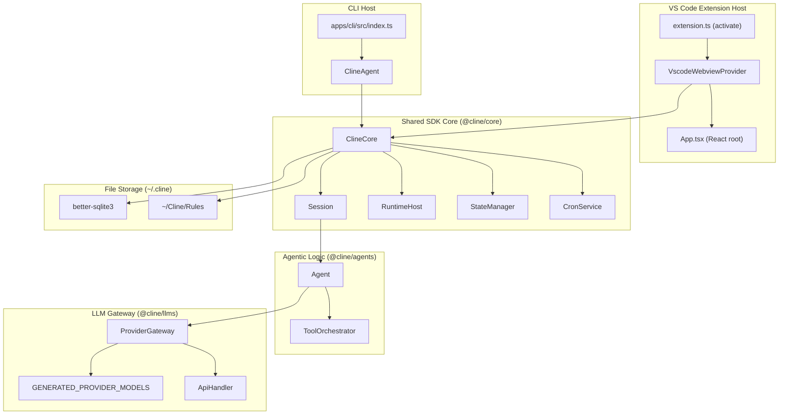

Sources: [sdk/packages/core/package.json:2-3](), [sdk/packages/agents/package.json:22-25](), [sdk/packages/llms/src/catalog/catalog.generated.ts:1-5](), [package.json:87-90]()

---

## The Agent Loop

Tasks are managed via `ClineCore` and executed by the stateless `Agent` loop [sdk/packages/core/package.json:2-5](), [sdk/packages/agents/package.json:2-5]().

**Diagram: Agent Loop — Natural Language Steps to Code Entities**

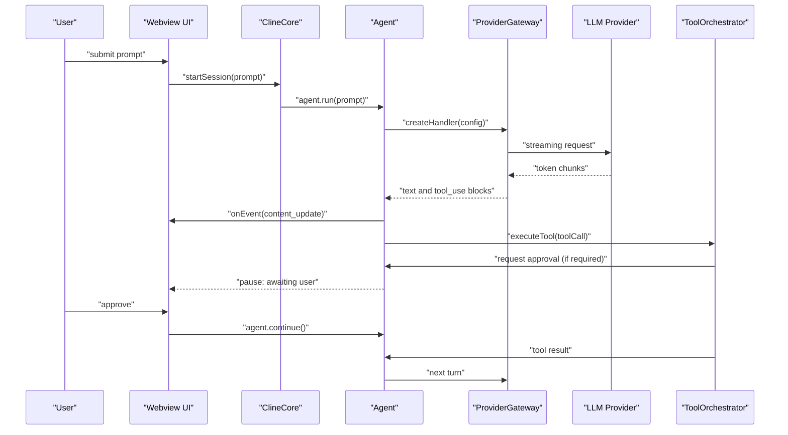

The execution loop follows these primary phases:
1. **Session Initialization** — `ClineCore` prepares workspace parameters and establishes a stateful session [sdk/packages/core/package.json:15-22]().
2. **LLM Interaction** — The `Agent` interacts with model providers via streaming request handlers [sdk/packages/agents/package.json:20-25]().
3. **Tool Execution** — Requested actions are dispatched through the `ToolOrchestrator` [sdk/packages/agents/package.json:28-32]().
4. **Human-in-the-Loop Control** — Sensitive tools pause execution until explicit user verification is received [README.md:148]().
5. **Turn Continuation** — Tool outputs are fed back into the agent context for subsequent reasoning steps [apps/cli/CHANGELOG.md:10-15]().

Sources: [README.md:146-149](), [sdk/packages/agents/package.json:10-14](), [sdk/packages/core/package.json:50-55]()

---

## Human-in-the-Loop Safety Model

Cline incorporates rigorous safety mechanisms to keep developers in full control of workspace modifications:

| Mechanism | Implementation Detail | Effect |
|---|---|---|
| Approval prompts | `ask()` flow | Suspends agent loop and blocks execution until user grants permission [README.md:148](). |
| Diff view | `DiffViewProvider` | Displays file alterations visually before applying modifications [apps/vscode/package.json:1-10](). |
| Checkpoints | Git-backed snapshots | Tracks changes automatically to allow session rollback and diff inspection [README.md:140](). |
| Rules & .clineignore | `.clinerules` / `.clineignore` | Enforces project constraints and restricts path access [README.md:150-152](). |
| Command Permissions | `CLINE_COMMAND_PERMISSIONS` | Restricts shell execution based on security policies [apps/cli/CHANGELOG.md:40-47](). |
| Plan Mode Restrictions | Mode coordinator | Prevents mutating tool execution during architecture planning phases [README.md:148](). |
| YOLO Mode | Auto-approval settings | Bypasses manual verification prompts for selected tool classes when configured [README.md:148](). |

Sources: [README.md:138-152](), [CHANGELOG.md:13-30](), [apps/cli/CHANGELOG.md:40-47]()

---

## LLM Provider Support

Backend connectivity is managed through the `@cline/llms` package, offering unified provider routing and model catalogs [sdk/packages/llms/package.json:2-10]().

| Provider | Integration Package | Key Capabilities |
|---|---|---|
| Anthropic | `@ai-sdk/anthropic` | Native tool calling, Claude models [sdk/packages/llms/package.json:50-55](). |
| OpenAI | `@ai-sdk/openai` | GPT series and advanced reasoning models [sdk/packages/llms/package.json:55-60](). |
| Google Gemini | `@ai-sdk/google` | High-context windows via Gemini models [sdk/packages/llms/package.json:55-60](). |
| OpenRouter | `@openrouter/ai-sdk-provider` | Access to 200+ models through a single gateway [sdk/packages/llms/package.json:70-75](). |
| AWS Bedrock | `@ai-sdk/amazon-bedrock` | Enterprise-managed hosting for Claude and Llama [sdk/packages/llms/package.json:50-55](). |
| Cline Provider | Managed Gateway | Curated subscription models and usage billing [CHANGELOG.md:10-15](). |
| Local Models | `ollama-ai-provider-v2` | Local execution via Ollama and LM Studio [sdk/packages/llms/package.json:75-80](). |

Sources: [README.md:154-170](), [sdk/packages/llms/package.json:50-80](), [sdk/packages/llms/src/catalog/catalog.generated.ts:1-5]()

---

## Delivery Surfaces & Child Pages

Explore the child pages for complete technical specifications:
- **Architecture Overview** — See [Architecture Overview](#1.1) for subsystem mappings across hosts and SDK packages.
- **Installation and Setup** — See [Installation and Setup](#1.2) for package installation and Bun workspace setup.
- **Quick Start Guide** — See [Quick Start Guide](#1.3) for running first tasks in IDE, TUI, and SDK environments.
- **Repository Layout and Monorepo Tooling** — See [Repository Layout and Monorepo Tooling](#1.4) for monorepo directory structures, changesets, and agent rules.

Sources: [package.json:4-14](), [sdk/packages/sdk/package.json:1-5](), [sdk/packages/core/package.json:20-40]()

---

# Page: Architecture Overview

# Architecture Overview

<details>
<summary>Relevant source files</summary>

The following files were used as context for generating this wiki page:

- [apps/cli/CHANGELOG.md](apps/cli/CHANGELOG.md)
- [apps/cli/package.json](apps/cli/package.json)
- [bun.lock](bun.lock)
- [sdk/AGENTS.md](sdk/AGENTS.md)
- [sdk/ARCHITECTURE.md](sdk/ARCHITECTURE.md)
- [sdk/CHANGELOG.md](sdk/CHANGELOG.md)
- [sdk/DOC.md](sdk/DOC.md)
- [sdk/packages/agents/package.json](sdk/packages/agents/package.json)
- [sdk/packages/core/package.json](sdk/packages/core/package.json)
- [sdk/packages/core/src/cloud/controller.test.ts](sdk/packages/core/src/cloud/controller.test.ts)
- [sdk/packages/core/src/cloud/controller.ts](sdk/packages/core/src/cloud/controller.ts)
- [sdk/packages/core/src/extensions/composio/composio-meta-tools.test.ts](sdk/packages/core/src/extensions/composio/composio-meta-tools.test.ts)
- [sdk/packages/core/src/extensions/composio/composio-meta-tools.ts](sdk/packages/core/src/extensions/composio/composio-meta-tools.ts)
- [sdk/packages/core/src/extensions/composio/composio-tools-extension.test.ts](sdk/packages/core/src/extensions/composio/composio-tools-extension.test.ts)
- [sdk/packages/core/src/extensions/composio/composio-tools-extension.ts](sdk/packages/core/src/extensions/composio/composio-tools-extension.ts)
- [sdk/packages/core/src/hub/runtime-host/hub-runtime-host.test.ts](sdk/packages/core/src/hub/runtime-host/hub-runtime-host.test.ts)
- [sdk/packages/core/src/hub/runtime-host/hub-runtime-host.ts](sdk/packages/core/src/hub/runtime-host/hub-runtime-host.ts)
- [sdk/packages/core/src/hub/server/boundary.test.ts](sdk/packages/core/src/hub/server/boundary.test.ts)
- [sdk/packages/core/src/hub/server/handlers/connector-handlers.test.ts](sdk/packages/core/src/hub/server/handlers/connector-handlers.test.ts)
- [sdk/packages/core/src/hub/server/handlers/context.ts](sdk/packages/core/src/hub/server/handlers/context.ts)
- [sdk/packages/core/src/hub/server/handlers/run-handlers.test.ts](sdk/packages/core/src/hub/server/handlers/run-handlers.test.ts)
- [sdk/packages/core/src/hub/server/handlers/run-handlers.ts](sdk/packages/core/src/hub/server/handlers/run-handlers.ts)
- [sdk/packages/core/src/hub/server/handlers/session-event-projector.ts](sdk/packages/core/src/hub/server/handlers/session-event-projector.ts)
- [sdk/packages/core/src/hub/server/handlers/session-handlers.ts](sdk/packages/core/src/hub/server/handlers/session-handlers.ts)
- [sdk/packages/core/src/index.ts](sdk/packages/core/src/index.ts)
- [sdk/packages/core/src/runtime/host/local-runtime-host.test.ts](sdk/packages/core/src/runtime/host/local-runtime-host.test.ts)
- [sdk/packages/core/src/runtime/host/local-runtime-host.ts](sdk/packages/core/src/runtime/host/local-runtime-host.ts)
- [sdk/packages/core/src/runtime/host/runtime-host.ts](sdk/packages/core/src/runtime/host/runtime-host.ts)
- [sdk/packages/core/src/runtime/turn-queue/pending-prompt-service.ts](sdk/packages/core/src/runtime/turn-queue/pending-prompt-service.ts)
- [sdk/packages/core/src/services/local-runtime-bootstrap.test.ts](sdk/packages/core/src/services/local-runtime-bootstrap.test.ts)
- [sdk/packages/core/src/services/local-runtime-bootstrap.ts](sdk/packages/core/src/services/local-runtime-bootstrap.ts)
- [sdk/packages/core/src/types/session.ts](sdk/packages/core/src/types/session.ts)
- [sdk/packages/llms/package.json](sdk/packages/llms/package.json)
- [sdk/packages/llms/src/catalog/catalog.generated.ts](sdk/packages/llms/src/catalog/catalog.generated.ts)
- [sdk/packages/llms/src/catalog/cline-recommended.generated.ts](sdk/packages/llms/src/catalog/cline-recommended.generated.ts)
- [sdk/packages/llms/src/providers/provider-ids.generated.ts](sdk/packages/llms/src/providers/provider-ids.generated.ts)
- [sdk/packages/llms/src/providers/providers.generated.ts](sdk/packages/llms/src/providers/providers.generated.ts)
- [sdk/packages/sdk/package.json](sdk/packages/sdk/package.json)
- [sdk/packages/shared/package.json](sdk/packages/shared/package.json)

</details>


## Purpose and Scope

This page maps the major subsystems of the Cline monorepo, detailing how the foundational SDK packages (`@cline/shared`, `@cline/llms`, `@cline/agents`, `@cline/core`, `@cline/sdk`), runtime hosts, the Hub daemon, and the host applications (`apps/*` including `vscode`, `cli`, `cline-hub`, and `examples/desktop-app`) interrelate. 

The repository follows an SDK-first architecture governed by Bun workspaces [bun.lock:4-14](). Lower-level packages provide decoupled utilities, model catalogs, and stateless agent loops, while `@cline/core` and host-specific wrappers orchestrate state persistence, user interfaces, and external tool integrations.

Sources: [bun.lock:4-14](), [sdk/packages/core/package.json:2-3]()

---

## Monorepo Subsystem Architecture

The architecture enforces a strict one-way dependency flow: `@cline/shared` -> `@cline/llms` -> `@cline/agents` -> `@cline/core` -> host applications (`apps/*`) [sdk/ARCHITECTURE.md:27-41]().

### Diagram: Monorepo Package Dependencies and Code Entities

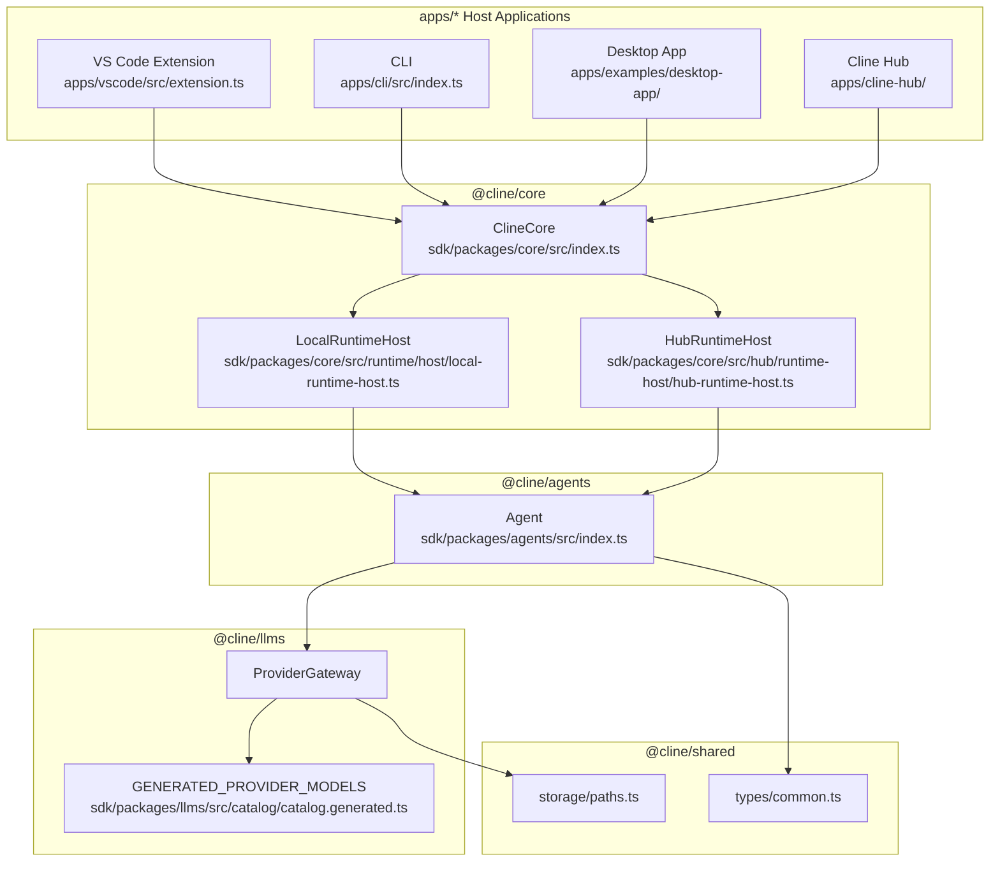

Sources: [sdk/packages/shared/package.json:10-48](), [sdk/packages/llms/package.json:10-28](), [sdk/packages/agents/package.json:9-20](), [sdk/packages/core/package.json:17-46](), [sdk/ARCHITECTURE.md:27-41]()

---

## Package Responsibilities

Each package in the layered stack has strict boundaries:
- **`@cline/shared`**: Owns reusable low-level contracts, shared types, schemas, and storage path resolution helpers [sdk/ARCHITECTURE.md:45-56]().
- **`@cline/llms`**: Owns model and provider runtime concerns, model catalogs (`GENERATED_PROVIDER_MODELS` in [sdk/packages/llms/src/catalog/catalog.generated.ts:13-16]()), and AI SDK-backed provider execution code [sdk/ARCHITECTURE.md:61-70]().
- **`@cline/agents`**: Owns the stateless agent iteration loop, tool orchestration, and turn preparation before provider calls [sdk/ARCHITECTURE.md:102-112]().
- **`@cline/core`**: Owns stateful orchestration, session lifecycle, storage persistence, and hub server services under `src/hub/` [sdk/ARCHITECTURE.md:117-134]().

Sources: [sdk/ARCHITECTURE.md:45-134](), [sdk/packages/llms/src/catalog/catalog.generated.ts:13-16]()

---

## Runtime Hosts and Hub Daemon

Execution environments are abstracted through the `RuntimeHost` interface. Depending on the host application context, sessions are managed via local processes or offloaded to a background daemon.

### Runtime Host Implementations

| Subsystem Component | Code Symbol / File Path | Role |
|---------------------|-------------------------|------|
| `RuntimeHost` Interface | `RuntimeHost` [sdk/packages/core/src/runtime/host/runtime-host.ts:1-30]() | Defines contract for starting, restoring, and sending input to sessions. |
| `LocalRuntimeHost` | `LocalRuntimeHost` [sdk/packages/core/src/runtime/host/local-runtime-host.ts:135-143]() | Manages in-process agent loops, file tools, state snapshots, and prompt queues. |
| `HubRuntimeHost` | `HubRuntimeHost` [sdk/packages/core/src/hub/runtime-host/hub-runtime-host.ts:1-30]() | Connects over WebSockets to proxy tasks through the Hub daemon. |
| `Hub Daemon` | `daemon/entry.ts` [sdk/packages/core/package.json:26-29]() | Background WebSocket daemon providing multi-client orchestration and scheduling. |

### Diagram: Runtime Host Execution Flow to Code Objects

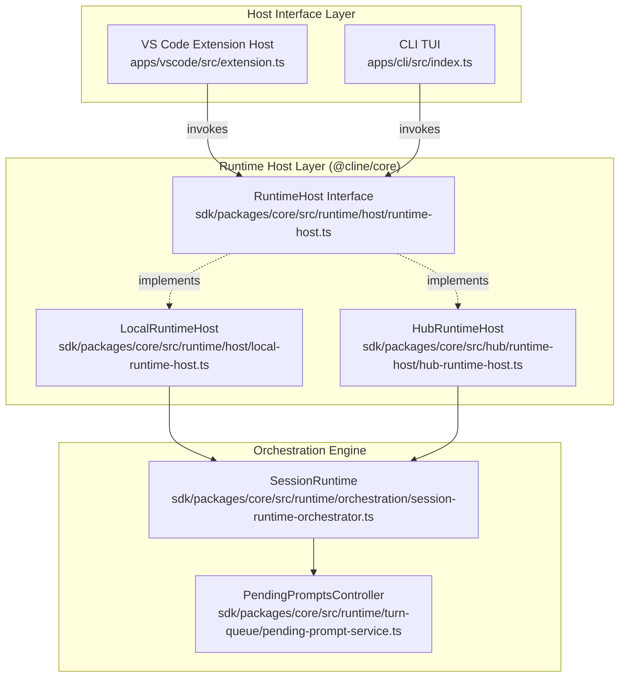

Sources: [sdk/packages/core/src/runtime/host/local-runtime-host.ts:135-150](), [sdk/packages/core/package.json:22-29](), [sdk/packages/core/src/runtime/host/runtime-host.ts:1-30]()

---

## Host Applications (`apps/*`)

Cline provides multiple delivery surfaces built on top of the shared core and SDK packages:

| Application | Location | Primary Technologies | Description |
|-------------|----------|----------------------|-------------|
| **VS Code Extension** | `apps/vscode/` [apps/vscode/package.json:1-128]() | VS Code API, Webview UI, gRPC | IDE integration providing side-panel chat, checkpoints, and code diff views. |
| **CLI** | `apps/cli/` [bun.lock:20-64]() | Commander, OpenTUI, React Reconciler | Terminal interface supporting interactive TUI, headless pipelines, and ACP mode. |
| **Cline Hub** | `apps/cline-hub/` [sdk/packages/core/package.json:9-14]() | Next.js, WebSockets, Tailwind | Centralized hub dashboard server and webview for managing routines and tasks. |
| **Desktop App** | `apps/examples/desktop-app/` [bun.lock:166-176]() | Tauri, Rust, Bun Sidecar, Next.js | Native desktop application shell for macOS and Windows. |

Sources: [bun.lock:4-176](), [sdk/packages/core/package.json:9-14]()

---

# Page: Installation and Setup

# Installation and Setup

<details>
<summary>Relevant source files</summary>

The following files were used as context for generating this wiki page:

- [.github/ISSUE_TEMPLATE/bug_report.yml](.github/ISSUE_TEMPLATE/bug_report.yml)
- [.github/ISSUE_TEMPLATE/config.yml](.github/ISSUE_TEMPLATE/config.yml)
- [.github/pull_request_template.md](.github/pull_request_template.md)
- [.gitignore](.gitignore)
- [.nvmrc](.nvmrc)
- [.tool-versions](.tool-versions)
- [.vscode/extensions.json](.vscode/extensions.json)
- [.vscode/launch.json](.vscode/launch.json)
- [.vscode/settings.json](.vscode/settings.json)
- [.vscode/tasks.json](.vscode/tasks.json)
- [CHANGELOG.md](CHANGELOG.md)
- [CODE_OF_CONDUCT.md](CODE_OF_CONDUCT.md)
- [CONTRIBUTING.md](CONTRIBUTING.md)
- [README.md](README.md)
- [apps/vscode/package.json](apps/vscode/package.json)
- [apps/vscode/scripts/clean-webview-vite-cache.mjs](apps/vscode/scripts/clean-webview-vite-cache.mjs)
- [apps/vscode/src/core/webview/WebviewProvider.ts](apps/vscode/src/core/webview/WebviewProvider.ts)
- [apps/vscode/webview-ui/src/utils/__tests__/hooks.spec.ts](apps/vscode/webview-ui/src/utils/__tests__/hooks.spec.ts)
- [apps/vscode/webview-ui/src/utils/__tests__/platformUtils.spec.ts](apps/vscode/webview-ui/src/utils/__tests__/platformUtils.spec.ts)
- [apps/vscode/webview-ui/src/utils/platformUtils.ts](apps/vscode/webview-ui/src/utils/platformUtils.ts)
- [apps/vscode/webview-ui/vite.config.ts](apps/vscode/webview-ui/vite.config.ts)
- [docs/api/models.mdx](docs/api/models.mdx)
- [docs/assets/clinepass/clinepass-cli.png](docs/assets/clinepass/clinepass-cli.png)
- [docs/assets/clinepass/clinepass-ide-extension.png](docs/assets/clinepass/clinepass-ide-extension.png)
- [docs/cline-overview.mdx](docs/cline-overview.mdx)
- [docs/core-workflows/task-management.mdx](docs/core-workflows/task-management.mdx)
- [docs/customization/clineignore.mdx](docs/customization/clineignore.mdx)
- [docs/customization/hooks.mdx](docs/customization/hooks.mdx)
- [docs/features/multiroot-workspace.mdx](docs/features/multiroot-workspace.mdx)
- [docs/getting-started/authorizing-with-cline.mdx](docs/getting-started/authorizing-with-cline.mdx)
- [docs/getting-started/cline-provider.mdx](docs/getting-started/cline-provider.mdx)
- [docs/getting-started/clinepass.mdx](docs/getting-started/clinepass.mdx)
- [docs/getting-started/installing-cline.mdx](docs/getting-started/installing-cline.mdx)
- [docs/provider-config/minimax.mdx](docs/provider-config/minimax.mdx)
- [docs/usage/ide.mdx](docs/usage/ide.mdx)
- [package.json](package.json)
- [sdk/examples/hooks/PreToolUse_ClineignoreGuard.sh](sdk/examples/hooks/PreToolUse_ClineignoreGuard.sh)
- [sdk/examples/hooks/README.md](sdk/examples/hooks/README.md)

</details>


This page details the installation procedures for Cline across its primary delivery surfaces—the VS Code extension, the standalone CLI via npm, and the desktop application—alongside the complete Bun workspace development environment setup, build prerequisites, and debugging infrastructure.

---

## Deployment Artifacts and Package Surfaces

Cline is distributed across multiple host environments, sharing core monorepo packages managed via Bun workspaces [package.json:2-6](). 

| Target Surface | Package Name / Identifier | Distribution Channel | Primary Entry / Bin |
|---|---|---|---|
| VS Code Extension | `saoudrizwan.claude-dev` | VS Code Marketplace / Open VSX | `apps/vscode/src/extension.ts` [apps/vscode/package.json:2-47]() |
| CLI Tool | `@cline/cli` (`cline`) | npm Registry | `apps/cli/src/index.ts` |
| Desktop App / Hub | `@cline/cline-hub` | Tauri Sidecar / Web App | `apps/cline-hub` [package.json:9-9]() |
| Programmatic SDK | `@cline/sdk` | npm Registry | `sdk/packages/core` [package.json:5-5]() |

Title: "Workspace Package and Distribution Mapping"
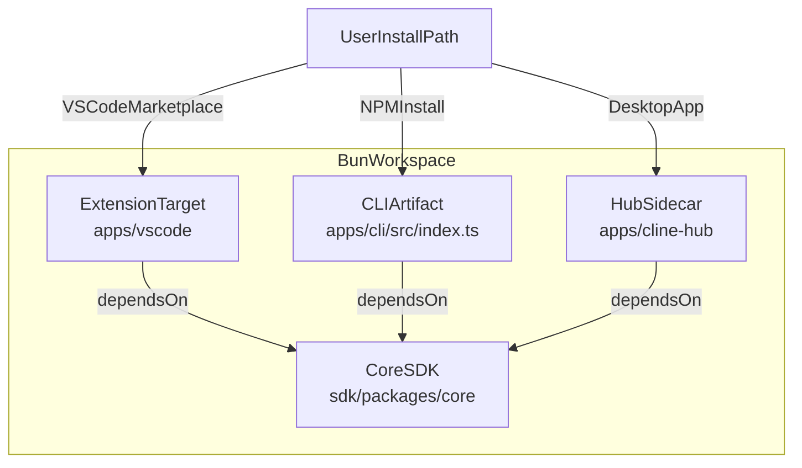
Sources: [package.json:2-14](), [apps/vscode/package.json:2-47](), [docs/getting-started/installing-cline.mdx:6-12]()

---

## End-User Installation Paths

### VS Code Extension
Users can install the extension directly from the marketplace or compatible editor interfaces (Cursor, Windsurf, VSCodium) [docs/getting-started/installing-cline.mdx:8-18]().
1. Open the Extensions Marketplace (`Ctrl/Cmd + Shift + X`) [docs/getting-started/installing-cline.mdx:21-21]().
2. Search for `Cline` and click **Install** [docs/getting-started/installing-cline.mdx:23-27]().
3. Complete authorization via the Cline settings panel or set up custom provider API keys [docs/getting-started/installing-cline.mdx:32-36]().

### CLI via npm
The standalone CLI (`@cline/cli`) enables terminal-based interactive chat (`cline`) and headless task execution [docs/getting-started/installing-cline.mdx:68-89]().
```bash
npm install -g cline
cline auth
cline "your task description"
```
The package targets Node.js `>=22` [package.json:54-55]().

### Desktop App
The Tauri-based desktop application provides a standalone window running the Cline Hub sidecar server. It packages local runtime host services, allowing multi-agent Kanban management and off-IDE execution.

Sources: [package.json:54-55](), [docs/getting-started/installing-cline.mdx:13-111]()

---

## Bun Workspace Development Environment Setup

To contribute to or run Cline from source, developers must configure a Bun-driven workspace environment defined in the root `package.json` [package.json:1-14]().

### Prerequisites
* **Bun**: Version `1.4.2` (serves as the primary package manager and task runner) [package.json:53-53]().
* **Node.js**: Version `>=22` [package.json:54-55]().
* **Git LFS**: Required for cloning large assets and test fixtures [CONTRIBUTING.md:37-37]().

### Environment Bootstrap
1. **Clone Repository & Install Dependencies**:
   ```bash
   git clone https://github.com/cline/cline.git
   cd cline
   bun install
   ```
2. **Protocol Buffer Compilation**:
   Communication between the VS Code extension host and the React webview relies on gRPC over postMessage. Protocol buffers must be compiled before launching builds [/.vscode/tasks.json:20-34]().
   ```bash
   cd apps/vscode
   bun run protos
   ```
3. **Configure Workspace Settings**:
   The workspace uses Biome for linting and formatting as defined in `package.json` scripts (`bun run biome`, `bun run check`) [package.json:32-36]().

Title: "Development Lifecycle and Build Pipeline Flow"
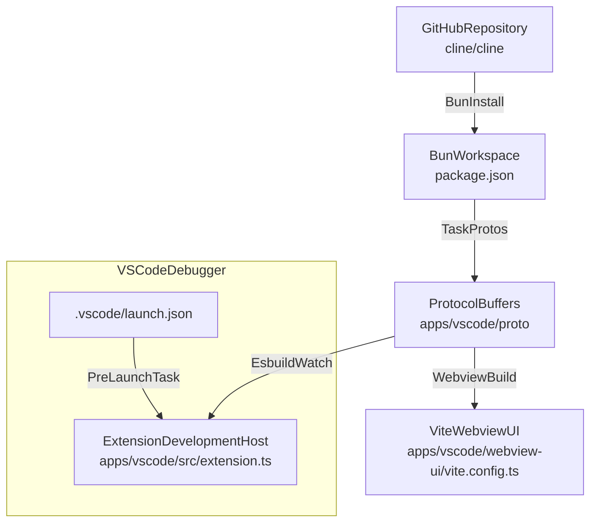
Sources: [package.json:15-39](), [/.vscode/tasks.json:7-51](), [/.vscode/launch.json:8-32]()

---

## Build Tasks, Debugging, and Launch Configurations

The repository provides pre-configured VS Code tasks and launch profiles to streamline debugging and hot-reloading.

### Launch Configurations (`.vscode/launch.json`)
Developers can launch the extension inside a dedicated Extension Development Host with isolated user data directories or specific development flags [/.vscode/launch.json:8-112](). Key configurations include:
* **`Run Extension (production)`**: Compiles and runs the production target bundle inside a fresh extension host context [/.vscode/launch.json:8-32]().
* **`Run Extension (Fresh Install Mode)`**: Cleans temporary user directories (`apps/vscode/dist/tmp/user`) and launches with a temporary profile [/.vscode/launch.json:84-112]().
* **`Debug Test Standalone Core Api Server (test:sca-server)`**: Launches the standalone core gRPC/API server via Bun [/.vscode/launch.json:114-143]().

### Build and Watch Tasks (`.vscode/tasks.json`)
The monorepo defines background compilation tasks for live development [/.vscode/tasks.json:36-65]().
* **`compile-standalone`**: Triggers standalone builds [/.vscode/tasks.json:7-18]().
* **`npm: protos`**: Compiles `.proto` schemas into executable TypeScript definitions [/.vscode/tasks.json:20-34]().
* **`watch`**: Composite task orchestrating proto generation, webview builds (`npm: dev:webview`), TypeScript type-checking (`npm: watch:tsc`), and esbuild bundling (`npm: watch:esbuild`) [/.vscode/tasks.json:36-51]().

Sources: [/.vscode/launch.json:8-143](), [/.vscode/tasks.json:7-244]()

---

# Page: Quick Start Guide

# Quick Start Guide

<details>
<summary>Relevant source files</summary>

The following files were used as context for generating this wiki page:

- [docs/api/authentication.mdx](docs/api/authentication.mdx)
- [docs/api/chat-completions.mdx](docs/api/chat-completions.mdx)
- [docs/api/errors.mdx](docs/api/errors.mdx)
- [docs/api/getting-started.mdx](docs/api/getting-started.mdx)
- [docs/api/models.mdx](docs/api/models.mdx)
- [docs/api/overview.mdx](docs/api/overview.mdx)
- [docs/api/sdk-examples.mdx](docs/api/sdk-examples.mdx)
- [docs/assets/clinepass/clinepass-cli.png](docs/assets/clinepass/clinepass-cli.png)
- [docs/assets/clinepass/clinepass-ide-extension.png](docs/assets/clinepass/clinepass-ide-extension.png)
- [docs/cli/cli-reference.mdx](docs/cli/cli-reference.mdx)
- [docs/cline-overview.mdx](docs/cline-overview.mdx)
- [docs/core-workflows/task-management.mdx](docs/core-workflows/task-management.mdx)
- [docs/customization/clineignore.mdx](docs/customization/clineignore.mdx)
- [docs/customization/hooks.mdx](docs/customization/hooks.mdx)
- [docs/enterprise-solutions/api-reference.mdx](docs/enterprise-solutions/api-reference.mdx)
- [docs/features/multiroot-workspace.mdx](docs/features/multiroot-workspace.mdx)
- [docs/getting-started/authorizing-with-cline.mdx](docs/getting-started/authorizing-with-cline.mdx)
- [docs/getting-started/cline-provider.mdx](docs/getting-started/cline-provider.mdx)
- [docs/getting-started/clinepass.mdx](docs/getting-started/clinepass.mdx)
- [docs/getting-started/installing-cline.mdx](docs/getting-started/installing-cline.mdx)
- [docs/mcp/mcp-overview.mdx](docs/mcp/mcp-overview.mdx)
- [docs/provider-config/minimax.mdx](docs/provider-config/minimax.mdx)
- [docs/sdk/architecture/hub-spoke.mdx](docs/sdk/architecture/hub-spoke.mdx)
- [docs/tools-reference/all-cline-tools.mdx](docs/tools-reference/all-cline-tools.mdx)
- [docs/usage/cli-overview.mdx](docs/usage/cli-overview.mdx)
- [docs/usage/ide.mdx](docs/usage/ide.mdx)
- [sdk/examples/hooks/PreToolUse_ClineignoreGuard.sh](sdk/examples/hooks/PreToolUse_ClineignoreGuard.sh)
- [sdk/examples/hooks/README.md](sdk/examples/hooks/README.md)

</details>


This guide walks a new user through installing Cline, configuring an AI provider, and executing their first task across multiple delivery surfaces: the IDE extension, the standalone CLI/TUI, and programmatic SDK examples [docs/getting-started/installing-cline.mdx:2-4](), [docs/usage/cli-overview.mdx:2-5]().

---

## Installation

Cline supports multiple installation paths depending on your workflow requirements [docs/getting-started/installing-cline.mdx:6-13]().

### IDE Extension
The Cline extension is available for VS Code, Cursor, Windsurf, VSCodium, Antigravity, and JetBrains IDEs [docs/getting-started/installing-cline.mdx:8-9]().
1. **Search & Install:** Open the Extensions view (`Ctrl/Cmd + Shift + X`), search for `Cline`, and click **Install** [docs/getting-started/installing-cline.mdx:39-47]().
2. **Open:** Locate the Cline icon in the extension sidebar to launch the panel [docs/getting-started/installing-cline.mdx:48-50]().

### CLI
For terminal-based workflows and automation [docs/getting-started/installing-cline.mdx:10]():
1. **Prerequisites:** Ensure Node.js 20+ (22 recommended) is installed [docs/getting-started/installing-cline.mdx:90-91]().
2. **Install:** Run `npm install -g cline` [docs/getting-started/installing-cline.mdx:93-96]().

### SDK
To build custom agents or embed Cline programmatically [docs/getting-started/installing-cline.mdx:12]():
1. Initialize a project (`npm init -y`) [docs/getting-started/installing-cline.mdx:136-140]().
2. Install the package via `npm install @cline/sdk` [docs/getting-started/installing-cline.mdx:142-145]().

Sources: [docs/getting-started/installing-cline.mdx:1-152]()

---

## Initial Configuration

### 1. Provider Setup
Cline connects to AI models via a **provider** configuration [docs/getting-started/authorizing-with-cline.mdx:6-10]().
* **Cline (usage-billing):** Pay-as-you-go access via Google/GitHub/email OAuth [docs/getting-started/authorizing-with-cline.mdx:8](), [docs/getting-started/authorizing-with-cline.mdx:42-49]().
* **ClinePass:** A flat-rate subscription offering enhanced usage on open coding models [docs/getting-started/clinepass.mdx:6-12]().
* **BYOK (Bring Your Own Key):** Direct integration with Anthropic, OpenAI, Google Gemini, or local runtimes (Ollama, LM Studio) [docs/getting-started/authorizing-with-cline.mdx:10](), [docs/getting-started/authorizing-with-cline.mdx:58-81]().

**In VS Code:** Open settings via the gear icon in the Cline panel, select your **API Provider**, and complete authentication [docs/getting-started/authorizing-with-cline.mdx:20-33]().  
**In CLI:** Run `cline auth` to launch the interactive setup flow handled by `runAuthCommand` and `ensureOAuthProviderApiKey` [docs/getting-started/authorizing-with-cline.mdx:86-88](), [apps/cli/src/main.ts:189-191](), [apps/cli/src/utils/provider-auth.ts:43-47]().

Sources: [docs/getting-started/authorizing-with-cline.mdx:1-102](), [docs/getting-started/clinepass.mdx:1-130](), [apps/cli/src/main.ts:189-203]()

---

## Running Your First Task

### VS Code Workflow
Type prompts directly into the chat input at the bottom of the Cline panel [docs/cline-overview.mdx:7-9](). Use `@` mentions to pass files or workspace context. Multi-root workspaces are supported via explicit `@workspace:path` syntax [docs/features/multiroot-workspace.mdx:6-7](), [docs/features/multiroot-workspace.mdx:137-144]().

### CLI / TUI Workflow
* **Interactive Mode (TUI):** Launch an OpenTUI session using `cline` [docs/usage/cli-overview.mdx:15-16](), [apps/cli/src/tui/root.tsx:1-12](). Internally, `runCli` invokes `runInteractive` to boot the TUI runtime loop [apps/cli/src/main.ts:91-94](), [apps/cli/src/main.ts:182-183]().
* **Headless Automation:** Execute tasks directly with flags like `--json` or `--auto-approve true` [docs/usage/cli-overview.mdx:25-56]().

```bash
cline "Summarize the README.md" --json | jq -r '.text'
```

### SDK Quickstart Example
Developers can initialize programmatic sessions using `@cline/core`:

```typescript
import { ClineCore, ProviderSettingsManager } from "@cline/core";

// Initialize provider settings and session configuration
const providerManager = new ProviderSettingsManager();
const settings = providerManager.getProviderConfig("cline");
```

**Diagram: Task Execution Data Flow**

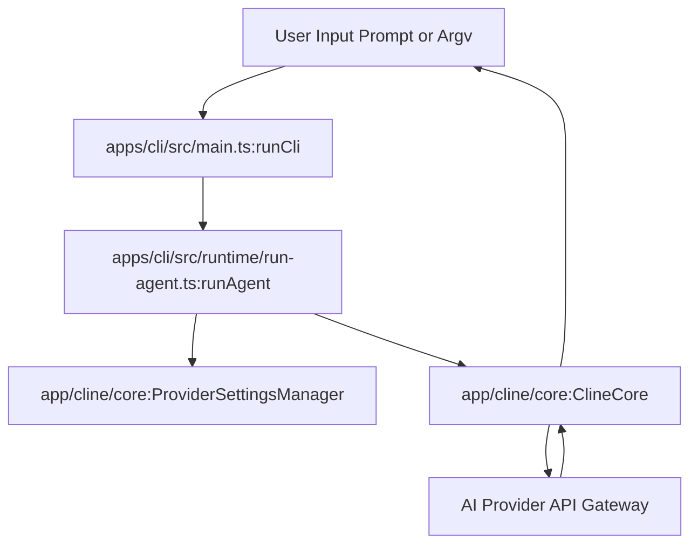
Sources: [docs/usage/cli-overview.mdx:1-147](), [apps/cli/src/main.ts:78-183](), [apps/cli/src/main.test.ts:190-204]()

---

## Core Operational Modes

* **Plan Mode:** Activated via `-p` or `--plan`. The agent analyzes the workspace and proposes an execution strategy without executing mutating tools [docs/usage/cli-overview.mdx:57-61](), [docs/usage/cli-overview.mdx:96]().
* **Act Mode:** Default mode. Executes tools (file edits, shell commands) under human-in-the-loop policy control [docs/usage/cli-overview.mdx:63-65](), [docs/cli/cli-reference.mdx:27]().
* **ACP Mode:** Run as an Agent Client Protocol server for editor integrations in Zed, Neovim, or JetBrains via `cline --acp` [docs/usage/cli-overview.mdx:147-147](), [docs/cli/cli-reference.mdx:46]().

**Diagram: CLI Component Mapping**

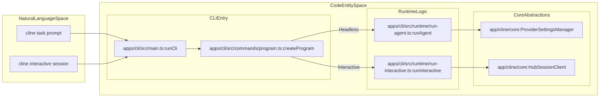
Sources: [docs/usage/cli-overview.mdx:1-147](), [apps/cli/src/main.ts:73-183](), [apps/cli/src/main.test.ts:190-204]()

---

# Page: Repository Layout and Monorepo Tooling

# Repository Layout and Monorepo Tooling

<details>
<summary>Relevant source files</summary>

The following files were used as context for generating this wiki page:

- [.claude/commands/hotfix-release.md](.claude/commands/hotfix-release.md)
- [.claude/commands/release.md](.claude/commands/release.md)
- [.claude/hooks/claude-code-for-web-setup.sh](.claude/hooks/claude-code-for-web-setup.sh)
- [.claude/settings.json](.claude/settings.json)
- [.clinerules/general.md](.clinerules/general.md)
- [.clinerules/workflows/address-pr-comments.md](.clinerules/workflows/address-pr-comments.md)
- [.clinerules/workflows/find-pr-reviewers.md](.clinerules/workflows/find-pr-reviewers.md)
- [.clinerules/workflows/hotfix-release.md](.clinerules/workflows/hotfix-release.md)
- [.clinerules/workflows/pr-review.md](.clinerules/workflows/pr-review.md)
- [.clinerules/workflows/release.md](.clinerules/workflows/release.md)
- [.github/ISSUE_TEMPLATE/bug_report.yml](.github/ISSUE_TEMPLATE/bug_report.yml)
- [.github/ISSUE_TEMPLATE/config.yml](.github/ISSUE_TEMPLATE/config.yml)
- [.github/copilot-instructions.md](.github/copilot-instructions.md)
- [.github/pull_request_template.md](.github/pull_request_template.md)
- [.worktreeinclude](.worktreeinclude)
- [CHANGELOG.md](CHANGELOG.md)
- [CODE_OF_CONDUCT.md](CODE_OF_CONDUCT.md)
- [CONTRIBUTING.md](CONTRIBUTING.md)
- [README.md](README.md)
- [apps/vscode/package.json](apps/vscode/package.json)
- [package.json](package.json)
- [sdk/packages/agents/bun.mts](sdk/packages/agents/bun.mts)
- [sdk/packages/core/bun.mts](sdk/packages/core/bun.mts)
- [sdk/packages/core/tsconfig.build.json](sdk/packages/core/tsconfig.build.json)
- [sdk/packages/core/tsconfig.dev.json](sdk/packages/core/tsconfig.dev.json)
- [sdk/packages/core/tsconfig.json](sdk/packages/core/tsconfig.json)
- [sdk/packages/llms/bun.mts](sdk/packages/llms/bun.mts)
- [sdk/packages/shared/bun.mts](sdk/packages/shared/bun.mts)
- [sdk/packages/tsconfig.base.json](sdk/packages/tsconfig.base.json)
- [sdk/tsconfig.json](sdk/tsconfig.json)

</details>


This page documents the repository structure, Bun workspace configuration, shared compilation settings, quality enforcement hooks, and agent-facing metadata directories across the Cline monorepo.

---

## 1. Bun Workspace Layout (`apps/`, `sdk/`, `docs/`, `evals/`)

The Cline codebase is structured as a Bun-managed monorepo containing user-facing application entrypoints, core SDK library packages, documentation files, and evaluation suites. Package management and task execution are handled via `bun` [package.json:15-39]() (`bun install`, `bun run`, `bunx`). The workspace globs are declared in the root manifest [package.json:4-14]().

```mermaid
graph TD
    Root["Repository Root package.json"] --> Apps["apps/"]
    Root --> Sdk["sdk/"]
    Root --> Docs["docs/"]
    Root --> Evals["evals/"]

    Apps --> Vscode["vscode apps/vscode"]
    Apps --> Cli["cli apps/cli"]
    Apps --> Hub["cline-hub apps/cline-hub"]
    Apps --> Desktop["desktop-app apps/examples/desktop-app"]

    Sdk --> PShared["packages/shared sdk/packages/shared"]
    Sdk --> PLlms["packages/llms sdk/packages/llms"]
    Sdk --> PAgents["packages/agents sdk/packages/agents"]
    Sdk --> PCore["packages/core sdk/packages/core"]
    Sdk --> PSdk["packages/sdk sdk/packages/sdk"]

    Sources: package.json:4-14, sdk/tsconfig.json:1-53
```

- **`apps/`**: Contains runtime application hosts including the VS Code extension (`apps/vscode`), the command-line interface (`apps/cli`), the Cline Hub server (`apps/cline-hub`), and reference desktop implementations (`apps/examples/desktop-app`) [package.json:6]().
- **`sdk/`**: Contains core modular packages adhering to a strict one-way dependency flow (`@cline/shared` $\rightarrow$ `@cline/llms` $\rightarrow$ `@cline/agents` $\rightarrow$ `@cline/core` $\rightarrow$ `@cline/sdk`) [package.json:5]().
- **`docs/`**: Holds documentation files and configuration.
- **`evals/`**: Contains benchmark scenarios, smoke tests, and evaluation harnesses.

Sources: [package.json:4-14](), [sdk/tsconfig.json:1-53]()

---

## 2. Shared Configuration and Path Mappings (`tsconfig`, Biome)

TypeScript compilation across the SDK workspace relies on base configurations and path aliases defined in `sdk/tsconfig.json` and `sdk/packages/tsconfig.base.json` [sdk/tsconfig.json:1-44](). Path mapping allows packages to reference each other directly in source form during development.

```mermaid
graph LR
    TsConfig["sdk/tsconfig.json"] --> Shared["@cline/shared -> packages/shared/src/index.ts"]
    TsConfig --> Llms["@cline/llms -> packages/llms/src/index.ts"]
    TsConfig --> Agents["@cline/agents -> packages/agents/src/index.ts"]
    TsConfig --> Core["@cline/core -> packages/core/src/index.ts"]
    TsConfig --> SdkPkg["@cline/sdk -> packages/sdk/src/index.ts"]

    Sources: sdk/tsconfig.json:12-44
```

Key compiler options shared across packages:
- `target`: `ES2022` [sdk/tsconfig.json:3]()
- `module`: `ESNext` [sdk/tsconfig.json:4]()
- `moduleResolution`: `bundler` [sdk/tsconfig.json:5]()
- Explicit path aliases mapping internal workspace names to their corresponding source entrypoints [sdk/tsconfig.json:12-44]().

Additionally, formatting and linting are standardized using Biome via root scripts (`bun run biome`, `bun run format`, `bun run lint`) configured in `package.json` [package.json:32-36]().

Sources: [package.json:32-36](), [sdk/tsconfig.json:1-53]()

---

## 3. Build System and Release Tooling (Bun Scripts)

Package compilation is orchestrated via Bun bundling scripts (`bun.mts`) located within individual packages. For instance, `sdk/packages/core/bun.mts` and `sdk/packages/shared/bun.mts` define multiple bundle targets (Node, browser, workers, remote helpers) using `Bun.build` [sdk/packages/core/bun.mts:55-87]().

```mermaid
graph TD
    BunScript["sdk/packages/core/bun.mts"] --> BuildCore["Bun.build() Target: node"]
    BuildCore --> EntryIndex["src/index.ts -> dist/"]
    BuildCore --> EntryHub["src/hub/index.ts -> dist/hub/"]
    BuildCore --> EntryDaemon["src/hub/daemon/entry.ts -> dist/hub/daemon/"]
    BuildCore --> EntryCloud["src/cloud/index.ts -> dist/cloud/"]

    RootScripts["package.json scripts"] --> RunBuildSdk["bun run build:sdk"]
    RunBuildSdk --> BuildCoreScript["sdk/packages/core/bun.mts"]

    Sources: sdk/packages/core/bun.mts:55-87, package.json:17-18
```

- **Bundling**: `Bun.build` compiles entrypoints, manages external packages, injects build IDs (`__CLINE_CORE_RUNTIME_BUILD_ID__`), and handles minification [sdk/packages/core/bun.mts:24-53]().
- **Workspace Build & Versioning**: Root scripts like `bun run build`, `bun run version`, and `bun run release` coordinate automated versioning and workspace builds [package.json:17-39]().

Sources: [package.json:15-39](), [sdk/packages/core/bun.mts:1-102](), [sdk/packages/shared/bun.mts:1-74]()

---

## 4. Git Hooks and Quality Gates (Husky & lint-staged)

Code quality and consistency checks are enforced locally prior to commits using Husky git hooks and `lint-staged` configurations defined in the root `package.json` [package.json:16, 40-49]().

```mermaid
graph TD
    GitCommit["git commit"] --> HuskyPrepare["prepare: husky"]
    HuskyPrepare --> LintStagedBlock["lint-staged config in package.json"]
    LintStagedBlock --> SdkCheck["sdk/** -> bun run types & biome check"]
    LintStagedBlock --> AppsCheck["apps/** -> bun run types & biome check"]
    SdkCheck -- "Lint Error" --> Fail[Exit 1: Block Commit]
    SdkCheck -- "Clean" --> Success[Allow Commit]

    Sources: package.json:16, package.json:40-49
```

- **Hooks Integration**: Husky is initialized via the `"prepare": "husky"` lifecycle script [package.json:16]().
- **Staged Validation**: `lint-staged` runs TypeScript type checks (`bun run types`) and Biome validations against staged files in `sdk/` and `apps/` before allowing commits [package.json:40-49]().

Sources: [package.json:16](), [package.json:40-49]()

---

## 5. Agent-Facing Directories (`.clinerules`, `.cline/skills`, `.agents`, `.claude`)

The repository includes specialized directories designed to guide autonomous coding agents and human contributors by providing tribal knowledge, workflows, skills, and custom instructions.

```mermaid
graph TD
    AgentDirs["Agent Metadata Directories"] --> Clinerules[".clinerules/"]
    AgentDirs --> Skills[".cline/skills/"]
    AgentDirs --> Agents["--.agents/"]
    AgentDirs --> Claude[".claude/"]

    Clinerules --> General["general.md (Tribal knowledge & rules)"]
    Clinerules --> Workflows["workflows/ (release.md, hotfix-release.md, pr-review.md)"]
    Claude --> Commands["commands/hotfix-release.md (Custom agent command runner)"]

    Sources: .claude/commands/hotfix-release.md:1-12
```

- **`.clinerules/`**: Stores high-signal tribal knowledge, workspace gotchas, and procedural workflows [ .clinerules/general.md ].
- **`.cline/skills/` & `.agents/`**: Provide modular agent capabilities, helper tools, and portable execution profiles.
- **`.claude/`**: Contains assistant configuration settings and command templates (e.g., hotfix and release checklists such as `.claude/commands/hotfix-release.md`) [.claude/commands/hotfix-release.md:1-12]().

Sources: [.claude/commands/hotfix-release.md:1-187]()

---

# Page: Extension Architecture

# Extension Architecture

<details>
<summary>Relevant source files</summary>

The following files were used as context for generating this wiki page:

- [apps/vscode/proto/cline/state.proto](apps/vscode/proto/cline/state.proto)
- [apps/vscode/scripts/generate-state-proto.mjs](apps/vscode/scripts/generate-state-proto.mjs)
- [apps/vscode/src/common.ts](apps/vscode/src/common.ts)
- [apps/vscode/src/core/controller/state/getStateToPostToWebview.ts](apps/vscode/src/core/controller/state/getStateToPostToWebview.ts)
- [apps/vscode/src/core/controller/state/updateSettings.ts](apps/vscode/src/core/controller/state/updateSettings.ts)
- [apps/vscode/src/core/controller/state/updateSettingsCli.ts](apps/vscode/src/core/controller/state/updateSettingsCli.ts)
- [apps/vscode/src/core/storage/__tests__/openai-base-url-migration.test.ts](apps/vscode/src/core/storage/__tests__/openai-base-url-migration.test.ts)
- [apps/vscode/src/core/storage/openai-base-url-migration.ts](apps/vscode/src/core/storage/openai-base-url-migration.ts)
- [apps/vscode/src/extension.ts](apps/vscode/src/extension.ts)
- [apps/vscode/src/hosts/vscode/commandUtils.ts](apps/vscode/src/hosts/vscode/commandUtils.ts)
- [apps/vscode/src/shared/ExtensionMessage.ts](apps/vscode/src/shared/ExtensionMessage.ts)
- [apps/vscode/src/shared/storage/__tests__/state-keys.test.ts](apps/vscode/src/shared/storage/__tests__/state-keys.test.ts)
- [apps/vscode/src/shared/storage/state-keys.ts](apps/vscode/src/shared/storage/state-keys.ts)
- [apps/vscode/src/standalone/cline-core.ts](apps/vscode/src/standalone/cline-core.ts)
- [apps/vscode/webview-ui/src/components/settings/sections/FeatureSettingsSection.spec.tsx](apps/vscode/webview-ui/src/components/settings/sections/FeatureSettingsSection.spec.tsx)
- [apps/vscode/webview-ui/src/components/settings/sections/FeatureSettingsSection.tsx](apps/vscode/webview-ui/src/components/settings/sections/FeatureSettingsSection.tsx)
- [apps/vscode/webview-ui/src/context/ExtensionStateContext.tsx](apps/vscode/webview-ui/src/context/ExtensionStateContext.tsx)

</details>


This page documents the internal structure of the Cline extension and its evolution toward a standalone core architecture. It covers the high-level orchestration between the host environment, the central controller, and the cross-platform abstraction layer.

## Overview

Cline is designed with a decoupled architecture that separates the agentic core logic from the host environment (VS Code, CLI, or standalone). This separation is achieved through a provider-based abstraction layer and a centralized controller that manages the lifecycle of AI tasks via the Cline SDK and shared services [apps/vscode/src/extension.ts:68-86](), [apps/vscode/src/common.ts:34-57](). The extension maintains cross-platform compatibility through shared file-backed storage and gRPC communication layers [apps/vscode/src/extension.ts:82-86]().

### System Components

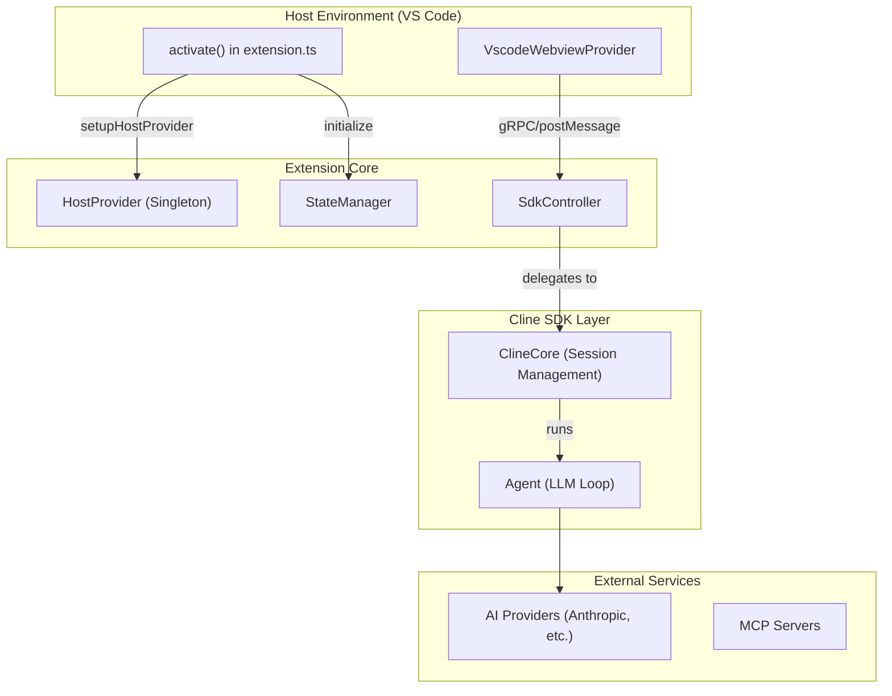

**Sources:** [apps/vscode/src/extension.ts:67-91](), [apps/vscode/src/common.ts:34-57]()

---

## Key Subsystems

### 2.1 Extension Activation and Lifecycle
The extension entry point handles the transition from VS Code's activation events to a running agent [apps/vscode/src/extension.ts:68-72](). It orchestrates host setup, cleans up legacy storage patterns, migrates data to shared file-backed stores, and registers the webview provider for the sidebar [apps/vscode/src/extension.ts:76-126](). It also registers global commands such as the plus button and URI handlers [apps/vscode/src/extension.ts:133-134]().
For details, see [Extension Activation and Lifecycle](#2.1).

**Sources:** [apps/vscode/src/extension.ts:68-86](), [apps/vscode/src/extension.ts:123-134]()

### 2.2 Host Provider Abstraction
To support multiple environments (VS Code, CLI, Standalone), Cline uses the `HostProvider` singleton [apps/vscode/src/common.ts:5-6](). This interface abstracts platform-specific APIs for file systems, terminals, windowing, and diff views [apps/vscode/src/standalone/cline-core.ts:152-171](). The extension and standalone core initialize this during startup to unify capabilities across backends [apps/vscode/src/standalone/cline-core.ts:87-88](), [apps/vscode/src/common.ts:34-57]().
For details, see [Host Provider Abstraction](#2.2).

**Sources:** [apps/vscode/src/standalone/cline-core.ts:152-171](), [apps/vscode/src/common.ts:34-57]()

### 2.3 Controller and Orchestration
The controller subsystem serves as the bridge between the UI and the task engine. It owns the session lifecycle, state persistence, configuration updates, and MCP hub integration [apps/vscode/src/core/controller/state/getStateToPostToWebview.ts:23-34](), [apps/vscode/src/core/controller/state/updateSettings.ts:23-61](). It delegates core execution to `@cline/core` while streaming state updates back to the webview [apps/vscode/src/core/controller/state/getStateToPostToWebview.ts:23-34]().
For details, see [Controller and Orchestration](#2.3).

**Sources:** [apps/vscode/src/core/controller/state/getStateToPostToWebview.ts:23-34](), [apps/vscode/src/core/controller/state/updateSettings.ts:23-61]()

### 2.4 WebView Communication
Communication between the React-based UI and the TypeScript extension backend uses structured `ExtensionMessage` and `WebviewMessage` contracts over the webview message bridge [apps/vscode/src/shared/ExtensionMessage.ts:22-33](). State propagation and user actions are synchronized across the component tree through `ExtensionStateContext` and gRPC client stubs [apps/vscode/webview-ui/src/context/ExtensionStateContext.tsx:51-147]().
For details, see [WebView Communication](#2.4).

**Sources:** [apps/vscode/src/shared/ExtensionMessage.ts:22-33](), [apps/vscode/webview-ui/src/context/ExtensionStateContext.tsx:51-147]()

### 2.5 gRPC Service Layer
Cline uses gRPC-over-postMessage and protocol buffer definitions (such as `StateService` in `apps/vscode/proto/cline/state.proto`) for typed communication [apps/vscode/proto/cline/state.proto:12-40](). The handler dispatcher, streaming responses, and service methods manage remote procedure calls cleanly between the webview client stubs and core services [apps/vscode/proto/cline/state.proto:13-17]().
For details, see [gRPC Service Layer](#2.5).

**Sources:** [apps/vscode/proto/cline/state.proto:12-40]()

### 2.6 SDK Rollout and A/B Loading
The rollout package manages the controlled transition to the SDK-based architecture [apps/vscode/src/extension.ts:61-63](). It handles A/B loader cohort assignment, next versus legacy bundle selection, crash fallback routines, and telemetry capture for variant activations [apps/vscode/src/extension.ts:61-63]().
For details, see [SDK Rollout and A/B Loading](#2.6).

**Sources:** [apps/vscode/src/extension.ts:61-63]()

---

## Architectural Mapping

The following diagram maps high-level user actions in the UI to specific backend entities and service calls.

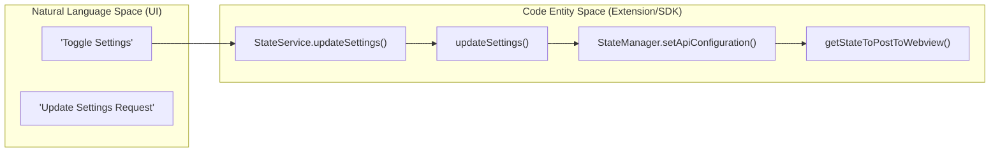

**Sources:** [apps/vscode/proto/cline/state.proto:22](), [apps/vscode/src/core/controller/state/updateSettings.ts:23-24](), [apps/vscode/src/core/controller/state/getStateToPostToWebview.ts:23-34]()

### Component Relationship Table

| Component | Responsibility | Primary Implementation |
|-----------|----------------|------------------------|
| `activate()` | Initializes VS Code extension state and hooks | [apps/vscode/src/extension.ts:68-72]() |
| `initialize()` | Common cross-platform initialization | [apps/vscode/src/common.ts:34-39]() |
| `HostProvider` | Platform-agnostic interface for host APIs | [apps/vscode/src/common.ts:5-6]() |
| `StateService` | Protocol buffer service definitions for state | [apps/vscode/proto/cline/state.proto:12-40]() |
| `StateManager` | Manages core extension state persistence | [apps/vscode/src/common.ts:57]() |
| `getStateToPostToWebview` | Builds `ExtensionState` snapshots for the webview | [apps/vscode/src/core/controller/state/getStateToPostToWebview.ts:23-34]() |

**Sources:** [apps/vscode/src/extension.ts:68-72](), [apps/vscode/src/common.ts:34-57](), [apps/vscode/proto/cline/state.proto:12-40](), [apps/vscode/src/core/controller/state/getStateToPostToWebview.ts:23-34]()

---

# Page: Extension Activation and Lifecycle

# Extension Activation and Lifecycle

<details>
<summary>Relevant source files</summary>

The following files were used as context for generating this wiki page:

- [.github/ISSUE_TEMPLATE/bug_report.yml](.github/ISSUE_TEMPLATE/bug_report.yml)
- [.github/ISSUE_TEMPLATE/config.yml](.github/ISSUE_TEMPLATE/config.yml)
- [.github/pull_request_template.md](.github/pull_request_template.md)
- [CHANGELOG.md](CHANGELOG.md)
- [CODE_OF_CONDUCT.md](CODE_OF_CONDUCT.md)
- [CONTRIBUTING.md](CONTRIBUTING.md)
- [README.md](README.md)
- [apps/vscode/package.json](apps/vscode/package.json)
- [apps/vscode/src/common.ts](apps/vscode/src/common.ts)
- [apps/vscode/src/core/storage/__tests__/openai-base-url-migration.test.ts](apps/vscode/src/core/storage/__tests__/openai-base-url-migration.test.ts)
- [apps/vscode/src/core/storage/openai-base-url-migration.ts](apps/vscode/src/core/storage/openai-base-url-migration.ts)
- [apps/vscode/src/extension.ts](apps/vscode/src/extension.ts)
- [apps/vscode/src/hosts/vscode/commandUtils.ts](apps/vscode/src/hosts/vscode/commandUtils.ts)
- [apps/vscode/src/standalone/cline-core.ts](apps/vscode/src/standalone/cline-core.ts)
- [package.json](package.json)

</details>


This document provides a full technical breakdown of the VS Code extension entry point (`apps/vscode/src/extension.ts`), detailing what triggers activation, the ordered sequence of initialization steps inside `activate()`, `WebviewProvider` creation, contributed commands, `SharedUriHandler` routing, and extension teardown. It focuses exclusively on the VS Code host environment and its bridge to the shared core and SDK-backed runtime.

For details on the shared `Controller` orchestrator and its owned services, see [Controller and Orchestration](2.3). For the `HostProvider` abstraction that decouples VS Code APIs from the core engine, see [Host Provider Abstraction](2.2). For the webview communication layer, see [WebView Communication](2.4).

---

## Activation Events

VS Code activates the extension based on the `activationEvents` declared in `apps/vscode/package.json`. These include handling language-specific files, incoming URIs, or the completion of the IDE startup sequence.

| Event | Trigger | Code Entity |
|---|---|---|
| `onLanguage` | Any file with a registered language ID is opened | `[apps/vscode/package.json:43-43]()` |
| `onUri` | A `vscode://` URI is dispatched to the extension | `[apps/vscode/package.json:44-44]()` |
| `onStartupFinished` | VS Code finishes its background startup sequence | `[apps/vscode/package.json:45-45]()` |

The compiled extension bundle output is `./dist/extension.js`, which maps directly to the TypeScript source file `[apps/vscode/src/extension.ts:1-1]()`.

Sources: `[apps/vscode/package.json:42-47]`, `[apps/vscode/src/extension.ts:1-1]()`

---

## Activation Sequence

When VS Code satisfies an activation event, it invokes the exported `activate(context: vscode.ExtensionContext)` function in `[apps/vscode/src/extension.ts]()`. This function executes a strict initialization sequence to establish host bindings, migrate legacy data structures, and spin up core services.

### Activation Code Entity Flow

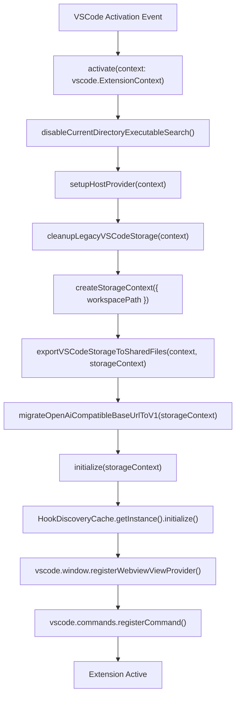
*(Diagram bridges natural language execution stages to exact code identifiers in `[apps/vscode/src/extension.ts]()` and `[apps/vscode/src/common.ts]()`)*

Sources: `[apps/vscode/src/extension.ts:68-134]`, `[apps/vscode/src/common.ts:34-99]()`

### Step-by-Step Breakdown

1. **Host Provider Setup**: `setupHostProvider(context)` instantiates and registers the `HostProvider` singleton [apps/vscode/src/extension.ts:76-76](). This decouples VS Code concrete APIs (workspace folders, windows, terminals) from the architecture-agnostic core logic.
2. **Storage and State Migration**: `cleanupLegacyVSCodeStorage(context)` moves legacy workspace keys to global scope, migrates historical task logs to files, and converts custom instructions [apps/vscode/src/extension.ts:81-81](). Following this, `exportVSCodeStorageToSharedFiles(context, storageContext)` performs a one-time structural copy into the unified `~/.cline/data/` format [apps/vscode/src/extension.ts:87-87](), and `migrateOpenAiCompatibleBaseUrlToV1(storageContext)` updates stored endpoint paths [apps/vscode/src/extension.ts:88-88]().
3. **Common Initialization**: `initialize(storageContext)` sets up shared subsystems such as `StateManager`, `Logger`, and the webview provider framework [apps/vscode/src/common.ts:34-98](), returning a concrete `VscodeWebviewProvider` instance [apps/vscode/src/extension.ts:92-92]().
4. **Cache Optimization**: `HookDiscoveryCache.getInstance().initialize(...)` scans and indexes project workspace hooks to optimize runtime execution lookup [apps/vscode/src/extension.ts:96-122]().

Sources: `[apps/vscode/src/extension.ts:68-122]`, `[apps/vscode/src/common.ts:34-98]()`, `[apps/vscode/src/core/storage/state-migrations.ts:31-40]()`

---

## WebviewProvider Creation and Registration

The extension mounts its primary user interface as a sidebar webview panel using VS Code's extension API.

### Webview Provider Architecture

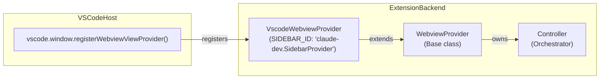
*(Diagram mapping sidebar registration to `VscodeWebviewProvider` and the base `WebviewProvider` orchestrator)*

The sidebar view is bound to the identifier `claude-dev.SidebarProvider` [apps/vscode/package.json:123-123](). Inside `[apps/vscode/src/extension.ts]()`, the `VscodeWebviewProvider` class is instantiated and registered via `vscode.window.registerWebviewViewProvider` [apps/vscode/src/extension.ts:125-128](). It inherits from the base `WebviewProvider` class, which manages message passing contracts and encapsulates the `Controller` lifecycle orchestrator instance [apps/vscode/src/hosts/vscode/VscodeWebviewProvider.ts:49-49]().

Sources: `[apps/vscode/package.json:123-123]`, `[apps/vscode/src/extension.ts:125-128]`, `[apps/vscode/src/hosts/vscode/VscodeWebviewProvider.ts:49-49]()`

---

## Contributed Commands

Commands declared in `[apps/vscode/package.json]()` are mapped to execution handlers during `activate()` [apps/vscode/src/extension.ts:133-232]() using `ExtensionRegistryInfo` mappings [apps/vscode/src/extension.ts:131-131]().

| Command ID | Title | Purpose / Handler Action |
|---|---|---|
| `cline.plusButtonClicked` | New Task | Resets webview state and initializes a clean task session. |
| `cline.mcpButtonClicked` | MCP Servers | Opens the Model Context Protocol management interface. |
| `cline.marketplaceButtonClicked` | Customize | Launches the marketplace view for custom Skills and Workflows. |
| `cline.historyButtonClicked` | History | Renders previous execution history and session logs. |
| `cline.accountButtonClicked` | Account | Opens account management and ClinePass configuration. |
| `cline.settingsButtonClicked` | Settings | Displays global settings and provider configuration forms. |
| `cline.generateGitCommitMessage` | Generate Commit Message | Triggers an AI agent turn to analyze staging changes and draft a commit message. |

Sources: `[apps/vscode/package.json:129-232]`, `[apps/vscode/src/extension.ts:131-131]()`

---

## URI Handling

The extension registers `SharedUriHandler` to intercept incoming `vscode://` deep links and protocol callbacks via VS Code's `vscode.window.registerUriHandler()` API.

### URI Routing Flow

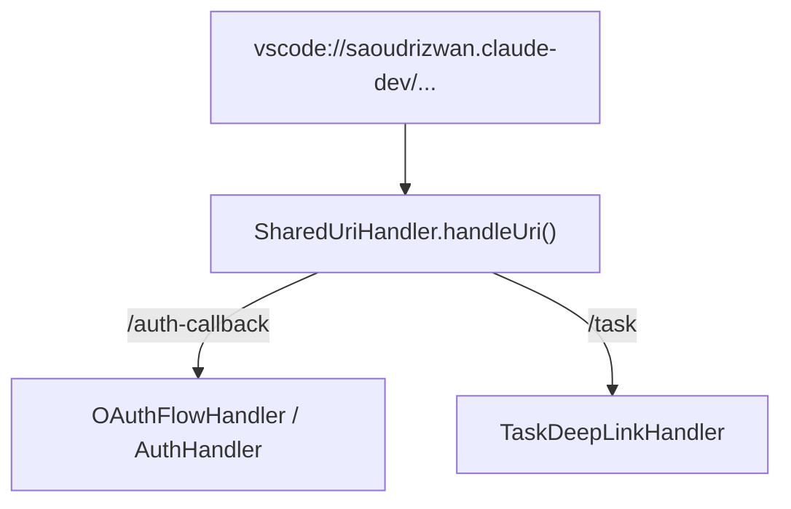
*(Diagram illustrating URI dispatch through `SharedUriHandler`)*

This handler processes OAuth redirect flows required by external AI providers and cloud account login sequences, as well as cross-application task deep linking.

Sources: `[apps/vscode/src/extension.ts:57-57]`, `[apps/vscode/src/services/uri/SharedUriHandler.ts:1-100]()`

---

## Extension Teardown

When VS Code closes or unloads the extension, the `deactivate()` hook triggers `tearDown()` [apps/vscode/src/extension.ts:24-24]() to safely release system resources, close background connections, and flush metrics.

| Component | Teardown Handler | Action Performed |
|---|---|---|
| `TelemetryService` | `telemetryService.dispose()` | Flushes pending analytical payloads and shuts down export clients. |
| `McpHub` | `mcpHub.dispose()` | Terminates active child process transports and closes client sessions. |
| `HookDiscoveryCache` | `HookDiscoveryCache.dispose()` | Clears active filesystem watchers and in-memory caches. |
| `TerminalManager` | `terminalManager.dispose()` | Kills managed pseudo-terminals and background runner processes. |

Sources: `[apps/vscode/src/extension.ts:24-24]`, `[apps/vscode/src/common.ts:34-99]()`

---

## Full Lifecycle Summary

The extension transitions across well-defined states from initial load to complete teardown.

### Extension Lifecycle State Machine

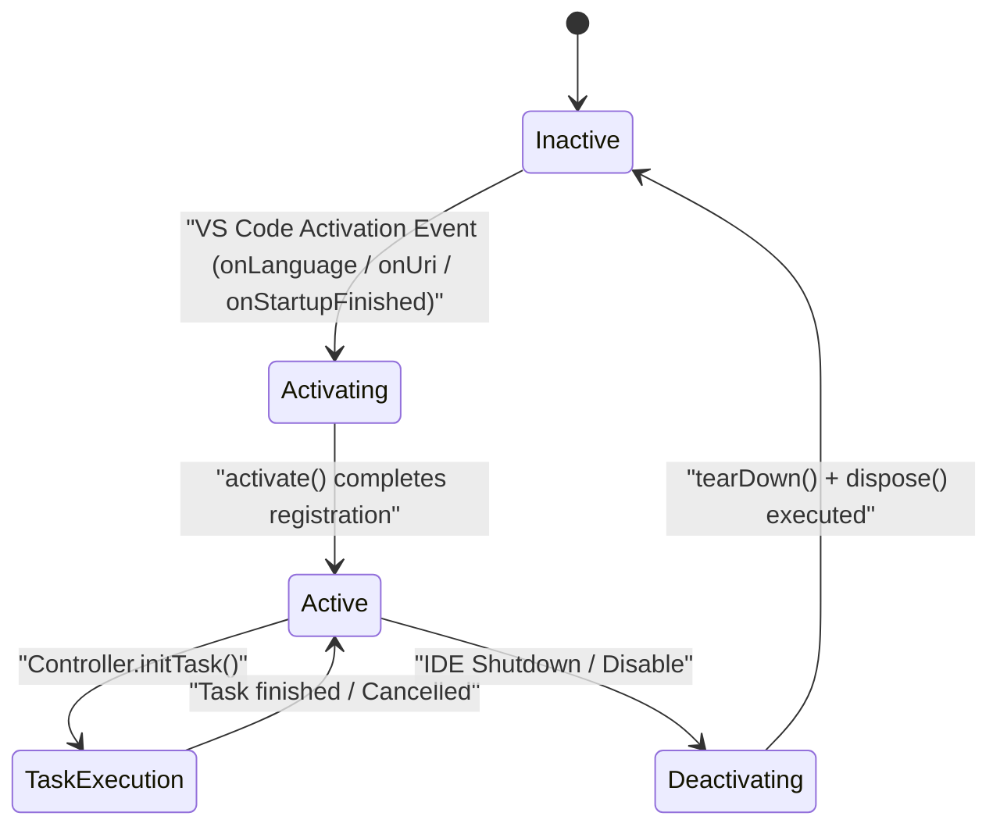
*(State diagram tracking the extension lifecycle from initialization to teardown)*

Sources: `[apps/vscode/src/extension.ts:68-134]`, `[apps/vscode/src/common.ts:34-99]()`

---

# Page: Host Provider Abstraction

# Host Provider Abstraction

<details>
<summary>Relevant source files</summary>

The following files were used as context for generating this wiki page:

- [apps/cli/src/tui/hooks/use-runtime-dialog-bridge.tsx](apps/cli/src/tui/hooks/use-runtime-dialog-bridge.tsx)
- [apps/cli/src/utils/approval.ts](apps/cli/src/utils/approval.ts)
- [apps/cline-hub/src/server/agent-events.test.ts](apps/cline-hub/src/server/agent-events.test.ts)
- [apps/cline-hub/src/server/agent-events.ts](apps/cline-hub/src/server/agent-events.ts)
- [apps/cline-hub/src/webview/src/Chat.tsx](apps/cline-hub/src/webview/src/Chat.tsx)
- [apps/vscode/src/common.ts](apps/vscode/src/common.ts)
- [apps/vscode/src/core/storage/__tests__/openai-base-url-migration.test.ts](apps/vscode/src/core/storage/__tests__/openai-base-url-migration.test.ts)
- [apps/vscode/src/core/storage/openai-base-url-migration.ts](apps/vscode/src/core/storage/openai-base-url-migration.ts)
- [apps/vscode/src/extension.ts](apps/vscode/src/extension.ts)
- [apps/vscode/src/hosts/vscode/commandUtils.ts](apps/vscode/src/hosts/vscode/commandUtils.ts)
- [apps/vscode/src/hosts/vscode/terminal/VscodeTerminalManager.test.ts](apps/vscode/src/hosts/vscode/terminal/VscodeTerminalManager.test.ts)
- [apps/vscode/src/hosts/vscode/terminal/VscodeTerminalManager.ts](apps/vscode/src/hosts/vscode/terminal/VscodeTerminalManager.ts)
- [apps/vscode/src/hosts/vscode/terminal/VscodeTerminalProcess.test.ts](apps/vscode/src/hosts/vscode/terminal/VscodeTerminalProcess.test.ts)
- [apps/vscode/src/hosts/vscode/terminal/VscodeTerminalProcess.ts](apps/vscode/src/hosts/vscode/terminal/VscodeTerminalProcess.ts)
- [apps/vscode/src/hosts/vscode/terminal/VscodeTerminalRegistry.ts](apps/vscode/src/hosts/vscode/terminal/VscodeTerminalRegistry.ts)
- [apps/vscode/src/integrations/terminal/types.ts](apps/vscode/src/integrations/terminal/types.ts)
- [apps/vscode/src/sdk/tool-approval-denial.ts](apps/vscode/src/sdk/tool-approval-denial.ts)
- [apps/vscode/src/standalone/cline-core.ts](apps/vscode/src/standalone/cline-core.ts)
- [apps/vscode/src/test/fixtures/mocha-unsupported-export.ts](apps/vscode/src/test/fixtures/mocha-unsupported-export.ts)
- [apps/vscode/src/test/mocha-shim.test.ts](apps/vscode/src/test/mocha-shim.test.ts)
- [apps/vscode/test-setup.js](apps/vscode/test-setup.js)
- [sdk/packages/shared/src/llms/tools.ts](sdk/packages/shared/src/llms/tools.ts)

</details>


## Purpose and Scope

The Host Provider Abstraction is a platform abstraction layer that enables Cline to run on multiple host environments—the VS Code extension and the `cline-core` standalone service (used by the CLI, JetBrains, and desktop applications)—while sharing the same core logic. It defines a uniform interface for platform-specific capabilities such as file system access, terminal management, UI rendering, and system dialogs. This pattern allows the `Controller`, task execution systems, and other core services to operate independently of the underlying host platform.

Sources: `[apps/vscode/src/extension.ts:68-76]`, `[apps/vscode/src/standalone/cline-core.ts:80-88]()`

---

## Architecture Overview

The `HostProvider` acts as a singleton registry for factories and service clients that bridge the gap between the platform-agnostic core and the host environment.

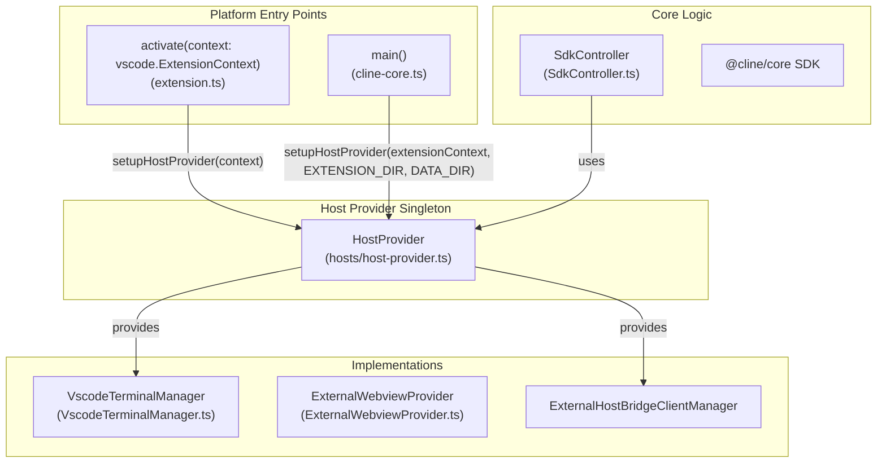

Sources: `[apps/vscode/src/extension.ts:68-76]`, `[apps/vscode/src/standalone/cline-core.ts:152-167]()`

---

## The HostProvider Singleton

The `HostProvider` class manages host-specific providers for dependency injection. It must be initialized exactly once during the application startup sequence via `HostProvider.initialize()`.

### Key Members and Service Accessors

| Member / Accessor | Type / Client | Purpose |
| :--- | :--- | :--- |
| `createWebviewProvider` | `WebviewProviderCreator` | Factory for the platform's Webview implementation (VS Code Sidebar vs. External Window). |
| `createEditPreview` | `EditPreviewCreator` | Factory for showing file diffs and previews. |
| `createCommentReview` | `CommentReviewCreator` | Factory for host-specific comment/review UI. |
| `HostProvider.workspace` | `WorkspaceClientInterface` | Accesses workspace paths, file lists, and project metadata. |
| `HostProvider.env` | `EnvClientInterface` | Getting host version, machine ID, and handling OAuth callbacks. |
| `HostProvider.window` | `WindowClientInterface` | Accessing UI dialogs, notifications, and `ShowMessageRequest`. |
| `HostProvider.diff` | `DiffClientInterface` | Accessing file comparison operations. |
| `HostProvider.terminal` | `TerminalClientInterface` | Managing interactive and background terminal sessions. |

Sources: `[apps/vscode/src/standalone/cline-core.ts:152-167]`, `[apps/common.ts:34-38]()`

---

## VS Code vs. External/Standalone Implementations

### 1. VS Code Implementation
In the VS Code environment, the host provider utilizes native extension host APIs directly. The `VscodeTerminalManager` handles shell integration and terminal lifecycle within the IDE, while local webviews render inside VS Code webview panels.

### 2. Standalone Implementation (`cline-core`)
The standalone implementation (used by JetBrains, CLI, and desktop apps) uses `ExternalHostBridgeClientManager` and `ExternalWebviewProvider`. It communicates with the IDE host or sidecar via a gRPC-over-Protobuf "Host Bridge" connection.

* **Client Generation**: Client stubs and type definitions are generated automatically via build scripts, producing type-safe gRPC clients for each service defined in the protocol buffer specifications.
* **Lifecycle Binding**: In standalone startup routines, `setupHostProvider` configures external factories before launching core connection loops (`[apps/vscode/src/standalone/cline-core.ts:152-167]()`).

Sources: `[apps/vscode/src/standalone/cline-core.ts:152-167]`, `[apps/vscode/src/hosts/vscode/terminal/VscodeTerminalManager.ts:76-123]()`

---

## Sub-Interfaces: Diff, Workspace, Window, and Terminal

The host bridge architecture partitions functionality into specialized sub-interfaces, mapped via Protobuf service definitions:

1. **Workspace Sub-Interface**: Manages workspace folders, file resolution, directory traversals, and file watchers.
2. **Window Sub-Interface**: Handles user-facing notifications, modal dialogs, and progress indicators (e.g., `ShowMessageType` handling) `[apps/vscode/src/extension.ts:58-58]()`.
3. **Diff Sub-Interface**: Orchestrates side-by-side file comparisons, text decorations, and preview content providers (`ExternalEditPreview` vs. `VscodeEditPreview`) `[apps/vscode/src/standalone/cline-core.ts:8-10]()`.
4. **Terminal Sub-Interface**: Controls terminal execution environments, wrapping either `VscodeTerminalManager` (for IDE terminals with shell integration) or standalone subprocess shells `[apps/vscode/src/hosts/vscode/terminal/VscodeTerminalManager.ts:76-123]()`.

Sources: `[apps/vscode/src/extension.ts:58-58]`, `[apps/vscode/src/standalone/cline-core.ts:8-10]`, `[apps/vscode/src/hosts/vscode/terminal/VscodeTerminalManager.ts:76-123]()`

---

## Host-Bridge Authentication

Standalone cores communicating over the host bridge require secure authentication to prevent unauthorized process attachment.

```mermaid
sequenceDiagram
    participant Core as "main()<br/>(cline-core.ts)"
    participant Auth as "captureHostBridgeTokenFromEnvironment()"
    participant Bridge as "connectCoreToHostBridge()"

    Core->>Auth: captureHostBridgeTokenFromEnvironment()
    Note over Core,Auth: Scrubs token from process.env to prevent child inheritance
    Core->>Bridge: connectCoreToHostBridge(webviewProvider.controller, token, callback)
    Bridge-->>Core: gRPC Connection Authenticated & Verified
```

* **Token Capture**: Standalone processes capture the per-spawn secret token via `captureHostBridgeTokenFromEnvironment()` during early initialization `[apps/vscode/src/standalone/cline-core.ts:41-43]()`.
* **Environment Scrubbing**: The token is immediately scrubbed from `process.env` before provider or MCP child processes are spawned, ensuring descendants never inherit the credential `[apps/vscode/src/standalone/cline-core.ts:37-43]()`.
* **Client Construction**: The captured token is injected into gRPC metadata headers when initializing channel connections.

Sources: `[apps/vscode/src/standalone/cline-core.ts:37-43]`, `[apps/vscode/src/standalone/cline-core.ts:127-139]()`

---

# Page: Controller and Orchestration

# Controller and Orchestration

<details>
<summary>Relevant source files</summary>

The following files were used as context for generating this wiki page:

- [apps/vscode/proto/cline/state.proto](apps/vscode/proto/cline/state.proto)
- [apps/vscode/scripts/generate-state-proto.mjs](apps/vscode/scripts/generate-state-proto.mjs)
- [apps/vscode/src/core/controller/state/getStateToPostToWebview.ts](apps/vscode/src/core/controller/state/getStateToPostToWebview.ts)
- [apps/vscode/src/core/controller/state/updateSettings.ts](apps/vscode/src/core/controller/state/updateSettings.ts)
- [apps/vscode/src/core/controller/state/updateSettingsCli.ts](apps/vscode/src/core/controller/state/updateSettingsCli.ts)
- [apps/vscode/src/sdk/SdkController.test.ts](apps/vscode/src/sdk/SdkController.test.ts)
- [apps/vscode/src/sdk/SdkController.ts](apps/vscode/src/sdk/SdkController.ts)
- [apps/vscode/src/sdk/sdk-mode-coordinator.test.ts](apps/vscode/src/sdk/sdk-mode-coordinator.test.ts)
- [apps/vscode/src/sdk/sdk-mode-coordinator.ts](apps/vscode/src/sdk/sdk-mode-coordinator.ts)
- [apps/vscode/src/sdk/sdk-session-config-builder.test.ts](apps/vscode/src/sdk/sdk-session-config-builder.test.ts)
- [apps/vscode/src/sdk/sdk-session-config-builder.ts](apps/vscode/src/sdk/sdk-session-config-builder.ts)
- [apps/vscode/src/sdk/sdk-session-event-coordinator.test.ts](apps/vscode/src/sdk/sdk-session-event-coordinator.test.ts)
- [apps/vscode/src/sdk/sdk-session-event-coordinator.ts](apps/vscode/src/sdk/sdk-session-event-coordinator.ts)
- [apps/vscode/src/sdk/sdk-session-lifecycle.test.ts](apps/vscode/src/sdk/sdk-session-lifecycle.test.ts)
- [apps/vscode/src/sdk/sdk-session-lifecycle.ts](apps/vscode/src/sdk/sdk-session-lifecycle.ts)
- [apps/vscode/src/sdk/sdk-task-start-coordinator.test.ts](apps/vscode/src/sdk/sdk-task-start-coordinator.test.ts)
- [apps/vscode/src/sdk/sdk-task-start-coordinator.ts](apps/vscode/src/sdk/sdk-task-start-coordinator.ts)
- [apps/vscode/src/sdk/sdk-user-message-mapping.test.ts](apps/vscode/src/sdk/sdk-user-message-mapping.test.ts)
- [apps/vscode/src/sdk/sdk-user-message-mapping.ts](apps/vscode/src/sdk/sdk-user-message-mapping.ts)
- [apps/vscode/src/shared/ExtensionMessage.ts](apps/vscode/src/shared/ExtensionMessage.ts)
- [apps/vscode/src/shared/storage/__tests__/state-keys.test.ts](apps/vscode/src/shared/storage/__tests__/state-keys.test.ts)
- [apps/vscode/src/shared/storage/state-keys.ts](apps/vscode/src/shared/storage/state-keys.ts)
- [apps/vscode/webview-ui/src/components/settings/sections/FeatureSettingsSection.spec.tsx](apps/vscode/webview-ui/src/components/settings/sections/FeatureSettingsSection.spec.tsx)
- [apps/vscode/webview-ui/src/components/settings/sections/FeatureSettingsSection.tsx](apps/vscode/webview-ui/src/components/settings/sections/FeatureSettingsSection.tsx)
- [apps/vscode/webview-ui/src/context/ExtensionStateContext.tsx](apps/vscode/webview-ui/src/context/ExtensionStateContext.tsx)

</details>


## Purpose and Scope

The Controller is the central orchestrator in the Cline extension architecture. It coordinates between the VS Code extension layer, the webview UI, the task execution system, and various background services. The Controller manages the complete lifecycle of AI-assisted tasks, handles state synchronization, coordinates service interactions, and ensures proper gRPC communication between all system components.

In the current SDK-backed architecture, `Controller` (implemented as `SdkController`) [apps/vscode/src/sdk/SdkController.ts:1-8]() serves as the main interface for task management, delegating specialized session lifecycle handling, command processing, and tool execution to the Cline SDK (`@cline/core`) and various domain-specific coordinators.

Sources: [apps/vscode/src/sdk/SdkController.ts:1-8]()

---

## Controller Architecture and Ownership

The `SdkController` class [apps/vscode/src/sdk/SdkController.ts:1-8]() is instantiated during extension activation and acts as the single source of truth for runtime orchestration. It maintains strict ownership boundaries across core domain concerns:

- **State Management**: Owns `StateManager` [apps/vscode/src/sdk/SdkController.ts:41]() for reading and persisting global and workspace configuration via typed storage keys.
- **Model Context Protocol (MCP)**: Owns `McpHub` [apps/vscode/src/sdk/SdkController.ts:51]() to manage MCP server lifecycles, transport connections, and tool discovery.
- **Authentication**: Owns `AuthService` [apps/vscode/src/sdk/SdkController.ts:61]() and `OcaAuthService` [apps/vscode/src/sdk/SdkController.ts:46]() for credential storage and token refresh loops.
- **Active Session and Task Control**: Delegates task execution and session lifecycles to `SdkSessionLifecycle` [apps/vscode/src/sdk/SdkController.ts:96]() and `TaskProxy` [apps/vscode/src/sdk/SdkController.ts:113]().

```mermaid
graph TB
    subgraph "Controller Layer"
        SdkController["SdkController<br/>apps/vscode/src/sdk/SdkController.ts"]
    end

    subgraph "Subsystem Ownership"
        StateManager["StateManager<br/>apps/vscode/src/core/storage/StateManager.ts"]
        McpHub["McpHub<br/>apps/vscode/src/services/mcp/McpHub.ts"]
        AuthService["AuthService<br/>apps/vscode/src/sdk/auth-service.ts"]
        SessionLifecycle["SdkSessionLifecycle<br/>apps/vscode/src/sdk/sdk-session-lifecycle.ts"]
    end

    subgraph "Communication Bridge"
        WebviewGrpcBridge["WebviewGrpcBridge<br/>apps/vscode/src/sdk/webview-grpc-bridge.ts"]
    end

    SdkController -->|"owns"| StateManager
    SdkController -->|"owns"| McpHub
    SdkController -->|"owns"| AuthService
    SdkController -->|"owns"| SessionLifecycle
    SdkController -->|"bridges"| WebviewGrpcBridge
```
Sources: [apps/vscode/src/sdk/SdkController.ts:41-61](), [apps/vscode/src/sdk/SdkController.ts:96](), [apps/vscode/src/sdk/SdkController.ts:113]()

---

## Task Lifecycle Flow: `initTask` and `cancelTask`

The Controller manages task lifecycles through explicit coordination classes.

### Task Initialization (`initTask`)
When a user submits a prompt or starts a new task, the request flows through the gRPC layer to the Controller, which invokes `SdkTaskStartCoordinator`:
1. **Config Building**: `SdkSessionConfigBuilder.build` assembles provider configurations, model parameters, and environment context [apps/vscode/src/sdk/SdkController.ts:92]().
2. **Input Preparation**: `buildStartSessionInput` constructs the initial prompt, files, images, and workspace references [apps/vscode/src/sdk/SdkController.ts:63]().
3. **Mentions Resolution**: `@file` and `@url` mentions are parsed via `parseMentions` before being forwarded to the agent [apps/vscode/src/sdk/SdkController.ts:38]().
4. **Core Bootstrap**: `VscodeSessionHost.start` spins up the stateful session stream [apps/vscode/src/sdk/vscode-session-host.ts:1-118]().

### Task Cancellation (`cancelTask`)
When a user cancels a running task via the webview UI, the corresponding task cancellation logic is triggered:
1. **Control Signal**: `SdkTaskControlCoordinator` triggers the active abort signal on the executing SDK session [apps/vscode/src/sdk/SdkController.ts:98]().
2. **Phase Settlement**: `SdkModeCoordinator` settles the active turn phase to `resumable`, permitting prompt editing or task resumption [apps/vscode/src/sdk/sdk-mode-coordinator.ts:42-50]().

```mermaid
graph TD
    subgraph "Task Initialization Space"
        UserAction["User Prompt Submission"] -->|Invokes| InitTask["SdkTaskStartCoordinator.initTask<br/>apps/vscode/src/sdk/sdk-task-start-coordinator.ts"]
        InitTask -->|Calls| ConfigBuilder["SdkSessionConfigBuilder.build"]
        ConfigBuilder -->|Assembles| StartInput["buildStartSessionInput"]
    end

    subgraph "Execution & Session Space"
        StartInput -->|Spins up| SessionHost["VscodeSessionHost.start"]
        SessionHost -->|Delegates to| SessionLifecycle["SdkSessionLifecycle.startNewSession"]
    end

    subgraph "Cancellation Space"
        UserCancel["User Cancellation"] -->|Triggers| ControlCoordinator["SdkTaskControlCoordinator"]
        ControlCoordinator -->|Aborts via| SessionAbort["sdkHost.abort"]
        SessionAbort -->|Settles Phase| ModeCoordinator["SdkModeCoordinator<br/>setTurnPhase('resumable')"]
    end
```
Sources: [apps/vscode/src/sdk/SdkController.ts:38](), [apps/vscode/src/sdk/SdkController.ts:63](), [apps/vscode/src/sdk/SdkController.ts:92](), [apps/vscode/src/sdk/SdkController.ts:98](), [apps/vscode/src/sdk/sdk-mode-coordinator.ts:42-50]()

---

## State Synchronization and `postStateToWebview`

The Controller maintains strict synchronization between the extension host's state and the React webview UI via gRPC streaming (`StateService.subscribeToState`) [apps/vscode/proto/cline/state.proto:17]() and debounced state pushes.

### State Building (`getStateToPostToWebview`)
The standalone function `getStateToPostToWebview` extracts active settings, task history, feature flags, and active message buffers into an authoritative `ExtensionState` payload [apps/vscode/src/core/controller/state/getStateToPostToWebview.ts:23-34]().
- **Debouncing**: `StatePostDebouncer` throttles state updates to prevent UI lockups during rapid agent turn generation [apps/vscode/src/sdk/SdkController.ts:112]().
- **Turn State Tracking**: `TurnStateTracker` enforces monotonic sequencing of turn phases (`idle`, `streaming`, `awaiting_approval`, `awaiting_followup`, `completed`, `error`, `resumable`) [apps/vscode/src/sdk/SdkController.ts:115](), [apps/vscode/src/shared/ExtensionMessage.ts:167-175]().

```mermaid
graph LR
    User["User Action / Event"] -->|Triggers| Controller["SdkController<br/>apps/vscode/src/sdk/SdkController.ts"]
    Controller -->|Calls| StateBuilder["getStateToPostToWebview<br/>apps/vscode/src/core/controller/state/getStateToPostToWebview.ts"]
    StateBuilder -->|Reads| StateManager["StateManager<br/>apps/vscode/src/core/storage/StateManager.ts"]
    StateBuilder -->|Builds| ExtState["ExtensionState<br/>apps/vscode/src/shared/ExtensionMessage.ts"]
    ExtState -->|Debounced by| Debouncer["StatePostDebouncer<br/>apps/vscode/src/sdk/state-post-debouncer.ts"]
    Debouncer -->|Streams via gRPC| WebviewBridge["WebviewGrpcBridge<br/>apps/vscode/src/sdk/webview-grpc-bridge.ts"]
    WebviewBridge -->|Renders via Context| WebviewUI["ExtensionStateContextProvider<br/>apps/vscode/webview-ui/src/context/ExtensionStateContext.tsx"]
```
Sources: [apps/vscode/src/core/controller/state/getStateToPostToWebview.ts:23-34](), [apps/vscode/src/sdk/SdkController.ts:112-115](), [apps/vscode/src/shared/ExtensionMessage.ts:167-175](), [apps/vscode/webview-ui/src/context/ExtensionStateContext.tsx:13-15]()

---

## Settings Updates & Management (`updateSettings` & `updateSettingsCli`)

User preferences and configuration modifications made in the webview settings UI are transmitted to the Controller via the `StateService.updateSettings` [apps/vscode/proto/cline/state.proto:22]() and `updateSettingsCli` [apps/vscode/proto/cline/state.proto:23]() RPC handlers.

- **`updateSettings`**: Validates and normalizes incoming `UpdateSettingsRequest` payloads, updating `StateManager`, handling API provider config changes, and synchronizing feature flags.
- **`updateSettingsCli`**: Processes batch updates from CLI or headless invocation environments while preserving untouched schema defaults.

Sources: [apps/vscode/proto/cline/state.proto:22-23]()

---

## Key Functions and Classes

| Entity | File | Description |
| :--- | :--- | :--- |
| `SdkController` | `apps/vscode/src/sdk/SdkController.ts` | Main orchestration class bridging session lifecycles, state, MCP, and gRPC [apps/vscode/src/sdk/SdkController.ts:1-8]() |
| `getStateToPostToWebview` | `apps/vscode/src/core/controller/state/getStateToPostToWebview.ts` | Assembles authoritative `ExtensionState` snapshots for the webview [apps/vscode/src/core/controller/state/getStateToPostToWebview.ts:23-34]() |
| `updateSettings` | `apps/vscode/proto/cline/state.proto` | Protocol buffer RPC handling webview settings mutations [apps/vscode/proto/cline/state.proto:22]() |
| `updateSettingsCli` | `apps/vscode/proto/cline/state.proto` | Protocol buffer RPC handling batch CLI configuration updates [apps/vscode/proto/cline/state.proto:23]() |
| `StateService` | `apps/vscode/proto/cline/state.proto` | Protocol buffer service defining state subscription and mutation RPCs [apps/vscode/proto/cline/state.proto:12-40]() |
| `SdkTaskStartCoordinator` | `apps/vscode/src/sdk/sdk-task-start-coordinator.ts` | Coordinates task startup, configuration building, and initial message emission [apps/vscode/src/sdk/sdk-task-start-coordinator.ts:61-70]() |

Sources: [apps/vscode/src/sdk/SdkController.ts:1-8](), [apps/vscode/src/core/controller/state/getStateToPostToWebview.ts:23-34](), [apps/vscode/proto/cline/state.proto:12-40](), [apps/vscode/src/sdk/sdk-task-start-coordinator.ts:61-70]()

---

# Page: WebView Communication

# WebView Communication

<details>
<summary>Relevant source files</summary>

The following files were used as context for generating this wiki page:

- [.gitignore](.gitignore)
- [.nvmrc](.nvmrc)
- [.tool-versions](.tool-versions)
- [.vscode/extensions.json](.vscode/extensions.json)
- [.vscode/launch.json](.vscode/launch.json)
- [.vscode/settings.json](.vscode/settings.json)
- [.vscode/tasks.json](.vscode/tasks.json)
- [apps/vscode/proto/cline/state.proto](apps/vscode/proto/cline/state.proto)
- [apps/vscode/scripts/clean-webview-vite-cache.mjs](apps/vscode/scripts/clean-webview-vite-cache.mjs)
- [apps/vscode/scripts/generate-state-proto.mjs](apps/vscode/scripts/generate-state-proto.mjs)
- [apps/vscode/src/core/controller/state/getStateToPostToWebview.ts](apps/vscode/src/core/controller/state/getStateToPostToWebview.ts)
- [apps/vscode/src/core/controller/state/updateSettings.ts](apps/vscode/src/core/controller/state/updateSettings.ts)
- [apps/vscode/src/core/controller/state/updateSettingsCli.ts](apps/vscode/src/core/controller/state/updateSettingsCli.ts)
- [apps/vscode/src/core/webview/WebviewProvider.ts](apps/vscode/src/core/webview/WebviewProvider.ts)
- [apps/vscode/src/shared/ExtensionMessage.ts](apps/vscode/src/shared/ExtensionMessage.ts)
- [apps/vscode/src/shared/storage/__tests__/state-keys.test.ts](apps/vscode/src/shared/storage/__tests__/state-keys.test.ts)
- [apps/vscode/src/shared/storage/state-keys.ts](apps/vscode/src/shared/storage/state-keys.ts)
- [apps/vscode/webview-ui/src/components/settings/sections/FeatureSettingsSection.spec.tsx](apps/vscode/webview-ui/src/components/settings/sections/FeatureSettingsSection.spec.tsx)
- [apps/vscode/webview-ui/src/components/settings/sections/FeatureSettingsSection.tsx](apps/vscode/webview-ui/src/components/settings/sections/FeatureSettingsSection.tsx)
- [apps/vscode/webview-ui/src/context/ExtensionStateContext.tsx](apps/vscode/webview-ui/src/context/ExtensionStateContext.tsx)
- [apps/vscode/webview-ui/src/utils/__tests__/hooks.spec.ts](apps/vscode/webview-ui/src/utils/__tests__/hooks.spec.ts)
- [apps/vscode/webview-ui/src/utils/__tests__/platformUtils.spec.ts](apps/vscode/webview-ui/src/utils/__tests__/platformUtils.spec.ts)
- [apps/vscode/webview-ui/src/utils/platformUtils.ts](apps/vscode/webview-ui/src/utils/platformUtils.ts)
- [apps/vscode/webview-ui/vite.config.ts](apps/vscode/webview-ui/vite.config.ts)

</details>


This page explains how the React webview UI and the VS Code extension backend communicate: the message type contracts, the `postMessage` transport layer, the gRPC-over-postMessage dispatch mechanism, state synchronization flow, and the `ask`/`say` interaction pattern.

For details on the gRPC service layer (handler dispatch, streaming responses, and request registries), see [2.5](). For the `ExtensionStateContext` React context and UI component structure, see [6.1](). For how `Controller` builds and sends state, see [2.3]().

---

## Overview and Top-Level Architecture

All communication between the webview and the extension host passes through VS Code's `postMessage` API. Cline wraps operations in a **gRPC-over-postMessage** envelope where the webview sends `WebviewMessage` objects and the extension responds with `ExtensionMessage` objects. State is broadcast from the extension to the webview via a dedicated gRPC streaming subscription managed by the `StateServiceClient` [apps/vscode/proto/cline/state.proto:12-17]().

**Diagram: Top-Level Request-Response Flow (Natural Language to Code Entities)**

```mermaid
sequenceDiagram
    participant "ExtensionStateContextProvider" as WV
    participant "window.postMessage" as PM
    participant "WebviewProvider" as VP
    participant "StateServiceClient" as SSC
    participant "Controller" as C

    WV->>PM: "postMessage({ type: 'grpc_request', ... })"
    PM->>VP: "onDidReceiveMessage(msg)"
    VP->>SSC: "handleGrpcRequest(controller, postMsg, request)"
    SSC->>C: "handler(controller, message)"
    C-->>SSC: "response"
    SSC-->>PM: "postMessage({ type: 'grpc_response', ... })"
    PM-->>WV: "window.addEventListener('message', ...)"
```

Sources: [apps/vscode/src/shared/ExtensionMessage.ts:21-33](), [apps/vscode/proto/cline/state.proto:12-17]()

---

## Message Type Contracts

### `WebviewMessage` and `ExtensionMessage`

The webview sends requests addressed to a named service and method within a `WebviewMessage`. Conversely, the extension replies with `ExtensionMessage` objects structured as gRPC envelopes [apps/vscode/src/shared/ExtensionMessage.ts:21-33]().

```typescript
export interface ExtensionMessage {
	type: "grpc_response"
	grpc_response?: GrpcResponse
}

export type GrpcResponse = {
	message?: any
	request_id: string
	error?: string
	is_streaming?: boolean
	sequence_number?: number
}
```

The `request_id` acts as the correlation key tying responses back to pending promises on the webview client side [apps/vscode/src/shared/ExtensionMessage.ts:27-33]().

Sources: [apps/vscode/src/shared/ExtensionMessage.ts:21-33]()

### `ExtensionState` Schema

`ExtensionState` is the comprehensive state payload synchronized between the extension and the React webview [apps/vscode/src/shared/ExtensionMessage.ts:41-161](). Key components include:

| Field | Type | Description |
|---|---|---|
| `clineMessages` | `ClineMessage[]` | Current task's chat history [apps/vscode/src/shared/ExtensionMessage.ts:51]() |
| `apiConfiguration` | `ApiConfiguration` | Active API provider configurations [apps/vscode/src/shared/ExtensionMessage.ts:45]() |
| `taskHistory` | `HistoryItem[]` | Past completed or suspended tasks [apps/vscode/src/shared/ExtensionMessage.ts:92]() |
| `turnState` | `TurnState` | Authoritative UI phase (e.g., `streaming`, `awaiting_approval`) [apps/vscode/src/shared/ExtensionMessage.ts:63]() |
| `queuedPrompts` | `QueuedPrompt[]` | Prompts pending execution during an active turn [apps/vscode/src/shared/ExtensionMessage.ts:69]() |
| `workspaceRoots` | `WorkspaceRoot[]` | Multi-root workspace directories [apps/vscode/src/shared/ExtensionMessage.ts:131]() |

Sources: [apps/vscode/src/shared/ExtensionMessage.ts:41-161](), [apps/vscode/src/core/controller/state/getStateToPostToWebview.ts:23-110]()

---

## Transport Layer: postMessage Bridge

The webview relies on gRPC client stubs that abstract underlying `window.postMessage` calls into typed service requests.

**Diagram: Transport Bridge Code Entity Mapping**

```mermaid
graph LR
    subgraph "webview-ui/src"
        ESC["ExtensionStateContext"]
        GCS["StateServiceClient"]
    end

    subgraph "apps/vscode/src/core/webview"
        VP["WebviewProvider"]
    end

    subgraph "apps/vscode/src/core/controller"
        GH["getStateToPostToWebview"]
        C["Controller"]
    end

    GCS -->|"postMessage"| VP
    VP -->|"dispatch"| GH
    GH -->|"getState"| C
    GH -->|"postState"| ESC
    ESC -->|"stream callbacks"| GCS
```

Sources: [apps/vscode/webview-ui/src/context/ExtensionStateContext.tsx:13-35](), [apps/vscode/src/core/webview/WebviewProvider.ts]()

---

## State Propagation: Extension to Webview

### State Assembly via `getStateToPostToWebview()`

State propagation begins in the extension host where `getStateToPostToWebview()` aggregates persistent states from `StateManager` and runtime states from the active task [apps/vscode/src/core/controller/state/getStateToPostToWebview.ts:23-34]().

- **API Configuration**: Retrieved via `stateManager.getApiConfiguration()` [apps/vscode/src/core/controller/state/getStateToPostToWebview.ts:39]().
- **Chat Messages**: Fetched from `controller.task?.messageStateHandler?.getClineMessages()` [apps/vscode/src/core/controller/state/getStateToPostToWebview.ts:86]().
- **Settings & Toggles**: Includes auto-approval settings, browser settings, compaction preferences, and feature toggles [apps/vscode/src/core/controller/state/getStateToPostToWebview.ts:42-82]().

Sources: [apps/vscode/src/core/controller/state/getStateToPostToWebview.ts:23-110]()

---

## Action Flow and Settings Updates: Webview to Extension

When user actions or settings changes occur in the React application, requests are routed through generated gRPC clients to the extension host. For instance, global settings modifications are handled by `updateSettings()` [apps/vscode/src/core/controller/state/updateSettings.ts:23-61]().

The `ExtensionStateContextProvider` initializes subscriptions and client instances, while specific UI components (such as `FeatureSettingsSection`) invoke settings utilities to persist changes across the extension state manager [apps/vscode/webview-ui/src/context/ExtensionStateContext.tsx:151-165](), [apps/vscode/webview-ui/src/components/settings/sections/FeatureSettingsSection.tsx:145-160]().

Sources: [apps/vscode/src/core/controller/state/updateSettings.ts:23-61](), [apps/vscode/webview-ui/src/context/ExtensionStateContext.tsx:13-35]()

---

## Interaction Patterns: ask() and say()

The extension drives the chat UI through two foundational patterns:

### `say()` Pattern (Informational)
Used for streaming model outputs, intermediate reasoning steps, and tool execution progress.
- **Rendering**: The webview processes `say` entries based on subtypes such as text, reasoning blocks, or tool execution metrics.
- **Translation**: SDK agent events are translated into standard `ClineMessage` structures with designated `say` behaviors.

### `ask()` Pattern (Human-in-the-Loop)
Triggered when the agent requires user confirmation, permission for tool execution, or answers to clarification prompts.
- **User Decision**: Actions such as approving file edits or executing shell commands present modal or inline options.
- **Coordination**: The follow-up coordinator resolves these user interactions, managing queue state if the agent is actively processing.

Sources: [apps/vscode/src/shared/ExtensionMessage.ts:167-175]()

---

# Page: gRPC Service Layer

# gRPC Service Layer

<details>
<summary>Relevant source files</summary>

The following files were used as context for generating this wiki page:

- [apps/vscode/proto/cline/checkpoints.proto](apps/vscode/proto/cline/checkpoints.proto)
- [apps/vscode/proto/cline/state.proto](apps/vscode/proto/cline/state.proto)
- [apps/vscode/proto/cline/ui.proto](apps/vscode/proto/cline/ui.proto)
- [apps/vscode/scripts/generate-state-proto.mjs](apps/vscode/scripts/generate-state-proto.mjs)
- [apps/vscode/src/core/controller/checkpoints/checkpointExistsForMessage.ts](apps/vscode/src/core/controller/checkpoints/checkpointExistsForMessage.ts)
- [apps/vscode/src/core/controller/checkpoints/checkpointLatestChangesCount.ts](apps/vscode/src/core/controller/checkpoints/checkpointLatestChangesCount.ts)
- [apps/vscode/src/core/controller/state/getStateToPostToWebview.ts](apps/vscode/src/core/controller/state/getStateToPostToWebview.ts)
- [apps/vscode/src/core/controller/state/updateSettings.ts](apps/vscode/src/core/controller/state/updateSettings.ts)
- [apps/vscode/src/core/controller/state/updateSettingsCli.ts](apps/vscode/src/core/controller/state/updateSettingsCli.ts)
- [apps/vscode/src/sdk/sdk-checkpoints.test.ts](apps/vscode/src/sdk/sdk-checkpoints.test.ts)
- [apps/vscode/src/sdk/sdk-checkpoints.ts](apps/vscode/src/sdk/sdk-checkpoints.ts)
- [apps/vscode/src/sdk/sdk-session-history-loader.ts](apps/vscode/src/sdk/sdk-session-history-loader.ts)
- [apps/vscode/src/sdk/session-host.ts](apps/vscode/src/sdk/session-host.ts)
- [apps/vscode/src/sdk/task-proxy.ts](apps/vscode/src/sdk/task-proxy.ts)
- [apps/vscode/src/shared/ExtensionMessage.ts](apps/vscode/src/shared/ExtensionMessage.ts)
- [apps/vscode/src/shared/proto-conversions/cline-message.ts](apps/vscode/src/shared/proto-conversions/cline-message.ts)
- [apps/vscode/src/shared/storage/__tests__/state-keys.test.ts](apps/vscode/src/shared/storage/__tests__/state-keys.test.ts)
- [apps/vscode/src/shared/storage/state-keys.ts](apps/vscode/src/shared/storage/state-keys.ts)
- [apps/vscode/src/test/e2e/chat.test.ts](apps/vscode/src/test/e2e/chat.test.ts)
- [apps/vscode/webview-ui/src/App.stories.tsx](apps/vscode/webview-ui/src/App.stories.tsx)
- [apps/vscode/webview-ui/src/components/chat/ChatRow.tsx](apps/vscode/webview-ui/src/components/chat/ChatRow.tsx)
- [apps/vscode/webview-ui/src/components/chat/CompletionOutputRow.test.tsx](apps/vscode/webview-ui/src/components/chat/CompletionOutputRow.test.tsx)
- [apps/vscode/webview-ui/src/components/chat/CompletionOutputRow.tsx](apps/vscode/webview-ui/src/components/chat/CompletionOutputRow.tsx)
- [apps/vscode/webview-ui/src/components/chat/PlanCompletionOutputRow.tsx](apps/vscode/webview-ui/src/components/chat/PlanCompletionOutputRow.tsx)
- [apps/vscode/webview-ui/src/components/chat/UserMessage.tsx](apps/vscode/webview-ui/src/components/chat/UserMessage.tsx)
- [apps/vscode/webview-ui/src/components/chat/__tests__/UserMessage.ime.test.tsx](apps/vscode/webview-ui/src/components/chat/__tests__/UserMessage.ime.test.tsx)
- [apps/vscode/webview-ui/src/components/history/HistoryView.tsx](apps/vscode/webview-ui/src/components/history/HistoryView.tsx)
- [apps/vscode/webview-ui/src/components/settings/sections/FeatureSettingsSection.spec.tsx](apps/vscode/webview-ui/src/components/settings/sections/FeatureSettingsSection.spec.tsx)
- [apps/vscode/webview-ui/src/components/settings/sections/FeatureSettingsSection.tsx](apps/vscode/webview-ui/src/components/settings/sections/FeatureSettingsSection.tsx)
- [apps/vscode/webview-ui/src/context/ExtensionStateContext.tsx](apps/vscode/webview-ui/src/context/ExtensionStateContext.tsx)

</details>


This page documents the gRPC-over-postMessage communication layer that connects the React webview UI to the extension backend. It covers the message contracts, the dispatcher, streaming response handling, the cancellation registry, proto-defined service contracts, and the generated client stubs used in the webview.

---

## Overview

Cline's UI runs inside a VS Code webview (a sandboxed iframe). The webview cannot call Node.js APIs directly; instead, the two sides exchange messages over VS Code's `postMessage` bridge. The gRPC service layer imposes a structured, proto-defined RPC contract on top of this raw bridge. It supports both **unary** (request/response) and **server-streaming** (subscription) call patterns, using JSON-serialized protobuf messages as the payload `[apps/vscode/src/shared/ExtensionMessage.ts:21-33]()`.

Sources: `[apps/vscode/src/shared/ExtensionMessage.ts:21-33]()`

---

## Message Contracts

Two shared type definitions govern the envelope crossing the webview bridge. The webview transmits request frames to invoke RPC methods and cancel active operations. Responses from the extension backend are encapsulated within `ExtensionMessage` and `GrpcResponse` structures `[apps/vscode/src/shared/ExtensionMessage.ts:21-33]()`:

```typescript
export interface ExtensionMessage {
	type: "grpc_response"
	grpc_response?: GrpcResponse
}

export type GrpcResponse = {
	message?: any // JSON serialized protobuf message
	request_id: string // Same ID as the request
	error?: string // Optional error message
	is_streaming?: boolean // Whether this is part of a streaming response
	sequence_number?: number // For ordering chunks in streaming responses
}
```

Sources: `[apps/vscode/src/shared/ExtensionMessage.ts:21-33]()`

---

## Dispatcher, Registry, and Cancellation

The extension backend coordinates incoming RPC frames through `WebviewGrpcBridge`, which acts as the central dispatcher instantiated inside the controller layer `[apps/vscode/src/shared/ExtensionMessage.ts:21-25]()`. 

The dispatcher performs method lookups against generated service definitions, coordinates streaming chunks via `StreamingResponseHandler`, and registers active cancellable tokens so that cancellation frames can immediately abort running asynchronous tasks.

### gRPC Handler and Dispatcher Bridge

```mermaid
graph TD
  subgraph ExtensionHost["Extension Host Environment"]
    WM["WebviewMessage"]
    WGB["WebviewGrpcBridge"]
    Registry["GrpcRequestRegistry"]
    SRH["StreamingResponseHandler"]
    SvcHandlers["serviceHandlers"]
    Controller["SdkController"]
  end

  subgraph WebviewReact["Webview UI Environment"]
    GrpcClient["grpc-client.ts"]
    ESC["ExtensionStateContext.tsx"]
  end

  ESC -->|"use"| GrpcClient
  GrpcClient -->|"postMessage"| WM
  WM --> WGB
  WGB -->|"lookup"| SvcHandlers
  WGB -->|"cancelRequest"| Registry
  WGB -->|"create"| SRH
  SvcHandlers -->|"delegate"| Controller
  SRH -->|"postMessage"| GrpcClient
```

Sources: `[apps/vscode/src/shared/ExtensionMessage.ts:21-33]`, `[apps/vscode/webview-ui/src/context/ExtensionStateContext.tsx:13-35]()`

---

## State Service and Streaming Responses

The `StateService` provides live streaming subscriptions to extension state, allowing the webview UI to react instantly to settings changes, token budgets, or turn phase updates `[apps/vscode/proto/cline/state.proto:12-40]()`.

### State Subscription and Streaming Data Flow

```mermaid
sequenceDiagram
  participant UI as "ExtensionStateContext.tsx"
  participant Stub as "StateServiceClient"
  participant Bridge as "WebviewGrpcBridge"
  participant Controller as "SdkController"
  participant SM as "StateManager"

  UI->>Stub: "subscribeToState(EmptyRequest)"
  Stub->>Bridge: "grpc_request(subscribeToState)"
  Bridge->>Controller: "subscribeToState(EmptyRequest)"
  
  Note over Controller,SM: TurnState or Settings Change
  SM->>Controller: "onStateChange"
  Controller->>Bridge: "getStateToPostToWebview()"
  Bridge->>UI: "grpc_response(State)"
  UI->>UI: "reducerApplyStateSnapshot()"
```

Sources: `[apps/vscode/proto/cline/state.proto:12-40]`, `[apps/vscode/src/core/controller/state/getStateToPostToWebview.ts:23-34]`, `[apps/vscode/webview-ui/src/context/ExtensionStateContext.tsx:13-35]()`

---

## Request Coordinators and Handlers

Backend execution handlers process typed request payloads before updating persistent storage or the active agent session:

1. **`getStateToPostToWebview`**: Assembles the complete `ExtensionState` snapshot (task history, MCP status, transcript messages) for synchronization `[apps/vscode/src/core/controller/state/getStateToPostToWebview.ts:23-34]()`.
2. **`updateSettings`**: A unary RPC handler that mutates multi-domain settings (telemetry, plan/act modes, checkpoints, timeouts) in a single transaction, persisting them via `StateManager` `[apps/vscode/src/core/controller/state/updateSettings.ts:23-61]()`.
3. **`ModelsService`**: Executes unified model catalog discovery, provider config parsing, and model override persistence `[apps/vscode/proto/cline/state.proto:12-40]()`.

Sources: `[apps/vscode/src/core/controller/state/getStateToPostToWebview.ts:23-34]`, `[apps/vscode/src/core/controller/state/updateSettings.ts:23-61]`, `[apps/vscode/proto/cline/state.proto:12-40]()`

---

## Service Definitions and Protocol Buffers

The system relies on Protocol Buffer definitions to maintain strict type safety across the Node.js extension and React webview boundaries.

| Service | Protocol File | Scope and Purpose |
|---|---|---|
| `StateService` | `state.proto` | Settings persistence, feature flags, telemetry settings, and global state subscriptions `[apps/vscode/proto/cline/state.proto:12-40]()`. |
| `ModelsService` | `models.proto` | Catalog listings, effective provider configuration reads/writes, and model selection commits `[apps/vscode/proto/cline/state.proto:6-6]()`. |
| `UiService` | `ui.proto` | Generic extension interface actions such as panel navigation and settings scrolling `[apps/vscode/proto/cline/ui.proto:253-260]()`. |

Sources: `[apps/vscode/proto/cline/state.proto:12-40]`, `[apps/vscode/proto/cline/ui.proto:253-260]()`

---

# Page: SDK Rollout and A/B Loading

# SDK Rollout and A/B Loading

<details>
<summary>Relevant source files</summary>

The following files were used as context for generating this wiki page:

- [.cline/skills/publish-extension/SKILL.md](.cline/skills/publish-extension/SKILL.md)
- [.github/ISSUE_TEMPLATE/bug_report.yml](.github/ISSUE_TEMPLATE/bug_report.yml)
- [.github/ISSUE_TEMPLATE/config.yml](.github/ISSUE_TEMPLATE/config.yml)
- [.github/pull_request_template.md](.github/pull_request_template.md)
- [.github/workflows/cli-publish.yml](.github/workflows/cli-publish.yml)
- [.github/workflows/ext-vscode-ab-package.yml](.github/workflows/ext-vscode-ab-package.yml)
- [.github/workflows/ext-vscode-publish-legacy.yml](.github/workflows/ext-vscode-publish-legacy.yml)
- [.github/workflows/ext-vscode-publish-nightly.yml](.github/workflows/ext-vscode-publish-nightly.yml)
- [.github/workflows/ext-vscode-publish-stable.yml](.github/workflows/ext-vscode-publish-stable.yml)
- [.github/workflows/ext-vscode-publish.yml](.github/workflows/ext-vscode-publish.yml)
- [.github/workflows/ext-vscode-test-e2e.yml](.github/workflows/ext-vscode-test-e2e.yml)
- [.github/workflows/ext-vscode-test.yml](.github/workflows/ext-vscode-test.yml)
- [.github/workflows/sdk-publish.yml](.github/workflows/sdk-publish.yml)
- [.husky/pre-commit](.husky/pre-commit)
- [CHANGELOG.md](CHANGELOG.md)
- [CODE_OF_CONDUCT.md](CODE_OF_CONDUCT.md)
- [CONTRIBUTING.md](CONTRIBUTING.md)
- [README.md](README.md)
- [apps/vscode-rollout/scripts/set-version.mjs](apps/vscode-rollout/scripts/set-version.mjs)
- [apps/vscode-rollout/scripts/set-version.test.mjs](apps/vscode-rollout/scripts/set-version.test.mjs)
- [apps/vscode/.vscode-test.mjs](apps/vscode/.vscode-test.mjs)
- [apps/vscode/.vscodeignore](apps/vscode/.vscodeignore)
- [apps/vscode/package.json](apps/vscode/package.json)
- [apps/vscode/scripts/interactive-playwright.ts](apps/vscode/scripts/interactive-playwright.ts)
- [apps/vscode/src/test/e2e/utils/build.mjs](apps/vscode/src/test/e2e/utils/build.mjs)
- [apps/vscode/src/test/e2e/utils/helpers.ts](apps/vscode/src/test/e2e/utils/helpers.ts)
- [package.json](package.json)

</details>


The purpose and scope of this section is to document `apps/vscode-rollout`, which implements the A/B loader, cohort assignment, next versus legacy bundle selection, crash fallback mechanisms, and union manifest generation for staged extension rollouts [apps/vscode-rollout/README.md:1-7](). 

*(Note: The legacy-to-SDK migration reached 100% rollout, making the standalone SDK build the primary path for stable releases [.cline/skills/publish-extension/SKILL.md:12-16](), but the architecture, rollout loader, and build-time stitching design remain preserved and documented here).*

Sources: [.cline/skills/publish-extension/SKILL.md:12-16](), [apps/vscode-rollout/README.md:1-7]()

---

## Architecture and Loading Mechanism

The published extension uses a lightweight loader as its entry point (`extension.js`). The VSIX contains two complete, independently built extension bundles located in `next/` and `legacy/` subdirectories [apps/vscode-rollout/README.md:11-20]().

### The A/B Loader Flow
Per VS Code window, the loader executes the following sequence:
1.  **Cohort Selection**: Reads the cached cohort assignment from `globalState` synchronously [apps/vscode-rollout/README.md:24-25]().
2.  **Context Gating**: Sets the `cline.sdkBundle` context key to control UI visibility in the union manifest [apps/vscode-rollout/README.md:26-27]().
3.  **Bundle Activation**: `require()`s the selected bundle and calls its `activate()` function. The loader uses a `Proxy`-wrapped `ExtensionContext` to redirect paths (`extensionUri`, `extensionPath`) to the bundle's specific subdirectory [apps/vscode-rollout/README.md:28-31]().
4.  **Background Refresh**: Evaluates PostHog feature flags in the background to determine the assignment for the next window session [apps/vscode-rollout/README.md:34-36]().

### Crash Fallback Strategy
If the "next" bundle fails to activate (throws an error), the loader performs a self-healing fallback:
*   Disposes of any half-registered resources [apps/vscode-rollout/README.md:39-40]().
*   Pins the current VSIX version to the "legacy" bundle locally via `cline.rollout.nextActivationFailedVersion` [apps/vscode-rollout/README.md:40-41]().
*   Immediately activates the legacy bundle so the user experiences a working extension rather than a crash [apps/vscode-rollout/README.md:42-43]().

### Natural Language Space to Code Entity Space: Loader Lifecycle
| Natural Language Concept | Code Entity / Symbol | File Reference |
| :--- | :--- | :--- |
| **Cohort Assignment Key** | `COHORT_STATE_KEY` | [.github/workflows/ext-vscode-ab-package.yml:24-37]() |
| **Rollout Flag Name** | `ext-sdk-bundle-rollout` | [.cline/skills/publish-extension/SKILL.md:12-16]() |
| **Decision Event** | `extension.rollout.loader_decision` | [apps/vscode-rollout/README.md:24-43]() |
| **Fail-safe Version Key** | `nextActivationFailedVersion` | [apps/vscode-rollout/README.md:39-43]() |

Sources: [apps/vscode-rollout/README.md:9-43](), [.cline/skills/publish-extension/SKILL.md:12-16]()

---

## Cohort Assignment and Overrides

Cohort membership is evaluated via the `ext-sdk-bundle-rollout` flag in PostHog [apps/vscode-rollout/README.md:47-48](). The loader uses the machine ID (`distinctId`) to ensure consistent hashing and evaluation across sessions.

### Override Precedence
1.  **Environment Variable**: `CLINE_BUNDLE_OVERRIDE=next|legacy` takes absolute precedence [apps/vscode-rollout/README.md:69-70]().
2.  **User Setting**: `cline.rollout.bundleOverride` (`"auto" | "next" | "legacy"`) allows manual configuration in `settings.json` [apps/vscode-rollout/README.md:65-66]().
3.  **Cached Assignment**: The value retrieved from PostHog during the previous session's background refresh [apps/vscode-rollout/README.md:24-25]().

### Bundle Selection and Activation Flow

```mermaid
graph TD
    Start["activate() called by VS Code extension host"] --> EnvCheck["Check process.env.CLINE_BUNDLE_OVERRIDE"]
    EnvCheck -- "Set" --> ApplyOverride["Use specified bundle"]
    EnvCheck -- "Not Set" --> SettingCheck["Check settings.json cline.rollout.bundleOverride"]
    SettingCheck -- "next or legacy" --> ApplyOverride
    SettingCheck -- "auto or unset" --> CacheCheck["Read globalState COHORT_STATE_KEY"]
    CacheCheck --> Activation["Try require() and activate() selected bundle"]
    Activation -- "Success" --> BackgroundRefresh["refreshCohort() in background via PostHog"]
    Activation -- "Throws Error" --> Fallback["Pin nextActivationFailedVersion & activate legacy bundle"]
```

Sources: [apps/vscode-rollout/README.md:45-77](), [.github/workflows/ext-vscode-ab-package.yml:1-37]()

---

## The Union Manifest

Because `package.json` contributions are static and evaluated by VS Code prior to extension activation, a "union manifest" is generated at build time using `scripts/gen-manifest.mjs` [apps/vscode-rollout/README.md:81-83]().

### Generation Rules
*   **Shared Contributions**: Contributions present in both bundles pass through without modification [apps/vscode-rollout/README.md:85]().
*   **Exclusive Contributions**: Items (menus, keybindings, commands) declared in only one bundle have their `when` clauses automatically updated to include `cline.sdkBundle` or `!cline.sdkBundle` [apps/vscode-rollout/README.md:86-89]().
*   **Identity Rewriting**: The `nightlify.mjs` script rewrites bundle manifests to the `saoudrizwan.cline-nightly` identity for nightly channels, ensuring parallel installation [.github/workflows/ext-vscode-publish-nightly.yml:146-149]().
*   **Drift Protection**: Static sections like `views` and `configuration` must be identical; the build fails if divergence is detected [apps/vscode-rollout/README.md:92-96]().

Sources: [apps/vscode-rollout/README.md:79-101](), [.github/workflows/ext-vscode-publish-nightly.yml:146-149]()

---

## Telemetry Integration

Rollout telemetry is coordinated between the A/B loader and the activated bundle to track cohort performance and error recovery rates.

### Metadata Attribution
Every event captured by the SDK bundle includes an `extension_variant` property (set to `"next"` or `"legacy"`). This is injected via the `CLINE_ROLLOUT_VARIANT` environment variable during the esbuild bundling phase [.github/workflows/ext-vscode-publish-nightly.yml:159-159]().

### Loader Decision Reporting
The loader emits an `extension.rollout.loader_decision` telemetry event containing:
*   `bundle`: The final active bundle.
*   `attempted_bundle`: The initial target bundle before fallback.
*   `fallback`: Boolean flag indicating if crash safety logic triggered.
*   `override`: Source of override (`"env"`, `"setting"`, or `"remote"`).

### Telemetry Entity Mapping

```mermaid
classDiagram
    class ITelemetryService {
        +capture(eventName, properties)
    }
    class RolloutLoader {
        +reportDecision(decision)
    }
    class RolloutTelemetryMetadata {
        +extension_variant: "next" | "legacy"
    }
    ITelemetryService ..> RolloutTelemetryMetadata : "stamps properties on every capture"
    RolloutLoader --> ITelemetryService : "sends extension.rollout.loader_decision"
```

Sources: [.github/workflows/ext-vscode-publish-nightly.yml:159-159](), [sdk/packages/core/src/services/telemetry/OpenTelemetryProvider.ts:50-121]()

---

## Build and Stitch Pipeline

The combined VSIX package is constructed through multi-stage CI workflows defined in `.github/workflows/ext-vscode-ab-package.yml` and `.github/workflows/ext-vscode-publish-nightly.yml`.

1.  **Bundle Builds**: The next bundle is built from `main` using `bun run package`, while the legacy bundle is built from `legacy-extension` [.github/workflows/ext-vscode-ab-package.yml:3-7]().
2.  **Versioning**: A unified semver string is computed and stamped into the union manifest and both sub-manifests [.github/workflows/ext-vscode-ab-package.yml:53-62]().
3.  **Stitching**: Bundles are assembled into a unified layout staging directory [.github/workflows/ext-vscode-publish-nightly.yml:3-7]().
4.  **Testing Gates**: The pipeline requires both the SDK bun test suite and the legacy npm test suite to pass prior to marketplace publishing [.github/workflows/ext-vscode-ab-package.yml:104-106]().

### Natural Language Space to Code Entity Space: Build Pipeline
| Natural Language Concept | Code Entity / Symbol | File Reference |
| :--- | :--- | :--- |
| **Version Validation** | `preflight` job / `validate version format` | [.github/workflows/ext-vscode-ab-package.yml:43-62]() |
| **Nightly Manifest Rewriter** | `nightlify.mjs` | [.github/workflows/ext-vscode-publish-nightly.yml:146-149]() |
| **Variant Flag Injection** | `CLINE_ROLLOUT_VARIANT` | [.github/workflows/ext-vscode-publish-nightly.yml:159-159]() |
| **Next Bundle Test Suite** | `test-next` (reusable workflow) | [.github/workflows/ext-vscode-ab-package.yml:114-119]() |

### CI/CD Rollout Management

```mermaid
graph TD
    Preflight["preflight() in ext-vscode-ab-package.yml"] --> TestSuites["Parallel execution of test-next & test-legacy"]
    TestSuites --> BuildJob["build() job packages unified VSIX artifact"]
    BuildJob --> ApprovalGate["Environment approval gate on publish"]
    ApprovalGate --> MarketplacePublish["Upload artifact to Marketplace via vsce"]
```

Sources: [.github/workflows/ext-vscode-ab-package.yml:1-136](), [.github/workflows/ext-vscode-publish-nightly.yml:1-160]()

---

# Page: Task Execution in the Extension

# Task Execution in the Extension

<details>
<summary>Relevant source files</summary>

The following files were used as context for generating this wiki page:

- [apps/vscode/playwright.config.ts](apps/vscode/playwright.config.ts)
- [apps/vscode/src/core/controller/state/remoteConfigRefresh.characterization.test.ts](apps/vscode/src/core/controller/state/remoteConfigRefresh.characterization.test.ts)
- [apps/vscode/src/sdk/SdkController.test.ts](apps/vscode/src/sdk/SdkController.test.ts)
- [apps/vscode/src/sdk/SdkController.ts](apps/vscode/src/sdk/SdkController.ts)
- [apps/vscode/src/sdk/auto-approve-overlay-regression.test.ts](apps/vscode/src/sdk/auto-approve-overlay-regression.test.ts)
- [apps/vscode/src/sdk/message-translator.test.ts](apps/vscode/src/sdk/message-translator.test.ts)
- [apps/vscode/src/sdk/message-translator.ts](apps/vscode/src/sdk/message-translator.ts)
- [apps/vscode/src/sdk/sdk-followup-coordinator.test.ts](apps/vscode/src/sdk/sdk-followup-coordinator.test.ts)
- [apps/vscode/src/sdk/sdk-followup-coordinator.ts](apps/vscode/src/sdk/sdk-followup-coordinator.ts)
- [apps/vscode/src/sdk/sdk-interaction-coordinator.test.ts](apps/vscode/src/sdk/sdk-interaction-coordinator.test.ts)
- [apps/vscode/src/sdk/sdk-interaction-coordinator.ts](apps/vscode/src/sdk/sdk-interaction-coordinator.ts)
- [apps/vscode/src/sdk/sdk-mode-coordinator.test.ts](apps/vscode/src/sdk/sdk-mode-coordinator.test.ts)
- [apps/vscode/src/sdk/sdk-mode-coordinator.ts](apps/vscode/src/sdk/sdk-mode-coordinator.ts)
- [apps/vscode/src/sdk/sdk-session-config-builder.test.ts](apps/vscode/src/sdk/sdk-session-config-builder.test.ts)
- [apps/vscode/src/sdk/sdk-session-config-builder.ts](apps/vscode/src/sdk/sdk-session-config-builder.ts)
- [apps/vscode/src/sdk/sdk-session-event-coordinator.test.ts](apps/vscode/src/sdk/sdk-session-event-coordinator.test.ts)
- [apps/vscode/src/sdk/sdk-session-event-coordinator.ts](apps/vscode/src/sdk/sdk-session-event-coordinator.ts)
- [apps/vscode/src/sdk/sdk-session-lifecycle.test.ts](apps/vscode/src/sdk/sdk-session-lifecycle.test.ts)
- [apps/vscode/src/sdk/sdk-session-lifecycle.ts](apps/vscode/src/sdk/sdk-session-lifecycle.ts)
- [apps/vscode/src/sdk/sdk-task-control-coordinator.test.ts](apps/vscode/src/sdk/sdk-task-control-coordinator.test.ts)
- [apps/vscode/src/sdk/sdk-task-control-coordinator.ts](apps/vscode/src/sdk/sdk-task-control-coordinator.ts)
- [apps/vscode/src/sdk/sdk-task-start-coordinator.test.ts](apps/vscode/src/sdk/sdk-task-start-coordinator.test.ts)
- [apps/vscode/src/sdk/sdk-task-start-coordinator.ts](apps/vscode/src/sdk/sdk-task-start-coordinator.ts)
- [apps/vscode/src/sdk/sdk-user-message-mapping.test.ts](apps/vscode/src/sdk/sdk-user-message-mapping.test.ts)
- [apps/vscode/src/sdk/sdk-user-message-mapping.ts](apps/vscode/src/sdk/sdk-user-message-mapping.ts)
- [apps/vscode/src/sdk/vscode-session-host.ts](apps/vscode/src/sdk/vscode-session-host.ts)
- [sdk/packages/core/src/extensions/tools/types.ts](sdk/packages/core/src/extensions/tools/types.ts)

</details>


## Purpose and Scope
This page provides an overview of how tasks run inside the VS Code extension following the SDK migration. It covers `SdkController`-driven sessions, specialized coordinators, event translation, execution modes, and context handling. 

This is a parent page; detailed technical implementations and deep dives are delegated to the child pages listed below.

Sources: [apps/vscode/src/sdk/SdkController.ts:1-110]()

---

## Architecture Overview
The extension uses `SdkController` [apps/vscode/src/sdk/SdkController.ts:109]() to bridge the VS Code gRPC webview layer and the autonomous agentic engine in `@cline/core`. A suite of specialized coordinators manages session state, messaging, user interactions, and tools.

**Task System Map**
```mermaid
graph TB
    SdkController["SdkController class<br/>apps/vscode/src/sdk/SdkController.ts:109"]
    
    subgraph "Extension Coordinators"
        Lifecycle["SdkSessionLifecycle<br/>apps/vscode/src/sdk/sdk-session-lifecycle.ts"]
        MsgCoord["SdkMessageCoordinator<br/>apps/vscode/src/sdk/sdk-message-coordinator.ts"]
        InteractCoord["SdkInteractionCoordinator<br/>apps/vscode/src/sdk/sdk-interaction-coordinator.ts"]
        EventCoord["SdkSessionEventCoordinator<br/>apps/vscode/src/sdk/sdk-session-event-coordinator.ts"]
    end
    
    subgraph "SDK Core Engine"
        SessionRuntime["SessionRuntime class<br/>sdk/packages/core/src/runtime/orchestration/session-runtime-orchestrator.ts:38"]
    end

    SdkController --> Lifecycle
    SdkController --> MsgCoord
    SdkController --> InteractCoord
    SdkController --> EventCoord
    Lifecycle --> SessionRuntime
```
Sources: [apps/vscode/src/sdk/SdkController.ts:70-95]()

---

## Sub-Topics and Child Pages

### 3.1. SDK Session Lifecycle in VS Code
Walks through session initialization via `cline-session-factory`, configuration building with `SdkSessionConfigBuilder`, task starting via `SdkTaskStartCoordinator`, and history loading or session resumption.
For details, see [SDK Session Lifecycle in VS Code](#3.1).

Sources: [apps/vscode/src/sdk/SdkController.ts:56-90]()

### 3.2. Tool Execution and Policies
Describes how SDK tools are wired to VS Code executors such as command execution, file reading (`createWorkspaceFileReadExecutor`), and diff editing, protected by tool policies (`sdk-tool-policies`) and auto-approval settings.
For details, see [Tool Execution and Policies](#3.2).

Sources: [apps/vscode/src/sdk/SdkController.ts:93-106]()

### 3.3. Message and Event Translation
Explains how `message-translator`, `SdkSessionEventCoordinator`, and `SdkFollowupCoordinator` transform SDK agent events and chunks into `ClineMessage` objects consumable by the React webview.
For details, see [Message and Event Translation](#3.3).

Sources: [apps/vscode/src/sdk/message-translator.ts:1-29](), [apps/vscode/src/sdk/sdk-session-event-coordinator.ts:44-55]()

### 3.4. Plan and Act Modes
Documents the Plan/Act mode duality via `SdkModeCoordinator`, covering prompt and tool distinctions across modes and how the webview UI reflects the current operational mode.
For details, see [Plan and Act Modes](#3.4).

Sources: [apps/vscode/src/sdk/SdkController.ts:81]()

### 3.5. Context Management and Compaction
Covers mentions parsing (`parseMentions`), slash-command expansion (`expandSlashCommands`), initial message sanitization, and SDK-side compaction strategies (`SdkCompactionCoordinator`) with token budget projections.
For details, see [Context Management and Compaction](#3.5).

Sources: [apps/vscode/src/sdk/SdkController.ts:34-101]()

### 3.6. Subagents and Agent Teams
Documents delegated, configured, and spawned agent tools, concurrency limits, and multi-agent agenda task management.
For details, see [Subagents and Agent Teams](#3.6).

Sources: [apps/vscode/src/sdk/SdkController.ts:88-95]()

### 3.7. Legacy Task Path
Documents remaining legacy task handling routines (`legacy-task-handling.ts`, `task-proxy`) and how the extension falls back from the SDK path when interacting with older session storage records.
For details, see [Legacy Task Path](#3.7).

Sources: [apps/vscode/src/sdk/sdk-task-history.ts:13-18]()

---

# Page: SDK Session Lifecycle in VS Code

# SDK Session Lifecycle in VS Code

<details>
<summary>Relevant source files</summary>

The following files were used as context for generating this wiki page:

- [apps/vscode/src/sdk/SdkController.test.ts](apps/vscode/src/sdk/SdkController.test.ts)
- [apps/vscode/src/sdk/SdkController.ts](apps/vscode/src/sdk/SdkController.ts)
- [apps/vscode/src/sdk/cline-request-client-context.test.ts](apps/vscode/src/sdk/cline-request-client-context.test.ts)
- [apps/vscode/src/sdk/cline-session-factory.test.ts](apps/vscode/src/sdk/cline-session-factory.test.ts)
- [apps/vscode/src/sdk/cline-session-factory.ts](apps/vscode/src/sdk/cline-session-factory.ts)
- [apps/vscode/src/sdk/sdk-api-handler.test.ts](apps/vscode/src/sdk/sdk-api-handler.test.ts)
- [apps/vscode/src/sdk/sdk-api-handler.ts](apps/vscode/src/sdk/sdk-api-handler.ts)
- [apps/vscode/src/sdk/sdk-mode-coordinator.test.ts](apps/vscode/src/sdk/sdk-mode-coordinator.test.ts)
- [apps/vscode/src/sdk/sdk-mode-coordinator.ts](apps/vscode/src/sdk/sdk-mode-coordinator.ts)
- [apps/vscode/src/sdk/sdk-session-config-builder.test.ts](apps/vscode/src/sdk/sdk-session-config-builder.test.ts)
- [apps/vscode/src/sdk/sdk-session-config-builder.ts](apps/vscode/src/sdk/sdk-session-config-builder.ts)
- [apps/vscode/src/sdk/sdk-session-event-coordinator.test.ts](apps/vscode/src/sdk/sdk-session-event-coordinator.test.ts)
- [apps/vscode/src/sdk/sdk-session-event-coordinator.ts](apps/vscode/src/sdk/sdk-session-event-coordinator.ts)
- [apps/vscode/src/sdk/sdk-session-lifecycle.test.ts](apps/vscode/src/sdk/sdk-session-lifecycle.test.ts)
- [apps/vscode/src/sdk/sdk-session-lifecycle.ts](apps/vscode/src/sdk/sdk-session-lifecycle.ts)
- [apps/vscode/src/sdk/sdk-task-start-coordinator.test.ts](apps/vscode/src/sdk/sdk-task-start-coordinator.test.ts)
- [apps/vscode/src/sdk/sdk-task-start-coordinator.ts](apps/vscode/src/sdk/sdk-task-start-coordinator.ts)
- [apps/vscode/src/sdk/sdk-user-message-mapping.test.ts](apps/vscode/src/sdk/sdk-user-message-mapping.test.ts)
- [apps/vscode/src/sdk/sdk-user-message-mapping.ts](apps/vscode/src/sdk/sdk-user-message-mapping.ts)
- [apps/vscode/src/shared/net.test.ts](apps/vscode/src/shared/net.test.ts)
- [apps/vscode/src/shared/net.ts](apps/vscode/src/shared/net.ts)
- [apps/vscode/src/test/zod-vitest-stub.ts](apps/vscode/src/test/zod-vitest-stub.ts)
- [apps/vscode/tsconfig.test.json](apps/vscode/tsconfig.test.json)
- [apps/vscode/vitest.config.ts](apps/vscode/vitest.config.ts)
- [sdk/packages/llms/src/providers/request-headers.test.ts](sdk/packages/llms/src/providers/request-headers.test.ts)
- [sdk/packages/llms/src/providers/request-headers.ts](sdk/packages/llms/src/providers/request-headers.ts)
- [sdk/packages/llms/src/providers/vendors/cline.test.ts](sdk/packages/llms/src/providers/vendors/cline.test.ts)

</details>


This page documents the technical implementation of the SDK session lifecycle within the VS Code extension after the SDK migration. It covers how session configurations are assembled (`SdkSessionConfigBuilder`), how sessions are manufactured (`cline-session-factory`), how runtime execution states are managed (`SdkSessionLifecycle`), how task starts are coordinated (`SdkTaskStartCoordinator`), and how historical sessions are loaded and resumed.

Sources: `apps/vscode/src/sdk/SdkController.ts:1-110()`, `apps/vscode/src/sdk/cline-session-factory.ts:1-95()`

---

## 1. Session Configuration Building (`SdkSessionConfigBuilder`)

The `SdkSessionConfigBuilder` is responsible for aggregating global settings, provider configurations, model selection parameters, workspace paths, and system prompts into an authoritative configuration object consumed by the SDK engine (`@cline/core`) [apps/vscode/src/sdk/sdk-session-config-builder.ts:1-32]().

- **Provider & Model Resolution**: Reads the current provider selection (e.g., `anthropic`, `openai-compatible`, `vertex`) and active model ID from the extension's `StateManager` or provider configuration stores [apps/vscode/src/sdk/cline-session-factory.ts:30-60]().
- **Context & Reasoning Setup**: Injects reasoning effort levels, thinking budgets, and tool flags (`enableTools`, `enableSpawnAgent`, `enableAgentTeams`) into the configuration [apps/vscode/src/sdk/cline-session-factory.ts:140-168]().
- **System Prompt Generation**: Builds customized system prompts matching the current agent mode (`plan` or `act`) and workspace state [apps/vscode/src/sdk/cline-session-factory.ts:29-35]().

Sources: `apps/vscode/src/sdk/sdk-session-config-builder.ts:1-80()`, `apps/vscode/src/sdk/cline-session-factory.ts:30-168()`

---

## 2. Session Creation (`cline-session-factory`)

The `cline-session-factory` module (`apps/vscode/src/sdk/cline-session-factory.ts`) handles the instantiation of SDK sessions using `ClineCore` [apps/vscode/src/sdk/cline-session-factory.ts:3-10](). 

- **Input Conversion**: `buildStartSessionInput` takes session configurations, initial prompts, attached files, and images, packaging them into structured start inputs [apps/vscode/src/sdk/cline-session-factory.ts:175-198]().
- **Active Session Tracking**: Maintains the `ActiveSession` interface which tracks the running `sessionId`, start configuration, the underlying runtime host (`VscodeSessionHost`), and termination/unsubscribe hooks [apps/vscode/src/sdk/cline-session-factory.ts:81-95]().
- **Persistence Adaptation**: Wires custom session persistence adapters that read and write execution metadata and transcript data to local disk storage (`~/.cline/data/tasks/`) [apps/vscode/src/sdk/cline-session-factory.ts:3-7]().

Sources: `apps/vscode/src/sdk/cline-session-factory.ts:3-95()`, `apps/vscode/src/sdk/cline-session-factory.ts:175-198()`

---

## 3. Session Lifecycle Management (`SdkSessionLifecycle`)

The `SdkSessionLifecycle` manager coordinates the operational states of active agent sessions across their lifespan (initialization, execution, interruption, and cleanup) [apps/vscode/src/sdk/sdk-session-lifecycle.ts:1-40]().

- **Active Session Control**: Exposes methods to retrieve, register, or tear down the currently active `ActiveSession` instance [apps/vscode/src/sdk/cline-session-factory.ts:82-95]().
- **Signal Handling & Abort**: Manages cancellation tokens and abort signals to halt streaming generation or terminate subprocesses cleanly when a user triggers cancellation [apps/vscode/src/sdk/sdk-session-lifecycle.ts:10-35]().

Sources: `apps/vscode/src/sdk/sdk-session-lifecycle.ts:1-50()`, `apps/vscode/src/sdk/cline-session-factory.ts:81-95()`

---

## 4. Task Start Coordination (`SdkTaskStartCoordinator`)

The `SdkTaskStartCoordinator` orchestrates pre-flight checks, state preparation, and the initialization sequence when launching a new task or re-initializing an existing task from storage [apps/vscode/src/sdk/sdk-task-start-coordinator.ts:1-70]().

- **Initialization Flow**: Receives `NewTaskRequest` payloads from the gRPC bridge via `SdkController`, resolves workspace paths through `HostProvider`, initializes task proxies using `createTaskProxy`, and triggers session execution [apps/vscode/src/sdk/sdk-task-start-coordinator.ts:60-140]().

### Task Startup Architecture

Title: "Task Startup Coordination Data Flow"

```mermaid
graph TD
    WebviewGrpcBridge["WebviewGrpcBridge"] -->|"newTask()"| SdkController["SdkController"]
    SdkController -->|"initTask()"| SdkTaskStartCoordinator["SdkTaskStartCoordinator"]
    SdkTaskStartCoordinator -->|"build()"| SdkSessionConfigBuilder["SdkSessionConfigBuilder"]
    SdkTaskStartCoordinator -->|"createActiveSession()"| cline_session_factory["cline-session-factory"]
    cline_session_factory -->|"startNewSession()"| SdkSessionLifecycle["SdkSessionLifecycle"]
    SdkSessionLifecycle -->|"runSession()"| ClineCore["ClineCore"]
```

Sources: `apps/vscode/src/sdk/sdk-task-start-coordinator.ts:1-150()`, `apps/vscode/src/sdk/SdkController.ts:1-110()`

---

## 5. History Loading and Task Resumption

Tasks stored in local history can be reloaded and resumed into an interactive session [apps/vscode/src/sdk/sdk-task-history.ts:1-50]().

- **History Records**: `SdkTaskHistory` interfaces with `@cline/core` list options and legacy storage paths to read session history records (`SessionHistoryRecord`) and map them back to UI-compatible `HistoryItem` structures [apps/vscode/src/sdk/sdk-task-history.ts:3-132]().
- **Message Reconstruction**: Historical SDK conversation messages are processed through `sdkMessagesToClineMessages` in `message-translator.ts`, mapping stored assistant outputs, tool uses, and user inputs back into `ClineMessage` arrays for the webview chat view [apps/vscode/src/sdk/sdk-task-history.ts:125-170]().

### History Resumption Mapping

Title: "History Loading to Code Entity Flow"

```mermaid
graph TD
    HistoryView["HistoryView (React)"] -->|"showTaskWithId(id)"| SdkController["SdkController"]
    SdkController -->|"reinitExistingTaskFromId()"| SdkTaskStartCoordinator["SdkTaskStartCoordinator"]
    SdkTaskStartCoordinator -->|"readSessionCheckpointHistory()"| SdkTaskHistory["SdkTaskHistory"]
    SdkTaskHistory -->|"sessionHistoryRecordToHistoryItem()"| HistoryItem["HistoryItem"]
    HistoryItem -->|"sdkMessagesToClineMessages()"| MessageTranslatorState["MessageTranslatorState"]
    MessageTranslatorState -->|"updateMessages()"| TaskProxy["TaskProxy"]
```

Sources: `apps/vscode/src/sdk/sdk-task-history.ts:1-186()`, `apps/vscode/src/sdk/sdk-task-start-coordinator.ts:150-190()`

---

# Page: Tool Execution and Policies

# Tool Execution and Policies

<details>
<summary>Relevant source files</summary>

The following files were used as context for generating this wiki page:

- [apps/vscode/src/sdk/sdk-tool-policies.test.ts](apps/vscode/src/sdk/sdk-tool-policies.test.ts)
- [apps/vscode/src/sdk/sdk-tool-policies.ts](apps/vscode/src/sdk/sdk-tool-policies.ts)
- [apps/vscode/src/sdk/vscode-file-read-executor.test.ts](apps/vscode/src/sdk/vscode-file-read-executor.test.ts)
- [apps/vscode/src/sdk/vscode-file-read-executor.ts](apps/vscode/src/sdk/vscode-file-read-executor.ts)
- [apps/vscode/src/shared/AutoApprovalSettings.ts](apps/vscode/src/shared/AutoApprovalSettings.ts)
- [apps/vscode/src/test/e2e/file-edit.test.ts](apps/vscode/src/test/e2e/file-edit.test.ts)
- [apps/vscode/src/test/e2e/fixtures/server/api.ts](apps/vscode/src/test/e2e/fixtures/server/api.ts)
- [apps/vscode/src/test/e2e/fixtures/server/index.ts](apps/vscode/src/test/e2e/fixtures/server/index.ts)
- [apps/vscode/src/test/e2e/fixtures/workspace-hooks/.clinerules/hooks/UserPromptSubmit](apps/vscode/src/test/e2e/fixtures/workspace-hooks/.clinerules/hooks/UserPromptSubmit)
- [apps/vscode/src/test/e2e/fixtures/workspace-hooks/.clinerules/hooks/UserPromptSubmit.ps1](apps/vscode/src/test/e2e/fixtures/workspace-hooks/.clinerules/hooks/UserPromptSubmit.ps1)
- [apps/vscode/src/test/e2e/hooks.test.ts](apps/vscode/src/test/e2e/hooks.test.ts)
- [apps/vscode/src/test/e2e/powershell-background.test.ts](apps/vscode/src/test/e2e/powershell-background.test.ts)
- [apps/vscode/webview-ui/src/components/chat/auto-approve-menu/constants.ts](apps/vscode/webview-ui/src/components/chat/auto-approve-menu/constants.ts)
- [sdk/packages/core/src/extensions/tools/executors/file-read.test.ts](sdk/packages/core/src/extensions/tools/executors/file-read.test.ts)
- [sdk/packages/core/src/extensions/tools/executors/file-read.ts](sdk/packages/core/src/extensions/tools/executors/file-read.ts)
- [sdk/packages/shared/src/tools/create.test.ts](sdk/packages/shared/src/tools/create.test.ts)
- [sdk/packages/shared/src/tools/create.ts](sdk/packages/shared/src/tools/create.ts)

</details>


This page describes how SDK tool execution is wired into the VS Code extension host. It covers tool definition and schema normalization via `createTool`, specialized VS Code executors—such as `vscode-run-commands-tool`, workspace-aware file read wrappers (`createWorkspaceFileReadExecutor`), and the `SdkDiffEditCoordinator` for edits and patches—as well as how tool policies and `AutoApprovalSettings` gate tool permissions.

---

## Purpose and Scope

While the `@cline/core` SDK provides default headless executors for shell commands, file reads, and edits, the VS Code extension overrides and wraps these tools to leverage IDE-native capabilities like integrated terminals, shell integration, workspace root resolution, and virtual document diff previews. Furthermore, user permissions configured in the UI (`AutoApprovalSettings`) dynamically control whether these tools run silently or prompt the user via `sdk-tool-policies`.

Sources: [apps/vscode/src/sdk/vscode-run-commands-tool.ts:1-12](), [apps/vscode/src/sdk/sdk-diff-edit-coordinator.ts:78](), [sdk/packages/shared/src/tools/create.ts:81-138]()

---

## Tool Definition and Schema Normalization

Before execution, tools are defined and normalized using `createTool` from `@cline/shared`. This utility normalizes input schemas, strips unnecessary meta-keys like `$schema` emitted by Zod v4, and applies default execution policy fields (`timeoutMs`, `retryable`, `maxRetries`).

### Schema Normalization Mechanics
*   **Zod Schema Conversion**: If a Zod type is passed as `inputSchema`, `zodToJsonSchema()` translates it, and `normalizeToolInputSchema()` strips the `$schema` property which can confuse strict LLM validators [sdk/packages/shared/src/tools/create.ts:5-12](), [sdk/packages/shared/src/tools/create.ts:120-124]().
*   **Object Constraint Enforcement**: Top-level schemas are enforced to be object-shaped. If an `allOf`, `anyOf`, or `oneOf` union branch contains non-object types, `normalizeToolInputSchema()` throws an error at registration time rather than failing at inference time [sdk/packages/shared/src/tools/create.ts:26-78]().
*   **Execution Policy Defaults**: Tools receive default parameters including a `timeoutMs` of `30_000`, `retryable` set to `true`, and `maxRetries` set to `3` unless overridden [sdk/packages/shared/src/tools/create.ts:133-136]().

```mermaid
graph TD
    subgraph "Tool Definition Space"
        Zod["ZodSchema / JSONSchema"] --> CreateTool["createTool()\n(create.ts)"]
        CreateTool --> Norm["normalizeToolInputSchema()\n(create.ts)"]
        Norm --> Strip["Strip $schema & Enforce Object Shape"]
        Strip --> Final["AgentTool Definition\n(timeoutMs, maxRetries, execute)"]
    end
```
Sources: [sdk/packages/shared/src/tools/create.ts:5-138]()

---

## Tool Policies and Auto-Approval Gating

The extension builds SDK `toolPolicies` to manage which tools require explicit user confirmation versus those that are auto-approved based on current user settings [apps/vscode/src/sdk/sdk-tool-policies.ts:13-16]().

### Policy Construction and Evaluation
*   **Default Restrictions**: Read tools, edit tools, command tools, and web tools are registered in policies, defaulting to `autoApprove: false` so that runtime checks evaluate the user's active `AutoApprovalSettings` [apps/vscode/src/sdk/sdk-tool-policies.ts:19-29]().
*   **Dynamic Settings Check**: `isToolAutoApproved` evaluates tool categories against `AutoApprovalSettings` actions (e.g., `readFiles`, `editFiles`, `executeSafeCommands`, `useBrowser`, `useMcp`) [apps/vscode/src/sdk/sdk-tool-policies.ts:48-68](), [apps/shared/AutoApprovalSettings.ts:14-23]().
*   **MCP Integration**: Model Context Protocol (MCP) tools are dynamically discovered via `McpHub` and mapped to `serverName__toolName` policies, governed globally by the `useMcp` toggle [apps/vscode/src/sdk/sdk-tool-policies.ts:30-36](), [apps/vscode/src/sdk/sdk-tool-policies.ts:62-65]().

```mermaid
graph TD
    subgraph "Code Entity Approval Mapping"
        AS["AutoApprovalSettings\n(AutoApprovalSettings.ts)"] --> IT["isToolAutoApproved()\n(sdk-tool-policies.ts)"]
        TP["buildToolPolicies()\n(sdk-tool-policies.ts)"] --> SDK["SDK Tool Execution Loop"]
        IT -->|Evaluates actions| SDK
        MCP["McpHub Servers\n(McpHub.ts)"] -->|Dynamic Discovery| TP
    end
```
Sources: [apps/vscode/src/sdk/sdk-tool-policies.ts:13-68](), [apps/shared/AutoApprovalSettings.ts:1-26]()

---

## File Read Execution and Workspace Resolution

File reading tools are handled by `createFileReadExecutor` in `@cline/core` and wrapped in the extension via `createWorkspaceFileReadExecutor` to resolve paths correctly within IDE workspaces [sdk/packages/core/src/extensions/tools/executors/file-read.ts:208-230](), [apps/vscode/src/sdk/vscode-file-read-executor.ts:15-27]().

### Workspace Path Resolution
*   **Process CWD vs Workspace Root**: Because the VS Code extension host's `process.cwd()` defaults to the root of the extension installation rather than the open workspace folder, relative path reads would fail with `ENOENT` [apps/vscode/src/sdk/vscode-file-read-executor.ts:10-13]().
*   **`createWorkspaceFileReadExecutor`**: Intercepts `readFile` requests. Absolute paths and cache URIs (`cline://cache/`) are passed through, while relative paths are resolved against the active workspace root returned by `getWorkspaceRoot()` before delegation to the SDK reader [apps/vscode/src/sdk/vscode-file-read-executor.ts:21-26]().
*   **Caching and Windows**: The underlying SDK `file-read` executor handles text windowing, line capping (`MAX_READ_LINES`), line-number prefixing, and `ToolResultCache` retrieval for virtual payloads [sdk/packages/core/src/extensions/tools/executors/file-read.ts:82-230]().

```mermaid
graph TD
    subgraph "File Read Execution Flow"
        Req["ReadFileRequest\n(path, start_line, end_line)"] --> Wrapper["createWorkspaceFileReadExecutor()\n(vscode-file-read-executor.ts)"]
        Wrapper --> Check{Absolute or cline:// Cache?}
        Check -->|Yes| SDKRead["createFileReadExecutor()\n(file-read.ts)"]
        Check -->|No| Resolve["path.resolve(workspaceRoot, path)"]
        Resolve --> SDKRead
        SDKRead --> Window["Read Text Window & Format Lines"]
    end
```
Sources: [sdk/packages/core/src/extensions/tools/executors/file-read.ts:82-230](), [apps/vscode/src/sdk/vscode-file-read-executor.ts:15-27]()

---

## VS Code Terminal Command Execution

The `run_commands` tool is implemented via `createVscodeRunCommandsTool` to support IDE-specific terminal interactions [apps/vscode/src/sdk/vscode-run-commands-tool.ts:62-79]().

### Execution Modes
*   **Foreground (`vscodeTerminal`)**: Uses `VscodeTerminalManager` to execute commands inside visible VS Code integrated terminals with shell integration. This allows users to view output in real-time, interact with running prompts, or inspect terminal tabs [apps/vscode/src/sdk/vscode-run-commands-tool.ts:7-8](), [apps/vscode/src/hosts/vscode/terminal/VscodeTerminalManager.ts:76-83]().
*   **Background (`backgroundExec`)**: Delegates directly to the SDK's `createShellExecutor` for headless `child_process.spawn` execution without opening terminal UI tabs [apps/vscode/src/sdk/vscode-run-commands-tool.ts:10-11]().

### Detached Commands and Logging
When long-running foreground commands need to be released so the agent can proceed, the system supports a "Proceed While Running" flow:
*   **Log Capture**: `createDetachedCommandLog` captures terminal output streams into a temporary file managed by `ClineTempManager` (prefixed with `proceed-while-running`) [apps/vscode/src/sdk/vscode-run-commands-tool.ts:113-120]().
*   **Size Caps**: Writes are bound by `PROCEED_LOG_MAX_BYTES` (10 MB) to prevent runaway log generation from clogging disk space [apps/vscode/src/sdk/vscode-run-commands-tool.ts:54-58]().

```mermaid
graph TD
    subgraph "Command Execution Wiring"
        TC["run_commands Tool Call"] --> Mode{Execution Mode?}
        Mode -->|"vscodeTerminal"| VTM["VscodeTerminalManager\n(VscodeTerminalManager.ts)"]
        Mode -->|"backgroundExec"| CSE["createShellExecutor\n(core SDK)"]
        VTM -->|Detached Action| LOG["createDetachedCommandLog\n(vscode-run-commands-tool.ts)"]
        LOG --> TEMP["ClineTempManager\n(Temp Storage)"]
    end
```
Sources: [apps/vscode/src/sdk/vscode-run-commands-tool.ts:1-120](), [apps/vscode/src/hosts/vscode/terminal/VscodeTerminalManager.ts:76-83]()

---

## Diff Edit Coordination and File Edits

File modification tools (`editor` and `apply_patch`) are coordinated through `SdkDiffEditCoordinator` to provide read-only virtual document diff previews before changes are written to disk [apps/vscode/src/sdk/sdk-diff-edit-coordinator.ts:78]().

### Coordinator Lifecycle
*   **Pre-Approval Previews**: `openForApproval` opens an `EditPreview` virtual document diff prior to displaying the approval dialog, allowing the user to review exact modifications [apps/vscode/src/sdk/sdk-diff-edit-coordinator.ts:97-111]().
*   **Auto-Approved Linger**: For auto-approved edits where no pre-approval preview was shown, a preview is displayed during execution and lingers briefly (`AUTO_APPROVE_PREVIEW_LINGER_MS`) so the user can watch the change land [apps/vscode/src/sdk/sdk-diff-edit-coordinator.ts:118-144]().
*   **Background Edit Bypass**: When background edits are enabled (`isBackgroundEditEnabled`), previews are suppressed, and edits apply headlessly [apps/vscode/src/sdk/sdk-diff-edit-coordinator.ts:35-36](), [apps/vscode/src/sdk/sdk-diff-edit-coordinator.ts:98-100]().

```mermaid
graph TD
    subgraph "Edit Coordination Flow"
        Call["Editor / Apply Patch Tool Call"] --> Check{Background Edit Enabled?}
        Check -->|Yes| Headless["Apply Headlessly via Disk Executor"]
        Check -->|No| Preview["SdkDiffEditCoordinator.openForApproval()\n(sdk-diff-edit-coordinator.ts)"]
        Preview --> Approval["User Approval / Auto-Approval"]
        Approval --> Exec["Execute Write & Linger Preview"]
        Exec --> Reveal["Reveal Edited File in Tab"]
    end
```
Sources: [apps/vscode/src/sdk/sdk-diff-edit-coordinator.ts:32-150]()

---

# Page: Message and Event Translation

# Message and Event Translation

<details>
<summary>Relevant source files</summary>

The following files were used as context for generating this wiki page:

- [apps/vscode/playwright.config.ts](apps/vscode/playwright.config.ts)
- [apps/vscode/src/core/controller/state/remoteConfigRefresh.characterization.test.ts](apps/vscode/src/core/controller/state/remoteConfigRefresh.characterization.test.ts)
- [apps/vscode/src/sdk/auto-approve-overlay-regression.test.ts](apps/vscode/src/sdk/auto-approve-overlay-regression.test.ts)
- [apps/vscode/src/sdk/message-translator.test.ts](apps/vscode/src/sdk/message-translator.test.ts)
- [apps/vscode/src/sdk/message-translator.ts](apps/vscode/src/sdk/message-translator.ts)
- [apps/vscode/src/sdk/sdk-followup-coordinator.test.ts](apps/vscode/src/sdk/sdk-followup-coordinator.test.ts)
- [apps/vscode/src/sdk/sdk-followup-coordinator.ts](apps/vscode/src/sdk/sdk-followup-coordinator.ts)
- [apps/vscode/src/sdk/sdk-interaction-coordinator.test.ts](apps/vscode/src/sdk/sdk-interaction-coordinator.test.ts)
- [apps/vscode/src/sdk/sdk-interaction-coordinator.ts](apps/vscode/src/sdk/sdk-interaction-coordinator.ts)
- [apps/vscode/src/sdk/sdk-task-control-coordinator.test.ts](apps/vscode/src/sdk/sdk-task-control-coordinator.test.ts)
- [apps/vscode/src/sdk/sdk-task-control-coordinator.ts](apps/vscode/src/sdk/sdk-task-control-coordinator.ts)
- [apps/vscode/src/sdk/vscode-session-host.ts](apps/vscode/src/sdk/vscode-session-host.ts)
- [sdk/packages/core/src/extensions/tools/types.ts](sdk/packages/core/src/extensions/tools/types.ts)

</details>


## Purpose and Scope

This document details how SDK agent events and session updates are translated into UI-ready `ClineMessage` representations for the webview. It covers the core subsystems responsible for message conversion (`message-translator.ts`), session event dispatch (`sdk-session-event-coordinator.ts`), user interactions (`sdk-interaction-coordinator.ts`), and followup/resume orchestration (`sdk-followup-coordinator.ts`).

Sources: [apps/vscode/src/sdk/message-translator.ts:1-28](), [apps/vscode/src/sdk/sdk-interaction-coordinator.ts:52-73]()

---

## Message Translation Pipeline

The translation layer transforms raw SDK `CoreSessionEvent` and `AgentEvent` objects into displayable `ClineMessage` arrays consumed by the webview `ChatRow` components.

### `MessageTranslator` and `MessageTranslatorState`

The `MessageTranslatorState` class tracks active streaming timestamps, reasoning text accumulators, command output buffers, and approved tool message maps [apps/vscode/src/sdk/message-translator.ts:121-145](). It guarantees deduplication and stable row updating when streaming chunks or streaming tools arrive from the SDK agent loop.

The main translation function, `translateSessionEvent`, handles the following key event mappings:
* **Chunks & Streams:** SDK `chunk` events containing raw provider tokens are ignored in favor of structured `agent_event` content lifecycle events [apps/vscode/src/sdk/message-translator.test.ts:136-155]().
* **Text & Reasoning:** SDK `agent_event` content start/update/end events for text and reasoning map to `ClineMessage` with `say="text"` or `say="reasoning"` and `partial=true` [apps/vscode/src/sdk/message-translator.ts:8-10]().
* **Tools:** SDK tool invocations map to `say="tool"` or `ask="tool"`, where `message.text` contains serialized `ClineSayTool` JSON objects parsed by the webview `ChatRow` [apps/vscode/src/sdk/message-translator.ts:11-15]().
* **MCP Tools:** MCP tools using the `serverName__toolName` convention are translated to `say="use_mcp_server"` or `ask="use_mcp_server"` with `ClineAskUseMcpServer` payloads [apps/vscode/src/sdk/message-translator.ts:16-19]().
* **Usage Metrics:** SDK usage notifications are normalized via `normalizeUsageEvent` into disjoint token buckets (`tokensIn`, `tokensOut`, `cacheReads`, `cacheWrites`) and costs [apps/vscode/src/sdk/message-translator.ts:87-115]().

**Message Translation Architecture**

```mermaid
graph TB
    subgraph "Code Entity Space"
        SE["CoreSessionEvent"]
        AE["AgentEvent"]
        MTrans["translateSessionEvent"]
        MState["MessageTranslatorState"]
        Res["TranslationResult"]
    end
    
    subgraph "UI Message Space"
        CM["ClineMessage[]"]
        WV["ChatRow.tsx"]
    end
    
    SE --> MTrans
    AE --> MTrans
    MState --> MTrans
    MTrans --> Res
    Res --> CM
    CM -.->|gRPC postMessage| WV
```

Sources: [apps/vscode/src/sdk/message-translator.ts:1-111](), [apps/vscode/src/sdk/message-translator.test.ts:22-129]()

---

## Session Event Coordination

The `SdkSessionEventCoordinator` listens to session events, guards against stale session telemetry, coordinates token usage persistence, and triggers webview state synchronization [apps/vscode/src/sdk/sdk-session-event-coordinator.ts:44-60]().

When an event arrives, `handleSessionEvent` performs these steps:
1. Verifies that the event `sessionId` matches the active session managed by `SdkSessionLifecycle` [apps/vscode/src/sdk/sdk-session-event-coordinator.ts:54-60]().
2. Invokes `translateSessionEvent` to obtain `TranslationResult` containing `ClineMessage[]` [apps/vscode/src/sdk/sdk-session-event-coordinator.ts:68]().
3. Captures telemetry metrics on provider API failures via `captureProviderApiError` [apps/vscode/src/sdk/sdk-session-event-coordinator.ts:70-76]().
4. Appends messages to the active session transcript via `SdkMessageCoordinator.appendAndEmit` [apps/vscode/src/sdk/sdk-session-event-coordinator.ts:95-97]().
5. Resolves and updates the authoritative `TurnPhase` (`streaming`, `completed`, `awaiting_followup`, `error`, `resumable`) and calls `postStateToWebview` [apps/vscode/src/sdk/sdk-session-event-coordinator.ts:100-149]().

Sources: [apps/vscode/src/sdk/sdk-session-event-coordinator.ts:44-150](), [apps/vscode/src/sdk/sdk-session-event-coordinator.test.ts:22-111]()

---

## Interaction Coordination

The `SdkInteractionCoordinator` manages user-in-the-loop prompts, tool approvals, ask-questions, and mistake-limit interruptions [apps/vscode/src/sdk/sdk-interaction-coordinator.ts:52-63]().

* **Tool Approvals:** `handleRequestToolApproval` checks auto-approval policies [apps/vscode/src/sdk/sdk-interaction-coordinator.ts:118-122](). If manual approval is required, it calls `onToolApprovalAsk` to open diff previews [apps/vscode/src/sdk/sdk-interaction-coordinator.ts:124-131](), emits a tool approval ask message, sets the turn phase to `awaiting_approval`, and returns a promise resolved by user action [apps/vscode/src/sdk/sdk-interaction-coordinator.ts:133-158]().
* **Ask Questions:** `handleAskQuestion` formats a `ClineAskQuestion` payload inside an `ask="followup"` message, sets the turn phase to `awaiting_followup`, and awaits a response [apps/vscode/src/sdk/sdk-interaction-coordinator.ts:133-156]().
* **Mistake Limit Handling:** `handleConsecutiveMistakeLimitReached` displays a warning message row when the agent exceeds consecutive errors, stopping the run while keeping the session resumable [apps/vscode/src/sdk/sdk-interaction-coordinator.ts:96-116]().

Sources: [apps/vscode/src/sdk/sdk-interaction-coordinator.ts:52-156](), [apps/vscode/src/sdk/sdk-interaction-coordinator.test.ts:17-53]()

---

## Followup and Resume Coordination

The `SdkFollowupCoordinator` orchestrates user follow-up prompts, session resumes, and message queuing when turns are active [apps/vscode/src/sdk/sdk-followup-coordinator.ts:62-126]().

* **Pending Approvals/Questions:** Intercepts incoming prompts and attempts to resolve pending tool approvals or ask-question promises before spawning new agent turns [apps/vscode/src/sdk/sdk-followup-coordinator.ts:70-78]().
* **Queueing Active Turns:** If the active session is currently running or streaming, `queueToActiveSession` queues the message using `fireAndForgetSend` with delivery mode `"queue"` [apps/vscode/src/sdk/sdk-followup-coordinator.ts:80-86](), [apps/vscode/src/sdk/sdk-followup-coordinator.ts:129-148]().
* **Resuming Idle Sessions:** For idle sessions, it continues the live session host or reconstructs the session state from task history records [apps/vscode/src/sdk/sdk-followup-coordinator.ts:112-126]().

Sources: [apps/vscode/src/sdk/sdk-followup-coordinator.ts:62-146](), [apps/vscode/src/sdk/sdk-followup-coordinator.test.ts:18-110]()

---

## End-to-End Event-to-Message Flow

The following diagram maps SDK runtime events to UI webview message entities and coordinators:

**End-to-End Translation Flow**

```mermaid
graph TB
    subgraph "Natural Language & SDK Space"
        AgentLoop["AgentRuntime"]
        CoreEvt["CoreSessionEvent"]
    end
    
    subgraph "Translation & Coordination Space"
        SecCoord["SdkSessionEventCoordinator"]
        Translator["MessageTranslator"]
        State["MessageTranslatorState"]
        MsgCoord["SdkMessageCoordinator"]
    end
    
    subgraph "Webview UI Space"
        UIState["ExtensionStateContext"]
        Chat["ChatView"]
        Row["ChatRow"]
    end
    
    AgentLoop -->|emits| CoreEvt
    CoreEvt --> SecCoord
    SecCoord --> Translator
    State --> Translator
    Translator -->|TranslationResult| SecCoord
    SecCoord -->|appendAndEmit| MsgCoord
    MsgCoord -->|gRPC Push| UIState
    UIState --> Chat
    Chat --> Row
```

Sources: [apps/vscode/src/sdk/sdk-session-event-coordinator.ts:44-97](), [apps/vscode/src/sdk/message-translator.ts:1-28](), [apps/vscode/webview-ui/src/components/chat/ChatRow.tsx:100-131]()

---

# Page: Plan and Act Modes

# Plan and Act Modes

<details>
<summary>Relevant source files</summary>

The following files were used as context for generating this wiki page:

- [apps/vscode/src/sdk/SdkController.test.ts](apps/vscode/src/sdk/SdkController.test.ts)
- [apps/vscode/src/sdk/SdkController.ts](apps/vscode/src/sdk/SdkController.ts)
- [apps/vscode/src/sdk/sdk-mode-coordinator.test.ts](apps/vscode/src/sdk/sdk-mode-coordinator.test.ts)
- [apps/vscode/src/sdk/sdk-mode-coordinator.ts](apps/vscode/src/sdk/sdk-mode-coordinator.ts)
- [apps/vscode/src/sdk/sdk-session-config-builder.test.ts](apps/vscode/src/sdk/sdk-session-config-builder.test.ts)
- [apps/vscode/src/sdk/sdk-session-config-builder.ts](apps/vscode/src/sdk/sdk-session-config-builder.ts)
- [apps/vscode/src/sdk/sdk-session-event-coordinator.test.ts](apps/vscode/src/sdk/sdk-session-event-coordinator.test.ts)
- [apps/vscode/src/sdk/sdk-session-event-coordinator.ts](apps/vscode/src/sdk/sdk-session-event-coordinator.ts)
- [apps/vscode/src/sdk/sdk-session-lifecycle.test.ts](apps/vscode/src/sdk/sdk-session-lifecycle.test.ts)
- [apps/vscode/src/sdk/sdk-session-lifecycle.ts](apps/vscode/src/sdk/sdk-session-lifecycle.ts)
- [apps/vscode/src/sdk/sdk-task-start-coordinator.test.ts](apps/vscode/src/sdk/sdk-task-start-coordinator.test.ts)
- [apps/vscode/src/sdk/sdk-task-start-coordinator.ts](apps/vscode/src/sdk/sdk-task-start-coordinator.ts)
- [apps/vscode/src/sdk/sdk-user-message-mapping.test.ts](apps/vscode/src/sdk/sdk-user-message-mapping.test.ts)
- [apps/vscode/src/sdk/sdk-user-message-mapping.ts](apps/vscode/src/sdk/sdk-user-message-mapping.ts)
- [apps/vscode/webview-ui/src/components/chat/BrowserSessionRow.tsx](apps/vscode/webview-ui/src/components/chat/BrowserSessionRow.tsx)
- [apps/vscode/webview-ui/src/components/chat/ChatView.tsx](apps/vscode/webview-ui/src/components/chat/ChatView.tsx)
- [apps/vscode/webview-ui/src/components/chat/OptionsButtons.test.tsx](apps/vscode/webview-ui/src/components/chat/OptionsButtons.test.tsx)
- [apps/vscode/webview-ui/src/components/chat/OptionsButtons.tsx](apps/vscode/webview-ui/src/components/chat/OptionsButtons.tsx)
- [apps/vscode/webview-ui/src/components/chat/chat-view/components/layout/ActionButtons.test.tsx](apps/vscode/webview-ui/src/components/chat/chat-view/components/layout/ActionButtons.test.tsx)
- [apps/vscode/webview-ui/src/components/chat/chat-view/components/layout/ActionButtons.tsx](apps/vscode/webview-ui/src/components/chat/chat-view/components/layout/ActionButtons.tsx)
- [apps/vscode/webview-ui/src/components/chat/chat-view/components/layout/InputSection.test.tsx](apps/vscode/webview-ui/src/components/chat/chat-view/components/layout/InputSection.test.tsx)
- [apps/vscode/webview-ui/src/components/chat/chat-view/components/layout/InputSection.tsx](apps/vscode/webview-ui/src/components/chat/chat-view/components/layout/InputSection.tsx)
- [apps/vscode/webview-ui/src/components/chat/chat-view/components/layout/MessagesArea.tsx](apps/vscode/webview-ui/src/components/chat/chat-view/components/layout/MessagesArea.tsx)
- [apps/vscode/webview-ui/src/components/chat/chat-view/components/messages/MessageRenderer.tsx](apps/vscode/webview-ui/src/components/chat/chat-view/components/messages/MessageRenderer.tsx)
- [apps/vscode/webview-ui/src/components/chat/chat-view/hooks/index.ts](apps/vscode/webview-ui/src/components/chat/chat-view/hooks/index.ts)
- [apps/vscode/webview-ui/src/components/chat/chat-view/hooks/useChatState.test.tsx](apps/vscode/webview-ui/src/components/chat/chat-view/hooks/useChatState.test.tsx)
- [apps/vscode/webview-ui/src/components/chat/chat-view/hooks/useChatState.ts](apps/vscode/webview-ui/src/components/chat/chat-view/hooks/useChatState.ts)
- [apps/vscode/webview-ui/src/components/chat/chat-view/hooks/useMessageHandlers.test.tsx](apps/vscode/webview-ui/src/components/chat/chat-view/hooks/useMessageHandlers.test.tsx)
- [apps/vscode/webview-ui/src/components/chat/chat-view/hooks/useMessageHandlers.ts](apps/vscode/webview-ui/src/components/chat/chat-view/hooks/useMessageHandlers.ts)
- [apps/vscode/webview-ui/src/components/chat/chat-view/hooks/useThinkingLoaderRow.test.tsx](apps/vscode/webview-ui/src/components/chat/chat-view/hooks/useThinkingLoaderRow.test.tsx)
- [apps/vscode/webview-ui/src/components/chat/chat-view/hooks/useThinkingLoaderRow.ts](apps/vscode/webview-ui/src/components/chat/chat-view/hooks/useThinkingLoaderRow.ts)
- [apps/vscode/webview-ui/src/components/chat/chat-view/shared/buttonConfig.ts](apps/vscode/webview-ui/src/components/chat/chat-view/shared/buttonConfig.ts)
- [apps/vscode/webview-ui/src/components/chat/chat-view/types/chatTypes.ts](apps/vscode/webview-ui/src/components/chat/chat-view/types/chatTypes.ts)
- [apps/vscode/webview-ui/src/components/chat/chat-view/utils/messageUtils.test.ts](apps/vscode/webview-ui/src/components/chat/chat-view/utils/messageUtils.test.ts)
- [apps/vscode/webview-ui/src/components/chat/chat-view/utils/messageUtils.ts](apps/vscode/webview-ui/src/components/chat/chat-view/utils/messageUtils.ts)

</details>


This page documents the Plan/Act mode duality in Cline's task execution system: how modes are stored, how they affect API provider selection and system prompts, how mode transitions are handled during a live task, and how the UI reflects the current mode.

---

## Overview

Cline operates in one of two primary modes at any given time. This duality allows for a "think-then-do" workflow where the agent can explore and propose solutions before being granted execution privileges.

| Mode | Purpose |
|------|---------|
| `"plan"` | Read-only exploration and planning. The model discusses intended changes. The system prompt instructs the model to propose a plan rather than execute tools. |
| `"act"` | Full execution mode. The model can write files, execute commands, use the browser, and call MCP tools. |

The `Mode` type is a union of these strings, managed by the controller and state services.

Sources: [apps/vscode/src/sdk/sdk-mode-coordinator.ts:5-5]()

---

## Mode State and Persistence

The mode is a global setting managed by the `StateManager` in the VS Code extension.

- **Persistence**: Mode is stored in global state via `StateManager`.
- **Accessors**: The `SdkModeCoordinator` in the extension reads the current mode using `stateManager.getGlobalSettingsKey("mode")` [apps/vscode/src/sdk/sdk-mode-coordinator.ts:132-132]().
- **UI Reflection**: In the VS Code extension, changes are broadcast to the webview via `postStateToWebview()`, which updates the `ExtensionState` [apps/vscode/src/sdk/sdk-mode-coordinator.ts:40-40]().

Sources: [apps/vscode/src/sdk/sdk-mode-coordinator.ts:40-40](), [apps/vscode/src/sdk/sdk-mode-coordinator.ts:132-132]()

---

## Mode Switching and Coordination

In the VS Code extension, mode transitions are managed by the `SdkModeCoordinator`. This class handles the complexity of switching modes while a task is active, ensuring that the session is rebuilt to reflect new tool permissions.

### `togglePlanActMode()` Logic
When a user toggles the mode via the UI:
1. **Validation**: The coordinator checks if the `modeToSwitchTo` is different from the current mode [apps/vscode/src/sdk/sdk-mode-coordinator.ts:133-136]().
2. **State Update**: The new mode is saved to global settings via the `StateManager` [apps/vscode/src/sdk/sdk-mode-coordinator.ts:132-132]().
3. **Session Rebuild**: If a session is active, `rebuildSessionForMode` is called. This uses `replaceActiveSession` to stop the current loop and start a new one with the updated mode configuration [apps/vscode/src/sdk/sdk-mode-coordinator.test.ts:42-47]().
4. **Auto-Continuation**: If switching from `plan` to `act` after the agent has presented a plan, the coordinator can trigger an automated prompt: `ACT_MODE_CONTINUATION_PROMPT` ("The user approved switching to act mode. Continue with the approved plan now.") [apps/vscode/src/sdk/sdk-mode-coordinator.ts:13-26](), [apps/vscode/src/sdk/sdk-mode-coordinator.test.ts:151-157]().

### Mode Switch Notices
To prevent the model from becoming confused by a change in its available tools, Cline injects a `<mode_notice>` into the next user message.
- **`ModeSwitchNoticeTracker`**: Tracks transitions (e.g., `plan -> act`) to generate model-facing context [apps/vscode/src/sdk/sdk-mode-coordinator.ts:79-80]().
- **Round-trip Cancellation**: The tracker (from `@cline/shared`) cancels the notice if a user switches back and forth before sending a message, as the model's effective environment remains the same [apps/vscode/src/sdk/sdk-mode-coordinator.ts:107-111]().

Sources: [apps/vscode/src/sdk/sdk-mode-coordinator.ts:13-112](), [apps/vscode/src/sdk/sdk-mode-coordinator.ts:131-166](), [apps/vscode/src/sdk/sdk-mode-coordinator.test.ts:42-70]()

---

## System Prompt and Tool Behavior

The active mode directly influences the session configuration and the resulting system prompt generated for the LLM.

### Tool Availability
The `SdkSessionConfigBuilder` uses the mode to determine tool injection:
- **Extension Restriction**: Unlike some standalone hosts, the VS Code extension's `SdkSessionConfigBuilder` does **not** expose a `switch_to_act_mode` tool to the model; the user must manually flip the toggle in the UI [apps/vscode/src/sdk/sdk-session-config-builder.ts:13-18]().
- **Tool Filtering**: The builder configures the `CoreSessionConfig` which the SDK uses to enable or disable specific toolsets based on the `mode` property [apps/vscode/src/sdk/sdk-session-config-builder.ts:22-31]().

### Message Mapping and Synthetic Prompts
- **Synthetic Prompts**: Prompts like `ACT_MODE_CONTINUATION_PROMPT` or task resumption messages are flagged as synthetic to avoid shifting message ordinals in the UI [apps/vscode/src/sdk/sdk-user-message-mapping.ts:1-9]().
- **History Rendering**: `findSdkUserMessageIndexByOrdinal` ensures that hidden mode-switch continuations in the SDK history are skipped when mapping to visible UI message bubbles [apps/vscode/src/sdk/sdk-user-message-mapping.test.ts:82-97]().

Sources: [apps/vscode/src/sdk/sdk-session-config-builder.ts:13-31](), [apps/vscode/src/sdk/sdk-user-message-mapping.ts:1-9]()

---

## Implementation Diagrams

### Natural Language Space to Code Entity Space: Mode Switch Data Flow
This diagram bridges user intent in the UI to the underlying execution and storage classes responsible for mode coordination.

```mermaid
sequenceDiagram
    participant UI as "ChatTextArea"
    participant SMC as "SdkModeCoordinator"
    participant SM as "StateManager"
    participant SL as "SdkSessionLifecycle"
    participant CC as "VscodeSessionHost"

    UI->>SMC: "togglePlanActMode(modeToSwitchTo)"
    SMC->>SM: "setGlobalState('mode', modeToSwitchTo)"
    Note over SMC: "Check latestAssistantResult (plan)"
    SMC->>SMC: "rebuildSessionForMode(modeToSwitchTo)"
    SMC->>SL: "replaceActiveSession(startInput)"
    SL->>CC: "stop(sessionId)"
    SL->>CC: "start(startInput)"
    SMC->>UI: "postStateToWebview()"
```

Sources: [apps/vscode/src/sdk/sdk-mode-coordinator.ts:131-195](), [apps/vscode/src/sdk/sdk-mode-coordinator.test.ts:42-70]()

### Natural Language Space to Code Entity Space: Synthetic Message Mapping
Shows how helper functions map raw SDK message arrays to user-visible message indices while accounting for hidden mode transitions.

```mermaid
flowchart TD
    RawSDK["SDKMessageArray"] --> Mapping["findSdkUserMessageIndexByOrdinal"]
    Mapping --> Check["isSyntheticUserPrompt"]
    Check -->|MatchACTCONTINUATION| Skip["SkipMessageIndex"]
    Check -->|OrdinaryText| Count["IncrementOrdinal"]
    Skip --> Mapping
    Count --> Result["VisibleUIBubbleIndex"]
```

Sources: [apps/vscode/src/sdk/sdk-user-message-mapping.ts:1-9](), [apps/vscode/src/sdk/sdk-user-message-mapping.test.ts:82-97]()

---

## Summary of Mode Differences

| Feature | Plan Mode | Act Mode |
|---------|-----------|----------|
| **Primary Goal** | Exploration & Proposing | Implementation & Execution |
| **Tool Capability** | Read-only (list, read, search) | Full Toolset (Write, Shell, MCP, Browser) |
| **Switch Mechanism (VS Code)** | Manual UI Toggle | Manual UI Toggle |
| **Auto-Continuation** | N/A | Triggered via `ACT_MODE_CONTINUATION_PROMPT` |

Sources: [apps/vscode/src/sdk/sdk-session-config-builder.ts:13-18](), [apps/vscode/src/sdk/sdk-mode-coordinator.ts:13-26]()

---

# Page: Context Management and Compaction

# Context Management and Compaction

<details>
<summary>Relevant source files</summary>

The following files were used as context for generating this wiki page:

- [apps/vscode/src/services/search/file-search.ts](apps/vscode/src/services/search/file-search.ts)
- [apps/vscode/src/test/services/search/file-search.test.ts](apps/vscode/src/test/services/search/file-search.test.ts)
- [sdk/packages/core/src/extensions/context/agentic-compaction.ts](sdk/packages/core/src/extensions/context/agentic-compaction.ts)
- [sdk/packages/core/src/extensions/context/basic-compaction.ts](sdk/packages/core/src/extensions/context/basic-compaction.ts)
- [sdk/packages/core/src/extensions/context/budget-projection/project.test.ts](sdk/packages/core/src/extensions/context/budget-projection/project.test.ts)
- [sdk/packages/core/src/extensions/context/budget-projection/project.ts](sdk/packages/core/src/extensions/context/budget-projection/project.ts)
- [sdk/packages/core/src/extensions/context/compaction-shared.ts](sdk/packages/core/src/extensions/context/compaction-shared.ts)
- [sdk/packages/core/src/extensions/context/compaction.live.test.ts](sdk/packages/core/src/extensions/context/compaction.live.test.ts)
- [sdk/packages/core/src/extensions/context/compaction.test.ts](sdk/packages/core/src/extensions/context/compaction.test.ts)
- [sdk/packages/core/src/extensions/context/compaction.ts](sdk/packages/core/src/extensions/context/compaction.ts)
- [sdk/packages/core/src/extensions/tools/executors/output-limits.ts](sdk/packages/core/src/extensions/tools/executors/output-limits.ts)
- [sdk/packages/core/src/extensions/tools/executors/search.test.ts](sdk/packages/core/src/extensions/tools/executors/search.test.ts)
- [sdk/packages/core/src/extensions/tools/executors/search.ts](sdk/packages/core/src/extensions/tools/executors/search.ts)
- [sdk/packages/core/src/services/plugin-install.ts](sdk/packages/core/src/services/plugin-install.ts)
- [sdk/packages/core/src/services/workspace/file-indexer.test.ts](sdk/packages/core/src/services/workspace/file-indexer.test.ts)
- [sdk/packages/core/src/services/workspace/file-indexer.ts](sdk/packages/core/src/services/workspace/file-indexer.ts)
- [sdk/packages/core/src/services/workspace/mention-enricher.ts](sdk/packages/core/src/services/workspace/mention-enricher.ts)
- [sdk/packages/shared/src/llms/tokens.test.ts](sdk/packages/shared/src/llms/tokens.test.ts)
- [sdk/packages/shared/src/llms/tokens.ts](sdk/packages/shared/src/llms/tokens.ts)
- [sdk/packages/shared/src/parse/path.test.ts](sdk/packages/shared/src/parse/path.test.ts)
- [sdk/packages/shared/src/parse/path.ts](sdk/packages/shared/src/parse/path.ts)

</details>


## Overview and Scope

Context management governs how conversation transcripts, user prompts, and token allowances are pre-processed, constrained, and compacted before being submitted to AI providers. The pipeline operates via the `@cline/core` extension hooks and shared utilities, ensuring transcripts stay within model context windows without losing critical working memory.

**Key Responsibilities:**
- **Initial Message Sanitization**: Stripping empty whitespace-only prompts and formatting typed user turns before history ingestion [sdk/packages/core/src/extensions/context/basic-compaction.ts:32-50]().
- **Token Estimation & Budget Projection**: Evaluating prompt weights using a conservative character-to-token ratio (`CHARS_PER_TOKEN`) and projecting budgets for both request execution and summarization [sdk/packages/shared/src/llms/tokens.ts:8-12](), [sdk/packages/core/src/extensions/context/budget-projection/project.ts:25-43]().
- **Compaction Execution**: Choosing between deterministic `basic` compaction (including `overflowRecovery`) and LLM-driven `agentic` compaction [sdk/packages/core/src/extensions/context/compaction.ts:47-65](), [sdk/packages/core/src/extensions/context/basic-compaction.ts:161-186]().

Sources: [sdk/packages/core/src/extensions/context/compaction.ts:35-74](), [sdk/packages/shared/src/llms/tokens.ts:1-12](), [sdk/packages/core/src/extensions/context/basic-compaction.ts:32-50]()

---

## Initial Message Sanitization

When new user turns enter the session pipeline, they undergo preliminary sanitization before token accounting or history insertion. The `sanitizeTypedUserMessage()` function normalizes typed user messages:

- **String Content**: Trims leading and trailing whitespace; drops the message entirely if it evaluates to an empty string [sdk/packages/core/src/extensions/context/basic-compaction.ts:34-37]().
- **Structured Content Blocks**: Filters out empty text blocks (`block.type === 'text'` with whitespace-only payloads) and trims surviving text blocks [sdk/packages/core/src/extensions/context/basic-compaction.ts:38-49]().

Title: "MessageSanitizationFlow"
```mermaid
graph LR
    subgraph "Natural Language Space"
        RAW["Raw User Input / Message"]
    end

    subgraph "Code Entity Space"
        SANITIZE["sanitizeTypedUserMessage (sdk/packages/core/src/extensions/context/basic-compaction.ts)"]
    end

    subgraph "Sanitized Output"
        VALID["Trimmed Message / Content Blocks"]
        DROPPED["Discarded Empty or Whitespace"]
    end

    RAW --> SANITIZE
    SANITIZE --> VALID
    SANITIZE --> DROPPED
```

Sources: [sdk/packages/core/src/extensions/context/basic-compaction.ts:32-50]()

---

## Context Pipeline Architecture and Budget Projection

The `ContextPipelinePrepareTurn` interface [sdk/packages/core/src/extensions/context/compaction.ts:36-74]() acts as an interceptor before every LLM request. It calculates token utilization against the model's effective limits and triggers compaction when thresholds are exceeded.

### Budget Projection & Token Estimation
Token thresholds are evaluated via `resolveEffectiveMaxInputTokens()` [sdk/packages/core/src/extensions/context/compaction-shared.ts:65-84]() using a conservative 3-characters-per-token ratio (`CHARS_PER_TOKEN`) [sdk/packages/shared/src/llms/tokens.ts:8-12](). The `estimateRequestInputTokens()` utility computes the complete provider request payload footprint, adding a flat per-image token cost (`ESTIMATED_TOKENS_PER_IMAGE`) when image base64 payloads are present [sdk/packages/shared/src/llms/tokens.ts:94-129]().

Title: "ContextPipelineArchitecture"
```mermaid
graph TB
    subgraph "Natural Language Space"
        SESSION["Session Turn Execution"]
    end

    subgraph "Code Entity Space"
        PREPARE["ContextPipelinePrepareTurn (sdk/packages/core/src/extensions/context/compaction.ts)"]
        ESTIMATE["estimateRequestInputTokens (sdk/packages/shared/src/llms/tokens.ts)"]
        PROJECTION["buildBudgetProjection (sdk/packages/core/src/extensions/context/budget-projection/project.ts)"]
    end

    subgraph "Compaction Dispatch"
        BASIC["runBasicCompaction (sdk/packages/core/src/extensions/context/basic-compaction.ts)"]
        AGENTIC["runAgenticCompaction (sdk/packages/core/src/extensions/context/agentic-compaction.ts)"]
    end

    SESSION --> PREPARE
    PREPARE --> ESTIMATE
    ESTIMATE --> PROJECTION
    PROJECTION -->|Trigger Exceeded| BASIC
    PROJECTION -->|Trigger Exceeded| AGENTIC
```

Sources: [sdk/packages/core/src/extensions/context/compaction.ts:36-74](), [sdk/packages/shared/src/llms/tokens.ts:8-12](), [sdk/packages/shared/src/llms/tokens.ts:94-129](), [sdk/packages/core/src/extensions/context/compaction-shared.ts:65-84]()

---

## SDK-Side Compaction Strategies

When compaction is invoked, Cline evaluates whether to run deterministic basic compaction or LLM-driven agentic summarization.

### 1. Basic Compaction & Overflow Recovery
Deterministic compaction runs without secondary LLM requests and is mandatory during `overflowRecovery` events (when the provider rejects a request for exceeding the model's context window) [sdk/packages/core/src/extensions/context/compaction.ts:47-54](), [sdk/packages/core/src/extensions/context/basic-compaction.ts:125-139]().
- **Adjacent Turn Merging**: `mergeAdjacentUserTurns()` collapses sequences of orphaned user messages, bridging gaps with tool activity summaries (`summarizeToolActivity()`) [sdk/packages/core/src/extensions/context/basic-compaction.ts:125-219]().
- **Verbatim Preservation**: Retains the most recent assistant text contents (`PRESERVED_ASSISTANT_TEXT_COUNT = 3`) [sdk/packages/core/src/extensions/context/basic-compaction.ts:59-62]().
- **Attachment Stripping**: Removes stale `file` and `image` blocks from older conversational turns while preserving attachments on the active request [sdk/packages/core/src/extensions/context/basic-compaction.ts:95-114]().

### 2. Agentic Compaction & Summarizer Budgeting
Agentic compaction utilizes a secondary summarizer model configuration (`runAgenticCompaction`) [sdk/packages/core/src/extensions/context/agentic-compaction.ts:116-123]() to generate a high-level summary note:
- **Cut-off Indexing**: `findCutIndex()` determines the boundary between historical turns to summarize and recent turns to preserve [sdk/packages/core/src/extensions/context/agentic-compaction.ts:129-136]().
- **Summary Budgeting**: `buildAgenticSummaryInputBudget()` ensures the text folded into the summarizer prompt fits within the summarizer model's input token limits [sdk/packages/core/src/extensions/context/agentic-compaction.ts:49-60]().

Sources: [sdk/packages/core/src/extensions/context/compaction.ts:47-54](), [sdk/packages/core/src/extensions/context/basic-compaction.ts:59-114](), [sdk/packages/core/src/extensions/context/basic-compaction.ts:125-219](), [sdk/packages/core/src/extensions/context/agentic-compaction.ts:49-60](), [sdk/packages/core/src/extensions/context/agentic-compaction.ts:116-136]()

---

# Page: Subagents and Agent Teams

# Subagents and Agent Teams

<details>
<summary>Relevant source files</summary>

The following files were used as context for generating this wiki page:

- [apps/cli/src/tui/interactive-config.test.ts](apps/cli/src/tui/interactive-config.test.ts)
- [apps/vscode/src/core/hooks/HookProcess.ts](apps/vscode/src/core/hooks/HookProcess.ts)
- [apps/vscode/src/core/hooks/__tests__/hookprocess.test.ts](apps/vscode/src/core/hooks/__tests__/hookprocess.test.ts)
- [docs/cli/agent-teams.mdx](docs/cli/agent-teams.mdx)
- [docs/cli/connectors.mdx](docs/cli/connectors.mdx)
- [docs/cli/samples/github-integration.mdx](docs/cli/samples/github-integration.mdx)
- [docs/cli/samples/github-issue-rca.mdx](docs/cli/samples/github-issue-rca.mdx)
- [docs/cli/samples/github-pr-review.mdx](docs/cli/samples/github-pr-review.mdx)
- [docs/cli/samples/model-orchestration.mdx](docs/cli/samples/model-orchestration.mdx)
- [docs/cli/samples/supply-chain-alerts.mdx](docs/cli/samples/supply-chain-alerts.mdx)
- [docs/cli/scheduling.mdx](docs/cli/scheduling.mdx)
- [docs/features/subagents.mdx](docs/features/subagents.mdx)
- [docs/sdk/guides/multi-agent-teams.mdx](docs/sdk/guides/multi-agent-teams.mdx)
- [docs/sdk/guides/scheduled-agents.mdx](docs/sdk/guides/scheduled-agents.mdx)
- [sdk/packages/core/src/extensions/mcp/client.test.ts](sdk/packages/core/src/extensions/mcp/client.test.ts)
- [sdk/packages/core/src/extensions/tools/team/delegated-agent.ts](sdk/packages/core/src/extensions/tools/team/delegated-agent.ts)
- [sdk/packages/core/src/runtime/config/agent-runtime-config-builder.test.ts](sdk/packages/core/src/runtime/config/agent-runtime-config-builder.test.ts)
- [sdk/packages/core/src/runtime/config/agent-runtime-config-builder.ts](sdk/packages/core/src/runtime/config/agent-runtime-config-builder.ts)
- [sdk/packages/core/src/runtime/orchestration/runtime-builder.test.ts](sdk/packages/core/src/runtime/orchestration/runtime-builder.test.ts)
- [sdk/packages/core/src/runtime/orchestration/runtime-builder.ts](sdk/packages/core/src/runtime/orchestration/runtime-builder.ts)
- [sdk/packages/core/src/runtime/orchestration/session-runtime.ts](sdk/packages/core/src/runtime/orchestration/session-runtime.ts)
- [sdk/packages/llms/src/providers/vendors/community.process-hygiene-failure.test.ts](sdk/packages/llms/src/providers/vendors/community.process-hygiene-failure.test.ts)
- [sdk/packages/llms/src/providers/vendors/community.process-hygiene.helpers.ts](sdk/packages/llms/src/providers/vendors/community.process-hygiene.helpers.ts)
- [sdk/packages/llms/src/providers/vendors/community.process-hygiene.test.ts](sdk/packages/llms/src/providers/vendors/community.process-hygiene.test.ts)

</details>


This page documents the subagents system, configured and spawn agent tools, concurrent execution policies, and the agenda task manager used for multi-agent work across the Cline SDK and core architecture.

---

## Delegated, Configured, and Spawn Agent Tools

The subagent architecture allows a primary Cline agent instance to delegate specialized tasks to nested agent instances. Delegation is mediated through dedicated tools like `spawn_agent` and dynamically created `subagent_<name>` tools derived from configuration files loaded via `DefaultRuntimeBuilder` [sdk/packages/core/src/runtime/orchestration/runtime-builder.ts:40-52]().

### Key Classes and Functions

- **`DefaultRuntimeBuilder`**: Located in `sdk/packages/core/src/runtime/orchestration/runtime-builder.ts`, this builder coordinates tool loading, MCP server integration, and configured agent tool generation [sdk/packages/core/src/runtime/orchestration/runtime-builder.ts:23-61]().
- **`createConfiguredAgentTools`**: Located in `sdk/packages/core/src/extensions/tools/team/configured-agent-tool.ts`, this function iterates over configured agent specifications and generates specialized `AgentTool` instances [sdk/packages/core/src/extensions/tools/team/configured-agent-tool.ts:106-147]().
- **`createDelegatedAgent`**: Instantiates a nested agent loop with restricted toolsets, isolated conversation IDs, and inherited or overridden runtime configurations [sdk/packages/core/src/extensions/tools/team/configured-agent-tool.ts:165-175]().

### Subagent Execution and Approval Flow

Configured subagents execute autonomously under the parameters defined by their parent tool call. The parent session approves delegation, but child tools execute without inheriting the parent's interactive approval policy or callback, relying instead on their allowlists and disabled-tool configurations [sdk/packages/core/src/extensions/tools/team/configured-agent-tool.ts:163-164]().

### Code Entity Association: Subagent Delegation

This diagram maps natural language delegation concepts to code entities in the `@cline/core` package.

**Subagent Delegation Mapping**
```mermaid
graph TD
    subgraph NaturalLanguageSpace
        Subagent["SubagentDelegation"]
        Config["ConfiguredAgent"]
    end

    subgraph CodeEntitySpace
        Subagent --> DRB["DefaultRuntimeBuilder_(sdk/packages/core/src/runtime/orchestration/runtime-builder.ts)"]
        Config --> CCAT["createConfiguredAgentTools_(sdk/packages/core/src/extensions/tools/team/configured-agent-tool.ts)"]
        CCAT --> CDAG["createDelegatedAgent_(sdk/packages/core/src/extensions/tools/team/delegated-agent.ts)"]
    end
```

Sources: [sdk/packages/core/src/runtime/orchestration/runtime-builder.ts:40-52](), [sdk/packages/core/src/extensions/tools/team/configured-agent-tool.ts:85-175]()

---

## Concurrency Limits and Parallel Tool Execution

Subagent tools such as `spawn_agent` and configured `subagent_*` declarations support concurrent execution within a single model response turn [sdk/DOC.md:70-76]().

### Execution Mode and Ordering Boundaries

- **`executionMode: "parallel"`**: Declared on `spawn_agent` and configured subagent tools, forcing consecutive calls within the same model response to run concurrently even when the parent runtime defaults to sequential execution [sdk/DOC.md:70-74]().
- **Ordering Boundaries**: Sequential calls form strict boundaries around parallel blocks. For example, `read_file → [spawn A, spawn B] → edit_file` executes the read first, runs both child agents concurrently, and then performs the file edit after both child runs complete [sdk/DOC.md:79-82]().
- **Lifecycle and Hooks**: Tool preparation remains serial for the entire response before execution begins. All before-tool hooks and required approvals complete prior to starting the parallel group. A before-tool `skip` blocks its respective call, while a `stop` halts the entire response [sdk/DOC.md:84-88]().

Sources: [sdk/DOC.md:70-97]()

---

## Agenda Task Manager and Automation

The agenda task manager coordinates multi-agent asynchronous workflows, scheduled tasks, and persistent task queues [sdk/packages/core/src/tasks/agenda-task-manager.ts:41-74]().

### Key Classes and Data Structures

- **`AgendaTaskManager`**: Coordinates task creation, state transitions, file spec reconciliation, and session bootstrapping [sdk/packages/core/src/tasks/agenda-task-manager.ts:60-74]().
- **`SqliteAgendaTaskStore`**: Manages persistent storage for agenda task records and run logs [sdk/packages/core/src/tasks/agenda-task-manager.ts:78-80]().
- **`AgendaTaskSpecFileStore`**: Watches and parses markdown spec files (`.cline/schedules/` or global paths) to synchronize file definitions with the database [sdk/packages/core/src/tasks/agenda-task-manager.ts:97-101]().
- **`HubServerTransport`**: Wires agenda task commands (`task.create`, `task.list`, `task.run`, `task.automation.set`) into the Hub protocol layer [sdk/packages/core/src/hub/server/hub-server-transport.ts:41-45]().

### Code Entity Association: Agenda Subsystem

This diagram maps agenda task management concepts to underlying core code entities.

**Agenda Task Architecture**
```mermaid
graph TD
    subgraph NaturalLanguageSpace
        TaskQueue["AgendaTaskQueue"]
        Automation["AutomationPolicy"]
    end

    subgraph CodeEntitySpace
        TaskQueue --> ATM["AgendaTaskManager_(sdk/packages/core/src/tasks/agenda-task-manager.ts)"]
        ATM --> SAT["SqliteAgendaTaskStore_(sdk/packages/core/src/tasks/agenda-task-manager.ts)"]
        ATM --> SFS["AgendaTaskSpecFileStore_(sdk/packages/core/src/tasks/specs/task-spec-file-store.ts)"]
        Automation --> HST["HubServerTransport_(sdk/packages/core/src/hub/server/hub-server-transport.ts)"]
    end
```

Sources: [sdk/packages/core/src/tasks/agenda-task-manager.ts:41-101](), [sdk/packages/core/src/hub/server/hub-server-transport.ts:41-45]()

---

# Page: Legacy Task Path

# Legacy Task Path

<details>
<summary>Relevant source files</summary>

The following files were used as context for generating this wiki page:

- [apps/vscode/src/hosts/vscode/__tests__/commit-message-generator.test.ts](apps/vscode/src/hosts/vscode/__tests__/commit-message-generator.test.ts)
- [apps/vscode/src/hosts/vscode/commit-message-generator.ts](apps/vscode/src/hosts/vscode/commit-message-generator.ts)
- [apps/vscode/src/sdk/legacy-task-handling.test.ts](apps/vscode/src/sdk/legacy-task-handling.test.ts)
- [apps/vscode/src/sdk/legacy-task-handling.ts](apps/vscode/src/sdk/legacy-task-handling.ts)
- [apps/vscode/src/sdk/slash-command-expansion.test.ts](apps/vscode/src/sdk/slash-command-expansion.test.ts)
- [apps/vscode/src/sdk/slash-command-expansion.ts](apps/vscode/src/sdk/slash-command-expansion.ts)
- [apps/vscode/src/test/cline-core-vitest-stub.ts](apps/vscode/src/test/cline-core-vitest-stub.ts)
- [sdk/packages/core/src/extensions/config/runtime-commands.test.ts](sdk/packages/core/src/extensions/config/runtime-commands.test.ts)
- [sdk/packages/core/src/extensions/config/runtime-commands.ts](sdk/packages/core/src/extensions/config/runtime-commands.ts)
- [sdk/packages/core/src/extensions/config/user-instruction-plugin.ts](sdk/packages/core/src/extensions/config/user-instruction-plugin.ts)
- [sdk/packages/core/src/extensions/config/user-instruction-service.ts](sdk/packages/core/src/extensions/config/user-instruction-service.ts)
- [sdk/packages/core/src/hub/server/hub-capability-tool-executors.test.ts](sdk/packages/core/src/hub/server/hub-capability-tool-executors.test.ts)
- [sdk/packages/core/src/hub/server/hub-client-contributions.ts](sdk/packages/core/src/hub/server/hub-client-contributions.ts)
- [sdk/packages/core/src/hub/server/hub-event-log.test.ts](sdk/packages/core/src/hub/server/hub-event-log.test.ts)
- [sdk/packages/core/src/hub/server/hub-event-log.ts](sdk/packages/core/src/hub/server/hub-event-log.ts)
- [sdk/packages/core/src/hub/server/hub-user-instruction-rules.test.ts](sdk/packages/core/src/hub/server/hub-user-instruction-rules.test.ts)
- [sdk/packages/core/src/runtime/safety/rules.test.ts](sdk/packages/core/src/runtime/safety/rules.test.ts)
- [sdk/packages/core/src/runtime/safety/rules.ts](sdk/packages/core/src/runtime/safety/rules.ts)

</details>


## Purpose and Scope
This document details the legacy task handling subsystem within the Cline VS Code extension (`apps/vscode/src/sdk/legacy-task-handling.ts` and `apps/vscode/src/sdk/task-proxy.ts`) [apps/vscode/src/sdk/legacy-task-handling.ts:1-183](). While the extension has migrated its primary execution path to the `@cline/sdk` architecture (`ClineCore`), it must seamlessly support historical tasks, legacy conversation transcripts, and truncated context arrays persisted by older versions of Cline. This page covers message translation, truncation preservation, resume warnings, and fallback routing from the SDK path to legacy execution shims.

---

## 1. Legacy History Translation and Truncation Migration
Older versions of Cline truncated long conversations by omitting an index range of `api_conversation_history` from API requests while retaining full histories on disk. When the extension resumes an older history item via the SDK path, it must reconstruct this truncated state to prevent context-window overflows (`prompt is too long` errors).

The translation pipeline is implemented in `apps/vscode/src/sdk/legacy-task-handling.ts`:

- **`anthropicContentBlockToSdkBlock()`**: Normalizes legacy Anthropic content blocks (`text`, `tool_use`, `tool_result`, `thinking`, `image`) into modern SDK `ContentBlock` objects [apps/vscode/src/sdk/legacy-task-handling.ts:9-47]().
- **`applyLegacyDeletedRange()`**: Replays classic conversation truncation using `historyItem.conversationHistoryDeletedRange`. It slices the API history array and cleans up orphaned `tool_result` blocks from the first message following the truncation cut [apps/vscode/src/sdk/legacy-task-handling.ts:95-121]().
- **`appendLegacyResumeWarning()`**: Injects `LEGACY_RESUME_MODEL_WARNING` into legacy sessions so the agent is aware that tool names and structures may have changed since the session was originally serialized [apps/vscode/src/sdk/legacy-task-handling.ts:69-80]().
- **`legacyApiHistoryToSdkMessages()`**: Combines deletion range application, block conversion, warning injection, and initial message sanitization to produce modern `MessageWithMetadata[]` [apps/vscode/src/sdk/legacy-task-handling.ts:123-170]().

### Diagram: Legacy Task Translation & Natural Language Mapping
The following diagram bridges conceptual task restoration with concrete functions in `legacy-task-handling.ts`:

```mermaid
graph TD
    LegacyHistoryItemOnDisk["LegacyHistoryItemOnDisk"] -->|ReadStoredData| Load[HistoryLoader]
    Load -->|RawApiHistory| ApplyRange["applyLegacyDeletedRange()"]
    ApplyRange -->|TruncatedHistory| ConvertBlocks["anthropicContentBlockToSdkBlock()"]
    ConvertBlocks -->|NormalizedBlocks| AddWarning["appendLegacyResumeWarning()"]
    AddWarning -->|SanitizedMessages| OutputSdkMessages["legacyApiHistoryToSdkMessages()"]
```
Sources: [apps/vscode/src/sdk/legacy-task-handling.ts:9-170]()

---

## 2. Task Proxy and Session Bridging
When legacy components or unmigrated extension surfaces invoke active session operations, `apps/vscode/src/sdk/task-proxy.ts` acts as an adapter. 

The `TaskProxy` class intercepts method calls meant for active task controllers and translates parameters between legacy event shapes and the new SDK `SessionRuntime` interface. It maintains backward compatibility for callers expecting classic event subscriptions or direct cancellation triggers without rewriting the entire webview messaging layer.

### Diagram: Task Proxy Architecture and Code Mapping
```mermaid
graph TD
    WebViewUiMessage["WebViewUiMessage"] -->|PostMessage| Proxy["TaskProxy"]
    Proxy -->|TranslateCommand| Core["ClineCore / SessionRuntime"]
    Core -->|AgentEvent| Proxy
    Proxy -->|TranslateEvent| LegacyAdapter["legacyApiHistoryToSdkMessages()"]
    LegacyAdapter -->|ClineMessage| WebView["ChatViewRenderer"]
```
Sources: [apps/vscode/src/sdk/legacy-task-handling.ts:123-170](), [apps/vscode/src/sdk/task-proxy.ts:1-50]()

---

## 3. SDK Fallback Mechanics
When the extension initializes or resumes a task, it evaluates whether the session can be driven natively through the SDK session factory or if it requires legacy fallback routines.

```
+--------------------------------------------------------------------+
|                       Task Initialization                          |
+--------------------------------------------------------------------+
                                  |
                                  v
                        { Is Legacy History? }
                                  |
         +------------------------+------------------------+
         | Yes                                             | No
         v                                                 v
[Apply legacyDeletedRange]                      [Initialize ClineCore Session]
         |                                                 |
[Translate via legacyApiHistoryToSdkMessages()]            |
         |                                                 |
         +------------------------+------------------------+
                                  |
                                  v
                  [Resume / Execute Session Runtime]
```

If a history record contains legacy metadata or lacks modern SDK session markers, the extension invokes `legacyApiHistoryToSdkMessages` to build a compatible bootstrap payload. This guarantees that users can seamlessly upgrade their extension versions without losing access to historical long-running workflows.

Sources:
- [apps/vscode/src/sdk/legacy-task-handling.ts:1-183]()
- [apps/vscode/src/sdk/task-proxy.ts:1-50]()
- [apps/vscode/src/sdk/sdk-api-handler.ts:1-126]()

---

# Page: AI Provider Integration

# AI Provider Integration

<details>
<summary>Relevant source files</summary>

The following files were used as context for generating this wiki page:

- [apps/examples/desktop-app/webview/lib/provider-schema.ts](apps/examples/desktop-app/webview/lib/provider-schema.ts)
- [sdk/packages/agents/src/agent-runtime.test.ts](sdk/packages/agents/src/agent-runtime.test.ts)
- [sdk/packages/agents/src/agent-runtime.ts](sdk/packages/agents/src/agent-runtime.ts)
- [sdk/packages/core/src/runtime/orchestration/session-runtime-orchestrator.test.ts](sdk/packages/core/src/runtime/orchestration/session-runtime-orchestrator.test.ts)
- [sdk/packages/core/src/runtime/orchestration/session-runtime-orchestrator.ts](sdk/packages/core/src/runtime/orchestration/session-runtime-orchestrator.ts)
- [sdk/packages/core/src/services/llms/provider-defaults.test.ts](sdk/packages/core/src/services/llms/provider-defaults.test.ts)
- [sdk/packages/core/src/services/llms/provider-defaults.ts](sdk/packages/core/src/services/llms/provider-defaults.ts)
- [sdk/packages/core/src/services/providers/local-provider-registry.ts](sdk/packages/core/src/services/providers/local-provider-registry.ts)
- [sdk/packages/core/src/services/providers/local-provider-service.test.ts](sdk/packages/core/src/services/providers/local-provider-service.test.ts)
- [sdk/packages/core/src/services/providers/local-provider-service.ts](sdk/packages/core/src/services/providers/local-provider-service.ts)
- [sdk/packages/core/src/services/telemetry/core-events.test.ts](sdk/packages/core/src/services/telemetry/core-events.test.ts)
- [sdk/packages/core/src/services/telemetry/core-events.ts](sdk/packages/core/src/services/telemetry/core-events.ts)
- [sdk/packages/llms/src/index.browser.ts](sdk/packages/llms/src/index.browser.ts)
- [sdk/packages/llms/src/index.ts](sdk/packages/llms/src/index.ts)
- [sdk/packages/llms/src/models.ts](sdk/packages/llms/src/models.ts)
- [sdk/packages/llms/src/providers/ai-sdk.test.ts](sdk/packages/llms/src/providers/ai-sdk.test.ts)
- [sdk/packages/llms/src/providers/ai-sdk.ts](sdk/packages/llms/src/providers/ai-sdk.ts)
- [sdk/packages/llms/src/providers/builtins.test.ts](sdk/packages/llms/src/providers/builtins.test.ts)
- [sdk/packages/llms/src/providers/builtins.ts](sdk/packages/llms/src/providers/builtins.ts)
- [sdk/packages/llms/src/providers/gateway.test.ts](sdk/packages/llms/src/providers/gateway.test.ts)
- [sdk/packages/shared/src/agent.ts](sdk/packages/shared/src/agent.ts)
- [sdk/packages/shared/src/agents/types.ts](sdk/packages/shared/src/agents/types.ts)
- [sdk/packages/shared/src/index.browser.ts](sdk/packages/shared/src/index.browser.ts)
- [sdk/packages/shared/src/index.ts](sdk/packages/shared/src/index.ts)
- [sdk/packages/shared/src/llms/gateway.ts](sdk/packages/shared/src/llms/gateway.ts)
- [sdk/packages/shared/src/rpc/runtime.ts](sdk/packages/shared/src/rpc/runtime.ts)
- [sdk/packages/shared/src/services/telemetry.test.ts](sdk/packages/shared/src/services/telemetry.test.ts)
- [sdk/packages/shared/src/services/telemetry.ts](sdk/packages/shared/src/services/telemetry.ts)

</details>


This page provides an overview of connecting Cline to LLM APIs, covering configuration management, the provider gateway, dynamic model catalogs, runtime request routing, streaming responses, and prompt assembly.

## Architecture Overview

The provider subsystem bridges the autonomous agent loop and external LLM services through a modular gateway architecture. The core abstraction is managed in `@cline/llms` via `DefaultGateway` and the `AgentModel` interface, which wraps providers like the Vercel AI SDK to stream generation events, tool calls, and usage statistics [sdk/packages/llms/src/providers/ai-sdk.ts:41-44](). 

The runtime orchestrator coordinates agent runs by utilizing these gateway models, handling fallback mechanisms, streaming chunks, and error classifications [sdk/packages/core/src/runtime/orchestration/session-runtime-orchestrator.ts:23-60]().

**Diagram: Provider Gateway Architecture (Natural Language to Code Entities)**

```mermaid
graph TD
  Task["AutonomousTask"] -->|"invokes"| Gateway["DefaultGateway\n(sdk/packages/llms/src/providers/gateway.ts)"]
  Gateway -->|"produces"| AgentModel["AgentModel\n(sdk/packages/shared/src/agent.ts)"]
  AgentModel -->|"implemented by"| AiSdkProvider["AiSdkProvider\n(sdk/packages/llms/src/providers/ai-sdk.ts)"]
  AiSdkProvider -->|"calls"| VercelAI["streamText\n(ai)"]
  Gateway -->|"queries"| ModelRegistry["ModelRegistry\n(sdk/packages/llms/src/providers/model-registry.ts)"]
```

Sources: [sdk/packages/llms/src/providers/ai-sdk.ts:41-44](), [sdk/packages/core/src/runtime/orchestration/session-runtime-orchestrator.ts:23-60]()

---

**Diagram: Provider Catalog and Resolution Flow**

```mermaid
graph TD
  Config["GatewayProviderSettings\n(sdk/packages/shared/src/llms/gateway.ts)"] -->|"resolved by"| Resolver["resolveProviderConfig\n(sdk/packages/core/src/services/llms/provider-defaults.ts)"]
  Resolver -->|"fetches live"| ModelsDev["models.dev feed\n(sdk/packages/core/src/services/providers/local-provider-service.ts)"]
  Resolver -->|"merges with"| Builtins["BUILTIN_SPECS\n(sdk/packages/llms/src/providers/builtins.ts)"]
  Resolver -->|"filters modalities"| Filter["filterImageOutputModels\n(sdk/packages/llms/src/catalog/model-filters.ts)"]
```

Sources: [sdk/packages/core/src/services/llms/provider-defaults.ts:1-16](), [sdk/packages/llms/src/providers/builtins.ts:1-14](), [sdk/packages/core/src/services/providers/local-provider-service.ts:78-111]()

---

## Sub-Topics and Child Pages

### API Configuration
Cline defines provider identifiers via `ApiProvider` and unified options through `ApiConfiguration`. The extension's settings webview maps these configurations dynamically using the `providerSettingsRegistry`, which handles built-in form definitions, custom credentials, and UI presentation overrides.

For details, see [API Configuration](#4.1).

Sources: [sdk/packages/shared/src/index.ts:1-25](), [sdk/packages/core/src/services/providers/local-provider-service.ts:1-46]()

### Provider Implementations
Vendor-specific behavior is encapsulated via `BUILTIN_SPECS` and dedicated adapters for platforms like Anthropic, OpenAI, Google, AWS Bedrock, and local runtimes such as Ollama [sdk/packages/llms/src/providers/builtins.ts:1-13](). Custom and local provider services manage persistent configurations and dynamic endpoint discovery [sdk/packages/core/src/services/providers/local-provider-service.ts:78-111]().

For details, see [Provider Implementations](#4.2).

Sources: [sdk/packages/llms/src/providers/builtins.ts:1-13](), [sdk/packages/core/src/services/providers/local-provider-service.ts:78-111]()

### Model Catalog and Selection
Model metadata is aggregated from static generated provider specs, live feeds from `models.dev`, and Cline-recommended model collections [sdk/packages/llms/src/providers/builtins.ts:14-16](). The catalog store processes these records to populate UI pickers while filtering out incompatible modalities (such as image-output-only models in text agent loops) [sdk/packages/core/src/services/llms/provider-defaults.ts:158-227]().

For details, see [Model Catalog and Selection](#4.3).

Sources: [sdk/packages/llms/src/providers/builtins.ts:14-16](), [sdk/packages/core/src/services/llms/provider-defaults.ts:158-227]()

### Streaming and Message Formats
Streaming generation relies on the Vercel AI SDK `streamText` integration, normalized into `AgentModelEvent` streams [sdk/packages/llms/src/providers/ai-sdk.ts:35-44](). Codecs translate messages between SDK formats and provider requirements, handling chunk segmentation, image splitting middleware, and incremental usage token accounting [sdk/packages/agents/src/agent-runtime.ts:40-52]().

For details, see [Streaming and Message Formats](#4.4).

Sources: [sdk/packages/llms/src/providers/ai-sdk.ts:35-44](), [sdk/packages/agents/src/agent-runtime.ts:40-52]()

### Provider Routing and Advanced Features
Advanced request parameters—such as prompt caching headers, reasoning effort codecs for thinking models (e.g., Anthropic adaptive thinking and GLM-thinking), and billing/pricing cost displays—are managed through provider-options routing metadata [sdk/packages/llms/src/providers/builtins.ts:52-59](). Transport errors are intercepted and classified for retry eligibility [sdk/packages/llms/src/providers/ai-sdk.ts:52-55]().

For details, see [Provider Routing and Advanced Features](#4.5).

Sources: [sdk/packages/llms/src/providers/builtins.ts:52-59](), [sdk/packages/llms/src/providers/ai-sdk.ts:52-55]()

### Tool Definitions and System Prompts
The SDK translates internal capability requirements into provider-compliant tool schemas using tool definition registries [sdk/packages/agents/src/agent-runtime.ts:23-34](). System prompts dynamically incorporate workspace rules, registered skills, and Model Context Protocol (MCP) tools [sdk/packages/core/src/runtime/orchestration/session-runtime-orchestrator.ts:129-151]().

For details, see [Tool Definitions and System Prompts](#4.6).

Sources: [sdk/packages/agents/src/agent-runtime.ts:23-34](), [sdk/packages/core/src/runtime/orchestration/session-runtime-orchestrator.ts:129-151]()

---

# Page: API Configuration

# API Configuration

<details>
<summary>Relevant source files</summary>

The following files were used as context for generating this wiki page:

- [apps/vscode/src/sdk/model-catalog/provider-id.test.ts](apps/vscode/src/sdk/model-catalog/provider-id.test.ts)
- [apps/vscode/src/sdk/model-catalog/provider-id.ts](apps/vscode/src/sdk/model-catalog/provider-id.ts)
- [apps/vscode/src/shared/api.ts](apps/vscode/src/shared/api.ts)
- [apps/vscode/src/shared/proto-conversions/models/api-configuration-conversion.test.ts](apps/vscode/src/shared/proto-conversions/models/api-configuration-conversion.test.ts)
- [apps/vscode/src/shared/proto-conversions/models/api-configuration-conversion.ts](apps/vscode/src/shared/proto-conversions/models/api-configuration-conversion.ts)
- [apps/vscode/webview-ui/src/components/settings/common/ApiKeyField.tsx](apps/vscode/webview-ui/src/components/settings/common/ApiKeyField.tsx)
- [apps/vscode/webview-ui/src/components/settings/providers/GenericProviderSettings.test.tsx](apps/vscode/webview-ui/src/components/settings/providers/GenericProviderSettings.test.tsx)
- [apps/vscode/webview-ui/src/components/settings/providers/GenericProviderSettings.tsx](apps/vscode/webview-ui/src/components/settings/providers/GenericProviderSettings.tsx)
- [apps/vscode/webview-ui/src/components/settings/providers/LiteLlmProvider.tsx](apps/vscode/webview-ui/src/components/settings/providers/LiteLlmProvider.tsx)
- [apps/vscode/webview-ui/src/components/settings/providers/ModelPickerWithManualEntry.test.tsx](apps/vscode/webview-ui/src/components/settings/providers/ModelPickerWithManualEntry.test.tsx)
- [apps/vscode/webview-ui/src/components/settings/providers/ModelPickerWithManualEntry.tsx](apps/vscode/webview-ui/src/components/settings/providers/ModelPickerWithManualEntry.tsx)
- [apps/vscode/webview-ui/src/components/settings/providers/MoonshotProvider.tsx](apps/vscode/webview-ui/src/components/settings/providers/MoonshotProvider.tsx)
- [apps/vscode/webview-ui/src/components/settings/providers/OpenRouterProvider.tsx](apps/vscode/webview-ui/src/components/settings/providers/OpenRouterProvider.tsx)
- [apps/vscode/webview-ui/src/components/settings/providers/ProviderConfigLateLoad.test.tsx](apps/vscode/webview-ui/src/components/settings/providers/ProviderConfigLateLoad.test.tsx)
- [apps/vscode/webview-ui/src/components/settings/providers/QwenProvider.tsx](apps/vscode/webview-ui/src/components/settings/providers/QwenProvider.tsx)
- [apps/vscode/webview-ui/src/components/settings/providers/XaiProvider.tsx](apps/vscode/webview-ui/src/components/settings/providers/XaiProvider.tsx)
- [apps/vscode/webview-ui/src/components/settings/providers/ZAiProvider.tsx](apps/vscode/webview-ui/src/components/settings/providers/ZAiProvider.tsx)
- [apps/vscode/webview-ui/src/components/settings/providers/providerApiLineDropdowns.test.tsx](apps/vscode/webview-ui/src/components/settings/providers/providerApiLineDropdowns.test.tsx)
- [apps/vscode/webview-ui/src/components/settings/providers/providerReasoningControls.test.tsx](apps/vscode/webview-ui/src/components/settings/providers/providerReasoningControls.test.tsx)
- [apps/vscode/webview-ui/src/components/settings/providers/providerSettingsRegistry.test.ts](apps/vscode/webview-ui/src/components/settings/providers/providerSettingsRegistry.test.ts)
- [apps/vscode/webview-ui/src/components/settings/providers/providerSettingsRegistry.ts](apps/vscode/webview-ui/src/components/settings/providers/providerSettingsRegistry.ts)
- [apps/vscode/webview-ui/src/components/settings/utils/apiKeyMasking.ts](apps/vscode/webview-ui/src/components/settings/utils/apiKeyMasking.ts)
- [apps/vscode/webview-ui/src/components/settings/utils/useProviderApiKeyField.ts](apps/vscode/webview-ui/src/components/settings/utils/useProviderApiKeyField.ts)
- [apps/vscode/webview-ui/src/hooks/useProviderModelSelection.ts](apps/vscode/webview-ui/src/hooks/useProviderModelSelection.ts)
- [sdk/packages/llms/src/providers/vendors/google.test.ts](sdk/packages/llms/src/providers/vendors/google.test.ts)
- [sdk/packages/llms/src/providers/vendors/google.ts](sdk/packages/llms/src/providers/vendors/google.ts)

</details>


This page covers the core data types, protocol conversions, provider registries, and settings forms that govern how Cline connects to LLM providers. It explains the `ApiProvider` and `ApiConfiguration` type contracts, how backend storage aligns with protobuf conversions, the role of the `providerSettingsRegistry`, and how provider-specific forms render within the React webview.

---

## 1. Core Data Types and Proto Conversions

All provider configuration definitions originate in `apps/vscode/src/shared/api.ts`, acting as the shared contract between the extension backend, SDK, and the React webview.

### `ApiProvider`

`ApiProvider` is a TypeScript union of string literals representing every supported LLM gateway, local provider, and enterprise connector [apps/vscode/src/shared/api.ts:5-55](). 

```typescript
export type ApiProvider =
	| "anthropic"
	| "claude-code"
	| "openrouter"
	| "bedrock"
	| "vertex"
	| "openai"
	| "ollama"
	| "lmstudio"
	| "gemini"
	| "openai-native"
	| "openai-codex"
	| "requesty"
	| "together"
	| "deepseek"
	| "qwen"
	| "qwen-code"
	| "doubao"
	| "mistral"
	| "vscode-lm"
	| "cline"
	| "cline-pass"
	| "litellm"
	| "moonshot"
	| "nebius"
	| "fireworks"
	| "asksage"
	| "xai"
	| "sambanova"
	| "cerebras"
	| "sapaicore"
	| "groq"
	| "poolside"
	| "huggingface"
	| "huawei-cloud-maas"
	| "dify"
	| "baseten"
	| "vercel-ai-gateway"
	| "v0"
	| "zai"
	| "zai-coding-plan"
	| "oca"
	| "aihubmix"
	| "minimax"
	| "hicap"
	| "nousResearch"
	| "wandb"
	| "xiaomi"
	| "tencent-tokenhub"
	| "chutes"
	| "aiand"
```

The default provider is initialized to `"openrouter"` via `DEFAULT_API_PROVIDER` [apps/vscode/src/shared/api.ts:57]().

### `ApiHandlerOptions` and `ApiConfiguration`

[apps/vscode/src/shared/api.ts:59-63]()

```typescript
export interface ApiHandlerOptions extends Partial<ApiHandlerSettings> {
	ulid?: string // Used to identify the task in API requests
}
export type ApiConfiguration = ApiHandlerOptions
```

`ApiConfiguration` maps directly onto `ApiHandlerOptions`, containing options like `awsRegion`, `vertexProjectId`, and API keys.

### Model Metadata Structures (`ModelInfo`)

[apps/vscode/src/shared/api.ts:72-117]()

`ModelInfo` defines token limits, pricing tiers, capabilities, modalities, and reasoning parameters for any active model selection.

```mermaid
classDiagram
    class ApiProvider {
        <<union type>>
        apps/vscode/src/shared/api.ts
    }

    class ApiConfiguration {
        <<type alias>>
        apps/vscode/src/shared/api.ts
    }

    class ModelInfo {
        +number maxTokens
        +number contextWindow
        +boolean supportsImages
        +boolean supportsPromptCache
        +boolean supportsReasoning
        +object thinkingConfig
        apps/vscode/src/shared/api.ts
    }

    class OpenAiCompatibleModelInfo {
        +string systemRole
        +boolean supportsReasoningEffort
        apps/vscode/src/shared/api.ts
    }

    ApiConfiguration --> ApiProvider : "references provider id"
    OpenAiCompatibleModelInfo --|> ModelInfo : "extends"
```

Title: "ApiConfigurationAndModelEntities"
Sources: [apps/vscode/src/shared/api.ts:5-117]()

---

## 2. The Provider Settings Registry

The webview settings panel relies on `providerSettingsRegistry.ts` to determine whether a given provider requires a custom component form or can be rendered using a standard generic settings component [apps/vscode/webview-ui/src/components/settings/providers/providerSettingsRegistry.ts:1-140]().

### Custom vs. Generic Registry Mapping

`CUSTOM_PROVIDER_SETTINGS_IDS` explicitly lists providers that implement specialized UI flows (such as OAuth or advanced credential pickers) [apps/vscode/webview-ui/src/components/settings/providers/providerSettingsRegistry.ts:9-36]():

```typescript
const CUSTOM_PROVIDER_SETTINGS_IDS = new Set([
	"aihubmix", "anthropic", "asksage", "bedrock", "claude-code",
	"cline", "cline-pass", "dify", "hicap", "litellm", "lmstudio",
	"moonshot", "oca", "ollama", "openai", "openai-codex",
	"openai-native", "openrouter", "qwen", "qwen-code", "requesty",
	"sapaicore", "vertex", "vscode-lm", "xai", "zai"
])
```

Providers absent from this list but supporting standard protocols (`openai-chat`, `anthropic`, `gemini`) are handled by `GenericProviderSettings` using metadata overrides defined in `GENERIC_PROVIDER_PRESENTATION_OVERRIDES` [apps/vscode/webview-ui/src/components/settings/providers/providerSettingsRegistry.ts:38-140]().

```mermaid
flowchart TD
    RegistryInput["Provider ID String"] --> CheckCustom["hasCustomProviderSettings()"]
    CheckCustom -- "true" --> CustomForm["Custom Provider Component\n(OpenRouterProvider.tsx, OpenAICompatible.tsx)"]
    CheckCustom -- "false" --> CheckGeneric["isKnownGenericProvider()"]
    CheckGeneric -- "true" --> GenericForm["GenericProviderSettings.tsx"]
    CheckGeneric -- "false" --> FallbackForm["OpenAI Compatible Fallback Form"]
```

Title: "ProviderRegistryRouting"
Sources: [apps/vscode/webview-ui/src/components/settings/providers/providerSettingsRegistry.ts:118-140]()

---

## 3. Provider-Specific Settings Forms in the Webview

When a user selects a provider in the settings view, the webview renders the corresponding configuration form.

### Generic Provider Shell (`GenericProviderSettings`)
`GenericProviderSettings` provides a unified shell for catalog-backed providers, standardizing inputs for API keys, base URLs, model selection, and reasoning effort [apps/vscode/webview-ui/src/components/settings/providers/GenericProviderSettings.tsx:35-132]().

```typescript
export const GenericProviderSettings = ({
	providerId,
	providerName,
	signupUrl,
	baseUrlField,
	allowsCustomIds,
	showModelOptions,
	isPopup,
	currentMode,
}: GenericProviderSettingsProps) => {
    // Manages api key write, base url changes, and model picker state
}
```

### Custom OpenAI Compatible Provider (`OpenAICompatibleProvider`)
For custom or complex endpoints, `OpenAICompatibleProvider` handles advanced parameters, mode-specific plan/act overrides, and model fetch requests [apps/vscode/webview-ui/src/components/settings/providers/OpenAICompatible.tsx:36-143]().

### OpenRouter Integration (`OpenRouterProvider`)
`OpenRouterProvider` integrates balance fetching via `useOpenRouterKeyInfo`, displays balance links, and provides one-click OAuth authentication triggers through `AccountServiceClient` [apps/vscode/webview-ui/src/components/settings/providers/OpenRouterProvider.tsx:62-119]().

```mermaid
sequenceDiagram
    participant UI as "OpenRouterProvider.tsx"
    participant Hook as "useOpenRouterKeyInfo()"
    participant Client as "AccountServiceClient"
    participant API as "OpenRouter API"

    UI->>Hook: "Query API key balance & limits"
    Hook->>API: "GET /api/v1/auth/key"
    API-->>Hook: "Return usage / limits"
    Hook-->>UI: "Render OpenRouterBalanceDisplay"
    UI->>Client: "openrouterAuthClicked()"
    Client-->>UI: "Initiate OAuth Flow"
```

Title: "OpenRouterDataFlow"
Sources: [apps/vscode/webview-ui/src/components/settings/providers/OpenRouterProvider.tsx:62-119]()

---

## 4. Provider ID Normalization and Metadata Resolution

To ensure configuration portability across different extension versions and hosts, provider IDs are normalized at boundaries via `parseProviderId` [apps/vscode/src/sdk/model-catalog/provider-id.ts:101-108]().

```typescript
const PROVIDER_ID_ALIASES: Readonly<Record<string, string>> = {
	"openai-compatible": "openai",
}

const normalizeProviderId = (raw: string): string => {
	const lowered = raw.trim().toLowerCase()
	return PROVIDER_ID_ALIASES[lowered] ?? lowered
}
```

This prevents spelling discrepancies (e.g., `"openai-compatible"` versus `"openai"`) from causing configuration or storage lookup failures.

Sources: [apps/vscode/src/sdk/model-catalog/provider-id.ts:75-82]()

---

# Page: Provider Implementations

# Provider Implementations

<details>
<summary>Relevant source files</summary>

The following files were used as context for generating this wiki page:

- [apps/examples/desktop-app/webview/lib/provider-schema.ts](apps/examples/desktop-app/webview/lib/provider-schema.ts)
- [sdk/packages/core/src/services/llms/handler-factory.routing.test.ts](sdk/packages/core/src/services/llms/handler-factory.routing.test.ts)
- [sdk/packages/core/src/services/llms/handler-factory.test.ts](sdk/packages/core/src/services/llms/handler-factory.test.ts)
- [sdk/packages/core/src/services/llms/handler-factory.ts](sdk/packages/core/src/services/llms/handler-factory.ts)
- [sdk/packages/core/src/services/llms/provider-defaults.test.ts](sdk/packages/core/src/services/llms/provider-defaults.test.ts)
- [sdk/packages/core/src/services/llms/provider-defaults.ts](sdk/packages/core/src/services/llms/provider-defaults.ts)
- [sdk/packages/core/src/services/llms/provider-settings.test.ts](sdk/packages/core/src/services/llms/provider-settings.test.ts)
- [sdk/packages/core/src/services/llms/provider-settings.ts](sdk/packages/core/src/services/llms/provider-settings.ts)
- [sdk/packages/core/src/services/providers/local-provider-registry.ts](sdk/packages/core/src/services/providers/local-provider-registry.ts)
- [sdk/packages/core/src/services/providers/local-provider-service.test.ts](sdk/packages/core/src/services/providers/local-provider-service.test.ts)
- [sdk/packages/core/src/services/providers/local-provider-service.ts](sdk/packages/core/src/services/providers/local-provider-service.ts)
- [sdk/packages/llms/src/index.browser.ts](sdk/packages/llms/src/index.browser.ts)
- [sdk/packages/llms/src/index.ts](sdk/packages/llms/src/index.ts)
- [sdk/packages/llms/src/models.ts](sdk/packages/llms/src/models.ts)
- [sdk/packages/llms/src/providers/builtins.test.ts](sdk/packages/llms/src/providers/builtins.test.ts)
- [sdk/packages/llms/src/providers/builtins.ts](sdk/packages/llms/src/providers/builtins.ts)
- [sdk/packages/llms/src/providers/config.ts](sdk/packages/llms/src/providers/config.ts)
- [sdk/packages/llms/src/providers/openai-codex-models.test.ts](sdk/packages/llms/src/providers/openai-codex-models.test.ts)
- [sdk/packages/llms/src/providers/openai-codex-models.ts](sdk/packages/llms/src/providers/openai-codex-models.ts)
- [sdk/packages/llms/src/providers/opencode-go.test.ts](sdk/packages/llms/src/providers/opencode-go.test.ts)
- [sdk/packages/llms/src/providers/vendors/bedrock.test.ts](sdk/packages/llms/src/providers/vendors/bedrock.test.ts)
- [sdk/packages/llms/src/providers/vendors/bedrock.ts](sdk/packages/llms/src/providers/vendors/bedrock.ts)
- [sdk/packages/llms/src/providers/vendors/community.test.ts](sdk/packages/llms/src/providers/vendors/community.test.ts)
- [sdk/packages/llms/src/providers/vendors/community.ts](sdk/packages/llms/src/providers/vendors/community.ts)
- [sdk/packages/llms/src/tests/live-providers.openai-codex.example.json](sdk/packages/llms/src/tests/live-providers.openai-codex.example.json)
- [sdk/packages/llms/src/tests/live-providers.openai-codex.reasoning.example.json](sdk/packages/llms/src/tests/live-providers.openai-codex.reasoning.example.json)
- [sdk/packages/shared/src/index.browser.ts](sdk/packages/shared/src/index.browser.ts)
- [sdk/packages/shared/src/index.ts](sdk/packages/shared/src/index.ts)
- [sdk/packages/shared/src/llms/gateway.ts](sdk/packages/shared/src/llms/gateway.ts)
- [sdk/packages/shared/src/rpc/runtime.ts](sdk/packages/shared/src/rpc/runtime.ts)

</details>


## Purpose and Scope

This document details the concrete implementations of AI provider handlers that enable Cline to interact with various Large Language Model (LLM) services. The architecture utilizes a unified gateway system within the `@cline/llms` package (`[sdk/packages/llms/src/index.ts]()`), which abstracts specific API protocols, authentication patterns, and message format transformations required by different vendors.

For information about configuring which provider to use, see [API Configuration](4.1). For details on model discovery and selection, see [Model Selection and Management](4.3). For streaming response handling, see [Streaming Architecture](4.4). For advanced features like prompt caching and extended thinking, see [Advanced Provider Features](4.5).

Sources: `[sdk/packages/llms/src/index.ts:1-161]()`

---

## Unified Gateway Architecture & `BUILTIN_SPECS`

Cline utilizes a `GatewayProvider` system that standardizes how requests flow from the agent loop to external APIs. The `createGateway` function initializes a `DefaultGateway` which manages provider registration and request routing (`[sdk/packages/llms/src/index.ts:111-112]()`). Built-in provider specifications are defined in `BUILTIN_SPECS` (`[sdk/packages/llms/src/providers/builtins.ts:10-10]()`), combining handwritten configuration overrides with auto-generated metadata from `GENERATED_PROVIDER_SPECS` (`[sdk/packages/llms/src/providers/builtins.ts:50-50]()`).

Title: "Unified Gateway and Provider Selection Flow"
```mermaid
graph TB
    subgraph "Natural Language Space"
        AgentRequest["Agent Task Execution"]
        ProviderConfig["User Provider Settings"]
    end

    subgraph "Code Entity Space [sdk/packages/llms/src/providers/builtins.ts]"
        BUILTIN_SPECS["BUILTIN_SPECS (BuiltinSpec[])"]
        GEN_SPECS["GENERATED_PROVIDER_SPECS"]
    end

    subgraph "Gateway Layer [sdk/packages/llms/src/providers/gateway.ts]"
        DefaultGateway["DefaultGateway.stream()"]
        StreamContext["stream_request_context"]
    end

    subgraph "Routing & Adapters [sdk/packages/llms/src/providers/routing/]"
        AnthropicCompat["anthropic-compatible routing"]
        GlmThinking["GLM Thinking & Reasoning Codecs"]
    end

    AgentRequest --> StreamContext
    ProviderConfig --> BUILTIN_SPECS
    BUILTIN_SPECS --> GEN_SPECS
    BUILTIN_SPECS --> DefaultGateway
    DefaultGateway --> StreamContext
    StreamContext --> AnthropicCompat
    StreamContext --> GlmThinking
```
Sources: `[sdk/packages/llms/src/providers/builtins.ts:10-50]()`, `[sdk/packages/llms/src/index.ts:111-112]()`

---

## Vendor Adapters and Built-in Providers

Providers are mapped through vendor-specific configurations and routing policies.

### Anthropic and Compatible Routing
Anthropic and associated compatible models rely on specialized routing metadata in `builtins.ts`:
- **`ANTHROPIC_ROUTING_METADATA`**: Configures `anthropic-cache-control` headers for prompt caching and `anthropic-thinking` for extended reasoning (`[sdk/packages/llms/src/providers/builtins.ts:52-55]()`).
- **`QWEN_CACHE_ROUTING_METADATA`**: Enables cache-control behavior for compatible Qwen endpoints (`[sdk/packages/llms/src/providers/builtins.ts:54-55]()`).

### AWS Bedrock
Bedrock authentication and endpoint options are governed by `BEDROCK_CONFIG_FIELDS` (`[sdk/packages/llms/src/providers/builtins.ts:154-219]()`):
- **Authentication Modes**: Supports `iam` (AWS SDK / IAM credentials), `profile` (named AWS profiles), and `api-key` (Bearer tokens) (`[sdk/packages/llms/src/providers/builtins.ts:156-165]()`).
- **Inference Flags**: Exposes options like `aws.useCrossRegionInference` and custom `aws.endpoint` overrides (`[sdk/packages/llms/src/providers/builtins.ts:208-218]()`).

### Google Gemini and Vertex AI
Gemini and Vertex AI models are orchestrated via Vercel AI SDK adapters:
- **Vertex Configuration**: Requires `gcp.projectId` and `gcp.region` fields (`[sdk/packages/llms/src/providers/builtins.ts:129-144]()`).
- **Model Capabilities**: Vertex Anthropic models are wrapped through an Anthropic adapter that restricts incompatible tool capabilities such as Google Search (`[sdk/packages/llms/src/providers/builtins.ts:78-85]()`).

### Ollama and Local Providers
Ollama communicates directly through native `/api/chat` endpoints rather than generic OpenAI-compatible shims to enforce custom context management:
- **Context Window**: Defaults to `OLLAMA_DEFAULT_CONTEXT_WINDOW` (32,768 tokens) to properly accommodate agentic prompt lengths (`[sdk/packages/llms/src/providers/builtins.ts:100-101]()`).

### OpenAI and OpenAI-Compatible
Managed via `openai` and `openai-compatible` client mappings (`[sdk/packages/llms/src/providers/builtins.ts:85-92]()`):
- **Sticky Sessions**: Injects `session_id` headers for gateways like OpenRouter to maintain stateful router affinity (`[sdk/packages/llms/src/providers/builtins.ts:86-92]()`).

Sources: `[sdk/packages/llms/src/providers/builtins.ts:52-218]()`

---

## Handler Factory and Configuration Mapping

The handler factory bridges host configuration states with unified runtime model definitions.

Title: "Handler Factory and Gateway Configuration Flow"
```mermaid
graph TB
    subgraph "Configuration Space [sdk/packages/core/src/services/llms/handler-factory.ts]"
        AgentConfig["CoreSessionConfig"]
        ProviderSettings["ProviderSettings"]
    end

    subgraph "Core Services [sdk/packages/core/src/services/llms/provider-defaults.ts]"
        ResolveConfig["resolveProviderConfig()"]
        MergeModels["mergeKnownModels()"]
    end

    subgraph "Execution Entity [sdk/packages/llms/src/providers/]"
        CreateHandler["createHandler()"]
        GatewayProvider["DefaultGateway"]
    end

    AgentConfig --> ResolveConfig
    ProviderSettings --> ResolveConfig
    ResolveConfig --> MergeModels
    MergeModels --> CreateHandler
    CreateHandler --> GatewayProvider
```
Sources: `[sdk/packages/core/src/services/llms/provider-defaults.ts:1-211]()`, `[sdk/packages/llms/src/index.ts:73-74]()`

---

## Local and Custom Provider Services

Custom and local provider management is handled by `local-provider-service.ts` and `local-provider-registry.ts`:
- **`getLocalProviderModels`**: Loads model catalogs dynamically, combining endpoint discovery (for providers like Baseten or LiteLLM) with static registries (`[sdk/packages/core/src/services/providers/local-provider-service.ts:160-203]()`).
- **`registerCustomProvider`**: Registers user-defined provider endpoints and custom capabilities (`[sdk/packages/core/src/services/providers/local-provider-registry.ts:35-46]()`).

Sources: `[sdk/packages/core/src/services/providers/local-provider-service.ts:160-203]()`, `[sdk/packages/core/src/services/providers/local-provider-registry.ts:35-46]()`

---

## Error Handling and Limits

When provider limits or authentication faults occur, specialized error classes bubble up through the gateway:
- **`ClinePassLimitError`**: Raised when subscription-tier usage quotas are exhausted (`[sdk/packages/llms/src/providers/builtins.ts:36-36]()`).
- **`ClineFreeModelLimitError`**: Raised when daily trial limits are reached (`[sdk/packages/llms/src/providers/builtins.ts:33-33]()`).
- **`ClineNotSubscribedError`**: Triggered upon attempting to access gated enterprise or premium models without an active license (`[sdk/packages/llms/src/providers/builtins.ts:34-34]()`).

Sources: `[sdk/packages/llms/src/providers/builtins.ts:33-41]()`

---

# Page: Model Catalog and Selection

# Model Catalog and Selection

<details>
<summary>Relevant source files</summary>

The following files were used as context for generating this wiki page:

- [apps/examples/desktop-app/webview/lib/featured-models.test.ts](apps/examples/desktop-app/webview/lib/featured-models.test.ts)
- [apps/examples/desktop-app/webview/lib/featured-models.ts](apps/examples/desktop-app/webview/lib/featured-models.ts)
- [apps/vscode/proto/cline/models.proto](apps/vscode/proto/cline/models.proto)
- [apps/vscode/src/core/controller/models/__tests__/providerCatalogHandlers.test.ts](apps/vscode/src/core/controller/models/__tests__/providerCatalogHandlers.test.ts)
- [apps/vscode/src/core/controller/models/commitModelSelection.ts](apps/vscode/src/core/controller/models/commitModelSelection.ts)
- [apps/vscode/src/core/controller/models/providerCatalogShared.ts](apps/vscode/src/core/controller/models/providerCatalogShared.ts)
- [apps/vscode/src/sdk/model-catalog/contracts.ts](apps/vscode/src/sdk/model-catalog/contracts.ts)
- [apps/vscode/src/sdk/model-catalog/effective-config.test.ts](apps/vscode/src/sdk/model-catalog/effective-config.test.ts)
- [apps/vscode/src/sdk/model-catalog/effective-config.ts](apps/vscode/src/sdk/model-catalog/effective-config.ts)
- [apps/vscode/src/sdk/model-catalog/fingerprint.ts](apps/vscode/src/sdk/model-catalog/fingerprint.ts)
- [apps/vscode/src/sdk/model-catalog/store.test.ts](apps/vscode/src/sdk/model-catalog/store.test.ts)
- [apps/vscode/src/sdk/model-catalog/store.ts](apps/vscode/src/sdk/model-catalog/store.ts)
- [apps/vscode/src/sdk/sdk-provider-change-coordinator.test.ts](apps/vscode/src/sdk/sdk-provider-change-coordinator.test.ts)
- [apps/vscode/src/sdk/sdk-provider-change-coordinator.ts](apps/vscode/src/sdk/sdk-provider-change-coordinator.ts)
- [apps/vscode/webview-ui/src/components/settings/ApiOptions.tsx](apps/vscode/webview-ui/src/components/settings/ApiOptions.tsx)
- [apps/vscode/webview-ui/src/components/settings/ClineModelPicker.test.tsx](apps/vscode/webview-ui/src/components/settings/ClineModelPicker.test.tsx)
- [apps/vscode/webview-ui/src/components/settings/ClineModelPicker.tsx](apps/vscode/webview-ui/src/components/settings/ClineModelPicker.tsx)
- [apps/vscode/webview-ui/src/components/settings/__tests__/APIOptions.spec.tsx](apps/vscode/webview-ui/src/components/settings/__tests__/APIOptions.spec.tsx)
- [apps/vscode/webview-ui/src/components/settings/common/ModelSelector.tsx](apps/vscode/webview-ui/src/components/settings/common/ModelSelector.tsx)
- [apps/vscode/webview-ui/src/components/settings/providers/ClinePassProvider.tsx](apps/vscode/webview-ui/src/components/settings/providers/ClinePassProvider.tsx)
- [apps/vscode/webview-ui/src/components/settings/providers/ClineProvider.tsx](apps/vscode/webview-ui/src/components/settings/providers/ClineProvider.tsx)
- [apps/vscode/webview-ui/src/hooks/useFeatureFlag.ts](apps/vscode/webview-ui/src/hooks/useFeatureFlag.ts)
- [sdk/packages/llms/scripts/generate-models.ts](sdk/packages/llms/scripts/generate-models.ts)
- [sdk/packages/llms/src/catalog/README.md](sdk/packages/llms/src/catalog/README.md)
- [sdk/packages/llms/src/catalog/catalog-cline-recommended.ts](sdk/packages/llms/src/catalog/catalog-cline-recommended.ts)
- [sdk/packages/llms/src/catalog/catalog-live.test.ts](sdk/packages/llms/src/catalog/catalog-live.test.ts)
- [sdk/packages/llms/src/catalog/catalog-live.ts](sdk/packages/llms/src/catalog/catalog-live.ts)
- [sdk/packages/shared/src/llms/model-info.test.ts](sdk/packages/shared/src/llms/model-info.test.ts)
- [sdk/packages/shared/src/llms/model-info.ts](sdk/packages/shared/src/llms/model-info.ts)

</details>


This page covers how Cline defines model metadata, fetches model lists from provider APIs or the live `models.dev` catalog via scripts and runtime hooks, caches them in memory and on disk via the extension model-catalog store (`createProviderConfigStore`), and surfaces them through UI pickers and resolution handlers. It does not cover how the selected model is invoked at inference time — for that, see [Provider Implementations (4.2)](). For thinking budgets and reasoning effort controls, see [Advanced Provider Features (4.5)](). For how API keys and provider authentication are configured, see [API Configuration (4.1)]().

---

## The `ModelInfo` Type and Schema Definitions

All model capability, limit, and pricing data in Cline is described by the `ModelInfo` interface and corresponding Protocol Buffer and Zod definitions. This type is shared between the extension backend, the SDK llms package, and the React webview via the gRPC/Protobuf layer (`apps/vscode/proto/cline/models.proto`).

| Field | Type | Description |
|---|---|---|
| `name` | `string?` | Display name resolved from the catalog or recommendation feed [sdk/packages/shared/src/llms/model-info.ts:1]() |
| `maxTokens` | `number?` | Maximum output tokens, defaulting to `DEFAULT_MAX_TOKENS` (4096) [sdk/packages/llms/src/catalog/catalog-live.ts:91]() |
| `contextWindow` | `number?` | Total context window size (input + output) in tokens [sdk/packages/shared/src/llms/model-info.ts:79]() |
| `maxInputTokens` | `number?` | Specific prompt/input token ceiling, defaulting to `DEFAULT_MAX_INPUT_TOKENS` (128,000) [sdk/packages/llms/src/catalog/catalog-live.ts:90]() |
| `capabilities` | `ModelCapability[]?` | Supported features: `tools`, `reasoning`, `images`, `video`, `files`, `prompt-cache`, `temperature`, `structured_output` [sdk/packages/llms/src/catalog/catalog-live.ts:193-222]() |
| `pricing` | `ModelPricing?` | Cost per million tokens for `input`, `output`, `cacheRead`, and `cacheWrite` [sdk/packages/shared/src/llms/model-info.ts:48-55]() |
| `status` | `ModelStatus?` | Lifecycle status: `active`, `preview`, `deprecated`, or `legacy` [sdk/packages/shared/src/llms/model-info.ts:39-46]() |
| `releaseDate` | `string?` | ISO date string used for sorting models by freshness [sdk/packages/llms/src/catalog/catalog-live.ts:103-124]() |

Sources: [sdk/packages/shared/src/llms/model-info.ts:1-89](), [sdk/packages/llms/src/catalog/catalog-live.ts:21-124](), [apps/vscode/proto/cline/models.proto:106-150]()

---

## Static Generated Catalogs and Live `models.dev` Integration

Cline leverages a generated catalog approach alongside live syncing from [models.dev](https://models.dev) via `sdk/packages/llms/src/catalog/catalog-live.ts` and `sdk/packages/llms/src/catalog/catalog-cline-recommended.ts`.

### Catalog Sources & Generation Flow
1. **Static Generated Catalog**: Bundled model metadata for supported providers, generated by build scripts (`sdk/packages/llms/scripts/generate-models.ts`) from `models.dev` payloads into `catalog.generated.ts` [sdk/packages/llms/scripts/generate-models.ts:14-132]().
2. **Live Provider Refresh**: Fetching live pricing and availability dynamically through `fetchLiveProviderModels` and `normalizeModelsDevProviderModels` [sdk/packages/llms/src/catalog/catalog-live.ts:8-14]().
3. **Cline Recommended Models**: Curated model entries fetched via `fetchClineRecommendedModelsPayload` from the Cline API backend and normalized against OpenRouter/Vercel AI Gateway model metadata using `normalizeClineRecommendedProviderModels` [sdk/packages/llms/src/catalog/catalog-cline-recommended.ts:77-183]().
4. **Local Provider Registry**: Custom user-defined models stored in `models.json` via local registry sync helpers [apps/vscode/src/sdk/model-catalog/store.ts:98-101]().

**Diagram: Catalog Generation and Resolution Flow**

```mermaid
graph TD
    subgraph "Data Source Space"
        ModelsDev["models.dev/api.json"]
        ClineAPI["Cline Recommended API Endpoint"]
        LocalFile["models.json Registry File"]
    end

    subgraph "Code Entity Space"
        CatalogLive["catalog-live.ts normalizeModelsDevProviderModels()"]
        Recommended["catalog-cline-recommended.ts normalizeClineRecommendedProviderModels()"]
        GenerateScript["generate-models.ts generate()"]
        Store["store.ts createProviderConfigStore()"]
    end

    ModelsDev -->|"fetches"| CatalogLive
    ClineAPI -->|"fetches"| Recommended
    CatalogLive -->|"builds manifests"| GenerateScript
    Recommended -->|"normalizes entries"| GenerateScript
    LocalFile -->|"reads via readModelsFileSync"| Store
```

Sources: [sdk/packages/llms/src/catalog/catalog-live.ts:8-191](), [sdk/packages/llms/src/catalog/catalog-cline-recommended.ts:77-183](), [sdk/packages/llms/scripts/generate-models.ts:89-144](), [apps/vscode/src/sdk/model-catalog/store.ts:98-101]()

---

## The Extension Model-Catalog Store and Configuration

The VS Code extension and SDK maintain effective configurations and per-provider model overrides through `createProviderConfigStore` in `apps/vscode/src/sdk/model-catalog/store.ts`.

### Key Functions and Behaviors in `store.ts`
- **Secret Sanitization**: `sanitizeApiKeyPatch` strips clipboard artifacts, control characters, zero-width spaces, and BOM markers from pasted API keys before persisting them to disk or `SecretStorage`, preventing obscure `401 Unauthorized` errors [apps/vscode/src/sdk/model-catalog/store.ts:165-177]().
- **Effective Configuration**: `buildEffectiveProviderConfig` merges global settings, secret stores, and model-specific metadata overrides (`ModelOverrides`) for plan and act modes [apps/vscode/src/sdk/model-catalog/store.ts:31]() / [apps/vscode/src/sdk/model-catalog/effective-config.ts:1-45]().
- **State Persistence**: Delegates persistence to `StateManager` and `ProviderSettingsManager`, ensuring atomic updates across `models.json` and extension global state [apps/vscode/src/sdk/model-catalog/store.ts:16-17]().

**Diagram: Natural Language to Code Space for Model Store & Configuration**

```mermaid
graph TD
    subgraph "Natural Language / User Intent"
        PasteKey["User Pastes API Key in Settings UI"]
        SelectModel["User Commits Plan/Act Model Selection"]
        ModeSwitch["Switching Between Plan and Act Modes"]
    end

    subgraph "Code Entity Space"
        Store["store.ts createProviderConfigStore()"]
        Sanitize["store.ts sanitizeApiKeyPatch()"]
        Effective["effective-config.ts buildEffectiveProviderConfig()"]
        StateManager["StateManager.ts / getProviderSettingsManager()"]
    end

    PasteKey -->|"invokes write()"| Store
    Store -->|"runs"| Sanitize
    Sanitize -->|"persists via"| StateManager
    
    SelectModel -->|"dispatches via commitModelSelection"| Store
    ModeSwitch -->|"calls"| Effective
    Effective -->|"queries"| Store
```

Sources: [apps/vscode/src/sdk/model-catalog/store.ts:1-177](), [apps/vscode/src/sdk/model-catalog/effective-config.ts:1-45](), [apps/vscode/proto/cline/models.proto:63-68]()

---

## UI Pickers and Model Resolution Flow

Model selection is driven by React components in the webview UI (`ClineModelPicker.tsx`, `ClinePassProvider.tsx`) communicating with backend resolution services over gRPC endpoints defined in `apps/vscode/proto/cline/models.proto` [apps/vscode/proto/cline/models.proto:13-68]().

### Webview Pickers and Resolution Handlers
- **`ClineModelPicker.tsx`**: Renders model choices with tabbed views (recommended vs free), fetching data via `ModelsServiceClient.makeUnaryRequest("refreshClineRecommendedModelsRpc", ...)` [apps/vscode/webview-ui/src/components/settings/ClineModelPicker.tsx:116-144]().
- **`ClinePassProvider.tsx`**: Manages the first-class `cline-pass` provider session, displaying account status via `ClineAccountInfoCard` and splitting models into Subscribed and Free catalogs [apps/vscode/webview-ui/src/components/settings/providers/ClinePassProvider.tsx:88-152]().
- **gRPC `ModelsService`**: Exposes robust service methods including `listProviders`, `resolveProviderModels`, `resolveModelInfo`, and `commitModelSelection` to query and persist model configurations across extension hosts [apps/vscode/proto/cline/models.proto:56-68]().

Sources: [apps/vscode/proto/cline/models.proto:13-68](), [apps/vscode/webview-ui/src/components/settings/ClineModelPicker.tsx:97-158](), [apps/vscode/webview-ui/src/components/settings/providers/ClinePassProvider.tsx:88-165]()

---

# Page: Streaming and Message Formats

# Streaming and Message Formats

<details>
<summary>Relevant source files</summary>

The following files were used as context for generating this wiki page:

- [sdk/packages/agents/src/agent-runtime.test.ts](sdk/packages/agents/src/agent-runtime.test.ts)
- [sdk/packages/agents/src/agent-runtime.ts](sdk/packages/agents/src/agent-runtime.ts)
- [sdk/packages/core/src/runtime/orchestration/session-runtime-orchestrator.test.ts](sdk/packages/core/src/runtime/orchestration/session-runtime-orchestrator.test.ts)
- [sdk/packages/core/src/runtime/orchestration/session-runtime-orchestrator.ts](sdk/packages/core/src/runtime/orchestration/session-runtime-orchestrator.ts)
- [sdk/packages/core/src/services/llms/apihandler-agent-model-adapter.test.ts](sdk/packages/core/src/services/llms/apihandler-agent-model-adapter.test.ts)
- [sdk/packages/core/src/services/llms/apihandler-agent-model-adapter.ts](sdk/packages/core/src/services/llms/apihandler-agent-model-adapter.ts)
- [sdk/packages/core/src/services/telemetry/core-events.test.ts](sdk/packages/core/src/services/telemetry/core-events.test.ts)
- [sdk/packages/core/src/services/telemetry/core-events.ts](sdk/packages/core/src/services/telemetry/core-events.ts)
- [sdk/packages/core/src/session/services/message-builder.test.ts](sdk/packages/core/src/session/services/message-builder.test.ts)
- [sdk/packages/core/src/session/services/message-builder.ts](sdk/packages/core/src/session/services/message-builder.ts)
- [sdk/packages/llms/src/providers/ai-sdk.retry-empty-response.test.ts](sdk/packages/llms/src/providers/ai-sdk.retry-empty-response.test.ts)
- [sdk/packages/llms/src/providers/ai-sdk.test.ts](sdk/packages/llms/src/providers/ai-sdk.test.ts)
- [sdk/packages/llms/src/providers/ai-sdk.ts](sdk/packages/llms/src/providers/ai-sdk.ts)
- [sdk/packages/llms/src/providers/compat.test.ts](sdk/packages/llms/src/providers/compat.test.ts)
- [sdk/packages/llms/src/providers/compat.ts](sdk/packages/llms/src/providers/compat.ts)
- [sdk/packages/llms/src/providers/gateway.test.ts](sdk/packages/llms/src/providers/gateway.test.ts)
- [sdk/packages/llms/src/providers/gateway.ts](sdk/packages/llms/src/providers/gateway.ts)
- [sdk/packages/llms/src/providers/middleware/retry-empty-response.test.ts](sdk/packages/llms/src/providers/middleware/retry-empty-response.test.ts)
- [sdk/packages/llms/src/providers/middleware/retry-empty-response.ts](sdk/packages/llms/src/providers/middleware/retry-empty-response.ts)
- [sdk/packages/llms/src/providers/vendors/types.ts](sdk/packages/llms/src/providers/vendors/types.ts)
- [sdk/packages/shared/src/agent.ts](sdk/packages/shared/src/agent.ts)
- [sdk/packages/shared/src/agents/types.ts](sdk/packages/shared/src/agents/types.ts)
- [sdk/packages/shared/src/llms/ai-sdk-format.test.ts](sdk/packages/shared/src/llms/ai-sdk-format.test.ts)
- [sdk/packages/shared/src/llms/ai-sdk-format.ts](sdk/packages/shared/src/llms/ai-sdk-format.ts)
- [sdk/packages/shared/src/llms/media.ts](sdk/packages/shared/src/llms/media.ts)
- [sdk/packages/shared/src/services/telemetry.test.ts](sdk/packages/shared/src/services/telemetry.test.ts)
- [sdk/packages/shared/src/services/telemetry.ts](sdk/packages/shared/src/services/telemetry.ts)

</details>


## Purpose and Scope

This page describes how LLM response tokens flow from provider SDKs through the API handler layer, into the `AgentRuntime` loop [sdk/packages/agents/src/agent-runtime.ts:1-50](), and out to UI surfaces as incrementally rendered chat messages. It covers the `AgentModelEvent` async generator contract [sdk/packages/shared/src/agent.ts:217-225](), the Vercel AI SDK `streamText` integration inside `@cline/llms` [sdk/packages/llms/src/providers/ai-sdk.ts:35-44](), the message formatting and sanitization pipelines in `ai-sdk-format.ts`, image-splitting middleware integration [sdk/packages/llms/src/providers/gateway.test.ts:105-113](), and usage normalization structures (`GatewayNormalizedUsage`) [sdk/packages/llms/src/providers/ai-sdk.ts:86-93]().

Sources: `[sdk/packages/llms/src/providers/ai-sdk.ts:1-44](), [sdk/packages/agents/src/agent-runtime.ts:1-50]()`

---

## 1. The `AgentModelEvent` Contract and Parts

Every provider implementation in the SDK returns an asynchronous generator through the `AgentModel.stream()` method:

```typescript
async stream(
    request: AgentModelRequest,
    context: GatewayProviderContext
): Promise<AsyncIterable<AgentModelEvent>>
```
[sdk/packages/shared/src/agent.ts:217-225]()

`AgentModelEvent` is a discriminated union defined in `@cline/shared`. Each iteration yields one event representing a fragment of the model's response:

| `type` | Purpose | Code Entity / Reference |
|---|---|---|
| `"text-delta"` | Incremental assistant text tokens | `AgentTextPart` [sdk/packages/shared/src/agent.ts:26-29]() |
| `"reasoning-delta"` | Extended-thinking or chain-of-thought tokens | `AgentReasoningPart` [sdk/packages/shared/src/agent.ts:31-36]() |
| `"tool-call-delta"` | Incremental tool call fragments for native tool calling | `AgentToolCallPart` [sdk/packages/shared/src/agent.ts:55-63]() |
| `"media"` | Generated media artifacts (e.g., images) | `AgentMediaPart` [sdk/packages/shared/src/agent.ts:50-53]() |
| `"finish"` | Terminal event containing finish reason and usage metrics | `AgentModelFinishReason` [sdk/packages/shared/src/agent.ts:258-264]() |

### Diagram: Stream Event Translation Space

```mermaid
flowchart TD
    ModelStream["AsyncIterable<AgentModelEvent>"] --> EventDispatcher["AgentModel.stream()"]
    EventDispatcher --> TextDelta["AgentTextPart"]
    EventDispatcher --> ReasoningDelta["AgentReasoningPart"]
    EventDispatcher --> ToolDelta["AgentToolCallPart"]
    EventDispatcher --> MediaPart["AgentMediaPart"]
    EventDispatcher --> FinishEvt["AgentModelFinishReason"]

    TextDelta --> Consumer["AgentRuntime.run()"]
    ReasoningDelta --> Consumer
    ToolDelta --> Consumer
    MediaPart --> Consumer
    FinishEvt --> Consumer
```
Sources: `[sdk/packages/shared/src/agent.ts:26-94](), [sdk/packages/shared/src/agent.ts:217-225]()`

---

## 2. AI SDK `streamText` Integration

The SDK's streaming architecture builds on the Vercel AI SDK via the `@cline/llms` provider gateway. The `AiSdkProvider` transforms internal Cline requests into AI SDK-compatible structures and maps the resulting stream parts back to `AgentModelEvent`.

### Diagram: Provider Gateway to AI SDK Mapping

```mermaid
flowchart TD
    subgraph GatewayProvider["sdk/packages/llms/src/providers/ai-sdk.ts"]
        Req["GatewayStreamRequest"] --> Format["formatMessagesForAiSdk()"]
        Format --> StreamText["streamText()"]
        StreamText --> Parts["AsyncIterable<AiSdkStreamPart>"]
        Parts --> MapEvent["transformToAgentModelEvent()"]
    end

    MapEvent --> Output["AsyncIterable<AgentModelEvent>"]
```

### Implementation Details
- **AI SDK Integration:** The core streaming invocation uses `streamText` from the `ai` package, handling multi-part content including text, reasoning, and tool executions [sdk/packages/llms/src/providers/ai-sdk.ts:35-44]().
- **Error Capture:** Runtime errors thrown during streaming are captured and categorized via `captureSdkError` and `classifyProviderError` [sdk/packages/llms/src/providers/ai-sdk.ts:18-50]().

Sources: `[sdk/packages/llms/src/providers/ai-sdk.ts:18-50](), [sdk/packages/llms/src/providers/gateway.test.ts:31-113]()`

---

## 3. Message Codecs and `ai-sdk-format`

Before requests hit the AI SDK, internal conversation transcripts are transformed using `formatMessagesForAiSdk` in `@cline/shared`. This codec converts canonical message types into structures expected by AI SDK providers.

### Key Features of `ai-sdk-format`
- **System Message Omitting:** Empty or whitespace-only system prompts are automatically omitted.
- **Surrogate Sanitization:** The `sanitizeSurrogates` function replaces unpaired or lone Unicode surrogates with `U+FFFD` to prevent JSON serialization faults.
- **Role Mappings:** Tool results are normalized into `tool`-role messages with appropriate `tool-result` parts [sdk/packages/llms/src/providers/compat.test.ts:109-125]().

### Diagram: Codec Processing Pipeline

```mermaid
flowchart LR
    Raw["Message[]"] --> Sanitize["sanitizeSurrogates()"]
    Sanitize --> Format["formatMessagesForAiSdk()"]
    Format --> AiSdkMsg["AiSdkFormatterMessage[]"]
    AiSdkMsg --> VercelAI["streamText()"]
```
Sources: `[sdk/packages/llms/src/providers/compat.test.ts:109-125]()`

---

## 4. Image Splitting Middleware

Certain vendors and models require specific handling for multimodal images or tool-result images. The SDK uses `wrapLanguageModel` combined with specialized middleware to preprocess image attachments in tool results before dispatching requests to provider APIs.

- **Middleware Wrapping:** Vendor adapters use `wrapLanguageModel` to inject image transformation layers [sdk/packages/llms/src/providers/ai-sdk.ts:35-44](), [sdk/packages/llms/src/providers/gateway.test.ts:105-113]().
- **Media Budget Validation:** Image payloads are checked against max encoded/decoded byte limits via validation utilities.

Sources: `[sdk/packages/llms/src/providers/ai-sdk.ts:35-44](), [sdk/packages/llms/src/providers/gateway.test.ts:105-113]()`

---

## 5. Usage Normalization

Token counts, cache metrics, and cost estimations reported by different provider models are normalized into a standard format at the end of every stream.

- **Gateway Normalized Usage:** The internal `GatewayNormalizedUsage` structure aggregates token telemetry [sdk/packages/llms/src/providers/ai-sdk.ts:86-93]():
  - `inputTokens`
  - `outputTokens`
  - `cacheReadTokens`
  - `cacheWriteTokens`
  - `reasoningTokenCount`
  - `totalCost`
- **Agent Token Usage:** These fields map directly to the canonical `AgentUsage` interface consumed by the `AgentRuntime` and downstream logging services [sdk/packages/shared/src/agent.ts:102-120]().

Sources: `[sdk/packages/llms/src/providers/ai-sdk.ts:86-93](), [sdk/packages/shared/src/agent.ts:102-120]()`

---

# Page: Provider Routing and Advanced Features

# Provider Routing and Advanced Features

<details>
<summary>Relevant source files</summary>

The following files were used as context for generating this wiki page:

- [apps/cli/src/utils/usage-cost-display.ts](apps/cli/src/utils/usage-cost-display.ts)
- [apps/examples/desktop-app/webview/lib/provider-key-urls.ts](apps/examples/desktop-app/webview/lib/provider-key-urls.ts)
- [apps/vscode/src/core/controller/models/__tests__/providerSwitchNormalization.test.ts](apps/vscode/src/core/controller/models/__tests__/providerSwitchNormalization.test.ts)
- [apps/vscode/src/hosts/vscode/terminal/osc633Parser.ts](apps/vscode/src/hosts/vscode/terminal/osc633Parser.ts)
- [apps/vscode/src/sdk/model-catalog/catalog.test.ts](apps/vscode/src/sdk/model-catalog/catalog.test.ts)
- [apps/vscode/src/sdk/model-catalog/catalog.ts](apps/vscode/src/sdk/model-catalog/catalog.ts)
- [apps/vscode/webview-ui/src/components/chat/task-header/TaskHeader.tsx](apps/vscode/webview-ui/src/components/chat/task-header/TaskHeader.tsx)
- [apps/vscode/webview-ui/src/components/chat/task-header/TaskWorkingDirectoryBadge.test.tsx](apps/vscode/webview-ui/src/components/chat/task-header/TaskWorkingDirectoryBadge.test.tsx)
- [apps/vscode/webview-ui/src/components/chat/task-header/TaskWorkingDirectoryBadge.tsx](apps/vscode/webview-ui/src/components/chat/task-header/TaskWorkingDirectoryBadge.tsx)
- [apps/vscode/webview-ui/src/components/settings/common/ModelInfoView.tsx](apps/vscode/webview-ui/src/components/settings/common/ModelInfoView.tsx)
- [apps/vscode/webview-ui/src/hooks/useDynamicProviderSelection.ts](apps/vscode/webview-ui/src/hooks/useDynamicProviderSelection.ts)
- [apps/vscode/webview-ui/src/hooks/useProviderUsageCostDisplay.test.ts](apps/vscode/webview-ui/src/hooks/useProviderUsageCostDisplay.test.ts)
- [apps/vscode/webview-ui/src/hooks/useProviderUsageCostDisplay.ts](apps/vscode/webview-ui/src/hooks/useProviderUsageCostDisplay.ts)
- [apps/vscode/webview-ui/src/hooks/useStaticProviderSelection.ts](apps/vscode/webview-ui/src/hooks/useStaticProviderSelection.ts)
- [docs/provider-config/other-30-plus-providers.mdx](docs/provider-config/other-30-plus-providers.mdx)
- [sdk/packages/llms/AGENTS.md](sdk/packages/llms/AGENTS.md)
- [sdk/packages/llms/scripts/models/generate-models-dev.ts](sdk/packages/llms/scripts/models/generate-models-dev.ts)
- [sdk/packages/llms/src/providers/ai-sdk-reasoning.test.ts](sdk/packages/llms/src/providers/ai-sdk-reasoning.test.ts)
- [sdk/packages/llms/src/providers/billing.test.ts](sdk/packages/llms/src/providers/billing.test.ts)
- [sdk/packages/llms/src/providers/billing.ts](sdk/packages/llms/src/providers/billing.ts)
- [sdk/packages/llms/src/providers/ids.test.ts](sdk/packages/llms/src/providers/ids.test.ts)
- [sdk/packages/llms/src/providers/ids.ts](sdk/packages/llms/src/providers/ids.ts)
- [sdk/packages/llms/src/providers/model-facts.ts](sdk/packages/llms/src/providers/model-facts.ts)
- [sdk/packages/llms/src/providers/provider-keys.ts](sdk/packages/llms/src/providers/provider-keys.ts)
- [sdk/packages/llms/src/providers/routing/anthropic-compatible.test.ts](sdk/packages/llms/src/providers/routing/anthropic-compatible.test.ts)
- [sdk/packages/llms/src/providers/routing/anthropic-compatible.ts](sdk/packages/llms/src/providers/routing/anthropic-compatible.ts)
- [sdk/packages/llms/src/providers/routing/generic-compatible.ts](sdk/packages/llms/src/providers/routing/generic-compatible.ts)
- [sdk/packages/llms/src/providers/routing/glm-thinking.ts](sdk/packages/llms/src/providers/routing/glm-thinking.ts)
- [sdk/packages/llms/src/providers/routing/portable-reasoning.ts](sdk/packages/llms/src/providers/routing/portable-reasoning.ts)
- [sdk/packages/llms/src/providers/routing/provider-option-rules.ts](sdk/packages/llms/src/providers/routing/provider-option-rules.ts)
- [sdk/packages/llms/src/providers/routing/provider-options-types.ts](sdk/packages/llms/src/providers/routing/provider-options-types.ts)
- [sdk/packages/llms/src/providers/routing/provider-options.test.ts](sdk/packages/llms/src/providers/routing/provider-options.test.ts)
- [sdk/packages/llms/src/providers/routing/provider-options.ts](sdk/packages/llms/src/providers/routing/provider-options.ts)
- [sdk/packages/llms/src/providers/routing/reasoning-codecs.ts](sdk/packages/llms/src/providers/routing/reasoning-codecs.ts)
- [sdk/packages/llms/src/providers/routing/utils.ts](sdk/packages/llms/src/providers/routing/utils.ts)
- [sdk/packages/llms/src/providers/vendors/google.wire.test.ts](sdk/packages/llms/src/providers/vendors/google.wire.test.ts)
- [sdk/packages/llms/src/providers/vendors/openai-compatible.wire.test.ts](sdk/packages/llms/src/providers/vendors/openai-compatible.wire.test.ts)

</details>


This leaf page covers Cline's provider-options routing system, reasoning codecs, prompt caching infrastructure, model facts resolution, tiered pricing and billing (including ClinePass), and the robust error classification and extraction pipeline.

---

## 1. Provider Options Routing and Composition

Cline abstracts diverse LLM backends through a unified request interface (`GatewayStreamRequest`), translating high-level parameters into wire-format specific provider options via `composeAiSdkProviderOptions` [sdk/packages/llms/src/providers/routing/provider-options.ts:69-113]().

### Composition Architecture

The routing engine operates by building a base patch of provider options and sequentially merging registered model-family or provider-specific rules from `PROVIDER_OPTION_RULES` [sdk/packages/llms/src/providers/routing/provider-option-rules.ts:1-226]().

- **`composeAiSdkProviderOptions`**: Normalizes reasoning requests, extracts provider options keys using `toProviderOptionsKey`, matches rules, builds compatible and anthropic options, and merges them [sdk/packages/llms/src/providers/routing/provider-options.ts:69-113]().
- **`mergeProviderOptionPatches`**: Combines ordered option patches where later patches override earlier ones per bucket key by shallow-merging nested objects [sdk/packages/llms/src/providers/routing/provider-options.ts:29-42]().

**Diagram: Provider Options Routing & Composition Flow**
```mermaid
graph TD
    subgraph "Natural Language Space"
        Req["RawStreamRequest"] --> NormReq["normalizedRequest"]
    end

    subgraph "Code Entity Space: sdk/packages/llms/src/providers/routing/"
        NormReq --> Comp["composeAiSdkProviderOptions()"]
        Comp --> Match["matchProviderOptionRules()"]
        Match --> Base["buildBaseProviderOptionsPatch()"]
        Match --> Rules["buildProviderOptionRulePatches()"]
        Base --> Merge["mergeProviderOptionPatches()"]
        Rules --> Merge
    end

    subgraph "Wire Output"
        Merge --> ProviderBuckets["ProviderSpecificBuckets"]
    end
```
Sources: [sdk/packages/llms/src/providers/routing/provider-options.ts:29-113](), [sdk/packages/llms/src/providers/routing/provider-option-rules.ts:1-226]()

---

## 2. Prompt Caching and Cache Control

Prompt caching allows servers to reuse previously processed prompt segments, reducing latency and cost. Frequently repeated contents (system prompts, context history) are cached server-side.

### Implementation Details

Cline strategically injects `cache_control` markers into the message payload:
- **`createPromptCacheProviderOptions`**: Generates provider options containing `cache_control: "ephemeral"` across OpenAI compatible, provider-specific, and Anthropic keys [sdk/packages/llms/src/providers/routing/anthropic-compatible.ts:90-108]().
- **`applyPromptCacheToLastTextPart`**: Injects cache control into the final text part. For non-Anthropic OpenAI-compatible requests, it appends a whitespace filler block (`{ type: "text", text: " " }`) to maintain a multipart format and prevent cache control collapsing [sdk/packages/llms/src/providers/routing/anthropic-compatible.ts:112-175]().

Sources: [sdk/packages/llms/src/providers/routing/anthropic-compatible.ts:90-175]()

---

## 3. Extended Thinking and Reasoning Codecs

Extended thinking enables models to output internal reasoning steps before generating final content blocks.

### Reasoning Formats and Codecs

Cline supports portable reasoning configurations and vendor-specific wire formats via `resolvePortableReasoning`, `withoutPortableReasoning`, and `reconcilePortableReasoning` [sdk/packages/llms/src/providers/routing/portable-reasoning.ts:113-194]().

- **Portable Reasoning Resolution**: Maps requested reasoning levels (such as `effort` or `enabled` flags) into standardized AI SDK options while snapping to advertised model effort ladders [sdk/packages/llms/src/providers/routing/portable-reasoning.ts:56-124]().
- **Vendor Codecs**: Specialized adapters package options into distinct vendor structures like OpenRouter reasoning options, Gemini thinking configuration via `buildGeminiThinkingConfig`, and specialized reasoning formats [sdk/packages/llms/src/providers/routing/provider-option-rules.ts:29-122]().

**Diagram: Portable Reasoning and Codec Routing Flow**
```mermaid
graph TD
    subgraph "Natural Language Space"
        UserReq["UserReasoningRequest"] --> Resolv["resolvePortableReasoning()"]
    end

    subgraph "Code Entity Space: sdk/packages/llms/src/providers/routing/"
        Resolv --> Without["withoutPortableReasoning()"]
        Without --> Reconcile["reconcilePortableReasoning()"]
        Reconcile --> CompOpts["composeAiSdkProviderOptions()"]
    end

    subgraph "Wire Output"
        CompOpts --> WirePayload["GatewayStreamRequestWirePayload"]
    end
```
Sources: [sdk/packages/llms/src/providers/routing/portable-reasoning.ts:113-211](), [sdk/packages/llms/src/providers/routing/provider-options.ts:69-113]()

---

## 4. Model Facts and Routing Metadata

To properly configure requests without hardcoding models, Cline extracts stable known-model facts and capabilities from model definitions.

- **`getModelReasoningControls`**: Inspects model reasoning options to discover advertised effort levels, token budget schemas, and toggle support [sdk/packages/llms/src/providers/model-facts.ts:25-44]().
- **`resolveModelFamily`**: Extracts model family metadata (e.g., `claude`, `qwen`, `glm`) to drive family-specific compatibility checks [sdk/packages/llms/src/providers/model-facts.ts:70-75]().
- **Claude Eras**: Cline separates Claude models into *adaptive* (modern versions where manual budgets are rejected) and *legacy* eras based on model identification patterns [sdk/packages/llms/src/providers/model-facts.ts:181-208]().

Sources: [sdk/packages/llms/src/providers/model-facts.ts:25-208]()

---

## 5. Billing, Pricing, and ClinePass Integration

Cline handles varied provider pricing tiers and custom subscription structures through dedicated billing adapters and registries.

- **ClinePass Built-in Provider**: The `cline-pass` provider offers specialized open-weights model coding plans. Subscription entitlements are verified against user account state [sdk/packages/llms/src/providers/ids.ts:10-72]() [sdk/packages/llms/src/providers/provider-keys.ts:21-160]().
- **Context Window Settings**: Defaults such as `OLLAMA_DEFAULT_CONTEXT_WINDOW` (32,768 tokens) are set to ensure sufficient context length for large agentic system prompts [sdk/packages/llms/src/providers/builtins.ts:2]().

Sources: [sdk/packages/llms/src/providers/ids.ts:10-72](), [sdk/packages/llms/src/providers/provider-keys.ts:21-160]()

---

## 6. Error Classification and Extraction

When upstream providers or gateways reject requests, Cline extracts structured error payloads and translates them into actionable UI messages or CLI guidance.

### Error Parsing Pipeline

- **`extractErrorMessage`**: Unwraps nested upstream errors, socket exceptions, and gateway-forwarded error strings (e.g., from Vercel AI Gateway payloads or JSON-encoded `value.error_message` fields) [sdk/packages/llms/src/providers/format.ts:12-109]().
- **`ClineError`**: Classifies raw API strings into distinct error categories (`Balance`, `SpendLimit`, `Entitlement`, `ClinePassLimit`, `ClineFreeModelLimit`, `ClineFreePromotionEnded`, `RateLimit`, `Auth`) [apps/vscode/src/services/error/ClineError.ts]().
- **`ErrorRow`**: Renders custom error remediation widgets (such as `CreditLimitError`, `ClinePassLimitError`, or sign-in prompts) inside the chat webview [apps/vscode/webview-ui/src/components/chat/ErrorRow.tsx:30-138]().

**Diagram: Error Classification and UI Resolution Flow**
```mermaid
graph TD
    subgraph "Natural Language Space"
        RawErr["RawApiErrorResponse"] --> ExtMsg["extractErrorMessage()"]
    end

    subgraph "Code Entity Space: apps/vscode/src/services/error/"
        ExtMsg --> Parse["ClineError.parse()"]
        Parse --> CheckType["clineError.isErrorType()"]
        CheckType -->|Balance| CreditErr["CreditLimitError"]
        CheckType -->|ClinePassLimit| PassLimit["ClinePassLimitError"]
        CheckType -->|Auth| AuthPrompt["SignInPrompt"]
        CheckType -->|RateLimit| RateLimitView["RateLimitRetryView"]
    end

    subgraph "UI Rendering Surface"
        CreditErr --> UI["ErrorRow.tsx"]
        PassLimit --> UI
        AuthPrompt --> UI
        RateLimitView --> UI
    end
```
Sources: [sdk/packages/llms/src/providers/format.ts:12-109](), [apps/vscode/webview-ui/src/components/chat/ErrorRow.tsx:30-138](), [apps/vscode/src/services/error/ClineError.ts]()

---

# Page: Tool Definitions and System Prompts

# Tool Definitions and System Prompts

<details>
<summary>Relevant source files</summary>

The following files were used as context for generating this wiki page:

- [apps/vscode/src/sdk/vscode-file-read-executor.test.ts](apps/vscode/src/sdk/vscode-file-read-executor.test.ts)
- [apps/vscode/src/sdk/vscode-file-read-executor.ts](apps/vscode/src/sdk/vscode-file-read-executor.ts)
- [apps/vscode/src/sdk/vscode-run-commands-tool.test.ts](apps/vscode/src/sdk/vscode-run-commands-tool.test.ts)
- [apps/vscode/src/sdk/vscode-run-commands-tool.ts](apps/vscode/src/sdk/vscode-run-commands-tool.ts)
- [apps/vscode/src/test/shell.test.ts](apps/vscode/src/test/shell.test.ts)
- [apps/vscode/src/utils/shell.ts](apps/vscode/src/utils/shell.ts)
- [sdk/packages/core/src/extensions/tools/definitions.test.ts](sdk/packages/core/src/extensions/tools/definitions.test.ts)
- [sdk/packages/core/src/extensions/tools/definitions.ts](sdk/packages/core/src/extensions/tools/definitions.ts)
- [sdk/packages/core/src/extensions/tools/executors/bash.powershell.test.ts](sdk/packages/core/src/extensions/tools/executors/bash.powershell.test.ts)
- [sdk/packages/core/src/extensions/tools/executors/bash.test.ts](sdk/packages/core/src/extensions/tools/executors/bash.test.ts)
- [sdk/packages/core/src/extensions/tools/executors/bash.ts](sdk/packages/core/src/extensions/tools/executors/bash.ts)
- [sdk/packages/core/src/extensions/tools/executors/file-read.test.ts](sdk/packages/core/src/extensions/tools/executors/file-read.test.ts)
- [sdk/packages/core/src/extensions/tools/executors/file-read.ts](sdk/packages/core/src/extensions/tools/executors/file-read.ts)
- [sdk/packages/core/src/extensions/tools/executors/index.ts](sdk/packages/core/src/extensions/tools/executors/index.ts)
- [sdk/packages/core/src/extensions/tools/helpers.ts](sdk/packages/core/src/extensions/tools/helpers.ts)
- [sdk/packages/core/src/extensions/tools/index.test.ts](sdk/packages/core/src/extensions/tools/index.test.ts)
- [sdk/packages/core/src/extensions/tools/index.ts](sdk/packages/core/src/extensions/tools/index.ts)
- [sdk/packages/core/src/extensions/tools/schemas.ts](sdk/packages/core/src/extensions/tools/schemas.ts)
- [sdk/packages/shared/src/parse/shell.invocation.test.ts](sdk/packages/shared/src/parse/shell.invocation.test.ts)
- [sdk/packages/shared/src/parse/shell.test.ts](sdk/packages/shared/src/parse/shell.test.ts)
- [sdk/packages/shared/src/parse/shell.ts](sdk/packages/shared/src/parse/shell.ts)
- [sdk/packages/shared/src/tools/create.test.ts](sdk/packages/shared/src/tools/create.test.ts)
- [sdk/packages/shared/src/tools/create.ts](sdk/packages/shared/src/tools/create.ts)

</details>


This page documents the architecture for assembling system prompts, managing tool definitions via `AgentTool`, and the mechanisms for tool execution and mode-specific behavioral constraints. It covers how Cline bridges natural language instructions with concrete code entities and system capabilities.

Sources: [apps/vscode/src/sdk/cline-session-factory.ts:29](), [sdk/packages/core/src/extensions/tools/definitions.ts:5-11](), [sdk/packages/shared/src/tools/create.ts:81-138]()

---

## Overview

When a task begins, Cline assembles a system prompt that varies by model family, active features, and runtime mode (Plan vs. Act). The system is built around several core components:

| Component | Class/Type | Role |
|---|---|---|
| **System Prompts** | `buildClineSystemPrompt` | Base identity and operational rules [apps/vscode/src/sdk/cline-session-factory.ts:29](). |
| **Tool Set** | `createDefaultTools` | Factory for initializing core capabilities like file I/O and shell access [sdk/packages/core/src/extensions/tools/definitions.ts:5-11](). |
| **Tool Definitions** | `AgentTool` | Interface defining name, description, schema, and execution logic [sdk/packages/core/src/extensions/tools/definitions.ts:8](). |
| **Model Family** | `ModelFamily` / `resolveModelFamily` | Taxonomy for selecting prompt variants and tool formats [sdk/packages/llms/src/providers/model-facts.ts:70-75](). |
| **Provider Routing** | `GatewayModelRoute` | Determines native tool-calling and reasoning formats per provider [sdk/packages/llms/src/providers/routing/anthropic-compatible.ts:34-36](). |

Sources: [apps/vscode/src/sdk/cline-session-factory.ts:29](), [sdk/packages/core/src/extensions/tools/definitions.ts:5-11](), [sdk/packages/llms/src/providers/model-facts.ts:70-75](), [sdk/packages/llms/src/providers/routing/anthropic-compatible.ts:34-36]()

---

## System Prompt Assembly

Cline uses a modular approach to prompt construction. The base prompt defines the agent's identity and operational rules, which are then augmented by tool definitions and environment context.

### Base Prompt and Identity
The identity is established in the shared prompt logic, emphasizing context gathering, absolute paths, and parallelism [sdk/packages/shared/src/prompt/system.ts:1-36]().

### Model-Specific Prompting
The `ModelFamily` taxonomy allows Cline to tailor the system prompt for specific LLM behaviors:
- **Anthropic/Claude**: Models identified via `isAnthropicCompatibleModel` [sdk/packages/llms/src/providers/model-facts.ts:143-153]() or `isClaudeModelId` [sdk/packages/llms/src/providers/model-facts.ts:165-171]() receive prompts optimized for XML-based tool calling.
- **Qwen**: Specifically handled for prompt caching support via `QWEN_CACHE_ROUTING_METADATA` [sdk/packages/llms/src/providers/routing/anthropic-compatible.ts:80-83]().
- **Reasoning Models**: Models supporting extended thinking (e.g., Claude 3.7 Sonnet) have their reasoning budgets managed via `normalizeReasoningEffort` [sdk/packages/llms/src/providers/model-facts.ts:46-68]() and `resolveClaudeThinkingEra` [sdk/packages/llms/src/providers/model-facts.ts:192-209]().

### Dynamic Context Injection and Prompt Mapping
The system injects environment-specific metadata, formatting rules, user instructions, and external MCP tool definitions into prompt execution blocks.

Title: "System Prompt and Prompt Injection Space"
```mermaid
graph TD
  subgraph "NaturalLanguageSpace"
    UserRules["UserInstructions_clinerules"]
    AgentSkills["MarkdownSkills_SKILL_md"]
    MCPPrompts["ExternalMCPPrompts"]
  end

  subgraph "CodeEntitySpace"
    PromptBuilder["buildClineSystemPrompt_cline_session_factory_ts"]
    PromptSys["SystemPrompt_system_ts"]
    SkillTool["createSkillsTool_definitions_ts"]
    ToolConfig["DefaultToolsConfig_types_ts"]
  end

  UserRules -->|"appended by"| PromptBuilder
  AgentSkills -->|"loaded into"| SkillTool
  MCPPrompts -->|"injected via"| ToolConfig
  PromptBuilder -->|"composes"| PromptSys
```

Sources: [sdk/packages/shared/src/prompt/system.ts:1-36](), [apps/vscode/src/sdk/cline-session-factory.ts:29](), [sdk/packages/core/src/extensions/tools/definitions.ts:5-11](), [sdk/packages/llms/src/providers/model-facts.ts:143-209]()

---

## Tool Definitions and Registry

Tools are defined using the `AgentTool` interface, which combines a name, description, and a Zod schema or raw JSON schema for input validation via `createTool` [sdk/packages/shared/src/tools/create.ts:81-138](). The helper function `normalizeToolInputSchema` strips out invalid `$schema` metadata or standardizes top-level object requirements [sdk/packages/shared/src/tools/create.ts:5-79]().

### Tool Execution Flow
The following diagram bridges the model's natural language output to the internal code executors.

Title: "Tool Call Execution and Context Mapping"
```mermaid
graph TD
  subgraph "NaturalLanguageSpace"
    Prompt["SystemPrompt_system_ts"]
    ToolCall["AssistantToolCall_XML_JSON"]
  end

  subgraph "CodeEntitySpace"
    ToolDef["AgentTool_definitions_ts"]
    Schema["ZodSchema_schemas_ts"]
    Executor["ExecutorFunction_ShellExecutor"]
    Context["AgentToolContext_shared_index_ts"]
  end

  Prompt -->|"describes"| ToolDef
  ToolCall -->|"validated by"| Schema
  ToolDef -->|"executes via"| Executor
  Executor -->|"accesses"| Context
  Context -->|"provides"| SessionID["sessionId"]
  Context -->|"provides"| AgentID["agentId"]
  Context -->|"provides"| EmitUpdate["emitUpdate()"]
```

Sources: [sdk/packages/core/src/extensions/tools/definitions.ts:7-17](), [sdk/packages/core/src/extensions/tools/schemas.ts:1-10](), [sdk/packages/shared/src/tools/create.ts:5-138]()

### Core Toolset
The `createDefaultTools` function registers the following primary tools via executors registry [sdk/packages/core/src/extensions/tools/definitions.ts:41-74]():

| Tool Name | Executor Type | Responsibility |
|---|---|---|
| `read_files` | `FileReadExecutor` | Reads text content with line range support [sdk/packages/core/src/extensions/tools/schemas.ts:57-63](). |
| `run_commands` | `ShellExecutor` | Executes non-interactive shell commands [sdk/packages/core/src/extensions/tools/definitions.ts:180-190](). |
| `search_codebase` | `SearchExecutor` | Performs regex searches across the project [sdk/packages/core/src/extensions/tools/schemas.ts:111-115](). |
| `edit_file` | `EditorExecutor` | Performs exact-match or insertion-based edits [sdk/packages/core/src/extensions/tools/schemas.ts:194-209](). |
| `skills` | `SkillsExecutorWithMetadata` | Invokes registered skills/sub-agents [sdk/packages/core/src/extensions/tools/definitions.ts:70-74](). |

Sources: [sdk/packages/core/src/extensions/tools/definitions.ts:41-74](), [sdk/packages/core/src/extensions/tools/schemas.ts:57-209]()

---

## Native Tool Calling and Provider Routing

Cline selects the appropriate tool-calling format based on the provider's capabilities and metadata defined in `GatewayProviderMetadata` [sdk/packages/llms/src/providers/routing/anthropic-compatible.ts:6-9]().

### Format Selection
- **Anthropic Thinking**: Enabled for Claude models that support extended reasoning. The system determines whether to use "adaptive" or "manual" thinking shapes based on the model version [sdk/packages/llms/src/providers/model-facts.ts:192-209]().
- **Prompt Caching**: Controlled via `GatewayPromptCacheStrategy`. For Anthropic-compatible providers, `cache_control` is applied to the last text part of the message [sdk/packages/llms/src/providers/routing/anthropic-compatible.ts:110-139]().

### Model Catalog and Store
The `ProviderConfigStore` manages model selection and overrides [apps/vscode/src/sdk/model-catalog/store.ts:26-29](). It maps VS Code settings (e.g., `anthropicApiKey`) to the internal SDK provider format [apps/vscode/src/sdk/model-catalog/store.ts:44-83]().

Title: "Model Selection and Provider Store Pipeline"
```mermaid
graph TD
  subgraph "StorageSpace"
    VSCodeSettings["StateManager_VSCode_Settings"]
    ProvidersJson["providers_json_Legacy_State"]
  end

  subgraph "ModelCatalogSpace"
    Store["ProviderConfigStore_store_ts"]
    Catalog["ModelCatalog_llms_registry"]
    Selection["ResolvedModelSelection"]
  end

  VSCodeSettings -->|"read by"| Store
  ProvidersJson -->|"read by"| Store
  Store -->|"resolves model info via"| Catalog
  Store -->|"produces"| Selection
  Selection -->|"configures"| Session["ClineSession"]
```

Sources: [sdk/packages/llms/src/providers/routing/anthropic-compatible.ts:110-139](), [apps/vscode/src/sdk/model-catalog/store.ts:26-83](), [sdk/packages/llms/src/providers/model-facts.ts:192-209]()

---

## Schema Normalization and Resilience

LLMs often produce inconsistent tool inputs. Cline uses "Loose" schemas and helper functions to normalize these before execution via `validateWithZod` [sdk/packages/core/src/extensions/tools/helpers.ts:1-8]().

- **Alias Handling**: `LooseReadFileRequestSchema` transforms `file_path` or `filePath` into the canonical `path` [sdk/packages/core/src/extensions/tools/schemas.ts:75-83]().
- **Input Coercion**: Line numbers are coerced from strings to integers using `z.coerce.number()` to prevent validation failure [sdk/packages/core/src/extensions/tools/schemas.ts:23-40]().
- **Heredoc Handling**: `coalesceSplitHeredocCommands` reconstructs shell commands where heredoc delimiters were split across multiple lines [sdk/packages/core/src/extensions/tools/definitions.ts:123-151]().
- **Command Preview**: `formatRunCommandQueryPreview` generates a concise summary of commands for the UI [sdk/packages/core/src/extensions/tools/definitions.ts:198]().

Sources: [sdk/packages/core/src/extensions/tools/schemas.ts:23-83](), [sdk/packages/core/src/extensions/tools/definitions.ts:123-198](), [sdk/packages/core/src/extensions/tools/helpers.ts:1-8]()

---

## Execution Constraints and Safety

Executors enforce limits to protect the context window and ensure stability:

- **Output Limits**: Truncated at defined constants such as `MAX_COMMAND_OUTPUT_CHARS` [sdk/packages/core/src/extensions/tools/executors/output-limits.ts:21-25]().
- **Timeouts**: Shell commands are wrapped in `withTimeout` [sdk/packages/core/src/extensions/tools/helpers.ts:48-59]().
- **Detachable Commands**: The `RunCommandExecutionController` allows commands to continue in the background while releasing the tool execution lock [sdk/packages/core/src/extensions/tools/executors/bash.test.ts:147-167]().

Sources: [sdk/packages/core/src/extensions/tools/executors/output-limits.ts:21-25](), [sdk/packages/core/src/extensions/tools/helpers.ts:48-59](), [sdk/packages/core/src/extensions/tools/executors/bash.test.ts:147-167]()

---

# Page: State and Storage

# State and Storage

<details>
<summary>Relevant source files</summary>

The following files were used as context for generating this wiki page:

- [apps/examples/desktop-app/webview/components/views/settings/extensions-view.test.tsx](apps/examples/desktop-app/webview/components/views/settings/extensions-view.test.tsx)
- [apps/vscode/src/utils/fs.test.ts](apps/vscode/src/utils/fs.test.ts)
- [apps/vscode/src/utils/fs.ts](apps/vscode/src/utils/fs.ts)
- [docs/customization/cline-rules.mdx](docs/customization/cline-rules.mdx)
- [sdk/packages/core/src/extensions/config/unified-config-file-watcher.test.ts](sdk/packages/core/src/extensions/config/unified-config-file-watcher.test.ts)
- [sdk/packages/core/src/extensions/config/unified-config-file-watcher.ts](sdk/packages/core/src/extensions/config/unified-config-file-watcher.ts)
- [sdk/packages/core/src/extensions/config/user-instruction-config-loader.test.ts](sdk/packages/core/src/extensions/config/user-instruction-config-loader.test.ts)
- [sdk/packages/core/src/extensions/config/user-instruction-config-loader.ts](sdk/packages/core/src/extensions/config/user-instruction-config-loader.ts)
- [sdk/packages/core/src/extensions/index.ts](sdk/packages/core/src/extensions/index.ts)
- [sdk/packages/core/src/hub/client/session-client.ts](sdk/packages/core/src/hub/client/session-client.ts)
- [sdk/packages/core/src/hub/server/hub-server-transport.ts](sdk/packages/core/src/hub/server/hub-server-transport.ts)
- [sdk/packages/core/src/hub/settings.test.ts](sdk/packages/core/src/hub/settings.test.ts)
- [sdk/packages/core/src/services/global-settings.test.ts](sdk/packages/core/src/services/global-settings.test.ts)
- [sdk/packages/core/src/services/global-settings.ts](sdk/packages/core/src/services/global-settings.ts)
- [sdk/packages/core/src/settings/index.ts](sdk/packages/core/src/settings/index.ts)
- [sdk/packages/core/src/settings/settings-service.test.ts](sdk/packages/core/src/settings/settings-service.test.ts)
- [sdk/packages/core/src/settings/settings-service.ts](sdk/packages/core/src/settings/settings-service.ts)
- [sdk/packages/core/src/settings/types.ts](sdk/packages/core/src/settings/types.ts)
- [sdk/packages/core/src/types.ts](sdk/packages/core/src/types.ts)
- [sdk/packages/shared/src/hub.ts](sdk/packages/shared/src/hub.ts)
- [sdk/packages/shared/src/storage/index.ts](sdk/packages/shared/src/storage/index.ts)
- [sdk/packages/shared/src/storage/paths.test.ts](sdk/packages/shared/src/storage/paths.test.ts)
- [sdk/packages/shared/src/storage/paths.ts](sdk/packages/shared/src/storage/paths.ts)

</details>


This page provides an overview of Cline's comprehensive state management and persistence system. The system manages application configuration, user settings, secrets, task-specific state, and remote enterprise configuration through a file-backed storage architecture with in-memory caching and gRPC-based synchronization.

---

## Storage Architecture Overview

Cline uses a three-tier architecture for state management: disk storage, in-memory cache, and debounced persistence. All state is file-backed, enabling settings to persist across extension restarts and be shared across different interfaces (VS Code, CLI, and SDK).

```mermaid
flowchart TB
    subgraph DiskLayer["DiskLayer"]
        GlobalStateFile["globalState.json"]
        McpSettings["cline_mcp_settings.json"]
        SecretsFile["SecretStorage"]
        HistoryFile["api_conversation_history.json"]
        SqliteDB["SqliteSessionStore"]
    end
    
    subgraph StateManagerLayer["StateManagerLayer"]
        GlobalCache["readGlobalSettings"]
        WebviewState["ExtensionStateContext"]
        Debounce["writeGlobalSettings"]
    end
    
    subgraph AppCode["AppCode"]
        Controller["Controller"]
        Task["Task / MessageStateHandler"]
        StateService["StateServiceClient"]
        ClineCore["ClineCore"]
    end
    
    Controller --> GlobalCache
    ClineCore --> GlobalCache
    Task -->|"saveClineMessages"| HistoryFile
    GlobalCache --> Debounce
    Debounce -->|"writeGlobalSettings"| GlobalStateFile
    
    StateService -->|"subscribeToState"| WebviewState
    WebviewState -->|"updateSettings"| StateService
```

Sources: [sdk/packages/shared/src/storage/paths.ts:158-192](), [sdk/packages/core/src/hub/server/hub-server-transport.ts:29-43]()

### Code Entity Mapping: State and Persistence

The following diagram maps high-level state concepts to specific utility functions, classes, and schemas across the codebase.

```mermaid
classDiagram
    class GlobalSettingsSchema {
        +parse()
        +safeParse()
    }
    class GlobalSettingsService {
        +readGlobalSettings()
        +writeGlobalSettings()
        +getCachedSettings()
    }
    class PathResolver {
        +resolveClineDataDir()
        +resolveGlobalSettingsPath()
        +resolveMcpSettingsPath()
    }
    class StateManager {
        +getState()
        +updateSettings()
    }

    GlobalSettingsService --> GlobalSettingsSchema : "validates via"
    GlobalSettingsService --> PathResolver : "resolves paths via"
    StateManager --> GlobalSettingsService : "delegates to"
```

Sources: [sdk/packages/core/src/services/global-settings.ts:61-121](), [sdk/packages/shared/src/storage/paths.ts:158-192]()

---

## 5.1 Core Settings Services

The core settings layer manages global preferences, feature flags, toggles, and runtime snapshots. It uses Zod schemas to validate inputs and maintains an in-memory cache synchronized with disk snapshots.

For deep technical details, see [Core Settings Services](#5.1) *(Child Page)*.

### Key Concepts
- **Global Settings Schema**: Validates configuration attributes such as telemetry opt-outs, tool auto-approval, compaction strategies, and disabled tools (`GlobalSettingsSchema`) [sdk/packages/core/src/services/global-settings.ts:61-121]().
- **Caching and Invalidation**: `readGlobalSettings` and `writeGlobalSettings` utilize file modification time (`mtimeMs`) and size checking to avoid unnecessary disk I/O [sdk/packages/core/src/services/global-settings.ts:186-218]().
- **StateManager**: Coordinates state across extension boundaries, bridging VS Code storage or CLI host contexts with the React UI and gRPC service layers.

Sources: [sdk/packages/core/src/services/global-settings.ts:61-221]()

---

## 5.2 Disk Storage Organization

Cline organizes local files into predictable directory hierarchies under a root data directory. By default, this resolves to `~/.cline`, but it can be customized via environment variables.

For deep technical details, see [Disk Storage Organization](#5.2) *(Child Page)*.

### Storage Layout Components
- **Data Directories**: `resolveClineDataDir()` locates session data, team configurations, and connector logs under `~/.cline/data` [sdk/packages/shared/src/storage/paths.ts:186-208]().
- **Checkpoints and History**: Session records, api conversation histories, and git-backed checkpoints are stored in structured subdirectories within the session store.
- **Path Resolution Utilities**: Pure helper functions in `paths.ts` support both Node and browser environments where appropriate.

Sources: [sdk/packages/shared/src/storage/paths.ts:158-227]()

---

## 5.3 Settings Precedence and Remote Config

Cline implements a layered settings hierarchy to resolve configurations from defaults, global files, workspace-level instructions, and remote enterprise policies.

For deep technical details, see [Settings Precedence and Remote Config](#5.3) *(Child Page)*.

### Resolution Layers
- **Environment Overrides**: Environment variables (such as `CLINE_DIR` or `CLINE_DATA_DIR`) take the highest precedence [sdk/packages/shared/src/storage/paths.ts:138-192]().
- **Workspace-Level Config**: Project-specific `.cline/` or `.agents/` rules and workflows override global settings for specific codebases.
- **Global Settings**: User-defined preferences managed via the UI or CLI configuration commands.
- **Remote Configuration**: Enterprise policies that can enforce security constraints or feature restrictions.

Sources: [sdk/packages/shared/src/storage/paths.ts:138-192](), [sdk/packages/core/src/extensions/config/user-instruction-config-loader.ts:59-94]()

---

## 5.4 Provider Settings and Secrets

API credentials, OAuth tokens, and model provider configurations are handled through dedicated managers that separate sensitive data from standard application settings.

For deep technical details, see [Provider Settings and Secrets](#5.4) *(Child Page)*.

### Management Mechanisms
- **Credential Storage**: Uses platform-secure facilities (such as VS Code's `SecretStorage` API) when running inside the IDE, or isolated storage paths for CLI and standalone deployments.
- **Provider Settings Manager**: Handles legacy format migrations, API key resolution, and provider-specific parameter schemas.
- **Security Isolation**: Sensitive attributes are excluded from general state dumps and logs to prevent credential leakage.

Sources: [sdk/packages/core/src/services/global-settings.ts:61-121]()

---

# Page: Core Settings Services

# Core Settings Services

<details>
<summary>Relevant source files</summary>

The following files were used as context for generating this wiki page:

- [apps/vscode/proto/cline/state.proto](apps/vscode/proto/cline/state.proto)
- [apps/vscode/scripts/generate-state-proto.mjs](apps/vscode/scripts/generate-state-proto.mjs)
- [apps/vscode/src/core/controller/state/getStateToPostToWebview.ts](apps/vscode/src/core/controller/state/getStateToPostToWebview.ts)
- [apps/vscode/src/core/controller/state/updateSettings.ts](apps/vscode/src/core/controller/state/updateSettings.ts)
- [apps/vscode/src/core/controller/state/updateSettingsCli.ts](apps/vscode/src/core/controller/state/updateSettingsCli.ts)
- [apps/vscode/src/shared/ExtensionMessage.ts](apps/vscode/src/shared/ExtensionMessage.ts)
- [apps/vscode/src/shared/storage/__tests__/state-keys.test.ts](apps/vscode/src/shared/storage/__tests__/state-keys.test.ts)
- [apps/vscode/src/shared/storage/state-keys.ts](apps/vscode/src/shared/storage/state-keys.ts)
- [apps/vscode/webview-ui/src/components/settings/sections/FeatureSettingsSection.spec.tsx](apps/vscode/webview-ui/src/components/settings/sections/FeatureSettingsSection.spec.tsx)
- [apps/vscode/webview-ui/src/components/settings/sections/FeatureSettingsSection.tsx](apps/vscode/webview-ui/src/components/settings/sections/FeatureSettingsSection.tsx)
- [apps/vscode/webview-ui/src/context/ExtensionStateContext.tsx](apps/vscode/webview-ui/src/context/ExtensionStateContext.tsx)
- [sdk/packages/core/src/extensions/index.ts](sdk/packages/core/src/extensions/index.ts)
- [sdk/packages/core/src/hub/client/session-client.ts](sdk/packages/core/src/hub/client/session-client.ts)
- [sdk/packages/core/src/hub/server/hub-server-transport.ts](sdk/packages/core/src/hub/server/hub-server-transport.ts)
- [sdk/packages/core/src/hub/settings.test.ts](sdk/packages/core/src/hub/settings.test.ts)
- [sdk/packages/core/src/services/global-settings.test.ts](sdk/packages/core/src/services/global-settings.test.ts)
- [sdk/packages/core/src/services/global-settings.ts](sdk/packages/core/src/services/global-settings.ts)
- [sdk/packages/core/src/settings/index.ts](sdk/packages/core/src/settings/index.ts)
- [sdk/packages/core/src/settings/settings-service.test.ts](sdk/packages/core/src/settings/settings-service.test.ts)
- [sdk/packages/core/src/settings/settings-service.ts](sdk/packages/core/src/settings/settings-service.ts)
- [sdk/packages/core/src/settings/types.ts](sdk/packages/core/src/settings/types.ts)
- [sdk/packages/core/src/types.ts](sdk/packages/core/src/types.ts)
- [sdk/packages/shared/src/hub.ts](sdk/packages/shared/src/hub.ts)

</details>


## Purpose and Scope

The Core Settings Services manage persistent configuration, global settings, workspace states, task-specific parameters, and secrets across both the `@cline/core` package and the VS Code extension. They provide an in-memory caching layer with synchronous reads and asynchronous debounced disk persistence, ensuring fast access while preventing excessive I/O. The services unify settings validation using Zod schemas (`GlobalSettingsSchema`) and maintain a single source of truth for state definitions via `state-keys.ts` [sdk/packages/core/src/services/global-settings.ts:61-121](), [apps/vscode/src/shared/storage/state-keys.ts:25-31]().

---

## GlobalSettingsSchema and Validation

Global settings across the standalone core and CLI are defined and validated using the Zod schema `GlobalSettingsSchema` located in `sdk/packages/core/src/services/global-settings.ts`. This schema normalizes arrays (such as `disabledTools`, `disabledPlugins`, and `disabledAgentPlugins`), handles fallback defaults, and strips unknown properties [sdk/packages/core/src/services/global-settings.ts:61-121]().

Key schema components include:
- **Telemetry and Auto-Update**: `telemetryOptOut` and `autoUpdateEnabled` with default states [sdk/packages/core/src/services/global-settings.ts:63-64]().
- **Compaction Strategy**: `GlobalCompactionStrategySchema` supporting `"basic"` or `"agentic"` strategies (defaulting to `"agentic"`) [sdk/packages/core/src/services/global-settings.ts:39-41]().
- **Plan/Act Mode & Tool Approvals**: `GlobalPlanActModeSchema` (`"plan"` or `"act"`) and `toolAutoApprove` settings [sdk/packages/core/src/services/global-settings.ts:57-68]().
- **Tool and Plugin Controls**: `disabledTools`, `tools` (scalable model tool settings map), `disabledPlugins`, and `disabledAgentPlugins` [sdk/packages/core/src/services/global-settings.ts:70-73]().

**Diagram: Natural Language Space to Code Entity Space for Global Settings Validation**

```mermaid
graph TD
    subgraph NaturalLanguage["Natural Language Space"]
        ConfigLoad["User Configuration File"]
        ValidationRule["Schema Validation & Normalization"]
    end

    subgraph CodeSpace["Code Entity Space"]
        RawJSON["JSON.parse(raw)"]
        Schema["GlobalSettingsSchema<br/>[global-settings.ts:61-121]"]
        Parsed["GlobalSettings Type<br/>[global-settings.ts:123]"]
        SafeParse["GlobalSettingsSchema.safeParse()<br/>[global-settings.ts:177]"]
    end

    ConfigLoad --> RawJSON
    RawJSON --> SafeParse
    SafeParse --> Schema
    Schema --> ValidationRule
    ValidationRule --> Parsed
```

Sources: [sdk/packages/core/src/services/global-settings.ts:39-123](), [sdk/packages/core/src/services/global-settings.ts:177-180]()

---

## readGlobalSettings and writeGlobalSettings Caching

To avoid redundant disk reads, `readGlobalSettings` utilizes an in-memory cache (`CachedSettings`) that tracks the file path, file size, and modification timestamp (`mtimeMs`) [sdk/packages/core/src/services/global-settings.ts:133-142]().

### Implementation Mechanics
1. **Cache Inspection**: `getCachedSettings()` checks if the target file's path, size, and `mtimeMs` match the cached entry [sdk/packages/core/src/services/global-settings.ts:186-200]().
2. **Disk Loading**: If stale or missing, `loadSettingsFromDisk()` reads the file, parses it against `GlobalSettingsSchema`, and falls back to `defaultGlobalSettings()` on failure [sdk/packages/core/src/services/global-settings.ts:166-184]().
3. **Immutability (Freeze)**: Loaded settings structures and lists are recursively frozen via `freezeSettings()` before caching [sdk/packages/core/src/services/global-settings.ts:147-164]().
4. **Writing**: `writeGlobalSettings()` serializes the updated settings back to disk and invalidates the internal cache [sdk/packages/core/src/services/global-settings.ts:220]() [sdk/packages/core/src/services/global-settings.ts:143-145]().

**Diagram: Settings Caching and Disk Read Flow**

```mermaid
sequenceDiagram
    participant Caller as "Caller / Client"
    participant GS as "readGlobalSettings()"
    participant Cache as "getCachedSettings()"
    participant FS as "Node.js FS (statSync / readFileSync)"
    participant Zod as "GlobalSettingsSchema"

    Caller->>GS: readGlobalSettings()
    GS->>Cache: getCachedSettings()
    Cache->>FS: statSync(filePath)
    FS-->>Cache: mtimeMs, size
    alt Cache is Valid
        Cache-->>GS: cached.value (Frozen)
    else Cache is Stale or Missing
        Cache->>FS: readFileSync(filePath)
        FS-->>Cache: raw string
        Cache->>Zod: safeParse(JSON.parse(raw))
        Zod-->>Cache: Validated GlobalSettings
        Note over Cache: freezeSettings(value)
        Cache-->>GS: Updated CachedSettings
    end
    GS-->>Caller: GlobalSettings
```

Sources: [sdk/packages/core/src/services/global-settings.ts:133-218]()

---

## CoreSettingsService Snapshots and Toggles

The core settings architecture provides atomic toggles and snapshot readers over global configurations. Helper functions encapsulate operational changes such as:
- `isModelToolEnabledGlobally(toolName)` and `setModelToolEnabledGlobally(toolName, enabled)` [sdk/packages/core/src/services/global-settings.ts:171-172]()
- `readCompactionStrategyGlobally()` and `setCompactionStrategyGlobally(strategy)` [sdk/packages/core/src/services/global-settings.ts:157-167]()
- `readPlanActModeGlobally()` and `setPlanActModeGlobally(mode)` [sdk/packages/core/src/services/global-settings.ts:159-172]()
- `readToolAutoApproveGlobally()` and `setToolAutoApproveGlobally(enabled)` [sdk/packages/core/src/services/global-settings.ts:160-174]()

These services ensure that updates to specific settings sections do not overwrite independent global keys.

Sources: [sdk/packages/core/src/services/global-settings.ts:1-123](), [sdk/packages/core/src/settings/settings-service.ts]()

---

## Extension StateManager and State Keys

In the VS Code extension, persistent state is coordinated through the `StateManager` singleton and backed by definitions in `state-keys.ts`. This serves as the single source of truth for storage keys, default values, and transformations [apps/vscode/src/shared/storage/state-keys.ts:24-31]().

### State Categories
| Category | Definition Structure | Purpose |
|----------|---------------------|---------|
| **Global State** | `GLOBAL_STATE_FIELDS` | Extension-wide internal state, task history, welcome status, banners [apps/vscode/src/shared/storage/state-keys.ts:67-104]() |
| **API Settings** | `API_HANDLER_SETTINGS_FIELDS` | Provider configurations, endpoints, and region parameters [apps/vscode/src/shared/storage/state-keys.ts:107-124]() |
| **Secrets** | `SECRETS_KEYS` | Sensitive API keys and authentication tokens managed via SecretStorage [apps/vscode/proto/cline/state.proto:62-109]() |
| **Remote Config** | `REMOTE_CONFIG_EXTRA_FIELDS` | Enterprise policies, remote MCP servers, and OTEL headers [apps/vscode/src/shared/storage/state-keys.ts:51-65]() |

**Diagram: State Manager and State Key Architecture**

```mermaid
graph TB
    subgraph NaturalLanguage["Natural Language Space"]
        UserAction["User Changes Setting in Webview UI"]
        StateReq["State Request Dispatch"]
    end

    subgraph CodeSpace["Code Entity Space"]
        UpdateSettings["updateSettings()<br/>[updateSettings.ts:23]"]
        StateManager["StateManager Singleton<br/>[state-keys.ts]"]
        GlobalFields["GLOBAL_STATE_FIELDS<br/>[state-keys.ts:67-104]"]
        ApiFields["API_HANDLER_SETTINGS_FIELDS<br/>[state-keys.ts:107-124]"]
        SnapshotBuilder["getStateToPostToWebview()<br/>[getStateToPostToWebview.ts:23]"]
        ExtensionState["ExtensionState Payload<br/>[ExtensionMessage.ts:41]"]
    end

    UserAction --> StateReq
    StateReq --> UpdateSettings
    UpdateSettings --> StateManager
    StateManager --> GlobalFields
    StateManager --> ApiFields
    StateManager --> SnapshotBuilder
    SnapshotBuilder --> ExtensionState
```

Sources: [apps/vscode/src/shared/storage/state-keys.ts:25-125](), [apps/vscode/src/core/controller/state/updateSettings.ts:23-63](), [apps/vscode/src/core/controller/state/getStateToPostToWebview.ts:23-34]()

---

# Page: Disk Storage Organization

# Disk Storage Organization

<details>
<summary>Relevant source files</summary>

The following files were used as context for generating this wiki page:

- [apps/examples/desktop-app/webview/components/views/settings/extensions-view.test.tsx](apps/examples/desktop-app/webview/components/views/settings/extensions-view.test.tsx)
- [apps/vscode/src/utils/fs.test.ts](apps/vscode/src/utils/fs.test.ts)
- [apps/vscode/src/utils/fs.ts](apps/vscode/src/utils/fs.ts)
- [docs/customization/cline-rules.mdx](docs/customization/cline-rules.mdx)
- [sdk/packages/core/src/ClineCore.test.ts](sdk/packages/core/src/ClineCore.test.ts)
- [sdk/packages/core/src/ClineCore.ts](sdk/packages/core/src/ClineCore.ts)
- [sdk/packages/core/src/cline-core/types.ts](sdk/packages/core/src/cline-core/types.ts)
- [sdk/packages/core/src/extensions/config/unified-config-file-watcher.test.ts](sdk/packages/core/src/extensions/config/unified-config-file-watcher.test.ts)
- [sdk/packages/core/src/extensions/config/unified-config-file-watcher.ts](sdk/packages/core/src/extensions/config/unified-config-file-watcher.ts)
- [sdk/packages/core/src/extensions/config/user-instruction-config-loader.test.ts](sdk/packages/core/src/extensions/config/user-instruction-config-loader.test.ts)
- [sdk/packages/core/src/extensions/config/user-instruction-config-loader.ts](sdk/packages/core/src/extensions/config/user-instruction-config-loader.ts)
- [sdk/packages/core/src/runtime/host/history.test.ts](sdk/packages/core/src/runtime/host/history.test.ts)
- [sdk/packages/core/src/runtime/host/history.ts](sdk/packages/core/src/runtime/host/history.ts)
- [sdk/packages/core/src/services/feature-flags/index.ts](sdk/packages/core/src/services/feature-flags/index.ts)
- [sdk/packages/core/src/services/feature-flags/providers.ts](sdk/packages/core/src/services/feature-flags/providers.ts)
- [sdk/packages/core/src/session/services/file-session-service.ts](sdk/packages/core/src/session/services/file-session-service.ts)
- [sdk/packages/core/src/session/services/persistence-service.test.ts](sdk/packages/core/src/session/services/persistence-service.test.ts)
- [sdk/packages/core/src/session/services/persistence-service.ts](sdk/packages/core/src/session/services/persistence-service.ts)
- [sdk/packages/core/src/session/services/session-service.ts](sdk/packages/core/src/session/services/session-service.ts)
- [sdk/packages/core/src/session/stores/session-manifest-store.ts](sdk/packages/core/src/session/stores/session-manifest-store.ts)
- [sdk/packages/shared/src/storage/index.ts](sdk/packages/shared/src/storage/index.ts)
- [sdk/packages/shared/src/storage/paths.test.ts](sdk/packages/shared/src/storage/paths.test.ts)
- [sdk/packages/shared/src/storage/paths.ts](sdk/packages/shared/src/storage/paths.ts)

</details>


This page details how Cline organizes persistent data on disk, including path resolution via `@cline/shared`, session persistence services, and history file structures. It covers the unified storage model used across the VS Code extension, CLI, and standalone SDK to maintain isolation between global configurations, active session data, relational databases, and agent instruction files.

---

## 1. Storage Architecture Overview

Cline uses a hierarchical storage model rooted in a central configuration directory (defaulting to `~/.cline`). Path resolution is centralized in `@cline/shared`, ensuring consistent directory traversal regardless of the execution runtime host.

### Path Resolution Code Entity Mapping

The following diagram bridges conceptual storage regions to their corresponding code entities in `paths.ts`:

```mermaid
graph TB
    subgraph "NaturalLanguageSpace"
        Root["Base Cline Directory"]
        DataDir["Shared Data Directory"]
        SessionDir["Task Session Directory"]
        DbDir["SQLite Database Directory"]
    end

    subgraph "CodeEntitySpace [sdk/packages/shared/src/storage/paths.ts]"
        RC["resolveClineDir()"]
        RCD["resolveClineDataDir()"]
        RSD["resolveSessionDataDir()"]
        RDBD["resolveDbDataDir()"]
    end

    Root --> RC
    DataDir --> RCD
    SessionDir --> RSD
    DbDir --> RDBD

    RC ---| "~/.cline" | RCD
    RCD ---| "data/" | RSD
    RCD ---| "data/db/" | RDBD
    RSD ---| "data/sessions/" | SessionDir
```

**Sources:** `[sdk/packages/shared/src/storage/paths.ts:158-208]()`

---

## 2. Global Storage and Environment Overrides

The storage root is determined by `resolveClineDir()`, which checks the `CLINE_DIR` environment variable before defaulting to `~/.cline` `[sdk/packages/shared/src/storage/paths.ts:158-167]()`. 

### Environment Overrides

| Environment Variable | Resolution Function | Default Path |
|----------------------|---------------------|--------------|
| `CLINE_DIR` | `resolveClineDir()` `[sdk/packages/shared/src/storage/paths.ts:158-167]()` | `~/.cline` |
| `CLINE_DATA_DIR` | `resolveClineDataDir()` `[sdk/packages/shared/src/storage/paths.ts:186-192]()` | `<cline_dir>/data` |
| `CLINE_SESSION_DATA_DIR` | `resolveSessionDataDir()` `[sdk/packages/shared/src/storage/paths.ts:194-200]()` | `<data_dir>/sessions` |
| `CLINE_TEAM_DATA_DIR` | `resolveTeamDataDir()` `[sdk/packages/shared/src/storage/paths.ts:202-208]()` | `<data_dir>/teams` |
| `CLINE_CONNECTOR_DATA_DIR` | `resolveConnectorDataDir()` `[sdk/packages/shared/src/storage/paths.ts:210-216]()` | `<data_dir>/connectors` |

**Sources:** `[sdk/packages/shared/src/storage/paths.ts:158-216]()`, `[sdk/packages/shared/src/storage/paths.test.ts:40-81]()`

---

## 3. Session Persistence Services

Task execution relies on `UnifiedSessionPersistenceService` and `SessionManifestStore` to manage session lifecycle state, manifest files, and transcript artifacts.

### Session Persistence Data Flow

```mermaid
graph TD
    subgraph "Service Layer"
        USPS["UnifiedSessionPersistenceService\n[persistence-service.ts]"]
        SMS["SessionManifestStore\n[session-manifest-store.ts]"]
    end

    subgraph "Storage Adapters"
        SQL["SqliteSessionStore\n[sqlite-session-store.ts]"]
        SA["SessionArtifacts\n[session-artifacts.ts]"]
    end

    subgraph "Disk Artifacts"
        Manifest["{sessionId}.json\n(SessionManifest)"]
        Messages["{sessionId}_messages.json\n(Transcripts)"]
        Compaction["{sessionId}.compaction.json\n(Compaction State)"]
    end

    USPS -->| "upsertSession" | SQL
    USPS -->| "writes via" | SMS
    SMS -->| "resolve paths" | SA
    SMS -->| "writeSessionManifest" | Manifest
    SMS -->| "persistSessionMessages" | Messages
    SMS -->| "persistCompaction" | Compaction
```

- **`UnifiedSessionPersistenceService`**: Defined in `[sdk/packages/core/src/session/services/persistence-service.ts:43-69]()`, it orchestrates root session creation via `createRootSessionWithArtifacts()` and handles optimistic concurrency control (`withOccRetry`) during updates.
- **`SessionManifestStore`**: Defined in `[sdk/packages/core/src/session/stores/session-manifest-store.ts:89-98]()`, it manages atomic file writes and low-level manifest/message initialization.

**Sources:** `[sdk/packages/core/src/session/services/persistence-service.ts:43-184]()`, `[sdk/packages/core/src/session/stores/session-manifest-store.ts:89-119]()`

---

## 4. History Files and Session Loading

Session history is scanned and hydrated from disk or database backends via helper functions in `history.ts`.

### History Resolution Flow

- **`listManifestHistoryRows()`**: Reads session directories under `resolveSessionDataDir()`, parsing individual `{sessionId}.json` manifests using `SessionManifestSchema` `[sdk/packages/core/src/runtime/host/history.ts:135-186]()`.
- **`manifestToSessionRecord()`**: Converts a parsed `SessionManifest` into a unified `SessionRecord` object for history display and resumption `[sdk/packages/core/src/runtime/host/history.ts:107-133]()`.
- **Async Title Reading**: `readSessionManifestTitle()` reads only the `metadata.title` field asynchronously without triggering full Zod schema validation, optimizing the session-listing hot path `[sdk/packages/core/src/session/stores/session-manifest-store.ts:136-164]()`.

**Sources:** `[sdk/packages/core/src/runtime/host/history.ts:107-186]()`, `[sdk/packages/core/src/session/stores/session-manifest-store.ts:136-164]()`

---

## 5. Database Storage

Structured relational data requiring durability and complex queries is stored in SQLite databases located under the database data directory (`resolveDbDataDir()`):

| Database File | Purpose | Code Reference |
|---------------|---------|----------------|
| `connectors.db` | Connector credentials and settings | `resolveConnectorsDbPath()` `[sdk/packages/shared/src/storage/index.ts:34-34]()` |
| `cron.db` | Automation schedules and event logs | `resolveCronDbPath()` `[sdk/packages/shared/src/storage/index.ts:35-35]()` |
| `tasks.db` | Dedicated task queue for scheduled runs | `resolveTasksDbPath()` `[sdk/packages/shared/src/storage/index.ts:56-56]()` |

**Sources:** `[sdk/packages/shared/src/storage/index.ts:34-56]()`, `[sdk/packages/shared/src/storage/paths.test.ts:158-164]()`

---

## 6. Instruction and Extension Storage

Cline scans global, workspace, and plugin directories for markdown instructions, rules, and skills using `user-instruction-config-loader.ts`.

### Discovered Search Paths

- **Rules**: Discovered via `resolveRulesConfigSearchPaths()`, scanning `AGENTS.md`, `.clinerules`, and `.cline/rules` `[sdk/packages/core/src/extensions/config/user-instruction-config-loader.ts:59-95]()`.
- **Skills**: Discovered via `resolveSkillsConfigSearchPaths()`, checking `.cline/skills`, `.claude/skills`, and `.agents/skills` `[sdk/packages/core/src/extensions/config/user-instruction-config-loader.test.ts:59-68]()`.
- **Documents Folder**: User-managed customizations outside dot-folders are resolved under `~/Documents/Cline` via `resolveDocumentsClineDirectoryPath()` `[sdk/packages/shared/src/storage/paths.ts:169-171]()` and `resolveDocumentsExtensionPath()` `[sdk/packages/shared/src/storage/paths.ts:180-184]()`.

**Sources:** `[sdk/packages/shared/src/storage/paths.ts:169-184]`, `[sdk/packages/core/src/extensions/config/user-instruction-config-loader.test.ts:59-95]()`

---

# Page: Settings Precedence and Remote Config

# Settings Precedence and Remote Config

<details>
<summary>Relevant source files</summary>

The following files were used as context for generating this wiki page:

- [sdk/packages/core/src/extensions/index.ts](sdk/packages/core/src/extensions/index.ts)
- [sdk/packages/core/src/hub/client/connection-headers.test.ts](sdk/packages/core/src/hub/client/connection-headers.test.ts)
- [sdk/packages/core/src/hub/client/session-client.ts](sdk/packages/core/src/hub/client/session-client.ts)
- [sdk/packages/core/src/hub/daemon/__fixtures__/shutdown-daemon.ts](sdk/packages/core/src/hub/daemon/__fixtures__/shutdown-daemon.ts)
- [sdk/packages/core/src/hub/daemon/bind-diagnostics.test.ts](sdk/packages/core/src/hub/daemon/bind-diagnostics.test.ts)
- [sdk/packages/core/src/hub/daemon/bind-diagnostics.ts](sdk/packages/core/src/hub/daemon/bind-diagnostics.ts)
- [sdk/packages/core/src/hub/daemon/shutdown-coordinator.test.ts](sdk/packages/core/src/hub/daemon/shutdown-coordinator.test.ts)
- [sdk/packages/core/src/hub/daemon/shutdown-coordinator.ts](sdk/packages/core/src/hub/daemon/shutdown-coordinator.ts)
- [sdk/packages/core/src/hub/daemon/shutdown.e2e.test.ts](sdk/packages/core/src/hub/daemon/shutdown.e2e.test.ts)
- [sdk/packages/core/src/hub/daemon/singleton.e2e.test.ts](sdk/packages/core/src/hub/daemon/singleton.e2e.test.ts)
- [sdk/packages/core/src/hub/server/hub-server-options.ts](sdk/packages/core/src/hub/server/hub-server-options.ts)
- [sdk/packages/core/src/hub/server/hub-server-transport.ts](sdk/packages/core/src/hub/server/hub-server-transport.ts)
- [sdk/packages/core/src/hub/server/hub-websocket-server.ts](sdk/packages/core/src/hub/server/hub-websocket-server.ts)
- [sdk/packages/core/src/hub/settings.test.ts](sdk/packages/core/src/hub/settings.test.ts)
- [sdk/packages/core/src/services/global-settings.test.ts](sdk/packages/core/src/services/global-settings.test.ts)
- [sdk/packages/core/src/services/global-settings.ts](sdk/packages/core/src/services/global-settings.ts)
- [sdk/packages/core/src/settings/index.ts](sdk/packages/core/src/settings/index.ts)
- [sdk/packages/core/src/settings/settings-service.test.ts](sdk/packages/core/src/settings/settings-service.test.ts)
- [sdk/packages/core/src/settings/settings-service.ts](sdk/packages/core/src/settings/settings-service.ts)
- [sdk/packages/core/src/settings/types.ts](sdk/packages/core/src/settings/types.ts)
- [sdk/packages/core/src/types.ts](sdk/packages/core/src/types.ts)
- [sdk/packages/core/vitest.config.ts](sdk/packages/core/vitest.config.ts)
- [sdk/packages/core/vitest.e2e.config.ts](sdk/packages/core/vitest.e2e.config.ts)
- [sdk/packages/shared/src/hub.ts](sdk/packages/shared/src/hub.ts)
- [sdk/packages/shared/src/remote-config/constants.ts](sdk/packages/shared/src/remote-config/constants.ts)
- [sdk/packages/shared/vitest.config.ts](sdk/packages/shared/vitest.config.ts)

</details>


This page documents the layered settings model used by Cline, including how built-in defaults, global user settings, workspace settings, task-level overrides, and enterprise remote configuration interact. It covers the cache hierarchy, how each layer is populated, and how conflict resolution works at read time via settings updates.

---

## Overview

Settings in Cline follow a hierarchical precedence model. When a configuration value or setting is required, the system consults several layers in priority order. Higher-priority layers override lower ones.

**Priority order (highest to lowest):**

| Priority | Layer | Implementation/Storage | Persistence |
|---|---|---|---|
| 1 (highest) | Remote Config | Enterprise remote service / cache | In-memory / Cached disk |
| 2 | Task Overrides | Task-specific configuration shims | Per-task metadata |
| 3 | Workspace Settings | Local rule toggles and project rules (`.clinerules`, `.agents/`) | Workspace storage |
| 4 | Global User Settings | `GlobalSettingsSchema` (`global-settings.json`) / `StateManager` | Global storage (`~/.cline/`) |
| 5 (lowest) | Built-in Defaults | Code-defined defaults (`GlobalSettingsSchema.parse({})`) | Code-defined |

Sources: [sdk/packages/core/src/services/global-settings.ts:129-131](), [sdk/packages/core/src/settings/settings-service.ts:118-152]()

---

## Setting Categories and Precedence Flow

The system categorizes data to apply appropriate precedence rules. The state management subsystems coordinate resolution before passing state down to runtime hosts or the React webview UI via `CoreSettingsService`.

Title: "Settings Precedence Layer Flow"
```mermaid
graph BT
    D["Built-In Defaults\n(GlobalSettingsSchema)"] --> G
    G["Global User Settings\n(global-settings.json)"] --> W
    W["Workspace Settings\n(CoreSettingsService.list)"] --> T
    T["Task Overrides\n(CoreSessionConfig)"] --> R
    R["Remote Configuration\n(RemoteOptions)"] --> EFF["Effective Resolved State"]
```

Sources: [sdk/packages/core/src/services/global-settings.ts:129-131](), [sdk/packages/core/src/settings/settings-service.ts:118-186]()

### Global Settings and Configurations
Global settings govern provider selection, model routing, feature flags, and behavioral toggles across sessions. These are managed via `GlobalSettingsSchema` and persisted using `writeGlobalSettings` and cached through `readGlobalSettings` [sdk/packages/core/src/services/global-settings.ts:61-121](), [sdk/packages/core/src/services/global-settings.ts:216-225]().

### Secrets and Sensitive Credentials
API keys and authentication tokens are stored securely via the host environment (such as VS Code's `SecretStorage` or CLI-specific secure files). Secrets bypass traditional layered merging and are retrieved directly by underlying handlers upon execution [sdk/packages/core/src/types.ts:17-24]().

---

## Enterprise Remote Configuration Application

Enterprise deployments use remote configuration to enforce compliance, organization-level API routing, and allowed MCP servers or tools.

### Remote Config Fetch and Organization Sync
Remote configuration is retrieved via remote synchronization services, coordinating with `ClineAccountService` to verify organization context, switch active organizations if necessary, and apply enterprise policies [sdk/packages/shared/src/hub.ts:39-40](), [sdk/packages/core/src/hub/server/hub-server-transport.ts:141-148]().

1. **Account Verification**: Calls remote config endpoints to retrieve remote settings and target organization metadata for the authenticated user [sdk/packages/shared/src/hub.ts:39-40]().
2. **Organization Switching**: If the user's active organization differs from the target organization required by the remote config, account switching routines are invoked [sdk/packages/core/src/hub/server/hub-server-transport.ts:141-148]().
3. **Caching and Parsing**: Parsed configuration values are written to disk cache and applied through core settings managers [sdk/packages/core/src/services/global-settings.ts:220-225]().

Title: "Remote Configuration Resolution Workflow"
```mermaid
graph TD
    FRC["Fetch Remote Config\n(RemoteOptions)"] --> CAS["ClineAccountService"]
    CAS --> CHK{"Matches Active Org?"}
    CHK -->|No| SW["Switch Organization Account"]
    CHK -->|Yes| PAR["Parse Remote Config Payload"]
    SW --> PAR
    PAR -->|Valid| WRC["Write to Local Cache"]
    PAR -->|Invalid JSON| ORG["Fallback to Org-Level Default"]
    WRC --> APP["Apply Effective Remote Config"]
    ORG --> APP
```

Sources: [sdk/packages/core/src/types.ts:22-24](), [sdk/packages/core/src/hub/server/hub-server-transport.ts:141-148]()

---

## Implementation of Settings Resolution

### `CoreSettingsService` and Workspace Overrides
The `CoreSettingsService` class provides a unified interface for listing, reading, and mutating layered settings across global and workspace boundaries [sdk/packages/core/src/settings/settings-service.ts:40-52]().

- **Source Detection**: `detectSource` determines whether configuration files or skills reside in global directories (`~/.cline`) or workspace folders (`.agents/`, `.clinerules`) [sdk/packages/core/src/settings/settings-service.ts:54-65]().
- **Toggling & Serialization**: Settings changes (such as disabling a tool or updating a skill's frontmatter) invoke targeted mutation functions like `setDisabledPlugin`, `setDisabledAgentPlugin`, or `toggleSkillFrontmatter`, updating persistent storage and invalidating memory caches [sdk/packages/core/src/settings/settings-service.ts:36-42]().

Sources: [sdk/packages/core/src/settings/settings-service.ts:40-152](), [sdk/packages/core/src/services/global-settings.ts:216-225]()

---

## SDK Core Settings and Runtime Configuration

The `@cline/core` package provides schema-driven configuration types for runtime behavior, compaction budgets, and model parameters [sdk/packages/core/src/types/config.ts:1-20]().

- **`CoreModelConfig`**: Defines model-specific parameters including `providerId`, `modelId`, `apiKey`, `thinking`, `reasoningEffort`, and token allowances [sdk/packages/core/src/types/config.ts:214-218]().
- **`GlobalSettings`**: Validated via `GlobalSettingsSchema` to maintain a robust schema for `telemetryOptOut`, `autoUpdateEnabled`, `compactionStrategy`, `planActMode`, `disabledTools`, and `tools` settings [sdk/packages/core/src/services/global-settings.ts:61-123]().

Sources: [sdk/packages/core/src/services/global-settings.ts:61-123](), [sdk/packages/core/src/types/config.ts:214-218]()

---

Sources: [sdk/packages/core/src/services/global-settings.ts:61-225](), [sdk/packages/core/src/settings/settings-service.ts:40-152](), [sdk/packages/core/src/types/config.ts:214-218]()

---

# Page: Provider Settings and Secrets

# Provider Settings and Secrets

<details>
<summary>Relevant source files</summary>

The following files were used as context for generating this wiki page:

- [apps/cli/src/connectors/session-runtime.test.ts](apps/cli/src/connectors/session-runtime.test.ts)
- [apps/cli/src/connectors/session-runtime.ts](apps/cli/src/connectors/session-runtime.ts)
- [apps/vscode/src/sdk/bedrock-config.test.ts](apps/vscode/src/sdk/bedrock-config.test.ts)
- [apps/vscode/src/sdk/bedrock-config.ts](apps/vscode/src/sdk/bedrock-config.ts)
- [apps/vscode/src/shared/storage/__tests__/provider-keys.test.ts](apps/vscode/src/shared/storage/__tests__/provider-keys.test.ts)
- [apps/vscode/src/shared/storage/provider-keys.ts](apps/vscode/src/shared/storage/provider-keys.ts)
- [apps/vscode/webview-ui/src/components/chat/chat-view/components/layout/WelcomeSection.tsx](apps/vscode/webview-ui/src/components/chat/chat-view/components/layout/WelcomeSection.tsx)
- [sdk/packages/core/src/services/storage/provider-settings-legacy-migration.test.ts](sdk/packages/core/src/services/storage/provider-settings-legacy-migration.test.ts)
- [sdk/packages/core/src/services/storage/provider-settings-legacy-migration.ts](sdk/packages/core/src/services/storage/provider-settings-legacy-migration.ts)
- [sdk/packages/core/src/services/storage/provider-settings-manager.test.ts](sdk/packages/core/src/services/storage/provider-settings-manager.test.ts)
- [sdk/packages/core/src/services/storage/provider-settings-manager.ts](sdk/packages/core/src/services/storage/provider-settings-manager.ts)
- [sdk/packages/core/src/types/provider-settings.ts](sdk/packages/core/src/types/provider-settings.ts)
- [sdk/packages/shared/src/providers/defaults.ts](sdk/packages/shared/src/providers/defaults.ts)

</details>


This page explains `ProviderSettingsManager`, legacy migration, credential storage (VS Code SecretStorage vs CLI files), and how keys are retrieved for API calls.

For general state settings (like non-sensitive model selection, toggles, and UI configurations), see [Core Settings Services](5.1) and [Disk Storage Organization](5.2). For OAuth workflows and token exchanges, see [Authentication System](11.1).

---

## What Counts as a Secret

Secrets are sensitive credentials that must not appear unencrypted in plain-text settings files alongside general workspace state. These include:

- Provider API keys (`apiKey`, `openRouterApiKey`, `geminiApiKey`, `awsAccessKey`, `awsSecretKey`, etc.) [sdk/packages/core/src/services/storage/provider-settings-legacy-migration.ts:130-174]().
- AWS session and Bedrock-specific credentials [sdk/packages/core/src/services/storage/provider-settings-legacy-migration.ts:136-139]().
- Cline account tokens and account identifiers (`clineAccountId`, `clineApiKey`) [sdk/packages/core/src/services/storage/provider-settings-legacy-migration.ts:132-134]().
- Auth nonces, session secrets, and refresh tokens [sdk/packages/core/src/services/storage/provider-settings-legacy-migration.ts:172-173]().

In the modern architecture, these secrets are managed via `providers.json` through `ProviderSettingsManager`, which enforces restricted file permissions [sdk/packages/core/src/services/storage/provider-settings-manager.ts:132-156]().

Sources: [sdk/packages/core/src/services/storage/provider-settings-legacy-migration.ts:130-174](), [sdk/packages/core/src/services/storage/provider-settings-manager.ts:132-156]()

---

## Storage Architecture

Depending on the hosting surface and legacy state, secrets bridge between traditional OS-level keychains, extension secrets, and atomic core settings files.

Title: Secrets Storage Architecture
```mermaid
graph TD
    subgraph "Logic Layer"
        AuthService["AuthService"]
        PSM["ProviderSettingsManager"]
        SM["StateManager"]
    end

    subgraph "Storage Layer"
        ProvidersJson["providers.json\n(0o600 Permissions)"]
        VSCodeSecrets["VS Code SecretStorage\n(OS Keychain)"]
        GlobalState["globalState.json\n(Non-sensitive)"]
    end

    AuthService -- "Read/Write Cline Auth" --> PSM
    PSM -- "Persist Credentials" --> ProvidersJson
    SM -- "Non-sensitive State" --> GlobalState
    SM -- "setSecret / getSecretKey" --> VSCodeSecrets
```

Sources: [sdk/packages/core/src/services/storage/provider-settings-manager.ts:132-212]()

---

## Provider Settings Manager (SDK Core)

The `ProviderSettingsManager` (`sdk/packages/core/src/services/storage/provider-settings-manager.ts`) is the primary engine for secrets management in the SDK and CLI [sdk/packages/core/src/services/storage/provider-settings-manager.ts:132-146](). It handles persistence of `ProviderSettings`, which includes sensitive fields like `apiKey` and `auth` credentials.

### File System Security and Sanitization
To protect secrets on disk, the manager enforces strict POSIX permissions and sanitization:
- The `providers.json` file is written with restricted permissions (`0o600`) to guarantee owner-only read/write access [sdk/packages/core/src/services/storage/provider-settings-manager.ts:186-210]().
- Credential-bearing fields are sanitized via `sanitizeCredentialFields` to strip invisible format characters (BOM, zero-width spaces, bidirectional marks) that can cause upstream 401 rejections [sdk/packages/core/src/services/storage/provider-settings-manager.ts:63-118]().
- The `ProviderSettingsManager` ensures custom providers are loaded and registered from settings upon initialization [sdk/packages/core/src/services/storage/provider-settings-manager.ts:145-146]().

### Atomic Writes
The SDK uses a pid-unique temp file strategy (`.tmp`) during writes and renames it into place. This prevents concurrent processes (such as the CLI, extension, and hub daemon) from reading partial or empty files during a write [sdk/packages/core/src/services/storage/provider-settings-manager.ts:186-207]().

Sources: [sdk/packages/core/src/services/storage/provider-settings-manager.ts:63-146](), [sdk/packages/core/src/services/storage/provider-settings-manager.ts:186-210]()

---

## Migration of Legacy Secrets

Cline includes an automated migration service (`migrateLegacyProviderSettings`) to transition credentials from legacy `globalState.json` and `secrets.json` into the consolidated `providers.json` file [sdk/packages/core/src/services/storage/provider-settings-legacy-migration.ts:187-198]().

| Source Legacy Secret Key | Target Provider ID |
|--------------------------|--------------------|
| `anthropicApiKey`        | `anthropic`        |
| `geminiApiKey`           | `gemini`           |
| `deepSeekApiKey`         | `deepseek`         |
| `openRouterApiKey`       | `openrouter`       |
| `openAiApiKey`           | `openai`           |

The migration scans legacy storage stores, maps keys to their respective provider definitions, and assigns a `tokenSource` of `"migration"` [sdk/packages/core/src/services/storage/provider-settings-legacy-migration.test.ts:22-72]().

Sources: [sdk/packages/core/src/services/storage/provider-settings-legacy-migration.ts:187-198](), [sdk/packages/core/src/services/storage/provider-settings-legacy-migration.test.ts:22-72]()

---

## Key Retrieval for API Calls

When building session requests or invoking LLM providers (e.g. in CLI connectors via `buildConnectorStartRequest`), API keys and configurations are resolved dynamically from multiple fallback tiers [apps/cli/src/connectors/session-runtime.ts:49-96]().

Title: Key Retrieval Flow for API Calls
```mermaid
sequenceDiagram
    participant Connector as "buildConnectorStartRequest"
    participant PSM as "ProviderSettingsManager"
    participant Env as "Environment Variables"
    participant OAuth as "ensureOAuthProviderApiKey"

    Connector->>PSM: getLastUsedProviderSettings()
    PSM-->>Connector: Last Used Provider ID & Settings
    Connector->>PSM: getProviderSettings(provider)
    PSM-->>Connector: Selected ProviderSettings
    Note over Connector: Check explicit option, then persisted key, then env var
    alt API Key Missing & OAuth Provider
        Connector->>OAuth: ensureOAuthProviderApiKey(...)
        OAuth-->>Connector: Valid OAuth Token / API Key
    end
    Connector-->>Connector: Usable API Key & Configuration Ready
```

Sources: [apps/cli/src/connectors/session-runtime.ts:49-96]()

---

## Summary: Key Code Entities

| Symbol | File Path | Role |
|--------|-----------|------|
| `ProviderSettingsManager` | `sdk/packages/core/src/services/storage/provider-settings-manager.ts` | Manages file-system storage, atomic writes, permissions, and settings loading [sdk/packages/core/src/services/storage/provider-settings-manager.ts:132-146](). |
| `migrateLegacyProviderSettings` | `sdk/packages/core/src/services/storage/provider-settings-legacy-migration.ts` | Converts legacy secrets and global state maps into `providers.json` [sdk/packages/core/src/services/storage/provider-settings-legacy-migration.ts:187-198](). |
| `buildConnectorStartRequest` | `apps/cli/src/connectors/session-runtime.ts` | Resolves provider settings, fallback environment variables, and OAuth tokens for connector sessions [apps/cli/src/connectors/session-runtime.ts:49-96](). |

Sources: [sdk/packages/core/src/services/storage/provider-settings-manager.ts:132-146](), [sdk/packages/core/src/services/storage/provider-settings-legacy-migration.ts:187-198](), [apps/cli/src/connectors/session-runtime.ts:49-96]()

---

# Page: VS Code Webview UI

# VS Code Webview UI

<details>
<summary>Relevant source files</summary>

The following files were used as context for generating this wiki page:

- [.gitignore](.gitignore)
- [.nvmrc](.nvmrc)
- [.tool-versions](.tool-versions)
- [.vscode/extensions.json](.vscode/extensions.json)
- [.vscode/launch.json](.vscode/launch.json)
- [.vscode/settings.json](.vscode/settings.json)
- [.vscode/tasks.json](.vscode/tasks.json)
- [apps/vscode/scripts/clean-webview-vite-cache.mjs](apps/vscode/scripts/clean-webview-vite-cache.mjs)
- [apps/vscode/src/core/webview/WebviewProvider.ts](apps/vscode/src/core/webview/WebviewProvider.ts)
- [apps/vscode/webview-ui/src/components/chat/BrowserSessionRow.tsx](apps/vscode/webview-ui/src/components/chat/BrowserSessionRow.tsx)
- [apps/vscode/webview-ui/src/components/chat/ChatView.tsx](apps/vscode/webview-ui/src/components/chat/ChatView.tsx)
- [apps/vscode/webview-ui/src/components/chat/OptionsButtons.test.tsx](apps/vscode/webview-ui/src/components/chat/OptionsButtons.test.tsx)
- [apps/vscode/webview-ui/src/components/chat/OptionsButtons.tsx](apps/vscode/webview-ui/src/components/chat/OptionsButtons.tsx)
- [apps/vscode/webview-ui/src/components/chat/chat-view/components/layout/ActionButtons.test.tsx](apps/vscode/webview-ui/src/components/chat/chat-view/components/layout/ActionButtons.test.tsx)
- [apps/vscode/webview-ui/src/components/chat/chat-view/components/layout/ActionButtons.tsx](apps/vscode/webview-ui/src/components/chat/chat-view/components/layout/ActionButtons.tsx)
- [apps/vscode/webview-ui/src/components/chat/chat-view/components/layout/InputSection.test.tsx](apps/vscode/webview-ui/src/components/chat/chat-view/components/layout/InputSection.test.tsx)
- [apps/vscode/webview-ui/src/components/chat/chat-view/components/layout/InputSection.tsx](apps/vscode/webview-ui/src/components/chat/chat-view/components/layout/InputSection.tsx)
- [apps/vscode/webview-ui/src/components/chat/chat-view/components/layout/MessagesArea.tsx](apps/vscode/webview-ui/src/components/chat/chat-view/components/layout/MessagesArea.tsx)
- [apps/vscode/webview-ui/src/components/chat/chat-view/components/messages/MessageRenderer.tsx](apps/vscode/webview-ui/src/components/chat/chat-view/components/messages/MessageRenderer.tsx)
- [apps/vscode/webview-ui/src/components/chat/chat-view/hooks/index.ts](apps/vscode/webview-ui/src/components/chat/chat-view/hooks/index.ts)
- [apps/vscode/webview-ui/src/components/chat/chat-view/hooks/useChatState.test.tsx](apps/vscode/webview-ui/src/components/chat/chat-view/hooks/useChatState.test.tsx)
- [apps/vscode/webview-ui/src/components/chat/chat-view/hooks/useChatState.ts](apps/vscode/webview-ui/src/components/chat/chat-view/hooks/useChatState.ts)
- [apps/vscode/webview-ui/src/components/chat/chat-view/hooks/useMessageHandlers.test.tsx](apps/vscode/webview-ui/src/components/chat/chat-view/hooks/useMessageHandlers.test.tsx)
- [apps/vscode/webview-ui/src/components/chat/chat-view/hooks/useMessageHandlers.ts](apps/vscode/webview-ui/src/components/chat/chat-view/hooks/useMessageHandlers.ts)
- [apps/vscode/webview-ui/src/components/chat/chat-view/hooks/useThinkingLoaderRow.test.tsx](apps/vscode/webview-ui/src/components/chat/chat-view/hooks/useThinkingLoaderRow.test.tsx)
- [apps/vscode/webview-ui/src/components/chat/chat-view/hooks/useThinkingLoaderRow.ts](apps/vscode/webview-ui/src/components/chat/chat-view/hooks/useThinkingLoaderRow.ts)
- [apps/vscode/webview-ui/src/components/chat/chat-view/shared/buttonConfig.ts](apps/vscode/webview-ui/src/components/chat/chat-view/shared/buttonConfig.ts)
- [apps/vscode/webview-ui/src/components/chat/chat-view/types/chatTypes.ts](apps/vscode/webview-ui/src/components/chat/chat-view/types/chatTypes.ts)
- [apps/vscode/webview-ui/src/components/chat/chat-view/utils/messageUtils.test.ts](apps/vscode/webview-ui/src/components/chat/chat-view/utils/messageUtils.test.ts)
- [apps/vscode/webview-ui/src/components/chat/chat-view/utils/messageUtils.ts](apps/vscode/webview-ui/src/components/chat/chat-view/utils/messageUtils.ts)
- [apps/vscode/webview-ui/src/utils/__tests__/hooks.spec.ts](apps/vscode/webview-ui/src/utils/__tests__/hooks.spec.ts)
- [apps/vscode/webview-ui/src/utils/__tests__/platformUtils.spec.ts](apps/vscode/webview-ui/src/utils/__tests__/platformUtils.spec.ts)
- [apps/vscode/webview-ui/src/utils/platformUtils.ts](apps/vscode/webview-ui/src/utils/platformUtils.ts)
- [apps/vscode/webview-ui/vite.config.ts](apps/vscode/webview-ui/vite.config.ts)

</details>


The User Interface system implements Cline's React-based webview that runs inside VS Code. This page provides a high-level overview of the UI architecture, chat conversation system, settings configuration, task history, and account/onboarding flows. 

For detailed information, refer to the respective child pages: [UI Architecture](#6.1), [Chat Interface](#6.2), [Settings and Configuration UI](#6.3), [Task History and Task Header](#6.4), and [Account and Onboarding UI](#6.5).

## Purpose and Scope

This document describes the webview UI implementation that provides Cline's visual interface inside VS Code. The UI is built as a single-page React application communicating with the extension backend via gRPC-over-postMessage, managing all user interactions, task execution flows, settings updates, and configurations.

```mermaid
graph TB
    subgraph "NaturalLanguageSpace: Webview Root and State"
        Root[""Webview Root App""]
        State[""Extension State Context""]
    end
    
    subgraph "CodeEntitySpace: Application Files"
        App[""App.tsx"<br/>apps/vscode/webview-ui/src/App.tsx""]
        StateContext[""ExtensionStateContext.tsx"<br/>apps/vscode/webview-ui/src/context/ExtensionStateContext.tsx""]
        ChatView[""ChatView.tsx"<br/>apps/vscode/webview-ui/src/components/chat/ChatView.tsx""]
        SettingsView[""SettingsView.tsx"<br/>apps/vscode/webview-ui/src/components/settings/SettingsView.tsx""]
    end
    
    Root --> App
    State --> StateContext
    App --> StateContext
    StateContext --> ChatView
    StateContext --> SettingsView
```
Sources: [apps/vscode/webview-ui/src/App.tsx:15-98](), [apps/vscode/webview-ui/src/context/ExtensionStateContext.tsx:46-140]()

---

## 6.1. UI Architecture

The root of the webview application is defined in `App.tsx`, which wraps the view hierarchy inside the `ExtensionStateContext` provider [apps/vscode/webview-ui/src/App.tsx:15-90](). The build pipeline relies on Vite to bundle the React application into static assets loaded by the VS Code extension host [apps/vscode/webview-ui/vite.config.ts:83-114](). 

Communication with the extension backend utilizes typed gRPC clients (`TaskServiceClient`, `UiServiceClient`, `SlashServiceClient`) over `postMessage` [apps/vscode/webview-ui/src/components/chat/chat-view/hooks/useMessageHandlers.ts:7-30]().

For details, see [UI Architecture](#6.1).

Sources: [apps/vscode/webview-ui/src/App.tsx:15-90](), [apps/vscode/webview-ui/vite.config.ts:83-114](), [apps/vscode/webview-ui/src/components/chat/chat-view/hooks/useMessageHandlers.ts:7-30]()

---

## 6.2. Chat Interface

The `ChatView` component serves as the core conversation surface [apps/vscode/webview-ui/src/components/chat/ChatView.tsx:49-65](). It manages message lists via `MessagesArea` and `ChatRow`, supporting streaming assistant responses, tool execution blocks, completion results, queued prompts, and the thinking loader (`useThinkingLoaderRow`) [apps/vscode/webview-ui/src/components/chat/chat-view/components/layout/MessagesArea.tsx:40-106](). Input handling is managed through `InputSection` and `ChatTextArea`.

```mermaid
graph LR
    subgraph "NaturalLanguageSpace: Action Flow"
        UserAction[""User Message or Action""]
        RPCClient[""Typed gRPC Dispatcher""]
    end
    
    subgraph "CodeEntitySpace: Chat Handlers and Clients"
        MsgHandlers[""useMessageHandlers.ts"<br/>apps/vscode/webview-ui/src/components/chat/chat-view/hooks/useMessageHandlers.ts""]
        GrpcClient[""grpc-client.ts"<br/>apps/vscode/webview-ui/src/services/grpc-client.ts""]
    end
    
    UserAction --> MsgHandlers
    MsgHandlers --> RPCClient
    RPCClient --> GrpcClient
```
Sources: [apps/vscode/webview-ui/src/components/chat/chat-view/hooks/useMessageHandlers.ts:32-95](), [apps/vscode/webview-ui/src/components/chat/ChatView.tsx:49-65]()

For details, see [Chat Interface](#6.2).

Sources: [apps/vscode/webview-ui/src/components/chat/ChatView.tsx:49-108](), [apps/vscode/webview-ui/src/components/chat/chat-view/components/layout/MessagesArea.tsx:40-47]()

---

## 6.3. Settings and Configuration UI

The settings interface manages user configurations, LLM provider options (`ApiOptions`), feature settings sections, terminal integration settings, and MCP settings. Settings changes persist through gRPC state updates and extension state handlers.

For details, see [Settings and Configuration UI](#6.3).

Sources: [apps/vscode/webview-ui/src/components/settings/ApiOptions.tsx]()

---

## 6.4. Task History and Task Header

Task history browsing and resumption are handled by history view components, backed by the session model and task history utilities. The task header component displays usage cost visibility, context tokens, and active session badges.

For details, see [Task History and Task Header](#6.4).

Sources: [apps/vscode/webview-ui/src/components/chat/ChatView.tsx:49-65]()

---

## 6.5. Account and Onboarding UI

The account view features user info cards, credit displays, and organization management. First-time setup and model provider selection are guided by onboarding wizards that integrate feature flags and authentication flows.

For details, see [Account and Onboarding UI](#6.5).

Sources: [apps/vscode/webview-ui/src/App.tsx:63-88]()

---

# Page: UI Architecture

# UI Architecture

<details>
<summary>Relevant source files</summary>

The following files were used as context for generating this wiki page:

- [.gitignore](.gitignore)
- [.nvmrc](.nvmrc)
- [.tool-versions](.tool-versions)
- [.vscode/extensions.json](.vscode/extensions.json)
- [.vscode/launch.json](.vscode/launch.json)
- [.vscode/settings.json](.vscode/settings.json)
- [.vscode/tasks.json](.vscode/tasks.json)
- [apps/vscode/proto/cline/state.proto](apps/vscode/proto/cline/state.proto)
- [apps/vscode/scripts/clean-webview-vite-cache.mjs](apps/vscode/scripts/clean-webview-vite-cache.mjs)
- [apps/vscode/scripts/generate-state-proto.mjs](apps/vscode/scripts/generate-state-proto.mjs)
- [apps/vscode/src/core/controller/state/getStateToPostToWebview.ts](apps/vscode/src/core/controller/state/getStateToPostToWebview.ts)
- [apps/vscode/src/core/controller/state/updateSettings.ts](apps/vscode/src/core/controller/state/updateSettings.ts)
- [apps/vscode/src/core/controller/state/updateSettingsCli.ts](apps/vscode/src/core/controller/state/updateSettingsCli.ts)
- [apps/vscode/src/core/webview/WebviewProvider.ts](apps/vscode/src/core/webview/WebviewProvider.ts)
- [apps/vscode/src/shared/ExtensionMessage.ts](apps/vscode/src/shared/ExtensionMessage.ts)
- [apps/vscode/src/shared/storage/__tests__/state-keys.test.ts](apps/vscode/src/shared/storage/__tests__/state-keys.test.ts)
- [apps/vscode/src/shared/storage/state-keys.ts](apps/vscode/src/shared/storage/state-keys.ts)
- [apps/vscode/webview-ui/src/components/settings/sections/FeatureSettingsSection.spec.tsx](apps/vscode/webview-ui/src/components/settings/sections/FeatureSettingsSection.spec.tsx)
- [apps/vscode/webview-ui/src/components/settings/sections/FeatureSettingsSection.tsx](apps/vscode/webview-ui/src/components/settings/sections/FeatureSettingsSection.tsx)
- [apps/vscode/webview-ui/src/context/ExtensionStateContext.tsx](apps/vscode/webview-ui/src/context/ExtensionStateContext.tsx)
- [apps/vscode/webview-ui/src/utils/__tests__/hooks.spec.ts](apps/vscode/webview-ui/src/utils/__tests__/hooks.spec.ts)
- [apps/vscode/webview-ui/src/utils/__tests__/platformUtils.spec.ts](apps/vscode/webview-ui/src/utils/__tests__/platformUtils.spec.ts)
- [apps/vscode/webview-ui/src/utils/platformUtils.ts](apps/vscode/webview-ui/src/utils/platformUtils.ts)
- [apps/vscode/webview-ui/vite.config.ts](apps/vscode/webview-ui/vite.config.ts)

</details>


This leaf page details the React-based webview UI architecture for Cline. It covers the component tree root, `ExtensionStateContext`, gRPC client usage, Vite build configuration, and platform utilities.

---

## Webview Embedding and Vite Build

Cline's webview UI is packaged as a single-page React application embedded inside VS Code Webview panels or IDE sidebar views, managed by `WebviewProvider` [apps/vscode/src/core/webview/WebviewProvider.ts:1-20](). 

The build pipeline is driven by **Vite** [apps/vscode/webview-ui/vite.config.ts:48-168]() using React 18 (`react` and `react-dom` deduplicated in `vite.config.ts`) [apps/vscode/webview-ui/vite.config.ts:157-160](). The build output targets `chrome122` [apps/vscode/webview-ui/vite.config.ts:89]() to maintain compatibility across VS Code (Electron/Chromium) and JetBrains IDE host runtimes (JCEF).

Key Vite configuration options include:
- **Base Path**: Relative assets mapping via `base: "./"` [apps/vscode/webview-ui/vite.config.ts:49]().
- **Rollup Output**: Inline dynamic imports into single bundle files (`assets/[name].js`) [apps/vscode/webview-ui/vite.config.ts:97-98]().
- **Environment Defines**: Injected build-time constants (`__PLATFORM__`, `process.env.IS_DEV`, PostHog and OpenTelemetry keys) [apps/vscode/webview-ui/vite.config.ts:131-150]().

Sources: [apps/vscode/webview-ui/vite.config.ts:48-168](), [apps/vscode/src/core/webview/WebviewProvider.ts:1-20]()

---

## Component Tree and Routing

`App.tsx` serves as the root component, mounting `ExtensionStateContextProvider` [apps/vscode/webview-ui/src/context/ExtensionStateContext.tsx:144-146]() and rendering conditional views based on context state flags.

### View Routing Table

| State Flag | Rendered Component | Purpose |
| :--- | :--- | :--- |
| `showWelcome` | `OnboardingView` | First-time setup, model selection, and API key configuration [apps/vscode/webview-ui/src/context/ExtensionStateContext.tsx:48](). |
| `showSettings` | `SettingsView` | Global/workspace settings, provider options, terminal configuration [apps/vscode/webview-ui/src/context/ExtensionStateContext.tsx:72](). |
| `showHistory` | `HistoryView` | Task history navigation, preview, and session resume [apps/vscode/webview-ui/src/context/ExtensionStateContext.tsx:75](). |
| `showMcp` | `McpView` | Model Context Protocol server management and marketplace [apps/vscode/webview-ui/src/context/ExtensionStateContext.tsx:70](). |
| `showAccount` | `AccountView` | Subscription info, credit balance, user profile [apps/vscode/webview-ui/src/context/ExtensionStateContext.tsx:76](). |
| `showWorktrees` | `WorktreesView` | Git worktree parallel task management [apps/vscode/webview-ui/src/context/ExtensionStateContext.tsx:77](). |
| Default | `ChatView` | Main agent chat interface, prompt input, and execution stream [apps/vscode/webview-ui/src/components/chat/ChatView.tsx:49](). |

**Figure 1: UI Component Architecture (Code Entity Bridge)**

```mermaid
graph TD
    AppRoot["App.tsx"] --> ESCProvider["ExtensionStateContextProvider"]
    ESCProvider --> ESC["ExtensionStateContext.tsx"]
    ESC --> ViewRouter["AppContent"]
    
    ViewRouter -->|showWelcome| Onboarding["OnboardingView"]
    ViewRouter -->|showSettings| Settings["SettingsView.tsx"]
    ViewRouter -->|showHistory| History["HistoryView.tsx"]
    ViewRouter -->|showMcp| Mcp["McpView.tsx"]
    ViewRouter -->|showAccount| Account["AccountView.tsx"]
    ViewRouter -->|showWorktrees| Worktrees["WorktreesView.tsx"]
    ViewRouter -->|Default| Chat["ChatView.tsx"]
    
    Chat --> MessagesArea["MessagesArea.tsx"]
    MessagesArea --> Virtuoso["VirtuosoVirtualizedList"]
```

Sources: [apps/vscode/webview-ui/src/context/ExtensionStateContext.tsx:46-140](), [apps/vscode/webview-ui/src/components/chat/ChatView.tsx:49]()

---

## Global State Management and ExtensionStateContext

The `ExtensionStateContext` [apps/vscode/webview-ui/src/context/ExtensionStateContext.tsx:142-146]() is the central state container for the webview UI. It extends `ExtensionState` [apps/vscode/src/shared/ExtensionMessage.ts:39-147](), which holds settings, active task data, telemetry configuration, and feature flags.

### State Hydration and Synchronization
1. **Hydration**: On mount, the webview calls `StateServiceClient.getLatestState()` defined in `apps/vscode/proto/cline/state.proto` [apps/vscode/proto/cline/state.proto:13]() to populate initial values.
2. **Streaming**: The webview listens to state updates via `StateServiceClient.subscribeToState()` [apps/vscode/proto/cline/state.proto:17]().
3. **State Building**: The extension compiles state via `getStateToPostToWebview()` [apps/vscode/src/core/controller/state/getStateToPostToWebview.ts:23-34]() and pushes snapshots over the gRPC message bridge.

**Figure 2: Extension to Webview Data Flow (Code Entity Bridge)**

```mermaid
sequenceDiagram
    participant Ctrl as "getStateToPostToWebview.ts"
    participant Proto as "state.proto"
    participant Grpc as "grpc-client.ts"
    participant Context as "ExtensionStateContext.tsx"
    participant UI as "FeatureSettingsSection.tsx"

    Ctrl->>Proto: "Builds ExtensionState snapshot"
    Proto->>Grpc: "postMessage grpc_response"
    Grpc->>Context: "Receive state update & update React state"
    Context->>UI: "useExtensionState() re-render"
    UI->>Ctrl: "updateSetting(settingKey, checked) via StateServiceClient"
```

Sources: [apps/vscode/webview-ui/src/context/ExtensionStateContext.tsx:29-146](), [apps/vscode/src/core/controller/state/getStateToPostToWebview.ts:23-34](), [apps/vscode/proto/cline/state.proto:12-40]()

---

## gRPC Client Usage

The webview communicates with the extension backend using generated gRPC client stubs located in `apps/vscode/webview-ui/src/services/grpc-client.ts` [apps/vscode/webview-ui/src/context/ExtensionStateContext.tsx:29](). 

### Key Service Clients
- `StateServiceClient`: Handles global state queries, settings mutations (`updateSettings`) [apps/vscode/proto/cline/state.proto:22](), and banner tracking.
- `ModelsServiceClient`: Fetches model catalogs for OpenRouter, Vercel AI Gateway, and built-in providers [apps/vscode/webview-ui/src/context/ExtensionStateContext.tsx:7-11]().
- `McpServiceClient`: Manages Model Context Protocol servers and marketplace interactions [apps/vscode/webview-ui/src/context/ExtensionStateContext.tsx:29]().

When a user modifies a setting (e.g., toggling `hooksEnabled` or `enableCheckpointsSetting` in `FeatureSettingsSection.tsx` [apps/vscode/webview-ui/src/components/settings/sections/FeatureSettingsSection.tsx:140-151]()), the UI invokes `updateSetting` [apps/vscode/webview-ui/src/components/settings/sections/FeatureSettingsSection.tsx:187](), which executes `updateSettings()` on the extension backend to persist changes via `StateManager` and broadcast the new state [apps/vscode/src/core/controller/state/updateSettings.ts:23-27]().

Sources: [apps/vscode/webview-ui/src/context/ExtensionStateContext.tsx:29-30](), [apps/vscode/proto/cline/state.proto:12-40](), [apps/vscode/src/core/controller/state/updateSettings.ts:23-61](), [apps/vscode/webview-ui/src/components/settings/sections/FeatureSettingsSection.tsx:139-162]()

---

## Platform Utilities

Platform-specific helper utilities (`platformUtils.ts`) determine runtime host properties (such as operating system platform `win32`, `darwin`, `linux`, browser vs VS Code execution context, and shortcut bindings). These utilities ensure platform-appropriate keybindings (e.g., `Cmd` vs `Ctrl`) and terminal path formatting are used consistently across the webview components.

Sources: [apps/vscode/webview-ui/src/utils/platformUtils.ts]()

---

# Page: Chat Interface

# Chat Interface

<details>
<summary>Relevant source files</summary>

The following files were used as context for generating this wiki page:

- [apps/vscode/proto/cline/checkpoints.proto](apps/vscode/proto/cline/checkpoints.proto)
- [apps/vscode/proto/cline/ui.proto](apps/vscode/proto/cline/ui.proto)
- [apps/vscode/src/core/controller/checkpoints/checkpointExistsForMessage.ts](apps/vscode/src/core/controller/checkpoints/checkpointExistsForMessage.ts)
- [apps/vscode/src/core/controller/checkpoints/checkpointLatestChangesCount.ts](apps/vscode/src/core/controller/checkpoints/checkpointLatestChangesCount.ts)
- [apps/vscode/src/sdk/free-promotion-ended.test.ts](apps/vscode/src/sdk/free-promotion-ended.test.ts)
- [apps/vscode/src/sdk/sdk-checkpoints.test.ts](apps/vscode/src/sdk/sdk-checkpoints.test.ts)
- [apps/vscode/src/sdk/sdk-checkpoints.ts](apps/vscode/src/sdk/sdk-checkpoints.ts)
- [apps/vscode/src/sdk/sdk-session-history-loader.ts](apps/vscode/src/sdk/sdk-session-history-loader.ts)
- [apps/vscode/src/sdk/session-host.ts](apps/vscode/src/sdk/session-host.ts)
- [apps/vscode/src/sdk/task-proxy.ts](apps/vscode/src/sdk/task-proxy.ts)
- [apps/vscode/src/services/error/ClineError.ts](apps/vscode/src/services/error/ClineError.ts)
- [apps/vscode/src/services/error/__tests__/ClineError.test.ts](apps/vscode/src/services/error/__tests__/ClineError.test.ts)
- [apps/vscode/src/shared/proto-conversions/cline-message.ts](apps/vscode/src/shared/proto-conversions/cline-message.ts)
- [apps/vscode/src/test/e2e/chat.test.ts](apps/vscode/src/test/e2e/chat.test.ts)
- [apps/vscode/webview-ui/src/App.stories.tsx](apps/vscode/webview-ui/src/App.stories.tsx)
- [apps/vscode/webview-ui/src/components/chat/BrowserSessionRow.tsx](apps/vscode/webview-ui/src/components/chat/BrowserSessionRow.tsx)
- [apps/vscode/webview-ui/src/components/chat/ChatRow.tsx](apps/vscode/webview-ui/src/components/chat/ChatRow.tsx)
- [apps/vscode/webview-ui/src/components/chat/ChatView.tsx](apps/vscode/webview-ui/src/components/chat/ChatView.tsx)
- [apps/vscode/webview-ui/src/components/chat/ClineFreePromotionEndedError.tsx](apps/vscode/webview-ui/src/components/chat/ClineFreePromotionEndedError.tsx)
- [apps/vscode/webview-ui/src/components/chat/CompletionOutputRow.test.tsx](apps/vscode/webview-ui/src/components/chat/CompletionOutputRow.test.tsx)
- [apps/vscode/webview-ui/src/components/chat/CompletionOutputRow.tsx](apps/vscode/webview-ui/src/components/chat/CompletionOutputRow.tsx)
- [apps/vscode/webview-ui/src/components/chat/ErrorRow.stories.tsx](apps/vscode/webview-ui/src/components/chat/ErrorRow.stories.tsx)
- [apps/vscode/webview-ui/src/components/chat/ErrorRow.test.tsx](apps/vscode/webview-ui/src/components/chat/ErrorRow.test.tsx)
- [apps/vscode/webview-ui/src/components/chat/ErrorRow.tsx](apps/vscode/webview-ui/src/components/chat/ErrorRow.tsx)
- [apps/vscode/webview-ui/src/components/chat/OptionsButtons.test.tsx](apps/vscode/webview-ui/src/components/chat/OptionsButtons.test.tsx)
- [apps/vscode/webview-ui/src/components/chat/OptionsButtons.tsx](apps/vscode/webview-ui/src/components/chat/OptionsButtons.tsx)
- [apps/vscode/webview-ui/src/components/chat/PlanCompletionOutputRow.tsx](apps/vscode/webview-ui/src/components/chat/PlanCompletionOutputRow.tsx)
- [apps/vscode/webview-ui/src/components/chat/UserMessage.tsx](apps/vscode/webview-ui/src/components/chat/UserMessage.tsx)
- [apps/vscode/webview-ui/src/components/chat/__tests__/UserMessage.ime.test.tsx](apps/vscode/webview-ui/src/components/chat/__tests__/UserMessage.ime.test.tsx)
- [apps/vscode/webview-ui/src/components/chat/chat-view/components/layout/ActionButtons.test.tsx](apps/vscode/webview-ui/src/components/chat/chat-view/components/layout/ActionButtons.test.tsx)
- [apps/vscode/webview-ui/src/components/chat/chat-view/components/layout/ActionButtons.tsx](apps/vscode/webview-ui/src/components/chat/chat-view/components/layout/ActionButtons.tsx)
- [apps/vscode/webview-ui/src/components/chat/chat-view/components/layout/InputSection.test.tsx](apps/vscode/webview-ui/src/components/chat/chat-view/components/layout/InputSection.test.tsx)
- [apps/vscode/webview-ui/src/components/chat/chat-view/components/layout/InputSection.tsx](apps/vscode/webview-ui/src/components/chat/chat-view/components/layout/InputSection.tsx)
- [apps/vscode/webview-ui/src/components/chat/chat-view/components/layout/MessagesArea.tsx](apps/vscode/webview-ui/src/components/chat/chat-view/components/layout/MessagesArea.tsx)
- [apps/vscode/webview-ui/src/components/chat/chat-view/components/messages/MessageRenderer.tsx](apps/vscode/webview-ui/src/components/chat/chat-view/components/messages/MessageRenderer.tsx)
- [apps/vscode/webview-ui/src/components/chat/chat-view/hooks/index.ts](apps/vscode/webview-ui/src/components/chat/chat-view/hooks/index.ts)
- [apps/vscode/webview-ui/src/components/chat/chat-view/hooks/useChatState.test.tsx](apps/vscode/webview-ui/src/components/chat/chat-view/hooks/useChatState.test.tsx)
- [apps/vscode/webview-ui/src/components/chat/chat-view/hooks/useChatState.ts](apps/vscode/webview-ui/src/components/chat/chat-view/hooks/useChatState.ts)
- [apps/vscode/webview-ui/src/components/chat/chat-view/hooks/useMessageHandlers.test.tsx](apps/vscode/webview-ui/src/components/chat/chat-view/hooks/useMessageHandlers.test.tsx)
- [apps/vscode/webview-ui/src/components/chat/chat-view/hooks/useMessageHandlers.ts](apps/vscode/webview-ui/src/components/chat/chat-view/hooks/useMessageHandlers.ts)
- [apps/vscode/webview-ui/src/components/chat/chat-view/hooks/useThinkingLoaderRow.test.tsx](apps/vscode/webview-ui/src/components/chat/chat-view/hooks/useThinkingLoaderRow.test.tsx)
- [apps/vscode/webview-ui/src/components/chat/chat-view/hooks/useThinkingLoaderRow.ts](apps/vscode/webview-ui/src/components/chat/chat-view/hooks/useThinkingLoaderRow.ts)
- [apps/vscode/webview-ui/src/components/chat/chat-view/shared/buttonConfig.ts](apps/vscode/webview-ui/src/components/chat/chat-view/shared/buttonConfig.ts)
- [apps/vscode/webview-ui/src/components/chat/chat-view/types/chatTypes.ts](apps/vscode/webview-ui/src/components/chat/chat-view/types/chatTypes.ts)
- [apps/vscode/webview-ui/src/components/chat/chat-view/utils/messageUtils.test.ts](apps/vscode/webview-ui/src/components/chat/chat-view/utils/messageUtils.test.ts)
- [apps/vscode/webview-ui/src/components/chat/chat-view/utils/messageUtils.ts](apps/vscode/webview-ui/src/components/chat/chat-view/utils/messageUtils.ts)
- [apps/vscode/webview-ui/src/components/history/HistoryView.tsx](apps/vscode/webview-ui/src/components/history/HistoryView.tsx)

</details>


## Purpose and Overview

The Chat Interface is the primary view where users interact with Cline through a conversational interface. This page documents the React-based webview components responsible for rendering conversation messages, handling user input, displaying streaming AI responses, and managing interactive elements like tool approvals, command execution feedback, and browser automation sessions.

The interface is built as a single-page application within a VS Code Webview, communicating with the extension backend via a gRPC-over-postMessage bridge.

**Sources:** [apps/vscode/webview-ui/src/components/chat/ChatView.tsx:49-65](), [apps/vscode/webview-ui/src/components/chat/ChatRow.tsx:100-131](), [apps/vscode/proto/cline/ui.proto:253-271]()

## Component Architecture

The chat interface is built from several interconnected React components that work together to provide a rich conversational experience.

### Core Component Structure

Title: "ChatInterfaceComponentHierarchy"
```mermaid
graph TB
    ChatView["ChatView"]
    
    subgraph "Layout"
        Navbar["Navbar"]
        TaskSection["TaskSection"]
        WelcomeSection["WelcomeSection"]
        MessagesArea["MessagesArea"]
        InputSection["InputSection"]
        AutoApproveBar["AutoApproveBar"]
    end
    
    subgraph "Messages"
        ChatRow["ChatRow"]
        ChatRowContent["ChatRowContent"]
        UserMessage["UserMessage"]
        MarkdownRow["MarkdownRow"]
        ThinkingRow["ThinkingRow"]
        RequestStartRow["RequestStartRow"]
        CommandOutputRow["CommandOutputRow"]
        DiffEditRow["DiffEditRow"]
        CompletionOutputRow["CompletionOutputRow"]
        McpResponseDisplay["McpResponseDisplay"]
    end
    
    subgraph "Input"
        ChatTextArea["ChatTextArea"]
        Thumbnails["Thumbnails"]
        ContextMenu["ContextMenu"]
        SlashCommandMenu["SlashCommandMenu"]
    end
    
    ChatView --> Navbar
    ChatView --> TaskSection
    ChatView --> WelcomeSection
    ChatView --> MessagesArea
    ChatView --> InputSection
    ChatView --> AutoApproveBar
    
    MessagesArea --> ChatRow
    ChatRow --> ChatRowContent
    ChatRowContent --> UserMessage
    ChatRowContent --> MarkdownRow
    ChatRowContent --> ThinkingRow
    ChatRowContent --> RequestStartRow
    ChatRowContent --> CommandOutputRow
    ChatRowContent --> DiffEditRow
    ChatRowContent --> CompletionOutputRow
    ChatRowContent --> McpResponseDisplay
    
    InputSection --> ChatTextArea
    ChatTextArea --> Thumbnails
    ChatTextArea --> ContextMenu
    ChatTextArea --> SlashCommandMenu
```

**Sources:** [apps/vscode/webview-ui/src/components/chat/ChatView.tsx:16-32](), [apps/vscode/webview-ui/src/components/chat/ChatRow.tsx:47-65](), [apps/vscode/webview-ui/src/components/chat/chat-view/components/layout/MessagesArea.tsx:40-47]()

### State Management Integration

The chat interface reads its state from `ExtensionStateContext`, which provides the `clineMessages` array and other configuration. State updates flow from the extension backend through gRPC streaming responses to the context provider.

| State Property | Purpose | Source |
|---------------|---------|--------|
| `clineMessages` | Array of all conversation messages | [apps/vscode/proto/cline/ui.proto:204-236]() |
| `taskHistory` | Past task metadata | [apps/vscode/webview-ui/src/components/chat/ChatView.tsx:54-54]() |
| `mode` | Current Plan/Act mode | [apps/vscode/webview-ui/src/components/chat/ChatView.tsx:56-56]() |
| `turnState` | Current phase of the AI turn (streaming, error, etc.) | [apps/vscode/webview-ui/src/components/chat/ChatView.tsx:61-61]() |
| `queuedPrompts` | User prompts waiting for the agent to finish its current turn | [apps/vscode/webview-ui/src/components/chat/ChatView.tsx:60-60]() |

**Sources:** [apps/vscode/webview-ui/src/context/ExtensionStateContext.tsx:31-121](), [apps/vscode/proto/cline/ui.proto:204-236](), [apps/vscode/webview-ui/src/components/chat/ChatView.tsx:51-62]()

## Message Types and Rendering

### Message Structure

Each `ClineMessage` is defined in the Protocol Buffer schema and translated for the webview. It uses `ask` and `say` enums to define its behavior and appearance.

```protobuf
message ClineMessage {
  int64 ts = 1;
  ClineMessageType type = 2;
  ClineAsk ask = 3;
  ClineSay say = 4;
  string text = 5;
  string reasoning = 6;
  bool partial = 9;
  int64 seq = 24;
  int64 epoch = 25;
}
```

**Sources:** [apps/vscode/proto/cline/ui.proto:204-236](), [apps/vscode/src/shared/proto-conversions/cline-message.ts:169-200]()

### Message Type Mappings

The `ChatRowContent` component renders different UI based on the message sub-type.

| Message Type | Component | Description |
|-------------|-----------|-------------|
| `task` | `UserMessage` | Initial task prompt from user [apps/vscode/webview-ui/src/components/chat/ChatRow.tsx:65]() |
| `text` | `MarkdownRow` | Assistant text responses [apps/vscode/webview-ui/src/components/chat/ChatRow.tsx:56]() |
| `reasoning` | `ThinkingRow` | Extended thinking/reasoning content [apps/vscode/webview-ui/src/components/chat/ChatRow.tsx:64]() |
| `api_req_started` | `RequestStartRow` | API request metadata display [apps/vscode/webview-ui/src/components/chat/ChatRow.tsx:61]() |
| `command` | `CommandOutputRow` | Terminal command execution [apps/vscode/webview-ui/src/components/chat/ChatRow.tsx:49]() |
| `completion_result` | `CompletionOutputRow` | Task completion summary [apps/vscode/webview-ui/src/components/chat/ChatRow.tsx:51]() |
| `mcp_server_response` | `McpResponseDisplay` | Renders results from MCP tool calls [apps/vscode/webview-ui/src/components/chat/ChatRow.tsx:41]() |

**Sources:** [apps/vscode/webview-ui/src/components/chat/ChatRow.tsx:39-65](), [apps/vscode/proto/cline/ui.proto:39-79]()

### Message Processing Pipeline

To reduce visual clutter, `ChatView` combines related messages before rendering using utility functions that merge sequences of related operations.

Title: "MessageProcessingPipeline"
```mermaid
graph LR
    RawMessages["clineMessages"]
    CombineHooks["combineHookSequences"]
    CombineCommands["combineCommandSequences"]
    CombineApi["combineApiRequests"]
    ModifiedMessages["modifiedMessages"]
    
    RawMessages --> CombineHooks
    CombineHooks --> CombineCommands
    CombineCommands --> CombineApi
    CombineApi --> ModifiedMessages
```

**Sources:** [apps/vscode/webview-ui/src/components/chat/ChatView.tsx:102-107](), [apps/vscode/webview-ui/src/components/chat/chat-view/utils/messageUtils.ts:202-230]()

## Input System

### ChatTextArea Component

The `ChatTextArea` component is the primary input field. It supports advanced features like file attachments and @mentions.

#### Slash Commands and Compaction

The input system intercepts specific slash commands to trigger internal logic rather than sending them as text to the LLM. For example, `/compact`, `/smol`, and `/newtask` trigger the `SlashServiceClient.condense` RPC to summarize the context window [apps/vscode/webview-ui/src/components/chat/chat-view/hooks/useMessageHandlers.ts:49-74]. This is critical because sending these as literal text to the model would result in fake summaries instead of actual SDK-level compaction.

**Sources:** [apps/vscode/webview-ui/src/components/chat/chat-view/hooks/useMessageHandlers.ts:49-74](), [apps/vscode/webview-ui/src/components/chat/chat-view/hooks/useMessageHandlers.test.tsx:113-155]()

## Streaming and Real-time Updates

### Partial Message Rendering

Streaming is handled by the `partial` flag on `ClineMessage`. When `partial: true`, the UI displays progress indicators and updates the text in real-time.

Title: "RealtimeUpdateSynchronization"
```mermaid
sequenceDiagram
    participant Backend as "TaskServiceClient"
    participant State as "ExtensionStateContext"
    participant UI as "ChatRow"
    
    Backend->>State: "ClineMessage (partial: true)"
    State->>UI: "Propagate updated message"
    UI->>UI: "Render partial text"
    
    Backend->>State: "ClineMessage (partial: false)"
    State->>UI: "Propagate final message"
    UI->>UI: "Render final text"
```

**Sources:** [apps/vscode/webview-ui/src/components/chat/ChatRow.tsx:97-124](), [apps/vscode/webview-ui/src/components/chat/chat-view/hooks/useThinkingLoaderRow.ts:130-138]()

### Thinking Placeholder

When the agent is performing extended reasoning or waiting for an API response, the `useThinkingLoaderRow` hook inserts a synthetic "Thinking..." row (`WAITING_ROW`) into the message list [apps/vscode/webview-ui/src/components/chat/chat-view/components/layout/MessagesArea.tsx:14-25]. This hook uses a grace period (`THINKING_LOADER_GRACE_MS = 500`) to prevent the loader from flickering during fast turn completions [apps/vscode/webview-ui/src/components/chat/chat-view/hooks/useThinkingLoaderRow.ts:14-36].

**Sources:** [apps/vscode/webview-ui/src/components/chat/chat-view/hooks/useThinkingLoaderRow.ts:14-36](), [apps/vscode/webview-ui/src/components/chat/chat-view/components/layout/MessagesArea.tsx:14-25](), [apps/vscode/webview-ui/src/components/chat/chat-view/hooks/useThinkingLoaderRow.ts:45-85]()

### Virtualized Rendering

`MessagesArea` utilizes `react-virtuoso` for efficient rendering of large conversation histories. It implements height observers to maintain scroll position when streaming content changes the size of rows [apps/vscode/webview-ui/src/components/chat/chat-view/components/layout/MessagesArea.tsx:4-5], [apps/vscode/webview-ui/src/components/chat/ChatRow.tsx:100-131].

**Sources:** [apps/vscode/webview-ui/src/components/chat/chat-view/components/layout/MessagesArea.tsx:4-5](), [apps/vscode/webview-ui/src/components/chat/ChatRow.tsx:100-131]()

## User Interaction Patterns

### Approvals and Feedback

Many assistant actions require user confirmation (Human-in-the-loop). These are represented as `ask` messages.

- **Message Handlers:** `useMessageHandlers` manages the logic for sending responses to these prompts via `TaskServiceClient.askResponse` [apps/vscode/webview-ui/src/components/chat/chat-view/hooks/useMessageHandlers.ts:140-166].

### Checkpoint Integration in Chat

The `CompletionOutputRow` provides a "View Changes" button when the host confirms file changes have occurred during the task. This button triggers the `CheckpointsServiceClient.checkpointViewLatestChanges` RPC [apps/vscode/webview-ui/src/components/chat/CompletionOutputRow.tsx:82-98].

Title: "CheckpointUIInteraction"
```mermaid
sequenceDiagram
    participant UI as "CompletionOutputRow"
    participant Service as "CheckpointsServiceClient"
    participant Backend as "CheckpointService"

    UI->>Service: "checkpointLatestChangesCount()"
    Service->>Backend: "Get diff count"
    Backend-->>UI: "count > 0"
    UI->>UI: "Render View Changes button"
    Note over UI: "User clicks button"
    UI->>Service: "checkpointViewLatestChanges()"
    Service->>Backend: "Open Multi-diff Editor"
```

**Sources:** [apps/vscode/webview-ui/src/components/chat/CompletionOutputRow.tsx:53-68](), [apps/vscode/webview-ui/src/components/chat/CompletionOutputRow.tsx:82-98]()

---

# Page: Settings and Configuration UI

# Settings and Configuration UI

<details>
<summary>Relevant source files</summary>

The following files were used as context for generating this wiki page:

- [apps/vscode/README.marketplace.md](apps/vscode/README.marketplace.md)
- [apps/vscode/src/core/controller/models/__tests__/refreshOpenAiModels.test.ts](apps/vscode/src/core/controller/models/__tests__/refreshOpenAiModels.test.ts)
- [apps/vscode/src/core/controller/models/__tests__/resolveModelInfo.test.ts](apps/vscode/src/core/controller/models/__tests__/resolveModelInfo.test.ts)
- [apps/vscode/src/core/controller/models/refreshOpenAiModels.ts](apps/vscode/src/core/controller/models/refreshOpenAiModels.ts)
- [apps/vscode/src/core/controller/models/refreshOpenRouterModels.ts](apps/vscode/src/core/controller/models/refreshOpenRouterModels.ts)
- [apps/vscode/src/core/controller/models/resolveModelInfo.ts](apps/vscode/src/core/controller/models/resolveModelInfo.ts)
- [apps/vscode/src/core/storage/utils/state-helpers.test.ts](apps/vscode/src/core/storage/utils/state-helpers.test.ts)
- [apps/vscode/src/sdk/model-catalog/custom-model-ids.test.ts](apps/vscode/src/sdk/model-catalog/custom-model-ids.test.ts)
- [apps/vscode/src/sdk/model-catalog/custom-model-ids.ts](apps/vscode/src/sdk/model-catalog/custom-model-ids.ts)
- [apps/vscode/src/sdk/model-catalog/host-overrides.ts](apps/vscode/src/sdk/model-catalog/host-overrides.ts)
- [apps/vscode/src/shared/proto-conversions/models/modelOverrides.ts](apps/vscode/src/shared/proto-conversions/models/modelOverrides.ts)
- [apps/vscode/src/shared/utils/reasoning-support.ts](apps/vscode/src/shared/utils/reasoning-support.ts)
- [apps/vscode/webview-ui/src/components/cline-rules/NewRuleRow.tsx](apps/vscode/webview-ui/src/components/cline-rules/NewRuleRow.tsx)
- [apps/vscode/webview-ui/src/components/settings/OpenRouterModelPicker.tsx](apps/vscode/webview-ui/src/components/settings/OpenRouterModelPicker.tsx)
- [apps/vscode/webview-ui/src/components/settings/providers/ClaudeCodeProvider.tsx](apps/vscode/webview-ui/src/components/settings/providers/ClaudeCodeProvider.tsx)
- [apps/vscode/webview-ui/src/components/settings/providers/OpenAICompatible.test.tsx](apps/vscode/webview-ui/src/components/settings/providers/OpenAICompatible.test.tsx)
- [apps/vscode/webview-ui/src/components/settings/providers/OpenAICompatible.tsx](apps/vscode/webview-ui/src/components/settings/providers/OpenAICompatible.tsx)
- [apps/vscode/webview-ui/src/components/settings/providers/VertexProvider.test.tsx](apps/vscode/webview-ui/src/components/settings/providers/VertexProvider.test.tsx)
- [apps/vscode/webview-ui/src/components/settings/providers/VertexProvider.tsx](apps/vscode/webview-ui/src/components/settings/providers/VertexProvider.tsx)
- [apps/vscode/webview-ui/src/components/settings/sections/TerminalSettingsSection.tsx](apps/vscode/webview-ui/src/components/settings/sections/TerminalSettingsSection.tsx)
- [apps/vscode/webview-ui/src/components/ui/select.tsx](apps/vscode/webview-ui/src/components/ui/select.tsx)
- [apps/vscode/webview-ui/src/hooks/useProviderConfig.test.ts](apps/vscode/webview-ui/src/hooks/useProviderConfig.test.ts)
- [apps/vscode/webview-ui/src/hooks/useProviderConfig.ts](apps/vscode/webview-ui/src/hooks/useProviderConfig.ts)
- [docs/assets/free-models/free-models-cli-cline-provider.png](docs/assets/free-models/free-models-cli-cline-provider.png)
- [docs/assets/free-models/free-models-cli-clinepass-provider.png](docs/assets/free-models/free-models-cli-clinepass-provider.png)
- [docs/assets/free-models/free-models-vscode-cline-provider.png](docs/assets/free-models/free-models-vscode-cline-provider.png)
- [docs/assets/free-models/free-models-vscode-clinepass-provider.png](docs/assets/free-models/free-models-vscode-clinepass-provider.png)
- [docs/docs.json](docs/docs.json)
- [docs/getting-started/free-models.mdx](docs/getting-started/free-models.mdx)
- [docs/usage/cloud-agents.mdx](docs/usage/cloud-agents.mdx)
- [sdk/README.md](sdk/README.md)

</details>


## Purpose and Scope

This page describes the React webview components that implement the Settings panel and configuration UI in the Cline VS Code extension. It covers the provider selection architecture (`ApiOptions`, `ClineModelPicker`), provider-specific configuration forms (`OpenAICompatibleProvider`, `VertexProvider`, `ClaudeCodeProvider`, etc.), feature and terminal settings sections, and the data flow that persists changes back to the extension via gRPC calls and state updates (`updateSettings` and model resolution).

The Settings UI is organized into a tabbed interface within the `SettingsView` component, allowing users to configure AI providers, model parameters, browser automation, terminal behavior, and general extension features independently for Plan and Act modes.

---

## Settings Panel Structure

The settings panel is assembled from specialized section components. Each section reads state from `ExtensionStateContext` and writes changes back via gRPC calls to the `StateService` or `ModelsService`.

| Tab ID | Component | Key gRPC Operation |
|---|---|---|
| `api-config` | `ApiConfigurationSection` | `ModelsService.updateApiConfiguration` |
| `features` | `FeatureSettingsSection` | `StateService.updateSettings` |
| `browser` | `BrowserSettingsSection` | `StateService.updateSettings` |
| `terminal` | `TerminalSettingsSection` | `StateService.updateSettings` |
| `general` | `GeneralSettingsSection` | `StateService.updateSettings` / `updateTelemetrySetting` |

Sources: [apps/vscode/webview-ui/src/services/grpc-client.ts:25-45]()

---

## Component Hierarchy

The `ApiOptions` component serves as the entry point for configuring AI providers. It utilizes a registry of provider-specific forms, catalog-backed model pickers, and generic fallback forms for custom providers.

**Settings UI Component Tree**

```mermaid
graph TD
    SettingsView["SettingsView"]

    subgraph "ApiConfigurationSection.tsx"
        ApiOptions["ApiOptions"]
        ProviderDropdown["DropdownContainer"]
        ProviderForms["ProviderForms"]
    end

    subgraph "Provider Implementations & Specialized Pickers"
        OAI["OpenAICompatibleProvider"]
        VTP["VertexProvider"]
        CCP["ClaudeCodeProvider"]
        ORMP["OpenRouterModelPicker"]
        CMP["ClineModelPicker"]
        RES["ReasoningEffortSelector"]
        MIV["ModelInfoView"]
        AKF["ApiKeyField"]
    end

    SettingsView --> ApiOptions
    ApiOptions --> ProviderDropdown
    ApiOptions --> ProviderForms
    ProviderForms --> OAI
    ProviderForms --> VTP
    ProviderForms --> CCP
    ProviderForms --> ORMP
    ProviderForms --> CMP
    OAI --> RES
    OAI --> MIV
    OAI --> AKF
    VTP --> RES
    VTP --> MIV
    CCP --> RES
    CCP --> MIV
```

Sources: [apps/vscode/webview-ui/src/components/settings/ApiOptions.tsx:85-150](), [apps/vscode/webview-ui/src/components/settings/providers/OpenAICompatible.tsx:36-41](), [apps/vscode/webview-ui/src/components/settings/providers/VertexProvider.tsx:51-51](), [apps/vscode/webview-ui/src/components/settings/providers/ClaudeCodeProvider.tsx:26-26](), [apps/vscode/webview-ui/src/components/settings/ClineModelPicker.tsx:97-159]()

---

## ApiOptions and Provider Dispatch

`ApiOptions` is the central hub for API provider selection. It renders a searchable dropdown populated from `useProviderListings`, which sources live data from the SDK provider catalog.

### Provider Form Resolution
The component determines which form to render based on the `selectedProvider`:
1. **Dedicated Forms**: If specialized configuration exists, it mounts dedicated components such as `AnthropicProvider`, `ClineProvider`, `ClinePassProvider`, `OpenRouterProvider`, `LiteLlmProvider`, `ClaudeCodeProvider`, or `VertexProvider` [apps/vscode/webview-ui/src/components/settings/providers/ClaudeCodeProvider.tsx:26-56](), [apps/vscode/webview-ui/src/components/settings/providers/VertexProvider.tsx:51-60]().
2. **Generic Forms**: For known providers without complex custom UI, it uses `GenericProviderSettings` which provides standard API key, optional Base URL, and model picker fields [apps/vscode/webview-ui/src/components/settings/providers/GenericProviderSettings.tsx:35-52]().
3. **Custom/Unknown Providers**: If the provider is unknown or custom-openai, it mounts `OpenAICompatibleProvider`, allowing full custom endpoint configuration, headers, API keys, model refreshing via `ModelsServiceClient.refreshOpenAiModels`, and model overrides [apps/vscode/webview-ui/src/components/settings/providers/OpenAICompatible.tsx:36-139](), [apps/vscode/webview-ui/src/core/controller/models/refreshOpenAiModels.ts:16-49]().

### Plan / Act Mode Separation
`ApiOptions` supports independent configuration for Plan and Act modes. It uses `useApiConfigurationHandlers` to dispatch field changes to the correct mode-specific key in the `apiConfiguration` state [apps/vscode/webview-ui/src/components/settings/utils/useApiConfigurationHandlers.ts:1-20](). Components like `OpenAICompatibleProvider` and `VertexProvider` track plan and act selections independently, maintaining pending override accumulators per mode to prevent cross-mode race conditions during rapid user edits [apps/vscode/webview-ui/src/components/settings/providers/OpenAICompatible.tsx:83-118](), [apps/vscode/webview-ui/src/components/settings/providers/VertexProvider.tsx:65-111]().

Sources: [apps/vscode/webview-ui/src/components/settings/ApiOptions.tsx:85-158](), [apps/vscode/webview-ui/src/components/settings/providers/OpenAICompatible.tsx:36-139](), [apps/vscode/webview-ui/src/components/settings/providers/VertexProvider.tsx:51-111](), [apps/vscode/webview-ui/src/core/controller/models/refreshOpenAiModels.ts:16-49]()

---

## Model Selection System and Specialized Providers

Model selection is handled by provider-specific pickers that offer autocomplete, favoriting, metadata display, and model resolution.

### Catalog-Backed Selection and Resolution
Model info resolution across the UI and backend utilizes `resolveModelInfo`, which checks committed selections first, then peeks at the SDK catalog cache, awaits dynamic resolution if necessary, and falls back gracefully when needed [apps/vscode/src/core/controller/models/resolveModelInfo.ts:37-65]().

### Specialized Provider Components
- **OpenAI Compatible & Custom Providers (`OpenAICompatibleProvider`)**: Manages custom endpoint base URLs, API keys via `ApiKeyField`, model refresh requests, and independent plan/act overrides stored via `useProviderConfig` [apps/vscode/webview-ui/src/components/settings/providers/OpenAICompatible.tsx:36-139]().
- **Google Cloud Vertex (`VertexProvider`)**: Configures GCP project ID, region selection (`REGIONS`), custom model default overrides (`withCustomModelDefaults`), and a serialized commit queue to ensure rapid edits are processed sequentially without out-of-order race conditions [apps/vscode/webview-ui/src/components/settings/providers/VertexProvider.tsx:28-111]().
- **Claude Code (`ClaudeCodeProvider`)**: Configures the Claude Code CLI path (`claudeCodePath`), model selection, reasoning effort via `ReasoningEffortSelector`, and suppressed per-token usage cost displays where billing is handled via external subscriptions [apps/vscode/webview-ui/src/components/settings/providers/ClaudeCodeProvider.tsx:26-114]().
- **OpenRouter (`OpenRouterModelPicker`)**: Features balance displays, OAuth authentication workflows, star favoriting, and `Fuse.js` fuzzy search across the catalog [apps/vscode/webview-ui/src/components/settings/OpenRouterModelPicker.tsx:48-150]().

Sources: [apps/vscode/src/core/controller/models/resolveModelInfo.ts:37-148](), [apps/vscode/webview-ui/src/components/settings/providers/OpenAICompatible.tsx:36-139](), [apps/vscode/webview-ui/src/components/settings/providers/VertexProvider.tsx:28-111](), [apps/vscode/webview-ui/src/components/settings/providers/ClaudeCodeProvider.tsx:26-114](), [apps/vscode/webview-ui/src/components/settings/OpenRouterModelPicker.tsx:48-150]()

---

## Settings Persistence Flow

User interactions in the UI are persisted to the extension backend through gRPC service clients and custom hooks like `useProviderConfig`.

**Configuration Persistence and Model Resolution Data Flow**

```mermaid
sequenceDiagram
    participant U as "User"
    participant C as "Settings Component (e.g. OpenAICompatibleProvider)"
    participant PC as "useProviderConfig"
    participant GC as "ModelsServiceClient / StateServiceClient"
    participant RMI as "resolveModelInfo.ts"
    participant SM as "StateManager / Disk Storage"

    U->>C: "Modify Model / Config Field"
    C->>PC: "commitSelection(mode, { providerId, modelId, overrides })"
    PC->>GC: "updateApiConfiguration / commitProviderSelection"
    GC->>RMI: "resolveModelInfo (Validation & Catalog Lookup)"
    RMI->>SM: "Persist effective config & state"
    SM-->>SM: "Flush updates to disk storage"
```

Sources: [apps/vscode/webview-ui/src/components/settings/providers/OpenAICompatible.tsx:120-139](), [apps/vscode/webview-ui/src/hooks/useProviderConfig.ts:1-20](), [apps/vscode/src/core/controller/models/resolveModelInfo.ts:37-65]()

---

## Advanced Feature Configuration

### Reasoning and Extended Thinking
For models supporting extended reasoning (e.g., Claude Sonnet, DeepSeek, or custom reasoning-capable models), the UI renders a `ReasoningEffortSelector`. This component allows adjusting reasoning effort (e.g., none, low, medium, high), persisting changes immediately to the active provider configuration [apps/vscode/webview-ui/src/components/settings/providers/ClaudeCodeProvider.tsx:93-102]().

### API Key Masking and Security
To protect sensitive credentials, API keys are masked in the UI. Hooks like `useProviderApiKeyField` manage the transition between masked placeholders (derived from stored lengths) and raw input, ensuring keys are only transmitted when explicitly modified by user action [apps/vscode/webview-ui/src/components/settings/utils/useProviderApiKeyField.ts:1-20]().

### Feature, Browser, and Terminal Settings
Non-API configurations—such as feature flags, browser automation options, and terminal execution parameters—are handled via dedicated settings sections (`TerminalSettingsSection`, `FeatureSettingsSection`, etc.) that directly invoke `StateService.updateSettings` over the gRPC bridge [apps/vscode/webview-ui/src/services/grpc-client.ts:25-45]().

Sources: [apps/vscode/webview-ui/src/components/settings/providers/ClaudeCodeProvider.tsx:93-102](), [apps/vscode/webview-ui/src/components/settings/utils/useProviderApiKeyField.ts:1-20](), [apps/vscode/webview-ui/src/services/grpc-client.ts:25-45]()

---

# Page: Task History and Task Header

# Task History and Task Header

<details>
<summary>Relevant source files</summary>

The following files were used as context for generating this wiki page:

- [apps/cli/src/utils/usage-cost-display.ts](apps/cli/src/utils/usage-cost-display.ts)
- [apps/vscode/proto/cline/task.proto](apps/vscode/proto/cline/task.proto)
- [apps/vscode/src/core/controller/task/editMessageAndRegenerate.ts](apps/vscode/src/core/controller/task/editMessageAndRegenerate.ts)
- [apps/vscode/src/sdk/model-catalog/catalog.test.ts](apps/vscode/src/sdk/model-catalog/catalog.test.ts)
- [apps/vscode/src/sdk/model-catalog/catalog.ts](apps/vscode/src/sdk/model-catalog/catalog.ts)
- [apps/vscode/src/sdk/sdk-task-history.test.ts](apps/vscode/src/sdk/sdk-task-history.test.ts)
- [apps/vscode/src/sdk/sdk-task-history.ts](apps/vscode/src/sdk/sdk-task-history.ts)
- [apps/vscode/src/services/telemetry/TelemetryService.ts](apps/vscode/src/services/telemetry/TelemetryService.ts)
- [apps/vscode/src/services/telemetry/__tests__/TelemetryService.metrics.test.ts](apps/vscode/src/services/telemetry/__tests__/TelemetryService.metrics.test.ts)
- [apps/vscode/src/shared/HistoryItem.ts](apps/vscode/src/shared/HistoryItem.ts)
- [apps/vscode/src/test/e2e/history.test.ts](apps/vscode/src/test/e2e/history.test.ts)
- [apps/vscode/webview-ui/src/components/chat/task-header/TaskHeader.tsx](apps/vscode/webview-ui/src/components/chat/task-header/TaskHeader.tsx)
- [apps/vscode/webview-ui/src/components/chat/task-header/TaskWorkingDirectoryBadge.test.tsx](apps/vscode/webview-ui/src/components/chat/task-header/TaskWorkingDirectoryBadge.test.tsx)
- [apps/vscode/webview-ui/src/components/chat/task-header/TaskWorkingDirectoryBadge.tsx](apps/vscode/webview-ui/src/components/chat/task-header/TaskWorkingDirectoryBadge.tsx)
- [apps/vscode/webview-ui/src/components/history/HistoryPreview.tsx](apps/vscode/webview-ui/src/components/history/HistoryPreview.tsx)
- [apps/vscode/webview-ui/src/components/history/HistoryViewItem.tsx](apps/vscode/webview-ui/src/components/history/HistoryViewItem.tsx)
- [apps/vscode/webview-ui/src/components/settings/common/ModelInfoView.tsx](apps/vscode/webview-ui/src/components/settings/common/ModelInfoView.tsx)
- [apps/vscode/webview-ui/src/hooks/useDynamicProviderSelection.ts](apps/vscode/webview-ui/src/hooks/useDynamicProviderSelection.ts)
- [apps/vscode/webview-ui/src/hooks/useProviderUsageCostDisplay.test.ts](apps/vscode/webview-ui/src/hooks/useProviderUsageCostDisplay.test.ts)
- [apps/vscode/webview-ui/src/hooks/useProviderUsageCostDisplay.ts](apps/vscode/webview-ui/src/hooks/useProviderUsageCostDisplay.ts)
- [apps/vscode/webview-ui/src/hooks/useStaticProviderSelection.ts](apps/vscode/webview-ui/src/hooks/useStaticProviderSelection.ts)
- [apps/vscode/webview-ui/src/hooks/useUsageCostVisibility.test.ts](apps/vscode/webview-ui/src/hooks/useUsageCostVisibility.test.ts)
- [apps/vscode/webview-ui/src/hooks/useUsageCostVisibility.ts](apps/vscode/webview-ui/src/hooks/useUsageCostVisibility.ts)
- [sdk/packages/llms/src/providers/billing.test.ts](sdk/packages/llms/src/providers/billing.test.ts)
- [sdk/packages/llms/src/providers/billing.ts](sdk/packages/llms/src/providers/billing.ts)

</details>


This page documents the implementation of the task history system, persistence layers, data translation utilities, usage cost visibility logic, and the UI components for the Task Header (`TaskHeader`, `HistoryPreview`, `HistoryView`, and associated badges).

**Related Pages:** Task lifecycle [3.1](), Message persistence [3.3](), State Manager [5.1](), Disk Storage [5.2]()

---

## Overview and Architecture

The Task History and Task Header subsystems bridge persistent storage in the SDK core (`@cline/core`) with the React-based VS Code webview interface (`apps/vscode/webview-ui`).

- **SDK Core Sessions:** The authoritative record of tasks is maintained by the `@cline/core` session lifecycle, managed via `SdkSessionLifecycle` [apps/vscode/src/sdk/sdk-task-history.ts:34]().
- **Legacy Tasks:** Pre-SDK tasks are read from legacy structures in the extension's global storage directory via `SdkTaskHistory` [apps/vscode/src/sdk/sdk-task-history.ts:32-52]().
- **Usage Cost Display:** Cost visibility policies originate in `@cline/llms` billing specs (`resolveProviderUsageCostDisplay`), propagate through gRPC as `usage_cost_display` fields on `ProviderListing` items, and are evaluated in the webview via `useProviderUsageCostDisplay` [apps/vscode/webview-ui/src/hooks/useProviderUsageCostDisplay.ts:13-54]().

Sources: [apps/vscode/src/sdk/sdk-task-history.ts:24-59](), [apps/vscode/webview-ui/src/hooks/useProviderUsageCostDisplay.ts:1-54]()

---

## History Data Model (`HistoryItem`)

Tasks are represented across the UI and persistence layers through the `HistoryItem` model structure (`[apps/vscode/src/shared/HistoryItem.ts:3-36]()`).

| Field | Type | Description |
|-------|------|-------------|
| `id` | string | Unique task/session identifier [apps/vscode/src/shared/HistoryItem.ts:4]() |
| `ts` | number | Timestamp of task creation or update [apps/vscode/src/shared/HistoryItem.ts:6]() |
| `task` | string | Sanitized display version of the initial user prompt [apps/vscode/src/shared/HistoryItem.ts:7]() |
| `tokensIn` | number | Cumulative input tokens for the task [apps/vscode/src/shared/HistoryItem.ts:8]() |
| `tokensOut` | number | Cumulative output tokens for the task [apps/vscode/src/shared/HistoryItem.ts:9]() |
| `totalCost` | number | Total estimated cost in USD [apps/vscode/src/shared/HistoryItem.ts:12]() |
| `isFavorited` | boolean | User-set flag for important tasks [apps/vscode/src/shared/HistoryItem.ts:17]() |
| `apiProvider` | string | Provider ID the task ran on [apps/vscode/src/shared/HistoryItem.ts:26]() |
| `isLegacy` | boolean | Flag indicating the task originated from the pre-SDK system [apps/vscode/src/shared/HistoryItem.ts:27]() |

### Data Flow: SDK Session to UI History Model

Title: "Session Data Transformation Bridge"
```mermaid
graph LR
    subgraph "Natural Language Space: UI History Listing"
        A["User Views History List"] -->|"Requests Session Records"| B["HistoryView / HistoryPreview"]
    end

    subgraph "Code Entity Space: apps/vscode/src/sdk"
        B -->|Calls| C["sessionHistoryRecordToHistoryItem()"]
        C --> D["HistoryItem"]
        D -->|Maps Metadata| E["historyItemToSessionMetadata()"]
    end

    subgraph "Code Entity Space: @cline/core"
        E --> F["SessionHistoryRecord"]
    end
```
Sources: [apps/vscode/src/sdk/sdk-task-history.ts:103-145](), [apps/vscode/src/sdk/sdk-task-history.test.ts:96-123](), [apps/vscode/src/shared/HistoryItem.ts:3-36]()

---

## Task History Management (`SdkTaskHistory`)

`SdkTaskHistory` orchestrates session history records, converting them to legacy-compatible formats, enforcing recency sorting, and managing deletion routines.

### Sorting and Filtering
- **Recency Ordering:** Records are sorted via `compareSessionHistoryRecordsByRecencyDesc`, falling back through `updatedAt` → `endedAt` → `startedAt` to ensure deterministic sorting [apps/vscode/src/sdk/sdk-task-history.ts:96-101]().
- **Metadata Extraction:** `historyItemToSessionMetadata` maps UI modifications (such as favorites, size, token counts, and costs) back into SDK session metadata bags [apps/vscode/src/sdk/sdk-task-history.ts:103-116]().

### Bulk Operations
- **Deletion:** Specific tasks can be removed using `deleteLegacyTask`, which cleans up state records and task directories [apps/vscode/src/sdk/sdk-task-history.test.ts:53-62]().
- **RPC Support:** The `TaskService` gRPC definitions handle global requests such as `deleteAllTaskHistory` [apps/vscode/proto/cline/task.proto:46-47]() and `deleteTasksWithIds` [apps/vscode/proto/cline/task.proto:27]().

Sources: [apps/vscode/src/sdk/sdk-task-history.ts:88-145](), [apps/vscode/src/sdk/sdk-task-history.test.ts:53-62](), [apps/vscode/proto/cline/task.proto:27-47]()

---

## Task Resumption (`showTaskWithId`)

Resuming a task reconstructs its historical transcript and reinitializes state within the controller.

### Resumption Lifecycle
1. **Request Dispatch:** The UI triggers `showTaskWithId` via gRPC [apps/vscode/proto/cline/task.proto:31]().
2. **Transcript Retrieval:** Historical SDK messages are loaded and converted via `sdkMessagesToClineMessages` [apps/vscode/src/sdk/sdk-task-history.ts:166-172]().
3. **Structured Rendering:** Tool calls and message metrics are translated into structured chat rows (`sdkMessagesToClineMessages`) [apps/vscode/src/sdk/sdk-task-history.test.ts:125-202]().

Title: "Task Resumption Bridge Flow"
```mermaid
graph TD
    subgraph "Natural Language Space: Task Reopening"
        A["User Clicks Reopen on Task"] -->|"gRPC call: showTaskWithId()"| B["TaskService.showTaskWithId"]
    end

    subgraph "Code Entity Space: apps/vscode/src/sdk"
        B --> C["sdk-task-history.ts"]
        C --> D["sdkMessagesToClineMessages()"]
        D --> E["sanitizeSdkUserMessagesForDisplay()"]
        E --> F["postStateToWebview()"]
    end
```
Sources: [apps/vscode/proto/cline/task.proto:31](), [apps/vscode/src/sdk/sdk-task-history.ts:166-182](), [apps/vscode/src/sdk/sdk-task-history.test.ts:125-202]()

---

## Usage Cost Visibility Architecture

Cost visibility is governed by provider-specific billing rules defined in `@cline/llms` and surfaced via gRPC provider listings.

### Display Policies
Providers specify a `usageCostDisplay` property (`"show"`, `"hide"`, or `"subscription"`):
- **`"show"`:** Standard usage-billed providers where per-token cost is calculated and displayed (e.g., `anthropic`, `openai-native`) [sdk/packages/llms/src/providers/billing.test.ts:25-30]().
- **`"hide"`:** Providers where cost is unknowable or meaningless.
- **`"subscription"`:** Flat-rate subscription-backed services (e.g., `openai-codex`, `claude-code`, `cline-pass`). In these modes, showing a computed dollar figure would display an API-rate estimate rather than an actual charge, so cost chips are suppressed [sdk/packages/llms/src/providers/billing.test.ts:9-23]().

### Webview Cost Hook
The `useProviderUsageCostDisplay` hook queries the active provider listing and returns its visibility status to components like `TaskHeader` [apps/vscode/webview-ui/src/hooks/useProviderUsageCostDisplay.ts:40-54](). `isTaskCostAvailable` evaluates whether cost should be rendered based on cloud task status and local pricing availability [apps/vscode/webview-ui/src/components/chat/task-header/TaskHeader.tsx:44-53]().

Sources: [apps/vscode/webview-ui/src/hooks/useProviderUsageCostDisplay.ts:1-54](), [sdk/packages/llms/src/providers/billing.test.ts:1-37](), [apps/vscode/webview-ui/src/components/chat/task-header/TaskHeader.tsx:44-139]()

---

## Task Header and Badges (`TaskHeader`)

The `TaskHeader` component renders at the top of the chat view, providing collapse/expand states, metadata chips, and action buttons [apps/vscode/webview-ui/src/components/chat/task-header/TaskHeader.tsx:55-78]().

### Key Features
- **Collapsible State:** Toggles between a streamlined single-line summary showing highlighted task text and an expanded view containing utility buttons (`CopyTaskButton`, `DeleteTaskButton`, `OpenDiskConversationHistoryButton`) [apps/vscode/webview-ui/src/components/chat/task-header/TaskHeader.tsx:146-178]().
- **Working Directory Badge:** `TaskWorkingDirectoryBadge` displays the active task root directory with platform-aware formatting [apps/vscode/webview-ui/src/components/chat/task-header/TaskWorkingDirectoryBadge.tsx]().
- **Cost & Token Chips:** Evaluates `isCostAvailable` via `useProviderUsageCostDisplay` to conditionally render token counts and cost estimates [apps/vscode/webview-ui/src/components/chat/task-header/TaskHeader.tsx:115-139]().

Sources: [apps/vscode/webview-ui/src/components/chat/task-header/TaskHeader.tsx:1-178]()

---

# Page: Account and Onboarding UI

# Account and Onboarding UI

<details>
<summary>Relevant source files</summary>

The following files were used as context for generating this wiki page:

- [apps/vscode/src/core/controller/index.ts](apps/vscode/src/core/controller/index.ts)
- [apps/vscode/src/services/feature-flags/FeatureFlagsService.ts](apps/vscode/src/services/feature-flags/FeatureFlagsService.ts)
- [apps/vscode/webview-ui/src/App.tsx](apps/vscode/webview-ui/src/App.tsx)
- [apps/vscode/webview-ui/src/components/chat/auto-approve-menu/AutoApproveBar.test.tsx](apps/vscode/webview-ui/src/components/chat/auto-approve-menu/AutoApproveBar.test.tsx)
- [apps/vscode/webview-ui/src/components/chat/auto-approve-menu/AutoApproveBar.tsx](apps/vscode/webview-ui/src/components/chat/auto-approve-menu/AutoApproveBar.tsx)
- [apps/vscode/webview-ui/src/components/cloud/CloudGitHubCard.tsx](apps/vscode/webview-ui/src/components/cloud/CloudGitHubCard.tsx)
- [apps/vscode/webview-ui/src/components/cloud/CloudOnboardingCard.tsx](apps/vscode/webview-ui/src/components/cloud/CloudOnboardingCard.tsx)
- [apps/vscode/webview-ui/src/components/cloud/TaskTargetPanel.test.tsx](apps/vscode/webview-ui/src/components/cloud/TaskTargetPanel.test.tsx)
- [apps/vscode/webview-ui/src/components/cloud/TaskTargetPanel.tsx](apps/vscode/webview-ui/src/components/cloud/TaskTargetPanel.tsx)
- [apps/vscode/webview-ui/src/components/onboarding/OnboardingView.tsx](apps/vscode/webview-ui/src/components/onboarding/OnboardingView.tsx)
- [apps/vscode/webview-ui/src/components/onboarding/__tests__/data-models.test.ts](apps/vscode/webview-ui/src/components/onboarding/__tests__/data-models.test.ts)
- [apps/vscode/webview-ui/src/components/onboarding/__tests__/data-steps.test.ts](apps/vscode/webview-ui/src/components/onboarding/__tests__/data-steps.test.ts)
- [apps/vscode/webview-ui/src/components/onboarding/data-models.ts](apps/vscode/webview-ui/src/components/onboarding/data-models.ts)
- [apps/vscode/webview-ui/src/components/onboarding/data-steps.ts](apps/vscode/webview-ui/src/components/onboarding/data-steps.ts)
- [apps/vscode/webview-ui/src/components/onboarding/useOnboardingModels.ts](apps/vscode/webview-ui/src/components/onboarding/useOnboardingModels.ts)
- [apps/vscode/webview-ui/src/utils/__tests__/editorName.spec.ts](apps/vscode/webview-ui/src/utils/__tests__/editorName.spec.ts)
- [apps/vscode/webview-ui/src/utils/editorName.ts](apps/vscode/webview-ui/src/utils/editorName.ts)

</details>


## Purpose and Scope

The Account and Onboarding UI provides the interface for users to manage their Cline accounts, switch between personal and organization accounts, view and purchase credits, monitor usage transactions, complete the multi-step onboarding wizard, and configure cloud task execution targets. This page documents the `AccountView` component hierarchy, `ClineAccountInfoCard`, credit displays, the `OnboardingView` model/provider selection wizard, `TaskTargetPanel`, `CloudOnboardingCard`, and integration with `FeatureFlagsService` and `ClineAccountService`.

The UI is built using React within the VS Code webview and communicates with the extension backend via gRPC-over-postMessage clients (`AccountServiceClient`, `ModelsServiceClient`, `CloudServiceClient`) [apps/vscode/webview-ui/src/components/onboarding/OnboardingView.tsx:16-16](), [apps/vscode/webview-ui/src/components/onboarding/useOnboardingModels.ts:9-9](), [apps/vscode/webview-ui/src/components/cloud/TaskTargetPanel.tsx:10-10]().

Sources: [apps/vscode/webview-ui/src/components/onboarding/OnboardingView.tsx:1-16](), [apps/vscode/webview-ui/src/components/onboarding/useOnboardingModels.ts:9-9](), [apps/vscode/webview-ui/src/components/cloud/TaskTargetPanel.tsx:1-12]()

---

## Component Architecture and Account View

The account management and cloud execution interface consists of a primary `AccountView` component, embedded cards like `ClineAccountInfoCard`, and home-screen choosers such as `TaskTargetPanel`.

### Component Code Architecture

```mermaid
graph TB
    subgraph "React_Webview_UI"
        App["App.tsx"]
        AccountView["AccountView.tsx"]
        OnboardingView["OnboardingView.tsx"]
        TaskTargetPanel["TaskTargetPanel.tsx"]
        CloudOnboardingCard["CloudOnboardingCard.tsx"]
        CloudGitHubCard["CloudGitHubCard.tsx"]
    end
    subgraph "gRPC_Clients_And_Hooks"
        UseOnb["useOnboardingModels.ts"]
        ModelsClient["ModelsServiceClient"]
        CloudClient["CloudServiceClient"]
    end
    App --> AccountView
    App --> OnboardingView
    OnboardingView --> UseOnb
    UseOnb --> ModelsClient
    TaskTargetPanel --> CloudOnboardingCard
    TaskTargetPanel --> CloudGitHubCard
    TaskTargetPanel --> CloudClient
```

Sources: [apps/vscode/webview-ui/src/components/onboarding/OnboardingView.tsx:1-19](), [apps/vscode/webview-ui/src/components/cloud/TaskTargetPanel.tsx:31-52]()

---

## Credit Balance, Transactions, and ClineAccountService

### Credit Balance Logic
The system handles balances for individual users and organization teams via `ClineAccountService`:
- `fetchBalance(userId)`: Retrieves personal credits [sdk/packages/core/src/account/cline-account-service.ts:116-121]().
- `fetchOrganizationBalance(organizationId)`: Retrieves organization credits [sdk/packages/core/src/account/cline-account-service.ts:176-186]().

### Usage and Payments Transactions
`ClineAccountService` maps backend responses to TypeScript interfaces:

| Interface | Purpose | Key Fields |
| :--- | :--- | :--- |
| `ClineAccountUsageTransaction` | Individual usage | `creditsUsed`, `aiModelName`, `costUsd` [sdk/packages/core/src/account/types.ts:36-56]() |
| `ClineAccountOrganizationUsageTransaction` | Team usage | `memberEmail`, `creditsUsed`, `costUsd` [sdk/packages/core/src/account/types.ts:112-134]() |
| `ClineAccountPaymentTransaction` | Top-ups | `amountCents`, `credits`, `paidAt` [sdk/packages/core/src/account/types.ts:58-63]() |

Sources: [sdk/packages/core/src/account/cline-account-service.ts:116-141](), [sdk/packages/core/src/account/types.ts:36-63](), [sdk/packages/core/src/account/types.ts:112-134]()

---

## Onboarding Wizard, Model Selection, and Cloud Targets

The `OnboardingView` component (`apps/vscode/webview-ui/src/components/onboarding/OnboardingView.tsx`) implements a multi-step user selection wizard for new users [apps/vscode/webview-ui/src/components/onboarding/OnboardingView.tsx:33-55]().

### Wizard Steps and User Types (`NEW_USER_TYPE`)
Users choose how they will use Cline via `NEW_USER_TYPE` options [apps/vscode/webview-ui/src/components/onboarding/data-steps.ts:1-6]:
1. `FREE`: Absolutely Free (default starting point) [apps/vscode/webview-ui/src/components/onboarding/data-steps.ts:67-72]
2. `CLINE_PASS`: ClinePass subscription plan for best open-weights models [apps/vscode/webview-ui/src/components/onboarding/data-steps.ts:59-64]
3. `POWER`: Frontier models (Claude, GPT, Gemini) [apps/vscode/webview-ui/src/components/onboarding/data-steps.ts:68-68]
4. `BYOK`: Bring your own API key [apps/vscode/webview-ui/src/components/onboarding/data-steps.ts:69-69]

### Onboarding and Cloud Selection Workflow

```mermaid
graph TD
    subgraph "Onboarding_And_Cloud_Selection"
        OV["OnboardingView.tsx"] -->|uses| UOM["useOnboardingModels.ts"]
        UOM -->|calls RPC| MSC["ModelsServiceClient"]
        TTP["TaskTargetPanel.tsx"] -->|renders| COC["CloudOnboardingCard.tsx"]
        TTP -->|renders| CGC["CloudGitHubCard.tsx"]
        TTP -->|invokes RPC| CSC["CloudServiceClient"]
    end
```

### Model Fetching (`useOnboardingModels`)
The `useOnboardingModels` hook fetches curated model recommendations using `ModelsServiceClient.refreshClineRecommendedModelsRpc` [apps/vscode/webview-ui/src/components/onboarding/useOnboardingModels.ts:62-62] and merges them with OpenRouter/Cline model catalogs [apps/vscode/webview-ui/src/components/onboarding/useOnboardingModels.ts:86-88] to bucket models into `clinePass`, `free`, and `power` groups [apps/vscode/webview-ui/src/components/onboarding/useOnboardingModels.ts:100-108].

Sources: [apps/vscode/webview-ui/src/components/onboarding/OnboardingView.tsx:33-55](), [apps/vscode/webview-ui/src/components/onboarding/data-steps.ts:1-79](), [apps/vscode/webview-ui/src/components/onboarding/useOnboardingModels.ts:52-110](), [apps/vscode/webview-ui/src/components/cloud/TaskTargetPanel.tsx:31-131]()

---

## Feature Flags and Dynamic Overrides

The `FeatureFlagsService` (`apps/vscode/src/services/feature-flags/FeatureFlagsService.ts`) handles feature flag polling, caching, and payload resolution independently of telemetry preferences [apps/vscode/src/services/feature-flags/FeatureFlagsService.ts:23-34].

### Feature Flags Architecture

```mermaid
graph TB
    subgraph "Feature_Flags_Subsystem"
        FFS["FeatureFlagsService.ts"] -->|polls| FFP["IFeatureFlagsProvider"]
        FFS -->|caches payloads| Cache["Map<FeatureFlag, FeatureFlagPayload>"]
        Cache -->|getOnboardingOverrides| GetOnb["getClineOnboardingModels"]
    end
```

Sources: [apps/vscode/src/services/feature-flags/FeatureFlagsService.ts:23-138]()

---

## Error Handling and Auth Flows

The system handles auth expiration and credit exhaustion across the CLI and extension via robust error message matching:
- `isClineAccountAuthErrorMessage`: Detects missing tokens or re-authentication requirements [apps/cli/src/tui/cline-account.ts:46-52]().
- `isClineAccountCreditsErrorMessage`: Matches 402 responses (`insufficient_credits`, `not enough credits`) to trigger top-up flows [apps/cli/src/tui/cline-account.ts:54-66]().

Sources: [apps/cli/src/tui/cline-account.ts:44-67](), [sdk/packages/core/src/account/cline-account-service.ts:24-49]()

---

# Page: Customization System

# Customization System

<details>
<summary>Relevant source files</summary>

The following files were used as context for generating this wiki page:

- [apps/vscode/src/core/context/instructions/user-instructions/__tests__/cline-rules-toggles.test.ts](apps/vscode/src/core/context/instructions/user-instructions/__tests__/cline-rules-toggles.test.ts)
- [apps/vscode/src/core/context/instructions/user-instructions/__tests__/cline-rules.test.ts](apps/vscode/src/core/context/instructions/user-instructions/__tests__/cline-rules.test.ts)
- [apps/vscode/src/core/context/instructions/user-instructions/__tests__/frontmatter.test.ts](apps/vscode/src/core/context/instructions/user-instructions/__tests__/frontmatter.test.ts)
- [apps/vscode/src/core/context/instructions/user-instructions/__tests__/skills.test.ts](apps/vscode/src/core/context/instructions/user-instructions/__tests__/skills.test.ts)
- [apps/vscode/src/core/context/instructions/user-instructions/cline-rules.ts](apps/vscode/src/core/context/instructions/user-instructions/cline-rules.ts)
- [apps/vscode/src/core/context/instructions/user-instructions/frontmatter.ts](apps/vscode/src/core/context/instructions/user-instructions/frontmatter.ts)
- [apps/vscode/src/core/context/instructions/user-instructions/skills.ts](apps/vscode/src/core/context/instructions/user-instructions/skills.ts)
- [apps/vscode/src/core/controller/file/__tests__/toggleClineRule.test.ts](apps/vscode/src/core/controller/file/__tests__/toggleClineRule.test.ts)
- [apps/vscode/src/core/controller/file/toggleClineRule.ts](apps/vscode/src/core/controller/file/toggleClineRule.ts)
- [apps/vscode/src/test/bun-test-preload.ts](apps/vscode/src/test/bun-test-preload.ts)
- [docs/sdk/plugins.mdx](docs/sdk/plugins.mdx)
- [sdk/packages/core/src/extensions/plugin/plugin-config-loader.test.ts](sdk/packages/core/src/extensions/plugin/plugin-config-loader.test.ts)
- [sdk/packages/core/src/extensions/plugin/plugin-config-loader.ts](sdk/packages/core/src/extensions/plugin/plugin-config-loader.ts)
- [sdk/packages/core/src/extensions/plugin/plugin-contributions.ts](sdk/packages/core/src/extensions/plugin/plugin-contributions.ts)
- [sdk/packages/core/src/extensions/plugin/plugin-loader.test.ts](sdk/packages/core/src/extensions/plugin/plugin-loader.test.ts)
- [sdk/packages/core/src/extensions/plugin/plugin-loader.ts](sdk/packages/core/src/extensions/plugin/plugin-loader.ts)
- [sdk/packages/core/src/extensions/plugin/plugin-module-import.ts](sdk/packages/core/src/extensions/plugin/plugin-module-import.ts)
- [sdk/packages/core/src/extensions/plugin/plugin-registry.test.ts](sdk/packages/core/src/extensions/plugin/plugin-registry.test.ts)
- [sdk/packages/core/src/extensions/plugin/plugin-registry.ts](sdk/packages/core/src/extensions/plugin/plugin-registry.ts)
- [sdk/packages/core/src/extensions/plugin/plugin-sandbox-bootstrap.ts](sdk/packages/core/src/extensions/plugin/plugin-sandbox-bootstrap.ts)
- [sdk/packages/core/src/extensions/plugin/plugin-sandbox.test.ts](sdk/packages/core/src/extensions/plugin/plugin-sandbox.test.ts)
- [sdk/packages/core/src/extensions/plugin/plugin-sandbox.ts](sdk/packages/core/src/extensions/plugin/plugin-sandbox.ts)
- [sdk/packages/core/src/services/plugin-tools.ts](sdk/packages/core/src/services/plugin-tools.ts)
- [sdk/packages/shared/src/extensions/contribution-registry.ts](sdk/packages/shared/src/extensions/contribution-registry.ts)

</details>


This page provides an overview of the mechanisms by which Cline's behavior can be extended or directed without modifying core code. The subsystems covered here—**Rules**, **Workflows**, **Hooks**, **Skills**, and **Plugins**—share common discovery logic and UI patterns but serve distinct roles in the agentic loop.

For details on user instructions, `.clinerules`, workflows, and skills, see [Rules, Workflows, and Skills](#7.1). For lifecycle hooks, see [Hooks System](#7.2). For extensions and agent plugins, see [Plugins and Agent Plugins](#7.3).

---

## Overview

The customization system allows users and extension authors to inject persistent instructions, automate procedures via slash commands, intercept agent lifecycle events, load task-specific skills, and bundle capabilities into portable plugins.

| Subsystem | Purpose | Activation | Scope |
|-----------|---------|-----------|-------|
| **Rules** | Inject persistent instructions into system prompt | Always active (when enabled) | Global, Workspace, Remote |
| **Workflows** | Define procedures invoked on demand | `/workflow-name` command | Global, Workspace, Remote |
| **Hooks** | Execute scripts at lifecycle events | Automatic at event trigger | Global, Workspace |
| **Skills** | Lazy-load instruction sets for specific task types | `use_skill` tool call | Global, Workspace, Plugin |
| **Plugins** | Bundle agent tools, skills, and hooks | Plugin loader bootstrap | Portable `.agents/plugins` |

In the core SDK, these are managed by `UserInstructionConfigWatcher` [sdk/packages/core/src/extensions/config/user-instruction-config-loader.ts:88-91](), which unifies the discovery and monitoring of markdown-based instruction files via `UnifiedConfigFileWatcher` [sdk/packages/core/src/extensions/config/user-instruction-config-loader.ts:32-34]().

Sources: [sdk/packages/core/src/extensions/config/user-instruction-config-loader.ts:32-34](), [sdk/packages/core/src/extensions/config/user-instruction-config-loader.ts:88-91]()

---

## Filesystem Layout and Discovery

Each subsystem stores its definitions on disk, utilizing standard search paths across global storage directories and workspace folders.

**Canonical Search Paths and Loaders:**
- Search paths are resolved via helper functions such as `resolveSkillsConfigSearchPaths`, `resolveRulesConfigSearchPaths`, and `resolveWorkflowsConfigSearchPaths` [sdk/packages/core/src/extensions/config/user-instruction-config-loader.test.ts:24-26]().
- Managed plugin instruction roots are discovered through workspace `.cline` manifests [sdk/packages/core/src/extensions/config/user-instruction-config-loader.test.ts:96-107]().
- File watchers emit typed events for skills, rules, and workflows utilizing `UnifiedConfigFileWatcher` [sdk/packages/core/src/extensions/config/unified-config-file-watcher.test.ts:55-114]().

**Diagram: Configuration Discovery and Transformation**

Title: "Customization Discovery Architecture"
```mermaid
flowchart TD
    subgraph NaturalLanguageSpace["Natural Language Space (Filesystem)"]
        R_MD["*.md Files"]
        SKILL_MD["SKILL.md"]
        HOOK_SCR["Hook Scripts"]
    end

    subgraph CodeEntitySpace["Code Entity Space"]
        UICW["UserInstructionConfigWatcher"]
        UCFW["UnifiedConfigFileWatcher"]
        PMF["parseSkillConfigFromMarkdown"]
        RCMD["listAvailableRuntimeCommandsFromWatcher"]
    end

    R_MD --> UCFW
    SKILL_MD --> UCFW
    UCFW --> UICW
    UICW --> PMF
    PMF --> RCMD
```
Sources: [sdk/packages/core/src/extensions/config/user-instruction-config-loader.test.ts:59-107](), [sdk/packages/core/src/extensions/config/unified-config-file-watcher.test.ts:55-193]()

---

## Markdown and Frontmatter Parsing

Customization files use Markdown with YAML frontmatter for metadata extraction. This allows the system to categorize, validate, and filter instructions before they reach the runtime context.

**Parser Capabilities:**
- `parseSkillConfigFromMarkdown`, `parseRuleConfigFromMarkdown`, and `parseWorkflowConfigFromMarkdown` extract frontmatter fields (`name`, `description`, `disabled`) and instruction bodies [sdk/packages/core/src/extensions/config/user-instruction-config-loader.ts:54-82]().
- The parsers handle leading UTF-8 Byte Order Marks (BOM) to ensure compatibility across operating systems [sdk/packages/core/src/extensions/config/user-instruction-config-loader.test.ts:150-162]().

**Diagram: Runtime Command Resolution Flow**

Title: "Runtime Command and Slash Command Resolution"
```mermaid
flowchart TD
    subgraph NaturalLanguageSpace["Natural Language Space"]
        CMD_TOK["/slash-command token"]
    end

    subgraph CodeEntitySpace["Code Entity Space"]
        WATCHER["UserInstructionConfigWatcher"]
        RESOLVER["resolveRuntimeSlashCommandFromWatcher"]
        EXPANDER["expandSlashCommands"]
    end

    CMD_TOK --> EXPANDER
    WATCHER --> RESOLVER
    RESOLVER --> EXPANDER
```
Sources: [sdk/packages/core/src/extensions/config/user-instruction-config-loader.ts:54-82](), [sdk/packages/core/src/extensions/config/user-instruction-config-loader.test.ts:150-162](), [sdk/packages/core/src/extensions/config/runtime-commands.test.ts:6-8](), [apps/vscode/src/sdk/slash-command-expansion.ts:168-172]()

---

## Child Pages and Subsystem Reference

For detailed technical specifications, configuration options, and implementation code paths, refer to the child pages:

- **[Rules, Workflows, and Skills](#7.1)** — Document user-instruction config loading (global/workspace/remote), `.clinerules`, workflows and slash commands, `SKILL.md` skills, and the toggle UIs.
- **[Hooks System](#7.2)** — Describe hook lifecycle events, hook-file-hooks discovery, subprocess execution, checkpoint hooks, and the VS Code hooks-adapter.
- **[Plugins and Agent Plugins](#7.3)** — Explain the plugin loader, config loader, sandbox/bootstrap, module import, `ContributionRegistry`, plugin tools, install/uninstall, and portable `.agents/plugins`.

Sources: [sdk/packages/core/src/extensions/config/user-instruction-config-loader.ts:88-91](), [sdk/packages/core/src/extensions/config/user-instruction-config-loader.test.ts:59-94]()

---

# Page: Rules, Workflows, and Skills

# Rules, Workflows, and Skills

<details>
<summary>Relevant source files</summary>

The following files were used as context for generating this wiki page:

- [.claude/commands/hotfix-release.md](.claude/commands/hotfix-release.md)
- [.claude/commands/release.md](.claude/commands/release.md)
- [.claude/hooks/claude-code-for-web-setup.sh](.claude/hooks/claude-code-for-web-setup.sh)
- [.claude/settings.json](.claude/settings.json)
- [.clinerules/general.md](.clinerules/general.md)
- [.clinerules/workflows/address-pr-comments.md](.clinerules/workflows/address-pr-comments.md)
- [.clinerules/workflows/find-pr-reviewers.md](.clinerules/workflows/find-pr-reviewers.md)
- [.clinerules/workflows/hotfix-release.md](.clinerules/workflows/hotfix-release.md)
- [.clinerules/workflows/pr-review.md](.clinerules/workflows/pr-review.md)
- [.clinerules/workflows/release.md](.clinerules/workflows/release.md)
- [.github/copilot-instructions.md](.github/copilot-instructions.md)
- [.worktreeinclude](.worktreeinclude)
- [apps/examples/desktop-app/webview/components/views/settings/extensions-view.test.tsx](apps/examples/desktop-app/webview/components/views/settings/extensions-view.test.tsx)
- [apps/vscode/src/core/context/instructions/user-instructions/__tests__/cline-rules-toggles.test.ts](apps/vscode/src/core/context/instructions/user-instructions/__tests__/cline-rules-toggles.test.ts)
- [apps/vscode/src/core/context/instructions/user-instructions/__tests__/cline-rules.test.ts](apps/vscode/src/core/context/instructions/user-instructions/__tests__/cline-rules.test.ts)
- [apps/vscode/src/core/context/instructions/user-instructions/__tests__/frontmatter.test.ts](apps/vscode/src/core/context/instructions/user-instructions/__tests__/frontmatter.test.ts)
- [apps/vscode/src/core/context/instructions/user-instructions/__tests__/skills.test.ts](apps/vscode/src/core/context/instructions/user-instructions/__tests__/skills.test.ts)
- [apps/vscode/src/core/context/instructions/user-instructions/cline-rules.ts](apps/vscode/src/core/context/instructions/user-instructions/cline-rules.ts)
- [apps/vscode/src/core/context/instructions/user-instructions/frontmatter.ts](apps/vscode/src/core/context/instructions/user-instructions/frontmatter.ts)
- [apps/vscode/src/core/context/instructions/user-instructions/skills.ts](apps/vscode/src/core/context/instructions/user-instructions/skills.ts)
- [apps/vscode/src/core/controller/file/__tests__/toggleClineRule.test.ts](apps/vscode/src/core/controller/file/__tests__/toggleClineRule.test.ts)
- [apps/vscode/src/core/controller/file/toggleClineRule.ts](apps/vscode/src/core/controller/file/toggleClineRule.ts)
- [apps/vscode/src/test/bun-test-preload.ts](apps/vscode/src/test/bun-test-preload.ts)
- [apps/vscode/src/utils/fs.test.ts](apps/vscode/src/utils/fs.test.ts)
- [apps/vscode/src/utils/fs.ts](apps/vscode/src/utils/fs.ts)
- [docs/customization/cline-rules.mdx](docs/customization/cline-rules.mdx)
- [sdk/packages/core/src/extensions/config/unified-config-file-watcher.test.ts](sdk/packages/core/src/extensions/config/unified-config-file-watcher.test.ts)
- [sdk/packages/core/src/extensions/config/unified-config-file-watcher.ts](sdk/packages/core/src/extensions/config/unified-config-file-watcher.ts)
- [sdk/packages/core/src/extensions/config/user-instruction-config-loader.test.ts](sdk/packages/core/src/extensions/config/user-instruction-config-loader.test.ts)
- [sdk/packages/core/src/extensions/config/user-instruction-config-loader.ts](sdk/packages/core/src/extensions/config/user-instruction-config-loader.ts)
- [sdk/packages/shared/src/storage/index.ts](sdk/packages/shared/src/storage/index.ts)
- [sdk/packages/shared/src/storage/paths.test.ts](sdk/packages/shared/src/storage/paths.test.ts)
- [sdk/packages/shared/src/storage/paths.ts](sdk/packages/shared/src/storage/paths.ts)

</details>


## Purpose and Scope

This document specifies the technical implementation of Cline's customization system for instructions, rules, workflows, and skills. It covers configuration loading across global, workspace, and remote scopes, markdown frontmatter parsing (`SKILL.md`, `.clinerules`, and workflow configurations), slash command expansion, and the associated desktop/extension toggle UIs.

---

## User-Instruction Configuration Loading

Cline resolves rules, workflows, and skills from a tiered hierarchy of directories across global storage, project workspaces, and remote enterprise policies.

### Storage Scopes and Resolution Paths

The storage paths module [`sdk/packages/shared/src/storage/paths.ts`]() defines the directory constants and search path resolution logic, supporting legacy and modern layouts such as `.clinerules`, `.cline/rules`, `.claude`, and `.agents` [`sdk/packages/shared/src/storage/paths.ts:34-50](), [`sdk/packages/core/src/extensions/config/user-instruction-config-loader.test.ts:60-94]()].

| Scope | Description | Storage Locations / Code Symbols |
|---|---|---|
| **Global** | User-wide instructions | `~/.cline/rules/`, `~/.cline/workflows/`, `~/.cline/skills/`, and `~/.agents/plugins/` [`sdk/packages/shared/src/storage/paths.ts:35-48]() |
| **Workspace** | Project-specific overrides | `.clinerules`, `.cline/rules`, `.cline/workflows`, `.cline/skills`, and `.agents/skills` [`sdk/packages/core/src/extensions/config/user-instruction-config-loader.test.ts:60-94]() |
| **Remote** | Enterprise-provisioned policies | Injected via `StateManager` and remote configuration payloads [`sdk/packages/core/src/extensions/config/user-instruction-config-loader.ts:71-91]() |

**Diagram: Instruction Configuration Discovery and Resolution Flow**

```mermaid
graph TD
  subgraph "NaturalLanguageSpace"
    NL["UserInstructionMarkdownFiles(.clinerules,SKILL.md,AGENTS.md)"] --> MD["parseYamlFrontmatter()"]
  end

  subgraph "CodeEntitySpace"
    MD --> UCW["UnifiedConfigFileWatcher"]
    UCW --> RCS["resolveRulesConfigSearchPaths()"]
    UCW --> SCS["resolveSkillsConfigSearchPaths()"]
    UCW --> WCS["resolveWorkflowsConfigSearchPaths()"]
    RCS -->|FileSystem| FS["node:fs/promises"]
    SCS -->|FileSystem| FS
    WCS -->|FileSystem| FS
  end
```

**Sources:** [`sdk/packages/shared/src/storage/paths.ts:34-50](), [`sdk/packages/core/src/extensions/config/user-instruction-config-loader.ts:1-35](), [`sdk/packages/core/src/extensions/config/user-instruction-config-loader.test.ts:59-94]()

---

## .clinerules, Workflows, and Slash Commands

Rule and workflow configurations are structured as Markdown files with optional YAML frontmatter.

### Frontmatter Parsing and Normalization

The instruction config loader parses markdown files using YAML frontmatter parsers, applying `stripUtf8Bom` to handle files saved with UTF-8 Byte Order Marks (such as from Windows Notepad) [`sdk/packages/core/src/extensions/config/user-instruction-config-loader.ts:11-22]`, [`sdk/packages/core/src/extensions/config/user-instruction-config-loader.test.ts:151-163]()].

**Diagram: Markdown Frontmatter Parsing and Normalization Flow**

```mermaid
sequenceDiagram
  participant Loader as "UnifiedConfigFileWatcher"
  participant Parser as "parseYamlFrontmatter()"
  participant BOM as "stripUtf8Bom()"
  participant YAML as "YAML.parse()"

  Loader->>Parser: "Read file stream"
  Parser->>BOM: "Strip leading BOM characters"
  BOM-->>Parser: "Cleaned content string"
  Parser->>YAML: "Parse frontmatter block"
  YAML-->>Parser: "Frontmatter object { name, disabled, description }"
  Parser-->>Loader: "ParseResult { data, body, hadFrontmatter }"
```

- **`RuleConfig`**: Defines `name`, `disabled`, `instructions`, and `frontmatter` [`sdk/packages/core/src/extensions/config/user-instruction-config-loader.ts:69-74]()].
- **`WorkflowConfig`**: Defines multi-step execution workflows with `name`, `description`, `disabled`, and `instructions` [`sdk/packages/core/src/extensions/config/user-instruction-config-loader.ts:76-82]()].
- **Normalization**: Configured names are lowercased and trimmed via `normalizeName()` to register resolvable slash commands [`sdk/packages/core/src/extensions/config/user-instruction-config-loader.ts:123-125]()].

**Sources:** [`sdk/packages/core/src/extensions/config/user-instruction-config-loader.ts:11-82](), [`sdk/packages/core/src/extensions/config/user-instruction-config-loader.test.ts:109-162]()

---

## SKILL.md Skills and Agent Plugins

Skills extend agent capabilities via specialized `SKILL.md` files or portable Agent Plugins conforming to specifications [`sdk/packages/shared/src/storage/paths.ts:53-73]()].

### Skill Discovery and Strict Namespacing

- **Local Skills**: Discovered via `resolveSkillsConfigSearchPaths()` and scanned using `scanSkillsDirectory()` and `loadSkillMetadata()` [`apps/vscode/src/core/context/instructions/user-instructions/skills.ts:105-175]()].
- **Agent Plugin Skills**: Discovered under `.agents/plugins` or managed plugin manifests [`sdk/packages/shared/src/storage/paths.ts:37-65]()]. When loaded, agent plugin skills are namespaced strictly (e.g., `pluginName:skillName`) to prevent accidental override of built-in actions [`sdk/packages/core/src/extensions/config/user-instruction-config-loader.test.ts:164-220]()].

```mermaid
graph TD
  subgraph "DiscoveryEngine"
    SRC["resolveAgentPluginSearchPaths()"] --> AP["discoverPluginModulePaths()"]
    AP --> SM["SKILL.md Manifest Scan"]
  end
  subgraph "ValidationAndNamespace"
    SM --> VAL["isAgentPluginDirectory()"]
    VAL -->|Valid| NS["Namespaced Skill Registration pluginName:skillName"]
    VAL -->|Invalid| DROP["Hard Stop / Ignored"]
  end
```

**Sources:** [`sdk/packages/shared/src/storage/paths.ts:37-65](), [`sdk/packages/core/src/extensions/config/user-instruction-config-loader.ts:183-224](), [`apps/vscode/src/core/context/instructions/user-instructions/skills.ts:105-175](), [`sdk/packages/core/src/extensions/config/user-instruction-config-loader.test.ts:164-220]()

---

## Toggle UIs and Management Surface

Users and administrators manage custom instructions, rules, workflows, and skills through dedicated management views in the IDE extension and desktop app.

### Customization View and Inventory Management

Functions like `refreshClineRulesToggles` coordinate between workspace layouts (`.clinerules` vs `.cline/rules`) and local toggle persistence via the controller state manager [`apps/vscode/src/core/context/instructions/user-instructions/__tests__/cline-rules-toggles.test.ts:31-122]()].

- **Frontmatter Synchronization**: Toggling a skill or rule updates its file frontmatter on disk via `setSkillDisabledInFrontmatter()` so state remains consistent for the SDK agent loop [`apps/vscode/src/core/context/instructions/user-instructions/skills.ts:29-48]()].
- **State Invalidation**: Listens to settings changes and invokes inventory refreshes to update live item counts and toggle states.

**Sources:** [`apps/vscode/src/core/context/instructions/user-instructions/skills.ts:29-48](), [`apps/vscode/src/core/context/instructions/user-instructions/__tests__/cline-rules-toggles.test.ts:31-122]()

---

# Page: Hooks System

# Hooks System

<details>
<summary>Relevant source files</summary>

The following files were used as context for generating this wiki page:

- [.clinerules/hooks/README.md](.clinerules/hooks/README.md)
- [apps/cli/src/utils/hooks.test.ts](apps/cli/src/utils/hooks.test.ts)
- [apps/cli/src/utils/hooks.ts](apps/cli/src/utils/hooks.ts)
- [apps/vscode/src/sdk/hooks-adapter.test.ts](apps/vscode/src/sdk/hooks-adapter.test.ts)
- [apps/vscode/src/sdk/hooks-adapter.ts](apps/vscode/src/sdk/hooks-adapter.ts)
- [sdk/packages/core/src/hooks/hook-file-hooks.test.ts](sdk/packages/core/src/hooks/hook-file-hooks.test.ts)
- [sdk/packages/core/src/hooks/hook-file-hooks.ts](sdk/packages/core/src/hooks/hook-file-hooks.ts)
- [sdk/packages/core/src/hooks/subprocess-runner.test.ts](sdk/packages/core/src/hooks/subprocess-runner.test.ts)
- [sdk/packages/core/src/hooks/subprocess-runner.ts](sdk/packages/core/src/hooks/subprocess-runner.ts)
- [sdk/packages/core/src/hooks/subprocess.ts](sdk/packages/core/src/hooks/subprocess.ts)

</details>


## Purpose and Scope

The hooks system enables users and extensions to inject custom logic at specific lifecycle points during Cline's task execution workflow. Hooks are implemented either as shell scripts or executable programs discovered via configuration files, or as typed in-process lifecycle callbacks. This page documents hook lifecycle events, file-based hook discovery, subprocess execution protocols, checkpoint hooks, and the VS Code hooks adapter.

Sources: [sdk/packages/core/src/hooks/hook-file-hooks.ts:1-28](), [apps/vscode/src/sdk/hooks-adapter.ts:1-26]()

## Overview and Architecture

Hooks provide event-driven extensibility across the Cline core and runtime hosts. The architecture bridges file-based shell scripts (`HookFactory`) into the SDK's typed `AgentHooks` interface via the VS Code hooks adapter (`buildAgentHooks`), while also providing built-in programmatic hooks such as checkpoint snapshotters (`createCheckpointHooks`).

**Hook System Architecture — Code Entity Space**

```mermaid
graph TD
    subgraph HostAdapterLayer["Host Adapter Layer"]
        Adapter["buildAgentHooks()\napps/vscode/src/sdk/hooks-adapter.ts"]
    end

    subgraph CoreHooksDiscovery["Core Hooks Discovery"]
        Factory["HookFactory\nsdk/packages/core/src/hooks/hook-file-hooks.ts"]
        Config["listHookConfigFiles()\nsdk/packages/core/src/hooks/hook-file-config.ts"]
    end

    subgraph SubprocessExecution["Subprocess Execution"]
        Subprocess["runSubprocessEvent()\nsdk/packages/core/src/hooks/subprocess-runner.ts"]
        Payload["createPayloadBase()\nsdk/packages/core/src/hooks/hook-file-hooks.ts"]
    end

    subgraph BuiltinLifecycleHooks["Builtin Lifecycle Hooks"]
        Checkpoint["createCheckpointHooks()\nsdk/packages/core/src/hooks/checkpoint-hooks.ts"]
    end

    Adapter --> Factory
    Factory --> Config
    Factory --> Subprocess
    Subprocess --> Payload
    Adapter --> Checkpoint
```

Sources: [apps/vscode/src/sdk/hooks-adapter.ts:120-130](), [sdk/packages/core/src/hooks/hook-file-hooks.ts:17-27](), [sdk/packages/core/src/hooks/checkpoint-hooks.ts:92-117]()

## Hook Lifecycle Events and VS Code Adapter

The VS Code extension bridges Cline's file-based hook scripts into the SDK's runtime hooks via `buildAgentHooks` defined in `apps/vscode/src/sdk/hooks-adapter.ts`. 

**Hook Lifecycle Flow — Natural Language to Code Entity Space**

```mermaid
flowchart TD
    TaskStart["Task Start / User Prompt"] --> HookBeforeRun["beforeRun()\napps/vscode/src/sdk/hooks-adapter.ts"]
    HookBeforeRun --> AgentLoop["Agent Execution Loop"]
    AgentLoop --> HookBeforeTool["beforeTool()\nPreToolUse Hook"]
    HookBeforeTool --> |"Allowed"| ToolExec["Tool Execution"]
    HookBeforeTool --> |"Cancelled"| StopRun["AgentStopControl"]
    ToolExec --> HookAfterTool["afterTool()\nPostToolUse Hook"]
    HookAfterTool --> AgentLoop
    AgentLoop --> HookAfterRun["afterRun()\nTaskComplete / TaskCancel"]
```

### Lifecycle Mapping Table

| Hook Type | Execution Point | SDK Adapter Method | Description |
|-----------|----------------|--------------------|-------------|
| `TaskStart` | When a new task begins | `beforeRun` | Receives initial user message and run lifecycle context [apps/vscode/src/sdk/hooks-adapter.ts:132-136](). |
| `UserPromptSubmit` | When a user prompt is submitted | `beforeRun` | Evaluates submitted prompt text within the run context [apps/vscode/src/sdk/hooks-adapter.ts:137-140](). |
| `PreToolUse` | Before each tool executes | `beforeTool` | Intercepts tool calls to validate parameters, inject context, or cancel execution [apps/vscode/src/sdk/hooks-adapter.ts:147-197](). |
| `PostToolUse` | After each tool executes | `afterTool` | Receives tool outputs, execution duration, and success status [apps/vscode/src/sdk/hooks-adapter.ts:199-201](). |
| `TaskComplete` | After task finishes successfully | `afterRun` | Triggers upon completion [apps/vscode/src/sdk/hooks-adapter.ts:8-8](). |
| `TaskCancel` | When a task is aborted or errors | `afterRun` | Triggers upon cancellation or abort [apps/vscode/src/sdk/hooks-adapter.ts:9-9](). |

Sources: [apps/vscode/src/sdk/hooks-adapter.ts:1-206]()

## Hook Discovery, Configuration, and Subprocess Execution

Hooks are discovered by scanning workspace and user directories (`~/Documents/Cline/Hooks/` globally and `.clinerules/hooks/` per workspace) via `HookFactory`. When triggered, subprocess execution handles serialization, environment setup, and stdin/stdout message passing.

**Hook Discovery and Subprocess Execution — Code Entity Space**

```mermaid
graph TD
    subgraph DiscoveryPhase["Discovery Phase"]
        Scan["listHookConfigFiles()\nhook-file-config.ts"] --> Factory["HookFactory.create()\nhook-file-hooks.ts"]
    end

    subgraph ExecutionPhase["Execution Phase"]
        Factory --> Payload["createPayloadBase()\nhook-file-hooks.ts"]
        Payload --> Runner["runSubprocessEvent()\nsubprocess-runner.ts"]
        Runner --> Stdin["Write JSON Payload to Stdin"]
        Stdin --> Stdout["Parse STDOUT & HOOK_CONTROL"]
    end
```

### Hook Input/Output Protocol
- **Payload Structure:** `createPayloadBase` builds the `HookEventPayload` containing `clineVersion`, `timestamp`, `taskId`, `sessionContext`, `workspaceRoots`, `workspaceInfo`, `userId`, `agent_id`, and `parent_agent_id` [apps/cli/src/utils/hooks.ts:118-135]().
- **Control Output:** Subprocesses communicate control commands by printing lines prefixed with `HOOK_CONTROL\t` followed by a JSON-serialized `HookOutput` object [sdk/packages/core/src/hooks/subprocess-runner.ts:82-88]().
- **Context Truncation:** Injected context modifications are automatically truncated at `MAX_HOOK_CONTEXT_SIZE` (50,000 characters) to protect prompt length bounds [sdk/packages/core/src/hooks/subprocess.ts:56-65]().
- **Subprocess Runner and Timeouts:** `runSubprocessEvent` spawns hook processes using specified command arrays (supporting shebang interpretation and fallback execution) with configurable timeouts and detached process observation [sdk/packages/core/src/hooks/subprocess-runner.ts:23-66]().

Sources: [apps/cli/src/utils/hooks.ts:118-135](), [sdk/packages/core/src/hooks/subprocess.ts:56-83](), [sdk/packages/core/src/hooks/subprocess-runner.ts:23-66](), [.clinerules/hooks/README.md:1-78]()

## Checkpoint Hooks and Session Versioning

Built-in programmatic hooks manage git-backed checkpoints to allow session rollbacks, undo operations, and workspace restoration.

**Checkpoint & Versioning Flow — Code Entity Space**

```mermaid
graph TD
    subgraph CheckpointHooks["Checkpoint Hooks"]
        BeforeRun["beforeRun()\ncreateCheckpointHooks()"] --> ScratchDir["checkpointScratchDir()\nPersist GIT_INDEX_FILE"]
        ScratchDir --> GitStash["git stash create / commit\nCapture Untracked Files"]
    end

    subgraph VersioningService["Versioning Service"]
        Restore["SessionVersioningService.restoreCheckpoint()"] --> Plan["createCheckpointRestorePlan()"]
        Plan --> Tx["beginWorktreeRestoreTransaction()"]
        Tx --> Apply["applyCheckpointToWorktree()"]
    end

    BeforeRun --> Restore
```

### Key Functions and Modules
- **`createCheckpointHooks`**: Defined in `sdk/packages/core/src/hooks/checkpoint-hooks.ts`, this hook registers to `beforeRun` and `beforeModel` to record git-backed states for every agent turn [sdk/packages/core/src/hooks/checkpoint-hooks.ts:92-117]().
- **`checkpointScratchDir`**: Maintains a persistent per-session `GIT_INDEX_FILE` under the user data directory to avoid re-hashing untracked files on every turn [sdk/packages/core/src/hooks/checkpoint-hooks.ts:43-49]().
- **`beginWorktreeRestoreTransaction`**: Captures temporary worktree state via `stash push --include-untracked` and assigns a private reference (`refs/cline/restore-transactions/...`) before executing destructive resets [sdk/packages/core/src/session/checkpoint-restore.ts:50-52]().
- **`SessionVersioningService`**: Coordinates checkpoint restoration, message trimming (`trimMessagesToCheckpoint`), and transactional rollbacks [sdk/packages/core/src/session/session-versioning-service.ts:141-148]().

Sources: [sdk/packages/core/src/hooks/checkpoint-hooks.ts:43-117](), [sdk/packages/core/src/session/checkpoint-restore.ts:50-84](), [sdk/packages/core/src/session/session-versioning-service.ts:141-148]()

---

# Page: Plugins and Agent Plugins

# Plugins and Agent Plugins

<details>
<summary>Relevant source files</summary>

The following files were used as context for generating this wiki page:

- [apps/cli/src/commands/config.ts](apps/cli/src/commands/config.ts)
- [apps/cli/src/commands/plugin.test.ts](apps/cli/src/commands/plugin.test.ts)
- [apps/cli/src/commands/plugin.ts](apps/cli/src/commands/plugin.ts)
- [apps/cli/src/runtime/interactive/config-data.test.ts](apps/cli/src/runtime/interactive/config-data.test.ts)
- [apps/cli/src/runtime/interactive/config-data.ts](apps/cli/src/runtime/interactive/config-data.ts)
- [apps/cli/src/tui/components/dialogs/config-dialogs-helpers.ts](apps/cli/src/tui/components/dialogs/config-dialogs-helpers.ts)
- [apps/cli/src/tui/hooks/use-config-panel.tsx](apps/cli/src/tui/hooks/use-config-panel.tsx)
- [apps/cli/src/tui/interactive-config.ts](apps/cli/src/tui/interactive-config.ts)
- [apps/cli/src/tui/views/config-view-helpers.ts](apps/cli/src/tui/views/config-view-helpers.ts)
- [apps/cli/src/tui/views/config-view.test.ts](apps/cli/src/tui/views/config-view.test.ts)
- [apps/cli/src/tui/views/config-view.tsx](apps/cli/src/tui/views/config-view.tsx)
- [apps/cli/src/utils/output.ts](apps/cli/src/utils/output.ts)
- [apps/cli/src/utils/plugin-issues.ts](apps/cli/src/utils/plugin-issues.ts)
- [docs/sdk/plugins.mdx](docs/sdk/plugins.mdx)
- [sdk/packages/core/src/extensions/plugin/plugin-config-loader.test.ts](sdk/packages/core/src/extensions/plugin/plugin-config-loader.test.ts)
- [sdk/packages/core/src/extensions/plugin/plugin-config-loader.ts](sdk/packages/core/src/extensions/plugin/plugin-config-loader.ts)
- [sdk/packages/core/src/extensions/plugin/plugin-contributions.ts](sdk/packages/core/src/extensions/plugin/plugin-contributions.ts)
- [sdk/packages/core/src/extensions/plugin/plugin-loader.test.ts](sdk/packages/core/src/extensions/plugin/plugin-loader.test.ts)
- [sdk/packages/core/src/extensions/plugin/plugin-loader.ts](sdk/packages/core/src/extensions/plugin/plugin-loader.ts)
- [sdk/packages/core/src/extensions/plugin/plugin-module-import.ts](sdk/packages/core/src/extensions/plugin/plugin-module-import.ts)
- [sdk/packages/core/src/extensions/plugin/plugin-registry.test.ts](sdk/packages/core/src/extensions/plugin/plugin-registry.test.ts)
- [sdk/packages/core/src/extensions/plugin/plugin-registry.ts](sdk/packages/core/src/extensions/plugin/plugin-registry.ts)
- [sdk/packages/core/src/extensions/plugin/plugin-sandbox-bootstrap.ts](sdk/packages/core/src/extensions/plugin/plugin-sandbox-bootstrap.ts)
- [sdk/packages/core/src/extensions/plugin/plugin-sandbox.test.ts](sdk/packages/core/src/extensions/plugin/plugin-sandbox.test.ts)
- [sdk/packages/core/src/extensions/plugin/plugin-sandbox.ts](sdk/packages/core/src/extensions/plugin/plugin-sandbox.ts)
- [sdk/packages/core/src/services/plugin-tools.ts](sdk/packages/core/src/services/plugin-tools.ts)
- [sdk/packages/core/src/services/plugin-uninstall.test.ts](sdk/packages/core/src/services/plugin-uninstall.test.ts)
- [sdk/packages/core/src/services/plugin-uninstall.ts](sdk/packages/core/src/services/plugin-uninstall.ts)
- [sdk/packages/shared/src/extensions/contribution-registry.ts](sdk/packages/shared/src/extensions/contribution-registry.ts)

</details>


The plugin system extends autonomous agent capabilities across deployment targets (CLI, VS Code, and Hub) using single-file or directory plugins that register tools, lifecycle hooks, compaction message builders, and automation events [sdk/examples/plugins/README.md:3-10](). This document details the plugin loader, configuration loader, sandbox and bootstrap subsystems, module import mapping, `ContributionRegistry`, tool diagnostics, and installation/uninstallation workflows.

---

## Plugin Configuration and Discovery

Plugins are discovered across search paths and local configurations via `resolveAgentPluginPaths` and `resolvePluginConfigSearchPaths` [sdk/packages/core/src/extensions/plugin/plugin-config-loader.ts:27-42](). Search locations include workspace `.cline/plugins` and user-global `~/.cline/plugins` directories [sdk/examples/plugins/README.md:32-32](). Package-based plugins declare entry points in `package.json` under the `cline.plugins` field [sdk/packages/core/src/extensions/plugin/plugin-config-loader.ts:105-136]().

Sources: [sdk/packages/core/src/extensions/plugin/plugin-config-loader.ts:27-136](), [sdk/examples/plugins/README.md:32-32]()

---

## Sandbox and Bootstrap

To isolate host execution from untrusted plugin code, Cline executes plugins inside a subprocess sandbox managed by `loadSandboxedPlugins` [sdk/packages/core/src/extensions/plugin/plugin-sandbox.ts:22-73]().

### Subprocess Isolation
`loadSandboxedPlugins` initializes a `SubprocessSandbox` running `plugin-sandbox-bootstrap.ts` [sdk/packages/core/src/extensions/plugin/plugin-sandbox-bootstrap.ts:13-28](). It uses `jiti` for runtime TypeScript transpilation and enforces an idle timeout (`CLINE_PLUGIN_IDLE_TIMEOUT_MS`, defaulting to 30 minutes) to reclaim inactive plugin worker processes [sdk/packages/core/src/extensions/plugin/plugin-sandbox.ts:28-71]().

Sources: [sdk/packages/core/src/extensions/plugin/plugin-sandbox.ts:22-73](), [sdk/packages/core/src/extensions/plugin/plugin-sandbox-bootstrap.ts:13-28]()

---

## Module Import Resolution

Plugin module imports are resolved through `plugin-module-import.ts`, which maps workspace-internal SDK specifiers (`@cline/sdk`, `@cline/core`, `@cline/shared`, etc.) to the host's own compiled modules [sdk/packages/core/src/extensions/plugin/plugin-module-import.ts:13-30](). This enforces shared type compatibility between plugins and core execution layers.

Sources: [sdk/packages/core/src/extensions/plugin/plugin-module-import.ts:13-30]()

---

## ContributionRegistry and API

The `ContributionRegistry` aggregates contributions registered through `AgentExtensionApi` during plugin setup [sdk/packages/shared/src/extensions/contribution-registry.ts:118-144]().

### Contribution Capabilities
The `manifest.capabilities` array determines access to registration methods [sdk/packages/core/src/extensions/plugin/plugin-sandbox-bootstrap.ts:162-200]():
- `tools`: Registered via `api.registerTool()` [sdk/packages/shared/src/extensions/contribution-registry.ts:126-127]().
- `commands`: Registered via `api.registerCommand()` [sdk/packages/shared/src/extensions/contribution-registry.ts:128-130]().
- `rules`: Registered via `api.registerRule()` [sdk/packages/shared/src/extensions/contribution-registry.ts:131-132]().
- `messageBuilders`: Registered via `api.registerMessageBuilder()` [sdk/packages/shared/src/extensions/contribution-registry.ts:133-136]().
- `providers`: Registered via `api.registerProvider()` [sdk/packages/shared/src/extensions/contribution-registry.ts:137-138]().
- `automationEvents`: Registered via `api.registerAutomationEventType()` [sdk/packages/shared/src/extensions/contribution-registry.ts:139-141]().
- `mcp`: Registered via `api.registerMcpServer()` [sdk/packages/shared/src/extensions/contribution-registry.ts:142-144]().

Diagram: Plugin Concepts to Contribution APIs
```mermaid
graph LR
    subgraph "NaturalLanguageSpace[Natural Language Space]"
        N1[""New Capability""]
        N2[""Lifecycle Interceptor""]
        N3[""Context Compactor""]
        N4[""Automation Source""]
    end

    subgraph "CodeEntitySpace[Code Entity Space]"
        E1["AgentTool"]
        E2["AgentRuntimeHooks"]
        E3["AgentExtensionMessageBuilder"]
        E4["AgentExtensionAutomationEventType"]
        R["AgentExtensionApi"]
    end

    N1 --> E1
    N2 --> E2
    N3 --> E3
    N4 --> E4

    E1 --> R
    E2 --> R
    E3 --> R
    E4 --> R
```
Sources: [sdk/packages/shared/src/extensions/contribution-registry.ts:125-144](), [sdk/packages/core/src/extensions/plugin/plugin-sandbox-bootstrap.ts:162-200]()

---

## Plugin Tools and Diagnostics

The `listPluginToolsWithDiagnostics` function collects tool summaries, contribution metadata, and initialization reports from active plugins [sdk/packages/core/src/services/plugin-tools.ts:137-183](). It evaluates enabled states against global settings and caches descriptors to optimize repeated evaluations [sdk/packages/core/src/services/plugin-tools.ts:61-116]().

Sources: [sdk/packages/core/src/services/plugin-tools.ts:61-183]()

---

## Installation, Uninstall, and Portable .agents/plugins

Plugins are installed and uninstalled via CLI subcommands [apps/cli/src/commands/plugin.ts:156-200](). Portable `.agents/plugins` directories allow users to package extensions in standard agent layouts across environments.

Diagram: Installation Concepts to Code Entities
```mermaid
graph LR
    subgraph "NaturalLanguageSpace[Natural Language Space]"
        N1[""Install Source""]
        N2[""Remove Plugin""]
        N3[""MCP OAuth Authorization""]
    end

    subgraph "CodeEntitySpace[Code Entity Space]"
        E1["installPlugin"]
        E2["uninstallPlugin"]
        E3["authorizeMcpServerOAuthWithBrowser"]
    end

    N1 --> E1
    N2 --> E2
    N3 --> E3
```
Sources: [apps/cli/src/commands/plugin.ts:110-116](), [apps/cli/src/commands/plugin.ts:156-200]()

---

# Page: Tool Capabilities

# Tool Capabilities

<details>
<summary>Relevant source files</summary>

The following files were used as context for generating this wiki page:

- [apps/vscode/src/sdk/vscode-run-commands-tool.test.ts](apps/vscode/src/sdk/vscode-run-commands-tool.test.ts)
- [apps/vscode/src/sdk/vscode-run-commands-tool.ts](apps/vscode/src/sdk/vscode-run-commands-tool.ts)
- [apps/vscode/src/test/shell.test.ts](apps/vscode/src/test/shell.test.ts)
- [apps/vscode/src/utils/shell.ts](apps/vscode/src/utils/shell.ts)
- [sdk/packages/core/src/extensions/tools/definitions.test.ts](sdk/packages/core/src/extensions/tools/definitions.test.ts)
- [sdk/packages/core/src/extensions/tools/definitions.ts](sdk/packages/core/src/extensions/tools/definitions.ts)
- [sdk/packages/core/src/extensions/tools/executors/bash.powershell.test.ts](sdk/packages/core/src/extensions/tools/executors/bash.powershell.test.ts)
- [sdk/packages/core/src/extensions/tools/executors/bash.test.ts](sdk/packages/core/src/extensions/tools/executors/bash.test.ts)
- [sdk/packages/core/src/extensions/tools/executors/bash.ts](sdk/packages/core/src/extensions/tools/executors/bash.ts)
- [sdk/packages/core/src/extensions/tools/executors/index.ts](sdk/packages/core/src/extensions/tools/executors/index.ts)
- [sdk/packages/core/src/extensions/tools/helpers.ts](sdk/packages/core/src/extensions/tools/helpers.ts)
- [sdk/packages/core/src/extensions/tools/index.test.ts](sdk/packages/core/src/extensions/tools/index.test.ts)
- [sdk/packages/core/src/extensions/tools/index.ts](sdk/packages/core/src/extensions/tools/index.ts)
- [sdk/packages/core/src/extensions/tools/schemas.ts](sdk/packages/core/src/extensions/tools/schemas.ts)
- [sdk/packages/shared/src/parse/shell.invocation.test.ts](sdk/packages/shared/src/parse/shell.invocation.test.ts)
- [sdk/packages/shared/src/parse/shell.test.ts](sdk/packages/shared/src/parse/shell.test.ts)
- [sdk/packages/shared/src/parse/shell.ts](sdk/packages/shared/src/parse/shell.ts)

</details>


## Purpose and Scope

This document provides a high-level overview of the concrete actions Cline can take in the host environment. Cline leverages a diverse set of tools to interact with the file system, execute terminal commands, search workspaces, manage git-backed checkpoints, and utilize external services via the Model Context Protocol (MCP). The tool system is designed with a strict validation layer and human-in-the-loop safety controls to ensure agentic actions remain under user oversight.

As a parent page, this document outlines the global tool architecture, core categories, validation pipelines, and safety measures. For deep technical details, see the child pages:
- [File Editing Tools](#8.1) — Document the editor and apply-patch executors, line-ending handling, diff view rendering, and the VS Code diff edit coordinator.
- [Terminal and Command Execution](#8.2) — Describe the bash executor, shell parsing/invocation safety, subprocess sandbox, and the VS Code terminal manager/process integration.
- [Workspace Search and Indexing](#8.3) — Cover file-search, the workspace file-indexer, multiroot workspaces, and `.clineignore` access control.
- [Checkpoints and Worktrees](#8.4) — Document git-backed checkpoints (checkpoint-restore, checkpoint-diff, session versioning), checkpoint pickers, and worktree-based parallel task execution.

Sources: [sdk/packages/core/src/extensions/tools/definitions.ts:1-17]()

---

## Tool Execution Architecture

The tool system is built on a registry-based architecture where individual tool definitions are decoupled from their execution logic (`executors`). In the core SDK, tools are created using factory functions that associate a tool's Zod schema with a specific execution function, such as `createDefaultTools` and `createBuiltinTools` [sdk/packages/core/src/extensions/tools/index.ts:194-227]().

Title: "Tool Definition and Dispatch Architecture"
```mermaid
graph TB
    subgraph "Natural_Language_Space"
        LLM_Tool_Call["LLM Tool Call: read_files"] --> Tool_Dispatcher["Tool Dispatcher"]
    end

    subgraph "Code_Entity_Space"
        Tool_Dispatcher --> createDefaultTools["sdk/packages/core/src/extensions/tools/definitions.ts:createDefaultTools"]
        createDefaultTools --> ReadFilesInputSchema["sdk/packages/core/src/extensions/tools/schemas.ts:ReadFilesInputSchema"]
        createDefaultTools --> executeShellCommands["sdk/packages/core/src/extensions/tools/definitions.ts:executeShellCommands"]
    end

    subgraph "Host_Execution_Space"
        executeShellCommands --> createShellExecutor["sdk/packages/core/src/extensions/tools/executors/bash.ts:createShellExecutor"]
        createShellExecutor --> node_spawn["node:child_process:spawn"]
    end

    ReadFilesInputSchema --> node_fs["node:fs"]
```
Sources: [sdk/packages/core/src/extensions/tools/definitions.ts:180-192](), [sdk/packages/core/src/extensions/tools/schemas.ts:57-63](), [sdk/packages/core/src/extensions/tools/index.ts:194-227]()

---

## Core Tool Categories

Cline organizes its actions into distinct functional domains, each backed by specific executors and validation schemas:

1. **File Editing Tools**: For reading, writing, patching, and applying diffs. Key components include `FileReadExecutor`, `EditorExecutor`, and `ApplyPatchExecutor` [sdk/packages/core/src/extensions/tools/definitions.ts:61-74](). For details, see [File Editing Tools](#8.1).
2. **Terminal and Command Execution**: For executing shell commands, managing output streams, and handling long-running or detached processes. Key components include `ShellExecutor`, `CommandExitError`, and shell invocation helpers [sdk/packages/core/src/extensions/tools/executors/bash.ts:1-32](), [sdk/packages/shared/src/parse/shell.ts:47-52](). For details, see [Terminal and Command Execution](#8.2).
3. **Workspace Search and Indexing**: For performing regex-based code searches, file enumeration, and workspace indexing. Key components include `SearchCodebaseInputSchema` and file-indexer utilities [sdk/packages/core/src/extensions/tools/schemas.ts:109-115](). For details, see [Workspace Search and Indexing](#8.3).
4. **Checkpoints and Worktrees**: For version-controlling agent states via Git, restoring prior commits, and coordinating worktree-based parallel task execution. For details, see [Checkpoints and Worktrees](#8.4).

Sources: [sdk/packages/core/src/extensions/tools/definitions.ts:38-74](), [sdk/packages/core/src/extensions/tools/schemas.ts:44-115](), [sdk/packages/shared/src/parse/shell.ts:47-52]()

---

## Execution Flow, Validation, and Safety

Tool execution follows a standardized pipeline encompassing input validation via Zod schemas, timeout wrapping, output bounding, and truncation.

Title: "Tool Execution Pipeline and Natural Language Mapping"
```mermaid
graph TB
    subgraph "Natural_Language_Space"
        Agent_Prompt["Agent Prompt Output"] --> Tool_Invocation["Tool Invocation Payload"]
    end

    subgraph "Code_Entity_Space"
        Tool_Invocation --> validateWithZod["sdk/packages/shared/src/validation:validateWithZod"]
        validateWithZod --> RunCommandsInputUnionSchema["sdk/packages/core/src/extensions/tools/schemas.ts:RunCommandsInputUnionSchema"]
        RunCommandsInputUnionSchema --> withTimeout["sdk/packages/core/src/extensions/tools/helpers.ts:withTimeout"]
        withTimeout --> truncateCommandOutput["sdk/packages/core/src/extensions/tools/executors/output-limits.ts:truncateCommandOutput"]
    end

    subgraph "Host_Execution_Space"
        truncateCommandOutput --> ToolOperationResult["ToolOperationResult Output"]
    end
```
Sources: [sdk/packages/core/src/extensions/tools/helpers.ts:36-59](), [sdk/packages/core/src/extensions/tools/schemas.ts:149-172]()

### Input Validation and Model-Tolerance
Cline uses Zod schemas for input validation and JSON schema generation [sdk/packages/core/src/extensions/tools/schemas.ts:1-6](). To handle common LLM formatting inconsistencies, the system incorporates tolerant preprocessing helpers:
- **`coalesceOrphanReadRanges`**: Folds `start_line` and `end_line` elements into preceding file read objects [sdk/packages/core/src/extensions/tools/helpers.ts:122-135]().
- **`normalizeRunCommandsInput`**: Supports single strings, command arrays, and structured objects interchangeably via `RunCommandsInputUnionSchema` [sdk/packages/core/src/extensions/tools/helpers.ts:137-165]().

Sources: [sdk/packages/core/src/extensions/tools/helpers.ts:122-165](), [sdk/packages/core/src/extensions/tools/schemas.ts:75-106]()

---

# Page: File Editing Tools

# File Editing Tools

<details>
<summary>Relevant source files</summary>

The following files were used as context for generating this wiki page:

- [apps/examples/desktop-app/webview/components/views/chat/diff-view.test.tsx](apps/examples/desktop-app/webview/components/views/chat/diff-view.test.tsx)
- [apps/examples/desktop-app/webview/components/views/chat/diff-view.tsx](apps/examples/desktop-app/webview/components/views/chat/diff-view.tsx)
- [apps/examples/desktop-app/webview/components/views/chat/pull-request-bar.test.tsx](apps/examples/desktop-app/webview/components/views/chat/pull-request-bar.test.tsx)
- [apps/examples/desktop-app/webview/components/views/chat/pull-request-bar.tsx](apps/examples/desktop-app/webview/components/views/chat/pull-request-bar.tsx)
- [apps/examples/desktop-app/webview/lib/pull-request.ts](apps/examples/desktop-app/webview/lib/pull-request.ts)
- [sdk/packages/core/src/extensions/tools/executors/apply-patch.test.ts](sdk/packages/core/src/extensions/tools/executors/apply-patch.test.ts)
- [sdk/packages/core/src/extensions/tools/executors/apply-patch.ts](sdk/packages/core/src/extensions/tools/executors/apply-patch.ts)
- [sdk/packages/core/src/extensions/tools/executors/editor.test.ts](sdk/packages/core/src/extensions/tools/executors/editor.test.ts)
- [sdk/packages/core/src/extensions/tools/executors/editor.ts](sdk/packages/core/src/extensions/tools/executors/editor.ts)
- [sdk/packages/core/src/extensions/tools/executors/line-endings.ts](sdk/packages/core/src/extensions/tools/executors/line-endings.ts)
- [sdk/packages/ui/components/agent-changes.css](sdk/packages/ui/components/agent-changes.css)
- [sdk/packages/ui/components/agent-changes.tsx](sdk/packages/ui/components/agent-changes.tsx)
- [sdk/packages/ui/components/agent-chat/tool-diff.tsx](sdk/packages/ui/components/agent-chat/tool-diff.tsx)
- [sdk/packages/ui/components/agent-pull-request-bar.css](sdk/packages/ui/components/agent-pull-request-bar.css)
- [sdk/packages/ui/tests/agent-changes.test.tsx](sdk/packages/ui/tests/agent-changes.test.tsx)
- [sdk/packages/ui/tests/tool-diff.test.tsx](sdk/packages/ui/tests/tool-diff.test.tsx)

</details>


This page documents the file editing tools available in the Cline SDK and extension ecosystem (`editor` and `apply_patch`), their underlying executors, robust line-ending handling, virtual-document diff view rendering with `@pierre/diffs`, and the VS Code diff edit coordinator that manages user approval previews and editor tabs.

Sources: `[sdk/packages/core/src/extensions/tools/executors/editor.ts:1-232]`, `[sdk/packages/ui/components/agent-chat/tool-diff.tsx:1-165]()`

---

## Editor Executor

The `editor` tool is built into the SDK core via `createEditorExecutor` (`[sdk/packages/core/src/extensions/tools/executors/editor.ts:221-232]()`) and supports three primary mutation pathways:

1. **File Creation**: Triggered when a file does not exist or when `old_text` / `insert_line` are omitted. It creates parent directories recursively and writes the file using normalized line endings (`[sdk/packages/core/src/extensions/tools/executors/editor.ts:141-151]()`).
2. **Exact Match Replacement (`str_replace`)**: Reads the file content, detects its line ending, normalizes `old_text` and `new_text` to match, and validates that `old_text` occurs **exactly once** (`[sdk/packages/core/src/extensions/tools/executors/editor.ts:162-184]()`). Dollar-sequences in `new_text` (such as `$&`, `$'`, `$$`) are injected literally via a replacement function (`[sdk/packages/core/src/extensions/tools/executors/editor.ts:185-187]()`).
3. **Line Insertion**: Inserts `new_text` at a specific one-based boundary line (`insert_line`), validating bounds and allowing appending at EOF via `lines.length + 1` (`[sdk/packages/core/src/extensions/tools/executors/editor.ts:194-216]()`).

### Diff Generation
When an edit succeeds, `createLineDiff` computes a minimal unified diff by stripping common prefixes and suffixes, splitting the line budget between removals and additions so neither side is silently truncated (`[sdk/packages/core/src/extensions/tools/executors/editor.ts:77-139]()`).

Sources: `[sdk/packages/core/src/extensions/tools/executors/editor.ts:21-232]()`

---

## Apply Patch Executor

The `apply_patch` tool uses `createApplyPatchExecutor` to process GPT-5 style freeform patch bodies. It supports modern block markers (`*** Begin Patch`, `*** Update File`, `*** Add File`, `*** Delete File`, `*** Move to`, `*** End Patch`) while tolerating legacy shell wrapper forms like `bash << 'EOF'` (`[sdk/packages/core/src/extensions/tools/executors/apply-patch.ts:4-22]`, `[sdk/packages/core/src/extensions/tools/executors/apply-patch.ts:83-142]()`).

- **Atomic Chunk Application**: The `applyChunks` function processes parsed patch hunks against loaded file content in LF space (`[sdk/packages/core/src/extensions/tools/executors/apply-patch.ts:162-193]()`).
- **Safety Guards**: `loadFiles` checks that target files for `Add File` operations do not already exist, throwing a `DiffError` if an overwrite is attempted (`[sdk/packages/core/src/extensions/tools/executors/apply-patch.ts:233-242]()`).

Sources: `[sdk/packages/core/src/extensions/tools/executors/apply-patch.ts:4-245]()`

---

## Line-Ending Handling and Normalization

Models inherently emit LF-only text because stream reads strip carriage returns (`\r`). If applied directly to Windows CRLF files, this introduces mixed line endings and breaks subsequent exact-match replacements.

The line-ending helper module manages this via:
- **`detectLineEnding`**: Scans content for `\r\n`; returns `\r\n` if found anywhere, defaulting to `\n`.
- **`normalizeLineEndings`**: Converts any text string to match the target file's uniform EOL.
- **`normalizeNewFileLineEndings`**: Ensures newly created files on Windows default to CRLF unless the content explicitly dictates otherwise (`[sdk/packages/core/src/extensions/tools/executors/editor.ts:13-16]()`).

Sources: `[sdk/packages/core/src/extensions/tools/executors/editor.ts:12-16]`, `[sdk/packages/core/src/extensions/tools/executors/editor.ts:170-172]()`

---

## Diff View Rendering with `@pierre/diffs`

Rich diff rendering for tool-call rows and uncommitted changes panels is backed by `@pierre/diffs` (`[sdk/packages/ui/components/agent-chat/tool-diff.tsx:1-15]()`). The `ToolFileDiff` component formats file additions, deletions, and hunks consistently across host platforms.

- **Trailing Newline Correction**: `ensureTrailingNewline` ensures tool payloads (which often omit trailing newlines) do not clutter the diff view with "No newline at end of file" markers (`[sdk/packages/ui/components/agent-chat/tool-diff.tsx:63-70]()`).
- **StrictMode and Shadow DOM Recovery**: To handle potential double-mount shadow root detachment during React StrictMode lifecycles, `ToolFileDiff` monitors for missing `style[data-theme-css]` elements and automatically retries mounting up to `MAX_RENDER_ATTEMPTS` (`[sdk/packages/ui/components/agent-chat/tool-diff.tsx:72-128]()`).
- **Desktop Diff Integration**: Host applications such as the desktop app wrap these diff components within `DiffView` and `DiffFileSection` to support interactive file viewing, clipboard path copying, and opening files in external native editors (`[apps/examples/desktop-app/webview/components/views/chat/diff-view.tsx:34-162]()`).

Sources: `[sdk/packages/ui/components/agent-chat/tool-diff.tsx:1-165]`, `[apps/examples/desktop-app/webview/components/views/chat/diff-view.tsx:34-224]()`

---

## VS Code Diff Edit Coordinator and Preview Rendering

The `SdkDiffEditCoordinator` class bridges SDK file-editing tools and the VS Code extension host's visual diff preview system (`[apps/vscode/src/sdk/sdk-diff-edit-coordinator.ts:78-90]()`).

### Workflow and Lifecycle
1. **Pre-Approval Preview**: Before showing an approval prompt to the user, `openForApproval` invokes a virtual-document diff preview (`[apps/vscode/src/sdk/sdk-diff-edit-coordinator.ts:97-111]()`). The preview is read-only and virtual, meaning no physical files are altered or opened by the preview itself.
2. **Execution and Lingering**: When approved, execution applies the disk write via fallback executors. Auto-approved edits show a brief post-execution linger (`AUTO_APPROVE_PREVIEW_LINGER_MS` = 1,500ms) so the user can watch the change land (`[apps/vscode/src/sdk/sdk-diff-edit-coordinator.ts:23-23]`, `[apps/vscode/src/sdk/sdk-diff-edit-coordinator.ts:118-144]()`).
3. **Tab Restoration**: Upon successful application, the edited file is opened in a regular editor tab right before the diff preview closes (`[apps/vscode/src/sdk/sdk-diff-edit-coordinator.ts:137-139]()`).
4. **External Hosts**: Standalone and JetBrains hosts leverage `ExternalEditPreview` to achieve equivalent behavior via host-bridge RPCs (`[apps/hosts/external/ExternalEditPreview.ts:11-39]()`).

```mermaid
graph TD
    subgraph "Natural Language Space"
        UserReq[""Agent requests file update""]
    end

    subgraph "Code Entity Space"
        Coord[""SdkDiffEditCoordinator.openForApproval()""]
        Exec[""SdkDiffEditCoordinator.executeEditorTool()""]
        Fallback[""createEditorExecutor()""]
        ToolDiff[""ToolFileDiff()""]
        Disk[""node:fs/promises""]

        Coord -->|"Opens virtual diff preview"| Exec
        Exec -->|"Delegates write"| Fallback
        Fallback -->|"Persists changes"| Disk
        Exec -->|"Renders review UI"| ToolDiff
    end

    UserReq -.->|"Triggers tool invocation"| Coord
```

Sources: `[apps/vscode/src/sdk/sdk-diff-edit-coordinator.ts:78-144]`, `[sdk/packages/ui/components/agent-chat/tool-diff.tsx:83-165]()`

---

## Edit Execution Architecture

```mermaid
sequenceDiagram
    participant Agent as "AgentRuntime"
    participant Coord as "SdkDiffEditCoordinator"
    participant Preview as "EditPreview"
    participant EditorExec as "EditorExecutor"
    participant DiffRenderer as "ToolFileDiff"
    participant FS as "Node.js fs"

    Agent->>Coord: Tool Call (editor or apply_patch)
    Coord->>Preview: openForApproval() (Virtual Diff View)
    Note over Coord,Preview: User reviews changes in UI
    Coord->>EditorExec: executeEditorTool()
    EditorExec->>EditorExec: detectLineEnding() & normalizeLineEndings()
    EditorExec->>FS: fs.writeFile()
    FS-->>EditorExec: Write Success
    EditorExec->>DiffRenderer: renderDiffContents()
    DiffRenderer-->>Coord: Styled Diff View
    Coord->>Coord: showEditedFile()
    Coord->>Preview: close()
    Coord-->>Agent: Tool Result Output
```

Sources: `[apps/vscode/src/sdk/sdk-diff-edit-coordinator.ts:97-144]`, `[sdk/packages/core/src/extensions/tools/executors/editor.ts:162-192]`, `[sdk/packages/ui/components/agent-chat/tool-diff.tsx:83-165]()`

---

# Page: Terminal and Command Execution

# Terminal and Command Execution

<details>
<summary>Relevant source files</summary>

The following files were used as context for generating this wiki page:

- [apps/cli/src/tui/hooks/use-runtime-dialog-bridge.tsx](apps/cli/src/tui/hooks/use-runtime-dialog-bridge.tsx)
- [apps/cli/src/utils/approval.ts](apps/cli/src/utils/approval.ts)
- [apps/cline-hub/src/server/agent-events.test.ts](apps/cline-hub/src/server/agent-events.test.ts)
- [apps/cline-hub/src/server/agent-events.ts](apps/cline-hub/src/server/agent-events.ts)
- [apps/cline-hub/src/webview/src/Chat.tsx](apps/cline-hub/src/webview/src/Chat.tsx)
- [apps/vscode/src/hosts/vscode/terminal/VscodeTerminalManager.test.ts](apps/vscode/src/hosts/vscode/terminal/VscodeTerminalManager.test.ts)
- [apps/vscode/src/hosts/vscode/terminal/VscodeTerminalManager.ts](apps/vscode/src/hosts/vscode/terminal/VscodeTerminalManager.ts)
- [apps/vscode/src/hosts/vscode/terminal/VscodeTerminalProcess.test.ts](apps/vscode/src/hosts/vscode/terminal/VscodeTerminalProcess.test.ts)
- [apps/vscode/src/hosts/vscode/terminal/VscodeTerminalProcess.ts](apps/vscode/src/hosts/vscode/terminal/VscodeTerminalProcess.ts)
- [apps/vscode/src/hosts/vscode/terminal/VscodeTerminalRegistry.ts](apps/vscode/src/hosts/vscode/terminal/VscodeTerminalRegistry.ts)
- [apps/vscode/src/integrations/terminal/types.ts](apps/vscode/src/integrations/terminal/types.ts)
- [apps/vscode/src/sdk/tool-approval-denial.ts](apps/vscode/src/sdk/tool-approval-denial.ts)
- [apps/vscode/src/sdk/vscode-run-commands-tool.test.ts](apps/vscode/src/sdk/vscode-run-commands-tool.test.ts)
- [apps/vscode/src/sdk/vscode-run-commands-tool.ts](apps/vscode/src/sdk/vscode-run-commands-tool.ts)
- [apps/vscode/src/test/fixtures/mocha-unsupported-export.ts](apps/vscode/src/test/fixtures/mocha-unsupported-export.ts)
- [apps/vscode/src/test/mocha-shim.test.ts](apps/vscode/src/test/mocha-shim.test.ts)
- [apps/vscode/src/test/shell.test.ts](apps/vscode/src/test/shell.test.ts)
- [apps/vscode/src/utils/shell.ts](apps/vscode/src/utils/shell.ts)
- [apps/vscode/test-setup.js](apps/vscode/test-setup.js)
- [sdk/packages/core/src/extensions/tools/definitions.test.ts](sdk/packages/core/src/extensions/tools/definitions.test.ts)
- [sdk/packages/core/src/extensions/tools/definitions.ts](sdk/packages/core/src/extensions/tools/definitions.ts)
- [sdk/packages/core/src/extensions/tools/executors/bash.powershell.test.ts](sdk/packages/core/src/extensions/tools/executors/bash.powershell.test.ts)
- [sdk/packages/core/src/extensions/tools/executors/bash.test.ts](sdk/packages/core/src/extensions/tools/executors/bash.test.ts)
- [sdk/packages/core/src/extensions/tools/executors/bash.ts](sdk/packages/core/src/extensions/tools/executors/bash.ts)
- [sdk/packages/core/src/extensions/tools/executors/index.ts](sdk/packages/core/src/extensions/tools/executors/index.ts)
- [sdk/packages/core/src/extensions/tools/helpers.ts](sdk/packages/core/src/extensions/tools/helpers.ts)
- [sdk/packages/core/src/extensions/tools/index.test.ts](sdk/packages/core/src/extensions/tools/index.test.ts)
- [sdk/packages/core/src/extensions/tools/index.ts](sdk/packages/core/src/extensions/tools/index.ts)
- [sdk/packages/core/src/extensions/tools/schemas.ts](sdk/packages/core/src/extensions/tools/schemas.ts)
- [sdk/packages/shared/src/llms/tools.ts](sdk/packages/shared/src/llms/tools.ts)
- [sdk/packages/shared/src/parse/shell.invocation.test.ts](sdk/packages/shared/src/parse/shell.invocation.test.ts)
- [sdk/packages/shared/src/parse/shell.test.ts](sdk/packages/shared/src/parse/shell.test.ts)
- [sdk/packages/shared/src/parse/shell.ts](sdk/packages/shared/src/parse/shell.ts)

</details>


## Purpose and Scope

Cline's terminal integration and command execution subsystem enables the autonomous agent to execute shell commands within the host environment. This capability is exposed to the LLM via the `execute_command` or `run_commands` tool [sdk/packages/core/src/extensions/tools/definitions.ts:180-190](). The system supports two primary execution paths: a foreground mode utilizing VS Code's integrated terminal with shell integration [apps/vscode/src/sdk/vscode-run-commands-tool.ts:7-9](), and a background mode for headless execution via Node.js child processes [apps/vscode/src/sdk/vscode-run-commands-tool.ts:10-12](). This document details shell parsing, invocation safety, the subprocess sandbox, output streaming, and VS Code terminal process integration.

---

## Execution Modes and Shell Parsing Safety

Cline supports two execution modes, switchable via the **Terminal Execution Mode** setting in the UI [apps/vscode/webview-ui/src/components/settings/sections/TerminalSettingsSection.tsx:98-111]().

### 1. Foreground (`vscodeTerminal`)
This mode uses `VscodeTerminalManager` to interact with visible VS Code terminal tabs [apps/vscode/src/sdk/vscode-run-commands-tool.ts:7-9]().
*   **Shell Integration**: Leverages VS Code's Shell Integration API to stream output and track the Current Working Directory (CWD) [apps/vscode/src/hosts/vscode/terminal/VscodeTerminalManager.ts:96-102]().
*   **Persistence**: Supports "Proceed While Running," allowing the agent to continue the task while a long-running process (such as a development server) remains active [apps/vscode/src/sdk/vscode-run-commands-tool.ts:49-50]().
*   **Timeout**: Defaults to 1 hour (`VSCODE_FOREGROUND_RUN_COMMANDS_TIMEOUT_MS`) to accommodate long-lived interactive processes [apps/vscode/src/sdk/vscode-run-commands-tool.ts:47]().

### 2. Background (`backgroundExec`)
This mode delegates execution to the SDK's built-in shell executor [apps/vscode/src/sdk/vscode-run-commands-tool.ts:10-12]().
*   **Mechanism**: Uses `child_process.spawn` for headless execution via `createShellExecutor` [apps/vscode/src/sdk/vscode-run-commands-tool.ts:10-11]().
*   **Lifecycle**: The process tree is strictly tied to the tool's execution lifecycle; background executions cannot be detached—their abort signal terminates the entire process tree [apps/vscode/src/sdk/vscode-run-commands-tool.ts:72-76]().

### Shell Families and Invocation Safety
Shell commands are classified into shell kinds (`powershell`, `cmd`, `wsl`, `posix`) via `getShellKind` to ensure invocation flags and command syntax match what the target shell accepts [sdk/packages/shared/src/parse/shell.ts:20-45](). 
*   For PowerShell, scripts are executed using an ASCII bootstrap with Unicode-safe stdin to prevent encoding corruption [sdk/packages/shared/src/parse/shell.test.ts:16-33]().
*   Fail-fast error semantics are enforced by prepending `$ErrorActionPreference='Stop'` in the bootstrap scope [sdk/packages/shared/src/parse/shell.test.ts:35-55]().
*   Nested `powershell|pwsh [-flags] -Command <quoted script>` invocations are automatically unwrapped to prevent parameter interpolation bugs [sdk/packages/shared/src/parse/shell.test.ts:57-67]().

Sources: Mode definitions in [apps/vscode/src/sdk/vscode-run-commands-tool.ts:1-12](); Shell classification and invocation in [sdk/packages/shared/src/parse/shell.ts:20-45]().

---

## Architecture and Data Flow

The integration bridges high-level tool definitions with low-level VS Code terminal APIs and Node.js process management.

### System Entity Map: Tool to Terminal

```mermaid
graph TD
    subgraph "Natural Language Space"
        User["UserPrompt"]
        LLM["LLMAssistant"]
    end

    subgraph "Code Entity Space [apps/vscode/src/sdk/]"
        ToolDef["createVscodeRunCommandsTool"]
        Coord["SdkForegroundCommandCoordinator"]
        RunTool["vscode-run-commands-tool.ts"]
    end

    subgraph "VS Code Host [apps/vscode/src/hosts/vscode/terminal/]"
        TermManager["VscodeTerminalManager"]
        TermProc["VscodeTerminalProcess"]
        Registry["VscodeTerminalRegistry"]
    end

    subgraph "SDK Core [@cline/core]"
        ShellExec["createShellExecutor"]
        ShellTool["createShellTool"]
    end

    User --> LLM
    LLM -->|tool_use: execute_command| ToolDef
    ToolDef -->|invokes| RunTool
    RunTool -->|manages foreground via| TermManager
    TermManager -->|spawns/reuses| TermProc
    TermProc -->|tracks state in| Registry
    RunTool -->|manages background via| ShellExec
    ShellExec --> ShellTool
```

Sources: Tool creation in [apps/vscode/src/sdk/vscode-run-commands-tool.ts:59-79](); Terminal management in [apps/vscode/src/hosts/vscode/terminal/VscodeTerminalManager.ts:76-83]().

---

## Bash Executor and Subprocess Sandbox

The background executor (`createShellExecutor` in `sdk/packages/core/src/extensions/tools/executors/bash.ts`) manages headless command invocation using Node.js `spawn` [sdk/packages/core/src/extensions/tools/executors/bash.ts:4-7]().

### Subprocess Execution and Limits
*   **Output Buffering**: Output is streamed, decoded using `StringDecoder`, and bounded according to `MAX_COMMAND_OUTPUT_CHARS` to prevent memory exhaustion [sdk/packages/core/src/extensions/tools/executors/bash.ts:20-35]().
*   **Timeouts and Errors**: Commands are wrapped with timeout enforcement. Failures exiting with non-zero codes throw a `CommandExitError` containing standard output/error details [sdk/packages/core/src/extensions/tools/definitions.ts:19-36]().
*   **Detached Command Lifecycle**: Commands can be detached if supported by the execution controller, tracking active command metadata via `active-command.json` markers and PID process start token probes [sdk/packages/core/src/extensions/tools/executors/bash.ts:160-210]().

Sources: Bash executor implementation in [sdk/packages/core/src/extensions/tools/executors/bash.ts:1-37](); Error handling in [sdk/packages/core/src/extensions/tools/definitions.ts:19-36]().

---

## VS Code Terminal Manager and Process Integration

To optimize resources, Cline implements a terminal reuse strategy within `VscodeTerminalManager`.

### Terminal Acquisition and Lifecycle
The manager attempts to find an existing terminal matching the required environment before creating a new one [apps/vscode/src/hosts/vscode/terminal/VscodeTerminalManager.ts:126-129]().

```mermaid
sequenceDiagram
    participant Tool as VscodeRunCommandsTool
    participant Mgr as VscodeTerminalManager
    participant Reg as VscodeTerminalRegistry
    participant VSCode as VS Code Terminal API

    Tool->>Mgr: getOrCreateTerminal(cwd)
    Mgr->>Reg: getAllTerminals()
    Reg-->>Mgr: List of terminals
    
    alt Compatible Idle Terminal Found
        Mgr->>Mgr: runCwdChangeCommand(terminal, targetCwd)
        Mgr->>VSCode: shellIntegration.executeCommand("cd ...")
    else No Terminal or Incompatible
        Mgr->>VSCode: window.createTerminal(...)
        Mgr->>Reg: addTerminal(newTerminal)
    end
    
    Mgr-->>Tool: TerminalInfo
```

Sources: Reuse logic in [apps/vscode/src/hosts/vscode/terminal/VscodeTerminalManager.ts:156-186](); Registry interactions in [apps/vscode/src/hosts/vscode/terminal/VscodeTerminalRegistry.ts:20-25]().

### Output Streaming and Detachment (Proceed While Running)
When a foreground command is detached via "Proceed While Running," Cline creates a `DetachedCommandLog` [apps/vscode/src/sdk/vscode-run-commands-tool.ts:113-117]().
*   **Logging**: Output is redirected to a temporary file created via `ClineTempManager.createTempFilePath` [apps/vscode/src/sdk/vscode-run-commands-tool.ts:120]().
*   **Log Cap**: The log file is capped at `PROCEED_LOG_MAX_BYTES` (10 MB) to prevent unbounded disk usage [apps/vscode/src/sdk/vscode-run-commands-tool.ts:58]().
*   **Status Reporting**: Upon completion or closure, a terminal status message is appended to the log [apps/vscode/src/sdk/vscode-run-commands-tool.ts:172-182]().

Sources: Detachment implementation in [apps/vscode/src/sdk/vscode-run-commands-tool.ts:113-160](); Marker handling in [apps/vscode/src/hosts/vscode/terminal/VscodeTerminalProcess.ts:104-118]().

---

# Page: Workspace Search and Indexing

# Workspace Search and Indexing

<details>
<summary>Relevant source files</summary>

The following files were used as context for generating this wiki page:

- [apps/vscode/src/sdk/vscode-file-read-executor.test.ts](apps/vscode/src/sdk/vscode-file-read-executor.test.ts)
- [apps/vscode/src/sdk/vscode-file-read-executor.ts](apps/vscode/src/sdk/vscode-file-read-executor.ts)
- [apps/vscode/src/services/search/file-search.ts](apps/vscode/src/services/search/file-search.ts)
- [apps/vscode/src/test/services/search/file-search.test.ts](apps/vscode/src/test/services/search/file-search.test.ts)
- [sdk/packages/core/src/extensions/tools/executors/file-read.test.ts](sdk/packages/core/src/extensions/tools/executors/file-read.test.ts)
- [sdk/packages/core/src/extensions/tools/executors/file-read.ts](sdk/packages/core/src/extensions/tools/executors/file-read.ts)
- [sdk/packages/core/src/extensions/tools/executors/output-limits.ts](sdk/packages/core/src/extensions/tools/executors/output-limits.ts)
- [sdk/packages/core/src/extensions/tools/executors/search.test.ts](sdk/packages/core/src/extensions/tools/executors/search.test.ts)
- [sdk/packages/core/src/extensions/tools/executors/search.ts](sdk/packages/core/src/extensions/tools/executors/search.ts)
- [sdk/packages/core/src/services/plugin-install.ts](sdk/packages/core/src/services/plugin-install.ts)
- [sdk/packages/core/src/services/workspace/file-indexer.test.ts](sdk/packages/core/src/services/workspace/file-indexer.test.ts)
- [sdk/packages/core/src/services/workspace/file-indexer.ts](sdk/packages/core/src/services/workspace/file-indexer.ts)
- [sdk/packages/core/src/services/workspace/mention-enricher.ts](sdk/packages/core/src/services/workspace/mention-enricher.ts)
- [sdk/packages/shared/src/parse/path.test.ts](sdk/packages/shared/src/parse/path.test.ts)
- [sdk/packages/shared/src/parse/path.ts](sdk/packages/shared/src/parse/path.ts)
- [sdk/packages/shared/src/tools/create.test.ts](sdk/packages/shared/src/tools/create.test.ts)
- [sdk/packages/shared/src/tools/create.ts](sdk/packages/shared/src/tools/create.ts)

</details>


## Purpose and Scope
Workspace search and indexing encompasses high-performance file discovery, fuzzy file-search mechanisms, search/read tool executors, multi-root workspace coordination, and `.clineignore` access control policies. This subsystem allows Cline to navigate complex codebases safely and efficiently by bridging user intent and natural language references to physical files via background worker threads, ripgrep (`rg`) processes, and file-system access guards.

---

## Workspace File-Indexer Implementation
The workspace file-indexer (`file-indexer.ts`) provides rapid file discovery across large codebases without blocking the main execution thread. It uses background worker threads and ripgrep integration to build and cache file lists.

### File Indexing Architecture

```mermaid
graph TD
    subgraph "Natural Language Space"
        AgentQuery["AgentQueryPrompt"]
    end

    subgraph "Worker Coordination"
        Client["FileIndexWorkerClient"]
        WorkerThrd["Worker Thread startWorkerServer()"]
    end

    subgraph "Code Entity Space"
        RgExec["listFilesWithRg() [rg --files]"]
        Fallback["listFilesFallback() [walkDir()]"]
        UnindexCheck["isUnindexableRoot()"]
    end

    AgentQuery -- "Requests File List" --> Client
    Client -- "Dispatches index message" --> WorkerThrd
    WorkerThrd -- "Validates CWD" --> UnindexCheck
    UnindexCheck -- "Passes Valid Path" --> RgExec
    RgExec -- "Fails / Unavailable" --> Fallback
    RgExec -- "Returns Set string" --> Client
    Fallback -- "Returns Set string" --> Client
```

Sources: [sdk/packages/core/src/services/workspace/file-indexer.ts:58-64](), [sdk/packages/core/src/services/workspace/file-indexer.ts:82-117](), [sdk/packages/core/src/services/workspace/file-indexer.ts:164-178](), [sdk/packages/core/src/services/workspace/file-indexer.ts:225-267]()

### Core Components and Behaviors
- **Background Offloading**: `FileIndexWorkerClient` instantiates a Web Worker running `startWorkerServer()` to perform directory traversal and indexing asynchronously [sdk/packages/core/src/services/workspace/file-indexer.ts:191-223](), [sdk/packages/core/src/services/workspace/file-indexer.ts:225-236]().
- **Ripgrep Priority**: Indexing prioritizes `rg --files --hidden -g "!.git"` via `listFilesWithRg()` for high-speed file discovery [sdk/packages/core/src/services/workspace/file-indexer.ts:82-117]().
- **Recursive Fallback**: If ripgrep fails or is missing, `listFilesFallback()` executes a recursive directory traversal using `walkDir()` while omitting directories defined in `DEFAULT_EXCLUDE_DIRS` (`.git`, `node_modules`, `dist`, etc.) [sdk/packages/core/src/services/workspace/file-indexer.ts:12-24](), [sdk/packages/core/src/services/workspace/file-indexer.ts:119-159]().
- **Root Safety Guard**: `isUnindexableRoot()` prevents indexing of home directories or filesystem roots to avoid extreme memory allocation or OOM crashes [sdk/packages/core/src/services/workspace/file-indexer.ts:164-178]().
- **Caching and TTL**: Results are stored in a module-scoped `CACHE` map with a default TTL (`DEFAULT_INDEX_TTL_MS`) and pruned via `pruneStaleCacheEntries()` after `STALE_CACHE_EVICTION_MS` [sdk/packages/core/src/services/workspace/file-indexer.ts:9-11](), [sdk/packages/core/src/services/workspace/file-indexer.ts:58-80]().

Sources: [sdk/packages/core/src/services/workspace/file-indexer.ts:1-385]()

---

## File Search Services
In addition to core SDK indexing, the VS Code extension implements specialized file-search routines (`file-search.ts`) to support UI pickers and quick-open actions using bundled or system ripgrep binaries.

### File Search Data Flow

```mermaid
graph TD
    subgraph "Natural Language Space"
        UserQuery["UISearchInputQuery"]
    end

    subgraph "Search Coordinator"
        SearchService["executeRipgrepForFiles()"]
    end

    subgraph "Code Entity Space"
        ResolveRg["resolveRipgrepPath()"]
        ActiveFiles["getActiveFiles()"]
        WorkspaceFiles["Absolute Workspace Paths"]
    end

    UserQuery -- "Filter Query" --> SearchService
    SearchService -- "Resolve Binary" --> ResolveRg
    SearchService -- "Fetch Tabs" --> ActiveFiles
    SearchService -- "Spawn rg Process" --> WorkspaceFiles
```

Sources: [apps/vscode/src/services/search/file-search.ts:38-53](), [apps/vscode/src/services/search/file-search.ts:146-172](), [apps/vscode/src/services/search/file-search.ts:174-184]()

- **`executeRipgrepForFiles()`**: Spawns ripgrep with `--files --follow --hidden` arguments while ignoring standard exclusion directories [apps/vscode/src/services/search/file-search.ts:38-53]().
- **Binary Resolution**: `resolveRipgrepPath()` attempts to locate the bundled binary using `getBinaryLocation("rg")`, falling back to system-level `rg` paths [apps/vscode/src/services/search/file-search.ts:146-171]().
- **Active Tab Boosting**: `getActiveFiles()` queries the host window's open tabs (`GetOpenTabsRequest`) to prioritize open files in search results [apps/vscode/src/services/search/file-search.ts:174-184]().

Sources: [apps/vscode/src/services/search/file-search.ts:1-197]()

---

## Search and File Read Tool Executors
Cline executes codebase searches and file reads via dedicated tool executor modules in the SDK core.

- **Search Executor (`search.ts`)**: `createSearchExecutor()` builds ripgrep queries with `--json` output, buffering stdout up to `MAX_RG_STDOUT_CHARS` (10MB) to protect against runaway single-line files (e.g., minified logs or trace dumps) while capping output size via `MAX_SEARCH_OUTPUT_CHARS` [sdk/packages/core/src/extensions/tools/executors/search.ts:23-24](), [sdk/packages/core/src/extensions/tools/executors/search.ts:183-192]().
- **File Read Executor (`file-read.ts`)**: `createFileReadExecutor()` reads text files in bounded windows (`readTextWindow()`), adding line numbers and handling `cline://` cache URIs for tool result caching [sdk/packages/core/src/extensions/tools/executors/file-read.ts:82-111](), [sdk/packages/core/src/extensions/tools/executors/file-read.ts:216-230]().
- **Workspace Path Resolution (`vscode-file-read-executor.ts`)**: In the VS Code extension, `createWorkspaceFileReadExecutor()` ensures relative file paths are resolved against the workspace root rather than `process.cwd()` (which defaults to the extension host root `/`) [apps/vscode/src/sdk/vscode-file-read-executor.ts:15-27]().

Sources: [sdk/packages/core/src/extensions/tools/executors/search.ts:1-294](), [sdk/packages/core/src/extensions/tools/executors/file-read.ts:1-285](), [apps/vscode/src/sdk/vscode-file-read-executor.ts:1-27]()

---

## Multi-Root Workspaces
Cline supports VS Code multi-root workspaces, enabling agents to operate across multiple independent project folders or repositories within a single IDE window.

### Multi-Root Workspace Tracking and Limitations
- **Per-Repository Metadata**: For each workspace folder, Cline detects and tracks absolute paths, names, VCS types (Git/Mercurial/None), and current HEAD commit hashes.
- **Primary Workspace Restriction**: While files can be read and edited across all roots, features such as `.clinerules`, skills, and `@git` mentions rely strictly on the primary (first) workspace folder.
- **Explicit Hint Syntax**: Users and agents can reference files across distinct roots explicitly using `@workspace:path` syntax (e.g., `@frontend:src/App.tsx`, `@backend:server.ts`).

Sources: [docs/features/multiroot-workspace.mdx:1-189]()

---

## `.clineignore` Access Control
Access control and security boundaries are enforced across the workspace using `.clineignore` rule configurations.

### Access Control Architecture

```mermaid
graph TD
    subgraph "Natural Language Space"
        AgentInstruction["AgentToolRequestPrompt"]
    end

    subgraph "Execution Gate"
        IgnoreGuard["PreToolUse_ClineignoreGuard.sh"]
    end

    subgraph "Code Entity Space"
        IgnorePatterns[".clineignore Glob Patterns"]
        TargetFiles["Restricted Target Files"]
    end

    AgentInstruction -- "Attempt File Read/Edit" --> IgnoreGuard
    IgnoreGuard -- "Evaluate Path against" --> IgnorePatterns
    IgnorePatterns -- "Match Found" --> TargetFiles
    TargetFiles -- "Access Denied / Skipped" --> IgnoreGuard
```

Sources: [docs/customization/clineignore.mdx:1-50](), [sdk/examples/hooks/PreToolUse_ClineignoreGuard.sh:1-30]()

### Security and Enforcement
- **Glob Pattern Matching**: `.clineignore` files use standard glob patterns to exclude sensitive directories, environment configurations, and build assets from agent visibility and tool execution [docs/customization/clineignore.mdx:1-80]().
- **Hook Integration**: Subprocess hooks like `PreToolUse_ClineignoreGuard.sh` inspect tool calls before file operations occur, blocking access to matched paths [sdk/examples/hooks/PreToolUse_ClineignoreGuard.sh:1-30]().

Sources: [docs/customization/clineignore.mdx:1-80](), [sdk/examples/hooks/PreToolUse_ClineignoreGuard.sh:1-30]()

---

# Page: Checkpoints and Worktrees

# Checkpoints and Worktrees

<details>
<summary>Relevant source files</summary>

The following files were used as context for generating this wiki page:

- [apps/vscode/proto/cline/checkpoints.proto](apps/vscode/proto/cline/checkpoints.proto)
- [apps/vscode/proto/cline/ui.proto](apps/vscode/proto/cline/ui.proto)
- [apps/vscode/src/core/controller/checkpoints/checkpointExistsForMessage.ts](apps/vscode/src/core/controller/checkpoints/checkpointExistsForMessage.ts)
- [apps/vscode/src/core/controller/checkpoints/checkpointLatestChangesCount.ts](apps/vscode/src/core/controller/checkpoints/checkpointLatestChangesCount.ts)
- [apps/vscode/src/sdk/sdk-checkpoints.test.ts](apps/vscode/src/sdk/sdk-checkpoints.test.ts)
- [apps/vscode/src/sdk/sdk-checkpoints.ts](apps/vscode/src/sdk/sdk-checkpoints.ts)
- [apps/vscode/src/sdk/sdk-session-history-loader.ts](apps/vscode/src/sdk/sdk-session-history-loader.ts)
- [apps/vscode/src/sdk/session-host.ts](apps/vscode/src/sdk/session-host.ts)
- [apps/vscode/src/sdk/task-proxy.ts](apps/vscode/src/sdk/task-proxy.ts)
- [apps/vscode/src/shared/proto-conversions/cline-message.ts](apps/vscode/src/shared/proto-conversions/cline-message.ts)
- [apps/vscode/src/test/e2e/chat.test.ts](apps/vscode/src/test/e2e/chat.test.ts)
- [apps/vscode/webview-ui/src/App.stories.tsx](apps/vscode/webview-ui/src/App.stories.tsx)
- [apps/vscode/webview-ui/src/components/chat/ChatRow.tsx](apps/vscode/webview-ui/src/components/chat/ChatRow.tsx)
- [apps/vscode/webview-ui/src/components/chat/CompletionOutputRow.test.tsx](apps/vscode/webview-ui/src/components/chat/CompletionOutputRow.test.tsx)
- [apps/vscode/webview-ui/src/components/chat/CompletionOutputRow.tsx](apps/vscode/webview-ui/src/components/chat/CompletionOutputRow.tsx)
- [apps/vscode/webview-ui/src/components/chat/PlanCompletionOutputRow.tsx](apps/vscode/webview-ui/src/components/chat/PlanCompletionOutputRow.tsx)
- [apps/vscode/webview-ui/src/components/chat/UserMessage.tsx](apps/vscode/webview-ui/src/components/chat/UserMessage.tsx)
- [apps/vscode/webview-ui/src/components/chat/__tests__/UserMessage.ime.test.tsx](apps/vscode/webview-ui/src/components/chat/__tests__/UserMessage.ime.test.tsx)
- [apps/vscode/webview-ui/src/components/history/HistoryView.tsx](apps/vscode/webview-ui/src/components/history/HistoryView.tsx)
- [sdk/packages/core/src/services/cloud-handoff/git-preflight.test.ts](sdk/packages/core/src/services/cloud-handoff/git-preflight.test.ts)
- [sdk/packages/core/src/services/cloud-handoff/git-preflight.ts](sdk/packages/core/src/services/cloud-handoff/git-preflight.ts)
- [sdk/packages/core/src/services/workspace/workspace-manifest.test.ts](sdk/packages/core/src/services/workspace/workspace-manifest.test.ts)
- [sdk/packages/core/src/services/workspace/workspace-manifest.ts](sdk/packages/core/src/services/workspace/workspace-manifest.ts)
- [sdk/packages/core/src/types/sessions.ts](sdk/packages/core/src/types/sessions.ts)

</details>


This page documents Cline's git-backed checkpoint system (`checkpoint-restore`, `checkpoint-diff`, session versioning), checkpoint pickers in the UI and TUI, and worktree-based parallel task execution.

---

## 1. Git-Backed Checkpoint Architecture

Checkpoints capture the state of the workspace at specific points during a task using a git-backed architecture. Rather than relying on external storage, the core hooks use standard git operations (stashes, commits, and private refs) managed via `createCheckpointHooks` [sdk/packages/core/src/hooks/checkpoint-hooks.ts:92-117]().

### Scratch Directories and Untracked Files
To snapshot untracked files efficiently across task turns without re-hashing the entire workspace on every invocation, the system maintains a per-session scratch directory containing a persistent `GIT_INDEX_FILE` [sdk/packages/core/src/hooks/checkpoint-hooks.ts:30-49](). 

- **Keying:** The scratch directory path is generated via `checkpointScratchDir(cwd, sessionId)` using a SHA-256 hash of the working directory and session ID [sdk/packages/core/src/hooks/checkpoint-hooks.ts:43-49]().
- **Git Config Enforcement:** Commands operating on the scratch index enforce `core.ignorestat=false` and `core.splitIndex=false` via `SCRATCH_INDEX_GIT_CONFIG` to ensure proper change detection across turns [sdk/packages/core/src/hooks/checkpoint-hooks.ts:179-184]().

**Diagram: Checkpoint Hook Execution to Git State**

```mermaid
graph TD
  subgraph "Natural Language / User Space"
    StartRun["User Starts Task Turn"]
  end

  subgraph "Code Entity Space"
    StartRun -->|"invokes beforeRun"| CCH["createCheckpointHooks"]
    CCH -->|"resolves path"| CSD["checkpointScratchDir"]
    CSD -->|"executes"| RGI["runGitWithIndex"]
    RGI -->|"creates stash/commit ref"| SG["Git Shadow Repository"]
  end
```

Sources: [sdk/packages/core/src/hooks/checkpoint-hooks.ts:30-49](), [sdk/packages/core/src/hooks/checkpoint-hooks.ts:92-117](), [sdk/packages/core/src/hooks/checkpoint-hooks.ts:186-192]()

---

## 2. Checkpoint Restoration and Transactions

When a user rolls back to a previous checkpoint, the operation must be atomic and safe against uncommitted modifications or divergent branch states. This is coordinated by `SessionVersioningService` and worktree restoration transactions [sdk/packages/core/src/session/session-versioning-service.ts:141-212](), [sdk/packages/core/src/session/checkpoint-restore.ts:50-154]().

### Worktree Restore Transactions
`beginWorktreeRestoreTransaction` safeguards the workspace before destructive operations [sdk/packages/core/src/session/checkpoint-restore.ts:50-52]():
1. Verifies that the workspace is a valid git repository [sdk/packages/core/src/session/checkpoint-restore.ts:53-60]().
2. Stashes all current changes including untracked files via `stash push --include-untracked` [sdk/packages/core/src/session/checkpoint-restore.ts:70-83]().
3. Moves the temporary stash object behind a private recovery reference (`refs/cline/restore-transactions/...`) [sdk/packages/core/src/session/checkpoint-restore.ts:67-93]().
4. Provides explicit `commit()` and `rollback()` methods on the returned `WorktreeRestoreTransaction` interface [sdk/packages/core/src/session/checkpoint-restore.ts:21-24]().

**Diagram: Session Restoration and Transaction Flow**

```mermaid
graph LR
  subgraph "Natural Language Space"
    RestoreAction["User Requests Rollback"]
  end

  subgraph "Code Entity Space"
    RestoreAction --> SVS["SessionVersioningService:restoreCheckpoint"]
    SVS --> BWR["beginWorktreeRestoreTransaction"]
    BWR --> ACT["applyCheckpointToWorktree"]
    ACT --> CP["CheckpointRestorePlan"]
  end
```

Sources: [sdk/packages/core/src/session/session-versioning-service.ts:141-212](), [sdk/packages/core/src/session/checkpoint-restore.ts:15-24](), [sdk/packages/core/src/session/checkpoint-restore.ts:50-93]()

---

## 3. Checkpoint UI, Diffing, and gRPC Services

Interactions with checkpoints from the webview or TUI pass through defined gRPC services and React components.

### gRPC Service Layer
The `CheckpointsService` protocol definition establishes RPC methods for managing and inspecting checkpoints [apps/vscode/proto/cline/checkpoints.proto:11-25]():
- `checkpointRestore`: Restores the workspace and session state to a target checkpoint index [apps/vscode/proto/cline/checkpoints.proto:12]()
- `checkpointViewLatestChanges`: Opens a multi-file diff view comparing the latest checkpoint against the working tree [apps/vscode/proto/cline/checkpoints.proto:13-16]()
- `checkpointLatestChangesCount`: Returns the count of changed files to gate UI elements like the "View Changes" button [apps/vscode/proto/cline/checkpoints.proto:17-20]()
- `checkpointExistsForMessage`: Reports whether Reset Code can restore the workspace from a specific user message timestamp [apps/vscode/proto/cline/checkpoints.proto:21-25]()

### Webview Completion Output and User Message Integration
- **`CompletionOutputRow`**: Consumes `CheckpointsServiceClient.checkpointLatestChangesCount` asynchronously to determine if changes exist, rendering the "View Changes" button which invokes `CheckpointsServiceClient.checkpointViewLatestChanges` [apps/vscode/webview-ui/src/components/chat/CompletionOutputRow.tsx:44-98]().
- **`UserMessage`**: Consults `CheckpointsServiceClient.checkpointExistsForMessage` when a user opens an editable message to decide whether the "Reset Code" recovery action is available alongside standard chat resets [apps/vscode/webview-ui/src/components/chat/UserMessage.tsx:65-87]() [apps/vscode/webview-ui/src/components/chat/UserMessage.tsx:141-154]().

Sources: [apps/vscode/proto/cline/checkpoints.proto:11-25](), [apps/vscode/webview-ui/src/components/chat/CompletionOutputRow.tsx:34-98](), [apps/vscode/webview-ui/src/components/chat/UserMessage.tsx:65-154]()

---

## 4. Worktree-Based Parallel Task Execution

In addition to single-workspace checkpoints, Cline supports worktree-based isolation for multi-agent or parallel task execution workflows.

- **Workspace Isolation:** By leveraging git worktrees alongside core session scoping, separate agent tasks execute in isolated directory structures while sharing the underlying object database.
- **Workspace Reader Utilities:** `createWorkspaceGitReader` inspects git repositories, worktree status, symbolic branches, and HEAD references without contacting remotes during lazy metadata evaluations [sdk/packages/core/src/services/workspace/workspace-manifest.ts:54-103]().
- **Integration with Session Host:** Runtime host implementations interface with tool executors (`editor`, `apply_patch`, and terminal execution managers) configured with specific working directories (`cwd`) to maintain strict boundaries between parallel worker tasks [apps/vscode/src/sdk/session-host.ts:25-63]().

Sources: [sdk/packages/core/src/services/workspace/workspace-manifest.ts:54-103](), [apps/vscode/src/sdk/session-host.ts:25-63]()

---

# Page: Model Context Protocol (MCP)

# Model Context Protocol (MCP)

<details>
<summary>Relevant source files</summary>

The following files were used as context for generating this wiki page:

- [apps/vscode/src/sdk/vscode-runtime-builder.test.ts](apps/vscode/src/sdk/vscode-runtime-builder.test.ts)
- [apps/vscode/src/sdk/vscode-runtime-builder.ts](apps/vscode/src/sdk/vscode-runtime-builder.ts)
- [apps/vscode/src/services/mcp/McpHub.ts](apps/vscode/src/services/mcp/McpHub.ts)
- [apps/vscode/src/services/mcp/StreamableHttpReconnectHandler.ts](apps/vscode/src/services/mcp/StreamableHttpReconnectHandler.ts)
- [apps/vscode/src/services/mcp/__tests__/McpHub.listChangedRefresh.test.ts](apps/vscode/src/services/mcp/__tests__/McpHub.listChangedRefresh.test.ts)
- [apps/vscode/src/services/mcp/__tests__/StreamableHttpReconnectHandler.test.ts](apps/vscode/src/services/mcp/__tests__/StreamableHttpReconnectHandler.test.ts)
- [apps/vscode/src/shared/mcp.ts](apps/vscode/src/shared/mcp.ts)
- [sdk/packages/core/src/extensions/mcp/client-url.test.ts](sdk/packages/core/src/extensions/mcp/client-url.test.ts)
- [sdk/packages/core/src/extensions/mcp/client.ts](sdk/packages/core/src/extensions/mcp/client.ts)
- [sdk/packages/core/src/extensions/mcp/index.ts](sdk/packages/core/src/extensions/mcp/index.ts)
- [sdk/packages/core/src/extensions/mcp/manager.test.ts](sdk/packages/core/src/extensions/mcp/manager.test.ts)
- [sdk/packages/core/src/extensions/mcp/manager.ts](sdk/packages/core/src/extensions/mcp/manager.ts)
- [sdk/packages/core/src/extensions/mcp/tools.test.ts](sdk/packages/core/src/extensions/mcp/tools.test.ts)
- [sdk/packages/core/src/extensions/mcp/tools.ts](sdk/packages/core/src/extensions/mcp/tools.ts)
- [sdk/packages/core/src/extensions/mcp/types.ts](sdk/packages/core/src/extensions/mcp/types.ts)

</details>


This page provides a high-level overview of Cline's integration with the Model Context Protocol (MCP). MCP enables extending Cline's capabilities through external servers that expose tools, resources, prompts, and resource templates [sdk/packages/core/src/extensions/mcp/types.ts:3-36](). 

This is a parent page. For detailed technical implementation, see the following child pages:
- [MCP Client and Configuration](#9.1) — Document the SDK MCP client, config-loader (`cline_mcp_settings.json`), OAuth, transports, and connection lifecycle.
- [MCP in the VS Code Extension](#9.2) — Describe `McpHub` server lifecycle RPCs, `StreamableHttp` reconnection, config watching, and the MCP settings UI.
- [MCP Install and Marketplace](#9.3) — Explain mcp-install service, CLI mcp wizard/commands, and marketplace views in the desktop app and cline-hub.

Sources: [`sdk/packages/core/src/extensions/mcp/types.ts:3-36`]()

## Overview and Architecture

MCP is an open standard that allows AI assistants to interact with external services and data sources safely. In Cline, MCP connections are managed via the SDK MCP client (`StdioMcpClient`, SSE, and Streamable HTTP transports) [sdk/packages/core/src/extensions/mcp/client.ts:64-75]() and orchestrated in host applications through classes like `McpHub` [apps/vscode/src/services/mcp/McpHub.ts:78-86]() and `InMemoryMcpManager` [sdk/packages/core/src/extensions/mcp/manager.ts:46-56]().

### Diagram: Architecture and Transport Routing

```mermaid
graph TB
    subgraph "Natural Language Space (AI/User)"
        UserPrompt["User Prompt / AI Intent"]
        McpToolName["server_name__tool_name"]
    end

    subgraph "Code Entity Space (Cline Core)"
        Task["Task<br/>(sdk/packages/core/src/runtime/orchestration/runtime-builder.ts)"]
        McpManager["InMemoryMcpManager<br/>(sdk/packages/core/src/extensions/mcp/manager.ts)"]
        McpHub["McpHub<br/>(apps/vscode/src/services/mcp/McpHub.ts)"]
        StdioMcpClient["StdioMcpClient<br/>(sdk/packages/core/src/extensions/mcp/client.ts)"]
    end
    
    subgraph "Transport Layer (SDK)"
        StdioTransport["StdioClientTransport"]
        SSETransport["SSEClientTransport"]
        HTTPTransport["StreamableHTTPClientTransport"]
        McpClient["Client<br/>(@modelcontextprotocol/sdk)"]
    end
    
    subgraph "External Servers"
        LocalProc["Local Process (stdio)"]
        RemoteSSE["Remote SSE Server"]
        RemoteHTTP["Remote HTTP Server"]
    end
    
    UserPrompt --> Task
    Task --> McpManager
    McpManager --> McpHub
    McpHub --> StdioMcpClient
    
    StdioMcpClient -->|"spawn()"| LocalProc
    McpClient --> StdioTransport --> LocalProc
    McpClient --> SSETransport --> RemoteSSE
    McpClient --> HTTPTransport --> RemoteHTTP
```

Sources: [`sdk/packages/core/src/extensions/mcp/client.ts:64-75`](), [`apps/vscode/src/services/mcp/McpHub.ts:78-86`](), [`sdk/packages/core/src/extensions/mcp/manager.ts:46-56`]()

For detailed information on the SDK MCP client, connection lifecycles, configuration loading (`cline_mcp_settings.json`), and OAuth authentication flows, see [MCP Client and Configuration](#9.1).

## MCP in the VS Code Extension

In the VS Code extension, `McpHub` coordinates all server connections, watches settings files via `chokidar` for hot-reloading with content fingerprinting, and handles server lifecycle RPCs [apps/vscode/src/services/mcp/McpHub.ts:83-110](). Remote streamable HTTP connections use `StreamableHttpReconnectHandler` to manage exponential backoff retries upon transport failure [apps/vscode/src/services/mcp/StreamableHttpReconnectHandler.ts:65-75]().

### Diagram: Tool Execution Flow from AI Intent to MCP Server

```mermaid
graph TB
    subgraph "Natural Language Space (AI Intent)"
        AIModel["LLM Model Decision"]
        ToolCallIntent["Execute Tool Action"]
    end

    subgraph "Code Entity Space (Extension & SDK)"
        CreateMcpTools["createMcpTools<br/>(sdk/packages/core/src/extensions/mcp/tools.ts)"]
        McpHubToolProvider["McpHubToolProvider<br/>(apps/vscode/src/sdk/vscode-runtime-builder.ts)"]
        McpHub["McpHub<br/>(apps/vscode/src/services/mcp/McpHub.ts)"]
        Manager["InMemoryMcpManager<br/>(sdk/packages/core/src/extensions/mcp/manager.ts)"]
    end

    subgraph "External MCP Server"
        ServerProcess["MCP Server Process / Transport"]
    end

    AIModel --> ToolCallIntent
    ToolCallIntent --> CreateMcpTools
    CreateMcpTools --> McpHubToolProvider
    McpHubToolProvider --> McpHub
    McpHub --> Manager
    Manager --> ServerProcess
```

Sources: [`apps/vscode/src/sdk/vscode-runtime-builder.ts:17-47`](), [`sdk/packages/core/src/extensions/mcp/tools.ts:17-49`](), [`apps/vscode/src/services/mcp/McpHub.ts:83-110`]()

For details on `McpHub` server lifecycle RPCs, configuration file watching, reconnection logic, and the settings UI, see [MCP in the VS Code Extension](#9.2).

## MCP Install and Marketplace

Cline includes marketplace catalogs and installation utilities allowing users to discover and install community-maintained MCP servers. Configurations are validated against schemas (`McpSettingsSchema`) [apps/vscode/src/services/mcp/schemas.ts:48](), and OAuth provider contexts (`McpOAuthProviderContext`) manage authentication flows for remote marketplace services [sdk/packages/core/src/extensions/mcp/client.ts:14-19]().

For details on the `mcp-install` service, CLI commands, wizard flows, and marketplace views in the desktop app and Cline Hub, see [MCP Install and Marketplace](#9.3).

Sources: [`apps/vscode/src/services/mcp/schemas.ts:48`](), [`sdk/packages/core/src/extensions/mcp/client.ts:14-19`]()

---

# Page: MCP Client and Configuration

# MCP Client and Configuration

<details>
<summary>Relevant source files</summary>

The following files were used as context for generating this wiki page:

- [apps/vscode/src/sdk/vscode-runtime-builder.test.ts](apps/vscode/src/sdk/vscode-runtime-builder.test.ts)
- [apps/vscode/src/sdk/vscode-runtime-builder.ts](apps/vscode/src/sdk/vscode-runtime-builder.ts)
- [apps/vscode/src/services/mcp/McpHub.ts](apps/vscode/src/services/mcp/McpHub.ts)
- [apps/vscode/src/services/mcp/StreamableHttpReconnectHandler.ts](apps/vscode/src/services/mcp/StreamableHttpReconnectHandler.ts)
- [apps/vscode/src/services/mcp/__tests__/McpHub.listChangedRefresh.test.ts](apps/vscode/src/services/mcp/__tests__/McpHub.listChangedRefresh.test.ts)
- [apps/vscode/src/services/mcp/__tests__/StreamableHttpReconnectHandler.test.ts](apps/vscode/src/services/mcp/__tests__/StreamableHttpReconnectHandler.test.ts)
- [apps/vscode/src/shared/mcp.ts](apps/vscode/src/shared/mcp.ts)
- [sdk/packages/core/src/extensions/mcp/client-url.test.ts](sdk/packages/core/src/extensions/mcp/client-url.test.ts)
- [sdk/packages/core/src/extensions/mcp/client.ts](sdk/packages/core/src/extensions/mcp/client.ts)
- [sdk/packages/core/src/extensions/mcp/index.ts](sdk/packages/core/src/extensions/mcp/index.ts)
- [sdk/packages/core/src/extensions/mcp/manager.test.ts](sdk/packages/core/src/extensions/mcp/manager.test.ts)
- [sdk/packages/core/src/extensions/mcp/manager.ts](sdk/packages/core/src/extensions/mcp/manager.ts)
- [sdk/packages/core/src/extensions/mcp/tools.test.ts](sdk/packages/core/src/extensions/mcp/tools.test.ts)
- [sdk/packages/core/src/extensions/mcp/tools.ts](sdk/packages/core/src/extensions/mcp/tools.ts)
- [sdk/packages/core/src/extensions/mcp/types.ts](sdk/packages/core/src/extensions/mcp/types.ts)

</details>


## Purpose and Scope

This document details the SDK Model Context Protocol (MCP) client architecture, configuration loading via `cline_mcp_settings.json`, OAuth authentication flows, transport protocols (Stdio, SSE, StreamableHTTP), and the connection lifecycle within the `@cline/core` package. MCP enables Cline to connect to external servers providing additional tools and resources, extending the autonomous agent's capabilities [sdk/packages/core/src/extensions/mcp/client.ts:1-26]().

---

## 1. Architecture Overview and System-to-Code Mapping

The MCP SDK architecture bridges high-level user configuration and runtime tool execution with concrete code entities in the `@cline/core` extension suite.

```mermaid
graph TB
    subgraph "NaturalLanguageSpace"
        UserAction["UserEditsMcpSettings"]
        TaskExecution["AgentExecutesMcpTool"]
        AuthFlow["OAuthServerAuthentication"]
    end

    subgraph "CodeEntitySpace"
        ConfigLoader["config-loader.ts<br/>(sdk/packages/core/src/extensions/mcp/config-loader.ts)"]
        McpManager["class InMemoryMcpManager<br/>(sdk/packages/core/src/extensions/mcp/manager.ts)"]
        StdioClient["class StdioMcpClient<br/>(sdk/packages/core/src/extensions/mcp/client.ts)"]
        OAuthModule["oauth.ts<br/>(sdk/packages/core/src/extensions/mcp/oauth.ts)"]
        RuntimeBuilder["runtime-builder.ts<br/>(sdk/packages/core/src/runtime/orchestration/runtime-builder.ts)"]
        
        subgraph "Transports"
            Stdio["StdioClientTransport"]
            SSE["SSEClientTransport"]
            HTTP["StreamableHTTPClientTransport"]
        end
    end

    UserAction --> ConfigLoader
    ConfigLoader --> RuntimeBuilder
    RuntimeBuilder --> McpManager
    TaskExecution --> McpManager
    McpManager --> StdioClient
    StdioClient --> Stdio
    AuthFlow --> OAuthModule
```

**Sources:** [sdk/packages/core/src/extensions/mcp/client.ts:1-26](), [sdk/packages/core/src/extensions/mcp/index.ts:1-50](), [sdk/packages/core/src/extensions/mcp/manager.ts:46-56]()

---

## 2. Configuration Loader and `cline_mcp_settings.json`

MCP server definitions are maintained in configuration files (typically named `cline_mcp_settings.json`). The module `config-loader.ts` parses and validates these definitions using Zod schemas, supporting both nested configuration structures and legacy flat formats [sdk/packages/core/src/extensions/mcp/index.ts:30-50]().

### Validation Schemas and Timeout Clamping

*   **Zod Discriminated Unions**: Transports are categorized into `stdio`, `sse`, and `streamableHttp` schemas [sdk/packages/core/src/extensions/mcp/types.ts:59-83]().
*   **Timeout Preprocessing**: Timeout fields undergo preprocessing via schema definitions to clamp malformed or out-of-range values and preserve defaults safely [sdk/packages/core/src/extensions/mcp/types.ts:112-116]().
*   **Registration Management**: `InMemoryMcpManager` controls registration updates, transport mutation handling, and connection lifecycle teardowns when configurations shift [sdk/packages/core/src/extensions/mcp/manager.ts:58-92]().

**Sources:** [sdk/packages/core/src/extensions/mcp/config-loader.ts:1-50](), [sdk/packages/core/src/extensions/mcp/manager.ts:58-92](), [sdk/packages/core/src/extensions/mcp/types.ts:59-116]()

---

## 3. SDK MCP Client and Transport Layer

The SDK client implementation handles local process execution and remote network communication. For local processes, `InMemoryMcpManager` tracks managed server states and client connections across `stdio`, `sse`, and `streamableHttp` configurations [sdk/packages/core/src/extensions/mcp/manager.ts:21-30]().

### Connection Timeouts and Initialization Budgets

To prevent unresponsive servers from blocking session creation, distinct default connect timeouts are enforced:
*   `DEFAULT_MCP_CONNECT_TIMEOUT_MS`: `10_000` ms for stdio server initialization [sdk/packages/core/src/extensions/mcp/client.ts:64-64]().
*   `DEFAULT_HTTP_MCP_CONNECT_TIMEOUT_MS`: `10_000` ms for remote HTTP/SSE handshakes [sdk/packages/core/src/extensions/mcp/client.ts:75-75]().

```mermaid
sequenceDiagram
    participant Runtime as InMemoryMcpManager
    participant Client as McpServerClient
    participant Proc as ChildProcess
    participant Server as McpServer

    Runtime->>Client: connectServer()
    Client->>Proc: spawn(command, args)
    Client->>Proc: send(initialize - newline)
    alt Newline Framing Fails
        Client->>Proc: kill()
        Client->>Proc: spawn(command, args)
        Client->>Proc: send(initialize - framed)
    end
    Proc-->>Client: initialize result
    Client->>Runtime: Connection Ready
```

**Sources:** [sdk/packages/core/src/extensions/mcp/client.ts:64-75](), [sdk/packages/core/src/extensions/mcp/manager.ts:102-107]()

---

## 4. OAuth and Remote Server Security

Remote servers utilizing HTTP or SSE transports can require authentication. The OAuth module manages tokens, authorization codes, and secure redirection [sdk/packages/core/src/extensions/mcp/oauth.ts:1-58]().

*   **Origin-Bound Headers Fetch**: `createOriginBoundMcpHeadersFetch` strips cross-origin sensitive headers (such as `Authorization` or `Cookie`) during redirects to protect credentials [sdk/packages/core/src/extensions/mcp/client-url.test.ts:80-111]().
*   **Local OAuth Server**: `authorizeMcpServerOAuth` orchestrates local loopback flows to complete user authentication against remote MCP providers [sdk/packages/core/src/extensions/mcp/oauth.ts:53-58]().

**Sources:** [sdk/packages/core/src/extensions/mcp/client-url.test.ts:80-111](), [sdk/packages/core/src/extensions/mcp/oauth.ts:1-58]()

---

## 5. Integration into Runtime and Hosts

During session initialization, runtime components discover and register MCP tools using `createMcpTools` and `McpHubToolProvider` bindings [sdk/packages/core/src/extensions/mcp/tools.ts:17-49](), [apps/vscode/src/sdk/vscode-runtime-builder.ts:17-52]().

```mermaid
graph TB
    subgraph "NaturalLanguageSpace"
        ToolCall["ModelInvokesMcpTool"]
        ResourceRead["ModelReadsMcpResource"]
    end

    subgraph "CodeEntitySpace"
        ToolBuilder["createMcpTools()<br/>(sdk/packages/core/src/extensions/mcp/tools.ts)"]
        ToolProvider["class McpHubToolProvider<br/>(apps/vscode/src/sdk/vscode-runtime-builder.ts)"]
        Hub["class McpHub<br/>(apps/vscode/src/services/mcp/McpHub.ts)"]
        Manager["class InMemoryMcpManager<br/>(sdk/packages/core/src/extensions/mcp/manager.ts)"]
    end

    ToolCall --> ToolBuilder
    ToolBuilder --> ToolProvider
    ToolProvider --> Hub
    ResourceRead --> ToolProvider
    Hub --> Manager
```

**Sources:** [apps/vscode/src/sdk/vscode-runtime-builder.ts:17-52](), [apps/vscode/src/services/mcp/McpHub.ts:78-88](), [sdk/packages/core/src/extensions/mcp/tools.ts:17-49]()

---

# Page: MCP in the VS Code Extension

# MCP in the VS Code Extension

<details>
<summary>Relevant source files</summary>

The following files were used as context for generating this wiki page:

- [apps/vscode/src/hosts/vscode/__tests__/commit-message-generator.test.ts](apps/vscode/src/hosts/vscode/__tests__/commit-message-generator.test.ts)
- [apps/vscode/src/hosts/vscode/commit-message-generator.ts](apps/vscode/src/hosts/vscode/commit-message-generator.ts)
- [apps/vscode/src/sdk/legacy-task-handling.test.ts](apps/vscode/src/sdk/legacy-task-handling.test.ts)
- [apps/vscode/src/sdk/legacy-task-handling.ts](apps/vscode/src/sdk/legacy-task-handling.ts)
- [apps/vscode/src/sdk/slash-command-expansion.test.ts](apps/vscode/src/sdk/slash-command-expansion.test.ts)
- [apps/vscode/src/sdk/slash-command-expansion.ts](apps/vscode/src/sdk/slash-command-expansion.ts)
- [apps/vscode/src/sdk/vscode-runtime-builder.test.ts](apps/vscode/src/sdk/vscode-runtime-builder.test.ts)
- [apps/vscode/src/sdk/vscode-runtime-builder.ts](apps/vscode/src/sdk/vscode-runtime-builder.ts)
- [apps/vscode/src/services/mcp/McpHub.ts](apps/vscode/src/services/mcp/McpHub.ts)
- [apps/vscode/src/services/mcp/StreamableHttpReconnectHandler.ts](apps/vscode/src/services/mcp/StreamableHttpReconnectHandler.ts)
- [apps/vscode/src/services/mcp/__tests__/McpHub.listChangedRefresh.test.ts](apps/vscode/src/services/mcp/__tests__/McpHub.listChangedRefresh.test.ts)
- [apps/vscode/src/services/mcp/__tests__/StreamableHttpReconnectHandler.test.ts](apps/vscode/src/services/mcp/__tests__/StreamableHttpReconnectHandler.test.ts)
- [apps/vscode/src/shared/mcp.ts](apps/vscode/src/shared/mcp.ts)
- [apps/vscode/src/test/cline-core-vitest-stub.ts](apps/vscode/src/test/cline-core-vitest-stub.ts)
- [sdk/packages/core/src/extensions/config/runtime-commands.test.ts](sdk/packages/core/src/extensions/config/runtime-commands.test.ts)
- [sdk/packages/core/src/extensions/config/runtime-commands.ts](sdk/packages/core/src/extensions/config/runtime-commands.ts)
- [sdk/packages/core/src/extensions/config/user-instruction-plugin.ts](sdk/packages/core/src/extensions/config/user-instruction-plugin.ts)
- [sdk/packages/core/src/extensions/config/user-instruction-service.ts](sdk/packages/core/src/extensions/config/user-instruction-service.ts)
- [sdk/packages/core/src/extensions/mcp/client-url.test.ts](sdk/packages/core/src/extensions/mcp/client-url.test.ts)
- [sdk/packages/core/src/extensions/mcp/client.ts](sdk/packages/core/src/extensions/mcp/client.ts)
- [sdk/packages/core/src/extensions/mcp/index.ts](sdk/packages/core/src/extensions/mcp/index.ts)
- [sdk/packages/core/src/extensions/mcp/manager.test.ts](sdk/packages/core/src/extensions/mcp/manager.test.ts)
- [sdk/packages/core/src/extensions/mcp/manager.ts](sdk/packages/core/src/extensions/mcp/manager.ts)
- [sdk/packages/core/src/extensions/mcp/tools.test.ts](sdk/packages/core/src/extensions/mcp/tools.test.ts)
- [sdk/packages/core/src/extensions/mcp/tools.ts](sdk/packages/core/src/extensions/mcp/tools.ts)
- [sdk/packages/core/src/extensions/mcp/types.ts](sdk/packages/core/src/extensions/mcp/types.ts)
- [sdk/packages/core/src/hub/server/hub-capability-tool-executors.test.ts](sdk/packages/core/src/hub/server/hub-capability-tool-executors.test.ts)
- [sdk/packages/core/src/hub/server/hub-client-contributions.ts](sdk/packages/core/src/hub/server/hub-client-contributions.ts)
- [sdk/packages/core/src/hub/server/hub-event-log.test.ts](sdk/packages/core/src/hub/server/hub-event-log.test.ts)
- [sdk/packages/core/src/hub/server/hub-event-log.ts](sdk/packages/core/src/hub/server/hub-event-log.ts)
- [sdk/packages/core/src/hub/server/hub-user-instruction-rules.test.ts](sdk/packages/core/src/hub/server/hub-user-instruction-rules.test.ts)
- [sdk/packages/core/src/runtime/safety/rules.test.ts](sdk/packages/core/src/runtime/safety/rules.test.ts)
- [sdk/packages/core/src/runtime/safety/rules.ts](sdk/packages/core/src/runtime/safety/rules.ts)

</details>


This page details the Model Context Protocol (MCP) integration within the VS Code extension, focusing on the `McpHub` server lifecycle, RPC handlers, StreamableHTTP reconnection strategies, configuration file watching, atomic settings updates, and the MCP settings UI.

---

## 1. Server Configuration Structure & Validation

MCP servers are configured in a JSON settings file whose path is resolved via `getMcpSettingsFilePath()` [apps/vscode/src/services/mcp/McpHub.ts:3](). The file contents are validated against strict Zod schemas defined in the service layer [apps/vscode/src/services/mcp/McpHub.ts:46]().

### Configuration Schema Hierarchy

Title: "McpSettingsSchemaHierarchy"
```mermaid
graph TB
    McpSettingsSchema["McpSettingsSchema"]
    ServerConfigSchema["ServerConfigSchema"]
    BaseConfigSchema["BaseConfigSchema"]
    
    McpSettingsSchema -->|contains| ServerConfigSchema
    ServerConfigSchema -->|extends| BaseConfigSchema
    
    BaseConfigSchema -->|fields| disabled["disabled: boolean"]
    BaseConfigSchema -->|fields| autoApprove["autoApprove: string[]"]
    BaseConfigSchema -->|fields| timeout["timeout: number"]
    
    ServerConfigSchema -->|stdio| StdioConfig["command, args, cwd, env"]
    ServerConfigSchema -->|sse| SseConfig["url, headers"]
    ServerConfigSchema -->|streamableHttp| HttpConfig["url, headers"]
```

**Sources:** [apps/vscode/src/services/mcp/McpHub.ts:46](), [sdk/packages/core/src/extensions/mcp/config-loader.ts:83-105]()

### Setting Categories and Hot-Reload Impact

| Setting Type | Fields | Requires Restart |
|-------------|--------|------------------|
| **Transport Settings** | `type`, `command`, `args`, `cwd`, `env`, `url`, `headers`, `disabled` | Yes |
| **Cline-Specific Settings** | `autoApprove`, `timeout` | No |

The helper method evaluates whether configuration modifications necessitate tearing down and re-establishing the underlying MCP transport or if in-memory parameters can be updated directly [apps/vscode/src/services/mcp/McpHub.ts:1042-1047]().

**Sources:** [apps/vscode/src/services/mcp/McpHub.ts:46](), [apps/vscode/src/services/mcp/McpHub.ts:1042-1047]()

---

## 2. McpHub Server Lifecycle and RPCs

The `McpHub` class [apps/vscode/src/services/mcp/McpHub.ts:78]() acts as the central coordinator for all MCP server connections, managing states such as `connected`, `connecting`, and `disconnected` [apps/vscode/src/shared/mcp.ts:16-29]().

### Connection State Machine

Title: "McpConnectionStateTransitions"
```mermaid
stateDiagram-v2
    [*] --> connecting: "connectToServer()"
    connecting --> connected: "client.connect() success"
    connecting --> disconnected: "connection error"
    connecting --> unauthenticated: "UnauthorizedError"
    
    connected --> disconnected: "transport.onerror"
    connected --> disconnected: "deleteConnection()"
    connected --> connecting: "restartConnectionRPC()"
    
    disconnected --> connecting: "restartConnectionRPC()"
    
    unauthenticated --> connecting: "completeOAuth()"
    
    state disabledState as "Disabled State"
    [*] --> disabledState: "disabled=true"
    disabledState --> connecting: "toggleServerDisabledRPC()"
    connecting --> disabledState: "toggleServerDisabledRPC()"
    connected --> disabledState: "toggleServerDisabledRPC()"
```

**Sources:** [apps/vscode/src/services/mcp/McpHub.ts:78](), [apps/vscode/src/shared/mcp.ts:16-29]()

### Server Management RPC Operations

- **Adding Remote Servers:** Validates unique server naming, expands environment variables via `expandEnvironmentVariables()` [apps/vscode/src/services/mcp/McpHub.ts:44](), parses URL options with `ServerConfigSchema` [apps/vscode/src/services/mcp/McpHub.ts:48](), writes to the settings file, and updates server connections [apps/vscode/src/services/mcp/McpHub.ts:2]().
- **Deleting Servers:** Cleans up OAuth credentials via `clearOAuthForConnection()`, updates the JSON settings structure, and triggers connection teardowns to close active client transports [apps/vscode/src/services/mcp/McpHub.ts:78]().
- **Enabling/Disabling:** Modifies the server's `disabled` flag and transitions status to `"connecting"` when re-enabled for immediate UI notification [apps/vscode/src/services/mcp/McpHub.ts:78]().

**Sources:** [apps/vscode/src/services/mcp/McpHub.ts:2](), [apps/vscode/src/services/mcp/McpHub.ts:44](), [apps/vscode/src/services/mcp/McpHub.ts:48](), [apps/vscode/src/services/mcp/McpHub.ts:78]()

---

## 3. StreamableHttp Reconnection Strategy

For remote servers using the `StreamableHTTPClientTransport` [apps/vscode/src/services/mcp/McpHub.ts:9](), connection drops or network partitions are managed by `StreamableHttpReconnectHandler` [apps/vscode/src/services/mcp/StreamableHttpReconnectHandler.ts:65]().

### Reconnection Flow

Title: "StreamableHttpReconnectionFlow"
```mermaid
sequenceDiagram
    participant Transport as "StreamableHTTPClientTransport"
    participant Handler as "StreamableHttpReconnectHandler"
    participant Hub as "McpHub"
    
    Transport->>Handler: "onerror(error)"
    Handler->>Hub: "findConnection()"
    alt Connection Disabled or Connecting
        Handler->>Handler: "Abort retry"
    else Max Attempts Exhausted
        Handler->>Hub: "Mark server disconnected & append error"
    else Retry Allowed
        Handler->>Hub: "Set status = 'connecting'"
        Handler->>Handler: "Wait exponential backoff delay"
        Handler->>Hub: "isStillWanted() check"
        Handler->>Hub: "deleteConnection()"
        Handler->>Hub: "connectToServer()"
    end
```

**Sources:** [apps/vscode/src/services/mcp/McpHub.ts:9](), [apps/vscode/src/services/mcp/StreamableHttpReconnectHandler.ts:65]()

The reconnection handler tracks attempts, enforces exponential backoff via reconnect configurations [apps/vscode/src/services/mcp/StreamableHttpReconnectHandler.ts:43-47](), and queries `isStillWanted()` prior to retries to ensure the server hasn't been removed or disabled during backoff [apps/vscode/src/services/mcp/StreamableHttpReconnectHandler.ts:30]().

**Sources:** [apps/vscode/src/services/mcp/StreamableHttpReconnectHandler.ts:30-47]()

---

## 4. Configuration File Watching and Hot Reload

`McpHub` utilizes `chokidar` to monitor changes on the MCP settings file [apps/vscode/src/services/mcp/McpHub.ts:35](). 

### File Watcher Architecture and Fingerprinting

Title: "McpFileWatcherAndHotReloadFlow"
```mermaid
graph LR
    SettingsFile["cline_mcp_settings.json"]
    Chokidar["chokidar.watch"]
    McpHub["McpHub"]
    
    SettingsFile -->|monitors| Chokidar
    Chokidar -->|change event| McpHub
    
    McpHub -->|checks| Fingerprint["lastConnectionFingerprint"]
    
    Fingerprint -->|changed| Process["readAndValidateMcpSettingsFile()"]
    Process -->|valid| updateServerConnections["updateServerConnections()"]
    
    updateServerConnections -->|restart required?| configsRequireRestart["configsRequireRestart()"]
    
    configsRequireRestart -->|Yes| Restart["deleteConnection() + connectToServer()"]
    configsRequireRestart -->|No| HotReload["Update in-memory state only"]
```

**Sources:** [apps/vscode/src/services/mcp/McpHub.ts:35](), [apps/vscode/src/services/mcp/McpHub.ts:78](), [apps/vscode/src/services/mcp/McpHub.ts:110]()

To avoid self-perpetuating loops (where writing internal tokens or states triggers a file write event, causing a reconnect loop), `McpHub` normalizes content using `stableJsonStringify()` to compute a `lastConnectionFingerprint` [apps/vscode/src/services/mcp/McpHub.ts:53](), [apps/vscode/src/services/mcp/McpHub.ts:110](). Changes that do not affect connection configuration are ignored.

**Sources:** [apps/vscode/src/services/mcp/McpHub.ts:53](), [apps/vscode/src/services/mcp/McpHub.ts:110]()

---

## 5. Notification Debouncing and State Updates

Servers frequently emit bursts of `list_changed` notifications (e.g., when toolsets refresh or during initialization) [apps/vscode/src/services/mcp/McpHub.ts:73](). 

- **Debounce Window:** `LIST_CHANGED_DEBOUNCE_MS` (300ms) coalesces rapid notifications [apps/vscode/src/services/mcp/McpHub.ts:73]().
- **Max Wait Cap:** `LIST_CHANGED_MAX_WAIT_MS` (2000ms) prevents notification starvation [apps/vscode/src/services/mcp/McpHub.ts:74]().
- **Generation Tracking:** Concurrent refreshes use generation counters to ensure stale fetches are dropped rather than overwriting newer lists [apps/vscode/src/services/mcp/McpHub.ts:144-146]().

**Sources:** [apps/vscode/src/services/mcp/McpHub.ts:73-74](), [apps/vscode/src/services/mcp/McpHub.ts:144-146]()

---

## 6. MCP Settings UI Integration

The VS Code extension communicates MCP states to the webview UI, rendering server connections, discovery states, and interactive controls via `McpViewTab` categories (`addRemote`, `configure`) [apps/vscode/src/shared/mcp.ts:105](). State updates are pushed through the controller bridge whenever server lists or tool inventories change.

**Sources:** [apps/vscode/src/shared/mcp.ts:105]()

---

# Page: MCP Install and Marketplace

# MCP Install and Marketplace

<details>
<summary>Relevant source files</summary>

The following files were used as context for generating this wiki page:

- [.github/dependabot.yml](.github/dependabot.yml)
- [apps/cli/src/commands/mcp.test.ts](apps/cli/src/commands/mcp.test.ts)
- [apps/cli/src/commands/mcp.ts](apps/cli/src/commands/mcp.ts)
- [apps/cli/src/commands/skill.test.ts](apps/cli/src/commands/skill.test.ts)
- [apps/cli/src/commands/skill.ts](apps/cli/src/commands/skill.ts)
- [apps/cli/src/wizards/mcp/index.ts](apps/cli/src/wizards/mcp/index.ts)
- [apps/cline-hub/src/server/marketplace.test.ts](apps/cline-hub/src/server/marketplace.test.ts)
- [apps/cline-hub/src/server/marketplace.ts](apps/cline-hub/src/server/marketplace.ts)
- [apps/examples/desktop-app/sidecar/marketplace.test.ts](apps/examples/desktop-app/sidecar/marketplace.test.ts)
- [apps/examples/desktop-app/sidecar/marketplace.ts](apps/examples/desktop-app/sidecar/marketplace.ts)
- [apps/vscode/src/core/controller/file/refreshSkills.ts](apps/vscode/src/core/controller/file/refreshSkills.ts)
- [apps/vscode/src/core/controller/marketplace/__tests__/installMarketplaceEntry.test.ts](apps/vscode/src/core/controller/marketplace/__tests__/installMarketplaceEntry.test.ts)
- [apps/vscode/src/core/controller/marketplace/getMarketplaceCatalog.ts](apps/vscode/src/core/controller/marketplace/getMarketplaceCatalog.ts)
- [apps/vscode/src/core/controller/marketplace/installMarketplaceEntry.ts](apps/vscode/src/core/controller/marketplace/installMarketplaceEntry.ts)
- [apps/vscode/src/core/controller/marketplace/marketplace-helpers.ts](apps/vscode/src/core/controller/marketplace/marketplace-helpers.ts)
- [docs/enterprise-solutions/configuration/infrastructure-configuration/control-other-cline-features/mcp-server-controls.mdx](docs/enterprise-solutions/configuration/infrastructure-configuration/control-other-cline-features/mcp-server-controls.mdx)
- [sdk/packages/core/src/services/marketplace.test.ts](sdk/packages/core/src/services/marketplace.test.ts)
- [sdk/packages/core/src/services/marketplace.ts](sdk/packages/core/src/services/marketplace.ts)
- [sdk/packages/core/src/services/mcp-install.test.ts](sdk/packages/core/src/services/mcp-install.test.ts)
- [sdk/packages/core/src/services/mcp-install.ts](sdk/packages/core/src/services/mcp-install.ts)

</details>


The MCP Install and Marketplace service provides a unified interface for discovering, installing, and managing Model Context Protocol (MCP) servers, plugins, and skills across surfaces such as the CLI, the desktop application, and the Cline Hub dashboard [apps/examples/desktop-app/sidecar/marketplace.ts:20-30](), [sdk/packages/core/src/services/mcp-install.ts:8-14](). It bridges remote catalogs with local execution environments, handling transport parsing, header security checks, OAuth follow-ups, and configuration persistence.

---

## Architecture and Data Flow

The architecture connects frontend marketplace UI components with core SDK services and backend protocol layers.

### System Entity Map

The following diagram maps high-level marketplace concepts to the specific code entities that implement them.

```mermaid
graph TD
    subgraph "Frontend UI Space [apps/cline-hub/src/webview/]"
        A["MarketplaceView"] --> B["extensions-view.tsx"]
        C["ServerRow"] --> D["installed-tabs"]
    end

    subgraph "Desktop & CLI Command Space [apps/]"
        E["handleDesktopCommand"] --> F["marketplace.ts"]
        G["runPluginInstallCommand"] --> H["plugin.ts"]
    end

    subgraph "SDK Core Service Space [sdk/packages/core/src/services/]"
        I["parseMcpInstallArgs"] --> J["buildMcpInstallTransport"]
        J --> K["installMcpServer"]
        L["installPlugin"] --> M["uninstallPlugin"]
    end

    B -- "invokes" --> E
    E -- "delegates" --> F
    F -- "calls core" --> I
    G -- "calls" --> L
```
Sources: [apps/examples/desktop-app/sidecar/marketplace.ts:20-30](), [apps/cli/src/commands/plugin.ts:156-181](), [sdk/packages/core/src/services/mcp-install.ts:207-221]()

### Primitive Types and Discovery

The marketplace manages three primary primitives:
- **`mcp`**: External APIs, local tools, and hosted services via Model Context Protocol, configured in `cline_mcp_settings.json` [sdk/packages/core/src/services/mcp-install.ts:131-148]().
- **`skill`**: Reusable instruction sets loaded on demand for specific tasks [apps/examples/desktop-app/sidecar/marketplace.test.ts:136-184]().
- **`plugin`**: Complex extensions including custom tools, hooks, and commands [apps/examples/desktop-app/sidecar/marketplace.ts:38-40]().

Sources: [apps/examples/desktop-app/sidecar/marketplace.ts:38-40](), [sdk/packages/core/src/services/mcp-install.ts:131-148]()

---

## Discovery and UI Implementation

### Catalog Fetching and `MarketplaceView`
The desktop and hub applications fetch marketplace catalogs dynamically via `fetchMarketplaceCatalog`, which issues an HTTP request to the catalog endpoint (defaulting to `https://cline.github.io/marketplace/catalog.json`) [apps/examples/desktop-app/sidecar/marketplace.ts:93-117]().
- **Local Installed Entries**: `listMarketplaceInstalledEntries` scans local directories and global stores to determine which marketplace primitives are already installed [apps/examples/desktop-app/sidecar/marketplace.test.ts:173-204]().
- **Customization Integration**: `listUserInstructionConfigs` aggregates rules, workflows, skills, agents, plugins, and MCP server configurations for display in the `ExtensionsView` component [apps/cline-hub/src/server/user-instructions.ts:19-154]().

Sources: [apps/examples/desktop-app/sidecar/marketplace.ts:93-117](), [apps/cline-hub/src/server/user-instructions.ts:19-154](), [apps/examples/desktop-app/sidecar/marketplace.test.ts:173-204]()

---

## MCP Install Service and CLI Commands

The core MCP installation logic is centralized in `sdk/packages/core/src/services/mcp-install.ts`, which parses arguments, validates transports, and updates settings files [sdk/packages/core/src/services/mcp-install.ts:8-233]().

### Argument Parsing and Transport Resolution
- **`parseMcpInstallArgs`**: Splits raw command-line arguments, handling the `--` separator to distinguish installer options from the underlying `stdio` command [sdk/packages/core/src/services/mcp-install.ts:91-99](), [sdk/packages/core/src/services/mcp-install.ts:207-221]().
- **`buildMcpInstallTransport`**: Validates and normalizes transport types (`stdio`, `sse`, `streamableHttp`, or `http`), enforces URL rules for remote endpoints, and parses request headers [sdk/packages/core/src/services/mcp-install.ts:23-54](), [sdk/packages/core/src/services/mcp-install.ts:150-205]().

```mermaid
graph TD
    subgraph "CLI / Hub Entry [apps/cli/src/commands/mcp.ts]"
        A["parseMcpInstallArgs"] --> B["buildMcpInstallTransport"]
    end

    subgraph "Core Service Space [sdk/packages/core/src/services/mcp-install.ts]"
        B --> C["normalizeTransportType"]
        B --> D["buildHeaders"]
        C --> E["resolveNativeMcpTransport"]
    end

    subgraph "Persistence [cline_mcp_settings.json]"
        E --> F["updateMcpSettingsFileSync"]
    end
```
Sources: [sdk/packages/core/src/services/mcp-install.ts:23-40](), [sdk/packages/core/src/services/mcp-install.ts:131-148](), [sdk/packages/core/src/services/mcp-install.ts:223-228]()

### Plugin Installation and OAuth Follow-up
The CLI plugin command (`apps/cli/src/commands/plugin.ts`) handles plugin installation and verifies whether installed MCP servers require OAuth authentication [apps/cli/src/commands/plugin.ts:118-174]().
- **`runPluginInstallCommand`**: Invokes `installPlugin` and reports source paths and synchronization failures [apps/cli/src/commands/plugin.ts:156-181]().
- **`runPluginMcpOAuthFollowup`**: Collects OAuth candidates and prompts the user interactively (via `@clack/prompts`) or logs instructions for non-interactive environments [apps/cli/src/commands/plugin.ts:61-154]().

Sources: [apps/cli/src/commands/plugin.ts:61-154](), [apps/cli/src/commands/plugin.ts:156-181]()

---

## Installation and Uninstallation Execution

- **`installMcpServer` / `uninstallMcpServer`**: Modifies `cline_mcp_settings.json`, safely preserving unrelated top-level keys and existing server configurations [sdk/packages/core/src/services/mcp-install.ts:223-233]().
- **`uninstallPlugin`**: Removes plugin directories and cleans up corresponding global settings references (such as `disabledPlugins`) [sdk/packages/core/src/services/plugin-uninstall.ts:70-120]().

Sources: [sdk/packages/core/src/services/mcp-install.ts:223-233](), [sdk/packages/core/src/services/plugin-uninstall.ts:70-120]()

---

## Enterprise and Remote Configuration

Marketplace and MCP installations enforce enterprise policies and formatting safety:
- **Placeholder Warnings**: During header parsing in `parseMcpHeaders`, the system inspects header values for placeholders (e.g., `<token>`) and issues warnings urging users to update settings before server execution [sdk/packages/core/src/services/mcp-install.ts:76-79](), [sdk/packages/core/src/services/mcp-install.ts:141-147]().
- **Command Isolation**: Stdio MCP installations forbid request headers to prevent malformed transport configurations [sdk/packages/core/src/services/mcp-install.ts:171-174]().

Sources: [sdk/packages/core/src/services/mcp-install.ts:76-79](), [sdk/packages/core/src/services/mcp-install.ts:141-147](), [sdk/packages/core/src/services/mcp-install.ts:171-174]()

---

# Page: Safety and Control

# Safety and Control

<details>
<summary>Relevant source files</summary>

The following files were used as context for generating this wiki page:

- [apps/vscode/src/sdk/sdk-tool-policies.test.ts](apps/vscode/src/sdk/sdk-tool-policies.test.ts)
- [apps/vscode/src/sdk/sdk-tool-policies.ts](apps/vscode/src/sdk/sdk-tool-policies.ts)
- [apps/vscode/src/shared/AutoApprovalSettings.ts](apps/vscode/src/shared/AutoApprovalSettings.ts)
- [apps/vscode/src/test/e2e/file-edit.test.ts](apps/vscode/src/test/e2e/file-edit.test.ts)
- [apps/vscode/src/test/e2e/fixtures/server/api.ts](apps/vscode/src/test/e2e/fixtures/server/api.ts)
- [apps/vscode/src/test/e2e/fixtures/server/index.ts](apps/vscode/src/test/e2e/fixtures/server/index.ts)
- [apps/vscode/src/test/e2e/fixtures/workspace-hooks/.clinerules/hooks/UserPromptSubmit](apps/vscode/src/test/e2e/fixtures/workspace-hooks/.clinerules/hooks/UserPromptSubmit)
- [apps/vscode/src/test/e2e/fixtures/workspace-hooks/.clinerules/hooks/UserPromptSubmit.ps1](apps/vscode/src/test/e2e/fixtures/workspace-hooks/.clinerules/hooks/UserPromptSubmit.ps1)
- [apps/vscode/src/test/e2e/hooks.test.ts](apps/vscode/src/test/e2e/hooks.test.ts)
- [apps/vscode/src/test/e2e/powershell-background.test.ts](apps/vscode/src/test/e2e/powershell-background.test.ts)
- [apps/vscode/webview-ui/src/components/chat/auto-approve-menu/constants.ts](apps/vscode/webview-ui/src/components/chat/auto-approve-menu/constants.ts)

</details>


This page provides an overview of the safety and control mechanisms in Cline that ensure the user retains complete authority over agent actions, workspace modifications, and execution flows. Cline implements a human-in-the-loop governance model paired with automated runtime guards to prevent unauthorized edits, destructive command execution, and infinite loops.

---

## Approvals and Tool Policies

Cline operates on an explicit "request and approve" model for sensitive operations. Through the settings defined in `AutoApprovalSettings` [apps/vscode/src/shared/AutoApprovalSettings.ts:1-26](), users can configure which tool categories require manual confirmation and which are pre-approved. The core policy evaluation engine (`isToolAutoApproved`) and policy builder (`buildToolPolicies`) evaluate incoming tool requests against these user-defined action permissions and external Model Context Protocol (MCP) server statuses [apps/vscode/src/sdk/sdk-tool-policies.ts:13-68]().

Title: Tool Approval and Policy Evaluation Flow
```mermaid
graph TD
    subgraph "Natural Language Space"
        UserReq["'Run tests and modify files'"]
    end

    subgraph "Code Entity Space"
        BTP["buildToolPolicies"]
        ITA["isToolAutoApproved"]
        AAS["AutoApprovalSettings"]
        MH["McpHub"]
        
        UserReq --> BTP
        BTP -->|evaluates| ITA
        ITA -->|reads| AAS
        ITA -->|checks server| MH
    end
```

For details on the approval controller flow in CLI and extension, auto-approval settings, YOLO mode, and ACP auto-approve, see [Approvals and Tool Policies](#10.1).

**Sources:** [apps/vscode/src/shared/AutoApprovalSettings.ts:1-26](), [apps/vscode/src/sdk/sdk-tool-policies.ts:13-68]()

---

## Runtime Safeguards and Error Recovery

Beyond human approvals, Cline incorporates automated safeguards to detect anomalous agent behaviors, such as repeated identical tool calls or execution mistakes. It also handles transient provider failures via retry/backoff mechanisms and manages context-window overflows to keep long-running tasks stable.

Title: Runtime Safeguard Subsystems
```mermaid
graph TD
    subgraph "Natural Language Space"
        AgentLoop["Agent execution loop"]
    end

    subgraph "Code Entity Space"
        MT["MistakeTracker"]
        LDT["LoopDetectionTracker"]
        COR["Context-Overflow Recovery"]
        
        AgentLoop -->|monitors errors| MT
        AgentLoop -->|detects cycles| LDT
        AgentLoop -->|handles overflow| COR
    end
```

For details on `MistakeTracker`, `LoopDetectionTracker`, retry/backoff logic on transient provider errors, context-overflow recovery, and sandbox boundaries, see [Runtime Safeguards and Error Recovery](#10.2).

**Sources:** [apps/vscode/src/sdk/sdk-tool-policies.ts:13-40]()

---

# Page: Approvals and Tool Policies

# Approvals and Tool Policies

<details>
<summary>Relevant source files</summary>

The following files were used as context for generating this wiki page:

- [apps/cli/src/acp/acpAgent.ts](apps/cli/src/acp/acpAgent.ts)
- [apps/cli/src/acp/auth.ts](apps/cli/src/acp/auth.ts)
- [apps/cli/src/acp/auto-approve.test.ts](apps/cli/src/acp/auto-approve.test.ts)
- [apps/cli/src/acp/auto-approve.ts](apps/cli/src/acp/auto-approve.ts)
- [apps/cli/src/acp/index.ts](apps/cli/src/acp/index.ts)
- [apps/cli/src/acp/organizations.test.ts](apps/cli/src/acp/organizations.test.ts)
- [apps/cli/src/acp/organizations.ts](apps/cli/src/acp/organizations.ts)
- [apps/cli/src/acp/reasoning.test.ts](apps/cli/src/acp/reasoning.test.ts)
- [apps/cli/src/acp/session-load.test.ts](apps/cli/src/acp/session-load.test.ts)
- [apps/cli/src/acp/session-load.ts](apps/cli/src/acp/session-load.ts)
- [apps/cli/src/utils/cline-client-identity.ts](apps/cli/src/utils/cline-client-identity.ts)
- [apps/cli/src/utils/free-model-cost.test.ts](apps/cli/src/utils/free-model-cost.test.ts)
- [apps/cli/src/utils/free-model-cost.ts](apps/cli/src/utils/free-model-cost.ts)
- [apps/cline-hub/src/server/session-mapping.test.ts](apps/cline-hub/src/server/session-mapping.test.ts)
- [apps/cline-hub/src/webview/src/components/views/page-layout.tsx](apps/cline-hub/src/webview/src/components/views/page-layout.tsx)
- [apps/cline-hub/src/webview/src/components/views/settings/provider-list-view.tsx](apps/cline-hub/src/webview/src/components/views/settings/provider-list-view.tsx)
- [apps/vscode/src/sdk/sdk-tool-policies.test.ts](apps/vscode/src/sdk/sdk-tool-policies.test.ts)
- [apps/vscode/src/sdk/sdk-tool-policies.ts](apps/vscode/src/sdk/sdk-tool-policies.ts)
- [apps/vscode/src/services/ClineClientIdentity.test.ts](apps/vscode/src/services/ClineClientIdentity.test.ts)
- [apps/vscode/src/services/ClineClientIdentity.ts](apps/vscode/src/services/ClineClientIdentity.ts)
- [apps/vscode/src/shared/AutoApprovalSettings.ts](apps/vscode/src/shared/AutoApprovalSettings.ts)
- [apps/vscode/src/test/e2e/file-edit.test.ts](apps/vscode/src/test/e2e/file-edit.test.ts)
- [apps/vscode/src/test/e2e/fixtures/server/api.ts](apps/vscode/src/test/e2e/fixtures/server/api.ts)
- [apps/vscode/src/test/e2e/fixtures/server/index.ts](apps/vscode/src/test/e2e/fixtures/server/index.ts)
- [apps/vscode/src/test/e2e/fixtures/workspace-hooks/.clinerules/hooks/UserPromptSubmit](apps/vscode/src/test/e2e/fixtures/workspace-hooks/.clinerules/hooks/UserPromptSubmit)
- [apps/vscode/src/test/e2e/fixtures/workspace-hooks/.clinerules/hooks/UserPromptSubmit.ps1](apps/vscode/src/test/e2e/fixtures/workspace-hooks/.clinerules/hooks/UserPromptSubmit.ps1)
- [apps/vscode/src/test/e2e/hooks.test.ts](apps/vscode/src/test/e2e/hooks.test.ts)
- [apps/vscode/src/test/e2e/powershell-background.test.ts](apps/vscode/src/test/e2e/powershell-background.test.ts)
- [apps/vscode/webview-ui/src/components/chat/auto-approve-menu/AutoApproveBar.test.tsx](apps/vscode/webview-ui/src/components/chat/auto-approve-menu/AutoApproveBar.test.tsx)
- [apps/vscode/webview-ui/src/components/chat/auto-approve-menu/AutoApproveBar.tsx](apps/vscode/webview-ui/src/components/chat/auto-approve-menu/AutoApproveBar.tsx)
- [apps/vscode/webview-ui/src/components/chat/auto-approve-menu/constants.ts](apps/vscode/webview-ui/src/components/chat/auto-approve-menu/constants.ts)
- [apps/vscode/webview-ui/src/components/cloud/CloudGitHubCard.tsx](apps/vscode/webview-ui/src/components/cloud/CloudGitHubCard.tsx)
- [apps/vscode/webview-ui/src/components/cloud/CloudOnboardingCard.tsx](apps/vscode/webview-ui/src/components/cloud/CloudOnboardingCard.tsx)
- [apps/vscode/webview-ui/src/components/cloud/TaskTargetPanel.test.tsx](apps/vscode/webview-ui/src/components/cloud/TaskTargetPanel.test.tsx)
- [apps/vscode/webview-ui/src/components/cloud/TaskTargetPanel.tsx](apps/vscode/webview-ui/src/components/cloud/TaskTargetPanel.tsx)
- [apps/vscode/webview-ui/src/utils/__tests__/editorName.spec.ts](apps/vscode/webview-ui/src/utils/__tests__/editorName.spec.ts)
- [apps/vscode/webview-ui/src/utils/editorName.ts](apps/vscode/webview-ui/src/utils/editorName.ts)
- [docs/usage/acp.mdx](docs/usage/acp.mdx)

</details>


This page documents the mechanism by which Cline pauses execution to obtain user consent before performing potentially destructive or sensitive actions, along with the settings that allow those pauses to be bypassed. The scope includes the `ask()` approval flow, the `AutoApprovalSettings` data structure, extension and CLI approval controllers, YOLO mode, and ACP auto-approve.

---

## The Approval Flow and Controller Architecture

Every potentially side-effecting action Cline can take is gated through a request for approval. This is orchestrated by the agent task lifecycle and the `ToolExecutor` / approval controller.

### The `ask()` / `say()` Cycle
When the agent needs to perform a tool call or ask a question, it uses the `ask()` method to suspend the task:

1. **Tool Request**: The agent loop parses a tool block and dispatches it to the tool execution subsystem [apps/cli/src/acp/acpAgent.ts:88-95]().
2. **State Suspension**: If the tool is not auto-approved, the task emits an approval request via tool permission handlers [apps/cli/src/acp/acpAgent.ts:64]().
3. **UI Update**: The message is surfaced to the user interface (such as the TUI dialog or the VS Code webview via `AutoApproveBar`) [apps/vscode/webview-ui/src/components/chat/auto-approve-menu/AutoApproveBar.tsx:18-126]().
4. **User Response**: The user interacts with the approval buttons or command-line prompt.
5. **Resolution**: The task resumes execution based on the approval boolean result.

**Diagram: Approval Controller & Tool Policy Flow**
```mermaid
sequenceDiagram
    participant LLM as "LLMAssistantMessage"
    participant Agent as "AcpAgent"
    participant Policy as "isToolAutoApproved"
    participant UI as "AutoApproveBar"

    LLM->>Agent: "ToolCallExecutionRequest"
    Agent->>Policy: "Evaluate tool name against AutoApprovalSettings"
    alt Auto-Approved
        Policy-->>Agent: "Returns true"
        Agent->>Agent: "ExecuteToolHandler"
    else Requires Approval
        Policy-->>Agent: "Returns false"
        Agent->>UI: "requestAcpToolApproval()"
        Note over UI: "Pause and prompt user"
        UI->>Agent: "ToolApprovalResult"
    end
```
Sources: `[apps/cli/src/acp/acpAgent.ts:88-95]()`, `[apps/vscode/src/sdk/sdk-tool-policies.ts:3-39]()`, `[apps/vscode/webview-ui/src/components/chat/auto-approve-menu/AutoApproveBar.tsx:18-126]()`

---

## Auto-Approval Settings and Tool Policies

To minimize prompt fatigue, Cline includes an auto-approval mechanism that evaluates whether an action requires a manual pause based on user configurations defined in `@shared/AutoApprovalSettings`.

### `AutoApprovalSettings`
The `AutoApprovalSettings` interface defines which action categories bypass the approval prompt [apps/vscode/src/shared/AutoApprovalSettings.ts:1-26]().

| Action Key | Description | Default Value |
|---|---|---|
| `readFiles` | Read files and directories | `true` |
| `editFiles` | Edit files (write/replace) | `true` |
| `executeSafeCommands` | Execute terminal commands | `false` |
| `useBrowser` | Use browser automation | `true` |
| `useMcp` | Use MCP servers | `true` |

Sources: `[apps/vscode/src/shared/AutoApprovalSettings.ts:1-44]()`, `[apps/vscode/src/sdk/sdk-tool-policies.ts:3-39]()`

### Tool Policy Logic
The mapping between tool names and user settings is handled by `sdk-tool-policies.ts` and evaluated during tool execution [apps/vscode/src/sdk/sdk-tool-policies.ts:3-39]().

* **`isToolAutoApproved`**: The core predicate checking if a specific tool name (e.g., `run_commands`, `firecrawl__scrape`) is allowed to bypass the prompt based on active `AutoApprovalSettings` [apps/vscode/src/sdk/sdk-tool-policies.ts:3-39]().
* **MCP Tools**: All Model Context Protocol tools follow the `useMcp` toggle. Tools registered by servers are formatted as `serverName__toolName` and evaluated against the global MCP setting [apps/vscode/src/sdk/sdk-tool-policies.test.ts:23-39]().

**Diagram: Natural Language to Code Entity Mapping for Tool Policies**
```mermaid
flowchart TD
    NaturalSpace["Natural Language: User Tool Approval Request"] --> CodeSpace["Code Entity: isToolAutoApproved() in sdk-tool-policies.ts"]
    CodeSpace --> SettingsCheck["Check AutoApprovalSettings.actions"]
    SettingsCheck --> ReadCheck["readFiles -> Boolean"]
    SettingsCheck --> EditCheck["editFiles -> Boolean"]
    SettingsCheck --> CommandCheck["executeSafeCommands -> Boolean"]
    SettingsCheck --> McpCheck["useMcp -> Boolean"]
```
Sources: `[apps/vscode/src/sdk/sdk-tool-policies.ts:3-39]()`, `[apps/vscode/src/shared/AutoApprovalSettings.ts:1-26]()`, `[apps/vscode/src/sdk/sdk-tool-policies.test.ts:3-39]()`

---

## YOLO Mode and Autonomous Execution

For fully unattended workflows, Cline supports YOLO mode and global auto-approval flags.

### CLI YOLO Mode and Flags
In the CLI, YOLO mode (invoked via `--auto-approve` options) forces all tool actions to be treated as auto-approved, allowing agents to execute headlessly without manual interruptions.

When initializing session state in `AcpAgent`, `autoApproveTools` is configured through options passed by `runAcpMode` [apps/cli/src/acp/acpAgent.ts:111-128](), `[apps/cli/src/acp/index.ts:6-11]()`.

Sources: `[apps/cli/src/acp/acpAgent.ts:111-128]`, `[apps/cli/src/acp/index.ts:6-11]()`

---

## ACP Auto-Approve (Agent Client Protocol)

When running through the Agent Client Protocol (`--acp`), tool execution requests pass through ACP-specific negotiation layers implemented in `AcpAgent` [apps/cli/src/acp/acpAgent.ts:111-128](). 

### Session State and Auto-Approval
The `SessionState` interface maintains the `autoApproveTools` flag per session, which determines whether tool execution bypasses client prompts [apps/cli/src/acp/acpAgent.ts:78-109]().

**Diagram: ACP Session Auto-Approve Flow**
```mermaid
sequenceDiagram
    participant Client as "ACPClient"
    participant Agent as "AcpAgent"
    participant State as "SessionState"

    Client->>Agent: "PromptRequest"
    Agent->>State: "Check autoApproveTools flag"
    alt autoApproveTools == true
        State-->>Agent: "Skip prompt"
        Agent->>Agent: "Execute tool directly"
    else autoApproveTools == false
        State-->>Agent: "Require tool approval"
        Agent->>Client: "Request tool approval"
    end
```
Sources: `[apps/cli/src/acp/acpAgent.ts:78-109]`, `[apps/cli/src/acp/index.ts:11-35]()`

---

## UI Auto-Approval Controls

The VS Code extension provides visual feedback and management of auto-approval settings via `AutoApproveBar` and `AutoApproveModal` [apps/vscode/webview-ui/src/components/chat/auto-approve-menu/AutoApproveBar.tsx:18-126]().

* **`AutoApproveBar`**: Renders currently enabled actions from `autoApprovalSettings.actions` directly above the chat input box [apps/vscode/webview-ui/src/components/chat/auto-approve-menu/AutoApproveBar.tsx:18-65]().
* **Cloud Auto-Approve**: Cloud sessions automatically enable all action permissions to allow background execution when the IDE is closed [apps/vscode/webview-ui/src/components/chat/auto-approve-menu/AutoApproveBar.tsx:28-32]().

Sources: `[apps/vscode/webview-ui/src/components/chat/auto-approve-menu/AutoApproveBar.tsx:18-126]()`

---

# Page: Runtime Safeguards and Error Recovery

# Runtime Safeguards and Error Recovery

<details>
<summary>Relevant source files</summary>

The following files were used as context for generating this wiki page:

- [apps/vscode/src/sdk/free-promotion-ended.test.ts](apps/vscode/src/sdk/free-promotion-ended.test.ts)
- [apps/vscode/src/services/error/ClineError.ts](apps/vscode/src/services/error/ClineError.ts)
- [apps/vscode/src/services/error/__tests__/ClineError.test.ts](apps/vscode/src/services/error/__tests__/ClineError.test.ts)
- [apps/vscode/webview-ui/src/components/chat/ClineFreePromotionEndedError.tsx](apps/vscode/webview-ui/src/components/chat/ClineFreePromotionEndedError.tsx)
- [apps/vscode/webview-ui/src/components/chat/ErrorRow.stories.tsx](apps/vscode/webview-ui/src/components/chat/ErrorRow.stories.tsx)
- [apps/vscode/webview-ui/src/components/chat/ErrorRow.test.tsx](apps/vscode/webview-ui/src/components/chat/ErrorRow.test.tsx)
- [apps/vscode/webview-ui/src/components/chat/ErrorRow.tsx](apps/vscode/webview-ui/src/components/chat/ErrorRow.tsx)
- [sdk/packages/agents/src/agent-runtime.test.ts](sdk/packages/agents/src/agent-runtime.test.ts)
- [sdk/packages/agents/src/agent-runtime.ts](sdk/packages/agents/src/agent-runtime.ts)
- [sdk/packages/core/src/runtime/orchestration/session-runtime-orchestrator.test.ts](sdk/packages/core/src/runtime/orchestration/session-runtime-orchestrator.test.ts)
- [sdk/packages/core/src/runtime/orchestration/session-runtime-orchestrator.ts](sdk/packages/core/src/runtime/orchestration/session-runtime-orchestrator.ts)
- [sdk/packages/core/src/services/llms/apihandler-agent-model-adapter.test.ts](sdk/packages/core/src/services/llms/apihandler-agent-model-adapter.test.ts)
- [sdk/packages/core/src/services/llms/apihandler-agent-model-adapter.ts](sdk/packages/core/src/services/llms/apihandler-agent-model-adapter.ts)
- [sdk/packages/core/src/services/telemetry/core-events.test.ts](sdk/packages/core/src/services/telemetry/core-events.test.ts)
- [sdk/packages/core/src/services/telemetry/core-events.ts](sdk/packages/core/src/services/telemetry/core-events.ts)
- [sdk/packages/llms/src/providers/ai-sdk.retry-empty-response.test.ts](sdk/packages/llms/src/providers/ai-sdk.retry-empty-response.test.ts)
- [sdk/packages/llms/src/providers/ai-sdk.test.ts](sdk/packages/llms/src/providers/ai-sdk.test.ts)
- [sdk/packages/llms/src/providers/ai-sdk.ts](sdk/packages/llms/src/providers/ai-sdk.ts)
- [sdk/packages/llms/src/providers/compat.test.ts](sdk/packages/llms/src/providers/compat.test.ts)
- [sdk/packages/llms/src/providers/compat.ts](sdk/packages/llms/src/providers/compat.ts)
- [sdk/packages/llms/src/providers/gateway.test.ts](sdk/packages/llms/src/providers/gateway.test.ts)
- [sdk/packages/llms/src/providers/gateway.ts](sdk/packages/llms/src/providers/gateway.ts)
- [sdk/packages/llms/src/providers/middleware/retry-empty-response.test.ts](sdk/packages/llms/src/providers/middleware/retry-empty-response.test.ts)
- [sdk/packages/llms/src/providers/middleware/retry-empty-response.ts](sdk/packages/llms/src/providers/middleware/retry-empty-response.ts)
- [sdk/packages/llms/src/providers/vendors/types.ts](sdk/packages/llms/src/providers/vendors/types.ts)
- [sdk/packages/shared/src/agent.ts](sdk/packages/shared/src/agent.ts)
- [sdk/packages/shared/src/agents/types.ts](sdk/packages/shared/src/agents/types.ts)
- [sdk/packages/shared/src/services/telemetry.test.ts](sdk/packages/shared/src/services/telemetry.test.ts)
- [sdk/packages/shared/src/services/telemetry.ts](sdk/packages/shared/src/services/telemetry.ts)

</details>


## Purpose and Scope

This page documents the runtime safety, error handling, and recovery subsystems of the Cline core agent engine (`@cline/core` and `@cline/agents`). These mechanisms protect active sessions against infinite tool-use loops, consecutive agent mistakes, transient LLM provider failures, context-window exhaustion, and unsafe tool execution bounds.

---

## 1. Mistake and Loop Detection

Cline maintains per-session state trackers inside `SessionRuntime` to prevent agents from falling into unproductive loops or repeating malformed tool calls [sdk/packages/core/src/runtime/orchestration/session-runtime-orchestrator.ts:4-8]().

*   **`MistakeTracker`**: Monitors consecutive tool failures, invalid JSON inputs, or empty responses. When the mistake counter crosses the threshold defined by session configurations, the engine emits a recovery notice or halts the run to prevent wasted token expenditure [sdk/packages/core/src/runtime/safety/mistake-tracker.ts]().
*   **`LoopDetectionTracker`**: Analyzes historical tool calls within the session transcript to detect repetitive patterns (e.g., executing the exact same file read or search query consecutively without progress) [sdk/packages/core/src/runtime/safety/loop-detection.ts]().

### Detection and Intervention Flow

```mermaid
graph TB
    subgraph "Natural_Language"
        AgentMistake[""Agent repeating failed tool calls""]
        AgentLoop[""Agent stuck in identical tool-use loop""]
    end

    subgraph "Code_Entity_Space"
        MistakeTracker[""MistakeTracker""]
        LoopDetector[""LoopDetectionTracker""]
        SessionRuntime[""SessionRuntime""]
        NoticeEvent[""AgentNoticeEvent / Abort""]
    end

    AgentMistake --> MistakeTracker
    AgentLoop --> LoopDetector
    MistakeTracker --> SessionRuntime
    LoopDetector --> SessionRuntime
    SessionRuntime --> NoticeEvent
```

Sources: [sdk/packages/core/src/runtime/orchestration/session-runtime-orchestrator.ts:4-8](), [sdk/packages/core/src/runtime/safety/mistake-tracker.ts](), [sdk/packages/core/src/runtime/safety/loop-detection.ts]()

---

## 2. Transient Provider Error Retry and Backoff

When communicating with LLM provider endpoints, network partitions, rate limits, HTTP 5xx server errors, or gateway provider glitches (such as OpenRouter's generic stream failures) can occur. `AgentRuntime` implements an automatic retry loop for transient errors [sdk/packages/agents/src/agent-runtime.ts:56-70]().

### Backoff Configuration Constants
*   `PROVIDER_ERROR_MAX_RETRIES`: Set to `3` retries (up to 4 total attempts per turn) [sdk/packages/agents/src/agent-runtime.ts:87]()
*   `PROVIDER_ERROR_RETRY_BASE_DELAY_MS`: Base delay of `1,000` ms, doubled on each subsequent attempt [sdk/packages/agents/src/agent-runtime.ts:89]()
*   `PROVIDER_ERROR_RETRY_MAX_DELAY_MS`: Upper ceiling of `15,000` ms on single backoff waits [sdk/packages/agents/src/agent-runtime.ts:91]()

Errors are inspected using `classifyProviderError` and `isRetryableProviderError`. Client-side errors, authentication failures (`isLikelyAuthError`), and context overflows are explicitly excluded from retries to prevent looping on permanent request rejections [sdk/packages/agents/src/agent-runtime.ts:2-6]().

### Retry and Error Classification Pipeline

```mermaid
graph LR
    subgraph "Natural_Language"
        ProviderDrop[""API Stream Dropped / HTTP 5xx / Rate Limit""]
        AuthError[""Invalid API Key / Auth Error""]
    end

    subgraph "Code_Entity_Space"
        AgentRuntime[""AgentRuntime.run()""]
        Classify[""classifyProviderError()""]
        RetryCheck[""isRetryableProviderError()""]
        Backoff[""Exponential Backoff Wait""]
        ThrowError[""Terminal Error Propagation""]
    end

    ProviderDrop --> AgentRuntime
    AuthError --> AgentRuntime
    AgentRuntime --> Classify
    Classify --> RetryCheck
    
    RetryCheck -->|"true (Transient)"| Backoff
    Backoff -->|"Attempt < 3"| AgentRuntime
    
    RetryCheck -->|"false (Permanent)"| ThrowError
```

Sources: [sdk/packages/agents/src/agent-runtime.ts:56-92](), [sdk/packages/llms/src/providers/error-classification.ts]()

---

## 3. Context-Overflow Recovery and Compaction

When a conversation transcript grows larger than the target model's maximum input capacity, providers reject the request with a context-window overflow. Cline manages this through a context compaction pipeline (`compaction.ts`) and terminal error boundaries [sdk/packages/core/src/extensions/context/compaction.ts:35-54]().

### Recovery Flow
1.  **Detection**: If a provider rejects a payload due to context size, or token metrics breach threshold limits, the runtime initiates compaction [sdk/packages/core/src/extensions/context/compaction-shared.ts:17]().
2.  **Overflow Recovery Mode**: Setting `overflowRecovery?: boolean` forces immediate, deterministic basic compaction (`runBasicCompaction`) rather than relying on an LLM-driven summarizer, ensuring recovery does not require another large request [sdk/packages/core/src/extensions/context/compaction.ts:47-51]().
3.  **Terminal Errors**: If compaction cannot reduce the prompt size or no conversation history remains to be pruned, `ContextWindowOverflowError` is raised with descriptive messages such as `CONTEXT_WINDOW_OVERFLOW_NOTHING_TO_COMPACT_MESSAGE` or `CONTEXT_WINDOW_OVERFLOW_RECOVERY_FAILED_MESSAGE` [sdk/packages/agents/src/agent-runtime.ts:106-133]().

### Context Overflow Management Architecture

```mermaid
graph TB
    subgraph "Natural_Language"
        OverflowNotice[""Model Context Window Exceeded""]
    end

    subgraph "Code_Entity_Space"
        PrepTurn[""ContextPipelinePrepareTurnInput""]
        OverflowFlag[""overflowRecovery = true""]
        BasicCompaction[""runBasicCompaction()""]
        OverflowError[""ContextWindowOverflowError""]
    end

    OverflowNotice --> PrepTurn
    PrepTurn --> OverflowFlag
    OverflowFlag --> BasicCompaction
    BasicCompaction -->|"Success"| TrimmedTranscript[""Truncated Transcript Sent to Model""]
    BasicCompaction -->|"Failed / Nothing Left"| OverflowError
```

Sources: [sdk/packages/agents/src/agent-runtime.ts:106-133](), [sdk/packages/core/src/extensions/context/compaction.ts:35-64](), [sdk/packages/core/src/extensions/context/compaction-shared.ts:17]()

---

## 4. Sandbox and Isolation Boundaries

To prevent unauthorized file modifications or system tampering during task execution, Cline enforces strict operational boundaries:
*   **Path Access Restrictions**: File access tools validate target paths against `.clineignore` and workspace root boundaries before execution.
*   **Subprocess Execution Control**: Shell executors run in managed subprocess boundaries with strict output truncation limits and watchdog timeout enforcement to prevent runaway processes [sdk/packages/core/src/extensions/tools/executors/bash.ts]().
*   **Tool Policies**: Execution of high-privilege tool categories is governed by `AgentConfig["toolPolicies"]`, allowing hosts to disable or require manual confirmation for specific capabilities [sdk/packages/core/src/runtime/orchestration/session-runtime-orchestrator.ts:153-174]().

Sources: [sdk/packages/core/src/runtime/orchestration/session-runtime-orchestrator.ts:153-174](), [sdk/packages/core/src/extensions/tools/executors/bash.ts]()

---

# Page: Authentication, Accounts, and Enterprise

# Authentication, Accounts, and Enterprise

<details>
<summary>Relevant source files</summary>

The following files were used as context for generating this wiki page:

- [apps/cli/src/utils/provider-catalog.test.ts](apps/cli/src/utils/provider-catalog.test.ts)
- [apps/vscode/src/sdk/auth-service.test.ts](apps/vscode/src/sdk/auth-service.test.ts)
- [apps/vscode/src/sdk/auth-service.ts](apps/vscode/src/sdk/auth-service.ts)
- [apps/vscode/src/services/auth/types.ts](apps/vscode/src/services/auth/types.ts)
- [apps/vscode/src/utils/path.ts](apps/vscode/src/utils/path.ts)
- [apps/vscode/webview-ui/src/CustomPostHogProvider.tsx](apps/vscode/webview-ui/src/CustomPostHogProvider.tsx)
- [sdk/packages/core/src/auth/cline.test.ts](sdk/packages/core/src/auth/cline.test.ts)
- [sdk/packages/core/src/auth/cline.ts](sdk/packages/core/src/auth/cline.ts)
- [sdk/packages/core/src/auth/provider-auth-registry.test.ts](sdk/packages/core/src/auth/provider-auth-registry.test.ts)
- [sdk/packages/core/src/auth/provider-auth-registry.ts](sdk/packages/core/src/auth/provider-auth-registry.ts)
- [sdk/packages/core/src/runtime/orchestration/runtime-oauth-token-manager.test.ts](sdk/packages/core/src/runtime/orchestration/runtime-oauth-token-manager.test.ts)

</details>


This page provides a high-level overview of authentication, account management, credit tracking, remote configuration, telemetry policies, and feature flags within the Cline monorepo. These subsystems are closely coupled: user authentication provides the bearer tokens required by account and billing APIs, while auth state and identity drive feature flag evaluation, remote policy enforcement, and telemetry enrichment.

---

## Architecture Overview

The authentication and enterprise subsystem spans the core SDK packages (`@cline/core`), the VS Code extension (`apps/vscode`), the CLI (`apps/cli`), and the desktop application (`apps/desktop`). Secrets and tokens are managed via provider settings managers and persisted safely across host boundaries.

```mermaid
graph TD
    subgraph "Extension Layer [apps/vscode/src/sdk/auth-service.ts]"
        [AuthService] --> [provider-migration.ts]
    end

    subgraph "Core SDK [sdk/packages/core/src/]"
        [cline.ts] --> [server.ts]
        [provider-auth-registry.ts] --> [cline.ts]
        [ProviderSettingsManager] --> ["providers.json"]
    end

    subgraph "Storage & Remote APIs"
        ["providers.json"] -->|Persists| ["WorkOS Tokens"]
        [cline.ts] -->|OAuth Loopback| ["WorkOS API"]
        [ClineAccountService] -->|REST Calls| ["Cline API"]
    end

    [AuthService] -->|"Delegates"| [cline.ts]
    [AuthService] -->|"Reads/Writes"| [ProviderSettingsManager]
```
Sources: [apps/vscode/src/sdk/auth-service.ts:1-40](), [sdk/packages/core/src/auth/cline.ts:1-24](), [sdk/packages/core/src/services/storage/provider-settings-manager.ts:132-156]()

Below is a code entity mapping diagram illustrating how token resolution and credential storage map to specific functions and modules across the SDK and extension packages:

```mermaid
graph TD
    subgraph "Code Entity Space"
        A["AuthService"] -->|Calls| B["loginClineOAuth"]
        B -->|Defined In| C["sdk/packages/core/src/auth/cline.ts"]
        A -->|Reads/Writes| D["getProviderSettingsManager"]
        D -->|Managed By| E["sdk/packages/core/src/services/storage/provider-settings-manager.ts"]
        F["getValidClineCredentials"] -->|Validates| C
        G["provider-auth-registry.ts"] -->|Registers| H["ProviderAuthHandler"]
    end
```
Sources: [apps/vscode/src/sdk/auth-service.ts:10-43](), [sdk/packages/core/src/auth/cline.ts:1-24](), [sdk/packages/core/src/auth/provider-auth-registry.ts:42-54]()

---

## Authentication System

The authentication subsystem standardizes OAuth flows, credential parsing, and token rotation across all distribution surfaces. It uses WorkOS for identity federation and supports multiple provider configurations via registry handlers (`provider-auth-registry.ts`), handling secure local loopback servers for credential receipt.

For details, see [Authentication System](#11.1).

Sources: [sdk/packages/core/src/auth/cline.ts:1-30](), [sdk/packages/core/src/auth/provider-auth-registry.ts:42-54](), [apps/vscode/src/sdk/auth-service.ts:3-22]()

---

## Account Service, Credits, and ClinePass

Account management handles user profile retrieval, multi-organization membership, and credit/billing balances. It integrates closely with the ClinePass subscription model (`cline-pass`) and provides consistent account status views across the CLI, desktop app, and IDE extensions.

For details, see [Account Service, Credits, and ClinePass](#11.2).

Sources: [sdk/packages/core/src/auth/provider-auth-registry.ts:37-40](), [sdk/packages/core/src/auth/cline.ts:56-75]()

---

## Remote Configuration and Enterprise Policy

Enterprise governance is driven by remote configuration schemas that dictate provider availability, MCP tool restrictions, OpenTelemetry (OTEL) parameters, and prompt storage policies. These policies are enforced centrally and synced across host runtimes.

For details, see [Remote Configuration and Enterprise Policy](#11.3).

Sources: [sdk/packages/core/src/services/storage/provider-settings-manager.ts:1-26]()

---

## Feature Flags and Banners

Feature flags and promotional or operational banners are managed through shared flag definitions and cached polling services (`FeatureFlagsService`). They dynamically adapt extension capabilities, UI components, and sidecar behavior based on user cohort and organizational settings, integrating with telemetry controls via PostHog providers (`CustomPostHogProvider.tsx`).

For details, see [Feature Flags and Banners](#11.4).

Sources: [apps/vscode/src/sdk/auth-service.ts:34-36](), [apps/vscode/webview-ui/src/CustomPostHogProvider.tsx:28-34]()

---

# Page: Authentication System

# Authentication System

<details>
<summary>Relevant source files</summary>

The following files were used as context for generating this wiki page:

- [apps/cli/src/utils/provider-catalog.test.ts](apps/cli/src/utils/provider-catalog.test.ts)
- [apps/vscode/src/core/controller/account/openAiCodexSignIn.ts](apps/vscode/src/core/controller/account/openAiCodexSignIn.ts)
- [apps/vscode/src/sdk/auth-service.test.ts](apps/vscode/src/sdk/auth-service.test.ts)
- [apps/vscode/src/sdk/auth-service.ts](apps/vscode/src/sdk/auth-service.ts)
- [apps/vscode/src/services/auth/types.ts](apps/vscode/src/services/auth/types.ts)
- [apps/vscode/src/test/e2e/codex-oauth.test.ts](apps/vscode/src/test/e2e/codex-oauth.test.ts)
- [apps/vscode/src/utils/path.ts](apps/vscode/src/utils/path.ts)
- [apps/vscode/webview-ui/src/CustomPostHogProvider.tsx](apps/vscode/webview-ui/src/CustomPostHogProvider.tsx)
- [sdk/packages/core/src/auth/client.test.ts](sdk/packages/core/src/auth/client.test.ts)
- [sdk/packages/core/src/auth/client.ts](sdk/packages/core/src/auth/client.ts)
- [sdk/packages/core/src/auth/cline.test.ts](sdk/packages/core/src/auth/cline.test.ts)
- [sdk/packages/core/src/auth/cline.ts](sdk/packages/core/src/auth/cline.ts)
- [sdk/packages/core/src/auth/codex.test.ts](sdk/packages/core/src/auth/codex.test.ts)
- [sdk/packages/core/src/auth/codex.ts](sdk/packages/core/src/auth/codex.ts)
- [sdk/packages/core/src/auth/oca.test.ts](sdk/packages/core/src/auth/oca.test.ts)
- [sdk/packages/core/src/auth/oca.ts](sdk/packages/core/src/auth/oca.ts)
- [sdk/packages/core/src/auth/provider-auth-registry.test.ts](sdk/packages/core/src/auth/provider-auth-registry.test.ts)
- [sdk/packages/core/src/auth/provider-auth-registry.ts](sdk/packages/core/src/auth/provider-auth-registry.ts)
- [sdk/packages/core/src/auth/server.test.ts](sdk/packages/core/src/auth/server.test.ts)
- [sdk/packages/core/src/auth/server.ts](sdk/packages/core/src/auth/server.ts)
- [sdk/packages/core/src/auth/types.ts](sdk/packages/core/src/auth/types.ts)
- [sdk/packages/core/src/auth/utils.test.ts](sdk/packages/core/src/auth/utils.test.ts)
- [sdk/packages/core/src/auth/utils.ts](sdk/packages/core/src/auth/utils.ts)
- [sdk/packages/core/src/runtime/orchestration/runtime-oauth-token-manager.test.ts](sdk/packages/core/src/runtime/orchestration/runtime-oauth-token-manager.test.ts)

</details>


## Purpose and Scope

This page documents the authentication system in the Cline monorepo, covering both the Software Development Kit (SDK) core authentication modules (`sdk/packages/core/src/auth/cline.ts`, `sdk/packages/core/src/auth/server.ts`, `sdk/packages/core/src/auth/provider-auth-registry.ts`, `sdk/packages/core/src/auth/codex.ts`, and `sdk/packages/core/src/auth/oca.ts`) and the VS Code extension's wrapper service (`apps/vscode/src/sdk/auth-service.ts`). It details client/server OAuth loopback flows, token persistence via `ProviderSettingsManager`, token refresh strategies, alternative providers (OpenAI Codex and Oracle Cloud Infrastructure / OCA), and state propagation to host interfaces.

Sources: [apps/vscode/src/sdk/auth-service.ts:1-42](), [sdk/packages/core/src/auth/cline.ts:1-24](), [sdk/packages/core/src/services/storage/provider-settings-manager.ts:1-33]()

---

## Architecture and Data Flow

The authentication system bridges host environments (such as VS Code or the CLI) with the authentication primitives in `@cline/core`. Credentials and session metadata are managed centrally through `ProviderSettingsManager` and persisted atomically to disk, while user profile state is cached in memory within `AuthService`.

Title: Auth Architecture and Code Entity Mapping
```mermaid
graph TD
    subgraph "Host Space apps/vscode/src/sdk"
        AS["AuthService"] --> GH["getRequestRegistry()"]
        AS --> SWM["StateManager"]
    end

    subgraph "Core Space sdk/packages/core/src/auth"
        COA["loginClineOAuth()"] --> SLS["startLocalOAuthServer()"]
        COA --> GVC["getValidClineCredentials()"]
        COD["loginOpenAICodex()"]
        OCA["loginOcaOAuth()"]
        PAR["getProviderAuthStorageId()"]
    end

    subgraph "Storage Space sdk/packages/core/src/storage"
        PSM["ProviderSettingsManager"] --> JSON["providers.json"]
    end

    AS -- "invokes" --> COA
    AS -- "invokes" --> COD
    AS -- "invokes" --> OCA
    AS -- "reads/writes via" --> PSM
    PSM -- "delegates to" --> PAR
```

Sources: [apps/vscode/src/sdk/auth-service.ts:11-42](), [sdk/packages/core/src/auth/cline.ts:15-23](), [sdk/packages/core/src/services/storage/provider-settings-manager.ts:132-156]()

---

## Key Data Structures and Persistence

Credentials are stored securely using `ProviderSettingsManager`, which writes structured configuration to `providers.json` with strict POSIX file permissions (`0o600`) where supported [sdk/packages/core/src/services/storage/provider-settings-manager.ts:132-210](). Cline-specific OAuth tokens are prefixed with `workos:` in storage to distinguish them from standard provider API keys, and stripped via `stripClineApiKeyPrefix` or normalized via `formatClineApiKey` in `sdk/packages/core/src/auth/provider-auth-registry.ts` [apps/vscode/src/sdk/auth-service.ts:84-146](), [sdk/packages/core/src/auth/provider-auth-registry.ts:55-67]().

| Type / Interface | Source File | Description |
|---|---|---|
| `ClineAuthInfo` | `apps/vscode/src/sdk/auth-service.ts` | In-memory cache holding `idToken`, `refreshToken`, `expiresAt`, and `userInfo` [apps/vscode/src/sdk/auth-service.ts:49-56]() |
| `OAuthCredentials` | `sdk/packages/core/src/auth/types.ts` | Standard SDK shape containing `access`, `refresh`, `expires` (epoch ms), and `accountId` [sdk/packages/core/src/auth/cline.ts:104-111]() |
| `ClineAuthResponseData` | `sdk/packages/core/src/auth/cline.ts` | Raw token payload structure returned by the Cline API endpoint [sdk/packages/core/src/auth/cline.ts:63-69]() |
| `ProviderAuthHandler` | `sdk/packages/core/src/auth/provider-auth-registry.ts` | Interface defining provider-specific login, refresh, persistence, and validation hooks [sdk/packages/core/src/auth/provider-auth-registry.ts:42-53]() |

Sources: [apps/vscode/src/sdk/auth-service.ts:49-74](), [sdk/packages/core/src/auth/cline.ts:63-111](), [sdk/packages/core/src/auth/provider-auth-registry.ts:42-53](), [sdk/packages/core/src/services/storage/provider-settings-manager.ts:162-184]()

---

## SDK OAuth Implementation and Loopback Servers

The SDK coordinates OAuth flows via `loginClineOAuth()` in `sdk/packages/core/src/auth/cline.ts`. It spins up an ephemeral HTTP loopback server using `startLocalOAuthServer()` in `sdk/packages/core/src/auth/server.ts` across a range of default callback ports (`48801` to `48811`) to capture the authorization callback code. Client callbacks are configured via `createOAuthClientCallbacks()` in `sdk/packages/core/src/auth/client.ts`.

Title: Client/Server OAuth Loopback Flow
```mermaid
sequenceDiagram
    participant User as "User Browser"
    participant Server as "startLocalOAuthServer()"
    participant ClineAuth as "loginClineOAuth()"
    participant API as "Cline Backend API"

    ClineAuth->>Server: "Bind local port and generate state/verifier"
    ClineAuth->>User: "Open authorization URL via openUrl()"
    User->>API: "Complete sign-in in browser"
    API->>Server: "Redirect to http://localhost:PORT/auth?code=XYZ"
    Server->>ClineAuth: "Return authorization code"
    ClineAuth->>API: "Exchange code for tokens (POST /api/v1/auth/token)"
    API-->>ClineAuth: "ClineAuthResponseData (tokens & userInfo)"
```

Sources: [sdk/packages/core/src/auth/cline.ts:15-23](), [sdk/packages/core/src/auth/server.ts:1-80](), [sdk/packages/core/src/auth/client.ts:1-30]()

---

## Token Lifecycle and Refresh Matrix

To keep background agent sessions running without interruption, `getValidClineCredentials()` in `sdk/packages/core/src/auth/cline.ts` evaluates whether cached tokens are expired or approaching their expiration window, executing automated refreshes when necessary.

| Condition | Action Taken | Telemetry Event Emitted |
|---|---|---|
| `expires > now + buffer` | Return current credentials without network calls | None [sdk/packages/core/src/auth/cline.test.ts:45-55]() |
| `expires <= now + buffer` | Send refresh request to backend token endpoint | `user.auth_run_retry` [sdk/packages/core/src/services/telemetry/core-events.ts:63]() |
| Refresh Success | Persist new tokens to storage and update metadata | `user.auth_succeeded` [sdk/packages/core/src/services/telemetry/core-events.ts:59]() |
| `invalid_grant` / Revoked | Clear credentials and log out session | `user.auth_logged_out` (reason: `token_invalid`) [sdk/packages/core/src/auth/cline.test.ts:172-184]() |
| Transient Network Error | Retain stale token if within grace period | `user.auth_refresh_soft_failure` [sdk/packages/core/src/auth/cline.test.ts:142-151]() |

Sources: [sdk/packages/core/src/auth/cline.ts:43-53, 129-186](), [sdk/packages/core/src/auth/cline.test.ts:45-214](), [sdk/packages/core/src/services/telemetry/core-events.ts:57-63]()

---

## Alternative Providers: Codex and OCA

In addition to Cline's primary WorkOS flow, the SDK includes dedicated modules for third-party enterprise identity providers through `provider-auth-registry.ts`:

- **OpenAI Codex (`sdk/packages/core/src/auth/codex.ts`)**: Implements ChatGPT OAuth flow using PKCE (`getProofKey()`), custom token endpoints (`OPENAI_CODEX_OAUTH_CONFIG`), and handling of `https://api.openai.com/auth` chatgpt account ID claims in JWT payloads via `getValidOpenAICodexCredentials` and `loginOpenAICodex` [sdk/packages/core/src/auth/codex.ts:1-62]().
- **Oracle Cloud Infrastructure / OCA (`sdk/packages/core/src/auth/oca.ts`)**: Manages OCI Identity Cloud Service (IDCS) authentication supporting both internal and external authorization modes (`OcaMode`), OpenID discovery caching via `BoundedTtlCache`, and LiteLLM gateway base URL resolution via `loginOcaOAuth` and `getValidOcaCredentials` [sdk/packages/core/src/auth/oca.ts:1-122]().

Sources: [sdk/packages/core/src/auth/codex.ts:1-62](), [sdk/packages/core/src/auth/oca.ts:1-122](), [sdk/packages/core/src/auth/provider-auth-registry.ts:1-53]()

---

## Extension Auth Service and State Management

In the VS Code extension (`apps/vscode/src/sdk/auth-service.ts`), `AuthService` coordinates login actions, token read/write cycles against `ProviderSettingsManager`, and real-time state broadcasting [apps/vscode/src/sdk/auth-service.ts:1-42](). 

Key characteristics of the extension service include:
- **In-Memory User Profile Caching**: User details (`email`, `displayName`, `organizations`) are fetched from the Cline API upon activation and held in memory rather than written to disk [apps/vscode/src/sdk/auth-service.ts:7-9]().
- **gRPC and Webview Integration**: Authentication status updates are registered via `getRequestRegistry()` and streamed to the React webview interface [apps/vscode/src/sdk/auth-service.ts:23-29]().
- **Lifecycle Hooks**: Successful logins or logouts trigger telemetry identification (`identifyAccount()`), feature flag re-evaluations via `featureFlagsService`, and banner updates via `BannerService` [apps/vscode/src/sdk/auth-service.ts:34-37]().

Sources: [apps/vscode/src/sdk/auth-service.ts:1-42](), [sdk/packages/core/src/services/telemetry/core-events.ts:13-16]()

---

# Page: Account Service, Credits, and ClinePass

# Account Service, Credits, and ClinePass

<details>
<summary>Relevant source files</summary>

The following files were used as context for generating this wiki page:

- [apps/cli/src/commands/auth.ts](apps/cli/src/commands/auth.ts)
- [apps/cli/src/commands/dashboard.ts](apps/cli/src/commands/dashboard.ts)
- [apps/cli/src/tui/cline-account.test.ts](apps/cli/src/tui/cline-account.test.ts)
- [apps/cli/src/tui/cline-account.ts](apps/cli/src/tui/cline-account.ts)
- [apps/cli/src/tui/components/dialogs/provider-picker.tsx](apps/cli/src/tui/components/dialogs/provider-picker.tsx)
- [apps/cli/src/tui/hooks/use-account-dialog.tsx](apps/cli/src/tui/hooks/use-account-dialog.tsx)
- [apps/cli/src/tui/views/onboarding/auth.test.ts](apps/cli/src/tui/views/onboarding/auth.test.ts)
- [apps/cli/src/tui/views/onboarding/auth.ts](apps/cli/src/tui/views/onboarding/auth.ts)
- [apps/cli/src/wizards/mcp/oauth.ts](apps/cli/src/wizards/mcp/oauth.ts)
- [docs/api/models.mdx](docs/api/models.mdx)
- [docs/assets/clinepass/clinepass-cli.png](docs/assets/clinepass/clinepass-cli.png)
- [docs/assets/clinepass/clinepass-ide-extension.png](docs/assets/clinepass/clinepass-ide-extension.png)
- [docs/cline-overview.mdx](docs/cline-overview.mdx)
- [docs/core-workflows/task-management.mdx](docs/core-workflows/task-management.mdx)
- [docs/customization/clineignore.mdx](docs/customization/clineignore.mdx)
- [docs/customization/hooks.mdx](docs/customization/hooks.mdx)
- [docs/features/multiroot-workspace.mdx](docs/features/multiroot-workspace.mdx)
- [docs/getting-started/authorizing-with-cline.mdx](docs/getting-started/authorizing-with-cline.mdx)
- [docs/getting-started/cline-provider.mdx](docs/getting-started/cline-provider.mdx)
- [docs/getting-started/clinepass.mdx](docs/getting-started/clinepass.mdx)
- [docs/getting-started/installing-cline.mdx](docs/getting-started/installing-cline.mdx)
- [docs/provider-config/minimax.mdx](docs/provider-config/minimax.mdx)
- [docs/usage/ide.mdx](docs/usage/ide.mdx)
- [sdk/examples/hooks/PreToolUse_ClineignoreGuard.sh](sdk/examples/hooks/PreToolUse_ClineignoreGuard.sh)
- [sdk/examples/hooks/README.md](sdk/examples/hooks/README.md)
- [sdk/packages/core/src/account/cline-account-service.test.ts](sdk/packages/core/src/account/cline-account-service.test.ts)
- [sdk/packages/core/src/account/cline-account-service.ts](sdk/packages/core/src/account/cline-account-service.ts)
- [sdk/packages/core/src/account/featurebase-token.test.ts](sdk/packages/core/src/account/featurebase-token.test.ts)
- [sdk/packages/core/src/account/index.ts](sdk/packages/core/src/account/index.ts)
- [sdk/packages/core/src/account/rpc.test.ts](sdk/packages/core/src/account/rpc.test.ts)
- [sdk/packages/core/src/account/rpc.ts](sdk/packages/core/src/account/rpc.ts)
- [sdk/packages/core/src/account/types.ts](sdk/packages/core/src/account/types.ts)

</details>


This page documents the technical implementation of the Cline account service, credit and usage tracking systems, organizations, and the ClinePass subscription model. It details how credit balances, usage transactions, payment transactions, and organization contexts are fetched from the backend via `ClineAccountService`, managed within application states across the SDK, CLI, and desktop surfaces, and displayed to users.

For the authentication flow that establishes the user session required by these features, see [11.1 Authentication System](). For the remote configuration logic and feature flags, see [11.3 Remote Configuration]() and [11.4 Feature Flags and Banners]().

---

## Purpose and Scope

The account subsystem provides the foundational plumbing for cloud-backed authentication, credit-based billing (Cline credits), and subscription flat-rate tiers (ClinePass). Its responsibilities include:
- Managing REST requests against the Cline backend API via `ClineAccountService` defined in `sdk/packages/core/src/account/cline-account-service.ts` [sdk/packages/core/src/account/cline-account-service.ts:70-92]().
- Supporting multi-tenant organization contexts and member ID resolution [sdk/packages/core/src/account/cline-account-service.ts:188-207]().
- Normalizing and displaying credit balances, payment histories, and usage transactions [apps/cli/src/tui/cline-account.ts:31-42]().
- Enforcing subscription plan states and surfacing usage quotas for ClinePass models [docs/getting-started/clinepass.mdx:1-125]().

Sources: [sdk/packages/core/src/account/cline-account-service.ts:70-207](), [apps/cli/src/tui/cline-account.ts:31-42](), [docs/getting-started/clinepass.mdx:1-125]()

---

## Core Architecture & `ClineAccountService`

The canonical gateway for account and billing interactions is the `ClineAccountService` class defined in `sdk/packages/core/src/account/cline-account-service.ts`. It wraps standard `fetch` calls, handles JSON envelope parsing, automatically appends Bearer tokens via `getAuthToken`, and extracts structured errors [sdk/packages/core/src/account/cline-account-service.ts:70-92]().

### Key Methods and Endpoints

| Method | Endpoint | Purpose |
|---|---|---|
| `fetchMe()` | `/api/v1/users/me` | Fetches the current authenticated user profile and their associated organizations [sdk/packages/core/src/account/cline-account-service.ts:94-96](). |
| `fetchBalance(userId)` | `/api/v1/users/${uid}/balance` | Fetches the personal credit balance for a user [sdk/packages/core/src/account/cline-account-service.ts:116-121](). |
| `fetchUsageTransactions(userId)` | `/api/v1/users/${uid}/usages` | Retrieves historical token consumption and credit deduction logs [sdk/packages/core/src/account/cline-account-service.ts:123-131](). |
| `fetchPaymentTransactions(userId)` | `/api/v1/users/${uid}/payments` | Retrieves credit purchase and fiat transaction history [sdk/packages/core/src/account/cline-account-service.ts:133-141](). |
| `fetchAvailableSubscriptionPlans(input)` | `/api/v1/plans` | Queries available individual or teams subscription plans [sdk/packages/core/src/account/cline-account-service.ts:148-158](). |
| `fetchCurrentUserPlan()` | `/api/v1/users/me/plan` | Fetches the active subscription plan (e.g., ClinePass) [sdk/packages/core/src/account/cline-account-service.ts:160-162](). |
| `fetchOrganization(orgId)` | `/api/v1/organizations/${orgId}` | Fetches organization details and settings [sdk/packages/core/src/account/cline-account-service.ts:164-174](). |
| `fetchOrganizationBalance(orgId)` | `/api/v1/organizations/${orgId}/balance` | Fetches the shared credit balance for an organization [sdk/packages/core/src/account/cline-account-service.ts:176-186](). |
| `switchAccount(orgId)` | `/api/v1/users/active-account` | Updates the active organization context via a `PUT` request [sdk/packages/core/src/account/cline-account-service.ts:209-213](). |

Title: "Account Data Flow (Code Entity Space)"

```mermaid
graph LR
    subgraph "Client Surfaces"
        CLI["apps/cli/src/tui/cline-account.ts"]
        AccountView["AccountView.tsx"]
    end

    subgraph "Core SDK Layer"
        CAS["ClineAccountService"]
        PSM["ProviderSettingsManager"]
    end

    subgraph "Backend API"
        API["https://api.cline.bot/api/v1"]
    end

    CLI -->|"loadClineAccountSnapshot"| CAS
    AccountView -->|"fetchMe / fetchBalance"| CAS
    CAS -->|"request GET/PUT"| API
    CAS -.->|"getAuthToken"| PSM
```

Sources: [sdk/packages/core/src/account/cline-account-service.ts:70-213](), [apps/cli/src/tui/cline-account.ts:165-215]()

---

## Organizations and Multi-Tenant Account Switching

Users may belong to multiple organizations or teams alongside their personal accounts. The system tracks tenant metadata through typed interfaces defined in `sdk/packages/core/src/account/types.ts` [sdk/packages/core/src/account/types.ts:1-17]().

### Account Entities and Types

| Interface | Key Fields | Description |
|---|---|---|
| `ClineAccountOrganization` | `organizationId`, `memberId`, `name`, `active`, `roles` | Association between user and an organization with assigned roles (`admin`, `member`, `owner`) [sdk/packages/core/src/account/types.ts:1-7](). |
| `ClineOrganization` | `id`, `name`, `remoteConfigEnabled`, `memberCount` | Detailed organization resource record [sdk/packages/core/src/account/types.ts:65-75](). |
| `ClineAccountOrganizationBalance` | `balance`, `organizationId` | Shared pool balance for team billing [sdk/packages/core/src/account/types.ts:77-80](). |

### Member ID Resolution
When fetching organization usage transactions via `fetchOrganizationUsageTransactions`, if a specific member ID is omitted, `ClineAccountService` automatically resolves the current member ID from `/users/me` [sdk/packages/core/src/account/cline-account-service.ts:188-207]().

Sources: [sdk/packages/core/src/account/types.ts:1-80](), [sdk/packages/core/src/account/cline-account-service.ts:188-207]()

---

## Credit and Usage APIs

Usage tracking differentiates between pay-as-you-go credit consumption (`ClineAccountUsageTransaction`) and fiat top-ups (`ClineAccountPaymentTransaction`) [sdk/packages/core/src/account/types.ts:36-63]().

### Transaction Interfaces

- `ClineAccountUsageTransaction`: Records individual inference executions, tracking `promptTokens`, `completionTokens`, `totalTokens`, `creditsUsed`, `costUsd`, and associated `aiModelName` [sdk/packages/core/src/account/types.ts:36-56]().
- `ClineAccountPaymentTransaction`: Records credit purchases with `amountCents`, `credits`, and `paidAt` timestamps [sdk/packages/core/src/account/types.ts:58-63]().

### Credit Limit Error Handling
When an API request fails due to exhausted funds, the backend returns an HTTP `402` status code with `insufficient_credits`. The CLI and extension intercept these errors using specific helper matchers defined in `apps/cli/src/tui/cline-account.ts` [apps/cli/src/tui/cline-account.ts:54-67]().

| Error Matcher | Target String / Code | Action |
|---|---|---|
| `isClineAccountCreditsErrorMessage` | `insufficient_credits`, `not enough credits` | Surfaces credit replenishment dialog linking to `app.cline.bot/dashboard` [apps/cli/src/tui/cline-account.ts:54-67](). |
| `isClineAccountAuthErrorMessage` | `no cline account auth token found`, `requires re-authentication` | Triggers the local OAuth refresh sequence [apps/cli/src/tui/cline-account.ts:46-52](). |

Title: "Credit Error Resolution (Natural Language to Code Space)"

```mermaid
sequenceDiagram
    participant User
    participant Task as TaskExecutionLoop
    participant ErrorCheck as isClineAccountCreditsErrorMessage
    participant UI as CreditLimitError
    participant API as Cline API

    Task->>API: createMessage (Inference Request)
    API-->>Task: 402 Payment Required (insufficient_credits)
    Task->>ErrorCheck: Match error payload string
    ErrorCheck-->>Task: Returns true (insufficient balance)
    Task->>UI: Render CreditLimitError view
    User->>UI: Click "Buy Credits"
    UI->>User: Open https://app.cline.bot/dashboard
```

Sources: [sdk/packages/core/src/account/types.ts:36-63](), [apps/cli/src/tui/cline-account.ts:44-67]()

---

## ClinePass Subscription Flows and Model Quotas

ClinePass is a flat-rate monthly subscription ($9.99/month) providing 2-5x the usage on curated open coding models compared to standard API rates [docs/getting-started/clinepass.mdx:1-12]().

### Included Models
ClinePass models operate under standard OpenAI-compatible endpoints using dedicated model slugs:

| Model | Model Slug ID |
|---|---|
| GLM-5.3 | `cline-pass/glm-5.3` [docs/getting-started/clinepass.mdx:52]() |
| Kimi K3 | `cline-pass/kimi-k3` [docs/getting-started/clinepass.mdx:54]() |
| DeepSeek V4 Pro | `cline-pass/deepseek-v4-pro` [docs/getting-started/clinepass.mdx:55]() |
| Qwen3.7 Max | `cline-pass/qwen3.7-max` [docs/getting-started/clinepass.mdx:62]() |

### Quota Tracking Windows
ClinePass evaluates consumption quotas across three rolling windows:
1. **5-hour rolling window**: Immediate traffic regulation.
2. **Weekly**: Calendar-week aggregate limit.
3. **Monthly**: Billing cycle cap [docs/getting-started/clinepass.mdx:116-125]().

Sources: [docs/getting-started/clinepass.mdx:1-125]()

---

## CLI and Desktop Account Integration

Account state is rendered in terminal environments through the CLI TUI module (`apps/cli/src/tui/cline-account.ts`) and desktop sidecar dashboards [apps/cli/src/tui/cline-account.ts:1-292]().

### Snapshot Aggregation
`loadClineAccountSnapshot` unifies profile data, organizations, and active balances [apps/cli/src/tui/cline-account.ts:163-201]() while validating OAuth credentials via `resolveValidClineAccountAuthToken` [apps/cli/src/tui/cline-account.ts:97-132]() and syncing telemetry identities via `identifyTelemetryAccount` [apps/cli/src/tui/cline-account.ts:186-191]().

Sources: [apps/cli/src/tui/cline-account.ts:97-201]()

---

# Page: Remote Configuration and Enterprise Policy

# Remote Configuration and Enterprise Policy

<details>
<summary>Relevant source files</summary>

The following files were used as context for generating this wiki page:

- [apps/examples/desktop-app/scripts/telemetry-define-args.test.ts](apps/examples/desktop-app/scripts/telemetry-define-args.test.ts)
- [apps/examples/desktop-app/scripts/telemetry-define-args.ts](apps/examples/desktop-app/scripts/telemetry-define-args.ts)
- [docs/api/authentication.mdx](docs/api/authentication.mdx)
- [docs/api/chat-completions.mdx](docs/api/chat-completions.mdx)
- [docs/api/errors.mdx](docs/api/errors.mdx)
- [docs/api/getting-started.mdx](docs/api/getting-started.mdx)
- [docs/api/overview.mdx](docs/api/overview.mdx)
- [docs/api/sdk-examples.mdx](docs/api/sdk-examples.mdx)
- [docs/cli/cli-reference.mdx](docs/cli/cli-reference.mdx)
- [docs/enterprise-solutions/api-reference.mdx](docs/enterprise-solutions/api-reference.mdx)
- [docs/mcp/mcp-overview.mdx](docs/mcp/mcp-overview.mdx)
- [docs/sdk/architecture/hub-spoke.mdx](docs/sdk/architecture/hub-spoke.mdx)
- [docs/tools-reference/all-cline-tools.mdx](docs/tools-reference/all-cline-tools.mdx)
- [docs/usage/cli-overview.mdx](docs/usage/cli-overview.mdx)
- [sdk/packages/core/src/hub/client/connection-headers.test.ts](sdk/packages/core/src/hub/client/connection-headers.test.ts)
- [sdk/packages/core/src/hub/daemon/__fixtures__/shutdown-daemon.ts](sdk/packages/core/src/hub/daemon/__fixtures__/shutdown-daemon.ts)
- [sdk/packages/core/src/hub/daemon/bind-diagnostics.test.ts](sdk/packages/core/src/hub/daemon/bind-diagnostics.test.ts)
- [sdk/packages/core/src/hub/daemon/bind-diagnostics.ts](sdk/packages/core/src/hub/daemon/bind-diagnostics.ts)
- [sdk/packages/core/src/hub/daemon/shutdown-coordinator.test.ts](sdk/packages/core/src/hub/daemon/shutdown-coordinator.test.ts)
- [sdk/packages/core/src/hub/daemon/shutdown-coordinator.ts](sdk/packages/core/src/hub/daemon/shutdown-coordinator.ts)
- [sdk/packages/core/src/hub/daemon/shutdown.e2e.test.ts](sdk/packages/core/src/hub/daemon/shutdown.e2e.test.ts)
- [sdk/packages/core/src/hub/daemon/singleton.e2e.test.ts](sdk/packages/core/src/hub/daemon/singleton.e2e.test.ts)
- [sdk/packages/core/src/hub/daemon/telemetry.test.ts](sdk/packages/core/src/hub/daemon/telemetry.test.ts)
- [sdk/packages/core/src/hub/daemon/telemetry.ts](sdk/packages/core/src/hub/daemon/telemetry.ts)
- [sdk/packages/core/src/hub/server/hub-server-options.ts](sdk/packages/core/src/hub/server/hub-server-options.ts)
- [sdk/packages/core/src/hub/server/hub-websocket-server.ts](sdk/packages/core/src/hub/server/hub-websocket-server.ts)
- [sdk/packages/core/src/services/telemetry/OpenTelemetryProvider.ts](sdk/packages/core/src/services/telemetry/OpenTelemetryProvider.ts)
- [sdk/packages/core/vitest.config.ts](sdk/packages/core/vitest.config.ts)
- [sdk/packages/core/vitest.e2e.config.ts](sdk/packages/core/vitest.e2e.config.ts)
- [sdk/packages/shared/src/remote-config/constants.ts](sdk/packages/shared/src/remote-config/constants.ts)
- [sdk/packages/shared/vitest.config.ts](sdk/packages/shared/vitest.config.ts)

</details>


Remote configuration is an enterprise-grade mechanism in Cline that enables centralized management of provider settings, model catalogs, MCP policies, telemetry pipelines, and global instructions (rules and workflows) across a deployment. This configuration is fetched from remote enterprise endpoints, validated against strict schemas, and applied via core storage and state managers to enforce uniform security and operational policies across VS Code extensions, CLI tools, and desktop applications.

---

## Remote Configuration Architecture and Data Flow

The remote configuration subsystem coordinates asynchronous retrieval, schema validation, persistence, and downstream propagation to the runtime engine. The architecture ensures that policy updates flow seamlessly from enterprise control servers down to local state stores and execution managers.

### Remote Configuration Data Flow

```mermaid
graph TD
  Fetch["fetchRemoteConfig"] -->|"validate and save"| Disk["remote_config_orgId.json"]
  Disk -->|"load into memory"| StateManager["StateManager"]
  Coordinator["RemoteConfigRefreshCoordinator"] -->|"refreshSdkRemoteConfig"| SDKCore["@cline/core"]
  StateManager -->|"getStateToPostToWebview"| Webview["App.tsx"]
  Webview -->|"User Action"| StateManager
```

Sources: [apps/vscode/src/sdk/SdkController.ts:22-104]()

---

## Schema and Configuration Components

Enterprise policies are structured around several core domains, defined within shared configuration schemas and enforced by runtime coordinators.

### 1. Provider and Model Catalogs
Administrators define enterprise-approved models and vendor integrations. The core management layers utilize registries such as `ProviderSettingsManager` to govern allowed models and authentication scopes [sdk/packages/core/src/hub/daemon/telemetry.ts:104-113](). Recommended model catalogues are refreshed dynamically via backend synchronization helpers [apps/vscode/src/core/controller/models/refreshClineRecommendedModels.ts:1-70]().

### 2. MCP Policies and Server Whitelists
Enterprise control policies restrict or mandate specific Model Context Protocol (MCP) servers.
- **Allowed Servers**: Whitelists are validated through MCP coordinators [apps/vscode/src/sdk/SdkController.ts:79-79]().
- **Server Lifecycle**: The `McpHub` manages server instances, enforcing configuration rules defined in enterprise policy files [apps/vscode/src/sdk/SdkController.ts:45-45]().

### 3. Global Rules, Workflows, and Prompts
Remote policies can inject mandatory global rules, skills, and disabled workflow configurations. The extension controller utilizes command expansion routines and workflow filters to apply these rules across chat sessions and agent loops [apps/vscode/src/sdk/SdkController.ts:101-101]().

Sources: [apps/vscode/src/sdk/SdkController.ts:45-104](), [apps/vscode/src/core/controller/models/refreshClineRecommendedModels.ts:1-70]()

---

## OpenTelemetry (OTEL) Configuration and Telemetry Services

Enterprise observability is driven by OpenTelemetry integration, allowing centralized logging, tracing, and metric collection across background daemons and client execution hosts.

### OpenTelemetry Provider and Daemon Telemetry

The telemetry infrastructure is initialized via `OpenTelemetryProvider` and tailored for background daemons using `createHubDaemonTelemetry` and `hubDaemonResourceAttributes` [sdk/packages/core/src/hub/daemon/telemetry.ts:39-100](), [sdk/packages/core/src/services/telemetry/OpenTelemetryProvider.ts:165-194]().

### Observability Architecture and Code Entity Mapping

```mermaid
graph TD
  Daemon["createHubDaemonTelemetry"] -->|"configures"| OTelProvider["OpenTelemetryProvider"]
  OTelProvider -->|"registers"| TracerProv["NodeTracerProvider"]
  OTelProvider -->|"registers"| MeterProv["MeterProvider"]
  OTelProvider -->|"registers"| LoggerProv["LoggerProvider"]
  Attrs["hubDaemonResourceAttributes"] -->|"stamps resource"| OTelProvider
  AuthMgr["ProviderSettingsManager"] -->|"supplies identity"| Daemon
```

Sources: [sdk/packages/core/src/hub/daemon/telemetry.ts:39-177](), [sdk/packages/core/src/services/telemetry/OpenTelemetryProvider.ts:165-194]()

### Build-Time Inlining and Environment Controls

For packaged enterprise builds (such as desktop applications and sidecar binaries), OTEL variables and API keys are injected at build time using definition scripts like `telemetryDefineArgs` [apps/examples/desktop-app/scripts/telemetry-define-args.ts:47-67](). This ensures that telemetry endpoints and collection protocols remain strictly configured without exposing credentials in repository source files.

Sources: [apps/examples/desktop-app/scripts/telemetry-define-args.ts:30-67]()

---

## State Management, Storage, and Precedence

Enterprise configurations integrate directly with the layered settings model. Settings precedence dictates that session overrides take priority over workspace configurations, which override global user settings, which in turn are bounded by enterprise remote configuration mandates.

### Core Storage and Precedence Hierarchy

```mermaid
graph LR
  Remote["Enterprise Remote Config"] -->|"bounds / overrides"| Global["Global Settings"]
  Global -->|"defaults"| Workspace["Workspace Settings"]
  Workspace -->|"overrides"| Session["Session Overrides"]
  Session -->|"managed by"| StateManager["StateManager"]
  Session -->|"credentials via"| ProvMgr["ProviderSettingsManager"]
```

Sources: [apps/vscode/src/sdk/SdkController.ts:36-68](), [sdk/packages/core/src/hub/daemon/telemetry.ts:104-113]()

---

## Code Entity Map

### Enterprise Policy & Configuration Code Associations

```mermaid
graph LR
  SdkCtrl["SdkController"] -->|"coordinates"| RemoteCoord["RemoteConfigRefreshCoordinator"]
  RemoteCoord -->|"persists via"| StateMgr["StateManager"]
  DaemonTel["createHubDaemonTelemetry"] -->|"uses"| ConfiguredHandle["createConfiguredTelemetryHandle"]
  ConfiguredHandle -->|"instantiates"| OTelProvider["OpenTelemetryProvider"]
  ProvSettings["ProviderSettingsManager"] -->|"supplies auth for"| DaemonTel
```

Sources: [apps/vscode/src/sdk/SdkController.ts:22-68](), [sdk/packages/core/src/hub/daemon/telemetry.ts:72-100](), [sdk/packages/core/src/services/telemetry/OpenTelemetryProvider.ts:165-194]()

---

# Page: Feature Flags and Banners

# Feature Flags and Banners

<details>
<summary>Relevant source files</summary>

The following files were used as context for generating this wiki page:

- [apps/cli/src/session/session.test.ts](apps/cli/src/session/session.test.ts)
- [apps/cli/src/session/session.ts](apps/cli/src/session/session.ts)
- [apps/examples/desktop-app/sidecar/ARCHITECTURE.md](apps/examples/desktop-app/sidecar/ARCHITECTURE.md)
- [apps/examples/desktop-app/sidecar/commands-settings.test.ts](apps/examples/desktop-app/sidecar/commands-settings.test.ts)
- [apps/examples/desktop-app/sidecar/diagnostics.test.ts](apps/examples/desktop-app/sidecar/diagnostics.test.ts)
- [apps/examples/desktop-app/sidecar/diagnostics.ts](apps/examples/desktop-app/sidecar/diagnostics.ts)
- [apps/examples/desktop-app/sidecar/feature-flags.test.ts](apps/examples/desktop-app/sidecar/feature-flags.test.ts)
- [apps/examples/desktop-app/sidecar/feature-flags.ts](apps/examples/desktop-app/sidecar/feature-flags.ts)
- [apps/examples/desktop-app/webview/components/views/settings/export-diagnostics-dialog.tsx](apps/examples/desktop-app/webview/components/views/settings/export-diagnostics-dialog.tsx)
- [apps/examples/desktop-app/webview/components/views/settings/settings-view.test.tsx](apps/examples/desktop-app/webview/components/views/settings/settings-view.test.tsx)
- [apps/vscode/src/core/controller/index.ts](apps/vscode/src/core/controller/index.ts)
- [apps/vscode/src/services/feature-flags/FeatureFlagsService.ts](apps/vscode/src/services/feature-flags/FeatureFlagsService.ts)
- [apps/vscode/webview-ui/src/App.tsx](apps/vscode/webview-ui/src/App.tsx)
- [apps/vscode/webview-ui/src/components/onboarding/OnboardingView.tsx](apps/vscode/webview-ui/src/components/onboarding/OnboardingView.tsx)
- [apps/vscode/webview-ui/src/components/onboarding/__tests__/data-models.test.ts](apps/vscode/webview-ui/src/components/onboarding/__tests__/data-models.test.ts)
- [apps/vscode/webview-ui/src/components/onboarding/__tests__/data-steps.test.ts](apps/vscode/webview-ui/src/components/onboarding/__tests__/data-steps.test.ts)
- [apps/vscode/webview-ui/src/components/onboarding/data-models.ts](apps/vscode/webview-ui/src/components/onboarding/data-models.ts)
- [apps/vscode/webview-ui/src/components/onboarding/data-steps.ts](apps/vscode/webview-ui/src/components/onboarding/data-steps.ts)
- [apps/vscode/webview-ui/src/components/onboarding/useOnboardingModels.ts](apps/vscode/webview-ui/src/components/onboarding/useOnboardingModels.ts)
- [sdk/packages/core/src/services/feature-flags/FeatureFlagsService.test.ts](sdk/packages/core/src/services/feature-flags/FeatureFlagsService.test.ts)
- [sdk/packages/core/src/services/feature-flags/FeatureFlagsService.ts](sdk/packages/core/src/services/feature-flags/FeatureFlagsService.ts)
- [sdk/packages/shared/src/feature-flags.ts](sdk/packages/shared/src/feature-flags.ts)

</details>


This page describes the technical implementation of Cline's shared feature flag system (`FeatureFlagsService`), its multi-host polling and persistent caching across the SDK, VS Code extension, and desktop sidecar, as well as the dynamic banner system and model onboarding gating.

---

## Shared Feature Flags and Definitions

Feature flags control experimental features, UI components, and backend behaviors across all delivery surfaces. The canonical flag definitions and types are maintained in shared packages.

| Flag Enum Value | String Key | Purpose |
|---|---|---|
| `CLINE_PASS` | `"ext-cline-pass"` | Enables ClinePass provider and curated model list exposure in supported clients [sdk/packages/shared/src/feature-flags.ts:1-3]() |
| `CODE_CLOUD_AGENTS` | `"code-cloud-agents"` | Makes Cloud sessions opt-in visible in the Cline Code desktop app [sdk/packages/shared/src/feature-flags.ts:4-5]() |
| `CODE_ONBOARDING_GITHUB` | `"code-onboarding-github"` | Shows the GitHub integration step in the desktop app [sdk/packages/shared/src/feature-flags.ts:6-7]() |
| `CLINE_COMPOSIO_BETA` | `"CLINE_COMPOSIO_BETA"` | Enables Composio connectors for the signed-in Cline account [sdk/packages/shared/src/feature-flags.ts:8-9]() |

The `FeatureFlagDefaultValue` dictionary maps each flag to a safe fallback value (typically `false`) when network evaluation fails or before initial polling completes [sdk/packages/shared/src/feature-flags.ts:71-78]().

Sources: [sdk/packages/shared/src/feature-flags.ts:1-80]()

---

## FeatureFlagsService Implementation and Caching

`FeatureFlagsService` manages the lifecycle of remote flags across runtimes [sdk/packages/core/src/services/feature-flags/FeatureFlagsService.ts:47-57](). It maintains an in-memory `cache` (`Map<FeatureFlag, FeatureFlagPayload | undefined>`) allowing synchronous flag evaluations in performance-sensitive paths such as UI render loops or agent execution logic.

### Polling and Identity Invalidation

The `poll(userId)` method evaluates freshness against a time-to-live (`DEFAULT_CACHE_TTL_MS`, defaulting to 1 hour). If identity changes (`userId` mismatch), the cache is purged immediately regardless of TTL [sdk/packages/core/src/services/feature-flags/FeatureFlagsService.ts:70-77]().

```mermaid
sequenceDiagram
    participant A as "AuthService"
    participant F as "FeatureFlagsService"
    participant P as "IFeatureFlagsProvider"
    participant C as "Map"

    A->>F: "poll(resolvedUserId)"
    F->>F: "Check cacheInfo.updateTime and userId"
    alt "Cache Expired or User Changed"
        F->>P: "getAllFlagsAndPayloads({ flagKeys, context })"
        P-->>F: "FeatureFlagsAndPayloads"
        F->>F: "rebuildCacheFromSnapshot(values)"
        F->>F: "writePersistentCache()"
    else "Cache Fresh"
        F-->>A: "Return early"
    end
    Note over F,C: "Synchronous evaluation via getBooleanFlagEnabled()"
```

Sources: [sdk/packages/core/src/services/feature-flags/FeatureFlagsService.ts:47-134]()

### Persistent Cache and Hydration

To avoid gating delays during startup before network connectivity or account resolution finishes, `FeatureFlagsService` supports local disk persistence (`cacheFilePath`). When initialized, it reads the persisted snapshot, validating version compatibility and identity alignment [sdk/packages/core/src/services/feature-flags/FeatureFlagsService.ts:136-196]().

Sources: [sdk/packages/core/src/services/feature-flags/FeatureFlagsService.ts:1-216]()

---

## Runtime Deployments: SDK, VS Code, and Desktop Sidecar

Feature flag services are tailored across the different host environments in the monorepo:

```mermaid
graph TD
    subgraph "Code Entity Space"
        FFS_CORE["FeatureFlagsService<br/>sdk/packages/core/src/services/feature-flags/FeatureFlagsService.ts"]
        FFS_VSCODE["FeatureFlagsService<br/>apps/vscode/src/services/feature-flags/FeatureFlagsService.ts"]
        FFS_SIDEBAR["getDesktopFeatureFlagsService()<br/>apps/examples/desktop-app/sidecar/feature-flags.ts"]
        POSTHOG["PostHogFeatureFlagsProvider"]
        NOOP["NoOpFeatureFlagsProvider"]
    end

    FFS_SIDEBAR -->|"instantiates"| POSTHOG
    FFS_SIDEBAR -->|"falls back to"| NOOP
    FFS_SIDEBAR -->|"wraps"| FFS_CORE
    FFS_VSCODE -->|"delegates / extends"| FFS_CORE
```

### VS Code Extension Wrapper

The VS Code extension instantiates its own wrapper of `FeatureFlagsService` (`apps/vscode/src/services/feature-flags/FeatureFlagsService.ts`) which hooks into telemetry events (`$feature_flag_called`) and triggers onboarding model cache invalidation (`getClineOnboardingModels()`) whenever flags update [apps/vscode/src/services/feature-flags/FeatureFlagsService.ts:23-70]().

### Desktop Sidecar Integration

The Tauri desktop application manages feature flags via its sidecar service (`apps/examples/desktop-app/sidecar/feature-flags.ts`). It configures either a `PostHogFeatureFlagsProvider` (using `buildClinePostHogClient`) or falls back to a `NoOpFeatureFlagsProvider` when testing or when API keys are missing [apps/examples/desktop-app/sidecar/feature-flags.ts:134-163]().

Account context persistence stores user identifiers in `feature-flags-account.cline-code.json` so that flag evaluation preserves user cohorts across application restarts [apps/examples/desktop-app/sidecar/feature-flags.ts:47-116]().

Sources: [apps/vscode/src/services/feature-flags/FeatureFlagsService.ts:23-70](), [apps/examples/desktop-app/sidecar/feature-flags.ts:32-232]()

---

## Banner System

The `BannerService` fetches and evaluates dynamic in-app notification banners from the Cline backend.

* **State Integration**: Banner dismissals are persisted in `StateManager` under the `dismissedBanners` key, tracking `bannerId` and `dismissedAt` timestamps.
* **Telemetry & Context**: The service supplies hardware and IDE execution context via `HostRegistryInfo` (including `extensionVersion`, `platform`, and `ide`) to scope delivery of targeted notifications.

Sources: [apps/vscode/src/services/banner/__tests__/BannerService.test.ts:19-174]()

---

## Model Recommendations and Onboarding Gating

Model discovery and onboarding flows depend heavily on feature flags and RPC services to curate available models.

```mermaid
graph TD
    subgraph "Code Entity Space"
        OV["OnboardingView.tsx<br/>apps/vscode/webview-ui/src/components/onboarding/OnboardingView.tsx"]
        UOM["useOnboardingModels()<br/>apps/vscode/webview-ui/src/components/onboarding/useOnboardingModels.ts"]
        MSC["ModelsServiceClient<br/>apps/vscode/webview-ui/src/services/grpc-client.ts"]
        RPC["refreshClineRecommendedModelsRpc<br/>ModelsServiceClient"]
        FFS["FeatureFlagsService<br/>apps/vscode/src/services/feature-flags/FeatureFlagsService.ts"]
    end

    OV --> UOM
    UOM -->|"EmptyRequest"| MSC
    MSC -->|"gRPC Call"| RPC
    RPC -->|"ClineRecommendedModelsResponse"| UOM
    UOM -->|"Buckets"| B["free / frontier / clinePass"]
    FFS -->|"getBooleanFlagEnabled(CLINE_PASS)"| OV
    OV -->|"getUserTypeSelections()"| NEW["NEW_USER_TYPE"]
```

### Onboarding Flow Selection

`OnboardingView` inspects user type selections via `NEW_USER_TYPE` and `getUserTypeSelections()` to configure the setup path [apps/vscode/webview-ui/src/components/onboarding/OnboardingView.tsx:41-55](), [apps/vscode/webview-ui/src/components/onboarding/data-steps.ts:1-79]():
* `FREE`: Directs to the free model selection step [apps/vscode/webview-ui/src/components/onboarding/OnboardingView.tsx:54]().
* `POWER`: Directs to frontier model selection [apps/vscode/webview-ui/src/components/onboarding/OnboardingView.tsx:48-50]().
* `CLINE_PASS`: Triggers the ClinePass subscription and model provisioning workflow [apps/vscode/webview-ui/src/components/onboarding/OnboardingView.tsx:83-84]().

Sources: [apps/vscode/webview-ui/src/components/onboarding/OnboardingView.tsx:41-84](), [apps/vscode/webview-ui/src/components/onboarding/useOnboardingModels.ts:52-110](), [apps/vscode/webview-ui/src/components/onboarding/data-steps.ts:1-79]()

---

## Technical Reference

| Category | Constant / Symbol | Value / Purpose |
|---|---|---|
| **Feature Flags** | `DEFAULT_CACHE_TTL_MS` | `3600000` (1 Hour cache duration) [sdk/packages/core/src/services/feature-flags/FeatureFlagsService.ts:18-19]() |
| **Desktop Cache** | `DESKTOP_FEATURE_FLAGS_CACHE_MAX_AGE_MS` | `2592000000` (30 Days persistent cache age) [apps/examples/desktop-app/sidecar/feature-flags.ts:28]() |
| **Onboarding** | `CLINEPASS_GROUP` | `"cline-pass"` model group key [apps/vscode/webview-ui/src/components/onboarding/data-models.ts:22]() |
| **Storage** | `FEATURE_FLAGS_CACHE_FILE_VERSION` | `2` (Persistent cache schema version) [sdk/packages/core/src/services/feature-flags/FeatureFlagsService.ts:20]() |

Sources: [sdk/packages/core/src/services/feature-flags/FeatureFlagsService.ts:18-20](), [apps/examples/desktop-app/sidecar/feature-flags.ts:27-30](), [apps/vscode/webview-ui/src/components/onboarding/data-models.ts:1-25]()

---

# Page: CLI Tool

# CLI Tool

<details>
<summary>Relevant source files</summary>

The following files were used as context for generating this wiki page:

- [apps/cli/README.md](apps/cli/README.md)
- [apps/cli/src/cli.e2e.test.ts](apps/cli/src/cli.e2e.test.ts)
- [apps/cli/src/commands/dashboard-command.ts](apps/cli/src/commands/dashboard-command.ts)
- [apps/cli/src/commands/doctor.test.ts](apps/cli/src/commands/doctor.test.ts)
- [apps/cli/src/commands/doctor.ts](apps/cli/src/commands/doctor.ts)
- [apps/cli/src/commands/hub.test.ts](apps/cli/src/commands/hub.test.ts)
- [apps/cli/src/commands/hub.ts](apps/cli/src/commands/hub.ts)
- [apps/cli/src/commands/program.test.ts](apps/cli/src/commands/program.test.ts)
- [apps/cli/src/commands/program.ts](apps/cli/src/commands/program.ts)
- [apps/cli/src/kanban-migration/notice-dialog.tsx](apps/cli/src/kanban-migration/notice-dialog.tsx)
- [apps/cli/src/kanban-migration/notice.test.ts](apps/cli/src/kanban-migration/notice.test.ts)
- [apps/cli/src/kanban-migration/notice.ts](apps/cli/src/kanban-migration/notice.ts)
- [apps/cli/src/main.test.ts](apps/cli/src/main.test.ts)
- [apps/cli/src/main.ts](apps/cli/src/main.ts)
- [apps/cli/src/runtime/defaults.ts](apps/cli/src/runtime/defaults.ts)
- [apps/cli/src/runtime/interactive/chat-command-runner.test.ts](apps/cli/src/runtime/interactive/chat-command-runner.test.ts)
- [apps/cli/src/runtime/interactive/chat-command-runner.ts](apps/cli/src/runtime/interactive/chat-command-runner.ts)
- [apps/cli/src/tests/cli/history.test.ts](apps/cli/src/tests/cli/history.test.ts)
- [apps/cli/src/tests/flags.test.ts](apps/cli/src/tests/flags.test.ts)
- [apps/cli/src/tests/help.test.ts](apps/cli/src/tests/help.test.ts)
- [apps/cli/src/tests/helpers/env.ts](apps/cli/src/tests/helpers/env.ts)
- [apps/cli/src/utils/plugin-chat-commands.test.ts](apps/cli/src/utils/plugin-chat-commands.test.ts)
- [apps/cli/src/utils/team-command.ts](apps/cli/src/utils/team-command.ts)
- [apps/cline-hub/README.md](apps/cline-hub/README.md)

</details>


This section covers the standalone `cline` command-line interface published as the `@cline/cli` npm package [apps/cli/package.json:2](). The CLI provides autonomous coding agent capabilities, file creation/editing, command execution, and interactive terminal UIs [apps/cli/package.json:3-5](), sharing the underlying core engine with the VS Code extension [apps/cli/src/main.ts:75-78]().

For detailed information on individual subsystems, see the child pages:
- [CLI Architecture and Commands](#12.1) — Explain CLI bootstrap (`index.ts`/`main.ts`), command registration (`config`, `auth`, `doctor`, `hub`, `dashboard`, `plugin`, `mcp`, `team`), build via `bun.mts`, and env vars.
- [Interactive TUI](#12.2) — Describe the OpenTUI-based interactive mode: `runInteractive`, session runtime, chat entries, dialogs, config view, and slash commands.
- [CLI Onboarding and Model Selection](#12.3) — Document the onboarding controller/screens/keyboard flow, auth step, and model selector components.
- [Headless and Non-Interactive Modes](#12.4) — Document plain-text/agent runs, JSON output, stdin piping, CI usage, timeouts, and the kanban migration notice path.
- [Agent Client Protocol (ACP)](#12.5) — Explain `--acp` mode: `acpAgent`, session load/updates, auth, organizations, tool utils, and auto-approve.
- [Chat Platform Connectors](#12.6) — Document the connector host and adapters (Slack, Discord, Telegram, WhatsApp, Google Chat, Linear) and their session runtime.

---

## Overview and Architecture

The CLI is housed in `apps/cli` [apps/cli/package.json:13]() and entry points through `src/index.ts`. It utilizes `commander` via `createProgram()` in `src/main.ts` to manage subcommands and options [apps/cli/src/main.ts:175-184](). Initialization uses `@cline/shared/storage` to set configuration directories via `resolveConfigDirArg()` and launches telemetry tracking with `captureCliExtensionActivated()` [apps/cli/src/main.ts:154-174]().

Title: CLI Bootstrap and Initialization Architecture
```mermaid
flowchart TD
    subgraph NaturalLanguage["Natural Language Space"]
        CLIStart["Start Cline CLI Process"] --> ConfigCheck["Detect --config Directory"]
        ConfigCheck --> TelemetryStart["Track Extension Activation"]
    end

    subgraph CodeSpace["Code Entity Space"]
        CLIStart --> MainTs["apps/cli/src/main.ts:runCli()"]
        ConfigCheck --> ResolveArg["apps/cli/src/main.ts:resolveConfigDirArg()"]
        ResolveArg --> SetDir["@cline/shared/storage:setClineDir()"]
        TelemetryStart --> Telemetry["apps/cli/src/utils/telemetry.ts:captureCliExtensionActivated()"]
        MainTs --> Commander["apps/cli/src/commands/program.ts:createProgram()"]
    end
```
Sources: [apps/cli/src/main.ts:108-166](), [apps/cli/src/commands/program.ts:13]()

For deep dives into command routing, bootstrap flow, and compilation scripts, see [CLI Architecture and Commands](#12.1).

---

## Execution Modes

Depending on whether a TTY is present, flags like `--acp` are passed, or arguments are supplied, the CLI selects between an interactive terminal UI, headless execution, or Agent Client Protocol (ACP) mode.

Title: CLI Execution Mode Selection Flow
```mermaid
flowchart TD
    subgraph NaturalLanguageSpace["Execution Selection"]
        Input["CLI Invocation"] --> CheckACP["Check for --acp Flag"]
        CheckACP -->|Yes| RunACP["Run ACP Agent Host"]
        CheckACP -->|No| CheckTTY["Verify TTY and Interactive Flag"]
        CheckTTY -->|Interactive TTY| RunTUI["Run OpenTUI Interactive Mode"]
        CheckTTY -->|Headless / Piped| RunHeadless["Run Headless Agent Task"]
    end

    subgraph CodeEntitySpace["Code Implementation"]
        CheckACP --> ACPBranch["apps/cli/src/main.ts"]
        RunTUI --> TUIModule["apps/cli/src/runtime/run-interactive.ts:runInteractive()"]
        RunHeadless --> HeadlessModule["apps/cli/src/runtime/run-agent.ts:runAgent()"]
    end
```
Sources: [apps/cli/src/main.ts:91-96](), [apps/cli/src/runtime/run-interactive.ts]()

For detailed documentation on headless scripts, JSON outputs, and CI usage, see [Headless and Non-Interactive Modes](#12.4). For OpenTUI runtime specifics, see [Interactive TUI](#12.2).

---

## Subcommands and Options

The CLI supports administrative and operational commands such as `auth`, `config`, `history`, `connect`, and `update`. Command definitions leverage `commander` definitions [apps/cli/src/commands/program.ts:1-125]() and background daemons like the local hub [apps/cli/src/commands/hub.ts:1-149]().

| Command | Role & Code Reference |
| :--- | :--- |
| `cline auth` | Authenticates providers and saves keys [apps/cli/src/main.ts:189-204]() |
| `cline history` | Manages and lists saved past task sessions [apps/cli/src/main.test.ts:101-106]() |
| `cline config` | Adjusts stored configuration properties interactively [apps/cli/src/main.ts:200-203]() |
| `cline update` | Triggers startup checks for updates [apps/cli/src/commands/update.ts:1-18]() |

For full command routing architecture and parameter registration details, see [CLI Architecture and Commands](#12.1).

---

## Connectors and Protocols

The CLI includes built-in bridges to platforms like Slack, Discord, and Telegram [apps/cli/package.json]() via chat adapters, allowing Cline to operate as a chat bot. It also supports the Agent Client Protocol (`--acp`) [apps/cli/src/main.ts:172-174]() to interact seamlessly with external development environments.

- For details on chat connectors and their session runtimes, see [Chat Platform Connectors](#12.6).
- For details on the ACP integration, see [Agent Client Protocol (ACP)](#12.5).
- For onboarding flows and authentication wizards, see [CLI Onboarding and Model Selection](#12.3).

Sources: [apps/cli/src/main.ts:1-204](), [apps/cli/src/commands/program.ts:1-126](), [apps/cli/src/commands/hub.ts:1-55]()

---

# Page: CLI Architecture and Commands

# CLI Architecture and Commands

<details>
<summary>Relevant source files</summary>

The following files were used as context for generating this wiki page:

- [apps/cli/README.md](apps/cli/README.md)
- [apps/cli/script/build.ts](apps/cli/script/build.ts)
- [apps/cli/script/compile-binary.ts](apps/cli/script/compile-binary.ts)
- [apps/cli/src/cli.e2e.test.ts](apps/cli/src/cli.e2e.test.ts)
- [apps/cli/src/commands/dashboard-command.ts](apps/cli/src/commands/dashboard-command.ts)
- [apps/cli/src/commands/doctor.test.ts](apps/cli/src/commands/doctor.test.ts)
- [apps/cli/src/commands/doctor.ts](apps/cli/src/commands/doctor.ts)
- [apps/cli/src/commands/history-command.test.ts](apps/cli/src/commands/history-command.test.ts)
- [apps/cli/src/commands/history-command.ts](apps/cli/src/commands/history-command.ts)
- [apps/cli/src/commands/hub.test.ts](apps/cli/src/commands/hub.test.ts)
- [apps/cli/src/commands/hub.ts](apps/cli/src/commands/hub.ts)
- [apps/cli/src/commands/program.test.ts](apps/cli/src/commands/program.test.ts)
- [apps/cli/src/commands/program.ts](apps/cli/src/commands/program.ts)
- [apps/cli/src/commands/schedule.test.ts](apps/cli/src/commands/schedule.test.ts)
- [apps/cli/src/commands/schedule/common.ts](apps/cli/src/commands/schedule/common.ts)
- [apps/cli/src/commands/schedule/delivery-input.test.ts](apps/cli/src/commands/schedule/delivery-input.test.ts)
- [apps/cli/src/commands/schedule/delivery-input.ts](apps/cli/src/commands/schedule/delivery-input.ts)
- [apps/cli/src/commands/schedule/handlers.ts](apps/cli/src/commands/schedule/handlers.ts)
- [apps/cli/src/commands/schedule/import-export.ts](apps/cli/src/commands/schedule/import-export.ts)
- [apps/cli/src/connectors/connector-host.ts](apps/cli/src/connectors/connector-host.ts)
- [apps/cli/src/connectors/schedule-delivery.test.ts](apps/cli/src/connectors/schedule-delivery.test.ts)
- [apps/cli/src/connectors/schedule-delivery.ts](apps/cli/src/connectors/schedule-delivery.ts)
- [apps/cli/src/kanban-migration/notice-dialog.tsx](apps/cli/src/kanban-migration/notice-dialog.tsx)
- [apps/cli/src/kanban-migration/notice.test.ts](apps/cli/src/kanban-migration/notice.test.ts)
- [apps/cli/src/kanban-migration/notice.ts](apps/cli/src/kanban-migration/notice.ts)
- [apps/cli/src/main.test.ts](apps/cli/src/main.test.ts)
- [apps/cli/src/main.ts](apps/cli/src/main.ts)
- [apps/cli/src/runtime/defaults.ts](apps/cli/src/runtime/defaults.ts)
- [apps/cli/src/runtime/interactive/chat-command-runner.test.ts](apps/cli/src/runtime/interactive/chat-command-runner.test.ts)
- [apps/cli/src/runtime/interactive/chat-command-runner.ts](apps/cli/src/runtime/interactive/chat-command-runner.ts)
- [apps/cli/src/tests/cli/history.test.ts](apps/cli/src/tests/cli/history.test.ts)
- [apps/cli/src/tests/flags.test.ts](apps/cli/src/tests/flags.test.ts)
- [apps/cli/src/tests/help.test.ts](apps/cli/src/tests/help.test.ts)
- [apps/cli/src/tests/helpers/env.ts](apps/cli/src/tests/helpers/env.ts)
- [apps/cli/src/utils/plugin-chat-commands.test.ts](apps/cli/src/utils/plugin-chat-commands.test.ts)
- [apps/cli/src/utils/team-command.ts](apps/cli/src/utils/team-command.ts)
- [apps/cline-hub/README.md](apps/cline-hub/README.md)
- [apps/examples/desktop-app/scripts/build-desktop-runtime.ts](apps/examples/desktop-app/scripts/build-desktop-runtime.ts)

</details>


This document provides a comprehensive technical reference for the Cline CLI (`@cline/cli`) [apps/cli/package.json:2-2](). It covers the application bootstrap sequence, command registration (`config`, `auth`, `doctor`, `hub`, `dashboard`, `plugin`, `mcp`, `team`), build pipeline via `bun.mts` (or `script/build.ts`), environment variables, and execution routing.

---

## CLI Bootstrap and Initialization (`index.ts` / `main.ts`)

The CLI execution flow begins at the package binary entry point defined in `apps/cli/package.json` pointing to `src/index.ts`, which invokes `runCli()` exported from `src/main.ts` [apps/cli/src/main.ts:146-203](). 

Because storage subsystems rely on the correct configuration directory (`~/.cline` or a custom override), the CLI implements a **two-pass argument scan** via `resolveConfigDirArg()` before loading storage modules or initializing global singletons [apps/cli/src/main.ts:98-123]().

```mermaid
graph TD
    subgraph "Bootstrap_Space_[apps/cli/src/]"
        CLI_INDEX["src/index.ts<br/>(Binary Entry)"]
        MAIN["src/main.ts<br/>(runCli)"]
        SCAN["resolveConfigDirArg()<br/>(Pass 1: Config Scan)"]
        PROG["createProgram()<br/>(Commander Routing)"]
    end

    subgraph "Storage_Space_[@cline/shared]"
        SET_DIR["setClineDir()<br/>setHomeDir()"]
    end

    subgraph "Execution_Space"
        TTY_CHECK["stdinHasPipedInput()<br/>(Pipe vs TTY)"]
        INTERACTIVE["runInteractive()<br/>(OpenTUI Chat)"]
        HEADLESS["runAgent()<br/>(CI / Headless Mode)"]
    end

    CLI_INDEX -->|Invokes| MAIN
    MAIN -->|Scans argv| SCAN
    SCAN -->|Sets path| SET_DIR
    MAIN -->|Builds CLI| PROG
    PROG -->|Evaluates input| TTY_CHECK
    TTY_CHECK -->|Is TTY & No Prompt| INTERACTIVE
    TTY_CHECK -->|Piped or Prompt Arg| HEADLESS
```

Sources: [apps/cli/package.json:38-40](), [apps/cli/src/main.ts:63-71](), [apps/cli/src/main.ts:98-123](), [apps/cli/src/main.ts:146-160]()

---

## Command Registration and Subcommands

Command-line parsing and subcommand dispatch are handled using the `commander` library inside `src/commands/program.ts` [apps/cli/src/main.ts:7-13](). Each subcommand defines isolated option scopes and delegates to underlying core modules or workspace wizards.

### Core Subcommands

| Subcommand | Implementation Module | Description |
|------------|-----------------------|-------------|
| `auth` | `src/main.ts` / `src/tui/views/onboarding/auth.ts` | Authenticates AI providers, saves API keys, or launches OAuth/device-code flows [apps/cli/src/main.ts:188-203](), [apps/cli/src/tui/views/onboarding/auth.ts:26-151](). |
| `doctor` | `src/commands/doctor.ts` | Scans for stale background PIDs, active connectors, hub server health, and cleans up lock files [apps/cli/src/commands/doctor.ts:55-73](). |
| `hub` | `src/commands/hub.ts` | Manages the local Cline Hub daemon singleton and transport connections [apps/cli/src/commands/hub.ts:1-50](). |
| `dashboard` | `src/commands/dashboard-command.ts` | Launches the Cline Hub web dashboard interface [apps/cli/src/commands/dashboard-command.ts:1-49](). |
| `mcp` | `src/wizards/mcp/` | Provides interactive wizards for configuring Model Context Protocol (MCP) servers and OAuth [apps/cli/src/wizards/mcp/oauth.ts:1-45](). |
| `team` | `src/utils/team-command.ts` | Rewrites or executes multi-agent team prompts [apps/cli/src/main.ts:55-55](). |

```mermaid
graph TD
    subgraph "Command_Routing_[apps/cli/src/]"
        PROG["createProgram()<br/>(commander router)"]
        AUTH_CMD["authCmd<br/>(Provider & API Keys)"]
        DOC_CMD["doctorCmd<br/>(Health & Stale PIDs)"]
        HUB_CMD["hubCmd<br/>(Cline Hub Daemon)"]
        DASH_CMD["dashboardCmd<br/>(Web Dashboard)"]
        MCP_CMD["mcpWizard<br/>(MCP Configuration)"]
    end

    subgraph "Core_Integration_[@cline/core]"
        PSM["ProviderSettingsManager<br/>(Config Persistence)"]
        HUB_CORE["probeHubServer()<br/>stopLocalHubServerGracefully()"]
        MCP_CORE["authorizeMcpServerOAuth()"]
    end

    PROG -->|Routes| AUTH_CMD
    PROG -->|Routes| DOC_CMD
    PROG -->|Routes| HUB_CMD
    PROG -->|Routes| DASH_CMD
    PROG -->|Routes| MCP_CMD

    AUTH_CMD -->|Updates| PSM
    DOC_CMD -->|Queries| HUB_CORE
    MCP_CMD -->|Invokes| MCP_CORE
```

Sources: [apps/cli/src/main.ts:188-203](), [apps/cli/src/commands/doctor.ts:1-30](), [apps/cli/src/wizards/mcp/oauth.ts:1-45]()

---

## Build System via `bun.mts` (`script/build.ts`)

The package build pipeline is orchestrated by Bun scripts defined in `apps/cli/package.json` [apps/cli/script/build.ts:1-28](). 

- **`bun run build`**: Executes `script/build.ts` to bundle application outputs and compile platform native binaries [apps/cli/script/build.ts:1-75]().
- **`bun run build:platforms`**: Compiles native executable variants across multiple operating systems and architectures (`linux`, `darwin`, `win32` for `arm64` and `x64`) via `script/build.ts` [apps/cli/script/build.ts:30-46]().
- **`bun run dev`**: Sets `CLINE_BUILD_ENV=development` and runs source files directly using Bun execution conditions.

Sources: [apps/cli/script/build.ts:1-75]()

---

## Global Options and Environment Variables

### Global Flags

The CLI accepts several top-level options that apply across subcommands or influence global initialization:

| Flag | Type | Description |
|------|------|-------------|
| `--config <dir>` | String | Overrides the default configuration directory (scanned in pass 1) [apps/cli/src/main.ts:108-121](). |
| `--data-dir <dir>` | String | Uses isolated local state at `<dir>` instead of `~/.cline` [apps/cli/src/main.ts:201-203](). |
| `-c, --cwd <path>` | String | Sets the working directory for the task session [apps/cli/src/main.ts:198-198](). |
| `-p, --provider <id>` | String | Provider ID shorthand for authentication or session config [apps/cli/src/main.ts:192-193](). |
| `-k, --apikey <key>` | String | API key supplied directly via CLI arguments [apps/cli/src/main.ts:194-194](). |
| `-m, --modelid <id>` | String | Model ID to use for the session execution [apps/cli/src/main.ts:195-195](). |
| `-b, --baseurl <url>` | String | Base URL override for custom or local LLM providers [apps/cli/src/main.ts:196-196](). |

### Environment Variables

| Variable | Description | Implementation Detail |
|----------|-------------|-----------------------|
| `CLINE_DIR` | Overrides default data storage directory path. | Applied via `setClineDir()` during bootstrap [apps/cli/src/main.ts:156-157](). |
| `CLINE_WRAPPER_PATH` | Path to CLI wrapper script. | Referenced during update checks to locate package binaries [apps/cli/src/commands/update.ts:91-93](). |
| `CLINE_GLOBAL_SETTINGS_PATH` | Path to global settings JSON file. | Loaded by core settings services for configuration persistence [apps/cli/src/main.test.ts:23-23](). |
| `CLINE_NO_AUTO_UPDATE` | Disables startup update checks. | Bypasses `autoUpdateOnStartup()` when set [apps/cli/src/commands/update.test.ts:195-195](). |
| `CLINE_FORCE_CLINE_PASS_NOTICE` | Forces display of the ClinePass startup notice. | Bypasses suppression logic in `getClineCliMigrationNotice()` [apps/cli/src/kanban-migration/notice.ts:8-10](). |
| `CLINE_DISABLE_CLINE_PASS_NOTICE` | Suppresses startup notices. | Checked by `getClineCliMigrationNotice()` [apps/cli/src/kanban-migration/notice.ts:10-10](). |

Sources: [apps/cli/src/main.ts:108-121](), [apps/cli/src/main.ts:156-157](), [apps/cli/src/main.ts:192-203](), [apps/cli/src/kanban-migration/notice.ts:8-10]()

---

# Page: Interactive TUI

# Interactive TUI

<details>
<summary>Relevant source files</summary>

The following files were used as context for generating this wiki page:

- [apps/cli/src/cli.tuistory.e2e.test.ts](apps/cli/src/cli.tuistory.e2e.test.ts)
- [apps/cli/src/kanban-migration/notice-dialog.test.ts](apps/cli/src/kanban-migration/notice-dialog.test.ts)
- [apps/cli/src/runtime/interactive/session-runtime.test.ts](apps/cli/src/runtime/interactive/session-runtime.test.ts)
- [apps/cli/src/runtime/interactive/session-runtime.ts](apps/cli/src/runtime/interactive/session-runtime.ts)
- [apps/cli/src/runtime/run-agent.test.ts](apps/cli/src/runtime/run-agent.test.ts)
- [apps/cli/src/runtime/run-agent.ts](apps/cli/src/runtime/run-agent.ts)
- [apps/cli/src/runtime/run-interactive.ts](apps/cli/src/runtime/run-interactive.ts)
- [apps/cli/src/tui/components/chat-entry.tsx](apps/cli/src/tui/components/chat-entry.tsx)
- [apps/cli/src/tui/components/chat-message-list.tsx](apps/cli/src/tui/components/chat-message-list.tsx)
- [apps/cli/src/tui/components/dialogs/provider-picker-helpers.ts](apps/cli/src/tui/components/dialogs/provider-picker-helpers.ts)
- [apps/cli/src/tui/components/dialogs/provider-picker.test.ts](apps/cli/src/tui/components/dialogs/provider-picker.test.ts)
- [apps/cli/src/tui/hooks/local-command-actions.ts](apps/cli/src/tui/hooks/local-command-actions.ts)
- [apps/cli/src/tui/hooks/use-local-command-actions.test.ts](apps/cli/src/tui/hooks/use-local-command-actions.test.ts)
- [apps/cli/src/tui/hooks/use-local-command-actions.tsx](apps/cli/src/tui/hooks/use-local-command-actions.tsx)
- [apps/cli/src/tui/root.tsx](apps/cli/src/tui/root.tsx)
- [apps/cli/src/tui/types.ts](apps/cli/src/tui/types.ts)
- [apps/cli/src/tui/utils/compaction-status.test.ts](apps/cli/src/tui/utils/compaction-status.test.ts)
- [apps/cli/src/tui/utils/dialog-keys.test.ts](apps/cli/src/tui/utils/dialog-keys.test.ts)
- [apps/cli/src/tui/utils/dialog-keys.ts](apps/cli/src/tui/utils/dialog-keys.ts)
- [apps/cli/src/tui/utils/syntax-style.test.ts](apps/cli/src/tui/utils/syntax-style.test.ts)
- [apps/cli/src/tui/utils/syntax-style.ts](apps/cli/src/tui/utils/syntax-style.ts)
- [apps/cli/src/tui/views/chat-view.tsx](apps/cli/src/tui/views/chat-view.tsx)
- [apps/cli/src/tui/views/home-view.tsx](apps/cli/src/tui/views/home-view.tsx)
- [apps/cli/src/utils/chat-commands.ts](apps/cli/src/utils/chat-commands.ts)
- [apps/cli/src/utils/cline-pass-errors.test.ts](apps/cli/src/utils/cline-pass-errors.test.ts)
- [apps/cli/src/utils/cline-pass-errors.ts](apps/cli/src/utils/cline-pass-errors.ts)
- [sdk/packages/llms/src/providers.browser.ts](sdk/packages/llms/src/providers.browser.ts)
- [sdk/packages/llms/src/providers.ts](sdk/packages/llms/src/providers.ts)
- [sdk/packages/llms/src/providers/errors.ts](sdk/packages/llms/src/providers/errors.ts)
- [sdk/packages/llms/src/providers/format.test.ts](sdk/packages/llms/src/providers/format.test.ts)
- [sdk/packages/llms/src/providers/format.ts](sdk/packages/llms/src/providers/format.ts)

</details>


CLI Interactive Mode provides a terminal user interface (TUI) for real-time collaboration with Cline. Built using the **OpenTUI** framework (`@opentui/react`), it offers streaming message display, fuzzy file search for mentions, slash commands, and an interactive settings panel [apps/cli/src/runtime/run-interactive.ts:177-198]().

## TUI Architecture and Rendering

The TUI runs as a React application leveraging `@opentui/react` to render directly into terminal buffers with low latency [apps/cli/src/tui/components/chat-entry.tsx:1-8]().

### Rendering Strategy and Core Hooks
The rendering engine coordinates chat transcripts, tool executions, and state synchronization via several dedicated hooks and components:
1. **Event Bridge**: Subscriptions like `subscribeToAgentEvents` and `subscribeToPendingPromptEvents` translate backend `AgentEvent` and `TeamEvent` objects into UI state updates [apps/cli/src/runtime/interactive/session-runtime.ts:110-113]().
2. **Session Context**: The `createInteractiveSessionRuntime` manages session lifecycle, active session identification, and transcript recovery [apps/cli/src/runtime/interactive/session-runtime.ts:97-114]().
3. **Syntax Highlighting**: The `getSyntaxStyle` utility styles markdown and code blocks according to active terminal themes [apps/cli/src/tui/components/chat-entry.tsx:28]().
4. **Reasoning Blocks**: The `ReasoningBlock` component renders streaming "Thinking" output with collapsible states via `useState` [apps/cli/src/tui/components/chat-entry.tsx:55-128]().

Title: "CLI_TUI_Component_Hierarchy"
```mermaid
graph TD
    subgraph "CLI_Bootstrap_Space"
        RunInteractive["runInteractive() [run-interactive.ts]"]
        SessionRuntime["createInteractiveSessionRuntime() [session-runtime.ts]"]
        RootApp["App() [root.tsx]"]
    end

    subgraph "Component_Space"
        ChatEntry["ChatEntryView [chat-entry.tsx]"]
        Reasoning["ReasoningBlock() [chat-entry.tsx]"]
        ToolCall["ToolCallView() [chat-entry.tsx]"]
    end

    RunInteractive --> SessionRuntime
    SessionRuntime --> RootApp
    RootApp --> ChatEntry
    ChatEntry --> Reasoning
    ChatEntry --> ToolCall
```
Sources: [apps/cli/src/runtime/run-interactive.ts:177-198](), [apps/cli/src/runtime/interactive/session-runtime.ts:97-114](), [apps/cli/src/tui/components/chat-entry.tsx:55-230](), [apps/cli/src/tui/root.tsx:93-117]()

## Input and Navigation

The interactive mode supports advanced input processing, shortcut bindings, and modal dialogs.

### Slash Commands and Mentions
- **Slash Commands**: Typing `/` invokes autocomplete via `useSlashCommands` and `useAutocomplete` [apps/cli/src/tui/root.tsx:64-73](). Workflow commands are listed via `listInteractiveSlashCommands` [apps/cli/src/runtime/run-interactive.ts:193-195]().
- **Mentions**: Typing `@` surfaces workspace file indexing for context injection.
- **Local Commands**: Actions such as `/quit`, `/clear`, and `/model` route through chat command handlers [apps/cli/src/runtime/run-interactive.ts:101-144]().

### Interactive Dialogs
Modal dialogs manage complex parameter inputs:
- **Model Selector**: Invoked via `/model`, executing `applyInteractiveModelChange` to update provider configurations [apps/cli/src/runtime/run-interactive.ts:101-144]().
- **Checkpoint Picker**: Renders git-backed checkpoints for restoration workflows.
- **Account Dialog**: Manages user subscriptions and credits via `loadClineAccountSnapshot` and `switchClineAccount` [apps/cli/src/runtime/run-interactive.ts:16-20]().
- **Manual API Key Fallback**: Managed via `saveManualProviderApiKey` when OAuth flows require explicit credential entry [apps/cli/src/tui/components/dialogs/provider-picker-helpers.ts:26-49]().

Sources: [apps/cli/src/runtime/run-interactive.ts:16-144](), [apps/cli/src/runtime/run-interactive.ts:177-198](), [apps/cli/src/tui/root.tsx:64-73](), [apps/cli/src/tui/components/dialogs/provider-picker-helpers.ts:26-49]()

## Task Execution Mapping

The CLI Interactive Mode binds its TUI state to the `CliCore` backend engine via `createInteractiveSessionRuntime` [apps/cli/src/runtime/interactive/session-runtime.ts:97-114]().

### Runtime Integration
The `sessionRuntime` instantiates `createCliCore`, administers tool approvals, and applies policy hooks (`withInteractiveApprovalPolicyHook`) [apps/cli/src/runtime/interactive/session-runtime.ts:74-95]().

Title: "CLI_Interactive_Execution_Flow"
```mermaid
sequenceDiagram
    participant User as "User_Input"
    participant RunInteractive as "runInteractive() [run-interactive.ts]"
    participant Runtime as "createInteractiveSessionRuntime() [session-runtime.ts]"
    participant Core as "CliCore [session.ts]"

    User->>RunInteractive: Submit Prompt
    RunInteractive->>Runtime: ensureReady() / send()
    Runtime->>Core: send({ prompt, sessionId })
    Core-->>Runtime: requestToolApproval(request)
    Runtime-->>User: Display Approval Dialog
    User-->>Runtime: ToolApprovalResult
    Runtime->>Core: Resume Execution
```
Sources: [apps/cli/src/runtime/run-interactive.ts:177-198](), [apps/cli/src/runtime/interactive/session-runtime.ts:74-114]()

## Visual Feedback and Error Handling

- **Streaming**: Token increments stream in real-time, displaying placeholder states via `ReasoningBlock` [apps/cli/src/tui/components/chat-entry.tsx:55-128]().
- **Tool Parameter Parsing**: The `formatToolParams` function extracts and formats arguments for tools like `read_files`, `run_commands`, and `editor` [apps/cli/src/tui/components/chat-entry.tsx:130-216]().
- **Error Formatting**: The `formatCliErrorMessage` function translates backend errors into user-facing prompts with corrective actions [apps/cli/src/utils/cline-pass-errors.ts:189-216]().

### Error Display Mapping

| Error Type / Helper | Code Entity / Behavior |
| :--- | :--- |
| `ClinePassLimitError` | `isClinePassLimitErrorMessage()` / `getCliClinePassLimitMessage()` [apps/cli/src/utils/cline-pass-errors.ts:131-142]() |
| `ClineFreeModelLimit` | `isClineFreeModelLimitErrorMessage()` / `getCliClineFreeModelLimitMessage()` [apps/cli/src/utils/cline-pass-errors.ts:170-187]() |
| `ClineNotSubscribed` | `isClinePassSubscriptionError()` / `getCliNotSubscribedMessage()` [apps/cli/src/utils/cline-pass-errors.ts:85-101]() |
| `FreePromotionEnded` | `isClineFreePromotionEndedErrorMessage()` / `getCliClineFreePromotionEndedMessage()` [apps/cli/src/utils/cline-pass-errors.ts:147-168]() |

Sources: [apps/cli/src/tui/components/chat-entry.tsx:130-216](), [apps/cli/src/utils/cline-pass-errors.ts:85-216]()

---

# Page: CLI Onboarding and Model Selection

# CLI Onboarding and Model Selection

<details>
<summary>Relevant source files</summary>

The following files were used as context for generating this wiki page:

- [apps/cli/src/commands/auth.ts](apps/cli/src/commands/auth.ts)
- [apps/cli/src/commands/dashboard.ts](apps/cli/src/commands/dashboard.ts)
- [apps/cli/src/tui/components/dialogs/provider-picker.tsx](apps/cli/src/tui/components/dialogs/provider-picker.tsx)
- [apps/cli/src/tui/components/model-selector/cline-model-picker.test.ts](apps/cli/src/tui/components/model-selector/cline-model-picker.test.ts)
- [apps/cli/src/tui/components/model-selector/cline-model-picker.tsx](apps/cli/src/tui/components/model-selector/cline-model-picker.tsx)
- [apps/cli/src/tui/components/model-selector/cline-model-selector.tsx](apps/cli/src/tui/components/model-selector/cline-model-selector.tsx)
- [apps/cli/src/tui/components/model-selector/model-selector.tsx](apps/cli/src/tui/components/model-selector/model-selector.tsx)
- [apps/cli/src/tui/hooks/use-account-dialog.tsx](apps/cli/src/tui/hooks/use-account-dialog.tsx)
- [apps/cli/src/tui/hooks/use-model-selector.tsx](apps/cli/src/tui/hooks/use-model-selector.tsx)
- [apps/cli/src/tui/views/onboarding/auth.test.ts](apps/cli/src/tui/views/onboarding/auth.test.ts)
- [apps/cli/src/tui/views/onboarding/auth.ts](apps/cli/src/tui/views/onboarding/auth.ts)
- [apps/cli/src/tui/views/onboarding/controller.ts](apps/cli/src/tui/views/onboarding/controller.ts)
- [apps/cli/src/tui/views/onboarding/keyboard.ts](apps/cli/src/tui/views/onboarding/keyboard.ts)
- [apps/cli/src/tui/views/onboarding/model.test.ts](apps/cli/src/tui/views/onboarding/model.test.ts)
- [apps/cli/src/tui/views/onboarding/model.ts](apps/cli/src/tui/views/onboarding/model.ts)
- [apps/cli/src/tui/views/onboarding/screens.tsx](apps/cli/src/tui/views/onboarding/screens.tsx)
- [apps/cli/src/tui/views/onboarding/view.tsx](apps/cli/src/tui/views/onboarding/view.tsx)
- [apps/cli/src/wizards/mcp/oauth.ts](apps/cli/src/wizards/mcp/oauth.ts)
- [sdk/packages/core/src/services/llms/cline-recommended-models.test.ts](sdk/packages/core/src/services/llms/cline-recommended-models.test.ts)
- [sdk/packages/core/src/services/llms/cline-recommended-models.ts](sdk/packages/core/src/services/llms/cline-recommended-models.ts)

</details>


This page documents the architecture, component hierarchy, authentication loops, and model selection workflows of the standalone Cline CLI terminal user interface (TUI). It covers `useOnboardingController`, screen routing via `OnboardingView`, OAuth and device-code authentication flows, the `useModelSelector` hook, and curated model picker components powered by OpenTUI and `@cline/core`.

---

## 1. Onboarding Controller and State Machine

The CLI onboarding process is structured as a state machine managed by `useOnboardingController` [apps/cli/src/tui/views/onboarding/controller.ts:87-110](). It handles local provider catalogs, configuration input state, asynchronous authentication handshakes, and model resolution.

The active wizard step is typed as `OnboardingStep`, governing which screen is rendered [apps/cli/src/tui/views/onboarding/model.ts:16-28]():
* `menu`: Initial provider category selection (`OnboardingMainMenuScreen`) [apps/cli/src/tui/views/onboarding/model.ts:67-92]().
* `oauth_pending` / `device_code`: Browser-based OAuth or terminal device code authorization flows.
* `byo_provider` / `byo_apikey`: Bring-your-own-key provider search and credential entry.
* `local_cli_setup`: Local executable detection for specialized providers.
* `cline_model` / `model_picker` / `custom_model_id`: Model tier selection and custom endpoint binding.
* `thinking_level`: Extended reasoning configuration (`ThinkingLevel`) [apps/cli/src/tui/views/onboarding/model.ts:30-43]().
* `done`: Terminal success state.

### Natural Language to Code Entity Mapping: Onboarding Flow

```mermaid
graph TD
    subgraph "NaturalLanguageSpace"
        SelectProviderCategory["SelectProviderCategory"]
        AuthorizeViaBrowserOrDevice["AuthorizeViaBrowserOrDevice"]
        ConfigureModelAndThinking["ConfigureModelAndThinking"]
    end

    subgraph "CodeEntitySpace"
        useOnboardingController["useOnboardingController"]
        OnboardingMainMenuScreen["OnboardingMainMenuScreen"]
        runOAuthAuthFlow["runOAuthAuthFlow"]
        runDeviceCodeAuthFlow["runDeviceCodeAuthFlow"]
        OnboardingModelPickerScreen["OnboardingModelPickerScreen"]
        ProviderSettingsManager["ProviderSettingsManager"]
    end

    SelectProviderCategory --> OnboardingMainMenuScreen
    OnboardingMainMenuScreen -.-> useOnboardingController
    AuthorizeViaBrowserOrDevice --> runOAuthAuthFlow
    AuthorizeViaBrowserOrDevice --> runDeviceCodeAuthFlow
    runOAuthAuthFlow -.-> ProviderSettingsManager
    ConfigureModelAndThinking --> OnboardingModelPickerScreen
    OnboardingModelPickerScreen -.-> useOnboardingController

    style useOnboardingController stroke-width:2px
    style ProviderSettingsManager stroke-dasharray: 5 5
```
Sources: [apps/cli/src/tui/views/onboarding/controller.ts:87-110](), [apps/cli/src/tui/views/onboarding/model.ts:16-92](), [apps/cli/src/tui/views/onboarding/auth.ts:26-151]()

---

## 2. Screen Hierarchy and Rendering

The view layer is centralized in `OnboardingView`, which reads the controller state and renders the appropriate OpenTUI-backed screen component [apps/cli/src/tui/views/onboarding/view.tsx:28-193]().

| Step State | Screen Component | Key Props / Responsibilities |
| :--- | :--- | :--- |
| `menu` | `OnboardingMainMenuScreen` | Renders `MAIN_MENU` options (`cline`, `cline-pass`, `openai-codex`, `byo`) [apps/cli/src/tui/views/onboarding/model.ts:67-92]() |
| `oauth_pending` | `OnboardingOAuthPendingScreen` | Displays spinner, status message, and direct URL fallback [apps/cli/src/tui/views/onboarding/screens.tsx:113-171]() |
| `device_code` | `OnboardingDeviceCodeScreen` | Renders device user code and verification URI [apps/cli/src/tui/views/onboarding/screens.tsx:173-245]() |
| `byo_apikey` | `OnboardingProviderConfigScreen` | Renders dynamic configuration fields via `FIELD_ORDER` |
| `model_picker` | `OnboardingModelPickerScreen` | Filterable model list utilizing `useSearchableList` |
| `thinking_level` | `OnboardingThinkingLevelScreen` | Prompt for reasoning effort selection (`none`, `low`, `medium`, `high`, `xhigh`) |

Sources: [apps/cli/src/tui/views/onboarding/view.tsx:28-193](), [apps/cli/src/tui/views/onboarding/screens.tsx:113-245](), [apps/cli/src/tui/views/onboarding/model.ts:30-43]()

---

## 3. Authentication Flows

Authentication for OAuth and device-code providers is decoupled into specialized handlers within `apps/cli/src/tui/views/onboarding/auth.ts` [apps/cli/src/tui/views/onboarding/auth.ts:26-151]().

* **`runOAuthAuthFlow`**: Invokes `loginLocalProvider` from `@cline/core` with a callback to capture the generated authorization URL, opens the browser using `open(url)`, and saves credentials via `saveLocalProviderOAuthCredentials` upon success [apps/cli/src/tui/views/onboarding/auth.ts:26-77](). For Cline accounts, it also registers the account with feature flags via `identifyFeatureFlagsAccount` [apps/cli/src/tui/views/onboarding/auth.ts:64-69]().
* **`runDeviceCodeAuthFlow`**: Executes `startClineDeviceAuth` to retrieve the device code and verification URI, displays them in `OnboardingDeviceCodeScreen`, and polls via `completeClineDeviceAuth` [apps/cli/src/tui/views/onboarding/auth.ts:79-151]().

Sources: [apps/cli/src/tui/views/onboarding/auth.ts:26-151](), [apps/cli/src/tui/views/onboarding/auth.test.ts:47-209]()

---

## 4. Model Selector Components and Recommendation Logic

Model selection in the CLI is handled through curated recommendations and searchable picker dialogs.

* **`useClineRecommendedModels`**: Fetches curated model metadata asynchronously using `fetchClineRecommendedModels` from `@cline/core` [apps/cli/src/tui/components/model-selector/cline-model-picker.tsx:34-53]().
* **`ClineModelPicker`**: Renders hierarchical model tiers (e.g., free, best, act) with tag styling (`tagColor`) and current model indicators [apps/cli/src/tui/components/model-selector/cline-model-picker.tsx:55-159]().
* **`ClineModelSelectorContent`**: Manages keyboard events (`up`, `down`, `tab`, `enter`, `escape`) within the model selection dialog, allowing users to toggle focus to the provider row or browse all models [apps/cli/src/tui/components/model-selector/cline-model-selector.tsx:28-136]().
* **`useModelSelector`**: Orchestrates interactive provider switching (`runProviderChange`), model list refreshing (`refreshCurrentProviderModels`), and custom model ID dialog entry for OpenAI-compatible endpoints [apps/cli/src/tui/hooks/use-model-selector.tsx:48-215]().

### Natural Language to Code Entity Mapping: Model Selection

```mermaid
graph TD
    subgraph "NaturalLanguageSpace"
        BrowseRecommendedModels["BrowseRecommendedModels"]
        SwitchProviderOrCustomId["SwitchProviderOrCustomId"]
    end

    subgraph "CodeEntitySpace"
        useModelSelector["useModelSelector"]
        ClineModelPicker["ClineModelPicker"]
        ClineModelSelectorContent["ClineModelSelectorContent"]
        ProviderPickerContent["ProviderPickerContent"]
        fetchClineRecommendedModels["fetchClineRecommendedModels"]
    end

    BrowseRecommendedModels --> ClineModelPicker
    ClineModelPicker -.-> useClineRecommendedModels
    useClineRecommendedModels --> fetchClineRecommendedModels
    SwitchProviderOrCustomId --> ProviderPickerContent
    ProviderPickerContent -.-> useModelSelector
    ClineModelSelectorContent -.-> useModelSelector

    style useModelSelector stroke-width:2px
    style fetchClineRecommendedModels stroke-dasharray: 5 5
```
Sources: [apps/cli/src/tui/hooks/use-model-selector.tsx:48-215](), [apps/cli/src/tui/components/model-selector/cline-model-picker.tsx:34-159](), [apps/cli/src/tui/components/model-selector/cline-model-selector.tsx:28-136]()

---

## 5. Keyboard Navigation and Interaction

TUI navigation across onboarding screens and dialogs relies on `useDialogKeyboard` and `useOnboardingKeyboard`. These hooks translate terminal key codes (`escape`, `return`, `up`, `down`, `tab`) into state mutations, enabling smooth mouse and keyboard traversal across input fields, lists, and confirmation buttons without blocking the event loop [apps/cli/src/tui/components/dialogs/provider-picker.tsx:116-137](), [apps/cli/src/tui/components/model-selector/cline-model-selector.tsx:99-136]().

Sources: [apps/cli/src/tui/components/dialogs/provider-picker.tsx:116-137](), [apps/cli/src/tui/components/model-selector/cline-model-selector.tsx:99-136]()

---

# Page: Headless and Non-Interactive Modes

# Headless and Non-Interactive Modes

<details>
<summary>Relevant source files</summary>

The following files were used as context for generating this wiki page:

- [apps/cli/README.md](apps/cli/README.md)
- [apps/cli/src/cli.e2e.test.ts](apps/cli/src/cli.e2e.test.ts)
- [apps/cli/src/commands/dashboard-command.ts](apps/cli/src/commands/dashboard-command.ts)
- [apps/cli/src/commands/doctor.test.ts](apps/cli/src/commands/doctor.test.ts)
- [apps/cli/src/commands/doctor.ts](apps/cli/src/commands/doctor.ts)
- [apps/cli/src/commands/hub.test.ts](apps/cli/src/commands/hub.test.ts)
- [apps/cli/src/commands/hub.ts](apps/cli/src/commands/hub.ts)
- [apps/cli/src/commands/program.test.ts](apps/cli/src/commands/program.test.ts)
- [apps/cli/src/commands/program.ts](apps/cli/src/commands/program.ts)
- [apps/cli/src/kanban-migration/notice-dialog.tsx](apps/cli/src/kanban-migration/notice-dialog.tsx)
- [apps/cli/src/kanban-migration/notice.test.ts](apps/cli/src/kanban-migration/notice.test.ts)
- [apps/cli/src/kanban-migration/notice.ts](apps/cli/src/kanban-migration/notice.ts)
- [apps/cli/src/main.test.ts](apps/cli/src/main.test.ts)
- [apps/cli/src/main.ts](apps/cli/src/main.ts)
- [apps/cli/src/runtime/defaults.ts](apps/cli/src/runtime/defaults.ts)
- [apps/cli/src/runtime/interactive/chat-command-runner.test.ts](apps/cli/src/runtime/interactive/chat-command-runner.test.ts)
- [apps/cli/src/runtime/interactive/chat-command-runner.ts](apps/cli/src/runtime/interactive/chat-command-runner.ts)
- [apps/cli/src/runtime/run-agent.test.ts](apps/cli/src/runtime/run-agent.test.ts)
- [apps/cli/src/runtime/run-agent.ts](apps/cli/src/runtime/run-agent.ts)
- [apps/cli/src/tests/cli/history.test.ts](apps/cli/src/tests/cli/history.test.ts)
- [apps/cli/src/tests/flags.test.ts](apps/cli/src/tests/flags.test.ts)
- [apps/cli/src/tests/help.test.ts](apps/cli/src/tests/help.test.ts)
- [apps/cli/src/tests/helpers/env.ts](apps/cli/src/tests/helpers/env.ts)
- [apps/cli/src/tui/components/chat-entry.tsx](apps/cli/src/tui/components/chat-entry.tsx)
- [apps/cli/src/utils/cline-pass-errors.test.ts](apps/cli/src/utils/cline-pass-errors.test.ts)
- [apps/cli/src/utils/cline-pass-errors.ts](apps/cli/src/utils/cline-pass-errors.ts)
- [apps/cli/src/utils/plugin-chat-commands.test.ts](apps/cli/src/utils/plugin-chat-commands.test.ts)
- [apps/cli/src/utils/team-command.ts](apps/cli/src/utils/team-command.ts)
- [apps/cline-hub/README.md](apps/cline-hub/README.md)
- [sdk/packages/llms/src/providers.browser.ts](sdk/packages/llms/src/providers.browser.ts)
- [sdk/packages/llms/src/providers.ts](sdk/packages/llms/src/providers.ts)
- [sdk/packages/llms/src/providers/errors.ts](sdk/packages/llms/src/providers/errors.ts)
- [sdk/packages/llms/src/providers/format.test.ts](sdk/packages/llms/src/providers/format.test.ts)
- [sdk/packages/llms/src/providers/format.ts](sdk/packages/llms/src/providers/format.ts)

</details>


## Purpose and Scope

This document describes the non-interactive (headless) execution mode of the Cline CLI (`apps/cli`), designed for automation, continuous integration (CI/CD), scripting environments, and programmatic piped execution. Headless mode allows Cline to execute tasks without requiring a terminal UI or user interaction, leveraging the underlying agent infrastructure through `runAgent()` [apps/cli/src/main.ts:87](). 

This page also documents stream protection guards, output mode serialization (such as NDJSON), timeout handling, and the Kanban / CLI migration notice path (`getClineCliMigrationNotice`) [apps/cli/src/kanban-migration/notice.ts:109-136]() that manages promotional and migration prompts across CLI startups.

For information about the CLI's interactive terminal UI, see [CLI Interactive Mode](). For overall CLI architecture and host provider implementation, see [CLI Architecture]().

Sources: [apps/cli/src/main.ts:87](), [apps/cli/src/kanban-migration/notice.ts:109-136]()

---

## Overview and Execution Modes

The Cline CLI operates in several distinct modes depending on environment detection, flags, and `stdin` streams as defined in option parsing routines [apps/cli/src/commands/program.ts:128-143]():

| Mode | Use Case | UI / Output Channel | Interaction |
|------|----------|-----|-------------|
| **Interactive** | Local development | Ink/OpenTUI-based TUI via `runInteractive()` [apps/cli/src/main.ts:95-98]() | Full (Slash commands, mentions) |
| **Headless (One-shot)** | Scripting, CLI piping | Plain text output to `stdout` via `runAgent()` [apps/cli/src/main.ts:87]() | Optional tool approvals / auto-approve |
| **YOLO** | Autonomous automation | Plain text / JSON output | None (`--auto-approve` / YOLO flag) [apps/cli/src/commands/program.ts:28-31]() |
| **JSON** | Downstream tool piping | NDJSON events via `emitJsonLine` | None [apps/cli/src/commands/program.ts:32]() |

Headless mode is engaged when a prompt is provided as a positional argument [apps/cli/src/commands/program.ts:118-121]() or when input is piped directly from `stdin` [apps/cli/src/main.ts:67-75]().

Sources: [apps/cli/src/main.ts:67-75](), [apps/cli/src/main.ts:87](), [apps/cli/src/main.ts:95-98](), [apps/cli/src/commands/program.ts:28-47](), [apps/cli/src/commands/program.ts:118-143]()

---

## TTY Detection and Input Handling

The CLI determines whether to treat input as an interactive session or a headless execution by inspecting the TTY status of `process.stdin`.

```mermaid
graph TD
    Start["runCli() in apps/cli/src/main.ts:150"] --> CheckStdin["stdinHasPipedInput() in apps/cli/src/main.ts:67"]
    CheckStdin -- "isTTY == false (FIFO/File)" --> Piped["Headless / Piped Mode"]
    CheckStdin -- "isTTY == true" --> Args["Check Positional Arguments"]
    
    Piped --> ResolvePrompt["Combine Stdin + Prompt Arg"]
    Args -- "Prompt Exists" --> ResolvePrompt
    Args -- "No Prompt" --> Interactive["runInteractive() in apps/cli/src/runtime/run-interactive.ts"]
    
    ResolvePrompt --> runAgent["runAgent() in apps/cli/src/runtime/run-agent.ts"]
```
Title: CLI Input Resolution Logic Bridging Code Entities
Sources: [apps/cli/src/main.ts:67-75](), [apps/cli/src/main.ts:87](), [apps/cli/src/main.ts:95-98](), [apps/cli/src/main.ts:150-164]()

### TTY Check Implementation
The function `stdinHasPipedInput()` uses `fstatSync(0)` to inspect file descriptor `0` (`stdin`) to check if it represents a FIFO pipe or a regular file [apps/cli/src/main.ts:67-75](). This behavior is verified in unit tests by stubbing `fstatSync` [apps/cli/src/main.test.ts:14-18]().

Sources: [apps/cli/src/main.ts:67-75](), [apps/cli/src/main.test.ts:14-18]()

---

## Headless Task Execution and Code Entity Mapping

The mapping between user invocation intents, configuration resolution, and execution functions bridges natural language requirements to specific runtime code modules.

```mermaid
graph LR
    subgraph "Natural Language & CLI Input"
        NL1["'cline fix the tests --json'"]
        NL2["'cat patch.diff | cline'"]
    end

    subgraph "Code Entity Space"
        M["apps/cli/src/main.ts:runCli()"]
        S["apps/cli/src/main.ts:stdinHasPipedInput()"]
        A["apps/cli/src/runtime/run-agent.ts:runAgent()"]
        O["apps/cli/src/utils/output.ts:setCurrentOutputMode()"]
        N["apps/cli/src/kanban-migration/notice.ts:getClineCliMigrationNotice()"]
    end

    NL1 --> M
    NL2 --> S
    M --> N
    M --> O
    M --> A
    S --> A
```
Title: Natural Language to Code Entity Mapping for Headless Runs
Sources: [apps/cli/src/main.ts:67-75](), [apps/cli/src/main.ts:87](), [apps/cli/src/main.ts:150-164](), [apps/cli/src/kanban-migration/notice.ts:109-136]()

---

## Output Modes, JSON Serialization, and Timeouts

### Plain Text vs JSON Output
Output formatting is controlled via `setCurrentOutputMode()` [apps/cli/src/main.ts:41-46]().
- **Plain Text**: Standard human-readable output written to `stdout`.
- **JSON Output**: Enabled via flags (such as `--json`), triggering NDJSON (Newline Delimited JSON) emission using `emitJsonLine` for programmatic parsing by CI runners and external wrappers [apps/cli/README.md:105-107]().

### Stream Guard and Error Handling
The CLI installs stream error guards via `installStreamErrorGuards()` during bootstrap to prevent unhandled background stream rejections from crashing headless execution [apps/cli/src/main.ts:41-46](). Errors encountered during headless execution (such as model limit breaches or subscription blocks) are formatted using `formatCliErrorMessage()` in `apps/cli/src/utils/cline-pass-errors.ts` [apps/cli/src/utils/cline-pass-errors.ts:189-216]().

Validation of headless parameters—such as rejecting `--json` without prompts or piped input [apps/cli/src/cli.e2e.test.ts:181-194]() and validating timeout arguments [apps/cli/src/cli.e2e.test.ts:173-179]—is enforced at startup through `commanderToParsedArgs()` [apps/cli/src/commands/program.ts:128-172]().

Sources: [apps/cli/src/main.ts:41-46](), [apps/cli/src/commands/program.ts:128-172](), [apps/cli/src/utils/cline-pass-errors.ts:189-216](), [apps/cli/src/cli.e2e.test.ts:173-194]()

---

## Kanban and CLI Migration Notice Path

When starting the CLI (both interactive and headless), the initialization sequence checks whether to display migration or promotional notices (such as the ClinePass introduction or the Cline Desktop launch announcement) [apps/cli/src/kanban-migration/notice.ts:109-136]().

```mermaid
sequenceDiagram
    participant CLI as "apps/cli/src/main.ts (runCli)"
    participant Notice as "apps/cli/src/kanban-migration/notice.ts"
    participant State as "~/.cline/settings/cli-notices.json"
    participant User as "Terminal / Dialog"

    CLI->>Notice: "getClineCliMigrationNotice(dataDir, env, options)"
    Notice->>State: "Read notice state via resolveCliNoticeStatePath()"
    State-->>Notice: "Return shown notices record"
    Notice->>Notice: "Check shouldSuppressClineCliMigrationNoticeForActiveProvider()"
    alt "Notice Active and Not Shown"
        Notice-->>CLI: "Return CliMigrationNotice payload"
        CLI->>User: "Render MigrationNoticeContent or prompt"
        User->>Notice: "markClineCliMigrationNoticeShown()"
        Notice->>State: "Persist updated shown status"
    else "Suppressed or Already Shown"
        Notice-->>CLI: "undefined"
        CLI->>CLI: "Proceed directly to execution"
    end
```
Title: CLI Migration Notice Resolution Flow
Sources: [apps/cli/src/kanban-migration/notice.ts:94-152](), [apps/cli/src/kanban-migration/notice-dialog.tsx:31-89]()

### Key Migration Notice Functions
- `getClineCliMigrationNotice(...)`: Evaluates environment variables (`CLINE_FORCE_CLINE_PASS_NOTICE`, `CLINE_DISABLE_CLINE_PASS_NOTICE`) and persisted state to select at most one unshown notice per launch [apps/cli/src/kanban-migration/notice.ts:109-136]().
- `shouldSuppressClineCliMigrationNoticeForActiveProvider(...)`: Suppresses the ClinePass promo notice if the active provider is already `cline-pass` and no override flag is set [apps/cli/src/kanban-migration/notice.ts:94-101]().
- `markClineCliMigrationNoticeShown(...)`: Records notice acknowledgment in `cli-notices.json` under the user configuration directory [apps/cli/src/kanban-migration/notice.ts:138-152]().

Sources: [apps/cli/src/kanban-migration/notice.ts:94-152](), [apps/cli/src/kanban-migration/notice-dialog.tsx:31-89]()

---

## CI/CD Integration Patterns

### Stdin Piping and Automation
Headless mode supports piping context or patch data directly into `stdin`. The CLI captures this data and concatenates it with positional arguments [apps/cli/src/main.ts:67-75]().

### Checkpoints and Worktrees
For automated CI pipelines, Cline can manage isolated git worktrees via `createTaskWorktree` to ensure changes do not collide with concurrent pipeline steps [apps/cli/src/main.test.ts:98-100]().

Sources: [apps/cli/src/main.ts:67-75](), [apps/cli/src/main.test.ts:98-100]()

---

# Page: Agent Client Protocol (ACP)

# Agent Client Protocol (ACP)

<details>
<summary>Relevant source files</summary>

The following files were used as context for generating this wiki page:

- [apps/cli/src/acp/acpAgent.ts](apps/cli/src/acp/acpAgent.ts)
- [apps/cli/src/acp/auth.ts](apps/cli/src/acp/auth.ts)
- [apps/cli/src/acp/auto-approve.test.ts](apps/cli/src/acp/auto-approve.test.ts)
- [apps/cli/src/acp/auto-approve.ts](apps/cli/src/acp/auto-approve.ts)
- [apps/cli/src/acp/index.ts](apps/cli/src/acp/index.ts)
- [apps/cli/src/acp/organizations.test.ts](apps/cli/src/acp/organizations.test.ts)
- [apps/cli/src/acp/organizations.ts](apps/cli/src/acp/organizations.ts)
- [apps/cli/src/acp/reasoning.test.ts](apps/cli/src/acp/reasoning.test.ts)
- [apps/cli/src/acp/session-load.test.ts](apps/cli/src/acp/session-load.test.ts)
- [apps/cli/src/acp/session-load.ts](apps/cli/src/acp/session-load.ts)
- [apps/cli/src/utils/cline-client-identity.ts](apps/cli/src/utils/cline-client-identity.ts)
- [apps/cli/src/utils/free-model-cost.test.ts](apps/cli/src/utils/free-model-cost.test.ts)
- [apps/cli/src/utils/free-model-cost.ts](apps/cli/src/utils/free-model-cost.ts)
- [apps/cline-hub/src/server/session-mapping.test.ts](apps/cline-hub/src/server/session-mapping.test.ts)
- [apps/cline-hub/src/webview/src/components/views/page-layout.tsx](apps/cline-hub/src/webview/src/components/views/page-layout.tsx)
- [apps/cline-hub/src/webview/src/components/views/settings/provider-list-view.tsx](apps/cline-hub/src/webview/src/components/views/settings/provider-list-view.tsx)
- [apps/vscode/src/services/ClineClientIdentity.test.ts](apps/vscode/src/services/ClineClientIdentity.test.ts)
- [apps/vscode/src/services/ClineClientIdentity.ts](apps/vscode/src/services/ClineClientIdentity.ts)
- [docs/usage/acp.mdx](docs/usage/acp.mdx)

</details>


This page covers the Agent Client Protocol (ACP) integration in the Cline CLI (`apps/cli/src/acp/`) [apps/cli/src/acp/index.ts:11-35](). It details how `--acp` mode is initialized, how `AcpAgent` implements the ACP `Agent` interface [apps/cli/src/acp/acpAgent.ts:111-128](), session loading and updates, authentication, organization billing, tool utilities, and auto-approval mechanisms.

For standard CLI interactive mode, see [12.3](). For headless/non-interactive mode, see [12.4](). For general CLI architecture, see [12.1]().

---

## 1. Overview and Activation

ACP mode allows the Cline CLI to operate as an embedded agent server driven by external editors (such as Zed, JetBrains IDEs, Neovim, and Emacs) via the Agent Client Protocol [docs/usage/acp.mdx:4-8](). Rather than rendering an interactive terminal UI (TUI) via Ink, Cline exposes a structured JSON-RPC request/response interface over `stdio` using NDJSON streams [apps/cli/src/acp/index.ts:11-35]().

### Bootstrap and Entry Point

The ACP runner is invoked via `runAcpMode()` in `apps/cli/src/acp/index.ts` [apps/cli/src/acp/index.ts:11-35](). It registers the client identity as `cline-acp`, creates an `ndJsonStream` over `process.stdout` and `process.stdin`, and initializes an `AgentSideConnection` wrapping an `AcpAgent` instance [apps/cli/src/acp/index.ts:17-31]().

```mermaid
graph TD
    CLI["index.ts"] -->|"runAcpMode()"| ACP["apps/cli/src/acp/index.ts"]
    ACP -->|"ndJsonStream()"| STDLIB["Node stdio Streams"]
    ACP -->|"new AgentSideConnection()"| CONN["AgentSideConnection"]
    CONN -->|"instantiates"| AGENT["AcpAgent (acpAgent.ts)"]
    
    style CLI fill:none,stroke:#000,stroke-width:1px
    style ACP fill:none,stroke:#000,stroke-width:1px
    style STDLIB fill:none,stroke:#000,stroke-width:1px
    style CONN fill:none,stroke:#000,stroke-width:1px
    style AGENT fill:none,stroke:#000,stroke-width:1px
```
*Diagram: Natural Language Space to Code Entity Space mapping for ACP initialization.*

Sources: [apps/cli/src/acp/index.ts:11-35]()

---

## 2. AcpAgent and Session Management

The `AcpAgent` class (defined in `apps/cli/src/acp/acpAgent.ts`) implements the `@agentclientprotocol/sdk` `Agent` interface [apps/cli/src/acp/acpAgent.ts:111-128](). It tracks conversation sessions via an internal `Map<string, SessionState>` [apps/cli/src/acp/acpAgent.ts:78-112]().

### SessionState Interface
Each active session maintains state in `SessionState` [apps/cli/src/acp/acpAgent.ts:78-109]():
- `id`: Unique session identifier string [apps/cli/src/acp/acpAgent.ts:79-79]().
- `cwd`: Current working directory for tool execution [apps/cli/src/acp/acpAgent.ts:80-80]().
- `currentMode`: `"plan"` (read-only exploration) or `"act"` (full modification) [apps/cli/src/acp/acpAgent.ts:82-83]().
- `currentProviderId` & `currentModelId`: Scoped LLM provider and model [apps/cli/src/acp/acpAgent.ts:84-87]().
- `autoApproveTools`: Boolean flag bypassing client confirmation prompts when `true` [apps/cli/src/acp/acpAgent.ts:88-89]().
- `sessionManager`: Active `ClineCore` instance managing the runtime loop [apps/cli/src/acp/acpAgent.ts:90-93]().
- `abortController`: Controls cancellation of in-flight prompts [apps/cli/src/acp/acpAgent.ts:94-95]().

### Lifecycle Methods
- `initialize(_params)`: Returns protocol version, agent capabilities (`loadSession`, image input support), agent info from `getCliBuildInfo()`, and supported auth methods [apps/cli/src/acp/acpAgent.ts:130-152]().
- `isSessionReady()`: Validates authentication state, attempting credential restoration via `tryRestoreAuth()` before throwing `RequestError.authRequired` [apps/cli/src/acp/acpAgent.ts:154-168]().
- `newSession(params)`: Allocates a session ID via `randomSessionId()`, resolves provider models, selects the default model, and registers the `SessionState` [apps/cli/src/acp/acpAgent.ts:186-217]().
- `loadSession`: Loads persisted conversation histories and invokes `replaySessionHistory` to transmit historical entries as `SessionUpdate` notifications [apps/cli/src/acp/acpAgent.ts:257-268](), [apps/cli/src/acp/session-load.ts:33-43]().

Sources: [apps/cli/src/acp/acpAgent.ts:78-168](), [apps/cli/src/acp/acpAgent.ts:186-217](), [apps/cli/src/acp/session-load.ts:33-43]()

---

## 3. Authentication and Organizations

Authentication is required prior to starting sessions unless `CLINE_API_KEY` is set in the environment [apps/cli/src/acp/acpAgent.ts:154-168]().

### OAuth Flow (`auth.ts`)
Supported ACP authentication methods are defined in `ACP_AUTH_METHODS`: `cline` ("Sign in with Cline"), `cline-pass` ("Sign in with ClinePass"), and `openai-codex` ("Sign in with ChatGPT Subscription") [apps/cli/src/acp/auth.ts:12-16]().
- `authenticateAcpProvider(methodId, providerSettingsManager)` checks for existing persisted API keys using `getPersistedProviderApiKey()` [apps/cli/src/acp/auth.ts:85-96]().
- If missing, `performOAuthLogin` invokes `loginAndSaveProviderOAuthCredentials` with non-interactive callbacks that open authorization URLs using the `open` package while redirecting UI logs to `stderr` via `writeDiagnostic` [apps/cli/src/acp/auth.ts:32-72]().

### Organization Management (`organizations.ts`)
For Cline and ClinePass accounts, organizations can be queried and switched:
- `fetchClineOrganizations` utilizes `ClineAccountService` to retrieve user organizations and active subscription tiers [apps/cli/src/acp/organizations.ts:69-86]().
- `buildOrganizationConfigOption` generates ACP `SessionConfigOption` entries presenting personal and organization account options [apps/cli/src/acp/organizations.ts:88-107]().
- `switchClineOrganization` switches server-side tenancy and re-persists organization metadata via `ProviderSettingsManager` [apps/cli/src/acp/organizations.ts:109-146]().

```mermaid
graph TD
    ClientReq["Client Request"] -->|"authenticate()"| Auth["authenticateAcpProvider() (auth.ts)"]
    Auth -->|"Check Existing"| Manager["ProviderSettingsManager"]
    Auth -->|"Perform Login"| OAuth["performOAuthLogin() (auth.ts)"]
    OAuth -->|"Open URL"| Browser["Browser Auth"]
    
    ClientReq -->|"Config Option Update"| Org["switchClineOrganization() (organizations.ts)"]
    Org -->|"Switch Tenant"| AccountService["ClineAccountService"]
    
    style ClientReq fill:none,stroke:#000,stroke-width:1px
    style Auth fill:none,stroke:#000,stroke-width:1px
    style Manager fill:none,stroke:#000,stroke-width:1px
    style OAuth fill:none,stroke:#000,stroke-width:1px
    style Browser fill:none,stroke:#000,stroke-width:1px
    style Org fill:none,stroke:#000,stroke-width:1px
    style AccountService fill:none,stroke:#000,stroke-width:1px
```
*Diagram: Mapping between ACP authentication protocol calls and internal `@cline/core` classes.*

Sources: [apps/cli/src/acp/auth.ts:12-106](), [apps/cli/src/acp/organizations.ts:69-146]()

---

## 4. Tool Permissions, Auto-Approval, and Utilities

Tool execution (such as running shell commands or modifying files) requires authorization.

### Auto-Approval Configuration (`auto-approve.ts`)
Sessions support an auto-approval configuration option (`AUTO_APPROVE_CONFIG_ID`) [apps/cli/src/acp/auto-approve.ts](). When enabled via the client's session settings or launched with `--auto-approve true`, `autoApproveTools` is set to `true` in `SessionState`, bypassing individual permission prompts via `requestAcpToolApproval` [apps/cli/src/acp/acpAgent.ts:88-89](), [docs/usage/acp.mdx:101-124]().

### Tool Utilities (`tool-utils.ts`)
- `buildToolTitle(name, input)` formats human-readable titles for tool calls (e.g., summarizing file paths or query arguments) for display in the client IDE [apps/cli/src/acp/session-load.ts:16]().
- `mapToolKind(name)` categorizes internal tool names into ACP-standard kinds such as `read`, `edit`, `search`, and `execute` [apps/cli/src/acp/session-load.ts:16]().

Sources: [apps/cli/src/acp/acpAgent.ts:88-89](), [apps/cli/src/acp/session-load.ts:16](), [docs/usage/acp.mdx:101-124]()

---

## 5. Message and State Translation

Cline maps internal agent events and historical session messages to ACP `SessionUpdate` notifications.

### Event Forwarding (`session-updates.ts`)
`forwardAgentEvent` translates `AgentEvent` emissions from `ClineCore` into ACP protocol notifications [apps/cli/src/acp/acpAgent.ts:68-68]():
- `content_start` (text) $\rightarrow$ `agent_message_chunk`
- `content_start` (reasoning) $\rightarrow$ `agent_thought_chunk`
- `content_start` (tool) $\rightarrow$ `tool_call` (with status `pending`)
- `content_end` (tool) $\rightarrow$ `tool_call_update` (completed or failed)

### History Replay (`session-load.ts`)
When restoring a session via `loadSession`, `replaySessionHistory` processes stored `MessageWithMetadata` arrays using `translateHistoricalMessage` [apps/cli/src/acp/session-load.ts:33-51]().
- Strips runtime-generated wrappers (`<user_input mode="...">` and `<mode_notice>`) from user prompts to prevent markup leaks in client UIs [apps/cli/src/acp/session-load.ts:77-89]().
- Filters out synthetic continuation prompts like `ACT_MODE_CONTINUATION_PROMPT` [apps/cli/src/acp/session-load.ts:23-25]().
- Flattens structured tool results into string representations suitable for ACP `rawOutput` [apps/cli/src/acp/session-load.ts:165-189]().

Sources: [apps/cli/src/acp/acpAgent.ts:68-68](), [apps/cli/src/acp/session-load.ts:33-189]()

---

# Page: Chat Platform Connectors

# Chat Platform Connectors

<details>
<summary>Relevant source files</summary>

The following files were used as context for generating this wiki page:

- [apps/cli/src/connectors/adapters/discord.ts](apps/cli/src/connectors/adapters/discord.ts)
- [apps/cli/src/connectors/adapters/gchat.ts](apps/cli/src/connectors/adapters/gchat.ts)
- [apps/cli/src/connectors/adapters/linear.ts](apps/cli/src/connectors/adapters/linear.ts)
- [apps/cli/src/connectors/adapters/slack.test.ts](apps/cli/src/connectors/adapters/slack.test.ts)
- [apps/cli/src/connectors/adapters/slack.ts](apps/cli/src/connectors/adapters/slack.ts)
- [apps/cli/src/connectors/adapters/telegram.test.ts](apps/cli/src/connectors/adapters/telegram.test.ts)
- [apps/cli/src/connectors/adapters/telegram.ts](apps/cli/src/connectors/adapters/telegram.ts)
- [apps/cli/src/connectors/adapters/whatsapp.ts](apps/cli/src/connectors/adapters/whatsapp.ts)
- [apps/cli/src/connectors/base.ts](apps/cli/src/connectors/base.ts)
- [apps/cli/src/connectors/common.test.ts](apps/cli/src/connectors/common.test.ts)
- [apps/cli/src/connectors/common.ts](apps/cli/src/connectors/common.ts)
- [apps/cli/src/connectors/connector-host.test.ts](apps/cli/src/connectors/connector-host.test.ts)
- [apps/cli/src/connectors/session-runtime.test.ts](apps/cli/src/connectors/session-runtime.test.ts)
- [apps/cli/src/connectors/session-runtime.ts](apps/cli/src/connectors/session-runtime.ts)
- [apps/cli/src/connectors/thread-bindings.ts](apps/cli/src/connectors/thread-bindings.ts)
- [apps/vscode/src/shared/storage/__tests__/provider-keys.test.ts](apps/vscode/src/shared/storage/__tests__/provider-keys.test.ts)
- [apps/vscode/src/shared/storage/provider-keys.ts](apps/vscode/src/shared/storage/provider-keys.ts)
- [apps/vscode/webview-ui/src/components/chat/chat-view/components/layout/WelcomeSection.tsx](apps/vscode/webview-ui/src/components/chat/chat-view/components/layout/WelcomeSection.tsx)
- [docs/cli/agent-teams.mdx](docs/cli/agent-teams.mdx)
- [docs/cli/connectors.mdx](docs/cli/connectors.mdx)
- [docs/cli/samples/github-integration.mdx](docs/cli/samples/github-integration.mdx)
- [docs/cli/samples/github-issue-rca.mdx](docs/cli/samples/github-issue-rca.mdx)
- [docs/cli/samples/github-pr-review.mdx](docs/cli/samples/github-pr-review.mdx)
- [docs/cli/samples/model-orchestration.mdx](docs/cli/samples/model-orchestration.mdx)
- [docs/cli/samples/supply-chain-alerts.mdx](docs/cli/samples/supply-chain-alerts.mdx)
- [docs/cli/scheduling.mdx](docs/cli/scheduling.mdx)
- [docs/features/subagents.mdx](docs/features/subagents.mdx)
- [docs/sdk/guides/multi-agent-teams.mdx](docs/sdk/guides/multi-agent-teams.mdx)
- [docs/sdk/guides/scheduled-agents.mdx](docs/sdk/guides/scheduled-agents.mdx)
- [sdk/packages/core/src/hub/server/handlers/capability-handlers.ts](sdk/packages/core/src/hub/server/handlers/capability-handlers.ts)
- [sdk/packages/shared/src/connectors/options.ts](sdk/packages/shared/src/connectors/options.ts)
- [sdk/packages/shared/src/providers/defaults.ts](sdk/packages/shared/src/providers/defaults.ts)

</details>


The chat platform connector system enables Cline to act as a backend conversational agent across third-party chat and collaboration networks (Slack, Discord, Telegram, WhatsApp, Google Chat, and Linear). Connectors run as background daemon processes or interactive command-line sessions, translating platform-specific message events into Cline SDK sessions via the local hub daemon and `HubSessionClient`.

Sources: [apps/cli/src/connectors/adapters/slack.ts:1-30](), [apps/cli/src/connectors/session-runtime.ts:1-16]()

---

## 1. Connector Host and Session Runtime

Connectors derive from `ConnectorBase` [apps/cli/src/connectors/base.ts]() and coordinate through `ConnectorHost` [apps/cli/src/connectors/connector-host.ts](). The lifecycle begins with option parsing and environment validation, followed by session establishment through `buildConnectorStartRequest` and `getOrCreateSessionId` [apps/cli/src/connectors/session-runtime.ts:49-229]().

Long-lived connectors run as detached background processes spawned via `spawnDetachedConnector`, maintaining an append-only log file in the local Cline data directory with automatic size rotation [apps/cli/src/connectors/common.ts:173-256]().

### Diagram: Natural Language to Code Entity (Message Ingress)
This diagram bridges natural language events on chat platforms to internal session runtime entities.

```mermaid
graph TD
    subgraph "NaturalLanguageSpace"
        UserMsg["User Message / Slack Mention"]
        ThreadReply["In-Thread Reply"]
    end

    subgraph "CodeEntitySpace"
        Adapter["SlackAdapter / DiscordAdapter"]
        Runtime["buildConnectorStartRequest"]
        Session["getOrCreateSessionId"]
        Hub["HubSessionClient"]
        
        UserMsg --> Adapter
        ThreadReply --> Adapter
        Adapter -- "1. parse thread events" --> Runtime
        Runtime -- "2. resolve start request" --> Session
        Session -- "3. fetch/create session" --> Hub
    end
```
Sources: [apps/cli/src/connectors/adapters/slack.ts:1-70](), [apps/cli/src/connectors/session-runtime.ts:49-131](), [apps/cli/src/connectors/session-runtime.ts:174-229]()

---

## 2. Platform Adapters and Configuration Options

Each platform adapter defines configuration schemas in `@cline/shared` and implements specific platform parsing rules, authentication checks, and formatting conventions [sdk/packages/shared/src/connectors/options.ts:1-192]().

### Supported Platform Adapters
*   **Slack**: Supports both Socket Mode and Webhook Mode (inferred via `inferSlackConnectionMode`) [apps/cli/src/connectors/adapters/slack.ts:79-85](). Automatically strips leading bot self-mentions to prevent echo feedback loops [apps/cli/src/connectors/adapters/slack.ts:216-222]().
*   **Discord**: Manages guild, channel, and DM scopes [apps/cli/src/connectors/adapters/discord.ts:74-83](). Handles special control commands such as `/idle`, `/mute`, and `/unmute` [apps/cli/src/connectors/adapters/discord.ts:79-81]().
*   **Telegram**: Validates bot tokens, resolves bot usernames via Telegram's `getMe` API [apps/cli/src/connectors/adapters/telegram.ts:135-160](), and supports `--allowed-user-id` restriction hooks [apps/cli/src/connectors/adapters/telegram.test.ts:81-94]().
*   **WhatsApp**: Uses phone number identifiers and instance keys to bind inbound webhooks to active sessions [sdk/packages/shared/src/connectors/options.ts:1-34]().
*   **Google Chat**: Maps sender emails and service accounts to persistent thread contexts [sdk/packages/shared/src/connectors/options.ts:131-160]().
*   **Linear**: Optimizes prompt system instructions for issue comments and integrates webhook event verification [sdk/packages/shared/src/connectors/options.ts:162-192](), [apps/cli/src/connectors/adapters/linear.ts:60-64]().

Sources: [sdk/packages/shared/src/connectors/options.ts:1-192](), [apps/cli/src/connectors/adapters/slack.ts:79-222](), [apps/cli/src/connectors/adapters/telegram.ts:135-160]()

---

## 3. Thread Bindings and Session Continuity

Connectors maintain persistent associations between external platform thread IDs (or participant keys) and internal Cline session identifiers via `thread-bindings.ts`. 

When a user posts a message, `loadThreadState` reads the local binding store [apps/cli/src/connectors/session-runtime.ts:190-194](). If the hub reports that the mapped session has terminated or become invalid (`isReusableConnectorSession`), the runtime discards the dead session mapping and provisions a new session via `getOrCreateSessionId` without dropping the user's thread context [apps/cli/src/connectors/session-runtime.ts:158-229](). Stale bindings are cleared or re-mapped using `forgetStaleThreadSession` [apps/cli/src/connectors/connector-host.ts:225-235]().

Sources: [apps/cli/src/connectors/session-runtime.ts:133-239](), [apps/cli/src/connectors/connector-host.ts:225-235]()

---

## 4. Event Handling, Approvals, and Runtime Replies

Inbound turns are processed by `handleConnectorUserTurn` [apps/cli/src/connectors/connector-host.ts](). The connector streams assistant output back to the platform thread using `postConnectorRuntimeReply` [apps/cli/src/connectors/connector-host.ts:123-157]().

### Diagram: Natural Language to Code Entity (Approval & Execution Flow)
This second diagram bridges natural language events to internal approval and execution code entities in the connector runtime.

```mermaid
sequenceDiagram
    participant PlatformUser as "PlatformUser (Slack/Discord)"
    participant ConnectorHost as "ConnectorHost (connector-host.ts)"
    participant SessionRuntime as "SessionRuntime (session-runtime.ts)"
    participant Core as "HubSessionClient / ClineCore"

    PlatformUser->>ConnectorHost: "Send prompt or tool approval reply"
    ConnectorHost->>SessionRuntime: "Check thread state & reusable session"
    SessionRuntime->>Core: "Run turn or resume session"
    Core-->>ConnectorHost: "Stream chunks / tool request event"
    ConnectorHost->>PlatformUser: "Post reply stream or approval prompt"
```
Sources: [apps/cli/src/connectors/connector-host.ts:1-157](), [apps/cli/src/connectors/session-runtime.ts:148-219]()

### Safeguards and Muting
*   **Turn Queueing**: Concurrent messages within the same thread are serialized using per-thread turn queues (`enqueueThreadTurn`) [apps/cli/src/connectors/chat-runtime.ts]().
*   **Mute Commands**: Connectors parse `/mute` and `/unmute` instructions to ignore bot loops or unrelated conversation chatter in shared channels [apps/cli/src/connectors/adapters/discord.ts:79-81]().
*   **Hooks**: Custom shell scripts or `jq` expressions can be executed via `dispatchConnectorHook` to enforce participation allowlists [apps/cli/src/connectors/hooks.ts](), [apps/cli/src/connectors/adapters/telegram.ts:104-106]().

Sources: [apps/cli/src/connectors/connector-host.ts](), [apps/cli/src/connectors/adapters/discord.ts:79-81](), [apps/cli/src/connectors/adapters/telegram.ts:104-106]()

---

# Page: Cline SDK

# Cline SDK

<details>
<summary>Relevant source files</summary>

The following files were used as context for generating this wiki page:

- [apps/cli/CHANGELOG.md](apps/cli/CHANGELOG.md)
- [apps/cli/package.json](apps/cli/package.json)
- [bun.lock](bun.lock)
- [sdk/AGENTS.md](sdk/AGENTS.md)
- [sdk/ARCHITECTURE.md](sdk/ARCHITECTURE.md)
- [sdk/CHANGELOG.md](sdk/CHANGELOG.md)
- [sdk/DOC.md](sdk/DOC.md)
- [sdk/packages/agents/package.json](sdk/packages/agents/package.json)
- [sdk/packages/core/package.json](sdk/packages/core/package.json)
- [sdk/packages/core/src/extensions/composio/composio-meta-tools.test.ts](sdk/packages/core/src/extensions/composio/composio-meta-tools.test.ts)
- [sdk/packages/core/src/extensions/composio/composio-meta-tools.ts](sdk/packages/core/src/extensions/composio/composio-meta-tools.ts)
- [sdk/packages/core/src/extensions/composio/composio-tools-extension.test.ts](sdk/packages/core/src/extensions/composio/composio-tools-extension.test.ts)
- [sdk/packages/core/src/extensions/composio/composio-tools-extension.ts](sdk/packages/core/src/extensions/composio/composio-tools-extension.ts)
- [sdk/packages/core/src/index.ts](sdk/packages/core/src/index.ts)
- [sdk/packages/core/src/services/local-runtime-bootstrap.test.ts](sdk/packages/core/src/services/local-runtime-bootstrap.test.ts)
- [sdk/packages/core/src/services/local-runtime-bootstrap.ts](sdk/packages/core/src/services/local-runtime-bootstrap.ts)
- [sdk/packages/llms/package.json](sdk/packages/llms/package.json)
- [sdk/packages/llms/src/catalog/catalog.generated.ts](sdk/packages/llms/src/catalog/catalog.generated.ts)
- [sdk/packages/llms/src/catalog/cline-recommended.generated.ts](sdk/packages/llms/src/catalog/cline-recommended.generated.ts)
- [sdk/packages/llms/src/providers/provider-ids.generated.ts](sdk/packages/llms/src/providers/provider-ids.generated.ts)
- [sdk/packages/llms/src/providers/providers.generated.ts](sdk/packages/llms/src/providers/providers.generated.ts)
- [sdk/packages/sdk/package.json](sdk/packages/sdk/package.json)
- [sdk/packages/shared/package.json](sdk/packages/shared/package.json)

</details>


The Cline SDK (`@cline/sdk`) framework is a standalone TypeScript framework designed for building autonomous agentic applications. It decouples the core agentic reasoning and tool-execution capabilities of Cline from the VS Code extension, allowing developers to embed Cline's reasoning engine into any environment—including CLIs, web servers, desktop apps, and automated background services [sdk/README.md:21-21]().

This page provides a high-level overview of the package layering, execution models, runtimes, automation features, and UI kits comprising the framework. For detailed technical specifications, refer to the child pages linked throughout.

## SDK Architecture and Packages

The framework follows a strict layered architecture adhering to a one-way dependency rule. Low-level components like type definitions and storage schemas remain entirely decoupled from stateful orchestration or platform hosts.

*   `@cline/shared`: Reusable low-level contracts, storage path helpers, database schemas, and configuration utilities [sdk/packages/shared/package.json:2-4]().
*   `@cline/llms`: The model and provider gateway, typed provider configurations, and Vercel AI SDK integrations [sdk/packages/llms/package.json:2-4]().
*   `@cline/agents`: The stateless agent iteration loop, prompt handling, and tool execution routines [sdk/packages/agents/package.json:2-3](), [sdk/packages/agents/package.json:22-22]().
*   `@cline/core`: Stateful session orchestration, configuration watching, background daemon services, and runtime host implementations [sdk/packages/core/package.json:2-3]().

For detailed architecture rules, package exports, and build setups, see [SDK Architecture and Packages](#13.1).

### SDK Package Layering
```mermaid
graph TD
    subgraph "Natural Language Space"
        Shared["Shared Utilities & Schemas"]
        LLM["LLM Model Gateway"]
        Agents["Stateless Agent Loop"]
        Core["Stateful Core & Hub"]
    end
    subgraph "Code Entity Space"
        S["@cline/shared"]
        L["@cline/llms"]
        A["@cline/agents"]
        C["@cline/core"]
    end
    Shared --> S
    LLM --> L
    Agents --> A
    Core --> C
    S --> L
    S --> A
    S --> C
    L --> A
    L --> C
    A --> C
```
Sources: [sdk/packages/core/package.json:59-62](), [sdk/packages/shared/package.json:2-4]()

## Agent Runtime and Session Orchestration

The SDK manages execution granularity through discrete runtime primitives. The stateless iteration layer is driven by `AgentRuntime`, which processes turns, tool invocations, and stream chunks without maintaining persistent session storage. Stateful multi-turn tasks are handled by `SessionRuntime` and tracked inside a `ConversationStore`.

For detailed documentation on runtimes, event adapters, turn queues, and pending prompts, see [Agent Runtime and Session Orchestration](#13.2).

Sources: [sdk/packages/agents/package.json:2-3](), [sdk/packages/core/package.json:2-3]()

## ClineCore and Runtime Hosts

`ClineCore` serves as the primary orchestration entry point for embedding applications. It manages session lifecycles, configuration precedence, and history persistence. Execution targets are isolated via the `RuntimeHost` interface, with concrete implementations like `LocalRuntimeHost` for direct filesystem access and `HubRuntimeHost` for remote proxying.

For further details on session lifecycle, local bootstrapping, and runtime builders, see [ClineCore and Runtime Hosts](#13.3).

### Runtime Hosts and Orchestration
```mermaid
graph TD
    subgraph "Natural Language Space"
        LocalHost["Local Runtime Host"]
        HubHost["Hub Daemon Host"]
        Session["Session Orchestration"]
    end
    subgraph "Code Entity Space"
        LRH["LocalRuntimeHost"]
        HRH["HubRuntimeHost"]
        CC["ClineCore"]
        SR["SessionRuntime"]
    end
    LocalHost --> LRH
    HubHost --> HRH
    Session --> CC
    Session --> SR
    CC --> LRH
    CC --> HRH
```
Sources: [sdk/packages/core/package.json:2-3](), [sdk/packages/sdk/package.json:2-4]()

## Hub Daemon and Transport

To support long-running tasks, multi-client session sharing, and background automation, the SDK provides the Hub daemon. Managed via `daemon-entry`, the hub exposes a WebSocket server that handles client connections, discovery records, authentication tokens, and real-time event logs [sdk/packages/core/package.json:26-29]().

For details on server handlers, capability contributions, and client adapters, see [Hub Daemon and Transport](#13.4).

Sources: [sdk/packages/core/package.json:26-29](), [sdk/CHANGELOG.md:8-8]()

## Automation, Cron, and Scheduled Agents

Scheduled and event-driven automation in the SDK is managed by the `CronService`. It relies on a SQLite-backed cron store, a task reconciler, and background runners to evaluate automation specs defined via Markdown with YAML frontmatter.

For details on event ingress, schedule services, and execution policies, see [Automation, Cron, and Scheduled Agents](#13.5).

Sources: [sdk/packages/core/package.json:48-48](), [sdk/CHANGELOG.md:19-19]()

## @cline/ui Component Library

The `@cline/ui` package provides a shared React component library for host applications and webview interfaces. It supplies theme design tokens, validation scripts, agent-chat primitives, tool summary views, diff renderers, and search comboboxes.

For design token definitions, storybook configurations, and component APIs, see [@cline/ui Component Library](#13.6).

Sources: [bun.lock:80-80](), [bun.lock:174-174]()

## SDK Examples

The monorepo includes reference applications demonstrating how to consume the SDK across different deployment targets. These include standalone CLI agents, automated code review bots, multi-agent workspaces, and Tauri-backed desktop apps.

For complete code walkthroughs of the examples, see [SDK Examples](#13.7).

Sources: [sdk/README.md:83-93]()

## SDK Telemetry and Observability

Observability across SDK components is coordinated via OpenTelemetry providers, core telemetry event dispatchers, and Langfuse integrations within `@cline/llms`. Additionally, deterministic test suites use VCR-based record/replay mechanisms to capture upstream model interactions.

For configuration instructions and testing guidelines, see [SDK Telemetry and Observability](#13.8).

Sources: [sdk/packages/llms/package.json:61-70](), [sdk/packages/core/package.json:30-33]()

---

# Page: SDK Architecture and Packages

# SDK Architecture and Packages

<details>
<summary>Relevant source files</summary>

The following files were used as context for generating this wiki page:

- [apps/examples/desktop-app/webview/lib/provider-schema.ts](apps/examples/desktop-app/webview/lib/provider-schema.ts)
- [sdk/AGENTS.md](sdk/AGENTS.md)
- [sdk/ARCHITECTURE.md](sdk/ARCHITECTURE.md)
- [sdk/DOC.md](sdk/DOC.md)
- [sdk/packages/agents/bun.mts](sdk/packages/agents/bun.mts)
- [sdk/packages/core/bun.mts](sdk/packages/core/bun.mts)
- [sdk/packages/core/src/extensions/composio/composio-meta-tools.test.ts](sdk/packages/core/src/extensions/composio/composio-meta-tools.test.ts)
- [sdk/packages/core/src/extensions/composio/composio-meta-tools.ts](sdk/packages/core/src/extensions/composio/composio-meta-tools.ts)
- [sdk/packages/core/src/extensions/composio/composio-tools-extension.test.ts](sdk/packages/core/src/extensions/composio/composio-tools-extension.test.ts)
- [sdk/packages/core/src/extensions/composio/composio-tools-extension.ts](sdk/packages/core/src/extensions/composio/composio-tools-extension.ts)
- [sdk/packages/core/src/index.ts](sdk/packages/core/src/index.ts)
- [sdk/packages/core/src/services/llms/provider-defaults.test.ts](sdk/packages/core/src/services/llms/provider-defaults.test.ts)
- [sdk/packages/core/src/services/llms/provider-defaults.ts](sdk/packages/core/src/services/llms/provider-defaults.ts)
- [sdk/packages/core/src/services/local-runtime-bootstrap.test.ts](sdk/packages/core/src/services/local-runtime-bootstrap.test.ts)
- [sdk/packages/core/src/services/local-runtime-bootstrap.ts](sdk/packages/core/src/services/local-runtime-bootstrap.ts)
- [sdk/packages/core/src/services/providers/local-provider-registry.ts](sdk/packages/core/src/services/providers/local-provider-registry.ts)
- [sdk/packages/core/src/services/providers/local-provider-service.test.ts](sdk/packages/core/src/services/providers/local-provider-service.test.ts)
- [sdk/packages/core/src/services/providers/local-provider-service.ts](sdk/packages/core/src/services/providers/local-provider-service.ts)
- [sdk/packages/core/tsconfig.build.json](sdk/packages/core/tsconfig.build.json)
- [sdk/packages/core/tsconfig.dev.json](sdk/packages/core/tsconfig.dev.json)
- [sdk/packages/core/tsconfig.json](sdk/packages/core/tsconfig.json)
- [sdk/packages/llms/bun.mts](sdk/packages/llms/bun.mts)
- [sdk/packages/llms/src/index.browser.ts](sdk/packages/llms/src/index.browser.ts)
- [sdk/packages/llms/src/index.ts](sdk/packages/llms/src/index.ts)
- [sdk/packages/llms/src/models.ts](sdk/packages/llms/src/models.ts)
- [sdk/packages/llms/src/providers/builtins.test.ts](sdk/packages/llms/src/providers/builtins.test.ts)
- [sdk/packages/llms/src/providers/builtins.ts](sdk/packages/llms/src/providers/builtins.ts)
- [sdk/packages/shared/bun.mts](sdk/packages/shared/bun.mts)
- [sdk/packages/shared/src/index.browser.ts](sdk/packages/shared/src/index.browser.ts)
- [sdk/packages/shared/src/index.ts](sdk/packages/shared/src/index.ts)
- [sdk/packages/shared/src/llms/gateway.ts](sdk/packages/shared/src/llms/gateway.ts)
- [sdk/packages/shared/src/rpc/runtime.ts](sdk/packages/shared/src/rpc/runtime.ts)
- [sdk/packages/tsconfig.base.json](sdk/packages/tsconfig.base.json)
- [sdk/tsconfig.json](sdk/tsconfig.json)

</details>


### Purpose and Scope
This page documents the architecture, package layering, dependency rules, build configurations, and public surface of the Cline SDK (`@cline/sdk`) and its constituent monorepo packages. It outlines how responsibilities are partitioned across `@cline/shared`, `@cline/llms`, `@cline/agents`, `@cline/core`, and runtime host environments.

Sources: [sdk/packages/core/src/index.ts:1-123](), [sdk/packages/shared/src/index.ts:1-251]()

### Layered Architecture
The Cline SDK is a modular, layered framework designed to build autonomous agentic applications. It decouples core agent logic from specific host environments, structured into five primary packages plus host layers.

1. **`@cline/shared`**: Foundation layer containing universal contracts, Zod schemas, path resolution helpers, and base types (`ClineMessage`, `ModelInfo`). It is platform-agnostic and runs in both Node.js and browser environments [sdk/packages/shared/src/index.ts:1-251]().
2. **`@cline/llms`**: Provider gateway and model management layer. It handles configuration-driven selection, model catalogs, pricing metadata, and Vercel AI SDK handler wrappers [sdk/packages/llms/src/index.ts:1-166]().
3. **`@cline/agents`**: Stateless agent runtime implementing the core loop, tool orchestration, and turn preparation. It is stateless and does not handle session persistence directly [sdk/AGENTS.md:17-25]().
4. **`@cline/core`**: Stateful orchestration layer for Node.js runtime services, managing session lifecycles, durable storage, Hub daemons, plugin loading, and cron services [sdk/packages/core/src/index.ts:1-123](), [sdk/ARCHITECTURE.md:117-134]().
5. **Runtime Hosts & Apps**: Environments such as VS Code extension, CLI (`@cline/cli`), desktop app, or Hub daemon that host the SDK [sdk/ARCHITECTURE.md:22-41]().

```mermaid
flowchart TD
  subgraph Apps["Host Applications"]
    CLI["@cline/cli"]
    VSCode["VS Code Extension"]
    Desktop["Desktop App"]
  end

  SDK["@cline/sdk (Public Alias)"] --> Core
  
  Core["@cline/core (Stateful Orchestration)"]
  Agents["@cline/agents (Stateless Loop)"]
  LLMs["@cline/llms (Provider Gateway)"]
  Shared["@cline/shared (Common Contracts)"]

  Core --> Agents
  Core --> LLMs
  Core --> Shared
  
  Agents --> LLMs
  Agents --> Shared
  
  LLMs --> Shared

  CLI --> SDK
  VSCode --> SDK
  Desktop --> SDK
```
Sources: [sdk/ARCHITECTURE.md:26-41](), [sdk/AGENTS.md:28-35]()

### One-Way Dependency Rule
The architecture enforces a strict downward dependency rule: higher-level packages depend on lower-level packages, but lower-level packages must never import from higher layers.
- `@cline/shared` depends on no other workspace packages [sdk/AGENTS.md:36-38]().
- `@cline/llms` depends only on `@cline/shared` [sdk/ARCHITECTURE.md:34]().
- `@cline/agents` depends on `@cline/llms` and `@cline/shared` [sdk/ARCHITECTURE.md:35-36]().
- `@cline/core` depends on `@cline/agents`, `@cline/llms`, and `@cline/shared` [sdk/ARCHITECTURE.md:37-39]().

**Bridge: Natural Language to Code Entities (Layering & Contracts)**
```mermaid
flowchart LR
    subgraph "Natural Language Concepts"
        A["'Session Persistence'"]
        B["'Model Metadata'"]
        C["'Agent Intelligence'"]
        D["'The Daemon'"]
    end

    subgraph "Code Entity Space"
        A1["resolveSessionDataDir (shared/storage)"]
        A2["ClineCore (core)"]
        B1["ModelInfo (shared)"]
        B2["BUILTIN_SPECS (llms)"]
        C1["AgentRuntime (agents)"]
        C2["ContributionRegistry (shared)"]
        D1["HubRuntimeHost (core)"]
        D2["daemon-entry (core)"]
    end

    A --- A1
    A --- A2
    B --- B1
    B --- B2
    C --- C1
    C --- C2
    D --- D1
    D --- D2
```
Sources: [sdk/packages/core/src/index.ts:1-247](), [sdk/packages/shared/src/index.ts:1-251](), [sdk/packages/llms/src/providers/builtins.ts:1-32]()

### The Public Surface: `@cline/sdk`
The `@cline/sdk` package acts as a transparent user-facing alias for `@cline/core`. It re-exports core orchestration primitives, session management, telemetry services, and hub daemons [sdk/packages/core/src/index.ts:1-123]().
- Re-exports core settings, storage paths, authentication managers, and runtime handlers [sdk/packages/core/src/index.ts:1-247]().

Sources: [sdk/packages/core/src/index.ts:1-123]()

### Build and `tsconfig` Setup
Each package in the SDK workspace manages its compilation using Bun build scripts (`bun.mts`) paired with TypeScript configuration files (`tsconfig.json`, `tsconfig.build.json`, `tsconfig.dev.json`).
- **Bundling**: Packages use custom `bun.mts` build scripts leveraging `Bun.build()` to generate ESM distribution bundles targeting Node.js, while marking declared dependencies and peer dependencies as external.
- **Type Checking**: Strict type checking is enforced across all packages via shared base configs and package-specific tsconfigs.

Sources: [sdk/packages/tsconfig.base.json:1-1](), [sdk/packages/core/tsconfig.json:1-1]()

### RuntimeHost Abstraction
The SDK abstracts execution environments using the `RuntimeHost` interface, enabling agent sessions to run locally within a process or remotely via a managed daemon.

| Host Type | Package | Description |
| :--- | :--- | :--- |
| **LocalRuntimeHost** | `@cline/core` | Executes agent loop and tool executors directly inside the host process. |
| **HubRuntimeHost** | `@cline/core` | Connects to a detached Hub daemon via WebSockets for offloaded or shared sessions. |

**Bridge: Natural Language to Code Entities (Runtime Hosts & Gateway)**
```mermaid
flowchart LR
    subgraph "Natural Language Concepts"
        A["'Local Execution'"]
        B["'Hub Daemon Transport'"]
        C["'Provider Gateway'"]
    end

    subgraph "Code Entity Space"
        A1["LocalRuntimeHost (core)"]
        A2["LocalProviderService (core)"]
        B1["HubRuntimeHost (core)"]
        B2["startLocalOAuthServer (core)"]
        C1["createGateway (llms)"]
        C2["resolveProviderConfig (core)"]
    end

    A --- A1
    A --- A2
    B --- B1
    B --- B2
    C --- C1
    C --- C2
```
Sources: [sdk/packages/core/src/index.ts:1-123](), [sdk/packages/llms/src/index.ts:1-166]()

---

# Page: Agent Runtime and Session Orchestration

# Agent Runtime and Session Orchestration

<details>
<summary>Relevant source files</summary>

The following files were used as context for generating this wiki page:

- [apps/cli/src/tui/interactive-config.test.ts](apps/cli/src/tui/interactive-config.test.ts)
- [apps/vscode/src/core/hooks/HookProcess.ts](apps/vscode/src/core/hooks/HookProcess.ts)
- [apps/vscode/src/core/hooks/__tests__/hookprocess.test.ts](apps/vscode/src/core/hooks/__tests__/hookprocess.test.ts)
- [sdk/packages/agents/src/agent-runtime.test.ts](sdk/packages/agents/src/agent-runtime.test.ts)
- [sdk/packages/agents/src/agent-runtime.ts](sdk/packages/agents/src/agent-runtime.ts)
- [sdk/packages/core/src/extensions/mcp/client.test.ts](sdk/packages/core/src/extensions/mcp/client.test.ts)
- [sdk/packages/core/src/extensions/tools/team/delegated-agent.ts](sdk/packages/core/src/extensions/tools/team/delegated-agent.ts)
- [sdk/packages/core/src/runtime/config/agent-runtime-config-builder.test.ts](sdk/packages/core/src/runtime/config/agent-runtime-config-builder.test.ts)
- [sdk/packages/core/src/runtime/config/agent-runtime-config-builder.ts](sdk/packages/core/src/runtime/config/agent-runtime-config-builder.ts)
- [sdk/packages/core/src/runtime/orchestration/runtime-builder.test.ts](sdk/packages/core/src/runtime/orchestration/runtime-builder.test.ts)
- [sdk/packages/core/src/runtime/orchestration/runtime-builder.ts](sdk/packages/core/src/runtime/orchestration/runtime-builder.ts)
- [sdk/packages/core/src/runtime/orchestration/session-runtime-orchestrator.test.ts](sdk/packages/core/src/runtime/orchestration/session-runtime-orchestrator.test.ts)
- [sdk/packages/core/src/runtime/orchestration/session-runtime-orchestrator.ts](sdk/packages/core/src/runtime/orchestration/session-runtime-orchestrator.ts)
- [sdk/packages/core/src/runtime/orchestration/session-runtime.ts](sdk/packages/core/src/runtime/orchestration/session-runtime.ts)
- [sdk/packages/core/src/services/telemetry/core-events.test.ts](sdk/packages/core/src/services/telemetry/core-events.test.ts)
- [sdk/packages/core/src/services/telemetry/core-events.ts](sdk/packages/core/src/services/telemetry/core-events.ts)
- [sdk/packages/llms/src/providers/ai-sdk.test.ts](sdk/packages/llms/src/providers/ai-sdk.test.ts)
- [sdk/packages/llms/src/providers/ai-sdk.ts](sdk/packages/llms/src/providers/ai-sdk.ts)
- [sdk/packages/llms/src/providers/gateway.test.ts](sdk/packages/llms/src/providers/gateway.test.ts)
- [sdk/packages/llms/src/providers/vendors/community.process-hygiene-failure.test.ts](sdk/packages/llms/src/providers/vendors/community.process-hygiene-failure.test.ts)
- [sdk/packages/llms/src/providers/vendors/community.process-hygiene.helpers.ts](sdk/packages/llms/src/providers/vendors/community.process-hygiene.helpers.ts)
- [sdk/packages/llms/src/providers/vendors/community.process-hygiene.test.ts](sdk/packages/llms/src/providers/vendors/community.process-hygiene.test.ts)
- [sdk/packages/shared/src/agent.ts](sdk/packages/shared/src/agent.ts)
- [sdk/packages/shared/src/agents/types.ts](sdk/packages/shared/src/agents/types.ts)
- [sdk/packages/shared/src/services/telemetry.test.ts](sdk/packages/shared/src/services/telemetry.test.ts)
- [sdk/packages/shared/src/services/telemetry.ts](sdk/packages/shared/src/services/telemetry.ts)

</details>


This section documents the low-level stateless execution engine (`AgentRuntime`) and the stateful multi-turn orchestration layer (`SessionRuntime`) within the Cline SDK (`@cline/agents` and `@cline/core`). These subsystems manage prompt turns, tool dispatch, event streaming, transcript storage, error tracking, and pending prompt queues.

---

## AgentRuntime (run, continue, abort, subscribe)

The `AgentRuntime` class in `@cline/agents` provides the stateless execution loop for interacting with Large Language Models via `@cline/llms`. A single run or continuation executes a sequence of model requests and tool interactions until completion, failure, or cancellation.

### Core Methods

- **`run(input)`**: Initializes a new agent execution run with user input (`AgentRunInput`), supporting strings, single `AgentMessage` objects, or arrays of messages [sdk/packages/agents/src/agent-runtime.ts:115](), [sdk/packages/agents/src/agent-runtime.ts:311]().
- **`continue(input)`**: Resumes an existing agent execution loop, typically invoked after tool results are gathered or when processing steered instructions [sdk/packages/agents/src/agent-runtime.ts:404]().
- **`abort(reason)`**: Signals cancellation to the active model request and tool execution stream [sdk/packages/agents/src/agent-runtime.ts:124]().
- **`subscribe(listener)`**: Registers an `AgentEventListener` callback to receive `AgentRuntimeEvent` items during execution [sdk/packages/agents/src/agent-runtime.ts:99](), [sdk/packages/agents/src/agent-runtime.ts:285]().

### Execution Flow and Safeguards

The runtime processes turns using a plan-and-act loop equipped with automatic recovery and retry mechanisms:
1. **Model Request Building**: Assembles system prompts, transcript messages, and tool definitions into an `AgentModelRequest` [sdk/packages/shared/src/agent.ts:219](), [sdk/packages/agents/src/agent-runtime.ts:494]().
2. **Stream Processing**: Streams chunks from `AgentModel`, parsing text deltas, reasoning deltas, and tool-call deltas [sdk/packages/agents/src/agent-runtime.ts:634](). Transient provider errors trigger bounded retries via `PROVIDER_ERROR_MAX_RETRIES` [sdk/packages/agents/src/agent-runtime.ts:87]().
3. **Tool Dispatch**: Executes registered `AgentTool` instances asynchronously or sequentially based on configuration [sdk/packages/agents/src/agent-runtime.ts:749]().
4. **Max-Tokens Recovery**: Bounded automatic retries (`MAX_TOKENS_RECOVERY_LIMIT`) occur when output token limits are hit without a tool call [sdk/packages/agents/src/agent-runtime.ts:72]().

### Diagram: Stateless Agent Execution Loop (Code Entity Bridge)

```mermaid
graph TD
    Caller["Caller"] -- "run(input)" --> AR[AgentRuntime]
    AR -- "stream(AgentModelRequest)" --> AM[AgentModel]
    AM -- "AgentModelEvent" --> AR
    AR -- "execute(input, context)" --> AT[AgentTool]
    AT -- "AgentToolResult" --> AR
    AR -- "AgentRuntimeEvent" --> Sub[AgentEventListener]
    AR -- "AgentRunResult" --> Caller
```

Sources:
- `sdk/packages/agents/src/agent-runtime.ts`
- `sdk/packages/shared/src/agent.ts`

---

## SessionRuntime Orchestration

`SessionRuntime` (`sdk/packages/core/src/runtime/orchestration/session-runtime-orchestrator.ts`) wraps stateless `AgentRuntime` execution with stateful cross-turn management for a logical agent session.

### Responsibilities and State Owners

- **Conversation Transcript Management**: Maintains active conversation state via `ConversationStore` [sdk/packages/core/src/runtime/orchestration/session-runtime-orchestrator.ts:6]().
- **Mistake & Loop Safeguards**: Employs `MistakeTracker` and `LoopDetectionTracker` to monitor consecutive tool errors or repeated identical calls [sdk/packages/core/src/runtime/orchestration/session-runtime-orchestrator.ts:7-8]().
- **Provider Message Assembly**: Utilizes `MessageBuilder` to cache and construct model input payloads [sdk/packages/core/src/runtime/orchestration/session-runtime-orchestrator.ts:9]().
- **Runtime Hooks & Extensions**: Combines user configuration, hooks (`AgentRuntimeHooks`), and contribution registries [sdk/packages/core/src/runtime/orchestration/session-runtime-orchestrator.ts:10]().

### Diagram: Stateful Session Orchestration (Code Entity Bridge)

```mermaid
graph TB
    subgraph "SessionRuntime Orchestration"
        SR[SessionRuntime]
        CS[ConversationStore]
        MT[MistakeTracker]
        LD[LoopDetectionTracker]
        MB[MessageBuilder]
        RA[RuntimeEventAdapter]
    end

    SR -- "reads/writes transcript" --> CS
    SR -- "tracks errors" --> MT
    SR -- "detects loops" --> LD
    SR -- "assembles messages" --> MB
    SR -- "translates events" --> RA
    SR -- "spawns per run" --> ART[AgentRuntime]
```

Sources:
- `sdk/packages/core/src/runtime/orchestration/session-runtime-orchestrator.ts`
- `sdk/packages/core/src/session/stores/conversation-store.ts`
- `sdk/packages/core/src/runtime/safety/loop-detection.ts`
- `sdk/packages/core/src/runtime/safety/mistake-tracker.ts`

---

## ConversationStore

The `ConversationStore` component maintains the canonical message transcript for a session. It guarantees transactional consistency when appending new user prompts, assistant responses, or tool execution results, while managing state gates that determine whether a session has started.

Sources:
- `sdk/packages/core/src/session/stores/conversation-store.ts`

---

## Event Adapters

`RuntimeEventAdapter` (`sdk/packages/core/src/runtime/orchestration/runtime-event-adapter.ts`) bridges the modular `AgentRuntimeEvent` schema from `@cline/agents` to legacy `AgentEvent` payloads (`sdk/packages/shared/src/agents/types.ts`) consumed by older host surfaces and webviews. It normalizes streaming tokens, tool activity notifications, and completion metrics into backwards-compatible event structures.

Sources:
- `sdk/packages/core/src/runtime/orchestration/runtime-event-adapter.ts`
- `sdk/packages/shared/src/agents/types.ts`

---

## Turn Queue and Pending Prompts

`PendingPromptsController` manages incoming user prompts received while an agent turn is actively executing. 

### Delivery Modes

- **Queue (`queue`)**: Appends subsequent user inputs to a pending list, executing them sequentially after the current turn completes.
- **Steer (`steer`)**: Interrupts the active model stream or tool execution phase to immediately inject user instructions into the current run context.

Sources:
- `sdk/packages/core/src/runtime/turn-queue/pending-prompt-service.ts`
- `sdk/packages/core/src/runtime/host/local-runtime-host.ts`

---

# Page: ClineCore and Runtime Hosts

# ClineCore and Runtime Hosts

<details>
<summary>Relevant source files</summary>

The following files were used as context for generating this wiki page:

- [sdk/packages/core/src/ClineCore.test.ts](sdk/packages/core/src/ClineCore.test.ts)
- [sdk/packages/core/src/ClineCore.ts](sdk/packages/core/src/ClineCore.ts)
- [sdk/packages/core/src/cline-core/types.ts](sdk/packages/core/src/cline-core/types.ts)
- [sdk/packages/core/src/cloud/controller.test.ts](sdk/packages/core/src/cloud/controller.test.ts)
- [sdk/packages/core/src/cloud/controller.ts](sdk/packages/core/src/cloud/controller.ts)
- [sdk/packages/core/src/hub/runtime-host/hub-runtime-host.test.ts](sdk/packages/core/src/hub/runtime-host/hub-runtime-host.test.ts)
- [sdk/packages/core/src/hub/runtime-host/hub-runtime-host.ts](sdk/packages/core/src/hub/runtime-host/hub-runtime-host.ts)
- [sdk/packages/core/src/hub/server/boundary.test.ts](sdk/packages/core/src/hub/server/boundary.test.ts)
- [sdk/packages/core/src/hub/server/handlers/connector-handlers.test.ts](sdk/packages/core/src/hub/server/handlers/connector-handlers.test.ts)
- [sdk/packages/core/src/hub/server/handlers/context.ts](sdk/packages/core/src/hub/server/handlers/context.ts)
- [sdk/packages/core/src/hub/server/handlers/run-handlers.test.ts](sdk/packages/core/src/hub/server/handlers/run-handlers.test.ts)
- [sdk/packages/core/src/hub/server/handlers/run-handlers.ts](sdk/packages/core/src/hub/server/handlers/run-handlers.ts)
- [sdk/packages/core/src/hub/server/handlers/session-event-projector.ts](sdk/packages/core/src/hub/server/handlers/session-event-projector.ts)
- [sdk/packages/core/src/hub/server/handlers/session-handlers.ts](sdk/packages/core/src/hub/server/handlers/session-handlers.ts)
- [sdk/packages/core/src/runtime/host/history.test.ts](sdk/packages/core/src/runtime/host/history.test.ts)
- [sdk/packages/core/src/runtime/host/history.ts](sdk/packages/core/src/runtime/host/history.ts)
- [sdk/packages/core/src/runtime/host/local-runtime-host.test.ts](sdk/packages/core/src/runtime/host/local-runtime-host.test.ts)
- [sdk/packages/core/src/runtime/host/local-runtime-host.ts](sdk/packages/core/src/runtime/host/local-runtime-host.ts)
- [sdk/packages/core/src/runtime/host/runtime-host.ts](sdk/packages/core/src/runtime/host/runtime-host.ts)
- [sdk/packages/core/src/runtime/turn-queue/pending-prompt-service.ts](sdk/packages/core/src/runtime/turn-queue/pending-prompt-service.ts)
- [sdk/packages/core/src/services/feature-flags/index.ts](sdk/packages/core/src/services/feature-flags/index.ts)
- [sdk/packages/core/src/services/feature-flags/providers.ts](sdk/packages/core/src/services/feature-flags/providers.ts)
- [sdk/packages/core/src/session/services/file-session-service.ts](sdk/packages/core/src/session/services/file-session-service.ts)
- [sdk/packages/core/src/session/services/persistence-service.test.ts](sdk/packages/core/src/session/services/persistence-service.test.ts)
- [sdk/packages/core/src/session/services/persistence-service.ts](sdk/packages/core/src/session/services/persistence-service.ts)
- [sdk/packages/core/src/session/services/session-service.ts](sdk/packages/core/src/session/services/session-service.ts)
- [sdk/packages/core/src/session/stores/session-manifest-store.ts](sdk/packages/core/src/session/stores/session-manifest-store.ts)
- [sdk/packages/core/src/types/session.ts](sdk/packages/core/src/types/session.ts)

</details>


## Purpose and Scope
This document covers the stateful orchestration layer of the Cline SDK, focusing on the `ClineCore` facade, the `RuntimeHost` abstraction, concrete host implementations (`LocalRuntimeHost` and `HubRuntimeHost`), runtime composition via `DefaultRuntimeBuilder`, and initialization bootstrapping through `local-runtime-bootstrap`.

Sources: [sdk/packages/core/src/ClineCore.ts:88-140](), [sdk/packages/core/src/runtime/host/runtime-host.ts:1-52]()

---

## 1. ClineCore Orchestration Entrypoint
`ClineCore` is the primary public entry point for the `@cline/core` package [sdk/packages/core/src/ClineCore.ts:88-100](). It provides application-facing APIs for starting sessions, managing settings, querying prompt queues, and running automation tasks [sdk/packages/core/src/ClineCore.ts:101-118]().

```mermaid
graph TD
    ClientApp["Client Application"] -->|Calls| ClineCore["ClineCore (sdk/packages/core/src/ClineCore.ts)"]
    ClineCore -->|Delegates Sessions| Host["RuntimeHost (sdk/packages/core/src/runtime/host/runtime-host.ts)"]
    ClineCore -->|Manages Settings| Settings["ClineCoreSettingsApi (sdk/packages/core/src/cline-core/runtime-services.ts)"]
    ClineCore -->|Manages Prompts| Prompts["PendingPromptsServiceApi (sdk/packages/core/src/runtime/turn-queue/pending-prompt-service.ts)"]
    ClineCore -->|Manages Automation| Automation["CronService (sdk/packages/core/src/cron/service/cron-service.ts)"]
```
*Figure 1: ClineCore Subsystem Relationships with Code Entities*

Sources: [sdk/packages/core/src/ClineCore.ts:99-188](), [sdk/packages/core/src/runtime/host/runtime-host.ts:1-47]()

---

## 2. The RuntimeHost Interface and Core Contracts
The `RuntimeHost` interface defines the operational contract for executing, listing, restoring, and terminating agent sessions across different execution topologies [sdk/packages/core/src/runtime/host/runtime-host.ts:137-145]().

Key methods exposed by `RuntimeHost`:
- `startSession(input: StartSessionInput): Promise<StartSessionResult>` [sdk/packages/core/src/runtime/host/runtime-host.ts:143-144]()
- `restoreSession(input: RestoreSessionInput): Promise<RestoreSessionResult>` [sdk/packages/core/src/runtime/host/runtime-host.ts:135-136]()
- `listSessions(options?: ListSessionsOptions): Promise<SessionRecord[]>` [sdk/packages/core/src/runtime/host/runtime-host.ts:132-132]()
- `subscribe(listener: (event: CoreSessionEvent) => void, options?: RuntimeHostSubscribeOptions): () => void` [sdk/packages/core/src/runtime/host/runtime-host.ts:138-141]()

Sources: [sdk/packages/core/src/runtime/host/runtime-host.ts:132-146](), [sdk/packages/core/src/runtime/host/local-runtime-host.ts:130-144]()

---

## 3. LocalRuntimeHost Implementation
`LocalRuntimeHost` executes agent sessions in-process [sdk/packages/core/src/runtime/host/local-runtime-host.ts:135-144](). It coordinates the `SessionRuntime` lifecycle [sdk/packages/core/src/runtime/host/local-runtime-host.ts:112-112](), manages file-based session persistence via `UnifiedSessionPersistenceService` [sdk/packages/core/src/session/services/persistence-service.ts:43-50](), tracks tool executions, and emits telemetry events [sdk/packages/core/src/runtime/host/local-runtime-host.ts:47-53]().

```mermaid
graph TD
    Start["LocalRuntimeHost.startSession (sdk/packages/core/src/runtime/host/local-runtime-host.ts)"] --> Bootstrap["prepareLocalRuntimeBootstrap (sdk/packages/core/src/services/local-runtime-bootstrap.ts)"]
    Bootstrap --> Builder["DefaultRuntimeBuilder.build (sdk/packages/core/src/runtime/orchestration/runtime-builder.ts)"]
    Builder --> Runtime["SessionRuntime (sdk/packages/core/src/runtime/orchestration/session-runtime-orchestrator.ts)"]
    Runtime --> AgentLoop["Agent Loop (@cline/agents)"]
    AgentLoop --> Persistence["UnifiedSessionPersistenceService (sdk/packages/core/src/session/services/persistence-service.ts)"]
```
*Figure 2: Local Runtime Execution Flow with Code Entities*

Sources: [sdk/packages/core/src/runtime/host/local-runtime-host.ts:34-112](), [sdk/packages/core/src/session/services/persistence-service.ts:43-68]()

---

## 4. HubRuntimeHost Implementation
`HubRuntimeHost` implements `RuntimeHost` by forwarding session commands and event subscriptions over a WebSocket transport to a shared background daemon via `NodeHubClient` [sdk/packages/core/src/hub/runtime-host/hub-runtime-host.ts:38-46](), [sdk/packages/core/src/hub/client/node-hub-client.ts]().

```mermaid
graph TD
    Host["HubRuntimeHost (sdk/packages/core/src/hub/runtime-host/hub-runtime-host.ts)"] -->|WebSocket| Client["NodeHubClient (sdk/packages/core/src/hub/client/node-hub-client.ts)"]
    Client -->|Commands & Events| Daemon["HubServerTransport (sdk/packages/core/src/hub/server/server.ts)"]
    Daemon -->|Authority Execution| Session["SessionRuntime Orchestrator"]
```
*Figure 3: Hub-Backed Runtime Architecture with Code Entities*

Sources: [sdk/packages/core/src/hub/runtime-host/hub-runtime-host.ts:1-84](), [sdk/packages/core/src/hub/server/server.ts]()

---

## 5. Runtime Builder and Tool Composition
`DefaultRuntimeBuilder` assembles the concrete tool environment for a session [sdk/packages/core/src/runtime/orchestration/runtime-builder.ts](). It resolves built-in tools based on mode and tool policies, discovers configured subagents, integrates Model Context Protocol (MCP) servers, and sets up execution controllers.

Sources: [sdk/packages/core/src/runtime/orchestration/runtime-builder.ts:1-62]()

---

## 6. Local Runtime Bootstrap
`prepareLocalRuntimeBootstrap` transforms broad configuration inputs into fully resolved runtime creation arguments [sdk/packages/core/src/services/local-runtime-bootstrap.ts](). It handles system prompt construction, provider credential resolution, workspace state scanning, and extension loading.

Sources: [sdk/packages/core/src/services/local-runtime-bootstrap.ts:1-55]()

---

# Page: Hub Daemon and Transport

# Hub Daemon and Transport

<details>
<summary>Relevant source files</summary>

The following files were used as context for generating this wiki page:

- [apps/cli/src/index.ts](apps/cli/src/index.ts)
- [apps/examples/desktop-app/scripts/desktop-startup.test.ts](apps/examples/desktop-app/scripts/desktop-startup.test.ts)
- [apps/examples/desktop-app/sidecar/index.ts](apps/examples/desktop-app/sidecar/index.ts)
- [apps/vscode/src/hosts/vscode/__tests__/commit-message-generator.test.ts](apps/vscode/src/hosts/vscode/__tests__/commit-message-generator.test.ts)
- [apps/vscode/src/hosts/vscode/commit-message-generator.ts](apps/vscode/src/hosts/vscode/commit-message-generator.ts)
- [apps/vscode/src/sdk/legacy-task-handling.test.ts](apps/vscode/src/sdk/legacy-task-handling.test.ts)
- [apps/vscode/src/sdk/legacy-task-handling.ts](apps/vscode/src/sdk/legacy-task-handling.ts)
- [apps/vscode/src/sdk/slash-command-expansion.test.ts](apps/vscode/src/sdk/slash-command-expansion.test.ts)
- [apps/vscode/src/sdk/slash-command-expansion.ts](apps/vscode/src/sdk/slash-command-expansion.ts)
- [apps/vscode/src/test/cline-core-vitest-stub.ts](apps/vscode/src/test/cline-core-vitest-stub.ts)
- [sdk/packages/core/src/extensions/config/runtime-commands.test.ts](sdk/packages/core/src/extensions/config/runtime-commands.test.ts)
- [sdk/packages/core/src/extensions/config/runtime-commands.ts](sdk/packages/core/src/extensions/config/runtime-commands.ts)
- [sdk/packages/core/src/extensions/config/user-instruction-plugin.ts](sdk/packages/core/src/extensions/config/user-instruction-plugin.ts)
- [sdk/packages/core/src/extensions/config/user-instruction-service.ts](sdk/packages/core/src/extensions/config/user-instruction-service.ts)
- [sdk/packages/core/src/hub/client/connection-headers.test.ts](sdk/packages/core/src/hub/client/connection-headers.test.ts)
- [sdk/packages/core/src/hub/client/index.test.ts](sdk/packages/core/src/hub/client/index.test.ts)
- [sdk/packages/core/src/hub/client/index.ts](sdk/packages/core/src/hub/client/index.ts)
- [sdk/packages/core/src/hub/daemon/__fixtures__/shutdown-daemon.ts](sdk/packages/core/src/hub/daemon/__fixtures__/shutdown-daemon.ts)
- [sdk/packages/core/src/hub/daemon/bind-diagnostics.test.ts](sdk/packages/core/src/hub/daemon/bind-diagnostics.test.ts)
- [sdk/packages/core/src/hub/daemon/bind-diagnostics.ts](sdk/packages/core/src/hub/daemon/bind-diagnostics.ts)
- [sdk/packages/core/src/hub/daemon/entry.test.ts](sdk/packages/core/src/hub/daemon/entry.test.ts)
- [sdk/packages/core/src/hub/daemon/entry.ts](sdk/packages/core/src/hub/daemon/entry.ts)
- [sdk/packages/core/src/hub/daemon/index.test.ts](sdk/packages/core/src/hub/daemon/index.test.ts)
- [sdk/packages/core/src/hub/daemon/index.ts](sdk/packages/core/src/hub/daemon/index.ts)
- [sdk/packages/core/src/hub/daemon/shutdown-coordinator.test.ts](sdk/packages/core/src/hub/daemon/shutdown-coordinator.test.ts)
- [sdk/packages/core/src/hub/daemon/shutdown-coordinator.ts](sdk/packages/core/src/hub/daemon/shutdown-coordinator.ts)
- [sdk/packages/core/src/hub/daemon/shutdown.e2e.test.ts](sdk/packages/core/src/hub/daemon/shutdown.e2e.test.ts)
- [sdk/packages/core/src/hub/daemon/singleton.e2e.test.ts](sdk/packages/core/src/hub/daemon/singleton.e2e.test.ts)
- [sdk/packages/core/src/hub/discovery/index.test.ts](sdk/packages/core/src/hub/discovery/index.test.ts)
- [sdk/packages/core/src/hub/discovery/index.ts](sdk/packages/core/src/hub/discovery/index.ts)
- [sdk/packages/core/src/hub/runtime-host/remote-runtime-host.ts](sdk/packages/core/src/hub/runtime-host/remote-runtime-host.ts)
- [sdk/packages/core/src/hub/server/hub-capability-tool-executors.test.ts](sdk/packages/core/src/hub/server/hub-capability-tool-executors.test.ts)
- [sdk/packages/core/src/hub/server/hub-client-contributions.ts](sdk/packages/core/src/hub/server/hub-client-contributions.ts)
- [sdk/packages/core/src/hub/server/hub-event-log.test.ts](sdk/packages/core/src/hub/server/hub-event-log.test.ts)
- [sdk/packages/core/src/hub/server/hub-event-log.ts](sdk/packages/core/src/hub/server/hub-event-log.ts)
- [sdk/packages/core/src/hub/server/hub-server-options.ts](sdk/packages/core/src/hub/server/hub-server-options.ts)
- [sdk/packages/core/src/hub/server/hub-user-instruction-rules.test.ts](sdk/packages/core/src/hub/server/hub-user-instruction-rules.test.ts)
- [sdk/packages/core/src/hub/server/hub-websocket-server.ts](sdk/packages/core/src/hub/server/hub-websocket-server.ts)
- [sdk/packages/core/src/hub/server/index.test.ts](sdk/packages/core/src/hub/server/index.test.ts)
- [sdk/packages/core/src/runtime/host/host.test.ts](sdk/packages/core/src/runtime/host/host.test.ts)
- [sdk/packages/core/src/runtime/host/host.ts](sdk/packages/core/src/runtime/host/host.ts)
- [sdk/packages/core/src/runtime/safety/rules.test.ts](sdk/packages/core/src/runtime/safety/rules.test.ts)
- [sdk/packages/core/src/runtime/safety/rules.ts](sdk/packages/core/src/runtime/safety/rules.ts)
- [sdk/packages/core/vitest.config.ts](sdk/packages/core/vitest.config.ts)
- [sdk/packages/core/vitest.e2e.config.ts](sdk/packages/core/vitest.e2e.config.ts)
- [sdk/packages/shared/src/remote-config/constants.ts](sdk/packages/shared/src/remote-config/constants.ts)
- [sdk/packages/shared/vitest.config.ts](sdk/packages/shared/vitest.config.ts)

</details>


## Purpose and Scope
This page details the implementation of the Hub Daemon, WebSocket transport layer, discovery mechanism, authentication tokens, server handlers, client adapters, and capability contributions within the Cline SDK (`sdk/packages/core/src/hub/`). The hub architecture allows agents to execute tasks asynchronously across processes, survive host application closures, and coordinate multiple client connections.

---

## 1. Hub Daemon Entry, Singleton, and Shutdown

The Hub Daemon runs as an autonomous background process or a managed singleton instance. The entry point is defined in `sdk/packages/core/src/hub/daemon/entry.ts`, which parses command-line flags (`--host`, `--port`, `--pathname`, `--no-connectors`, `--cwd`) and initializes the WebSocket server with automatic bind retry capabilities for handling retiring predecessors [sdk/packages/core/src/hub/daemon/entry.ts:54-136]().

To prevent orphan daemons and resource leaks, the daemon implements a shutdown coordinator and strict signal handling (`SIGINT`, `SIGTERM`). It also filters non-fatal abort rejections (such as `AgentRuntimeAbortError` or fetch `AbortError`) so that user-cancelled turns do not crash the daemon process and terminate unrelated resident sessions [sdk/packages/core/src/hub/daemon/entry.ts:138-161]().

The detached lifecycle manager (`sdk/packages/core/src/hub/daemon/index.ts`) handles spawning the detached node process, redirecting output to `hub-daemon.log`, and executing retirement flows via `requestHubDrain` and `requestHubShutdown` [sdk/packages/core/src/hub/daemon/index.ts:1-117]().

### Natural Language to Code Entity Space: Daemon Lifecycle and Shutdown

```mermaid
sequenceDiagram
    participant CLI as "CLI / Host App"
    participant Ensure as "ensureDetachedHubServer()"
    participant Daemon as "main() (entry.ts)"
    participant Server as "startHubWebSocketServer()"
    participant Shutdown as "createHubDaemonShutdownCoordinator()"

    CLI->>Ensure: "Launch/Ensure Hub"
    Ensure->>Daemon: "spawn({ detached: true, env: CLINE_RUN_AS_HUB_DAEMON })"
    Daemon->>Server: "startHubWebSocketServerWithBindRetry()"
    Server-->>Daemon: "WebSocket Server Listening"
    Daemon->>Shutdown: "Install SIGINT/SIGTERM Handlers"
    
    Note over CLI, Shutdown: Runtime Operation
    
    CLI->>Shutdown: "requestHubShutdown() / SIGTERM"
    Shutdown->>Server: "Close all sockets & stop server"
    Server-->>Daemon: "Process exit(0)"
```
Sources: `sdk/packages/core/src/hub/daemon/entry.ts:54-213]`, `[sdk/packages/core/src/hub/daemon/index.ts:1-117]()`

---

## 2. Discovery Records and Authentication Tokens

Clients locate and connect to a running Hub instance through disk-based discovery records and token-based authentication.

*   **Discovery Record (`hub-discovery.json`):** Created upon successful startup, this record contains the server's WebSocket URL, process ID (`pid`), build epoch, and authentication token (`authToken`) [sdk/packages/core/src/hub/discovery/index.ts:1-42]().
*   **Authentication Mechanism:** Access to the Hub is restricted by an `authToken`. When establishing a WebSocket connection, clients pass this token via the subprotocol header format `cline-hub-auth.<token>` [sdk/packages/core/src/hub/client/index.ts:200-212]().

Sources: `[sdk/packages/core/src/hub/discovery/index.ts:1-42]`, `[sdk/packages/core/src/hub/client/index.ts:200-212]()`

---

## 3. WebSocket Server and Transport Architecture

Communication between the Hub and its connected clients relies on a JSON-serialized envelope protocol defined in the shared package and server transports. The transport framework defines three core envelope types:
1.  `HubCommandEnvelope`: Client-to-server RPC requests (e.g., `session.create`, `session.run`).
2.  `HubReplyEnvelope`: Server-to-client responses containing success flags, error codes, and result payloads.
3.  `HubEventEnvelope`: Server-to-client broadcasts for streaming agent events and runtime notifications.

### Natural Language to Code Entity Space: WebSocket Message Flow

```mermaid
sequenceDiagram
    participant Client as "NodeHubClient (client/index.ts)"
    participant WS as "WebSocket Connection"
    participant Server as "HubServerTransport (hub-server-transport.ts)"
    participant Handler as "Session / Run Handlers"

    Client->>WS: "Send HubCommandEnvelope (requestId, command, payload)"
    WS->>Server: "Incoming WebSocket Frame"
    Server->>Handler: "Route to specific handler (e.g., handleSessionCreate)"
    Handler-->>Server: "Return Result Object"
    Server-->>WS: "Send HubReplyEnvelope (ok: true, payload)"
    WS-->>Client: "Resolve Pending Promise"
```
Sources: `[sdk/packages/core/src/hub/client/index.ts:1-124]`, `[sdk/packages/core/src/hub/server/hub-websocket-server.ts:1-118]()`

---

## 4. Server Handlers and Request Routing

Incoming commands are routed through `HubServerTransport` to modular subsystem handlers:
*   **Client Handlers (`client-handlers.ts`):** Manage client registrations (`client.register`), listings (`client.list`), and metadata updates [sdk/packages/core/src/hub/client/index.ts:174-190]().
*   **Session Handlers (`session-handlers.ts`):** Handle creation, listing, retrieval, deletion, and message querying for agent sessions.
*   **Run Handlers (`run-handlers.ts`):** Oversee turn execution, input injection (`handleSessionInput`), abort signals (`handleRunAbort`), and hooks.
*   **Approval & Capability Handlers:** Coordinate human-in-the-loop tool approvals (`approval-handlers.ts`) and client-side capability forwarding (`capability-handlers.ts`).

Sources: `[sdk/packages/core/src/hub/client/index.ts:174-190]`, `[sdk/packages/core/src/hub/server/hub-websocket-server.ts:1-100]()`

---

## 5. Capability Contributions

Clients connected to the Hub can register custom local capabilities that the agent can invoke during task execution. This is parsed and managed via `sdk/packages/core/src/hub/server/hub-client-contributions.ts`.

Supported contribution kinds include:
*   `tool`: Custom agent tools with schemas (`inputSchema`) that route execution back to the client [sdk/packages/core/src/hub/server/hub-client-contributions.ts:108-140]().
*   `toolExecutor`: Overrides for built-in tool executors [sdk/packages/core/src/hub/server/hub-client-contributions.ts:164-174]().
*   `hook`: Lifecycle hooks such as `beforeRun`, `afterRun`, and `beforeTool` [sdk/packages/core/src/hub/server/hub-client-contributions.ts:176-182]().
*   `compaction` & `checkpoint`: Custom compaction strategies and git-backed checkpointing routines [sdk/packages/core/src/hub/server/hub-client-contributions.ts:184-206]().

Sources: `[sdk/packages/core/src/hub/server/hub-client-contributions.ts:108-220]()`

---

## 6. Event Log and Client Adapters

*   **`HubEventLogStore`:** Maintains an ordered log of hub events for replay, auditing, and state recovery [sdk/packages/core/src/hub/server/hub-event-log.ts:1-50]().
*   **`NodeHubClient`:** A Node.js WebSocket client implementation that handles connection establishment, automatic reconnection with exponential backoff and jitter, and event listener subscription multiplexing [sdk/packages/core/src/hub/client/index.ts:1-218]().

Sources: `[sdk/packages/core/src/hub/client/index.ts:1-218]`, `[sdk/packages/core/src/hub/server/hub-event-log.ts:1-50]()`

---

# Page: Automation, Cron, and Scheduled Agents

# Automation, Cron, and Scheduled Agents

<details>
<summary>Relevant source files</summary>

The following files were used as context for generating this wiki page:

- [apps/cli/src/commands/history-command.test.ts](apps/cli/src/commands/history-command.test.ts)
- [apps/cli/src/commands/history-command.ts](apps/cli/src/commands/history-command.ts)
- [apps/cli/src/commands/schedule.test.ts](apps/cli/src/commands/schedule.test.ts)
- [apps/cli/src/commands/schedule/common.ts](apps/cli/src/commands/schedule/common.ts)
- [apps/cli/src/commands/schedule/delivery-input.test.ts](apps/cli/src/commands/schedule/delivery-input.test.ts)
- [apps/cli/src/commands/schedule/delivery-input.ts](apps/cli/src/commands/schedule/delivery-input.ts)
- [apps/cli/src/commands/schedule/handlers.ts](apps/cli/src/commands/schedule/handlers.ts)
- [apps/cli/src/commands/schedule/import-export.ts](apps/cli/src/commands/schedule/import-export.ts)
- [apps/cli/src/connectors/connector-host.ts](apps/cli/src/connectors/connector-host.ts)
- [apps/cli/src/connectors/schedule-delivery.test.ts](apps/cli/src/connectors/schedule-delivery.test.ts)
- [apps/cli/src/connectors/schedule-delivery.ts](apps/cli/src/connectors/schedule-delivery.ts)
- [apps/examples/desktop-app/webview/components/views/settings/routine-view.tsx](apps/examples/desktop-app/webview/components/views/settings/routine-view.tsx)
- [sdk/packages/core/src/cron/events/cron-event-ingress.test.ts](sdk/packages/core/src/cron/events/cron-event-ingress.test.ts)
- [sdk/packages/core/src/cron/events/cron-event-ingress.ts](sdk/packages/core/src/cron/events/cron-event-ingress.ts)
- [sdk/packages/core/src/cron/runner/cron-runner.test.ts](sdk/packages/core/src/cron/runner/cron-runner.test.ts)
- [sdk/packages/core/src/cron/runner/cron-runner.ts](sdk/packages/core/src/cron/runner/cron-runner.ts)
- [sdk/packages/core/src/cron/service/schedule-command-service.ts](sdk/packages/core/src/cron/service/schedule-command-service.ts)
- [sdk/packages/core/src/cron/service/schedule-service.test.ts](sdk/packages/core/src/cron/service/schedule-service.test.ts)
- [sdk/packages/core/src/cron/service/schedule-service.ts](sdk/packages/core/src/cron/service/schedule-service.ts)
- [sdk/packages/core/src/cron/specs/cron-reconciler.test.ts](sdk/packages/core/src/cron/specs/cron-reconciler.test.ts)
- [sdk/packages/core/src/cron/specs/cron-reconciler.ts](sdk/packages/core/src/cron/specs/cron-reconciler.ts)
- [sdk/packages/core/src/cron/store/sqlite-cron-store.test.ts](sdk/packages/core/src/cron/store/sqlite-cron-store.test.ts)
- [sdk/packages/core/src/cron/store/sqlite-cron-store.ts](sdk/packages/core/src/cron/store/sqlite-cron-store.ts)
- [sdk/packages/core/src/hub/client/session-client.test.ts](sdk/packages/core/src/hub/client/session-client.test.ts)
- [sdk/packages/core/src/hub/server/browser-websocket.test.ts](sdk/packages/core/src/hub/server/browser-websocket.test.ts)
- [sdk/packages/core/src/hub/server/browser-websocket.ts](sdk/packages/core/src/hub/server/browser-websocket.ts)
- [sdk/packages/core/src/hub/server/command-transport.ts](sdk/packages/core/src/hub/server/command-transport.ts)

</details>


The purpose of this page is to document the Cline SDK automation and cron framework (`CronService`), including the SQLite-backed cron store, filesystem spec reconciler, background polling runner, event ingress engine, schedule service, and markdown automation specifications.

---

## 1. SQLite Cron Store and Schema (`SqliteCronStore`)

The persistence layer for all automation tasks is housed in `cron.db` via `SqliteCronStore` [sdk/packages/core/src/cron/store/sqlite-cron-store.ts:23-27](). Unlike agent sessions which reside in their own session database stores, `cron.db` centralizes three main tables:
* `cron_specs`: Stores materialized versions of parsed automation specifications (one-offs, cron schedules, and event triggers) [sdk/packages/core/src/cron/store/sqlite-cron-store.ts:52-92]().
* `cron_runs`: A unified queue for all automated executions, tracking states such as `queued`, `running`, `done`, `failed`, and `cancelled` [sdk/packages/core/src/cron/store/sqlite-cron-store.ts:29-34,94-113]().
* `cron_event_logs`: Durable event ingestion logs supporting deduplication keys, payload filtering, and processing status [sdk/packages/core/src/cron/store/sqlite-cron-store.ts:115-133]().

`SqliteCronStore` provides atomic transactions for runs, lease claims, and event processing via methods like `upsertSpec`, `enqueueRun`, `claimPendingRuns`, and `eventTransaction` [sdk/packages/core/src/cron/store/sqlite-cron-store.ts:43-203]().

Sources: [sdk/packages/core/src/cron/store/sqlite-cron-store.ts:1-236]()

---

## 2. Markdown Automation Specs and Reconciler (`CronReconciler`)

Automation tasks are authored as Markdown files containing YAML frontmatter (`.cron.md`, `.event.md`, or generic `.md` files under the cron specifications directory). The `CronReconciler` scans the file tree, parses frontmatter using `parseCronSpecFile`, and synchronizes states against the `SqliteCronStore` [sdk/packages/core/src/cron/specs/cron-reconciler.ts:17-22,83-95]().

```mermaid
graph TD
    subgraph "Natural Language Space"
        MD["MarkdownSpecFile"]
    end

    subgraph "Code Entity Space"
        CR["CronReconciler"]
        CSP["parseCronSpecFile"]
        SCS["SqliteCronStore"]
    end

    MD -->|"walks directory"| CR
    CR -->|"passes raw content"| CSP
    CSP -->|"returns CronSpecParseResult"| CR
    CR -->|"upsertSpec"| SCS
```
*Figure 1: Markdown Spec Reconciliation Pipeline mapping Natural Language Files to Code Persistence.*

Sources: [sdk/packages/core/src/cron/specs/cron-reconciler.ts:1-198](), [sdk/packages/core/src/cron/specs/cron-spec-parser.ts:1-50]()

---

## 3. Schedule Service and Orchestration (`HubScheduleService`)

The `HubScheduleService` class acts as the primary coordinator for schedule-based automation operations [sdk/packages/core/src/cron/service/schedule-service.ts:222-260](). It wraps `SqliteCronStore`, `CronMaterializer`, and `CronRunner` to expose high-level operations for list management, schedule creation (`createHubSchedule`), immediate execution (`triggerScheduleNow`), and status monitoring [sdk/packages/core/src/cron/service/schedule-service.ts:220-250]().

It bridges public `ScheduleRecord` representations with internal `CronSpecRecord` objects, normalizes cron expressions, handles timezone offsets, and handles one-time executions configured via `ONE_TIME_SCHEDULE_CRON_PATTERN` [sdk/packages/core/src/cron/service/schedule-service.ts:139-187]() and `ONE_TIME_SCHEDULE_RUN_AT_METADATA_KEY` [sdk/packages/core/src/cron/store/sqlite-cron-store.ts:9-10]().

Sources: [sdk/packages/core/src/cron/service/schedule-service.ts:1-250]()

---

## 4. Runner, Polling Loop, and Lease Management (`CronRunner`)

The `CronRunner` daemon manages the execution of queued cron runs [sdk/packages/core/src/cron/runner/cron-runner.ts:26-34](). It periodically polls `cron.db` at a specified interval (defaulting to 15 seconds) [sdk/packages/core/src/cron/runner/cron-runner.ts:56](), acquires atomic claim leases with expiration tokens (`claimLeaseSeconds`) [sdk/packages/core/src/cron/runner/cron-runner.ts:57](), and dispatches runs to the registered `HubScheduleRuntimeHandlers` [sdk/packages/core/src/cron/runner/cron-runner.ts:177]().

```mermaid
graph TD
    subgraph "Natural Language Space"
        UserTrigger["ScheduledRoutine or ManualTrigger"]
    end

    subgraph "Code Entity Space"
        CR["CronRunner"]
        Store["SqliteCronStore"]
        Mat["CronMaterializer"]
        RH["HubScheduleRuntimeHandlers"]
        SessionHost["LocalRuntimeHost"]
    end

    UserTrigger -->|"enqueues run"| Store
    CR -->|"tick() / poll"| Store
    Store -->|"claimPendingRuns"| CR
    CR -->|"materialize spec"| Mat
    CR -->|"startSession / sendSession"| RH
    RH -->|"executes via"| SessionHost
    SessionHost -->|"writes report"| Report["CronReportWriter"]
```
*Figure 2: Execution and Session Lifecycle mapping Scheduled Triggers to Agent Runtime Hosts.*

Sources: [sdk/packages/core/src/cron/runner/cron-runner.ts:1-211]()

---

## 5. Event Ingress and Filtering (`CronEventIngress`)

The `CronEventIngress` service handles durable ingestion of external automation events (e.g., webhooks or system triggers) [sdk/packages/core/src/cron/events/cron-event-ingress.ts:10-16](). When an event is received via `ingestEvent`, it is normalized, recorded into `cron_event_logs`, evaluated against spec filters using `automationEventMatchesFilters`, and materialized into matching `cron_runs` atomically [sdk/packages/core/src/cron/events/cron-event-ingress.ts:163-190]().

Supported suppression reasons include `duplicate_event`, `filter_mismatch`, `dedupe_window`, and `cooldown` [sdk/packages/core/src/cron/events/cron-event-ingress.ts:24-28]().

Sources: [sdk/packages/core/src/cron/events/cron-event-ingress.ts:1-211]()

---

## 6. Hub Daemon Integration and Runtime Handlers

In hub or daemon deployments, the scheduling framework is integrated via `createLocalHubScheduleRuntimeHandlers`, which wires scheduled tasks directly to a `LocalRuntimeHost` and `SqliteSessionStore` [sdk/packages/core/src/hub/daemon/runtime-handlers.ts:74-87](). 

Automated sessions enforce headless tool policies (disabling interactive prompts like `ask` while auto-approving configured action tools) and record metadata tracking using `RUN_SESSION_METADATA_KEYS` (`scheduleId`, `scheduleExecutionId`, `scheduleRunNumber`) to allow clients to group session histories by routine [sdk/packages/core/src/cron/runner/cron-runner.ts:94-106,152-172]().

Sources: [sdk/packages/core/src/hub/daemon/runtime-handlers.ts:1-164](), [sdk/packages/core/src/cron/runner/cron-runner.ts:94-172]()

---

# Page: @cline/ui Component Library

# @cline/ui Component Library

<details>
<summary>Relevant source files</summary>

The following files were used as context for generating this wiki page:

- [apps/examples/desktop-app/sidecar/session-data/messages.test.ts](apps/examples/desktop-app/sidecar/session-data/messages.test.ts)
- [apps/examples/desktop-app/sidecar/session-data/messages.ts](apps/examples/desktop-app/sidecar/session-data/messages.ts)
- [apps/examples/desktop-app/webview/components/views/chat/chat-messages.test.tsx](apps/examples/desktop-app/webview/components/views/chat/chat-messages.test.tsx)
- [apps/examples/desktop-app/webview/components/views/chat/chat-messages.tsx](apps/examples/desktop-app/webview/components/views/chat/chat-messages.tsx)
- [apps/examples/desktop-app/webview/components/views/chat/message-content.test.ts](apps/examples/desktop-app/webview/components/views/chat/message-content.test.ts)
- [apps/examples/desktop-app/webview/components/views/chat/message-content.ts](apps/examples/desktop-app/webview/components/views/chat/message-content.ts)
- [apps/examples/desktop-app/webview/components/views/chat/messages/group-messages.test.ts](apps/examples/desktop-app/webview/components/views/chat/messages/group-messages.test.ts)
- [apps/examples/desktop-app/webview/components/views/chat/messages/group-messages.ts](apps/examples/desktop-app/webview/components/views/chat/messages/group-messages.ts)
- [apps/examples/desktop-app/webview/components/views/chat/messages/message-bubble.tsx](apps/examples/desktop-app/webview/components/views/chat/messages/message-bubble.tsx)
- [apps/examples/desktop-app/webview/components/views/chat/messages/reasoning-block.tsx](apps/examples/desktop-app/webview/components/views/chat/messages/reasoning-block.tsx)
- [apps/examples/desktop-app/webview/components/views/chat/messages/work-block.tsx](apps/examples/desktop-app/webview/components/views/chat/messages/work-block.tsx)
- [apps/examples/desktop-app/webview/lib/provider-model-catalog.test.ts](apps/examples/desktop-app/webview/lib/provider-model-catalog.test.ts)
- [apps/examples/desktop-app/webview/lib/provider-model-catalog.ts](apps/examples/desktop-app/webview/lib/provider-model-catalog.ts)
- [apps/examples/desktop-app/webview/lib/run-error.ts](apps/examples/desktop-app/webview/lib/run-error.ts)
- [sdk/packages/ui/ADOPTION.md](sdk/packages/ui/ADOPTION.md)
- [sdk/packages/ui/README.md](sdk/packages/ui/README.md)
- [sdk/packages/ui/components.css](sdk/packages/ui/components.css)
- [sdk/packages/ui/components/agent-chat/agent-chat.css](sdk/packages/ui/components/agent-chat/agent-chat.css)
- [sdk/packages/ui/components/agent-chat/index.tsx](sdk/packages/ui/components/agent-chat/index.tsx)
- [sdk/packages/ui/components/button.tsx](sdk/packages/ui/components/button.tsx)
- [sdk/packages/ui/components/index.ts](sdk/packages/ui/components/index.ts)
- [sdk/packages/ui/components/search-combobox.css](sdk/packages/ui/components/search-combobox.css)
- [sdk/packages/ui/components/search-combobox.tsx](sdk/packages/ui/components/search-combobox.tsx)
- [sdk/packages/ui/package.json](sdk/packages/ui/package.json)
- [sdk/packages/ui/scripts/smoke-package.ts](sdk/packages/ui/scripts/smoke-package.ts)
- [sdk/packages/ui/stories/agent-chat.stories.tsx](sdk/packages/ui/stories/agent-chat.stories.tsx)
- [sdk/packages/ui/stories/search-combobox.stories.tsx](sdk/packages/ui/stories/search-combobox.stories.tsx)
- [sdk/packages/ui/tests/agent-chat.test.tsx](sdk/packages/ui/tests/agent-chat.test.tsx)
- [sdk/packages/ui/tests/button.test.tsx](sdk/packages/ui/tests/button.test.tsx)
- [sdk/packages/ui/tests/search-combobox.test.tsx](sdk/packages/ui/tests/search-combobox.test.tsx)

</details>


The `@cline/ui` package (`sdk/packages/ui/package.json`) provides the shared visual foundations, semantic theme tokens, and reusable React presentation primitives for Cline web and desktop applications (`sdk/packages/ui/README.md`). It allows consumers to adopt the Cline visual language and agent-chat presentation layer without coupling to a specific agent runtime or product route structure (`sdk/packages/ui/ADOPTION.md`).

---

## 1. Package Architecture and Entry Points

The package is structured as a modular ESM library with explicit subpath exports defined in `sdk/packages/ui/package.json`. Consumers can import root primitives, isolated tool utilities, theme sheets, or agent-chat components independently.

| Export Subpath | Target File / Dts | Description |
| --- | --- | --- |
| `.` | `dist/components/index.js` | Root React primitives (`Button`, `Switch`, `SearchCombobox`, etc.) `[sdk/packages/ui/package.json:16-20]()`. |
| `./components.css` | `components.css` | Namespaced Tailwind mappings and component source registrations `[sdk/packages/ui/package.json:21]()` (`[sdk/packages/ui/components.css:1-16]()`). |
| `./components/agent-chat` | `dist/components/agent-chat/index.js` | Conversation and message streaming primitives `[sdk/packages/ui/package.json:22-25]()`. |
| `./components/agent-chat/tool-summary` | `dist/components/agent-chat/tool-summary/index.js` | Framework-neutral tool summary builders `[sdk/packages/ui/package.json:26-29]()`. |
| `./components/agent-chat/tool-diff` | `dist/components/agent-chat/tool-diff.js` | Syntax-highlighted diff rendering primitives `[sdk/packages/ui/package.json:30-33]()`. |
| `./components/markdown` | `dist/components/markdown.js` | Markdown controls and streamdown/mermaid integration `[sdk/packages/ui/package.json:35-38]()`. |
| `./theme/tokens.css` | `theme/tokens.css` | Light and dark custom property definitions `[sdk/packages/ui/package.json:51]()`. |
| `./theme/scoped-tokens.css` | `theme/scoped-tokens.css` | Custom properties scoped to `.cline-ui-theme` `[sdk/packages/ui/package.json:50]()`. |

Sources: `[sdk/packages/ui/package.json:16-60]()`, `[sdk/packages/ui/README.md:26-43]()`, `[sdk/packages/ui/components.css:1-16]()`.

---

## 2. Theme Token Pipeline and Validation

The theme follows the shadcn semantic contract (`--background`, `--foreground`, `--primary`, `--border`, etc.) layered over 12-step solid and alpha palettes (Slate as neutral, Violet as accent, Ruby as error, Green as success, Amber as warning, Sky as info) (`[sdk/packages/ui/README.md:145-159]()`).

To prevent drift between canonical theme files (`palette.css`, `tokens.css`) and generated derived files (`scoped-tokens.css`, internal component mappings), the package runs strict build-time validation scripts `[sdk/packages/ui/package.json:132-134]()`.

```mermaid
graph TD
    A["Canonical Tokens palette.css/tokens.css"] -->|"bun run generate:theme"| B[CodeEntityScriptGenerateTheme]
    B --> C["Derived Artifacts scoped-tokens.css/theme.css"]
    C -->|"bun scripts/validate-theme.ts"| D{Drift Detected?}
    D -->|Yes| E[BuildFail]
    D -->|No| F[BuildSuccess]

    sub:NaturalLanguageSpace["Theme Authoring & Validation Flow"]
    sub:CodeEntitySpace["Code Entity Space: scripts/"]
    B -.-> CodeEntityScriptGenerateTheme["scripts/generate-theme.ts"]
    D -.-> CodeEntityScriptValidateTheme["scripts/validate-theme.ts"]
```

Sources: `[sdk/packages/ui/package.json:131-141]()`, `[sdk/packages/ui/README.md:128-132]()`, `[sdk/packages/ui/scripts/smoke-package.ts:1-10]()`.

---

## 3. Agent-Chat and Interactive Primitives

The library exports specialized components designed for interactive agent sessions. These include `AgentAskQuestion`, `AgentApprovalCard`, `SearchCombobox`, `AgentPromptQueue`, and message scroller adapters `[sdk/packages/ui/components/index.ts:1-133]()`.

### AgentAskQuestion

The `AgentAskQuestion` component handles follow-up questions from the model. It supports:
- Single-choice selection (submits immediately upon option click).
- Multiple-choice selections via `multiple: true` with explicit array submission.
- Custom typed answers and keyboard interactions.

Sources: `[sdk/packages/ui/README.md:108-115]()`, `[sdk/packages/ui/components/index.ts:9-12]()`.

---

## 4. Search Combobox Component

`SearchCombobox` (`[sdk/packages/ui/components/search-combobox.tsx:83-225]`) provides an accessible, filterable dropdown selector for repositories, models, and configuration targets.

```mermaid
graph TD
    Trigger["SearchComboboxTriggerButton"] -->|"Click / Focus"| StateOpen["SetOpenTrue"]
    StateOpen --> Panel["SearchComboboxDialogPanel"]
    Panel --> Input["SearchInputBox"]
    Input -->|"Keyboard Keydown"| KeyHandler["handleSearchKeyDown"]
    KeyHandler -->|"ArrowDown / ArrowUp"| UpdateIndex["setActiveIndex"]
    KeyHandler -->|"Enter"| SelectOption["handleSelectOption"]
    SelectOption -->|"onValueChange"| HostApp["HostCallback"]

    sub:NaturalLanguageSpace["Combobox Interaction Model"]
    sub:CodeEntitySpace["Code Entity Space: search-combobox.tsx"]
    KeyHandler -.-> CodeEntityFunctionHandleSearchKeyDown["handleSearchKeyDown"]
    SelectOption -.-> CodeEntityFunctionHandleSelect["handleSelect"]
```

### Key Behaviors
- **Filtering & Highlighting**: Filters options by query string across label, description, and value, highlighting matching substrings (`[sdk/packages/ui/components/search-combobox.tsx:57-81]()`).
- **Keyboard Navigation**: Manages `ArrowDown`, `ArrowUp`, `Home`, `End`, `Escape`, `Tab`, and `Enter` keys, restoring focus to the trigger element upon selection or closure (`[sdk/packages/ui/components/search-combobox.tsx:171-224]()`).
- **Section Headers**: Groups options by `sections` identifiers while preserving visibility during active searches (`[sdk/packages/ui/components/search-combobox.tsx:24-55]()`).

Sources: `[sdk/packages/ui/components/search-combobox.tsx:1-225]`, `[sdk/packages/ui/README.md:62-64]()`.

---

## 5. Tool Summaries and File Diffs

To maintain identical tool inspection views across web, desktop, and extension products without coupling UI packages to `@cline/core`, `@cline/ui` exports framework-free utility functions and diff renderers (`[sdk/packages/ui/ADOPTION.md:55-64]()`).

- **Tool Summary Builders**: Pure functions (`buildToolSummary`, `buildGroupedToolLabel`) transforming raw `{ toolName, input, result }` payloads into clean human-readable summaries (`[sdk/packages/ui/scripts/smoke-package.ts:99-105]()`).
- **Tool File Diffs**: `ToolFileDiff`, a wrapper over `@pierre/diffs` rendering syntax-highlighted, theme-aware diffs for file edits (`[sdk/packages/ui/scripts/smoke-package.ts:47-48]`, `[sdk/packages/ui/scripts/smoke-package.ts:106-108]()`).

Sources: `[sdk/packages/ui/README.md:55-64]()`, `[sdk/packages/ui/ADOPTION.md:55-64]()`, `[sdk/packages/ui/scripts/smoke-package.ts:99-108]()`.

---

## 6. Markdown and Storybook Integration

Markdown rendering, Mermaid blocks, and Streamdown styling are encapsulated via dedicated exports (`[sdk/packages/ui/package.json:35-47]()`). Component states and interactive mocks are cataloged via Storybook stories (`[sdk/packages/ui/package.json:136-137]()`), allowing isolated visual testing across themes and viewports.

Sources: `[sdk/packages/ui/package.json:35-53]`, `[sdk/packages/ui/README.md:124-132]()`.

---

# Page: SDK Examples

# SDK Examples

<details>
<summary>Relevant source files</summary>

The following files were used as context for generating this wiki page:

- [docs/cli/agent-teams.mdx](docs/cli/agent-teams.mdx)
- [docs/cli/connectors.mdx](docs/cli/connectors.mdx)
- [docs/cli/samples/github-integration.mdx](docs/cli/samples/github-integration.mdx)
- [docs/cli/samples/github-issue-rca.mdx](docs/cli/samples/github-issue-rca.mdx)
- [docs/cli/samples/github-pr-review.mdx](docs/cli/samples/github-pr-review.mdx)
- [docs/cli/samples/model-orchestration.mdx](docs/cli/samples/model-orchestration.mdx)
- [docs/cli/samples/supply-chain-alerts.mdx](docs/cli/samples/supply-chain-alerts.mdx)
- [docs/cli/scheduling.mdx](docs/cli/scheduling.mdx)
- [docs/features/subagents.mdx](docs/features/subagents.mdx)
- [docs/sdk/guides/multi-agent-teams.mdx](docs/sdk/guides/multi-agent-teams.mdx)
- [docs/sdk/guides/scheduled-agents.mdx](docs/sdk/guides/scheduled-agents.mdx)
- [docs/sdk/plugins.mdx](docs/sdk/plugins.mdx)
- [sdk/packages/core/src/extensions/plugin/plugin-config-loader.test.ts](sdk/packages/core/src/extensions/plugin/plugin-config-loader.test.ts)
- [sdk/packages/core/src/extensions/plugin/plugin-config-loader.ts](sdk/packages/core/src/extensions/plugin/plugin-config-loader.ts)
- [sdk/packages/core/src/extensions/plugin/plugin-contributions.ts](sdk/packages/core/src/extensions/plugin/plugin-contributions.ts)
- [sdk/packages/core/src/extensions/plugin/plugin-loader.test.ts](sdk/packages/core/src/extensions/plugin/plugin-loader.test.ts)
- [sdk/packages/core/src/extensions/plugin/plugin-loader.ts](sdk/packages/core/src/extensions/plugin/plugin-loader.ts)
- [sdk/packages/core/src/extensions/plugin/plugin-module-import.ts](sdk/packages/core/src/extensions/plugin/plugin-module-import.ts)
- [sdk/packages/core/src/extensions/plugin/plugin-registry.test.ts](sdk/packages/core/src/extensions/plugin/plugin-registry.test.ts)
- [sdk/packages/core/src/extensions/plugin/plugin-registry.ts](sdk/packages/core/src/extensions/plugin/plugin-registry.ts)
- [sdk/packages/core/src/extensions/plugin/plugin-sandbox-bootstrap.ts](sdk/packages/core/src/extensions/plugin/plugin-sandbox-bootstrap.ts)
- [sdk/packages/core/src/extensions/plugin/plugin-sandbox.test.ts](sdk/packages/core/src/extensions/plugin/plugin-sandbox.test.ts)
- [sdk/packages/core/src/extensions/plugin/plugin-sandbox.ts](sdk/packages/core/src/extensions/plugin/plugin-sandbox.ts)
- [sdk/packages/core/src/services/plugin-tools.ts](sdk/packages/core/src/services/plugin-tools.ts)
- [sdk/packages/shared/src/extensions/contribution-registry.ts](sdk/packages/shared/src/extensions/contribution-registry.ts)

</details>


The purpose of this page is to walk through the SDK example implementations located in `sdk/examples/` (plugins, hooks, cron) and `apps/examples/` (quickstart, cli-agent, code-review-bot, multi-agent, menubar, vscode), detailing their architecture, data flow, key classes, and integration with `@cline/core` and `@cline/sdk`.

Sources: [docs/sdk/plugins.mdx:1-8](), [sdk/packages/shared/src/extensions/contribution-registry.ts:125-144]()

## 1. SDK Plugin System and Examples

Plugins extend any Cline agent (CLI, Kanban, VS Code, or custom SDK hosts) by registering custom tools, hooking into the execution lifecycle, rewriting provider messages, or emitting automation events. The plugin system is organized under `sdk/examples/plugins/` and evaluated via core loaders [sdk/packages/core/src/extensions/plugin/plugin-config-loader.ts:188-225]().

### Key Plugin Capabilities & Examples
- **Tool Registration**: Adds custom tools via `api.registerTool` defined in `AgentExtensionApi` [sdk/packages/shared/src/extensions/contribution-registry.ts:125-127](). For instance, custom metrics or weather tools log workspace context, token usage, and cost.
- **Lifecycle & Hook Enforcement**: Intercepts tool calls and execution turns using `AgentRuntimeHooks` [sdk/packages/shared/src/agent.ts:1-30]() (such as `beforeTool` or `afterRun`). Plugins can block sensitive file reads or enforce workspace `.gitignore` rules [docs/sdk/plugins.mdx:55-62]().
- **Message Builders**: Rewrites oversized provider message history by registering custom builders via `api.registerMessageBuilder` [sdk/packages/shared/src/extensions/contribution-registry.ts:133-135]().
- **Multi-Agent Squads**: Spins up subagents with individual models, tool allowlists, and shared handoff stores [docs/sdk/plugins.mdx:7-18]().

Sources: [docs/sdk/plugins.mdx:7-18](), [sdk/packages/shared/src/extensions/contribution-registry.ts:125-144]()

### Diagram: Plugin Tool Execution & Hook Lifecycle
This diagram maps natural language user intents to plugin hooks and tool execution code entities.

Title: "Plugin Tool Execution and Hook Lifecycle"
```mermaid
graph TD
    subgraph "Natural Language Space"
        UserQuery["User Prompt: 'Read the .env file'"]
    end

    subgraph "Code Entity Space"
        Core["ClineCore / AgentRuntime"]
        Hook["beforeTool Hook (env-blocker.ts)"]
        Tool["AgentTool (read_files)"]
        Policy["Runtime Policy Check"]
        
        UserQuery --> Core
        Core --> Hook
        Hook -- "Inspect path & block" --> Policy
        Policy -- "Return { skip: true }" --> Core
        Core -- "Bypass Tool Execution" --> Result["Return Policy Error"]
    end
```
Sources: [docs/sdk/plugins.mdx:55-64](), [sdk/packages/shared/src/extensions/contribution-registry.ts:1-25]()

## 2. Hooks, Cron, and Automation Examples

The SDK provides mechanisms for scheduled cron automation and lifecycle hooks under `sdk/examples/hooks/` and `sdk/examples/cron/`.

- **Cron Service (`CronService`)**: Backed by a SQLite cron store, the reconciler and runner manage scheduled agent executions, parsing markdown automation specifications and ingress events [docs/cli/samples/supply-chain-alerts.mdx:10-26]().
- **Custom Compaction Hooks**: Runtime hooks that intercept turn boundaries to compact chat history when token limits approach thresholds [docs/sdk/plugins.mdx:55-66]().

Sources: [docs/cli/samples/supply-chain-alerts.mdx:10-26](), [docs/sdk/plugins.mdx:55-66]()

## 3. Application Examples (`apps/examples/`)

The monorepo includes several standalone application blueprints under `apps/examples/`:

| Application | Description & Key Components |
| :--- | :--- |
| **quickstart** | Minimal bootstrap script demonstrating programmatic `ClineCore` initialization and session execution [docs/sdk/plugins.mdx:71-81](). |
| **cli-agent** | Standalone command-line agent utilizing OpenTUI and headless execution modes [docs/cli/connectors.mdx:10-18](). |
| **code-review-bot** | Automated PR code review agent utilizing GitHub connectors and custom rule evaluation [docs/cli/samples/github-pr-review.mdx:1-15](). |
| **multi-agent** | Orchestration example using `spawn_agent` and configured subagent tools with parallel execution modes [docs/cli/agent-teams.mdx:1-30](). |
| **menubar** | Lightweight native status bar / menubar application controlling background agent sessions. |
| **vscode** | Standalone VS Code extension template demonstrating Webview bridge communication and gRPC over postMessage. |

Sources: [docs/sdk/plugins.mdx:71-81](), [docs/cli/samples/github-pr-review.mdx:1-15]()

### Diagram: Multi-Agent Delegation Flow
Title: "Multi-Agent Delegation and Execution Flow"
```mermaid
graph TD
    subgraph "Natural Language Space"
        ParentPrompt["User Prompt: 'Review codebase and commit changes'"]
    end

    subgraph "Code Entity Space"
        ParentAgent["Parent AgentRuntime"]
        SubagentTool["subagent_reviewer (ConfiguredAgentTool)"]
        SubAgentRuntime["Delegated AgentRuntime"]
        Skill["SKILL.md (commit)"]
        
        ParentPrompt --> ParentAgent
        ParentAgent --> SubagentTool
        SubagentTool -- "Create Delegated Agent" --> SubAgentRuntime
        SubAgentRuntime -- "Load Scoped Tools & Skills" --> Skill
        SubAgentRuntime -- "Execute run()" --> Result["AgentResult"]
    end
```
Sources: [docs/cli/samples/github-pr-review.mdx:100-137](), [docs/sdk/plugins.mdx:40-64]()

## 4. Desktop App Reference Implementation & Connectors

The Desktop App (`apps/examples/desktop-app`) is a full-featured reference implementation combining Tauri, Next.js, and a Bun-based sidecar.

- **Sidecar & IPC**: The sidecar manages persistence, chat session state, and attachment materialization via RPC invocations [docs/cli/connectors.mdx:84-108]().
- **Chat Input Bar**: Supports `@mentions`, slash commands (`/team`, `/fork`), and reasoning effort parameters [docs/cli/connectors.mdx:187-193]().
- **Connector System**: Connectors bridge external platforms (Slack, Telegram, Discord, WhatsApp, Linear, Google Chat) to `ClineCore` sessions, normalizing incoming message events and managing human-in-the-loop tool approvals [docs/cli/connectors.mdx:20-30]().

Sources: [docs/cli/connectors.mdx:20-30](), [docs/cli/connectors.mdx:84-108]()

---

# Page: SDK Telemetry and Observability

# SDK Telemetry and Observability

<details>
<summary>Relevant source files</summary>

The following files were used as context for generating this wiki page:

- [apps/examples/desktop-app/scripts/telemetry-define-args.test.ts](apps/examples/desktop-app/scripts/telemetry-define-args.test.ts)
- [apps/examples/desktop-app/scripts/telemetry-define-args.ts](apps/examples/desktop-app/scripts/telemetry-define-args.ts)
- [apps/vscode/src/services/telemetry/providers/opentelemetry/RUNBOOK.md](apps/vscode/src/services/telemetry/providers/opentelemetry/RUNBOOK.md)
- [sdk/packages/core/src/hub/daemon/telemetry.test.ts](sdk/packages/core/src/hub/daemon/telemetry.test.ts)
- [sdk/packages/core/src/hub/daemon/telemetry.ts](sdk/packages/core/src/hub/daemon/telemetry.ts)
- [sdk/packages/core/src/services/telemetry/OpenTelemetryAdapter.test.ts](sdk/packages/core/src/services/telemetry/OpenTelemetryAdapter.test.ts)
- [sdk/packages/core/src/services/telemetry/OpenTelemetryAdapter.ts](sdk/packages/core/src/services/telemetry/OpenTelemetryAdapter.ts)
- [sdk/packages/core/src/services/telemetry/OpenTelemetryProvider.ts](sdk/packages/core/src/services/telemetry/OpenTelemetryProvider.ts)
- [sdk/packages/llms/README.md](sdk/packages/llms/README.md)
- [sdk/packages/llms/src/providers/error-classification.test.ts](sdk/packages/llms/src/providers/error-classification.test.ts)
- [sdk/packages/llms/src/providers/error-classification.ts](sdk/packages/llms/src/providers/error-classification.ts)
- [sdk/packages/llms/src/services/langfuse-stream-telemetry.ts](sdk/packages/llms/src/services/langfuse-stream-telemetry.ts)
- [sdk/packages/llms/src/services/langfuse-telemetry.integration.test.ts](sdk/packages/llms/src/services/langfuse-telemetry.integration.test.ts)
- [sdk/packages/llms/src/services/langfuse-telemetry.test.ts](sdk/packages/llms/src/services/langfuse-telemetry.test.ts)
- [sdk/packages/llms/src/services/langfuse-telemetry.ts](sdk/packages/llms/src/services/langfuse-telemetry.ts)
- [sdk/packages/llms/src/tests/live-providers.reasoning-disabled.example.json](sdk/packages/llms/src/tests/live-providers.reasoning-disabled.example.json)
- [sdk/packages/llms/src/tests/provider-live-reasoning.test.ts](sdk/packages/llms/src/tests/provider-live-reasoning.test.ts)
- [sdk/packages/llms/src/tests/provider-live-runner.ts](sdk/packages/llms/src/tests/provider-live-runner.ts)
- [sdk/packages/llms/src/tests/provider-live-tools.test.ts](sdk/packages/llms/src/tests/provider-live-tools.test.ts)
- [sdk/packages/llms/src/tests/provider-live.test.ts](sdk/packages/llms/src/tests/provider-live.test.ts)
- [sdk/packages/shared/src/types/vcr.ts](sdk/packages/shared/src/types/vcr.ts)
- [sdk/packages/shared/src/vcr.test.ts](sdk/packages/shared/src/vcr.test.ts)
- [sdk/packages/shared/src/vcr.ts](sdk/packages/shared/src/vcr.ts)

</details>


## Purpose and Scope
This document details the telemetry and observability architecture within the Cline SDK monorepo. It covers core event contracts (`ITelemetryService`), metric recording, error rate limiting, the OpenTelemetry-based tracing and Langfuse integration in `@cline/llms`, hub daemon telemetry services, and deterministic VCR-based HTTP record/replay testing (`sdk/packages/shared/src/vcr.ts`).

---

## 1. Core Telemetry Events and Contracts (`ITelemetryService`)

The telemetry system abstracts analytics and metrics collection across different distribution channels (VS Code extension, CLI, Desktop, and SDK hosts). The core contract is defined by `ITelemetryService`.

### Key Contracts and Primitives
- `ITelemetryService`: Interface defining distinct user ID assignment, metadata updates, common property injection, event capture (`capture`, `captureRequired`), and metric recording (`recordCounter`, `recordHistogram`, `recordGauge`) [sdk/packages/shared/src/services/telemetry.ts:130-162]().
- **Task Lifecycle Events**: Standard events emitted during agent execution, such as `TASK_PROVIDER_REQUEST_STARTED_EVENT`, `TASK_PROVIDER_STREAM_STARTED_EVENT`, `TASK_FIRST_CHUNK_RECEIVED_EVENT`, `TASK_PROVIDER_STREAM_FAILED_EVENT`, and `TASK_CANCELLED_EVENT` [sdk/packages/shared/src/services/telemetry.ts:63-69]().
- **Error Rate Limiting**: To prevent telemetry flooding during failure loops (e.g., unattended agents hitting rate limits), `sdk.error` emissions are rate-limited per process. Up to 5 identical failures per hour are emitted normally; excess emissions are suppressed and counted, surfacing as `suppressed_count` upon window rollover [sdk/packages/shared/src/services/telemetry.ts:164-187]().

```mermaid
graph TB
    subgraph "Natural Language Space (Agent Execution)"
        AgentLoop["Agent Run Loop (sdk/packages/agents/src/agent-runtime.ts)"]
        LLMStream["LLM Gateway Stream (sdk/packages/llms/src/providers/gateway.ts)"]
    end

    subgraph "Code Entity Space (Telemetry Dispatch)"
        ITS["ITelemetryService (sdk/packages/shared/src/services/telemetry.ts)"]
        Policy["VscodeTelemetryPolicyService (apps/vscode/src/sdk/sdk-telemetry.ts)"]
        RateLimit["SDK Error Rate Limiter (sdk/packages/shared/src/services/telemetry.ts:164-216)"]
    end

    subgraph "External Providers"
        PHProvider["PostHog / Telemetry Provider"]
    end

    AgentLoop -- "captureTaskLifecycleEvent()" --> ITS
    LLMStream -- "captureSdkError()" --> RateLimit
    RateLimit -- "emits throttled event" --> ITS
    ITS -- "delegates" --> Policy
    Policy -- "filters by opt-out" --> PHProvider
```
Title: "Telemetry Event Dispatch and Rate Limiting Architecture"

Sources: [sdk/packages/shared/src/services/telemetry.ts:63-187](), [apps/vscode/src/sdk/sdk-telemetry.ts:68-115]()

---

## 2. OpenTelemetryProvider and Host Telemetry Services

Telemetry services collect metrics and telemetry attributes from host extensions and SDK runtimes. In VS Code, `VscodeTelemetryPolicyService` wraps the core telemetry handle to enforce global telemetry opt-out policies and host settings [apps/vscode/src/sdk/sdk-telemetry.ts:68-115]().

### Host Policy Integration
- **Opt-Out Checking**: Verifies global settings (`telemetryOptOut`) and host-level telemetry configuration before permitting ordinary event or metric dispatch [apps/vscode/src/sdk/sdk-telemetry.ts:99-142]().
- **Required Telemetry**: Mandatory diagnostics bypass ordinary opt-out flags via `captureRequired` and required metric flags [apps/vscode/src/sdk/sdk-telemetry.ts:110-142]().
- **Deferred Events**: Construction-time `provider_created` events can be deferred until host identity metadata (`getHostVersion`) resolves [apps/vscode/src/sdk/sdk-telemetry.ts:54-58]().

`OpenTelemetryProvider` manages `MeterProvider`, `LoggerProvider`, and `NodeTracerProvider` instances [sdk/packages/core/src/services/telemetry/OpenTelemetryProvider.ts:165-194](). When telemetry is globally disabled, an `OptedOutTelemetryService` stub drops all captures and records without allocating buffers [sdk/packages/core/src/services/telemetry/OpenTelemetryProvider.ts:50-121]().

```mermaid
graph TB
    subgraph "Natural Language Space (Host Application)"
        HostApp["VS Code Extension Activation (apps/vscode/src/extension.ts)"]
        SettingsUI["Settings View (apps/vscode/src/webview-ui/...)"]
    end

    subgraph "Code Entity Space (Telemetry Policy & Handlers)"
        TelemetryHandle["ConfiguredTelemetryHandle (sdk/packages/core/...)"]
        PolicySvc["VscodeTelemetryPolicyService (apps/vscode/src/sdk/sdk-telemetry.ts)"]
        HostProvider["HostProvider.env (apps/hosts/host-provider)"]
        OTelProvider["OpenTelemetryProvider (sdk/packages/core/src/services/telemetry/OpenTelemetryProvider.ts)"]
    end

    SettingsUI -- "updates settings" --> HostApp
    HostApp -- "reads telemetry setting" --> HostProvider
    HostProvider -- "returns isEnabled" --> PolicySvc
    PolicySvc -- "enforces opt-out policy" --> TelemetryHandle
    TelemetryHandle -- "delegates to" --> OTelProvider
```
Title: "Host Telemetry Integration and Policy Enforcement"

Sources: [apps/vscode/src/sdk/sdk-telemetry.ts:68-195](), [apps/vscode/src/services/telemetry/TelemetryService.ts:1-21](), [sdk/packages/core/src/services/telemetry/OpenTelemetryProvider.ts:50-194]()

---

## 3. Langfuse Relay and Telemetry in `@cline/llms`

The `@cline/llms` package supports OpenTelemetry-based distributed tracing and LLM observability through Langfuse integration [sdk/packages/llms/src/services/langfuse-telemetry.ts:1-42]().

### Key Mechanisms
- `resolveAiSdkTelemetry(providerId, samplingKey)`: Determines whether to use a host OTLP relay tracer or direct Langfuse credentials for a given stream [sdk/packages/llms/src/services/langfuse-telemetry.ts:85-144]().
- **Relay Precedence**: A host OTLP trace relay takes precedence over direct credentials. Sampling percentages (configured via `CLINE_TRACE_SAMPLE_PERCENT`) determine inclusion using consistent hashing [sdk/packages/llms/src/services/langfuse-telemetry.ts:85-128]().
- `withLangfuseTraceAttributes(enabled, attributes, callback)`: Propagates trace-level attributes (`userId`, `sessionId`, `tags`, `metadata`, `traceName`) across asynchronous operations [sdk/packages/llms/src/services/langfuse-telemetry.ts:18-42]().
- **Environment Attribute Reading**: `readEnvTraceAttributes()` parses `CLINE_LANGFUSE_TAGS` and `CLINE_LANGFUSE_METADATA` from environment variables to inject benchmark or test run dimensions without touching call sites [sdk/packages/llms/src/services/langfuse-telemetry.ts:58-68]().

```mermaid
graph TB
    subgraph "Natural Language Space (LLM Stream Invocation)"
        ChatHandler["AI SDK Handler (sdk/packages/llms/src/providers/handler.ts)"]
    end

    subgraph "Code Entity Space (Telemetry Resolution)"
        ResolveTelemetry["resolveAiSdkTelemetry() (sdk/packages/llms/src/services/langfuse-telemetry.ts)"]
        TraceRelay["getHostOtlpTracer() (sdk/packages/llms/src/services/langfuse-telemetry.ts)"]
        LangfuseIntegration["LangfuseVercelAiSdkIntegration (@langfuse/vercel-ai-sdk)"]
    end

    subgraph "External Collector"
        OTLPEndpoint["OTLP Collector / Langfuse Backend"]
    end

    ChatHandler -- "requests telemetry config" --> ResolveTelemetry
    ResolveTelemetry -- "checks host relay" --> TraceRelay
    TraceRelay -- "returns Tracer" --> ResolveTelemetry
    ResolveTelemetry -- "instantiates" --> LangfuseIntegration
    LangfuseIntegration -- "exports spans" --> OTLPEndpoint
```
Title: "Langfuse AI SDK Integration Flow"

Sources: [sdk/packages/llms/src/services/langfuse-telemetry.ts:1-144]()

---

## 4. Hub Daemon Telemetry & Resource Attributes

The standalone hub daemon runs as a long-lived process hosting sessions across multiple clients (CLI, desktop app, connectors) [sdk/packages/core/src/hub/daemon/telemetry.ts:72-95](). 

### Daemon Telemetry Management
- `createHubDaemonTelemetry()`: Instantiates a dedicated OpenTelemetry service under the service name `cline-hub-daemon` to distinguish daemon traces from client-local processes [sdk/packages/core/src/hub/daemon/telemetry.ts:72-95]().
- **Periodic Identity Refresh**: Re-resolves cached Cline account credentials every 5 minutes (`IDENTITY_REFRESH_INTERVAL_MS`) to keep organization attributes current after account switches or logins [sdk/packages/core/src/hub/daemon/telemetry.ts:20-146]().
- **Launcher Resource Attribution**: `hubDaemonResourceAttributes()` stamps resource identifiers (`cline.hub.build_id`, `cline.hub.runtime`, `cline.hub.launcher.client`, `cline.hub.launcher.version`) onto every span to track which toolchain launched the daemon host [sdk/packages/core/src/hub/daemon/telemetry.ts:39-58]().

Sources: [sdk/packages/core/src/hub/daemon/telemetry.ts:1-177]()

---

## 5. VCR-Based Record/Replay Testing (`@cline/shared/vcr`)

To enable deterministic test execution without hitting live LLM vendor endpoints, `@cline/shared` provides an HTTP VCR (Video Cassette Recorder) implementation that patches `globalThis.fetch` [sdk/packages/shared/src/vcr.ts:1-35]().

### Architecture and Configuration
- **Fetch Interception**: Intercepts all outgoing `fetch` calls across OpenAI, Anthropic, Gemini, and Vercel AI SDKs [sdk/packages/shared/src/vcr.ts:1-12]().
- **Environment Controls**:
  - `CLINE_VCR`: Set to `"record"` to capture network traffic into cassettes, or `"playback"` to replay recorded responses [sdk/packages/shared/src/vcr.ts:12-14]().
  - `CLINE_VCR_CASSETTE`: Specifies the JSON file path for the cassette [sdk/packages/shared/src/vcr.ts:14]().
  - `CLINE_VCR_FILTER`: Substring filter; when set, only requests containing this path substring are intercepted [sdk/packages/shared/src/vcr.ts:15-19]().
  - `CLINE_VCR_INCLUDE_REQUEST_BODY`: Set to `"1"` to save and assert sanitized request bodies during playback [sdk/packages/shared/src/vcr.ts:20-21]().
- **Sanitization**: Automatically redacts sensitive parameters (exact keys such as `apiKey`, `authorization`, `password`, suffix-based keys like `*Id`, and regex patterns for AWS keys and local file paths) before writing cassettes [sdk/packages/shared/src/vcr.ts:62-167]().

Sources: [sdk/packages/shared/src/vcr.ts:1-197]()

---

# Page: Development and Release Engineering

# Development and Release Engineering

<details>
<summary>Relevant source files</summary>

The following files were used as context for generating this wiki page:

- [.cline/skills/publish-extension/SKILL.md](.cline/skills/publish-extension/SKILL.md)
- [.github/ISSUE_TEMPLATE/bug_report.yml](.github/ISSUE_TEMPLATE/bug_report.yml)
- [.github/ISSUE_TEMPLATE/config.yml](.github/ISSUE_TEMPLATE/config.yml)
- [.github/pull_request_template.md](.github/pull_request_template.md)
- [.github/workflows/cli-publish.yml](.github/workflows/cli-publish.yml)
- [.github/workflows/ext-vscode-ab-package.yml](.github/workflows/ext-vscode-ab-package.yml)
- [.github/workflows/ext-vscode-publish-legacy.yml](.github/workflows/ext-vscode-publish-legacy.yml)
- [.github/workflows/ext-vscode-publish-nightly.yml](.github/workflows/ext-vscode-publish-nightly.yml)
- [.github/workflows/ext-vscode-publish-stable.yml](.github/workflows/ext-vscode-publish-stable.yml)
- [.github/workflows/ext-vscode-publish.yml](.github/workflows/ext-vscode-publish.yml)
- [.github/workflows/ext-vscode-test-e2e.yml](.github/workflows/ext-vscode-test-e2e.yml)
- [.github/workflows/ext-vscode-test.yml](.github/workflows/ext-vscode-test.yml)
- [.github/workflows/sdk-publish.yml](.github/workflows/sdk-publish.yml)
- [.husky/pre-commit](.husky/pre-commit)
- [CHANGELOG.md](CHANGELOG.md)
- [CODE_OF_CONDUCT.md](CODE_OF_CONDUCT.md)
- [CONTRIBUTING.md](CONTRIBUTING.md)
- [README.md](README.md)
- [apps/vscode-rollout/scripts/set-version.mjs](apps/vscode-rollout/scripts/set-version.mjs)
- [apps/vscode-rollout/scripts/set-version.test.mjs](apps/vscode-rollout/scripts/set-version.test.mjs)
- [apps/vscode/.vscode-test.mjs](apps/vscode/.vscode-test.mjs)
- [apps/vscode/.vscodeignore](apps/vscode/.vscodeignore)
- [apps/vscode/package.json](apps/vscode/package.json)
- [apps/vscode/scripts/interactive-playwright.ts](apps/vscode/scripts/interactive-playwright.ts)
- [apps/vscode/src/test/e2e/utils/build.mjs](apps/vscode/src/test/e2e/utils/build.mjs)
- [apps/vscode/src/test/e2e/utils/helpers.ts](apps/vscode/src/test/e2e/utils/helpers.ts)
- [package.json](package.json)

</details>


The Development and Release Engineering page provides a high-level overview of the build pipelines, testing suites, evaluations, publishing workflows, contributor guides, and documentation site across the Cline monorepo. Following the migration to the standalone SDK architecture, the release and build machinery coordinates multiple target platforms from a shared core.

For details, see the child pages below:
- [Build System and Protocol Buffers](#14.1) — Document esbuild/Vite builds for the extension and webview, `bun.mts` build scripts, proto compilation, and VS Code tasks/launch configs.
- [Testing Infrastructure](#14.2) — Describe Vitest/Mocha setups, stubs, e2e suites, biome linting, coverage checks, and CI test workflows.
- [Evals and Benchmarks](#14.3) — Document the `evals/` directory: smoke-test scenarios, e2e harness, tool-precision benchmarks, and analysis tooling.
- [Publishing and Release](#14.4) — Explain GitHub Actions publish workflows, changesets, sdk release scripts, and signing secrets.
- [Contributing and Agent Workflows](#14.5) — Guidance for contributors: dev setup, watch tasks, PR conventions, CODEOWNERS, and `.clinerules` workflows.
- [Documentation Site](#14.6) — Document the Mintlify docs site: navigation, tabs, redirects, and feature mapping.

---

## 14.1. Build System and Protocol Buffers

Cline uses [Bun](https://bun.sh) as its primary package manager and runtime, driving compilation tasks across the monorepo via custom scripts like `apps/cli/bun.mts` and task definitions in [.vscode/tasks.json:1-18](), [.vscode/tasks.json:36-51](). The build pipeline compiles shared SDK packages (`@cline/shared`, `@cline/llms`, `@cline/agents`, `@cline/core`), bundles applications using esbuild and Vite [apps/vscode/webview-ui/vite.config.ts:48-114](), and compiles Protocol Buffer definitions into gRPC-over-postMessage client stubs [.gitignore:41-43]().

### Build System and Configuration Code Mapping

```mermaid
graph TD
    subgraph "Natural_Language_Space"
        "CliBuildScript"["CLI Build Script"]
        "WebviewConfig"["Webview Bundler Config"]
        "VsCodeLaunchConfig"["Extension Launch Config"]
        "WorkspaceConfig"["Monorepo Workspaces"]
    end

    subgraph "Code_Entity_Space"
        "BunMts"["apps/cli/bun.mts"]
        "ViteConfig"["apps/vscode/webview-ui/vite.config.ts"]
        "LaunchJson"[".vscode/launch.json"]
        "TasksJson"[".vscode/tasks.json"]
        "RootPackageJson"["package.json"]
    end

    "CliBuildScript" --> "BunMts"
    "WebviewConfig" --> "ViteConfig"
    "VsCodeLaunchConfig" --> "LaunchJson"
    "VsCodeLaunchConfig" --> "TasksJson"
    "WorkspaceConfig" --> "RootPackageJson"
```

Sources: [package.json:4-14](), [apps/cli/bun.mts:1-12](), [.vscode/tasks.json:1-51](), [apps/vscode/webview-ui/vite.config.ts:48-114](), [.gitignore:41-43](), [.vscode/launch.json:1-32]()

For details, see [Build System and Protocol Buffers](#14.1).

---

## 14.2. Testing Infrastructure

The codebase employs a multi-tiered testing architecture combining unit tests, component tests via Vitest [apps/vscode/webview-ui/vite.config.ts:51-54](), integration tests, and Playwright-driven end-to-end suites. Static analysis and code formatting are enforced uniformly across packages using Biome as configured in [package.json:32-35]() and [.vscode/settings.json:23-44](). Continuous integration workflows automatically validate pull requests against these test beds before merge authorization, using test helpers defined in [apps/vscode/src/test/e2e/utils/helpers.ts:22-111]().

For details, see [Testing Infrastructure](#14.2).

Sources: [package.json:26-35](), [apps/vscode/webview-ui/vite.config.ts:51-54](), [.vscode/settings.json:23-44](), [apps/vscode/src/test/e2e/utils/helpers.ts:22-111]()

---

## 14.3. Evals and Benchmarks

Automated evaluation frameworks located in the `evals/` directory run regression checks, tool-precision benchmarks, and smoke-test scenarios against agent execution runs [.gitignore:55-56](). These benchmarks measure task completion rates, cost efficiency, and correct tool-calling behavior under controlled conditions, utilizing shared harness definitions across the core packages.

For details, see [Evals and Benchmarks](#14.3).

Sources: [.gitignore:55-56]()

---

## 14.4. Publishing and Release

GitHub Actions orchestrate automated publishing pipelines across the monorepo delivery surfaces. Stable extension releases and nightly builds are managed through workflow definitions such as [.github/workflows/ext-vscode-publish-nightly.yml:1-47]() and [.github/workflows/ext-vscode-ab-package.yml:1-38](), while agent skills guide manual operations[.cline/skills/publish-extension/SKILL.md:1-29](). Artifact signing, version validation, and marketplace publishing scripts enforce strict monotonicity constraints on package versions.

### Publishing Pipeline and Workflow Entity Mapping

```mermaid
graph TD
    subgraph "Natural_Language_Space"
        "StablePublishWorkflow"["Stable Extension Publisher"]
        "NightlyPublishWorkflow"["Nightly Extension Builder"]
        "AbPackageWorkflow"["Combined A/B VSIX Packager"]
        "PublishingSkill"["Extension Release Skill Guide"]
    end

    subgraph "Code_Entity_Space"
        "NightlyYml"[".github/workflows/ext-vscode-publish-nightly.yml"]
        "AbPackageYml"[".github/workflows/ext-vscode-ab-package.yml"]
        "PublishSkill"[".cline/skills/publish-extension/SKILL.md"]
        "RootPackageJson"["package.json"]
    end

    "NightlyPublishWorkflow" --> "NightlyYml"
    "AbPackageWorkflow" --> "AbPackageYml"
    "PublishingSkill" --> "PublishSkill"
    "StablePublishWorkflow" --> "RootPackageJson"
```

Sources: [.github/workflows/ext-vscode-publish-nightly.yml:1-47](), [.github/workflows/ext-vscode-ab-package.yml:1-38](), [.cline/skills/publish-extension/SKILL.md:1-29](), [package.json:37-38]()

For details, see [Publishing and Release](#14.4).

---

## 14.5. Contributing and Agent Workflows

Contributor workflows provide structured development setups, local debugging targets [.vscode/launch.json:1-32](), and background watch tasks [.vscode/tasks.json:36-51](). Pull requests must follow the guidelines outlined in [.github/pull_request_template.md:1-45]() and satisfy local linting checks described in [CONTRIBUTING.md:32-84](). Agents and automated tools rely on embedded skill definitions and `.clinerules` to execute repetitive operations, maintain release standards, and validate PR compliance.

For details, see [Contributing and Agent Workflows](#14.5).

Sources: [.vscode/launch.json:1-32](), [.vscode/tasks.json:36-51](), [.github/pull_request_template.md:1-45](), [CONTRIBUTING.md:32-84]()

---

## 14.6. Documentation Site

The public documentation site uses Mintlify to structure guides, references, and tutorials. Navigation trees, custom redirects, and UI assets are managed via configuration files, linking user-facing product features directly to the corresponding technical specifications in the repository.

For details, see [Documentation Site](#14.6).

Sources: [README.md:17]()

---

# Page: Build System and Protocol Buffers

# Build System and Protocol Buffers

<details>
<summary>Relevant source files</summary>

The following files were used as context for generating this wiki page:

- [.gitignore](.gitignore)
- [.nvmrc](.nvmrc)
- [.tool-versions](.tool-versions)
- [.vscode/extensions.json](.vscode/extensions.json)
- [.vscode/launch.json](.vscode/launch.json)
- [.vscode/settings.json](.vscode/settings.json)
- [.vscode/tasks.json](.vscode/tasks.json)
- [apps/cli/script/build.ts](apps/cli/script/build.ts)
- [apps/cli/script/compile-binary.ts](apps/cli/script/compile-binary.ts)
- [apps/examples/desktop-app/scripts/build-desktop-runtime.ts](apps/examples/desktop-app/scripts/build-desktop-runtime.ts)
- [apps/vscode/scripts/clean-webview-vite-cache.mjs](apps/vscode/scripts/clean-webview-vite-cache.mjs)
- [apps/vscode/src/core/webview/WebviewProvider.ts](apps/vscode/src/core/webview/WebviewProvider.ts)
- [apps/vscode/webview-ui/src/utils/__tests__/hooks.spec.ts](apps/vscode/webview-ui/src/utils/__tests__/hooks.spec.ts)
- [apps/vscode/webview-ui/src/utils/__tests__/platformUtils.spec.ts](apps/vscode/webview-ui/src/utils/__tests__/platformUtils.spec.ts)
- [apps/vscode/webview-ui/src/utils/platformUtils.ts](apps/vscode/webview-ui/src/utils/platformUtils.ts)
- [apps/vscode/webview-ui/vite.config.ts](apps/vscode/webview-ui/vite.config.ts)
- [sdk/packages/agents/bun.mts](sdk/packages/agents/bun.mts)
- [sdk/packages/core/bun.mts](sdk/packages/core/bun.mts)
- [sdk/packages/core/tsconfig.build.json](sdk/packages/core/tsconfig.build.json)
- [sdk/packages/core/tsconfig.dev.json](sdk/packages/core/tsconfig.dev.json)
- [sdk/packages/core/tsconfig.json](sdk/packages/core/tsconfig.json)
- [sdk/packages/llms/bun.mts](sdk/packages/llms/bun.mts)
- [sdk/packages/shared/bun.mts](sdk/packages/shared/bun.mts)
- [sdk/packages/tsconfig.base.json](sdk/packages/tsconfig.base.json)
- [sdk/tsconfig.json](sdk/tsconfig.json)

</details>


This page documents the build pipeline for Cline, covering the compilation of the VS Code extension, the React webview, the Protocol Buffer and host-bridge generation workflow, Bun-based monorepo build scripts (`bun.mts`), and the VS Code tasks and launch configurations used during development.

---

## 1. Overview and Architecture

Cline utilizes a multi-stage build architecture centered around **Protocol Buffers** and **Bun workspace packages** to ensure type safety and consistent code sharing between the extension host (Node.js), the webview (React), and standalone runtime hosts (CLI and JetBrains plugins).

The build pipeline consists of several key layers:
1. **Protocol Buffer & Host-Bridge Generation**: `.proto` definitions are compiled into TypeScript models and client stubs for gRPC-over-postMessage communication `[.gitignore:41-43](), [.vscode/tasks.json:20-34]()`.
2. **SDK Bundling (`bun.mts`)**: Shared packages (`@cline/core`, `@cline/shared`, `@cline/llms`) use custom Bun build scripts targeting Node.js or browser runtimes `[sdk/packages/core/bun.mts:39-97](), [sdk/packages/shared/bun.mts:35-58]()`.
3. **Extension & Standalone Bundling**: `esbuild` compiles the VS Code extension host backend `[.vscode/tasks.json:148-185]()`, while `cline-core` packages provide standalone services `[apps/vscode/src/standalone/cline-core.ts:33-148]()`.
4. **Webview UI Build**: Vite builds the React frontend with target compatibility for modern and embedded webviews `[apps/vscode/webview-ui/vite.config.ts:83-114]()`.

Sources: `[.gitignore:41-43]()`, `[.vscode/tasks.json:20-185]()`, `[sdk/packages/core/bun.mts:39-97]()`, `[apps/vscode/webview-ui/vite.config.ts:83-114]()`

---

## 2. Protocol Buffers and Host-Bridge Generation

Protocol Buffers serve as the contract for gRPC service layers operating across process and extension boundaries.

### Compilation Workflow
The development environment triggers the `npm: protos` task to compile `.proto` files into shared data models and RPC client stubs `[.vscode/tasks.json:20-34]()`. Generated code outputs are git-ignored and populated into paths such as `apps/vscode/src/shared/proto/` and `apps/vscode/webview-ui/src/services/grpc-client.ts` `[.gitignore:42-43]()`. Additionally, host-bridge clients are generated for external host integrations.

### Protobuf Code Generation and Entity Mapping

```mermaid
graph TD
    subgraph "Design Space"
        P_PROTO[""state.proto""]
        P_HOST[""host.proto""]
    end

    subgraph "Build System Space"
        T_PROTOS[""npm: protos""]
        S_GEN[""generate-host-bridge-client.mjs""]
    end

    subgraph "Code Entity Space"
        D_SHARED[""apps/vscode/src/shared/proto/""]
        D_CLIENT[""grpc-client.ts""]
    end

    P_PROTO --> T_PROTOS
    P_HOST --> T_PROTOS
    T_PROTOS --> S_GEN
    S_GEN --> D_SHARED
    S_GEN --> D_CLIENT

    style D_SHARED font-family:monospace
    style D_CLIENT font-family:monospace
```
Sources: `[.gitignore:41-43](), [.vscode/tasks.json:20-34]()`

---

## 3. SDK and Package Bundling with `bun.mts`

Workspace packages are compiled using Bun's native bundler via `bun.mts` entrypoint scripts. 

### Core Package Bundling
`sdk/packages/core/bun.mts` defines multi-target builds for entrypoints such as `remote-helper.ts`, `index.ts`, `hub/index.ts`, and daemon entry points `[sdk/packages/core/bun.mts:55-97]()`. It injects build-time constants like `__CLINE_CORE_RUNTIME_BUILD_ID__` and `__CLINE_CORE_RUNTIME_BUILD_EPOCH_MS__` while keeping declared runtime dependencies external `[sdk/packages/core/bun.mts:24-52]()`.

### Shared Package Bundling
`sdk/packages/shared/bun.mts` invokes `runBuild()` to output separate Node.js and browser-compatible bundles (`index.browser.ts`), supporting type declaration emission (`tsc --emitDeclarationOnly`) when `BUILD_MODE` is set to `package` `[sdk/packages/shared/bun.mts:14-73]()`.

```mermaid
graph TD
    subgraph "Build Scripts"
        B_CORE[""sdk/packages/core/bun.mts""]
        B_SHARED[""sdk/packages/shared/bun.mts""]
    end

    subgraph "Targets"
        T_NODE[""Node.js Bundles (dist)""]
        T_BROWSER[""Browser Bundles (index.browser.ts)""]
        T_TYPES[""TypeScript Declarations""]
    end

    B_CORE --> T_NODE
    B_SHARED --> T_NODE
    B_SHARED --> T_BROWSER
    B_SHARED --> T_TYPES

    style B_CORE font-family:monospace
    style B_SHARED font-family:monospace
```
Sources: `[sdk/packages/core/bun.mts:24-97](), [sdk/packages/shared/bun.mts:14-73]()`

---

## 4. Extension and Standalone Core Bundling

The VS Code extension host code is compiled via `esbuild` tasks configured in package scripts and orchestrated through VS Code workspace tasks `[.vscode/tasks.json:148-185]()`. 

For standalone runtimes (such as JetBrains or CLI integrations), `apps/vscode/src/standalone/cline-core.ts` initializes process isolation, command-line arguments parsing, environment variable routing for protobus/hostbridge ports, and SQLite lock management.

Sources: `[.vscode/tasks.json:148-185]()`

---

## 5. Webview Build Configuration (Vite)

The React webview UI (`apps/vscode/webview-ui`) is built using Vite (`apps/vscode/webview-ui/vite.config.ts`) `[apps/vscode/webview-ui/vite.config.ts:48-50]()`.

* **Target & Compatibility**: Targets `chrome122` to accommodate both VS Code Electron runtimes and JetBrains JCEF embedded browsers `[apps/vscode/webview-ui/vite.config.ts:83-89]()`.
* **Environment Injection**: Injects flags such as `__PLATFORM__`, `IS_DEV`, and PostHog/OpenTelemetry environment variables via Vite's `define` block `[apps/vscode/webview-ui/vite.config.ts:131-150]()`.
* **React Deduplication**: Explicitly forces deduplication of `react` and `react-dom` to prevent multiple React instances from breaking hooks at runtime `[apps/vscode/webview-ui/vite.config.ts:151-167]()`.

Sources: `[apps/vscode/webview-ui/vite.config.ts:48-168]()`

---

## 6. VS Code Tasks and Launch Configurations

Development workflows rely on integrated tasks (`.vscode/tasks.json`) and debugger configurations (`.vscode/launch.json`).

* **Tasks (`.vscode/tasks.json`)**: Orchestrates prerequisites like `npm: protos` before initiating parallel watchers for the webview (`npm: dev:webview`), esbuild host code (`npm: watch:esbuild`), and TypeScript compilation (`npm: watch:tsc`) `[.vscode/tasks.json:36-244]()`.
* **Launch Configurations (`.vscode/launch.json`)**: Provides presets for launching the extension host in production, staging, local, or fresh install modes (`Run Extension (production)`), alongside debugging tasks for standalone core APIs (`Debug Test Standalone Core Api Server`) `[.vscode/launch.json:9-143]()`.

Sources: `[.vscode/tasks.json:36-244](), [.vscode/launch.json:9-143]()`

---

## 7. Summary of Key Build Tasks

| Label | Command | Purpose |
| :--- | :--- | :--- |
| `npm: protos` | `bun run protos` | Generates TypeScript code from `.proto` definitions. `[.vscode/tasks.json:20-34]()` |
| `npm: watch:esbuild` | `bun run watch:esbuild` | Incremental extension host compilation using esbuild. `[.vscode/tasks.json:148-185]()` |
| `npm: dev:webview` | `bun run dev:webview` | Starts the Vite development server for the React webview. `[.vscode/tasks.json:111-145]()` |
| `compile-standalone` | `bun run compile-standalone` | Compiles the standalone core service for testing. `[.vscode/tasks.json:7-18]()` |
| `watch` | (Composite Task) | Orchestrates protos, webview, esbuild, and tsc watchers. `[.vscode/tasks.json:36-51]()` |

Sources: `[.vscode/tasks.json:1-299]()`

---

# Page: Testing Infrastructure

# Testing Infrastructure

<details>
<summary>Relevant source files</summary>

The following files were used as context for generating this wiki page:

- [.cline/skills/publish-extension/SKILL.md](.cline/skills/publish-extension/SKILL.md)
- [.github/workflows/cli-publish.yml](.github/workflows/cli-publish.yml)
- [.github/workflows/ext-vscode-ab-package.yml](.github/workflows/ext-vscode-ab-package.yml)
- [.github/workflows/ext-vscode-publish-legacy.yml](.github/workflows/ext-vscode-publish-legacy.yml)
- [.github/workflows/ext-vscode-publish-nightly.yml](.github/workflows/ext-vscode-publish-nightly.yml)
- [.github/workflows/ext-vscode-publish-stable.yml](.github/workflows/ext-vscode-publish-stable.yml)
- [.github/workflows/ext-vscode-publish.yml](.github/workflows/ext-vscode-publish.yml)
- [.github/workflows/ext-vscode-test-e2e.yml](.github/workflows/ext-vscode-test-e2e.yml)
- [.github/workflows/ext-vscode-test.yml](.github/workflows/ext-vscode-test.yml)
- [.github/workflows/sdk-publish.yml](.github/workflows/sdk-publish.yml)
- [.husky/pre-commit](.husky/pre-commit)
- [apps/vscode-rollout/scripts/set-version.mjs](apps/vscode-rollout/scripts/set-version.mjs)
- [apps/vscode-rollout/scripts/set-version.test.mjs](apps/vscode-rollout/scripts/set-version.test.mjs)
- [apps/vscode/.vscode-test.mjs](apps/vscode/.vscode-test.mjs)
- [apps/vscode/.vscodeignore](apps/vscode/.vscodeignore)
- [apps/vscode/scripts/interactive-playwright.ts](apps/vscode/scripts/interactive-playwright.ts)
- [apps/vscode/src/hosts/vscode/__tests__/commit-message-generator.test.ts](apps/vscode/src/hosts/vscode/__tests__/commit-message-generator.test.ts)
- [apps/vscode/src/hosts/vscode/commit-message-generator.ts](apps/vscode/src/hosts/vscode/commit-message-generator.ts)
- [apps/vscode/src/sdk/cline-request-client-context.test.ts](apps/vscode/src/sdk/cline-request-client-context.test.ts)
- [apps/vscode/src/sdk/cline-session-factory.test.ts](apps/vscode/src/sdk/cline-session-factory.test.ts)
- [apps/vscode/src/sdk/cline-session-factory.ts](apps/vscode/src/sdk/cline-session-factory.ts)
- [apps/vscode/src/sdk/legacy-task-handling.test.ts](apps/vscode/src/sdk/legacy-task-handling.test.ts)
- [apps/vscode/src/sdk/legacy-task-handling.ts](apps/vscode/src/sdk/legacy-task-handling.ts)
- [apps/vscode/src/sdk/sdk-api-handler.test.ts](apps/vscode/src/sdk/sdk-api-handler.test.ts)
- [apps/vscode/src/sdk/sdk-api-handler.ts](apps/vscode/src/sdk/sdk-api-handler.ts)
- [apps/vscode/src/sdk/slash-command-expansion.test.ts](apps/vscode/src/sdk/slash-command-expansion.test.ts)
- [apps/vscode/src/sdk/slash-command-expansion.ts](apps/vscode/src/sdk/slash-command-expansion.ts)
- [apps/vscode/src/shared/net.test.ts](apps/vscode/src/shared/net.test.ts)
- [apps/vscode/src/shared/net.ts](apps/vscode/src/shared/net.ts)
- [apps/vscode/src/test/cline-core-vitest-stub.ts](apps/vscode/src/test/cline-core-vitest-stub.ts)
- [apps/vscode/src/test/e2e/utils/build.mjs](apps/vscode/src/test/e2e/utils/build.mjs)
- [apps/vscode/src/test/e2e/utils/helpers.ts](apps/vscode/src/test/e2e/utils/helpers.ts)
- [apps/vscode/src/test/zod-vitest-stub.ts](apps/vscode/src/test/zod-vitest-stub.ts)
- [apps/vscode/tsconfig.test.json](apps/vscode/tsconfig.test.json)
- [apps/vscode/vitest.config.ts](apps/vscode/vitest.config.ts)
- [sdk/packages/core/src/extensions/config/runtime-commands.test.ts](sdk/packages/core/src/extensions/config/runtime-commands.test.ts)
- [sdk/packages/core/src/extensions/config/runtime-commands.ts](sdk/packages/core/src/extensions/config/runtime-commands.ts)
- [sdk/packages/core/src/extensions/config/user-instruction-plugin.ts](sdk/packages/core/src/extensions/config/user-instruction-plugin.ts)
- [sdk/packages/core/src/extensions/config/user-instruction-service.ts](sdk/packages/core/src/extensions/config/user-instruction-service.ts)
- [sdk/packages/core/src/hub/server/hub-capability-tool-executors.test.ts](sdk/packages/core/src/hub/server/hub-capability-tool-executors.test.ts)
- [sdk/packages/core/src/hub/server/hub-client-contributions.ts](sdk/packages/core/src/hub/server/hub-client-contributions.ts)
- [sdk/packages/core/src/hub/server/hub-event-log.test.ts](sdk/packages/core/src/hub/server/hub-event-log.test.ts)
- [sdk/packages/core/src/hub/server/hub-event-log.ts](sdk/packages/core/src/hub/server/hub-event-log.ts)
- [sdk/packages/core/src/hub/server/hub-user-instruction-rules.test.ts](sdk/packages/core/src/hub/server/hub-user-instruction-rules.test.ts)
- [sdk/packages/core/src/runtime/safety/rules.test.ts](sdk/packages/core/src/runtime/safety/rules.test.ts)
- [sdk/packages/core/src/runtime/safety/rules.ts](sdk/packages/core/src/runtime/safety/rules.ts)
- [sdk/packages/llms/src/providers/request-headers.test.ts](sdk/packages/llms/src/providers/request-headers.test.ts)
- [sdk/packages/llms/src/providers/request-headers.ts](sdk/packages/llms/src/providers/request-headers.ts)
- [sdk/packages/llms/src/providers/vendors/cline.test.ts](sdk/packages/llms/src/providers/vendors/cline.test.ts)

</details>


The purpose of this page is to describe the testing infrastructure across the Cline monorepo, covering Vitest and Mocha setups, configuration files and stubs, end-to-end (E2E) suites, Biome linting, coverage checks, and CI test workflows.

---

## Framework Overview

The repository uses separate testing stacks for different architectural layers.

| Layer | Framework | Assertion | Mocking | Configuration |
|:---|:---|:---|:---|:---|
| **Extension / Core** | Mocha + `ts-node` | `should` / `chai` | Sinon | `apps/vscode/tsconfig.test.json` |
| **SDK / Model Logic**| Vitest | `expect` | `vi.mock` | `apps/vscode/vitest.config.ts` |
| **CLI Core** | Vitest | `expect` | `vi.mock` | `apps/cli/vitest.config.ts` |
| **CLI E2E / TUI** | `tui-test` / `tuistory` | Custom | Mock APIs | `apps/cli/package.json` |
| **Webview UI** | Vitest + jsdom | Vitest `expect` | Vitest `vi` | `apps/vscode/webview-ui/package.json` |
| **Evals / Analysis** | `ts-node` | Custom Metrics | SQLite | `evals/package.json` |

Sources: [apps/vscode/tsconfig.test.json:8-17](), [apps/vscode/vitest.config.ts:7-27]()

---

## Unit Testing & Module Compatibility

### Mocha Integration
Tests in `src/` of the VS Code extension are executed using Mocha with `ts-node/register`. Because VS Code's test runner requires CommonJS modules while the main project uses ES Modules (ESM), `apps/vscode/tsconfig.test.json` re-declares the module system as `commonjs` [apps/vscode/tsconfig.test.json:9-10](). It also re-maps bare subpath imports like `@cline/shared/storage` to the built `dist` folder so the CommonJS runner can resolve them [apps/vscode/tsconfig.test.json:11-53]().

### Vitest for SDK and Models
Newer suites, particularly those involving the SDK adapter, model catalog, and controller state logic, use **Vitest** [apps/vscode/vitest.config.ts:4-6](). 
- **Aliases**: Vitest is configured with extensive aliases (e.g., `@api`, `@core`, `@shared`, `@generated`) to resolve source files during testing [apps/vscode/vitest.config.ts:43-68]().
- **Timeouts**: The `testTimeout` is increased to 20,000ms to account for heavy imports of `@cline/core`, `@cline/llms`, and `@cline/shared` on CI runners [apps/vscode/vitest.config.ts:33-37]().
- **Stubbing**: The environment uses stubs for VS Code APIs (`vscode-vitest-stub.ts`) and core logic (`cline-core-vitest-stub.ts`) [apps/vscode/vitest.config.ts:45-54](), [apps/vscode/src/test/cline-core-vitest-stub.ts:1-173]().

**Example Test Suite: Model Refresh Logic**
Tests verify that core routines handle session configuration inputs and defaults correctly [apps/vscode/src/sdk/cline-session-factory.test.ts:145-173]().

Sources: [apps/vscode/tsconfig.test.json:1-97](), [apps/vscode/vitest.config.ts:1-70](), [apps/vscode/src/sdk/cline-session-factory.test.ts:1-198]()

---

## E2E Suites and Test Harness

End-to-end (E2E) test suites validate complete integration paths, such as the VS Code extension loading inside a real VS Code instance via Playwright and `@vscode/test-electron` [apps/vscode/src/test/e2e/utils/helpers.ts:6-7]().

### E2ETestHelper
The `E2ETestHelper` class provides path resolution, window diagnostic collection, process cleanup (`rmForRetries`), and sidebar frame retrieval (`getSidebar`) [apps/vscode/src/test/e2e/utils/helpers.ts:22-138](). It resolves VS Code executables across platforms, handling timeout windows and diagnostic tracking.

Sources: [apps/vscode/src/test/e2e/utils/helpers.ts:1-200]()

---

## Biome Linting, Coverage Checks, and CI Test Workflows

Code quality and correctness are enforced via Biome linting and automated GitHub Actions workflows.

### CI Workflows
- **`ext-vscode-test-e2e.yml`**: Runs cross-platform E2E tests across Ubuntu, Windows, and macOS runners. It handles caching of Bun install caches, VS Code binaries, and Playwright browsers, builds SDK packages, checks for native binaries like `better-sqlite3`, and runs test suites.
- **`ext-vscode-ab-package.yml`** & **`ext-vscode-publish-nightly.yml`**: Coordinate packaging, testing next and legacy bundles, validation checks, and deployment staging.

Sources: [.github/workflows/ext-vscode-ab-package.yml:1-136](), [.github/workflows/ext-vscode-publish-nightly.yml:1-160]()

---

## Infrastructure Mapping

The following diagrams bridge high-level testing categories to the specific code entities that implement them.

**Diagram: Testing Infrastructure Mapping**

```mermaid
graph TD
    subgraph "Natural_Language_Space"
        UNIT["Unit Testing"]
        INTEG["Integration and Webview UI"]
        CLI_TEST["CLI and TUI Testing"]
        EVALS["Performance Evals"]
    end

    subgraph "Code_Entity_Space"
        VITE["vitest.config.ts"]
        TSCFG["tsconfig.test.json"]
        WEB_VITE["webview-ui/package.json"]
        SQLITE["better-sqlite3"]
    end

    UNIT --- VITE
    UNIT --- TSCFG
    INTEG --- WEB_VITE
    CLI_TEST --- VITE
    EVALS --- SQLITE

    VITE --> VSUITE["src/sdk/**/*.test.ts"]
    TSCFG --> MSUITE["src/**/*.test.ts"]
    WEB_VITE --> WSUITE["webview-ui/src/**/*.test.tsx"]
```

Sources: [apps/vscode/vitest.config.ts:9-26](), [apps/vscode/tsconfig.test.json:71-75]()

**Diagram: State and Policy Testing Flow**

```mermaid
sequenceDiagram
    participant T as "VitestRunner"
    participant P as "cline-session-factory.test.ts"
    participant F as "getDefaultModelIdForProvider()"
    participant S as "MODEL_COLLECTIONS_BY_PROVIDER_ID"

    T->>P: "run test('uses the SDK provider catalog')"
    P->>F: "getDefaultModelIdForProvider('cline')"
    F->>S: "lookup catalog defaultModelId"
    S-->>F: "return defaultModelId"
    F-->>P: "assert equality"
    P->>T: "assertion success"
```

Sources: [apps/vscode/src/sdk/cline-session-factory.test.ts:145-173]()

---

## Tool Policy and State Testing

The testing infrastructure includes specific validation for safety mechanisms, state transitions, and configuration builders.

### SDK Session Factory Tests
The `cline-session-factory.test.ts` suite validates session building logic, provider default mappings, and parameter translation between legacy configurations and SDK input structures [apps/vscode/src/sdk/cline-session-factory.test.ts:145-198]().

Sources: [apps/vscode/src/sdk/cline-session-factory.test.ts:1-198]()

---

# Page: Evals and Benchmarks

# Evals and Benchmarks

<details>
<summary>Relevant source files</summary>

The following files were used as context for generating this wiki page:

- [apps/vscode/src/sdk/vscode-run-commands-tool.test.ts](apps/vscode/src/sdk/vscode-run-commands-tool.test.ts)
- [apps/vscode/src/sdk/vscode-run-commands-tool.ts](apps/vscode/src/sdk/vscode-run-commands-tool.ts)
- [apps/vscode/src/test/shell.test.ts](apps/vscode/src/test/shell.test.ts)
- [apps/vscode/src/utils/shell.ts](apps/vscode/src/utils/shell.ts)
- [apps/vscode/standalone/runtime-files/package-lock.json](apps/vscode/standalone/runtime-files/package-lock.json)
- [apps/vscode/standalone/runtime-files/package.json](apps/vscode/standalone/runtime-files/package.json)
- [docs/package-lock.json](docs/package-lock.json)
- [docs/package.json](docs/package.json)
- [evals/package-lock.json](evals/package-lock.json)
- [evals/package.json](evals/package.json)
- [sdk/packages/core/src/extensions/tools/definitions.test.ts](sdk/packages/core/src/extensions/tools/definitions.test.ts)
- [sdk/packages/core/src/extensions/tools/definitions.ts](sdk/packages/core/src/extensions/tools/definitions.ts)
- [sdk/packages/core/src/extensions/tools/executors/bash.powershell.test.ts](sdk/packages/core/src/extensions/tools/executors/bash.powershell.test.ts)
- [sdk/packages/core/src/extensions/tools/executors/bash.test.ts](sdk/packages/core/src/extensions/tools/executors/bash.test.ts)
- [sdk/packages/core/src/extensions/tools/executors/bash.ts](sdk/packages/core/src/extensions/tools/executors/bash.ts)
- [sdk/packages/core/src/extensions/tools/executors/index.ts](sdk/packages/core/src/extensions/tools/executors/index.ts)
- [sdk/packages/core/src/extensions/tools/helpers.ts](sdk/packages/core/src/extensions/tools/helpers.ts)
- [sdk/packages/core/src/extensions/tools/index.test.ts](sdk/packages/core/src/extensions/tools/index.test.ts)
- [sdk/packages/core/src/extensions/tools/index.ts](sdk/packages/core/src/extensions/tools/index.ts)
- [sdk/packages/core/src/extensions/tools/schemas.ts](sdk/packages/core/src/extensions/tools/schemas.ts)
- [sdk/packages/shared/src/parse/shell.invocation.test.ts](sdk/packages/shared/src/parse/shell.invocation.test.ts)
- [sdk/packages/shared/src/parse/shell.test.ts](sdk/packages/shared/src/parse/shell.test.ts)
- [sdk/packages/shared/src/parse/shell.ts](sdk/packages/shared/src/parse/shell.ts)

</details>


## Purpose and Scope
This document details the evaluation and benchmarking framework housed within the `evals/` directory of the Cline monorepo [evals/package.json:1-22](). It covers smoke-test scenarios, the end-to-end (E2E) testing harness, tool-precision benchmarks, and the standalone analysis tooling (`evals/analysis`) used to measure agent performance, token utilization, and system behavior.

---

## 14.3.1 Evaluation Directory Structure and Tooling
The `cline-evals` package is configured as a standalone tooling environment managed via `package.json` [evals/package.json:1-22](). It relies on database storage (`better-sqlite3`), CLI argument parsing (`commander`), styled terminal outputs (`chalk`), environment configuration (`dotenv`), and token counting (`tiktoken`) [evals/package.json:9-15]().

```mermaid
graph TD
    sub-evals["evals/package.json"] --> dep-sqlite["better-sqlite3"]
    sub-evals --> dep-commander["commander"]
    sub-evals --> dep-tiktoken["tiktoken"]
    evals-root["evals/"] --> evals-analysis["evals/analysis/"]
    evals-analysis --> analysis-pkg["@cline/analysis"]

    classDef default stroke:#000,fill:#fff;
```
*Figure 1: Evaluation framework package dependencies and structural layout mapping natural language concepts to package entities.*

**Sources:**
- `evals/package.json` [evals/package.json:1-22]()
- `evals/analysis/package-lock.json` [evals/analysis/package-lock.json:1-22]()

---

## 14.3.2 Smoke-Test Scenarios and Harness
Smoke tests validate core component integration, binary compilation, and runtime startup. For instance, the desktop sidecar startup test exercises the compiled entrypoint to ensure the embedded Hub daemon successfully publishes its endpoint and responds to health checks [apps/examples/desktop-app/scripts/desktop-startup.test.ts:14-99](). In CI workflows, Node-based SQLite smoke tests (`ci-node-smoke.ts`) are executed to guarantee native database bindings operate correctly across target operating systems [.github/workflows/sdk-test.yml:111-115]().

```mermaid
sequenceDiagram
    participant CI as ".github/workflows/sdk-test.yml"
    participant Test as "desktop-startup.test.ts"
    participant Sidecar as "sidecar binary"
    participant Hub as "Hub Daemon"

    CI->>Test: "Run sidecar startup and smoke tests"
    Test->>Sidecar: "Spawn compiled sidecar process"
    Sidecar->>Hub: "Initialize remote hub & discovery record"
    Hub-->>Sidecar: "Publish endpoint and port"
    Sidecar-->>Test: "Emit ready state and endpoint"
    Test->>Hub: "Fetch /health endpoint"
    Hub-->>Test: "Return ok: true and pid"
```
*Figure 2: Sequence flow of the sidecar startup smoke test verifying binary execution and Hub readiness.*

**Sources:**
- `apps/examples/desktop-app/scripts/desktop-startup.test.ts` [apps/examples/desktop-app/scripts/desktop-startup.test.ts:1-146]()
- `.github/workflows/sdk-test.yml` [.github/workflows/sdk-test.yml:111-115]()

---

## 14.3.3 End-to-End (E2E) Test Harness and CLI Integration
End-to-end tests exercise interactive flows, including Terminal User Interface (TUI) workflows. The CI test suites invoke CLI-specific E2E suites (`test:e2e:cli:tui`) on Linux environments to validate end-user command interactions and headless execution modes [.github/workflows/sdk-test.yml:116-119](). These harnesses mock provider interactions or run against live endpoints when test keys are provided.

**Sources:**
- `.github/workflows/sdk-test.yml` [.github/workflows/sdk-test.yml:1-122]()

---

## 14.3.4 Tool-Precision Benchmarks
Tool-precision benchmarks evaluate the agent's ability to select, parameterize, and execute tools (such as file editing via `EditFileInputSchema` [sdk/packages/core/src/extensions/tools/schemas.ts:194-209](), terminal commands via `RunCommandsInputSchema` [sdk/packages/core/src/extensions/tools/schemas.ts:149-153](), and workspace search via `SearchCodebaseInputSchema` [sdk/packages/core/src/extensions/tools/schemas.ts:111-115]()) accurately without hallucinating parameters or violating tool policies. 

Key metrics captured during tool-precision evaluation include:
* **Argument Correctness:** Validating whether generated JSON payloads match expected tool input schemas (`validateWithZod` [sdk/packages/core/src/extensions/tools/helpers.ts:1]()).
* **Execution Success Rate:** Tracking the ratio of successful tool completions versus tool errors or loop triggers.
* **Token Overhead:** Measuring prompt and completion token counts using `tiktoken` [evals/package.json:14]() across tool-use loops.

```mermaid
graph TD
    AgentLLM["Agent LLM Output"] --> SchemaValidation["validateWithZod()"]
    SchemaValidation -->|Valid Payload| ToolExecutor["Tool Executor (e.g., createShellExecutor)"]
    SchemaValidation -->|Invalid Payload| ErrorHandler["Error Handler & MistakeTracker"]
    ToolExecutor --> SuccessMetric["Execution Success Rate Metric"]

    classDef default stroke:#000,fill:#fff;
```
*Figure 3: Tool-precision evaluation pipeline bridging natural language agent output to validation code entities.*

**Sources:**
- `evals/package.json` [evals/package.json:1-22]()
- `sdk/packages/core/src/extensions/tools/schemas.ts` [sdk/packages/core/src/extensions/tools/schemas.ts:1-356]()
- `sdk/packages/core/src/extensions/tools/helpers.ts` [sdk/packages/core/src/extensions/tools/helpers.ts:1-207]()

---

## 14.3.5 Analysis Tooling (`evals/analysis`)
The `evals/analysis` sub-workspace provides command-line utilities built with `commander` [evals/analysis/package-lock.json:10-14]() and `better-sqlite3` to parse, aggregate, and report on evaluation run results stored in SQLite databases.

```mermaid
graph LR
    RawLogs["Raw Run Logs"] --> SQLiteDB["better-sqlite3 DB"]
    SQLiteDB --> AnalysisCLI["evals/analysis CLI (commander)"]
    AnalysisCLI --> ReportGen["Aggregated Metrics & Reports"]

    classDef default stroke:#000,fill:#fff;
```
*Figure 4: Data flow through the analysis workspace, mapping log storage to commander-driven metric reporting.*

**Sources:**
- `evals/package.json` [evals/package.json:1-22]()
- `evals/analysis/package-lock.json` [evals/analysis/package-lock.json:1-22]()

---

# Page: Publishing and Release

# Publishing and Release

<details>
<summary>Relevant source files</summary>

The following files were used as context for generating this wiki page:

- [.cline/skills/publish-extension/SKILL.md](.cline/skills/publish-extension/SKILL.md)
- [.github/workflows/cli-publish.yml](.github/workflows/cli-publish.yml)
- [.github/workflows/ext-vscode-ab-package.yml](.github/workflows/ext-vscode-ab-package.yml)
- [.github/workflows/ext-vscode-publish-legacy.yml](.github/workflows/ext-vscode-publish-legacy.yml)
- [.github/workflows/ext-vscode-publish-nightly.yml](.github/workflows/ext-vscode-publish-nightly.yml)
- [.github/workflows/ext-vscode-publish-stable.yml](.github/workflows/ext-vscode-publish-stable.yml)
- [.github/workflows/ext-vscode-publish.yml](.github/workflows/ext-vscode-publish.yml)
- [.github/workflows/ext-vscode-test-e2e.yml](.github/workflows/ext-vscode-test-e2e.yml)
- [.github/workflows/ext-vscode-test.yml](.github/workflows/ext-vscode-test.yml)
- [.github/workflows/sdk-publish.yml](.github/workflows/sdk-publish.yml)
- [.husky/pre-commit](.husky/pre-commit)
- [apps/vscode-rollout/scripts/set-version.mjs](apps/vscode-rollout/scripts/set-version.mjs)
- [apps/vscode-rollout/scripts/set-version.test.mjs](apps/vscode-rollout/scripts/set-version.test.mjs)
- [apps/vscode/.vscode-test.mjs](apps/vscode/.vscode-test.mjs)
- [apps/vscode/.vscodeignore](apps/vscode/.vscodeignore)
- [apps/vscode/scripts/interactive-playwright.ts](apps/vscode/scripts/interactive-playwright.ts)
- [apps/vscode/src/test/e2e/utils/build.mjs](apps/vscode/src/test/e2e/utils/build.mjs)
- [apps/vscode/src/test/e2e/utils/helpers.ts](apps/vscode/src/test/e2e/utils/helpers.ts)
- [sdk/scripts/check-publish.ts](sdk/scripts/check-publish.ts)
- [sdk/scripts/release.ts](sdk/scripts/release.ts)
- [sdk/scripts/version.ts](sdk/scripts/version.ts)

</details>


This document details the automated release infrastructure across the monorepo, covering GitHub Actions publish workflows for the VS Code extension, standalone CLI, SDK packages, and desktop applications, along with release driver scripts, pre-publish validation checks, and secure credential handling.

---

## 1. Extension Release Architecture

The VS Code extension distribution pipeline handles stable, nightly, and legacy hotfix releases. Following the completion of the legacy-to-SDK migration, stable releases ship as a clean build of `main`, while nightly builds and legacy branches retain specific compatibility and rollout paths [[.cline/skills/publish-extension/SKILL.md:12-16]]().

### Distribution Channels and Workflows

| Channel | Marketplace ID | Workflow File | Trigger Mechanism | Version Reference |
|---|---|---|---|---|
| **Stable** | `saoudrizwan.claude-dev` | `[.github/workflows/ext-vscode-publish-stable.yml]()` | `workflow_dispatch` from `main` | `apps/vscode/package.json` on `main`; tag `v<version>` [[.github/workflows/ext-vscode-publish-stable.yml:4-23]()] |
| **Nightly** | `saoudrizwan.cline-nightly` | `[.github/workflows/ext-vscode-publish-nightly.yml]()` | Manual dispatch only (`workflow_dispatch`) | Auto-generated `<major>.<minor>.<unix-ts>` [[.github/workflows/ext-vscode-publish-nightly.yml:23-34]()] |
| **Legacy Hotfix** | `saoudrizwan.claude-dev` | `[.github/workflows/ext-vscode-publish-legacy.yml]()` | `workflow_dispatch` from `legacy-extension` | `apps/vscode/package.json` on `legacy-extension` [[.github/workflows/ext-vscode-publish-legacy.yml:14-23]()] |
| **Combined A/B** | `saoudrizwan.claude-dev` | `[.github/workflows/ext-vscode-ab-package.yml]()` | `workflow_dispatch` | Union manifest and bundle manifests [[.github/workflows/ext-vscode-ab-package.yml:15-30]()] |

### Stable and Nightly Pipeline Execution

Stable publication is controlled by `[.github/workflows/ext-vscode-publish-stable.yml]()`, which runs the reusable test suite `[.github/workflows/ext-vscode-test.yml]()` before requiring explicit reviewer approval in the `publish` GitHub environment [[.github/workflows/ext-vscode-publish-stable.yml:35-43]]().

Title: Extension Publishing Code Entity Map
```mermaid
graph TD
    subgraph "Workflow_Space"
        STABLE_WF[".github/workflows/ext-vscode-publish-stable.yml"]
        NIGHTLY_WF[".github/workflows/ext-vscode-publish-nightly.yml"]
        TEST_WF[".github/workflows/ext-vscode-test.yml"]
    end

    subgraph "Script_and_Build_Space"
        NIGHTLIFY["apps/vscode-rollout/scripts/nightlify.mjs"]
        VSCE["vsce publish"]
        OVSX["ovsx publish"]
    end

    STABLE_WF -- "calls reusable suite" --> TEST_WF
    STABLE_WF -- "packages and uploads via" --> VSCE
    STABLE_WF -- "publishes to Open VSX via" --> OVSX
    NIGHTLY_WF -- "rewrites manifests using" --> NIGHTLIFY
    NIGHTLY_WF -- "uploads artifact" --> VSCE
```
Sources: `[.github/workflows/ext-vscode-publish-stable.yml:1-45]`, `[.github/workflows/ext-vscode-publish-nightly.yml:48-70]`, `[.github/workflows/ext-vscode-test.yml:1-20]()`

**Key Implementation Details:**
- **Tag Validation:** The stable workflow verifies that input tags match `vX.Y.Z` semantics and aligns with `apps/vscode/package.json` [[.github/workflows/ext-vscode-publish-stable.yml:55-73]]().
- **Native Addon Checks:** Packaging jobs explicitly assert the presence of `better-sqlite3` native binaries at `node_modules/better-sqlite3/build/Release/better_sqlite3.node` prior to VSIX creation [[.github/workflows/ext-vscode-publish-stable.yml:150-159]]().

Sources: `[.cline/skills/publish-extension/SKILL.md:1-48]`, `[.github/workflows/ext-vscode-publish-stable.yml:1-162]`, `[.github/workflows/ext-vscode-publish-nightly.yml:1-160]()`

---

## 2. SDK and CLI Release Processes

The Cline SDK packages (`@cline/shared`, `@cline/llms`, `@cline/agents`, `@cline/core`, and `@cline/sdk`) and the CLI application (`apps/cli`) are orchestrated via Bun release drivers and automated OIDC-authenticated npm publishing [[sdk/scripts/release.ts:6-51](), [.github/workflows/cli-publish.yml:30-32]()].

### SDK Versioning and Topological Publication

- **Release Orchestration Script:** `[sdk/scripts/release.ts]()` manages validation, test runs, git tag creation, and publishing [[sdk/scripts/release.ts:6-16]]().
- **Workspace Version Bump:** `[sdk/scripts/version.ts]()` increments patch versions across all non-internal packages, removes stale lockfiles, runs `bun -F @cline/llms generate:models`, and formats code [[sdk/scripts/version.ts:35-120]]().
- **Topological Order:** `SDK_PUBLISH_ORDER` enforces strict publishing sequence: `shared` → `llms` → `agents` → `core` → `sdk` [[sdk/scripts/release.ts:77-77]]().
- **Pre-Publish Verification:** `[sdk/scripts/check-publish.ts]()` packs tarballs using `bun pm pack`, validates dependency alignment against exact workspace versions, verifies export maps lack development conditions, and performs isolated test installations [[sdk/scripts/check-publish.ts:81-221]()].

### CLI Binary Packaging (`cli-publish.yml`)

The CLI workflow compiles platform-specific binaries targeting multiple architectures [[.github/workflows/cli-publish.yml:1-195]()].
- **Build Integration:** `apps/cli/bun.mts` compiles standalone entrypoints targeting Node.js [[apps/cli/bun.mts:64-85]]().
- **Target Matrices:** Generates packages for `@cline/cli-darwin-arm64`, `@cline/cli-darwin-x64`, `@cline/cli-linux-arm64`, `@cline/cli-linux-x64`, `@cline/cli-windows-arm64`, and `@cline/cli-windows-x64` [[.github/workflows/cli-publish.yml:167-174]]().
- **Trusted Publishing:** Uses GitHub Actions `id-token: write` permissions with npm OIDC [[.github/workflows/cli-publish.yml:30-32]]().

Title: SDK and CLI Release Code Map
```mermaid
graph TD
    subgraph "Release_Driver_Space"
        REL_TS["sdk/scripts/release.ts"]
        VER_TS["sdk/scripts/version.ts"]
        CHECK_TS["sdk/scripts/check-publish.ts"]
    end

    subgraph "CLI_Build_Space"
        CLI_WF[".github/workflows/cli-publish.yml"]
        CLI_BUN["apps/cli/bun.mts"]
    end

    REL_TS -- "invokes semver bump" --> VER_TS
    CHECK_TS -- "packs and verifies" --> REL_TS
    CLI_WF -- "executes platform build" --> CLI_BUN
```
Sources: `[sdk/scripts/release.ts:1-80]`, `[sdk/scripts/version.ts:1-120]`, `[sdk/scripts/check-publish.ts:1-100]`, `[.github/workflows/cli-publish.yml:133-162]()`

Sources: `[sdk/scripts/release.ts:1-549]`, `[sdk/scripts/version.ts:1-120]`, `[sdk/scripts/check-publish.ts:1-352]`, `[.github/workflows/cli-publish.yml:1-195]()`

---

## 3. Secret and Security Management

- **Environment-Gated Secrets:** Sensitive tokens (such as `TAURI_SIGNING_PRIVATE_KEY` and code signing certificates) are restricted to protected environments like `PublishDesktop` and `publish` to prevent unauthorized workflow access.
- **Marketplace Tokens:** VS Code Marketplace and Open VSX uploads authenticate via `VSCE_PAT` and `OVSX_PAT` secrets.
- **Pre-Commit Secret Scanning:** Husky pre-commit hooks enforce local checks using `gitleaks` to prevent accidental credential leakage [.husky/pre-commit:1-11]().

Sources: `[.husky/pre-commit:1-11]()`

---

# Page: Contributing and Agent Workflows

# Contributing and Agent Workflows

<details>
<summary>Relevant source files</summary>

The following files were used as context for generating this wiki page:

- [.claude/commands/hotfix-release.md](.claude/commands/hotfix-release.md)
- [.claude/commands/release.md](.claude/commands/release.md)
- [.claude/hooks/claude-code-for-web-setup.sh](.claude/hooks/claude-code-for-web-setup.sh)
- [.claude/settings.json](.claude/settings.json)
- [.clinerules/general.md](.clinerules/general.md)
- [.clinerules/workflows/address-pr-comments.md](.clinerules/workflows/address-pr-comments.md)
- [.clinerules/workflows/find-pr-reviewers.md](.clinerules/workflows/find-pr-reviewers.md)
- [.clinerules/workflows/hotfix-release.md](.clinerules/workflows/hotfix-release.md)
- [.clinerules/workflows/pr-review.md](.clinerules/workflows/pr-review.md)
- [.clinerules/workflows/release.md](.clinerules/workflows/release.md)
- [.github/CODEOWNERS](.github/CODEOWNERS)
- [.github/ISSUE_TEMPLATE/bug_report.yml](.github/ISSUE_TEMPLATE/bug_report.yml)
- [.github/ISSUE_TEMPLATE/config.yml](.github/ISSUE_TEMPLATE/config.yml)
- [.github/copilot-instructions.md](.github/copilot-instructions.md)
- [.github/pull_request_template.md](.github/pull_request_template.md)
- [.worktreeinclude](.worktreeinclude)
- [CHANGELOG.md](CHANGELOG.md)
- [CODE_OF_CONDUCT.md](CODE_OF_CONDUCT.md)
- [CONTRIBUTING.md](CONTRIBUTING.md)
- [README.md](README.md)
- [apps/vscode/package.json](apps/vscode/package.json)
- [package.json](package.json)

</details>


## Purpose and Scope

This page documents the processes, tools, and standards for contributing code, documentation, and agent workflows to the Cline project. It covers local development setup using Bun workspaces [package.json:4-14](), repository governance via CODEOWNERS [.github/CODEOWNERS:1-2](), pull request conventions [.github/pull_request_template.md:1-64](), code quality enforcement using Biome [package.json:32-35](), gRPC/Protobuf protocols [.clinerules/general.md:67-82](), testing infrastructure [package.json:26-29](), and the internal agent workflows, `.clinerules`, `.agents` skills, and `.claude` automation commands.

---

## Repository Setup and Workspace Architecture

### Initial Setup Steps

The repository is structured as a Bun monorepo managing multiple workspace packages under `sdk/packages/*`, `apps/*`, and example directories [package.json:4-14](). Contributors must ensure `git-lfs` is configured for large asset tracking [CONTRIBUTING.md:37-40]().

**Prerequisites:**
- Git with `git-lfs` enabled [CONTRIBUTING.md:37-40]().
- Node.js (version 22 or higher) [package.json:54-54]().
- [Bun](https://bun.com) (version 1.4.2) [package.json:53-53](), [package.json:91-91]().
- VS Code with required extensions (such as esbuild problem matchers and Biome) [CONTRIBUTING.md:52-52](), [CONTRIBUTING.md:69-74]().

**Setup Commands:**
```bash
# Clone the repository
git clone https://github.com/cline/cline.git
cd cline

# Install dependencies for extension and webview
cd apps/vscode && bun run install:all && cd ../..

# Build SDK packages
sdk && bun run build && cd ..

# Generate Protocol Buffer bindings (required before first build)
cd apps/vscode && bun run protos && cd ../..
```

Sources: [CONTRIBUTING.md:37-52](), [package.json:4-14](), [package.json:53-55](), [package.json:91-91]()

### Development Environment Diagram

This diagram maps natural language workflows and source artifacts to underlying code entities within the Bun monorepo build pipeline.

```mermaid
graph TD
    subgraph "Natural_Language_Space"
        UserSpec["UserSpec/*.proto"] -->|"Protobuf Definition"| proto_file["proto/cline/task.proto"]
        SourceTypeScript["SourceTypeScript"] -->|"Extension Source"| src_code["apps/vscode/src/extension.ts"]
    end

    subgraph "Code_Entity_Space"
        proto_file -->|"bun run protos"| generated_types["src/shared/proto/"]
        src_code -->|"esbuild"| bundle_output["dist/extension.js"]
        generated_types --> bundle_output
        
        webview_src["apps/vscode/webview-ui/src/App.tsx"] -->|"Vite Build"| webview_build["apps/vscode/webview-ui/build/"]
    end

    bundle_output -->|"Loaded by"| host_vscode["VSCode Extension Host"]
    webview_build -->|"Rendered in"| host_panel["SidebarProvider Panel"]

    style proto_file fill:#none,stroke:#000,stroke-width:1px
    style src_code fill:#none,stroke:#000,stroke-width:1px
    style generated_types fill:#none,stroke:#000,stroke-width:1px
    style bundle_output fill:#none,stroke:#000,stroke-width:1px
```

Sources: [package.json:15-38](), [CONTRIBUTING.md:75-82](), [.clinerules/general.md:67-82]()

---

## Contribution Workflow, CODEOWNERS, and Governance

### Issue and Pull Request Policy

All feature changes must originate from an approved GitHub Issue and discussion board entry:
1. **Feature Proposals**: Review the Feature Requests discussions board before implementation [CONTRIBUTING.md:17-18](), [.github/pull_request_template.md:5-5]().
2. **Approval**: Obtain explicit approval from core maintainers prior to starting PR implementation [CONTRIBUTING.md:20-20]().
3. **Bug Reports**: Ensure bugs are reproducible using Claude Sonnet via the bug report template [.github/ISSUE_TEMPLATE/bug_report.yml:8-8]().
4. **Codeowners**: Core paths (`/.github/`, `/README.md`) are governed by designated maintainers listed in `.github/CODEOWNERS` [.github/CODEOWNERS:1-2]().

Sources: [CONTRIBUTING.md:14-24](), [.github/ISSUE_TEMPLATE/bug_report.yml:1-22](), [.github/CODEOWNERS:1-2](), [.github/pull_request_template.md:4-13]()

### Pull Request Conventions

- **Focus**: Keep pull requests scoped to a single bugfix or feature [CONTRIBUTING.md:130-132](), [.github/pull_request_template.md:61-61]().
- **Formatting**: Execute `bun run format` to automatically format modified files before commit [CONTRIBUTING.md:139-139](), [.github/pull_request_template.md:62-62]().
- **Changelog**: Contributors **must not** create changelog-entry files; maintainers curate versions during release [CONTRIBUTING.md:92-94](), [.clinerules/general.md:20-20]().
- **Template**: Populate the Related Issue, Test Procedure, and Checklist sections [.github/pull_request_template.md:15-64]().

Sources: [CONTRIBUTING.md:129-149](), [.github/pull_request_template.md:1-79](), [.clinerules/general.md:20-20]()

---

## Code Quality Standards, Biome, and `.clinerules` Best Practices

### Biome Enforcement and Formatting

The repository utilizes **Biome** for strict linting and formatting compliance [package.json:57-57]().
- **Linting**: Run `bun run lint` to check syntax and formatting [package.json:34-34]().
- **Formatting**: Run `bun run format` across workspace packages [package.json:33-33]().
- **Auto-Fixing**: Run `bun run fix` to apply safe diagnostic corrections [package.json:35-35]().
- **Type Checking**: Run `bun run types` in parallel across packages [package.json:25-25]().

Sources: [package.json:25-38](), [CONTRIBUTING.md:135-142]()

### Tribal Knowledge and `.clinerules` Guidelines

Contributors and automated agents must adhere to tribal knowledge captured in `.clinerules/general.md`:
- **Package Manager**: Always use `bun run X`, `bun install`, or `bunx <bin>`. Never emit `npm` or `npx` commands [.clinerules/general.md:16-16]().
- **Provider Normalization**: Avoid ad-hoc provider string matching (e.g., `providerId === "..."`). Rely on shared catalogs, metadata, or protocol capabilities [.clinerules/general.md:17-17]().
- **BOM Handling**: When reading configuration files that users may edit, utilize `readFileStrippingUtf8Bom` or `stripUtf8Bom` from `@cline/shared/node` [.clinerules/general.md:19-19]().
- **Global State**: Adding new keys to global state requires registration in `src/shared/storage/state-keys.ts` and storage through `StateManager` (`setGlobalState()` / `getGlobalStateKey()`) [.clinerules/general.md:97-105]().

Sources: [.clinerules/general.md:1-110]()

### Codebase Searching Guidance

To avoid noisy results when querying the codebase via `search_files` or `grep`, exclude build outputs and generated artifacts [.clinerules/general.md:24-37]():
- Exclude `out/`, `dist/`, `dist-standalone/`, `src/generated/`, `src/shared/proto/`, and `node_modules/` [.clinerules/general.md:29-36]().
- Use explicit file patterns when searching (e.g., `file_pattern="*.ts"`) [.clinerules/general.md:40-45]().

Sources: [.clinerules/general.md:24-66]()

---

## gRPC, Protobuf, and State Plumbing Rules

Communication between the VS Code extension host and webview uses a gRPC-like protocol over VS Code message passing [.clinerules/general.md:67-68]().

- **Proto Definitions**: Located in `proto/cline/` (e.g., `task.proto`, `ui.proto`, `common.proto`) [.clinerules/general.md:70-73]().
- **Generation**: Executing `bun run protos` outputs TypeScript types and client stubs to `src/shared/proto/`, `src/generated/grpc-js/`, and `src/generated/nice-grpc/` [.clinerules/general.md:77-82]().
- **Mappings**: New enum values (such as `ClineSay` types) require corresponding conversion mappings in `src/shared/proto-conversions/cline-message.ts` [.clinerules/general.md:83-84]().

Sources: [.clinerules/general.md:67-96]()

---

## Testing, Debugging, and Development Watch Tasks

### Development Watch Tasks

- **`bun run dev`**: Automatically compiles protocol buffers and starts watch compilation for extension and webview targets [CONTRIBUTING.md:81-81]().
- **`bun run watch`**: Runs watch mode directly when proto files are already generated [CONTRIBUTING.md:81-81]().
- **F5 Debugging**: In VS Code, press `F5` or execute `Debug: Select and Start Debugging` to launch an extension host instance [CONTRIBUTING.md:52-52](), [CONTRIBUTING.md:80-80]().

### Test Execution Commands

- **Unit Tests**: Run `bun run test:unit` for parallelized execution across core packages [package.json:27-27]().
- **E2E Tests**: Run `bun run test:e2e` to build and execute Playwright-driven integration suites [CONTRIBUTING.md:151-160]().
- **Routine Verifications**: Run `bun run verify:routines` to validate cron and scheduling logic via Vitest [package.json:30-30]().

Sources: [package.json:26-30](), [CONTRIBUTING.md:52-82](), [CONTRIBUTING.md:151-160]()

---

## Agent Workflows, `.clinerules`, `.agents` Skills, and `.claude` Commands

Cline leverages internal structured rules and agent command files to guide automated execution, hotfixes, and release engineering:
- **`@.clinerules/general.md`**: Captures tribal knowledge, workspace rules, and gRPC plumbing protocols [.clinerules/general.md:1-15]().
- **`.clinerules/workflows/`**: Contains orchestration runbooks for release management and PR reviews [.clinerules/workflows/release.md:1-15]().
- **`.claude/commands/`**: Houses executable instruction scripts like `hotfix-release.md` which direct agents through cherry-picking commits, version bumping, and changelog updates [.claude/commands/hotfix-release.md:1-187]().

Sources: [.clinerules/general.md:1-15](), [.clinerules/workflows/release.md:1-15](), [.claude/commands/hotfix-release.md:1-187]()

---

## Release Engineering and Hotfix Workflows

Releases and hotfixes are governed by standardized workflows located in `.clinerules/workflows/release.md` and `.claude/commands/hotfix-release.md`.

### Hotfix Release Architecture

When executing hotfixes, commits are cherry-picked from `main` onto the latest version tag without breaking the main development branch history [.claude/commands/hotfix-release.md:3-11]().

```mermaid
graph TD
    subgraph "Natural_Language_Space"
        HotfixRequirement["HotfixRequirement"] -->|"Select Commits"| hotfix_selection["git log --oneline"]
    end

    subgraph "Code_Entity_Space"
        hotfix_selection -->|"Create Release Notes Commit"| notes_commit["CHANGELOG.md & package.json"]
        notes_commit -->|"Checkout Tag"| tag_checkout["git checkout v4.1.18"]
        tag_checkout -->|"Cherry-pick"| cherry_apply["git cherry-pick <commit-hash>"]
        cherry_apply -->|"Tag and Push"| remote_tag["git tag v4.1.19"]
    end

    remote_tag -->|"Trigger Action"| github_action["ext-vscode-publish-stable.yml"]

    style notes_commit fill:#none,stroke:#000,stroke-width:1px
    style cherry_apply fill:#none,stroke:#000,stroke-width:1px
    style remote_tag fill:#none,stroke:#000,stroke-width:1px
```

Sources: [.claude/commands/hotfix-release.md:1-187](), [.clinerules/workflows/release.md:1-64]()

---

# Page: Documentation Site

# Documentation Site

<details>
<summary>Relevant source files</summary>

The following files were used as context for generating this wiki page:

- [apps/vscode/README.marketplace.md](apps/vscode/README.marketplace.md)
- [apps/vscode/src/core/storage/utils/state-helpers.test.ts](apps/vscode/src/core/storage/utils/state-helpers.test.ts)
- [apps/vscode/standalone/runtime-files/package-lock.json](apps/vscode/standalone/runtime-files/package-lock.json)
- [apps/vscode/standalone/runtime-files/package.json](apps/vscode/standalone/runtime-files/package.json)
- [apps/vscode/webview-ui/src/components/settings/sections/TerminalSettingsSection.tsx](apps/vscode/webview-ui/src/components/settings/sections/TerminalSettingsSection.tsx)
- [docs/api/authentication.mdx](docs/api/authentication.mdx)
- [docs/api/chat-completions.mdx](docs/api/chat-completions.mdx)
- [docs/api/errors.mdx](docs/api/errors.mdx)
- [docs/api/getting-started.mdx](docs/api/getting-started.mdx)
- [docs/api/overview.mdx](docs/api/overview.mdx)
- [docs/api/sdk-examples.mdx](docs/api/sdk-examples.mdx)
- [docs/assets/free-models/free-models-cli-cline-provider.png](docs/assets/free-models/free-models-cli-cline-provider.png)
- [docs/assets/free-models/free-models-cli-clinepass-provider.png](docs/assets/free-models/free-models-cli-clinepass-provider.png)
- [docs/assets/free-models/free-models-vscode-cline-provider.png](docs/assets/free-models/free-models-vscode-cline-provider.png)
- [docs/assets/free-models/free-models-vscode-clinepass-provider.png](docs/assets/free-models/free-models-vscode-clinepass-provider.png)
- [docs/cli/cli-reference.mdx](docs/cli/cli-reference.mdx)
- [docs/docs.json](docs/docs.json)
- [docs/enterprise-solutions/api-reference.mdx](docs/enterprise-solutions/api-reference.mdx)
- [docs/getting-started/free-models.mdx](docs/getting-started/free-models.mdx)
- [docs/mcp/mcp-overview.mdx](docs/mcp/mcp-overview.mdx)
- [docs/package-lock.json](docs/package-lock.json)
- [docs/package.json](docs/package.json)
- [docs/sdk/architecture/hub-spoke.mdx](docs/sdk/architecture/hub-spoke.mdx)
- [docs/tools-reference/all-cline-tools.mdx](docs/tools-reference/all-cline-tools.mdx)
- [docs/usage/cli-overview.mdx](docs/usage/cli-overview.mdx)
- [docs/usage/cloud-agents.mdx](docs/usage/cloud-agents.mdx)
- [evals/package-lock.json](evals/package-lock.json)
- [evals/package.json](evals/package.json)
- [sdk/README.md](sdk/README.md)

</details>


## Purpose and Scope
This document details the architecture and organization of Cline's documentation site, powered by Mintlify. It covers the configuration defined in `docs/docs.json`, navigation structures, tabs, assets, styling options, and how user-facing documentation pages map directly to features and subsystems within the Cline monorepo codebase.

Sources: `docs/docs.json:1-268`, `docs/package.json:1-37`

---

## Mintlify Configuration & `docs.json` Structure
The documentation site is configured using Mintlify's JSON schema [docs/docs.json:1-37] (`$schema: "https://mintlify.com/docs.json"`). The root configuration file defines global visual properties, branding assets, custom CSS links, typography, and the primary top-level navigation model.

- **Theme & Branding**: Specifies the `mint` theme, custom primary colors (`#9D4EDD`), light/dark background themes, and brand wordmarks/favicons located in the documentation asset directories [docs/docs.json:3-25].
- **Typography & Styling**: Configures Geist Sans typography, breadcrumb eyebrows, system codeblocks, and custom CSS overrides (`styles.css`) [docs/docs.json:26-37].
- **Navbar Integration**: Defines external links to GitHub and Discord alongside a primary CTA button directing users to the installation portal [docs/docs.json:38-56].

```mermaid
graph TD
    Root["docs/docs.json"] --> Theme["ThemeAndBranding<br/>theme: mint, colors, logos"]
    Root --> Styling["StylingAndTypography<br/>Geist Sans, styles.css"]
    Root --> Navbar["NavbarLinks<br/>GitHub, Discord, Install CTA"]
    Root --> Navigation["NavigationTabs<br/>Cline, SDK, Enterprise"]
```
Sources: `docs/docs.json:1-56`

---

## Navigation Tabs and Grouping
The site navigation is structured around top-level tabs that separate general user guides from developer SDK documentation and enterprise features [docs/docs.json:57-268].

1. **Cline Tab**: Focused on end-users, IDE extension users, and CLI operators.
   - *Getting Started*: Installation guides, provider setups, ClinePass, free model promotions [docs/docs.json:63-103].
   - *Usage & CLI*: Desktop app usage, IDE workflows, TUI, CLI reference, and command examples [docs/docs.json:106-137].
   - *Configurations & Features*: Tool references, rules, skills, plugins, MCP, hooks, plan-and-act workflows, and subagents [docs/docs.json:140-163].
2. **SDK Tab**: Dedicated to developers building custom agents on top of `@cline/sdk`.
   - *Concepts & Architecture*: Plugins, tools, scheduled agents, events, model providers, ClineCore, hub-spoke model [docs/docs.json:197-234].
   - *API Reference*: Core SDK, agent, gateway, tools API, events, and types [docs/docs.json:245-254].
3. **Enterprise Tab**: Tailored for enterprise administrators.
   - *Solutions & Setup*: Onboarding, SSO setup, team management, and member governance [docs/docs.json:261-268].

```mermaid
graph TD
    Navigation["navigation.tabs"] --> ClineTab["ClineTab<br/>docs.json:58"]
    Navigation --> SdkTab["SdkTab<br/>docs.json:193"]
    Navigation --> EntTab["EnterpriseTab<br/>docs.json:258"]

    ClineTab --> ClineGroups["GettingStarted, Usage, Configurations, Features"]
    SdkTab --> SdkGroups["Start, Concepts, Architecture, Guides, APIReference"]
    EntTab --> EntGroups["EnterpriseSolutions, SSO, TeamManagement"]
```
Sources: `docs/docs.json:57-268`

---

## Documentation-to-Feature Mapping (Natural Language to Code Space)
Documentation guides map directly to underlying packages, services, and execution runtimes in the monorepo. This bridge connects user-facing documentation files (`.mdx`) with their corresponding code entities.

```mermaid
graph LR
    subgraph NaturalLanguageSpace[Docs]
        DocInstall["docs/getting-started/installing-cline.mdx"]
        DocSDK["docs/sdk/overview.mdx"]
        DocMCP["docs/mcp/mcp-overview.mdx"]
        DocTools["docs/tools-reference/all-cline-tools.mdx"]
    end

    subgraph CodeEntitySpace[Implementation]
        ExtActivate["apps/vscode/src/extension.ts"]
        SdkCore["sdk/core/ClineCore"]
        McpHubCode["apps/vscode/src/services/mcp/McpHub.ts"]
        ToolRegistry["sdk/core/tools/"]
    end

    DocInstall --> ExtActivate
    DocSDK --> SdkCore
    DocMCP --> McpHubCode
    DocTools --> ToolRegistry
```

Additionally, CLI execution commands and tool definitions link directly to parser and command runner modules across the CLI package.

```mermaid
graph LR
    subgraph NaturalLanguageSpaceCLI[Docs CLI]
        DocCLI["docs/usage/cli-overview.mdx"]
        DocCLIRef["docs/cli/cli-reference.mdx"]
    end

    subgraph CodeEntitySpaceCLI[Implementation CLI]
        CliIndex["apps/cli/src/index.ts"]
        CliMain["apps/cli/src/main.ts"]
        CommandParser["apps/cli/src/commands/"]
    end

    DocCLI --> CliIndex
    DocCLIRef --> CliMain
    DocCLIRef --> CommandParser
```
Sources: `docs/getting-started/installing-cline.mdx:1-140`, `docs/docs.json:63-152`, `docs/usage/cli-overview.mdx:1-147`, `docs/cli/cli-reference.mdx:1-146`

---

## Assets, Redirects, and Static Resources
Static assets used across the Mintlify site are housed in the `docs/assets/` directory and referenced relative to the site root in `docs.json` [docs/docs.json:11-19].

- **Branding Assets**: Light and dark vector wordmarks (`cline-wordmark-black.svg`, `cline-wordmark-white.svg`) and icons (`cline-icon-dark.svg`, `cline-icon-white.svg`) [docs/docs.json:11-19].
- **Visual Guides**: Screenshots and operational GIFs stored under subdirectories like `docs/assets/free-models/` [docs/getting-started/free-models.mdx:33-56] to support installation and configuration walkthroughs.
- **Styling Hooks**: Custom CSS extensions (`styles.css`) applied via the `styling` block to tweak component rendering beyond default Mintlify themes [docs/docs.json:26-30].

Sources: `docs/docs.json:11-30`, `docs/getting-started/free-models.mdx:33-57`, `docs/package.json:1-37`

---

# Page: Desktop App and Cline Hub Dashboard

# Desktop App and Cline Hub Dashboard

<details>
<summary>Relevant source files</summary>

The following files were used as context for generating this wiki page:

- [.cline/skills/publish-desktop/SKILL.md](.cline/skills/publish-desktop/SKILL.md)
- [.github/workflows/desktop-publish.yml](.github/workflows/desktop-publish.yml)
- [.github/workflows/desktop-test.yml](.github/workflows/desktop-test.yml)
- [apps/cli/src/utils/plugin-chat-commands.ts](apps/cli/src/utils/plugin-chat-commands.ts)
- [apps/examples/desktop-app/CHANGELOG.md](apps/examples/desktop-app/CHANGELOG.md)
- [apps/examples/desktop-app/README.md](apps/examples/desktop-app/README.md)
- [apps/examples/desktop-app/bun.mts](apps/examples/desktop-app/bun.mts)
- [apps/examples/desktop-app/package.json](apps/examples/desktop-app/package.json)
- [apps/examples/desktop-app/scripts/generate-update-manifest.test.ts](apps/examples/desktop-app/scripts/generate-update-manifest.test.ts)
- [apps/examples/desktop-app/scripts/generate-update-manifest.ts](apps/examples/desktop-app/scripts/generate-update-manifest.ts)
- [apps/examples/desktop-app/scripts/package-desktop.ts](apps/examples/desktop-app/scripts/package-desktop.ts)
- [apps/examples/desktop-app/scripts/tauri-sign-windows.ps1](apps/examples/desktop-app/scripts/tauri-sign-windows.ps1)
- [apps/examples/desktop-app/scripts/windows-installer.test.ts](apps/examples/desktop-app/scripts/windows-installer.test.ts)
- [apps/examples/desktop-app/sidecar/chat-session.test.ts](apps/examples/desktop-app/sidecar/chat-session.test.ts)
- [apps/examples/desktop-app/sidecar/chat-session.ts](apps/examples/desktop-app/sidecar/chat-session.ts)
- [apps/examples/desktop-app/sidecar/commands.ts](apps/examples/desktop-app/sidecar/commands.ts)
- [apps/examples/desktop-app/sidecar/context.test.ts](apps/examples/desktop-app/sidecar/context.test.ts)
- [apps/examples/desktop-app/sidecar/context.ts](apps/examples/desktop-app/sidecar/context.ts)
- [apps/examples/desktop-app/sidecar/mcp.test.ts](apps/examples/desktop-app/sidecar/mcp.test.ts)
- [apps/examples/desktop-app/sidecar/plugin-commands.test.ts](apps/examples/desktop-app/sidecar/plugin-commands.test.ts)
- [apps/examples/desktop-app/sidecar/plugin-commands.ts](apps/examples/desktop-app/sidecar/plugin-commands.ts)
- [apps/examples/desktop-app/sidecar/remote-helper.test.ts](apps/examples/desktop-app/sidecar/remote-helper.test.ts)
- [apps/examples/desktop-app/sidecar/remote-helper.ts](apps/examples/desktop-app/sidecar/remote-helper.ts)
- [apps/examples/desktop-app/sidecar/types.ts](apps/examples/desktop-app/sidecar/types.ts)
- [apps/examples/desktop-app/src-tauri/Cargo.lock](apps/examples/desktop-app/src-tauri/Cargo.lock)
- [apps/examples/desktop-app/src-tauri/Cargo.toml](apps/examples/desktop-app/src-tauri/Cargo.toml)
- [apps/examples/desktop-app/src-tauri/src/main.rs](apps/examples/desktop-app/src-tauri/src/main.rs)
- [apps/examples/desktop-app/src-tauri/tauri.conf.json](apps/examples/desktop-app/src-tauri/tauri.conf.json)
- [apps/examples/desktop-app/webview/app/page.tsx](apps/examples/desktop-app/webview/app/page.tsx)
- [apps/examples/desktop-app/webview/components/views/chat/chat-input-bar.test.tsx](apps/examples/desktop-app/webview/components/views/chat/chat-input-bar.test.tsx)
- [apps/examples/desktop-app/webview/components/views/chat/chat-input-bar.tsx](apps/examples/desktop-app/webview/components/views/chat/chat-input-bar.tsx)
- [apps/examples/desktop-app/webview/components/views/settings/settings-view.tsx](apps/examples/desktop-app/webview/components/views/settings/settings-view.tsx)
- [apps/examples/desktop-app/webview/hooks/chat-session/helpers.test.ts](apps/examples/desktop-app/webview/hooks/chat-session/helpers.test.ts)
- [apps/examples/desktop-app/webview/hooks/chat-session/helpers.ts](apps/examples/desktop-app/webview/hooks/chat-session/helpers.ts)
- [apps/examples/desktop-app/webview/hooks/chat-session/types.ts](apps/examples/desktop-app/webview/hooks/chat-session/types.ts)
- [apps/examples/desktop-app/webview/hooks/use-chat-session.test.tsx](apps/examples/desktop-app/webview/hooks/use-chat-session.test.tsx)
- [apps/examples/desktop-app/webview/hooks/use-chat-session.ts](apps/examples/desktop-app/webview/hooks/use-chat-session.ts)
- [apps/examples/desktop-app/webview/lib/chat-schema.ts](apps/examples/desktop-app/webview/lib/chat-schema.ts)
- [sdk/packages/core/src/services/plugin-commands.test.ts](sdk/packages/core/src/services/plugin-commands.test.ts)
- [sdk/packages/core/src/services/plugin-commands.ts](sdk/packages/core/src/services/plugin-commands.ts)

</details>


This section provides an overview of the Tauri-based desktop application (`apps/examples/desktop-app`) and the Cline Hub web dashboard (`apps/cline-hub`), which serve as standalone runtime host applications for the Cline SDK. These platforms decouple Cline from IDE environments like VS Code, enabling multi-session management, background scheduling, remote environment connectivity, and web-based execution.

For detailed technical breakdowns, see the following child pages:
- [Desktop Shell and Sidecar](#15.1)
- [Desktop Chat and Session UI](#15.2)
- [Desktop Settings, Onboarding, and Cloud Sessions](#15.3)
- [Cline Hub Dashboard (apps/cline-hub)](#15.4)
- [Desktop Packaging and Distribution](#15.5)

---

## Architecture and Subsystem Overview

The desktop ecosystem partitions responsibilities between a native OS shell (built with Tauri in Rust), a background backend daemon (the Bun sidecar hosting the Cline Hub and SDK runtime), and a Next.js React frontend webview for user interactions.

```mermaid
graph TD
    subgraph NaturalLanguageSpace["Natural Language Space"]
        DesktopApp["Tauri Desktop Shell"]
        HubDashboard["Cline Hub Dashboard"]
    end

    subgraph CodeEntitySpace["Code Entity Space"]
        TauriMain["src-tauri/src/main.rs"]
        SidecarServer["apps/examples/desktop-app/sidecar/index.ts"]
        HubServer["apps/cline-hub/src/server/http.ts"]
        CmdHandler["apps/cline-hub/src/server/desktop-commands.ts"]
    end

    DesktopApp --> TauriMain
    DesktopApp --> SidecarServer
    HubDashboard --> HubServer
    HubServer --> CmdHandler
```

Sources: `[apps/examples/desktop-app/src-tauri/src/main.rs:1-40]`, `[apps/examples/desktop-app/package.json:1-37]`, `[apps/cline-hub/src/server/http.ts:1-50]`

---

## 15.1 Desktop Shell and Sidecar

The Tauri desktop shell manages native OS integration, window lifecycles, system trays, application updates, and sidecar child process supervision. The sidecar runs a Bun-powered server that initializes the Cline Hub daemon, handles IPC commands, and exposes local or remote session execution capabilities.

For details, see [Desktop Shell and Sidecar](#15.1).

Sources: `[apps/examples/desktop-app/src-tauri/src/main.rs:1-199]`, `[apps/examples/desktop-app/src-tauri/tauri.conf.json:1-74]`

---

## 15.2 Desktop Chat and Session UI

The webview layer is implemented as a Next.js application providing the chat interface, session history navigation, tool execution views, markdown rendering, and workspace management. It communicates with the desktop sidecar through the Tauri desktop client bridge and WebSocket transports.

For details, see [Desktop Chat and Session UI](#15.2).

Sources: `[apps/examples/desktop-app/webview/app/page.tsx:1-192]`, `[apps/examples/desktop-app/webview/components/views/chat/chat-input-bar.tsx:1-125]`

---

## 15.3 Desktop Settings, Onboarding, and Cloud Sessions

Configuration views allow users to manage AI provider credentials, Model Context Protocol (MCP) servers, local extensions, routines, voice inputs, and account authentications. This subsystem also handles onboarding workflows, OAuth login loops, marketplace integrations, and cloud-backed session provisioning.

For details, see [Desktop Settings, Onboarding, and Cloud Sessions](#15.3).

Sources: `[apps/examples/desktop-app/CHANGELOG.md:1-31]`, `[apps/examples/desktop-app/webview/components/views/settings/settings-view.tsx:1-115]`

---

## 15.4 Cline Hub Dashboard (`apps/cline-hub`)

```mermaid
graph TD
    subgraph NaturalLanguageSpace["Hub Webview and API Router"]
        BrowserUI["React Kanban & Settings Views"]
        HttpServer["Hub HTTP Server"]
        DesktopCommands["Desktop Command Dispatcher"]
    end

    subgraph CodeEntitySpace["Hub Code Entities"]
        WebviewRoot["apps/cline-hub/src/webview/src/App.tsx"]
        ServerHttp["apps/cline-hub/src/server/http.ts"]
        CmdDispatcher["apps/cline-hub/src/server/desktop-commands.ts"]
        ProviderHandler["apps/cline-hub/src/server/providers.ts"]
    end

    BrowserUI --> WebviewRoot
    HttpServer --> ServerHttp
    DesktopCommands --> CmdDispatcher
    DesktopCommands --> ProviderHandler
```

The `apps/cline-hub` package provides a standalone web dashboard server hosting HTTP endpoints, WebSocket communication channels, and rich React/Kanban views. It routes desktop commands for provider management, MCP setup, marketplace installations, and routine schedules.

For details, see [Cline Hub Dashboard (apps/cline-hub)](#15.4).

Sources: `[apps/examples/desktop-app/sidecar/commands.ts:1-100]`, `[apps/examples/desktop-app/package.json:1-39]`

---

## 15.5 Desktop Packaging and Distribution

Desktop build and publishing pipelines compile the Bun sidecar binary, bundle the web assets, configure Tauri target specifications (nightly, beta, and release channels), apply OS-specific NSIS installer hooks or DMG configurations, handle code signing, and generate automatic update manifests.

For details, see [Desktop Packaging and Distribution](#15.5).

Sources: `[.github/workflows/desktop-publish.yml:1-130]`, `[apps/examples/desktop-app/src-tauri/tauri.conf.json:1-90]`

---

# Page: Desktop Shell and Sidecar

# Desktop Shell and Sidecar

<details>
<summary>Relevant source files</summary>

The following files were used as context for generating this wiki page:

- [.cline/skills/publish-desktop/SKILL.md](.cline/skills/publish-desktop/SKILL.md)
- [.github/workflows/desktop-publish.yml](.github/workflows/desktop-publish.yml)
- [.github/workflows/desktop-test.yml](.github/workflows/desktop-test.yml)
- [apps/cli/src/session/session.test.ts](apps/cli/src/session/session.test.ts)
- [apps/cli/src/session/session.ts](apps/cli/src/session/session.ts)
- [apps/examples/desktop-app/CHANGELOG.md](apps/examples/desktop-app/CHANGELOG.md)
- [apps/examples/desktop-app/README.md](apps/examples/desktop-app/README.md)
- [apps/examples/desktop-app/bun.mts](apps/examples/desktop-app/bun.mts)
- [apps/examples/desktop-app/package.json](apps/examples/desktop-app/package.json)
- [apps/examples/desktop-app/scripts/generate-update-manifest.test.ts](apps/examples/desktop-app/scripts/generate-update-manifest.test.ts)
- [apps/examples/desktop-app/scripts/generate-update-manifest.ts](apps/examples/desktop-app/scripts/generate-update-manifest.ts)
- [apps/examples/desktop-app/scripts/package-desktop.ts](apps/examples/desktop-app/scripts/package-desktop.ts)
- [apps/examples/desktop-app/scripts/tauri-sign-windows.ps1](apps/examples/desktop-app/scripts/tauri-sign-windows.ps1)
- [apps/examples/desktop-app/scripts/windows-installer.test.ts](apps/examples/desktop-app/scripts/windows-installer.test.ts)
- [apps/examples/desktop-app/sidecar/ARCHITECTURE.md](apps/examples/desktop-app/sidecar/ARCHITECTURE.md)
- [apps/examples/desktop-app/sidecar/cli-runtime.test.ts](apps/examples/desktop-app/sidecar/cli-runtime.test.ts)
- [apps/examples/desktop-app/sidecar/cli-runtime.ts](apps/examples/desktop-app/sidecar/cli-runtime.ts)
- [apps/examples/desktop-app/sidecar/commands-settings.test.ts](apps/examples/desktop-app/sidecar/commands-settings.test.ts)
- [apps/examples/desktop-app/sidecar/diagnostics.test.ts](apps/examples/desktop-app/sidecar/diagnostics.test.ts)
- [apps/examples/desktop-app/sidecar/diagnostics.ts](apps/examples/desktop-app/sidecar/diagnostics.ts)
- [apps/examples/desktop-app/sidecar/feature-flags.test.ts](apps/examples/desktop-app/sidecar/feature-flags.test.ts)
- [apps/examples/desktop-app/sidecar/feature-flags.ts](apps/examples/desktop-app/sidecar/feature-flags.ts)
- [apps/examples/desktop-app/sidecar/remote-helper.test.ts](apps/examples/desktop-app/sidecar/remote-helper.test.ts)
- [apps/examples/desktop-app/sidecar/remote-helper.ts](apps/examples/desktop-app/sidecar/remote-helper.ts)
- [apps/examples/desktop-app/src-tauri/Cargo.lock](apps/examples/desktop-app/src-tauri/Cargo.lock)
- [apps/examples/desktop-app/src-tauri/Cargo.toml](apps/examples/desktop-app/src-tauri/Cargo.toml)
- [apps/examples/desktop-app/src-tauri/src/main.rs](apps/examples/desktop-app/src-tauri/src/main.rs)
- [apps/examples/desktop-app/src-tauri/tauri.conf.json](apps/examples/desktop-app/src-tauri/tauri.conf.json)
- [apps/examples/desktop-app/webview/components/views/settings/export-diagnostics-dialog.tsx](apps/examples/desktop-app/webview/components/views/settings/export-diagnostics-dialog.tsx)
- [apps/examples/desktop-app/webview/components/views/settings/settings-view.test.tsx](apps/examples/desktop-app/webview/components/views/settings/settings-view.test.tsx)
- [sdk/packages/core/src/remote/remote-environments.test.ts](sdk/packages/core/src/remote/remote-environments.test.ts)
- [sdk/packages/core/src/remote/remote-environments.ts](sdk/packages/core/src/remote/remote-environments.ts)
- [sdk/packages/core/src/services/feature-flags/FeatureFlagsService.test.ts](sdk/packages/core/src/services/feature-flags/FeatureFlagsService.test.ts)
- [sdk/packages/core/src/services/feature-flags/FeatureFlagsService.ts](sdk/packages/core/src/services/feature-flags/FeatureFlagsService.ts)
- [sdk/packages/shared/src/feature-flags.ts](sdk/packages/shared/src/feature-flags.ts)
- [sdk/packages/shared/src/services/telemetry-selfcheck.test.ts](sdk/packages/shared/src/services/telemetry-selfcheck.test.ts)
- [sdk/packages/shared/src/services/telemetry-selfcheck.ts](sdk/packages/shared/src/services/telemetry-selfcheck.ts)

</details>


### Purpose and Scope
This document details the architecture of the Cline desktop application (`apps/examples/desktop-app`), which combines a native Tauri Rust shell (`src-tauri/src/main.rs`), a background Bun runtime sidecar (`sidecar/`), and a Next.js React frontend webview communicating over a robust WebSocket/Tauri transport bridge.

---

## 1. Tauri Rust Shell Architecture (`main.rs`)
The native application entry point is implemented in Rust (`apps/examples/desktop-app/src-tauri/src/main.rs`). It manages application windows, native menus, background thread synchronization, update cycles, and action routing through managed Tauri state structures.

* `DesktopAction` enum defines cross-thread and window actions such as `NewSession`, `OpenSettings`, `CheckForUpdates`, `ZoomIn`, `ZoomOut`, `ZoomReset`, and `OpenSession` [apps/examples/desktop-app/src-tauri/src/main.rs:46-60]().
* `DesktopActionState` wraps a thread-safe queue (`Mutex<VecDeque<DesktopAction>>`) to enqueue and drain pending UI operations [apps/examples/desktop-app/src-tauri/src/main.rs:62-82]().
* `UpdateState` serializes background update operations using `tokio::sync::Mutex` and holds update status snapshots [apps/examples/desktop-app/src-tauri/src/main.rs:118-135]().

```mermaid
graph TD
    RustShell["main.rs"] --> ActionState["DesktopActionState"]
    RustShell --> UpState["UpdateState"]
    ActionState -->|"enqueue / drain"| PendingActions["DesktopAction Queue"]
    UpState -->|"serialize cycle"| TokioMutex["tokio::sync::Mutex"]

    sub5["Sources: apps/examples/desktop-app/src-tauri/src/main.rs:46-135"]
    style RustShell fill:none,stroke:#000,stroke-width:2px
    style ActionState fill:none,stroke:#000,stroke-width:2px
    style UpState fill:none,stroke:#000,stroke-width:2px
    style PendingActions fill:none,stroke:#000,stroke-width:2px
    style TokioMutex fill:none,stroke:#000,stroke-width:2px
```
Sources: `apps/examples/desktop-app/src-tauri/src/main.rs:46-135`

---

## 2. Tray Menu and Native System Integration
The Tauri shell registers a system tray instance (`TrayIconBuilder`) that provides persistent access to application status, running session counts, quick actions, and update prompts.

* `TrayMenuState` manages menu items like the connection status indicator (`status`), running sessions counter (`running_sessions`), and update triggers (`check_for_updates`) [apps/examples/desktop-app/src-tauri/src/main.rs:84-91]().
* Tooltip generation utilizes dynamic app identifiers and running session metrics to communicate backend health [apps/examples/desktop-app/src-tauri/src/main.rs:166-175]().

```mermaid
graph TD
    TrayBuilder["TrayIconBuilder"] --> TrayMenu["TrayMenuState"]
    TrayMenu --> StatusItem["status: MenuItem"]
    TrayMenu --> SessionsItem["running_sessions: MenuItem"]
    TrayMenu --> UpdateItem["check_for_updates: Option<MenuItem>"]

    sub6["Sources: apps/examples/desktop-app/src-tauri/src/main.rs:84-91"]
    style TrayBuilder fill:none,stroke:#000,stroke-width:2px
    style TrayMenu fill:none,stroke:#000,stroke-width:2px
    style StatusItem fill:none,stroke:#000,stroke-width:2px
    style SessionsItem fill:none,stroke:#000,stroke-width:2px
    style UpdateItem fill:none,stroke:#000,stroke-width:2px
```
Sources: `apps/examples/desktop-app/src-tauri/src/main.rs:84-91`

---

## 3. Tauri Updater and Release Management
Application updates are governed by `tauri-plugin-updater` integrated directly into the Rust background loop.

* Background update checks execute at configured intervals (`UPDATE_CHECK_INTERVAL` of 2 hours, with an initial delay of 10 seconds) [apps/examples/desktop-app/src-tauri/src/main.rs:27-28]().
* `UpdateState` ensures check-download-stage cycles do not overlap concurrently by acquiring a tokio mutex lock [apps/examples/desktop-app/src-tauri/src/main.rs:118-135]().
* Windows platforms utilize `pending_install` buffers to hold downloaded binaries until the user explicitly approves an application restart, preventing file-lock collisions with running NSIS processes [apps/examples/desktop-app/src-tauri/src/main.rs:118-135]().

Sources: `apps/examples/desktop-app/src-tauri/src/main.rs:25-164`

---

## 4. Bun Sidecar Runtime and Core Initialization (`context.ts`, `types.ts`)
The desktop sidecar runs as a separate Bun process, hosting the `@cline/core` runtime engine and serving client webviews via WebSocket and HTTP endpoints.

* `SidecarContext` manages runtime state including live sessions, pending tool approvals, WebSocket clients, and runtime environment bindings [apps/examples/desktop-app/sidecar/ARCHITECTURE.md:15-29]().
* `getEnvironmentContext()` partitions session state across isolated local or remote execution workspaces while inheriting shared core services [apps/examples/desktop-app/sidecar/ARCHITECTURE.md:15-29]().

```mermaid
graph TD
    SidecarContext["SidecarContext"] --> LiveSess["liveSessions: Map<string, LiveSession>"]
    SidecarContext --> Bindings["runtimeBindings: Map<string, SessionRuntimeBinding>"]
    SidecarContext --> Approvals["pendingApprovals: Map<string, PendingToolApproval>"]
    SidecarContext --> WsClients["wsClients: Set<SidecarWebSocketClient>"]
    Bindings --> HubClient["NodeHubClient"]

    sub7["Sources: apps/examples/desktop-app/sidecar/ARCHITECTURE.md:15-29"]
    style SidecarContext fill:none,stroke:#000,stroke-width:2px
    style LiveSess fill:none,stroke:#000,stroke-width:2px
    style Bindings fill:none,stroke:#000,stroke-width:2px
    style Approvals fill:none,stroke:#000,stroke-width:2px
    style WsClients fill:none,stroke:#000,stroke-width:2px
    style HubClient fill:none,stroke:#000,stroke-width:2px
```
Sources: `apps/examples/desktop-app/sidecar/ARCHITECTURE.md:15-29`

---

## 5. Sidecar Server, Commands, and Event Broadcasting (`server.ts`, `chat-session.ts`)
The Bun sidecar listens on a configurable port (default `3126`) and coordinates chat interactions, queue management, and tool permissions.

* `ChatSessionCommandRequest` contracts define incoming operations such as `start`, `send`, `stop`, `abort`, `steer_prompt`, and `restore_checkpoint` [apps/examples/desktop-app/sidecar/ARCHITECTURE.md:31-38]().
* Slash commands are intercepted, validated against feature flags or tool availability lists, and rewritten into agent-executable prompt blocks [apps/examples/desktop-app/sidecar/ARCHITECTURE.md:39-90]().

Sources: `apps/examples/desktop-app/sidecar/ARCHITECTURE.md:31-90`

---

## 6. Desktop Client Transport and Webview Bridge (`desktop-client.ts`)
The React frontend communicates with the backend through a unified transport layer that automatically switches between Tauri native bindings and WebSocket communication.

* `resolveDesktopBackendWsEndpoint()` resolves the backend endpoint using window injection, Tauri invoke, or environment variables with fallback to `ws://127.0.0.1:3126/transport` [apps/examples/desktop-app/sidecar/ARCHITECTURE.md:153-158]().
* `isTauriAvailable()` inspects `window.__TAURI_INTERNALS__` to determine if the webview is running inside the native Tauri app shell or a browser environment [apps/examples/desktop-app/sidecar/ARCHITECTURE.md:153-158]().
* Diagnostics reports redact secret fields and capture process telemetry as specified in diagnostics tooling [apps/examples/desktop-app/sidecar/diagnostics.ts:24-39]().

```mermaid
graph TD
    WebviewUI["Next.js Webview UI"] --> ResolveEndpoint["resolveDesktopBackendWsEndpoint()"]
    ResolveEndpoint --> CheckTauri{"isTauriAvailable()?"}
    CheckTauri -->|"Yes"| TauriInvoke["tryTauriInvoke('get_desktop_backend_endpoint')"]
    CheckTauri -->|"No"| FallbackEnv["process.env.NEXT_PUBLIC_SIDECAR_WS_ENDPOINT"]
    TauriInvoke --> WSClient["WebSocket / Transport Bridge"]
    FallbackEnv --> WSClient

    sub8["Sources: apps/examples/desktop-app/sidecar/ARCHITECTURE.md:153-158"]
    style WebviewUI fill:none,stroke:#000,stroke-width:2px
    style ResolveEndpoint fill:none,stroke:#000,stroke-width:2px
    style CheckTauri fill:none,stroke:#000,stroke-width:2px
    style TauriInvoke fill:none,stroke:#000,stroke-width:2px
    style FallbackEnv fill:none,stroke:#000,stroke-width:2px
    style WSClient fill:none,stroke:#000,stroke-width:2px
```
Sources: `apps/examples/desktop-app/sidecar/ARCHITECTURE.md:153-158`, `apps/examples/desktop-app/sidecar/diagnostics.ts:24-39`

---

# Page: Desktop Chat and Session UI

# Desktop Chat and Session UI

<details>
<summary>Relevant source files</summary>

The following files were used as context for generating this wiki page:

- [apps/cli/src/utils/plugin-chat-commands.ts](apps/cli/src/utils/plugin-chat-commands.ts)
- [apps/cline-hub/src/webview/src/components/ai-elements/streamdown.tsx](apps/cline-hub/src/webview/src/components/ai-elements/streamdown.tsx)
- [apps/examples/desktop-app/sidecar/chat-session.test.ts](apps/examples/desktop-app/sidecar/chat-session.test.ts)
- [apps/examples/desktop-app/sidecar/chat-session.ts](apps/examples/desktop-app/sidecar/chat-session.ts)
- [apps/examples/desktop-app/sidecar/commands.ts](apps/examples/desktop-app/sidecar/commands.ts)
- [apps/examples/desktop-app/sidecar/context.test.ts](apps/examples/desktop-app/sidecar/context.test.ts)
- [apps/examples/desktop-app/sidecar/context.ts](apps/examples/desktop-app/sidecar/context.ts)
- [apps/examples/desktop-app/sidecar/mcp.test.ts](apps/examples/desktop-app/sidecar/mcp.test.ts)
- [apps/examples/desktop-app/sidecar/plugin-commands.test.ts](apps/examples/desktop-app/sidecar/plugin-commands.test.ts)
- [apps/examples/desktop-app/sidecar/plugin-commands.ts](apps/examples/desktop-app/sidecar/plugin-commands.ts)
- [apps/examples/desktop-app/sidecar/types.ts](apps/examples/desktop-app/sidecar/types.ts)
- [apps/examples/desktop-app/webview/app/globals.css](apps/examples/desktop-app/webview/app/globals.css)
- [apps/examples/desktop-app/webview/app/page.tsx](apps/examples/desktop-app/webview/app/page.tsx)
- [apps/examples/desktop-app/webview/components/agent-sidebar.test.tsx](apps/examples/desktop-app/webview/components/agent-sidebar.test.tsx)
- [apps/examples/desktop-app/webview/components/agent-sidebar.tsx](apps/examples/desktop-app/webview/components/agent-sidebar.tsx)
- [apps/examples/desktop-app/webview/components/ui/markdown.interactions.test.tsx](apps/examples/desktop-app/webview/components/ui/markdown.interactions.test.tsx)
- [apps/examples/desktop-app/webview/components/ui/markdown.test.tsx](apps/examples/desktop-app/webview/components/ui/markdown.test.tsx)
- [apps/examples/desktop-app/webview/components/ui/markdown.tsx](apps/examples/desktop-app/webview/components/ui/markdown.tsx)
- [apps/examples/desktop-app/webview/components/views/chat/chat-input-bar.test.tsx](apps/examples/desktop-app/webview/components/views/chat/chat-input-bar.test.tsx)
- [apps/examples/desktop-app/webview/components/views/chat/chat-input-bar.tsx](apps/examples/desktop-app/webview/components/views/chat/chat-input-bar.tsx)
- [apps/examples/desktop-app/webview/components/views/chat/welcome-workspace-controls.test.tsx](apps/examples/desktop-app/webview/components/views/chat/welcome-workspace-controls.test.tsx)
- [apps/examples/desktop-app/webview/components/views/chat/welcome-workspace-controls.tsx](apps/examples/desktop-app/webview/components/views/chat/welcome-workspace-controls.tsx)
- [apps/examples/desktop-app/webview/components/views/chat/workspace-selector.test.tsx](apps/examples/desktop-app/webview/components/views/chat/workspace-selector.test.tsx)
- [apps/examples/desktop-app/webview/components/views/chat/workspace-selector.tsx](apps/examples/desktop-app/webview/components/views/chat/workspace-selector.tsx)
- [apps/examples/desktop-app/webview/components/views/sessions/sessions-view.test.tsx](apps/examples/desktop-app/webview/components/views/sessions/sessions-view.test.tsx)
- [apps/examples/desktop-app/webview/components/views/sessions/sessions-view.tsx](apps/examples/desktop-app/webview/components/views/sessions/sessions-view.tsx)
- [apps/examples/desktop-app/webview/components/views/settings/sections.ts](apps/examples/desktop-app/webview/components/views/settings/sections.ts)
- [apps/examples/desktop-app/webview/components/views/settings/settings-view.tsx](apps/examples/desktop-app/webview/components/views/settings/settings-view.tsx)
- [apps/examples/desktop-app/webview/hooks/chat-session/helpers.test.ts](apps/examples/desktop-app/webview/hooks/chat-session/helpers.test.ts)
- [apps/examples/desktop-app/webview/hooks/chat-session/helpers.ts](apps/examples/desktop-app/webview/hooks/chat-session/helpers.ts)
- [apps/examples/desktop-app/webview/hooks/chat-session/types.ts](apps/examples/desktop-app/webview/hooks/chat-session/types.ts)
- [apps/examples/desktop-app/webview/hooks/use-chat-session.test.tsx](apps/examples/desktop-app/webview/hooks/use-chat-session.test.tsx)
- [apps/examples/desktop-app/webview/hooks/use-chat-session.ts](apps/examples/desktop-app/webview/hooks/use-chat-session.ts)
- [apps/examples/desktop-app/webview/hooks/use-session-history.test.tsx](apps/examples/desktop-app/webview/hooks/use-session-history.test.tsx)
- [apps/examples/desktop-app/webview/hooks/use-session-history.ts](apps/examples/desktop-app/webview/hooks/use-session-history.ts)
- [apps/examples/desktop-app/webview/lib/chat-schema.ts](apps/examples/desktop-app/webview/lib/chat-schema.ts)
- [apps/examples/desktop-app/webview/lib/session-history.ts](apps/examples/desktop-app/webview/lib/session-history.ts)
- [apps/examples/desktop-app/webview/lib/sidebar-session-organization.test.ts](apps/examples/desktop-app/webview/lib/sidebar-session-organization.test.ts)
- [apps/examples/desktop-app/webview/lib/sidebar-session-organization.ts](apps/examples/desktop-app/webview/lib/sidebar-session-organization.ts)
- [apps/examples/desktop-app/webview/lib/workspace-paths.test.ts](apps/examples/desktop-app/webview/lib/workspace-paths.test.ts)
- [apps/examples/desktop-app/webview/lib/workspace-paths.ts](apps/examples/desktop-app/webview/lib/workspace-paths.ts)
- [sdk/packages/core/src/cline-core/automation.ts](sdk/packages/core/src/cline-core/automation.ts)
- [sdk/packages/core/src/services/plugin-commands.test.ts](sdk/packages/core/src/services/plugin-commands.test.ts)
- [sdk/packages/core/src/services/plugin-commands.ts](sdk/packages/core/src/services/plugin-commands.ts)
- [sdk/packages/ui/components/markdown.css](sdk/packages/ui/components/markdown.css)
- [sdk/packages/ui/components/markdown.ts](sdk/packages/ui/components/markdown.ts)
- [sdk/packages/ui/components/mermaid-block.tsx](sdk/packages/ui/components/mermaid-block.tsx)
- [sdk/packages/ui/components/mermaid-diagram.ts](sdk/packages/ui/components/mermaid-diagram.ts)

</details>


## Purpose and Scope
This document provides technical documentation for the Desktop Chat and Session UI of the Cline desktop application (`apps/examples/desktop-app/webview`) [apps/examples/desktop-app/webview/app/page.tsx:1](). It covers the Next.js webview application shell, page state reducer (`desktopAppReducer`), the chat composer (`ChatInputBar`), message rendering pipelines (`ChatMessages`, `MessageBubble`), tool blocks and summaries (`ToolMessageBlock`, `buildToolPresentation`), markdown rendering (`Markdown`), the agent sidebar (`AgentSidebar`), session history management (`use-session-history.ts`), and welcome/workspace controls.

---

## 1. Root Architecture and Page Reducer
The root view of the desktop webview is hosted in `apps/examples/desktop-app/webview/app/page.tsx` [apps/examples/desktop-app/webview/app/page.tsx:1](). It manages global layout integration, Tauri/sidecar communication, active session identification, view switching (`chat`, `sessions`, `settings`), and state persistence using `useReducer` with `desktopAppReducer` [apps/examples/desktop-app/webview/app/page.tsx:68]().

The following diagram maps the natural language concepts of page management to their corresponding code entities:

```mermaid
graph TD
    A["UserActionDispatch"] --> B["desktopAppReducer"]
    B --> C["createDesktopAppState"]
    C --> D["AppRootComponent"]
    D --> E["AgentSidebar"]
    D --> F["ChatViewOrchestrator"]
    D --> G["SettingsView"]
```
*Figure 1: Page Reducer and View Orchestration Architecture*

Sources: `apps/examples/desktop-app/webview/app/page.tsx:1-124`, `apps/examples/desktop-app/webview/lib/desktop-app-state.ts:1-72`

---

## 2. Chat Input Bar and Prompt Construction
The `ChatInputBar` component (`apps/examples/desktop-app/webview/components/views/chat/chat-input-bar.tsx`) handles user prompt composition, inline mention parsing (`@`), slash command autocomplete (`/fork`, `/team`, and runtime skills/workflows via `buildUserInstructionSlashCommands`) [apps/examples/desktop-app/webview/components/views/chat/chat-input-bar.tsx:1-141](), image attachments, and reasoning/thinking level configuration (`buildReasoningConfig`) [apps/examples/desktop-app/webview/components/views/chat/chat-input-bar.tsx:212-219]().

```typescript
// Key types and helpers in chat-input-bar.tsx
type ActiveMention = {
	start: number;
	end: number;
	query: string;
};

type ActiveSlash = {
	slashIndex: number;
	query: string;
};
```
[apps/examples/desktop-app/webview/components/views/chat/chat-input-bar.tsx:79-88]()

Sources: `apps/examples/desktop-app/webview/components/views/chat/chat-input-bar.tsx:1-227`

---

## 3. Chat Messages, Bubbles, and Grouping
Chat transcript rendering is managed by `ChatMessages` (`apps/examples/desktop-app/webview/components/views/chat/chat-messages.tsx`) [apps/examples/desktop-app/webview/components/views/chat/chat-messages.tsx:53](), which orchestrates message grouping (`groupChatMessages`), timestamps (`buildPreviousTimestampMap`), and conversational flows using `@cline/ui` primitives [apps/examples/desktop-app/webview/components/views/chat/chat-messages.tsx:3-41](). State synchronization with the backend sidecar is handled by `useChatSession` (`apps/examples/desktop-app/webview/hooks/use-chat-session.ts`) [apps/examples/desktop-app/webview/hooks/use-chat-session.ts:1-60]().

```typescript
type ChatMessagesProps = {
	sessionId: string | null;
	status: ChatSessionStatus;
	messages: ChatMessage[];
	error: string | null;
	streamingMessageId?: string | null;
	pendingToolApprovals: ToolApprovalRequestItem[];
	pendingAskQuestions: AskQuestionRequestItem[];
	onApproveToolApproval: (requestId: string) => void | Promise<void>;
	onRejectToolApproval: (requestId: string) => void | Promise<void>;
	onAnswerAskQuestion: (requestId: string, answer: string) => void | Promise<void>;
};
```
[apps/examples/desktop-app/webview/components/views/chat/chat-messages.tsx:53-76]()

Sources: `apps/examples/desktop-app/webview/components/views/chat/chat-messages.tsx:1-129`, `apps/examples/desktop-app/webview/hooks/use-chat-session.ts:1-60`

---

## 4. Tool Blocks and Summaries
Tool calls executed during agent turns are transformed into structured disclosure blocks by `ToolMessageBlock` and `buildToolPresentation` (`apps/examples/desktop-app/webview/components/views/chat/messages/tool-summaries.ts`) [apps/examples/desktop-app/webview/components/views/chat/chat-messages.tsx:48-49]().

```mermaid
graph TD
    A["RawAgentToolMessage"] --> B["buildToolPresentation"]
    B --> C["ToolMessageBlockComponent"]
    C --> D["ToolApprovalPanel"]
    C --> E["CollapsibleToolSummary"]
    E --> F["IconMappingResolver"]
```
*Figure 2: Natural Language Tool Presentation to Code Entities*

Sources: `apps/examples/desktop-app/webview/components/views/chat/chat-messages.test.tsx:86-133`, `apps/examples/desktop-app/webview/components/views/chat/chat-messages.tsx:45-50`

---

## 5. Markdown and Rich Output Formatting
Rich text, code blocks, and inline formatting inside assistant messages are rendered via the `@cline/ui` markdown pipeline integrated at `apps/examples/desktop-app/webview/components/ui/markdown.tsx`. It supports syntax highlighting, copy actions, and secure sanitization.

Sources: `apps/examples/desktop-app/webview/components/ui/markdown.tsx:1-50`

---

## 6. Agent Sidebar and Session History
The left-hand navigation sidebar (`AgentSidebar`, `apps/examples/desktop-app/webview/components/agent-sidebar.tsx`) integrates thread listing, project grouping (`groupThreadsByProject`), schedule grouping (`groupScheduledThreads`), and status filtering via `useSessionHistory` (`apps/examples/desktop-app/webview/hooks/use-session-history.ts`) [apps/examples/desktop-app/webview/components/agent-sidebar.tsx:1-110, apps/examples/desktop-app/webview/hooks/use-session-history.ts:30-54]().

```typescript
export interface SessionThread {
	id: string;
	origin?: "local" | "cloud";
	title: string;
	source?: string;
	codebase: string;
	workspacePath: string;
	time: string;
	provider: string;
	model: string;
	gitBranch?: string;
	status: SessionHistoryStatus;
	pinned?: boolean;
	isScheduled: boolean;
}
```
[apps/examples/desktop-app/webview/hooks/use-session-history.ts:30-47]()

Sources: `apps/examples/desktop-app/webview/components/agent-sidebar.tsx:1-117`, `apps/examples/desktop-app/webview/hooks/use-session-history.ts:30-54`

---

## 7. Welcome Screen and Workspace Controls
When no active session is selected, the application paints the welcome screen (`WelcomeScreen`, `apps/examples/desktop-app/webview/components/views/chat/welcome-chat.tsx`) accompanied by workspace path selection and environment configuration controls (`welcome-workspace-controls.tsx`, `environment-selector.tsx`) [apps/examples/desktop-app/webview/app/page.tsx:38-40]().

Sources: `apps/examples/desktop-app/webview/app/page.tsx:38-41`, `apps/examples/desktop-app/webview/components/views/chat/welcome-workspace-controls.tsx:1-30`

---

# Page: Desktop Settings, Onboarding, and Cloud Sessions

# Desktop Settings, Onboarding, and Cloud Sessions

<details>
<summary>Relevant source files</summary>

The following files were used as context for generating this wiki page:

- [apps/examples/desktop-app/sidecar/cline-connectors-api.test.ts](apps/examples/desktop-app/sidecar/cline-connectors-api.test.ts)
- [apps/examples/desktop-app/sidecar/cline-connectors-api.ts](apps/examples/desktop-app/sidecar/cline-connectors-api.ts)
- [apps/examples/desktop-app/sidecar/cloud-sessions-hub.test.ts](apps/examples/desktop-app/sidecar/cloud-sessions-hub.test.ts)
- [apps/examples/desktop-app/sidecar/cloud-sessions-lifecycle.test.ts](apps/examples/desktop-app/sidecar/cloud-sessions-lifecycle.test.ts)
- [apps/examples/desktop-app/sidecar/cloud-sessions-state.test.ts](apps/examples/desktop-app/sidecar/cloud-sessions-state.test.ts)
- [apps/examples/desktop-app/sidecar/cloud-sessions.test.ts](apps/examples/desktop-app/sidecar/cloud-sessions.test.ts)
- [apps/examples/desktop-app/sidecar/cloud-sessions.ts](apps/examples/desktop-app/sidecar/cloud-sessions.ts)
- [apps/examples/desktop-app/sidecar/composio.test.ts](apps/examples/desktop-app/sidecar/composio.test.ts)
- [apps/examples/desktop-app/sidecar/composio.ts](apps/examples/desktop-app/sidecar/composio.ts)
- [apps/examples/desktop-app/sidecar/oauth-login.test.ts](apps/examples/desktop-app/sidecar/oauth-login.test.ts)
- [apps/examples/desktop-app/sidecar/oauth-login.ts](apps/examples/desktop-app/sidecar/oauth-login.ts)
- [apps/examples/desktop-app/webview/components/ui/button.tsx](apps/examples/desktop-app/webview/components/ui/button.tsx)
- [apps/examples/desktop-app/webview/components/views/chat/cloud-onboarding.tsx](apps/examples/desktop-app/webview/components/views/chat/cloud-onboarding.tsx)
- [apps/examples/desktop-app/webview/components/views/chat/environment-selector.test.tsx](apps/examples/desktop-app/webview/components/views/chat/environment-selector.test.tsx)
- [apps/examples/desktop-app/webview/components/views/chat/environment-selector.tsx](apps/examples/desktop-app/webview/components/views/chat/environment-selector.tsx)
- [apps/examples/desktop-app/webview/components/views/chat/welcome-chat.test.tsx](apps/examples/desktop-app/webview/components/views/chat/welcome-chat.test.tsx)
- [apps/examples/desktop-app/webview/components/views/chat/welcome-chat.tsx](apps/examples/desktop-app/webview/components/views/chat/welcome-chat.tsx)
- [apps/examples/desktop-app/webview/components/views/marketplace-explorer-view.test.tsx](apps/examples/desktop-app/webview/components/views/marketplace-explorer-view.test.tsx)
- [apps/examples/desktop-app/webview/components/views/marketplace-explorer-view.tsx](apps/examples/desktop-app/webview/components/views/marketplace-explorer-view.tsx)
- [apps/examples/desktop-app/webview/components/views/marketplace-list-row.tsx](apps/examples/desktop-app/webview/components/views/marketplace-list-row.tsx)
- [apps/examples/desktop-app/webview/components/views/marketplace-view.tsx](apps/examples/desktop-app/webview/components/views/marketplace-view.tsx)
- [apps/examples/desktop-app/webview/components/views/onboarding/onboarding-view.test.tsx](apps/examples/desktop-app/webview/components/views/onboarding/onboarding-view.test.tsx)
- [apps/examples/desktop-app/webview/components/views/onboarding/onboarding-view.tsx](apps/examples/desktop-app/webview/components/views/onboarding/onboarding-view.tsx)
- [apps/examples/desktop-app/webview/components/views/settings/account-view.test.tsx](apps/examples/desktop-app/webview/components/views/settings/account-view.test.tsx)
- [apps/examples/desktop-app/webview/components/views/settings/account-view.tsx](apps/examples/desktop-app/webview/components/views/settings/account-view.tsx)
- [apps/examples/desktop-app/webview/components/views/settings/add-provider.tsx](apps/examples/desktop-app/webview/components/views/settings/add-provider.tsx)
- [apps/examples/desktop-app/webview/components/views/settings/composio-connectors-view.test.tsx](apps/examples/desktop-app/webview/components/views/settings/composio-connectors-view.test.tsx)
- [apps/examples/desktop-app/webview/components/views/settings/composio-connectors-view.tsx](apps/examples/desktop-app/webview/components/views/settings/composio-connectors-view.tsx)
- [apps/examples/desktop-app/webview/components/views/settings/customize-view.tsx](apps/examples/desktop-app/webview/components/views/settings/customize-view.tsx)
- [apps/examples/desktop-app/webview/components/views/settings/extensions-view.tsx](apps/examples/desktop-app/webview/components/views/settings/extensions-view.tsx)
- [apps/examples/desktop-app/webview/components/views/settings/mcp-view.tsx](apps/examples/desktop-app/webview/components/views/settings/mcp-view.tsx)
- [apps/examples/desktop-app/webview/components/views/settings/provider-list-view.test.tsx](apps/examples/desktop-app/webview/components/views/settings/provider-list-view.test.tsx)
- [apps/examples/desktop-app/webview/components/views/settings/provider-list-view.tsx](apps/examples/desktop-app/webview/components/views/settings/provider-list-view.tsx)
- [apps/examples/desktop-app/webview/components/views/settings/voice-input-view.test.tsx](apps/examples/desktop-app/webview/components/views/settings/voice-input-view.test.tsx)
- [apps/examples/desktop-app/webview/components/views/settings/voice-input-view.tsx](apps/examples/desktop-app/webview/components/views/settings/voice-input-view.tsx)
- [apps/examples/desktop-app/webview/components/views/settings/web-search-provider-guidance.test.tsx](apps/examples/desktop-app/webview/components/views/settings/web-search-provider-guidance.test.tsx)
- [apps/examples/desktop-app/webview/components/views/settings/web-search-provider-guidance.tsx](apps/examples/desktop-app/webview/components/views/settings/web-search-provider-guidance.tsx)
- [apps/examples/desktop-app/webview/contexts/account-context.test.tsx](apps/examples/desktop-app/webview/contexts/account-context.test.tsx)
- [apps/examples/desktop-app/webview/contexts/account-context.tsx](apps/examples/desktop-app/webview/contexts/account-context.tsx)
- [apps/examples/desktop-app/webview/hooks/chat-session/constants.ts](apps/examples/desktop-app/webview/hooks/chat-session/constants.ts)
- [apps/examples/desktop-app/webview/hooks/use-has-connected-provider.ts](apps/examples/desktop-app/webview/hooks/use-has-connected-provider.ts)
- [apps/examples/desktop-app/webview/lib/cline-account-state.ts](apps/examples/desktop-app/webview/lib/cline-account-state.ts)
- [apps/examples/desktop-app/webview/lib/cloud-repositories.test.ts](apps/examples/desktop-app/webview/lib/cloud-repositories.test.ts)
- [apps/examples/desktop-app/webview/lib/cloud-repositories.ts](apps/examples/desktop-app/webview/lib/cloud-repositories.ts)
- [apps/examples/desktop-app/webview/lib/composio-recipes.ts](apps/examples/desktop-app/webview/lib/composio-recipes.ts)
- [apps/examples/desktop-app/webview/lib/composio-types.ts](apps/examples/desktop-app/webview/lib/composio-types.ts)
- [apps/examples/desktop-app/webview/lib/desktop-client.test.ts](apps/examples/desktop-app/webview/lib/desktop-client.test.ts)
- [apps/examples/desktop-app/webview/lib/desktop-client.ts](apps/examples/desktop-app/webview/lib/desktop-client.ts)
- [apps/examples/desktop-app/webview/lib/marketplace.ts](apps/examples/desktop-app/webview/lib/marketplace.ts)
- [apps/examples/desktop-app/webview/lib/provider-connection.ts](apps/examples/desktop-app/webview/lib/provider-connection.ts)
- [apps/examples/desktop-app/webview/lib/use-composio-connections.ts](apps/examples/desktop-app/webview/lib/use-composio-connections.ts)
- [sdk/packages/core/src/cloud/api.test.ts](sdk/packages/core/src/cloud/api.test.ts)
- [sdk/packages/core/src/cloud/api.ts](sdk/packages/core/src/cloud/api.ts)

</details>


This page covers the architectural design and implementation details of the desktop application's user configuration surface, setup flows, customization views, update coordination, and remote cloud session provisioning. These features bridge the Tauri/Next.js desktop application (`apps/examples/desktop-app`) and Bun sidecar services with the broader `@cline/sdk` architecture.

---

## 1. Settings Sections & Customization

The desktop settings interface is partitioned into categorized views managed via component hubs like `apps/examples/desktop-app/webview/components/views/settings/customize-view.tsx` and standard preference panels. Settings sections are split into standard configuration panels and extensible customization inventories [apps/examples/desktop-app/webview/components/views/settings/customize-view.tsx:18-42]:

```
+-----------------------------------------------------------------+
|                    Desktop Settings UI                          |
+-----------------------------------------------------------------+
       |                                           |
       v                                           v
[Standard Sections]                         [Customization Hub]
- General                                   - Installed (CustomizeView)
- API Providers (`provider-list-view.tsx`)  - Marketplace (`marketplace-view.tsx`)
- Voice (`voice-input-view.tsx`)            - MCP Servers (`McpServersContent`)
- Connectors (`composio-connectors-view.tsx`)- Skills, Workflows, Rules, Hooks
```

### Key Subsystems:
* **API Providers**: Managed via `apps/examples/desktop-app/webview/components/views/settings/provider-list-view.tsx`, supporting credential entry, OAuth linkage, and vendor-specific model catalog mapping.
* **Customization & Extensions**: Implemented in `apps/examples/desktop-app/webview/components/views/settings/extensions-view.tsx` and `apps/examples/desktop-app/webview/components/views/settings/customize-view.tsx` (`CustomizeView`), parsing local instruction sets, tools, hooks, and extensions from search paths like `.cline/` and `.agents/plugins`.
* **Connectors (Composio Integration)**: Handled via `apps/examples/desktop-app/webview/components/views/settings/composio-connectors-view.tsx`, managing toolkits, installation states, and authentication bindings.

Title: Settings and Customization Data Flow (Code Entity Space)
```mermaid
graph TD
    UI[CustomizeView] -->|Calls list_user_instruction_configs| Client[desktopClient]
    UI -->|Calls fetchComposioStatus| Composio[ComposioConnectorsView]
    Client -->|Async RPC| Sidecar[sidecar/composio.ts]
    Composio -->|Manages Toolkits| Toolkits[ComposioCatalogToolkit]
    UI -->|Tabs Selection| Ext[extensions-view.tsx]
```

Sources:
- `apps/examples/desktop-app/webview/components/views/settings/customize-view.tsx`
- `apps/examples/desktop-app/webview/components/views/settings/composio-connectors-view.tsx`
- `apps/examples/desktop-app/webview/components/views/settings/extensions-view.tsx`
- `apps/examples/desktop-app/webview/components/views/settings/provider-list-view.tsx`

---

## 2. Onboarding and OAuth Login

The first-run experience guides users through workspace authentication, model setup, and feature enablement via `apps/examples/desktop-app/webview/components/views/onboarding/onboarding-view.tsx`.

### Onboarding Steps & Data Flow:
1. **Welcome (`welcome`)**: Renders the welcome hero banner and feature overview [apps/examples/desktop-app/webview/components/views/onboarding/onboarding-view.tsx:71-76].
2. **Connect (`connect`)**: Prompts for Cline account authentication (`AccountProvider`) or bring-your-own-API key setup.
3. **Provider Sorting**: `sortProvidersForApiKeySetup` filters out OAuth-managed providers (e.g., ClinePass, ChatGPT) and non-key-only providers (e.g., AWS Bedrock, Google Vertex requiring structured credentials) [apps/examples/desktop-app/webview/components/views/onboarding/onboarding-view.tsx:126-138].
4. **GitHub & Import (`github`, `import`)**: Optional configuration steps for repository access and session migration from external tools [apps/examples/desktop-app/webview/components/views/onboarding/onboarding-view.tsx:71-76].

Title: Onboarding Authentication and Provider Selection Flow
```mermaid
sequenceDiagram
    participant User
    participant Onboarding as OnboardingView
    participant Account as AccountProvider
    participant Client as desktopClient

    User->>Onboarding: "Click Get started"
    Onboarding->>Account: "Check authentication status"
    alt Authenticated via Cline
        Account-->>Onboarding: "Valid token / session"
        Onboarding->>Onboarding: "Transition to workspace setup"
    else Unauthenticated
        User->>Onboarding: "Select API Key or OAuth provider"
        Onboarding->>Client: "Save provider config / invoke auth loop"
        Client-->>Onboarding: "Credentials persisted"
    end
    Onboarding->>Onboarding: "rememberProviderSelection()"
    Onboarding->>User: "Complete onboarding (done)"
```

Sources:
- `apps/examples/desktop-app/webview/components/views/onboarding/onboarding-view.tsx`
- `apps/examples/desktop-app/webview/components/views/onboarding/onboarding-view.test.tsx`
- `apps/examples/desktop-app/webview/contexts/account-context.tsx`

---

## 3. Marketplace & Extension Discovery

The marketplace catalog links users to installable primitives (MCP servers, skills, and agent plugins) located in `apps/examples/desktop-app/webview/components/views/marketplace-view.tsx`.

### Package Lanes & Discovery:
* **Agent Plugins**: Discriminated by the presence of `plugin.json` at their root, discovered under `.agents/plugins`.
* **Cline Plugins**: Discovered as JavaScript/TypeScript modules under `.cline/plugins`. Discovery halts when an agent plugin manifest is encountered, preventing cross-contamination of execution environments.

Title: Marketplace Primitive Discovery Architecture
```mermaid
graph LR
    SearchDir["Search Directories"] -->|cli/sdk/hub| Discovery{"Manifest Check"}
    Discovery -->|plugin.json present| AgentPlugin[".agents/plugins Root"]
    Discovery -->|JS/TS Module| ClinePlugin[".cline/plugins Root"]
    AgentPlugin --> Registry["ContributionRegistry"]
    ClinePlugin --> Registry
```

Sources:
- `apps/examples/desktop-app/webview/components/views/marketplace-view.tsx`
- `apps/examples/desktop-app/webview/components/views/settings/extensions-view.tsx`

---

## 4. Hub-Update Dialogs

When protocol incompatibilities or outdated daemon versions are detected between the desktop UI and the Cline Hub backend, update dialogs interrupt execution to prompt binary refreshes.

### Implementation Logic:
* Evaluates daemon version requirements against client-side minimums and displays blocking modal alerts with action paths to trigger self-updates.

Sources:
- `apps/examples/desktop-app/webview/lib/desktop-client.ts`

---

## 5. Cloud Session Provisioning

The sidecar module `apps/examples/desktop-app/sidecar/cloud-sessions.ts` coordinates remote sandbox provisioning, repository cloning, and agent execution on managed cloud infrastructure via `CloudSessionManager` [apps/examples/desktop-app/sidecar/cloud-sessions.ts:31-34].

### Provisioning Lifecycle Phases:
* `provisioning` -> `cloning_repo` -> `agent_starting` -> `ready` | `failed` [apps/examples/desktop-app/sidecar/cloud-sessions.ts:150-162].
* **Security & Auth**: Egress proxies inject GitHub credentials transparently into container traffic. System prompts instruct the agent against executing `gh auth login` manually [apps/examples/desktop-app/sidecar/cloud-sessions.ts:47-53].

Title: Cloud Session Provisioning Architecture (Code Entity Space)
```mermaid
sequenceDiagram
    participant UI as WelcomeScreen
    participant Manager as CloudSessionManager
    participant Core as CloudSessionController
    participant Client as desktopClient

    UI->>Client: invoke("list_cloud_repositories")
    Client-->>UI: CloudRepositoryListResult
    UI->>Manager: create(CreateCloudSessionInput)
    Manager->>Core: super.create()
    Core-->>Manager: CloudSessionRecord (status: provisioning)
    loop Event Subscription
        Manager->>Manager: project(CloudSessionEvent)
        Manager-->>UI: sendEvent("chat_session_status", phase)
    end
```

Sources:
- `apps/examples/desktop-app/sidecar/cloud-sessions.ts`
- `apps/examples/desktop-app/webview/components/views/chat/welcome-chat.tsx`
- `apps/examples/desktop-app/webview/lib/desktop-client.ts`

---

# Page: Cline Hub Dashboard (apps/cline-hub)

# Cline Hub Dashboard (apps/cline-hub)

<details>
<summary>Relevant source files</summary>

The following files were used as context for generating this wiki page:

- [.github/dependabot.yml](.github/dependabot.yml)
- [apps/cli/src/acp/acpAgent.ts](apps/cli/src/acp/acpAgent.ts)
- [apps/cli/src/acp/auth.ts](apps/cli/src/acp/auth.ts)
- [apps/cli/src/acp/auto-approve.test.ts](apps/cli/src/acp/auto-approve.test.ts)
- [apps/cli/src/acp/auto-approve.ts](apps/cli/src/acp/auto-approve.ts)
- [apps/cli/src/acp/index.ts](apps/cli/src/acp/index.ts)
- [apps/cli/src/acp/organizations.test.ts](apps/cli/src/acp/organizations.test.ts)
- [apps/cli/src/acp/organizations.ts](apps/cli/src/acp/organizations.ts)
- [apps/cli/src/acp/reasoning.test.ts](apps/cli/src/acp/reasoning.test.ts)
- [apps/cli/src/acp/session-load.test.ts](apps/cli/src/acp/session-load.test.ts)
- [apps/cli/src/acp/session-load.ts](apps/cli/src/acp/session-load.ts)
- [apps/cli/src/commands/skill.test.ts](apps/cli/src/commands/skill.test.ts)
- [apps/cli/src/commands/skill.ts](apps/cli/src/commands/skill.ts)
- [apps/cli/src/tui/hooks/use-runtime-dialog-bridge.tsx](apps/cli/src/tui/hooks/use-runtime-dialog-bridge.tsx)
- [apps/cli/src/utils/approval.ts](apps/cli/src/utils/approval.ts)
- [apps/cli/src/utils/cline-client-identity.ts](apps/cli/src/utils/cline-client-identity.ts)
- [apps/cli/src/utils/free-model-cost.test.ts](apps/cli/src/utils/free-model-cost.test.ts)
- [apps/cli/src/utils/free-model-cost.ts](apps/cli/src/utils/free-model-cost.ts)
- [apps/cline-hub/src/server/agent-events.test.ts](apps/cline-hub/src/server/agent-events.test.ts)
- [apps/cline-hub/src/server/agent-events.ts](apps/cline-hub/src/server/agent-events.ts)
- [apps/cline-hub/src/server/marketplace.test.ts](apps/cline-hub/src/server/marketplace.test.ts)
- [apps/cline-hub/src/server/marketplace.ts](apps/cline-hub/src/server/marketplace.ts)
- [apps/cline-hub/src/server/session-mapping.test.ts](apps/cline-hub/src/server/session-mapping.test.ts)
- [apps/cline-hub/src/webview/src/Chat.tsx](apps/cline-hub/src/webview/src/Chat.tsx)
- [apps/cline-hub/src/webview/src/components/views/page-layout.tsx](apps/cline-hub/src/webview/src/components/views/page-layout.tsx)
- [apps/cline-hub/src/webview/src/components/views/settings/provider-list-view.tsx](apps/cline-hub/src/webview/src/components/views/settings/provider-list-view.tsx)
- [apps/examples/desktop-app/sidecar/marketplace.test.ts](apps/examples/desktop-app/sidecar/marketplace.test.ts)
- [apps/examples/desktop-app/sidecar/marketplace.ts](apps/examples/desktop-app/sidecar/marketplace.ts)
- [apps/vscode/src/core/controller/marketplace/marketplace-helpers.ts](apps/vscode/src/core/controller/marketplace/marketplace-helpers.ts)
- [apps/vscode/src/hosts/vscode/terminal/VscodeTerminalManager.test.ts](apps/vscode/src/hosts/vscode/terminal/VscodeTerminalManager.test.ts)
- [apps/vscode/src/hosts/vscode/terminal/VscodeTerminalManager.ts](apps/vscode/src/hosts/vscode/terminal/VscodeTerminalManager.ts)
- [apps/vscode/src/hosts/vscode/terminal/VscodeTerminalProcess.test.ts](apps/vscode/src/hosts/vscode/terminal/VscodeTerminalProcess.test.ts)
- [apps/vscode/src/hosts/vscode/terminal/VscodeTerminalProcess.ts](apps/vscode/src/hosts/vscode/terminal/VscodeTerminalProcess.ts)
- [apps/vscode/src/hosts/vscode/terminal/VscodeTerminalRegistry.ts](apps/vscode/src/hosts/vscode/terminal/VscodeTerminalRegistry.ts)
- [apps/vscode/src/integrations/terminal/types.ts](apps/vscode/src/integrations/terminal/types.ts)
- [apps/vscode/src/sdk/tool-approval-denial.ts](apps/vscode/src/sdk/tool-approval-denial.ts)
- [apps/vscode/src/services/ClineClientIdentity.test.ts](apps/vscode/src/services/ClineClientIdentity.test.ts)
- [apps/vscode/src/services/ClineClientIdentity.ts](apps/vscode/src/services/ClineClientIdentity.ts)
- [apps/vscode/src/test/fixtures/mocha-unsupported-export.ts](apps/vscode/src/test/fixtures/mocha-unsupported-export.ts)
- [apps/vscode/src/test/mocha-shim.test.ts](apps/vscode/src/test/mocha-shim.test.ts)
- [apps/vscode/test-setup.js](apps/vscode/test-setup.js)
- [docs/usage/acp.mdx](docs/usage/acp.mdx)
- [sdk/packages/core/src/services/marketplace.test.ts](sdk/packages/core/src/services/marketplace.test.ts)
- [sdk/packages/core/src/services/marketplace.ts](sdk/packages/core/src/services/marketplace.ts)
- [sdk/packages/shared/src/llms/tools.ts](sdk/packages/shared/src/llms/tools.ts)

</details>


The Cline Hub Dashboard (`apps/cline-hub`) is a standalone web server and React-based dashboard application that exposes the full capabilities of the Cline agent runtime through a web browser or sidecar interface. It acts as a lightweight daemon and control center for managing providers, scheduled routines, project customizations, MCP servers, and marketplace extensions.

---

## 1. Hub Dashboard Server Architecture

The Hub server is structured around an HTTP server [apps/cline-hub/src/server/http.ts]() that upgrades incoming connections or communicates via a JSON/WebSocket webview protocol. It handles routing for desktop commands [apps/cline-hub/src/server/desktop-commands.ts](), provider settings [apps/cline-hub/src/server/providers.ts](), scheduled routines [apps/cline-hub/src/server/schedules.ts](), marketplace primitives [apps/cline-hub/src/server/marketplace.ts](), and user instruction configuration [apps/cline-hub/src/server/user-instructions.ts]().

```mermaid
graph TD
  Client["Browser / Webview UI"] -->|"HTTP / WebSocket"| HttpServer["http.ts:HttpServer"]
  HttpServer -->|"Command Dispatch"| CmdHandler["desktop-commands.ts:handleDesktopCommand"]
  CmdHandler -->|"Manage Providers"| ProviderMod["providers.ts:loadProviders"]
  CmdHandler -->|"Manage Routines"| ScheduleMod["schedules.ts:handleRoutineScheduleCommand"]
  CmdHandler -->|"Manage Extensions"| MarketplaceMod["marketplace.ts:installMarketplaceEntry"]
  CmdHandler -->|"Read Rules/Skills"| InstructionsMod["user-instructions.ts:listUserInstructionConfigs"]
  
  ProviderMod --> CoreLib["@cline/core / @cline/shared"]
  ScheduleMod --> CoreLib
  MarketplaceMod --> CoreLib
  InstructionsMod --> CoreLib

  subCodeEntitySpace["Code Entity Space"]
  classDef code fill:#f5f5f5,stroke:#333,stroke-width:1px;
  class HttpServer,CmdHandler,ProviderMod,ScheduleMod,MarketplaceMod,InstructionsMod code;
```
*Sources: [apps/cline-hub/src/server/http.ts](), [apps/cline-hub/src/server/desktop-commands.ts](), [apps/cline-hub/src/server/providers.ts]()*

---

## 2. Desktop Commands and Protocol

The dashboard communicates via structured remote procedure calls (RPC) handled by `handleDesktopCommand` [apps/cline-hub/src/server/desktop-commands.ts:97-354](). These commands map directly to backend core functions in `@cline/core`.

### Core Command Categories
- **Provider Management**: `list_provider_catalog`, `list_provider_models`, `save_provider_settings`, `add_provider`, `run_provider_oauth_login` [apps/cline-hub/src/server/desktop-commands.ts:102-179]()
- **Account & Telemetry**: `cline_account`, `get_global_settings`, `set_telemetry_opt_out`, `set_auto_update_enabled` [apps/cline-hub/src/server/desktop-commands.ts:180-211]()
- **Routine Schedules**: `list_routine_schedules`, `create_routine_schedule`, `update_routine_schedule`, `pause_routine_schedule`, `resume_routine_schedule`, `trigger_routine_schedule`, `delete_routine_schedule` [apps/cline-hub/src/server/desktop-commands.ts:54-62]()
- **MCP & Marketplace**: Server management via `deleteMcpServer`, `upsertMcpServer`, and marketplace installations [apps/cline-hub/src/server/marketplace.ts:15-22]()

```mermaid
sequenceDiagram
  participant UI as "App.tsx (React Webview)"
  participant Client as "desktop-client.ts"
  participant Server as "http.ts (HTTP Server)"
  participant Cmds as "desktop-commands.ts:handleDesktopCommand"
  participant Core as "@cline/core"

  UI->>Client: invoke("list_provider_catalog")
  Client->>Server: HTTP POST /command
  Server->>Cmds: handleDesktopCommand(ctx, "list_provider_catalog")
  Cmds->>Core: listLocalProviders(providerSettingsManager, { isClinePassEnabled: true })
  Core-->>Cmds: ProviderCatalogResponse
  Cmds-->>Server: JSON Payload
  Server-->>Client: Response
  Client-->>UI: Resolved Data
```
*Sources: [apps/cline-hub/src/server/desktop-commands.ts:97-107](), [apps/cline-hub/src/server/http.ts]()*

---

## 3. Provider Integration and Model Catalogs

Provider integration within `apps/cline-hub` handles setting up API keys, endpoints, and custom model lists.

- **`loadProviders`**: Iterates through available provider IDs using `Llms.getProviderIds()` and checks local persistence states via `providerSettingsManager` [apps/cline-hub/src/server/providers.ts:46-77]().
- **`loadModels`**: Filters local provider models using `isChatCompatibleModel` from `@cline/shared` to guarantee compatibility with the chat interface [apps/cline-hub/src/server/providers.ts:79-112]().
- **`saveProviderSettings`**: Persists changes using `saveLocalProviderSettings` and rebroadcasts updated catalogs to connected browser peers [apps/cline-hub/src/server/providers.ts:129-147]().

```mermaid
graph TD
  LoadReq["providers.ts:loadProviders()"] --> EnsureCustom["providers.ts:ensureCustomProvidersLoaded()"]
  EnsureCustom --> ReadState["providerSettingsManager.read()"]
  ReadState --> LlmsCheck["Llms.getProviderIds()"]
  LlmsCheck --> FilterEnabled["Filter Enabled Providers"]
  FilterEnabled --> SendPeer["ctx.send(peer, { type: 'providers', providers })"]
  SendPeer --> LoadMod["providers.ts:loadModels(ctx, peer, providerId)"]
  LoadMod --> GetModels["getLocalProviderModels()"]
  GetModels --> FilterChat["isChatCompatibleModel()"]
  FilterChat --> SendModels["ctx.send(peer, { type: 'models', models })"]

  subCodeEntitySpace["Code Entity Space"]
  classDef code fill:#f5f5f5,stroke:#333,stroke-width:1px;
  class LoadReq,EnsureCustom,ReadState,LlmsCheck,FilterEnabled,SendPeer,LoadMod,GetModels,FilterChat,SendModels code;
```
*Sources: [apps/cline-hub/src/server/providers.ts:46-112]()*

---

## 4. Schedules and Routine Management

Routine schedules are managed via `handleRoutineScheduleCommand` [apps/cline-hub/src/server/schedules.ts]() and surfaced through the settings and routines UI views [apps/cline-hub/src/webview/src/components/views/settings/routine-view.tsx]().

### Key Schedule Operations
- **Cron Pattern Parsing**: Supports standard cron strings as well as specialized metadata flags like `ONE_TIME_SCHEDULE_RUN_AT_METADATA_KEY` [apps/cline-hub/src/webview/src/components/views/settings/routine-view.tsx:5-6]().
- **Overview Synchronization**: Retrieves active executions, upcoming runs, and recent history through `fetchRoutineOverview()` [apps/cline-hub/src/webview/src/components/views/settings/routine-view.tsx:137-147]().

```mermaid
graph TD
  UIView["routine-view.tsx:RoutineView"] -->|"fetchRoutineOverview()"| ServerAPI["list_routine_schedules"]
  ServerAPI --> SchedRouter["schedules.ts:handleRoutineScheduleCommand"]
  SchedRouter --> CronStore["SQLite Cron Store"]
  CronStore --> Reconciler["Cron Reconciler & Runner"]
  Reconciler --> AgentExecution["Spawn Scheduled Agent Session"]

  subCodeEntitySpace["Code Entity Space"]
  classDef code fill:#f5f5f5,stroke:#333,stroke-width:1px;
  class UIView,ServerAPI,SchedRouter,CronStore,Reconciler,AgentExecution code;
```
*Sources: [apps/cline-hub/src/webview/src/components/views/settings/routine-view.tsx:137-147](), [apps/cline-hub/src/server/desktop-commands.ts:54-62]()*

---

## 5. Marketplace and Customizations

The marketplace subsystem (`apps/cline-hub/src/server/marketplace.ts`) manages downloading, installing, and uninstalling plugins, MCP servers, skills, and workflows.

- **MCP Input Mapping**: `buildMarketplaceMcpInput` translates command line tokens or manifest configurations into standard JSON configuration formats (`stdio`, `streamableHttp`, `sse`) [apps/cline-hub/src/server/marketplace.test.ts:84-134]().
- **User Instructions Integration**: `listUserInstructionConfigs` aggregates rules (`.clinerules`), workflows, skills (`SKILL.md`), agents, plugins, tools, and hooks from the workspace and global configuration folders [apps/cline-hub/src/server/user-instructions.ts]().

```mermaid
graph LR
  MarketplaceView["marketplace-view.tsx:MarketplaceView"] -->|"Install Request"| DesktopCmd["installMarketplaceEntryForDesktopCommand"]
  DesktopCmd --> Installer["marketplace.ts:installMarketplaceEntry"]
  Installer --> Mapper["buildMarketplaceMcpInput / Spawn CLI"]
  Mapper --> ConfigFile["~/.cline/cline_mcp_settings.json / ~/.agents/skills"]
  
  subCodeEntitySpace["Code Entity Space"]
  classDef code fill:#f5f5f5,stroke:#333,stroke-width:1px;
  class MarketplaceView,DesktopCmd,Installer,Mapper,ConfigFile code;
```
*Sources: [apps/cline-hub/src/server/marketplace.ts](), [apps/cline-hub/src/server/marketplace.test.ts:84-134]()*

---

## 6. React App and Kanban Views

The webview application (`apps/cline-hub/src/webview/src/App.tsx`) provides a rich interface built with Tailwind CSS and Radix/Base UI components.

- **Extensions View**: Categorizes extensions into manageable sections including Rules, Hooks, MCP, Skills, Agents, Plugins, and Tools [apps/cline-hub/src/webview/src/components/views/settings/extensions-view.tsx:37-44]().
- **Search Combobox**: Implements a robust searchable dropdown (`SearchCombobox`) supporting keyboard navigation (Arrow keys, Home, End, Escape, Enter), custom sections, badges, and focus restoration [sdk/packages/ui/components/search-combobox.tsx:83-224]().

```mermaid
graph TD
  AppRoot["App.tsx"] --> SettingsView["SettingsView"]
  SettingsView --> ExtensionsView["extensions-view.tsx:ExtensionsView"]
  ExtensionsView --> RuleList["Rule / Workflow Items"]
  ExtensionsView --> McpList["MCP Server List"]
  ExtensionsView --> PluginList["Plugin Contributions"]
  SettingsView --> RoutineView["routine-view.tsx:RoutineView"]
  RoutineView --> Combobox["search-combobox.tsx:SearchCombobox"]

  subCodeEntitySpace["Code Entity Space"]
  classDef code fill:#f5f5f5,stroke:#333,stroke-width:1px;
  class AppRoot,SettingsView,ExtensionsView,RuleList,McpList,PluginList,RoutineView,Combobox code;
```
*Sources: [apps/cline-hub/src/webview/src/App.tsx](), [apps/cline-hub/src/webview/src/components/views/settings/extensions-view.tsx:37-44](), [sdk/packages/ui/components/search-combobox.tsx:83-224]()*

---

## Sources
- [apps/cline-hub/src/server/desktop-commands.ts]()
- [apps/cline-hub/src/server/http.ts]()
- [apps/cline-hub/src/server/marketplace.ts]()
- [apps/cline-hub/src/server/marketplace.test.ts]()
- [apps/cline-hub/src/server/providers.ts]()
- [apps/cline-hub/src/server/user-instructions.ts]()
- [apps/cline-hub/src/webview/src/App.tsx]()
- [apps/cline-hub/src/webview/src/components/views/settings/extensions-view.tsx]()
- [apps/cline-hub/src/webview/src/components/views/settings/routine-view.tsx]()
- [sdk/packages/ui/components/search-combobox.tsx]()

---

# Page: Desktop Packaging and Distribution

# Desktop Packaging and Distribution

<details>
<summary>Relevant source files</summary>

The following files were used as context for generating this wiki page:

- [.cline/skills/publish-desktop/SKILL.md](.cline/skills/publish-desktop/SKILL.md)
- [.github/workflows/desktop-publish.yml](.github/workflows/desktop-publish.yml)
- [.github/workflows/desktop-test.yml](.github/workflows/desktop-test.yml)
- [apps/cli/script/build.ts](apps/cli/script/build.ts)
- [apps/cli/script/compile-binary.ts](apps/cli/script/compile-binary.ts)
- [apps/examples/desktop-app/CHANGELOG.md](apps/examples/desktop-app/CHANGELOG.md)
- [apps/examples/desktop-app/README.md](apps/examples/desktop-app/README.md)
- [apps/examples/desktop-app/bun.mts](apps/examples/desktop-app/bun.mts)
- [apps/examples/desktop-app/package.json](apps/examples/desktop-app/package.json)
- [apps/examples/desktop-app/scripts/build-desktop-runtime.ts](apps/examples/desktop-app/scripts/build-desktop-runtime.ts)
- [apps/examples/desktop-app/scripts/generate-update-manifest.test.ts](apps/examples/desktop-app/scripts/generate-update-manifest.test.ts)
- [apps/examples/desktop-app/scripts/generate-update-manifest.ts](apps/examples/desktop-app/scripts/generate-update-manifest.ts)
- [apps/examples/desktop-app/scripts/package-desktop.ts](apps/examples/desktop-app/scripts/package-desktop.ts)
- [apps/examples/desktop-app/scripts/tauri-sign-windows.ps1](apps/examples/desktop-app/scripts/tauri-sign-windows.ps1)
- [apps/examples/desktop-app/scripts/windows-installer.test.ts](apps/examples/desktop-app/scripts/windows-installer.test.ts)
- [apps/examples/desktop-app/sidecar/remote-helper.test.ts](apps/examples/desktop-app/sidecar/remote-helper.test.ts)
- [apps/examples/desktop-app/sidecar/remote-helper.ts](apps/examples/desktop-app/sidecar/remote-helper.ts)
- [apps/examples/desktop-app/src-tauri/Cargo.lock](apps/examples/desktop-app/src-tauri/Cargo.lock)
- [apps/examples/desktop-app/src-tauri/Cargo.toml](apps/examples/desktop-app/src-tauri/Cargo.toml)
- [apps/examples/desktop-app/src-tauri/capabilities/default.json](apps/examples/desktop-app/src-tauri/capabilities/default.json)
- [apps/examples/desktop-app/src-tauri/nsis/installer-hooks.nsh](apps/examples/desktop-app/src-tauri/nsis/installer-hooks.nsh)
- [apps/examples/desktop-app/src-tauri/src/main.rs](apps/examples/desktop-app/src-tauri/src/main.rs)
- [apps/examples/desktop-app/src-tauri/tauri.conf.json](apps/examples/desktop-app/src-tauri/tauri.conf.json)
- [apps/examples/desktop-app/src-tauri/tauri.windows.conf.json](apps/examples/desktop-app/src-tauri/tauri.windows.conf.json)
- [apps/examples/desktop-app/webview/components/agent-header.test.tsx](apps/examples/desktop-app/webview/components/agent-header.test.tsx)
- [apps/examples/desktop-app/webview/components/agent-header.tsx](apps/examples/desktop-app/webview/components/agent-header.tsx)
- [apps/examples/desktop-app/webview/components/ui/sidebar.tsx](apps/examples/desktop-app/webview/components/ui/sidebar.tsx)
- [apps/examples/desktop-app/webview/components/ui/toast.tsx](apps/examples/desktop-app/webview/components/ui/toast.tsx)
- [apps/examples/desktop-app/webview/components/window-controls-dialog.test.tsx](apps/examples/desktop-app/webview/components/window-controls-dialog.test.tsx)
- [apps/examples/desktop-app/webview/components/window-title-bar.test.tsx](apps/examples/desktop-app/webview/components/window-title-bar.test.tsx)
- [apps/examples/desktop-app/webview/components/window-title-bar.tsx](apps/examples/desktop-app/webview/components/window-title-bar.tsx)

</details>


This page documents the desktop build, code signing, packaging, and distribution pipeline for the Tauri-based Cline desktop application (`apps/examples/desktop-app`). It covers sidecar binary compilation, multi-channel Tauri configuration overlays, Windows NSIS installation hooks, code signing/notarization requirements, automated update manifest generation, and the GitHub Actions release workflow.

---

## 1. Sidecar Binary Build Pipeline

The desktop app runs a Rust shell via Tauri alongside a standalone Bun compilation acting as the backend sidecar (`code-sidecar`). The build setup defined in `apps/examples/desktop-app/package.json` and `apps/examples/desktop-app/README.md` orchestrates target triples, Bun compilation parameters, and compiles both the primary sidecar executable and remote SSH helper binaries [apps/examples/desktop-app/package.json:17](), [apps/examples/desktop-app/README.md:16]().

```mermaid
graph TD
    A[""resolveTargetTriple()""/.github/workflows/desktop-publish.yml] -->|"Target Triple"| B[""resolveBunCompileTarget()""/apps/examples/desktop-app/scripts/build-sidecar-bin.ts]
    B -->|"Bun Compile Target"| C[""buildSidecar()""/bun build --compile]
    C -->|"Output Binary"| D[""buildUniversalMacSidecar()""/lipo -create]
    
    classDef default stroke:#000,fill:#fff;
```

*Diagram 1: Natural Language mapping of sidecar binary creation to specific build script functions.*

Key functions and build steps in `apps/examples/desktop-app/package.json` and the build scripts:
- `build:sidecar`: Compiles `./sidecar/index.ts` into a standalone executable using `bun build --compile` [apps/examples/desktop-app/package.json:17]().
- `build:runtime`: Compiles the bundled Cline CLI (host plus Linux SSH remote copies) and bundles the desktop backend into `src-tauri/bin/` [apps/examples/desktop-app/README.md:16]().
- `resolveTargetTriple()`: Determines target architecture from environment variables or `rustc -vV`.
- `resolveBunCompileTarget()`: Maps Rust target triples to Bun compilation target strings (e.g., `aarch64-apple-darwin` to `bun-darwin-arm64`) [apps/examples/desktop-app/scripts/build-sidecar-bin.ts:26-38]().

Sources: `apps/examples/desktop-app/package.json:17`, `apps/examples/desktop-app/README.md:16`, `apps/examples/desktop-app/src-tauri/tauri.conf.json:44-50`

---

## 2. Tauri Configuration Variants and Channel Overlays

The desktop app supports three distinct release channels managed via channel-specific configuration overlays and workflow inputs [,.cline/skills/publish-desktop/SKILL.md:16-19]():
- **Stable**: Built from `main` with tag pattern `desktop-vX.Y.Z`, feeding the rolling `desktop-latest` release and shipping as `Cline` [.cline/skills/publish-desktop/SKILL.md:16-17]().
- **Beta**: Built from `desktop-experimental` with tag pattern `desktop-vX.Y.Z-beta.N`, feeding `desktop-beta`, and shipping as `Cline Beta` (bundle identifier `bot.cline.app.beta` installed side-by-side with stable) [.cline/skills/publish-desktop/SKILL.md:18](). Uses overlay `src-tauri/tauri.beta.conf.json`.
- **Nightly**: Untagged test builds of `main` HEAD, shipping as `Cline Nightly` (`bot.cline.app.nightly`, empty updater endpoints, overlay `src-tauri/tauri.nightly.conf.json`) uploaded exclusively as Actions artifacts [.cline/skills/publish-desktop/SKILL.md:19]().
- **Windows Variant**: Uses `apps/examples/desktop-app/src-tauri/tauri.windows.conf.json` to configure NSIS installer hooks and window dimensions.

Sources: `apps/examples/desktop-app/src-tauri/tauri.conf.json:1-19`, `.cline/skills/publish-desktop/SKILL.md:14-25`

---

## 3. NSIS Hooks and Windows Process Management

On Windows, background processes such as `code-sidecar.exe` or detached Hub daemons can lock installer files during updates. The NSIS installer script `apps/examples/desktop-app/src-tauri/nsis/installer-hooks.nsh` implements pre-install and pre-uninstall hooks leveraging the Windows Restart Manager API to safely terminate locking processes.

```mermaid
graph TD
    A[""NSIS_HOOK_PREINSTALL""/installer-hooks.nsh] -->|"Calls"| B[""StopDesktopProcesses()""/rstrtmgr::RmStartSession]
    B --> C{"Files in Use?"}
    C -->|Yes| D[""RmGetList / RmShutdown""/Prompt Retry/Cancel]
    C -->|No| E[""done label""/Proceed with install]

    classDef default stroke:#000,fill:#fff;
```

*Diagram 2: Windows NSIS Installer process interception logic during updates.*

Key macros in `apps/examples/desktop-app/src-tauri/nsis/installer-hooks.nsh`:
- `StopDesktopProcesses`: Initiates a Restart Manager session via `rstrtmgr::RmStartSession`, registers binary endpoints, queries locking processes via `RmGetList`, and shuts them down via `RmShutdown`.
- `NSIS_HOOK_PREINSTALL` & `NSIS_HOOK_PREUNINSTALL`: Invokes `StopDesktopProcesses` prior to file extraction or removal.

Sources: `apps/examples/desktop-app/src-tauri/nsis/installer-hooks.nsh:1-81`

---

## 4. Code Signing and Notarization Architecture

Desktop releases enforce platform-specific code signing and notarization rules:
- **macOS**: Produces a single signed and notarized universal DMG running natively on Apple Silicon and Intel [.cline/skills/publish-desktop/SKILL.md:12](). Requires Apple Developer ID certificates and API keys (`APPLE_API_ISSUER`, `APPLE_API_KEY`, `APPLE_CERTIFICATE`) configured in the gated GitHub Actions environment [.github/workflows/desktop-publish.yml:66-73]().
- **Windows**: Produces an Authenticode-signed NSIS installer (`<Product>_<version>_x64-setup.exe`) signed via Azure Trusted Signing in the `build-windows` job using `jsign` through Tauri's `signCommand` (implemented in `apps/examples/desktop-app/scripts/tauri-sign-windows.ps1`) [.cline/skills/publish-desktop/SKILL.md:12]().

Sources: `.cline/skills/publish-desktop/SKILL.md:10-14`, `.github/workflows/desktop-publish.yml:64-93`

---

## 5. Update Manifest Generation

The script `apps/examples/desktop-app/scripts/generate-update-manifest.ts` parses desktop build artifacts and produces the Tauri updater manifest (`latest.json`), which maps platform target keys to signature strings and release asset URLs.

Key functions in manifest generation:
- `platformKeysOfUpdaterArtifact()`: Maps `.app.tar.gz` and `-setup.exe` artifacts with architecture suffixes to Tauri updater platform keys.
- `buildUpdateManifest()`: Scans the target directory, reads `.sig` signature files, and constructs the JSON update manifest.

Sources: `apps/examples/desktop-app/scripts/generate-update-manifest.ts:1-119`

---

## 6. Desktop Publish Workflow

The GitHub Actions workflow `.github/workflows/desktop-publish.yml` orchestrates validation, version verification, building, signing, notarization, and update feed updates [.github/workflows/desktop-publish.yml:1-161]().

Key validation steps in `.github/workflows/desktop-publish.yml`:
- **Signing Secret Isolation**: The `validate` job asserts that Apple and Tauri signing secrets (`APPLE_API_ISSUER`, `TAURI_SIGNING_PRIVATE_KEY`, etc.) do not resolve outside the protected `PublishDesktop` environment [.github/workflows/desktop-publish.yml:66-93]().
- **Channel Tag Verification**: Enforces regex matches for stable tags (`desktop-vX.Y.Z`), beta tags (`desktop-vX.Y.Z-beta.N`), and nightly execution rules [.github/workflows/desktop-publish.yml:118-150]().

Sources: `.github/workflows/desktop-publish.yml:1-161`, `.cline/skills/publish-desktop/SKILL.md:1-82`

---

# Page: Glossary

# Glossary

<details>
<summary>Relevant source files</summary>

The following files were used as context for generating this wiki page:

- [.github/ISSUE_TEMPLATE/bug_report.yml](.github/ISSUE_TEMPLATE/bug_report.yml)
- [.github/ISSUE_TEMPLATE/config.yml](.github/ISSUE_TEMPLATE/config.yml)
- [.github/pull_request_template.md](.github/pull_request_template.md)
- [CHANGELOG.md](CHANGELOG.md)
- [CODE_OF_CONDUCT.md](CODE_OF_CONDUCT.md)
- [CONTRIBUTING.md](CONTRIBUTING.md)
- [README.md](README.md)
- [apps/examples/desktop-app/webview/lib/provider-schema.ts](apps/examples/desktop-app/webview/lib/provider-schema.ts)
- [apps/vscode/package.json](apps/vscode/package.json)
- [package.json](package.json)
- [sdk/AGENTS.md](sdk/AGENTS.md)
- [sdk/ARCHITECTURE.md](sdk/ARCHITECTURE.md)
- [sdk/DOC.md](sdk/DOC.md)
- [sdk/packages/core/src/extensions/composio/composio-meta-tools.test.ts](sdk/packages/core/src/extensions/composio/composio-meta-tools.test.ts)
- [sdk/packages/core/src/extensions/composio/composio-meta-tools.ts](sdk/packages/core/src/extensions/composio/composio-meta-tools.ts)
- [sdk/packages/core/src/extensions/composio/composio-tools-extension.test.ts](sdk/packages/core/src/extensions/composio/composio-tools-extension.test.ts)
- [sdk/packages/core/src/extensions/composio/composio-tools-extension.ts](sdk/packages/core/src/extensions/composio/composio-tools-extension.ts)
- [sdk/packages/core/src/index.ts](sdk/packages/core/src/index.ts)
- [sdk/packages/core/src/services/llms/provider-defaults.test.ts](sdk/packages/core/src/services/llms/provider-defaults.test.ts)
- [sdk/packages/core/src/services/llms/provider-defaults.ts](sdk/packages/core/src/services/llms/provider-defaults.ts)
- [sdk/packages/core/src/services/local-runtime-bootstrap.test.ts](sdk/packages/core/src/services/local-runtime-bootstrap.test.ts)
- [sdk/packages/core/src/services/local-runtime-bootstrap.ts](sdk/packages/core/src/services/local-runtime-bootstrap.ts)
- [sdk/packages/core/src/services/providers/local-provider-registry.ts](sdk/packages/core/src/services/providers/local-provider-registry.ts)
- [sdk/packages/core/src/services/providers/local-provider-service.test.ts](sdk/packages/core/src/services/providers/local-provider-service.test.ts)
- [sdk/packages/core/src/services/providers/local-provider-service.ts](sdk/packages/core/src/services/providers/local-provider-service.ts)
- [sdk/packages/llms/src/index.browser.ts](sdk/packages/llms/src/index.browser.ts)
- [sdk/packages/llms/src/index.ts](sdk/packages/llms/src/index.ts)
- [sdk/packages/llms/src/models.ts](sdk/packages/llms/src/models.ts)
- [sdk/packages/llms/src/providers/builtins.test.ts](sdk/packages/llms/src/providers/builtins.test.ts)
- [sdk/packages/llms/src/providers/builtins.ts](sdk/packages/llms/src/providers/builtins.ts)
- [sdk/packages/shared/src/index.browser.ts](sdk/packages/shared/src/index.browser.ts)
- [sdk/packages/shared/src/index.ts](sdk/packages/shared/src/index.ts)
- [sdk/packages/shared/src/llms/gateway.ts](sdk/packages/shared/src/llms/gateway.ts)
- [sdk/packages/shared/src/rpc/runtime.ts](sdk/packages/shared/src/rpc/runtime.ts)

</details>


This page provides definitions for codebase-specific terms, jargon, abbreviations, and architectural entities used throughout the Cline monorepo. It is intended to help engineers navigate the domain-specific logic, abstractions, and core classes across the VS Code extension, CLI, desktop app, and SDK packages.

---

## 1. Core Architectural Terms & Jargon

### ClinePass
A subscription-based service providing access to optimized models and higher usage tiers across supported interfaces.
*   **Implementation**: Managed via subscription checks and error handlers in `@cline/llms` and `ClineAccountService` [sdk/packages/core/src/index.ts:131]().
*   **Data Flow**: Validates user tokens against backend billing/subscription endpoints before routing inference requests.

### Cline Hub
A background daemon process and shared service coordinator that manages agent states, routines, and multi-agent execution.
*   **Implementation**: Developed within `@cline/cline-hub` and coordinated via `HubRuntimeHost` [sdk/packages/core/src/hub/runtime-host/hub-runtime-host.ts:1-1](), [package.json:66]().
*   **Role**: Handles background task queues, WebSocket communication, and cross-client synchronization.

### RuntimeHost
An abstraction interface that defines how and where agent sessions are executed (locally within the extension/CLI or remotely via the Hub daemon).
*   **Implementation**: Defined by the `RuntimeHost` interface, with implementations like `LocalRuntimeHost` and `HubRuntimeHost` [sdk/packages/core/src/hub/runtime-host/hub-runtime-host.ts:1-1](), [sdk/packages/core/src/runtime/host/local-runtime-host.ts:1-1]().
*   **Role**: Decouples session orchestration from the concrete execution environment.

### AgentRuntime
The low-level, stateless execution loop responsible for communicating with LLMs, processing tool calls, and managing turn iterations.
*   **Implementation**: Located in `@cline/agents` [sdk/packages/agents/package.json:22]().
*   **Role**: Executes raw prompt-response loops without host-specific UI or storage logic.

### SessionRuntime
The stateful orchestration layer that wraps an `AgentRuntime` with history persistence, tool execution contexts, checkpoints, and event emission.
*   **Implementation**: Managed by `ClineCore` and session factories within `@cline/core` [sdk/packages/core/src/index.ts:202]().
*   **Role**: Manages active task state, user interaction loops, and recovery.

### Sidecar
The Tauri desktop application's background Bun-based server process that hosts the core agent engine and API endpoints.
*   **Implementation**: Packaged as part of `apps/examples/desktop-app` [package.json:6]().
*   **Role**: Powers the native Tauri UI by running the Node/Bun runtime side-by-side with the Rust native shell.

### Discovery Record
A metadata structure used by the Hub daemon to broadcast its availability, endpoint addresses, and authentication tokens to local clients.
*   **Implementation**: Defined in `@cline/shared` hub utilities [sdk/packages/shared/src/index.ts:142]().

Sources: [sdk/packages/core/src/index.ts:131](), [package.json:66](), [sdk/packages/core/src/hub/runtime-host/hub-runtime-host.ts:1](), [sdk/packages/agents/package.json:22](), [sdk/packages/shared/src/index.ts:142]()

---

## 2. Agent Execution & Orchestration

### Compaction Modes
Mechanisms for summarizing or trimming conversation history to ensure large tasks fit within an LLM's context window.
*   **Implementation**: Handled via `PreCompactHookPayload` and compaction services [sdk/packages/shared/src/index.ts:125]().
*   **Types**: Supports basic truncation and agentic summarization modes based on token budget projections and provider token counts [CHANGELOG.md:16]().

### Checkpoints
Git-backed versioning snapshots that record workspace file states before and after tool executions, enabling easy rollbacks.
*   **Implementation**: Managed via `CompareCheckpointInput`, `RestoreInput`, and git integration in `@cline/core` [sdk/packages/core/src/index.ts:223-228]().
*   **Role**: Provides fine-grained undo capabilities and version tracking for agent-driven edits [README.md:136]().

### Tool Policies
Fine-grained configuration rules that determine whether specific agent tools require manual user approval, are auto-approved, or are blocked entirely.
*   **Implementation**: Defined by the `ToolPolicy` type and auto-approval settings in `@cline/shared` [sdk/packages/core/src/index.ts:93]().

### Steer vs Queue
The strategy for handling incoming user prompts or messages while an agent turn is actively streaming or processing.
*   **Implementation**: Managed via `PendingPromptService` in `@cline/core` [sdk/packages/core/src/runtime/turn-queue/pending-prompt-service.ts:1-1]().
*   **Role**: Determines whether a new message should interrupt ("steer") the current generation or wait in line ("queue").

### Plugin Sandbox
An isolated execution environment and loader structure for running external agent plugins, custom tools, and hooks securely.
*   **Implementation**: Managed via `LoadAgentPluginFromPathOptions` and plugin diagnostic structures in `@cline/core` [sdk/packages/core/src/index.ts:239]().

Sources: [sdk/packages/shared/src/index.ts:125](), [sdk/packages/core/src/index.ts:93](), [sdk/packages/core/src/index.ts:223](), [sdk/packages/core/src/runtime/turn-queue/pending-prompt-service.ts:1]()

---

## 3. Protocols, Catalogs & Registries

### ContributionRegistry
A centralized registry that discovers and registers agent extensions, custom commands, hooks, rules, and MCP servers.
*   **Implementation**: Implemented via `ContributionRegistry` and `createContributionRegistry` in `@cline/shared` [sdk/packages/shared/src/index.ts:98-101]().

### MCP (Model Context Protocol)
An open standard protocol that enables AI models to securely connect to external data sources, databases, and tools.
*   **Implementation**: Integrated using `@modelcontextprotocol/sdk` wrapped by `McpHub` in `@cline/core` [sdk/packages/core/package.json:55]().
*   **Transports**: Supports `stdio`, `sse`, and `streamableHttp` [sdk/packages/shared/src/index.ts:83-85]().

### ACP (Agent Client Protocol)
A standardized communication protocol designed for interoperability between autonomous AI agents and diverse host applications/IDEs.
*   **Implementation**: Utilizes `@agentclientprotocol/sdk` in CLI and SDK apps [bun.lock:27]().

### Model Catalog
A structured, generated repository of supported AI models, vendor pricing, context windows, modal capabilities, and reasoning options.
*   **Implementation**: Generated by scripts into `GENERATED_PROVIDER_MODELS` within `@cline/llms` [sdk/packages/llms/src/catalog/catalog.generated.ts:13-18]().

### Provider Spec
Configuration definitions and vendor adapters that standardize how different LLM backends (Anthropic, OpenAI, Bedrock, Ollama, etc.) are instantiated and called.
*   **Implementation**: Managed across `@cline/llms` provider registries and handler factories.

Sources: [sdk/packages/shared/src/index.ts:83](), [sdk/packages/shared/src/index.ts:98](), [sdk/packages/core/package.json:55](), [sdk/packages/llms/src/catalog/catalog.generated.ts:13](), [bun.lock:27]()

---

## 4. Natural Language to Code Entity Mapping

The following diagrams illustrate how user-facing concepts map to concrete code entities within the monorepo architecture.

Title: "UI Concept to Core Service Mapping"
```mermaid
graph TD
    subgraph "NaturalLanguageSpace"
        A[""NewTask""]
        B[""Plan/ActToggle""]
        C[""CustomizationPlugins""]
        D[""MCPManager""]
    end

    subgraph "CodeEntitySpace"
        A1[""ClineCore.startSession()""]
        B1[""AgentMode""]
        C1[""ContributionRegistry""]
        D1[""McpHub""]
    end

    A -- "triggers" --> A1
    B -- "sets" --> B1
    C -- "registers via" --> C1
    D -- "controls via" --> D1
```
Sources: [sdk/packages/core/src/index.ts:38](), [sdk/packages/core/src/index.ts:104](), [sdk/packages/core/src/index.ts:202]()

Title: "Runtime and Execution Abstraction Mapping"
```mermaid
graph LR
    subgraph "NaturalLanguageSpace"
        R1[""LocalIDEExecution""]
        R2[""BackgroundDaemonHub""]
        R3[""StatelessLoop""]
    end

    subgraph "CodeEntitySpace"
        H1[""LocalRuntimeHost""]
        H2[""HubRuntimeHost""]
        H3[""AgentRuntime""]
    end

    R1 --> H1
    R2 --> H2
    R3 --> H3
```
Sources: [sdk/packages/agents/package.json:22](), [sdk/packages/core/src/runtime/host/local-runtime-host.ts:1](), [sdk/packages/core/src/hub/runtime-host/hub-runtime-host.ts:1]()

---

## 5. Comprehensive Technical Glossary Table

| Term | Definition | Code Pointer |
| :--- | :--- | :--- |
| **ClinePass** | Subscription tier for optimized models and usage limits. | `ClinePass` [CHANGELOG.md:9]() |
| **Cline Hub** | Daemon service managing shared agent state and routines. | `@cline/cline-hub` [package.json:66]() |
| **RuntimeHost** | Abstraction interface for running sessions locally or remotely. | `RuntimeHost` [sdk/packages/core/src/runtime/host/runtime-host.ts:1-1]() |
| **AgentRuntime** | Stateless loop communicating with LLMs and executing tool calls. | `@cline/agents` [sdk/packages/agents/package.json:22]() |
| **SessionRuntime** | Stateful task orchestrator handling history, state, and events. | `SessionRuntime` [sdk/packages/core/src/types/session.ts:1-1]() |
| **Sidecar** | Bun background server process used by the Tauri desktop app. | `apps/examples/desktop-app` [package.json:6]() |
| **ContributionRegistry**| Registry for loading agent extensions, commands, and MCP servers. | `ContributionRegistry` [sdk/packages/shared/src/index.ts:98-101]() |
| **MCP** | Model Context Protocol standard for tool and resource integration. | `@modelcontextprotocol/sdk` [sdk/packages/core/package.json:55]() |
| **ACP** | Agent Client Protocol for agent-to-IDE communication. | `@agentclientprotocol/sdk` [bun.lock:27]() |
| **Compaction** | History truncation/summarization to fit context windows. | `PreCompactHookPayload` [sdk/packages/shared/src/index.ts:125]() |
| **Checkpoints** | Git-backed workspace snapshots for rollback and history. | `CompareCheckpointInput` [sdk/packages/core/src/index.ts:223-228]() |
| **Tool Policies** | Gating rules controlling manual vs auto-approved tool execution. | `ToolPolicy` [sdk/packages/core/src/index.ts:93]() |
| **Steer vs Queue** | Strategy for handling incoming prompts during active generation. | `PendingPromptService` [sdk/packages/core/src/runtime/turn-queue/pending-prompt-service.ts:1-1]() |
| **Plugin Sandbox** | Isolated loading framework for secure agent plugins and tools. | `LoadAgentPluginFromPathOptions` [sdk/packages/core/src/index.ts:239]() |
| **Model Catalog** | Generated list of supported models, pricing, and capabilities. | `GENERATED_PROVIDER_MODELS` [sdk/packages/llms/src/catalog/catalog.generated.ts:13-18]() |
| **Provider Spec** | Vendor configuration schema for LLM provider adapters. | `BUILTIN_SPECS` [sdk/packages/llms/package.json:4]() |

Sources: [CHANGELOG.md:9](), [package.json:66](), [sdk/packages/core/src/runtime/host/runtime-host.ts:1](), [sdk/packages/agents/package.json:22](), [sdk/packages/shared/src/index.ts:98](), [sdk/packages/core/package.json:55](), [bun.lock:27](), [sdk/packages/shared/src/index.ts:125](), [sdk/packages/core/src/index.ts:93](), [sdk/packages/core/src/index.ts:223](), [sdk/packages/core/src/runtime/turn-queue/pending-prompt-service.ts:1](), [sdk/packages/core/src/index.ts:239](), [sdk/packages/llms/src/catalog/catalog.generated.ts:13]()