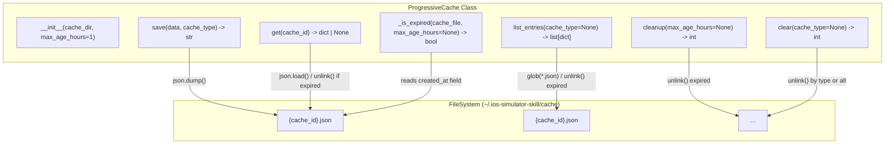
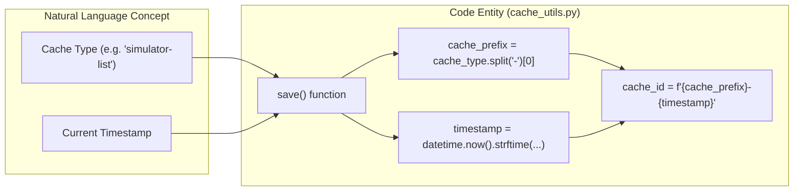
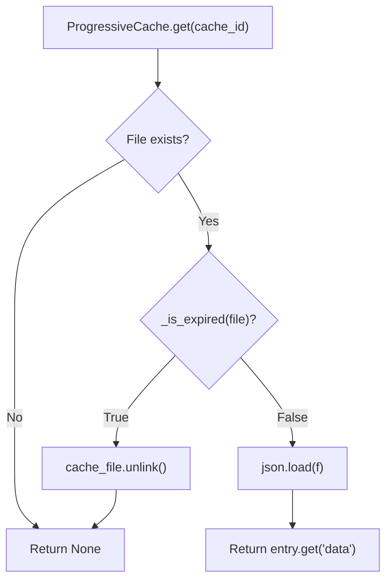
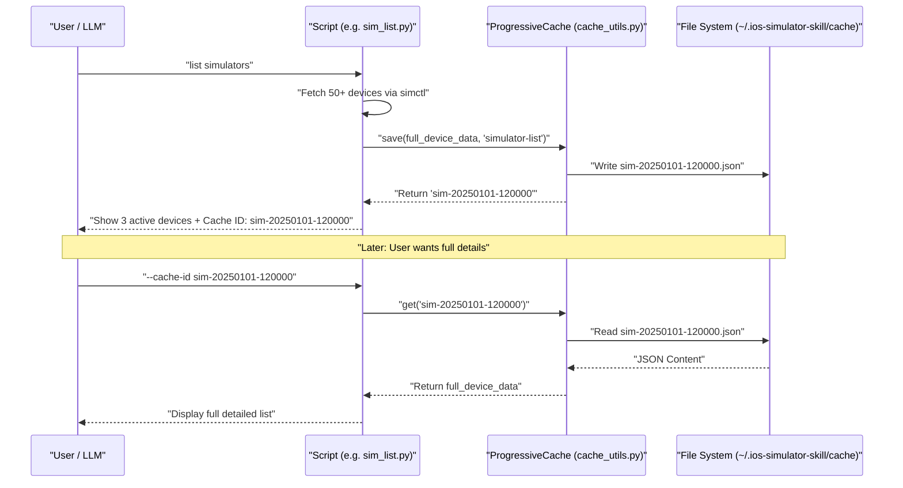

<!-- source: DeepWiki mcp.deepwiki.com · repo conorluddy/ios-simulator-skill · page 10.3 cache_utils.py · fetched 2026-10-27 -->

# cache_utils.py

<details>
<summary>Relevant source files</summary>

The following files were used as context for generating this wiki page:

- [ios-simulator-skill/skills/ios-simulator-skill/scripts/common/cache_utils.py](ios-simulator-skill/skills/ios-simulator-skill/scripts/common/cache_utils.py)

</details>


## Purpose and Scope

`cache_utils.py` implements the **progressive disclosure cache**: a file-backed store for large outputs that supports the pattern of returning a short `cache_id` in the default summary view, with full data retrievable on demand. This is the mechanism that enables the 96% token reduction used by scripts like `sim_list.py`. [ios-simulator-skill/scripts/common/cache_utils.py:1-16]()

The module provides the `ProgressiveCache` class. Cache entries are stored as JSON files under `~/.ios-simulator-skill/cache/` and expire after a configurable TTL (default: 1 hour). [ios-simulator-skill/scripts/common/cache_utils.py:10-11]()

---

## Module Overview

`cache_utils.py` (~258 lines) provides:

- **`ProgressiveCache`** — the main class managing file-backed cache entries with TTL expiration. [ios-simulator-skill/scripts/common/cache_utils.py:25-30]()
- **File-based Persistence** — entries are written as individual `.json` files to `~/.ios-simulator-skill/cache/`. [ios-simulator-skill/scripts/common/cache_utils.py:40-46]()

Each file stores the original data alongside metadata (`cache_id`, `cache_type`, `created_at`). The `cache_id` is returned to callers and included in default output so users or agents can fetch full details in a follow-up call. [ios-simulator-skill/scripts/common/cache_utils.py:62-81]()

Sources: [ios-simulator-skill/scripts/common/cache_utils.py:1-81]()

---

## ProgressiveCache Class

`ProgressiveCache` manages a directory of JSON files, one per cache entry. It is initialized with a directory path and a TTL measured in **hours**. [ios-simulator-skill/scripts/common/cache_utils.py:32-46]()

### Class Structure

**ProgressiveCache public interface and file system relationship**



Sources: [ios-simulator-skill/scripts/common/cache_utils.py:25-47](), [ios-simulator-skill/scripts/common/cache_utils.py:68-79]()

### Method Reference

| Method | Parameters | Return | Description |
|--------|-----------|--------|-------------|
| `__init__` | `cache_dir: str \| None`, `max_age_hours: int = 1` | — | Creates the cache directory if it doesn't exist. Default: `~/.ios-simulator-skill/cache/` [ios-simulator-skill/scripts/common/cache_utils.py:32-46]() |
| `save` | `data: dict[str, Any]`, `cache_type: str` | `str` (cache_id) | Writes entry to disk, returns the generated `cache_id`. [ios-simulator-skill/scripts/common/cache_utils.py:48-81]() |
| `get` | `cache_id: str` | `dict[str, Any] \| None` | Returns the `data` field of the entry, or `None` if missing/expired. [ios-simulator-skill/scripts/common/cache_utils.py:83-112]() |
| `list_entries` | `cache_type: str \| None` | `list[dict[str, Any]]` | Returns metadata for all valid entries (optionally filtered by type). [ios-simulator-skill/scripts/common/cache_utils.py:114-158]() |
| `cleanup` | `max_age_hours: int \| None` | `int` | Sweeps entire cache directory and deletes expired files. [ios-simulator-skill/scripts/common/cache_utils.py:160-183]() |
| `clear` | `cache_type: str \| None` | `int` | Deletes all entries (or only those matching `cache_type`). [ios-simulator-skill/scripts/common/cache_utils.py:185-216]() |
| `_is_expired` | `cache_file: Path`, `max_age_hours: int \| None` | `bool` | Internal helper to check file age against TTL. [ios-simulator-skill/scripts/common/cache_utils.py:218-238]() |

Sources: [ios-simulator-skill/scripts/common/cache_utils.py:48-238]()

---

## Cache ID Generation

`cache_id` values are generated in `save()` using a timestamp-based pattern to ensure uniqueness and chronological sorting:

```
{prefix}-{YYYYMMDD}-{HHMMSS}
```
[ios-simulator-skill/scripts/common/cache_utils.py:63-65]()

The prefix is derived by splitting the `cache_type` string (e.g., `simulator-list`) on the first hyphen. [ios-simulator-skill/scripts/common/cache_utils.py:64]()

**Code Entity to Natural Language Mapping: ID Generation**



Sources: [ios-simulator-skill/scripts/common/cache_utils.py:62-65]()

---

## TTL and Expiration

TTL is measured in **hours** via `max_age_hours` (default: `1`). [ios-simulator-skill/scripts/common/cache_utils.py:32-37]() The `_is_expired()` method reads `created_at` from the file metadata, computes the delta from `datetime.now()`, and compares it to the threshold. [ios-simulator-skill/scripts/common/cache_utils.py:228-232]() If the file cannot be read or parsed, it is treated as expired (`True`) to facilitate cleanup of corrupt data. [ios-simulator-skill/scripts/common/cache_utils.py:237-238]()

**`get()` expiration and retrieval flow:**



Sources: [ios-simulator-skill/scripts/common/cache_utils.py:83-112](), [ios-simulator-skill/scripts/common/cache_utils.py:218-238]()

---

## Three Deletion Pathways

The cache has three distinct mechanisms for removing files, each suited to a different scenario.

| Pathway | Method | Trigger | Scope |
|---------|--------|---------|-------|
| **Lazy Deletion** | `get()`, `list_entries()` | Encountered during normal use | Single file (if expired) |
| **Explicit Clear** | `clear(cache_type)` | Caller explicitly invalidates | All files, or all of one type |
| **Sweep Cleanup** | `cleanup(max_age_hours)` | Periodic housekeeping | All expired files in directory |

Sources: [ios-simulator-skill/scripts/common/cache_utils.py:97-105](), [ios-simulator-skill/scripts/common/cache_utils.py:130-158](), [ios-simulator-skill/scripts/common/cache_utils.py:160-183](), [ios-simulator-skill/scripts/common/cache_utils.py:185-216]()

---

## Data Flow: Progressive Disclosure

The `ProgressiveCache` is the concrete mechanism behind the progressive disclosure pattern. It allows scripts to handle large datasets (like a full simulator list) without overwhelming the LLM's context window.

**Natural Language to Code Entity: Progressive Disclosure Pattern**



Sources: [ios-simulator-skill/scripts/common/cache_utils.py:48-81](), [ios-simulator-skill/scripts/common/cache_utils.py:83-112]()

---

## Error Handling and Robustness

The class is designed to be "silent" on failures to avoid interrupting script execution:

1.  **Missing Files**: `get()` returns `None` rather than raising `FileNotFoundError`. [ios-simulator-skill/scripts/common/cache_utils.py:99-100]()
2.  **Corrupt JSON**: Caught via `json.JSONDecodeError` in `get()`, `list_entries()`, and `_is_expired()`. Corrupt files are treated as expired and deleted. [ios-simulator-skill/scripts/common/cache_utils.py:111-112](), [ios-simulator-skill/scripts/common/cache_utils.py:237-238]()
3.  **IO Errors**: `OSError` is caught during file operations. [ios-simulator-skill/scripts/common/cache_utils.py:155-156](), [ios-simulator-skill/scripts/common/cache_utils.py:214-215]()
4.  **Directory Creation**: `__init__` uses `exist_ok=True` to prevent errors if multiple scripts initialize the cache simultaneously. [ios-simulator-skill/scripts/common/cache_utils.py:46]()

Sources: [ios-simulator-skill/scripts/common/cache_utils.py:32-238]()

---

