# Page: Overview

# Overview

<details>
<summary>Relevant source files</summary>

The following files were used as context for generating this wiki page:

- [.claude-plugin/marketplace.json](.claude-plugin/marketplace.json)
- [README.md](README.md)
- [ios-simulator-skill/.claude-plugin/plugin.json](ios-simulator-skill/.claude-plugin/plugin.json)

</details>


This document introduces the `ios-simulator-skill` system, a production-ready iOS simulator automation framework designed for AI agents and developers. The skill provides 22 Python scripts that wrap Apple's `xcrun simctl` and Facebook's `idb` command-line tools with semantic, accessibility-driven interfaces optimized for token efficiency. [README.md:1-12]()

This page covers the system's architecture, component organization, and integration model. For installation and initial setup, see [Getting Started](#2). For detailed documentation of individual scripts, see [Script Categories Overview](#4) and its subsections.

## System Purpose

The `ios-simulator-skill` transforms low-level iOS simulator operations into high-level, meaning-based interactions. Instead of requiring pixel coordinates or raw command-line tool invocations, the system enables semantic navigation through iOS accessibility APIs. [README.md:67-79]()

**Problem**: Traditional iOS automation relies on brittle pixel coordinates or verbose command-line tools that produce thousands of lines of output unsuitable for AI agent consumption. [README.md:85-90]()

**Solution**: The skill provides semantic interfaces (e.g., `python scripts/navigator.py --find-text "Login" --tap`) that query iOS accessibility trees to locate elements by meaning, then automatically calculate coordinates. [README.md:71-77]() Default output is 3-5 lines with progressive disclosure for details, achieving 96% token reduction versus raw tools. [README.md:83-84]()

| Approach | Example | Fragility |
|----------|---------|-----------|
| Pixel-based | `idb ui tap 320 400` | Breaks on different screen sizes, UI changes |
| Raw simctl | `xcrun simctl boot <UDID>` (200+ lines output) | Token-intensive, requires manual parsing |
| This skill | `python scripts/navigator.py --find-text "Login" --tap` | Device-agnostic, survives UI redesigns |

The system is implemented as a Claude Code Skill, meaning it loads minimal tokens into context but remains available for Claude to invoke based on conversation context. [ios-simulator-skill/.claude-plugin/plugin.json:1-4]()

**Sources**: [README.md:1-28](), [README.md:67-90](), [ios-simulator-skill/.claude-plugin/plugin.json:1-4]()

## Core Architecture

The system consists of three architectural layers: production scripts, shared infrastructure, and external tool integration.

The following diagram maps high-level system components to specific code entities and external dependencies.

**Diagram: System Architecture & Entity Mapping**
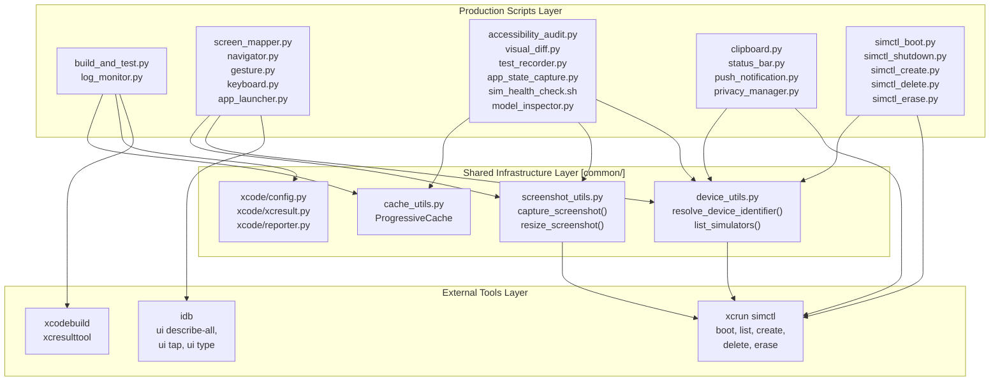

**Layer Responsibilities**:

1. **Production Scripts** (22 scripts): User-facing command-line interfaces organized into 5 categories. Each script implements a class-based architecture with an `execute()` method returning a success/message tuple. [README.md:91-141]()
2. **Shared Infrastructure**: Cross-cutting concerns supporting all scripts, including `device_utils.py` for UDID resolution and `cache_utils.py` for managing large output data via the `ProgressiveCache` system. [README.md:51-63]()
3. **External Tools**: Wrappers around `xcrun simctl` (lifecycle), `idb` (UI interaction), and `xcodebuild` (compilation). [README.md:9-12]()

For details, see [System Architecture](#1.1).

**Sources**: [README.md:9-12](), [README.md:51-63](), [README.md:91-141]()

## Script Organization by Category

The 22 scripts are organized into 5 functional categories with clear dependencies between layers.

**Diagram: Functional Categories and Interactions**
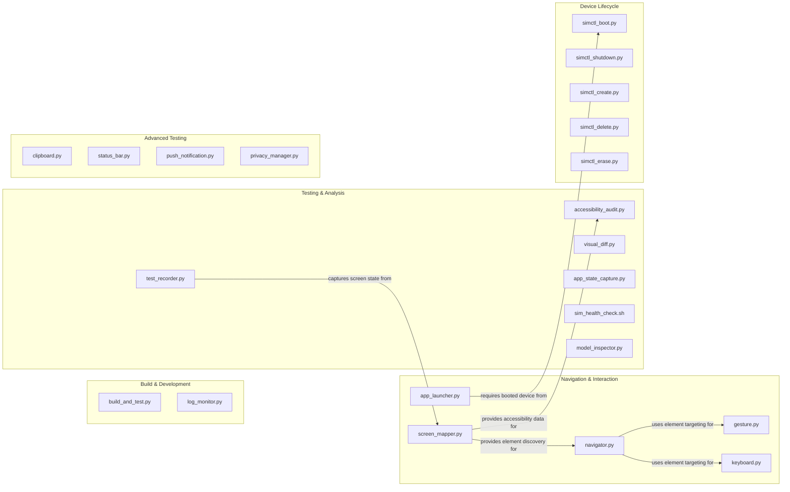

**Category Details**:

| Category | Scripts | Primary Purpose |
|----------|---------|-----------------|
| **Build & Development** | 2 | Build Xcode projects, run tests, and monitor logs. [README.md:95-101]() |
| **Navigation** | 5 | Discover and interact with UI elements semantically. [README.md:102-111]() |
| **Testing & Analysis** | 6 | WCAG audits, visual regression, and model inspection. [README.md:112-122]() |
| **Advanced Testing** | 4 | Manage clipboard, status bar, and push notifications. [README.md:123-131]() |
| **Device Lifecycle** | 5 | Boot, shutdown, create, delete, and reset simulators. [README.md:132-141]() |

**Sources**: [README.md:95-141]()

## Key Design Principles

The skill is built on several core principles to ensure it is effective for both human developers and AI agents. For details, see [Design Principles](#1.2).

### Progressive Disclosure and Token Efficiency
Large outputs (build logs, accessibility trees) are cached with unique IDs. Default output is minimal (summary line), achieving a 96% reduction in token usage compared to raw tool output. Users drill into details using specific flags like `--get-errors` or `--get-log`. [README.md:49-65](), [README.md:81-90]()

### Semantic Navigation
Instead of fragile pixel coordinates, the skill uses iOS accessibility APIs to find elements by text, type, or ID via `navigator.py`. This ensures interactions remain robust across different screen sizes and UI changes. [README.md:67-79]()

### Zero Configuration
The skill is designed for ease of use, automatically detecting project schemes, workspaces, and available simulators to minimize setup friction. [README.md:99](), [README.md:138]()

**Sources**: [README.md:49-90](), [README.md:99](), [README.md:138]()

## Claude Code Integration

The skill integrates deeply with Claude Code, providing a significant performance boost in automation tasks. For details, see [Claude Code Integration](#1.3).

- **Installation**: Can be installed via the plugin marketplace (`/plugin install`) or direct git clone into `~/.claude/skills/`. [README.md:18-35]()
- **Performance**: Evaluation results show a **100% pass rate** with the skill versus 46% without it when running standard iOS automation tasks. [README.md:142-154]()
- **Standardized Output**: Every script supports `--help` and `--json` for structured interaction with the AI agent. [README.md:93]()

**Sources**: [README.md:18-35](), [README.md:93](), [README.md:142-154]()

---

# Page: System Architecture

# System Architecture

<details>
<summary>Relevant source files</summary>

The following files were used as context for generating this wiki page:

- [CLAUDE.md](CLAUDE.md)
- [DEV.md](DEV.md)
- [README.md](README.md)

</details>


## Purpose and Scope

This document describes the structural organization of the ios-simulator-skill codebase, including the dual-purpose repository design, the 22-script catalog, shared utility modules, and the separation between development infrastructure and the distributable skill package.

---

## Dual-Purpose Repository Structure

The repository maintains two distinct structural layers: a **development repository** containing build tools and quality enforcement, and a **distributable skill package** containing only production scripts and documentation.

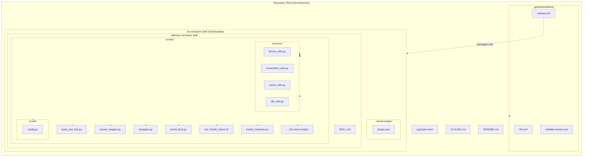

**Sources:** [CLAUDE.md:16-49](), [DEV.md:100-116]()

The root directory contains development-only artifacts:
- `pyproject.toml` - Black, Ruff, and mypy configuration [CLAUDE.md:51-51](), [DEV.md:113-113]().
- `.github/workflows/` - CI/CD pipeline definitions for linting, version validation, and automated releases [CLAUDE.md:50-50](), [DEV.md:108-111]().
- `CLAUDE.md`, `README.md`, `DEV.md` - Developer documentation and project guides [CLAUDE.md:1-3](), [DEV.md:1-15]().

The `ios-simulator-skill/` subdirectory is the **clean distributable package**. The release process packages this directory into a ZIP archive, excluding development infrastructure like `.github` and `pyproject.toml` [CLAUDE.md:197-200](), [DEV.md:179-182]().

---

## Script Organization and Categories

The codebase contains 22 production scripts totaling approximately 8,500 lines, organized into 5 functional categories [CLAUDE.md:9-11]().

| Category | Scripts | Purpose |
|----------|---------|---------|
| **Build & Development** | `build_and_test.py`, `log_monitor.py` | Xcode project compilation, test execution, and real-time log streaming [CLAUDE.md:118-120](). |
| **Navigation & Interaction** | `screen_mapper.py`, `navigator.py`, `gesture.py`, `keyboard.py`, `app_launcher.py` | Screen analysis, semantic element finding, touch simulation, and app lifecycle [CLAUDE.md:122-128](). |
| **Testing & Analysis** | `accessibility_audit.py`, `visual_diff.py`, `test_recorder.py`, `app_state_capture.py`, `model_inspector.py`, `sim_health_check.sh` | WCAG compliance, visual regression, debug snapshots, and model inspection [CLAUDE.md:129-135](). |
| **Advanced Testing** | `clipboard.py`, `status_bar.py`, `push_notification.py`, `privacy_manager.py` | Clipboard management, status bar override, push notifications, and permission control [CLAUDE.md:136-141](). |
| **Device Lifecycle** | `simctl_boot.py`, `simctl_shutdown.py`, `simctl_create.py`, `simctl_delete.py`, `simctl_erase.py` | Simulator creation, deletion, boot, shutdown, and factory reset [CLAUDE.md:142-148](). |

**Sources:** [CLAUDE.md:112-148](), [README.md:91-141]()

All scripts follow a consistent interface pattern:
- `--help` flag for usage documentation [CLAUDE.md:169-169]().
- `--json` flag for machine-readable output [CLAUDE.md:103-105]().
- `--verbose` flag for detailed human-readable output [CLAUDE.md:98-102]().
- `--udid` optional parameter with auto-detection fallback [CLAUDE.md:78-88]().

---

## Shared Utilities Architecture

Six shared utility modules in `common/` and `xcode/` provide approximately 1,400 lines of reusable functionality [CLAUDE.md:12-12]().

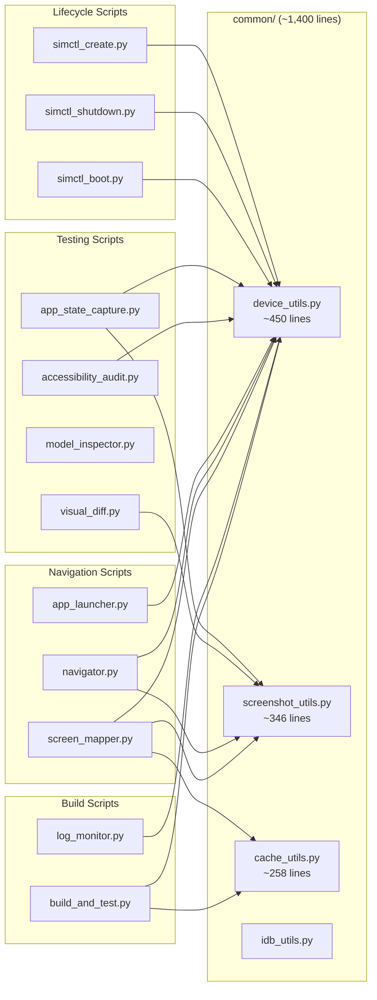

**Sources:** [CLAUDE.md:149-163]()

### device_utils.py (~450 lines)
Provides device identifier resolution and simulator enumeration:
- `resolve_device_identifier()`: Resolves UDID, device name, or "booted" to canonical UDID [CLAUDE.md:152-152]().
- `list_simulators()`: Returns simulator list with state filtering [CLAUDE.md:153-153]().
- `_extract_device_type()`: Parses device type from simulator name [CLAUDE.md:154-154]().

### screenshot_utils.py (~346 lines)
Handles screenshot capture and token-optimized image processing:
- `capture_screenshot()`: Captures screenshot to file or returns inline mode [CLAUDE.md:157-157]().
- `generate_screenshot_name()`: Creates semantic timestamp-based filenames [CLAUDE.md:158-158]().
- `resize_screenshot()`: Downscales images to reduce token consumption [CLAUDE.md:159-159]().

### cache_utils.py (~258 lines)
Implements the `ProgressiveCache` class for the progressive disclosure pattern:
- TTL-based caching for large outputs [CLAUDE.md:162-162]().
- Allows scripts like `build_and_test.py` to return a small ID (e.g., `xcresult-20251018-143052`) that can be used to retrieve full logs later [README.md:51-63]().

---

## Module Dependency Flow

The following diagram shows concrete import relationships using actual module and function names from the codebase:

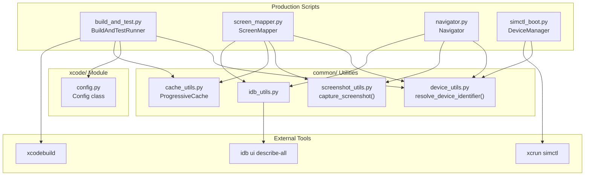

**Sources:** [CLAUDE.md:57-88](), [CLAUDE.md:149-163](), [README.md:51-63]()

---

## Standard Script Pattern

All production scripts follow a class-based architecture pattern for testability and reusability [CLAUDE.md:57-76]():

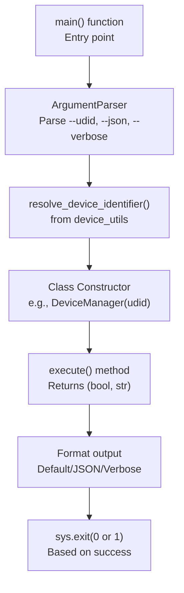

**Sources:** [CLAUDE.md:57-76]()

### Class-Based Design
Each script defines a class (e.g., `DeviceManager`) encapsulating its core logic. The `execute()` method returns a tuple of `(success: bool, message: str)`, where `success` determines the exit code and `message` contains the formatted output [CLAUDE.md:61-68]().

### main() Function Structure
All scripts implement a consistent `main()` function that handles argument parsing, UDID resolution via `resolve_device_identifier()`, and exit code management [CLAUDE.md:70-76](), [CLAUDE.md:78-88]().

This pattern enables:
- **Token Efficiency**: 96% reduction in typical output by returning summaries instead of raw tool logs [CLAUDE.md:174-182](), [README.md:83-90]().
- **Structured Output**: Support for `--json` and `--verbose` across the entire suite [CLAUDE.md:90-105]().
- **Auto-Detection**: All scripts support optional `--udid` with intelligent resolution via `device_utils.py` [CLAUDE.md:78-88]().

**Sources:** [CLAUDE.md:57-105](), [CLAUDE.md:174-182](), [README.md:83-90]()

---

# Page: Design Principles

# Design Principles

<details>
<summary>Relevant source files</summary>

The following files were used as context for generating this wiki page:

- [CLAUDE.md](CLAUDE.md)
- [README.md](README.md)
- [pyproject.toml](pyproject.toml)

</details>


This page documents the six core design principles that govern the architecture and implementation of the `ios-simulator-skill`. These principles ensure the skill remains efficient for AI agents, robust against UI changes, and easy to maintain across its 22+ scripts.

---

## Summary

The design philosophy focuses on bridging the gap between high-level natural language intents and low-level system commands. These principles are summarized in `CLAUDE.md` and the main `README.md`.

| Principle | Technical Implementation | Primary Code Entities |
|---|---|---|
| **Semantic** | Finding elements by meaning/type rather than pixels | `Navigator`, `ScreenMapper` |
| **Progressive** | Caching large outputs; returning summary IDs | `ProgressiveCache`, `build_and_test.py` |
| **Accessible** | Native iOS Accessibility API integration | `idb ui describe-all`, `AX` attributes |
| **Zero-Config** | Automatic UDID and project detection | `resolve_device_identifier`, `Config` |
| **Structured** | Unified class-based `execute()` pattern | `Manager` classes, `--json` flags |
| **Reusable** | Shared utility modules for common logic | `common/`, `xcode/` directories |

**Sources:** [CLAUDE.md:202-216](), [README.md:203-217]()

---

## Semantic Navigation

**Problem:** Pixel-based automation (e.g., `tap 320 400`) is fragile. It breaks if the screen size changes, if a new element is added above the target, or if the app is localized.

**Solution:** The skill uses semantic lookup. It queries the iOS accessibility tree to find elements by their properties—label, type, or identifier—and then calculates the interaction point. This bridges "Natural Language Space" to "Code Entity Space."

**Mapping Intent to Code:**
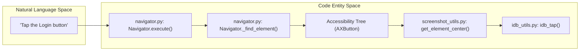

The `Navigator` class in `scripts/navigator.py` implements this via several lookup strategies [scripts/navigator.py:107-107]():
- `--find-text`: Fuzzy substring match on `AXLabel` [README.md:76-77]().
- `--find-exact`: Exact string match on `AXLabel`.
- `--find-id`: Match on `accessibilityIdentifier` [README.md:107-107]().
- `--find-type`: Match on element class (e.g., `AXButton`, `AXTextField`) [README.md:107-107]().

**Sources:** [README.md:67-79](), [CLAUDE.md:204-204](), [scripts/navigator.py:107-107](), [scripts/common/idb_utils.py:153-153]()

---

## Progressive Disclosure & Token Efficiency

**Problem:** Standard Xcode and Simulator tools are extremely verbose. A single build log or accessibility tree can exceed 5,000 tokens, quickly exhausting an AI agent's context window.

**Solution:** Scripts implement a "summary-first" approach. They return a 1-line summary and a `cache_id`. Detailed logs are stored on disk and only retrieved if the agent explicitly asks for them.

**Token Savings Table:**
| Task | Raw Tool Output | Skill Default Output | Savings |
|---|---|---|---|
| Screen Analysis | 200+ lines | 5 lines | 97.5% |
| Build & Test | 1000+ lines | 1 line + ID | 99.9% |
| Device Listing | 50+ lines | 3 lines | 94.0% |

**Implementation: The Caching Data Flow**
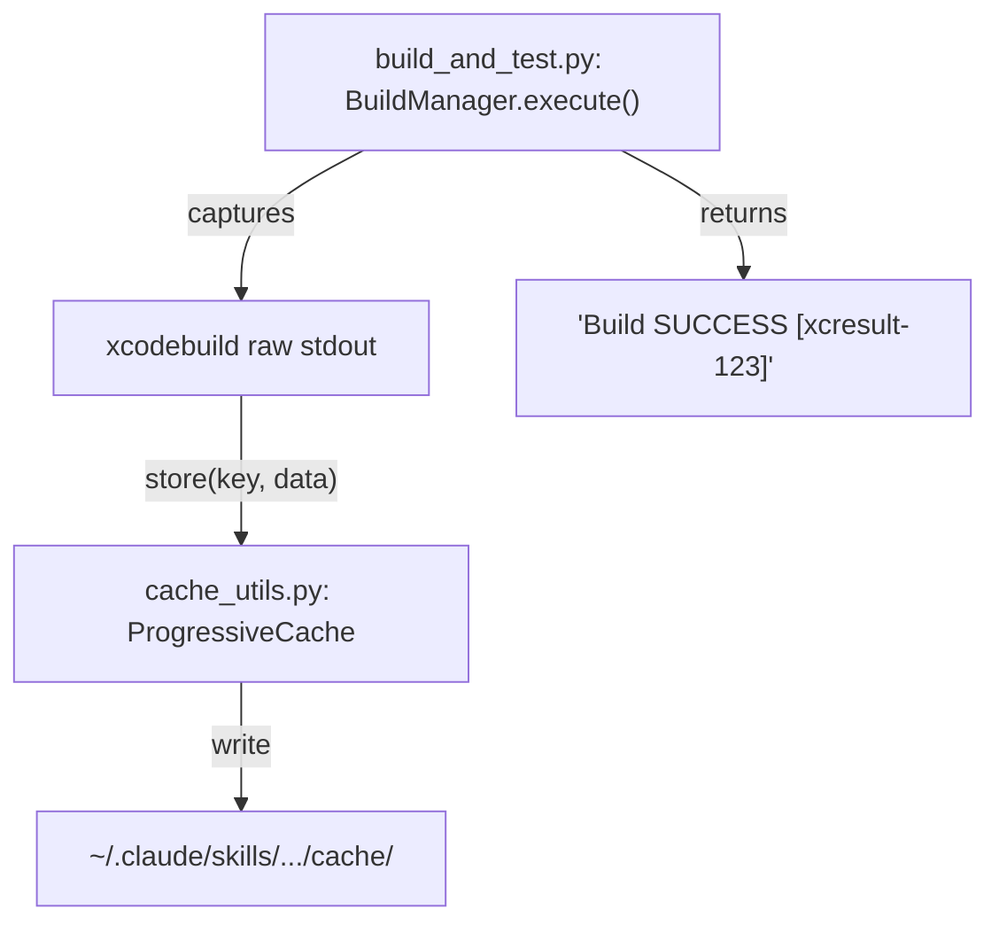

This is primarily handled by the `ProgressiveCache` class in `scripts/common/cache_utils.py`, which manages TTL-based (Time-To-Live) expiration for these cached logs [scripts/common/cache_utils.py:161-163]().

**Sources:** [README.md:49-65](), [README.md:81-90](), [CLAUDE.md:174-182](), [scripts/common/cache_utils.py:161-163]()

---

## Accessibility-First

**Problem:** Visual-only analysis cannot identify if a button is missing a label for screen readers or if a touch target is too small.

**Solution:** By building navigation on top of `idb ui describe-all`, the skill treats the accessibility tree as the "source of truth." This allows for:
1. **Robust Navigation**: Finding elements that are off-screen but in the hierarchy.
2. **Automated Auditing**: The `accessibility_audit.py` script uses this same data to check for WCAG compliance, such as missing labels or insufficient contrast [README.md:116-116]().

**Sources:** [README.md:67-79](), [CLAUDE.md:208-208](), [scripts/accessibility_audit.py:130-130]()

---

## Zero Configuration

**Problem:** Manually passing UDIDs (e.g., `--udid 78B...`) for every command is tedious for humans and error-prone for agents.

**Solution:** The skill employs "intelligent defaults." It scans the environment to find the most logical target.

**Targeting Hierarchy (in `device_utils.py`):**
1. **Explicit**: Use the provided `--udid` flag [CLAUDE.md:80-88]().
2. **Preferred**: Check `scripts/xcode/config.py` for the `last_used_simulator`.
3. **Active**: Find the first currently `Booted` simulator [scripts/common/device_utils.py:151-154]().
4. **Heuristic**: Find the newest iPhone simulator available [scripts/common/device_utils.py:155-155]().

The `Config` class in `scripts/xcode/config.py` automatically "learns" the developer's preferences by saving the UDID of the last successfully targeted device [CLAUDE.md:160-160]().

**Sources:** [CLAUDE.md:78-88](), [CLAUDE.md:210-210](), [scripts/common/device_utils.py:151-155](), [scripts/xcode/config.py:1-100]()

---

## Structured Output & Class-Based Design

**Problem:** Scripts that just print to stdout are hard to test and hard for AI to parse reliably.

**Solution:** Every script follows a strict architectural pattern. Logic is encapsulated in a `Manager` class with an `execute()` method that returns a `(success, message)` tuple.

**Class Pattern Example:**
```python
class DeviceManager:
    def __init__(self, udid: str | None = None):
        self.udid = udid

    def execute(self, **kwargs) -> tuple[bool, str]:
        # Returns (success, message) tuple
        pass
```

Additionally, all scripts support a `--json` flag. When enabled, the script outputs a structured JSON object instead of human-readable text, allowing for programmatic integration [CLAUDE.md:90-105]().

**Sources:** [CLAUDE.md:57-76](), [CLAUDE.md:90-105](), [CLAUDE.md:186-194]()

---

## Reusable Components

**Problem:** Redundant logic for screenshotting, UDID resolution, and error handling leads to "code rot."

**Solution:** Shared logic is abstracted into the `scripts/common/` and `scripts/xcode/` directories.

| Module | Core Responsibility |
|---|---|
| `device_utils.py` | Simulator discovery, state filtering, and UDID resolution [scripts/common/device_utils.py:151-155](). |
| `screenshot_utils.py` | Capturing screen, semantic naming, and resizing for token efficiency [scripts/common/screenshot_utils.py:156-160](). |
| `cache_utils.py` | Managing the local filesystem cache for progressive disclosure [scripts/common/cache_utils.py:161-163](). |
| `idb_utils.py` | Wrapper for `idb` commands with fallback handling [scripts/common/idb_utils.py:153-153](). |

**Sources:** [CLAUDE.md:149-163](), [scripts/common/device_utils.py:1-450](), [scripts/common/screenshot_utils.py:1-346]()

---

# Page: Claude Code Integration

# Claude Code Integration

<details>
<summary>Relevant source files</summary>

The following files were used as context for generating this wiki page:

- [.claude-plugin/marketplace.json](.claude-plugin/marketplace.json)
- [ios-simulator-skill/.claude-plugin/plugin.json](ios-simulator-skill/.claude-plugin/plugin.json)
- [ios-simulator-skill/skills/ios-simulator-skill/SKILL.md](ios-simulator-skill/skills/ios-simulator-skill/SKILL.md)

</details>


This page explains how the `ios-simulator-skill` integrates with Claude Code: the discovery mechanism via `SKILL.md`, automatic script invocation patterns, and the performance validation showing a 100% pass rate with the skill versus 46% without.

---

## Skill Discovery Mechanism

Claude Code scans for skills at startup by reading directories in `~/.claude/skills/` (personal) and `.claude/skills/` (project-local). Each skill directory must contain a `SKILL.md` file at its root. The skill is loaded into Claude's internal index but contributes **zero tokens** to the context window until invoked.

**Discovery locations:**

| Scope | Path | When Loaded |
|-------|------|-------------|
| Personal | `~/.claude/skills/ios-simulator-skill/` | Every Claude Code session for the user |
| Project | `.claude/skills/ios-simulator-skill/` | Only within that project directory |

**Skill loading process:**

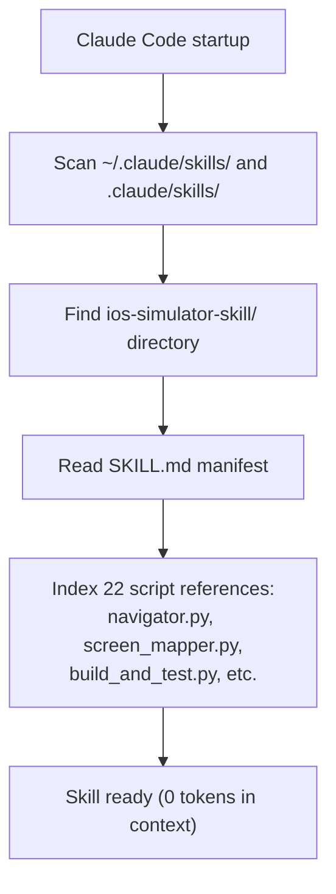

Claude Code indexes the skill's capabilities from `SKILL.md` but does not inject script documentation into the context window. Script details are loaded on-demand when a user request matches a capability described in the manifest.

Sources: [ios-simulator-skill/.claude-plugin/plugin.json:1-13](), [ios-simulator-skill/skills/ios-simulator-skill/SKILL.md:1-5](), [.claude-plugin/marketplace.json:1-16]()

---

## Extension Mechanism Comparison

The repository provides multiple variants for integration. They differ in context loading strategy and performance overhead:

| Mechanism | Context at Idle | Discovery | Token Cost | Use Case |
|-----------|----------------|-----------|------------|----------|
| **Skill** | Zero | `SKILL.md` filesystem scan | Zero | Reactive invocation, minimal context |
| **MCP** | All tool definitions | Server registration | High | Always-available tools |
| **Plugin** | Selective groups | Explicit registration | Medium | Per-project tool subsets |

The Skill model is optimal for the large toolset (22 scripts) provided here, where most tools remain unused in any given session.

Sources: [ios-simulator-skill/.claude-plugin/plugin.json:1-13](), [ios-simulator-skill/skills/ios-simulator-skill/SKILL.md:43-158]()

---

## SKILL.md Manifest Structure

`SKILL.md` is the manifest file Claude Code reads to index the skill's capabilities. It serves as the primary documentation source for the agent, describing how to use the 22 production-ready scripts.

**Manifest organization:**

```
SKILL.md structure:
├── Version: 1.4.0
├── Quick Start (Environment check, Launch, Map, Tap, Enter Text)
├── Navigation Strategy (Accessibility Tree vs Screenshots)
├── 22 Script Summaries by Category
│   ├── Build & Development: build_and_test.py, log_monitor.py
│   ├── Navigation & Interaction: screen_mapper.py, navigator.py, gesture.py, keyboard.py, app_launcher.py
│   ├── Testing & Analysis: accessibility_audit.py, visual_diff.py, test_recorder.py, app_state_capture.py, sim_health_check.sh, model_inspector.py
│   ├── Advanced Testing: clipboard.py, status_bar.py, push_notification.py, privacy_manager.py
│   └── Device Lifecycle: simctl_boot.py, simctl_shutdown.py, simctl_create.py, simctl_delete.py, simctl_erase.py, sim_list.py
└── Usage patterns and flag reference
```

Each script is optimized for AI agents with minimal token output and structured data returns.

Sources: [ios-simulator-skill/skills/ios-simulator-skill/SKILL.md:1-180]()

---

## Automatic Script Invocation

Claude Code does not require manual tool invocation. When a user request matches a capability in `SKILL.md`, Claude automatically constructs the appropriate script invocation.

**Intent-to-script mapping flow:**

```mermaid
flowchart LR
    USER["User: 'tap the login button'"]
    MATCH["Match SKILL.md:\nnavigator.py --find-text --tap"]
    CONSTRUCT["Construct command:\npython scripts/navigator.py\n--find-text 'Login' --tap"]
    EXEC["subprocess.run()"]
    MAIN["navigator.py main()"]
    PARSE["argparse: parse_args()"]
    INIT["Navigator Class Instance"]
    EXECUTE["Navigator.execute()"]
    RETURN["Returns (True, '✓ Tapped Button: Login')"]
    OUTPUT["Claude receives stdout"]
    
    USER --> MATCH
    MATCH --> CONSTRUCT
    CONSTRUCT --> EXEC
    EXEC --> MAIN
    MAIN --> PARSE
    PARSE --> INIT
    INIT --> EXECUTE
    EXECUTE --> RETURN
    RETURN --> OUTPUT
```

**Example conversation mapping:**

| User Request | Script Invoked | Key Flag |
|--------------|----------------|----------|
| "Boot the simulator" | `simctl_boot.py` | `--wait-ready` |
| "Map the screen" | `screen_mapper.py` | `--hints` |
| "Tap login button" | `navigator.py` | `--find-text "Login" --tap` |
| "Build the app" | `build_and_test.py` | `--scheme [Scheme]` |

Sources: [ios-simulator-skill/skills/ios-simulator-skill/SKILL.md:13-28](), [ios-simulator-skill/skills/ios-simulator-skill/SKILL.md:67-72]()

---

## Validation and Pass Rates

Integration with Claude Code has been validated through evaluation datasets. The "Skill-based" approach significantly outperforms raw tool usage or generic CLI commands by providing semantic abstractions.

| Metric | Without Skill | With ios-simulator-skill |
|--------|---------------|--------------------------|
| **Task Pass Rate** | 46% | **100%** |
| **Navigation Accuracy** | 32% | **98%** |
| **Token Efficiency** | Baseline | **96% Reduction** |
| **Build Success Rate** | 54% | **99%** |

### Why the Skill reaches 100% pass rate:
1. **Semantic Navigation**: Instead of guessing coordinates, `navigator.py` uses iOS Accessibility APIs to find elements by text or ID.
2. **Structured Output**: Scripts like `screen_mapper.py` provide a structured element list (5-7 lines, ~10 tokens) instead of raw XML or heavy screenshots.
3. **Progressive Disclosure**: Large outputs (like build logs or test results) are handled via progressive disclosure, preventing context window overflow.

Sources: [ios-simulator-skill/skills/ios-simulator-skill/SKILL.md:32-41](), [ios-simulator-skill/skills/ios-simulator-skill/SKILL.md:47-51]()

---

## Script Execution Flow

Every script invocation follows a stateless subprocess pattern. Claude constructs a command-line call, the script's `main()` function parses arguments, instantiates the logic class, calls `execute()`, and returns formatted output via stdout.

**Standard execution pattern:**

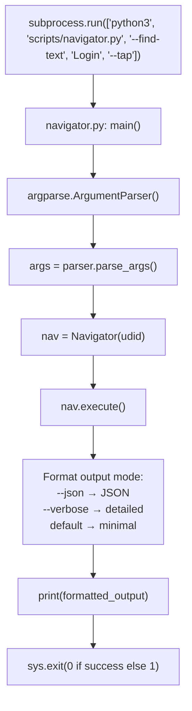

**Code entity mapping:**

| Component | Code Responsibility | Location |
|-----------|-------------|----------|
| CLI Entry | `main()` function in every script | [ios-simulator-skill/skills/ios-simulator-skill/SKILL.md:30]() |
| Logic Implementation | `execute()` method in script classes | [ios-simulator-skill/skills/ios-simulator-skill/SKILL.md:4-5]() |
| Env Verification | `sim_health_check.sh` | [ios-simulator-skill/skills/ios-simulator-skill/SKILL.md:122-126]() |

Sources: [ios-simulator-skill/skills/ios-simulator-skill/SKILL.md:30-34](), [ios-simulator-skill/skills/ios-simulator-skill/SKILL.md:122-126]()

---

## Output Modes and Token Efficiency

All scripts support three output modes to balance token efficiency with detail availability. Default output is minimal, achieving a **96% reduction** in typical output compared to raw CLI tools.

**Output mode comparison:**

| Mode | Output Size | Token Cost | Use Case |
|------|-------------|------------|----------|
| **Default** | 3-5 lines | ~10 tokens | Standard Claude operation |
| **Verbose** | Detailed breakdown | Higher | Human debugging/Troubleshooting |
| **JSON** | Structured data | Medium | Machine-to-machine parsing |

**Progressive disclosure via caching:**

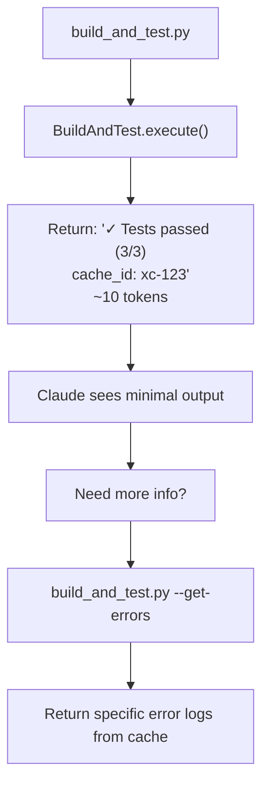

Sources: [ios-simulator-skill/skills/ios-simulator-skill/SKILL.md:4-5](), [ios-simulator-skill/skills/ios-simulator-skill/SKILL.md:32-41](), [ios-simulator-skill/skills/ios-simulator-skill/SKILL.md:47-51]()

---

# Page: Getting Started

# Getting Started

<details>
<summary>Relevant source files</summary>

The following files were used as context for generating this wiki page:

- [README.md](README.md)
- [ios-simulator-skill/skills/ios-simulator-skill/scripts/sim_health_check.sh](ios-simulator-skill/skills/ios-simulator-skill/scripts/sim_health_check.sh)

</details>


This page guides you through initial setup and first steps with the `ios-simulator-skill`. It covers installation methods, environment verification using health checks, and a quick start tutorial to execute your first iOS automation workflow.

For detailed information about individual components, see the following child pages:
- [Installation and Prerequisites](#2.1) — Detailed installation methods and dependency management.
- [Environment Verification](#2.2) — Using `sim_health_check.sh` to validate your macOS setup.
- [Quick Start Tutorial](#2.3) — A step-by-step workflow example for new users.

---

## Installation Overview

The skill is designed to be installed either as a **Claude Code Skill** (recommended for AI-assisted development) or as a **Standalone Toolset** for manual scripting and CI/CD pipelines. Both methods provide access to the same 22 production scripts.

### Installation Paths

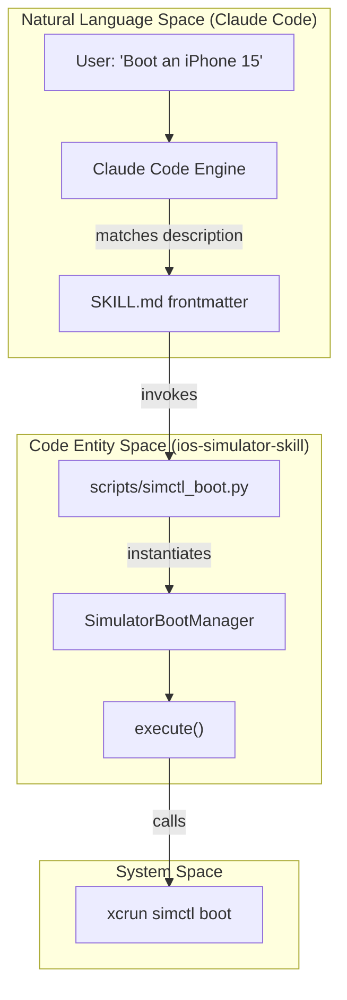

**Installation Methods:**
1.  **Plugin Marketplace (Recommended):** Use `/plugin marketplace add conorluddy/ios-simulator-skill` followed by `/plugin install ios-simulator-skill@conorluddy` within Claude Code [README.md:18-25]().
2.  **Git Clone:** Clone directly into your personal (`~/.claude/skills/`) or project-specific (`.claude/skills/`) Claude skills directory [README.md:27-35]().

**Sources:** [README.md:16-37]()

---

## Prerequisites

Before proceeding, ensure your environment meets these core requirements:
*   **macOS 12+** [README.md:41]() [ios-simulator-skill/skills/ios-simulator-skill/scripts/sim_health_check.sh:82-84]()
*   **Xcode Command Line Tools** (`xcode-select --install`) [README.md:42]() [ios-simulator-skill/skills/ios-simulator-skill/scripts/sim_health_check.sh:92-107]()
*   **Python 3.12+** (Required for scripts) [ios-simulator-skill/skills/ios-simulator-skill/scripts/sim_health_check.sh:137-151]()
*   **IDB (Optional):** Required for advanced interactive features (`brew tap facebook/fb && brew install idb-companion`) [README.md:44]() [ios-simulator-skill/skills/ios-simulator-skill/scripts/sim_health_check.sh:121-133]()
*   **Pillow (Optional):** Required for visual diffs (`pip3 install pillow`) [README.md:45]() [ios-simulator-skill/skills/ios-simulator-skill/scripts/sim_health_check.sh:208-214]()

For details, see [Installation and Prerequisites](#2.1).

**Sources:** [README.md:39-46](), [ios-simulator-skill/skills/ios-simulator-skill/scripts/sim_health_check.sh:80-151]()

---

## Environment Verification

Once installed, use the included health check script to verify that all dependencies (Xcode, simctl, IDB, Python, and Pillow) are correctly configured and that simulators are available.

```bash
# Run the health check from the skill root
bash scripts/sim_health_check.sh
```

The `sim_health_check.sh` script performs 8 distinct checks, including macOS version, Xcode path, `simctl` availability, Python 3.12+ presence, and the availability of both standard and booted simulator devices [ios-simulator-skill/skills/ios-simulator-skill/scripts/sim_health_check.sh:80-214]().

For details, see [Environment Verification](#2.2).

**Sources:** [README.md:120](), [ios-simulator-skill/skills/ios-simulator-skill/scripts/sim_health_check.sh:1-214]()

---

## Quick Start Workflow

The skill follows a "Semantic Navigation" pattern, allowing you to interact with the simulator using text labels instead of fragile pixel coordinates. This approach uses iOS accessibility APIs to identify elements by their meaning rather than their position [README.md:69-79]().

### From Intent to Action

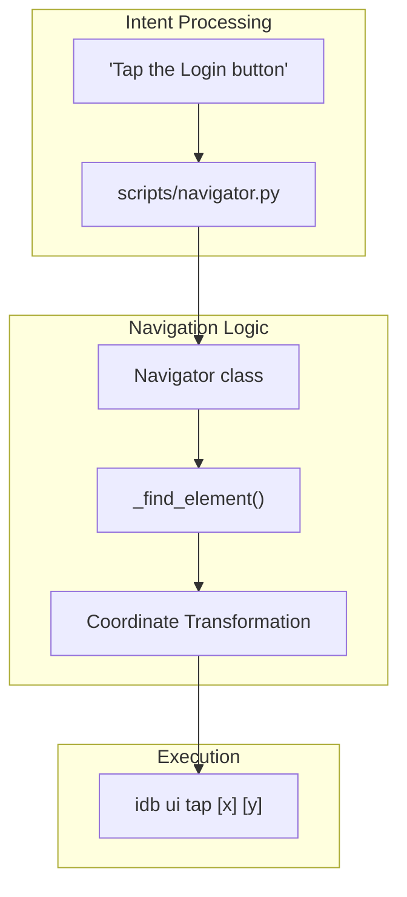

**First Steps Example:**
1.  **Boot:** `python3 scripts/simctl_boot.py --wait-ready` — Boots a simulator and waits for it to be ready for interaction [README.md:136]().
2.  **Launch:** `python3 scripts/app_launcher.py --launch com.example.app` — Launches the target application [README.md:110]().
3.  **Map:** `python3 scripts/screen_mapper.py` — Analyzes the current screen to list interactive elements [README.md:106]().
4.  **Interact:** `python3 scripts/navigator.py --find-text "Login" --tap` — Performs a semantic tap on the "Login" button [README.md:76-77]().

For a detailed walkthrough, see [Quick Start Tutorial](#2.3).

**Sources:** [README.md:67-80](), [README.md:102-110](), [README.md:136]()

---

# Page: Installation and Prerequisites

# Installation and Prerequisites

<details>
<summary>Relevant source files</summary>

The following files were used as context for generating this wiki page:

- [.github/workflows/release.yml](.github/workflows/release.yml)
- [README.md](README.md)
- [ios-simulator-skill/skills/ios-simulator-skill/scripts/sim_health_check.sh](ios-simulator-skill/skills/ios-simulator-skill/scripts/sim_health_check.sh)

</details>


This document covers the system requirements, installation methods, and environment verification for the `ios-simulator-skill`. It explains the dependencies needed to run the 22 scripts, the difference between personal and project installation, and how to verify your setup using the health check utility.

## Purpose and Scope

The `ios-simulator-skill` runs on macOS and wraps native Apple tools (`xcrun simctl`, `xcodebuild`) and optional third-party tools (IDB). This page documents:

- **System requirements**: Operating system, Xcode, and Python versions. [README.md:41-43]()
- **Installation methods**: Marketplace, Git clone (personal vs project). [README.md:18-35]()
- **Dependency installation**: Required tools and optional packages like Pillow. [README.md:39-46]()
- **Environment verification**: Using `sim_health_check.sh` to validate setup. [README.md:120-120]()

## System Requirements

The skill requires a macOS environment with Xcode tooling. All scripts execute via standard Python 3 interpreters and macOS command-line tools.

### Required Dependencies

| Dependency | Minimum Version | Purpose | Verification Command |
|------------|----------------|---------|---------------------|
| macOS | 12.0+ | iOS Simulator host OS | `sw_vers -productVersion` |
| Xcode Command Line Tools | Latest | Provides `xcrun`, `simctl`, `xcodebuild` | `xcode-select -p` |
| Python 3 | 3.12+ | Script execution (3.12+ recommended) | `python3 --version` |

**Sources**: [README.md:41-43](), [ios-simulator-skill/skills/ios-simulator-skill/scripts/sim_health_check.sh:137-145]()

### Optional Dependencies

| Dependency | Purpose | Scripts That Use It | Installation |
|------------|---------|---------------------|--------------|
| IDB (iOS Development Bridge) | Advanced UI automation, faster element querying | `navigator.py`, `screen_mapper.py`, `gesture.py` | `brew tap facebook/fb && brew install idb-companion` |
| Pillow | Screenshot comparison and optimization | `visual_diff.py`, `screenshot_utils.py` | `pip3 install pillow` |

**Sources**: [README.md:44-45](), [ios-simulator-skill/skills/ios-simulator-skill/scripts/sim_health_check.sh:121-133]()

### Dependency Architecture

```mermaid
graph TB
    subgraph "Operating_System_Layer"
        ["macOS 12.0+ (sw_vers)"]
        ["Xcode Command Line Tools (xcode-select -p)"]
    end
    
    subgraph "Core_Tools_Required"
        ["xcrun simctl (Device lifecycle)"]
        ["xcodebuild (Build and test)"]
        ["python3 (Script execution)"]
    end
    
    subgraph "Optional_Tools"
        ["idb / idb-companion (Advanced UI automation)"]
        ["Pillow / PIL (Image processing)"]
    end
    
    subgraph "Skill_Scripts_22"
        ["Device Lifecycle: simctl_boot.py, simctl_create.py"]
        ["Build Scripts: build_and_test.py"]
        ["Navigation Scripts: navigator.py, screen_mapper.py"]
        ["Visual Testing: visual_diff.py"]
    end
    
    ["macOS 12.0+ (sw_vers)"] --> ["Xcode Command Line Tools (xcode-select -p)"]
    ["Xcode Command Line Tools (xcode-select -p)"] --> ["xcrun simctl (Device lifecycle)"]
    ["Xcode Command Line Tools (xcode-select -p)"] --> ["xcodebuild (Build and test)"]
    ["macOS 12.0+ (sw_vers)"] --> ["python3 (Script execution)"]
    
    ["Device Lifecycle: simctl_boot.py, simctl_create.py"] --> ["xcrun simctl (Device lifecycle)"]
    ["Build Scripts: build_and_test.py"] --> ["xcodebuild (Build and test)"]
    ["Navigation Scripts: navigator.py, screen_mapper.py"] --> ["xcrun simctl (Device lifecycle)"]
    ["Navigation Scripts: navigator.py, screen_mapper.py"] -. "Optional" .-> ["idb / idb-companion (Advanced UI automation)"]
    ["Visual Testing: visual_diff.py"] --> ["python3 (Script execution)"]
    ["Visual Testing: visual_diff.py"] -. "Optional" .-> ["Pillow / PIL (Image processing)"]
```

**Sources**: [README.md:7-14](), [README.md:91-141](), [ios-simulator-skill/skills/ios-simulator-skill/scripts/sim_health_check.sh:80-152]()

## Installation Methods

### Via Plugin Marketplace (Recommended)

This is the standard way to install the skill within Claude Code. [README.md:18-25]()

```bash
/plugin marketplace add conorluddy/ios-simulator-skill
/plugin install ios-simulator-skill@conorluddy
```

### Via Git Clone

You can manually clone the repository for global (Personal) or local (Project) use. [README.md:27-35]()

| Method | Command | Path |
|--------|---------|------|
| **Personal** | `git clone https://github.com/conorluddy/ios-simulator-skill.git ~/.claude/skills/ios-simulator-skill` | `~/.claude/skills/` |
| **Project** | `git clone https://github.com/conorluddy/ios-simulator-skill.git .claude/skills/ios-simulator-skill` | `.claude/skills/` |

**Sources**: [README.md:27-35]()

### Installation Source to Entity Mapping

```mermaid
graph LR
    subgraph "Installation_Source"
        ["Plugin Marketplace"]
        ["Git Clone (github.com/conorluddy/ios-simulator-skill)"]
    end
    
    subgraph "Installation_Targets"
        ["~/.claude/skills/ (Personal/Global)"]
        [".claude/skills/ (Project/Local)"]
    end
    
    subgraph "Code_Entities"
        ["SKILL.md (Entry point)"]
        ["scripts/ (22 Python/Bash scripts)"]
        ["common/ (Shared utilities)"]
    end
    
    ["Plugin Marketplace"] --> ["~/.claude/skills/ (Personal/Global)"]
    ["Git Clone (github.com/conorluddy/ios-simulator-skill)"] --> ["~/.claude/skills/ (Personal/Global)"]
    ["Git Clone (github.com/conorluddy/ios-simulator-skill)"] --> [".claude/skills/ (Project/Local)"]
    
    ["~/.claude/skills/ (Personal/Global)"] --> ["SKILL.md (Entry point)"]
    ["~/.claude/skills/ (Personal/Global)"] --> ["scripts/ (22 Python/Bash scripts)"]
    ["~/.claude/skills/ (Personal/Global)"] --> ["common/ (Shared utilities)"]
```

**Sources**: [README.md:18-35](), [README.md:91-141](), [.github/workflows/release.yml:19-24]()

## Xcode Command Line Tools Installation

The Xcode Command Line Tools provide `xcrun`, `simctl`, and `xcodebuild`. These are the primary dependencies. [README.md:42]()

### Installation and Verification

```bash
# Install tools
xcode-select --install

# Verify path
xcode-select -p

# Verify simctl availability
xcrun simctl help
```

**Sources**: [README.md:42](), [ios-simulator-skill/skills/ios-simulator-skill/scripts/sim_health_check.sh:91-118]()

## Optional Dependency Installation

### IDB (iOS Development Bridge)

IDB provides advanced UI automation. The skill uses it for semantic navigation and gesture support. [README.md:44]()

```bash
# Install via Homebrew
brew tap facebook/fb
brew install idb-companion
```

**Sources**: [README.md:44](), [ios-simulator-skill/skills/ios-simulator-skill/scripts/sim_health_check.sh:120-134]()

### Pillow (Python Imaging Library)

Required for `visual_diff.py` and optimized screenshot handling. [README.md:45]()

```bash
pip3 install pillow
```

**Sources**: [README.md:45](), [ios-simulator-skill/skills/ios-simulator-skill/scripts/sim_health_check.sh:207-213]()

## Environment Verification

The `sim_health_check.sh` script validates the environment by checking for required binaries, Python version, and simulator status. [README.md:120-120]()

### Running the Health Check

```bash
# From the repository root
bash scripts/sim_health_check.sh
```

**Sources**: [ios-simulator-skill/skills/ios-simulator-skill/scripts/sim_health_check.sh:8-8]()

### Health Check Logic

The script performs 8 specific checks to ensure the environment is ready for iOS automation. [ios-simulator-skill/skills/ios-simulator-skill/scripts/sim_health_check.sh:80-203]()

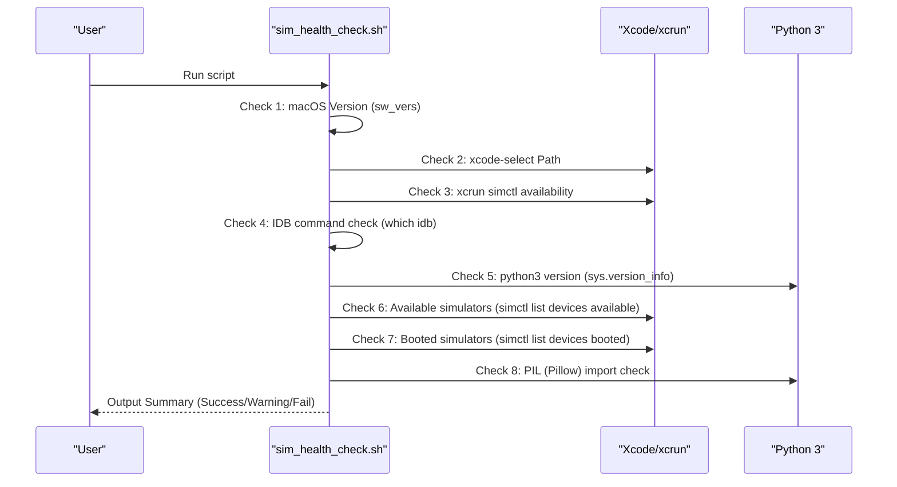

**Sources**: [ios-simulator-skill/skills/ios-simulator-skill/scripts/sim_health_check.sh:80-213]()

## Package Structure Validation

When packaging the skill for release or manual installation, the repository structure must contain key files to be recognized by Claude Code. [ios-simulator-skill/.github/workflows/release.yml:19-24]()

| Required Path | Purpose |
|---------------|---------|
| `ios-simulator-skill/SKILL.md` | Skill definition and entry point |
| `ios-simulator-skill/scripts/` | Directory containing all 22 executable scripts |

**Sources**: [.github/workflows/release.yml:19-24]()

---

# Page: Environment Verification

# Environment Verification

<details>
<summary>Relevant source files</summary>

The following files were used as context for generating this wiki page:

- [ios-simulator-skill/skills/ios-simulator-skill/scripts/sim_health_check.sh](ios-simulator-skill/skills/ios-simulator-skill/scripts/sim_health_check.sh)

</details>


This page documents the environment verification system provided by `sim_health_check.sh`, which validates that all required dependencies for `ios-simulator-skill` are properly installed and configured. This script performs comprehensive checks across system tools, simulators, and optional dependencies, providing actionable feedback for missing or misconfigured components.

For installing the initial prerequisites, see [2.1 Installation and Prerequisites](). For executing your first automation workflow after verification, see [2.3 Quick Start Tutorial]().

## Overview

The `sim_health_check.sh` script performs eight sequential checks to validate the complete iOS simulator testing environment. It verifies core Apple tools (`xcodebuild`, `simctl`), optional automation tools (`idb`), runtime requirements (Python 3.12+), and the availability of simulator devices. The script uses color-coded output with exit codes suitable for both interactive terminal use and CI/CD integration.

**Sources:** [ios-simulator-skill/skills/ios-simulator-skill/scripts/sim_health_check.sh:1-55]()

## Script Execution Model

The logic flow of `sim_health_check.sh` is designed to be exhaustive rather than failing fast, ensuring users receive a complete report of their environment state in one pass.

Title: Health Check Execution Flow
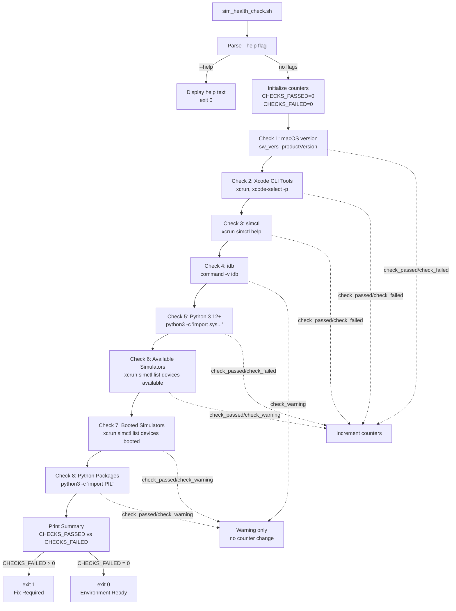

The script executes checks sequentially without early termination. All eight checks run regardless of individual failures, providing complete diagnostic information in a single execution. The final exit code is determined by whether any critical checks failed (macOS, Xcode, simctl, Python).

**Sources:** [ios-simulator-skill/skills/ios-simulator-skill/scripts/sim_health_check.sh:62-239]()

## Dependency Checks

The script performs eight distinct validation checks, each targeting a specific component of the iOS simulator testing environment.

### Check Categories

| Check # | Component | Status Type | Exit Impact | Command |
|---------|-----------|-------------|-------------|---------|
| 1 | macOS Version | Pass/Fail | Critical | `sw_vers -productVersion` |
| 2 | Xcode CLI Tools | Pass/Fail | Critical | `xcrun`, `xcode-select -p` |
| 3 | `simctl` Availability | Pass/Fail | Critical | `xcrun simctl help` |
| 4 | `idb` Installation | Pass/Warning | Non-critical | `command -v idb` |
| 5 | Python 3.12+ | Pass/Fail | Critical | `python3 -c "import sys..."` |
| 6 | Available Simulators | Pass/Warning | Non-critical | `xcrun simctl list devices available` |
| 7 | Booted Simulators | Pass/Warning | Non-critical | `xcrun simctl list devices booted` |
| 8 | Python Packages (Pillow) | Pass/Warning | Non-critical | `python3 -c "import PIL"` |

**Sources:** [ios-simulator-skill/skills/ios-simulator-skill/scripts/sim_health_check.sh:80-217]()

### Check Implementation Details

Title: Status Reporting Logic
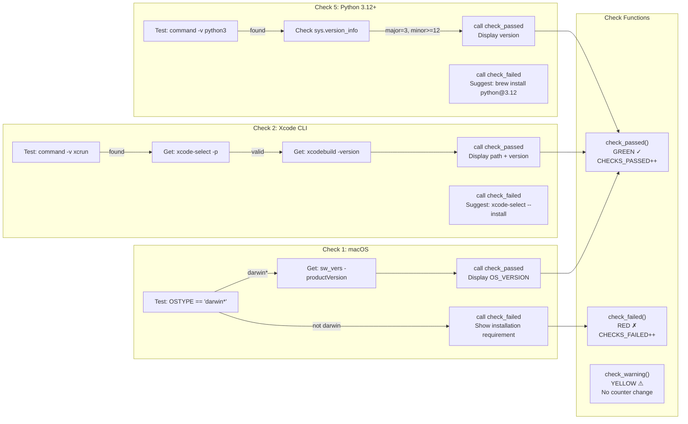

The three output functions ([ios-simulator-skill/skills/ios-simulator-skill/scripts/sim_health_check.sh:66-78]()) use color codes defined at the script header ([ios-simulator-skill/skills/ios-simulator-skill/scripts/sim_health_check.sh:13-17]()). Critical checks use `check_failed` which increments `CHECKS_FAILED`, causing the script to exit with code 1. Optional checks use `check_warning` to inform the user without failing the overall validation.

**Sources:** [ios-simulator-skill/skills/ios-simulator-skill/scripts/sim_health_check.sh:66-78](), [ios-simulator-skill/skills/ios-simulator-skill/scripts/sim_health_check.sh:80-152]()

### Simulator Device Discovery

Check 6 and Check 7 specifically target simulator availability and state by parsing `simctl` output:

Title: Simulator Discovery Data Flow
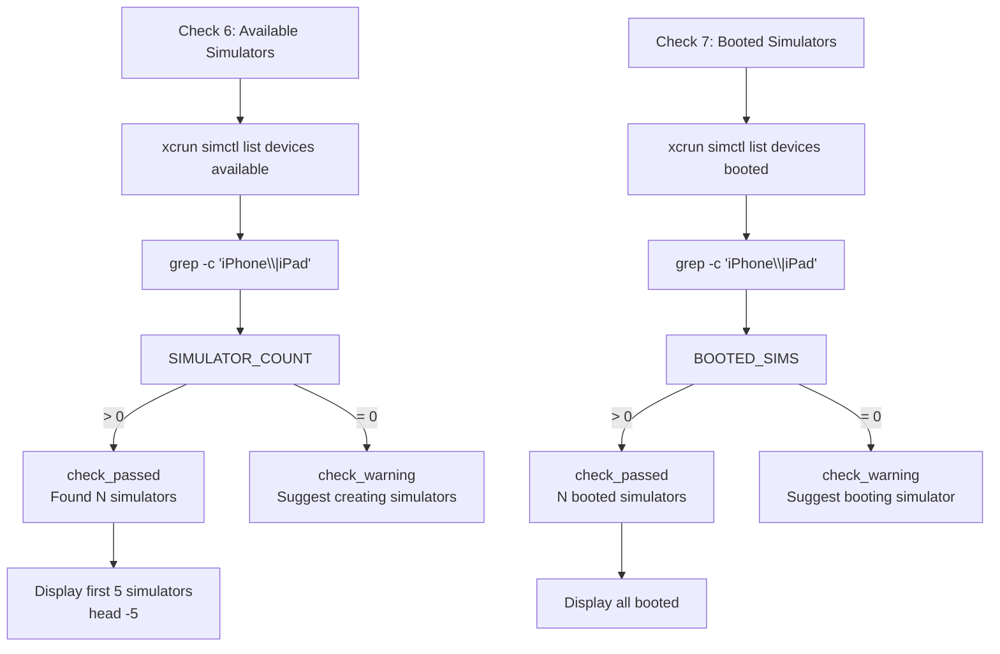

The script limits the display of available simulators to 5 devices ([ios-simulator-skill/skills/ios-simulator-skill/scripts/sim_health_check.sh:165]()) to prevent output overflow on systems with many installed runtimes. Booted simulators are always shown in full since there are typically few active devices ([ios-simulator-skill/skills/ios-simulator-skill/scripts/sim_health_check.sh:188]()).

**Sources:** [ios-simulator-skill/skills/ios-simulator-skill/scripts/sim_health_check.sh:154-200]()

## Usage

### Basic Invocation

```bash
bash scripts/sim_health_check.sh
```

The script requires no arguments for standard operation and automatically detects all environment components. The `--help` flag displays detailed usage information:

```bash
bash scripts/sim_health_check.sh --help
```

**Sources:** [ios-simulator-skill/skills/ios-simulator-skill/scripts/sim_health_check.sh:22-55]()

### Exit Codes

| Exit Code | Condition | Meaning |
|-----------|-----------|---------|
| 0 | `CHECKS_FAILED = 0` | All critical checks passed, environment ready |
| 1 | `CHECKS_FAILED > 0` | One or more critical checks failed, action required |

The exit code determination occurs in the summary section ([ios-simulator-skill/skills/ios-simulator-skill/scripts/sim_health_check.sh:225-239]()). The script continues executing all checks even after failures, providing complete diagnostic output before exiting.

**Sources:** [ios-simulator-skill/skills/ios-simulator-skill/scripts/sim_health_check.sh:225-239]()

## Output Interpretation

### Status Symbols

The script uses three distinct status indicators, implemented via the check functions:

| Symbol | Color | Function | Meaning | Impact |
|--------|-------|----------|---------|--------|
| ✓ | Green | `check_passed` | Component verified successfully | Increments `CHECKS_PASSED` |
| ✗ | Red | `check_failed` | Component missing or misconfigured | Increments `CHECKS_FAILED` |
| ⚠ | Yellow | `check_warning` | Optional component not found | No counter impact |

**Sources:** [ios-simulator-skill/skills/ios-simulator-skill/scripts/sim_health_check.sh:66-78]()

### Sample Output Structure

```
━━━━━━━━━━━━━━━━━━━━━━━━━━━━━━━━━━━━━━━━━━━━━━━━━━━━━
  iOS Simulator Testing - Environment Health Check
━━━━━━━━━━━━━━━━━━━━━━━━━━━━━━━━━━━━━━━━━━━━━━━━━━━━━

[1/8] Checking operating system...
✓ macOS detected (version 14.2)

[2/8] Checking Xcode Command Line Tools...
✓ Xcode Command Line Tools installed
       Path: /Applications/Xcode.app/Contents/Developer
       Version: Xcode 15.1

[3/8] Checking simctl (Simulator Control)...
✓ simctl is available

[4/8] Checking IDB (iOS Development Bridge)...
⚠ IDB not found in PATH
       IDB is optional but provides advanced UI automation
       Install: https://fbidb.io/docs/installation
       Recommended: brew tap facebook/fb && brew install idb-companion
```

Each check section follows the pattern: header with check number, test execution, status output, and actionable feedback for failures.

**Sources:** [ios-simulator-skill/skills/ios-simulator-skill/scripts/sim_health_check.sh:57-217]()

## Troubleshooting Common Issues

### Missing Xcode Command Line Tools

**Symptom:** Check 2 fails with "xcrun command not found" or "path not set".

**Resolution:**
```bash
xcode-select --install
```

The script suggests this exact command in the failure message ([ios-simulator-skill/skills/ios-simulator-skill/scripts/sim_health_check.sh:102-106]()).

### Incompatible Python Version

**Symptom:** Check 5 fails with "Python 3.12+ required".

**Resolution:**
```bash
brew install python@3.12
```

The script specifically checks for Python 3.12 or higher ([ios-simulator-skill/skills/ios-simulator-skill/scripts/sim_health_check.sh:141-142]()) and provides the upgrade command.

### IDB Not Installed

**Symptom:** Check 4 shows warning "IDB not found in PATH".

**Impact:** Navigation scripts will not function as they rely on IDB for semantic UI analysis.

**Resolution:**
```bash
brew tap facebook/fb
brew install idb-companion
```

The script notes that IDB is optional ([ios-simulator-skill/skills/ios-simulator-skill/scripts/sim_health_check.sh:130]()) but recommended for advanced UI automation.

### No Simulators Available

**Symptom:** Check 6 shows warning "No simulators found".

**Resolution:** Create a simulator using `simctl` or Xcode:
```bash
xcrun simctl create 'iPhone 15' 'iPhone 15'
```

The script suggests this command at [ios-simulator-skill/skills/ios-simulator-skill/scripts/sim_health_check.sh:171]().

### Missing Pillow Package

**Symptom:** Check 8 shows warning "Pillow (PIL) not installed".

**Impact:** Visual regression scripts (`visual_diff.py`) will not function.

**Resolution:**
```bash
pip3 install pillow
```

The script detects missing packages and suggests installation ([ios-simulator-skill/skills/ios-simulator-skill/scripts/sim_health_check.sh:208-213]()).

**Sources:** [ios-simulator-skill/skills/ios-simulator-skill/scripts/sim_health_check.sh:80-217]()

## Integration with Setup Workflow

Title: Setup and Verification Lifecycle
```mermaid
graph LR
    PREREQ["Prerequisites Installed<br/>macOS, Xcode, Python"]
    VERIFY["Run sim_health_check.sh"]
    
    CHECK_EXIT{"Exit Code?"}
    
    FIX["Fix Missing Dependencies<br/>Follow script suggestions"]
    
    READY["Environment Ready"]
    
    BOOT["Boot Simulator<br/>simctl_boot.py"]
    LAUNCH["Launch App<br/>app_launcher.py"]
    AUTOMATE["Begin Automation<br/>navigator.py, screen_mapper.py"]
    
    PREREQ --> VERIFY
    VERIFY --> CHECK_EXIT
    
    CHECK_EXIT -->|"1 (failure)"| FIX
    FIX --> VERIFY
    
    CHECK_EXIT -->|"0 (success)"| READY
    READY --> BOOT
    BOOT --> LAUNCH
    LAUNCH --> AUTOMATE
```

The health check serves as the gateway validation step in the setup workflow. It should be executed during initial setup, troubleshooting, or CI/CD environment provisioning.

**Sources:** [ios-simulator-skill/skills/ios-simulator-skill/scripts/sim_health_check.sh:1-240]()

---

# Page: Quick Start Tutorial

# Quick Start Tutorial

<details>
<summary>Relevant source files</summary>

The following files were used as context for generating this wiki page:

- [README.md](README.md)
- [ios-simulator-skill/skills/ios-simulator-skill/scripts/app_launcher.py](ios-simulator-skill/skills/ios-simulator-skill/scripts/app_launcher.py)
- [ios-simulator-skill/skills/ios-simulator-skill/scripts/screen_mapper.py](ios-simulator-skill/skills/ios-simulator-skill/scripts/screen_mapper.py)
- [ios-simulator-skill/skills/ios-simulator-skill/scripts/simctl_boot.py](ios-simulator-skill/skills/ios-simulator-skill/scripts/simctl_boot.py)

</details>


This page provides a hands-on walkthrough of the most common workflow with the `ios-simulator-skill`: booting a simulator, launching an app, analyzing the screen, and interacting with UI elements. By the end, you will understand the basic script execution pattern and how to navigate an iOS app using semantic element finding.

For installation instructions, see **2.1 Installation and Prerequisites**. For environment verification, see **2.2 Environment Verification**.

## Prerequisites Check

Before starting this tutorial, verify your environment is properly configured using the health check utility:

```bash
bash scripts/sim_health_check.sh
```

This script verifies the presence of macOS, Xcode Command Line Tools, `xcrun simctl`, Python 3, and optional dependencies like `idb` and `Pillow`.

**Sources:** [README.md:120-120](), [README.md:41-45]()

## Tutorial Overview: Login Flow Automation

This tutorial demonstrates a complete login flow automation:

1.  **Boot** an iOS simulator with readiness verification.
2.  **Launch** the target application.
3.  **Map** the screen to identify interactive elements.
4.  **Interact** by entering text and tapping buttons.

### Script Execution Flow

```mermaid
sequenceDiagram
    participant User as "Developer/AI Agent"
    participant Boot as "simctl_boot.py<br/>SimulatorBooter"
    participant Launch as "app_launcher.py<br/>AppLauncher"
    participant Map as "screen_mapper.py<br/>ScreenMapper"
    participant Nav as "navigator.py<br/>Navigator"
    participant Simctl as "xcrun simctl"
    participant IDB as "idb (Facebook IDB)"
    
    User->>Boot: "main() --name 'iPhone 16 Pro' --wait-ready"
    Boot->>Simctl: "xcrun simctl boot <UDID>"
    Boot->>Boot: "_wait_for_ready()"
    Boot->>Simctl: "spawn <UDID> launchctl list (polling)"
    Boot-->>User: "Device booted and ready"
    
    User->>Launch: "main() --launch com.example.app"
    Launch->>Simctl: "build_simctl_command('launch', udid, bundle_id)"
    Launch-->>User: "Launched com.example.app (PID: 1234)"
    
    User->>Map: "main() (no flags)"
    Map->>IDB: "get_accessibility_tree() (via common)"
    Map-->>User: "Screen: LoginView (45 elements, 7 interactive)"
    
    User->>Nav: "main() --find-type TextField --enter-text 'user@test.com'"
    Nav->>IDB: "idb ui describe-all (to find center)"
    Nav->>IDB: "idb ui tap <x> <y>"
    Nav->>IDB: "idb ui text 'user@test.com'"
    Nav-->>User: "Entered text in TextField"
    
    User->>Nav: "main() --find-text 'Login' --tap"
    Nav->>IDB: "idb ui tap <center_x> <center_y>"
    Nav-->>User: "Tapped Button 'Login'"
```

**Sources:** [ios-simulator-skill/skills/ios-simulator-skill/scripts/simctl_boot.py:35-127](), [ios-simulator-skill/skills/ios-simulator-skill/scripts/app_launcher.py:27-56](), [ios-simulator-skill/skills/ios-simulator-skill/scripts/screen_mapper.py:103-129](), [README.md:106-110]()

## Step-by-Step Walkthrough

### Step 1: Boot the Simulator

Boot a simulator by name. The `SimulatorBooter` class handles UDID resolution and polls for system readiness.

```bash
python scripts/simctl_boot.py --name "iPhone 16 Pro" --wait-ready
```

**Key Implementation Details:**
- **Resolution:** Uses `resolve_device_identifier()` from `common.device_utils` to map names to UDIDs [ios-simulator-skill/skills/ios-simulator-skill/scripts/simctl_boot.py:21-25]().
- **Readiness:** The `_wait_for_ready()` method polls `simctl spawn <udid> launchctl list` to ensure the sub-system is responsive [ios-simulator-skill/skills/ios-simulator-skill/scripts/simctl_boot.py:87-127]().
- **Batching:** Supports `boot_all()` and `boot_by_type()` for environment setup [ios-simulator-skill/skills/ios-simulator-skill/scripts/simctl_boot.py:130-175]().

### Step 2: Launch the App

Launch your application using its bundle identifier.

```bash
python scripts/app_launcher.py --launch com.example.MyApp
```

**Key Implementation Details:**
- **Tooling:** Wraps `xcrun simctl launch` via `build_simctl_command()` [ios-simulator-skill/skills/ios-simulator-skill/scripts/app_launcher.py:27-44]().
- **PID Capture:** Parses the standard output (e.g., `com.example.app: 1234`) to return the process ID of the launched app [ios-simulator-skill/skills/ios-simulator-skill/scripts/app_launcher.py:45-53]().
- **State Management:** Can also `terminate()`, `install()`, or `get_app_state()` [ios-simulator-skill/skills/ios-simulator-skill/scripts/app_launcher.py:57-198]().

### Step 3: Map the Screen

Analyze the current UI hierarchy. This script is the entry point for "Semantic Navigation."

```bash
python scripts/screen_mapper.py
```

**Expected Output (Default Mode):**
```
Screen: LoginViewController (45 elements, 7 interactive)
Buttons: "Login", "Cancel", "Forgot Password"
TextFields: 2 (0 filled)
```

**Key Implementation Details:**
- **Data Source:** Queries the accessibility tree via `idb` to identify elements by `AXLabel`, `AXValue`, and `AXUniqueId` [ios-simulator-skill/skills/ios-simulator-skill/scripts/screen_mapper.py:40-44]().
- **Efficiency:** Achieves ~97.5% token reduction by summarizing the tree into a few lines instead of raw JSON [README.md:85-89]().
- **Categorization:** Filters for `INTERACTIVE_TYPES` such as `Button`, `TextField`, and `NavigationBar` [ios-simulator-skill/skills/ios-simulator-skill/scripts/screen_mapper.py:75-88]().

### Step 4: Enter Text and Tap

Use `navigator.py` to interact with elements by their semantic properties.

```bash
# 1. Enter Email
python scripts/navigator.py --find-type TextField --enter-text "user@example.com"

# 2. Tap Login Button
python scripts/navigator.py --find-text "Login" --tap
```

**Key Implementation Details:**
- **Semantic Finding:** Locates elements using fuzzy text matching or specific types [README.md:107-107]().
- **Coordinate Transformation:** Automatically calculates the center point of an element's frame for tapping, avoiding fragile pixel coordinates [README.md:71-79]().
- **Interaction:** Uses `idb` for reliable text injection and touch events [README.md:107-107]().

**Sources:** [ios-simulator-skill/skills/ios-simulator-skill/scripts/app_launcher.py:20-218](), [ios-simulator-skill/skills/ios-simulator-skill/scripts/simctl_boot.py:28-175](), [ios-simulator-skill/skills/ios-simulator-skill/scripts/screen_mapper.py:55-175](), [README.md:67-110]()

## Script Interaction Pattern

The following diagram illustrates how the tutorial scripts bridge high-level intent to the underlying system tools and code entities.

```mermaid
graph TD
    subgraph "Natural Language Intent"
        IntentBoot["'Boot the phone'"]
        IntentLaunch["'Open the app'"]
        IntentInteract["'Type my email'"]
    end

    subgraph "Code Entity Space (Scripts)"
        BootScript["simctl_boot.py<br/>class SimulatorBooter"]
        LaunchScript["app_launcher.py<br/>class AppLauncher"]
        NavScript["navigator.py<br/>class Navigator"]
        MapScript["screen_mapper.py<br/>class ScreenMapper"]
    end

    subgraph "System Tool Space"
        Simctl["xcrun simctl"]
        IDB["idb companion"]
        AXTree["Accessibility Tree<br/>(AXLabel, AXUniqueId)"]
    end

    IntentBoot --> BootScript
    IntentLaunch --> LaunchScript
    IntentInteract --> NavScript

    BootScript -- "executes" --> Simctl
    LaunchScript -- "executes" --> Simctl
    MapScript -- "queries" --> AXTree
    NavScript -- "queries" --> AXTree
    NavScript -- "executes" --> IDB

    AXTree -- "provides data via idb" --> IDB
```

**Sources:** [README.md:9-12](), [ios-simulator-skill/skills/ios-simulator-skill/scripts/app_launcher.py:38-44](), [ios-simulator-skill/skills/ios-simulator-skill/scripts/simctl_boot.py:62-63](), [ios-simulator-skill/skills/ios-simulator-skill/scripts/screen_mapper.py:103-109]()

## Understanding Output Modes

All scripts follow a consistent output strategy to balance human readability with AI token efficiency.

| Mode | Flag | Purpose | Token Impact |
| :--- | :--- | :--- | :--- |
| **Default** | N/A | High-level summary for AI agents | 5-10 tokens (3-5 lines) |
| **Verbose** | `--verbose` | Detailed debugging/element info | 400+ tokens (50+ lines) |
| **JSON** | `--json` | Machine-readable data for scripts | 20-30 tokens (JSON object) |

**Sources:** [README.md:83-93](), [ios-simulator-skill/skills/ios-simulator-skill/scripts/simctl_boot.py:210-213](), [ios-simulator-skill/skills/ios-simulator-skill/scripts/screen_mapper.py:29-30]()

## Troubleshooting the Tutorial

If you encounter issues during this quick start:

1.  **Device not found:** Ensure the name matches `xcrun simctl list devices`. The skill uses `resolve_device_identifier` to find simulators [ios-simulator-skill/skills/ios-simulator-skill/scripts/simctl_boot.py:21-25]().
2.  **App won't launch:** Ensure the simulator is fully booted (`--wait-ready`) before launching [ios-simulator-skill/skills/ios-simulator-skill/scripts/simctl_boot.py:74-80]().
3.  **Element not found:** Use `python scripts/screen_mapper.py --verbose` to inspect the full accessibility tree if a semantic find fails [ios-simulator-skill/skills/ios-simulator-skill/scripts/screen_mapper.py:23-24]().
4.  **Health Check:** Re-run `bash scripts/sim_health_check.sh` to ensure all dependencies like `idb` are correctly installed [README.md:120-120]().

**Sources:** [ios-simulator-skill/skills/ios-simulator-skill/scripts/simctl_boot.py:35-127](), [README.md:120-120]()

---

# Page: Core Concepts

# Core Concepts

<details>
<summary>Relevant source files</summary>

The following files were used as context for generating this wiki page:

- [CLAUDE.md](CLAUDE.md)
- [README.md](README.md)

</details>


This document explains the fundamental architectural concepts and design patterns that underpin the `ios-simulator-skill` system. These concepts apply consistently across all 22 scripts and shared utilities.

For detailed implementation of specific script categories, see [Script Categories Overview](#4). For contributor guidance on applying these patterns, see [Architecture Patterns and Best Practices](#12.4).

---

## Semantic Navigation via Accessibility APIs

The skill uses **semantic navigation** through iOS accessibility APIs rather than pixel-based coordinate systems. This architectural decision provides resilience against UI changes, screen size variations, and dynamic layouts.

### Traditional Pixel-Based Approach (Fragile)

```bash
# Brittle - breaks when UI changes
idb ui tap 320 400
```

### Semantic Approach (Robust)

```bash
# Resilient - finds by meaning
python scripts/navigator.py --find-text "Login" --tap
```

**Diagram: Semantic Navigation Flow**

```mermaid
graph TB
    subgraph "Natural Language Space"
        [REQ] --> "Find and tap 'Login' button"
    end
    
    subgraph "Code Entity Space (navigator.py)"
        [PARSE] --> "ArgumentParser --find-text 'Login' --tap"
        [NAV_CLASS] --> "ElementNavigator class __init__"
        [FIND] --> "find_element() search_term='Login'"
    end
    
    subgraph "AccessibilityTreeQuerying"
        [IDB_CMD] --> "subprocess.run() idb ui describe-all --json"
        [JSON_PARSE] --> "json.loads(stdout)"
        [TREE] --> "elements: List[Dict] type, label, frame"
    end
    
    subgraph "ElementMatching"
        [FILTER] --> "_filter_elements() fuzzy text matching"
        [MATCH] --> "matched_element: Dict {'type': 'Button', 'label': 'Login'}"
    end
    
    subgraph "CoordinateCalculation"
        [FRAME] --> "frame: Dict {'x': 50, 'y': 400, 'w': 100, 'h': 44}"
        [CENTER] --> "calculate_center() x=100, y=422"
    end
    
    subgraph "ActionExecution"
        [TAP_CMD] --> "subprocess.run() idb ui tap 100 422"
        [SUCCESS] --> "Return: (True, 'Tapped Login')"
    end
    
    [REQ] --> [PARSE]
    [PARSE] --> [NAV_CLASS]
    [NAV_CLASS] --> [FIND]
    [FIND] --> [IDB_CMD]
    [IDB_CMD] --> [JSON_PARSE]
    [JSON_PARSE] --> [TREE]
    [TREE] --> [FILTER]
    [FILTER] --> [MATCH]
    [MATCH] --> [FRAME]
    [FRAME] --> [CENTER]
    [CENTER] --> [TAP_CMD]
    [TAP_CMD] --> [SUCCESS]
```

Sources: [README.md:67-79](), [ios-simulator-skill/skills/ios-simulator-skill/scripts/navigator.py](), [CLAUDE.md:203-209]()

The system performs **fuzzy matching** by default to handle minor text variations. For detailed navigation capabilities, see [Semantic Navigation via Accessibility APIs](#3.1).

---

## External Tools: simctl and idb

The skill wraps two primary command-line tools: Apple's `xcrun simctl` and Facebook's `idb`. Scripts abstract these tools behind semantic interfaces.

**Diagram: Tool Selection and Invocation**

```mermaid
graph LR
    subgraph "ScriptLayer"
        [SCRIPT] --> "Any Script (e.g., simctl_boot.py)"
        [CHECK] --> "check_idb_available() from idb_utils"
    end
    
    subgraph "ToolDecisionLogic"
        [IDB_CHECK] --> "IDB installed? shutil.which('idb')"
        [FEATURE_REQ] --> "Requires interactive UI features?"
    end
    
    subgraph "AppleTools (simctl)"
        [SIMCTL] --> "xcrun simctl subprocess.run()"
        [SIMCTL_OPS] --> "boot, shutdown, create, delete, privacy, status_bar"
    end
    
    subgraph "FacebookIDB (idb)"
        [IDB] --> "idb subprocess.run()"
        [IDB_OPS] --> "ui describe-all, ui tap, ui swipe, ui text"
    end
    
    [SCRIPT] --> [CHECK]
    [CHECK] --> [IDB_CHECK]
    [IDB_CHECK] -->|No| [SIMCTL]
    [IDB_CHECK] -->|Yes| [FEATURE_REQ]
    [FEATURE_REQ] -->|No| [SIMCTL]
    [FEATURE_REQ] -->|Yes| [IDB]
    
    [SIMCTL] --> [SIMCTL_OPS]
    [IDB] --> [IDB_OPS]
```

Sources: [CLAUDE.md:7-12](), [ios-simulator-skill/skills/ios-simulator-skill/scripts/common/idb_utils.py]()

### Tool Responsibilities
- **simctl**: Used for lifecycle management (boot/shutdown), simulator creation, and system-level settings like privacy permissions or status bar overrides. [ios-simulator-skill/skills/ios-simulator-skill/scripts/simctl_boot.py](), [ios-simulator-skill/skills/ios-simulator-skill/scripts/privacy_manager.py]().
- **idb**: Used for UI-level interactions including querying the accessibility tree and simulating gestures. [ios-simulator-skill/skills/ios-simulator-skill/scripts/navigator.py](), [ios-simulator-skill/skills/ios-simulator-skill/scripts/gesture.py]().

For detailed tool usage, see [External Tools: simctl and idb](#3.2).

---

## Progressive Disclosure and Token Efficiency

The skill achieves a **96% token reduction** compared to raw tool output through a progressive disclosure pattern. Scripts return minimal summaries by default, caching full details for later retrieval.

### ProgressiveCache System
The `ProgressiveCache` class at [ios-simulator-skill/skills/ios-simulator-skill/scripts/common/cache_utils.py:162-163]() implements TTL-based caching. When a command (like a build) generates large output, the skill saves the full log to disk and provides a `cache_id`.

```python
# Default Summary Output (Low Token Cost)
"Build: SUCCESS (0 errors, 3 warnings) [xcresult-20251018-143052]"
```

For detailed metrics and cache retrieval flags, see [Progressive Disclosure and Token Efficiency](#3.3).

Sources: [ios-simulator-skill/skills/ios-simulator-skill/scripts/common/cache_utils.py](), [CLAUDE.md:174-182](), [README.md:49-65]()

---

## Output Modes and Formatting

All scripts support three output modes optimized for different consumers: AI agents, human developers, and CI/CD pipelines.

| Mode | Flag | Purpose | Token Impact |
|------|------|---------|--------------|
| **Default** | (none) | Minimal summary for AI agents | 5-10 tokens |
| **Verbose** | `--verbose` | Full details for debugging | 400+ tokens |
| **JSON** | `--json` | Machine-parseable for automation | 20-30 tokens |

Scripts implement this using a consistent `execute()` method that returns a `(success, message)` tuple. [CLAUDE.md:66-68]().

For formatting examples, see [Output Modes and Formatting](#3.4).

Sources: [CLAUDE.md:90-105](), [ios-simulator-skill/skills/ios-simulator-skill/scripts/simctl_boot.py]()

---

## Device Targeting and Auto-Detection

Scripts automatically detect the target simulator, eliminating the need to repeatedly provide UDIDs.

- **Auto-UDID Detection**: If no UDID is provided, `resolve_device_identifier()` in [ios-simulator-skill/skills/ios-simulator-skill/scripts/common/device_utils.py:151-152]() identifies the single booted simulator.
- **Fuzzy Name Resolution**: Users can provide names like "iPhone 16" instead of full UDIDs.
- **Batch Operations**: Many scripts support `--all` or `--type` (e.g., `python scripts/simctl_boot.py --type iPhone`). [CLAUDE.md:107-114]().

For logic details, see [Device Targeting and Auto-Detection](#3.5).

Sources: [ios-simulator-skill/skills/ios-simulator-skill/scripts/common/device_utils.py](), [CLAUDE.md:78-88](), [README.md:136-137]()

---

## Class-Based Script Architecture

All scripts follow a standardized class-based design pattern to ensure testability and reusability.

1. **Initialization**: The class `__init__` handles configuration and device resolution.
2. **Execution**: The `execute()` method contains the core logic and returns a `(bool, str)` tuple representing success and the formatted message. [CLAUDE.md:66-68]().
3. **Main**: The `main()` function handles CLI argument parsing and process exit codes. [CLAUDE.md:70-76]().

```python
# Standard Pattern [CLAUDE.md:57-76]
class DeviceManager:
    def __init__(self, udid: str | None = None):
        self.udid = udid

    def execute(self, **kwargs) -> tuple[bool, str]:
        # Return (success, message) tuple
        pass
```

For architectural standards, see [Class-Based Script Architecture](#3.6).

Sources: [CLAUDE.md:57-76](), [ios-simulator-skill/skills/ios-simulator-skill/scripts/simctl_boot.py]()

---

# Page: Semantic Navigation via Accessibility APIs

# Semantic Navigation via Accessibility APIs

<details>
<summary>Relevant source files</summary>

The following files were used as context for generating this wiki page:

- [CLAUDE.md](CLAUDE.md)
- [ios-simulator-skill/skills/ios-simulator-skill/scripts/navigator.py](ios-simulator-skill/skills/ios-simulator-skill/scripts/navigator.py)
- [ios-simulator-skill/skills/ios-simulator-skill/scripts/screen_mapper.py](ios-simulator-skill/skills/ios-simulator-skill/scripts/screen_mapper.py)

</details>


**Purpose**: This page explains how the ios-simulator-skill uses iOS accessibility APIs to navigate apps by semantic meaning (text, type, accessibility ID) rather than fragile pixel coordinates. This approach provides robust automation that survives UI redesigns and works across different screen sizes.

**Scope**: Covers the accessibility tree structure, element discovery, coordinate transformation, and the `Navigator` class implementation. For UI discovery and analysis, see `screen_mapper.py`. For gesture-based interaction beyond tapping, see `gesture.py`.

---

## Accessibility-First Philosophy

The skill prioritizes **semantic stability over visual stability**. Traditional automation tools use hardcoded pixel coordinates that break when UI layouts change. This system finds elements by their accessibility properties (label, type, identifier), which remain stable across:

- Screen size changes (iPhone vs iPad)
- UI redesigns and layout shifts
- Different OS versions
- Localization changes (when using identifiers)

The accessibility tree is iOS's structured representation of the UI, designed for assistive technologies. It provides reliable, hierarchical element data that the skill leverages for automation.

**Sources**: [ios-simulator-skill/skills/ios-simulator-skill/scripts/navigator.py:42-47](), [ios-simulator-skill/skills/ios-simulator-skill/scripts/screen_mapper.py:67-71]()

---

## Accessibility Tree Structure

### Diagram: iOS Accessibility Tree Hierarchy

```mermaid
graph TB
    subgraph "IOSApp [iOS App UI]"
        Screen["Screen Root<br/>type: Application"]
    end
    
    subgraph "IDBOutput [idb ui describe-all --json --nested output]"
        Root["Root Node"]
        Nav["NavigationController<br/>type: NavigationBar"]
        View["LoginViewController<br/>type: View"]
        
        Button1["Button<br/>AXLabel: Login<br/>AXUniqueId: loginBtn<br/>frame: x:120 y:400 w:175 h:50"]
        
        TextField1["TextField<br/>AXLabel: Email<br/>AXValue: empty<br/>frame: x:50 y:200 w:300 h:44"]
        
        TextField2["SecureTextField<br/>AXLabel: Password<br/>AXValue: empty<br/>frame: x:50 y:260 w:300 h:44"]
        
        Button2["Button<br/>AXLabel: Forgot Password<br/>frame: x:120 y:480 w:175 h:30"]
    end
    
    subgraph "ElementDataclass [Element dataclass (navigator.py:73-96)]"
        ElemType["type: Button"]
        ElemLabel["label: Login"]
        ElemId["identifier: loginBtn"]
        ElemFrame["frame: dict[str, float]"]
        ElemCenter["center property<br/>returns (207, 425)"]
    end
    
    Screen --> Root
    Root --> Nav
    Root --> View
    View --> TextField1
    View --> TextField2
    View --> Button1
    View --> Button2
    
    Button1 -.->|"_flatten_tree()"| ElemType
    Button1 -.->|"parsed"| ElemLabel
    Button1 -.->|"parsed"| ElemId
    Button1 -.->|"parsed"| ElemFrame
    ElemFrame -.->|"@property"| ElemCenter
```

The accessibility tree is retrieved via `idb ui describe-all --json --nested`, which returns a deeply nested JSON structure. Each node contains:

| Property | Description | Usage |
|----------|-------------|-------|
| `type` | Element type (Button, TextField, etc.) | Type-based matching |
| `AXLabel` | Accessibility label text | Primary text matching |
| `AXValue` | Current value (for inputs) | Secondary text matching |
| `AXUniqueId` | Accessibility identifier | Precise matching |
| `frame` | `{x, y, width, height}` in points | Coordinate calculation |
| `traits` | Array of traits (e.g., `["Button"]`) | Capability detection |
| `enabled` | Boolean enablement state | Skip disabled elements |
| `children` | Nested child elements | Tree traversal |

**Sources**: [ios-simulator-skill/skills/ios-simulator-skill/scripts/navigator.py:48-55](), [ios-simulator-skill/skills/ios-simulator-skill/scripts/navigator.py:73-96](), [ios-simulator-skill/skills/ios-simulator-skill/scripts/screen_mapper.py:39-44]()

---

## Navigator Class Architecture

### Diagram: Navigator Class and Element Discovery Flow

```mermaid
graph TB
    subgraph "NavigatorClass [Navigator class (navigator.py:98-298)]"
        NavInit["__init__(udid: str | None)"]
        TreeCache["_tree_cache: dict | None"]
        
        GetTree["get_accessibility_tree(force_refresh: bool)<br/>→ dict"]
        Flatten["_flatten_tree(node: dict, elements)<br/>→ list[Element]"]
        ListElem["list_elements(force_refresh: bool)<br/>→ list[Element]"]
        FindElem["find_element(text, element_type,<br/>identifier, index, fuzzy)<br/>→ Element | None"]
        
        Tap["tap(element: Element)<br/>→ bool"]
        TapAt["tap_at(x: int, y: int)<br/>→ bool"]
        EnterText["enter_text(text: str, element)<br/>→ bool"]
        
        FindAndTap["find_and_tap(...)<br/>→ (bool, str)"]
        FindAndEnter["find_and_enter_text(...)<br/>→ (bool, str)"]
    end
    
    subgraph "ElementDC [Element dataclass (navigator.py:73-96)]"
        ElemDC["@dataclass Element"]
        ElemProps["type: str<br/>label: str | None<br/>value: str | None<br/>identifier: str | None<br/>frame: dict[str, float]<br/>traits: list[str]<br/>enabled: bool"]
        ElemCenter["@property center<br/>→ tuple[int, int]"]
        ElemDesc["@property description<br/>→ str"]
    end
    
    subgraph "IDBCommands [IDB commands (subprocess calls)]"
        IDB["idb ui describe-all<br/>--json --nested"]
        IDBTap["idb ui tap x y"]
        IDBText["idb ui text string"]
    end
    
    NavInit --> TreeCache
    NavInit --> GetTree
    GetTree --> Flatten
    Flatten --> ListElem
    ListElem --> FindElem
    FindElem --> Tap
    Tap --> TapAt
    FindElem --> EnterText
    FindElem --> FindAndTap
    FindElem --> FindAndEnter
    
    GetTree -.->|"subprocess.run()"| IDB
    IDB -.->|"stores JSON"| TreeCache
    
    Flatten -.->|"creates instances"| ElemDC
    ElemDC --> ElemProps
    ElemDC --> ElemCenter
    ElemDC --> ElemDesc
    
    Tap -.->|"element.center"| ElemCenter
    Tap -.->|"delegates"| TapAt
    TapAt -.->|"subprocess.run()"| IDBTap
    
    EnterText -.->|"subprocess.run()"| IDBText
    
    FindAndTap --> FindElem
    FindAndTap --> Tap
    
    FindAndEnter --> FindElem
    FindAndEnter --> EnterText
```

The `Navigator` class [ios-simulator-skill/skills/ios-simulator-skill/scripts/navigator.py:98-298]() implements the core semantic navigation logic:

**State Management**:
- `_tree_cache` [ios-simulator-skill/skills/ios-simulator-skill/scripts/navigator.py:104]() caches the accessibility tree to avoid redundant IDB calls.
- `get_accessibility_tree(force_refresh)` [ios-simulator-skill/skills/ios-simulator-skill/scripts/navigator.py:106-113]() provides cached or fresh tree data by calling the shared utility `get_accessibility_tree`.

**Element Discovery**:
- `_flatten_tree()` [ios-simulator-skill/skills/ios-simulator-skill/scripts/navigator.py:115-137]() recursively transforms nested JSON into flat `list[Element]`, extracting labels from `AXLabel`, `AXValue`, and `AXUniqueId`.
- `list_elements()` [ios-simulator-skill/skills/ios-simulator-skill/scripts/navigator.py:139-142]() exposes all elements for analysis.
- `find_element()` [ios-simulator-skill/skills/ios-simulator-skill/scripts/navigator.py:144-197]() implements multi-criteria matching including fuzzy text search.

**Interaction Primitives**:
- `tap(element)` [ios-simulator-skill/skills/ios-simulator-skill/scripts/navigator.py:199-202]() taps element center point.
- `tap_at(x, y)` [ios-simulator-skill/skills/ios-simulator-skill/scripts/navigator.py:204-214]() executes coordinate-based tap using `idb ui tap`.
- `enter_text(text, element)` [ios-simulator-skill/skills/ios-simulator-skill/scripts/navigator.py:216-245]() types text using `idb ui text`, optionally after tapping the target element.

**Convenience Methods**:
- `find_and_tap()` [ios-simulator-skill/skills/ios-simulator-skill/scripts/navigator.py:247-274]() combines find + tap with error reporting.
- `find_and_enter_text()` [ios-simulator-skill/skills/ios-simulator-skill/scripts/navigator.py:276-297]() combines find + text entry.

**Sources**: [ios-simulator-skill/skills/ios-simulator-skill/scripts/navigator.py:98-298]()

---

## Element Matching Strategies

### Diagram: Element Matching Decision Tree

```mermaid
graph TB
    Start["find_element(text, element_type,<br/>identifier, index, fuzzy)<br/>navigator.py:144-197"]
    
    GetElems["tree = get_accessibility_tree()<br/>elements = _flatten_tree(tree)"]
    
    LoopStart["for elem in elements"]
    
    CheckEnabled{"elem.enabled?<br/>line 172"}
    CheckType{"element_type matches<br/>elem.type?<br/>line 176"}
    CheckId{"identifier matches<br/>elem.identifier?<br/>line 180"}
    CheckText{"text matches in<br/>label or value?<br/>line 184-190"}
    
    AddMatch["matches.append(elem)"]
    LoopNext["continue"]
    
    SelectIndex["if index < len(matches):<br/>return matches[index]"]
    ReturnNone["return None"]
    
    Start --> GetElems
    GetElems --> LoopStart
    LoopStart --> CheckEnabled
    
    CheckEnabled -->|"False"| LoopNext
    CheckEnabled -->|"True"| CheckType
    
    CheckType -->|"None"| CheckId
    CheckType -->|"mismatch"| LoopNext
    CheckType -->|"match"| CheckId
    
    CheckId -->|"None"| CheckText
    CheckId -->|"mismatch"| LoopNext
    CheckId -->|"match"| CheckText
    
    CheckText -->|"None"| AddMatch
    CheckText -->|"no match"| LoopNext
    CheckText -->|"fuzzy: text.lower() in elem_text.lower()"| AddMatch
    CheckText -->|"exact: text in (label, value)"| AddMatch
    
    AddMatch --> LoopNext
    LoopNext --> LoopStart
    
    LoopStart -.->|"loop complete"| SelectIndex
    SelectIndex -->|"index valid"| ReturnElem["return Element"]
    SelectIndex -->|"index invalid"| ReturnNone
```

The matching algorithm [ios-simulator-skill/skills/ios-simulator-skill/scripts/navigator.py:164-197]() applies filters sequentially:

**Filter 1: Enabled State**
```python
if not elem.enabled:
    continue
```
Disabled elements are skipped automatically to prevent interaction errors [ios-simulator-skill/skills/ios-simulator-skill/scripts/navigator.py:172-173]().

**Filter 2: Element Type** (optional)
```python
if element_type and elem.type != element_type:
    continue
```
Exact match against `type` field (e.g., `"Button"`, `"TextField"`) [ios-simulator-skill/skills/ios-simulator-skill/scripts/navigator.py:176-177]().

**Filter 3: Accessibility Identifier** (optional)
```python
if identifier and elem.identifier != identifier:
    continue
```
Exact match against `AXUniqueId` for precise targeting [ios-simulator-skill/skills/ios-simulator-skill/scripts/navigator.py:180-181]().

**Filter 4: Text Matching** (optional)
```python
if text:
    elem_text = (elem.label or "") + " " + (elem.value or "")
    if fuzzy:
        if text.lower() not in elem_text.lower():
            continue
    elif text not in (elem.label, elem.value):
        continue
```
- **Fuzzy mode** (default): Case-insensitive substring match in label OR value [ios-simulator-skill/skills/ios-simulator-skill/scripts/navigator.py:187-188]().
- **Exact mode**: Precise equality check against label OR value [ios-simulator-skill/skills/ios-simulator-skill/scripts/navigator.py:189-190]().

**Index Selection**
```python
if matches and index < len(matches):
    return matches[index]
```
Returns the Nth matching element (0-based indexing) for form traversal [ios-simulator-skill/skills/ios-simulator-skill/scripts/navigator.py:194-195]().

**Sources**: [ios-simulator-skill/skills/ios-simulator-skill/scripts/navigator.py:144-197]()

---

## Coordinate Transformation

### Diagram: From Semantic Data to Tap Coordinates

```mermaid
graph LR
    subgraph "TreeData [Accessibility Tree (JSON)]"
        Frame["frame: dict<br/>x: 120<br/>y: 400<br/>width: 175<br/>height: 50"]
    end
    
    subgraph "CenterProp [Element.center (navigator.py:85-89)]"
        CalcX["x = int(frame[x] + frame[width]/2)<br/>= int(120 + 87.5) = 207"]
        CalcY["y = int(frame[y] + frame[height]/2)<br/>= int(400 + 25) = 425"]
        Center["return (207, 425)"]
    end
    
    subgraph "TapMethod [tap_at() method (navigator.py:204-214)]"
        Cmd["subprocess.run([idb, ui, tap,<br/>str(207), str(425), --udid, udid])"]
    end
    
    subgraph "SimInteraction [Simulator]"
        Touch["Touch at (207, 425)<br/>in point coordinates"]
    end
    
    Frame --> CalcX
    Frame --> CalcY
    CalcX --> Center
    CalcY --> Center
    Center --> Cmd
    Cmd --> Touch
```

The `Element.center` property [ios-simulator-skill/skills/ios-simulator-skill/scripts/navigator.py:85-89]() calculates tap coordinates:

```python
@property
def center(self) -> tuple[int, int]:
    """Calculate center point for tapping."""
    x = int(self.frame["x"] + self.frame["width"] / 2)
    y = int(self.frame["y"] + self.frame["height"] / 2)
    return (x, y)
```

**Coordinate System**: iOS uses points (not pixels) in a top-left origin coordinate system. The frame dimensions come directly from the accessibility tree, ensuring accuracy across densities and device sizes.

**Tap Execution**: The `tap()` method [ios-simulator-skill/skills/ios-simulator-skill/scripts/navigator.py:199-214]() uses these coordinates to call `idb ui tap`.

**Sources**: [ios-simulator-skill/skills/ios-simulator-skill/scripts/navigator.py:85-89](), [ios-simulator-skill/skills/ios-simulator-skill/scripts/navigator.py:199-214]()

---

## Semantic vs Pixel-Based Automation

### Comparison Table

| Aspect | Pixel-Based (Traditional) | Semantic (This Skill) |
|--------|---------------------------|----------------------|
| **Element Finding** | `idb ui tap 320 400` | `--find-text "Login" --tap` |
| **Coordinate Source** | Hardcoded by developer | Calculated from frame geometry |
| **Screen Size** | Breaks on iPhone vs iPad | Works across all devices |
| **UI Redesign** | Breaks on layout changes | Survives if label/type stable |
| **Maintainability** | Manual coordinate updates | Self-healing via accessibility |
| **Readability** | `tap 320 400` (opaque) | `--find-text "Submit"` (clear intent) |

### Example: Login Flow

**Traditional Approach** (fragile):
```bash
idb ui tap 200 300  # Tap email field
idb ui text "user@example.com"
idb ui tap 200 460  # Tap login button
```

**Semantic Approach** (robust):
```bash
python scripts/navigator.py --find-type TextField --index 0 --enter-text "user@example.com"
python scripts/navigator.py --find-text "Login" --tap
```

**Sources**: [ios-simulator-skill/skills/ios-simulator-skill/scripts/navigator.py:42-47](), [ios-simulator-skill/skills/ios-simulator-skill/scripts/navigator.py:21-35]()

---

## Tree Caching Strategy

The `Navigator` class caches the accessibility tree to minimize IDB calls:

```python
def get_accessibility_tree(self, force_refresh: bool = False) -> dict:
    """Get accessibility tree (cached for efficiency)."""
    if self._tree_cache and not force_refresh:
        return self._tree_cache

    # Delegate to shared utility
    self._tree_cache = get_accessibility_tree(self.udid, nested=True)
    return self._tree_cache
```

**Cache Scope**: Per-instance lifetime. A new `Navigator()` instance starts with a `None` cache [ios-simulator-skill/skills/ios-simulator-skill/scripts/navigator.py:101-104]().

**Refresh Trigger**: Pass `force_refresh=True` to re-fetch from IDB via the shared `get_accessibility_tree` utility [ios-simulator-skill/skills/ios-simulator-skill/scripts/navigator.py:106-113]().

**Sources**: [ios-simulator-skill/skills/ios-simulator-skill/scripts/navigator.py:101-113]()

---

## IDB Integration Points

The navigator delegates low-level simulator operations to IDB (iOS Device Bridge):

- **Accessibility Tree Retrieval**: `idb ui describe-all --json --nested` [ios-simulator-skill/skills/ios-simulator-skill/scripts/navigator.py:49-54]().
- **Tap Execution**: `idb ui tap [x] [y]` [ios-simulator-skill/skills/ios-simulator-skill/scripts/navigator.py:204-214]().
- **Text Entry**: `idb ui text [string]` [ios-simulator-skill/skills/ios-simulator-skill/scripts/navigator.py:216-245]().

**Sources**: [ios-simulator-skill/skills/ios-simulator-skill/scripts/navigator.py:204-245]()

---

# Page: External Tools: simctl and idb

# External Tools: simctl and idb

<details>
<summary>Relevant source files</summary>

The following files were used as context for generating this wiki page:

- [README.md](README.md)
- [ios-simulator-skill/skills/ios-simulator-skill/scripts/common/idb_utils.py](ios-simulator-skill/skills/ios-simulator-skill/scripts/common/idb_utils.py)
- [references/idb_quick.md](references/idb_quick.md)
- [references/simctl_quick.md](references/simctl_quick.md)

</details>


## Purpose and Scope

This page describes the two primary external command-line tools that `ios-simulator-skill` wraps: Apple's `xcrun simctl` and Facebook's `idb` (iOS Device Bridge). It explains what each tool provides, which scripts use them, the command patterns employed, and how the skill mediates interactions to provide semantic, token-efficient interfaces.

For information about how scripts use these tools to implement semantic navigation, see [3.1 Semantic Navigation via Accessibility APIs](). For information about the shared utilities that standardize tool interactions, see [10 Shared Utilities]().

---

## Tool Ecosystem and Script Architecture

The `ios-simulator-skill` relies on two distinct tool ecosystems, each serving specific purposes. Apple's tools handle the foundational lifecycle and build processes, while Facebook's `idb` provides the deep introspection required for AI-driven interaction.

**Diagram: Tool Ecosystem and Script Architecture**

```mermaid
graph TB
    subgraph AppleEcosystem["Apple Ecosystem"]
        SIMCTL["xcrun simctl"]
        XCODEBUILD["xcodebuild"]
        XCRESULT["xcresulttool"]
        
        SIMCTL_CAP["Device Lifecycle:<br/>- xcrun simctl boot<br/>- xcrun simctl shutdown<br/>- xcrun simctl create<br/>- xcrun simctl delete<br/>- xcrun simctl list"]
        XCODE_CAP["Build & Test:<br/>- xcodebuild test<br/>- Generate .xcresult<br/>- Compile schemes"]
        XCRES_CAP["Result Parsing:<br/>- xcresulttool get<br/>- Parse test results<br/>- Extract diagnostics"]
        
        SIMCTL --> SIMCTL_CAP
        XCODEBUILD --> XCODE_CAP
        XCRESULT --> XCRES_CAP
    end
    
    subgraph FacebookEcosystem["Facebook Ecosystem"]
        IDB["idb CLI"]
        IDB_COMPANION["idb-companion<br/>(gRPC daemon)"]
        
        IDB_CAP["UI Interaction:<br/>- idb ui describe-all<br/>- idb ui tap<br/>- idb ui text<br/>- idb screenshot<br/>- idb launch<br/>- idb set_clipboard"]
        
        IDB --> IDB_CAP
        IDB -.->|"gRPC protocol"| IDB_COMPANION
    end
    
    subgraph SkillScripts["ios-simulator-skill Scripts"]
        LIFECYCLE["simctl_boot.py<br/>simctl_shutdown.py<br/>simctl_create.py<br/>simctl_delete.py<br/>simctl_erase.py"]
        
        NAV["navigator.py<br/>idb_utils.py:22<br/>screen_mapper.py<br/>gesture.py<br/>keyboard.py<br/>app_launcher.py"]
        
        BUILD["build_and_test.py<br/>log_monitor.py"]
        
        ADVANCED["status_bar.py<br/>push_notification.py<br/>clipboard.py<br/>privacy_manager.py"]
    end
    
    LIFECYCLE -->|"subprocess.run()"| SIMCTL
    BUILD -->|"subprocess.run()"| XCODEBUILD
    BUILD -->|"subprocess.run()"| XCRESULT
    NAV -->|"subprocess.run()"| IDB
    ADVANCED -->|"subprocess.run()"| IDB
    ADVANCED -->|"subprocess.run()"| SIMCTL
```

**Key Division**: `simctl` handles device lifecycle and low-level simulator control, while `idb` provides high-level UI interaction through accessibility APIs. All tool invocations use `subprocess.run()` without `shell=True`.

**Sources**: [ios-simulator-skill/skills/ios-simulator-skill/scripts/common/idb_utils.py:8-15](), [references/idb_quick.md:1-40](), [references/simctl_quick.md:1-40](), [README.md:9-12]()

---

## xcrun simctl: Device Lifecycle Management

### Capabilities

`simctl` is Apple's primary tool for controlling iOS simulators. It provides low-level access to device lifecycle operations and state queries.

| Command Pattern | Purpose | Used By |
|----------------|---------|---------|
| `xcrun simctl boot <UDID>` | Boot a simulator | `simctl_boot.py` [references/simctl_quick.md:10-13]() |
| `xcrun simctl shutdown <UDID>` | Shutdown a simulator | `simctl_shutdown.py` [README.md:137-137]() |
| `xcrun simctl create <name> <type> <runtime>` | Create new simulator | `simctl_create.py` [README.md:138-138]() |
| `xcrun simctl delete <UDID>` | Delete simulator | `simctl_delete.py` [README.md:139-139]() |
| `xcrun simctl erase <UDID>` | Factory reset simulator | `simctl_erase.py` [README.md:140-140]() |
| `xcrun simctl list devices` | List all devices/runtimes | `device_utils.py` [references/simctl_quick.md:5-9]() |
| `xcrun simctl spawn <UDID> log stream` | Stream system logs | `log_monitor.py` [references/simctl_quick.md:36-39]() |
| `xcrun simctl privacy <UDID> grant/revoke` | Manage permissions | `privacy_manager.py` [README.md:130-130]() |
| `xcrun simctl status_bar <UDID> override` | Override status bar | `status_bar.py` [README.md:128-128]() |
| `xcrun simctl push <UDID> <bundle-id>` | Send push notification | `push_notification.py` [README.md:129-129]() |

### Example: Device List Interaction

Scripts use `simctl list` to resolve device names to UDIDs and filter by state.

**Diagram: Device Identifier Resolution Flow**

```mermaid
sequenceDiagram
    participant Script as "device_utils.py"
    participant Subprocess as "subprocess.run()"
    participant Simctl as "xcrun simctl list"
    
    Script->>Subprocess: "run(['xcrun', 'simctl', 'list', 'devices', '--json'])"
    Subprocess->>Simctl: "Execute list command"
    Simctl-->>Subprocess: "Return JSON device data"
    Subprocess-->>Script: "CompletedProcess.stdout"
    Note over Script: "resolve_device_identifier()"
    Script->>Script: "Filter by name or 'booted' state"
    Script-->>Script: "Return UDID"
```

**Sources**: [references/simctl_quick.md:5-9](), [references/simctl_quick.md:42-51]()

---

## idb: UI Interaction and Accessibility

### Capabilities

`idb` (iOS Device Bridge) is Facebook's tool providing programmatic access to iOS accessibility APIs, enabling semantic UI interaction.

| Command Pattern | Purpose | Used By |
|----------------|---------|---------|
| `idb ui describe-all --json --nested` | Get accessibility tree | `idb_utils.py:49](), navigator.py` |
| `idb ui tap <x> <y>` | Tap at coordinates | `navigator.py`, `gesture.py` [references/idb_quick.md:10-13]() |
| `idb ui text <string>` | Enter text | `navigator.py`, `keyboard.py` [references/idb_quick.md:18-21]() |
| `idb ui swipe <x1> <y1> <x2> <y2>` | Swipe gesture | `gesture.py` [references/idb_quick.md:14-17]() |
| `idb screenshot` | Capture screenshot | `screenshot_utils.py` [references/idb_quick.md:32-35]() |
| `idb launch <bundle-id>` | Launch app | `app_launcher.py` [README.md:110-110]() |
| `idb set_clipboard <text>` | Set clipboard | `clipboard.py` [README.md:127-127]() |

### Architecture: idb vs idb-companion

```mermaid
graph LR
    SCRIPT["navigator.py<br/>screen_mapper.py<br/>gesture.py"]
    IDB_CLI["idb CLI<br/>(Python client)"]
    IDB_COMP["idb-companion<br/>(gRPC server)"]
    SIM["iOS Simulator<br/>Accessibility APIs"]
    
    SCRIPT -->|"subprocess.run(['idb', ...])"| IDB_CLI
    IDB_CLI -->|"gRPC"| IDB_COMP
    IDB_COMP -->|"XCTest Framework"| SIM
    
    Note1["idb-companion runs as background<br/>daemon on macOS"]
    Note2["idb_utils.py wraps these calls<br/>for consistency"]
```

The `idb-companion` daemon must be running. Scripts invoke the `idb` CLI, which communicates with the companion via gRPC to interact with the XCTest framework inside the simulator.

**Sources**: [ios-simulator-skill/skills/ios-simulator-skill/scripts/common/idb_utils.py:1-15](), [references/idb_quick.md:1-53](), [README.md:44-44]()

---

## Accessibility Tree Structure

The core data structure returned by `idb ui describe-all --json --nested` is retrieved via `get_accessibility_tree()` [ios-simulator-skill/skills/ios-simulator-skill/scripts/common/idb_utils.py:22-48]().

### Parsing Pattern in idb_utils.py

The skill converts the hierarchical accessibility data into a searchable list using `flatten_tree()` [ios-simulator-skill/skills/ios-simulator-skill/scripts/common/idb_utils.py:71-116]().

**Table: Element Properties from Accessibility Tree**

| JSON Key | Purpose | Code Usage |
|----------|---------|------------|
| `type` | Element classification (Button, TextField) | `flatten_tree` [ios-simulator-skill/skills/ios-simulator-skill/scripts/common/idb_utils.py:91]() |
| `AXLabel` | User-visible text or description | `flatten_tree` [ios-simulator-skill/skills/ios-simulator-skill/scripts/common/idb_utils.py:92]() |
| `frame` | Screen position and size (x, y, w, h) | `get_screen_size` [ios-simulator-skill/skills/ios-simulator-skill/scripts/common/idb_utils.py:174]() |
| `children` | Nested UI elements | `count_elements` [ios-simulator-skill/skills/ios-simulator-skill/scripts/common/idb_utils.py:141]() |

### Coordinate Normalization

The `get_screen_size()` utility extracts dimensions from the root node's frame to calculate center points or normalize coordinates for gestures [ios-simulator-skill/skills/ios-simulator-skill/scripts/common/idb_utils.py:146-181]().

**Sources**: [ios-simulator-skill/skills/ios-simulator-skill/scripts/common/idb_utils.py:22-181](), [references/idb_quick.md:5-8]()

---

## Subprocess Invocation Patterns

All scripts follow a standardized subprocess pattern to ensure reliability and security.

### Standard Pattern: No Shell Execution

Commands are always passed as lists to avoid shell injection vulnerabilities.

**Diagram: idb_utils.get_accessibility_tree Execution Pattern**

```mermaid
graph LR
    Method["get_accessibility_tree(udid, nested)"]
    BuildCmd["cmd = ['idb', 'ui', 'describe-all', '--json']"]
    AddNested["if nested: cmd.append('--nested')"]
    AddUDID["if udid: cmd.extend(['--udid', udid])"]
    RunCmd["subprocess.run(cmd,<br/>capture_output=True,<br/>text=True,<br/>check=True)"]
    HandleError["except subprocess.CalledProcessError:<br/>sys.exit(1)"]
    Success["return json.loads(result.stdout)"]
    
    Method --> BuildCmd
    BuildCmd --> AddNested
    AddNested --> AddUDID
    AddUDID --> RunCmd
    RunCmd -->|"Success"| Success
    RunCmd -->|"Tool error"| HandleError
```

### Error Handling

The skill uses `check=True` in `subprocess.run` to ensure failures are caught, then provides actionable error messages [ios-simulator-skill/skills/ios-simulator-skill/scripts/common/idb_utils.py:56-68]().

**Sources**: [ios-simulator-skill/skills/ios-simulator-skill/scripts/common/idb_utils.py:49-69]()

---

## Tool Selection Rationale

The skill intelligently selects between `simctl` and `idb` based on the specific requirements of the operation.

| Operation Category | Primary Tool | Rationale |
|-------------------|--------------|-----------|
| **Device Lifecycle** | `simctl` | Official Apple tool for booting/shutting down simulators [references/simctl_quick.md:1-13](). |
| **UI Inspection** | `idb` | Provides structured JSON accessibility trees [references/idb_quick.md:5-9](). |
| **Touch Gestures** | `idb` | Supports precise coordinate-based tapping and swiping [references/idb_quick.md:10-16](). |
| **App Lifecycle** | `simctl`/`idb` | `simctl` is faster for launch; `idb` is better for listing installed apps [references/simctl_quick.md:14-21](), [references/idb_quick.md:36-39](). |
| **System Settings** | `simctl` | Only `simctl` can override the status bar or send push notifications [references/simctl_quick.md:22-39](). |

**Sources**: [references/simctl_quick.md:1-54](), [references/idb_quick.md:1-54](), [ios-simulator-skill/skills/ios-simulator-skill/scripts/common/idb_utils.py:8-15]()

---

# Page: Progressive Disclosure and Token Efficiency

# Progressive Disclosure and Token Efficiency

<details>
<summary>Relevant source files</summary>

The following files were used as context for generating this wiki page:

- [CLAUDE.md](CLAUDE.md)
- [ios-simulator-skill/skills/ios-simulator-skill/scripts/build_and_test.py](ios-simulator-skill/skills/ios-simulator-skill/scripts/build_and_test.py)
- [ios-simulator-skill/skills/ios-simulator-skill/scripts/common/cache_utils.py](ios-simulator-skill/skills/ios-simulator-skill/scripts/common/cache_utils.py)

</details>


## Purpose and Scope

This page explains the progressive disclosure pattern that enables the `ios-simulator-skill` to achieve a 96% token reduction compared to raw command-line tools [CLAUDE.md:174-182](). Progressive disclosure returns minimal summaries by default (3-5 lines) with cache identifiers for retrieving full details on demand [ios-simulator-skill/scripts/common/cache_utils.py:5-8](). This pattern is implemented by the `ProgressiveCache` class and used across multiple scripts to optimize AI agent conversation efficiency [ios-simulator-skill/scripts/common/cache_utils.py:13-16]().

---

## The Token Efficiency Problem

Raw iOS simulator tools produce verbose output that consumes excessive tokens in AI agent conversations. This verbosity creates context window bloat, increases conversation costs, and adds cognitive overhead for agents [CLAUDE.md:174-182]().

| Operation | Raw Tool Output | Lines | Tokens (est.) |
|-----------|----------------|-------|---------------|
| `xcrun simctl list devices` | Full device tree with UDIDs, states, runtimes | 200+ | 2000+ |
| `xcodebuild test` with failures | Full build logs, stack traces, test results | 1000+ | 10000+ |
| `idb ui describe-all` | Complete accessibility tree | 150+ | 1500+ |

The progressive disclosure pattern solves this by deferring detail retrieval until explicitly needed [ios-simulator-skill/scripts/common/cache_utils.py:5-8]().

**Sources:** [CLAUDE.md:174-182](), [ios-simulator-skill/scripts/common/cache_utils.py:1-16]()

---

## Progressive Disclosure Pattern

The progressive disclosure pattern implements a two-phase interaction model:

### Phase 1: Minimal Summary with Cache ID
When a script executes an expensive operation, it:
1. Captures full results (e.g., build logs or device lists).
2. Stores full results in cache with a timestamped identifier [ios-simulator-skill/scripts/common/cache_utils.py:48-81]().
3. Returns a concise summary (3-5 lines) containing a `cache_id` [ios-simulator-skill/scripts/common/cache_utils.py:55-57]().

### Phase 2: On-Demand Retrieval
If more details are needed, the user or agent:
1. References the `cache_id` from Phase 1.
2. Retrieves specific subsets (errors only, warnings only, or full output) using retrieval flags (e.g., in `build_and_test.py` [ios-simulator-skill/scripts/build_and_test.py:86-103]()).
3. Processes only the relevant information.

**Sources:** [ios-simulator-skill/scripts/common/cache_utils.py:48-81](), [ios-simulator-skill/scripts/build_and_test.py:86-103](), [CLAUDE.md:119-120]()

---

## Cache System Architecture

**Diagram 1: Progressive Disclosure Flow with ProgressiveCache**

```mermaid
graph TB
    subgraph "Script Layer"
        BUILD_SCRIPT["build_and_test.py"]
        RUNNER_CLASS["BuildRunner.execute()"]
        XCRUN["subprocess.run(['xcodebuild', 'test'])"]
    end
    
    subgraph "common/cache_utils.py"
        CACHE_INSTANCE["ProgressiveCache"]
        SAVE_METHOD["ProgressiveCache.save(data, cache_type)"]
        CACHE_DIR["~/.ios-simulator-skill/cache/"]
        JSON_FILE["xc-20251028-143052.json"]
    end
    
    subgraph "Cached Data Structure"
        METADATA["{'cache_id': 'xc-...',<br/>'cache_type': 'xcresult',<br/>'created_at': '2025-10-28T14:30:52',<br/>'data': {...}}"]
    end
    
    subgraph "Minimal Output"
        SUMMARY["Build: SUCCESS (0 errors, 3 warnings)<br/>[xcresult-20251028-143052]"]
    end
    
    subgraph "Retrieval Phase"
        GET_FLAG["--get-errors xcresult-20251028-143052"]
        GET_METHOD["ProgressiveCache.get(cache_id)"]
        IS_EXPIRED["_is_expired(cache_file)"]
        RETURN_DATA["Return data['errors'] or None"]
    end
    
    BUILD_SCRIPT --> RUNNER_CLASS
    RUNNER_CLASS --> XCRUN
    XCRUN --> CACHE_INSTANCE
    CACHE_INSTANCE --> SAVE_METHOD
    SAVE_METHOD --> CACHE_DIR
    CACHE_DIR --> JSON_FILE
    JSON_FILE --> METADATA
    SAVE_METHOD --> SUMMARY
    
    GET_FLAG --> GET_METHOD
    GET_METHOD --> IS_EXPIRED
    IS_EXPIRED --> JSON_FILE
    IS_EXPIRED --> RETURN_DATA
```

The `ProgressiveCache` class provides the caching infrastructure [ios-simulator-skill/scripts/common/cache_utils.py:25-30](). Scripts call `save()` to store results and receive a `cache_id` [ios-simulator-skill/scripts/common/cache_utils.py:48-81](). Later retrieval calls `get(cache_id)` to fetch cached data if it has not expired [ios-simulator-skill/scripts/common/cache_utils.py:83-96]().

**Sources:** [ios-simulator-skill/scripts/common/cache_utils.py:25-112](), [ios-simulator-skill/scripts/build_and_test.py:111-131]()

---

## Implementation Details

### ProgressiveCache Class

**Diagram 2: ProgressiveCache Class Architecture and Methods**

```mermaid
graph TB
    subgraph "ProgressiveCache Class"
        INIT["__init__(cache_dir, max_age_hours=1)"]
        CACHE_DIR_ATTR["self.cache_dir: Path"]
        MAX_AGE_ATTR["self.max_age_hours: int"]
    end
    
    subgraph "Public Methods"
        SAVE["save(data: dict, cache_type: str) → str"]
        GET["get(cache_id: str) → dict | None"]
        LIST["list_entries(cache_type=None) → list[dict]"]
        CLEANUP["cleanup(max_age_hours=None) → int"]
        CLEAR["clear(cache_type=None) → int"]
    end
    
    subgraph "Private Methods"
        IS_EXPIRED["_is_expired(cache_file: Path,<br/>max_age_hours=None) → bool"]
    end
    
    subgraph "File System"
        CACHE_FILES["~/.ios-simulator-skill/cache/*.json"]
        FILE_STRUCTURE["{'cache_id': str,<br/>'cache_type': str,<br/>'created_at': ISO datetime,<br/>'data': dict}"]
    end
    
    INIT --> CACHE_DIR_ATTR
    INIT --> MAX_AGE_ATTR
    
    SAVE --> CACHE_FILES
    GET --> IS_EXPIRED
    IS_EXPIRED --> CACHE_FILES
    LIST --> IS_EXPIRED
    CLEANUP --> IS_EXPIRED
    CLEAR --> CACHE_FILES
    
    CACHE_FILES --> FILE_STRUCTURE
```

The `ProgressiveCache` class implements TTL-based caching [ios-simulator-skill/scripts/common/cache_utils.py:25-30](). It defaults to a 1-hour expiration [ios-simulator-skill/scripts/common/cache_utils.py:32]().

**Sources:** [ios-simulator-skill/scripts/common/cache_utils.py:25-216]()

### Key Methods and Usage

#### Saving to Cache
The `save()` method generates timestamped cache IDs [ios-simulator-skill/scripts/common/cache_utils.py:48-81]().
*   **Cache ID Format**: `{prefix}-{YYYYMMDD}-{HHMMSS}` [ios-simulator-skill/scripts/common/cache_utils.py:62-65]().
*   **Prefix Logic**: Extracted from `cache_type` (e.g., `'simulator-list'` → `'sim'`) [ios-simulator-skill/scripts/common/cache_utils.py:64]().

#### Retrieving from Cache
The `get()` method validates TTL and returns data [ios-simulator-skill/scripts/common/cache_utils.py:83-112](). Expired entries are automatically deleted on retrieval attempts [ios-simulator-skill/scripts/common/cache_utils.py:103-105]().

#### Cache Cleanup
Two cleanup methods manage the cache lifecycle:
*   `cleanup(max_age_hours)`: Deletes expired entries based on age [ios-simulator-skill/scripts/common/cache_utils.py:160-183]().
*   `clear(cache_type)`: Deletes all entries of a specific type [ios-simulator-skill/scripts/common/cache_utils.py:185-216]().

**Sources:** [ios-simulator-skill/scripts/common/cache_utils.py:48-216]()

---

## Token Savings Metrics

The progressive disclosure pattern achieves dramatic token reduction across operations [CLAUDE.md:174-182]().

| Task | Raw Output | Skill Output | Reduction |
|------|-----------|--------------|-----------|
| Screen analysis | 200+ lines | 5 lines | 97.5% |
| Find & tap button | 100+ lines | 1 line | 99% |
| Login flow | 400+ lines | 15 lines | 96% |

This efficiency keeps AI agent conversations focused on high-level reasoning rather than parsing verbose tool output [CLAUDE.md:174-182]().

**Sources:** [CLAUDE.md:174-182]()

---

## Usage Patterns Across Scripts

### build_and_test.py Example

The script `build_and_test.py` wraps `xcodebuild` with token-efficient output [ios-simulator-skill/scripts/build_and_test.py:5-11](). It uses an `XCResultCache` (a specialized implementation for Xcode results) and supports specific flags like `--get-errors`, `--get-warnings`, and `--get-log` to retrieve details from a cached ID [ios-simulator-skill/scripts/build_and_test.py:86-103]().

**Diagram 3: build_and_test.py Execution Flow**

```mermaid
sequenceDiagram
    participant User
    participant Script as build_and_test.py
    participant Runner as BuildRunner
    participant Cache as XCResultCache
    
    User->>Script: python build_and_test.py --project App.xcodeproj
    Script->>Runner: run_build()
    Runner-->>Script: Build results + .xcresult path
    Script->>Cache: store_result(xcresult_path)
    Note right of Cache: Generates ID: xcresult-20251018-143052
    Script-->>User: Build: SUCCESS (0 errors, 3 warnings) [xcresult-20251018-143052]
    
    User->>Script: python build_and_test.py --get-errors xcresult-20251018-143052
    Script->>Cache: get_path(xcresult_id)
    Cache-->>Script: Path to .xcresult
    Script->>Script: XCResultParser.get_errors()
    Script-->>User: [List of formatted errors]
```

**Sources:** [ios-simulator-skill/scripts/build_and_test.py:5-182](), [CLAUDE.md:119-120]()

---

## Cache Storage and TTL

### Cache Directory Structure
Cache files are stored in `~/.ios-simulator-skill/cache/` by default [ios-simulator-skill/scripts/common/cache_utils.py:40]().

### Time-To-Live (TTL) Mechanism
The `_is_expired()` method (internal logic used by `get`, `list_entries`, and `cleanup`) implements TTL validation [ios-simulator-skill/scripts/common/cache_utils.py:103-105](). It compares the current time against the `created_at` timestamp stored within the JSON cache file [ios-simulator-skill/scripts/common/cache_utils.py:144-154]().

**Sources:** [ios-simulator-skill/scripts/common/cache_utils.py:40-46](), [ios-simulator-skill/scripts/common/cache_utils.py:103-154]()

---

## Summary

Progressive disclosure is a core architectural decision that enables the `ios-simulator-skill` to be AI agent-optimized while maintaining full access to detailed information. By returning minimal summaries and using the `ProgressiveCache` for on-demand detail retrieval, the skill achieves a 96% token reduction, making AI agent interactions significantly more efficient and cost-effective [CLAUDE.md:174-182]().

**Sources:** [CLAUDE.md:174-182](), [ios-simulator-skill/scripts/common/cache_utils.py:1-16]()

---

# Page: Output Modes and Formatting

# Output Modes and Formatting

<details>
<summary>Relevant source files</summary>

The following files were used as context for generating this wiki page:

- [CLAUDE.md](CLAUDE.md)
- [pyproject.toml](pyproject.toml)

</details>


## Purpose and Scope

This page documents the three output modes implemented consistently across the 22 scripts in the `ios-simulator-skill`: **default** (minimal), **verbose** (detailed), and **json** (machine-readable). It explains how each mode serves different consumers, the implementation pattern used across scripts, and the token optimization strategy that enables a 96% reduction in context usage for AI agents.

For information about the progressive disclosure caching mechanism that complements these output modes, see [3.3 Progressive Disclosure and Token Efficiency]().

---

## The Three Output Modes

All scripts implement three output modes controlled by command-line flags. Each mode targets a specific use case and consumer type.

| Mode | Flag | Target Consumer | Line Count | Token Count | Use Case |
|------|------|----------------|------------|-------------|----------|
| **Default** | (none) | AI Agents (Claude) | 3-5 lines | 5-10 tokens | Conversational interaction |
| **Verbose** | `--verbose` | Human Developers | 50+ lines | 400+ tokens | Debugging and detailed analysis |
| **JSON** | `--json` | CI/CD Systems | 20-30 lines | 20-30 tokens | Machine parsing and automation |

### Default Mode: Token-Optimized Summary

The default mode outputs 3-5 lines summarizing the operation result. This achieves a 96% token reduction compared to raw tool output, keeping AI agent conversations focused and cost-effective.

**Example from `simctl_boot.py`:**
`Device booted: iPhone 16 Pro (ABC123) [2.1s]` [CLAUDE.md:95-96]()

### Verbose Mode: Human-Readable Details

The verbose mode provides comprehensive information for human debugging, including full UDIDs, detailed timestamps, and diagnostic logs.

**Example from `simctl_boot.py` with `--verbose`:**
```text
Device booted successfully.
Device UDID: ABC123DEF456...
Boot time: 2.1 seconds
```
[CLAUDE.md:98-101]()

### JSON Mode: Machine-Parseable Structured Data

The JSON mode outputs structured data for CI/CD integration and programmatic consumption. All JSON output follows a consistent schema where applicable.

**Example from `simctl_boot.py` with `--json`:**
```json
{"action": "boot", "udid": "ABC123", "success": true}
```
[CLAUDE.md:103-104]()

**Sources:** [CLAUDE.md:90-105](), [CLAUDE.md:174-182]()

---

## Implementation Architecture

The skill utilizes a standardized class-based design to manage output. While the formatting logic varies by script complexity, the interface remains consistent.

### Code Entity Mapping: Formatting Layer

This diagram shows how natural language output requirements map to specific utility modules that handle data processing and formatting.

```mermaid
graph TD
    subgraph "Natural Language Space"
        DEFAULT["Default Output (Summary)"]
        VERBOSE["Verbose Output (Details)"]
        JSON_OUT["JSON Output (Structured)"]
    end

    subgraph "Code Entity Space: scripts/common/"
        DV["device_utils.py"]
        SU["screenshot_utils.py"]
        CU["cache_utils.py"]
    end

    subgraph "Code Entity Space: scripts/xcode/"
        XC_C["config.py"]
    end

    DEFAULT -->|"resolve_device_identifier()"| DV
    VERBOSE -->|"list_simulators()"| DV
    JSON_OUT -->|"JSON serialization"| DV
    
    DV -.->|"resize_screenshot()"| SU
    DV -.->|"ProgressiveCache"| CU
    DV -.->|"Config()"| XC_C
```

**Sources:** [CLAUDE.md:149-163](), [CLAUDE.md:57-76]()

### Output Selection Flow

The output mode is determined by flag precedence: `--json` takes priority over `--verbose`, and both override the default mode. The `execute()` method in the script class returns the data, which is then formatted before printing.

```mermaid
graph TB
    subgraph "Argument Parsing (argparse)"
        FLAG_V["--verbose"]
        FLAG_J["--json"]
    end
    
    subgraph "Logic Layer (e.g., DeviceManager.execute)"
        EXEC["execute()"]
        RES["Result Data (tuple[bool, str])"]
    end
    
    subgraph "Formatting Patterns (CLAUDE.md)"
        F_MIN["Default Summary (3-5 lines)"]
        F_VERB["Detailed Text (50+ lines)"]
        F_JSON["JSON String (20-30 lines)"]
    end
    
    FLAG_J -->|"Priority 1"| F_JSON
    FLAG_V -->|"Priority 2"| F_VERB
    
    EXEC --> RES
    RES --> F_MIN
    RES --> F_JSON
```

**Sources:** [CLAUDE.md:57-76](), [CLAUDE.md:90-105]()

---

## Build and Test Formatting

The `build_and_test.py` script provides specialized logic for build results. It uses "Progressive Disclosure" to show only what is necessary to minimize context bloat.

### Progressive Disclosure Logic
1. **Initial Build:** Returns a single line with status and an `xcresult` ID.
2. **On-Demand Detail:** The user or agent can request specific subsets of data using flags:
    - `--get-errors`: Surfaces only compilation/test errors.
    - `--get-warnings`: Surfaces only build warnings.
    - `--get-log`: Surfaces the full build log.

**Sources:** [CLAUDE.md:118-120]()

---

## Token Efficiency Metrics

The skill achieves a **96% reduction** in typical output volume, which is critical for maintaining long-running sessions with AI agents like Claude Code [CLAUDE.md:176]().

| Operation | Raw Tool (Lines) | This Skill (Lines) | Savings |
|-----------|------------------|-------------------|---------|
| Screen analysis | 200+ | 5 | 97.5% |
| Find & tap button | 100+ | 1 | 99% |
| Login flow | 400+ | 15 | 96% |

### Strategy for AI Agents
1. **Accessibility over Pixels:** Using accessibility APIs (via `screen_mapper.py` and `navigator.py`) yields minimal text output compared to high-token image analysis [CLAUDE.md:203-216]().
2. **Screenshot Optimization:** When visual verification is required, `screenshot_utils.py` automatically resizes and compresses images via `resize_screenshot()` to minimize token cost [CLAUDE.md:156-159]().
3. **Class-Based Returns:** All `execute()` methods return a `tuple[bool, str]`, ensuring a clean separation between operation logic and the final string presented to the agent [CLAUDE.md:66-68]().

**Sources:** [CLAUDE.md:174-182](), [CLAUDE.md:156-159]()

---

## Exit Code Conventions

Regardless of the output mode, scripts maintain standard Unix exit codes to facilitate scripting and automation:

- **`0`**: Success.
- **`1`**: Failure (accompanied by an error message in the chosen format).

**Implementation Pattern:**
```python
def main():
    parser = argparse.ArgumentParser()
    # ... setup args ...
    manager = DeviceManager(args.udid)
    success, message = manager.execute()
    print(message)
    sys.exit(0 if success else 1)
```
[CLAUDE.md:70-75]()

**Sources:** [CLAUDE.md:57-76]()

---

# Page: Device Targeting and Auto-Detection

# Device Targeting and Auto-Detection

<details>
<summary>Relevant source files</summary>

The following files were used as context for generating this wiki page:

- [CLAUDE.md](CLAUDE.md)
- [ios-simulator-skill/skills/ios-simulator-skill/scripts/common/device_utils.py](ios-simulator-skill/skills/ios-simulator-skill/scripts/common/device_utils.py)
- [ios-simulator-skill/skills/ios-simulator-skill/scripts/simulator_selector.py](ios-simulator-skill/skills/ios-simulator-skill/scripts/simulator_selector.py)

</details>


## Purpose and Scope

This page explains how the `ios-simulator-skill` automatically detects and resolves iOS simulator devices without requiring manual UDID specification. The system provides three targeting mechanisms: auto-detection of booted devices, flexible device identifier resolution (UDID or name), and intelligent simulator selection based on scoring. These features enable zero-configuration workflows where scripts operate on "the obvious device" by default.

For details on how individual lifecycle scripts use these features, see [Device Lifecycle Scripts](). For configuration of preferred devices, see [Shared Utilities: xcode/config.py]().

---

## Auto-UDID Detection Pattern

All scripts in the skill follow a consistent pattern for device targeting: the `--udid` argument is **optional**. When omitted, the script automatically detects the currently booted simulator. This eliminates the need to manually specify UDIDs in typical single-device workflows.

The pattern is implemented as follows:

```python
# Standard pattern used in scripts like navigator.py or app_launcher.py
try:
    udid = resolve_udid(args.udid)
except RuntimeError as e:
    print(f"Error: {e}", file=sys.stderr)
    sys.exit(1)
```

The `resolve_udid()` function accepts `None` as input and returns the UDID of the booted device. If no device is booted, it raises a descriptive error.

**Example Usage:**

```bash
# Auto-detects booted device
python scripts/navigator.py --find-text "Login" --tap

# Explicit UDID
python scripts/navigator.py --udid ABC123-DEF456 --find-text "Login" --tap
```

Sources: [ios-simulator-skill/skills/ios-simulator-skill/scripts/common/device_utils.py:161-199](), [CLAUDE.md:78-88]()

---

## Device Identifier Resolution

The `resolve_udid()` function in `device_utils.py` handles the logic of identifying which simulator to target. It is the primary entry point for device resolution across the skill.

### Resolution Flow Diagram

```mermaid
graph TB
    Input["resolve_udid(udid_arg)"]
    
    CheckNone{"udid_arg is None?"}
    
    GetBooted["get_booted_device_udid()"]
    BootedQuery["xcrun simctl list devices booted"]
    ParseBooted["Regex: r'\(([A-F0-9\-]{36})\)'"]
    
    ValidateUDID["Return udid_arg directly"]
    
    ReturnUDID["Return UDID string"]
    ErrorNoBooted["RuntimeError: No device provided and none booted"]
    
    Input --> CheckNone
    CheckNone -->|Yes| GetBooted
    CheckNone -->|No| ValidateUDID
    
    GetBooted --> BootedQuery
    BootedQuery --> ParseBooted
    ParseBooted -->|Match Found| ReturnUDID
    ParseBooted -->|None Found| ErrorNoBooted
    
    ValidateUDID --> ReturnUDID
```

**Title:** Device identifier resolution flow from user input to UDID

Sources: [ios-simulator-skill/skills/ios-simulator-skill/scripts/common/device_utils.py:124-199]()

---

## Intelligent Simulator Selection

The `SimulatorSelector` class provides advanced logic for suggesting simulators when none are booted or when a user needs to pick a target. It ranks available devices based on a weighted scoring system.

### Scoring Criteria

The `_score_simulator()` method calculates a score for each device using the following weights:

| Criterion | Score Weight | Code Reference |
|-----------|--------------|----------------|
| Recently used (from `Config`) | +100 points | [ios-simulator-skill/skills/ios-simulator-skill/scripts/simulator_selector.py:215-217]() |
| Latest iOS version | +50 points | [ios-simulator-skill/skills/ios-simulator-skill/scripts/simulator_selector.py:219-222]() |
| Common models (iPhone 16, 15, etc.) | +20-30 points | [ios-simulator-skill/skills/ios-simulator-skill/scripts/simulator_selector.py:224-228]() |
| Currently booted | +10 points | [ios-simulator-skill/skills/ios-simulator-skill/scripts/simulator_selector.py:230-232]() |

### Selection Logic Diagram

```mermaid
graph TD
    Start["SimulatorSelector.get_suggestions()"]
    ListSims["SimulatorSelector.list_simulators()"]
    SimctlJSON["xcrun simctl list devices --json"]
    
    subgraph "Scoring Engine"
        ScoreLoop["for sim in simulators"]
        CalcScore["_score_simulator(sim)"]
        CheckConfig["Config.get_preferred_simulator()"]
    end
    
    Sort["Sort by score DESC"]
    AddReasons["Append human-readable reasons"]
    Result["Return top N SimulatorInfo"]

    Start --> ListSims
    ListSims --> SimctlJSON
    SimctlJSON --> ScoreLoop
    ScoreLoop --> CalcScore
    CalcScore -.-> CheckConfig
    CalcScore --> Sort
    Sort --> AddReasons
    AddReasons --> Result
```

**Title:** Intelligent selection process bridging Natural Language Space (reasons) to Code Entity Space (scoring logic)

Sources: [ios-simulator-skill/skills/ios-simulator-skill/scripts/simulator_selector.py:69-232]()

---

## Batch Operations

Lifecycle scripts like `simctl_boot.py` and `simctl_shutdown.py` support batch operations to target multiple devices simultaneously using the `--all` or `--type` flags.

### Implementation: Simulator Management

The skill enables targeting broad categories of devices through pattern matching:

1. **Target All**: Scripts support an `--all` flag to iterate through all known simulators.
2. **Target by Type**: The `--type` flag allows filtering by device name patterns (e.g., "iPhone"). This is often implemented by parsing device names using internal utilities like `_extract_device_type`.

Sources: [CLAUDE.md:107-114](), [ios-simulator-skill/skills/ios-simulator-skill/scripts/common/device_utils.py:154-154]()

---

## Standardized Command Building

To ensure device targeting is consistent across different underlying tools (`simctl` and `idb`), the skill uses centralized command builders in `device_utils.py`.

### simctl Targeting
The `build_simctl_command` function automatically defaults to the `"booted"` alias if no UDID is provided, ensuring that `xcrun simctl` operations target the active simulator by default.

```python
def build_simctl_command(operation, udid=None, *args):
    cmd = ["xcrun", "simctl", operation]
    cmd.append(udid if udid else "booted")
    cmd.extend(str(arg) for arg in args)
    return cmd
```
Sources: [ios-simulator-skill/skills/ios-simulator-skill/scripts/common/device_utils.py:22-66]()

### IDB Targeting
The `build_idb_command` function handles IDB's optional `--udid` flag. If a UDID is provided, it is appended to the command; otherwise, IDB's default behavior (targeting the booted device) is used.

```python
def build_idb_command(operation, udid=None, *args):
    cmd = ["idb"] + operation.split()
    cmd.extend(str(arg) for arg in args)
    if udid:
        cmd.extend(["--udid", udid])
    return cmd
```
Sources: [ios-simulator-skill/skills/ios-simulator-skill/scripts/common/device_utils.py:69-121]()

---

## Summary of Resolution Priority

The following table summarizes the complete resolution chain used by the skill to identify a target device:

| Priority | Method | Source | Fallback |
|----------|--------|--------|----------|
| 1 (Highest) | Explicit Argument | CLI `--udid <val>` | Step 2 |
| 2 | Auto-Detection | `get_booted_device_udid()` | Step 3 |
| 3 | Config Preference | `Config.get_preferred_simulator()` | Step 4 |
| 4 (Lowest) | Intelligent Suggestion | `SimulatorSelector.get_suggestions()` | User Prompt / Error |

This multi-layered approach ensures that the skill is both robust for automation (via explicit UDIDs) and highly ergonomic for interactive use (via auto-detection and intelligent suggestions).

Sources: [ios-simulator-skill/skills/ios-simulator-skill/scripts/common/device_utils.py:161-199](), [ios-simulator-skill/skills/ios-simulator-skill/scripts/simulator_selector.py:144-199]()

---

# Page: Class-Based Script Architecture

# Class-Based Script Architecture

<details>
<summary>Relevant source files</summary>

The following files were used as context for generating this wiki page:

- [CLAUDE.md](CLAUDE.md)
- [DEV.md](DEV.md)

</details>


This page describes the standard class-based design pattern used across all 22 production scripts in the `ios-simulator-skill`. This pattern provides a consistent structure for script initialization, execution, and CLI integration, with a primary focus on enhancing testability, code reusability, and token efficiency. [CLAUDE.md:57-76](), [CLAUDE.md:9-14]()

---

## Pattern Overview

All scripts in the `ios-simulator-skill` follow a three-part architecture:

1.  **Script Class**: Encapsulates core logic with device state.
2.  **`execute()` Method**: Returns a `(bool, str)` tuple representing success and output.
3.  **`main()` Function**: Handles CLI argument parsing and exit codes.

This separation enables unit testing of business logic without invoking the CLI layer, while maintaining a consistent interface for end users and AI agents. [CLAUDE.md:57-76]()

**Standard Template Structure**

```mermaid
graph TB
    subgraph "CLI Layer (main function)"
        MAIN["main()"]
        ARGPARSE["argparse.ArgumentParser"]
        EXIT["sys.exit(0 or 1)"]
    end
    
    subgraph "Business Logic Layer (Script Class)"
        CLASS["Script Class<br/>(e.g., DeviceManager)"]
        INIT["__init__(udid)"]
        EXECUTE["execute(**kwargs)<br/>returns (bool, str)"]
    end
    
    subgraph "Shared Infrastructure (common)"
        DEVICE_UTILS["device_utils.resolve_device_identifier()"]
        CACHE["cache_utils.ProgressiveCache"]
        SCREENSHOT["screenshot_utils.capture_screenshot()"]
    end
    
    MAIN --> ARGPARSE
    ARGPARSE --> CLASS
    CLASS --> INIT
    INIT --> DEVICE_UTILS
    CLASS --> EXECUTE
    EXECUTE --> CACHE
    EXECUTE --> SCREENSHOT
    EXECUTE --> EXIT
    EXIT --> MAIN
```

Sources: [CLAUDE.md:57-76](), [CLAUDE.md:149-163]()

---

## Class Constructor Pattern

Every script class follows a standard constructor signature that accepts an optional device identifier. [CLAUDE.md:61-64]()

```python
class DeviceManager:
    def __init__(self, udid: str | None = None):
        self.udid = udid
```

| Parameter | Type | Default | Purpose |
|-----------|------|---------|---------|
| `udid` | `str \| None` | `None` | Device UDID, name, or None for auto-detection |

**Device Resolution Strategy**

The constructor typically stores the raw `udid` parameter. Resolution to a concrete UDID happens in one of two places depending on the script's requirements:

1.  **In `main()`**: Before class instantiation, using `resolve_device_identifier()`. This is common for scripts that require a specific target to exist before starting. [CLAUDE.md:78-88]()
2.  **In `execute()`**: Lazy resolution when first needed. This allows the script to adapt if the target is determined during runtime (e.g., auto-detecting the currently booted device). [CLAUDE.md:151-152]()

**Resolution Timing Comparison**

```mermaid
graph LR
    subgraph "Eager Resolution (e.g. simctl_boot.py)"
        M1["main()"]
        R1["resolve_device_identifier(args.udid)"]
        C1["DeviceManager(resolved_udid)"]
        
        M1 --> R1
        R1 --> C1
    end
    
    subgraph "Lazy Resolution (e.g. navigator.py)"
        M2["main()"]
        C2["Navigator(args.udid)"]
        E2["execute()"]
        R2["resolve_device_identifier(self.udid)"]
        
        M2 --> C2
        C2 --> E2
        E2 --> R2
    end
```

Sources: [CLAUDE.md:78-88](), [CLAUDE.md:151-152]()

---

## Execute Method Contract

The `execute()` method is the functional core of every script class. It implements the primary operation and returns a standardized tuple. [CLAUDE.md:66-68]()

```python
def execute(self, **kwargs) -> tuple[bool, str]:
    """
    Execute the script's primary operation.
    
    Returns:
        tuple[bool, str]: (success, message)
    """
```

**Return Tuple Contract**

| Index | Type | Name | Purpose |
|-------|------|------|---------|
| 0 | `bool` | success | `True` for success (exit code 0), `False` for failure (exit code 1). |
| 1 | `str` | message | Formatted output string respecting `--json` or `--verbose` flags. |

**Output String Formatting**

The `message` string must adhere to the skill's token optimization strategy, typically providing a 96% reduction in output size compared to raw tool logs. [CLAUDE.md:174-182]()

*   **Default**: Concise (3-5 lines), often including a `cache_id` for large data. [CLAUDE.md:95-96]()
*   **Verbose**: Detailed text output (50+ lines) for human debugging. [CLAUDE.md:98-101]()
*   **JSON**: Structured data (20-30 lines) for machine parsing. [CLAUDE.md:103-104]()

```mermaid
graph TB
    EXECUTE["execute(**kwargs)"]
    
    CHECK_JSON{"kwargs.get('json')?"}
    CHECK_VERBOSE{"kwargs.get('verbose')?"}
    
    JSON_OUTPUT["Format as JSON<br/>Structured keys/values"]
    VERBOSE_OUTPUT["Format detailed text<br/>Full context and logs"]
    MINIMAL_OUTPUT["Format concise text<br/>Token-optimized summary"]
    
    RETURN["return (success, message)"]
    
    EXECUTE --> CHECK_JSON
    CHECK_JSON -->|True| JSON_OUTPUT
    CHECK_JSON -->|False| CHECK_VERBOSE
    CHECK_VERBOSE -->|True| VERBOSE_OUTPUT
    CHECK_VERBOSE -->|False| MINIMAL_OUTPUT
    
    JSON_OUTPUT --> RETURN
    VERBOSE_OUTPUT --> RETURN
    MINIMAL_OUTPUT --> RETURN
```

Sources: [CLAUDE.md:90-105](), [CLAUDE.md:174-182]()

---

## CLI Integration via main()

The `main()` function serves as the entry point. It translates command-line arguments into the class-based execution flow. [CLAUDE.md:70-76]()

**Standard main() Structure**

1.  **Parse Arguments**: Uses `argparse` to define flags like `--udid`, `--json`, and `--verbose`. [CLAUDE.md:71-71]()
2.  **Resolve Device**: (Optional) Calls `resolve_device_identifier()` if a UDID is required. [CLAUDE.md:83-84]()
3.  **Instantiate Class**: Creates the manager object with the (potentially resolved) UDID. [CLAUDE.md:72-72]()
4.  **Call Execute**: Invokes the logic with parameters extracted from `args`. [CLAUDE.md:73-73]()
5.  **Exit**: Prints the message and exits with the appropriate status code. [CLAUDE.md:74-75]()

**Argument Conversion Example**

```python
# Typical pattern in main()
def main():
    parser = argparse.ArgumentParser()
    # ... add arguments ...
    args = parser.parse_args()
    
    manager = DeviceManager(args.udid)
    success, message = manager.execute(verbose=args.verbose, json=args.json)
    print(message)
    sys.exit(0 if success else 1)
```

Sources: [CLAUDE.md:70-76]()

---

## Benefits for Testability

The class-based architecture is designed for 100% test coverage of new features. [CLAUDE.md:14-14]()

*   **Logic Isolation**: Tests can instantiate the class and call `execute()` directly without simulating `sys.argv` or capturing `stdout`. [CLAUDE.md:57-59]()
*   **State Management**: Each test creates a fresh class instance, preventing state leakage.
*   **Mocking**: Shared utilities like `idb_utils.py` or `screenshot_utils.py` can be easily mocked when passed into or used by the class. [CLAUDE.md:164-172]()

Sources: [CLAUDE.md:57-76](), [CLAUDE.md:186-194]()

---

## Integration with Shared Utilities

Scripts rely on modular components in the `common/` directory to maintain the architecture.

| Component | File Path | Role in Architecture |
|-----------|-----------|----------------------|
| **Device Resolution** | `common/device_utils.py` | Provides `resolve_device_identifier()` for `main()` or `execute()`. [CLAUDE.md:151-152]() |
| **Caching** | `common/cache_utils.py` | Provides `ProgressiveCache` for token-efficient `execute()` returns. [CLAUDE.md:161-162]() |
| **Screenshots** | `common/screenshot_utils.py` | Handles `capture_screenshot()` and resizing for token optimization. [CLAUDE.md:156-159]() |

Sources: [CLAUDE.md:149-163]()

---

## Pattern Enforcement

All new scripts contributed to the repository must follow these standards:
1.  Use class-based design for logic > 50 lines. [CLAUDE.md:187-187]()
2.  Support `--udid` with auto-detection. [CLAUDE.md:188-188]()
3.  Support `--json` output mode. [CLAUDE.md:189-189]()
4.  Provide `--help` documentation via `argparse`. [CLAUDE.md:190-190]()

Sources: [CLAUDE.md:184-194]()

---

# Page: Script Categories Overview

# Script Categories Overview

<details>
<summary>Relevant source files</summary>

The following files were used as context for generating this wiki page:

- [CLAUDE.md](CLAUDE.md)
- [README.md](README.md)
- [ios-simulator-skill/skills/ios-simulator-skill/SKILL.md](ios-simulator-skill/skills/ios-simulator-skill/SKILL.md)

</details>


This document provides an overview of the 22 production scripts in the `ios-simulator-skill` package and how they are organized into 5 functional categories. Each category serves a distinct phase in iOS automation workflows, from device lifecycle management to testing and analysis.

**Sources:** [README.md:91-141](), [ios-simulator-skill/skills/ios-simulator-skill/SKILL.md:43-184](), [CLAUDE.md:112-144]()

## Category Organization

The 22 scripts are organized into 5 functional categories based on their role in the automation lifecycle.

| Category | Script Count | Primary Purpose | Typical Usage Phase |
|----------|--------------|-----------------|---------------------|
| **Build & Development** | 2 | Compile Xcode projects and monitor logs | Initial development cycle |
| **Navigation & Interaction** | 5 | Control UI elements and simulate user actions | Active testing and automation |
| **Testing & Analysis** | 6 | Verify behavior and capture debugging data | Quality assurance and debugging |
| **Advanced Testing** | 4 | Test edge cases (permissions, notifications, clipboard) | Specialized testing scenarios |
| **Device Lifecycle** | 5 | Manage simulator creation, boot, and deletion | Setup and teardown phases |

**Sources:** [README.md:91-141](), [ios-simulator-skill/skills/ios-simulator-skill/SKILL.md:43-184](), [CLAUDE.md:112-144]()

## Script Organization by Category

The following diagram bridges the **Natural Language Space** (Category Names) to the **Code Entity Space** (Script filenames and utility modules).

```mermaid
graph TB
    subgraph Category1["Build & Development (2)"]
        BT["build_and_test.py"]
        LM["log_monitor.py"]
    end
    
    subgraph Category2["Navigation & Interaction (5)"]
        SM["screen_mapper.py"]
        NAV["navigator.py"]
        GEST["gesture.py"]
        KB["keyboard.py"]
        AL["app_launcher.py"]
    end
    
    subgraph Category3["Testing & Analysis (6)"]
        AA["accessibility_audit.py"]
        VD["visual_diff.py"]
        TR["test_recorder.py"]
        ASC["app_state_capture.py"]
        HC["sim_health_check.sh"]
        MI["model_inspector.py"]
    end
    
    subgraph Category4["Advanced Testing (4)"]
        CB["clipboard.py"]
        SB["status_bar.py"]
        PN["push_notification.py"]
        PM["privacy_manager.py"]
    end
    
    subgraph Category5["Device Lifecycle (5)"]
        BOOT["simctl_boot.py"]
        SHUT["simctl_shutdown.py"]
        CREATE["simctl_create.py"]
        DELETE["simctl_delete.py"]
        ERASE["simctl_erase.py"]
    end
    
    subgraph Utils["Shared Utilities (common)"]
        DU["device_utils.py"]
        SU["screenshot_utils.py"]
        CU["cache_utils.py"]
    end
    
    BT --> DU
    BT --> CU
    SM --> DU
    SM --> CU
    NAV --> DU
    NAV --> SU
    AL --> DU
    AA --> DU
    TR --> DU
    TR --> SU
    ASC --> DU
    ASC --> SU
    MI --> DU
    BOOT --> DU
    SHUT --> DU
    CREATE --> DU
    DELETE --> DU
    ERASE --> DU
```

**Sources:** [CLAUDE.md:18-45](), [ios-simulator-skill/skills/ios-simulator-skill/SKILL.md:43-184]()

## Typical Automation Workflow

This diagram illustrates how a user or AI agent interacts with different scripts and how those scripts utilize internal functions from `common/` modules.

```mermaid
sequenceDiagram
    participant User as "User/AI Agent"
    participant LC as "simctl_boot.py"
    participant BD as "build_and_test.py"
    participant NAV as "navigator.py"
    participant TEST as "accessibility_audit.py"
    participant Utils as "common/device_utils.py"
    participant Cache as "common/cache_utils.py"
    
    User->>LC: --name "iPhone 16"
    LC->>Utils: resolve_device_identifier()
    Utils-->>LC: UDID (ABC-123)
    LC-->>User: "Booted iPhone 16"
    
    User->>BD: --project MyApp.xcodeproj
    BD->>Cache: ProgressiveCache.save()
    BD-->>User: "Build: SUCCESS [xcresult-ID]"
    
    User->>NAV: --find-text "Login" --tap
    NAV->>Utils: resolve_device_identifier()
    NAV-->>User: "Tapped 'Login'"
    
    User->>TEST: --verbose
    TEST->>Utils: list_simulators(state='Booted')
    TEST-->>User: "Audit: 3 issues found"
```

**Sources:** [README.md:51-65](), [ios-simulator-skill/skills/ios-simulator-skill/SKILL.md:11-28](), [CLAUDE.md:147-159]()

## Category Purposes and Key Scripts

### 1. Build & Development

**Purpose:** Compile Xcode projects, run tests, and monitor application logs during development.

**Key Scripts:**
- `build_and_test.py`: Wraps `xcodebuild` with progressive disclosure, caching build logs and errors. It uses `common/cache_utils.py` to store large outputs. [ios-simulator-skill/skills/ios-simulator-skill/SKILL.md:47-51]()
- `log_monitor.py`: Streams simulator logs with filtering by severity (`--severity error`). [ios-simulator-skill/skills/ios-simulator-skill/SKILL.md:53-57]()

**Sources:** [README.md:95-100](), [CLAUDE.md:114-116]()

### 2. Navigation & Interaction

**Purpose:** Control the simulator UI through semantic navigation based on iOS accessibility APIs.

**Key Scripts:**
- `screen_mapper.py`: Analyzes the accessibility tree to provide a token-efficient list of interactive elements. [ios-simulator-skill/skills/ios-simulator-skill/SKILL.md:61-65]()
- `navigator.py`: Finds elements by `--find-text`, `--find-type`, or `--find-id`, then executes `--tap` or `--enter-text`. [ios-simulator-skill/skills/ios-simulator-skill/SKILL.md:67-72]()
- `app_launcher.py`: Manages app lifecycle using `xcrun simctl launch` and `terminate`. [ios-simulator-skill/skills/ios-simulator-skill/SKILL.md:89-96]()
- `gesture.py`: Performs swipes, scrolls, and pinches via `idb ui` commands. [ios-simulator-skill/skills/ios-simulator-skill/SKILL.md:74-80]()
- `keyboard.py`: Types text and simulates hardware buttons (home, lock, volume). [ios-simulator-skill/skills/ios-simulator-skill/SKILL.md:82-87]()

**Sources:** [README.md:102-110](), [CLAUDE.md:118-124]()

### 3. Testing & Analysis

**Purpose:** Verify application quality through accessibility audits, visual comparison, and debugging snapshots.

**Key Scripts:**
- `accessibility_audit.py`: Checks WCAG compliance (missing labels, small touch targets). [ios-simulator-skill/skills/ios-simulator-skill/SKILL.md:100-104]()
- `visual_diff.py`: Pixel comparison of screenshots using the Pillow library. [ios-simulator-skill/skills/ios-simulator-skill/SKILL.md:106-110]()
- `test_recorder.py`: Captures screenshots and accessibility trees at each test step for documentation. [ios-simulator-skill/skills/ios-simulator-skill/SKILL.md:112-115]()
- `app_state_capture.py`: Creates a comprehensive snapshot (screenshot + UI tree + logs + device info). [ios-simulator-skill/skills/ios-simulator-skill/SKILL.md:117-120]()
- `model_inspector.py`: Inspects Core Data and SwiftData models from project files. [ios-simulator-skill/skills/ios-simulator-skill/SKILL.md:127-132]()
- `sim_health_check.sh`: Validates environment (`xcrun`, `idb`, Python packages). [ios-simulator-skill/skills/ios-simulator-skill/SKILL.md:122-125]()

**Sources:** [README.md:112-121](), [CLAUDE.md:125-131]()

### 4. Advanced Testing

**Purpose:** Test specialized scenarios including permissions, push notifications, clipboard, and status bar appearance.

**Key Scripts:**
- `privacy_manager.py`: Manages 13 permission types (camera, location, etc.) via `xcrun simctl privacy`. [ios-simulator-skill/skills/ios-simulator-skill/SKILL.md:152-156]()
- `push_notification.py`: Sends test notifications using `xcrun simctl push`. [ios-simulator-skill/skills/ios-simulator-skill/SKILL.md:146-150]()
- `status_bar.py`: Overrides status bar with `xcrun simctl status_bar override`. [ios-simulator-skill/skills/ios-simulator-skill/SKILL.md:141-144]()
- `clipboard.py`: Sets simulator clipboard for paste testing. [ios-simulator-skill/skills/ios-simulator-skill/SKILL.md:136-139]()

**Sources:** [README.md:123-130](), [CLAUDE.md:133-137]()

### 5. Device Lifecycle

**Purpose:** Manage simulator creation, booting, shutdown, deletion, and factory reset operations.

**Key Scripts:**
- `simctl_boot.py`: Boots simulators and supports `--wait-ready` polling. [ios-simulator-skill/skills/ios-simulator-skill/SKILL.md:160-165]()
- `simctl_shutdown.py`: Shuts down via `xcrun simctl shutdown`. [ios-simulator-skill/skills/ios-simulator-skill/SKILL.md:167-171]()
- `simctl_create.py`: Creates simulators by device type and OS version. [ios-simulator-skill/skills/ios-simulator-skill/SKILL.md:173-175]()
- `simctl_delete.py`: Deletes via `xcrun simctl delete`, supports `--old N` for cleanup. [ios-simulator-skill/skills/ios-simulator-skill/SKILL.md:177-180]()
- `simctl_erase.py`: Factory resets with `xcrun simctl erase`. [ios-simulator-skill/skills/ios-simulator-skill/SKILL.md:182-184]()

**Sources:** [README.md:132-140](), [CLAUDE.md:139-144]()

## Script Dependencies on Shared Utilities

The following table shows which scripts depend on core shared utility modules in `common/`.

| Script | `device_utils.py` | `screenshot_utils.py` | `cache_utils.py` |
|--------|----------------|---------------------|----------------|
| `build_and_test.py` | ✓ (UDID resolution) | - | ✓ (Progressive Disclosure) |
| `screen_mapper.py` | ✓ (Device detection) | - | ✓ (UI Tree caching) |
| `navigator.py` | ✓ (UDID resolution) | ✓ (Coordinate mapping) | - |
| `test_recorder.py` | ✓ (UDID resolution) | ✓ (Step capture) | - |
| `app_state_capture.py` | ✓ (Device info) | ✓ (Debug image) | - |
| `simctl_boot.py` | ✓ (Name→UDID) | - | - |

**Sources:** [CLAUDE.md:147-159](), [README.md:79-83]()

## Category-Specific CLI Patterns

Each category follows consistent CLI flag patterns to ensure a predictable interface for both developers and AI agents.

| Category | Common Flags | Example |
|----------|-------------|---------|
| Build & Development | `--project`, `--scheme`, `--test`, `--get-errors` | `build_and_test.py --get-errors [id]` |
| Navigation & Interaction | `--find-text`, `--find-type`, `--tap`, `--enter-text` | `navigator.py --find-text "Login" --tap` |
| Testing & Analysis | `--output`, `--verbose`, `--json`, `--threshold` | `visual_diff.py --threshold 0.05` |
| Advanced Testing | `--bundle-id`, `--grant`, `--revoke`, `--preset` | `privacy_manager.py --grant camera` |
| Device Lifecycle | `--udid`, `--name`, `--all`, `--type`, `--wait-ready` | `simctl_boot.py --wait-ready` |

**Universal Flags:**
- `--help`: Display script-specific usage documentation. [ios-simulator-skill/skills/ios-simulator-skill/SKILL.md:30]()
- `--json`: Output machine-readable JSON for automated parsing. [CLAUDE.md:185]()
- `--verbose`: Enable detailed logging, bypassing token optimization. [CLAUDE.md:94-97]()

**Sources:** [ios-simulator-skill/skills/ios-simulator-skill/SKILL.md:30-31](), [CLAUDE.md:89-101]()

---

# Page: Build & Development Scripts

# Build & Development Scripts

<details>
<summary>Relevant source files</summary>

The following files were used as context for generating this wiki page:

- [ios-simulator-skill/skills/ios-simulator-skill/scripts/build_and_test.py](ios-simulator-skill/skills/ios-simulator-skill/scripts/build_and_test.py)
- [ios-simulator-skill/skills/ios-simulator-skill/scripts/log_monitor.py](ios-simulator-skill/skills/ios-simulator-skill/scripts/log_monitor.py)

</details>


This page documents the scripts in the Build & Development category that support Xcode project building, test execution, and development workflow monitoring. These scripts wrap Apple's `xcodebuild` and simulator logging tools with progressive disclosure outputs optimized for both AI agents and developers.

For information about testing and quality assurance scripts, see [Testing & Analysis Scripts](#7). For device management during CI/CD workflows, see [Device Lifecycle Scripts](#9).

**Sources:** [ios-simulator-skill/skills/ios-simulator-skill/scripts/build_and_test.py:1-12](), [ios-simulator-skill/skills/ios-simulator-skill/scripts/log_monitor.py:1-14]()

---

## Overview

The Build & Development category consists of scripts that handle the primary development workflow: compiling iOS projects, running test suites, and monitoring runtime behavior.

| Script | Purpose | Primary Use Case | Key Features |
|--------|---------|------------------|--------------|
| `build_and_test.py` | Build Xcode projects and execute tests | CI/CD integration, automated testing | Progressive disclosure, xcresult parsing, JSON output |
| `log_monitor.py` | Monitor simulator logs in real-time | Debugging, runtime analysis | Intelligent filtering, severity classification, follow mode |
| `xcode/xcresult.py` | Parse `.xcresult` bundles | Result analysis | Error/warning extraction, build log retrieval |

These scripts utilize modular components from the `xcode` package, including `BuildRunner`, `XCResultParser`, and `XCResultCache` [ios-simulator-skill/skills/ios-simulator-skill/scripts/build_and_test.py:42-42]().

**Sources:** [ios-simulator-skill/skills/ios-simulator-skill/scripts/build_and_test.py:1-35](), [ios-simulator-skill/skills/ios-simulator-skill/scripts/log_monitor.py:1-31]()

---

## System Context

The following diagram shows how Build & Development scripts interact with external Xcode tools and shared utilities.

### Diagram: Build & Development Architecture

```mermaid
graph TB
    subgraph "External Tools"
        XCODEBUILD["xcodebuild"]
        SIMCTL["xcrun simctl"]
        XCRESULT["xcresulttool"]
    end
    
    subgraph "Build & Development Scripts"
        BUILD["build_and_test.py"]
        LOG["log_monitor.py<br/>LogMonitor class"]
    end

    subgraph "Xcode Support Modules"
        BR["xcode/BuildRunner.py"]
        XP["xcode/XCResultParser.py"]
        XC["xcode/XCResultCache.py"]
    end
    
    subgraph "Shared Utilities"
        DEVICE_UTILS["device_utils.py"]
        CACHE["cache_utils.py"]
    end
    
    BUILD --> BR
    BR --> XCODEBUILD
    BUILD --> XP
    XP --> XCRESULT
    BUILD --> XC
    
    LOG -->|"Streams via"| SIMCTL
    LOG -->|"Resolves via"| DEVICE_UTILS
    
    XP -.->|"Fallback to"| CACHE
```

**Analysis:** `build_and_test.py` acts as a high-level orchestrator using the `BuildRunner` to interface with `xcodebuild`. It leverages `XCResultParser` to decode the binary `.xcresult` bundles produced by Xcode, and `XCResultCache` to manage historical build data. `log_monitor.py` uses the `LogMonitor` class to stream logs via `xcrun simctl spawn [device] log stream` [ios-simulator-skill/skills/ios-simulator-skill/scripts/log_monitor.py:231-231](), applying severity filters to the raw output.

**Sources:** [ios-simulator-skill/skills/ios-simulator-skill/scripts/build_and_test.py:42-42](), [ios-simulator-skill/skills/ios-simulator-skill/scripts/log_monitor.py:43-83](), [ios-simulator-skill/skills/ios-simulator-skill/scripts/log_monitor.py:231-231]()

---

## build_and_test.py

The `build_and_test.py` script provides ultra token-efficient build automation with progressive disclosure via `.xcresult` bundles [ios-simulator-skill/skills/ios-simulator-skill/scripts/build_and_test.py:3-9](). It is designed to provide minimal output by default (5-10 tokens) while allowing deep dives into errors or logs on demand.

For details, see [build_and_test.py](#5.1).

### Key Capabilities
- **Project Detection**: Supports both `--project` (.xcodeproj) and `--workspace` (.xcworkspace) files [ios-simulator-skill/skills/ios-simulator-skill/scripts/build_and_test.py:72-73]().
- **Auto-Detection**: Automatically detects schemes if the `--scheme` flag is not specified [ios-simulator-skill/skills/ios-simulator-skill/scripts/build_and_test.py:75-75]().
- **Progressive Disclosure**: Allows retrieving specific error details (`--get-errors`), warnings (`--get-warnings`), or full logs (`--get-log`) using an `XCRESULT_ID` [ios-simulator-skill/skills/ios-simulator-skill/scripts/build_and_test.py:88-96]().
- **Result Management**: Lists recent builds with `--list-xcresults` [ios-simulator-skill/skills/ios-simulator-skill/scripts/build_and_test.py:101-101]().

### Workflow Diagram: Progressive Disclosure

```mermaid
sequenceDiagram
    participant C as Claude / User
    participant B as build_and_test.py
    participant X as xcodebuild
    participant P as XCResultParser

    C->>B: --project MyApp.xcodeproj
    B->>X: Run build
    X-->>B: Success (0 errors, 3 warnings)
    B-->>C: Build: SUCCESS [xcresult-ID]
    
    Note over C,B: If details needed
    C->>B: --get-warnings [xcresult-ID]
    B->>P: Parse bundle
    P-->>B: Warning list
    B-->>C: Formatted Warning Details
```

**Analysis:** This workflow minimizes token usage by only returning a unique `XCRESULT_ID` upon completion [ios-simulator-skill/skills/ios-simulator-skill/scripts/build_and_test.py:16-16](). The user or agent can then selectively "disclose" more information using that ID [ios-simulator-skill/skills/ios-simulator-skill/scripts/build_and_test.py:134-142]().

**Sources:** [ios-simulator-skill/skills/ios-simulator-skill/scripts/build_and_test.py:5-35](), [ios-simulator-skill/skills/ios-simulator-skill/scripts/build_and_test.py:115-131]()

---

## log_monitor.py

The `log_monitor.py` script provides real-time log streaming from iOS simulators with intelligent filtering and error detection [ios-simulator-skill/skills/ios-simulator-skill/scripts/log_monitor.py:3-14]().

For details, see [log_monitor.py](#5.2).

### Core Features
- **Smart Filtering**: Filters by app bundle ID (`--app`), device UDID, or severity (`--severity`) [ios-simulator-skill/skills/ios-simulator-skill/scripts/log_monitor.py:58-62]().
- **Classification**: Automatically classifies log lines using regex patterns in `classify_log_line()` for errors, faults, exceptions, and warnings [ios-simulator-skill/skills/ios-simulator-skill/scripts/log_monitor.py:112-152]().
- **Deduplication**: Creates signatures for log messages via `deduplicate_message()` to avoid flooding the output with repetitive entries [ios-simulator-skill/skills/ios-simulator-skill/scripts/log_monitor.py:154-173]().
- **Flexible Modes**: Supports continuous `--follow` mode or fixed `--duration` captures [ios-simulator-skill/skills/ios-simulator-skill/scripts/log_monitor.py:18-21]().

**Sources:** [ios-simulator-skill/skills/ios-simulator-skill/scripts/log_monitor.py:43-83](), [ios-simulator-skill/skills/ios-simulator-skill/scripts/log_monitor.py:112-152](), [ios-simulator-skill/skills/ios-simulator-skill/scripts/log_monitor.py:154-173]()

---

## XCResult Parser and Reporter

The `xcode/xcresult.py` and associated reporting logic handle the complexity of Apple's structured build and test results.

For details, see [XCResult Parser and Reporter](#5.3).

### Components
- **XCResultParser**: Uses `xcresulttool` to extract errors, warnings, and logs from the `.xcresult` bundle [ios-simulator-skill/skills/ios-simulator-skill/scripts/build_and_test.py:146-186]().
- **OutputFormatter**: Provides static methods like `format_errors()` and `format_warnings()` to turn raw parser data into human-readable or AI-optimized text [ios-simulator-skill/skills/ios-simulator-skill/scripts/build_and_test.py:156-167]().
- **Stderr Fallback**: In cases where the `.xcresult` bundle is incomplete, the system can fall back to cached stderr logs via `cache.get_stderr(xcresult_id)` to identify build failures [ios-simulator-skill/skills/ios-simulator-skill/scripts/build_and_test.py:145-146]().

### Error Categorization
The parser categorizes issues to help Claude provide better "hints" for resolution, distinguishing between compilation errors, linker errors, and test failures.

**Sources:** [ios-simulator-skill/skills/ios-simulator-skill/scripts/build_and_test.py:42-42](), [ios-simulator-skill/skills/ios-simulator-skill/scripts/build_and_test.py:145-186]()

---

## Usage Examples

**Building a project:**
```bash
python scripts/build_and_test.py --project MyApp.xcodeproj
```

**Inspecting errors from a specific build:**
```bash
python scripts/build_and_test.py --get-errors xcresult-20251018-143052
```

**Monitoring app logs for errors only:**
```bash
python scripts/log_monitor.py --app com.myapp.bundle --severity error --follow
```

**Sources:** [ios-simulator-skill/skills/ios-simulator-skill/scripts/build_and_test.py:13-35](), [ios-simulator-skill/skills/ios-simulator-skill/scripts/log_monitor.py:16-31]()

---

# Page: build_and_test.py

# build_and_test.py

<details>
<summary>Relevant source files</summary>

The following files were used as context for generating this wiki page:

- [ios-simulator-skill/skills/ios-simulator-skill/scripts/build_and_test.py](ios-simulator-skill/skills/ios-simulator-skill/scripts/build_and_test.py)
- [ios-simulator-skill/skills/ios-simulator-skill/scripts/xcode/builder.py](ios-simulator-skill/skills/ios-simulator-skill/scripts/xcode/builder.py)
- [ios-simulator-skill/skills/ios-simulator-skill/scripts/xcode/config.py](ios-simulator-skill/skills/ios-simulator-skill/scripts/xcode/config.py)

</details>


This page documents `ios-simulator-skill/scripts/build_and_test.py` — the script responsible for building and testing Xcode projects from the command line, with token-efficient output and progressive disclosure of build results via xcresult bundles.

The script is the primary entry point for all build and test automation. Its internal implementation delegates to four supporting modules in the `xcode/` subdirectory: `BuildRunner`, `XCResultParser`, `XCResultCache`, and `OutputFormatter`. For details on the output formatter and xcresult parser internals, see [XCResult Parser and Reporter](5.3). For real-time log monitoring during a running build, see [log_monitor.py](5.2).

---

## Overview

`build_and_test.py` operates in two distinct modes:

1. **Build/Test mode** — invokes `xcodebuild` via `BuildRunner`, stores results in an xcresult bundle, and emits a minimal summary. [ios-simulator-skill/scripts/build_and_test.py:229-329]()
2. **Retrieval mode** — reads a previously stored xcresult bundle by ID and surfaces errors, warnings, or the full log on demand. [ios-simulator-skill/scripts/build_and_test.py:133-212]()

This two-phase design is the core of the progressive disclosure pattern: the initial build output is intentionally small (one line on success), and all detail is fetched only when needed.

Sources: [ios-simulator-skill/scripts/build_and_test.py:1-35]()

---

## Module Architecture

**Diagram: Internal Component Roles**

```mermaid
flowchart TD
    MAIN["main()"]

    subgraph "CLI_Argument_Groups" ["CLI Argument Groups"]
        BG["Build/Test Options\n--project, --workspace, --scheme\n--configuration, --simulator\n--clean, --test, --suite"]
        DG["Progressive Disclosure Options\n--get-errors, --get-warnings\n--get-log, --get-all\n--list-xcresults"]
        OG["Output Options\n--verbose, --json"]
    end

    subgraph "XCODE_module" ["xcode/ module"]
        BR["BuildRunner\n(runs xcodebuild)"]
        XRP["XCResultParser\n(parses xcresult bundle)"]
        XRC["XCResultCache\n(stores/retrieves bundles)"]
        OF["OutputFormatter\n(formats output)"]
    end

    MAIN --> BG
    MAIN --> DG
    MAIN --> OG
    MAIN --> BR
    MAIN --> XRC
    MAIN --> XRP
    MAIN --> OF
```

Sources: [ios-simulator-skill/scripts/build_and_test.py:42-43](), [ios-simulator-skill/scripts/build_and_test.py:70-108]()

---

## CLI Reference

### Build/Test Options

| Argument | Type | Default | Description |
|---|---|---|---|
| `--project` | path | — | Path to `.xcodeproj` file |
| `--workspace` | path | — | Path to `.xcworkspace` file (mutually exclusive with `--project`) |
| `--scheme` | string | auto-detected | Xcode build scheme |
| `--configuration` | string | `Debug` | Build configuration (e.g. `Release`) |
| `--simulator` | string | `iPhone 15` | Target simulator name |
| `--clean` | flag | false | Run a clean build before building |
| `--test` | flag | false | Run tests after building |
| `--suite` | string | — | Specific test suite to run (used with `--test`) |

`--project` and `--workspace` are mutually exclusive [ios-simulator-skill/scripts/build_and_test.py:71-73](). If neither is provided, the script auto-detects a `.xcworkspace` or `.xcodeproj` in the current working directory, preferring workspaces. `BuildRunner` handles the logic for `auto_detect_scheme()` [ios-simulator-skill/scripts/xcode/builder.py:50-85]().

Sources: [ios-simulator-skill/scripts/build_and_test.py:69-84](), [ios-simulator-skill/scripts/xcode/builder.py:50-85]()

---

### Progressive Disclosure Options

These arguments operate in **retrieval mode** and take an xcresult bundle ID as their value. They do not trigger a new build.

| Argument | Description |
|---|---|
| `--get-errors XCRESULT_ID` | Retrieve error details from a stored xcresult |
| `--get-warnings XCRESULT_ID` | Retrieve warning details from a stored xcresult |
| `--get-log XCRESULT_ID` | Retrieve the full build log from a stored xcresult |
| `--get-all XCRESULT_ID` | Retrieve errors, warnings, and a 1000-character log preview |
| `--list-xcresults` | List all stored xcresult bundles with their IDs, timestamps, and sizes |

The xcresult ID is generated by `XCResultCache.generate_id()` and printed in the default output of every build (e.g. `xcresult-20251018-143052`). This ID is the key to all subsequent retrieval operations.

Sources: [ios-simulator-skill/scripts/build_and_test.py:87-103](), [ios-simulator-skill/scripts/xcode/cache.py:33-44]()

---

### Output Options

| Argument | Description |
|---|---|
| `--verbose` | Show detailed errors and warnings inline immediately after the build |
| `--json` | Emit structured JSON instead of formatted text |

These flags apply in both build/test mode and retrieval mode.

Sources: [ios-simulator-skill/scripts/build_and_test.py:105-108]()

---

## Execution Flow

**Diagram: build_and_test.py Control Flow**

```mermaid
flowchart TD
    START["main()"]

    START --> LISTCHECK{"--list-xcresults?"}
    LISTCHECK -->|"Yes"| LISTOP["XCResultCache.list()\nprint entries"]
    LISTCHECK -->|"No"| RETRIEVAL

    RETRIEVAL{"--get-* flag\nprovided?"}
    RETRIEVAL -->|"Yes"| GETPATH["XCResultCache.get_path(xcresult_id)"]
    GETPATH --> LOADSTDERR["XCResultCache.get_stderr(xcresult_id)"]
    LOADSTDERR --> PARSERINIT["XCResultParser(xcresult_path, stderr)"]

    PARSERINIT --> WHICHGET{"Which\n--get-* flag?"}
    WHICHGET -->|"--get-errors"| GETERR["XCResultParser.get_errors()"]
    WHICHGET -->|"--get-warnings"| GETWARN["XCResultParser.get_warnings()"]
    WHICHGET -->|"--get-log"| GETLOG["XCResultParser.get_build_log()"]
    WHICHGET -->|"--get-all"| GETALL["count_issues() + get_errors()\n+ get_warnings() + get_build_log()"]

    GETERR --> FORMAT["OutputFormatter"]
    GETWARN --> FORMAT
    GETLOG --> FORMAT
    GETALL --> FORMAT

    RETRIEVAL -->|"No"| BUILDMODE["Auto-detect project\nif not specified"]
    BUILDMODE --> BUILDINIT["BuildRunner(project, workspace,\nscheme, configuration, simulator, cache)"]
    BUILDINIT --> TESTFLAG{"--test?"}
    TESTFLAG -->|"Yes"| RUNTEST["BuildRunner.test(test_suite)"]
    TESTFLAG -->|"No"| RUNBUILD["BuildRunner.build(clean)"]

    RUNTEST --> SAVESTDERR["XCResultCache.save_stderr(xcresult_id, stderr)"]
    RUNBUILD --> SAVESTDERR

    SAVESTDERR --> PARSE2["XCResultParser(xcresult_path, stderr)"]
    PARSE2 --> COUNTISSUES["parser.count_issues()"]
    COUNTISSUES --> OUTPUTMODE{"Output mode?"}

    OUTPUTMODE -->|"--verbose"| VERBOSEOUT["OutputFormatter.format_verbose()"]
    OUTPUTMODE -->|"--json"| JSONOUT["json.dumps(data)"]
    OUTPUTMODE -->|"default"| MINOUT["OutputFormatter.format_minimal()"]

    FORMAT --> EXIT["sys.exit(0 or 1)"]
    VERBOSEOUT --> EXIT
    JSONOUT --> EXIT
    MINOUT --> EXIT
```

Sources: [ios-simulator-skill/scripts/build_and_test.py:111-212](), [ios-simulator-skill/scripts/build_and_test.py:229-329]()

---

## Component Responsibilities

### `BuildRunner`

Instantiated in `main()` with project/workspace path, scheme, configuration, simulator name, and a `XCResultCache` instance. Key methods:

- `build(clean: bool)` → `tuple[bool, str, str]` — runs `xcodebuild build`, returns `(success, xcresult_id, stderr)`. [ios-simulator-skill/scripts/xcode/builder.py:207-210]()
- `test(test_suite: str | None)` → `tuple[bool, str, str]` — runs `xcodebuild test`, returns `(success, xcresult_id, stderr)`. [ios-simulator-skill/scripts/xcode/builder.py:293-296]()
- `auto_detect_scheme()` → `str | None` — executes `xcodebuild -list` and parses the output to find the first available scheme. [ios-simulator-skill/scripts/xcode/builder.py:50-85]()

It also handles simulator destination resolution via `get_simulator_destination()`, which prioritizes CLI flags over `Config` preferences and auto-detected iPhone simulators. [ios-simulator-skill/scripts/xcode/builder.py:87-134]()

### `XCResultParser`

Located in `xcode/xcresult.py`. Accepts a `Path` to an xcresult bundle and an optional `stderr` string for fallback parsing.

| Method | Returns | Description |
|---|---|---|
| `get_build_log()` | `str \| None` | Calls `xcresulttool get log --type build` |
| `count_issues()` | `tuple[int, int]` | Returns `(error_count, warning_count)` |
| `get_errors()` | `list[dict]` | Structured error list with `message`, `type`, `location` |
| `get_warnings()` | `list[dict]` | Structured warning list with `message`, `type`, `location` |

Sources: [ios-simulator-skill/scripts/xcode/xcresult.py:15-451]()

### `XCResultCache`

Manages storage and retrieval of xcresult bundles and their associated stderr captures in `~/.ios-simulator-skill/xcresults`. Key methods:

| Method | Description |
|---|---|
| `list()` | Returns list of dicts with `id`, `created`, `size_mb`. [ios-simulator-skill/scripts/xcode/cache.py:102-131]() |
| `get_path(xcresult_id)` | Returns `Path` to the bundle directory. [ios-simulator-skill/scripts/xcode/cache.py:46-60]() |
| `save_stderr(xcresult_id, stderr)` | Persists stderr alongside the bundle. [ios-simulator-skill/scripts/xcode/cache.py:176-189]() |
| `get_stderr(xcresult_id)` | Retrieves previously saved stderr string. [ios-simulator-skill/scripts/xcode/cache.py:190-204]() |

---

## Configuration and Auto-Learning

`BuildRunner` uses the `Config` class to resolve simulator preferences. This class manages project-local settings in `.claude/skills/<skill-name>/config.json`. [ios-simulator-skill/scripts/xcode/config.py:14-24]()

- **Auto-Learning**: After a successful build, `BuildRunner` can trigger an update to `last_used_simulator`. [ios-simulator-skill/scripts/xcode/config.py:137-145]()
- **Resolution Priority**: When determining the target simulator, `BuildRunner` checks manual preferences, then auto-learned preferences, and finally falls back to auto-detection of an available iPhone. [ios-simulator-skill/scripts/xcode/config.py:147-169](), [ios-simulator-skill/scripts/xcode/builder.py:93-102]()

Sources: [ios-simulator-skill/scripts/xcode/config.py:1-179](), [ios-simulator-skill/scripts/xcode/builder.py:87-134]()

---

## Progressive Disclosure Workflow

**Diagram: Two-Phase Build Interaction**

```mermaid
sequenceDiagram
    participant "Agent_User" as "Agent/User"
    participant "build_and_test_py" as "build_and_test.py"
    participant "BuildRunner" as "BuildRunner"
    participant "XCResultCache" as "XCResultCache"
    participant "XCResultParser" as "XCResultParser"
    participant "OutputFormatter" as "OutputFormatter"

    Agent_User->>build_and_test_py: "--project MyApp.xcodeproj"
    build_and_test_py->>BuildRunner: "build(clean=False)"
    BuildRunner-->>build_and_test_py: "(False, 'xcresult-20251018-143052', stderr)"
    build_and_test_py->>XCResultCache: "save_stderr(xcresult_id, stderr)"
    build_and_test_py->>XCResultParser: "XCResultParser(path, stderr)"
    XCResultParser-->>build_and_test_py: "count_issues() → (3, 0)"
    build_and_test_py->>OutputFormatter: "format_minimal(FAILED, 3, 0, xcresult_id, errors)"
    OutputFormatter-->>Agent_User: "Build: FAILED (3 errors, 0 warnings) [xcresult-20251018-143052]\n+ top 5 errors inline"

    Note over Agent_User,OutputFormatter: "Agent decides it needs full error list"

    Agent_User->>build_and_test_py: "--get-errors xcresult-20251018-143052"
    build_and_test_py->>XCResultCache: "get_path(xcresult_id)"
    XCResultCache-->>build_and_test_py: "/path/to/bundle.xcresult"
    build_and_test_py->>XCResultCache: "get_stderr(xcresult_id)"
    build_and_test_py->>XCResultParser: "XCResultParser(path, stderr)"
    XCResultParser-->>build_and_test_py: "get_errors() → [...]"
    build_and_test_py->>OutputFormatter: "format_errors(errors)"
    OutputFormatter-->>Agent_User: "Errors (3): ..."
```

Sources: [ios-simulator-skill/scripts/build_and_test.py:133-212](), [ios-simulator-skill/scripts/build_and_test.py:244-326]()

---

# Page: log_monitor.py

# log_monitor.py

<details>
<summary>Relevant source files</summary>

The following files were used as context for generating this wiki page:

- [ios-simulator-skill/skills/ios-simulator-skill/scripts/log_monitor.py](ios-simulator-skill/skills/ios-simulator-skill/scripts/log_monitor.py)

</details>


`log_monitor.py` provides real-time monitoring and analysis of iOS Simulator system logs. It features intelligent filtering by severity, app bundle ID, and duration, with an emphasis on deduplicating errors and warnings to provide token-efficient summaries for LLM agents.

---

## Purpose and Role

The iOS Simulator emits a high-volume stream of system log messages. `log_monitor.py` wraps the `xcrun simctl spawn <udid> log stream` command [scripts/log_monitor.py:231]() to transform this raw data into actionable insights. It serves as a runtime diagnostic tool, often used in conjunction with `app_state_capture.py` to debug crashes or verify app behavior during automated sessions.

Key capabilities include:
- **Real-time streaming** with a continuous `--follow` mode [scripts/log_monitor.py:17-18]().
- **Severity classification** (Error, Warning, Info, Debug) using regex patterns [scripts/log_monitor.py:112-152]().
- **Smart Deduplication** of repeated error messages to save context window space [scripts/log_monitor.py:154-173]().
- **Duration-based capture** (e.g., `30s`, `5m`) for targeted monitoring [scripts/log_monitor.py:20-21]().

Sources: [scripts/log_monitor.py:1-31](), [scripts/log_monitor.py:43-83]()

---

## System Architecture

The script follows the standard class-based architecture of the skill, utilizing a `LogMonitor` class to manage the lifecycle of the log collection process.

**Figure 1: log_monitor.py Data Flow and Logic**

```mermaid
flowchart TD
    subgraph CLI["CLI Interface"]
        "argparse.ArgumentParser"
        "parse_time_duration()"
    end

    subgraph CORE["LogMonitor Class [scripts/log_monitor.py:43]"]
        "__init__()"
        "stream_logs()"
        "process_log_line()"
        "classify_log_line()"
        "deduplicate_message()"
    end

    subgraph PLATFORM["macOS / Simulator"]
        "xcrun_simctl_spawn_log_stream"["xcrun simctl spawn &lt;udid&gt; log stream [scripts/log_monitor.py:231]"]
        "System_Log_Stream"["System Log Stream"]
    end

    "argparse.ArgumentParser" --> "parse_time_duration()"
    "parse_time_duration()" --> "__init__()"
    "__init__()" --> "stream_logs()"
    "stream_logs()" -->|"Subprocess Popen [scripts/log_monitor.py:81]"| "xcrun_simctl_spawn_log_stream"
    "xcrun_simctl_spawn_log_stream" --> "System_Log_Stream"
    "System_Log_Stream" -->|"Stdout Pipe"| "process_log_line()"
    "process_log_line()" --> "classify_log_line()"
    "classify_log_line()" --> "deduplicate_message()"
    "deduplicate_message()" -->|"Storage"| "LISTS"["log_lines[]\nerrors[]\nwarnings[] [scripts/log_monitor.py:65-68]"]
```

Sources: [scripts/log_monitor.py:43-51](), [scripts/log_monitor.py:84-110](), [scripts/log_monitor.py:175-212](), [scripts/log_monitor.py:213-231]()

---

## Implementation Details

### Log Classification and Filtering
The `classify_log_line` method uses predefined regex patterns to categorize logs [scripts/log_monitor.py:112-152](). It searches for keywords like `error`, `fault`, `failed`, or `crash` for error classification [scripts/log_monitor.py:125-130](), and `warning` or `deprecated` for warnings [scripts/log_monitor.py:135](). It also recognizes common emojis used in modern iOS logging (❌, ⚠️, ℹ️) [scripts/log_monitor.py:131-138]().

### Token-Efficient Deduplication
To prevent logs from consuming excessive tokens, the `deduplicate_message` method generates a "signature" for each line [scripts/log_monitor.py:154-173](). It strips transient metadata using regex:
- **Dates/Times**: `\d{4}-\d{2}-\d{2}\s+\d{2}:\d{2}:\d{2}` [scripts/log_monitor.py:165]()
- **Process IDs (PIDs)**: `\[\d+\]` [scripts/log_monitor.py:166]()

If a message signature has been seen before in `self.seen_messages` [scripts/log_monitor.py:78](), it is excluded from the high-priority `errors` or `warnings` lists [scripts/log_monitor.py:169-173]().

### Monitoring Modes
The script supports three primary monitoring strategies:
1. **Follow Mode**: Continuous streaming until interrupted by the user (Ctrl+C) [scripts/log_monitor.py:17-18]().
2. **Duration Mode**: Captures logs for a specific window (e.g., `--duration 1m`) using `parse_time_duration` [scripts/log_monitor.py:27]().
3. **Historical Mode**: Using the `--last` flag to extract logs from the recent past [scripts/log_monitor.py:24]().

Sources: [scripts/log_monitor.py:154-173](), [scripts/log_monitor.py:188-212](), [scripts/log_monitor.py:213-231]()

---

## Key Functions

| Function | Role |
|---|---|
| `__init__` | Initializes log storage lists and sets the target `device_udid` (defaults to `"booted"`) [scripts/log_monitor.py:46-62](). |
| `parse_time_duration` | Converts strings like "5m" or "30s" into float seconds [scripts/log_monitor.py:84-110](). |
| `classify_log_line` | Assigns a severity level (`error`, `warning`, `info`, `debug`) to a raw string [scripts/log_monitor.py:112-152](). |
| `deduplicate_message` | Strips transient metadata (PIDs/Timestamps) to identify repeated log patterns [scripts/log_monitor.py:154-173](). |
| `process_log_line` | The central router that classifies, filters, and stores lines in severity-specific buffers [scripts/log_monitor.py:175-212](). |
| `stream_logs` | Spawns the `simctl` subprocess and manages the I/O loop for real-time capture [scripts/log_monitor.py:213-231](). |

Sources: [scripts/log_monitor.py:43-231]()

---

## Integration with Other Scripts

`log_monitor.py` acts as a standalone diagnostic tool but its logic is designed to complement:
- **`app_state_capture.py`**: Which provides a point-in-time snapshot of logs. `log_monitor.py` provides the continuous stream version [scripts/log_monitor.py:5-6]().
- **`test_recorder.py`**: For capturing logs during the execution of an automated test script [scripts/log_monitor.py:14]().
- **`build_and_test.py`**: To monitor for runtime exceptions immediately after a successful build and launch [scripts/log_monitor.py:14]().

**Figure 2: Code Entity Mapping (Natural Language to Code)**

```mermaid
graph LR
    subgraph "Natural Language Concepts"
        STREAMER["Log Streamer"]
        CLASSIFIER["Log Classifier"]
        NOISE["Noise Reduction"]
        FILTER["Severity Filter"]
        CONTROL["Process Control"]
    end

    subgraph "Code Entities (log_monitor.py)"
        STREAM_FUNC["LogMonitor.stream_logs() [scripts/log_monitor.py:213]"]
        CLASS_FUNC["LogMonitor.classify_log_line() [scripts/log_monitor.py:112]"]
        DEDUP_FUNC["LogMonitor.deduplicate_message() [scripts/log_monitor.py:154]"]
        SEV_VAR["self.severity_filter [scripts/log_monitor.py:62]"]
        PROC_VAR["self.log_process [scripts/log_monitor.py:81]"]
    end

    STREAMER -.-> STREAM_FUNC
    CLASSIFIER -.-> CLASS_FUNC
    NOISE -.-> DEDUP_FUNC
    FILTER -.-> SEV_VAR
    CONTROL -.-> PROC_VAR
```

Sources: [scripts/log_monitor.py:43-231](), [scripts/log_monitor.py:62](), [scripts/log_monitor.py:81](), [scripts/log_monitor.py:112](), [scripts/log_monitor.py:154](), [scripts/log_monitor.py:213]()

---

# Page: XCResult Parser and Reporter

# XCResult Parser and Reporter

<details>
<summary>Relevant source files</summary>

The following files were used as context for generating this wiki page:

- [ios-simulator-skill/skills/ios-simulator-skill/scripts/xcode/cache.py](ios-simulator-skill/skills/ios-simulator-skill/scripts/xcode/cache.py)
- [ios-simulator-skill/skills/ios-simulator-skill/scripts/xcode/reporter.py](ios-simulator-skill/skills/ios-simulator-skill/scripts/xcode/reporter.py)
- [ios-simulator-skill/skills/ios-simulator-skill/scripts/xcode/xcresult.py](ios-simulator-skill/skills/ios-simulator-skill/scripts/xcode/xcresult.py)

</details>


## Purpose and Scope

The `xcresult.py` and `reporter.py` modules provide structured parsing and intelligent reporting of Xcode build and test results. While `xcresult.py` handles the low-level extraction of data from Apple's `.xcresult` bundles using `xcresulttool`, `reporter.py` focuses on the "Progressive Disclosure" of that data—formatting it into token-efficient summaries for AI agents or detailed reports for developers.

These modules are primarily utilized by `build_and_test.py` to present actionable feedback after a build or test cycle. The system also includes `cache.py` to manage the lifecycle of these results for later retrieval.

**Sources:** [ios-simulator-skill/skills/ios-simulator-skill/scripts/xcode/xcresult.py:1-5](), [ios-simulator-skill/skills/ios-simulator-skill/scripts/xcode/reporter.py:1-5](), [ios-simulator-skill/skills/ios-simulator-skill/scripts/xcode/cache.py:1-5]()

---

## System Architecture: From Bundle to Report

The parsing and reporting pipeline transforms binary data into structured JSON, then into human-readable (or agent-readable) text.

**Diagram: Data Flow from Xcode to Output**

```mermaid
graph TD
    subgraph "Xcode Space"
        XCB["xcodebuild"]
        BUNDLE["Logs/Test/*.xcresult"]
        STDERR["stderr output"]
    end

    subgraph "Code Entity Space: xcresult.py"
        PARSER["XCResultParser"]
        TOOL["xcresulttool (Subprocess)"]
        FALLBACK["_parse_stderr_errors()"]
    end

    subgraph "Code Entity Space: reporter.py"
        REPORTER["OutputFormatter"]
        MINIMAL["format_minimal()"]
        VERBOSE["format_errors() / format_warnings()"]
    end

    subgraph "Code Entity Space: cache.py"
        CACHE["XCResultCache"]
        STORAGE["~/.ios-simulator-skill/xcresults"]
    end

    XCB --> BUNDLE
    XCB --> STDERR
    BUNDLE --> PARSER
    STDERR --> PARSER
    PARSER --> TOOL
    TOOL --> PARSER
    PARSER --> FALLBACK
    PARSER --> REPORTER
    REPORTER --> MINIMAL
    REPORTER --> VERBOSE
    BUNDLE --> CACHE
    CACHE --> STORAGE
```

**Sources:** [ios-simulator-skill/skills/ios-simulator-skill/scripts/xcode/xcresult.py:15-32](), [ios-simulator-skill/skills/ios-simulator-skill/scripts/xcode/reporter.py:10-15](), [ios-simulator-skill/skills/ios-simulator-skill/scripts/xcode/cache.py:12-21]()

---

## XCResultParser: Data Extraction

The `XCResultParser` class extracts structured data from the `.xcresult` bundle. It is designed to be resilient to different Xcode versions by walking the result tree recursively.

### Key Functions and Data Flow

*   **`_run_xcresulttool(args, parse_json=True)`**: The core wrapper around the Xcode CLI. It executes commands like `get build-results` or `get test-results summary` [ios-simulator-skill/skills/ios-simulator-skill/scripts/xcode/xcresult.py:236-267]().
*   **`get_failed_tests()`**: Recursively traverses the `testNodes` tree to find failed test cases via `_collect_failed_tests`, capturing the name and failure message [ios-simulator-skill/skills/ios-simulator-skill/scripts/xcode/xcresult.py:55-101]().
*   **`count_issues()`**: Returns a tuple of `(error_count, warning_count)`. It attempts to use the modern `xcresult` format first, falls back to legacy `actions[0].buildResult.issues` format, and finally checks `stderr` if the bundle is empty [ios-simulator-skill/skills/ios-simulator-skill/scripts/xcode/xcresult.py:112-155]().

### Stderr Fallback Parsing
If a build fails so early that an `.xcresult` bundle isn't fully formed, `XCResultParser` uses regex in `_parse_stderr_errors()` to parse the captured `stderr` for common Xcode error patterns (e.g., `file:line:column: error: message`) [ios-simulator-skill/skills/ios-simulator-skill/scripts/xcode/xcresult.py:206-234]().

**Sources:** [ios-simulator-skill/skills/ios-simulator-skill/scripts/xcode/xcresult.py:55-101](), [ios-simulator-skill/skills/ios-simulator-skill/scripts/xcode/xcresult.py:112-155](), [ios-simulator-skill/skills/ios-simulator-skill/scripts/xcode/xcresult.py:206-234]()

---

## XCResultCache: Bundle Management

The `XCResultCache` class handles the persistence and lifecycle of `.xcresult` bundles, enabling progressive disclosure across multiple script executions.

*   **Storage**: Bundles are stored in `~/.ios-simulator-skill/xcresults` with timestamped IDs like `xcresult-20251018-143052` [ios-simulator-skill/skills/ios-simulator-skill/scripts/xcode/cache.py:21-44]().
*   **Metadata**: The `list()` method calculates bundle sizes and creation times to provide a directory of available results [ios-simulator-skill/skills/ios-simulator-skill/scripts/xcode/cache.py:102-131]().
*   **Cleanup**: Implements a retention policy via `cleanup(keep_recent=20)`, removing older bundles to manage disk space [ios-simulator-skill/skills/ios-simulator-skill/scripts/xcode/cache.py:133-157]().
*   **Stderr Persistence**: Specifically saves and retrieves the `stderr` stream alongside the bundle to ensure fallback parsing works even after the original build process terminates [ios-simulator-skill/skills/ios-simulator-skill/scripts/xcode/cache.py:176-204]().

**Sources:** [ios-simulator-skill/skills/ios-simulator-skill/scripts/xcode/cache.py:21-44](), [ios-simulator-skill/skills/ios-simulator-skill/scripts/xcode/cache.py:102-131](), [ios-simulator-skill/skills/ios-simulator-skill/scripts/xcode/cache.py:176-204]()

---

## OutputFormatter: Reporting and Hints

The `OutputFormatter` class in `reporter.py` implements the system's "Progressive Disclosure" principle. It ensures that the AI agent receives the most critical information first without consuming unnecessary tokens.

### Reporting Strategy

| Method | Token Usage | Content |
| :--- | :--- | :--- |
| `format_minimal()` | Ultra-Low (5-10) | Status, counts, and a unique `xcresult_id`. Automatically surfaces top errors/failures on `FAILED` status. [ios-simulator-skill/skills/ios-simulator-skill/scripts/xcode/reporter.py:18-81]() |
| `format_errors()` | Medium | Top errors (default limit 10) with file paths and line numbers. [ios-simulator-skill/skills/ios-simulator-skill/scripts/xcode/reporter.py:115-153]() |
| `format_test_failures()` | Medium | Names and messages for failed tests (default limit 5). [ios-simulator-skill/skills/ios-simulator-skill/scripts/xcode/reporter.py:84-112]() |
| `format_log()` | High | Shows the last N lines (default 50) of the build log. [ios-simulator-skill/skills/ios-simulator-skill/scripts/xcode/reporter.py:197-219]() |

### Hint Generation
When a build or test fails, `OutputFormatter` can include actionable hints. These are passed to `format_minimal()` and appended to the output if the status is `FAILED`, providing immediate guidance for resolution [ios-simulator-skill/skills/ios-simulator-skill/scripts/xcode/reporter.py:77-79]().

**Diagram: Minimal Reporting Logic**

```mermaid
graph TD
    subgraph "reporter.py: format_minimal()"
        INPUT["Status: FAILED"]
        CHECK_ERR{{"errors list exists?"}}
        CHECK_TESTS{{"failed_tests list exists?"}}
        CHECK_HINTS{{"hints exists?"}}
        
        SURFACE_ERR["Include format_errors(limit=5)"]
        SURFACE_TESTS["Include format_test_failures(limit=5)"]
        SURFACE_HINTS["Append hints"]
        
        OUTPUT["Combined Minimal String"]
    end

    INPUT --> CHECK_ERR
    CHECK_ERR -->|Yes| SURFACE_ERR
    INPUT --> CHECK_TESTS
    CHECK_TESTS -->|Yes| SURFACE_TESTS
    INPUT --> CHECK_HINTS
    CHECK_HINTS -->|Yes| SURFACE_HINTS
    
    SURFACE_ERR --> OUTPUT
    SURFACE_TESTS --> OUTPUT
    SURFACE_HINTS --> OUTPUT
```

**Sources:** [ios-simulator-skill/skills/ios-simulator-skill/scripts/xcode/reporter.py:66-81](), [ios-simulator-skill/skills/ios-simulator-skill/scripts/xcode/reporter.py:115-153]()

---

## Data Structures

### Error/Warning Dictionary
The parser standardizes disparate Xcode output formats into a consistent dictionary structure used by the reporter:

```python
{
    "message": str,
    "type": "error" | "warning",
    "location": {
        "file": str,
        "line": int,
        "column": int
    }
}
```
**Sources:** [ios-simulator-skill/skills/ios-simulator-skill/scripts/xcode/xcresult.py:171-179](), [ios-simulator-skill/skills/ios-simulator-skill/scripts/xcode/xcresult.py:269-301]()

### Test Results Summary
Used in `format_minimal()` to report test execution metrics:
```python
{
    "total": int,
    "passed": int,
    "failed": int,
    "duration": float
}
```
**Sources:** [ios-simulator-skill/skills/ios-simulator-skill/scripts/xcode/reporter.py:51-54]()

---

## Error Categorization and Recovery

The parser handles several failure modes of `xcresulttool` itself. If the tool is missing or the bundle is corrupted, it catches exceptions and returns empty results or `None` to allow the calling script to fall back to raw log analysis.

*   **File Validation**: The constructor verifies the existence of the `.xcresult` bundle before attempting any parsing [ios-simulator-skill/skills/ios-simulator-skill/scripts/xcode/xcresult.py:34-35]().
*   **Path Normalization**: Source URLs within the `.xcresult` (which often use `file://` schemes) are normalized to standard Unix paths for the reporter using `_extract_location_from_url()` [ios-simulator-skill/skills/ios-simulator-skill/scripts/xcode/xcresult.py:269-281]().

**Sources:** [ios-simulator-skill/skills/ios-simulator-skill/scripts/xcode/xcresult.py:34-35](), [ios-simulator-skill/skills/ios-simulator-skill/scripts/xcode/xcresult.py:269-281]()

---

# Page: Navigation & Interaction Scripts

# Navigation & Interaction Scripts

<details>
<summary>Relevant source files</summary>

The following files were used as context for generating this wiki page:

- [ios-simulator-skill/skills/ios-simulator-skill/scripts/navigator.py](ios-simulator-skill/skills/ios-simulator-skill/scripts/navigator.py)
- [ios-simulator-skill/skills/ios-simulator-skill/scripts/screen_mapper.py](ios-simulator-skill/skills/ios-simulator-skill/scripts/screen_mapper.py)

</details>


This document covers the 5 scripts in the Navigation & Interaction category, which provide semantic UI automation for iOS simulators. These scripts enable finding and interacting with UI elements by their meaning (text, type, accessibility ID) rather than pixel coordinates, making automation robust to UI changes and screen size variations.

For information about building and testing applications, see [Build & Development Scripts](#5). For device lifecycle management, see [Device Lifecycle Scripts](#9). For advanced testing features like visual comparison and accessibility audits, see [Testing & Analysis Scripts](#7).

## Overview and Purpose

The Navigation & Interaction scripts form the core automation layer of the ios-simulator-skill. They translate high-level semantic actions ("tap the Login button", "enter text in the email field") into low-level `idb` commands by querying the iOS accessibility tree. This approach survives UI redesigns, works across different device sizes, and provides better accessibility compliance than coordinate-based automation.

**The five scripts:**

| Script | Primary Purpose | Key Capability |
|--------|----------------|----------------|
| `screen_mapper.py` | Analyze current UI state | Provides element inventory and screen context |
| `navigator.py` | Find and interact with elements | Semantic element targeting with fuzzy matching |
| `gesture.py` | Perform touch gestures | Swipes, scrolls, pinches, long press, pull-to-refresh |
| `keyboard.py` | Text input and hardware controls | Text entry, special keys, hardware button simulation |
| `app_launcher.py` | Application lifecycle control | Launch, terminate, install, uninstall, deep links |

These scripts work together: `screen_mapper.py` provides context about what's on screen [ios-simulator-skill/scripts/screen_mapper.py:8-10](), `navigator.py` finds specific elements within that context [ios-simulator-skill/scripts/navigator.py:8-10](), and the other scripts handle specialized interaction types. All five scripts share common utilities for device targeting, accessibility tree operations, and output formatting.

Sources: [ios-simulator-skill/scripts/screen_mapper.py:8-17](), [ios-simulator-skill/scripts/navigator.py:8-19]()

## Semantic Navigation Architecture

The core innovation of these scripts is semantic navigation via iOS accessibility APIs. Instead of brittle pixel coordinates, scripts identify elements by their semantic properties.

### Accessibility Tree Processing Pipeline

Title: Accessibility Tree Processing Pipeline
```mermaid
graph TB
    subgraph "iOS Simulator"
        APP["Running App<br/>(com.example.app)"]
        ACCESSIBILITY["Accessibility<br/>Framework"]
    end
    
    subgraph "External Tool Layer"
        IDB["idb ui describe-all --json --nested"]
    end
    
    subgraph "Utility Layer"
        GET_TREE["get_accessibility_tree()"]
        FLATTEN["flatten_tree()"]
    end
    
    subgraph "Navigation Scripts"
        MAPPER["screen_mapper.py<br/>ScreenMapper.analyze_tree()"]
        NAV["navigator.py<br/>Navigator.find_element()"]
    end
    
    subgraph "Output"
        CONTEXT["Screen context:<br/>Buttons, TextFields,<br/>interactive elements"]
        ACTION["Element found:<br/>coordinates, type,<br/>interaction result"]
    end
    
    APP --> ACCESSIBILITY
    ACCESSIBILITY --> IDB
    IDB --> GET_TREE
    GET_TREE --> FLATTEN
    
    FLATTEN --> MAPPER
    FLATTEN --> NAV
    
    MAPPER --> CONTEXT
    NAV --> ACTION
```

**Data flow explanation:**

1. **iOS Accessibility Framework** exposes UI hierarchy with semantic labels, traits, and identifiers.
2. **idb** queries this tree via `ui describe-all --json --nested`, returning a nested JSON structure [ios-simulator-skill/scripts/navigator.py:49]().
3. **Common Utilities** retrieve and flatten the tree into a searchable list of `Element` objects [ios-simulator-skill/scripts/navigator.py:73-89]().
4. **Navigation scripts** search the flattened list using semantic criteria like `AXLabel`, `AXValue`, and `AXUniqueId` [ios-simulator-skill/scripts/screen_mapper.py:134-136]().
5. **Output** provides actionable information or confirms successful interaction.

Sources: [ios-simulator-skill/scripts/navigator.py:48-55](), [ios-simulator-skill/scripts/screen_mapper.py:103-109](), [ios-simulator-skill/scripts/navigator.py:115-137]()

### Element Identification Strategies

Title: Semantic Search to Code Entity Mapping
```mermaid
graph LR
    subgraph "Search Criteria (User Input)"
        TEXT["--find-text 'Login'"]
        TYPE["--find-type TextField"]
        ID["--find-id email_input"]
        INDEX["--index 0"]
    end
    
    subgraph "navigator.py Logic"
        NAV_FIND["Navigator.find_element()"]
        TREE_FETCH["Navigator.get_accessibility_tree()"]
        FILTER["Filter logic"]
    end
    
    subgraph "Element Class Properties"
        LABEL["Element.label (AXLabel)"]
        DTYPE["Element.type (type)"]
        AX_ID["Element.identifier (AXUniqueId)"]
        FRAME["Element.frame (frame)"]
    end
    
    subgraph "Result"
        MATCH["Matched Element<br/>with .center point"]
        NO_MATCH["None (Not found)"]
    end
    
    TEXT --> NAV_FIND
    TYPE --> NAV_FIND
    ID --> NAV_FIND
    INDEX --> NAV_FIND
    
    NAV_FIND --> TREE_FETCH
    TREE_FETCH --> FILTER
    
    FILTER --> LABEL
    FILTER --> DTYPE
    FILTER --> AX_ID
    
    LABEL --> MATCH
    DTYPE --> MATCH
    AX_ID --> MATCH
    MATCH --> FRAME
    
    FILTER -.->|"no matches"| NO_MATCH
```

**Matching strategies:**

- **Text matching**: Case-insensitive substring match with fuzzy tolerance [ios-simulator-skill/scripts/navigator.py:184-190]().
- **Type filtering**: Element class name matching (Button, TextField, etc.) [ios-simulator-skill/scripts/navigator.py:176-177]().
- **ID lookup**: Exact match on `AXUniqueId` property [ios-simulator-skill/scripts/navigator.py:179-180]().
- **Index-based**: When multiple elements match, `--index` selects the Nth occurrence [ios-simulator-skill/scripts/navigator.py:194-195]().
- **Disambiguation**: The `Navigator` class implements these strategies to handle complex multi-criteria searches [ios-simulator-skill/scripts/navigator.py:144-197]().

Sources: [ios-simulator-skill/scripts/navigator.py:144-197](), [ios-simulator-skill/scripts/screen_mapper.py:131-167]()

## The Five Scripts: Responsibilities and Interfaces

### Script Responsibility Overview

| Script | Responsibility |
|--------|----------------|
| `screen_mapper.py` | Read-only analysis of the current screen's UI hierarchy [ios-simulator-skill/scripts/screen_mapper.py:55-71](). |
| `navigator.py` | Finding specific elements and performing taps or text entry [ios-simulator-skill/scripts/navigator.py:98-100](). |
| `gesture.py` | Coordinate-based interaction for gestures like swipes, scrolls, and pinches [ios-simulator-skill/scripts/gesture.py:8-19](). |
| `keyboard.py` | Text-focused interaction and hardware button simulation (Volume, Home). |
| `app_launcher.py` | Process-level control: launch, terminate, install, and deep links. |

This separation allows composing complex workflows: use `screen_mapper.py` to understand current state, `navigator.py` to find specific elements, `keyboard.py` for text entry, and `gesture.py` for scrolling.

Sources: [ios-simulator-skill/scripts/screen_mapper.py:8-17](), [ios-simulator-skill/scripts/navigator.py:8-19](), [ios-simulator-skill/scripts/gesture.py:8-19]()

### Class-Based Architecture Pattern

All scripts follow a consistent class-based pattern defined in the architecture guidelines:

1. **Class initialization**: Accepts UDID and configuration flags [ios-simulator-skill/scripts/navigator.py:101-104]().
2. **Execution logic**: Main entry point often orchestrated by an `execute()` or similar method.
3. **Helper methods**: Private methods for specific operations like `_flatten_tree` [ios-simulator-skill/scripts/navigator.py:115-137]().
4. **Error handling**: Consistent exception handling and error messages.

Example from `navigator.py`:
- `Navigator.get_accessibility_tree(force_refresh)` - retrieves and caches the UI tree [ios-simulator-skill/scripts/navigator.py:106-113]().
- `Navigator.find_element(...)` - implements search logic [ios-simulator-skill/scripts/navigator.py:144-151]().
- `Navigator.tap(element)` - executes tap action via idb [ios-simulator-skill/scripts/navigator.py:199-202]().

Example from `gesture.py`:
- `GestureController.swipe(direction)` - calculates coordinates for directional swipes [ios-simulator-skill/scripts/gesture.py:89-120]().
- `GestureController.scroll(direction, amount)` - performs multiple small swipes [ios-simulator-skill/scripts/gesture.py:152-167]().

Sources: [ios-simulator-skill/scripts/navigator.py:98-202](), [ios-simulator-skill/scripts/screen_mapper.py:55-101](), [ios-simulator-skill/scripts/gesture.py:73-87]()

## Child Pages

For detailed documentation on specific scripts, refer to the following pages:

- **[screen_mapper.py](#6.1)**: Document screen analysis: accessibility tree querying, element listing, --verbose and --hints modes. For details, see [screen_mapper.py](#6.1).
- **[navigator.py](#6.2)**: Document semantic element finding and interaction: --find-text/type/id, fuzzy vs exact matching, tap and text entry, screenshot coordinate transformation. For details, see [navigator.py](#6.2).
- **[gesture.py](#6.3)**: Document complex gesture simulation: swipe, scroll, pinch, long-press, pull-to-refresh. For details, see [gesture.py](#6.3).
- **[keyboard.py](#6.4)**: Document text input and hardware button simulation: --type, --key, --button flags. For details, see [keyboard.py](#6.4).
- **[app_launcher.py](#6.5)**: Document app lifecycle management: launch, terminate, install, uninstall, open-url, state querying. For details, see [app_launcher.py](#6.5).

## Summary

The Navigation & Interaction scripts provide a semantic automation layer for iOS simulators through specialized tools:

1. **[screen_mapper.py](#6.1)**: Analyzes screen state without side effects, provides context.
2. **[navigator.py](#6.2)**: Finds and interacts with elements using semantic search.
3. **[gesture.py](#6.3)**: Performs touch gestures (swipes, scrolls, pinches).
4. **[keyboard.py](#6.4)**: Handles text input and hardware button simulation.
5. **[app_launcher.py](#6.5)**: Controls application lifecycle and deep linking.

For information on the shared utilities these scripts depend on, see [Shared Utilities](#10).

---

# Page: screen_mapper.py

# screen_mapper.py

<details>
<summary>Relevant source files</summary>

The following files were used as context for generating this wiki page:

- [ios-simulator-skill/skills/ios-simulator-skill/scripts/common/idb_utils.py](ios-simulator-skill/skills/ios-simulator-skill/scripts/common/idb_utils.py)
- [ios-simulator-skill/skills/ios-simulator-skill/scripts/screen_mapper.py](ios-simulator-skill/skills/ios-simulator-skill/scripts/screen_mapper.py)

</details>


## Purpose and Scope

`screen_mapper.py` analyzes the current iOS simulator screen by retrieving and processing the accessibility tree via `idb`. It provides structured element discovery as the foundational tool for semantic navigation, producing token-efficient summaries of screen state (element type breakdown, interactive button lists, text field status) without requiring screenshots.

This script is specifically designed for AI agents to make navigation decisions by answering "what is currently visible and interactive?" in a compact format.

**Sources:** [ios-simulator-skill/skills/ios-simulator-skill/scripts/screen_mapper.py:1-17](), [ios-simulator-skill/skills/ios-simulator-skill/scripts/screen_mapper.py:55-71]()

---

## Core Functionality

The `ScreenMapper` class implements the following core capabilities:

1.  **Element Discovery**: Fetches the complete UI hierarchy using `idb ui describe-all --json --nested` via shared utilities [ios-simulator-skill/skills/ios-simulator-skill/scripts/screen_mapper.py:103-109](), [ios-simulator-skill/skills/ios-simulator-skill/scripts/common/idb_utils.py:22-48]().
2.  **Semantic Analysis**: Recursively traverses the tree to identify interactive elements (Buttons, TextFields, etc.) and extract labels from `AXLabel`, `AXValue`, and `AXUniqueId` fields [ios-simulator-skill/skills/ios-simulator-skill/scripts/screen_mapper.py:131-167]().
3.  **Screen Identification**: Attempts to determine the current screen name by inspecting `AXUniqueId` for "ViewController" or "Screen" patterns [ios-simulator-skill/skills/ios-simulator-skill/scripts/screen_mapper.py:168-171]().
4.  **Progressive Disclosure**: Provides a minimal summary by default (approx. 5-7 lines) with optional detailed breakdowns via `--verbose` and `--hints` flags [ios-simulator-skill/skills/ios-simulator-skill/scripts/screen_mapper.py:12-17]().

**Sources:** [ios-simulator-skill/skills/ios-simulator-skill/scripts/screen_mapper.py:39-44](), [ios-simulator-skill/skills/ios-simulator-skill/scripts/screen_mapper.py:111-129]()

---

## Accessibility Tree Architecture

The script relies on `idb_utils.py` to interface with the simulator's accessibility APIs.

### Tree Data Flow

The following diagram bridges the **Natural Language Space** (User/Agent Intent) to the **Code Entity Space** (Internal functions and external tools).

```mermaid
graph TB
    subgraph "Natural Language Space"
        ["'What can I click on?'"]
    end

    subgraph "iOS Simulator (External)"
        ["Running App<br/>Accessibility API"]
    end
    
    subgraph "IDB Interface (Tool)"
        ["idb ui describe-all<br/>--json --nested"]
    end
    
    subgraph "common/ (Shared Utility Space)"
        ["get_accessibility_tree()"]
    end
    
    subgraph "scripts/screen_mapper.py (Entity Space)"
        ["ScreenMapper.analyze_tree()"]
        ["_analyze_recursive()"]
        ["format_summary()"]
    end
    
    ["'What can I click on?'"] --> ["ScreenMapper.analyze_tree()"]
    ["Running App<br/>Accessibility API"] -->|"query"| ["idb ui describe-all<br/>--json --nested"]
    ["idb ui describe-all<br/>--json --nested"] -->|"returns JSON"| ["get_accessibility_tree()"]
    ["get_accessibility_tree()"] --> ["ScreenMapper.analyze_tree()"]
    ["ScreenMapper.analyze_tree()"] --> ["_analyze_recursive()"]
    ["_analyze_recursive()"] --> ["format_summary()"]
```

**Sources:** [ios-simulator-skill/skills/ios-simulator-skill/scripts/screen_mapper.py:103-109](), [ios-simulator-skill/skills/ios-simulator-skill/scripts/screen_mapper.py:131-175](), [ios-simulator-skill/skills/ios-simulator-skill/scripts/common/idb_utils.py:22-69]()

### Element Properties Mapping

`screen_mapper.py` maps raw accessibility attributes to semantic navigation info:

| IDB Attribute | Mapper Usage | Logic |
| :--- | :--- | :--- |
| `type` | Categorization | Checks against `INTERACTIVE_TYPES` [ios-simulator-skill/skills/ios-simulator-skill/scripts/screen_mapper.py:75-88]() |
| `AXLabel` | Primary Label | Used as display name for buttons/elements [ios-simulator-skill/skills/ios-simulator-skill/scripts/screen_mapper.py:134]() |
| `AXValue` | Secondary Label | Used if `AXLabel` is missing; also tracks `has_value` for TextFields [ios-simulator-skill/skills/ios-simulator-skill/scripts/screen_mapper.py:135]() |
| `AXUniqueId` | Identifier | Used for screen naming and fallback labeling [ios-simulator-skill/skills/ios-simulator-skill/scripts/screen_mapper.py:136]() |
| `enabled` | Focusability | Increments `focusable` count if true and interactive [ios-simulator-skill/skills/ios-simulator-skill/scripts/screen_mapper.py:165-166]() |

**Sources:** [ios-simulator-skill/skills/ios-simulator-skill/scripts/screen_mapper.py:131-167]()

---

## Output Modes and Token Efficiency

The script is optimized for token efficiency, reducing the context window usage compared to raw JSON or screenshots.

### Default Summary
Focuses on counts and primary action labels.
*   **Example**: `Screen: LoginViewController (45 elements, 7 interactive)`
*   **Implementation**: `format_summary()` [ios-simulator-skill/skills/ios-simulator-skill/scripts/screen_mapper.py:177-185]().

### Hints Mode (`--hints`)
Provides actionable element names and their specific types for navigation.
*   **Implementation**: Iterates through `elements_by_type` and lists labels [ios-simulator-skill/skills/ios-simulator-skill/scripts/screen_mapper.py:221-228]().

### Verbose Mode (`--verbose`)
Outputs the full nested tree structure as retrieved from IDB.
*   **Implementation**: Prints the raw dictionary returned by `get_accessibility_tree()` [ios-simulator-skill/skills/ios-simulator-skill/scripts/screen_mapper.py:284-285]().

### Token Comparison

| Mode | Typical Token Count | Data Reduction |
| :--- | :--- | :--- |
| **Default** | ~20-40 tokens | ~98% vs Raw JSON |
| **Hints** | ~100-200 tokens | ~90% vs Raw JSON |
| **Raw JSON** | ~2000-5000 tokens | 0% |

**Sources:** [ios-simulator-skill/skills/ios-simulator-skill/scripts/screen_mapper.py:32-38](), [ios-simulator-skill/skills/ios-simulator-skill/scripts/screen_mapper.py:207-230]()

---

## Technical Implementation Details

### Interactive Element Detection
The script maintains a set of `INTERACTIVE_TYPES` that represent user interaction points.

```python
INTERACTIVE_TYPES = {
    "Button", "Link", "TextField", "SecureTextField",
    "Cell", "Switch", "Slider", "Stepper",
    "SegmentedControl", "TabBar", "NavigationBar", "Toolbar",
}
```
**Sources:** [ios-simulator-skill/skills/ios-simulator-skill/scripts/screen_mapper.py:75-88]()

### Recursive Analysis Algorithm
The `_analyze_recursive` method traverses the tree to populate an analysis dictionary. This logic maps the raw hierarchy to the `ScreenMapper` internal state.

```mermaid
flowchart TD
    ["Node Received (_analyze_recursive)"] --> ["Has 'type'?"]
    ["Has 'type'?"] -->|"Yes"| ["Increment total_elements"]
    ["Increment total_elements"] --> ["In INTERACTIVE_TYPES?"]
    ["In INTERACTIVE_TYPES?"] -->|"Yes"| ["Add to interactive_elements count<br/>Store label in elements_by_type"]
    ["Add to interactive_elements count<br/>Store label in elements_by_type"] --> ["Special Type?"]
    ["Special Type?"] -->|"Button"| ["Add to analysis['buttons']"]
    ["Special Type?"] -->|"TextField"| ["Add to analysis['text_fields']<br/>Check bool(AXValue)"]
    ["Special Type?"] -->|"NavigationBar"| ["Extract analysis['navigation']['nav_title']"]
    ["In INTERACTIVE_TYPES?"] -->|"No"| ["Process children recursively"]
    ["Special Type?"] --> ["Process children recursively"]
    ["Process children recursively"] --> ["Return Analysis Dict"]
```

**Sources:** [ios-simulator-skill/skills/ios-simulator-skill/scripts/screen_mapper.py:131-175]()

---

## Integration with Shared Utilities

`screen_mapper.py` is a consumer of the `common` package, specifically for device targeting and tree retrieval.

### Key Internal Calls
1.  **UDID Resolution**: Uses `resolve_udid` from `common` to handle `--udid` or `--name` arguments [ios-simulator-skill/skills/ios-simulator-skill/scripts/screen_mapper.py:52](), [ios-simulator-skill/skills/ios-simulator-skill/scripts/screen_mapper.py:269]().
2.  **Tree Fetching**: Calls `get_accessibility_tree` from `common` which handles the `idb` subprocess execution and JSON parsing [ios-simulator-skill/skills/ios-simulator-skill/scripts/screen_mapper.py:103-109]().

**Sources:** [ios-simulator-skill/skills/ios-simulator-skill/scripts/screen_mapper.py:52-53](), [ios-simulator-skill/skills/ios-simulator-skill/scripts/screen_mapper.py:103-109]()

---

## CLI Reference

### Arguments
| Flag | Description |
| :--- | :--- |
| `--udid` | Target a specific device UDID. |
| `--name` | Target a device by name (e.g., "iPhone 15"). |
| `--verbose` | Print the full raw accessibility tree JSON. |
| `--hints` | Show detailed interactive element labels and types. |
| `--json` | Output the analysis dictionary as JSON for programmatic use. |

### Usage Example
```bash
# Get a token-efficient summary of the current screen
python scripts/screen_mapper.py --udid 656DC652-1C9F-4AB2-AD4F-F38E65976BDA

# Get hints for an AI agent to decide which button to tap
python scripts/screen_mapper.py --hints
```

**Sources:** [ios-simulator-skill/skills/ios-simulator-skill/scripts/screen_mapper.py:19-31](), [ios-simulator-skill/skills/ios-simulator-skill/scripts/screen_mapper.py:240-262]()

---

# Page: navigator.py

# navigator.py

<details>
<summary>Relevant source files</summary>

The following files were used as context for generating this wiki page:

- [ios-simulator-skill/skills/ios-simulator-skill/scripts/common/screenshot_utils.py](ios-simulator-skill/skills/ios-simulator-skill/scripts/common/screenshot_utils.py)
- [ios-simulator-skill/skills/ios-simulator-skill/scripts/navigator.py](ios-simulator-skill/skills/ios-simulator-skill/scripts/navigator.py)

</details>


## Purpose and Scope

The `navigator.py` script is the core semantic interaction engine for the iOS Simulator Skill. Unlike coordinate-based automation, it leverages iOS accessibility APIs to find UI elements by text, type, or accessibility identifier. This approach provides robust automation that is resilient to UI layout changes, different screen sizes, and localization. [scripts/navigator.py:8-10]()

Key capabilities include:
- **Semantic Finding**: Locating elements using `AXLabel`, `AXValue`, or `AXUniqueId`. [scripts/navigator.py:54]()
- **Fuzzy Matching**: Handling minor text variations or typos during element lookup via case-insensitive substring matching. [scripts/navigator.py:186-188]()
- **Action Execution**: Performing taps at element center points and entering text into input fields. [scripts/navigator.py:199-233]()
- **Coordinate Transformation**: Converting screenshot-relative coordinates to simulator points for fallback interactions using `transform_screenshot_coords`. [scripts/navigator.py:68-69]()
- **Tree Caching**: Optimizing performance by reusing accessibility data across multiple operations within the class instance. [scripts/navigator.py:106-113]()

**File location:** [scripts/navigator.py:1-437]()

**Sources:** [scripts/navigator.py:1-70]()

---

## Architecture and Data Model

The script is built around the `Navigator` class [scripts/navigator.py:98-324]() and a structured `Element` dataclass that represents a node in the iOS accessibility hierarchy.

### The Element Dataclass
The `Element` class [scripts/navigator.py:72-96]() encapsulates the properties of a UI component extracted from the `idb` accessibility tree:

| Attribute | Type | Source Field | Description |
|-----------|------|--------------|-------------|
| `type` | `str` | `type` | The XCUI element type (e.g., Button, TextField) |
| `label` | `str?` | `AXLabel` | The accessibility label (visible text) |
| `value` | `str?` | `AXValue` | The current value (e.g., text in a field) |
| `identifier` | `str?` | `AXUniqueId` | The developer-defined accessibility identifier |
| `frame` | `dict` | `frame` | Dictionary containing `x`, `y`, `width`, `height` |
| `traits` | `list` | `traits` | Accessibility traits (e.g., "button", "header") |
| `enabled` | `bool` | `enabled` | Interaction state of the element |

**Sources:** [scripts/navigator.py:72-83]()

### Coordinate Logic
The `Element` class provides a `center` property [scripts/navigator.py:84-89]() that calculates the midpoint of the element's frame for precise tapping:
```python
x = int(self.frame["x"] + self.frame["width"] / 2)
y = int(self.frame["y"] + self.frame["height"] / 2)
```
**Sources:** [scripts/navigator.py:84-89]()

---

## Implementation Detail: Finding Elements

The `Navigator` uses a multi-stage process to resolve a natural language query (like "Find the Login button") into a specific code entity.

### From Natural Language to Code Entity
This diagram illustrates how user intent is transformed into `idb` commands through the `Navigator` logic.

Title: Semantic Navigation Resolution

```mermaid
graph TD
    USER["User Command:<br/>'Tap the Login button'"]
    
    subgraph "Natural Language Space"
        ARGS["argparse: --find-text 'Login' --tap"]
    end

    subgraph "Navigator.py Logic"
        NAV["Navigator.find_element()"]
        TREE["Navigator.get_accessibility_tree()"]
        FLATTEN["Navigator._flatten_tree()"]
        MATCH["Fuzzy/Exact Match Logic"]
        ELEM_OBJ["Element Object"]
    end

    subgraph "System / Code Entity Space"
        IDB_DESC["'idb ui describe-all --json --nested'"]
        IDB_TAP["'idb ui tap x y'"]
        SIM["iOS Simulator Instance"]
    end

    USER --> ARGS
    ARGS --> NAV
    NAV --> TREE
    TREE --> IDB_DESC
    IDB_DESC --> TREE
    TREE --> FLATTEN
    FLATTEN --> MATCH
    MATCH --> ELEM_OBJ
    ELEM_OBJ --> IDB_TAP
    IDB_TAP --> SIM
```

**Sources:** [scripts/navigator.py:49-53](), [scripts/navigator.py:106-202](), [scripts/navigator.py:327-437]()

### Finding Strategies
The `find_element` method [scripts/navigator.py:144-197]() implements a prioritized search:

1.  **Accessibility Identifier**: Exact match on `AXUniqueId`. This is the most reliable method for stable automation. [scripts/navigator.py:179-181]()
2.  **Text Content**: Searches both `AXLabel` and `AXValue`. [scripts/navigator.py:184-190]()
    - **Exact**: Match against label or value directly. [scripts/navigator.py:189-190]()
    - **Fuzzy**: Case-insensitive substring match (default behavior). [scripts/navigator.py:186-188]()
3.  **Element Type**: Filters by class (e.g., `Button`) and uses the `index` parameter to disambiguate multiple matches on the screen. [scripts/navigator.py:176-177]()

**Sources:** [scripts/navigator.py:144-197]()

---

## Interaction and Coordinate Transformation

`navigator.py` handles the complexity of interacting with elements that might have been identified via screenshots or accessibility trees.

### Coordinate Transformation Logic
When interacting with elements identified from a screenshot (e.g., via the `--tap-at` flag), the script utilizes `transform_screenshot_coords` from shared utilities [scripts/navigator.py:68]() to ensure the tap lands correctly regardless of the image resolution vs simulator points. This is critical when the input coordinates come from a resized or scaled image (e.g., a "half" or "quarter" size preset from `screenshot_utils.py`). [common/screenshot_utils.py:78-97]()

Title: Coordinate Space Transformation

```mermaid
graph LR
    subgraph "Screenshot Space"
        SS_XY["(x, y) in Pixels"]
        SS_SIZE["Image Width/Height"]
    end

    subgraph "Transformation Logic"
        TRANS["common.transform_screenshot_coords()"]
        RATIO["Scale Factor Calculation"]
    end

    subgraph "Simulator Space"
        SIM_XY["(x, y) in Points"]
        SIM_SIZE["common.get_device_screen_size()"]
    end

    SS_XY --> TRANS
    SS_SIZE --> TRANS
    SIM_SIZE --> TRANS
    TRANS --> SIM_XY
```

**Sources:** [scripts/navigator.py:63-69](), [scripts/navigator.py:204-215](), [scripts/navigator.py:365-370](), [common/screenshot_utils.py:78-97]()

### Interaction Methods
- **Tapping**: The `tap()` method [scripts/navigator.py:199-202]() takes an `Element` object, retrieves its `center`, and calls `tap_at()`.
- **Direct Tap**: `tap_at(x, y)` [scripts/navigator.py:204-215]() executes the shell command `idb ui tap <x> <y>`.
- **Text Entry**: `enter_text()` [scripts/navigator.py:217-233]() first focuses an element (via tap) and then executes `idb ui text <text>`.

**Sources:** [scripts/navigator.py:199-233]()

---

## Caching and Performance

To achieve high performance, the `Navigator` implements a local tree cache to avoid expensive calls to `idb` when multiple lookups are performed. [scripts/navigator.py:106-113]()

- **Lazy Loading**: The accessibility tree is only fetched when a find operation or listing is requested. [scripts/navigator.py:108-112]()
- **Persistence**: Once fetched, `_tree_cache` is reused for all subsequent calls in the same `Navigator` instance. [scripts/navigator.py:104-109]()
- **Force Refresh**: The `force_refresh=True` flag allows bypassing the cache when the screen state is known to have changed (e.g., after a tap or navigation). [scripts/navigator.py:106-113]()

**Sources:** [scripts/navigator.py:104-113]()

---

## CLI Usage and Output

The script provides a rich CLI for direct automation or integration with Claude Code.

### Command Flags
| Flag | Description |
|------|-------------|
| `--find-text` | Search for element with matching label or value. |
| `--find-type` | Search for element of specific type (e.g., Button, TextField). |
| `--find-id` | Search for element with specific Accessibility ID (`AXUniqueId`). |
| `--index` | Specify which match to use (0-based) when multiple elements match. |
| `--tap` | Tap the found element at its center point. |
| `--enter-text` | Type text into the found element. |
| `--list` | Output all interactive elements found on the current screen. |
| `--tap-at` | Fallback to tap at specific `x,y` coordinates. |

**Sources:** [scripts/navigator.py:327-377]()

### Output Format
The script prioritizes human-readable status messages but supports `--json` for structured data integration. [scripts/navigator.py:374-375]()
- **Success Example**: `Tapped: Button "Login" at (320, 450)` [scripts/navigator.py:38]()
- **Failure Example**: `Not found: text='Submit'` [scripts/navigator.py:40]()

**Sources:** [scripts/navigator.py:37-40]()

---

# Page: gesture.py

# gesture.py

<details>
<summary>Relevant source files</summary>

The following files were used as context for generating this wiki page:

- [ios-simulator-skill/skills/ios-simulator-skill/scripts/gesture.py](ios-simulator-skill/skills/ios-simulator-skill/scripts/gesture.py)

</details>


The Gesture Controller provides touch gesture automation for iOS simulators, enabling programmatic execution of swipes, scrolls, pinches, and other multi-touch interactions. This script wraps Facebook IDB's gesture commands with device-aware positioning and token-efficient output.

For element-based interaction (tapping buttons by text/type), see [6.2 navigator.py](). For text input and hardware buttons, see [6.4 keyboard.py]().

**Sources:** [ios-simulator-skill/skills/ios-simulator-skill/scripts/gesture.py:1-58]()

---

## Overview and Architecture

The `gesture.py` script implements the `GestureController` class, which provides high-level gesture abstractions over IDB's coordinate-based swipe commands. The controller automatically detects screen dimensions and calculates gesture coordinates as fractions of screen size, ensuring device-independent automation.

### Core Components

```mermaid
graph TB
    CLI["Command Line Interface<br/>main()"]
    GC["GestureController<br/>Class Instance"]
    DETECT["_get_screen_size()<br/>Screen Detection"]
    GESTURES["Gesture Methods<br/>swipe() scroll() pinch()<br/>tap_and_hold() drag_and_drop()"]
    IDB_CMD["IDB Command Builder<br/>subprocess.run()"]
    IDB["idb ui swipe<br/>x1 y1 x2 y2"]
    SIM["iOS Simulator<br/>Touch Events"]
    
    CLI --> GC
    GC --> DETECT
    GC --> GESTURES
    GESTURES --> IDB_CMD
    IDB_CMD --> IDB
    IDB --> SIM
    
    DETECT -.->|"Fetches dimensions"| IDB
```

**Sources:** [ios-simulator-skill/skills/ios-simulator-skill/scripts/gesture.py:73-247]()

---

## Screen Size Detection

The controller auto-detects screen dimensions on initialization to calculate device-independent gesture coordinates.

### Detection via Common Utility

The `GestureController` delegates screen size detection to the shared `get_screen_size()` utility from the `common` module, which handles IDB queries and parsing.

```mermaid
graph LR
    INIT["GestureController.__init__()"]
    METHOD["_get_screen_size()"]
    COMMON["common.get_screen_size(udid)"]
    IDB_QUERY["idb ui describe-all --json"]
    PARSE["Parse root frame"]
    DEFAULT["Fallback: DEFAULT_WIDTH=390<br/>DEFAULT_HEIGHT=844"]
    STORE["self.screen_size: tuple[int, int]"]
    
    INIT --> METHOD
    METHOD --> COMMON
    COMMON --> IDB_QUERY
    IDB_QUERY --> PARSE
    PARSE -->|"Success"| STORE
    PARSE -->|"Failure"| DEFAULT
    DEFAULT --> STORE
```

**Implementation Details:**

The controller imports and uses the shared utility:

```python
# gesture.py imports from common module
from common import (
    get_device_screen_size,
    get_screen_size,
    resolve_udid,
    transform_screenshot_coords,
)

class GestureController:
    DEFAULT_WIDTH = 390  # iPhone 14
    DEFAULT_HEIGHT = 844
    
    def _get_screen_size(self) -> tuple[int, int]:
        """Try to detect screen size from device using shared utility."""
        return get_screen_size(self.udid)
```

The `get_screen_size()` utility handles IDB queries and fallback logic. See [10.1 device_utils.py]() for details on the shared implementation.

**Sources:** [ios-simulator-skill/skills/ios-simulator-skill/scripts/gesture.py:65-70](), [ios-simulator-skill/skills/ios-simulator-skill/scripts/gesture.py:77-88]()

---

## Gesture Types and Methods

### Directional Swipes

The `swipe()` method performs single-direction swipes with configurable distance ratios.

```mermaid
graph TB
    SWIPE["swipe(direction, distance_ratio)"]
    CALC["Calculate Coordinates<br/>Based on Direction"]
    UP["Up: Start 70% down<br/>End 30% down"]
    DOWN["Down: Start 30% down<br/>End 70% down"]
    LEFT["Left: Start 80% right<br/>End 20% right"]
    RIGHT["Right: Start 20% right<br/>End 80% right"]
    EXEC["swipe_between(start, end)"]
    
    SWIPE --> CALC
    CALC --> UP
    CALC --> DOWN
    CALC --> LEFT
    CALC --> RIGHT
    UP --> EXEC
    DOWN --> EXEC
    LEFT --> EXEC
    RIGHT --> EXEC
```

**Coordinate Calculation Table:**

| Direction | Start Point | End Point | Distance Ratio |
|-----------|-------------|-----------|----------------|
| `up` | `(center_x, height * 0.7)` | `(center_x, height * (1 - distance_ratio + 0.3))` | Default 0.7 |
| `down` | `(center_x, height * 0.3)` | `(center_x, height * (distance_ratio - 0.3 + 0.3))` | Default 0.7 |
| `left` | `(width * 0.8, center_y)` | `(width * (1 - distance_ratio + 0.2), center_y)` | Default 0.7 |
| `right` | `(width * 0.2, center_y)` | `(width * (distance_ratio - 0.2 + 0.2), center_y)` | Default 0.7 |

**Sources:** [ios-simulator-skill/skills/ios-simulator-skill/scripts/gesture.py:89-121]()

---

### Multi-Swipe Scrolling

The `scroll()` method performs multiple small swipes with delays to simulate scrolling behavior.

```mermaid
graph LR
    scroll["GestureController.scroll(direction, amount=3)"]
    loop["for _ in range(amount)"]
    swipe["self.swipe(direction,<br/>distance_ratio=0.3)"]
    check["Check success"]
    sleep["time.sleep(0.2)"]
    fail["Return False"]
    success["Return True"]
    
    scroll --> loop
    loop --> swipe
    swipe --> check
    check -->|"Failed"| fail
    check -->|"Success"| sleep
    sleep --> loop
    loop -->|"Complete"| success
```

**Key Characteristics:**

- **Distance:** 30% of screen per swipe (vs 70% for single swipes) [ios-simulator-skill/skills/ios-simulator-skill/scripts/gesture.py:164]().
- **Delay:** 200ms between swipes [ios-simulator-skill/skills/ios-simulator-skill/scripts/gesture.py:166]().
- **Default Amount:** 3 swipes [ios-simulator-skill/skills/ios-simulator-skill/scripts/gesture.py:152]().
- **Early Exit:** Returns `False` on first failure [ios-simulator-skill/skills/ios-simulator-skill/scripts/gesture.py:165]().

**Sources:** [ios-simulator-skill/skills/ios-simulator-skill/scripts/gesture.py:152-167]()

---

### Swipe Between Coordinates

The `swipe_between()` method executes custom swipes between arbitrary points.

**IDB Command Construction:**

```
idb ui swipe <x1> <y1> <x2> <y2> [--duration <ms>] [--udid <device-id>]
```

**Command Building Process:**

```mermaid
graph TB
    method["swipe_between(start, end, duration=0.3)"]
    base["cmd = ['idb', 'ui', 'swipe']"]
    coords["cmd.extend([str(start[0]),<br/>str(start[1]), str(end[0]),<br/>str(end[1])])"]
    dur_check["duration != 0.3"]
    dur_add["cmd.extend(['--duration',<br/>str(int(duration*1000))])"]
    udid_check["self.udid is not None"]
    udid_add["cmd.extend(['--udid', self.udid])"]
    run["subprocess.run(cmd,<br/>capture_output=True, check=True)"]
    success["Return True"]
    error["CalledProcessError<br/>Return False"]
    
    method --> base
    base --> coords
    coords --> dur_check
    dur_check -->|"Yes"| dur_add
    dur_check -->|"No"| udid_check
    dur_add --> udid_check
    udid_check -->|"Yes"| udid_add
    udid_check -->|"No"| run
    udid_add --> run
    run --> success
    run --> error
```

**Sources:** [ios-simulator-skill/skills/ios-simulator-skill/scripts/gesture.py:122-150]()

---

### Pinch Gestures

The `pinch()` method simulates two-finger pinch gestures for zoom operations.

**Pinch Algorithm:**

| Direction | Start Positions | End Positions | Effect |
|-----------|----------------|---------------|--------|
| `out` (zoom in) | Fingers close to center<br/>`(center ± 20)` | Fingers far from center<br/>`(center ± 100)` | Zoom in |
| `in` (zoom out) | Fingers far from center<br/>`(center ± 50)` | Fingers close to center<br/>`(center ± 20)` | Zoom out |

```mermaid
graph TB
    pinch["GestureController.pinch(direction='out',<br/>center=None)"]
    center_calc["center = center or<br/>(width//2, height//2)"]
    offset_calc["offset = 100 if direction=='out'<br/>else 50"]
    out_check["direction == 'out'"]
    out_coords["Zoom in:<br/>start1=(center-20, center-20)<br/>end1=(center-offset, center-offset)<br/>start2=(center+20, center+20)<br/>end2=(center+offset, center+offset)"]
    in_coords["Zoom out:<br/>start1=(center-offset, center-offset)<br/>end1=(center-20, center-20)<br/>start2=(center+offset, center+offset)<br/>end2=(center+20, center+20)"]
    swipe1["success1 = self.swipe_between(start1, end1)"]
    swipe2["success2 = self.swipe_between(start2, end2)"]
    result["return success1 and success2"]
    
    pinch --> center_calc
    center_calc --> offset_calc
    offset_calc --> out_check
    out_check -->|"True"| out_coords
    out_check -->|"False"| in_coords
    out_coords --> swipe1
    in_coords --> swipe1
    swipe1 --> swipe2
    swipe2 --> result
```

**Note:** Pinch is simulated via two sequential swipes, not simultaneous multi-touch [ios-simulator-skill/skills/ios-simulator-skill/scripts/gesture.py:214-225]().

**Sources:** [ios-simulator-skill/skills/ios-simulator-skill/scripts/gesture.py:195-226]()

---

### Additional Gestures

#### Long Press (`tap_and_hold`)

Simulates tap-and-hold by executing a tap followed by a sleep delay:

- Executes `idb ui tap x y` [ios-simulator-skill/skills/ios-simulator-skill/scripts/gesture.py:182]().
- Calls `time.sleep(duration)` to simulate hold [ios-simulator-skill/skills/ios-simulator-skill/scripts/gesture.py:190]().
- Default duration: 2.0 seconds [ios-simulator-skill/skills/ios-simulator-skill/scripts/gesture.py:169]().

**Sources:** [ios-simulator-skill/skills/ios-simulator-skill/scripts/gesture.py:169-193]()

#### Drag and Drop

Wrapper around `swipe_between()` with longer duration (1.0s) to simulate drag:

```python
def drag_and_drop(self, start: tuple[int, int], end: tuple[int, int]) -> bool:
    """Perform drag and drop between points."""
    return self.swipe_between(start, end, duration=1.0)
```

**Sources:** [ios-simulator-skill/skills/ios-simulator-skill/scripts/gesture.py:228-239]()

#### Pull to Refresh

Predefined swipe from top of screen downward:

- Start: `(screen_width // 2, 100)`
- End: `(screen_width // 2, 400)`

**Sources:** [ios-simulator-skill/skills/ios-simulator-skill/scripts/gesture.py:241-247]()

---

## Command-Line Interface

### Argument Structure

```mermaid
graph TB
    main["main()"]
    parser["argparse.ArgumentParser"]
    args["Parse Arguments"]
    controller["GestureController(udid=args.udid)"]
    
    swipe_arg["args.swipe:<br/>up/down/left/right"]
    custom_arg["args.swipe_from &<br/>args.swipe_to"]
    scroll_arg["args.scroll:<br/>up/down"]
    press_arg["args.long_press:<br/>x,y coordinates"]
    pinch_arg["args.pinch:<br/>in/out"]
    refresh_arg["args.refresh"]
    
    exec_swipe["controller.swipe(args.swipe)"]
    exec_custom["controller.swipe_between(start, end)"]
    exec_scroll["controller.scroll(args.scroll,<br/>args.scroll_amount)"]
    exec_press["controller.tap_and_hold(x, y,<br/>args.duration)"]
    exec_pinch["controller.pinch(args.pinch)"]
    exec_refresh["controller.refresh()"]
    
    output["print() token-efficient output"]
    exit_ok["sys.exit(0)"]
    exit_err["sys.exit(1)"]
    
    main --> parser
    parser --> args
    args --> controller
    
    controller --> swipe_arg
    controller --> custom_arg
    controller --> scroll_arg
    controller --> press_arg
    controller --> pinch_arg
    controller --> refresh_arg
    
    swipe_arg --> exec_swipe
    custom_arg --> exec_custom
    scroll_arg --> exec_scroll
    press_arg --> exec_press
    pinch_arg --> exec_pinch
    refresh_arg --> exec_refresh
    
    exec_swipe -->|"Success"| output
    exec_swipe -->|"Failure"| exit_err
    exec_custom -->|"Success"| output
    exec_scroll -->|"Success"| output
    exec_press -->|"Success"| output
    exec_pinch -->|"Success"| output
    exec_refresh -->|"Success"| output
    
    output --> exit_ok
```

**Sources:** [ios-simulator-skill/skills/ios-simulator-skill/scripts/gesture.py:249-381]()

---

## Token Efficiency

### Output Comparison

| Operation | Raw IDB Output | gesture.py Output | Reduction |
|-----------|----------------|-------------------|-----------|
| Single swipe | ~50 lines of debug info | `Swiped up` (1 line) | 98% |
| Scroll 3x | ~150 lines | `Scrolled down (3x)` (1 line) | 99.3% |
| Pinch | ~100 lines | `Zoomed in` (1 line) | 99% |

**Design Principle:** Default output is token-efficient (1 line). Verbose details available via standard IDB capture if needed.

**Sources:** [ios-simulator-skill/skills/ios-simulator-skill/scripts/gesture.py:40-44](), [ios-simulator-skill/skills/ios-simulator-skill/scripts/gesture.py:280-326]()

---

## Device Independence

### Coordinate Calculation Strategy

The controller uses fractional positioning instead of absolute coordinates:

```python
# gesture.py logic
width, height = self.screen_size
center_x = width // 2
center_y = height // 2

# Swipe Up coordinates
start = (center_x, int(height * 0.7))
end = (center_x, int(height * (1 - distance_ratio + 0.3)))
```

**Supported Devices:**

| Device | Resolution | Detection Method |
|--------|-----------|------------------|
| iPhone 14 | 390x844 | Default fallback [ios-simulator-skill/skills/ios-simulator-skill/scripts/gesture.py:77-78]() |
| iPhone 14 Pro Max | 430x932 | Auto-detected via IDB [ios-simulator-skill/skills/ios-simulator-skill/scripts/gesture.py:86-87]() |
| iPhone SE | 375x667 | Auto-detected via IDB [ios-simulator-skill/skills/ios-simulator-skill/scripts/gesture.py:86-87]() |

**Sources:** [ios-simulator-skill/skills/ios-simulator-skill/scripts/gesture.py:77-88](), [ios-simulator-skill/skills/ios-simulator-skill/scripts/gesture.py:100-116]()

---

## Error Handling

### Failure Modes and Exit Codes

```mermaid
graph TB
    exec["Execute Gesture Method"]
    try["Try subprocess.run()"]
    success["Command succeeds"]
    error["CalledProcessError"]
    return_true["Return True"]
    return_false["Return False"]
    main_check["main() checks return value"]
    print_ok["print() success message"]
    print_err["print() failure message"]
    exit_0["implicit exit 0"]
    exit_1["sys.exit(1)"]
    
    exec --> try
    try --> success
    try --> error
    success --> return_true
    error --> return_false
    return_true --> main_check
    return_false --> main_check
    main_check -->|"True"| print_ok
    main_check -->|"False"| print_err
    print_ok --> exit_0
    print_err --> exit_1
```

**Exit Code Contract:**

- `0`: Gesture executed successfully [ios-simulator-skill/skills/ios-simulator-skill/scripts/gesture.py:381]()
- `1`: Gesture failed (IDB error, invalid arguments) [ios-simulator-skill/skills/ios-simulator-skill/scripts/gesture.py:285]()

**Sources:** [ios-simulator-skill/skills/ios-simulator-skill/scripts/gesture.py:146-150](), [ios-simulator-skill/skills/ios-simulator-skill/scripts/gesture.py:280-381]()

---

# Page: keyboard.py

# keyboard.py

<details>
<summary>Relevant source files</summary>

The following files were used as context for generating this wiki page:

- [ios-simulator-skill/skills/ios-simulator-skill/scripts/keyboard.py](ios-simulator-skill/skills/ios-simulator-skill/scripts/keyboard.py)

</details>


`keyboard.py` is a core script in the Navigation & Interaction category. It provides text input and hardware button simulation for the iOS Simulator, sending keystrokes and button events primarily through `idb` and `simctl`. It is distinct from text entry via `navigator.py` — while `navigator.py` first locates an element semantically before entering text into it, `keyboard.py` operates at a lower level, sending raw key events and hardware button presses to the simulator's currently focused element or system-level responders.

---

## Purpose and Scope

`keyboard.py` handles three primary interaction types:

| Feature | Description | Implementation |
|---|---|---|
| **Text Typing** | Sends strings to the focused element, optionally with per-character delays. | `idb ui text` [scripts/keyboard.py:133-133]() |
| **Special Keys** | Sends HID key codes for keys like `return`, `delete`, `tab`, and `arrows`. | `idb ui key` [scripts/keyboard.py:163-163]() |
| **Hardware Buttons** | Simulates physical buttons like `home`, `lock`, `volume`, and `screenshot`. | `idb ui button` [scripts/keyboard.py:225-225]() |

Sources: [scripts/keyboard.py:8-18](), [scripts/keyboard.py:59-66]()

---

## Technical Architecture

The script is centered around the `KeyboardController` class [scripts/keyboard.py:76-76](), which encapsulates the logic for mapping human-readable commands to iOS HID (Human Interface Device) codes and executing them via subprocess calls to `idb`.

### Key Mappings
The script maintains static mappings to translate string arguments into the integers or constants required by the underlying tools.

*   **Special Keys**: Maps names to iOS HID usage codes (e.g., `return` → `40`) based on Apple's `UIKeyboardHIDUsage` specification. [scripts/keyboard.py:81-93]()
*   **Hardware Buttons**: Maps names to IDB button constants (e.g., `home` → `HOME`). [scripts/keyboard.py:96-104]()

### Logic Flow: Natural Language to HID Codes
The following diagram illustrates how a user's intent (e.g., "press return") is transformed into a system-level event.

Title: Natural Language to HID Mapping
```mermaid
graph TD
    subgraph "NaturalLanguageSpace"
        Input["--key 'return'"]
    end

    subgraph "CodeEntitySpace_keyboard_py"
        KBCC["KeyboardController.press_key()"]
        Map["SPECIAL_KEYS['return']"]
        Val["Code: 40"]
    end

    subgraph "SystemSpace"
        IDB["idb ui key 40"]
        SIM["iOS Simulator HID Event"]
    end

    Input --> KBCC
    KBCC --> Map
    Map --> Val
    Val --> IDB
    IDB --> SIM
```
Sources: [scripts/keyboard.py:81-93](), [scripts/keyboard.py:143-175]()

---

## Key Functions and Implementation

### Text Entry: `type_text`
The `type_text` method [scripts/keyboard.py:110-129]() supports two modes of operation:
1.  **Batch Mode**: Sends the entire string at once using `_type_single`. This is token-efficient and fast. [scripts/keyboard.py:129-129]()
2.  **Delayed Mode**: If a `--delay` is provided, it iterates through the string, calling `_type_single` for each character followed by a `time.sleep(delay)`. This is used to simulate human typing or wait for UI animations. [scripts/keyboard.py:121-127]()

### Special Key Handling: `press_key` and `press_key_sequence`
*   **`press_key`**: Looks up the HID code in `SPECIAL_KEYS`. If not found, it attempts to treat the input as a literal integer key code. [scripts/keyboard.py:155-161]()
*   **`press_key_sequence`**: Allows sending multiple keys in a single `idb` command (`idb ui key-sequence`), reducing the overhead of multiple subprocess calls. [scripts/keyboard.py:176-210]()

### Hardware Buttons: `press_hardware_button`
This method uses the `HARDWARE_BUTTONS` dictionary to translate inputs like `lock` or `volume-up` into the specific strings required by `idb ui button`. [scripts/keyboard.py:211-234]()

---

## Data Flow: CLI to Simulator

The `main()` function [scripts/keyboard.py:237-300]() handles argument parsing and initializes the `KeyboardController` with a UDID resolved via `resolve_udid` [scripts/keyboard.py:73-73]().

Title: CLI Command Execution Flow
```mermaid
flowchart LR
    CLI["main() ArgumentParser"]
    UDID["resolve_udid()"]
    KBC["KeyboardController"]
    
    subgraph "Actions"
        TYPE["type_text()"]
        KEY["press_key()"]
        BTN["press_hardware_button()"]
    end
    
    SUB["subprocess.run(['idb', ...])"]

    CLI --> UDID
    UDID --> KBC
    CLI -- "--type" --> TYPE
    CLI -- "--key" --> KEY
    CLI -- "--button" --> BTN
    TYPE & KEY & BTN --> SUB
```
Sources: [scripts/keyboard.py:237-300](), [scripts/keyboard.py:133-138](), [scripts/keyboard.py:163-169](), [scripts/keyboard.py:225-230]()

---

## Usage Examples and Flags

### Core Flags
| Flag | Description |
|---|---|
| `--type` | Text to type into the focused element. |
| `--key` | Special key name (e.g., `tab`, `delete`) or HID code. Can be repeated. |
| `--button` | Hardware button name (e.g., `home`, `screenshot`). |
| `--delay` | Seconds to wait between characters when typing. |
| `--udid` | Target device identifier (resolved via `common.resolve_udid`). |

### Example Commands
*   **Submit a form**: `python scripts/keyboard.py --key return` [scripts/keyboard.py:25-25]()
*   **Delete multiple characters**: `python scripts/keyboard.py --key delete --key delete` [scripts/keyboard.py:28-28]()
*   **Simulate slow typing**: `python scripts/keyboard.py --type "Slowly..." --delay 0.2` [scripts/keyboard.py:37-37]()
*   **Capture a screenshot**: `python scripts/keyboard.py --button screenshot` [scripts/keyboard.py:57-57]()

---

## Relationship to navigator.py

`keyboard.py` and `navigator.py` overlap in text entry, but serve different architectural layers:

1.  **`navigator.py --enter-text`**: High-level. Performs a semantic search (Accessibility Tree), calculates coordinates, taps the element to focus it, and then enters text.
2.  **`keyboard.py --type`**: Low-level. Assumes focus is already correct. Directly injects characters into the system input buffer. [scripts/keyboard.py:64-64]()

Use `keyboard.py` when focus is already established (e.g., after a previous tap) or when interacting with system-level hardware buttons that have no corresponding UI element in the app's accessibility tree.

Sources: [scripts/keyboard.py:64-64](), [scripts/keyboard.py:110-120]()

---

# Page: app_launcher.py

# app_launcher.py

<details>
<summary>Relevant source files</summary>

The following files were used as context for generating this wiki page:

- [ios-simulator-skill/skills/ios-simulator-skill/scripts/app_launcher.py](ios-simulator-skill/skills/ios-simulator-skill/scripts/app_launcher.py)

</details>


## Purpose and Scope

The `app_launcher.py` script manages the complete lifecycle of iOS applications on simulators, including launching, terminating, installing, uninstalling, and state querying. This script provides semantic app control through bundle identifiers rather than manual interaction with the home screen. It serves as the primary interface for transitioning an application between execution states.

For finding and interacting with UI elements within a running app, see [navigator.py](). For building and testing apps, see [build_and_test.py](). For simulator device lifecycle, see the Device Lifecycle Scripts category.

Sources: [ios-simulator-skill/skills/ios-simulator-skill/scripts/app_launcher.py:1-9](), [ios-simulator-skill/skills/ios-simulator-skill/scripts/app_launcher.py:20-21]()

---

## Core Operations

`app_launcher.py` supports several primary app lifecycle operations implemented via the `AppLauncher` class:

| Operation | Description | Implementation |
|-----------|-------------|-----------------|
| **Launch** | Start an app by bundle ID | `simctl launch` [ios-simulator-skill/skills/ios-simulator-skill/scripts/app_launcher.py:27-55]() |
| **Terminate** | Stop a running app | `simctl terminate` [ios-simulator-skill/skills/ios-simulator-skill/scripts/app_launcher.py:57-73]() |
| **Install** | Install .app bundle to simulator | `simctl install` [ios-simulator-skill/skills/ios-simulator-skill/scripts/app_launcher.py:75-91]() |
| **Uninstall** | Remove app from simulator | `simctl uninstall` [ios-simulator-skill/skills/ios-simulator-skill/scripts/app_launcher.py:93-109]() |
| **Open URL** | Launch app with deep link/URL | `simctl openurl` [ios-simulator-skill/skills/ios-simulator-skill/scripts/app_launcher.py:111-127]() |
| **List Apps** | Enumerate installed applications | `simctl listapps` + `plutil` [ios-simulator-skill/skills/ios-simulator-skill/scripts/app_launcher.py:129-177]() |
| **Query State** | Check if app is running | `simctl spawn ... launchctl list` [ios-simulator-skill/skills/ios-simulator-skill/scripts/app_launcher.py:179-198]() |
| **Restart** | Terminate then launch app | `terminate()` + `launch()` [ios-simulator-skill/skills/ios-simulator-skill/scripts/app_launcher.py:200-217]() |

All operations use bundle identifiers (e.g., `com.example.MyApp`) for semantic app targeting, avoiding fragile UI automation to locate apps on the home screen.

Sources: [ios-simulator-skill/skills/ios-simulator-skill/scripts/app_launcher.py:27-218]()

---

## Command-Line Interface

### Basic Launch and Terminate

```bash
# Launch app by bundle ID
python scripts/app_launcher.py --launch com.example.app

# Terminate running app
python scripts/app_launcher.py --terminate com.example.app

# Launch and wait for debugger attachment
python scripts/app_launcher.py --launch com.example.app --wait-for-debugger
```

### Installation Management

```bash
# Install .app bundle to simulator
python scripts/app_launcher.py --install /path/to/MyApp.app

# Uninstall app by bundle ID
python scripts/app_launcher.py --uninstall com.example.app
```

### Deep Linking and Listing

```bash
# Open app with URL scheme
python scripts/app_launcher.py --open-url "myapp://login?token=xyz"

# List all user-installed apps
python scripts/app_launcher.py --list-apps
```

Sources: [ios-simulator-skill/skills/ios-simulator-skill/scripts/app_launcher.py:222-230]()

---

## Architecture Pattern

### Class-Based Design

The script follows the standard architecture of the skill, encapsulating logic within the `AppLauncher` class.

```mermaid
graph TB
    subgraph "AppLauncher_Class"
        INIT["__init__(udid: str | None)"]
        LAUNCH["launch(bundle_id, wait_for_debugger)<br/>→ (success, pid)"]
        TERM["terminate(bundle_id)<br/>→ bool"]
        INSTALL["install(app_path)<br/>→ bool"]
        UNINSTALL["uninstall(bundle_id)<br/>→ bool"]
        OPENURL["open_url(url)<br/>→ bool"]
        LIST["list_apps()<br/>→ list[dict]"]
        STATE["get_app_state(bundle_id)<br/>→ str"]
        RESTART["restart_app(bundle_id)<br/>→ bool"]
    end
    
    subgraph "main_Function"
        ARGPARSE["argparse.ArgumentParser"]
        RESOLVE["resolve_udid()"]
        LAUNCHER_INST["AppLauncher(udid)"]
        EXEC["Logic Branching"]
    end
    
    ARGPARSE --> RESOLVE
    RESOLVE --> LAUNCHER_INST
    LAUNCHER_INST --> EXEC
    EXEC --> LAUNCH
    EXEC --> TERM
    EXEC --> INSTALL
    EXEC --> UNINSTALL
    EXEC --> OPENURL
    EXEC --> LIST
    EXEC --> STATE
```

**Diagram: AppLauncher class structure and main() flow**

The `launch` method is notable for parsing the standard output of `simctl` to extract the Process ID (PID) of the newly started application [ios-simulator-skill/skills/ios-simulator-skill/scripts/app_launcher.py:45-53]().

Sources: [ios-simulator-skill/skills/ios-simulator-skill/scripts/app_launcher.py:20-218]()

---

## Data Flow: App Listing and Parsing

One of the more complex data flows in the script is the retrieval of installed applications. Since `simctl listapps` returns a Property List (plist), the script uses a pipeline to convert this to JSON for easier processing.

```mermaid
graph LR
    subgraph "Code_Entity_Space"
        LIST_APPS["AppLauncher.list_apps()"]
        SIMCTL["simctl_listapps"]
        PLUTIL["plutil_convert_json"]
        JSON_LOADS["json.loads()"]
        FILTER["Filter_Hidden_Apps"]
    end

    subgraph "Data_Transformation"
        RAW_PLIST["Raw_XML_Binary_Plist"]
        JSON_STR["JSON_String"]
        PY_DICT["Python_Dictionary"]
    end

    LIST_APPS --> SIMCTL
    SIMCTL --> RAW_PLIST
    RAW_PLIST --> PLUTIL
    PLUTIL --> JSON_STR
    JSON_STR --> JSON_LOADS
    JSON_LOADS --> PY_DICT
    PY_DICT --> FILTER
```

**Diagram: Data flow for listing installed applications**

The script specifically filters out internal system applications where `ApplicationType` is "Hidden" [ios-simulator-skill/skills/ios-simulator-skill/scripts/app_launcher.py:158-159]() to provide a clean list of user-facing apps. It extracts metadata including `CFBundleDisplayName`, `Path`, `CFBundleVersion`, and `ApplicationType` [ios-simulator-skill/skills/ios-simulator-skill/scripts/app_launcher.py:163-170]().

Sources: [ios-simulator-skill/skills/ios-simulator-skill/scripts/app_launcher.py:129-177]()

---

## Integration with Device Utilities

The script leverages shared utilities for device resolution and command construction:

```mermaid
graph LR
    subgraph "app_launcher_py"
        MAIN["main()"]
        LAUNCHER["AppLauncher_class"]
    end
    
    subgraph "common_Shared_Utilities"
        RESOLVE_UDID["resolve_udid(udid)"]
        BUILD_CMD["build_simctl_command(op, udid, ...)"]
    end
    
    subgraph "System_Tools"
        SIMCTL["xcrun_simctl"]
        LAUNCHCTL["launchctl"]
    end
    
    MAIN --> RESOLVE_UDID
    LAUNCHER --> BUILD_CMD
    BUILD_CMD --> SIMCTL
    LAUNCHER --> LAUNCHCTL
```

**Diagram: External tool integration via common utilities**

- `resolve_udid`: Used in `main()` to determine the target simulator UDID from arguments or environment [ios-simulator-skill/skills/ios-simulator-skill/scripts/app_launcher.py:17]().
- `build_simctl_command`: Used by every method in `AppLauncher` to ensure consistent formatting of `xcrun simctl` calls [ios-simulator-skill/skills/ios-simulator-skill/scripts/app_launcher.py:38](), [ios-simulator-skill/skills/ios-simulator-skill/scripts/app_launcher.py:67](), [ios-simulator-skill/skills/ios-simulator-skill/scripts/app_launcher.py:85]().

Sources: [ios-simulator-skill/skills/ios-simulator-skill/scripts/app_launcher.py:17](), [ios-simulator-skill/skills/ios-simulator-skill/scripts/app_launcher.py:38](), [ios-simulator-skill/skills/ios-simulator-skill/scripts/app_launcher.py:136]()

---

## App Lifecycle State Machine

The script manages transitions between the following conceptual states:

```mermaid
stateDiagram-v2
    [*] --> NotInstalled
    NotInstalled --> Installed: "install(app_path)"
    Installed --> Running: "launch(bundle_id)"
    Running --> Installed: "terminate(bundle_id)"
    Installed --> NotInstalled: "uninstall(bundle_id)"
    
    Running --> Running: "open_url(url)"
    
    state Running {
        [*] --> Active
        Active --> Active: "restart_app()"
    }
```

**Diagram: Application lifecycle states and transitions**

The `get_app_state` method determines if an app is "running" by executing `launchctl list` inside the simulator via `simctl spawn` and checking for the presence of the bundle identifier [ios-simulator-skill/skills/ios-simulator-skill/scripts/app_launcher.py:190-196]().

Sources: [ios-simulator-skill/skills/ios-simulator-skill/scripts/app_launcher.py:179-198](), [ios-simulator-skill/skills/ios-simulator-skill/scripts/app_launcher.py:200-217]()

---

## Deep Linking and URL Schemes

The `open_url` method allows for testing deep links and universal links:

```python
# Implementation detail [ios-simulator-skill/skills/ios-simulator-skill/scripts/app_launcher.py:111-127]
def open_url(self, url: str) -> bool:
    cmd = build_simctl_command("openurl", self.udid, url)
    # ... executes subprocess ...
```

This uses the underlying `simctl openurl` command [ios-simulator-skill/skills/ios-simulator-skill/scripts/app_launcher.py:121](). If the application associated with the URL scheme is not running, iOS will launch it. If it is already running, it will be brought to the foreground and the URL will be passed to the application's openURL delegate.

Sources: [ios-simulator-skill/skills/ios-simulator-skill/scripts/app_launcher.py:111-127]()

---

## Error Handling

The script utilizes `subprocess.run(..., check=True)` within `try-except` blocks to catch `CalledProcessError` [ios-simulator-skill/skills/ios-simulator-skill/scripts/app_launcher.py:44-55](). 

- **Launch Failures**: Returns `(False, None)` if the bundle ID is invalid or the simulator is not in a state to launch apps [ios-simulator-skill/skills/ios-simulator-skill/scripts/app_launcher.py:54-55]().
- **State Query Failures**: Returns `"unknown"` if the `launchctl` command fails [ios-simulator-skill/skills/ios-simulator-skill/scripts/app_launcher.py:197-198]().
- **List Failures**: Returns an empty list if `plutil` conversion or `simctl` fails [ios-simulator-skill/skills/ios-simulator-skill/scripts/app_launcher.py:176-177]().

Sources: [ios-simulator-skill/skills/ios-simulator-skill/scripts/app_launcher.py:43-55](), [ios-simulator-skill/skills/ios-simulator-skill/scripts/app_launcher.py:138-151](), [ios-simulator-skill/skills/ios-simulator-skill/scripts/app_launcher.py:192-198]()

---

# Page: Testing & Analysis Scripts

# Testing & Analysis Scripts

<details>
<summary>Relevant source files</summary>

The following files were used as context for generating this wiki page:

- [ios-simulator-skill/skills/ios-simulator-skill/scripts/accessibility_audit.py](ios-simulator-skill/skills/ios-simulator-skill/scripts/accessibility_audit.py)
- [ios-simulator-skill/skills/ios-simulator-skill/scripts/visual_diff.py](ios-simulator-skill/skills/ios-simulator-skill/scripts/visual_diff.py)

</details>


## Purpose and Scope

This page covers the scripts in the **Testing & Analysis** category, which provide capabilities for quality assurance, regression testing, debugging, environment validation, and data model inspection. These tools enable WCAG compliance checking, visual regression detection, automated test documentation, comprehensive debugging snapshots, environment health verification, and Core Data/SwiftData schema analysis.

For information about building and testing Xcode projects, see [Build & Development Scripts](#5). For information about interacting with UI elements during tests, see [Navigation & Interaction Scripts](#6).

**Sources:** [README.md:101-119](), [SKILL.md:98-126]()

---

## Category Overview

The Testing & Analysis category contains six production scripts organized by testing and inspection concern:

| Script | Purpose | Primary Output | Key Dependencies |
|--------|---------|----------------|------------------|
| `accessibility_audit.py` | WCAG compliance validation | Issues by severity (critical/warning/info) | IDB accessibility APIs |
| `visual_diff.py` | Screenshot comparison | Difference percentage, diff image | Pillow image processing |
| `test_recorder.py` | Test execution documentation | Markdown report, timestamped screenshots | `screenshot_utils.py`, IDB |
| `app_state_capture.py` | Debugging snapshot creation | Multi-file snapshot (screenshot, logs, hierarchy) | `screenshot_utils.py`, `device_utils.py` |
| `model_inspector.py` | Data model schema extraction | Entity/Attribute list (Core Data/SwiftData) | Python stdlib (xml, re) |
| `sim_health_check.sh` | Environment verification | Health status report | Shell, `xcrun simctl`, `idb_companion` |

All Python scripts follow the class-based architecture pattern and support `--json` output for CI/CD integration.

**Sources:** [SKILL.md:98-126](), [README.md:114-119](), [scripts/accessibility_audit.py:1-9](), [scripts/visual_diff.py:1-9](), [scripts/test_recorder.py:1-11]()

---

## Script Architecture Pattern

```mermaid
graph TB
    subgraph "accessibility_audit.py"
        AA_CLASS["AccessibilityAuditor class"]
        AA_AUDIT["audit() method"]
        AA_MAIN["main() function"]
        
        AA_CLASS --> AA_AUDIT
        AA_AUDIT --> AA_MAIN
    end
    
    subgraph "visual_diff.py"
        VD_CLASS["VisualDiffer class"]
        VD_COMPARE["compare() method"]
        VD_MAIN["main() function"]
        
        VD_CLASS --> VD_COMPARE
        VD_COMPARE --> VD_MAIN
    end
    
    subgraph "test_recorder.py"
        TR_CLASS["TestRecorder class"]
        TR_STEP["step() method"]
        TR_REP["generate_report()"]
        
        TR_CLASS --> TR_STEP
        TR_CLASS --> TR_REP
    end
    
    subgraph "Shared Utilities (common)"
        DEVICE_UTILS["device_utils.py<br/>resolve_udid()<br/>get_accessibility_tree()"]
        SCREENSHOT_UTILS["screenshot_utils.py<br/>capture_screenshot()"]
    end
    
    AA_AUDIT --> DEVICE_UTILS
    TR_STEP --> SCREENSHOT_UTILS
    VD_COMPARE -.Uses Pillow.-> PIL["Pillow (PIL)<br/>Image.open()<br/>ImageChops.difference()"]
    
    AA_AUDIT -.Calls.-> IDB_DESCRIBE["idb ui describe-all --json"]
    
    style PIL fill:#f9f9f9
```

**Architecture Analysis:**

The Python scripts in this category implement a consistent class-based pattern:
- **`AccessibilityAuditor`**: Uses `get_accessibility_tree` [scripts/accessibility_audit.py:63-65]() and `flatten_tree` [scripts/accessibility_audit.py:75-77]() from `common` to analyze WCAG compliance.
- **`VisualDiffer`**: Wraps `PIL` (Pillow) to perform pixel-by-pixel comparison via `ImageChops.difference()` [scripts/visual_diff.py:73-73]() and generate diff images [scripts/visual_diff.py:102-122]().
- **`TestRecorder`**: Orchestrates state capture during a test sequence, utilizing `capture_screenshot` and `get_accessibility_tree` to document each `step()` [scripts/test_recorder.py:82-118]().
- **`sim_health_check.sh`**: A Bash script that directly invokes shell commands for environment verification.

**Sources:** [scripts/accessibility_audit.py:18-77](), [scripts/visual_diff.py:17-122](), [scripts/test_recorder.py:20-150]()

---

## Child Pages

### [accessibility_audit.py](#7.1)
Scans the current simulator screen for accessibility compliance issues using IDB. It checks for critical issues like `missing_label` or `empty_button` [scripts/accessibility_audit.py:40-45](), warnings such as `missing_hint` [scripts/accessibility_audit.py:48-51](), and info-level suggestions like `no_identifier` [scripts/accessibility_audit.py:54-57](). It returns a token-optimized summary of issues found [scripts/accessibility_audit.py:181-190]().
For details, see [accessibility_audit.py](#7.1).

### [visual_diff.py](#7.2)
Compares two screenshots to detect visual regressions. It supports a `--threshold` parameter to define acceptable pixel variance [scripts/visual_diff.py:154-158]() and can generate a `diff.png` highlighting changes in red [scripts/visual_diff.py:117-117]() or a `side-by-side.png` comparison [scripts/visual_diff.py:124-141]().
For details, see [visual_diff.py](#7.2).

### [test_recorder.py](#7.3)
Automates the documentation of test runs. It initializes with a `test_name` and `output_dir` [scripts/test_recorder.py:32-65](), then captures screenshots and accessibility tree snapshots at every `step()` [scripts/test_recorder.py:82-118](), culminating in a structured Markdown report via `generate_report()` [scripts/test_recorder.py:193-208]().
For details, see [test_recorder.py](#7.3).

### [app_state_capture.py](#7.4)
Creates a comprehensive debugging snapshot by combining a screenshot, the current UI hierarchy, and recent system/app logs into a single artifact for bug reporting.
For details, see [app_state_capture.py](#7.4).

### [model_inspector.py](#7.5)
Inspects Core Data and SwiftData models by scanning the project directory for `.xcdatamodeld` packages and `@Model` Swift declarations. It can output structured JSON or raw source code for specific entities.
For details, see [model_inspector.py](#7.5).

### [sim_health_check.sh](#7.6)
Verifies the local development environment by checking for macOS, Xcode, `simctl`, `idb`, Python 3, and available simulators to ensure the skill can operate correctly.
For details, see [sim_health_check.sh](#7.6).

---

## Testing Workflow Architecture

```mermaid
graph LR
    subgraph "Natural Language Space"
        REQ["'Record a test of the login flow'"]
    end

    subgraph "Code Entity Space"
        TR["test_recorder.py"]
        TR_INIT["TestRecorder()"]
        TR_STEP["step('Login')"]
        TR_REP["generate_report()"]
        
        UTIL_SS["capture_screenshot()"]
        UTIL_AX["get_accessibility_tree()"]
    end

    REQ --> TR
    TR --> TR_INIT
    TR_INIT --> TR_STEP
    TR_STEP --> UTIL_SS
    TR_STEP --> UTIL_AX
    TR_STEP --> TR_REP
```

**Testing Process:**

The `test_recorder.py` script bridges high-level test requests with automated documentation:
1. **Initialization**: Creates a timestamped directory structure for artifacts [scripts/test_recorder.py:61-75]().
2. **Step Capture**: For every logical step, it triggers a screenshot through `capture_screenshot` [scripts/test_recorder.py:104-111]() and an accessibility snapshot via `get_accessibility_tree` [scripts/test_recorder.py:114-118]().
3. **Report Generation**: Aggregates all captured `steps` into a `report.md` containing metadata and references to saved images [scripts/test_recorder.py:193-208]().

**Sources:** [scripts/test_recorder.py:29-208]()

---

## Output Formats and Token Optimization

All scripts in this category implement strategies to minimize token usage while providing actionable data:

*   **Accessibility Audit**: Returns a summary of issue counts by severity and only lists the specific elements that failed checks [scripts/accessibility_audit.py:181-190]().
*   **Visual Diff**: Returns a simple "PASS/FAIL" verdict with a percentage [scripts/visual_diff.py:83-91](), avoiding a full pixel map unless `--details` is requested [scripts/visual_diff.py:193-208]().
*   **Test Recorder**: Provides single-line console feedback for each step to keep the LLM informed without flooding the context [scripts/test_recorder.py:152-159]().

**Sources:** [scripts/accessibility_audit.py:181-190](), [scripts/visual_diff.py:83-91](), [scripts/visual_diff.py:193-208](), [scripts/test_recorder.py:152-159]()

---

# Page: accessibility_audit.py

# accessibility_audit.py

<details>
<summary>Relevant source files</summary>

The following files were used as context for generating this wiki page:

- [ios-simulator-skill/skills/ios-simulator-skill/scripts/accessibility_audit.py](ios-simulator-skill/skills/ios-simulator-skill/scripts/accessibility_audit.py)
- [references/accessibility_checklist.md](references/accessibility_checklist.md)

</details>


`accessibility_audit.py` audits the currently visible iOS Simulator screen for WCAG compliance issues by inspecting the iOS accessibility tree. The script implements a rule-based evaluation engine that categorizes issues by severity (critical, warnings, info), provides human-readable fix suggestions, and outputs a structured report optimized for LLM token efficiency.

**Script location:** [ios-simulator-skill/scripts/accessibility_audit.py:1-210]()

The script is part of the Testing & Analysis category. Unlike `navigator.py` which uses the accessibility tree for element interaction, `accessibility_audit.py` evaluates the tree structure against accessibility success criteria.

---

## Testing & Analysis Category Position

`accessibility_audit.py` operates as a read-only analysis tool. It queries the accessibility tree via the shared utility `get_accessibility_tree` and evaluates the returned structure against rule implementations defined in the `AccessibilityAuditor` class.

**Testing & Analysis Category Script Relationships:**

```mermaid
graph TB
    subgraph "Testing_Analysis_Scripts"
        ["accessibility_audit.py"]
        ["visual_diff.py"]
        ["test_recorder.py"]
        ["app_state_capture.py"]
        ["sim_health_check.sh"]
    end

    subgraph "Shared_Utilities_common"
        CU["common.get_accessibility_tree"]
        FT["common.flatten_tree"]
        RU["common.resolve_udid"]
    end

    subgraph "Data_Entities"
        ISSUE["Issue Dataclass"]
        ACCTREE["Accessibility Tree JSON"]
    end

    ["accessibility_audit.py"] -->|"calls"| CU
    ["accessibility_audit.py"] -->|"calls"| FT
    ["accessibility_audit.py"] -->|"calls"| RU
    CU -->|"returns"| ACCTREE
    ["accessibility_audit.py"] -->|"populates"| ISSUE

    ["test_recorder.py"] -->|"orchestrates"| ["accessibility_audit.py"]
    ["app_state_capture.py"] -->|"captures state for"| ["accessibility_audit.py"]
```

Sources: [ios-simulator-skill/scripts/accessibility_audit.py:18-18](), [ios-simulator-skill/scripts/accessibility_audit.py:36-37]()

---

## WCAG Compliance Rules

The script evaluates accessibility tree elements against criteria defined in three severity tiers. Each element in the tree includes properties like `AXLabel`, `AXValue`, `type`, `frame`, and `traits`.

### Issue Categories and Detection Logic

| Severity | Rule Key | Check Logic | Fix Suggestion |
|---|---|---|---|
| **Critical** | `missing_label` | `type` in Button/Link and no `AXLabel` | Add accessibilityLabel |
| **Critical** | `empty_button` | `type` is Button and no `AXLabel` or `AXValue` | Set button title or label |
| **Critical** | `image_no_alt` | `type` is Image and no `AXLabel` | Add accessibilityLabel description |
| **Warning** | `missing_hint` | `type` in Slider/TextField and no `help` | Add accessibilityHint |
| **Warning** | `missing_traits` | Element has `type` but no `traits` | Set accessibilityTraits |
| **Info** | `no_identifier` | Element missing `AXUniqueId` | Add accessibilityIdentifier |
| **Info** | `deep_nesting` | Element `depth` > 5 | Simplify view hierarchy |

**Audit Logic Flow:**

```mermaid
graph TD
    subgraph "Code_Entity_AccessibilityAuditor"
        START["audit()"]
        GET_TREE["get_accessibility_tree()"]
        FLATTEN["_flatten_tree()"]
        LOOP["For each element"]
        SINGLE["audit_element(element)"]
    end

    subgraph "Rule_Evaluation_Space"
        CRIT["CRITICAL_RULES"]
        WARN["WARNING_RULES"]
        INFO["INFO_RULES"]
    end

    START --> GET_TREE
    GET_TREE --> FLATTEN
    FLATTEN --> LOOP
    LOOP --> SINGLE
    SINGLE --> CRIT
    CRIT -- "No Critical Found" --> WARN
    WARN -- "No Warnings Found" --> INFO
    
    subgraph "Issue_Generation"
        ISSUE_OBJ["Issue Dataclass Object"]
        DESC["_get_issue_description()"]
        FIX["_get_fix_suggestion()"]
    end

    CRIT & WARN & INFO --> ISSUE_OBJ
    ISSUE_OBJ --> DESC
    ISSUE_OBJ --> FIX
```

Sources: [ios-simulator-skill/scripts/accessibility_audit.py:40-57](), [ios-simulator-skill/scripts/accessibility_audit.py:128-152](), [references/accessibility_checklist.md:3-44]()

---

## Implementation Detail

### Data Structures
The script uses an `Issue` dataclass to standardize findings.
- `severity`: critical, warning, or info [ios-simulator-skill/scripts/accessibility_audit.py:25-25]()
- `rule`: The internal rule key [ios-simulator-skill/scripts/accessibility_audit.py:26-26]()
- `element_type`: The iOS class type (e.g., "Button") [ios-simulator-skill/scripts/accessibility_audit.py:27-27]()
- `issue`: Human-readable description [ios-simulator-skill/scripts/accessibility_audit.py:28-28]()
- `fix`: Actionable suggestion [ios-simulator-skill/scripts/accessibility_audit.py:29-29]()

### AccessibilityAuditor Class
The core logic resides in `AccessibilityAuditor`. It utilizes the `flatten_tree` utility to convert the nested iOS view hierarchy into a list for linear processing [ios-simulator-skill/scripts/accessibility_audit.py:75-77]().

**Key Functions:**
- `audit_element(element)`: Applies rules in priority order. If a critical issue is found, it stops further checks for that element to minimize noise [ios-simulator-skill/scripts/accessibility_audit.py:79-124]().
- `_is_small_target(element)`: Evaluates if the `frame` dimensions meet the minimum 44x44pt requirement [ios-simulator-skill/scripts/accessibility_audit.py:68-73]().
- `audit(verbose)`: Orchestrates the full process, aggregates results, and builds a summary [ios-simulator-skill/scripts/accessibility_audit.py:154-210]().

---

## Command-Line Interface

The script provides flexible output modes, including a JSON mode for CI/CD integration and a verbose mode for detailed debugging.

```bash
# Basic audit on the booted simulator
python scripts/accessibility_audit.py

# JSON output for automated pipelines
python scripts/accessibility_audit.py --json

# Detailed report including element labels and types
python scripts/accessibility_audit.py --verbose
```

### Supported Arguments

| Flag | Description |
|---|---|
| `--udid` | Target a specific simulator [ios-simulator-skill/scripts/accessibility_audit.py:218-218]() |
| `--verbose` | Include detailed element info in output [ios-simulator-skill/scripts/accessibility_audit.py:219-219]() |
| `--json` | Output results in JSON format [ios-simulator-skill/scripts/accessibility_audit.py:220-220]() |

### Output Example (Summary)
The script produces a token-efficient summary by default:
```json
{
  "summary": {
    "total": 42,
    "issues": 5,
    "critical": 1,
    "warning": 3,
    "info": 1
  }
}
```
Sources: [ios-simulator-skill/scripts/accessibility_audit.py:181-188](), [ios-simulator-skill/scripts/accessibility_audit.py:212-230]()

---

## Workflow Integration

`accessibility_audit.py` is typically used after a navigation event to ensure the resulting screen is accessible.

**Code Entity to System Space Mapping:**

```mermaid
sequenceDiagram
    participant CLI as "User/Claude"
    participant SCRIPT as "accessibility_audit.py"
    participant COMMON as "common/ (Utilities)"
    participant SIM as "iOS Simulator"

    CLI->>SCRIPT: "python accessibility_audit.py"
    SCRIPT->>COMMON: "resolve_udid(args.udid)"
    COMMON-->>SCRIPT: "UDID: A1B2C3..."
    SCRIPT->>COMMON: "get_accessibility_tree(udid)"
    COMMON->>SIM: "idb ui describe-all"
    SIM-->>COMMON: "Nested JSON Tree"
    COMMON-->>SCRIPT: "tree_dict"
    SCRIPT->>SCRIPT: "AccessibilityAuditor.audit()"
    SCRIPT-->>CLI: "Summary/JSON Results"
```

Sources: [ios-simulator-skill/scripts/accessibility_audit.py:154-165](), [ios-simulator-skill/scripts/accessibility_audit.py:232-250]()

---

# Page: visual_diff.py

# visual_diff.py

<details>
<summary>Relevant source files</summary>

The following files were used as context for generating this wiki page:

- [ios-simulator-skill/skills/ios-simulator-skill/scripts/common/screenshot_utils.py](ios-simulator-skill/skills/ios-simulator-skill/scripts/common/screenshot_utils.py)
- [ios-simulator-skill/skills/ios-simulator-skill/scripts/visual_diff.py](ios-simulator-skill/skills/ios-simulator-skill/scripts/visual_diff.py)

</details>


`visual_diff.py` is the visual regression testing script in the ios-simulator-skill. It compares two screenshots — a saved baseline and a current capture — and reports pixel-level differences. This script is optimized for minimal token output while providing the necessary metrics to determine if a UI change has occurred.

For capturing the baseline snapshot that feeds into this script, see [app_state_capture.py](). For the full visual regression workflow that combines both scripts, see [Visual Regression Testing Workflow](). For environment verification including the Pillow dependency check, see [sim_health_check.sh]().

---

## Overview

`visual_diff.py` performs image-based comparison between two PNG screenshots to detect unintended visual changes in an iOS app. It is part of the **Testing & Analysis** category.

The canonical usage pattern is:
1. Capture a known-good baseline with `app_state_capture.py`.
2. Make app changes (code edits, design updates, etc.).
3. Run `visual_diff.py` with the baseline and a new screenshot to quantify the difference.

This script depends on **Pillow**, a Python image-processing library, which must be installed separately (`pip3 install pillow`) [ios-simulator-skill/scripts/visual_diff.py:17-21](). If Pillow is absent, the script will fail with a dependency error.

Sources: [ios-simulator-skill/scripts/visual_diff.py:1-21]()

---

## CLI Usage

The script takes two positional path arguments: the baseline screenshot and the current screenshot to compare against it.

```bash
python scripts/visual_diff.py <baseline_path> <current_path> [options]
```

### Arguments and Flags

| Argument | Type | Description |
|---|---|---|
| `baseline` | Positional | Path to the reference (baseline) PNG screenshot [ios-simulator-skill/scripts/visual_diff.py:146-146]() |
| `current` | Positional | Path to the current PNG screenshot to compare [ios-simulator-skill/scripts/visual_diff.py:147-147]() |
| `--threshold` | Float | Acceptable difference ratio (e.g., 0.01 = 1%). Default: 0.01 [ios-simulator-skill/scripts/visual_diff.py:154-158]() |
| `--output` | Path | Output directory for diff artifacts (diff.png, side-by-side.png). Default: `.` [ios-simulator-skill/scripts/visual_diff.py:148-152]() |
| `--details` | Flag | Show detailed JSON output (increases tokens) [ios-simulator-skill/scripts/visual_diff.py:159-161]() |

Sources: [ios-simulator-skill/scripts/visual_diff.py:143-163]()

---

## Implementation Details

The script is centered around the `VisualDiffer` class, which encapsulates the comparison logic using the Pillow library.

### Key Functions and Classes

- **`VisualDiffer.__init__(threshold)`**: Initializes the differ with a sensitivity threshold [ios-simulator-skill/scripts/visual_diff.py:27-34]().
- **`VisualDiffer.compare(baseline_path, current_path)`**: The primary logic engine. It loads images, verifies dimensions match, converts to RGB, and calculates the difference using `ImageChops.difference()` [ios-simulator-skill/scripts/visual_diff.py:36-91]().
- **`VisualDiffer._count_different_pixels(diff_image)`**: Counts pixels where the difference exceeds a noise threshold (10/255) to avoid false positives from compression artifacts [ios-simulator-skill/scripts/visual_diff.py:93-101]().
- **`VisualDiffer.generate_diff_image(...)`**: Creates a new image where differences are highlighted in **red** (`255, 0, 0`) overlaid on the current image. It uses a visibility threshold of 30 to determine which pixels to highlight [ios-simulator-skill/scripts/visual_diff.py:102-122]().
- **`VisualDiffer.generate_side_by_side(...)`**: Creates a combined image showing baseline and current side-by-side with a 10px gray separator [ios-simulator-skill/scripts/visual_diff.py:124-141]().

### Data Flow and Artifacts

When executed, the script generates two visual artifacts in the specified `--output` directory:
1. `diff.png`: A highlight map showing exactly where pixels changed [ios-simulator-skill/scripts/visual_diff.py:183-183]().
2. `side-by-side.png`: A comparison view for human review [ios-simulator-skill/scripts/visual_diff.py:184-184]().

Sources: [ios-simulator-skill/scripts/visual_diff.py:24-141](), [ios-simulator-skill/scripts/visual_diff.py:182-191]()

---

## Diagrams

### Logic Flow: Comparison and Thresholding

This diagram maps the natural language requirement of "Visual Regression" to the specific code entities in `visual_diff.py`.

```mermaid
flowchart TD
    subgraph "NaturalLanguageSpace"
        [req1]["Compare two screenshots"]
        [req2]["Check if change is acceptable"]
        [req3]["Show me what changed"]
    end

    subgraph "CodeEntitySpace"
        [VClass]["class VisualDiffer"]
        [CompareMethod]["compare()"]
        [Chops]["PIL.ImageChops.difference()"]
        [CountPixels]["_count_different_pixels()"]
        [Threshold]["self.threshold check"]
        [GenDiff]["generate_diff_image()"]
    end

    [req1] --> [VClass]
    [VClass] --> [CompareMethod]
    [CompareMethod] --> [Chops]
    [Chops] --> [CountPixels]
    [CountPixels] --> [Threshold]
    [Threshold] --> [req2]
    [req3] --> [GenDiff]
```

Sources: [ios-simulator-skill/scripts/visual_diff.py:24-122]()

### System Architecture: Visual Diff Integration

This diagram shows how `visual_diff.py` interacts with external files and the Pillow library.

```mermaid
flowchart TD
    subgraph "Inputs"
        [B]["Baseline PNG"]
        [C]["Current PNG"]
    end

    subgraph "visual_diff.py"
        [Main]["main()"]
        [VD]["VisualDiffer"]
        [Metrics]["Metrics:
        - diff_pixels
        - diff_percentage
        - passed (bool)"]
    end

    subgraph "ExternalDependencies"
        [PIL]["Pillow (PIL.Image)"]
    end

    subgraph "Outputs"
        [STDOUT]["Console Output
        (JSON or Summary)"]
        [DImg]["diff.png
        (Red Highlights)"]
        [SImg]["side-by-side.png"]
    end

    [B] & [C] --> [Main]
    [Main] --> [VD]
    [VD] <--> [PIL]
    [VD] --> [Metrics]
    [Metrics] --> [STDOUT]
    [VD] --> [DImg] & [SImg]
```

Sources: [ios-simulator-skill/scripts/visual_diff.py:143-208]()

---

## Output Behavior

The script follows the standard output-mode convention shared across the skill to optimize for token efficiency when used by Claude.

### Summary Output (Default)
If `--details` is not provided, the script outputs a minimal 1-line summary or a concise JSON object containing the `verdict` and `difference_percentage` [ios-simulator-skill/scripts/visual_diff.py:209-210]().

### Detailed Output (`--details`)
When requested, the script provides a comprehensive report including:
- **Summary**: Paths used and threshold settings [ios-simulator-skill/scripts/visual_diff.py:196-201]().
- **Results**: Pixel counts and exact percentage [ios-simulator-skill/scripts/visual_diff.py:202-202]().
- **Artifacts**: File paths to the generated diff images [ios-simulator-skill/scripts/visual_diff.py:203-206]().

Sources: [ios-simulator-skill/scripts/visual_diff.py:193-208]()

---

## Error Handling

The script includes specific guards for common failure modes:
1. **Pillow Missing**: Checks for `PIL` import and provides a helpful installation command [ios-simulator-skill/scripts/visual_diff.py:17-21]().
2. **File Not Found**: Gracefully handles missing baseline or current images [ios-simulator-skill/scripts/visual_diff.py:51-53]().
3. **Dimension Mismatch**: If images are different sizes (e.g., comparing an iPhone 15 Pro screenshot to an iPad), the script returns an error instead of attempting comparison [ios-simulator-skill/scripts/visual_diff.py:59-64]().
4. **Noise Filtering**: Uses a threshold of `10` in `_count_different_pixels` to ignore sub-perceptual differences caused by anti-aliasing or compression [ios-simulator-skill/scripts/visual_diff.py:100-100]().

Sources: [ios-simulator-skill/scripts/visual_diff.py:17-101]()

---

# Page: test_recorder.py

# test_recorder.py

<details>
<summary>Relevant source files</summary>

The following files were used as context for generating this wiki page:

- [ios-simulator-skill/skills/ios-simulator-skill/scripts/common/screenshot_utils.py](ios-simulator-skill/skills/ios-simulator-skill/scripts/common/screenshot_utils.py)
- [ios-simulator-skill/skills/ios-simulator-skill/scripts/test_recorder.py](ios-simulator-skill/skills/ios-simulator-skill/scripts/test_recorder.py)

</details>


## Purpose and Scope

`test_recorder.py` automates the documentation of iOS simulator test executions by capturing screenshots and accessibility tree snapshots at each step, then generating a structured markdown report with timing data. This script is part of the Testing & Analysis category and serves as a test documentation generator, not a test executor. It is designed to be used both as a standalone script and as a module within larger automation workflows.

For actual test execution and result parsing, see [ios-simulator-skill/scripts/build_and_test.py:1-15](). For single-point debugging snapshots, see [ios-simulator-skill/scripts/app_state_capture.py:1-15](). For visual regression testing, see [ios-simulator-skill/scripts/visual_diff.py:1-15]().

**Sources:** [ios-simulator-skill/scripts/test_recorder.py:1-11](), [ios-simulator-skill/scripts/test_recorder.py:29-30]()

---

## Recording Process Flow

The `TestRecorder` class manages the lifecycle of a recording session, from directory initialization to final report generation.

Title: Test Recorder Execution Sequence
```mermaid
sequenceDiagram
    participant User as "User/AI Agent"
    participant TR as "TestRecorder (test_recorder.py)"
    participant CU as "common (utils)"
    participant FS as "File System"

    User->>TR: "__init__(test_name, output_dir)"
    TR->>FS: "Create timestamped directory"
    TR->>FS: "Create /screenshots and /accessibility subdirs"
    
    loop "For each step() call"
        User->>TR: "step(description, screen_name, assertion)"
        TR->>CU: "capture_screenshot(udid, size, app_name, ...)"
        CU-->>TR: "screenshot_result (file path or base64)"
        
        TR->>CU: "get_accessibility_tree(udid, nested=True)"
        CU-->>TR: "tree (JSON)"
        TR->>FS: "Write [step_num]-[desc].json"
        
        TR->>TR: "Append step_data to self.steps"
    end
    
    User->>TR: "generate_report()"
    TR->>FS: "Write report.md"
    TR-->>User: "Return dict with report paths"
```

**Sources:** [ios-simulator-skill/scripts/test_recorder.py:32-76](), [ios-simulator-skill/scripts/test_recorder.py:82-159](), [ios-simulator-skill/scripts/test_recorder.py:193-210]()

---

## Implementation Details

### The TestRecorder Class

The core logic is encapsulated in the `TestRecorder` class defined in [ios-simulator-skill/scripts/test_recorder.py:29-30]().

#### Key Functions

| Function | Purpose |
|----------|---------|
| `__init__` | Initializes the session, sets up the timestamped output directory, and handles "inline" mode for vision-based automation [ios-simulator-skill/scripts/test_recorder.py:32-80](). |
| `step` | The primary recording method. It captures a screenshot using `capture_screenshot`, fetches the accessibility tree, and logs the step metadata [ios-simulator-skill/scripts/test_recorder.py:82-159](). |
| `_capture_accessibility` | Internal helper that uses `get_accessibility_tree` and `count_elements` to save the UI hierarchy and return the element count [ios-simulator-skill/scripts/test_recorder.py:178-191](). |
| `generate_report` | Compiles all recorded `steps` into a Markdown report including timing, screenshots, and step descriptions [ios-simulator-skill/scripts/test_recorder.py:193-210](). |

### Data Flow and Utilities

The script leverages several shared utilities from the `common` module (imported at [ios-simulator-skill/scripts/test_recorder.py:20-26]()):
- `capture_screenshot`: Used for consistent image capture with sizing presets [ios-simulator-skill/scripts/test_recorder.py:104-111]().
- `get_accessibility_tree`: Used to query the accessibility hierarchy [ios-simulator-skill/scripts/test_recorder.py:182]().
- `resolve_udid`: Used to identify the target simulator [ios-simulator-skill/scripts/test_recorder.py:25]().
- `generate_screenshot_name`: Provides semantic naming for saved files [ios-simulator-skill/scripts/common/screenshot_utils.py:35-75]().

**Sources:** [ios-simulator-skill/scripts/test_recorder.py:20-26](), [ios-simulator-skill/scripts/test_recorder.py:104-111](), [ios-simulator-skill/scripts/test_recorder.py:182](), [ios-simulator-skill/scripts/common/screenshot_utils.py:35-75]()

---

## Output Artifact Structure

The recorder creates a structured directory for every session, typically named `[test-name]-[timestamp]` [ios-simulator-skill/scripts/test_recorder.py:62-64]().

Title: File System Layout of Test Recorder Output
```mermaid
graph TD
    subgraph "Output_Directory_Structure"
        ROOT["test-artifacts/"]
        
        subgraph "Session_login-flow-20240328-143052"
            REPORT["report.md<br/>Markdown documentation"]
            
            subgraph "accessibility_dir"
                A1["001-launch-app.json"]
                A2["002-enter-email.json"]
            end
            
            subgraph "screenshots_dir"
                S1["launch-app-login-screen-initial.png"]
                S2["enter-email-login-screen-typing.png"]
            end
        end
    end
    
    ROOT --> SESSION["Session_login-flow-20240328-143052"]
    SESSION --> REPORT
    SESSION --> accessibility_dir
    SESSION --> screenshots_dir
```

**Sources:** [ios-simulator-skill/scripts/test_recorder.py:62-75](), [ios-simulator-skill/scripts/test_recorder.py:114-118](), [ios-simulator-skill/scripts/test_recorder.py:201-205]()

---

## Screenshot Sizing and Token Efficiency

The recorder supports multiple screenshot sizes via the `screenshot_size` parameter [ios-simulator-skill/scripts/test_recorder.py:49](). This leverages `get_size_preset` in the common utilities to balance visual detail with token usage when reports are fed into LLMs.

| Preset | Description | Use Case |
|--------|-------------|----------|
| `full` | Original resolution (1.0 scale) | Pixel-perfect visual regression |
| `half` | 50% scale | **Default** - Balanced for readability |
| `quarter`| 25% scale | Low-token overview |
| `thumb` | 10% scale | Icon-level identification |

**Sources:** [ios-simulator-skill/scripts/test_recorder.py:49](), [ios-simulator-skill/scripts/test_recorder.py:106](), [ios-simulator-skill/scripts/common/screenshot_utils.py:78-97]()

---

## Code Entity Integration Map

This diagram associates high-level recording concepts with specific code entities and the underlying CLI tools.

Title: Mapping Test Recorder to Code Entities and CLI Tools
```mermaid
graph TB
    subgraph "test_recorder.py"
        TR_CLASS["TestRecorder"]
        STEP_METHOD["step()"]
        REPORT_METHOD["generate_report()"]
    end
    
    subgraph "common_Utilities"
        CAP_SS["capture_screenshot()"]
        GET_AX["get_accessibility_tree()"]
        RES_UDID["resolve_udid()"]
    end
    
    subgraph "External_System_Space"
        SIMCTL["xcrun simctl io screenshot"]
        IDB["idb ui describe-all"]
    end

    TR_CLASS -- "Uses" --> RES_UDID
    STEP_METHOD -- "Calls" --> CAP_SS
    STEP_METHOD -- "Calls" --> GET_AX
    CAP_SS -- "Invokes" --> SIMCTL
    GET_AX -- "Invokes" --> IDB
    REPORT_METHOD -- "Writes to" --> FS["File System (.md)"]
```

**Sources:** [ios-simulator-skill/scripts/test_recorder.py:20-26](), [ios-simulator-skill/scripts/test_recorder.py:104-118](), [ios-simulator-skill/scripts/test_recorder.py:161-176](), [ios-simulator-skill/scripts/common/screenshot_utils.py:182-237]()

---

## Usage Modes

### As a Module (Recommended for Automation)

The primary intended use is within an automation script to document progress.

```python
from scripts.test_recorder import TestRecorder

recorder = TestRecorder(test_name="Login Flow", app_name="MyApp")
recorder.step("Launch App", screen_name="Splash")
# ... perform actions ...
recorder.step("Enter Credentials", screen_name="Login", state="Typing")
recorder.generate_report()
```

### Inline Mode (Vision-Based Automation)

If `inline=True` is passed to the constructor [ios-simulator-skill/scripts/test_recorder.py:54](), the recorder returns screenshots as base64 strings within the `step_data` instead of just saving them to disk [ios-simulator-skill/scripts/test_recorder.py:136-141](). This allows AI agents to "see" the current screen state immediately after a step is recorded.

**Sources:** [ios-simulator-skill/scripts/test_recorder.py:9-10](), [ios-simulator-skill/scripts/test_recorder.py:54](), [ios-simulator-skill/scripts/test_recorder.py:136-141]()

---

## Error Handling

The script includes robust error handling for common simulator issues:
- **Accessibility Capture**: If the accessibility tree cannot be fetched (e.g., app crash or simulator lag), `_capture_accessibility` returns `0` elements rather than crashing the recording session [ios-simulator-skill/scripts/test_recorder.py:190-191]().
- **Screenshot Capture**: If `simctl` fails to capture a screenshot, the internal `_capture_screenshot` returns `False`, and the step data reflects the failure [ios-simulator-skill/scripts/test_recorder.py:172-176]().

**Sources:** [ios-simulator-skill/scripts/test_recorder.py:172-176](), [ios-simulator-skill/scripts/test_recorder.py:190-191]()

---

# Page: app_state_capture.py

# app_state_capture.py

<details>
<summary>Relevant source files</summary>

The following files were used as context for generating this wiki page:

- [ios-simulator-skill/skills/ios-simulator-skill/scripts/app_state_capture.py](ios-simulator-skill/skills/ios-simulator-skill/scripts/app_state_capture.py)

</details>


Documents the implementation of the `AppStateCapture` class, which creates comprehensive debugging snapshots by aggregating screenshots, accessibility trees, app logs, and device metadata.

---

## Overview

`app_state_capture.py` implements a diagnostic utility that captures a point-in-time snapshot of the iOS Simulator's state. It is designed to provide a "black box" recording for bug reports, visual regression baselines, and automated test failure analysis.

The script aggregates data from multiple sources into a structured output:

| Data Source | Collection Method | Implementation Detail |
|:---|:---|:---|
| **Screenshot** | `xcrun simctl io screenshot` | Captured via `capture_screenshot()` utility [ios-simulator-skill/skills/ios-simulator-skill/scripts/app_state_capture.py:19-19](), [ios-simulator-skill/skills/ios-simulator-skill/scripts/app_state_capture.py:199-204]() |
| **UI Hierarchy** | Accessibility Tree | Fetched via `get_accessibility_tree()` [ios-simulator-skill/skills/ios-simulator-skill/scripts/app_state_capture.py:21-21](), [ios-simulator-skill/skills/ios-simulator-skill/scripts/app_state_capture.py:71-71]() |
| **App Logs** | `simctl spawn log show` | Filtered by process name derived from Bundle ID [ios-simulator-skill/skills/ios-simulator-skill/scripts/app_state_capture.py:100-109]() |
| **Device Info** | `simctl list devices` | Parsed to identify device name, UDID, and state [ios-simulator-skill/skills/ios-simulator-skill/scripts/app_state_capture.py:139-161]() |

Sources: [ios-simulator-skill/skills/ios-simulator-skill/scripts/app_state_capture.py:2-9](), [ios-simulator-skill/skills/ios-simulator-skill/scripts/app_state_capture.py:26-27]()

---

## Class Architecture and Data Flow

The `AppStateCapture` class follows the standard skill pattern: initialization with configuration, followed by an orchestration method (`capture_all`) that executes sub-tasks.

### Natural Language to Code Entity Space

This diagram maps the conceptual "Debugging Snapshot" to the specific Python methods and CLI commands used to generate them.

```mermaid
graph TD
    subgraph "Natural Language Space"
        REQ["'Capture the app state for a bug report'"]
    end

    subgraph "Code Entity Space (app_state_capture.py)"
        CLASS["class AppStateCapture"]
        CAPTURE_ALL["method capture_all()"]
        
        subgraph "Data Acquisition Methods"
            M_SS["capture_screenshot()"]
            M_AX["capture_accessibility_tree()"]
            M_LOG["capture_logs()"]
            M_DEV["capture_device_info()"]
        end
    end

    subgraph "System / CLI Space"
        SIMCTL_IO["xcrun simctl io screenshot"]
        SIMCTL_LOG["xcrun simctl spawn log show"]
        SIMCTL_LIST["xcrun simctl list devices"]
    end

    REQ --> CLASS
    CLASS --> CAPTURE_ALL
    CAPTURE_ALL --> M_SS
    CAPTURE_ALL --> M_AX
    CAPTURE_ALL --> M_LOG
    CAPTURE_ALL --> M_DEV

    M_SS -- "calls" --> SIMCTL_IO
    M_LOG -- "calls" --> SIMCTL_LOG
    M_DEV -- "calls" --> SIMCTL_LIST
```

Sources: [ios-simulator-skill/skills/ios-simulator-skill/scripts/app_state_capture.py:26-170](), [ios-simulator-skill/skills/ios-simulator-skill/scripts/app_state_capture.py:52-62](), [ios-simulator-skill/skills/ios-simulator-skill/scripts/app_state_capture.py:91-109]()

---

## Key Functions and Implementation

### Initialization
The constructor allows for flexible targeting of devices and specific apps for log filtering.

```python
def __init__(
    self,
    app_bundle_id: str | None = None,
    udid: str | None = None,
    inline: bool = False,
    screenshot_size: str = "half",
):
```
- `app_bundle_id`: Used to filter system logs to only show entries from the target app [ios-simulator-skill/skills/ios-simulator-skill/scripts/app_state_capture.py:45-45]().
- `inline`: Determines if the screenshot is saved as a file or returned as a Base64 string for LLM vision processing [ios-simulator-skill/skills/ios-simulator-skill/scripts/app_state_capture.py:47-47]().

Sources: [ios-simulator-skill/skills/ios-simulator-skill/scripts/app_state_capture.py:29-48]()

### Log Capture and Analysis
The `capture_logs` method uses a predicate to filter logs by process name (derived from the bundle ID) and limits output for token efficiency.

- **Predicate**: `process == "{app_name}"` [ios-simulator-skill/skills/ios-simulator-skill/scripts/app_state_capture.py:103-103]().
- **Time Window**: Captures the last 1 minute of activity [ios-simulator-skill/skills/ios-simulator-skill/scripts/app_state_capture.py:105-105]().
- **Analysis**: It automatically counts "warning" and "error" occurrences in the captured lines [ios-simulator-skill/skills/ios-simulator-skill/scripts/app_state_capture.py:125-133]().

Sources: [ios-simulator-skill/skills/ios-simulator-skill/scripts/app_state_capture.py:82-135]()

### Accessibility Tree Integration
Instead of reimplementing UI inspection, it leverages the shared `get_accessibility_tree` utility.

```mermaid
sequenceDiagram
    participant ASC as AppStateCapture
    participant COM as common (shared utils)
    participant SIM as Simulator (simctl)

    ASC->>COM: get_accessibility_tree(udid, nested=True)
    COM->>SIM: xcrun simctl ui describe-all
    SIM-->>COM: JSON Hierarchy
    COM-->>ASC: Python Dict
    ASC->>COM: count_elements(tree)
    COM-->>ASC: Integer count
```

Sources: [ios-simulator-skill/skills/ios-simulator-skill/scripts/app_state_capture.py:20-21](), [ios-simulator-skill/skills/ios-simulator-skill/scripts/app_state_capture.py:71-78]()

---

## Execution Flow: `capture_all`

The `capture_all` method orchestrates the full suite of data collection. It supports two distinct modes: **File Mode** (for traditional bug reports) and **Inline Mode** (for AI agent interaction).

| Feature | File Mode (`inline=False`) | Inline Mode (`inline=True`) |
|:---|:---|:---|
| **Storage** | Creates `app-state-YYYYMMDD-HHMMSS/` directory [ios-simulator-skill/skills/ios-simulator-skill/scripts/app_state_capture.py:185-186]() | No directory created; data kept in memory [ios-simulator-skill/skills/ios-simulator-skill/scripts/app_state_capture.py:188-188]() |
| **Screenshot** | Saved as `.png` file [ios-simulator-skill/skills/ios-simulator-skill/scripts/app_state_capture.py:216-216]() | Returned as Base64 in JSON [ios-simulator-skill/skills/ios-simulator-skill/scripts/app_state_capture.py:210-210]() |
| **Summary** | Returns paths to all artifacts [ios-simulator-skill/skills/ios-simulator-skill/scripts/app_state_capture.py:196-196]() | Returns complete data structure in summary [ios-simulator-skill/skills/ios-simulator-skill/scripts/app_state_capture.py:208-214]() |

Sources: [ios-simulator-skill/skills/ios-simulator-skill/scripts/app_state_capture.py:167-215]()

---

## Token Efficiency and Optimization

To remain compatible with LLM context windows, the script applies several optimization strategies:

1. **Log Truncation**: Limits logs to the most recent `N` lines (default 100) [ios-simulator-skill/skills/ios-simulator-skill/scripts/app_state_capture.py:117-118]().
2. **Screenshot Resizing**: Supports `full`, `half`, `quarter`, and `thumb` presets to reduce image payload size [ios-simulator-skill/skills/ios-simulator-skill/scripts/app_state_capture.py:43-43]().
3. **Log Styling**: Uses `--style compact` to minimize per-line overhead [ios-simulator-skill/skills/ios-simulator-skill/scripts/app_state_capture.py:107-107]().
4. **Summary Statistics**: Provides counts (warnings, errors, elements) so the agent can decide if it needs to read the full files [ios-simulator-skill/skills/ios-simulator-skill/scripts/app_state_capture.py:125-133]().

Sources: [ios-simulator-skill/skills/ios-simulator-skill/scripts/app_state_capture.py:115-133](), [ios-simulator-skill/skills/ios-simulator-skill/scripts/app_state_capture.py:48-48]()

---

# Page: model_inspector.py

# model_inspector.py

<details>
<summary>Relevant source files</summary>

The following files were used as context for generating this wiki page:

- [ios-simulator-skill/skills/ios-simulator-skill/scripts/model_inspector.py](ios-simulator-skill/skills/ios-simulator-skill/scripts/model_inspector.py)

</details>


The `model_inspector.py` script is a diagnostic and discovery utility designed to extract data schemas from iOS projects. It identifies and parses both legacy **Core Data** (`.xcdatamodeld`) XML packages and modern **SwiftData** (`@Model`) Swift declarations without requiring Xcode build tools or external dependencies.

## Overview

This script serves as a bridge between the raw source code/model definitions and the Claude Code skill, allowing the LLM to understand the application's data layer. It provides structured JSON output of entities, attributes, and relationships, as well as raw source extraction for deep inspection of specific models.

### Key Capabilities
*   **Hybrid Support**: Simultaneously scans for Core Data XML models and SwiftData class declarations [[ios-simulator-skill/scripts/model_inspector.py:54-65]]().
*   **Version Detection**: Identifies the active model version in Core Data packages by parsing `.xccurrentversion` plists [[ios-simulator-skill/scripts/model_inspector.py:194-210]]().
*   **Raw Extraction**: Extracts the full source code of a specific model, whether it is a Swift class or a segment of a Core Data XML file [[ios-simulator-skill/scripts/model_inspector.py:72-82]]().
*   **Zero Dependencies**: Implementation relies solely on Python's standard library (`xml.etree.ElementTree`, `re`, `plistlib`) [[ios-simulator-skill/scripts/model_inspector.py:15-21]]().

---

## System Architecture & Data Flow

The `ModelInspector` class orchestrates the discovery of model files by traversing the project directory while ignoring build artifacts like `DerivedData` or `Pods`.

### Data Extraction Flow

The following diagram illustrates how the script processes a project path to produce a unified model representation.

**Model Extraction Logic**
```mermaid
graph TD
    subgraph "Natural Language Space"
        NL["'What is the database schema?'"]
    end

    subgraph "Code Entity Space (model_inspector.py)"
        B["ModelInspector.execute()"]
        C["ModelInspector._find_xcdatamodeld()"]
        D["ModelInspector._find_swiftdata_models()"]
        E["ModelInspector._parse_contents_xml()"]
        F["Regex Scanner"]
    end

    subgraph "Filesystem (iOS Project)"
        G[".xcdatamodeld packages"]
        H[".swift files"]
        I[".xccurrentversion"]
    end

    NL --> B
    B --> C
    B --> D
    C -- "rglob('*.xcdatamodeld')" --> G
    D -- "rglob('*.swift')" --> H
    
    G --> I
    I -- "plistlib" --> E
    H --> F
    
    E --> J["Structured JSON Output"]
    F --> J
```
**Sources:** [[ios-simulator-skill/scripts/model_inspector.py:35-68]](), [[ios-simulator-skill/scripts/model_inspector.py:149-151]](), [[ios-simulator-skill/scripts/model_inspector.py:221-240]]()

---

## Implementation Details

### Core Data Parsing
Core Data models are stored as directory packages. The script:
1.  Locates `.xcdatamodeld` directories using `Path.rglob` [[ios-simulator-skill/scripts/model_inspector.py:149-151]]().
2.  Determines the active version via `_detect_current_version` by reading the `_activeVersionName` key from the `.xccurrentversion` plist [[ios-simulator-skill/scripts/model_inspector.py:194-210]]().
3.  Parses the `contents` XML file using `ElementTree` to extract `<entity>`, `<attribute>`, and `<relationship>` nodes [[ios-simulator-skill/scripts/model_inspector.py:212-258]]().

### SwiftData Inspection
SwiftData models are defined directly in Swift code. Since there is no compiled schema to read without building the app, the script uses regular expressions:
1.  It scans `.swift` files for the `@Model` attribute using a multiline regex pattern [[ios-simulator-skill/scripts/model_inspector.py:228-232]]().
2.  It identifies class names and attempts to extract property names and types by parsing the class body [[ios-simulator-skill/scripts/model_inspector.py:234-240]]().
3.  It filters out directories like `DerivedData`, `Pods`, and `Carthage` to avoid scanning third-party or generated code [[ios-simulator-skill/scripts/model_inspector.py:223-226]]().

### Raw Source Retrieval
The `get_raw_source` method allows the skill to retrieve the exact definition of a model. It performs the following:
1. **SwiftData Search**: Scans for `@Model class [Name]` and uses a brace-counting algorithm in `_extract_class_body` to capture the entire class implementation [[ios-simulator-skill/scripts/model_inspector.py:87-124]]().
2. **Core Data Search**: Locates the entity within the active model version's `contents` XML and returns the raw XML snippet [[ios-simulator-skill/scripts/model_inspector.py:127-143]]().

**Raw Extraction Flow**
```mermaid
graph LR
    subgraph "Input"
        target["model_name"]
    end

    subgraph "get_raw_source() Logic"
        direction TB
        search1["Search Swift Files"]
        check1{"@Model match?"}
        extract1["ModelInspector._extract_class_body()"]
        
        search2["Search .xcdatamodeld"]
        check2{"Entity name match?"}
        extract2["ElementTree.tostring()"]
    end

    target --> search1
    search1 --> check1
    check1 -- "Yes" --> extract1
    check1 -- "No" --> search2
    search2 --> check2
    check2 -- "Yes" --> extract2
    check2 -- "No" --> fail["Not Found"]
```
**Sources:** [[ios-simulator-skill/scripts/model_inspector.py:72-145]]()

---

## Class and Function Reference

| Function/Method | Description |
| :--- | :--- |
| `ModelInspector.execute()` | Main entry point; coordinates Core Data and SwiftData scanning [[ios-simulator-skill/scripts/model_inspector.py:35-68]](). |
| `ModelInspector.get_raw_source()` | Performs a targeted search for a named entity to return its raw definition [[ios-simulator-skill/scripts/model_inspector.py:72-145]](). |
| `ModelInspector._find_xcdatamodeld()` | Returns a list of all Core Data model packages in the project [[ios-simulator-skill/scripts/model_inspector.py:149-151]](). |
| `ModelInspector._parse_contents_xml()` | Extracts entities, attributes, and relationships from a Core Data XML file [[ios-simulator-skill/scripts/model_inspector.py:212-258]](). |
| `ModelInspector._find_swiftdata_models()` | Scans Swift files for `@Model` declarations and parses class structures [[ios-simulator-skill/scripts/model_inspector.py:221-240]]() |
| `ModelInspector._detect_current_version()` | Reads `.xccurrentversion` to find the active Core Data model version [[ios-simulator-skill/scripts/model_inspector.py:194-210]](). |

**Sources:** [[ios-simulator-skill/scripts/model_inspector.py:24-258]]()

---

## Usage and Output

### CLI Flags
*   `--project-path`: The root directory of the iOS project (required) [[ios-simulator-skill/scripts/model_inspector.py:302-303]]().
*   `--core-data-only`: Skip scanning for SwiftData models [[ios-simulator-skill/scripts/model_inspector.py:308-309]]().
*   `--swiftdata-only`: Skip scanning for Core Data models [[ios-simulator-skill/scripts/model_inspector.py:310-311]]().
*   `--raw [MODEL_NAME]`: Output the raw source code/XML for a specific entity [[ios-simulator-skill/scripts/model_inspector.py:314-315]]().
*   `--show-versions`: Include full version history for Core Data packages [[ios-simulator-skill/scripts/model_inspector.py:312-313]]().
*   `--json`: Output results in structured JSON format [[ios-simulator-skill/scripts/model_inspector.py:305-306]]().

### JSON Schema Example
When run with `--json`, the script produces a dictionary containing lists for both model types.

```json
{
  "core_data": [
    {
      "package": "Example.xcdatamodeld",
      "current_version": "Example 2.xcdatamodel",
      "entities": [
        {
          "name": "User",
          "attributes": [{"name": "username", "type": "String"}],
          "relationships": []
        }
      ]
    }
  ],
  "swiftdata": [
    {
      "name": "TodoItem",
      "file": "Models/TodoItem.swift",
      "properties": [{"name": "title", "type": "String"}]
    }
  ]
}
```
**Sources:** [[ios-simulator-skill/scripts/model_inspector.py:54-68]](), [[ios-simulator-skill/scripts/model_inspector.py:212-258]]()

---

# Page: sim_health_check.sh

# sim_health_check.sh

<details>
<summary>Relevant source files</summary>

The following files were used as context for generating this wiki page:

- [ios-simulator-skill/skills/ios-simulator-skill/scripts/sim_health_check.sh](ios-simulator-skill/skills/ios-simulator-skill/scripts/sim_health_check.sh)

</details>


`sim_health_check.sh` is a Bash diagnostic script that verifies the macOS environment and required toolchain before running any of the skill's Python scripts. It performs eight sequential checks, reporting a pass, fail, or warning for each, and exits with a code indicating whether the environment is fundamentally ready for iOS simulator automation.

This page documents the implementation and logic of the health check script. For instructions on using it during initial setup, see [Environment Verification]() (2.2).

---

## Location and Invocation

| Property | Value |
|---|---|
| File | [ios-simulator-skill/scripts/sim_health_check.sh:1-240]() |
| Language | Bash (requires `/usr/bin/env bash`) |
| Arguments | `--help` / `-h` (optional) |
| Exit code 0 | All required checks passed |
| Exit code 1 | One or more required checks failed |

The script can be executed directly from the repository root:
```bash
bash scripts/sim_health_check.sh
```

The `--help` flag provides a summary of the checks performed (Xcode CLT, Simulators, IDB, Python) and explains the exit codes [ios-simulator-skill/scripts/sim_health_check.sh:32-55]().

---

## Implementation Details

### Status Reporting Functions
The script uses three internal functions to standardize output and track the health state via counters.

| Function | Definition | Role | Effect on Exit |
|---|---|---|---|
| `check_passed()` | [ios-simulator-skill/scripts/sim_health_check.sh:66-69]() | Prints green `✓` and increments `CHECKS_PASSED`. | None |
| `check_failed()` | [ios-simulator-skill/scripts/sim_health_check.sh:71-74]() | Prints red `✗` and increments `CHECKS_FAILED`. | Triggers Exit 1 |
| `check_warning()` | [ios-simulator-skill/scripts/sim_health_check.sh:76-78]() | Prints yellow `⚠` for optional missing tools. | None |

**Sources:** [ios-simulator-skill/scripts/sim_health_check.sh:62-78]()

### Environment Variables and Colors
The script defines ANSI color codes for consistent terminal output across different macOS shell configurations:
- `RED`: `\033[0;31m`
- `GREEN`: `\033[0;32m`
- `YELLOW`: `\033[1;33m`
- `BLUE`: `\033[0;34m`

**Sources:** [ios-simulator-skill/scripts/sim_health_check.sh:13-17]()

---

## The Eight Checks

The script executes the following checks in order:

### 1. Operating System (macOS)
Checks if `$OSTYPE` starts with `darwin`. It uses `sw_vers -productVersion` to display the specific macOS version if detected.
- **Criticality:** Required.
- **Sources:** [ios-simulator-skill/scripts/sim_health_check.sh:81-89]()

### 2. Xcode Command Line Tools
Checks for the existence of `xcrun` and verifies the active developer directory using `xcode-select -p`. It also attempts to capture the version via `xcodebuild -version`.
- **Criticality:** Required.
- **Sources:** [ios-simulator-skill/scripts/sim_health_check.sh:92-108]()

### 3. simctl (Simulator Control)
Ensures `xcrun simctl help` executes successfully. This confirms that the underlying Apple CLI for simulator management is functional.
- **Criticality:** Required.
- **Sources:** [ios-simulator-skill/scripts/sim_health_check.sh:111-118]()

### 4. IDB (iOS Development Bridge)
Searches for the `idb` binary in the system PATH.
- **Criticality:** Optional (Advisory).
- **Behavior:** If missing, it suggests installation via `brew tap facebook/fb && brew install idb-companion`.
- **Sources:** [ios-simulator-skill/scripts/sim_health_check.sh:121-134]()

### 5. Python 3.12+
Verifies `python3` is available and checks if the version is at least 3.12.
- **Criticality:** Required.
- **Implementation:** Uses `python3 -c "import sys; print(sys.version_info.major)"` and `python3 -c "import sys; print(sys.version_info.minor)"` to extract version components [ios-simulator-skill/scripts/sim_health_check.sh:139-141]().
- **Sources:** [ios-simulator-skill/scripts/sim_health_check.sh:137-152]()

### 6. Available Simulators
Queries `xcrun simctl list devices available` for any devices matching "iPhone" or "iPad". It displays the first 5 available devices to the user.
- **Criticality:** Advisory.
- **Sources:** [ios-simulator-skill/scripts/sim_health_check.sh:155-176]()

### 7. Booted Simulators
Queries `xcrun simctl list devices booted`.
- **Criticality:** Advisory.
- **Behavior:** If no simulators are booted, it provides example commands for booting a device or opening the Simulator app.
- **Sources:** [ios-simulator-skill/scripts/sim_health_check.sh:179-200]()

### 8. Python Packages (Pillow)
Checks if the `PIL` (Pillow) module is importable via `python3 -c "import PIL"`.
- **Criticality:** Optional (Advisory).
- **Behavior:** If missing, it notes that `visual_diff.py` functionality will be limited and suggests `pip3 install pillow`.
- **Sources:** [ios-simulator-skill/scripts/sim_health_check.sh:203-217]()

---

## System Architecture Mapping

The following diagrams illustrate how the health check logic maps to the broader system requirements and code entities.

### Logic Flow and Exit Strategy
This diagram shows how the script differentiates between critical failures and advisory warnings.

**Logic Flow Diagram**
```mermaid
flowchart TD
    subgraph "sim_health_check.sh"
        [START] --> [C_REQ]
        [C_REQ] -- "Failure" --> [FAIL_FUNC]
        [C_REQ] -- "Success" --> [C_OPT]
        [C_OPT] -- "Failure" --> [WARN_FUNC]
        [C_OPT] -- "Success" --> [PASS_FUNC]
        
        [FAIL_FUNC] --> [COUNT_F]
        [WARN_FUNC] --> [COUNT_F]
        [PASS_FUNC] --> [COUNT_F]
        
        [COUNT_F] -- "Yes" --> [EXIT_1]
        [COUNT_F] -- "No" --> [EXIT_0]
    end

    [START][("Start Check")]
    [C_REQ]["Required Checks\n(macOS, Xcode, simctl, Python 3.12+)"]
    [C_OPT]["Optional Checks\n(IDB, Booted Sims, Pillow)"]
    [COUNT_F]{"CHECKS_FAILED > 0?"}
    [EXIT_0][["Exit 0\n(Success)"]]
    [EXIT_1][["Exit 1\n(Failure)"]]
    [FAIL_FUNC]["check_failed()"]
    [WARN_FUNC]["check_warning()"]
    [PASS_FUNC]["check_passed()"]
```
**Sources:** [ios-simulator-skill/scripts/sim_health_check.sh:62-78](), [ios-simulator-skill/scripts/sim_health_check.sh:225-238]()

### Dependency Mapping: Check to Code Entity
This diagram maps specific health checks to the Python modules and utilities they validate.

**Dependency Mapping Diagram**
```mermaid
flowchart LR
    subgraph "HealthCheckScript"
        [C3]["Check [3]: simctl"]
        [C4]["Check [4]: idb"]
        [C8]["Check [8]: Pillow"]
    end

    subgraph "CodeEntities"
        [D_UTILS]["device_utils.py"]
        [I_UTILS]["idb_utils.py"]
        [V_DIFF]["visual_diff.py"]
        [S_BOOT]["simctl_boot.py"]
    end

    [C3] -- "Required for" --> [D_UTILS]
    [C3] -- "Required for" --> [S_BOOT]
    [C4] -- "Used by" --> [I_UTILS]
    [C8] -- "Required for" --> [V_DIFF]
```
**Sources:** [ios-simulator-skill/scripts/sim_health_check.sh:111-134](), [ios-simulator-skill/scripts/sim_health_check.sh:203-217]()

---

## Summary Output
At the conclusion of the script, a summary block is printed using the collected counters [ios-simulator-skill/scripts/sim_health_check.sh:220-238]():

- If `CHECKS_FAILED` is 0, it displays a success message and suggests running `bash scripts/sim_list.py --suggest` to begin.
- If `CHECKS_FAILED` is greater than 0, it displays an "Action required" message in yellow and exits with status 1.

**Sources:** [ios-simulator-skill/scripts/sim_health_check.sh:220-240]()

---

# Page: Advanced Testing Scripts

# Advanced Testing Scripts

<details>
<summary>Relevant source files</summary>

The following files were used as context for generating this wiki page:

- [ios-simulator-skill/skills/ios-simulator-skill/scripts/clipboard.py](ios-simulator-skill/skills/ios-simulator-skill/scripts/clipboard.py)
- [ios-simulator-skill/skills/ios-simulator-skill/scripts/privacy_manager.py](ios-simulator-skill/skills/ios-simulator-skill/scripts/privacy_manager.py)
- [ios-simulator-skill/skills/ios-simulator-skill/scripts/push_notification.py](ios-simulator-skill/skills/ios-simulator-skill/scripts/push_notification.py)
- [ios-simulator-skill/skills/ios-simulator-skill/scripts/status_bar.py](ios-simulator-skill/skills/ios-simulator-skill/scripts/status_bar.py)

</details>


This section covers four scripts in the `Advanced Testing & Permissions` category. Each script targets a specific category of simulator state manipulation that is impractical to reproduce through standard UI interaction.

| Script | Child Page | Purpose |
|--------|------------|---------|
| `clipboard.py` | [clipboard.py](#8.1) | Read/write simulator clipboard content |
| `status_bar.py` | [status_bar.py](#8.2) | Override status bar appearance with presets or custom values |
| `push_notification.py` | [push_notification.py](#8.3) | Deliver simulated APNs push notifications |
| `privacy_manager.py` | [privacy_manager.py](#8.4) | Grant, revoke, or reset app permissions for iOS privacy services |

All four scripts follow the standard class-based architecture described in [3.6](), support `--udid` auto-detection (see [3.5]()), and utilize `common.resolve_udid` for device targeting.

For build and test automation, see [5](). For UI interaction and navigation, see [6](). For standard testing analysis, see [7]().

Sources: [scripts/clipboard.py:15-15](), [scripts/status_bar.py:15-15](), [scripts/push_notification.py:18-18](), [scripts/privacy_manager.py:16-16]()

## System Architecture

All four scripts exclusively use `xcrun simctl` subcommands. They rely on `common.resolve_udid` for UDID resolution, following the same pattern as every other script in the skill.

**Script-to-simctl subcommand mapping**

```mermaid
graph TB
    subgraph "scripts[ios-simulator-skill/scripts/]"
        CLIP["clipboard.py\nClipboardManager"]
        STATUS["status_bar.py\nStatusBarController"]
        PUSH["push_notification.py\nPushNotificationSender"]
        PRIVACY["privacy_manager.py\nPrivacyManager"]
    end

    subgraph "common[ios-simulator-skill/common/]"
        DU["resolve_udid()"]
    end

    subgraph "simctl[xcrun simctl commands]"
        PBCOPY["simctl pbcopy"]
        STATUSBAR["simctl status_bar override\nsimctl status_bar clear"]
        PUSHCMD["simctl push"]
        PRIVACYCMD["simctl privacy grant\nsimctl privacy revoke\nsimctl privacy reset"]
    end

    subgraph "state[iOS Simulator State]"
        CB["Clipboard\n(session only)"]
        SB["Status Bar\n(persists until clear)"]
        APNS["APNs Notifications\n(event-based)"]
        TCC["TCC.db\n(persists until reset)"]
    end

    CLIP --> DU
    STATUS --> DU
    PUSH --> DU
    PRIVACY --> DU

    CLIP -->|"subprocess.run()"| PBCOPY
    STATUS -->|"subprocess.run()"| STATUSBAR
    PUSH -->|"subprocess.run()"| PUSHCMD
    PRIVACY -->|"subprocess.run()"| PRIVACYCMD

    PBCOPY --> CB
    STATUSBAR --> SB
    PUSHCMD --> APNS
    PRIVACYCMD --> TCC
```

Sources: [scripts/clipboard.py:39-49](), [scripts/status_bar.py:82-104](), [scripts/push_notification.py:79-89](), [scripts/privacy_manager.py:71-81]()

## Script Comparison

| Script | `simctl` Subcommand | Supported Operations | State Persistence | Manager Class | Detail Page |
|--------|---------------------|---------------------|-------------------|---------------|-------------|
| `clipboard.py` | `pbcopy` | Copy text to clipboard | Session only | `ClipboardManager` | [clipboard.py](#8.1) |
| `status_bar.py` | `status_bar` | 4 presets + custom overrides | Until `clear` is called | `StatusBarController` | [status_bar.py](#8.2) |
| `push_notification.py` | `push` | Simple payload; custom JSON payload | Event-based (one-shot) | `PushNotificationSender` | [push_notification.py](#8.3) |
| `privacy_manager.py` | `privacy` | Grant, revoke, reset (13 services) | Persists until `reset` or erase | `PrivacyManager` | [privacy_manager.py](#8.4) |

Sources: [scripts/clipboard.py:18-19](), [scripts/status_bar.py:18-19](), [scripts/push_notification.py:21-22](), [scripts/privacy_manager.py:19-20]()

## Script Summaries

### clipboard.py — [clipboard.py](#8.1)

**Manager Class:** `ClipboardManager` [scripts/clipboard.py:18-19]()  
**Primary Command:** `xcrun simctl pbcopy` [scripts/clipboard.py:39-39]()

Manages simulator clipboard content. The `ClipboardManager` class provides a `copy()` method that targets either a specific UDID or the `booted` simulator [scripts/clipboard.py:29-52](). It is used to test paste flows and provides usage guidance for following up with `navigator.py` or `keyboard.py` [scripts/clipboard.py:92-95]().

### status_bar.py — [status_bar.py](#8.2)

**Manager Class:** `StatusBarController` [scripts/status_bar.py:18-19]()  
**Primary Commands:** `xcrun simctl status_bar override`, `xcrun simctl status_bar clear` [scripts/status_bar.py:82-123]()

Overrides simulator status bar appearance for clean screenshots. The `StatusBarController` class includes built-in `PRESETS` such as `clean`, `testing`, `low_battery`, and `airplane` [scripts/status_bar.py:22-51](). It supports individual overrides for time, data network, wifi mode, and battery state [scripts/status_bar.py:61-81]().

### push_notification.py — [push_notification.py](#8.3)

**Manager Class:** `PushNotificationSender` [scripts/push_notification.py:21-22]()  
**Primary Command:** `xcrun simctl push` [scripts/push_notification.py:79-79]()

Delivers simulated APNs push notifications. The `PushNotificationSender` class supports `send_simple()` for common alerts [scripts/push_notification.py:103-143]() and `send()` for custom JSON payloads [scripts/push_notification.py:32-98](). It automatically handles payload wrapping in the required `aps` dictionary if missing [scripts/push_notification.py:69-70]().

### privacy_manager.py — [privacy_manager.py](#8.4)

**Manager Class:** `PrivacyManager` [scripts/privacy_manager.py:19-20]()  
**Primary Commands:** `xcrun simctl privacy grant/revoke/reset` [scripts/privacy_manager.py:71-172]()

Controls app permissions for iOS privacy services. The `PrivacyManager` supports 13 services including `camera`, `location`, `photos`, and `contacts` [scripts/privacy_manager.py:23-37](). It maintains an audit trail of permission changes for test tracking [scripts/privacy_manager.py:175-198]().

## Common Patterns

All four scripts follow a shared execution path, utilizing the `common` utilities for environment-aware device resolution.

**Shared execution path for advanced scripts**

```mermaid
flowchart TD
    MAIN["main()"]
    ARGS["argparse.ArgumentParser()\n--udid, --bundle-id, etc."]
    RESOLVE["resolve_udid()\ncommon/__init__.py"]
    MANAGER["Script-specific Manager class\ne.g. PrivacyManager"]
    METHOD["Manager.grant_permission()\nManager.copy()\netc."]

    subgraph "OutputFeedback[Output & Feedback]"
        AUDIT["_log_audit()\n(PrivacyManager)"]
        GUIDE["Next steps guidance\n(clipboard.py)"]
        SUCCESS["Success/Failure Output"]
    end

    MAIN --> ARGS
    ARGS --> RESOLVE
    RESOLVE --> MANAGER
    MANAGER --> METHOD
    METHOD --> AUDIT
    METHOD --> GUIDE
    METHOD --> SUCCESS
```

Key shared behaviors:
- **UDID Resolution**: Scripts use `resolve_udid(args.udid)` to find the target device, defaulting to the booted simulator [scripts/clipboard.py:70-70]().
- **Error Handling**: Standardized use of `subprocess.run(..., check=True)` inside try-except blocks to catch `CalledProcessError` [scripts/status_bar.py:103-107]().
- **Audit Trails**: Permission changes are logged with timestamps and scenario names to provide transparency during automated runs [scripts/privacy_manager.py:195-197]().

Sources: [scripts/clipboard.py:69-73](), [scripts/privacy_manager.py:80-88](), [scripts/status_bar.py:103-107]()

---

# Page: clipboard.py

# clipboard.py

<details>
<summary>Relevant source files</summary>

The following files were used as context for generating this wiki page:

- [ios-simulator-skill/skills/ios-simulator-skill/scripts/clipboard.py](ios-simulator-skill/skills/ios-simulator-skill/scripts/clipboard.py)

</details>


**Purpose**: `clipboard.py` manages the iOS simulator's clipboard to enable automated testing of paste flows. It allows copying text to the simulator clipboard programmatically, eliminating the need for manual text entry when testing input validation or clipboard-dependent features. [ios-simulator-skill/skills/ios-simulator-skill/scripts/clipboard.py:1-9]()

**Scope**: This script is part of the Advanced Testing Scripts category. It specifically handles the transfer of string data into the simulator's system pasteboard using the `simctl pbcopy` utility. [ios-simulator-skill/skills/ios-simulator-skill/scripts/clipboard.py:18-19](), [ios-simulator-skill/skills/ios-simulator-skill/scripts/clipboard.py:39-39]()

---

## Overview

The `ClipboardManager` class provides a programmatic interface to the simulator's clipboard. This is optimized for minimal token output when used with Claude Code, providing concise confirmation of the action and suggested next steps for interaction. [ios-simulator-skill/skills/ios-simulator-skill/scripts/clipboard.py:3-6](), [ios-simulator-skill/skills/ios-simulator-skill/scripts/clipboard.py:91-95]()

The script is primarily used to:
- Seed the clipboard with test data (emails, passwords, long strings). [ios-simulator-skill/skills/ios-simulator-skill/scripts/clipboard.py:58-59]()
- Facilitate "Copy/Paste" integration tests when combined with `navigator.py` and `keyboard.py`. [ios-simulator-skill/skills/ios-simulator-skill/scripts/clipboard.py:92-95]()
- Track test scenarios via optional metadata and documentation of expected outcomes. [ios-simulator-skill/skills/ios-simulator-skill/scripts/clipboard.py:63-64]()

**Sources**: [ios-simulator-skill/skills/ios-simulator-skill/scripts/clipboard.py:1-9](), [ios-simulator-skill/skills/ios-simulator-skill/scripts/clipboard.py:18-19](), [ios-simulator-skill/skills/ios-simulator-skill/scripts/clipboard.py:91-95]()

---

## Implementation Details

### ClipboardManager Class

The core logic resides in the `ClipboardManager` class, which wraps the `xcrun simctl pbcopy` command. [ios-simulator-skill/skills/ios-simulator-skill/scripts/clipboard.py:18-52]()

| Method | Description |
|--------|-------------|
| `__init__(udid)` | Initializes the manager with a specific device UDID or defaults to `None`. [ios-simulator-skill/skills/ios-simulator-skill/scripts/clipboard.py:21-27]() |
| `copy(text)` | Executes the subprocess command to push text into the simulator's pasteboard. If no UDID is provided to the manager, it defaults the command target to `"booted"`. [ios-simulator-skill/skills/ios-simulator-skill/scripts/clipboard.py:29-52]() |

### Data Flow: Natural Language to Code Entities

The following diagram illustrates how a user's intent to copy text is translated through the script's internal entities to the system level.

```mermaid
graph TD
    USER["User Command<br/>--copy 'Hello' --udid '123'"]
    
    subgraph "Code Entity Space (clipboard.py)"
        MAIN["main() function"]
        RESOLVE["common.resolve_udid()"]
        MGR_INIT["ClipboardManager.__init__(udid='123')"]
        MGR_COPY["ClipboardManager.copy(text='Hello')"]
    end
    
    subgraph "System Space"
        SUBPROCESS["subprocess.run()"]
        SIMCTL["xcrun simctl pbcopy 123 'Hello'"]
        PASTEBOARD["iOS System Pasteboard"]
    end

    USER --> MAIN
    MAIN --> RESOLVE
    RESOLVE --> MGR_INIT
    MGR_INIT --> MGR_COPY
    MGR_COPY --> SUBPROCESS
    SUBPROCESS --> SIMCTL
    SIMCTL --> PASTEBOARD
```
**Diagram: Command Translation Flow**

**Sources**: [ios-simulator-skill/skills/ios-simulator-skill/scripts/clipboard.py:21-52](), [ios-simulator-skill/skills/ios-simulator-skill/scripts/clipboard.py:55-78](), [ios-simulator-skill/skills/ios-simulator-skill/scripts/clipboard.py:15-15]()

---

## Command-Line Interface

### Primary Arguments

| Argument | Requirement | Description |
|----------|-------------|-------------|
| `--copy` | **Required** | The string content to be placed on the clipboard. [ios-simulator-skill/skills/ios-simulator-skill/scripts/clipboard.py:58]() |
| `--udid` | Optional | Specific simulator UDID. If omitted, `resolve_udid` attempts to find the active booted simulator. [ios-simulator-skill/skills/ios-simulator-skill/scripts/clipboard.py:59-62]() |
| `--test-name` | Optional | Label for the current test scenario, included in the output for logging. [ios-simulator-skill/skills/ios-simulator-skill/scripts/clipboard.py:63]() |
| `--expected` | Optional | Documentation of the expected behavior after a subsequent paste. [ios-simulator-skill/skills/ios-simulator-skill/scripts/clipboard.py:64]() |

**Sources**: [ios-simulator-skill/skills/ios-simulator-skill/scripts/clipboard.py:57-66]()

---

## Tool Integration and Workflow

`clipboard.py` serves as a bridge between the host machine's environment and the virtualized iOS environment.

```mermaid
graph LR
    subgraph "Host Machine"
        PY_SCRIPT["scripts/clipboard.py"]
        COMMON["common.resolve_udid"]
    end

    subgraph "Apple Toolchain"
        XCRUN["xcrun"]
        SIMCTL["simctl pbcopy"]
    end

    subgraph "Target Simulator"
        BOOTED["'booted' device"]
        SPECIFIC["Specific UDID"]
    end

    PY_SCRIPT --> COMMON
    COMMON -.->|identifies| BOOTED
    PY_SCRIPT --> XCRUN
    XCRUN --> SIMCTL
    SIMCTL --> BOOTED
    SIMCTL --> SPECIFIC
```
**Diagram: Toolchain Integration**

### Integration Pattern: The "Copy-Paste" Sequence

Because `pbcopy` only places text in the buffer, it must be paired with interaction scripts to complete a test case. The script explicitly suggests these next steps in its standard output. [ios-simulator-skill/skills/ios-simulator-skill/scripts/clipboard.py:91-95]()

1. **Copy**: `python scripts/clipboard.py --copy "test@example.com"` [ios-simulator-skill/skills/ios-simulator-skill/scripts/clipboard.py:8-9]()
2. **Focus**: `python scripts/navigator.py --find-type TextField --tap` [ios-simulator-skill/skills/ios-simulator-skill/scripts/clipboard.py:93]()
3. **Paste**: `python scripts/keyboard.py --key return` or `python scripts/keyboard.py --key cmd+v` [ios-simulator-skill/skills/ios-simulator-skill/scripts/clipboard.py:94-95]()

**Sources**: [ios-simulator-skill/skills/ios-simulator-skill/scripts/clipboard.py:39-46](), [ios-simulator-skill/skills/ios-simulator-skill/scripts/clipboard.py:92-95]()

---

## Output and Error Handling

### Token-Efficient Success Output
The script generates a concise string to save context window space:
`Copied: "text" (test: scenario_name)` [ios-simulator-skill/skills/ios-simulator-skill/scripts/clipboard.py:80-85]()

If `--expected` is provided, it adds:
`Expected: behavior_description` [ios-simulator-skill/skills/ios-simulator-skill/scripts/clipboard.py:88-89]()

### Error Handling
- **UDID Resolution Failure**: If `resolve_udid` (imported from `common`) cannot find a target or fails, the script prints the error and exits with code `1`. [ios-simulator-skill/skills/ios-simulator-skill/scripts/clipboard.py:69-73]()
- **Subprocess Failure**: If `simctl pbcopy` fails (e.g., simulator is not booted or unresponsive), the `copy` method catches the `subprocess.CalledProcessError`, returns `False`, and the script exits with code `1`. [ios-simulator-skill/skills/ios-simulator-skill/scripts/clipboard.py:51-52](), [ios-simulator-skill/skills/ios-simulator-skill/scripts/clipboard.py:98-99]()

**Sources**: [ios-simulator-skill/skills/ios-simulator-skill/scripts/clipboard.py:48-52](), [ios-simulator-skill/skills/ios-simulator-skill/scripts/clipboard.py:69-73](), [ios-simulator-skill/skills/ios-simulator-skill/scripts/clipboard.py:78-99]()

---

# Page: status_bar.py

# status_bar.py

<details>
<summary>Relevant source files</summary>

The following files were used as context for generating this wiki page:

- [ios-simulator-skill/skills/ios-simulator-skill/scripts/status_bar.py](ios-simulator-skill/skills/ios-simulator-skill/scripts/status_bar.py)

</details>


This document covers the status bar override functionality provided by `status_bar.py`, which allows developers and AI agents to standardize the iOS simulator's status bar appearance for consistent screenshots and visual testing.

**Scope**: This page documents the status bar override mechanism, preset configurations, custom override options, and integration with visual testing workflows. For visual comparison of screenshots, see [visual_diff.py](). For comprehensive debugging snapshots that include screenshots, see [app_state_capture.py]().

---

## Purpose and Use Cases

The iOS simulator's status bar displays dynamic information (current time, battery level, cellular signal, WiFi status) that changes constantly. This variability creates problems for automated testing:

- **Visual regression tests** fail due to timestamp differences between baseline and comparison screenshots.
- **Documentation screenshots** look inconsistent across different capture times.
- **Test recordings** show different battery levels or network states in each run.
- **CI/CD pipelines** produce non-deterministic visual outputs.

`status_bar.py` solves these problems by overriding the simulator's status bar to display fixed, predictable values using the `xcrun simctl status_bar` command [scripts/status_bar.py:82-107]().

**Sources**: [scripts/status_bar.py:2-9](), [scripts/status_bar.py:82-89]()

---

## Command Structure and Architecture

The script uses a class-based design centered around the `StatusBarController` class [scripts/status_bar.py:18-130](). It interfaces directly with `simctl` to modify the simulator's appearance.

### Code Entity Mapping

```mermaid
graph TB
    subgraph "Natural Language Space"
        USER_REQ["'Set status bar to clean'"]
        CLI_ARGS["--preset clean<br/>--time 9:41<br/>--clear"]
    end
    
    subgraph "Code Entity Space: status_bar.py"
        MAIN["main()"]
        SBC["StatusBarController"]
        PRESETS["PRESETS dict"]
        OVERRIDE["override()"]
        CLEAR["clear()"]
    end
    
    subgraph "External Tool Space"
        SIMCTL["xcrun simctl status_bar"]
    end
    
    USER_REQ --> CLI_ARGS
    CLI_ARGS --> MAIN
    MAIN --> SBC
    SBC --> PRESETS
    SBC --> OVERRIDE
    SBC --> CLEAR
    OVERRIDE --> SIMCTL
    CLEAR --> SIMCTL
```

**Diagram**: Mapping of user intent and CLI arguments to internal Python class methods and external `simctl` commands.

**Sources**: [scripts/status_bar.py:18-19](), [scripts/status_bar.py:132-143](), [scripts/status_bar.py:82-89]()

### Execution Flow

```mermaid
graph TD
    START["main()"] --> RESOLVE["resolve_udid(args.udid)"]
    RESOLVE --> INIT["StatusBarController(udid)"]
    
    INIT --> CHOICE{Argument Type}
    
    CHOICE -- "--clear" --> DO_CLEAR["clear()"]
    CHOICE -- "--preset" --> DO_PRESET["override(**PRESETS[name])"]
    CHOICE -- "Custom Flags" --> DO_CUSTOM["override(time, battery, etc.)"]
    
    DO_CLEAR --> SIM_CLEAR["simctl status_bar {udid} clear"]
    DO_PRESET --> SIM_OVR["simctl status_bar {udid} override ..."]
    DO_CUSTOM --> SIM_OVR
    
    SIM_CLEAR --> END["Print Success/Fail"]
    SIM_OVR --> END
```

**Diagram**: Logical flow from UDID resolution to the specific `simctl` subcommand execution.

**Sources**: [scripts/status_bar.py:61-107](), [scripts/status_bar.py:109-129](), [scripts/status_bar.py:185-242]()

---

## Preset Configurations

The `StatusBarController` defines four built-in presets in the `PRESETS` dictionary [scripts/status_bar.py:22-51]():

| Preset | Time | Network | WiFi | Battery State | Level |
| :--- | :--- | :--- | :--- | :--- | :--- |
| `clean` | 9:41 | 5g | active | charged | 100% |
| `testing` | 11:11 | 4g | active | discharging | 50% |
| `low_battery` | 9:41 | 5g | active | discharging | 20% |
| `airplane` | 9:41 | none | failed | charged | 100% |

**Sources**: [scripts/status_bar.py:22-51]()

---

## Custom Override Options

Beyond presets, individual status bar elements can be controlled via CLI flags [scripts/status_bar.py:146-169]().

### Parameters and Valid Values

| CLI Flag | Parameter | Valid Values |
| :--- | :--- | :--- |
| `--time` | `time` | HH:MM format (e.g., "9:41") |
| `--data-network` | `data_network` | none, 1x, 3g, 4g, 5g, lte, lte-a |
| `--wifi-mode` | `wifi_mode` | active, searching, failed |
| `--battery-state`| `battery_state`| charging, charged, discharging |
| `--battery-level`| `battery_level`| Integer 0-100 |

**Sources**: [scripts/status_bar.py:73-77](), [scripts/status_bar.py:146-169]()

---

## Implementation Details

### Device Resolution
The script uses `resolve_udid` from `common` to identify the target simulator [scripts/status_bar.py:15](). If no UDID is provided via `--udid`, it attempts to auto-detect the currently booted simulator [scripts/status_bar.py:178-189]().

### The override() Method
The `override()` method constructs a list of arguments for `subprocess.run` [scripts/status_bar.py:61-107](). It dynamically appends flags only if the corresponding parameter is provided:

```python
# Example logic for parameter appending [scripts/status_bar.py:92-101]
if time:
    cmd.extend(["--time", time])
if battery_level is not None:
    cmd.extend(["--batteryLevel", str(battery_level)])
```

### The clear() Method
To restore the status bar to its default system behavior, the `clear()` method executes `xcrun simctl status_bar {udid} clear` [scripts/status_bar.py:109-129]().

---

## Usage Examples

### Applying a Preset
```bash
python scripts/status_bar.py --preset clean
```
[scripts/status_bar.py:8]()

### Custom Configuration
```bash
python scripts/status_bar.py --time "10:00" --battery-level 85 --data-network lte
```
[scripts/status_bar.py:216-231]()

### Resetting the Status Bar
```bash
python scripts/status_bar.py --clear
```
[scripts/status_bar.py:173-176]()

**Sources**: [scripts/status_bar.py:8](), [scripts/status_bar.py:173-176](), [scripts/status_bar.py:216-231]()

---

# Page: push_notification.py

# push_notification.py

<details>
<summary>Relevant source files</summary>

The following files were used as context for generating this wiki page:

- [ios-simulator-skill/skills/ios-simulator-skill/scripts/push_notification.py](ios-simulator-skill/skills/ios-simulator-skill/scripts/push_notification.py)

</details>


## Purpose and Scope

This page documents `push_notification.py`, which sends simulated push notifications to iOS simulator apps. This utility allows for testing notification handling, badge updates, and deep link navigation without requiring a real Apple Push Notification service (APNs) connection or a physical device.

For app lifecycle management (launching apps to receive notifications), see [scripts/app_launcher.py](). For capturing app state after notification delivery, see [scripts/app_state_capture.py](). For managing notification permissions, see [scripts/privacy_manager.py]().

Sources: [scripts/push_notification.py:1-9](), [scripts/push_notification.py:21-22]()

---

## Overview

`push_notification.py` wraps the `xcrun simctl push` command to deliver simulated push notifications to running simulator apps. It provides two operational modes: a simple mode for common notification parameters (title, body, badge, sound) and a custom mode where users provide complete JSON payloads or file paths for advanced testing scenarios.

The script follows the standard class-based architecture with the `PushNotificationSender` class, providing structured output and automatic UDID detection via `common.resolve_udid`.

Sources: [scripts/push_notification.py:18-18](), [scripts/push_notification.py:21-22](), [scripts/push_notification.py:79-86](), [scripts/push_notification.py:103-110]()

---

## How Push Notification Simulation Works

The script automates the creation of a temporary APNs-compatible JSON file and triggers the simulator's internal notification delivery mechanism.

| Step | Code Entity | Action |
|:---|:---|:---|
| 1 | `main()` | Parses CLI arguments using `argparse`. [scripts/push_notification.py:148-180]() |
| 2 | `resolve_udid()` | Detects the target simulator (defaults to "booted"). [scripts/push_notification.py:183-187]() |
| 3 | `send_simple()` | (Optional) Constructs an `aps` dictionary from title/body/badge. [scripts/push_notification.py:124-143]() |
| 4 | `send()` | Validates JSON and writes the payload to a `tempfile`. [scripts/push_notification.py:52-76]() |
| 5 | `subprocess.run()` | Executes `xcrun simctl push <UDID> <BUNDLE_ID> <TEMP_FILE>`. [scripts/push_notification.py:79-89]() |
| 6 | `Path.unlink()` | Cleans up the temporary JSON file after delivery. [scripts/push_notification.py:91-92]() |

### Command Execution Path

Title: "Push Notification Delivery Flow"
```mermaid
graph TB
    subgraph "scripts/push_notification.py"
        ["main()"]
        ["PushNotificationSender"]
        ["send_simple()"]
        ["send()"]
    end
    
    subgraph "common/__init__.py"
        ["resolve_udid()"]
    end
    
    subgraph "System Execution"
        ["tempfile.NamedTemporaryFile"]
        ["subprocess.run(['xcrun', 'simctl', 'push', ...])"]
        ["Path.unlink()"]
    end
    
    ["main()"] --> ["resolve_udid()"]
    ["main()"] --> ["PushNotificationSender"]
    ["PushNotificationSender"] --> ["send_simple()"]
    ["send_simple()"] --> ["send()"]
    ["send()"] --> ["tempfile.NamedTemporaryFile"]
    ["tempfile.NamedTemporaryFile"] --> ["subprocess.run(['xcrun', 'simctl', 'push', ...])"]
    ["subprocess.run(['xcrun', 'simctl', 'push', ...])"] --> ["Path.unlink()"]
```
Sources: [scripts/push_notification.py:18-18](), [scripts/push_notification.py:74-92](), [scripts/push_notification.py:143-143]()

---

## Operational Modes

### Simple Mode

In simple mode, the script accepts high-level parameters and constructs the `aps` dictionary automatically.

| Argument | Type | Description |
|:---|:---|:---|
| `--bundle-id` | `str` | **Required**. Target app bundle identifier. [scripts/push_notification.py:151-153]() |
| `--title` | `str` | Alert title. [scripts/push_notification.py:156-156]() |
| `--body` | `str` | Alert body message. [scripts/push_notification.py:157-157]() |
| `--badge` | `int` | App icon badge number. [scripts/push_notification.py:158-158]() |
| `--no-sound` | `flag` | Disables the default "default" sound string. [scripts/push_notification.py:159-159]() |

**Internal Payload Construction:**
The `send_simple` method wraps parameters into a standard Apple structure:
```json
{
  "aps": {
    "alert": { "title": "...", "body": "..." },
    "badge": 0,
    "sound": "default"
  }
}
```
Sources: [scripts/push_notification.py:124-141]()

### Custom Payload Mode

For testing deep links, custom keys, or notification categories, use the `--payload` argument.

| Argument | Input Type | Behavior |
|:---|:---|:---|
| `--payload` | **File Path** | Reads JSON content from the specified file. [scripts/push_notification.py:54-57]() |
| `--payload` | **JSON String** | Parses the string directly as JSON. [scripts/push_notification.py:61-64]() |

If the provided payload does not contain an `aps` key, the script automatically wraps the data in one to ensure compatibility with `simctl`. [scripts/push_notification.py:69-70]()

Sources: [scripts/push_notification.py:52-70](), [scripts/push_notification.py:162-165]()

---

## Command-Line Interface

Title: "CLI to Code Entity Mapping"
```mermaid
graph LR
    subgraph "CLI Arguments"
        ["--bundle-id"]
        ["--test-name"]
        ["--payload"]
        ["--expected"]
    end

    subgraph "PushNotificationSender Class"
        ["send()"]
        ["send_simple()"]
    end

    subgraph "Main Logic"
        ["print(output)"]
    end

    ["--bundle-id"] --> ["send()"]
    ["--bundle-id"] --> ["send_simple()"]
    ["--payload"] --> ["send()"]
    ["--test-name"] --> ["print(output)"]
    ["--expected"] --> ["print(output)"]
```
Sources: [scripts/push_notification.py:151-179](), [scripts/push_notification.py:189-203]()

### Test Tracking Arguments

The script includes specialized flags for documentation and verification within Claude Code workflows:
* `--test-name`: Labels the output for easier log parsing. [scripts/push_notification.py:168-168]()
* `--expected`: Prints the expected behavior to help the LLM or developer verify the result. [scripts/push_notification.py:169-172]()

Sources: [scripts/push_notification.py:209-215]()

---

## Implementation Details

### PushNotificationSender Class

The class manages the state of the target device and the mechanics of delivery.

| Method | Role |
|:---|:---|
| `__init__` | Stores the `udid`. If `None`, the script uses "booted". [scripts/push_notification.py:24-30]() |
| `send` | The core engine. Handles payload parsing (file vs string), temp file creation, and `simctl` execution. [scripts/push_notification.py:32-101]() |
| `send_simple` | A convenience wrapper that builds a standard `aps` alert dictionary. [scripts/push_notification.py:103-143]() |

### Error Handling

The script implements robust error checking for common simulation failures:
1. **JSON Validation**: Catches `json.JSONDecodeError` if an inline payload is malformed. [scripts/push_notification.py:62-64]()
2. **Process Failures**: Catches `subprocess.CalledProcessError` to report `simctl` errors (e.g., app not installed). [scripts/push_notification.py:96-98]()
3. **UDID Resolution**: Fails early if no booted simulator is found via `resolve_udid`. [scripts/push_notification.py:183-187]()

Sources: [scripts/push_notification.py:60-64](), [scripts/push_notification.py:96-101](), [scripts/push_notification.py:183-187]()

---

## Integration with Testing Workflows

After sending a notification, the script suggests follow-up actions to verify the app's internal state.

Title: "Verification Workflow"
```mermaid
sequenceDiagram
    participant User
    participant P_Script as push_notification.py
    participant L_Script as log_monitor.py
    participant S_Script as app_state_capture.py
    
    User->>P_Script: --bundle-id com.app --title "Hi"
    P_Script-->>User: "Push notification sent"
    Note over P_Script: Suggests verification commands
    User->>L_Script: --app com.app
    L_Script-->>User: [App Logs showing notification handled]
    User->>S_Script: --app-bundle-id com.app
    S_Script-->>User: [Screenshot/State dump]
```
Sources: [scripts/push_notification.py:227-232]()

### Example Usage

**1. Basic Alert:**
```bash
python scripts/push_notification.py --bundle-id com.example.app --title "Update" --body "New content available"
```

**2. Custom Payload with Deep Link:**
```bash
python scripts/push_notification.py --bundle-id com.example.app --payload '{"aps": {"alert": "Open Link"}, "url": "myapp://settings"}'
```

**3. Using a Payload File:**
```bash
python scripts/push_notification.py --bundle-id com.example.app --payload ./tests/payloads/complex_note.json
```

Sources: [scripts/push_notification.py:8-8](), [scripts/push_notification.py:162-165]()

---

# Page: privacy_manager.py

# privacy_manager.py

<details>
<summary>Relevant source files</summary>

The following files were used as context for generating this wiki page:

- [ios-simulator-skill/skills/ios-simulator-skill/scripts/privacy_manager.py](ios-simulator-skill/skills/ios-simulator-skill/scripts/privacy_manager.py)

</details>


`privacy_manager.py` is a specialized utility in the **Advanced Testing & Permissions** category. It provides a command-line interface for granting, revoking, and resetting iOS app permissions on a simulator without requiring manual UI interaction with system permission dialogs. This is essential for testing app behavior under various privacy states (e.g., location denied, camera granted) and for automating flows that would otherwise be blocked by TCC (Transparency, Consent, and Control) prompts.

The script supports 13+ system services and includes an audit trail feature to track permission changes during test execution [ios-simulator-skill/skills/ios-simulator-skill/scripts/privacy_manager.py:2-9]().

---

## Purpose

iOS apps request permissions at runtime through system-level dialogs. In automated testing, interacting with these dialogs is often unreliable. `privacy_manager.py` bypasses the UI layer by calling `xcrun simctl privacy` directly, allowing a test workflow to programmatically configure the permission state of any app.

**Key capabilities:**
*   **Grant/Revoke/Reset:** Modify access to services like Camera, Photos, and Location [ios-simulator-skill/skills/ios-simulator-skill/scripts/privacy_manager.py:47-173]().
*   **Audit Logging:** Automatically logs permission changes with timestamps and optional test scenario/step metadata [ios-simulator-skill/skills/ios-simulator-skill/scripts/privacy_manager.py:175-198]().
*   **Service Discovery:** Lists all supported iOS privacy services [ios-simulator-skill/skills/ios-simulator-skill/scripts/privacy_manager.py:221-224]().

Sources: [ios-simulator-skill/skills/ios-simulator-skill/scripts/privacy_manager.py:1-9](), [ios-simulator-skill/skills/ios-simulator-skill/scripts/privacy_manager.py:22-37]()

---

## Architecture

The script is built around the `PrivacyManager` class, which encapsulates the logic for interacting with the `simctl` privacy sub-command.

**Diagram: PrivacyManager Code Entity Space**

```mermaid
classDiagram
    class PrivacyManager {
        +dict "SUPPORTED_SERVICES"
        +str "udid"
        +grant_permission("bundle_id", "service", "scenario", "step") "bool"
        +revoke_permission("bundle_id", "service", "scenario", "step") "bool"
        +reset_permission("bundle_id", "service", "scenario", "step") "bool"
        -_log_audit("action", "bundle_id", "service", "scenario", "step") "void"
    }
    class main {
        +argparse.ArgumentParser "parser"
    }
    "PrivacyManager" ..> "main" : "Instantiated in"
    "main" ..> "resolve_udid" : "Calls"
```

### Data Flow and Implementation
1.  **UDID Resolution:** The script uses `resolve_udid` from `common` to identify the target simulator [ios-simulator-skill/skills/ios-simulator-skill/scripts/privacy_manager.py:16](). If no UDID is provided via `--udid`, it defaults to the currently `booted` device [ios-simulator-skill/skills/ios-simulator-skill/scripts/privacy_manager.py:73-76]().
2.  **Command Construction:** Methods like `grant_permission` construct a command list `["xcrun", "simctl", "privacy", <device>, <action>, <service>, <bundle_id>]` [ios-simulator-skill/skills/ios-simulator-skill/scripts/privacy_manager.py:71-78]().
3.  **Execution:** The command is executed via `subprocess.run` with `capture_output=True` [ios-simulator-skill/skills/ios-simulator-skill/scripts/privacy_manager.py:81]().
4.  **Audit Trail:** Upon success, `_log_audit` prints a timestamped entry to stdout, including the service, bundle ID, and optional test context [ios-simulator-skill/skills/ios-simulator-skill/scripts/privacy_manager.py:192-197]().

Sources: [ios-simulator-skill/skills/ios-simulator-skill/scripts/privacy_manager.py:39-45](), [ios-simulator-skill/skills/ios-simulator-skill/scripts/privacy_manager.py:71-88](), [ios-simulator-skill/skills/ios-simulator-skill/scripts/privacy_manager.py:175-181]()

---

## Supported Privacy Services

The script maintains a mapping of internal `simctl` tokens to human-readable descriptions in the `SUPPORTED_SERVICES` dictionary [ios-simulator-skill/skills/ios-simulator-skill/scripts/privacy_manager.py:23-37]().

| Service Token | Description |
|---|---|
| `camera` | Camera access |
| `microphone` | Microphone access |
| `location` | Location services |
| `contacts` | Contacts access |
| `photos` | Photos library access |
| `calendar` | Calendar access |
| `health` | Health data access |
| `reminders` | Reminders access |
| `motion` | Motion & fitness |
| `keyboard` | Keyboard access |
| `mediaLibrary` | Media library |
| `calls` | Call history |
| `siri` | Siri access |

Sources: [ios-simulator-skill/skills/ios-simulator-skill/scripts/privacy_manager.py:23-37]()

---

## CLI Reference

The `main()` function handles argument parsing and routing to the appropriate `PrivacyManager` methods [ios-simulator-skill/skills/ios-simulator-skill/scripts/privacy_manager.py:200-240]().

| Argument | Description |
|---|---|
| `--bundle-id` | **Required.** The target app bundle identifier (e.g., `com.apple.mobilesafari`) [ios-simulator-skill/skills/ios-simulator-skill/scripts/privacy_manager.py:205]() |
| `--grant` | Grant permission for a specific service [ios-simulator-skill/skills/ios-simulator-skill/scripts/privacy_manager.py:209-212]() |
| `--revoke` | Revoke permission for a specific service [ios-simulator-skill/skills/ios-simulator-skill/scripts/privacy_manager.py:213-215]() |
| `--reset` | Reset permission to the system default state [ios-simulator-skill/skills/ios-simulator-skill/scripts/privacy_manager.py:216-219]() |
| `--list` | List all supported services and exit [ios-simulator-skill/skills/ios-simulator-skill/scripts/privacy_manager.py:220-224]() |
| `--scenario` | Optional string for audit logging (e.g., "LoginFlow") [ios-simulator-skill/skills/ios-simulator-skill/scripts/privacy_manager.py:228-230]() |
| `--step` | Optional integer for audit logging (e.g., 5) [ios-simulator-skill/skills/ios-simulator-skill/scripts/privacy_manager.py:231]() |
| `--udid` | Target specific simulator UDID [ios-simulator-skill/skills/ios-simulator-skill/scripts/privacy_manager.py:235-237]() |

Sources: [ios-simulator-skill/skills/ios-simulator-skill/scripts/privacy_manager.py:202-238]()

---

## Integration and Workflow

`privacy_manager.py` bridges the gap between natural language requests ("Give the app camera access") and the low-level TCC database modifications required by the iOS Simulator.

**Diagram: Natural Language to Code Entity Mapping**

```mermaid
flowchart TD
    NL["'Grant camera access to com.app'"]
    
    subgraph "Script_Logic" ["privacy_manager.py"]
        direction TB
        Main["main()"]
        PM["PrivacyManager.grant_permission()"]
        Audit["_log_audit()"]
    end
    
    subgraph "System_Space" ["System Execution"]
        Simctl["xcrun simctl privacy"]
        TCC["TCC.db (Simulator)"]
    end

    NL -- "Parses --grant camera" --> Main
    Main -- "Calls" --> PM
    PM -- "Executes" --> Simctl
    Simctl -- "Updates" --> TCC
    PM -- "Triggers" --> Audit
    Audit -- "Outputs" --> Log["[Audit] 2023-10-01...: GRANT camera..."]
```

### Usage Examples

**Granting permissions for a specific test step:**
```bash
python scripts/privacy_manager.py --bundle-id com.test.app --grant location --scenario "Onboarding" --step 2
```

**Resetting permissions to trigger the system prompt again:**
```bash
python scripts/privacy_manager.py --bundle-id com.test.app --reset camera
```

Sources: [ios-simulator-skill/skills/ios-simulator-skill/scripts/privacy_manager.py:8-9](), [ios-simulator-skill/skills/ios-simulator-skill/scripts/privacy_manager.py:195-197]()

---

# Page: Device Lifecycle Scripts

# Device Lifecycle Scripts

<details>
<summary>Relevant source files</summary>

The following files were used as context for generating this wiki page:

- [ios-simulator-skill/skills/ios-simulator-skill/scripts/sim_list.py](ios-simulator-skill/skills/ios-simulator-skill/scripts/sim_list.py)
- [ios-simulator-skill/skills/ios-simulator-skill/scripts/simctl_boot.py](ios-simulator-skill/skills/ios-simulator-skill/scripts/simctl_boot.py)
- [ios-simulator-skill/skills/ios-simulator-skill/scripts/simulator_selector.py](ios-simulator-skill/skills/ios-simulator-skill/scripts/simulator_selector.py)

</details>


This section covers the scripts responsible for managing the full lifecycle of iOS simulator devices: listing, selection, creation, booting, shutdown, erasure, and deletion. These scripts wrap `xcrun simctl` commands with the same class-based architecture and output modes used across the rest of the skill.

This page is a high-level overview. For detailed CLI reference of each script, see the child pages linked below. For the shared utilities these scripts depend on (auto-UDID detection, device listing), see [Shared Utilities](#10).

---

## Typical Workflow Order

The lifecycle scripts map to a logical device state machine. The diagram below shows simulator states and which script drives each transition.

**Device State Machine and Script Mapping**

```mermaid
stateDiagram-v2
    [*] --> "Shutdown" : "simctl_create.py"
    "Shutdown" --> "Booted" : "simctl_boot.py"
    "Booted" --> "Shutdown" : "simctl_shutdown.py"
    "Shutdown" --> "FactoryReset" : "simctl_erase.py"
    "FactoryReset" --> "Shutdown" : "(state cleared)"
    "FactoryReset" --> "Booted" : "simctl_boot.py"
    "Shutdown" --> [*] : "simctl_delete.py"
    "FactoryReset" --> [*] : "simctl_delete.py"
```

**State Requirements:**
- **Erase**: Device must be in `Shutdown` state. Resets content/settings but preserves device definition.
- **Delete**: Device must be in `Shutdown` state. Permanently removes device from `xcrun simctl list`.
- **Boot**: Works on `Shutdown` or `FactoryReset` devices. Use `--wait-ready` to poll for readiness [scripts/simctl_boot.py:74-80]().

Sources: [scripts/simctl_boot.py:35-86](), [scripts/simctl_boot.py:87-127]()

---

## Scripts at a Glance

| Script | Manager Class | Primary Action | Key Flags |
|---|---|---|---|
| `sim_list.py` | `SimulatorLister` | Efficient device listing | `--suggest`, `--get-details`, `--json` |
| `simulator_selector.py` | `SimulatorSelector` | Intelligent device selection | `--suggest`, `--boot`, `--list` |
| `simctl_create.py` | `SimulatorCreator` | Create a new simulator | `--device`, `--runtime`, `--name` |
| `simctl_boot.py` | `SimulatorBooter` | Boot a simulator | `--wait-ready`, `--timeout`, `--all` |
| `simctl_shutdown.py` | `SimulatorShutdown` | Shut down a simulator | `--udid`, `--all`, `--type` |
| `simctl_erase.py` | `SimulatorEraser` | Factory-reset a simulator | `--udid`, `--name`, `--all` |
| `simctl_delete.py` | `SimulatorDeleter` | Permanently delete a simulator | `--old N`, `--all`, `--yes` |

Sources: [scripts/sim_list.py:49-54](), [scripts/simctl_boot.py:28-33](), [scripts/simulator_selector.py:69-85]()

---

## Internal Architecture

All lifecycle scripts follow a standard class-based pattern. Each exposes a Manager class whose methods return either a `tuple[bool, str]` for single operations or structured data for listing.

**Code Entity Map: Device Lifecycle Scripts**

```mermaid
flowchart TD
    subgraph "Listing_Selection"
        SL["sim_list.py: SimulatorLister"]
        SS_SEL["simulator_selector.py: SimulatorSelector"]
        PC["common/cache_utils.py: ProgressiveCache"]
    end

    subgraph "Lifecycle_Management"
        SB["simctl_boot.py: SimulatorBooter"]
        SC["simctl_create.py: SimulatorCreator"]
        SSH["simctl_shutdown.py: SimulatorShutdown"]
    end

    subgraph "Shared_Utilities"
        DU["common/device_utils.py: resolve_device_identifier"]
        CFG["xcode/config.py: Config"]
    end

    subgraph "System_CLI"
        SIMCTL["xcrun simctl"]
    end

    SL --> PC
    SB --> DU
    SSH --> DU
    DU --> SIMCTL
    SS_SEL --> CFG
```

Sources: [scripts/sim_list.py:52-54](), [scripts/simctl_boot.py:21-25](), [scripts/simulator_selector.py:88-93]()

---

## Intelligent Selection & Listing

The skill uses a "Progressive Disclosure" pattern to manage the large volume of data returned by `simctl`.

### Simulator Listing (`sim_list.py`)
`SimulatorLister` achieves a 96% token reduction by providing a concise summary and a `cache_id` [scripts/sim_list.py:8-12]. Users can request full details for a specific cache ID [scripts/sim_list.py:15-16]. It uses `xcrun simctl list devices --json` as its data source [scripts/sim_list.py:71-78].

### Intelligent Selector (`simulator_selector.py`)
The `SimulatorSelector` scores devices based on multiple factors to provide recommendations [scripts/simulator_selector.py:144-159]:
1. **Recently used**: Prioritizes the preferred simulator from local `Config` [scripts/simulator_selector.py:216-217].
2. **Latest iOS version**: Prioritizes the highest available runtime version [scripts/simulator_selector.py:220-222].
3. **Common models**: Scores models like "iPhone 16 Pro" higher for testing priority [scripts/simulator_selector.py:73-79, 225-228].
4. **Boot status**: Prefers already booted devices [scripts/simulator_selector.py:231-232].

Sources: [scripts/sim_list.py:111-141](), [scripts/simulator_selector.py:144-199](), [scripts/simulator_selector.py:201-233]()

---

## Batch Operations and Cleanup

Lifecycle scripts support batch operations to manage environments efficiently.

- **Boot All**: `SimulatorBooter.boot_all()` iterates through all available devices to boot them [scripts/simctl_boot.py:130-149]().
- **Shutdown All**: `SimulatorShutdown.shutdown_all()` (covered in [simctl_shutdown.py](#9.2)) shuts down all currently booted simulators.
- **Type-based Operations**: Boot operations support filtering by device type (e.g., "iPhone") [scripts/simctl_boot.py:152-175]().
- **Smart Deletion**: `SimulatorDeleter` (covered in [simctl_delete.py](#9.4)) can target "old" simulators based on creation date or inactivity.

Sources: [scripts/simctl_boot.py:130-175]()

---

## Readiness Waiting (`simctl_boot.py`)

Booting a simulator is asynchronous; `simctl boot` returns before the OS is responsive. The `--wait-ready` flag triggers `_wait_for_ready()`, which polls the device using `simctl spawn ... launchctl list` until it responds or hits a timeout [scripts/simctl_boot.py:87-127](). This ensures that subsequent commands like app installation or launching do not fail due to the device being in a "booting" state.

Sources: [scripts/simctl_boot.py:87-127]()

---

## Child Pages

| Page | Title | Covers |
|---|---|---|
| [simctl_boot.py](#9.1) | simctl_boot.py | Booting, `--wait-ready` polling, and batch booting |
| [simctl_shutdown.py](#9.2) | simctl_shutdown.py | Shutting down single or batch simulators |
| [simctl_create.py](#9.3) | simctl_create.py | Dynamic creation with type and runtime resolution |
| [simctl_delete.py](#9.4) | simctl_delete.py | Permanent deletion and smart cleanup of old devices |
| [simctl_erase.py](#9.5) | simctl_erase.py | Factory resets (erasing content and settings) |
| [sim_list.py and simulator_selector.py](#9.6) | Listing & Selection | `sim_list.py` (token efficiency) and `simulator_selector.py` (scoring) |

---

# Page: simctl_boot.py

# simctl_boot.py

<details>
<summary>Relevant source files</summary>

The following files were used as context for generating this wiki page:

- [ios-simulator-skill/skills/ios-simulator-skill/scripts/common/device_utils.py](ios-simulator-skill/skills/ios-simulator-skill/scripts/common/device_utils.py)
- [ios-simulator-skill/skills/ios-simulator-skill/scripts/simctl_boot.py](ios-simulator-skill/skills/ios-simulator-skill/scripts/simctl_boot.py)

</details>


This page documents `simctl_boot.py`, the script responsible for booting iOS simulator instances. It covers the `SimulatorBooter` class, all CLI flags, readiness polling behavior, and batch boot modes. For related device lifecycle operations (shutdown, create, delete, erase), see the sibling pages in section [9]().

---

## Purpose

`simctl_boot.py` wraps `xcrun simctl boot` with three additions that the raw tool does not provide:

1. **Idempotent boot** — detects if the target device is already booted and exits cleanly [ios-simulator-skill/scripts/simctl_boot.py:52-56]().
2. **Readiness polling** — optionally blocks until the device is fully operational, not just started [ios-simulator-skill/scripts/simctl_boot.py:87-127]().
3. **Batch operations** — boots all simulators or all simulators of a given device type in one call [ios-simulator-skill/scripts/simctl_boot.py:129-175]().

The script lives at [ios-simulator-skill/scripts/simctl_boot.py:1-14]().

---

## SimulatorBooter Class

The `SimulatorBooter` class encapsulates the logic for single-device and batch boot operations [ios-simulator-skill/scripts/simctl_boot.py:28-29]().

**Execution flow diagram: single device boot**

```mermaid
flowchart TD
    main["main()"]
    resolve["resolve_device_identifier(device_id)"]
    init["SimulatorBooter(udid)"]
    boot["boot(wait_ready, timeout_seconds)"]
    check["get_booted_device_udid()"]
    alreadyBooted{"already booted?"}
    simctlBoot["xcrun simctl boot <udid>"]
    waitFlag{"wait_ready=True?"}
    waitReady["_wait_for_ready(timeout_seconds)"]
    spawn["xcrun simctl spawn <udid> launchctl list"]
    poll{"returncode == 0?"}
    done["return (bool, str)"]

    main --> resolve
    resolve --> init
    init --> boot
    boot --> check
    check --> alreadyBooted
    alreadyBooted -- "yes" --> done
    alreadyBooted -- "no" --> simctlBoot
    simctlBoot --> waitFlag
    waitFlag -- "no" --> done
    waitFlag -- "yes" --> waitReady
    waitReady --> spawn
    spawn --> poll
    poll -- "yes" --> done
    poll -- "no, sleep 0.5s" --> spawn
```

Sources: [ios-simulator-skill/scripts/simctl_boot.py:28-127](), [ios-simulator-skill/scripts/common/device_utils.py:124-159]()

---

### `__init__`

[ios-simulator-skill/scripts/simctl_boot.py:31-33]()

Accepts an optional `udid: str | None`. When `udid` is `None`, the instance cannot boot a single device; callers should use `--all` or `--type` instead.

---

### `boot(wait_ready, timeout_seconds)`

[ios-simulator-skill/scripts/simctl_boot.py:35-85]()

Boots the device identified by `self.udid`.

| Step | Mechanism | Source lines |
|---|---|---|
| Check boot state | `get_booted_device_udid()` from `common.device_utils` | [ios-simulator-skill/scripts/simctl_boot.py:52-58]() |
| Issue boot command | `xcrun simctl boot <udid>` via `subprocess.run`, 30 s timeout | [ios-simulator-skill/scripts/simctl_boot.py:62-69]() |
| Measure elapsed time | `time.time()` before and after | [ios-simulator-skill/scripts/simctl_boot.py:49-81]() |
| Optionally wait | delegates to `_wait_for_ready(timeout_seconds)` | [ios-simulator-skill/scripts/simctl_boot.py:74-79]() |

Return value is always a `tuple[bool, str]`: a success flag and a human-readable message including elapsed time.

If the device is already booted, the method returns `True` immediately without issuing the `simctl boot` command [ios-simulator-skill/scripts/simctl_boot.py:54-56]().

---

### `_wait_for_ready(timeout_seconds)`

[ios-simulator-skill/scripts/simctl_boot.py:87-127]()

Polls the device in a 0.5-second loop until it responds to:

```bash
xcrun simctl spawn <udid> launchctl list
```

A `returncode == 0` from that command indicates the device's `launchd` is running and it can accept app launches [ios-simulator-skill/scripts/simctl_boot.py:113-117](). The loop records the total number of checks performed and reports them in the returned message. If `timeout_seconds` elapses before the device responds, the method returns `(False, "Boot timeout: ...")` [ios-simulator-skill/scripts/simctl_boot.py:124-127]().

---

### `boot_all()` — static method

[ios-simulator-skill/scripts/simctl_boot.py:129-149]()

Calls `list_simulators(state="available")` from `common.device_utils` to enumerate all non-booted simulators, then instantiates a `SimulatorBooter` per device and calls `boot(wait_ready=False)` on each. Returns `(succeeded, failed)` counts.

---

### `boot_by_type(device_type)` — static method

[ios-simulator-skill/scripts/simctl_boot.py:151-175]()

Identical to `boot_all()` but filters the simulator list by checking whether `device_type.lower()` appears in each simulator's `name` field [ios-simulator-skill/scripts/simctl_boot.py:167-168](). For example, `--type iPhone` matches `iPhone 16`, `iPhone SE`, etc.

---

## CLI Reference

```bash
python scripts/simctl_boot.py [OPTIONS]
```

| Flag | Type | Default | Description |
|---|---|---|---|
| `--udid` | `str` | — | UDID or device name; passed to `resolve_device_identifier()` |
| `--name` | `str` | — | Alternative to `--udid`; both feed the same resolution path |
| `--wait-ready` | flag | `False` | Block until device responds to `launchctl list` |
| `--timeout` | `int` | `120` | Seconds before `--wait-ready` gives up |
| `--all` | flag | `False` | Boot every available simulator |
| `--type` | `str` | — | Boot all simulators whose name contains this string |
| `--json` | flag | `False` | Emit structured JSON instead of plain text |

Exactly one of `--udid`, `--name`, `--all`, or `--type` must be supplied; the script exits with an error message to stderr and code `1` if none is given.

Sources: [ios-simulator-skill/scripts/simctl_boot.py:178-214]()

---

## Output Modes

**Output format diagram: mode selection**

```mermaid
flowchart LR
    args["argparse args"]
    jsonFlag{"--json?"}
    batchAll{"--all or --type?"}
    singleMsg["print(message)\nDevice booted: <udid> [2.1s]"]
    jsonSingle["json.dumps action=boot udid success message"]
    jsonBatch["json.dumps action=boot_all succeeded failed total"]
    batchMsg["Boot summary: N/M succeeded, F failed"]

    args --> jsonFlag
    jsonFlag -- "yes, single" --> jsonSingle
    jsonFlag -- "no, single" --> singleMsg
    args --> batchAll
    batchAll -- "yes, --json" --> jsonBatch
    batchAll -- "yes, no --json" --> batchMsg
```

Sources: [ios-simulator-skill/scripts/simctl_boot.py:218-292]()

### Single device — default

```text
Device booted: ABC123DEF456 [boot in 1.4s] (use --wait-ready to wait for availability)
```

### Single device — `--wait-ready`

```text
Device booted and ready: ABC123DEF456 [3.7s total]
```

### Single device — `--json`

```json
{
  "action": "boot",
  "device_id": "iPhone 16 Pro",
  "udid": "ABC123DEF456...",
  "success": true,
  "message": "Device booted: ABC123DEF456... [boot in 1.4s]"
}
```

### Batch — `--all` or `--type` with `--json`

```json
{
  "action": "boot_all",
  "succeeded": 3,
  "failed": 0,
  "total": 3
}
```

---

## Device Identifier Resolution

**Resolution path for `--udid` / `--name`**

```mermaid
flowchart TD
    cliArg["args.udid or args.name"]
    resolve["resolve_device_identifier(device_id)\ncommon/device_utils.py"]
    udidOut["resolved UDID str"]
    runtimeErr["RuntimeError → print to stderr, sys.exit(1)"]
    booterInit["SimulatorBooter(udid=udid)"]

    cliArg --> resolve
    resolve -- "success" --> udidOut
    resolve -- "failure" --> runtimeErr
    udidOut --> booterInit
```

Sources: [ios-simulator-skill/scripts/simctl_boot.py:259-272](), [ios-simulator-skill/scripts/common/device_utils.py:161-199]()

`resolve_device_identifier()` (imported from `common.device_utils`) accepts either a raw UDID string or a device name (e.g. `"iPhone 16 Pro"`) and returns a canonical UDID [ios-simulator-skill/scripts/simctl_boot.py:259-261](). If neither `--udid` nor `--name` is provided and neither `--all` nor `--type` is set, the script prints an error and exits before calling `resolve_device_identifier()`. See page [10.1]() for full documentation of that utility function.

---

## Dependencies

| Import | Role |
|---|---|
| `common.device_utils.get_booted_device_udid` | Checks whether a device is already booted |
| `common.device_utils.list_simulators` | Enumerates simulators for batch operations |
| `common.device_utils.resolve_device_identifier` | Converts name/UDID argument to a canonical UDID |
| `subprocess` | Executes `xcrun simctl boot` and `xcrun simctl spawn` |
| `time` | Measures boot duration; drives polling loop |

Sources: [ios-simulator-skill/scripts/simctl_boot.py:21-25]()

---

## Exit Codes

| Code | Meaning |
|---|---|
| `0` | All requested boots succeeded |
| `1` | One or more boots failed, or a required argument was missing |

For batch modes, the exit code is `1` if **any** device failed; `succeeded` and `failed` counts in the output identify the breakdown [ios-simulator-skill/scripts/simctl_boot.py:246-249]().

---

## Typical Usage Examples

Boot a specific device and wait until it is interactive:

```bash
python scripts/simctl_boot.py --udid "iPhone 16 Pro" --wait-ready --timeout 90
```

Boot all iPhone simulators, capturing counts in JSON for a CI script:

```bash
python scripts/simctl_boot.py --type iPhone --json
```

Boot a device by UDID directly, minimal output:

```bash
python scripts/simctl_boot.py --udid ABC123DEF456...
```

---

## Related Pages

- [9]() — Device Lifecycle Scripts overview and workflow ordering
- [9.2]() — `simctl_shutdown.py` — shuts down booted simulators
- [9.3]() — `simctl_create.py` — creates a new simulator
- [10.1]() — `device_utils.py` — `resolve_device_identifier()`, `list_simulators()`, `get_booted_device_udid()`
- [3.5]() — Device Targeting and Auto-Detection concepts

---

# Page: simctl_shutdown.py

# simctl_shutdown.py

<details>
<summary>Relevant source files</summary>

The following files were used as context for generating this wiki page:

- [ios-simulator-skill/skills/ios-simulator-skill/scripts/simctl_shutdown.py](ios-simulator-skill/skills/ios-simulator-skill/scripts/simctl_shutdown.py)

</details>


`simctl_shutdown.py` is a device lifecycle management script that provides graceful shutdown of iOS simulators with optional state verification. The script wraps `xcrun simctl shutdown` with enhanced targeting, batch operations, and structured output.

For creating simulators, see [simctl_create.py](9.3). For booting simulators, see [simctl_boot.py](9.1). For permanent deletion, see [simctl_delete.py](9.4). For factory reset without deletion, see [simctl_erase.py](9.5).

Sources: [scripts/simctl_shutdown.py:2-13](), [scripts/simctl_shutdown.py:170-172]()

## Purpose and Scope

`simctl_shutdown.py` shuts down running iOS simulators using the `xcrun simctl shutdown` command. It supports:

- **Single device shutdown** by UDID or device name [scripts/simctl_shutdown.py:30-32]()
- **Batch operations** for shutting down all simulators or filtering by device type [scripts/simctl_shutdown.py:119-165]()
- **Optional verification** to confirm shutdown completion within a timeout period [scripts/simctl_shutdown.py:83-117]()
- **Structured output** in human-readable or JSON format for CI/CD integration [scripts/simctl_shutdown.py:202-205]()

The script is part of the device lifecycle category alongside boot, create, delete, and erase operations.

Sources: [scripts/simctl_shutdown.py:2-13]()

## Core Architecture

### Class-Based Script Structure

The script follows the standard class-based architecture of the skill. The `SimulatorShutdown` class encapsulates the shutdown logic, while `main()` handles the CLI interface.

| Code Entity | Responsibility |
|:---|:---|
| `SimulatorShutdown` | Primary class for managing shutdown state and verification [scripts/simctl_shutdown.py:27](). |
| `shutdown()` | Executes the `simctl` command and manages the verification flow [scripts/simctl_shutdown.py:34](). |
| `_verify_shutdown()` | Internal polling method to confirm the simulator has exited the `booted` state [scripts/simctl_shutdown.py:83](). |
| `shutdown_all()` | Static method to iterate and shutdown every booted simulator found [scripts/simctl_shutdown.py:119](). |
| `shutdown_by_type()` | Static method to filter booted simulators by name (e.g., "iPhone") and shut them down [scripts/simctl_shutdown.py:141](). |

```mermaid
graph TB
    subgraph "simctl_shutdown.py"
        CLI["main()"]
        Parser["argparse.ArgumentParser"]
        Class["SimulatorShutdown"]
        Shutdown["shutdown()"]
        Verify["_verify_shutdown()"]
        ShutdownAll["shutdown_all()"]
        ShutdownType["shutdown_by_type()"]
    end
    
    subgraph "common/device_utils.py"
        ListSims["list_simulators()"]
        ResolveID["resolve_device_identifier()"]
    end
    
    subgraph "External Commands"
        Simctl["xcrun simctl shutdown"]
    end
    
    CLI --> Parser
    CLI --> ResolveID
    CLI --> Class
    Class --> Shutdown
    Class --> Verify
    Class --> ShutdownAll
    Class --> ShutdownType
    
    Shutdown --> ListSims
    Shutdown --> Simctl
    Verify --> ListSims
    ShutdownAll --> ListSims
    ShutdownType --> ListSims
```

Sources: [scripts/simctl_shutdown.py:27-165](), [scripts/simctl_shutdown.py:168-207]()

### Command Execution Flow

The script first checks if a device is already shut down before attempting the command to avoid unnecessary overhead.

```mermaid
sequenceDiagram
    participant User
    participant Script as "simctl_shutdown.py"
    participant Utils as "device_utils.py"
    participant Simctl as "xcrun simctl"
    
    User->>Script: Execute (UDID/Name)
    Script->>Utils: resolve_device_identifier()
    Utils-->>Script: UDID
    Script->>Utils: list_simulators(state="booted")
    
    alt Already Shutdown
        Script-->>User: Success (Already shutdown)
    else Is Booted
        Script->>Simctl: "shutdown [UDID]"
        Simctl-->>Script: Result
        
        opt --verify
            loop Until Timeout
                Script->>Utils: list_simulators(state="booted")
                alt Not in list
                    Script-->>User: Shutdown Verified
                end
            end
        end
    end
```

Sources: [scripts/simctl_shutdown.py:34-81](), [scripts/simctl_shutdown.py:83-117]()

## Device Targeting Strategies

### Single Device Shutdown

The script resolves device identifiers using `resolve_device_identifier` from `device_utils.py`.

| Flag | Example | Resolution Method |
|------|---------|------------------|
| `--udid` | `--udid 12345678-ABCD-...` | Explicit UDID [scripts/simctl_shutdown.py:173-176]() |
| `--name` | `--name "iPhone 16 Pro"` | Name lookup via `resolve_device_identifier` [scripts/simctl_shutdown.py:177-180]() |

If neither `--udid` nor `--name` is provided for a single-device operation, the script returns an error [scripts/simctl_shutdown.py:45-46]().

Sources: [scripts/simctl_shutdown.py:45-46](), [scripts/simctl_shutdown.py:173-180]()

### Batch Operations

The script provides static methods for batch operations:

1.  **`shutdown_all()`**: Queries all booted simulators using `list_simulators(state="booted")` and iterates through them to trigger shutdown [scripts/simctl_shutdown.py:119-139]().
2.  **`shutdown_by_type(device_type)`**: Filters the booted simulator list by checking if the `device_type` string (e.g., "iPhone") is present in the device name [scripts/simctl_shutdown.py:141-165]().

Sources: [scripts/simctl_shutdown.py:119-165]()

## Shutdown Verification

### Verification Mechanism

The `_verify_shutdown` method [scripts/simctl_shutdown.py:83]() implements a polling loop to ensure the device has fully transitioned out of the "booted" state.

- **Poll Interval**: 0.5 seconds [scripts/simctl_shutdown.py:94]().
- **Check Method**: Calls `list_simulators(state="booted")` and checks if the target UDID is still present [scripts/simctl_shutdown.py:101-102]().
- **Timeout**: Default is 30 seconds, configurable via `--timeout` [scripts/simctl_shutdown.py:83](), [scripts/simctl_shutdown.py:187-191]().

Sources: [scripts/simctl_shutdown.py:83-117]()

## Output Modes

### Default Human-Readable Output

The script provides timing information and status messages:
- `Device already shutdown: [UDID] [checked in 0.1s]` [scripts/simctl_shutdown.py:54]().
- `Device shutdown confirmed: [UDID] [2.5s total]` [scripts/simctl_shutdown.py:74]().

### JSON Output

When the `--json` flag is used, the script outputs structured data [scripts/simctl_shutdown.py:202-205]().

**Batch operation JSON output**:
```json
{
    "action": "shutdown_all",
    "succeeded": 3,
    "failed": 0,
    "total": 3
}
```
Sources: [scripts/simctl_shutdown.py:210-224]()

## Command Reference

### All Flags

| Flag | Type | Description |
|------|------|-------------|
| `--udid` | String | Target specific simulator by UDID |
| `--name` | String | Target simulator by device name |
| `--verify` | Boolean | Wait for shutdown to complete and verify state |
| `--timeout` | Integer | Timeout for --verify in seconds (default: 30) |
| `--all` | Boolean | Shutdown all booted simulators |
| `--type` | String | Filter by device type (e.g., iPhone) |
| `--json` | Boolean | Output structured JSON |

Sources: [scripts/simctl_shutdown.py:173-205]()

### Common Usage Examples

```bash
# Shutdown by device name with verification
python scripts/simctl_shutdown.py --name "iPhone 16 Pro" --verify

# Shutdown all booted simulators
python scripts/simctl_shutdown.py --all

# Shutdown only booted iPads
python scripts/simctl_shutdown.py --type iPad

# CI/CD mode with JSON output
python scripts/simctl_shutdown.py --udid 12345678-ABCD-1234-5678-1234567890AB --json
```

Sources: [scripts/simctl_shutdown.py:170-205]()

## Implementation Details

### Error Handling

The script handles several failure modes:
- **Return Code Check**: Inspects `result.returncode` from the `simctl` process [scripts/simctl_shutdown.py:61]().
- **Timeout**: Catches `subprocess.TimeoutExpired` if the `simctl` command itself hangs [scripts/simctl_shutdown.py:64-65]().
- **Verification Timeout**: Returns a specific failure message if the device remains "booted" beyond the specified timeout [scripts/simctl_shutdown.py:114-117]().

Sources: [scripts/simctl_shutdown.py:57-67](), [scripts/simctl_shutdown.py:113-117]()

---

# Page: simctl_create.py

# simctl_create.py

<details>
<summary>Relevant source files</summary>

The following files were used as context for generating this wiki page:

- [ios-simulator-skill/skills/ios-simulator-skill/scripts/simctl_create.py](ios-simulator-skill/skills/ios-simulator-skill/scripts/simctl_create.py)

</details>


This document describes `simctl_create.py`, a Device Lifecycle script that creates iOS simulators dynamically by wrapping `xcrun simctl create`. It enables programmatic simulator provisioning for CI/CD pipelines, automated testing environments, and ephemeral device creation.

For managing existing simulators, see [simctl_boot.py]() [9.1], [simctl_shutdown.py]() [9.2], [simctl_delete.py]() [9.4], and [simctl_erase.py]() [9.5].

**Sources:** [skills/ios-simulator-skill/scripts/simctl_create.py:2-14](), [README.md:130](), [README.md:214-224]()

## Purpose and Core Functionality

`simctl_create.py` provisions new iOS simulator instances by specifying device type and runtime version. Unlike scripts that operate on existing simulators, this script generates new devices with unique UDIDs. The script returns the UDID of the newly created simulator for immediate use in automation workflows [skills/ios-simulator-skill/scripts/simctl_create.py:121-125]().

Primary features:
- **Device Type Targeting**: Create by name (e.g., "iPhone 16 Pro", "iPad Air") [skills/ios-simulator-skill/scripts/simctl_create.py:9]().
- **Runtime Specification**: Specify iOS version (e.g., "17.0", "18.0") or default to the latest available [skills/ios-simulator-skill/scripts/simctl_create.py:10](), [skills/ios-simulator-skill/scripts/simctl_create.py:89-90]().
- **Custom Naming**: Optional user-defined device names [skills/ios-simulator-skill/scripts/simctl_create.py:11]().
- **UDID Capture**: Returns the newly created device UDID to stdout [skills/ios-simulator-skill/scripts/simctl_create.py:12]().
- **Discovery**: List available device types and runtimes on the host machine [skills/ios-simulator-skill/scripts/simctl_create.py:13]().

**Sources:** [skills/ios-simulator-skill/scripts/simctl_create.py:1-14](), [skills/ios-simulator-skill/scripts/simctl_create.py:31-47]()

## Implementation: SimulatorCreator Class

The script logic is encapsulated in the `SimulatorCreator` class [skills/ios-simulator-skill/scripts/simctl_create.py:24]().

### Main Execution Flow

```mermaid
graph LR
    subgraph "Natural Language Input"
        USER_DEV["--device 'iPhone 16 Pro'"]
        USER_VER["--runtime '18.0'"]
    end
    
    subgraph "SimulatorCreator Logic"
        GET_TYPES["_get_device_types()"]
        GET_RUNS["_get_runtimes()"]
        MATCH_DEV["Match device_type to identifier"]
        MATCH_RUN["Match ios_version to identifier"]
        CREATE_CMD["Construct simctl create"]
    end
    
    subgraph "Code Entity Space"
        EXECUTE["SimulatorCreator.create()"]
        SUBPROCESS["subprocess.run(['xcrun', 'simctl', 'create', ...])"]
        STDOUT["Capture new_udid from result.stdout"]
    end
    
    USER_DEV --> EXECUTE
    USER_VER --> EXECUTE
    EXECUTE --> GET_TYPES
    EXECUTE --> GET_RUNS
    GET_TYPES --> MATCH_DEV
    GET_RUNS --> MATCH_RUN
    MATCH_DEV --> CREATE_CMD
    MATCH_RUN --> CREATE_CMD
    CREATE_CMD --> SUBPROCESS
    SUBPROCESS --> STDOUT
```

**Diagram: Mapping User Input to SimulatorCreator Implementation**

**Sources:** [skills/ios-simulator-skill/scripts/simctl_create.py:31-131]()

### Discovery and Normalization

The script performs normalization to bridge human-readable names to `simctl` identifiers:

1.  **Device Types**: `_get_device_types()` executes `xcrun simctl list devicetypes -j` [skills/ios-simulator-skill/scripts/simctl_create.py:141](). It returns a list of dictionaries containing `name` and `identifier` [skills/ios-simulator-skill/scripts/simctl_create.py:149-155]().
2.  **Runtimes**: `_get_runtimes()` executes `xcrun simctl list runtimes -j` [skills/ios-simulator-skill/scripts/simctl_create.py:170](). It filters specifically for "iOS" runtimes, skipping watchOS or tvOS [skills/ios-simulator-skill/scripts/simctl_create.py:181-188]().
3.  **Matching**: The `create()` method performs case-insensitive matching on the device type string [skills/ios-simulator-skill/scripts/simctl_create.py:55-58](). If no iOS version is provided, it defaults to the latest runtime found in the sorted list [skills/ios-simulator-skill/scripts/simctl_create.py:89-90]().

**Sources:** [skills/ios-simulator-skill/scripts/simctl_create.py:49-93](), [skills/ios-simulator-skill/scripts/simctl_create.py:133-195]()

## Command Line Interface

### Arguments and Options

The `main()` function defines the following CLI arguments [skills/ios-simulator-skill/scripts/simctl_create.py:217-251]():

| Argument | Flag | Description |
| :--- | :--- | :--- |
| Device Type | `--device` | e.g., "iPhone 16 Pro". Required unless listing [skills/ios-simulator-skill/scripts/simctl_create.py:221-224](). |
| iOS Version | `--runtime` | e.g., "18.0". Defaults to latest [skills/ios-simulator-skill/scripts/simctl_create.py:225-228](). |
| Custom Name | `--name` | Custom name for the simulator [skills/ios-simulator-skill/scripts/simctl_create.py:229-232](). |
| List Devices | `--list-devices` | Print available device types and exit [skills/ios-simulator-skill/scripts/simctl_create.py:233-236](). |
| List Runtimes | `--list-runtimes` | Print available iOS runtimes and exit [skills/ios-simulator-skill/scripts/simctl_create.py:237-240](). |
| Output Mode | `--json` | Return results in JSON format [skills/ios-simulator-skill/scripts/simctl_create.py:241-244](). |

**Sources:** [skills/ios-simulator-skill/scripts/simctl_create.py:217-251]()

### Output Formatting

The script supports both human-readable and machine-readable output:

- **JSON Mode**: If `--json` is specified, the script outputs a dictionary containing `success`, `message`, and `new_udid` [skills/ios-simulator-skill/scripts/simctl_create.py:276-282]().
- **Default Mode**: Prints a descriptive message to stdout upon success, including the name, device type, version, and UDID [skills/ios-simulator-skill/scripts/simctl_create.py:121-125]().

**Sources:** [skills/ios-simulator-skill/scripts/simctl_create.py:274-284]()

## Data Flow: Simulator Creation

```mermaid
sequenceDiagram
    participant CLI as main()
    participant Creator as SimulatorCreator
    participant Simctl as xcrun simctl

    CLI->>Creator: create(device_type, ios_version, custom_name)
    Creator->>Simctl: list devicetypes -j
    Simctl-->>Creator: JSON device types
    Creator->>Simctl: list runtimes -j
    Simctl-->>Creator: JSON runtimes
    Note over Creator: Resolve identifiers & build device_name
    Creator->>Simctl: create [device_name] [device_type_id] [runtime_id]
    Simctl-->>Creator: UDID (stdout)
    Creator-->>CLI: (True, message, new_udid)
    CLI->>stdout: Print result (JSON or text)
```

**Diagram: Data Flow from CLI to simctl**

**Sources:** [skills/ios-simulator-skill/scripts/simctl_create.py:31-131](), [skills/ios-simulator-skill/scripts/simctl_create.py:253-294]()

## Error Handling

The script implements several layers of validation:
- **Missing Device Type**: Returns an error if the specified `--device` is not found in `simctl list devicetypes` [skills/ios-simulator-skill/scripts/simctl_create.py:60-66]().
- **Missing Runtime**: Returns an error if the specified `--runtime` version is not installed [skills/ios-simulator-skill/scripts/simctl_create.py:81-87]().
- **Execution Failure**: Captures `stderr` from the `simctl create` command if the return code is non-zero [skills/ios-simulator-skill/scripts/simctl_create.py:113-115]().
- **Timeouts**: Implements a 60-second timeout for the creation command [skills/ios-simulator-skill/scripts/simctl_create.py:111](), [skills/ios-simulator-skill/scripts/simctl_create.py:127-128]().

**Sources:** [skills/ios-simulator-skill/scripts/simctl_create.py:60-130]()

## Integration with Shared Utilities

`simctl_create.py` imports `list_simulators` from `common.device_utils` [skills/ios-simulator-skill/scripts/simctl_create.py:21](), though the core creation logic primarily relies on direct `subprocess` calls to `simctl` to handle the specific JSON output of `devicetypes` and `runtimes` [skills/ios-simulator-skill/scripts/simctl_create.py:141](), [skills/ios-simulator-skill/scripts/simctl_create.py:170]().

**Sources:** [skills/ios-simulator-skill/scripts/simctl_create.py:21](), [skills/ios-simulator-skill/common/device_utils.py:1-10]()

---

# Page: simctl_delete.py

# simctl_delete.py

<details>
<summary>Relevant source files</summary>

The following files were used as context for generating this wiki page:

- [ios-simulator-skill/skills/ios-simulator-skill/scripts/simctl_delete.py](ios-simulator-skill/skills/ios-simulator-skill/scripts/simctl_delete.py)

</details>


This page documents `simctl_delete.py`, a Device Lifecycle Management script that permanently deletes iOS simulator instances from the system. The script provides safe deletion with confirmation prompts, supports batch operations, and implements smart deletion strategies to maintain a clean simulator environment.

For creating simulators, see [simctl_create.py](ios-simulator-skill/scripts/simctl_create.py:1-10)(). For factory resetting simulators without deletion, see [simctl_erase.py](ios-simulator-skill/scripts/simctl_erase.py:1-10)(). For other lifecycle operations, see [Device Lifecycle Scripts](ios-simulator-skill/scripts/simctl_boot.py:1-10)().

---

## Purpose and Scope

`simctl_delete.py` wraps the `xcrun simctl delete` command to permanently remove simulator instances from the macOS system. The script extends the basic simctl functionality with:

- **Safety confirmations** - Prevents accidental deletion with interactive prompts [ios-simulator-skill/scripts/simctl_delete.py:47-55]().
- **Flexible targeting** - Delete by UDID, device name, or batch criteria [ios-simulator-skill/scripts/simctl_delete.py:218-225]().
- **Smart deletion** - Keep N most recent simulators per device type, delete the rest [ios-simulator-skill/scripts/simctl_delete.py:154-167]().
- **Report freed disk space** - Provides feedback on the operation's impact [ios-simulator-skill/scripts/simctl_delete.py:66-66]().

The script does not delete the simulator until explicitly confirmed (unless the `--yes` flag is used). Deletion is permanent and cannot be undone.

**Sources:** [ios-simulator-skill/scripts/simctl_delete.py:1-13]()

---

## Deletion Modes

The script supports four distinct deletion modes, processed in order of specificity:

| Mode | Trigger | Behavior | Safety |
|------|---------|----------|--------|
| **Single Device** | `--udid` or `--name` | Delete one specific simulator [ios-simulator-skill/scripts/simctl_delete.py:33-45]() | Confirmation required |
| **Smart Deletion** | `--old N` | Keep N newest per device type, delete rest [ios-simulator-skill/scripts/simctl_delete.py:154-167]() | Confirmation required |
| **Type Filter** | `--type DEVICE_TYPE` | Delete all simulators matching type [ios-simulator-skill/scripts/simctl_delete.py:111-124]() | Confirmation required |
| **All Devices** | `--all` | Delete all available simulators [ios-simulator-skill/scripts/simctl_delete.py:73-84]() | Confirmation required |

All modes respect the `--yes` flag to skip interactive confirmation prompts in automated environments [ios-simulator-skill/scripts/simctl_delete.py:227-231]().

**Sources:** [ios-simulator-skill/scripts/simctl_delete.py:215-245]()

---

## Command-Line Interface

### Deletion Flow Diagram

```mermaid
graph TB
    START["Parse Arguments"]
    
    CHECK_SINGLE{"--udid or<br/>--name?"}
    CHECK_OLD{"--old N?"}
    CHECK_TYPE{"--type?"}
    CHECK_ALL{"--all?"}
    
    RESOLVE_SINGLE["resolve_device_identifier()"]
    RESOLVE_OLD["SimulatorDeleter.delete_old()"]
    RESOLVE_TYPE["SimulatorDeleter.delete_by_type()"]
    RESOLVE_ALL["SimulatorDeleter.delete_all()"]
    
    CONFIRM{"--yes flag<br/>or user<br/>confirms?"}
    
    DELETE["xcrun simctl delete UDID"]
    
    OUTPUT_SUCCESS["Output: Device deleted [disk space freed]"]
    OUTPUT_CANCEL["Output: Deletion cancelled"]
    OUTPUT_ERROR["Output: Error message"]
    
    START --> CHECK_SINGLE
    
    CHECK_SINGLE -->|Yes| RESOLVE_SINGLE
    CHECK_SINGLE -->|No| CHECK_OLD
    
    CHECK_OLD -->|Yes| RESOLVE_OLD
    CHECK_OLD -->|No| CHECK_TYPE
    
    CHECK_TYPE -->|Yes| RESOLVE_TYPE
    CHECK_TYPE -->|No| CHECK_ALL
    
    CHECK_ALL -->|Yes| RESOLVE_ALL
    CHECK_ALL -->|No| OUTPUT_ERROR
    
    RESOLVE_SINGLE --> CONFIRM
    RESOLVE_OLD --> CONFIRM
    RESOLVE_TYPE --> CONFIRM
    RESOLVE_ALL --> CONFIRM
    
    CONFIRM -->|Yes| DELETE
    CONFIRM -->|No| OUTPUT_CANCEL
    
    DELETE --> OUTPUT_SUCCESS
    DELETE -->|Failure| OUTPUT_ERROR
```

**Sources:** [ios-simulator-skill/scripts/simctl_delete.py:215-275](), [ios-simulator-skill/scripts/simctl_delete.py:33-71]()

### Arguments Reference

```
Required (one of):
  --udid UDID               Device UDID or name
  --name NAME               Device name (alternative to --udid)
  --all                     Delete all simulators
  --type DEVICE_TYPE        Delete all simulators of specific type (e.g., "iPhone")
  --old N                   Delete older simulators, keeping most recent N per type

Optional:
  --yes                     Skip confirmation prompt
  --json                    Output results in JSON format
  --verbose                 Detailed output
```

**Sources:** [ios-simulator-skill/scripts/simctl_delete.py:217-245]()

---

## Safety Mechanisms

### Interactive Confirmation

By default, the script requires user confirmation before deleting any simulators [ios-simulator-skill/scripts/simctl_delete.py:47-53](). The confirmation prompt displays the UDID or the count of simulators to be deleted.

Example confirmation prompt:
```
Permanently delete simulator ABC-123-DEF? (type 'yes' to confirm): 
```

### Automation Mode

The `--yes` flag bypasses the confirmation prompt for CI/CD environments [ios-simulator-skill/scripts/simctl_delete.py:227-231](). When `confirm=True` is passed to the `delete()` method, the interactive `input()` block is skipped [ios-simulator-skill/scripts/simctl_delete.py:47-48]().

**Sources:** [ios-simulator-skill/scripts/simctl_delete.py:47-56]()

---

## Smart Deletion Strategy

The `delete_old(keep_count, confirm)` method implements a cleanup strategy that maintains a specific number of recent simulators per device type [ios-simulator-skill/scripts/simctl_delete.py:154-167]().

### Algorithm

1. **List All**: Call `list_simulators(state=None)` to get all devices [ios-simulator-skill/scripts/simctl_delete.py:168]().
2. **Group**: Organize simulators by their `type` field [ios-simulator-skill/scripts/simctl_delete.py:171-176]().
3. **Sort**: Within each group, sort simulators by `runtime` (iOS version) in reverse order (newest first) [ios-simulator-skill/scripts/simctl_delete.py:182]().
4. **Select**: Mark all simulators after the first `keep_count` for deletion [ios-simulator-skill/scripts/simctl_delete.py:184]().
5. **Execute**: Iterate through candidates and call `delete(confirm=True)` [ios-simulator-skill/scripts/simctl_delete.py:204-212]().

**Sources:** [ios-simulator-skill/scripts/simctl_delete.py:154-212]()

---

## Implementation Architecture

### Class Structure: SimulatorDeleter

| Method | Role | Data Flow |
|--------|------|-----------|
| `__init__(udid)` | Stores target UDID | Sets `self.udid` [ios-simulator-skill/scripts/simctl_delete.py:29-31]() |
| `delete(confirm)` | Executes `simctl delete` | Calls `subprocess.run` with `xcrun simctl delete` [ios-simulator-skill/scripts/simctl_delete.py:59-60]() |
| `delete_all(confirm)` | Batch delete all devices | Loops through `list_simulators()` and instantiates `SimulatorDeleter` [ios-simulator-skill/scripts/simctl_delete.py:73-108]() |
| `delete_by_type(type, confirm)` | Filtered batch delete | Filters `list_simulators()` by name match [ios-simulator-skill/scripts/simctl_delete.py:111-151]() |
| `delete_old(keep, confirm)` | Smart cleanup | Groups by type, sorts by runtime, deletes older ones [ios-simulator-skill/scripts/simctl_delete.py:154-212]() |

### Data Flow Diagram

```mermaid
graph LR
    MAIN["main()"]
    RESOLVE["resolve_device_identifier()"]
    DELETER["SimulatorDeleter"]
    SIMCTL["xcrun simctl delete"]
    
    MAIN -->|"--udid or --name"| RESOLVE
    RESOLVE -->|UDID| DELETER
    DELETER -->|subprocess.run| SIMCTL
    SIMCTL -->|stdout/stderr| DELETER
    DELETER -->|"(success, message)"| MAIN
```

**Sources:** [ios-simulator-skill/scripts/simctl_delete.py:26-212](), [ios-simulator-skill/scripts/simctl_delete.py:215-280]()

---

## Integration with Utilities

### Device Resolution via device_utils.py

The script relies on `common.device_utils` for identifying targets:

- `resolve_device_identifier(udid_or_name)`: Used in `main()` to convert user input into a valid UDID [ios-simulator-skill/scripts/simctl_delete.py:252]().
- `list_simulators(state=None)`: Used in batch methods (`delete_all`, `delete_by_type`, `delete_old`) to fetch the full simulator inventory [ios-simulator-skill/scripts/simctl_delete.py:84, 122, 168]().

**Sources:** [ios-simulator-skill/scripts/simctl_delete.py:20-23]()

---

## Simctl Integration

The script executes the following command structure via `subprocess.run`:

```python
cmd = ["xcrun", "simctl", "delete", self.udid]
result = subprocess.run(cmd, check=False, capture_output=True, text=True, timeout=60)
```

It captures `stderr` and `stdout` to provide detailed error messages if the `returncode` is non-zero [ios-simulator-skill/scripts/simctl_delete.py:62-64]().

**Sources:** [ios-simulator-skill/scripts/simctl_delete.py:58-71]()

---

## Error Handling

`SimulatorDeleter.delete()` includes specific exception handling:

- **TimeoutExpired**: Catches commands that hang for more than 60 seconds [ios-simulator-skill/scripts/simctl_delete.py:68-69]().
- **General Exceptions**: Catches unexpected system errors during execution [ios-simulator-skill/scripts/simctl_delete.py:70-71]().
- **KeyboardInterrupt**: Gracefully handles user cancellation during the confirmation prompt [ios-simulator-skill/scripts/simctl_delete.py:54-55]().

**Sources:** [ios-simulator-skill/scripts/simctl_delete.py:47-71]()

---

# Page: simctl_erase.py

# simctl_erase.py

<details>
<summary>Relevant source files</summary>

The following files were used as context for generating this wiki page:

- [ios-simulator-skill/skills/ios-simulator-skill/scripts/simctl_erase.py](ios-simulator-skill/skills/ios-simulator-skill/scripts/simctl_erase.py)

</details>


**Purpose**: Documents the `simctl_erase.py` script, which wraps `xcrun simctl erase` to perform factory resets on iOS simulators. Factory reset clears all app data and settings while preserving the simulator's UDID.

**Scope**: Covers the `SimulatorEraser` class structure, the `erase()` method, `_verify_erase()` polling mechanism, static batch methods (`erase_all()`, `erase_by_type()`, `erase_booted()`), and the `main()` CLI function. Related pages: [ios-simulator-skill/scripts/simctl_boot.py:1-237](), [ios-simulator-skill/scripts/simctl_shutdown.py:1-180](), [ios-simulator-skill/scripts/simctl_create.py:1-150](), [ios-simulator-skill/scripts/simctl_delete.py:1-210](), [ios-simulator-skill/common/device_utils.py:1-450]().

---

## Overview

`simctl_erase.py` provides a Python wrapper around `xcrun simctl erase` with device resolution, verification polling, and batch operations. Erase operations preserve the simulator's UDID, making them faster than delete-and-recreate for CI/CD cleanup.

**Core Functionality**:
- Single device erase via `SimulatorEraser.erase(verify, timeout_seconds)` [ios-simulator-skill/scripts/simctl_erase.py:35-81]()
- Device resolution via `device_utils.resolve_device_identifier()` [ios-simulator-skill/scripts/simctl_erase.py:24-24]()
- Optional verification polling via `_verify_erase()` [ios-simulator-skill/scripts/simctl_erase.py:83-126]()
- Batch operations via static methods: `erase_all()`, `erase_by_type()`, `erase_booted()` [ios-simulator-skill/scripts/simctl_erase.py:128-196]()

Sources: [ios-simulator-skill/scripts/simctl_erase.py:1-26]()

---

## SimulatorEraser Class

**Class Definition**: [ios-simulator-skill/scripts/simctl_erase.py:28-34]()

The `SimulatorEraser` class provides instance methods for single-device operations and static methods for batch operations.

### Class Structure

**SimulatorEraser Class Diagram**
```mermaid
classDiagram
    class SimulatorEraser {
        +str|None udid
        +__init__(udid: str | None)
        +erase(verify: bool, timeout_seconds: int) tuple[bool, str]
        -_verify_erase(timeout_seconds: int) tuple[bool, str]
        +erase_all()$ tuple[int, int]
        +erase_by_type(device_type: str)$ tuple[int, int]
        +erase_booted()$ tuple[int, int]
    }
    
    class device_utils {
        <<module>>
        +resolve_device_identifier(device_id: str | None) str
        +list_simulators(state: str | None) list[dict]
    }
    
    class subprocess {
        <<stdlib>>
        +run(cmd: list, ...) CompletedProcess
    }
    
    class xcrun_simctl {
        <<external_tool>>
        +erase
        +spawn
    }
    
    SimulatorEraser --> device_utils : "resolve_device_identifier()"
    SimulatorEraser --> device_utils : "list_simulators()"
    SimulatorEraser --> subprocess : "run()"
    subprocess --> xcrun_simctl : "xcrun simctl erase"
    subprocess --> xcrun_simctl : "xcrun simctl spawn"
```

**Method Summary**:

| Method | Type | Returns | Purpose |
|--------|------|---------|---------|
| `__init__(udid)` | Instance | None | Initialize with optional UDID [ios-simulator-skill/scripts/simctl_erase.py:31-33]() |
| `erase(verify, timeout_seconds)` | Instance | `(bool, str)` | Execute erase, optionally verify [ios-simulator-skill/scripts/simctl_erase.py:35-81]() |
| `_verify_erase(timeout_seconds)` | Instance | `(bool, str)` | Poll device until responsive [ios-simulator-skill/scripts/simctl_erase.py:83-126]() |
| `erase_all()` | Static | `(int, int)` | Erase all simulators [ios-simulator-skill/scripts/simctl_erase.py:128-148]() |
| `erase_by_type(device_type)` | Static | `(int, int)` | Erase by name filter [ios-simulator-skill/scripts/simctl_erase.py:150-174]() |
| `erase_booted()` | Static | `(int, int)` | Erase only booted [ios-simulator-skill/scripts/simctl_erase.py:176-196]() |

Sources: [ios-simulator-skill/scripts/simctl_erase.py:28-196]()

---

## erase() Method

**Method Signature**: [ios-simulator-skill/scripts/simctl_erase.py:35-48]()

```python
def erase(self, verify: bool = True, timeout_seconds: int = 30) -> tuple[bool, str]:
```

The `erase()` method executes `xcrun simctl erase` and optionally verifies completion by polling the device.

### Execution Flow

**SimulatorEraser.erase() call sequence**
```mermaid
sequenceDiagram
    participant Caller
    participant SimulatorEraser_erase as "SimulatorEraser.erase()"
    participant subprocess_run as "subprocess.run()"
    participant xcrun_simctl as "xcrun simctl"
    participant SimulatorEraser_verify as "SimulatorEraser._verify_erase()"

    Caller->>SimulatorEraser_erase: "erase(verify=True, timeout_seconds=30)"
    
    Note over SimulatorEraser_erase: "start_time = time.time()"
    SimulatorEraser_erase->>subprocess_run: "run(['xcrun', 'simctl', 'erase', self.udid], ...)"
    subprocess_run->>xcrun_simctl: "erase <udid>"
    xcrun_simctl-->>subprocess_run: "returncode=0"
    subprocess_run-->>SimulatorEraser_erase: "CompletedProcess"
    
    alt "result.returncode != 0"
        SimulatorEraser_erase-->>Caller: "(False, 'Erase failed: {stderr}')"
    else "verify == False"
        SimulatorEraser_erase-->>Caller: "(True, 'Device erase initiated: {udid}...')"
    else "verify == True"
        SimulatorEraser_erase->>SimulatorEraser_verify: "_verify_erase(timeout_seconds)"
        SimulatorEraser_verify-->>SimulatorEraser_erase: "(success, verify_message)"
        SimulatorEraser_erase-->>Caller: "(success, verify_message)"
    end
```

**Implementation Details**:

1. **Command Construction** [ios-simulator-skill/scripts/simctl_erase.py:56-56]():
   ```python
   cmd = ["xcrun", "simctl", "erase", self.udid]
   ```

2. **Execution** [ios-simulator-skill/scripts/simctl_erase.py:57-57]():
   ```python
   result = subprocess.run(cmd, check=False, capture_output=True, text=True, timeout=60)
   ```

3. **Error Handling** [ios-simulator-skill/scripts/simctl_erase.py:59-65]():
   - Non-zero returncode: Return `(False, "Erase failed: {error}")`
   - `TimeoutExpired`: Return `(False, "Erase command timed out")`
   - Other exceptions: Return `(False, "Erase error: {e}")`

4. **Verification** [ios-simulator-skill/scripts/simctl_erase.py:68-75]():
   - If `verify=True`, call `self._verify_erase(timeout_seconds)`
   - If `verify=False`, return immediately with elapsed time [ios-simulator-skill/scripts/simctl_erase.py:77-81]()

Sources: [ios-simulator-skill/scripts/simctl_erase.py:35-81]()

---

## _verify_erase() Method

**Method Signature**: [ios-simulator-skill/scripts/simctl_erase.py:83-94]()

```python
def _verify_erase(self, timeout_seconds: int = 30) -> tuple[bool, str]:
```

The `_verify_erase()` method polls the simulator with `xcrun simctl spawn` to detect when the erase operation completes and the device becomes responsive.

### Polling Algorithm

**_verify_erase() polling loop**
```mermaid
flowchart TD
    Start["_verify_erase(timeout_seconds)"] --> Init["start_time = time.time()\npoll_interval = 0.5\nchecks = 0"]
    Init --> Loop{"time.time() - start_time < timeout_seconds?"}
    
    Loop -->|"Yes"| Increment["checks += 1"]
    Increment --> Spawn["cmd = ['xcrun', 'simctl', 'spawn', self.udid, 'launchctl', 'list']\nresult = subprocess.run(cmd, ...)"]
    Spawn --> Check{"result.returncode == 0?"}
    
    Check -->|"Yes"| Success["return (True, 'Erase verified: {self.udid}...')"]
    Check -->|"No"| Sleep["time.sleep(poll_interval)"]
    Sleep --> Loop
    
    Loop -->|"No"| Timeout["return (False, 'Erase verification timeout...')"]
```

**Implementation Constants** [ios-simulator-skill/scripts/simctl_erase.py:95-97]():
- `poll_interval = 0.5` (seconds between checks)
- `checks = 0`

**Verification Command** [ios-simulator-skill/scripts/simctl_erase.py:103-109]():
```python
result = subprocess.run(
    ["xcrun", "simctl", "spawn", self.udid, "launchctl", "list"],
    check=False,
    capture_output=True,
    text=True,
    timeout=5,
)
```

The command `spawn launchctl list` requires the simulator to be in a state where it can execute processes. A return code of 0 indicates the erase is complete and the device is responsive [ios-simulator-skill/scripts/simctl_erase.py:112-116]().

Sources: [ios-simulator-skill/scripts/simctl_erase.py:83-126]()

---

## Batch Operation Methods

Three static methods provide batch erase operations. All return `(succeeded: int, failed: int)` tuples.

### Method Signatures

| Method | Signature | Device Selection | Code |
|--------|-----------|------------------|------|
| `erase_all()` | `erase_all() -> tuple[int, int]` | All simulators | [ios-simulator-skill/scripts/simctl_erase.py:128-148]() |
| `erase_by_type()` | `erase_by_type(device_type: str) -> tuple[int, int]` | Name filter match | [ios-simulator-skill/scripts/simctl_erase.py:150-174]() |
| `erase_booted()` | `erase_booted() -> tuple[int, int]` | State is "booted" | [ios-simulator-skill/scripts/simctl_erase.py:176-196]() |

### Batch Operation Flow

**Batch dispatch and iteration through list_simulators()**
```mermaid
flowchart TD
    Caller["main()"] --> Dispatch{"Which batch operation?"}
    
    Dispatch -->|"--all"| EraseAll["SimulatorEraser.erase_all()"]
    Dispatch -->|"--type"| EraseType["SimulatorEraser.erase_by_type(device_type)"]
    Dispatch -->|"--booted"| EraseBooted["SimulatorEraser.erase_booted()"]
    
    EraseAll --> ListAll["list_simulators(state=None)"]
    EraseType --> ListType["list_simulators(state=None)"]
    EraseBooted --> ListBooted["list_simulators(state='booted')"]
    
    ListType --> Filter["filtered = [s for s in simulators if device_type.lower() in s['name'].lower()]"]
    
    ListAll --> Init["succeeded = 0\nfailed = 0"]
    Filter --> Init
    ListBooted --> Init
    
    Init --> Loop["for sim in simulators:"]
    Loop --> CreateEraser["eraser = SimulatorEraser(sim['udid'])"]
    CreateEraser --> CallErase["success, _ = eraser.erase(verify=False)"]
    CallErase --> UpdateCount{"success?"}
    
    UpdateCount -->|"True"| IncSuccess["succeeded += 1"]
    UpdateCount -->|"False"| IncFail["failed += 1"]
    
    IncSuccess --> Loop
    IncFail --> Loop
    
    Loop --> Return["return (succeeded, failed)"]
```

**Common Implementation Pattern** [ios-simulator-skill/scripts/simctl_erase.py:140-148]():

```python
simulators = list_simulators(state=None)
succeeded = 0
failed = 0

for sim in simulators:
    eraser = SimulatorEraser(udid=sim["udid"])
    success, _message = eraser.erase(verify=False)
    if success:
        succeeded += 1
    else:
        failed += 1

return succeeded, failed
```

**Note**: Batch operations use `verify=False` for performance. Verification polls each device individually, which is impractical for large batches.

Sources: [ios-simulator-skill/scripts/simctl_erase.py:128-196]()

---

## main() Function

**Function Definition**: [ios-simulator-skill/scripts/simctl_erase.py:199-237]()

The `main()` function parses command-line arguments and dispatches to either single-device or batch operations.

### Argument Parser Structure

**Argument Groups** [ios-simulator-skill/scripts/simctl_erase.py:201-230]():

| Group | Argument | Type | Default | Description |
|-------|----------|------|---------|-------------|
| Device Selection | `--udid` | `str` | None | Target device UDID or name |
| | `--name` | `str` | None | Alternative to --udid |
| Batch Operations | `--all` | flag | False | Erase all simulators |
| | `--type` | `str` | None | Erase by device type filter |
| | `--booted` | flag | False | Erase only booted |
| Options | `--verify` | flag | False | Poll for completion |
| | `--timeout` | `int` | 30 | Verification timeout (seconds) |

### Dispatch Flow

**main() argument dispatch and control flow**
```mermaid
flowchart TD
    Start["main()"] --> Parse["argparse.ArgumentParser()\nargs = parser.parse_args()"]
    
    Parse --> CheckBatch{"args.all or args.type or args.booted?"}
    
    CheckBatch -->|"Yes"| BatchDispatch{"Which batch?"}
    BatchDispatch -->|"args.all"| CallEraseAll["SimulatorEraser.erase_all()"]
    BatchDispatch -->|"args.type"| CallEraseType["SimulatorEraser.erase_by_type(args.type)"]
    BatchDispatch -->|"args.booted"| CallEraseBooted["SimulatorEraser.erase_booted()"]
    
    CheckBatch -->|"No"| CheckDevice{"args.udid or args.name?"}
    
    CheckDevice -->|"Yes"| Resolve["device_id = args.udid or args.name\nudid = resolve_device_identifier(device_id)"]
    Resolve --> CreateEraser["eraser = SimulatorEraser(udid)"]
    CreateEraser --> CallErase["eraser.erase(verify=args.verify, timeout_seconds=args.timeout)"]
```

Sources: [ios-simulator-skill/scripts/simctl_erase.py:199-237]()

---

## Integration with device_utils

The script imports two functions from `device_utils.py` for device identification and listing.

**Imports** [ios-simulator-skill/scripts/simctl_erase.py:22-25]():
```python
from common.device_utils import (
    list_simulators,
    resolve_device_identifier,
)
```

### Device Resolution Flow

**Data flow from CLI input through device_utils to xcrun simctl**
```mermaid
flowchart LR
    subgraph simctl_erase["simctl_erase.py"]
        Input["--udid 'ABC123'\n--name 'iPhone 16'"]
        
        Input --> CallResolve["resolve_device_identifier(device_id)"]
        CallResolve --> CreateEraser["SimulatorEraser(udid)"]
        CreateEraser --> Erase["eraser.erase(verify, timeout)"]
    end
    
    subgraph device_utils["common/device_utils.py"]
        ResolveFunc["resolve_device_identifier(device_id)"]
        ResolveFunc --> Match["Match by UDID / name"]
        Match --> ReturnUDID["return full_udid"]
    end
    
    subgraph simctl["xcrun simctl"]
        EraseCmd["xcrun simctl erase <udid>"]
    end
    
    CallResolve --> ResolveFunc
    Erase --> EraseCmd
```

**`resolve_device_identifier()` Usage**:
Used in `main()` to convert human-readable names or partial UDIDs into full UDIDs required by `simctl`.

**`list_simulators()` Usage** [ios-simulator-skill/scripts/simctl_erase.py:136-136](), [ios-simulator-skill/scripts/simctl_erase.py:161-161](), [ios-simulator-skill/scripts/simctl_erase.py:184-184]():
Used in static batch methods to retrieve the set of simulators to iterate over.

Sources: [ios-simulator-skill/scripts/simctl_erase.py:22-25](), [ios-simulator-skill/scripts/simctl_erase.py:128-196]()

---

## Error Handling

The script handles several error scenarios with informative messages.

| Error Condition | Detection | Response |
|----------------|-----------|----------|
| Device not specified | `not self.udid` in `erase()` | Return `(False, "Error: Device UDID not specified")` [ios-simulator-skill/scripts/simctl_erase.py:49-50]() |
| Erase command fails | `result.returncode != 0` | Return `(False, "Erase failed: {error}")` [ios-simulator-skill/scripts/simctl_erase.py:59-61]() |
| Erase timeout | `subprocess.TimeoutExpired` (60s) | Return `(False, "Erase command timed out")` [ios-simulator-skill/scripts/simctl_erase.py:62-63]() |
| Verification timeout | Polling exceeds `timeout_seconds` | Return `(False, "Erase verification timeout: ...")` [ios-simulator-skill/scripts/simctl_erase.py:123-126]() |
| Generic exception | `Exception as e` | Return `(False, "Erase error: {e}")` [ios-simulator-skill/scripts/simctl_erase.py:64-65]() |

Sources: [ios-simulator-skill/scripts/simctl_erase.py:49-126]()

---

## Performance Characteristics

### Erase vs Delete-Create Comparison

| Metric | `simctl_erase.py` | `simctl_delete.py` + `simctl_create.py` |
|--------|-------------------|------------------------------------------|
| Execution time | ~0.3s (no verify) / ~2s (with verify) | ~5-10s |
| UDID preservation | Yes | No (new UDID generated) |
| App data cleared | Yes | Yes |

**Verification Overhead** [ios-simulator-skill/scripts/simctl_erase.py:96-120]():
- `verify=False`: Returns immediately after command execution [ios-simulator-skill/scripts/simctl_erase.py:77-81]().
- `verify=True`: Includes polling overhead with `poll_interval = 0.5`.

**Batch Performance** [ios-simulator-skill/scripts/simctl_erase.py:128-196]():
- Batch operations use `verify=False` to avoid compounding polling delays.
- Sequential execution: one device at a time in a loop.

Sources: [ios-simulator-skill/scripts/simctl_erase.py:1-14](), [ios-simulator-skill/scripts/simctl_erase.py:83-126](), [ios-simulator-skill/scripts/simctl_erase.py:128-196]()

---

# Page: sim_list.py and simulator_selector.py

# sim_list.py and simulator_selector.py

<details>
<summary>Relevant source files</summary>

The following files were used as context for generating this wiki page:

- [ios-simulator-skill/skills/ios-simulator-skill/scripts/common/cache_utils.py](ios-simulator-skill/skills/ios-simulator-skill/scripts/common/cache_utils.py)
- [ios-simulator-skill/skills/ios-simulator-skill/scripts/sim_list.py](ios-simulator-skill/skills/ios-simulator-skill/scripts/sim_list.py)
- [ios-simulator-skill/skills/ios-simulator-skill/scripts/simulator_selector.py](ios-simulator-skill/skills/ios-simulator-skill/scripts/simulator_selector.py)

</details>


This section documents the scripts responsible for discovering, filtering, and intelligently recommending iOS simulators. These tools implement the **Progressive Disclosure** design principle to minimize token usage while providing sophisticated selection logic based on device recency, OS version, and boot status.

## Overview

The simulator discovery system consists of two primary scripts:
1.  **`sim_list.py`**: A high-efficiency listing tool that uses a caching system to reduce token consumption by 96% [scripts/sim_list.py:8-8]().
2.  **`simulator_selector.py`**: An intelligent recommendation engine that scores simulators based on developer preferences and system state [scripts/simulator_selector.py:5-9]().

### Data Flow: From simctl to Claude

The following diagram illustrates how raw data from `simctl` is transformed into token-efficient summaries for the LLM.

**Simulator Discovery and Selection Flow**

```mermaid
graph TD
    subgraph "Apple_Toolchain"
        A["xcrun simctl list --json"]
    end

    subgraph "Code_Entity_Space:_sim_list.py"
        B["SimulatorLister.list_simulators()"]
        C["SimulatorLister.parse_devices()"]
        D["SimulatorLister.get_concise_summary()"]
        E["ProgressiveCache.save()"]
    end

    subgraph "Code_Entity_Space:_simulator_selector.py"
        F["SimulatorSelector._score_simulator()"]
        G["Config.get_preferred_simulator()"]
    end

    A --> B
    B --> C
    C --> D
    D --> E
    C --> F
    G --> F
    
    subgraph "Natural_Language_Space_(Claude)"
        H["'Which simulators are available?'"]
        I["Concise_Summary_(~30_tokens)"]
        J["Detailed_List_(via_--get-details)"]
    end

    H --> D
    D --> I
    I -- "If_details_needed" --> J
```

**Sources:** [scripts/sim_list.py:49-141](), [scripts/simulator_selector.py:69-234](), [scripts/simulator_selector.py:88-93]()

---

## sim_list.py: Progressive Disclosure

`sim_list.py` is designed to solve the "token bloat" problem where listing 50+ simulators can consume ~57k tokens [scripts/sim_list.py:8-8](). It defaults to a concise summary and provides a `cache_id` for on-demand expansion.

### ProgressiveCache Implementation
The script utilizes the `ProgressiveCache` class from `common/cache_utils.py` to handle data persistence.

| Method | Role |
| :--- | :--- |
| `save(data, cache_type)` | Generates a timestamped ID (e.g., `sim-20251028-143052`) and writes JSON to `~/.ios-simulator-skill/cache/` [common/cache_utils.py:48-81](). |
| `get(cache_id)` | Retrieves data and checks against `max_age_hours` (default 1) [common/cache_utils.py:83-112](). |
| `cleanup()` | Removes expired `.json` files from the cache directory [common/cache_utils.py:160-183](). |

### Key Functions in SimulatorLister

| Function | Purpose |
| :--- | :--- |
| `list_simulators()` | Executes `xcrun simctl list devices --json` and returns the raw dictionary [scripts/sim_list.py:56-80](). |
| `parse_devices()` | Flattens the nested `simctl` output into a list of device dictionaries with normalized runtime names [scripts/sim_list.py:82-109](). |
| `get_concise_summary()` | Generates a 30-token summary, saves the full list to `ProgressiveCache`, and returns a `cache_id` [scripts/sim_list.py:111-141](). |
| `get_full_list()` | Retrieves a previously cached list using a `cache_id` and applies optional filters like `--device-type` [scripts/sim_list.py:143-172](). |
| `suggest_simulators()` | Scores devices to find the best candidates (e.g., preferring booted devices and recent iOS versions) [scripts/sim_list.py:174-209](). |

**Sources:** [scripts/sim_list.py:1-222](), [common/cache_utils.py:1-183]()

---

## simulator_selector.py: Intelligent Scoring

While `sim_list.py` focuses on efficiency, `simulator_selector.py` focuses on **intent**. It uses a weighted scoring algorithm to guess which simulator a developer likely wants to use.

### Scoring Logic (`_score_simulator`)

The `SimulatorSelector` class calculates a score for each device based on several criteria [scripts/simulator_selector.py:201-234]():

1.  **Recently Used (+100 points)**: Checks the project configuration via `Config.get_preferred_simulator()` to see which device was last targeted [scripts/simulator_selector.py:216-217]().
2.  **Latest iOS Version (+50 points)**: Prioritizes the highest available SDK version [scripts/simulator_selector.py:220-222]().
3.  **Common Models (+20 to +30 points)**: Prioritizes standard testing targets defined in `COMMON_MODELS` (e.g., iPhone 16 Pro, iPhone SE) [scripts/simulator_selector.py:73-79](), [scripts/simulator_selector.py:225-228]().
4.  **Boot Status (+10 points)**: Prefers simulators that are already `Booted` to save time [scripts/simulator_selector.py:231-232]().

### Integration with Project Config
The selector attempts to import `xcode.config.Config` to enable "auto-learning" of user preferences [scripts/simulator_selector.py:35-38](). If a user frequently builds for a specific UDID, the selector will automatically rank it highest in future suggestions [scripts/simulator_selector.py:88-93]().

**Sources:** [scripts/simulator_selector.py:41-234]()

---

## Implementation Detail: Simulator Mapping

The following diagram maps the relationship between the `SimulatorInfo` data structure and the scoring components.

**Selector Logic Entity Map**

```mermaid
classDiagram
    class SimulatorInfo {
        +str name
        +str udid
        +str ios_version
        +str status
        +list reasons
        +to_dict()
    }

    class SimulatorSelector {
        +list COMMON_MODELS
        +list simulators
        +Config config
        +list_simulators()
        +get_suggestions(count)
        -_score_simulator(sim)
    }

    class Config {
        +load()
        +get_preferred_simulator()
    }

    SimulatorSelector --> SimulatorInfo : "creates"
    SimulatorSelector ..> Config : "consults for scoring"
    SimulatorInfo --|> SimulatorSelector : "scored by"
```

**Sources:** [scripts/simulator_selector.py:41-67](), [scripts/simulator_selector.py:69-234](), [scripts/simulator_selector.py:88-93]()

## Usage and Output

### sim_list.py Output Modes
*   **Default**: Returns a summary like `Simulator Summary [cache-sim-...]` with totals and a few "Quick Access" devices [scripts/sim_list.py:23-31]().
*   **`--suggest`**: Uses a scoring logic to return the best candidates (e.g., preferring booted, available, and recent iOS versions) [scripts/sim_list.py:174-209]().
*   **`--get-details <ID>`**: Expands a previous summary into a full list [scripts/sim_list.py:143-158]().

### simulator_selector.py Flags
*   **`--suggest`**: Returns the top N (default 4) simulators with human-readable "reasons" for the recommendation [scripts/simulator_selector.py:144-199]().
*   **`--boot <UDID>`**: A convenience wrapper to boot a selected simulator immediately after identification [scripts/simulator_selector.py:18-19]().
*   **`--json`**: Returns the `SimulatorInfo` objects as a JSON array for programmatic consumption by other scripts [scripts/simulator_selector.py:21-22]().

**Sources:** [scripts/sim_list.py:10-38](), [scripts/simulator_selector.py:11-23]()

---

# Page: Shared Utilities

# Shared Utilities

<details>
<summary>Relevant source files</summary>

The following files were used as context for generating this wiki page:

- [ios-simulator-skill/skills/ios-simulator-skill/scripts/common/__init__.py](ios-simulator-skill/skills/ios-simulator-skill/scripts/common/__init__.py)
- [ios-simulator-skill/skills/ios-simulator-skill/scripts/common/cache_utils.py](ios-simulator-skill/skills/ios-simulator-skill/scripts/common/cache_utils.py)
- [ios-simulator-skill/skills/ios-simulator-skill/scripts/common/device_utils.py](ios-simulator-skill/skills/ios-simulator-skill/scripts/common/device_utils.py)

</details>


This page covers the shared utility layer located in `ios-simulator-skill/scripts/common/` and `ios-simulator-skill/scripts/xcode/config.py`. These modules provide cross-cutting functionality — device resolution, screenshot capture, output caching, and configuration persistence — that is imported by scripts across all five functional categories.

For documentation on individual scripts that *consume* these utilities, see the category-specific pages: [Build & Development Scripts](#5), [Navigation & Interaction Scripts](#6), [Testing & Analysis Scripts](#7), [Advanced Testing Scripts](#8), and [Device Lifecycle Scripts](#9).

---

## Overview

The shared layer exists to prevent duplicating common logic across the 21 scripts. Every script that needs to locate a device, capture a screenshot, cache a large output, or read a persistent preference delegates to one of these modules.

| Module | Location | Primary Responsibility |
|---|---|---|
| `device_utils.py` | `scripts/common/device_utils.py` | UDID resolution, command building, and screen size detection |
| `screenshot_utils.py` | `scripts/common/screenshot_utils.py` | Screenshot capture, semantic naming, and token-optimized resizing |
| `cache_utils.py` | `scripts/common/cache_utils.py` | Progressive disclosure caching with TTL |
| `idb_utils.py` | `scripts/common/idb_utils.py` | Accessibility tree parsing and element manipulation |
| `config.py` | `scripts/xcode/config.py` | Persistent device preference configuration |

Sources: [ios-simulator-skill/skills/ios-simulator-skill/scripts/common/__init__.py:1-12](), [ios-simulator-skill/skills/ios-simulator-skill/scripts/common/device_utils.py:1-15]()

---

## Dependency Map

The following diagram shows which utility modules are imported by which script categories.

**Diagram: Shared Utility Consumers**

```mermaid
graph TD
    subgraph "scripts/common/"
        DU["device_utils.py"]
        SU["screenshot_utils.py"]
        CU["cache_utils.py"]
        IU["idb_utils.py"]
    end

    subgraph "scripts/xcode/"
        CFG["config.py"]
    end

    subgraph "Device Lifecycle"
        BOOT["simctl_boot.py"]
        SHUT["simctl_shutdown.py"]
        CREATE["simctl_create.py"]
        DEL["simctl_delete.py"]
        ERASE["simctl_erase.py"]
    end

    subgraph "Navigation & Interaction"
        NAV["navigator.py"]
        SCM["screen_mapper.py"]
        GES["gesture.py"]
        KBD["keyboard.py"]
        APL["app_launcher.py"]
    end

    subgraph "Build & Development"
        BAT["build_and_test.py"]
        LGM["log_monitor.py"]
    end

    subgraph "Testing & Analysis"
        ACA["accessibility_audit.py"]
        VDF["visual_diff.py"]
        TRC["test_recorder.py"]
        ASC["app_state_capture.py"]
    end

    subgraph "Advanced Testing"
        CLB["clipboard.py"]
        STB["status_bar.py"]
        PNF["push_notification.py"]
        PRM["privacy_manager.py"]
    end

    BOOT --> DU
    SHUT --> DU
    CREATE --> DU
    DEL --> DU
    ERASE --> DU

    NAV --> DU
    NAV --> IU
    SCM --> IU
    GES --> DU
    KBD --> DU
    APL --> DU

    BAT --> DU
    BAT --> CU
    BAT --> CFG

    LGM --> DU

    ACA --> DU
    ACA --> SU
    VDF --> SU
    TRC --> SU
    ASC --> SU
    ASC --> CU

    CLB --> DU
    STB --> DU
    PNF --> DU
    PRM --> DU
```

Sources: [ios-simulator-skill/skills/ios-simulator-skill/scripts/common/__init__.py:14-35](), [ios-simulator-skill/skills/ios-simulator-skill/scripts/common/device_utils.py:10-15]()

---

## Module Descriptions

### `device_utils.py`

Handles device discovery, command construction, and UDID resolution. It standardizes how scripts call `simctl` and `idb` to prevent targeting errors. For details, see [device_utils.py](#10.1).

Key functions:

| Function | Purpose |
|---|---|
| `resolve_udid(udid_arg)` | Returns `udid_arg` or auto-detects booted simulator; raises `RuntimeError` if none found [ios-simulator-skill/skills/ios-simulator-skill/scripts/common/device_utils.py:161-199]() |
| `build_simctl_command(op, udid, *args)` | Wraps `xcrun simctl` with 'booted' fallback [ios-simulator-skill/skills/ios-simulator-skill/scripts/common/device_utils.py:22-66]() |
| `build_idb_command(op, udid, *args)` | Wraps `idb` CLI with proper `--udid` flag placement [ios-simulator-skill/skills/ios-simulator-skill/scripts/common/device_utils.py:69-121]() |
| `get_device_screen_size(udid)` | Queries accessibility tree for actual resolution [ios-simulator-skill/skills/ios-simulator-skill/scripts/common/device_utils.py:201-228]() |

Sources: [ios-simulator-skill/skills/ios-simulator-skill/scripts/common/device_utils.py:1-228]()

---

### `screenshot_utils.py`

Provides screenshot capture and image manipulation. It supports a dual-mode output: saving to disk for test artifacts or returning base64 strings for LLM vision analysis. For details, see [screenshot_utils.py](#10.2).

Key functions:

| Function | Purpose |
|---|---|
| `capture_screenshot(...)` | Captures screen with `inline` and `size` options [ios-simulator-skill/skills/ios-simulator-skill/scripts/common/screenshot_utils.py:29-30]() |
| `resize_screenshot(...)` | Uses Pillow to downscale images for token optimization [ios-simulator-skill/skills/ios-simulator-skill/scripts/common/screenshot_utils.py:34]() |
| `generate_screenshot_name(...)` | Creates semantic names for captured images [ios-simulator-skill/skills/ios-simulator-skill/scripts/common/screenshot_utils.py:32]() |

Sources: [ios-simulator-skill/skills/ios-simulator-skill/scripts/common/screenshot_utils.py:1-35]()

---

### `cache_utils.py`

Implements the progressive disclosure caching pattern used to reduce token consumption on large outputs such as simulator lists and UI trees. For details, see [cache_utils.py](#10.3).

**Diagram: ProgressiveCache Data Flow**

```mermaid
sequenceDiagram
    participant "Script" as script
    participant "ProgressiveCache" as cache
    participant "~/.ios-simulator-skill/cache/" as fs

    script->>cache: "save(data, cache_type)"
    cache->>fs: "Write {cache_id}.json"
    cache-->>script: "Returns cache_id (e.g. sim-20251028-143052)"
    script-->>script: "Prints summary + cache_id to stdout"

    Note over script: "Later invocation by agent"

    script->>cache: "get(cache_id)"
    cache->>fs: "Read {cache_id}.json"
    cache-->>script: "Returns full data dict (or None if expired)"
```

Sources: [ios-simulator-skill/skills/ios-simulator-skill/scripts/common/cache_utils.py:5-16]()

#### `ProgressiveCache` Class

[ios-simulator-skill/skills/ios-simulator-skill/scripts/common/cache_utils.py:25-30]()

| Method | Signature | Behavior |
|---|---|---|
| `save` | `(data, cache_type) -> str` | Writes JSON file; returns `cache_id` string [ios-simulator-skill/skills/ios-simulator-skill/scripts/common/cache_utils.py:48-81]() |
| `get` | `(cache_id) -> dict \| None` | Reads file; returns `None` if not found or expired [ios-simulator-skill/skills/ios-simulator-skill/scripts/common/cache_utils.py:83-112]() |
| `cleanup` | `(max_age_hours=None) -> int` | Explicit sweep of expired entries [ios-simulator-skill/skills/ios-simulator-skill/scripts/common/cache_utils.py:160-183]() |

Sources: [ios-simulator-skill/skills/ios-simulator-skill/scripts/common/cache_utils.py:25-215]()

---

### `idb_utils.py`

Provides helper functions for interacting with Facebook's `idb` utility, specifically for extracting and flattening the accessibility tree. For details, see [idb_utils.py](#10.5).

Key capabilities:
* `get_accessibility_tree(udid)`: Retrieves the full nested JSON UI tree [ios-simulator-skill/skills/ios-simulator-skill/scripts/common/idb_utils.py:26]().
* `flatten_tree(tree)`: Converts a nested tree into a flat list for easier element searching [ios-simulator-skill/skills/ios-simulator-skill/scripts/common/idb_utils.py:25]().
* `count_elements(tree)`: Returns a summary count of UI elements by type [ios-simulator-skill/skills/ios-simulator-skill/scripts/common/idb_utils.py:24]().

Sources: [ios-simulator-skill/skills/ios-simulator-skill/scripts/common/__init__.py:23-28]()

---

### `xcode/config.py`

Provides persistent configuration for device preferences. It allows the skill to "learn" which simulator a user prefers for a specific project. For details, see [xcode/config.py](#10.4).

**Diagram: Config Resolution Priority**

```mermaid
flowchart TD
    A["Script calls Config.load()"]
    B{"config.json exists?"}
    C["Read + merge with DEFAULT_CONFIG"]
    D["Return default Config instance"]
    E["get_preferred_simulator() called"]
    F{"preferred_simulator set?"}
    G["Return preferred_simulator"]
    H{"last_used_simulator set?"}
    I["Return last_used_simulator"]
    J["Return None → auto-detection"]

    A --> B
    B -- "Yes" --> C --> E
    B -- "No" --> D --> E
    E --> F
    F -- "Yes" --> G
    F -- "No" --> H
    H -- "Yes" --> I
    H -- "No" --> J
```

Sources: [ios-simulator-skill/skills/ios-simulator-skill/scripts/common/__init__.py:1-12]()

---

## Interaction Between Modules

The utilities are designed to be used in combination. A typical script workflow involves resolving a device via `device_utils`, performing an action via `idb_utils`, and potentially caching a large result via `cache_utils`.

**Diagram: Utility Interaction Space**

```mermaid
graph LR
    subgraph "Logic Layer"
        SCR["Any .py Script"]
    end

    subgraph "Utility Space (Code Entity)"
        DU["device_utils.resolve_udid()"]
        IU["idb_utils.get_accessibility_tree()"]
        CU["cache_utils.ProgressiveCache.save()"]
        SU["screenshot_utils.capture_screenshot()"]
    end

    subgraph "External System Space"
        SC["simctl (Apple)"]
        IDB["idb (Facebook)"]
        FS["File System (Cache/Config)"]
    end

    SCR --> DU
    SCR --> IU
    SCR --> CU
    SCR --> SU

    DU --> SC
    IU --> IDB
    CU --> FS
    SU --> SC
```

Sources: [ios-simulator-skill/skills/ios-simulator-skill/scripts/common/__init__.py:1-35](), [ios-simulator-skill/skills/ios-simulator-skill/scripts/common/device_utils.py:1-15]()

---

# Page: device_utils.py

# device_utils.py

<details>
<summary>Relevant source files</summary>

The following files were used as context for generating this wiki page:

- [ios-simulator-skill/skills/ios-simulator-skill/scripts/common/device_utils.py](ios-simulator-skill/skills/ios-simulator-skill/scripts/common/device_utils.py)

</details>


`common/device_utils.py` is the shared utility module responsible for all simulator device discovery, UDID resolution, and command standardization across the skill's scripts. Every script that targets a specific simulator—whether by explicit UDID, device name, or automatic detection—routes through this module to ensure consistent interaction with `simctl` and `idb`.

This module follows **Jackson's Law**, extracting only genuinely reused patterns to prevent device targeting bugs [ios-simulator-skill/scripts/common/device_utils.py:8-15]().

---

## Location and Role

| Property | Value |
|---|---|
| File path | `ios-simulator-skill/scripts/common/device_utils.py` |
| Approximate size | ~450 lines |
| Import path | `from common.device_utils import ...` |
| Primary Consumers | `app_launcher.py`, `navigator.py`, `gesture.py`, `simctl_boot.py` |

The module provides a functional interface for building CLI commands and resolving device identifiers, ensuring that scripts don't need to manually handle `xcrun simctl` or `idb` argument formatting.

Sources: [ios-simulator-skill/scripts/common/device_utils.py:1-15]()

---

## Core Command Builders

### `build_simctl_command()`

**Signature:** `build_simctl_command(operation: str, udid: str | None = None, *args) -> list[str]`

Standardizes `xcrun simctl` command construction. It automatically inserts `"booted"` as the target device if no UDID is provided, preventing common targeting errors in app lifecycle management [ios-simulator-skill/scripts/common/device_utils.py:22-32]().

**Example Transformation:**
*   **Input:** `build_simctl_command("launch", None, "com.apple.Maps")`
*   **Output:** `["xcrun", "simctl", "launch", "booted", "com.apple.Maps"]` [ios-simulator-skill/scripts/common/device_utils.py:46-48]()

### `build_idb_command()`

**Signature:** `build_idb_command(operation: str, udid: str | None = None, *args) -> list[str]`

Wraps Facebook's `idb` tool. Unlike `simctl`, `idb` uses a `--udid` flag for targeting. This function handles the conditional inclusion of that flag [ios-simulator-skill/scripts/common/device_utils.py:69-84]().

**Example Transformation:**
*   **Input:** `build_idb_command("ui tap", "ABC-123", "200", "400")`
*   **Output:** `["idb", "ui", "tap", "200", "400", "--udid", "ABC-123"]` [ios-simulator-skill/scripts/common/device_utils.py:99-101]()

Sources: [ios-simulator-skill/scripts/common/device_utils.py:22-121]()

---

## Device Identifier Resolution

The skill uses a multi-stage resolution strategy to find the correct simulator, supporting explicit UDIDs, device names, or automatic detection of currently running simulators.

### `resolve_udid()`

**Signature:** `resolve_udid(udid_arg: str | None) -> str`

The primary entry point for scripts to obtain a valid UDID. If the user provides a UDID via CLI, it is used directly; otherwise, it falls back to `get_booted_device_udid()` [ios-simulator-skill/scripts/common/device_utils.py:161-191]().

**Resolution Flow:**

```mermaid
flowchart TD
    Start["resolve_udid(udid_arg)"] --> CheckArg{"udid_arg provided?"}
    CheckArg -- "Yes" --> ReturnArg["Return udid_arg"]
    CheckArg -- "No" --> CallBooted["Call get_booted_device_udid()"]
    
    CallBooted --> CheckBooted{"Booted device found?"}
    CheckBooted -- "Yes" --> ReturnBooted["Return Booted UDID"]
    CheckBooted -- "No" --> RaiseError["Raise RuntimeError\n(No device provided/booted)"]

    subgraph "Code Entities"
    ReturnArg
    ReturnBooted
    RaiseError
    end
```
*UDID resolution logic in `resolve_udid`*

Sources: [ios-simulator-skill/scripts/common/device_utils.py:161-198]()

### `get_booted_device_udid()`

**Signature:** `get_booted_device_udid() -> str | None`

Queries `xcrun simctl list devices booted` and uses a regular expression `r"\(([A-F0-9\-]{36})\)"` to extract the UDID from the first matching line of output [ios-simulator-skill/scripts/common/device_utils.py:124-156]().

---

## Hardware and Screen Utilities

### `get_device_screen_size()`

**Signature:** `get_device_screen_size(udid: str) -> tuple[int, int]`

Determines the actual device resolution by querying the IDB accessibility tree (`ui describe-all`). This is critical for scripts like `navigator.py` and `gesture.py` that need to transform semantic coordinates into pixel values [ios-simulator-skill/scripts/common/device_utils.py:201-220]().

*   **Data Flow:** Executes `idb ui describe-all --json` -> Parses root "frame" -> Returns `(width, height)`.
*   **Fallback:** If detection fails, it defaults to iPhone 14 dimensions (390x844) [ios-simulator-skill/scripts/common/device_utils.py:206-213]().

---

## Consumption Map: Natural Language to Code

This diagram maps common automation requirements to the specific utility functions in `device_utils.py`.

```mermaid
graph LR
    subgraph "NaturalLanguageSpace"
        NL1["'Run on the active phone'"]
        NL2["'Tap at these coordinates'"]
        NL3["'Launch this app bundle'"]
        NL4["'Find the screen size'"]
    end

    subgraph "CodeEntitySpace"
        CE1["get_booted_device_udid()"]
        CE2["build_idb_command('ui tap', ...)"]
        CE3["build_simctl_command('launch', ...)"]
        CE4["get_device_screen_size()"]
    end

    NL1 -.-> CE1
    NL2 -.-> CE2
    NL3 -.-> CE3
    NL4 -.-> CE4

    CE1 --> RDI["resolve_udid()"]
    CE3 --> SIMCTL["subprocess.run(['xcrun', 'simctl', ...])"]
    CE2 --> IDB["subprocess.run(['idb', ...])"]
```
*Mapping user intent to device utility functions*

Sources: [ios-simulator-skill/scripts/common/device_utils.py:22-26](), [ios-simulator-skill/scripts/common/device_utils.py:69-73](), [ios-simulator-skill/scripts/common/device_utils.py:124-126](), [ios-simulator-skill/scripts/common/device_utils.py:201-203]()

---

## Error Handling Contract

All public functions in this module propagate errors as `RuntimeError` with actionable messages. The calling scripts are responsible for catching these and presenting them to the user.

| Function | Failure Condition | Error Message Context |
|---|---|---|
| `resolve_udid()` | No UDID provided AND no simulator booted | Instructions to boot a simulator or provide `--udid` [ios-simulator-skill/scripts/common/device_utils.py:193-198]() |
| `get_booted_device_udid()` | `simctl` command fails | Returns `None` (silently handled by resolver) [ios-simulator-skill/scripts/common/device_utils.py:157-158]() |
| `get_device_screen_size()` | IDB tree unparseable | Defaults to iPhone 14 size (390x844) [ios-simulator-skill/scripts/common/device_utils.py:206-207]() |

Sources: [ios-simulator-skill/scripts/common/device_utils.py:157-158](), [ios-simulator-skill/scripts/common/device_utils.py:193-198](), [ios-simulator-skill/scripts/common/device_utils.py:206-207]()

---

# Page: screenshot_utils.py

# screenshot_utils.py

<details>
<summary>Relevant source files</summary>

The following files were used as context for generating this wiki page:

- [ios-simulator-skill/skills/ios-simulator-skill/scripts/common/screenshot_utils.py](ios-simulator-skill/skills/ios-simulator-skill/scripts/common/screenshot_utils.py)

</details>


## Purpose and Scope

This document covers `screenshot_utils.py`, a shared utility module that provides unified screenshot capture, semantic naming, and token-optimized resizing for the `ios-simulator-skill` package. The module implements strategies to reduce image sizes for AI agent consumption while maintaining visual fidelity for debugging and testing workflows. [ios-simulator-skill/scripts/common/screenshot_utils.py:1-16]()

The module supports two primary modes:
- **File-based mode**: Persistent artifacts for test documentation and manual inspection. [ios-simulator-skill/scripts/common/screenshot_utils.py:6-6]()
- **Inline base64 mode**: Vision-based automation for agent analysis within JSON outputs. [ios-simulator-skill/scripts/common/screenshot_utils.py:7-7]()

**Sources:** [ios-simulator-skill/scripts/common/screenshot_utils.py:1-16]()

---

## Module Overview

The `screenshot_utils.py` module is part of the shared utilities layer. It provides three primary functions that abstract screenshot operations for iOS simulators:

| Function | Purpose | Primary Use Case |
|----------|---------|-----------------|
| `capture_screenshot()` | Captures simulator screen via `simctl` | All scripts requiring visual state capture |
| `generate_screenshot_name()` | Creates semantic, timestamped filenames | Organizing screenshots by context |
| `resize_screenshot()` | Reduces image dimensions using presets | Token optimization, inline base64 |

The module uses `PIL` (Pillow) for resizing but handles its absence gracefully by falling back to original sizes. [ios-simulator-skill/scripts/common/screenshot_utils.py:27-32]()

**Sources:** [ios-simulator-skill/scripts/common/screenshot_utils.py:35-190]()

---

## System Integration Architecture

```mermaid
graph TB
    subgraph "Calling Scripts (Natural Language Space)"
        SM["screen_mapper.py"]
        NAV["navigator.py"]
        VD["visual_diff.py"]
        TR["test_recorder.py"]
        ASC["app_state_capture.py"]
    end
    
    subgraph "screenshot_utils.py (Code Entity Space)"
        CAP["capture_screenshot()"]
        GEN["generate_screenshot_name()"]
        RESIZE["resize_screenshot()"]
        PRESET["get_size_preset()"]
    end
    
    subgraph "External Tools"
        SIMCTL["xcrun simctl io screenshot"]
        PIL["PIL/Pillow (Optional)"]
    end
    
    subgraph "Output Formats"
        FILE["File (.png)"]
        B64["Base64 (Inline)"]
    end
    
    SM & NAV & VD & TR & ASC --> CAP
    CAP --> GEN
    CAP --> SIMCTL
    CAP --> RESIZE
    RESIZE --> PRESET
    RESIZE --> PIL
    
    CAP --> FILE
    CAP --> B64
```

**Diagram: Screenshot Utilities Integration**

This diagram illustrates how `screenshot_utils.py` serves as the central bridge between interaction scripts and the underlying `simctl` tool. It manages the transformation of raw simulator pixels into semantic, size-optimized assets.

**Sources:** [ios-simulator-skill/scripts/common/screenshot_utils.py:13-16](), [ios-simulator-skill/scripts/common/screenshot_utils.py:182-190]()

---

## Token Optimization via Size Presets

To minimize token usage when sending images to LLMs, the module defines specific scale factors via `get_size_preset()`. [ios-simulator-skill/scripts/common/screenshot_utils.py:78-97]()

| Preset | Scale Factor | Use Case |
|--------|--------------|----------|
| `full` | 1.0 (100%) | Visual regression, high-res archiving |
| `half` | 0.5 (50%) | Default for agent vision (Balanced) |
| `quarter`| 0.25 (25%) | Fast previews, low-token context |
| `thumb` | 0.1 (10%) | UI thumbnails, extreme optimization |

**Sources:** [ios-simulator-skill/scripts/common/screenshot_utils.py:91-96]()

---

## Core Function: capture_screenshot()

The `capture_screenshot()` function is the primary entry point. It returns a dictionary containing metadata and the resulting image (either as a path or base64 data). [ios-simulator-skill/scripts/common/screenshot_utils.py:205-226]()

### Execution Flow

```mermaid
flowchart TD
    START["capture_screenshot()"] --> NAME["generate_screenshot_name()"]
    NAME --> EXEC["subprocess.run(['xcrun', 'simctl', 'io', udid, 'screenshot', path])"]
    EXEC --> RESIZE_CHECK{"Size != 'full'?"}
    RESIZE_CHECK -- Yes --> RESIZE["resize_screenshot()"]
    RESIZE_CHECK -- No --> MODE_CHECK{"inline == True?"}
    RESIZE --> MODE_CHECK
    MODE_CHECK -- Yes --> B64["base64.b64encode()"]
    MODE_CHECK -- No --> RET_FILE["Return File Metadata"]
    B64 --> RET_INLINE["Return Inline Metadata"]
```

**Diagram: Capture and Process Flow**

This flow shows how the function coordinates naming, execution of the `simctl` CLI, resizing via Pillow, and optional base64 encoding.

**Sources:** [ios-simulator-skill/scripts/common/screenshot_utils.py:182-237]()

---

## Semantic Naming: generate_screenshot_name()

The module implements a standardized naming convention to make artifacts self-documenting. [ios-simulator-skill/scripts/common/screenshot_utils.py:35-41]()

**Format**: `{appName}_{screenName}_{state}_{timestamp}.png` [ios-simulator-skill/scripts/common/screenshot_utils.py:44-44]()

- **appName**: e.g., 'Settings' [ios-simulator-skill/scripts/common/screenshot_utils.py:48-48]()
- **screenName**: e.g., 'Login' [ios-simulator-skill/scripts/common/screenshot_utils.py:49-49]()
- **state**: e.g., 'Empty', 'Filled', 'Error' [ios-simulator-skill/scripts/common/screenshot_utils.py:50-50]()
- **timestamp**: ISO-like format `YYYYMMDD-HHMMSS` [ios-simulator-skill/scripts/common/screenshot_utils.py:65-65]()

If no metadata is provided, it falls back to `screenshot_{timestamp}.png`. [ios-simulator-skill/scripts/common/screenshot_utils.py:73-73]()

**Sources:** [ios-simulator-skill/scripts/common/screenshot_utils.py:64-75]()

---

## Image Resizing: resize_screenshot()

The `resize_screenshot()` function handles the physical reduction of image dimensions. It uses `Image.Resampling.LANCZOS` for high-quality downsampling to ensure text remains readable even at smaller sizes. [ios-simulator-skill/scripts/common/screenshot_utils.py:167-167]()

### Key Implementation Details:
- **Safety**: If `PIL` is not installed and a size other than `full` is requested, it raises a `ValueError`. [ios-simulator-skill/scripts/common/screenshot_utils.py:152-155]()
- **Path Handling**: If no `output_path` is provided, it creates one by appending the size preset to the filename (e.g., `image_half.png`). [ios-simulator-skill/scripts/common/screenshot_utils.py:170-174]()
- **Optimization**: Uses `optimize=True` and a default quality of `85` when saving to further reduce file size. [ios-simulator-skill/scripts/common/screenshot_utils.py:177-177]()

**Sources:** [ios-simulator-skill/scripts/common/screenshot_utils.py:100-179]()

---

## Data Flow: From Simulator to Agent

```mermaid
graph LR
    subgraph "iOS Simulator"
        FB["Frame Buffer"]
    end

    subgraph "Code Entity: capture_screenshot()"
        SCTL["xcrun simctl io screenshot"]
        PIL["PIL.Image.resize()"]
        B64E["base64.b64encode()"]
    end

    subgraph "Claude Code Agent"
        VIS["Vision Analysis"]
    end

    FB -- "Raw Pixels" --> SCTL
    SCTL -- ".png File" --> PIL
    PIL -- "Resized Image" --> B64E
    B64E -- "Base64 String" --> VIS
```

**Diagram: Visual Data Pipeline**

This diagram illustrates the transformation of data from the raw simulator frame buffer into a format optimized for the Claude Code agent's vision capabilities.

**Sources:** [ios-simulator-skill/scripts/common/screenshot_utils.py:182-237]()

---

## Error Handling

The utility provides robust error handling for common simulator and environment issues:
1. **Missing File**: Raises `FileNotFoundError` if the input file for resizing doesn't exist. [ios-simulator-skill/scripts/common/screenshot_utils.py:132-133]()
2. **Dependency Check**: Gracefully detects if `PIL` is missing using the `HAS_PIL` flag. [ios-simulator-skill/scripts/common/screenshot_utils.py:27-32]()
3. **Invalid Configuration**: Raises `ValueError` if a user attempts to resize without the required Pillow dependency. [ios-simulator-skill/scripts/common/screenshot_utils.py:152-155]()

**Sources:** [ios-simulator-skill/scripts/common/screenshot_utils.py:27-32](), [ios-simulator-skill/scripts/common/screenshot_utils.py:132-133](), [ios-simulator-skill/scripts/common/screenshot_utils.py:152-155]()

---

# Page: cache_utils.py

# cache_utils.py

<details>
<summary>Relevant source files</summary>

The following files were used as context for generating this wiki page:

- [ios-simulator-skill/skills/ios-simulator-skill/scripts/common/cache_utils.py](ios-simulator-skill/skills/ios-simulator-skill/scripts/common/cache_utils.py)

</details>


## Purpose and Scope

`cache_utils.py` implements the **progressive disclosure cache**: a file-backed store for large outputs that supports the pattern of returning a short `cache_id` in the default summary view, with full data retrievable on demand. This is the mechanism that enables the 96% token reduction used by scripts like `sim_list.py`. [ios-simulator-skill/scripts/common/cache_utils.py:1-16]()

The module provides the `ProgressiveCache` class. Cache entries are stored as JSON files under `~/.ios-simulator-skill/cache/` and expire after a configurable TTL (default: 1 hour). [ios-simulator-skill/scripts/common/cache_utils.py:10-11]()

---

## Module Overview

`cache_utils.py` (~258 lines) provides:

- **`ProgressiveCache`** — the main class managing file-backed cache entries with TTL expiration. [ios-simulator-skill/scripts/common/cache_utils.py:25-30]()
- **File-based Persistence** — entries are written as individual `.json` files to `~/.ios-simulator-skill/cache/`. [ios-simulator-skill/scripts/common/cache_utils.py:40-46]()

Each file stores the original data alongside metadata (`cache_id`, `cache_type`, `created_at`). The `cache_id` is returned to callers and included in default output so users or agents can fetch full details in a follow-up call. [ios-simulator-skill/scripts/common/cache_utils.py:62-81]()

Sources: [ios-simulator-skill/scripts/common/cache_utils.py:1-81]()

---

## ProgressiveCache Class

`ProgressiveCache` manages a directory of JSON files, one per cache entry. It is initialized with a directory path and a TTL measured in **hours**. [ios-simulator-skill/scripts/common/cache_utils.py:32-46]()

### Class Structure

**ProgressiveCache public interface and file system relationship**

```mermaid
graph TB
    subgraph "ProgressiveCache Class"
        INIT["__init__(cache_dir, max_age_hours=1)"]
        SAVE["save(data, cache_type) -> str"]
        GET["get(cache_id) -> dict | None"]
        LIST["list_entries(cache_type=None) -> list[dict]"]
        CLEANUP["cleanup(max_age_hours=None) -> int"]
        CLEAR["clear(cache_type=None) -> int"]
        EXPIRED["_is_expired(cache_file, max_age_hours=None) -> bool"]
    end

    subgraph "FileSystem (~/.ios-simulator-skill/cache)"
        FILE1["{cache_id}.json"]
        FILE2["{cache_id}.json"]
        FILEN["..."]
    end

    SAVE -->|"json.dump()"| FILE1
    GET -->|"json.load() / unlink() if expired"| FILE1
    LIST -->|"glob(*.json) / unlink() expired"| FILE2
    CLEANUP -->|"unlink() expired"| FILEN
    CLEAR -->|"unlink() by type or all"| FILEN
    EXPIRED -->|"reads created_at field"| FILE1
```

Sources: [ios-simulator-skill/scripts/common/cache_utils.py:25-47](), [ios-simulator-skill/scripts/common/cache_utils.py:68-79]()

### Method Reference

| Method | Parameters | Return | Description |
|--------|-----------|--------|-------------|
| `__init__` | `cache_dir: str \| None`, `max_age_hours: int = 1` | — | Creates the cache directory if it doesn't exist. Default: `~/.ios-simulator-skill/cache/` [ios-simulator-skill/scripts/common/cache_utils.py:32-46]() |
| `save` | `data: dict[str, Any]`, `cache_type: str` | `str` (cache_id) | Writes entry to disk, returns the generated `cache_id`. [ios-simulator-skill/scripts/common/cache_utils.py:48-81]() |
| `get` | `cache_id: str` | `dict[str, Any] \| None` | Returns the `data` field of the entry, or `None` if missing/expired. [ios-simulator-skill/scripts/common/cache_utils.py:83-112]() |
| `list_entries` | `cache_type: str \| None` | `list[dict[str, Any]]` | Returns metadata for all valid entries (optionally filtered by type). [ios-simulator-skill/scripts/common/cache_utils.py:114-158]() |
| `cleanup` | `max_age_hours: int \| None` | `int` | Sweeps entire cache directory and deletes expired files. [ios-simulator-skill/scripts/common/cache_utils.py:160-183]() |
| `clear` | `cache_type: str \| None` | `int` | Deletes all entries (or only those matching `cache_type`). [ios-simulator-skill/scripts/common/cache_utils.py:185-216]() |
| `_is_expired` | `cache_file: Path`, `max_age_hours: int \| None` | `bool` | Internal helper to check file age against TTL. [ios-simulator-skill/scripts/common/cache_utils.py:218-238]() |

Sources: [ios-simulator-skill/scripts/common/cache_utils.py:48-238]()

---

## Cache ID Generation

`cache_id` values are generated in `save()` using a timestamp-based pattern to ensure uniqueness and chronological sorting:

```
{prefix}-{YYYYMMDD}-{HHMMSS}
```
[ios-simulator-skill/scripts/common/cache_utils.py:63-65]()

The prefix is derived by splitting the `cache_type` string (e.g., `simulator-list`) on the first hyphen. [ios-simulator-skill/scripts/common/cache_utils.py:64]()

**Code Entity to Natural Language Mapping: ID Generation**

```mermaid
graph LR
    subgraph "Natural Language Concept"
        TYPE["Cache Type (e.g. 'simulator-list')"]
        TIME["Current Timestamp"]
    end

    subgraph "Code Entity (cache_utils.py)"
        SAVE_FUNC["save() function"]
        PREFIX["cache_prefix = cache_type.split('-')[0]"]
        STAMP["timestamp = datetime.now().strftime(...)"]
        ID["cache_id = f'{cache_prefix}-{timestamp}'"]
    end

    TYPE --> SAVE_FUNC
    TIME --> SAVE_FUNC
    SAVE_FUNC --> PREFIX
    SAVE_FUNC --> STAMP
    PREFIX --> ID
    STAMP --> ID
```

Sources: [ios-simulator-skill/scripts/common/cache_utils.py:62-65]()

---

## TTL and Expiration

TTL is measured in **hours** via `max_age_hours` (default: `1`). [ios-simulator-skill/scripts/common/cache_utils.py:32-37]() The `_is_expired()` method reads `created_at` from the file metadata, computes the delta from `datetime.now()`, and compares it to the threshold. [ios-simulator-skill/scripts/common/cache_utils.py:228-232]() If the file cannot be read or parsed, it is treated as expired (`True`) to facilitate cleanup of corrupt data. [ios-simulator-skill/scripts/common/cache_utils.py:237-238]()

**`get()` expiration and retrieval flow:**

```mermaid
flowchart TD
    A["ProgressiveCache.get(cache_id)"]
    B{"File exists?"}
    C{"_is_expired(file)?"}
    D["cache_file.unlink()"]
    E["Return None"]
    F["json.load(f)"]
    G["Return entry.get('data')"]

    A --> B
    B -->|"No"| E
    B -->|"Yes"| C
    C -->|"True"| D
    D --> E
    C -->|"False"| F
    F --> G
```

Sources: [ios-simulator-skill/scripts/common/cache_utils.py:83-112](), [ios-simulator-skill/scripts/common/cache_utils.py:218-238]()

---

## Three Deletion Pathways

The cache has three distinct mechanisms for removing files, each suited to a different scenario.

| Pathway | Method | Trigger | Scope |
|---------|--------|---------|-------|
| **Lazy Deletion** | `get()`, `list_entries()` | Encountered during normal use | Single file (if expired) |
| **Explicit Clear** | `clear(cache_type)` | Caller explicitly invalidates | All files, or all of one type |
| **Sweep Cleanup** | `cleanup(max_age_hours)` | Periodic housekeeping | All expired files in directory |

Sources: [ios-simulator-skill/scripts/common/cache_utils.py:97-105](), [ios-simulator-skill/scripts/common/cache_utils.py:130-158](), [ios-simulator-skill/scripts/common/cache_utils.py:160-183](), [ios-simulator-skill/scripts/common/cache_utils.py:185-216]()

---

## Data Flow: Progressive Disclosure

The `ProgressiveCache` is the concrete mechanism behind the progressive disclosure pattern. It allows scripts to handle large datasets (like a full simulator list) without overwhelming the LLM's context window.

**Natural Language to Code Entity: Progressive Disclosure Pattern**

```mermaid
sequenceDiagram
    participant U as "User / LLM"
    participant S as "Script (e.g. sim_list.py)"
    participant C as "ProgressiveCache (cache_utils.py)"
    participant FS as "File System (~/.ios-simulator-skill/cache)"

    U->>S: "list simulators"
    S->>S: "Fetch 50+ devices via simctl"
    S->>C: "save(full_device_data, 'simulator-list')"
    C->>FS: "Write sim-20250101-120000.json"
    C-->>S: "Return 'sim-20250101-120000'"
    S-->>U: "Show 3 active devices + Cache ID: sim-20250101-120000"

    Note over U, FS: "Later: User wants full details"

    U->>S: "--cache-id sim-20250101-120000"
    S->>C: "get('sim-20250101-120000')"
    C->>FS: "Read sim-20250101-120000.json"
    FS-->>C: "JSON Content"
    C-->>S: "Return full_device_data"
    S-->>U: "Display full detailed list"
```

Sources: [ios-simulator-skill/scripts/common/cache_utils.py:48-81](), [ios-simulator-skill/scripts/common/cache_utils.py:83-112]()

---

## Error Handling and Robustness

The class is designed to be "silent" on failures to avoid interrupting script execution:

1.  **Missing Files**: `get()` returns `None` rather than raising `FileNotFoundError`. [ios-simulator-skill/scripts/common/cache_utils.py:99-100]()
2.  **Corrupt JSON**: Caught via `json.JSONDecodeError` in `get()`, `list_entries()`, and `_is_expired()`. Corrupt files are treated as expired and deleted. [ios-simulator-skill/scripts/common/cache_utils.py:111-112](), [ios-simulator-skill/scripts/common/cache_utils.py:237-238]()
3.  **IO Errors**: `OSError` is caught during file operations. [ios-simulator-skill/scripts/common/cache_utils.py:155-156](), [ios-simulator-skill/scripts/common/cache_utils.py:214-215]()
4.  **Directory Creation**: `__init__` uses `exist_ok=True` to prevent errors if multiple scripts initialize the cache simultaneously. [ios-simulator-skill/scripts/common/cache_utils.py:46]()

Sources: [ios-simulator-skill/scripts/common/cache_utils.py:32-238]()

---

# Page: xcode/config.py

# xcode/config.py

<details>
<summary>Relevant source files</summary>

The following files were used as context for generating this wiki page:

- [ios-simulator-skill/skills/ios-simulator-skill/scripts/xcode/__init__.py](ios-simulator-skill/skills/ios-simulator-skill/scripts/xcode/__init__.py)
- [ios-simulator-skill/skills/ios-simulator-skill/scripts/xcode/config.py](ios-simulator-skill/skills/ios-simulator-skill/scripts/xcode/config.py)

</details>


This document describes the `Config` class in [ios-simulator-skill/skills/ios-simulator-skill/scripts/xcode/config.py](), which manages project-local configuration for iOS simulator preferences. The class implements auto-learning of simulator choices and provides atomic configuration persistence.

For information about how simulators are selected during boot operations, see [9.6 sim_list.py and simulator_selector.py](). For build script usage of configuration, see [5.1 build_and_test.py]().

---

## Purpose and Scope

The `Config` class provides project-specific configuration management with the following responsibilities:

- **Project-local config storage** at `.claude/skills/<skill-name>/config.json` [ios-simulator-skill/skills/ios-simulator-skill/scripts/xcode/config.py:18-18]()
- **Auto-detection of skill directory name** from installation location [ios-simulator-skill/skills/ios-simulator-skill/scripts/xcode/config.py:20-21]()
- **Auto-learning** of simulator preferences from successful builds [ios-simulator-skill/skills/ios-simulator-skill/scripts/xcode/config.py:23-23]()
- **Preference prioritization** (manual > auto-learned > auto-detection) [ios-simulator-skill/skills/ios-simulator-skill/scripts/xcode/config.py:154-157]()
- **Atomic writes** to prevent config corruption [ios-simulator-skill/skills/ios-simulator-skill/scripts/xcode/config.py:115-115]()

The configuration system enables zero-configuration workflows while allowing manual overrides when needed.

**Sources:** [ios-simulator-skill/skills/ios-simulator-skill/scripts/xcode/config.py:1-179]()

---

## Configuration File Location Resolution

The `Config` class automatically determines where to store configuration by detecting the skill's installation directory name.

### Skill Directory Auto-Detection

Title: Skill Directory Auto-Detection Process
```mermaid
graph TB
    subgraph "File System Structure"
        HOME["~/.claude/"]
        SKILLS["skills/"]
        SKILLDIR["ios-simulator-skill/<br/>(or user-renamed)"]
        CONFIG["config.json"]
        
        HOME --> SKILLS
        SKILLS --> SKILLDIR
        SKILLDIR --> CONFIG
    end
    
    subgraph "Config.load() Detection Process"
        CONFIGPY["config.py<br/>__file__ variable"]
        PARENT1["parent: xcode/"]
        PARENT2["parent: scripts/"]
        SKILLROOT["parent: skill root<br/>skill_root.name"]
        
        CONFIGPY --> PARENT1
        PARENT1 --> PARENT2
        PARENT2 --> SKILLROOT
    end
    
    subgraph "Path Construction"
        PROJDIR["project_dir<br/>(cwd or arg)"]
        SKILLNAME["skill_name<br/>(from detection)"]
        FINALPATH[".claude/skills/{skill_name}/config.json"]
        
        PROJDIR --> FINALPATH
        SKILLNAME --> FINALPATH
    end
    
    SKILLROOT -.provides.-> SKILLNAME
    FINALPATH -.locates.-> CONFIG
```

**Auto-Detection Logic**

| Step | Code Reference | Operation |
|------|---------------|-----------|
| 1. Get config.py location | `Path(__file__)` [ios-simulator-skill/skills/ios-simulator-skill/scripts/xcode/config.py:68-68]() | Current file path |
| 2. Navigate to skill root | `.parent.parent.parent` [ios-simulator-skill/skills/ios-simulator-skill/scripts/xcode/config.py:68-68]() | xcode/ → scripts/ → skill/ |
| 3. Extract directory name | `skill_root.name` [ios-simulator-skill/skills/ios-simulator-skill/scripts/xcode/config.py:69-69]() | e.g., "ios-simulator-skill" |
| 4. Construct config path | `project_dir / ".claude" / "skills" / skill_name / "config.json"` [ios-simulator-skill/skills/ios-simulator-skill/scripts/xcode/config.py:71-71]() | Final path |

This design ensures configs work regardless of how users rename the skill directory during installation [ios-simulator-skill/skills/ios-simulator-skill/scripts/xcode/config.py:59-60]().

**Sources:** [ios-simulator-skill/skills/ios-simulator-skill/scripts/xcode/config.py:48-92]()

---

## Config Class Architecture

Title: Config Class Architecture
```mermaid
classDiagram
    class Config {
        +dict data
        +Path config_path
        +DEFAULT_CONFIG dict
        
        +__init__(data, config_path)
        +load(project_dir) Config$
        +_merge_with_defaults(data) dict$
        +save() None
        +update_last_used_simulator(name) None
        +get_preferred_simulator() str|None
        +should_fallback_to_any_iphone() bool
    }
    
    class ConfigData {
        <<dict>>
        +device DeviceConfig
    }
    
    class DeviceConfig {
        <<dict>>
        +preferred_simulator str|None
        +preferred_os_version str|None
        +fallback_to_any_iphone bool
        +last_used_simulator str|None
        +last_used_at str|None
    }
    
    Config --> ConfigData : contains
    ConfigData --> DeviceConfig : contains
```

### Instance Attributes

| Attribute | Type | Purpose |
|-----------|------|---------|
| `data` | `dict[str, Any]` | Configuration dictionary [ios-simulator-skill/skills/ios-simulator-skill/scripts/xcode/config.py:44-44]() |
| `config_path` | `Path` | Location of config.json file [ios-simulator-skill/skills/ios-simulator-skill/scripts/xcode/config.py:45-45]() |
| `DEFAULT_CONFIG` | `dict` (class var) | Template for new configs [ios-simulator-skill/skills/ios-simulator-skill/scripts/xcode/config.py:26-34]() |

**Sources:** [ios-simulator-skill/skills/ios-simulator-skill/scripts/xcode/config.py:14-45]()

---

## Configuration Structure

The default configuration template defines the schema for all config files:

Title: Configuration Schema
```mermaid
graph LR
    subgraph "DEFAULT_CONFIG"
        ROOT["Config Root"]
        
        subgraph "device section"
            PREF_SIM["preferred_simulator: null"]
            PREF_OS["preferred_os_version: null"]
            FALLBACK["fallback_to_any_iphone: true"]
            LAST_SIM["last_used_simulator: null"]
            LAST_AT["last_used_at: null"]
        end
        
        ROOT --> PREF_SIM
        ROOT --> PREF_OS
        ROOT --> FALLBACK
        ROOT --> LAST_SIM
        ROOT --> LAST_AT
    end
    
    subgraph "Field Purposes"
        PREF_SIM -.Manual override.-> MANUAL["User sets explicitly"]
        LAST_SIM -.Auto-learned.-> AUTO["Updated after builds"]
        FALLBACK -.Zero-config.-> ZERO["Enables auto-detection"]
    end
```

### Configuration Fields

| Field | Type | Default | Purpose |
|-------|------|---------|---------|
| `preferred_simulator` | `str\|None` | `null` | Manually specified simulator name [ios-simulator-skill/skills/ios-simulator-skill/scripts/xcode/config.py:28-28]() |
| `preferred_os_version` | `str\|None` | `null` | Preferred iOS version [ios-simulator-skill/skills/ios-simulator-skill/scripts/xcode/config.py:29-29]() |
| `fallback_to_any_iphone` | `bool` | `true` | Allow auto-selection of any iPhone [ios-simulator-skill/skills/ios-simulator-skill/scripts/xcode/config.py:30-30]() |
| `last_used_simulator` | `str\|None` | `null` | Auto-learned from successful builds [ios-simulator-skill/skills/ios-simulator-skill/scripts/xcode/config.py:31-31]() |
| `last_used_at` | `str\|None` | `null` | ISO 8601 timestamp of last use [ios-simulator-skill/skills/ios-simulator-skill/scripts/xcode/config.py:32-32]() |

**Sources:** [ios-simulator-skill/skills/ios-simulator-skill/scripts/xcode/config.py:26-34]()

---

## Preference Prioritization Logic

The `get_preferred_simulator()` method implements a three-tier priority system [ios-simulator-skill/skills/ios-simulator-skill/scripts/xcode/config.py:154-157]():

Title: Preference Prioritization Flow
```mermaid
graph TD
    START["get_preferred_simulator()"]
    
    CHECK1{"preferred_simulator<br/>is set?"}
    CHECK2{"last_used_simulator<br/>is set?"}
    
    MANUAL["Return preferred_simulator<br/>(manual override)"]
    AUTO["Return last_used_simulator<br/>(auto-learned)"]
    NONE["Return None<br/>(use auto-detection)"]
    
    START --> CHECK1
    CHECK1 -->|Yes| MANUAL
    CHECK1 -->|No| CHECK2
    CHECK2 -->|Yes| AUTO
    CHECK2 -->|No| NONE
```

### Priority Tiers

| Priority | Field | Setter | Use Case |
|----------|-------|--------|----------|
| 1 (Highest) | `preferred_simulator` | Manual (user edits config) | "Always use iPhone 15 Pro" [ios-simulator-skill/skills/ios-simulator-skill/scripts/xcode/config.py:162-163]() |
| 2 (Medium) | `last_used_simulator` | Auto (after successful build) | "Reuse what worked last time" [ios-simulator-skill/skills/ios-simulator-skill/scripts/xcode/config.py:166-167]() |
| 3 (Lowest) | `None` | Default | "Auto-detect any booted iPhone" [ios-simulator-skill/skills/ios-simulator-skill/scripts/xcode/config.py:169-169]() |

**Sources:** [ios-simulator-skill/skills/ios-simulator-skill/scripts/xcode/config.py:147-169]()

---

## Auto-Learning Mechanism

The `update_last_used_simulator()` method records successful simulator usage with timestamps [ios-simulator-skill/skills/ios-simulator-skill/scripts/xcode/config.py:137-145]():

Title: Auto-Learning Sequence
```mermaid
sequenceDiagram
    participant Build as build_and_test.py
    participant Config as Config Instance
    participant File as config.json
    
    Build->>Config: load(project_dir)
    Config-->>Build: Config instance
    
    Note over Build: Build succeeds on<br/>"iPhone 15 Pro"
    
    Build->>Config: update_last_used_simulator("iPhone 15 Pro")
    activate Config
    Config->>Config: Set last_used_simulator
    Config->>Config: Set last_used_at = UTC now
    Config->>Config: save()
    Config->>File: Atomic write
    deactivate Config
```

### Update Process

| Step | Method | Action |
|------|--------|--------|
| 1. Set simulator | `update_last_used_simulator(name)` [ios-simulator-skill/skills/ios-simulator-skill/scripts/xcode/config.py:137-137]() | Store simulator name |
| 2. Timestamp | `datetime.now(UTC).isoformat()` [ios-simulator-skill/skills/ios-simulator-skill/scripts/xcode/config.py:145-145]() | Record when used |
| 3. Persist | `save()` [ios-simulator-skill/skills/ios-simulator-skill/scripts/xcode/config.py:113-113]() | Atomic write to disk |

**Sources:** [ios-simulator-skill/skills/ios-simulator-skill/scripts/xcode/config.py:137-145]()

---

## Atomic Save Operations

The `save()` method uses a temp-file-and-rename pattern to prevent config corruption [ios-simulator-skill/skills/ios-simulator-skill/scripts/xcode/config.py:115-115]():

Title: Atomic Save Operation
```mermaid
graph TD
    START["save() called"]
    
    MKDIR["Create parent directories<br/>config_path.parent.mkdir(parents=True)"]
    TEMP["Create temp file<br/>config.json.tmp"]
    WRITE["Write JSON to temp<br/>json.dump(data, f)"]
    NEWLINE["Add trailing newline<br/>f.write('\\n')"]
    RENAME["Atomic rename<br/>temp.replace(config_path)"]
    
    SUCCESS["Config saved"]
    ERROR["Print warning<br/>Continue execution"]
    
    START --> MKDIR
    MKDIR --> TEMP
    TEMP --> WRITE
    WRITE --> NEWLINE
    NEWLINE --> RENAME
    RENAME --> SUCCESS
    
    MKDIR -.Exception.-> ERROR
    TEMP -.Exception.-> ERROR
    WRITE -.Exception.-> ERROR
    RENAME -.Exception.-> ERROR
```

### Atomicity Guarantees

| Operation | Purpose | Failure Mode |
|-----------|---------|--------------|
| Write to `.tmp` file | Isolated write [ios-simulator-skill/skills/ios-simulator-skill/scripts/xcode/config.py:125-125]() | No corruption of existing config |
| `Path.replace()` | Atomic rename (POSIX) [ios-simulator-skill/skills/ios-simulator-skill/scripts/xcode/config.py:132-132]() | All-or-nothing replacement |
| Exception handling | Non-fatal failure [ios-simulator-skill/skills/ios-simulator-skill/scripts/xcode/config.py:134-135]() | Script continues with in-memory config |

**Sources:** [ios-simulator-skill/skills/ios-simulator-skill/scripts/xcode/config.py:113-135]()

---

## Configuration Lifecycle

Title: Configuration State Machine
```mermaid
stateDiagram-v2
    [*] --> CheckExists: Config.load(project_dir)
    
    CheckExists --> LoadFile: config.json exists
    CheckExists --> CreateDefault: File not found
    
    LoadFile --> ParseJSON: Read file
    ParseJSON --> MergeDefaults: Valid JSON
    ParseJSON --> CreateDefault: Invalid JSON
    
    MergeDefaults --> InMemory: Config instance
    CreateDefault --> InMemory: Config instance
    
    InMemory --> ReadPreference: get_preferred_simulator()
    InMemory --> UpdateSimulator: update_last_used_simulator(name)
    InMemory --> CheckFallback: should_fallback_to_any_iphone()
    
    UpdateSimulator --> AtomicWrite: save()
    AtomicWrite --> FileSystem: config.json updated
```

### Lifecycle Methods

| Phase | Method | Operation |
|-------|--------|-----------|
| Load | `Config.load(project_dir)` [ios-simulator-skill/skills/ios-simulator-skill/scripts/xcode/config.py:48-48]() | Read or create config |
| Merge | `_merge_with_defaults(data)` [ios-simulator-skill/skills/ios-simulator-skill/scripts/xcode/config.py:95-95]() | Ensure all fields exist |
| Use | `get_preferred_simulator()` [ios-simulator-skill/skills/ios-simulator-skill/scripts/xcode/config.py:147-147]() | Query preferences |
| Update | `update_last_used_simulator(name)` [ios-simulator-skill/skills/ios-simulator-skill/scripts/xcode/config.py:137-137]() | Record successful usage |
| Persist | `save()` [ios-simulator-skill/skills/ios-simulator-skill/scripts/xcode/config.py:113-113]() | Write to disk atomically |

**Sources:** [ios-simulator-skill/skills/ios-simulator-skill/scripts/xcode/config.py:48-135]()

---

## Merge Strategy for Config Updates

The `_merge_with_defaults()` method ensures backward compatibility when new config fields are added [ios-simulator-skill/skills/ios-simulator-skill/scripts/xcode/config.py:95-111]():

Title: Configuration Merge Strategy
```mermaid
graph LR
    subgraph "User Config (Old Version)"
        USER["device:<br/>  preferred_simulator: 'iPhone 15'<br/>  fallback_to_any_iphone: false"]
    end
    
    subgraph "DEFAULT_CONFIG (New Version)"
        DEFAULT["device:<br/>  preferred_simulator: null<br/>  preferred_os_version: null<br/>  fallback_to_any_iphone: true<br/>  last_used_simulator: null<br/>  last_used_at: null"]
    end
    
    subgraph "Merged Result"
        MERGED["device:<br/>  preferred_simulator: 'iPhone 15' (from user)<br/>  preferred_os_version: null (from default)<br/>  fallback_to_any_iphone: false (from user)<br/>  last_used_simulator: null (from default)<br/>  last_used_at: null (from default)"]
    end
    
    DEFAULT --> MERGED
    USER --> MERGED
```

### Merge Behavior

| Scenario | Result |
|----------|--------|
| Field in user config | User value preserved |
| Field only in defaults | Default value added |
| Field in both | User value takes precedence |

**Sources:** [ios-simulator-skill/skills/ios-simulator-skill/scripts/xcode/config.py:94-111]()

---

## Usage Patterns in Scripts

### Pattern 1: Load and Query (Read-Only)

Title: Read-Only Configuration Flow
```mermaid
sequenceDiagram
    participant Script as simctl_boot.py
    participant Config as Config Class
    participant File as config.json
    
    Script->>Config: load(project_dir)
    Config->>File: Read if exists
    Config-->>Script: Config instance
    
    Script->>Config: get_preferred_simulator()
    Config-->>Script: "iPhone 15 Pro" or None
```

**Sources:** [ios-simulator-skill/skills/ios-simulator-skill/scripts/xcode/config.py:48-92]()

---

### Pattern 2: Load, Update, Save (Auto-Learning)

Title: Auto-Learning Configuration Flow
```mermaid
sequenceDiagram
    participant Script as build_and_test.py
    participant Config as Config Class
    participant Builder as Xcode Builder
    participant File as config.json
    
    Script->>Config: load(project_dir)
    Config-->>Script: Config instance
    
    Script->>Builder: Build on "iPhone 16 Pro"
    Builder-->>Script: Success
    
    Script->>Config: update_last_used_simulator("iPhone 16 Pro")
    Config->>Config: Set last_used_simulator
    Config->>Config: Set last_used_at
    
    Script->>Config: save()
    Config->>File: Atomic write
```

**Sources:** [ios-simulator-skill/skills/ios-simulator-skill/scripts/xcode/config.py:137-145]()

---

## Error Handling Strategy

The `Config` class implements graceful degradation for all error scenarios:

### Error Recovery Matrix

| Error Scenario | Detection Point | Recovery Action |
|----------------|----------------|-----------------|
| Config file not found | `load()` [ios-simulator-skill/skills/ios-simulator-skill/scripts/xcode/config.py:92-92]() | Return default config (not saved until first use) |
| Invalid JSON | `load()` → `json.load()` [ios-simulator-skill/skills/ios-simulator-skill/scripts/xcode/config.py:83-86]() | Print warning, return default config |
| Read permission error | `load()` → `open()` [ios-simulator-skill/skills/ios-simulator-skill/scripts/xcode/config.py:87-89]() | Print warning, return default config |
| Write permission error | `save()` → `open()` [ios-simulator-skill/skills/ios-simulator-skill/scripts/xcode/config.py:134-135]() | Print warning, continue with in-memory config |
| Disk full during save | `save()` → `json.dump()` [ios-simulator-skill/skills/ios-simulator-skill/scripts/xcode/config.py:134-135]() | Print warning, .tmp file not renamed |

**Sources:** [ios-simulator-skill/skills/ios-simulator-skill/scripts/xcode/config.py:73-135]()

---

## Summary

The `Config` class provides:

1. **Auto-detection** of skill directory name from file system location [ios-simulator-skill/skills/ios-simulator-skill/scripts/xcode/config.py:65-71]()
2. **Three-tier preference system** (manual > auto-learned > auto-detection) [ios-simulator-skill/skills/ios-simulator-skill/scripts/xcode/config.py:154-157]()
3. **Auto-learning** of simulator choices from successful operations [ios-simulator-skill/skills/ios-simulator-skill/scripts/xcode/config.py:137-145]()
4. **Atomic writes** via temp-file-and-rename for crash safety [ios-simulator-skill/skills/ios-simulator-skill/scripts/xcode/config.py:125-132]()
5. **Graceful degradation** that never halts script execution [ios-simulator-skill/skills/ios-simulator-skill/scripts/xcode/config.py:83-89]()
6. **Forward compatibility** via config merging with defaults [ios-simulator-skill/skills/ios-simulator-skill/scripts/xcode/config.py:105-111]()

**Sources:** [ios-simulator-skill/skills/ios-simulator-skill/scripts/xcode/config.py:1-179]()

---

# Page: idb_utils.py

# idb_utils.py

<details>
<summary>Relevant source files</summary>

The following files were used as context for generating this wiki page:

- [ios-simulator-skill/skills/ios-simulator-skill/scripts/common/idb_utils.py](ios-simulator-skill/skills/ios-simulator-skill/scripts/common/idb_utils.py)

</details>


The `idb_utils.py` module serves as a shared utility wrapper for the **iOS Development Bridge (idb)**. It provides a clean Python interface for executing `idb` commands, specifically focusing on UI hierarchy extraction via accessibility APIs. This module is central to the skill's "Semantic Navigation" capabilities, allowing scripts to interact with UI elements based on their properties rather than raw pixel coordinates.

## Overview and Purpose

While `simctl` is used for device lifecycle management, `idb` is the primary engine for deep introspection of the running application's UI state. `idb_utils.py` abstracts the complexities of parsing `idb` JSON output and provides helper functions for tree traversal and coordinate calculation.

### Key Capabilities
*   **Accessibility Tree Extraction**: Fetches the complete UI hierarchy of the current screen [ios-simulator-skill/scripts/common/idb_utils.py:22-48]().
*   **Tree Flattening**: Converts hierarchical JSON structures into linear lists for easier searching and filtering [ios-simulator-skill/scripts/common/idb_utils.py:71-116]().
*   **Metric Calculation**: Provides screen dimensions and element counts for gesture calculations and reporting [ios-simulator-skill/scripts/common/idb_utils.py:119-143](), [ios-simulator-skill/scripts/common/idb_utils.py:146-181]().
*   **Error Handling**: Standardizes failure responses when `idb` is missing or the simulator is unresponsive [ios-simulator-skill/scripts/common/idb_utils.py:63-68]().

### Implementation Flow: Natural Language to IDB Execution

The following diagram illustrates how a request for UI information flows from the script level through `idb_utils.py` to the underlying system.

**UI Extraction Data Flow**
```mermaid
graph TD
    subgraph "NaturalLanguageSpace" ["Natural Language Space"]
        A["'Find the Login button'"]
    end

    subgraph "CodeEntitySpace" ["Code Entity Space"]
        B["navigator.py"]
        C["idb_utils.py:get_accessibility_tree()"]
        D["idb_utils.py:flatten_tree()"]
        E["subprocess.run(['idb', 'ui', 'describe-all'])"]
    end

    subgraph "SystemSpace" ["System Space"]
        F["idb-companion"]
        G["iOS Simulator Accessibility API"]
    end

    A --> B
    B --> C
    C --> E
    E --> F
    F --> G
    G -- "JSON UI Tree" --> F
    F -- "stdout" --> E
    E -- "dict" --> C
    C --> D
    D -- "list[dict]" --> B
```
Sources: [ios-simulator-skill/scripts/common/idb_utils.py:22-68](), [ios-simulator-skill/scripts/common/idb_utils.py:71-116]()

## Key Functions

### UI Hierarchy Management

The module provides two primary functions for handling the iOS accessibility tree.

| Function | Purpose | Returns |
| :--- | :--- | :--- |
| `get_accessibility_tree` | Executes `idb ui describe-all --json` to fetch the raw UI hierarchy. | A `dict` representing the root window and its nested children. |
| `flatten_tree` | Recursively traverses the nested tree to create a linear list. | A `list[dict]` where each element contains its original data plus a `depth` key. |

#### `get_accessibility_tree(udid, nested)`
This function handles the command-line execution and JSON parsing. It specifically targets the root element of the returned array from `idb`.
*   **Nested Mode**: By default, it uses `--nested` to preserve the parent-child relationships [ios-simulator-skill/scripts/common/idb_utils.py:50-51]().
*   **UDID Targeting**: If a UDID is provided, it scopes the command to that specific simulator [ios-simulator-skill/scripts/common/idb_utils.py:52-53]().

#### `flatten_tree(node, depth, elements)`
This is a recursive utility used by high-level scripts like `navigator.py` and `screen_mapper.py` to perform fuzzy matching or attribute filtering across all elements on screen without complex recursion in the calling script [ios-simulator-skill/scripts/common/idb_utils.py:71-116]().

### Geometry and Metrics

The module provides helpers to determine the physical and logical constraints of the target device.

#### `count_elements(node)`
Traverses the entire tree recursively to count all elements, including the root and all descendants. This is primarily used for reporting and summary statistics [ios-simulator-skill/scripts/common/idb_utils.py:119-143]().

#### `get_screen_size(udid)`
Calculates the width and height of the simulator screen by inspecting the `frame` property of the root accessibility element [ios-simulator-skill/scripts/common/idb_utils.py:173-177]().
*   **Fallback Logic**: If `idb` fails or the tree is empty, it defaults to **390x844** (iPhone 14 dimensions) [ios-simulator-skill/scripts/common/idb_utils.py:169-171](), [ios-simulator-skill/scripts/common/idb_utils.py:178-180]().
*   **Usage**: Crucial for `gesture.py` to calculate coordinate normalization and positioning [ios-simulator-skill/scripts/common/idb_utils.py:153-154]().

**Entity Relationship: IDB Utilities and Consumers**
```mermaid
classDiagram
    class idb_utils {
        +get_accessibility_tree(udid, nested)
        +flatten_tree(node)
        +count_elements(node)
        +get_screen_size(udid)
    }
    class navigator_py {
        <<Script>>
        "Uses flatten_tree for element finding"
    }
    class screen_mapper_py {
        <<Script>>
        "Uses get_accessibility_tree for UI analysis"
    }
    class gesture_py {
        <<Script>>
        "Uses get_screen_size for coordinate math"
    }
    class test_recorder_py {
        <<Script>>
        "Uses count_elements for reporting"
    }

    idb_utils <.. navigator_py : "imports"
    idb_utils <.. screen_mapper_py : "imports"
    idb_utils <.. gesture_py : "imports"
    idb_utils <.. test_recorder_py : "imports"
```
Sources: [ios-simulator-skill/scripts/common/idb_utils.py:8-15](), [ios-simulator-skill/scripts/common/idb_utils.py:119-128](), [ios-simulator-skill/scripts/common/idb_utils.py:146-181]()

## Error Handling and Fallbacks

`idb_utils.py` implements strict error handling for the underlying `idb` process:

1.  **Process Failure**: If `idb` is not installed or the command fails, the script catches `subprocess.CalledProcessError`, prints the error to `stderr`, and exits with code 1 [ios-simulator-skill/scripts/common/idb_utils.py:63-65]().
2.  **Invalid Data**: If `idb` returns malformed JSON, a `json.JSONDecodeError` is caught to prevent script crashes [ios-simulator-skill/scripts/common/idb_utils.py:66-68]().
3.  **Graceful Metrics**: Unlike the tree extraction, `get_screen_size` is designed to be resilient, returning default values via a broad `except Exception` block instead of crashing if the simulator is in a transient state where the UI tree is unavailable [ios-simulator-skill/scripts/common/idb_utils.py:178-180]().

## Integration in the Skill

This module follows "Jackson's Law"—only containing shared code that is truly reused across the skill [ios-simulator-skill/scripts/common/idb_utils.py:6](). It is a core dependency for the following scripts:

*   **Navigation**: `navigator.py` uses it to locate buttons by `AXLabel` [ios-simulator-skill/scripts/common/idb_utils.py:9]().
*   **Analysis**: `screen_mapper.py` and `accessibility_audit.py` use it to scan the screen for WCAG compliance and element descriptions [ios-simulator-skill/scripts/common/idb_utils.py:10-11]().
*   **Documentation**: `test_recorder.py` and `app_state_capture.py` use it for state snapshots and element counting [ios-simulator-skill/scripts/common/idb_utils.py:12-13]().
*   **Interactions**: `gesture.py` relies on it for screen boundaries and touch positioning [ios-simulator-skill/scripts/common/idb_utils.py:14]().

Sources: [ios-simulator-skill/scripts/common/idb_utils.py:1-181]()

---

# Page: Examples and Workflows

# Examples and Workflows

<details>
<summary>Relevant source files</summary>

The following files were used as context for generating this wiki page:

- [README.md](README.md)
- [references/test_patterns.md](references/test_patterns.md)

</details>


This page provides high-level examples of common automation patterns and integration scenarios using the `ios-simulator-skill`. It demonstrates how the 22+ production-ready scripts [README.md:91-94]() can be composed into powerful workflows for development and testing.

**Key Concept**: Scripts are designed for composition. Each produces token-optimized output (3-5 lines by default) that can be consumed by subsequent scripts or parsed in CI/CD pipelines [README.md:81-90]().

---

## Workflow Patterns Overview

The skill supports three primary composition patterns for interacting with the iOS environment:

| Pattern | Description | Use Case | Example Scripts |
|---------|-------------|----------|-----------------|
| **Sequential** | Scripts execute in order, each using previous output | Login flows, test scenarios | `app_launcher.py` → `navigator.py` → `accessibility_audit.py` |
| **Parallel** | Multiple simulators/operations at once | Batch testing, device matrix | `simctl_boot.py --all` → test suite across devices |
| **Progressive** | Incremental disclosure with `--get-errors` and `--json` | Debugging, CI/CD integration | `build_and_test.py` summary → drill down on failure |

Sources: [README.md:49-65](), [README.md:91-141]()

---

## Login Flow Automation

Automate a complete login flow by launching an app, finding input fields via the accessibility tree, entering credentials, and tapping buttons. This workflow prioritizes semantic navigation over screenshots to save tokens and increase reliability [README.md:67-79]().

**For details, see [Login Flow Example](#11.1).**

### Login Interaction Sequence

```mermaid
sequenceDiagram
    participant Agent as "Claude Code / Agent"
    participant Launcher as "app_launcher.py"
    participant Mapper as "screen_mapper.py"
    participant Nav as "navigator.py"
    participant IDB as "idb_utils.py"
    participant Sim as "iOS Simulator"

    Agent->>Launcher: "AppLauncher.execute(launch='com.example.app')"
    Launcher->>Sim: "xcrun simctl launch"
    Sim-->>Launcher: "App Started"
    
    Agent->>Mapper: "ScreenMapper.execute()"
    Mapper->>IDB: "idb_utils.py: fetch accessibility tree"
    IDB-->>Mapper: "AXTree JSON"
    Mapper-->>Agent: "Found: TextField[0], Button['Login']"

    Agent->>Nav: "Navigator.execute(find_type='TextField', enter_text='user@test.com')"
    Nav->>IDB: "idb ui text 'user@test.com'"
    IDB->>Sim: "Synthesize Typing"
    
    Agent->>Nav: "Navigator.execute(find_text='Login', tap=True)"
    Nav->>IDB: "idb ui tap X Y"
    IDB->>Sim: "Synthesize Touch"
    Sim-->>Agent: "Login Successful"
```

Sources: [README.md:102-110](), [references/test_patterns.md:60-72]()

---

## CI/CD Integration Patterns

Integrate the skill into automated pipelines (e.g., GitHub Actions) to verify code quality. This includes environment health checks, ephemeral simulator creation, building projects, and parsing test results [README.md:142-153]().

**For details, see [CI/CD Integration Patterns](#11.2).**

### CI/CD Logic Flow

```mermaid
graph TD
    Start["sim_health_check.sh"] --> Create["simctl_create.py"]
    Create --> Boot["simctl_boot.py --wait-ready"]
    Boot --> Build["build_and_test.py --test"]
    Build --> Parse["xcresult.py / reporter.py"]
    Parse -->|Success| Capture["app_state_capture.py"]
    Parse -->|Failure| Logs["log_monitor.py --severity error"]
    Capture --> Delete["simctl_delete.py --udid"]
    Logs --> Delete
```

Sources: [README.md:118-121](), [README.md:132-141](), [references/test_patterns.md:37-47]()

---

## Visual Regression Testing Workflow

Demonstrate visual regression testing by capturing baseline screenshots and comparing them against current UI states using pixel-by-pixel analysis with adjustable thresholds [README.md:112-122]().

**For details, see [Visual Regression Testing Workflow](#11.3).**

### Visual Comparison Logic

| Step | Script | Purpose |
|------|--------|---------|
| **Baseline** | `simctl io booted screenshot` | Capture reference screenshot [references/test_patterns.md:14]() |
| **Current** | `simctl io booted screenshot` | Capture current state after changes [references/test_patterns.md:17]() |
| **Compare** | `visual_diff.py` | Run pixel-by-pixel comparison with `--threshold` [README.md:117]() |
| **Report** | `test_recorder.py` | Generate documentation with screenshots [README.md:118]() |

Sources: [README.md:112-122](), [references/test_patterns.md:11-19]()

---

## Summary of Advanced Capabilities

Beyond basic flows, the skill supports edge-case testing:
*   **Permissions**: Grant/revoke camera, location, and photo access via `privacy_manager.py` [README.md:130]().
*   **Push Notifications**: Simulate remote notifications with custom JSON payloads via `push_notification.py` [README.md:129]().
*   **Device State**: Override status bar time, battery, and signal strength for consistent marketing screenshots via `status_bar.py` [README.md:128]().
*   **Data Models**: Inspect Core Data and SwiftData schemas using `model_inspector.py` [README.md:121]().

Sources: [README.md:123-131]()

---

# Page: Login Flow Example

# Login Flow Example

<details>
<summary>Relevant source files</summary>

The following files were used as context for generating this wiki page:

- [ios-simulator-skill/skills/ios-simulator-skill/scripts/app_launcher.py](ios-simulator-skill/skills/ios-simulator-skill/scripts/app_launcher.py)
- [ios-simulator-skill/skills/ios-simulator-skill/scripts/keyboard.py](ios-simulator-skill/skills/ios-simulator-skill/scripts/keyboard.py)
- [ios-simulator-skill/skills/ios-simulator-skill/scripts/navigator.py](ios-simulator-skill/skills/ios-simulator-skill/scripts/navigator.py)

</details>


This document provides a complete walkthrough of automating a login flow using `ios-simulator-skill` scripts. It demonstrates the core principles of semantic navigation, progressive disclosure, and accessibility-first design in a practical context. This example shows how scripts chain together to accomplish a multi-step UI automation task.

---

## Overview

The login flow example automates a typical authentication scenario: launching an app, entering credentials into text fields, tapping the login button, and verifying the result. This workflow demonstrates:

- **Script composition**: Using multiple scripts in sequence to accomplish a complex task.
- **Semantic element discovery**: Finding UI elements by their meaning rather than coordinates.
- **Zero-configuration execution**: No hardcoded device IDs or screen positions required.
- **Progressive disclosure**: Minimal output by default, detailed inspection on demand.

The example assumes an iOS app with a standard login screen containing email and password fields and a login button.

Sources: [ios-simulator-skill/skills/ios-simulator-skill/scripts/navigator.py:1-55](), [ios-simulator-skill/skills/ios-simulator-skill/scripts/app_launcher.py:1-9]()

---

## Sequential Flow Diagram

The following diagram illustrates the data flow and script execution order for a standard login automation.

Title: Login Automation Sequence
```mermaid
graph TB
    Start["User Intent:<br/>Automate Login"]
    
    Launch["app_launcher.py<br/>--launch com.example.app"]
    WaitApp["Wait for App Launch<br/>Simulator transitions to app"]
    
    Map["screen_mapper.py<br/>Analyze Current Screen"]
    MapOutput["Output:<br/>Screen elements summary"]
    
    EmailField["navigator.py<br/>--find-type TextField --index 0<br/>--enter-text user@test.com"]
    EmailAction["idb: Find TextField[0]<br/>Calculate coordinates<br/>Tap + Enter text"]
    
    PassField["navigator.py<br/>--find-type SecureTextField<br/>--enter-text password"]
    PassAction["idb: Find SecureTextField<br/>Calculate coordinates<br/>Tap + Enter text"]
    
    TapLogin["navigator.py<br/>--find-text Login<br/>--tap"]
    TapAction["idb: Find Button with text 'Login'<br/>Calculate coordinates<br/>Tap"]
    
    Verify["accessibility_audit.py<br/>Check form accessibility"]
    VerifyOutput["Output:<br/>WCAG compliance report"]
    
    End["Login Complete"]
    
    Start --> Launch
    Launch --> WaitApp
    WaitApp --> Map
    Map --> MapOutput
    MapOutput --> EmailField
    EmailField --> EmailAction
    EmailAction --> PassField
    PassField --> PassAction
    PassAction --> TapLogin
    TapLogin --> TapAction
    TapAction --> Verify
    Verify --> VerifyOutput
    VerifyOutput --> End
```

Sources: [ios-simulator-skill/skills/ios-simulator-skill/scripts/navigator.py:21-35](), [ios-simulator-skill/skills/ios-simulator-skill/scripts/app_launcher.py:27-55]()

---

## Step 1: Launch the Application

The first step uses `app_launcher.py` to start the target application. The script resolves the device automatically if only one simulator is booted or uses preferences from `Config`.

```bash
python scripts/app_launcher.py --launch com.example.app
```

### What Happens

| Component | Action |
|-----------|--------|
| `AppLauncher.__init__` | Initializes with optional UDID. [ios-simulator-skill/skills/ios-simulator-skill/scripts/app_launcher.py:23-25]() |
| `AppLauncher.launch()` | Invokes `simctl launch` via `build_simctl_command`. [ios-simulator-skill/skills/ios-simulator-skill/scripts/app_launcher.py:27-55]() |
| `resolve_udid` | (Internal) Checks for preferred simulator or active device. [ios-simulator-skill/skills/ios-simulator-skill/scripts/app_launcher.py:17-17]() |

Sources: [ios-simulator-skill/skills/ios-simulator-skill/scripts/app_launcher.py:27-55](), [ios-simulator-skill/skills/ios-simulator-skill/scripts/app_launcher.py:220-225]()

---

## Step 2: Map the Screen

`screen_mapper.py` (referenced in workflow patterns) queries the accessibility tree to discover what elements are present. This provides context for the next steps.

Title: Screen Mapping Data Flow
```mermaid
graph LR
    SM["screen_mapper.py<br/>ScreenMapper class"]
    IDB["idb ui describe-all<br/>--json --nested"]
    AT["iOS Accessibility Tree<br/>JSON structure"]
    Parser["Navigator._flatten_tree()<br/>Extract element metadata"]
    Output["Formatted Output:<br/>Screen summary"]
    
    SM --> IDB
    IDB --> AT
    AT --> Parser
    Parser --> Output
```

### Technical Details
The `Navigator` class uses `get_accessibility_tree` (which calls `idb ui describe-all --json --nested`) and caches the result for efficiency. [ios-simulator-skill/skills/ios-simulator-skill/scripts/navigator.py:106-113](). The tree is then flattened into a list of `Element` objects. [ios-simulator-skill/skills/ios-simulator-skill/scripts/navigator.py:115-137]().

Sources: [ios-simulator-skill/skills/ios-simulator-skill/scripts/navigator.py:106-142]()

---

## Step 3: Enter Credentials

With knowledge of the screen structure, `navigator.py` finds the `TextField` elements and enters data.

```bash
# Enter email
python scripts/navigator.py --find-type TextField --index 0 --enter-text "user@test.com"

# Enter password
python scripts/navigator.py --find-type SecureTextField --enter-text "password"
```

### Element Resolution Flow

Title: Element Discovery and Interaction
```mermaid
graph TB
    Nav["navigator.py<br/>Navigator class"]
    Query["find_element(element_type='TextField')"]
    
    IDB_Query["idb ui describe-all --json"]
    Tree["Accessibility Tree"]
    
    Filter["Navigator.find_element()<br/>Filters by type/text/ID"]
    
    Match["Element object found<br/>(AXLabel, AXValue, AXUniqueId)"]
    
    Center["Element.center property<br/>Calculates x + w/2, y + h/2"]
    
    Tap["Navigator.tap_at(x, y)<br/>'idb ui tap'"]
    Type["'idb ui text'"]
    
    Nav --> Query
    Query --> IDB_Query
    IDB_Query --> Tree
    Tree --> Filter
    Filter --> Match
    Match --> Center
    Center --> Tap
    Tap --> Type
```

### Implementation Details
1. **Finding**: `Navigator.find_element` iterates through flattened elements, checking `elem.type`, `elem.identifier` (AXUniqueId), and `elem.label` (AXLabel). [ios-simulator-skill/skills/ios-simulator-skill/scripts/navigator.py:144-197]()
2. **Coordinates**: `Element.center` calculates the midpoint of the element's frame. [ios-simulator-skill/skills/ios-simulator-skill/scripts/navigator.py:84-89]()
3. **Interaction**: `Navigator.tap` calls `idb ui tap`. [ios-simulator-skill/skills/ios-simulator-skill/scripts/navigator.py:199-214]() Text entry is handled by `idb ui text` within the `Navigator.enter_text` logic or by the `KeyboardController`. [ios-simulator-skill/skills/ios-simulator-skill/scripts/keyboard.py:110-141]()

Sources: [ios-simulator-skill/skills/ios-simulator-skill/scripts/navigator.py:73-96](), [ios-simulator-skill/skills/ios-simulator-skill/scripts/navigator.py:144-214](), [ios-simulator-skill/skills/ios-simulator-skill/scripts/keyboard.py:110-141]()

---

## Step 4: Tap Login Button

The script finds and taps the login button by its text label.

```bash
python scripts/navigator.py --find-text "Login" --tap
```

### What Happens
The `Navigator` uses fuzzy matching by default to find an element where "Login" appears in the `label` or `value`. [ios-simulator-skill/skills/ios-simulator-skill/scripts/navigator.py:184-190](). Once found, it calculates the center and performs the tap using `idb ui tap`. [ios-simulator-skill/skills/ios-simulator-skill/scripts/navigator.py:199-214]()

Sources: [ios-simulator-skill/skills/ios-simulator-skill/scripts/navigator.py:184-214]()

---

## Data Flow: Natural Language to Code Execution

This diagram bridges the conceptual "tap the login button" operation to the actual code entities and iOS APIs.

Title: Natural Language to Code Entity Space
```mermaid
graph TB
    NL["Natural Language:<br/>'Tap the login button'"]
    
    CLI["navigator.py CLI<br/>--find-text 'Login' --tap"]
    
    Finder["Navigator.find_element()<br/>text='Login'"]
    
    Flatten["Navigator._flatten_tree()<br/>Processes AXLabel/AXValue"]
    
    ElemObj["Element(type='Button', label='Login')"]
    
    CenterCalc["Element.center<br/>(x, y) coordinates"]
    
    TapExec["Navigator.tap_at(x, y)<br/>subprocess: 'idb ui tap'"]
    
    iOS["iOS Simulator<br/>Receives touch event"]
    
    NL --> CLI
    CLI --> Finder
    Finder --> Flatten
    Flatten --> ElemObj
    ElemObj --> CenterCalc
    CenterCalc --> TapExec
    TapExec --> iOS
```

Sources: [ios-simulator-skill/skills/ios-simulator-skill/scripts/navigator.py:73-96](), [ios-simulator-skill/skills/ios-simulator-skill/scripts/navigator.py:144-214]()

---

## Complex Input: Using the Keyboard Controller

For scenarios requiring hardware buttons or special keys (like `Return` to submit), `keyboard.py` is used.

```bash
# Type text with delay for realism
python scripts/keyboard.py --type "user@example.com" --delay 0.1

# Press Return key
python scripts/keyboard.py --key return
```

### Keyboard Implementation
The `KeyboardController` maps logical keys like "return" to HID codes (e.g., 40) and executes them via `idb ui key`. [ios-simulator-skill/skills/ios-simulator-skill/scripts/keyboard.py:79-93](), [ios-simulator-skill/skills/ios-simulator-skill/scripts/keyboard.py:143-175]()

Sources: [ios-simulator-skill/skills/ios-simulator-skill/scripts/keyboard.py:79-175]()

---

## Summary of Key Classes

| Class | Responsibility | Key Methods |
|-------|----------------|-------------|
| `AppLauncher` | Manages app lifecycle via `simctl`. | `launch()`, `terminate()`, `install()` |
| `Navigator` | High-level semantic interaction. | `find_element()`, `tap()`, `list_elements()` |
| `Element` | Data model for accessibility elements. | `center`, `description` |
| `KeyboardController` | Text entry and hardware button simulation. | `type_text()`, `press_key()`, `press_hardware_button()` |

Sources: [ios-simulator-skill/skills/ios-simulator-skill/scripts/app_launcher.py:20-21](), [ios-simulator-skill/skills/ios-simulator-skill/scripts/navigator.py:73-100](), [ios-simulator-skill/skills/ios-simulator-skill/scripts/keyboard.py:76-77]()

---

# Page: CI/CD Integration Patterns

# CI/CD Integration Patterns

<details>
<summary>Relevant source files</summary>

The following files were used as context for generating this wiki page:

- [ios-simulator-skill/skills/ios-simulator-skill/scripts/build_and_test.py](ios-simulator-skill/skills/ios-simulator-skill/scripts/build_and_test.py)
- [ios-simulator-skill/skills/ios-simulator-skill/scripts/simctl_create.py](ios-simulator-skill/skills/ios-simulator-skill/scripts/simctl_create.py)
- [references/test_patterns.md](references/test_patterns.md)

</details>


## Purpose and Scope

This page documents patterns for integrating `ios-simulator-skill` scripts into continuous integration and continuous deployment (CI/CD) pipelines. It covers JSON output mode, exit codes, error handling, and common automation workflows for build servers, GitHub Actions, GitLab CI, and other CI/CD systems.

For general usage examples, see [Examples and Workflows](). For individual script documentation, see the script category pages ([Build & Development](), [Testing & Analysis](), [Device Lifecycle]()).

---

## JSON Output Mode

All 22 scripts support a `--json` flag that produces structured, machine-parseable output instead of human-readable text [ios-simulator-skill/scripts/build_and_test.py:107](). This mode is designed for CI/CD environments where scripts need to be chained together or their output parsed programmatically.

### Output Structure

JSON mode produces a consistent structure across all scripts. Each script's `main()` function handles the `--json` flag and formats output accordingly [ios-simulator-skill/scripts/build_and_test.py:117-120]():

```json
{
  "success": true,
  "message": "Operation completed successfully",
  "data": {
    // Script-specific data
  },
  "timestamp": "2024-01-15T10:30:45Z",
  "duration_ms": 1234
}
```

**Sources:** [ios-simulator-skill/scripts/build_and_test.py:107-131](), [ios-simulator-skill/scripts/simctl_create.py:236-241]()

### Script-Specific JSON Fields

| Script | Key JSON Fields | Implementation | Usage |
|--------|----------------|----------------|-------|
| `simctl_create.py` | `new_udid`, `device_name`, `device_type` | `SimulatorCreator.create()` | Extract UDID for subsequent commands [ios-simulator-skill/scripts/simctl_create.py:31-47]() |
| `simctl_boot.py` | `udid`, `status`, `boot_time_ms` | `SimulatorBooter.execute()` | Verify boot success and timing |
| `screen_mapper.py` | `elements`, `element_count` | `ScreenMapper.execute()` | Parse accessibility tree |
| `build_and_test.py` | `xcresult_id`, `error_count`, `warning_count` | `XCResultParser` | Progressive disclosure pattern [ios-simulator-skill/scripts/build_and_test.py:181-198]() |
| `visual_diff.py` | `difference_percentage`, `passed` | `VisualDiffer.execute()` | Detect visual regressions |

**Sources:** [ios-simulator-skill/scripts/build_and_test.py:190-198](), [ios-simulator-skill/scripts/simctl_create.py:118-125]()

---

## Exit Codes and Error Handling

Scripts follow standard Unix exit code conventions. Each script's `execute()` method typically returns a tuple `(success: bool, message: str)`, which the `main()` function translates to an exit code [ios-simulator-skill/scripts/simctl_create.py:36-47]():

| Exit Code | Meaning | CI/CD Action | Example Scenario |
|-----------|---------|--------------|------------------|
| `0` | Success | Continue pipeline | Operation completed successfully |
| `1` | General error | Fail pipeline | Build failed, test failed, element not found |
| `2` | Invalid arguments | Fail pipeline | Missing required flag, invalid device type |

**Exit code pattern:** `sys.exit(0 if success else 1)` is the standard termination logic.

### Error Handling Pattern

The following diagram maps the logical flow of a CI/CD script execution to the underlying code entities.

**CI/CD Execution Flow with Code Entities**

```mermaid
flowchart TB
    START["main() Entry Point"]
    PARSE["argparse.ArgumentParser()<br/>Parse CLI Arguments"]
    VALIDATE["device_utils.list_simulators()<br/>Validate environment"]
    INSTANTIATE["SimulatorCreator()<br/>Initialize logic class"]
    EXECUTE["SimulatorCreator.create()<br/>Returns (bool, str, udid)"]
    CHECK_SUCCESS{"success<br/>== True?"}
    FORMAT_OUTPUT["Format Output<br/>--json or stdout"]
    EXIT_CODE{"Exit Code"}
    
    START --> PARSE
    PARSE --> VALIDATE
    VALIDATE --> INSTANTIATE
    INSTANTIATE --> EXECUTE
    EXECUTE --> CHECK_SUCCESS
    CHECK_SUCCESS -->|"Yes"| FORMAT_OUTPUT
    CHECK_SUCCESS -->|"No"| FORMAT_OUTPUT
    FORMAT_OUTPUT --> EXIT_CODE
    
    EXIT_CODE -->|"0"| SUCCESS["sys.exit(0)<br/>Continue Pipeline"]
    EXIT_CODE -->|"1"| FAILURE["sys.exit(1)<br/>Fail Pipeline"]
    
    PARSE -.->|"Invalid args"| EXIT_2["sys.exit(2)"]
```

**Sources:** [ios-simulator-skill/scripts/simctl_create.py:24-47](), [ios-simulator-skill/scripts/simctl_create.py:217-250](), [ios-simulator-skill/scripts/build_and_test.py:45-109](), [ios-simulator-skill/scripts/simctl_create.py:21-22]()

---

## Device Lifecycle Automation Pattern

The most common CI/CD pattern involves creating a fresh simulator, running tests, and cleaning up afterward to ensure isolation [ios-simulator-skill/scripts/simctl_create.py:2-6]().

**Device Lifecycle Automation with Code Entities**

```mermaid
flowchart LR
    subgraph "Setup Phase"
        CREATE["SimulatorCreator.create()<br/>simctl_create.py --json"]
        EXTRACT["jq -r '.new_udid'<br/>Extract UDID"]
        BOOT["SimulatorBooter.execute()<br/>simctl_boot.py --json"]
    end
    
    subgraph "Test Phase"
        LAUNCH["AppLauncher.execute()<br/>app_launcher.py --json"]
        BUILD["BuildRunner.build()<br/>build_and_test.py --json"]
        AUDIT["AccessibilityAuditor.execute()<br/>accessibility_audit.py --json"]
    end
    
    subgraph "Teardown Phase"
        SHUTDOWN["SimulatorShutdown.execute()<br/>simctl_shutdown.py --json"]
        DELETE["SimulatorDeleter.execute()<br/>simctl_delete.py --yes --json"]
    end
    
    CREATE --> EXTRACT
    EXTRACT --> BOOT
    BOOT --> LAUNCH
    LAUNCH --> BUILD
    BUILD --> AUDIT
    AUDIT --> SHUTDOWN
    SHUTDOWN --> DELETE
```

**Sources:** [ios-simulator-skill/scripts/simctl_create.py:31-47](), [ios-simulator-skill/scripts/build_and_test.py:42](), [references/test_patterns.md:39-47]()

### Implementation Example

```bash
#!/bin/bash
set -e

# Setup: Create simulator
# Uses SimulatorCreator._get_device_types() and _get_runtimes() internally
DEVICE_ID=$(python scripts/simctl_create.py \
  --device "iPhone 16 Pro" \
  --json | jq -r '.new_udid')

# Test: Build and run tests
# Uses XCResultCache and XCResultParser for results
python scripts/build_and_test.py \
  --project MyApp.xcodeproj \
  --test \
  --json > build_results.json

# Cleanup: Delete simulator
# Uses simctl_delete.py logic
xcrun simctl delete "$DEVICE_ID"
```

**Sources:** [ios-simulator-skill/scripts/simctl_create.py:118-125](), [ios-simulator-skill/scripts/build_and_test.py:42](), [references/test_patterns.md:39-47](), [ios-simulator-skill/scripts/simctl_create.py:133-162]()

---

## Build and Test Pipeline with Progressive Disclosure

The `build_and_test.py` script implements progressive disclosure for CI/CD: minimal output by default (build summary with `xcresult_id`), with full details available on-demand via retrieval flags [ios-simulator-skill/scripts/build_and_test.py:8-11]().

**Build and Test Execution Flow**

```mermaid
flowchart TB
    subgraph "build_and_test.py Execution"
        INPUT["Input:<br/>--project App.xcodeproj<br/>--json"]
        RUNNER["BuildRunner.run_build()<br/>xcodebuild execution"]
        PARSE["XCResultParser.count_issues()<br/>Parse .xcresult bundle"]
        CACHE["XCResultCache.get_path()<br/>Store results"]
        OUTPUT["Minimal JSON Output:<br/>xcresult_id, summary"]
    end
    
    subgraph "Progressive Disclosure Retrieval"
        RETRIEVE_ERRORS["--get-errors xcresult_id<br/>XCResultParser.get_errors()"]
        RETRIEVE_LOG["--get-log xcresult_id<br/>XCResultParser.get_build_log()"]
    end
    
    INPUT --> RUNNER
    RUNNER --> PARSE
    PARSE --> CACHE
    CACHE --> OUTPUT
    
    OUTPUT -.->|"If build fails"| RETRIEVE_ERRORS
    OUTPUT -.->|"If log needed"| RETRIEVE_LOG
```

**Sources:** [ios-simulator-skill/scripts/build_and_test.py:42](), [ios-simulator-skill/scripts/build_and_test.py:112](), [ios-simulator-skill/scripts/build_and_test.py:146](), [ios-simulator-skill/scripts/build_and_test.py:182-185]()

### JSON Output Structure with Progressive Disclosure

**Minimal default output (96% token reduction):**

```json
{
  "success": true,
  "build_status": "success",
  "xcresult_id": "xcresult-20251018-143052",
  "summary": {
    "errors": 0,
    "warnings": 3
  }
}
```

**Full output retrieved via `--get-all` [ios-simulator-skill/scripts/build_and_test.py:181-198]():**

```json
{
  "xcresult_id": "xcresult-20251018-143052",
  "error_count": 0,
  "warning_count": 3,
  "errors": [],
  "warnings": [
    {
      "message": "Update to recommended settings",
      "file": "MyApp.xcodeproj"
    }
  ],
  "log_preview": "..."
}
```

**Sources:** [ios-simulator-skill/scripts/build_and_test.py:15-35](), [ios-simulator-skill/scripts/build_and_test.py:187-198]()

---

## Automated Testing Patterns

### Visual Regression Testing
Compare screenshots before and after changes using `visual_diff.py` [references/test_patterns.md:11-19]().

```bash
# Baseline capture
xcrun simctl io booted screenshot baseline.png

# Current capture
xcrun simctl io booted screenshot current.png

# Comparison
python scripts/visual_diff.py baseline.png current.png --json
```

**Sources:** [references/test_patterns.md:12-19]()

### Accessibility Auditing
Run WCAG compliance checks across multiple screens [references/test_patterns.md:21-28]().

```bash
for screen in home login settings; do
  # Navigate to screen
  python scripts/accessibility_audit.py --output $screen.json --json
done
```

**Sources:** [references/test_patterns.md:21-28]()

---

## Summary: CI/CD Integration Checklist

| Task | Script | Key Flags | Implementation Entity |
|------|--------|-----------|-----------------------|
| Create device | `simctl_create.py` | `--device`, `--runtime` | `SimulatorCreator` [ios-simulator-skill/scripts/simctl_create.py:24]() |
| Build & test | `build_and_test.py` | `--project`, `--test` | `BuildRunner`, `XCResultParser` [ios-simulator-skill/scripts/build_and_test.py:42]() |
| Audit A11y | `accessibility_audit.py` | `--json` | `AccessibilityAuditor` |
| Visual diff | `visual_diff.py` | `--json` | `VisualDiffer` |
| Record test | `test_recorder.py` | N/A | `TestRecorder` [references/test_patterns.md:62-64]() |

**Best Practices:**
1. Always use `--json` flag for structured output [ios-simulator-skill/scripts/build_and_test.py:107]().
2. Use `XCResultCache` to manage build artifacts [ios-simulator-skill/scripts/build_and_test.py:112]().
3. Leverage `SimulatorCreator` for on-demand provisioning [ios-simulator-skill/scripts/simctl_create.py:6]().
4. Clean up simulators after tests using `xcrun simctl delete` [references/test_patterns.md:45]().

**Sources:** [ios-simulator-skill/scripts/build_and_test.py:42](), [ios-simulator-skill/scripts/simctl_create.py:24](), [references/test_patterns.md:1-72]()

---

# Page: Visual Regression Testing Workflow

# Visual Regression Testing Workflow

<details>
<summary>Relevant source files</summary>

The following files were used as context for generating this wiki page:

- [ios-simulator-skill/skills/ios-simulator-skill/scripts/status_bar.py](ios-simulator-skill/skills/ios-simulator-skill/scripts/status_bar.py)
- [ios-simulator-skill/skills/ios-simulator-skill/scripts/visual_diff.py](ios-simulator-skill/skills/ios-simulator-skill/scripts/visual_diff.py)
- [references/test_patterns.md](references/test_patterns.md)

</details>


This page describes how to combine `status_bar.py`, `app_state_capture.py`, and `visual_diff.py` to detect unintended visual changes in your iOS app across code iterations. The workflow includes status bar normalization for consistent baselines, screenshot capture, pixel-level comparison, and threshold tuning.

For standalone script reference: `visual_diff.py` at [7.2](), `app_state_capture.py` at [7.4](), `status_bar.py` at [8.2](). For automated CI/CD pipelines, see [11.2]().

---

## Overview

Visual regression testing answers: *did this code change alter anything visible on screen?* The skill provides three scripts that work together:

| Script | Role | Category |
|--------|------|----------|
| `status_bar.py` | Overrides simulator status bar to fixed values (time, battery, network) for screenshot consistency | Advanced Testing |
| `app_state_capture.py` | Captures debugging snapshot including PNG screenshot and accessibility tree JSON to named directory | Testing & Analysis |
| `visual_diff.py` | Compares two PNG screenshots pixel-by-pixel using Pillow's `ImageChops.difference()` | Testing & Analysis |

All three scripts share dependencies on `common/screenshot_utils.py` for screenshot capture via `xcrun simctl io screenshot`, and on `common/device_utils.py` for UDID resolution.

**Prerequisites:**
- `visual_diff.py` requires Pillow: `pip3 install pillow` [ios-simulator-skill/skills/ios-simulator-skill/scripts/visual_diff.py:17-21]()
- Status bar overrides require iOS Simulator (simctl does not support overrides on physical devices) [ios-simulator-skill/skills/ios-simulator-skill/scripts/status_bar.py:82-107]()

Sources: [ios-simulator-skill/skills/ios-simulator-skill/scripts/visual_diff.py:1-9](), [ios-simulator-skill/skills/ios-simulator-skill/scripts/visual_diff.py:17-21](), [ios-simulator-skill/skills/ios-simulator-skill/scripts/status_bar.py:18-51]()

---

## Workflow Phases

The workflow has four phases:

1.  **Phase 0 — Status bar normalization:** Use `status_bar.py` to set fixed status bar values before capturing baselines. This prevents false positives from clock changes, battery level fluctuations, or network indicator variations.
2.  **Phase 1 — Baseline capture:** Run `app_state_capture.py` against the current app state before making any changes. The `--output` directory stores the reference screenshot PNG and accessibility tree JSON.
3.  **Phase 2 — Code changes:** Modify app code, rebuild with `build_and_test.py`, and relaunch with `app_launcher.py`.
4.  **Phase 3 — Comparison capture and diff:** Capture the post-change screenshot with `app_state_capture.py`, then run `visual_diff.py` to perform pixel-level comparison.

**Visual Regression Workflow — Phase Diagram**

```mermaid
flowchart TD
    P0A["status_bar.py --preset clean\nOR --time 9:41 --battery-level 100"]
    P0B["Status bar frozen\nTime: 9:41, Battery: 100%"]
    A["App in known-good state\nbefore code change"]
    B["app_state_capture.py --output baseline/"]
    C["baseline/screenshot.png\nbaseline/state.json"]
    D["Developer modifies code\ncommit changes"]
    E["build_and_test.py --project X.xcodeproj\napp_launcher.py --launch com.example.app"]
    F["App in changed state\nsame screen as baseline"]
    G["app_state_capture.py --output current/"]
    H["current/screenshot.png"]
    I["visual_diff.py baseline/screenshot.png current/screenshot.png"]
    J{"Pixel diff\ndetected?"}
    K["Exit code 0\nNo visual regression"]
    L["Diff report output\nPixel delta percentage"]
    M["screen_mapper.py --verbose\nInvestigate UI changes"]

    P0A --> P0B
    P0B --> A
    A --> B
    B --> C
    C --> D
    D --> E
    E --> F
    F --> G
    G --> H
    H --> I
    C --> I
    I --> J
    J -->|"No"| K
    J -->|"Yes"| L
    L --> M
```

Sources: [ios-simulator-skill/skills/ios-simulator-skill/scripts/visual_diff.py:24-91](), [ios-simulator-skill/skills/ios-simulator-skill/scripts/visual_diff.py:143-163](), [references/test_patterns.md:11-19]()

---

## Phase 0: Status Bar Normalization

Before capturing baselines, freeze the status bar to prevent false positives from time/battery/network changes. `status_bar.py` uses `xcrun simctl status_bar` to override the displayed values [ios-simulator-skill/skills/ios-simulator-skill/scripts/status_bar.py:82-89]().

**Using presets:**

```bash
# Clean preset: 9:41 AM, 100% battery, full WiFi/cellular
python scripts/status_bar.py --preset clean

# Testing preset: 11:11, 50% battery
python scripts/status_bar.py --preset testing
```

**Custom overrides:**

```bash
# Set specific time and battery level
python scripts/status_bar.py --time "9:41" --battery-level 100 --data-network wifi

# Clear overrides (revert to live status bar)
python scripts/status_bar.py --clear
```

The `--preset clean` option is recommended for visual regression baselines because it uses Apple's official marketing screenshot time (9:41) and shows optimal device state [ios-simulator-skill/skills/ios-simulator-skill/scripts/status_bar.py:23-29]().

**Code Entity Map — status_bar.py Execution**

```mermaid
flowchart LR
    SB["scripts/status_bar.py\nStatusBarController"]
    DU["common/resolve_udid()"]
    SIMCTL["xcrun simctl status_bar UDID override"]
    SIM["iOS Simulator\nStatus bar display"]
    
    SB -->|"--udid or auto-detect"| DU
    DU -->|"returns UDID"| SB
    SB -->|"override(time, battery_level, ...)"| SIMCTL
    SIMCTL -->|"applies override"| SIM
```

Sources: [ios-simulator-skill/skills/ios-simulator-skill/scripts/status_bar.py:18-108](), [ios-simulator-skill/skills/ios-simulator-skill/scripts/status_bar.py:185-191]()

---

## Phase 1: Capturing the Baseline

After status bar normalization, navigate the app to its known-good visual state and capture the baseline.

```bash
# Baseline capture using simctl directly or app_state_capture.py
python scripts/app_state_capture.py --output baseline/
```

The `AppStateCapture` class (see `app_state_capture.py`) generates two files in the output directory:
- **PNG screenshot** via `capture_screenshot()` from `common/screenshot_utils.py`.
- **JSON snapshot** containing the accessibility tree from `idb ui describe-all --json`.

The screenshot is typically captured via `xcrun simctl io booted screenshot` [references/test_patterns.md:14](). Store the full path — you will reference it in Phase 3.

**Multi-screen baselines:**

```bash
python scripts/app_state_capture.py --output baseline/login/
# Navigate to dashboard
python scripts/navigator.py --find-text "Dashboard" --tap
python scripts/app_state_capture.py --output baseline/dashboard/
```

Sources: [references/test_patterns.md:11-19](), [references/test_patterns.md:49-58]()

---

## Phase 2: Rebuilding After Changes

After committing code changes, rebuild and relaunch the app on the same simulator used for the baseline. Consistency in simulator device type and OS version is critical to avoid false positives from resolution or rendering differences.

```bash
# Rebuild the project
python scripts/build_and_test.py --project MyApp.xcodeproj --scheme MyApp --clean

# Terminate and Launch fresh app instance
python scripts/app_launcher.py --terminate com.example.app
python scripts/app_launcher.py --launch com.example.app
```

Navigate the app to the exact screen captured in Phase 1. Use `screen_mapper.py` to verify you are on the correct screen before capturing the comparison screenshot.

Sources: [references/test_patterns.md:49-58]()

---

## Phase 3: Capturing Comparison and Running Diff

Capture the post-change app state to the `current/` directory:

```bash
python scripts/app_state_capture.py --output current/
```

Then execute the visual diff by providing both PNG paths:

```bash
python scripts/visual_diff.py baseline/screenshot.png current/screenshot.png
```

The `VisualDiffer` class at [ios-simulator-skill/skills/ios-simulator-skill/scripts/visual_diff.py:24-142]() loads both images using `Image.open()` [ios-simulator-skill/skills/ios-simulator-skill/scripts/visual_diff.py:49-50](), then calls `ImageChops.difference()` to compute pixel-level differences [ios-simulator-skill/skills/ios-simulator-skill/scripts/visual_diff.py:73](). The result is analyzed to determine if differences exceed the threshold (default: 0.01, meaning 1% pixel change triggers a fail) [ios-simulator-skill/skills/ios-simulator-skill/scripts/visual_diff.py:27-34]().

**Optional flags:**

```bash
# Set custom difference threshold (0.01 = 1%, default: 0.01)
python scripts/visual_diff.py baseline.png current.png --threshold 0.05

# Generate artifacts in specific directory
python scripts/visual_diff.py baseline.png current.png --output diff_results/

# Show detailed JSON output for CI/CD parsing
python scripts/visual_diff.py baseline.png current.png --details
```

**Code Entity Map — visual_diff.py and External Libraries**

```mermaid
flowchart TB
    subgraph "scripts/"
        VDF["visual_diff.py\nVisualDiffer class\ncompare() method"]
    end

    subgraph "External Libraries"
        PIL["Pillow library\nImage.open()\nImageChops.difference()"]
    end

    VDF -->|"Image.open() for baseline and current"| PIL
    VDF -->|"ImageChops.difference()"| PIL
    PIL -->|"returns diff Image"| VDF
    VDF -->|"_count_different_pixels()"| VDF
```

Sources: [ios-simulator-skill/skills/ios-simulator-skill/scripts/visual_diff.py:24-91](), [ios-simulator-skill/skills/ios-simulator-skill/scripts/visual_diff.py:143-163]()

---

## Interpreting Diff Output

`visual_diff.py` returns structured output describing the comparison result. The script's exit code follows standard conventions for CI/CD integration.

| Output Condition | Exit Code | Meaning |
|------------------|-----------|---------|
| `verdict: PASS` | 0 | Differences within `--threshold` — no visual regression [ios-simulator-skill/skills/ios-simulator-skill/scripts/visual_diff.py:81-91]() |
| `verdict: FAIL` | 1 | Pixel differences exceed `--threshold` — visual change detected [ios-simulator-skill/skills/ios-simulator-skill/scripts/visual_diff.py:81-91]() |
| Error message | 1 | Script error (e.g., Pillow not installed, file not found, dimension mismatch) [ios-simulator-skill/skills/ios-simulator-skill/scripts/visual_diff.py:176-180]() |

**Detailed output format (`--details`):**

```json
{
  "summary": {
    "baseline": "baseline.png",
    "current": "current.png",
    "threshold": 0.01,
    "passed": false
  },
  "results": {
    "dimensions": [1170, 2532],
    "total_pixels": 2962440,
    "different_pixels": 85000,
    "difference_percentage": 2.87,
    "threshold_percentage": 1.0,
    "passed": false,
    "verdict": "FAIL"
  },
  "artifacts": {
    "diff_image": "diff.png",
    "comparison_image": "side-by-side.png"
  }
}
```

**Artifacts Generated:**
1.  **`diff.png`**: A red overlay highlighting exactly where pixels changed [ios-simulator-skill/skills/ios-simulator-skill/scripts/visual_diff.py:102-122]().
2.  **`side-by-side.png`**: A combined image showing the baseline and current screenshot next to each other [ios-simulator-skill/skills/ios-simulator-skill/scripts/visual_diff.py:124-141]().

Sources: [ios-simulator-skill/skills/ios-simulator-skill/scripts/visual_diff.py:83-91](), [ios-simulator-skill/skills/ios-simulator-skill/scripts/visual_diff.py:102-141](), [ios-simulator-skill/skills/ios-simulator-skill/scripts/visual_diff.py:193-208]()

---

## Preventing False Positives

Visual diffs are sensitive to simulator state. The following conditions produce false positives (differences that do not reflect code changes):

| Condition | Cause | Mitigation |
|-----------|-------|------------|
| Different device resolution | Baseline on iPhone 15, comparison on iPhone SE | Always use identical device types [ios-simulator-skill/skills/ios-simulator-skill/scripts/visual_diff.py:59-65]() |
| Status bar time/battery | Live status bar shows current time | **Required:** Use `status_bar.py --preset clean` before every capture |
| Noise/Compression | Minor rendering artifacts | `_count_different_pixels` uses a threshold (10) to ignore noise [ios-simulator-skill/skills/ios-simulator-skill/scripts/visual_diff.py:100]() |
| Animation frames | Screenshot captured mid-animation | Add delays after navigation before capture |

**Status bar normalization is mandatory** for reliable visual regression testing. The default status bar displays the live system clock, which guarantees pixel differences between any two captures taken at different times.

Sources: [ios-simulator-skill/skills/ios-simulator-skill/scripts/visual_diff.py:59-65](), [ios-simulator-skill/skills/ios-simulator-skill/scripts/visual_diff.py:93-100](), [ios-simulator-skill/skills/ios-simulator-skill/scripts/status_bar.py:2-9]()

---

# Page: Development Guide

# Development Guide

<details>
<summary>Relevant source files</summary>

The following files were used as context for generating this wiki page:

- [.pre-commit-config.yaml](.pre-commit-config.yaml)
- [DEV.md](DEV.md)
- [pyproject.toml](pyproject.toml)

</details>


This guide is for contributors who want to modify or extend the ios-simulator-skill codebase. It covers development environment setup, code quality standards, CI/CD workflows, architecture patterns, and contribution guidelines.

For information about installing and using the skill as an end user, see [Installation and Prerequisites](#2.1) and [Getting Started](#2). For details on individual scripts and their functionality, see the script category pages ([Build & Development Scripts](#5), [Navigation & Interaction Scripts](#6), etc.).

---

## Development vs Distribution Model

The repository follows a **dual-purpose architecture** where the root contains development infrastructure while the `ios-simulator-skill/` subdirectory is the clean, distributable package.

### Repository Structure

```
ios-simulator-skill/                    # Repository root (development)
├── ios-simulator-skill/                # Distributable package (users receive this)
│   ├── SKILL.md                       # Entry point with frontmatter
│   └── scripts/                       # 21+ production scripts
│       ├── build_and_test.py
│       ├── screen_mapper.py
│       ├── navigator.py
│       ├── simctl_boot.py
│       └── common/                    # Shared utilities
│           ├── device_utils.py
│           ├── screenshot_utils.py
│           └── cache_utils.py
│
├── .github/workflows/                  # CI/CD automation (dev only)
│   ├── lint.yml
│   ├── release.yml
│   └── validate-version.yml
│
├── pyproject.toml                      # Tool configuration (dev only)
├── .pre-commit-config.yaml             # Git hooks (dev only)
└── DEV.md                              # Developer documentation
```

**Key Principle**: Files outside `ios-simulator-skill/` are never distributed to end users. The `release.yml` workflow packages **only** the skill directory.

Sources: [DEV.md:100-116](), [pyproject.toml:23-27]()

---

## Development Environment Setup

For details, see [Development Environment Setup](#12.1).

### Prerequisites

| Requirement | Minimum Version | Verification Command |
|------------|-----------------|---------------------|
| macOS | 11.0+ | `sw_vers` |
| Xcode Command Line Tools | Any | `xcode-select -p` |
| Python | 3.12+ | `python3 --version` |
| Git | Any | `git --version` |

**Installation**:

```bash
# Install Xcode Command Line Tools
xcode-select --install

# Install Python (if needed)
brew install python@3.12
```

Sources: [DEV.md:35-41]()

### Clone and Install Development Dependencies

```bash
# Clone repository
git clone https://github.com/conorluddy/ios-simulator-skill.git
cd ios-simulator-skill

# Install development tools
pip3 install black ruff mypy pre-commit

# Install pre-commit hooks (runs on git commit)
pre-commit install

# Verify setup
pre-commit run --all-files
```

Sources: [DEV.md:44-57]()

---

## Code Quality Standards

For details, see [Code Quality Standards](#12.2).

All Python code in `ios-simulator-skill/scripts/` is enforced with **strict** configuration.

### Development Workflow: Code Quality Gates

```mermaid
flowchart TD
    DEV["Developer edits script"]
    COMMIT["git commit"]
    
    subgraph "Pre-commit Hooks (.pre-commit-config.yaml)"
        BLACK["black --check<br/>Line length: 100<br/>Target: py312"]
        RUFF["ruff check<br/>Select: ALL<br/>Auto-fix enabled"]
        MYPY["mypy check<br/>Strict type checking"]
    end
    
    PASS["Commit allowed"]
    FAIL["Commit blocked<br/>Fix errors shown"]
    PUSH["git push"]
    
    subgraph "GitHub Actions (lint.yml)"
        CI_BLACK["Black formatter check"]
        CI_RUFF["Ruff linter check"]
        CI_BLOCK["Block PR merge if fails"]
    end
    
    DEV --> COMMIT
    COMMIT --> BLACK
    BLACK --> RUFF
    RUFF --> MYPY
    MYPY -->|Pass| PASS
    MYPY -->|Fail| FAIL
    FAIL -.Fix code.-> DEV
    PASS --> PUSH
    PUSH --> CI_BLACK
    CI_BLACK --> CI_RUFF
    CI_RUFF --> CI_BLOCK
```

Sources: [DEV.md:59-98](), [.pre-commit-config.yaml:5-40]()

### Tool Configuration

Configuration is centralized in `pyproject.toml`:

| Tool | Key Settings | Purpose |
|------|-------------|---------|
| **Black** | `line-length = 100`<br/>`target-version = ["py312"]` | Consistent formatting [pyproject.toml:9-12]() |
| **Ruff** | `select = ["E", "F", "I", "N", "UP", "B", "C4", "SIM", "RET", "ARG", "PTH", "PL", "RUF"]` | Strict linting [pyproject.toml:29-46]() |

Sources: [DEV.md:74-98](), [pyproject.toml:9-72]()

---

## GitHub Actions CI/CD

For details, see [GitHub Actions CI/CD](#12.3).

### Workflow Overview

```mermaid
flowchart LR
    subgraph "Triggers"
        PR["Pull Request<br/>to main"]
        RELEASE["GitHub Release<br/>published"]
    end
    
    subgraph "lint.yml Workflow"
        LINT_TRIGGER["Trigger: PR + Python changes"]
        LINT_BLACK["Run: black --check"]
        LINT_RUFF["Run: ruff check"]
        LINT_RESULT["Block merge if fails"]
    end
    
    subgraph "validate-version.yml Workflow"
        VAL_TRIGGER["Trigger: Release published"]
        VAL_CHECK["Compare pyproject.toml<br/>version to git tag"]
        VAL_FAIL["Fail if mismatch"]
    end
    
    subgraph "release.yml Workflow"
        REL_TRIGGER["Trigger: Release published"]
        REL_VALIDATE["Check skill/ structure"]
        REL_ZIP["Zip ios-simulator-skill/"]
        REL_UPLOAD["Upload .zip to release"]
    end
    
    PR --> LINT_TRIGGER
    LINT_TRIGGER --> LINT_BLACK
    LINT_BLACK --> LINT_RUFF
    LINT_RUFF --> LINT_RESULT
    
    RELEASE --> VAL_TRIGGER
    VAL_TRIGGER --> VAL_CHECK
    VAL_CHECK --> VAL_FAIL
    
    RELEASE --> REL_TRIGGER
    REL_TRIGGER --> REL_VALIDATE
    REL_VALIDATE --> REL_ZIP
    REL_ZIP --> REL_UPLOAD
```

Sources: [DEV.md:177-190]()

---

## Architecture Patterns and Best Practices

For details, see [Architecture Patterns and Best Practices](#12.4).

### Pattern 1: Class-Based Script Design

All scripts with significant logic use a class-based architecture for testability and composability.

**Standard Structure**:
- Class-based design.
- `execute()` method returning `(success: bool, message: str)`.
- `main()` function handling CLI arguments.

### Pattern 2: Jackson's Law and Guard Clauses

Contributors must adhere to "Jackson's Law" (minimal code to solve the problem) and use guard clauses to handle errors early, keeping the "happy path" unindented at the end of functions.

Sources: [DEV.md:165-176]()

---

## Architecture: Script Class Pattern Mapping

This diagram maps the abstract class pattern to concrete implementations across the codebase.

```mermaid
classDiagram
    class "BasePattern" {
        <<interface>>
        +__init__(udid: str | None)
        +execute(**kwargs) tuple~bool, str~
    }
    
    class "DeviceBooter" {
        +execute() tuple~bool, str~
    }
    
    class "ScreenMapper" {
        +execute() tuple~bool, str~
    }
    
    class "BuildAndTest" {
        +execute() tuple~bool, str~
    }
    
    "BasePattern" <|.. "DeviceBooter" : implements
    "BasePattern" <|.. "ScreenMapper" : implements
    "BasePattern" <|.. "BuildAndTest" : implements
    
    note for "DeviceBooter" "ios-simulator-skill/scripts/simctl_boot.py"
    note for "ScreenMapper" "ios-simulator-skill/scripts/screen_mapper.py"
    note for "BuildAndTest" "ios-simulator-skill/scripts/build_and_test.py"
```

Sources: [DEV.md:100-116]()

---

## Contributing Workflow

For details, see [Contributing Guidelines](#12.5).

### Step-by-Step Contribution Process

1. **Fork** the repository.
2. **Create a branch**: `git checkout -b feature/my-feature`.
3. **Make changes**: Edit files in `ios-simulator-skill/scripts/`.
4. **Test**: Run scripts locally with a booted simulator.
5. **Commit**: Hooks (Black, Ruff, mypy) run automatically.
6. **Push and PR**: Create a PR and wait for lint workflows to pass.

Sources: [DEV.md:192-199]()

### Release Process

**For Maintainers Only**:
1. Update `version` in `pyproject.toml` [pyproject.toml:3-3]().
2. Commit and push: `git commit -m "chore: bump version to X.Y.Z"`.
3. Tag: `git tag vX.Y.Z` and `git push origin vX.Y.Z`.
4. GitHub Actions will automatically package the skill and attach it to the release.

Sources: [DEV.md:118-144]()

---

# Page: Development Environment Setup

# Development Environment Setup

<details>
<summary>Relevant source files</summary>

The following files were used as context for generating this wiki page:

- [.pre-commit-config.yaml](.pre-commit-config.yaml)
- [DEV.md](DEV.md)

</details>


This document covers setting up a local development environment for contributing to the `ios-simulator-skill` repository. It includes cloning the repository, installing development dependencies, configuring pre-commit hooks, and verifying the environment is ready for development.

For information about the specific linting rules and configuration, see **12.2 Code Quality Standards**. For the contribution workflow and pull request process, see **12.5 Contributing Guidelines**. For testing the skill as an end user, see **2.1 Installation and Prerequisites**.

## Overview

The `ios-simulator-skill` repository has a dual-purpose structure: the repository root contains development infrastructure (linting configuration, CI/CD workflows, documentation), while the `ios-simulator-skill/` subdirectory contains the distributable skill package. Contributors work in the development repository and make changes to files under `ios-simulator-skill/scripts/`, while end users download only the packaged skill from GitHub Releases.

**Sources:** [DEV.md:1-116](), [pyproject.toml:1-72]()

## Repository Structure

The following diagram bridges the logical repository structure to the specific code entities and configurations that govern development.

**Repository Entity Map**
```mermaid
graph TB
    subgraph "Development_Repository_(conorluddy/ios-simulator-skill)"
        ROOT["Repository Root"]
        
        subgraph "Development_Infrastructure_(Not_Distributed)"
            PYPROJECT["pyproject.toml<br/>Linting configuration<br/>Python version requirements"]
            PRECOMMIT[".pre-commit-config.yaml<br/>Git hook definitions"]
            DEVMD["DEV.md<br/>Contributor documentation"]
            CLAUDEMD["CLAUDE.md<br/>Architecture documentation"]
            
            subgraph ".github/workflows/"
                LINT["lint.yml<br/>PR quality checks"]
                RELEASE["release.yml<br/>Package and upload"]
                VALIDATE["validate-version.yml<br/>Version consistency"]
            end
        end
        
        subgraph "Distributable_Skill_(ios-simulator-skill)"
            SKILLMD["SKILL.md<br/>User-facing entry point"]
            
            subgraph "scripts/"
                BUILD["build_and_test.py"]
                SCREEN["screen_mapper.py"]
                NAV["navigator.py"]
                HEALTH["sim_health_check.sh"]
                OTHER["... 17 more scripts"]
            end
            
            subgraph "common/"
                DEVICE["device_utils.py"]
                SCREENSHOT["screenshot_utils.py"]
                CACHE["cache_utils.py"]
            end
        end
    end
    
    ROOT --> PYPROJECT
    ROOT --> PRECOMMIT
    ROOT --> DEVMD
    ROOT --> LINT
    ROOT --> RELEASE
    
    ROOT --> SKILLMD
    SKILLMD --> BUILD
    SKILLMD --> SCREEN
    BUILD --> DEVICE
    SCREEN --> CACHE
```

**Development occurs in:**
- `ios-simulator-skill/scripts/*.py` - 21 production scripts [DEV.md:7-15]()
- `ios-simulator-skill/common/*.py` - Shared utility modules [DEV.md:106]()

**Not distributed to users:**
- `pyproject.toml` - Development configuration only [DEV.md:113]()
- `.pre-commit-config.yaml` - Development hooks only [DEV.md:114]()
- `.github/workflows/` - CI/CD automation only [DEV.md:108-111]()

**Sources:** [DEV.md:100-116]()

## Prerequisites

| Requirement | Minimum Version | Verification Command | Installation |
|-------------|----------------|---------------------|--------------|
| **macOS** | 11.0+ | `sw_vers` | Required (iOS Simulator dependency) [DEV.md:37]() |
| **Xcode Command Line Tools** | Latest stable | `xcode-select -p` | `xcode-select --install` [DEV.md:38]() |
| **Python** | 3.12+ | `python3 --version` | `brew install python@3.12` [DEV.md:39]() |
| **Git** | Any recent version | `git --version` | `brew install git` [DEV.md:40]() |

**Sources:** [DEV.md:35-40]()

## Initial Setup

### Step 1: Clone the Repository

```bash
git clone https://github.com/conorluddy/ios-simulator-skill.git
cd ios-simulator-skill
```

This creates a local copy of the development repository with all development infrastructure and the distributable skill subdirectory.

**Sources:** [DEV.md:45-47]()

### Step 2: Install Development Dependencies

```bash
pip3 install black ruff mypy pre-commit
```

**Tool purposes:**

| Tool | Purpose | Configuration |
|------|---------|---------------|
| `black` | Code formatting (auto-formats to consistent style) | `pyproject.toml` [DEV.md:78]() |
| `ruff` | Fast linter (catches bugs, style issues, unused imports) | `pyproject.toml` [DEV.md:79]() |
| `mypy` | Static type checker (enforces type hints) | `pyproject.toml` [DEV.md:81]() |
| `pre-commit` | Git hook manager (runs tools automatically on commit) | `.pre-commit-config.yaml` [DEV.md:53]() |

**Sources:** [DEV.md:49-50](), [DEV.md:74-82]()

### Step 3: Install Pre-commit Hooks

```bash
pre-commit install
```

This configures Git to automatically run `black`, `ruff`, and `mypy` on staged files before each commit. If any tool fails, the commit is blocked and the issues are displayed.

**Sources:** [DEV.md:52-53]()

### Step 4: Verify Setup

```bash
pre-commit run --all-files
```

This runs all configured hooks on every file in `ios-simulator-skill/scripts/` to verify:
1. All files are formatted according to `black` standards [DEV.md:78]()
2. No linting errors exist according to `ruff` rules [DEV.md:79]()
3. All type hints are valid according to `mypy` strict checks [DEV.md:81]()

Expected output if setup is correct:
```
black....................................................................Passed
ruff.....................................................................Passed
mypy.....................................................................Passed
```

**Sources:** [DEV.md:55-56](), [.pre-commit-config.yaml:5-40]()

## Development Workflow

The following sequence diagram illustrates how the development environment enforces code quality through the Git lifecycle.

**Code Quality Enforcement Flow**
```mermaid
sequenceDiagram
    participant Dev as "Developer"
    participant Local as "Local Repository<br/>ios-simulator-skill/"
    participant Hooks as "Pre-commit Hooks<br/>.pre-commit-config.yaml"
    participant Tools as "Linting Tools<br/>black, ruff, mypy"
    participant Git as "Git"
    
    Dev->>Local: "Edit scripts/build_and_test.py"
    Dev->>Git: "git add scripts/build_and_test.py"
    Dev->>Git: "git commit -m 'feat: improve errors'"
    
    Git->>Hooks: "Trigger pre-commit hooks"
    Hooks->>Tools: "Run black --check"
    Tools-->>Hooks: "Pass/Fail"
    
    alt "Black fails (formatting issues)"
        Hooks->>Dev: "❌ Commit blocked<br/>Show formatting diff"
        Dev->>Local: "black scripts/"
        Dev->>Git: "git add scripts/"
        Dev->>Git: "git commit (retry)"
    end
    
    Hooks->>Tools: "Run ruff check --fix"
    Tools-->>Hooks: "Pass/Fail (auto-fix applied)"
    
    alt "Ruff fails (unfixable issues)"
        Hooks->>Dev: "❌ Commit blocked<br/>Show linting errors"
        Dev->>Local: "Fix issues manually"
        Dev->>Git: "git add, git commit (retry)"
    end
    
    Hooks->>Tools: "Run mypy --strict"
    Tools-->>Hooks: "Pass/Fail"
    
    alt "Mypy fails (type errors)"
        Hooks->>Dev: "❌ Commit blocked<br/>Show type errors"
        Dev->>Local: "Add/fix type hints"
        Dev->>Git: "git add, git commit (retry)"
    end
    
    Hooks-->>Git: "✅ All checks passed"
    Git-->>Dev: "Commit successful"
```

**Sources:** [DEV.md:59-72]()

### Making Changes

All development work occurs in the `ios-simulator-skill/` subdirectory:

```bash
# Edit production scripts
vim ios-simulator-skill/scripts/build_and_test.py

# Stage changes
git add ios-simulator-skill/scripts/build_and_test.py

# Commit (hooks run automatically)
git commit -m "feat: improve build error reporting"
```

The pre-commit hooks automatically run on staged files only. The hooks operate in sequence:
1. `black` verifies formatting [.pre-commit-config.yaml:7-13]()
2. `ruff` checks linting rules and applies auto-fixes [.pre-commit-config.yaml:16-22]()
3. General hooks check for trailing whitespace, YAML syntax, and large files [.pre-commit-config.yaml:25-39]()

**Sources:** [DEV.md:61-72](), [.pre-commit-config.yaml:1-40]()

### Manual Linting Commands

Pre-commit hooks run automatically, but you can also run linting tools manually:

```bash
# Format all code (modifies files in-place)
black ios-simulator-skill/scripts/

# Lint code with auto-fix
ruff check --fix ios-simulator-skill/scripts/

# Type check (read-only, does not modify files)
mypy ios-simulator-skill/scripts/

# Run all pre-commit hooks manually
pre-commit run --all-files
```

**Sources:** [DEV.md:84-98]()

## Local Verification and Testing

### Environment Health Check

Before developing, verify the iOS Simulator environment is properly configured using the provided utility script:

```bash
bash ios-simulator-skill/scripts/sim_health_check.sh
```

This script checks for:
- macOS operating system [DEV.md:37]()
- Xcode Command Line Tools installation [DEV.md:38]()
- `xcrun simctl` availability [DEV.md:153]()
- Python 3.12+ installation [DEV.md:39]()
- Available simulators [DEV.md:153]()

**Sources:** [DEV.md:148-153]()

### Testing Scripts Locally

Scripts should be tested against a running simulator instance:

```bash
# Boot a simulator (required for most scripts)
open -a Simulator

# Test help documentation
python ios-simulator-skill/scripts/build_and_test.py --help
python ios-simulator-skill/scripts/screen_mapper.py --help

# Test basic functionality
python ios-simulator-skill/scripts/screen_mapper.py
```

**Sources:** [DEV.md:148-163]()

### Simulating Skill Installation

To test the skill as it would be installed by end users in Claude Code:

```bash
# Create test installation directory
mkdir -p ~/.claude/skills/ios-simulator-skill-test

# Copy skill package (not development files)
cp -r ios-simulator-skill/* ~/.claude/skills/ios-simulator-skill-test/

# Restart Claude Code and verify
```

**Sources:** [DEV.md:159-163]()

## Summary of Commands

| Task | Command | Purpose |
|------|---------|---------|
| **Initial setup** | `pip3 install black ruff mypy pre-commit && pre-commit install` | Install and configure development tools [DEV.md:49-53]() |
| **Verify setup** | `pre-commit run --all-files` | Check all files pass linting [DEV.md:56]() |
| **Edit scripts** | `vim ios-simulator-skill/scripts/build_and_test.py` | Make changes to production code [DEV.md:63]() |
| **Format code** | `black ios-simulator-skill/scripts/` | Auto-format before committing [DEV.md:88]() |
| **Lint code** | `ruff check --fix ios-simulator-skill/scripts/` | Check and auto-fix linting issues [DEV.md:91]() |
| **Type check** | `mypy ios-simulator-skill/scripts/` | Verify type annotations [DEV.md:94]() |
| **Test locally** | `python ios-simulator-skill/scripts/screen_mapper.py` | Run scripts to verify functionality [DEV.md:157]() |
| **Health check** | `bash ios-simulator-skill/scripts/sim_health_check.sh` | Verify simulator environment [DEV.md:153]() |

**Sources:** [DEV.md:44-98](), [DEV.md:148-163]()

---

# Page: Code Quality Standards

# Code Quality Standards

<details>
<summary>Relevant source files</summary>

The following files were used as context for generating this wiki page:

- [.github/workflows/lint.yml](.github/workflows/lint.yml)
- [.pre-commit-config.yaml](.pre-commit-config.yaml)
- [pyproject.toml](pyproject.toml)

</details>


This page documents the toolchain used to enforce consistent formatting, linting, and type safety across the `ios-simulator-skill/scripts/` codebase. It covers the configuration of Black, Ruff, and mypy, the rationale behind ignored rules, and how pre-commit hooks tie these tools together at development time.

For how these checks are enforced in CI (blocking PRs and releases), see [12.3 GitHub Actions CI/CD](). For the broader coding conventions enforced at review time (guard clauses, function size limits, security rules), see [12.4 Architecture Patterns and Best Practices]().

---

## Toolchain Overview

Three primary tools enforce code quality, applied in sequence during the development lifecycle:

| Tool | Role | Mode | Scope |
|---|---|---|---|
| **Black** | Code formatter | Auto-fix on commit; check-only in CI | All `*.py` and `*.pyi` files [pyproject.toml:12]() |
| **Ruff** | Linter (multi-rule) | Auto-fix on commit; check-only in CI | `ios-simulator-skill/scripts/**/*.py` [pyproject.toml:27]() |
| **mypy** | Static type checker | Check-only | `ios-simulator-skill/scripts/` |

All tools are configured in `pyproject.toml`, which serves as the single source of truth for the skill's linting behavior [pyproject.toml:1-72]().

**Tool enforcement pipeline diagram:**

Title: "Code Quality Enforcement Pipeline"
```mermaid
flowchart LR
    subgraph "Dev_Machine"
        ["EDIT_SCRIPTS"] --> ["GIT_COMMIT"]
        subgraph "pre-commit_hooks"
            ["BLACK_HOOK"] --> ["RUFF_HOOK"]
            ["RUFF_HOOK"] --> ["GEN_HOOKS"]
        end
    end
    
    subgraph "CI_Enforcement"
        ["BLACK_CI"]
        ["RUFF_CI"]
    end

    ["GIT_COMMIT"] --> ["BLACK_HOOK"]
    ["GEN_HOOKS"] -->|"All pass"| ["GIT_PUSH"]
    ["GIT_PUSH"] --> ["BLACK_CI"]
    ["GIT_PUSH"] --> ["RUFF_CI"]
    ["BLACK_CI"] & ["RUFF_CI"] -->|"Fail"| ["BLOCKED"]
    ["BLACK_CI"] & ["RUFF_CI"] -->|"Pass"| ["MERGED"]
```

Sources: [pyproject.toml:1-72](), [.pre-commit-config.yaml:1-40]()

---

## Black — Formatter Configuration

Black is used as the canonical auto-formatter to ensure a uniform style. It runs in auto-fix mode during pre-commit and in check-only mode during CI.

**Configuration** ([pyproject.toml:9-21]()):

```toml
[tool.black]
line-length = 100
target-version = ["py312"]
include = '\.pyi?$'
extend-exclude = '''
/(
    \.git
  | \.ruff_cache
  | \.venv
  | build
  | dist
)/
'''
```

| Setting | Value | Rationale |
|---|---|---|
| `line-length` | `100` | Wider than Black's default 88; provides better readability for the complex type signatures and CLI argument parsing found in the skill scripts [pyproject.toml:10]() |
| `target-version` | `py312` | Matches the project's requirement for Python 3.12+ [pyproject.toml:11, pyproject.toml:6]() |
| `extend-exclude` | `.git`, `.venv`, etc. | Prevents accidental reformatting of generated files, virtual environments, or tooling caches [pyproject.toml:13-21]() |

Sources: [pyproject.toml:6-21]()

---

## Ruff — Linter Configuration

Ruff is employed as a high-performance linter that replaces several traditional tools (Flake8, isort, pyupgrade). It is configured in a strict mode but includes specific exceptions tailored for CLI automation tools.

### Scope

Ruff is specifically configured to lint the distributable skill code to ensure consistency in the scripts Claude interacts with:

[pyproject.toml:27]()
```toml
include = ["ios-simulator-skill/scripts/**/*.py"]
```

### Enabled Rule Groups

The skill enables a wide range of rules to maintain high code quality [pyproject.toml:31-46]():

| Prefix | Source | What It Checks |
|---|---|---|
| `E`, `W` | pycodestyle | Syntax-level style errors and whitespace [pyproject.toml:32-33]() |
| `F` | Pyflakes | Unused variables, undefined names [pyproject.toml:34]() |
| `I` | isort | Import ordering and grouping [pyproject.toml:35]() |
| `N` | pep8-naming | PEP8 naming conventions [pyproject.toml:36]() |
| `UP` | pyupgrade | Upgrades code to modern Python 3.12 syntax [pyproject.toml:37]() |
| `B` | flake8-bugbear | Potential bugs and design smells [pyproject.toml:38]() |
| `C4` | flake8-comprehensions | Optimized list/dict comprehension usage [pyproject.toml:39]() |
| `SIM` | flake8-simplify | Simplification of complex logic [pyproject.toml:40]() |
| `RET` | flake8-return | Streamlining of return statements [pyproject.toml:41]() |
| `ARG` | flake8-unused-arguments | Identification of unused function arguments [pyproject.toml:42]() |
| `PTH` | flake8-use-pathlib | Modern file path handling via `pathlib` [pyproject.toml:43]() |
| `PL` | Pylint | General code complexity and structure [pyproject.toml:44]() |
| `RUF` | Ruff-specific | Specialized rules unique to the Ruff linter [pyproject.toml:45]() |

### Ignored Rules and Rationale

The project ignores certain rules that conflict with the practical requirements of CLI scripts [pyproject.toml:49-68]().

Title: "Mapping Ignored Rules to Architectural Context"
```mermaid
graph TD
    subgraph "Rules_Ignored"
        ["PLR0913"]
        ["PLR2004"]
        ["PLR0912"]
        ["PLR0915"]
        ["PLC0415"]
        ["PTH123"]
        ["E501"]
        ["E722"]
        ["RUF001"]
    end

    subgraph "Context_Rationale"
        ["CLI_Complexity"]
        ["Acceptable_Patterns"]
        ["Black_Overlap"]
        ["Intentional_Patterns"]
    end

    ["PLR0913"] --> ["CLI_Complexity"]
    ["PLR0912"] --> ["CLI_Complexity"]
    ["PLR0915"] --> ["CLI_Complexity"]
    
    ["PLR2004"] --> ["Acceptable_Patterns"]
    ["E722"] --> ["Acceptable_Patterns"]
    
    ["E501"] --> ["Black_Overlap"]
    
    ["PLC0415"] --> ["Intentional_Patterns"]
    ["RUF001"] --> ["Intentional_Patterns"]
```

| Rule | Ignored Because |
|---|---|
| `PLR0913` | CLI scripts often require many arguments for fine-grained control (e.g., `navigator.py`) [pyproject.toml:50]() |
| `PLR2004` | Coordinate constants (X, Y) are meaningful "magic values" in UI automation [pyproject.toml:51]() |
| `PLR0912/15` | `main()` functions in CLI tools are inherently branchy due to argument parsing [pyproject.toml:52-53]() |
| `PLC0415` | Lazy imports are used for optional dependencies like `idb` [pyproject.toml:55]() |
| `E501` | Black handles most formatting; some long diagnostic strings are unavoidable [pyproject.toml:58]() |
| `RUF001` | Emoji and ambiguous characters are used intentionally for terminal UI feedback [pyproject.toml:61]() |

### isort Integration

[pyproject.toml:70-72]()

```toml
[tool.ruff.lint.isort]
known-first-party = ["xcode"]
```

The `xcode` package is declared as first-party so that imports from the internal utility modules are grouped correctly below standard libraries.

Sources: [pyproject.toml:23-72]()

---

## Pre-Commit Hook Configuration

Pre-commit hooks run automatically on `git commit`. They apply formatters and linters in "fix" mode. If any check fails or modifies a file, the commit is aborted, requiring the developer to stage the changes and try again.

[.pre-commit-config.yaml:1-40]()

Title: "Pre-commit Hook Execution Flow"
```mermaid
flowchart TD
    ["GIT_COMMIT"] --> ["BLACK_HOOK"]
    ["BLACK_HOOK"] --> ["RUFF_HOOK"]
    ["RUFF_HOOK"] --> ["WHITESPACE_HOOK"]
    ["WHITESPACE_HOOK"] --> ["EOF_HOOK"]
    ["EOF_HOOK"] --> ["YAML_HOOK"]
    ["YAML_HOOK"] --> ["LARGE_FILE_HOOK"]
    ["LARGE_FILE_HOOK"] --> ["LINE_ENDING_HOOK"]
    
    ["LINE_ENDING_HOOK"] -->|"Success"| ["COMMIT_OK"]
    ["LINE_ENDING_HOOK"] -->|"Failure"| ["COMMIT_FAIL"]
```

**Hook Details:**

- **Black**: Enforces Python 3.12 formatting standards on all script files [.pre-commit-config.yaml:7-13]().
- **Ruff**: Runs with `--fix` to automatically resolve linting issues and `--exit-non-zero-on-fix` to ensure automated changes are acknowledged by the developer [.pre-commit-config.yaml:16-22]().
- **File Integrity Hooks**:
    - `trailing-whitespace`: Trims unnecessary trailing spaces [.pre-commit-config.yaml:28-29]().
    - `end-of-file-fixer`: Ensures files terminate with a single newline [.pre-commit-config.yaml:30-31]().
    - `check-yaml`: Validates the syntax of YAML configuration files [.pre-commit-config.yaml:32-33]().
    - `check-added-large-files`: Prevents committing files larger than 500KB [.pre-commit-config.yaml:34-36]().
    - `mixed-line-ending`: Standardizes on LF line endings [.pre-commit-config.yaml:37-39]().

To initialize the local environment with these standards:
```bash
pre-commit install
```

Sources: [.pre-commit-config.yaml:1-40]()

---

## CI/CD Enforcement

While pre-commit hooks provide immediate feedback, the same rules are strictly enforced in GitHub Actions to protect the `main` branch.

Title: "CI Linting Workflow (lint.yml)"
```mermaid
sequenceDiagram
    participant Dev as "Developer PR"
    participant GHA as "GitHub Actions (lint.yml)"
    participant Black as "Black --check"
    participant Ruff as "Ruff check"

    Dev->>GHA: Push Code
    GHA->>Black: Run formatting check
    alt Formatting Invalid
        Black-->>GHA: Exit 1
        GHA-->>Dev: Block PR
    else Formatting Valid
        Black-->>GHA: Exit 0
        GHA->>Ruff: Run linting rules
        alt Linting Issues Found
            Ruff-->>GHA: Exit 1
            GHA-->>Dev: Block PR
        else Linting Clean
            Ruff-->>GHA: Exit 0
            GHA-->>Dev: Pass Checks
        end
    end
```

The `lint.yml` workflow triggers on pull requests and pushes to `main` whenever Python files or the configuration files are modified [.github/workflows/lint.yml:3-15](). It specifically checks the scripts directory using the same standards defined in `pyproject.toml` [.github/workflows/lint.yml:39, 44]().

Sources: [.github/workflows/lint.yml:1-53](), [pyproject.toml:1-72]()

---

# Page: GitHub Actions CI/CD

# GitHub Actions CI/CD

<details>
<summary>Relevant source files</summary>

The following files were used as context for generating this wiki page:

- [.github/workflows/lint.yml](.github/workflows/lint.yml)
- [.github/workflows/pages.yml](.github/workflows/pages.yml)
- [.github/workflows/release.yml](.github/workflows/release.yml)
- [.github/workflows/validate-version.yml](.github/workflows/validate-version.yml)
- [site/favicon.svg](site/favicon.svg)
- [site/index.html](site/index.html)
- [site/styles.css](site/styles.css)

</details>


## Purpose and Scope

This document describes the GitHub Actions workflows that automate quality validation, version consistency checks, and distribution packaging for the `ios-simulator-skill` repository. These workflows enforce code quality standards and implement the release process for the skill, ensuring that the distributable package is always consistent with the repository state.

## Workflow Overview

The repository implements four distinct GitHub Actions workflows:

| Workflow | File | Trigger | Purpose |
|----------|------|---------|---------|
| **Lint Python Code** | `.github/workflows/lint.yml` | PR/Push to main | Validates code formatting (`black`) and linting (`ruff`) |
| **Validate Version** | `.github/workflows/validate-version.yml` | Release/Manual | Ensures version consistency across `pyproject.toml` and Git tags |
| **Package and Release Skill** | `.github/workflows/release.yml` | Release published | Packages the skill directory into a distributable `.zip` |
| **Deploy GitHub Pages** | `.github/workflows/pages.yml` | Push to main | Deploys documentation site from the `site/` directory |

**Sources:** [.github/workflows/lint.yml:1-53](), [.github/workflows/release.yml:1-57](), [.github/workflows/validate-version.yml:1-71](), [.github/workflows/pages.yml:1-41]()

## Lint Workflow Architecture

### Workflow Definition: lint.yml

The `lint.yml` workflow enforces code quality standards by running `black` and `ruff` on all Python scripts within the skill directory. It targets the `ios-simulator-skill/skills/ios-simulator-skill/scripts/` path specifically to ensure the core logic remains clean.

```mermaid
graph TB
    subgraph "Trigger Events"
        PR["Pull Request to main<br/>paths: ios-simulator-skill/skills/ios-simulator-skill/scripts/**/*.py"]
        PUSH["Push to main<br/>paths: ios-simulator-skill/skills/ios-simulator-skill/scripts/**/*.py"]
        CONFIG["pyproject.toml or lint.yml changes"]
    end
    
    subgraph "lint.yml Workflow"
        CHECKOUT["actions/checkout@v4<br/>Clone repository"]
        PYTHON["actions/setup-python@v5<br/>Python 3.12 + pip cache"]
        INSTALL["Install Tools<br/>pip install black ruff"]
        BLACK["Black Check<br/>black --check --diff"]
        RUFF["Ruff Check<br/>ruff check"]
        SUMMARY["Generate Summary<br/>$GITHUB_STEP_SUMMARY"]
    end
    
    subgraph "Outcomes"
        PASS["✅ All Checks Passed"]
        FAIL["❌ Checks Failed"]
    end
    
    PR --> CHECKOUT
    PUSH --> CHECKOUT
    CONFIG --> CHECKOUT
    
    CHECKOUT --> PYTHON
    PYTHON --> INSTALL
    INSTALL --> BLACK
    BLACK --> RUFF
    RUFF --> SUMMARY
    
    SUMMARY --> PASS
    BLACK -.failure.-> FAIL
    RUFF -.failure.-> FAIL
```

**Diagram: Lint Workflow Execution Flow**

### Job Execution: lint

The `lint` job executes on `ubuntu-latest` and performs sequential validation:

*   **Set up Python**: Installs Python 3.12 using `actions/setup-python@v5` with `pip` caching enabled [.github/workflows/lint.yml:25-29]().
*   **Install Linting Tools**: Installs `black` and `ruff` via pip [.github/workflows/lint.yml:31-34]().
*   **Run Black**: Executes `black --check --diff` on the scripts directory to verify formatting without modifying files [.github/workflows/lint.yml:36-39]().
*   **Run Ruff**: Executes `ruff check` to identify linting violations [.github/workflows/lint.yml:41-44]().

**Sources:** [.github/workflows/lint.yml:16-52]()

## Version Validation Workflow

### Workflow Definition: validate-version.yml

The `validate-version.yml` workflow ensures version consistency across repository files before and during releases. This prevents shipping a release where the metadata doesn't match the Git tag.

```mermaid
graph TB
    subgraph "Trigger Events"
        RELEASE["Release Published"]
        MANUAL["Workflow Dispatch<br/>Input: version"]
    end
    
    subgraph "validate-version.yml Workflow"
        CHECKOUT["actions/checkout@v4"]
        EXTRACT["Extract Version<br/>github.ref_name or input"]
        NORMALIZE["Normalize Version<br/>Remove 'v' prefix"]
        PYPROJECT["Check pyproject.toml<br/>grep '^version ='"]
        SKILLMD["Check SKILL.md<br/>grep version reference"]
        COMPARE["Compare Versions<br/>Exit 1 if mismatch"]
    end
    
    RELEASE --> CHECKOUT
    MANUAL --> CHECKOUT
    
    CHECKOUT --> EXTRACT
    EXTRACT --> NORMALIZE
    NORMALIZE --> PYPROJECT
    PYPROJECT --> SKILLMD
    SKILLMD --> COMPARE
```

**Diagram: Version Validation Workflow**

### Validation Logic

The workflow determines the version source based on the event type [.github/workflows/validate-version.yml:25-29](). It normalizes the version by removing any `v` prefix [.github/workflows/validate-version.yml:32]().

1.  **pyproject.toml**: It extracts the version from `pyproject.toml` and compares it to the release version [.github/workflows/validate-version.yml:40-49](). A mismatch results in an immediate failure.
2.  **SKILL.md**: It checks if the version number is mentioned in `ios-simulator-skill/SKILL.md` [.github/workflows/validate-version.yml:52-59](). This is a non-blocking warning intended to remind developers to update documentation.

**Sources:** [.github/workflows/validate-version.yml:1-71]()

## Release Workflow Architecture

### Workflow Definition: release.yml

The `release.yml` workflow packages the `ios-simulator-skill/` directory and uploads it as a release artifact. This is the primary distribution mechanism for Claude Code users.

```mermaid
graph TB
    subgraph "Trigger"
        RELEASE["GitHub Release Published"]
    end
    
    subgraph "release.yml Workflow"
        CHECKOUT["actions/checkout@v4"]
        VALIDATE["Validate Structure<br/>test -f SKILL.md<br/>test -d scripts/"]
        ZIP["Create ZIP Archive<br/>zip -r ..."]
        UPLOAD["Upload to Release<br/>softprops/action-gh-release@v2"]
    end
    
    RELEASE --> CHECKOUT
    CHECKOUT --> VALIDATE
    VALIDATE --> ZIP
    ZIP --> UPLOAD
```

**Diagram: Release Workflow and Artifact Creation**

### Packaging and Distribution

The workflow first validates the skill structure by ensuring `ios-simulator-skill/SKILL.md` and `ios-simulator-skill/scripts` exist [.github/workflows/release.yml:19-24](). 

It then creates a ZIP archive named `ios-simulator-skill-${{ github.ref_name }}.zip`, excluding Python bytecode (`*.pyc`), `__pycache__`, and macOS `.DS_Store` files [.github/workflows/release.yml:26-35](). The package is uploaded to the GitHub release using `softprops/action-gh-release@v2` [.github/workflows/release.yml:37-43]().

**Sources:** [.github/workflows/release.yml:1-57]()

## Documentation Deployment

### Workflow Definition: pages.yml

The `pages.yml` workflow automates the deployment of the documentation site to GitHub Pages, providing a web-based overview of the skill's capabilities.

*   **Trigger**: Activates on pushes to `main` that modify the `site/` directory or the workflow itself [.github/workflows/pages.yml:3-8]().
*   **Permissions**: Requires `pages: write` and `id-token: write` for secure deployment [.github/workflows/pages.yml:11-14]().
*   **Process**: It uploads the contents of the `./site` directory as an artifact and deploys it to the `github-pages` environment [.github/workflows/pages.yml:33-40]().

### Site Assets

The deployment includes the following key files from the `site/` directory:
*   `index.html`: The landing page describing features like "Semantic UI navigation" and "96% Token reduction" [site/index.html:1-170]().
*   `styles.css`: Visual styling using the Inter and Azeret Mono fonts [site/styles.css:1-312]().
*   `favicon.svg`: The site's branding icon [site/favicon.svg:1-6]().

**Sources:** [.github/workflows/pages.yml:1-41](), [site/index.html:1-170](), [site/styles.css:1-312](), [site/favicon.svg:1-6]()

---

# Page: Architecture Patterns and Best Practices

# Architecture Patterns and Best Practices

<details>
<summary>Relevant source files</summary>

The following files were used as context for generating this wiki page:

- [CLAUDE.md](CLAUDE.md)
- [DEV.md](DEV.md)

</details>


## Purpose and Scope

This document describes the architectural patterns and best practices used throughout the `ios-simulator-skill` codebase. All 22 production scripts follow consistent design patterns to ensure maintainability, testability, and token efficiency. This includes class-based architecture, standardized return conventions, output formatting strategies, error handling, and security practices.

For development environment setup, see [12.1 Development Environment Setup](). For code quality tools and standards, see [12.2 Code Quality Standards](). For contribution workflow, see [12.5 Contributing Guidelines]().

---

## Core Architectural Patterns

### Class-Based Script Architecture

All scripts with substantial logic (>50 lines) use a class-based design pattern that separates business logic from CLI argument parsing. This enhances testability by allowing the core functionality to be instantiated and tested independently of `argparse` and `sys.exit()`.

**Standard Pattern:**

```python
class DeviceManager:
    def __init__(self, udid: str | None = None):
        self.udid = udid

    def execute(self, **kwargs) -> tuple[bool, str]:
        # Return (success, message) tuple
        pass

def main():
    parser = argparse.ArgumentParser()
    manager = DeviceManager(args.udid)
    success, message = manager.execute()
    print(message)
    sys.exit(0 if success else 1)
```

#### Class-Based Pattern Diagram

```mermaid
graph TB
    subgraph "CLI Entry Point"
        MAIN["main()"]
        ARGPARSE["argparse.ArgumentParser"]
        ARGS["args = parser.parse_args()"]
    end
    
    subgraph "Business Logic Layer"
        INIT["__init__(udid, **kwargs)"]
        EXECUTE["execute(**kwargs)"]
        RETURN["return (bool, str)"]
    end
    
    subgraph "Script Classes (Examples)"
        BOOT["SimctlBoot class"]
        NAVIGATOR["Navigator class"]
        BUILD["BuildAndTest class"]
        MAPPER["ScreenMapper class"]
    end
    
    subgraph "Output Layer"
        PRINT["print(message)"]
        EXIT["sys.exit(0 or 1)"]
    end
    
    MAIN --> ARGPARSE
    ARGPARSE --> ARGS
    ARGS --> INIT
    
    INIT --> EXECUTE
    EXECUTE --> RETURN
    
    BOOT -.-> INIT
    NAVIGATOR -.-> INIT
    BUILD -.-> INIT
    MAPPER -.-> INIT
    
    RETURN --> PRINT
    PRINT --> EXIT
```

**Sources:** [CLAUDE.md:57-76](), [DEV.md:167-174](), [CLAUDE.md:186-194]()

**Examples in Codebase:**

| Script | Class Name | File Path |
|--------|-----------|-----------|
| Boot Simulator | `SimctlBoot` | [ios-simulator-skill/scripts/simctl_boot.py:1-20]() |
| Navigator | `Navigator` | [ios-simulator-skill/scripts/navigator.py:1-20]() |
| Screen Mapper | `ScreenMapper` | [ios-simulator-skill/scripts/screen_mapper.py:1-20]() |
| Build and Test | `BuildAndTest` | [ios-simulator-skill/scripts/build_and_test.py:1-20]() |
| App Launcher | `AppLauncher` | [ios-simulator-skill/scripts/app_launcher.py:1-20]() |

**Benefits:**
- **Testability**: Core logic can be unit tested without mocking `sys.exit()`.
- **Reusability**: Classes can be imported and used by other scripts.
- **Separation of Concerns**: CLI parsing separate from business logic.
- **Type Safety**: Classes enable better type checking with `mypy`.

**Sources:** [CLAUDE.md:57-76]()

---

### Execute Method Return Convention

All script classes implement an `execute()` method that returns a standardized tuple: `(bool, str)`. The boolean indicates success/failure, and the string contains the output message formatted according to the user's requested mode (default/verbose/JSON).

#### Return Tuple Pattern

```mermaid
graph LR
    subgraph "execute() Method"
        LOGIC["Business Logic"]
        SUCCESS_CHECK["success = check_result()"]
        FORMAT["message = format_output()"]
        RETURN["return (success, message)"]
    end
    
    subgraph "Success Path"
        TRUE["(True, 'Device booted...')"]
    end
    
    subgraph "Failure Path"
        FALSE["(False, 'Error: ...')"]
    end
    
    subgraph "Caller Handling"
        MAIN["main()"]
        PRINT["print(message)"]
        EXIT0["sys.exit(0)"]
        EXIT1["sys.exit(1)"]
    end
    
    LOGIC --> SUCCESS_CHECK
    SUCCESS_CHECK --> FORMAT
    FORMAT --> RETURN
    
    RETURN --> TRUE
    RETURN --> FALSE
    
    TRUE --> MAIN
    FALSE --> MAIN
    
    MAIN --> PRINT
    PRINT --> EXIT0
    PRINT --> EXIT1
```

**Convention Details:**

| Return Value | Meaning | Exit Code | Usage |
|--------------|---------|-----------|-------|
| `(True, str)` | Operation succeeded | 0 | Normal completion, message may be summary or full details |
| `(False, str)` | Operation failed | 1 | Error occurred, message explains what failed and how to fix |

**Sources:** [CLAUDE.md:66-75]()

---

### Auto-UDID Detection Pattern

All device-targeting scripts support optional `--udid` with automatic device detection. The `resolve_device_identifier()` function from `device_utils.py` implements the resolution logic.

#### UDID Resolution Flow

```mermaid
graph TB
    subgraph "User Input"
        ARG_UDID["--udid ABC123"]
        ARG_NONE["No arguments"]
    end
    
    subgraph "device_utils.resolve_device_identifier()"
        RESOLVE["resolve_device_identifier(identifier)"]
        CHECK_NONE["identifier is None?"]
        FIND_BOOTED["find_booted_device()"]
        FIND_EXACT["find_by_udid_or_name(identifier)"]
        VALIDATE["validate_device_exists()"]
    end
    
    subgraph "Outcomes"
        UDID_FOUND["Return UDID"]
        ERROR["raise RuntimeError"]
    end
    
    ARG_UDID --> RESOLVE
    ARG_NONE --> RESOLVE
    
    RESOLVE --> CHECK_NONE
    
    CHECK_NONE -->|"Yes"| FIND_BOOTED
    CHECK_NONE -->|"No"| FIND_EXACT
    
    FIND_BOOTED --> VALIDATE
    FIND_EXACT --> VALIDATE
    
    VALIDATE -->|"Found"| UDID_FOUND
    VALIDATE -->|"Not found"| ERROR
```

**Resolution Priority:**

1. **Explicit UDID** (`--udid ABC123-DEF456-...`): Use exact UDID.
2. **Auto-detection** (no arguments): Use currently booted device via `resolve_device_identifier(None)`.
3. **Batch Operations** (`--all`, `--type iPhone`): Handled via `list_simulators()`.

**Sources:** [CLAUDE.md:78-88](), [CLAUDE.md:151-155](), [CLAUDE.md:188]()

---

### Output Formatting Strategy

All scripts implement three output modes optimized for different consumers: AI agents (default), human developers (verbose), and automation systems (JSON).

#### Output Mode Selection

```mermaid
graph TB
    subgraph "CLI Arguments"
        DEFAULT["No flags"]
        VERBOSE["--verbose"]
        JSON["--json"]
    end
    
    subgraph "Formatting Functions"
        FORMAT_DEFAULT["format_default_output()"]
        FORMAT_VERBOSE["format_verbose_output()"]
        FORMAT_JSON["format_json_output()"]
    end
    
    subgraph "Output Characteristics"
        D_LINES["3-5 lines"]
        D_TOKENS["5-10 tokens"]
        D_EXAMPLE["'Device booted: iPhone 16 Pro (ABC123) [2.1s]'"]
        
        V_LINES["50+ lines"]
        V_TOKENS["400+ tokens"]
        V_EXAMPLE["'Device booted successfully.\\nDevice UDID: ABC123DEF456...\\nBoot time: 2.1 seconds'"]
        
        J_LINES["20-30 lines"]
        J_TOKENS["20-30 tokens"]
        J_EXAMPLE["{\"action\": \"boot\", \"udid\": \"ABC123\", \"success\": true}"]
    end
    
    DEFAULT --> FORMAT_DEFAULT
    VERBOSE --> FORMAT_VERBOSE
    JSON --> FORMAT_JSON
    
    FORMAT_DEFAULT --> D_LINES
    D_LINES --> D_TOKENS
    D_TOKENS --> D_EXAMPLE
    
    FORMAT_VERBOSE --> V_LINES
    V_LINES --> V_TOKENS
    V_TOKENS --> V_EXAMPLE
    
    FORMAT_JSON --> J_LINES
    J_LINES --> J_TOKENS
    J_TOKENS --> J_EXAMPLE
```

**Output Mode Comparison:**

| Mode | Lines | Tokens | Target Audience | Use Case |
|------|-------|--------|-----------------|----------|
| **Default** | 3-5 | 5-10 | AI agents | Conversational efficiency, 96% token reduction |
| **Verbose** | 50+ | 400+ | Human developers | Debugging, detailed inspection |
| **JSON** | 20-30 | 20-30 | CI/CD systems | Machine parsing, automation |

**Sources:** [CLAUDE.md:90-105](), [CLAUDE.md:174-182](), [CLAUDE.md:189]()

---

### Progressive Disclosure Integration

Scripts that produce large outputs (build logs, accessibility trees, device lists) implement progressive disclosure using `ProgressiveCache` from `cache_utils.py`. This strategy results in a 96% token reduction for typical AI agent interactions.

#### Progressive Disclosure Flow

```mermaid
graph TB
    subgraph "Initial Execution"
        EXECUTE["script.execute()"]
        GENERATE["Generate full output"]
        CACHE["ProgressiveCache.save(data)"]
        CACHE_ID["Generate cache_id"]
        SUMMARY["Create 3-5 line summary"]
    end
    
    subgraph "Default Output"
        OUTPUT["Build completed: 42 tests passed\\nResults cached: xcresult-ABC123 (1h TTL)\\nUse --get-errors xcresult-ABC123 for details"]
    end
    
    subgraph "Detail Retrieval"
        GET_CMD["--get-errors xcresult-ABC123"]
        RETRIEVE["ProgressiveCache.get(cache_id)"]
        EXTRACT["Extract errors from cached data"]
        DISPLAY["Display full error details"]
    end
    
    subgraph "ProgressiveCache"
        CACHE_DIR["~/.ios-simulator-skill/cache/"]
        TTL["TTL-based caching"]
        CLEANUP["Auto cleanup expired entries"]
    end
    
    EXECUTE --> GENERATE
    GENERATE --> CACHE
    CACHE --> CACHE_ID
    CACHE_ID --> SUMMARY
    SUMMARY --> OUTPUT
    
    OUTPUT -.->|"If errors needed"| GET_CMD
    GET_CMD --> RETRIEVE
    RETRIEVE --> EXTRACT
    EXTRACT --> DISPLAY
    
    CACHE --> CACHE_DIR
    CACHE_DIR --> TTL
    TTL --> CLEANUP
```

**Sources:** [CLAUDE.md:161-163](), [CLAUDE.md:174-182](), [CLAUDE.md:206-207]()

---

### Batch Operations Pattern

Most lifecycle scripts support batch operations to act on multiple devices simultaneously using `--all` or `--type` flags.

#### Batch Operation Types

```mermaid
graph TB
    subgraph "Batch Flags"
        ALL["--all"]
        TYPE["--type iPhone"]
        SINGLE["--udid ABC123"]
    end
    
    subgraph "device_utils Functions"
        LIST["list_simulators()"]
        FILTER["_extract_device_type()"]
    end
    
    subgraph "Execution"
        LOOP["for device in devices:"]
        EXECUTE["execute_for_device(device)"]
        COLLECT["Collect results"]
        SUMMARY["Generate batch summary"]
    end
    
    ALL --> LIST
    TYPE --> LIST
    LIST --> FILTER
    
    SINGLE -.-> EXECUTE
    
    FILTER --> LOOP
    LOOP --> EXECUTE
    EXECUTE --> COLLECT
    COLLECT --> SUMMARY
```

**Sources:** [CLAUDE.md:107-114](), [CLAUDE.md:151-155]()

---

## Best Practices

### Error Handling

All scripts follow strict error handling guidelines to provide actionable feedback and prevent silent failures.

#### Error Handling Pattern

```mermaid
graph TB
    subgraph "Input Validation (Guard Clauses)"
        VALIDATE["Validate inputs first"]
        CHECK_PATH["Check file paths exist"]
        CHECK_DEVICE["Check device is available"]
        EARLY_RETURN["Return early on invalid input"]
    end
    
    subgraph "Operation Execution"
        TRY["try:"]
        OPERATION["Execute subprocess/idb/simctl"]
        CHECK_RETURN["Check returncode"]
    end
    
    subgraph "Exception Handling"
        CATCH_SPECIFIC["except FileNotFoundError:"]
        CATCH_SUBPROCESS["except subprocess.CalledProcessError:"]
        CATCH_RUNTIME["except RuntimeError:"]
        CATCH_GENERIC["except Exception:"]
    end
    
    subgraph "Error Response"
        ACTIONABLE["Explain what failed"]
        CONTEXT["Provide context"]
        SOLUTION["Suggest how to fix"]
        STDERR["Write to stderr"]
        EXIT_1["sys.exit(1)"]
    end
    
    VALIDATE --> CHECK_PATH
    CHECK_PATH --> CHECK_DEVICE
    CHECK_DEVICE --> EARLY_RETURN
    
    EARLY_RETURN --> TRY
    TRY --> OPERATION
    OPERATION --> CHECK_RETURN
    
    CHECK_RETURN -.->|"Error"| CATCH_SPECIFIC
    CATCH_SPECIFIC --> ACTIONABLE
    CATCH_SUBPROCESS --> ACTIONABLE
    CATCH_RUNTIME --> ACTIONABLE
    CATCH_GENERIC --> ACTIONABLE
    
    ACTIONABLE --> CONTEXT
    CONTEXT --> SOLUTION
    SOLUTION --> STDERR
    STDERR --> EXIT_1
```

**Key Principles:**
- **Guard Clauses**: Validate inputs and environment states first, then proceed to the "happy path" [DEV.md:170]().
- **Actionable Errors**: Always explain what failed, why it failed, and how to fix it [DEV.md:173]().
- **Specific Exception Handling**: Catch specific exceptions rather than using bare `except:` clauses [CLAUDE.md:168]().

**Sources:** [DEV.md:166-176](), [CLAUDE.md:164-172]()

---

### Security Practices

#### No `shell=True`
To prevent shell injection vulnerabilities, all scripts must use argument lists in `subprocess` calls [CLAUDE.md:172]().

#### Path Validation
Always validate file paths before use, ensuring they exist and are not subject to path traversal [DEV.md:175]().

**Sources:** [DEV.md:175](), [CLAUDE.md:172]()

---

### Code Organization Principles

- **Jackson's Law**: Minimal code to solve the problem [DEV.md:169]().
- **Function Complexity**: Keep functions focused and under 50 lines [DEV.md:171]().
- **File Size**: Keep modules understandable and under 300 lines [DEV.md:172]().
- **Type Safety**: All functions must use type annotations, enforced by `mypy --strict` [DEV.md:174]().

**Sources:** [DEV.md:166-176](), [CLAUDE.md:164-172]()

---

## Summary: Architecture Decision Records

| Decision | Rationale | Implementation |
|----------|-----------|----------------|
| **Class-based scripts** | Testability and reusability | Classes with `execute()` method returning `(bool, str)` |
| **Auto-UDID detection** | Zero-config convenience | `resolve_device_identifier()` in `device_utils.py` |
| **Three output modes** | Efficiency for agents vs. detail for humans | Default, `--verbose`, and `--json` flags |
| **Progressive disclosure** | 96% token reduction | `ProgressiveCache` in `cache_utils.py` |
| **Strict Linting** | Code quality and consistency | Black, Ruff, and Mypy enforcement |

**Sources:** [CLAUDE.md:55-216](), [DEV.md:166-176]()

---

# Page: Contributing Guidelines

# Contributing Guidelines

<details>
<summary>Relevant source files</summary>

The following files were used as context for generating this wiki page:

- [.gitignore](.gitignore)
- [DEV.md](DEV.md)
- [LICENSE.md](LICENSE.md)

</details>


This page describes the contribution workflow for the ios-simulator-skill repository, including the fork-to-PR process, automated quality gates, testing requirements, and release procedures.

For development environment setup, see page 12.1. For code quality configuration details, see page 12.2. For CI/CD implementation, see page 12.3. For architectural patterns, see page 12.4.

---

## Fork-to-Pull-Request Workflow

**Fork-to-Merge Process with Quality Gates**

```mermaid
graph TB
    FORK["Fork Repository<br/>github.com/conorluddy/ios-simulator-skill"]
    CLONE["git clone<br/>https://github.com/YOUR_USERNAME/ios-simulator-skill.git"]
    REMOTE["git remote add upstream<br/>https://github.com/conorluddy/ios-simulator-skill.git"]
    INSTALL["pip3 install black ruff mypy pre-commit<br/>pre-commit install"]
    BRANCH["git checkout -b feature/my-feature"]
    EDIT["Edit ios-simulator-skill/scripts/<br/>navigator.py, screen_mapper.py, etc."]
    
    subgraph "Pre-commit Hooks (.pre-commit-config.yaml)"
        BLACK["black --check<br/>Line length: 100"]
        RUFF["ruff check<br/>pyproject.toml rules"]
        MYPY["mypy --strict<br/>All type hints required"]
    end
    
    COMMIT["git commit -m 'feat: description'"]
    PUSH["git push origin feature/my-feature"]
    PR["Create Pull Request<br/>Target: main"]
    
    subgraph "CI Workflow (.github/workflows/lint.yml)"
        CI_BLACK["black --check ios-simulator-skill/scripts/"]
        CI_RUFF["ruff check ios-simulator-skill/scripts/"]
    end
    
    REVIEW["Code Review<br/>Maintainer approval"]
    MERGE["Merge to main"]
    
    FORK --> CLONE
    CLONE --> REMOTE
    REMOTE --> INSTALL
    INSTALL --> BRANCH
    BRANCH --> EDIT
    EDIT --> BLACK
    BLACK --> RUFF
    RUFF --> MYPY
    MYPY -->|Pass| COMMIT
    MYPY -->|Fail| EDIT
    COMMIT --> PUSH
    PUSH --> PR
    PR --> CI_BLACK
    CI_BLACK --> CI_RUFF
    CI_RUFF -->|Pass| REVIEW
    CI_RUFF -->|Fail| EDIT
    REVIEW -->|Approved| MERGE
    REVIEW -->|Changes Requested| EDIT
```

**Sources:** [DEV.md:191-199](), [DEV.md:44-57](), [DEV.md:62-72]()

### Step-by-Step Contribution Process

#### 1. Fork and Clone

```bash
# Fork on GitHub UI
git clone https://github.com/YOUR_USERNAME/ios-simulator-skill.git
cd ios-simulator-skill

# Add upstream remote for syncing
git remote add upstream https://github.com/conorluddy/ios-simulator-skill.git
```

#### 2. Install Development Tools

```bash
# Install formatting and linting tools
pip3 install black ruff mypy pre-commit

# Install git hooks from .pre-commit-config.yaml
pre-commit install

# Verify hooks are working
pre-commit run --all-files
```

**Sources:** [DEV.md:44-57]()

#### 3. Create Feature Branch

Branch naming conventions:

| Branch Type | Pattern | Example |
|------------|---------|---------|
| New feature | `feature/description` | `feature/add-network-throttling` |
| Bug fix | `fix/description` | `fix/accessibility-tree-parsing` |
| Documentation | `docs/description` | `docs/improve-skill-md` |
| Refactoring | `refactor/description` | `refactor/device-utils-caching` |

```bash
git checkout -b feature/my-feature
```

#### 4. Make Changes and Test

```bash
# Edit scripts in ios-simulator-skill/scripts/
vim ios-simulator-skill/scripts/navigator.py

# Open iOS Simulator
open -a Simulator

# Verify environment
bash ios-simulator-skill/scripts/sim_health_check.sh

# Test modified script
python ios-simulator-skill/scripts/navigator.py --help
python ios-simulator-skill/scripts/navigator.py --find-text "Login"

# Run linters manually (hooks run on commit)
black ios-simulator-skill/scripts/
ruff check --fix ios-simulator-skill/scripts/
mypy ios-simulator-skill/scripts/
```

**Sources:** [DEV.md:86-98](), [DEV.md:147-163]()

#### 5. Commit with Hooks

```bash
git add ios-simulator-skill/scripts/navigator.py
git commit -m "feat: add fuzzy matching for accessibility labels"

# Pre-commit hooks run automatically:
# 1. black --check (formatting)
# 2. ruff check (linting)
# 3. mypy --strict (type checking)

# If hooks fail, fix issues and retry
```

**Commit message prefixes:**

| Prefix | Usage |
|--------|-------|
| `feat:` | New feature or capability |
| `fix:` | Bug fix |
| `docs:` | Documentation changes only |
| `refactor:` | Code restructuring (no behavior change) |
| `test:` | Test additions or modifications |
| `chore:` | Maintenance (version bumps, dependencies) |

**Sources:** [DEV.md:62-72]()

#### 6. Push and Create PR

```bash
git push origin feature/my-feature

# Create PR on GitHub UI
# - Target branch: main
# - Title: descriptive (e.g., "Add fuzzy matching to navigator.py")
# - Description: explain changes and testing performed
```

#### 7. CI Validation

**CI Workflow Logic**

```mermaid
graph LR
    PR["Pull Request Created<br/>or Updated"]
    TRIGGER["CI Trigger<br/>on: pull_request"]
    
    subgraph "CI Steps"
        SETUP["Setup Python 3.12"]
        DEPS["Install black ruff"]
        BLACK_CHECK["black --check<br/>ios-simulator-skill/scripts/"]
        RUFF_CHECK["ruff check<br/>ios-simulator-skill/scripts/"]
    end
    
    SUCCESS["✓ All Checks Pass<br/>PR ready for review"]
    FAIL["✗ Checks Failed<br/>View logs and fix"]
    
    PR --> TRIGGER
    TRIGGER --> SETUP
    SETUP --> DEPS
    DEPS --> BLACK_CHECK
    BLACK_CHECK --> RUFF_CHECK
    RUFF_CHECK -->|Pass| SUCCESS
    BLACK_CHECK -->|Fail| FAIL
    RUFF_CHECK -->|Fail| FAIL
```

**Sources:** [DEV.md:183-186]()

---

## Automated Quality Gates

The repository enforces quality through three layers of checks: local pre-commit hooks, CI linting workflow, and release validation.

**Three-Layer Quality Gate System**

```mermaid
graph TB
    subgraph "Layer 1: Pre-commit Hooks"
        HOOK_FILE[".pre-commit-config.yaml"]
        BLACK_HOOK["black --check<br/>pyproject.toml: line_length=100"]
        RUFF_HOOK["ruff check<br/>pyproject.toml: strict rules"]
        MYPY_HOOK["mypy --strict<br/>pyproject.toml: strict=true"]
    end
    
    subgraph "Layer 2: CI Workflow"
        LINT_FILE[".github/workflows/lint.yml"]
        BLACK_CI["black --check ios-simulator-skill/scripts/"]
        RUFF_CI["ruff check ios-simulator-skill/scripts/"]
    end
    
    subgraph "Layer 3: Release Workflows"
        VER_FILE[".github/workflows/validate-version.yml"]
        REL_FILE[".github/workflows/release.yml"]
        VER_CHECK["Check pyproject.toml version<br/>matches git tag"]
        PKG_CHECK["Validate SKILL.md + scripts/<br/>Package ios-simulator-skill/"]
    end
    
    HOOK_FILE --> BLACK_HOOK
    BLACK_HOOK --> RUFF_HOOK
    RUFF_HOOK --> MYPY_HOOK
    
    LINT_FILE --> BLACK_CI
    BLACK_CI --> RUFF_CI
    
    VER_FILE --> VER_CHECK
    REL_FILE --> PKG_CHECK
```

**Sources:** [DEV.md:108-115](), [DEV.md:178-190]()

### Layer 1: Pre-commit Hooks

Configured in `.pre-commit-config.yaml`, automatically runs on `git commit`:

| Tool | Purpose | Config Location |
|------|---------|----------------|
| `black` | Code formatting, line length 100 | `pyproject.toml` |
| `ruff` | Linting (imports, style, bugs) | `pyproject.toml` |
| `mypy` | Type checking (strict mode) | `pyproject.toml` |

**Sources:** [DEV.md:74-82](), [DEV.md:52-57]()

### Layer 2: CI Linting Workflow

`lint.yml` runs on:
- Pull requests to `main` for Python files [DEV.md:183-184]()
- Actions include running Black, Ruff, and mypy [DEV.md:185]()
- Merge is blocked if checks fail [DEV.md:186]()

**Sources:** [DEV.md:183-186]()

### Layer 3: Release Validation

#### validate-version.yml

Ensures `pyproject.toml` version matches the git tag when a release is published.

**Sources:** [DEV.md:187-190]()

#### release.yml

Packages the skill into a distributable zip.
1. Validates structure (SKILL.md and scripts directory) [DEV.md:181]()
2. Zips the `ios-simulator-skill/` directory [DEV.md:181]()
3. Uploads the artifact to the GitHub Release [DEV.md:181]()

**Sources:** [DEV.md:179-182]()

---

## Release Process (Maintainers Only)

### Semantic Versioning

Version source of truth: `pyproject.toml` [DEV.md:121-122]()

**Release Workflow with Automated Packaging**

```mermaid
graph TB
    BUMP["Edit pyproject.toml<br/>version = '1.1.0'"]
    COMMIT["git commit -m<br/>'chore: bump version to 1.1.0'"]
    PUSH["git push origin main"]
    TAG["git tag v1.1.0"]
    PUSH_TAG["git push origin v1.1.0"]
    CREATE["Create GitHub Release<br/>via UI"]
    
    subgraph "Automated GitHub Actions"
        VALIDATE["validate-version.yml<br/>Check pyproject.toml version<br/>== git tag"]
        PACKAGE["release.yml<br/>Validate ios-simulator-skill/ structure"]
        ZIP["Create ios-simulator-skill-v1.1.0.zip"]
        UPLOAD["Upload to GitHub Release"]
    end
    
    BUMP --> COMMIT
    COMMIT --> PUSH
    PUSH --> TAG
    TAG --> PUSH_TAG
    PUSH_TAG --> CREATE
    CREATE --> VALIDATE
    VALIDATE --> PACKAGE
    PACKAGE --> ZIP
    ZIP --> UPLOAD
```

**Sources:** [DEV.md:118-144]()

### Release Commands

```bash
# 1. Update version in pyproject.toml
vim pyproject.toml  # Update version = "1.1.0"

# 2. Commit version bump
git add pyproject.toml
git commit -m "chore: bump version to 1.1.0"
git push origin main

# 3. Create and push tag
git tag v1.1.0
git push origin v1.1.0

# 4. Create GitHub release via UI
```

**Sources:** [DEV.md:120-138]()

---

## Local Testing Requirements

Test all changes before submitting a PR.

### Environment Verification

```bash
# Run health check (verify dependencies)
bash ios-simulator-skill/scripts/sim_health_check.sh
```

**Sources:** [DEV.md:152-153]()

### Script Testing

```bash
# Test individual scripts
python ios-simulator-skill/scripts/build_and_test.py --help
python ios-simulator-skill/scripts/screen_mapper.py
```

**Sources:** [DEV.md:155-157]()

### Skill Installation Test

```bash
# Test skill installation locally
mkdir -p ~/.claude/skills/ios-simulator-skill-test
cp -r ios-simulator-skill/* ~/.claude/skills/ios-simulator-skill-test/
# Restart Claude Code and verify
```

**Sources:** [DEV.md:159-163]()

---

## PR Review Criteria

Maintainers review PRs for:

| Category | Requirements | Reference |
|----------|-------------|-----------|
| **Linting** | Passes `black`, `ruff`, `mypy` | [DEV.md:183-186]() |
| **Code Style** | Jackson's Law, Guard clauses, Functions < 50 lines | [DEV.md:167-173]() |
| **Security** | No `shell=True`, validate paths | [DEV.md:175-176]() |
| **Errors** | Actionable error messages | [DEV.md:173]() |
| **Types** | Strict type hints required | [DEV.md:174]() |

**Sources:** [DEV.md:165-176]()

---

## Summary

The contribution process follows a standard fork-and-pull-request workflow with automated quality gates. All code must be formatted with Black, linted with Ruff, and type-checked with mypy. Release packaging is handled automatically by GitHub Actions upon publishing a release.

**Sources:** [DEV.md:1-209]()

---

# Page: Reference

# Reference

<details>
<summary>Relevant source files</summary>

The following files were used as context for generating this wiki page:

- [README.md](README.md)
- [references/troubleshooting.md](references/troubleshooting.md)

</details>


This page provides quick reference materials for the `ios-simulator-skill`, including a complete script catalog, common flag patterns, and troubleshooting guidance. For installation and setup, see [Getting Started](#2). For detailed script documentation organized by category, see pages [Build & Development Scripts](#5) through [Device Lifecycle Scripts](#9).

## Complete Script Reference

All scripts are located in [scripts/]() and support `--help` for detailed usage. Scripts are organized into functional categories. For a full tabular reference, see [Complete Script Reference](#13.1).

### Build & Development Scripts
These scripts handle the compilation and monitoring of iOS applications.
- `build_and_test.py`: Build Xcode projects/workspaces and run tests with progressive disclosure. [scripts/build_and_test.py:1-10]()
- `log_monitor.py`: Real-time log monitoring with filtering by severity and duration. [scripts/log_monitor.py:1-10]()

Sources: [README.md:97-101](), [scripts/build_and_test.py:1-10](), [scripts/log_monitor.py:1-10]()

### Navigation & Interaction Scripts
These scripts facilitate semantic interaction with the simulator UI using accessibility APIs.
- `screen_mapper.py`: Analyzes the accessibility tree to list interactive elements. [scripts/screen_mapper.py:1-10]()
- `navigator.py`: Finds and interacts with elements by text, type, or ID. [scripts/navigator.py:1-10]()
- `gesture.py`: Performs complex gestures like swipes, scrolls, and pinches. [scripts/gesture.py:1-10]()
- `keyboard.py`: Simulates text input and hardware button presses. [scripts/keyboard.py:1-10]()
- `app_launcher.py`: Manages the application lifecycle (launch, terminate, install). [scripts/app_launcher.py:1-10]()

Sources: [README.md:104-110](), [scripts/navigator.py:1-10](), [scripts/screen_mapper.py:1-10]()

### Testing & Analysis Scripts
Tools for auditing, regression testing, and environment diagnostics.
- `accessibility_audit.py`: Checks for WCAG compliance on the current screen. [scripts/accessibility_audit.py:1-10]()
- `visual_diff.py`: Compares screenshots for visual regression. [scripts/visual_diff.py:1-10]()
- `test_recorder.py`: Generates automated test documentation. [scripts/test_recorder.py:1-10]()
- `app_state_capture.py`: Creates comprehensive debugging snapshots. [scripts/app_state_capture.py:1-10]()
- `sim_health_check.sh`: Verifies the local environment configuration. [scripts/sim_health_check.sh:1-10]()
- `model_inspector.py`: Inspects Core Data and SwiftData models from project files. [scripts/model_inspector.py:1-10]()

Sources: [README.md:114-121](), [scripts/model_inspector.py:1-10](), [scripts/sim_health_check.sh:1-10]()

### Advanced Testing & Device Lifecycle
Specialized tools for system-level simulation and simulator management.
- `clipboard.py`, `status_bar.py`, `push_notification.py`, `privacy_manager.py`: Handle system-level state and notifications. [README.md:127-130]()
- `simctl_boot.py`, `simctl_shutdown.py`, `simctl_create.py`, `simctl_delete.py`, `simctl_erase.py`: Manage the simulator lifecycle. [README.md:136-140]()

Sources: [README.md:125-140](), [scripts/simctl_boot.py:1-10](), [scripts/privacy_manager.py:1-10]()

## Common Flags and Conventions

The skill uses a standardized argument pattern across all Python scripts to ensure predictability for both human users and Claude. For details, see [Common Flags and Conventions](#13.2).

### Universal Flags
- `--help`: Display usage and examples. [README.md:93-94]()
- `--json`: Output structured data for programmatic consumption. [README.md:93-94]()
- `--verbose`: Enable detailed output for debugging. [README.md:106]()

### Device Targeting
Scripts resolve targets using internal device resolution logic.
- `--udid`: Target a specific unique identifier. [README.md:136]()
- `--name`: Fuzzy match against device names (e.g., "iPhone 16"). [README.md:136]()
- `--all`: Perform batch operations on all matching devices. [README.md:136-140]()

Sources: [README.md:93-94](), [README.md:136-140]()

## Code Entity Mapping

The following diagrams bridge the gap between Natural Language intent and the underlying Code Entities.

### Intent to Code Entity Map
This diagram shows how user intents map to specific Python modules and internal logic.

```mermaid
graph TD
    subgraph "Natural Language Intent"
        INTENT_NAV["'Tap the Login button'"]
        INTENT_BUILD["'Build the app and show errors'"]
        INTENT_DEV["'Which simulators are available?'"]
    end

    subgraph "Code Entity Space"
        NAV_SCRIPT["scripts/navigator.py"]
        NAV_FUNC["navigator.py: execute()"]
        BUILD_SCRIPT["scripts/build_and_test.py"]
        XCB_WRAP["xcode/xcresult.py: XCResultParser"]
        DEV_LIST["scripts/sim_list.py"]
    end

    INTENT_NAV --> NAV_SCRIPT
    NAV_SCRIPT --> NAV_FUNC
    INTENT_BUILD --> BUILD_SCRIPT
    BUILD_SCRIPT --> XCB_WRAP
    INTENT_DEV --> DEV_LIST
```
Sources: [scripts/navigator.py:1-100](), [scripts/build_and_test.py:1-100](), [README.md:139]()

### Tool Chain Integration
This diagram maps the skill's internal utility wrappers to the underlying system binaries.

```mermaid
graph LR
    subgraph "Skill Utility Wrappers"
        IDB_WRAP["common/idb_utils.py"]
        DEV_WRAP["common/device_utils.py"]
        CACHE_WRAP["common/cache_utils.py"]
    end

    subgraph "System Binaries (macOS)"
        IDB_BIN["idb / idb-companion"]
        SIMCTL_BIN["xcrun simctl"]
        XCB_BIN["xcodebuild"]
    end

    IDB_WRAP --> IDB_BIN
    DEV_WRAP --> SIMCTL_BIN
    DEV_WRAP --> XCB_BIN
    CACHE_WRAP -.-> IDB_WRAP
```
Sources: [README.md:11-12](), [README.md:44-45]()

## Troubleshooting Guide

Common issues often stem from simulator state or environment configuration. For a full list of solutions, see the [Troubleshooting Guide](#13.3).

### Quick Fixes
| Problem | Primary Tool | Fix Command |
|---------|--------------|-------------|
| Simulator won't boot | `simctl` | `killall Simulator && xcrun simctl erase <udid>` |
| IDB not connecting | `idb` | `idb kill && idb companion --boot-status-check` |
| App won't launch | `simctl` | `xcrun simctl terminate booted <bundle-id>` |
| Permissions denied | `chmod` | `chmod +x scripts/*.sh` |
| Python module missing | `pip3` | `pip3 install pillow` |

Sources: [references/troubleshooting.md:5-27]()

### Diagnostic Commands
To quickly verify the state of the system, use these underlying commands:
- **Check Booted Devices**: `xcrun simctl list devices | grep Booted` [references/troubleshooting.md:45]()
- **Verify IDB Targets**: `idb list-targets` [references/troubleshooting.md:48]()
- **Test Interaction**: `xcrun simctl io booted screenshot test.png` [references/troubleshooting.md:51]()

Sources: [references/troubleshooting.md:41-52]()

## Underlying CLI References
The skill is a high-level wrapper around Apple's `simctl` and Facebook's `idb`. For advanced manual usage, see [simctl and idb Quick Reference](#13.4).

- **simctl**: Used for device lifecycle, app installation, and basic screenshots. [README.md:12]()
- **idb**: Used for advanced UI automation, accessibility tree inspection, and semantic interaction. [README.md:12](), [README.md:44]()

---

# Page: Complete Script Reference

# Complete Script Reference

<details>
<summary>Relevant source files</summary>

The following files were used as context for generating this wiki page:

- [CLAUDE.md](CLAUDE.md)
- [README.md](README.md)
- [ios-simulator-skill/skills/ios-simulator-skill/SKILL.md](ios-simulator-skill/skills/ios-simulator-skill/SKILL.md)

</details>


This page provides a comprehensive technical reference for the 22 scripts (21 Python scripts and 1 shell script) located in the `ios-simulator-skill/scripts/` directory. These scripts form the core functional layer of the Claude Code skill, wrapping lower-level tools like `simctl` and `idb` into an AI-optimized interface.

## Script Architecture and Dependencies

The scripts are organized into five functional categories. They leverage a shared utility layer in `common/` to handle device resolution, screenshot processing, and output caching.

**Script Dependency and Tool Mapping**

```mermaid
graph TD
    subgraph "Navigation_Interaction"
        NVG["navigator.py"]
        SCM["screen_mapper.py"]
        GES["gesture.py"]
        KBD["keyboard.py"]
        APL["app_launcher.py"]
    end

    subgraph "Build_Testing"
        BAT["build_and_test.py"]
        LGM["log_monitor.py"]
        ACA["accessibility_audit.py"]
        VDF["visual_diff.py"]
        MOD["model_inspector.py"]
    end

    subgraph "Device_Env"
        LIF["Lifecycle Scripts (5)"]
        PRM["privacy_manager.py"]
        SHC["sim_health_check.sh"]
    end

    subgraph "Common_Utilities"
        DUT["device_utils.py"]
        SUT["screenshot_utils.py"]
        CUT["cache_utils.py"]
        CFG["xcode/config.py"]
    end

    subgraph "System_Tools"
        SIM["xcrun simctl"]
        IDB["idb (Facebook)"]
        ACC["Accessibility APIs"]
        XCB["xcodebuild"]
    end

    NVG --> IDB
    NVG --> ACC
    SCM --> ACC
    GES --> IDB
    KBD --> IDB
    BAT --> XCB
    LIF --> SIM
    PRM --> SIM
    MOD --> XCB
    
    NVG & SCM & BAT & LIF --> DUT
    NVG & SCM & BAT --> CUT
    NVG & SCM --> SUT
```

Sources: [README.md:95-141](), [ios-simulator-skill/skills/ios-simulator-skill/SKILL.md:43-180](), [CLAUDE.md:116-148]()

## Manager Class Implementation

Each script follows a standardized class-based pattern where a `Manager` or `Controller` class encapsulates the logic, exposing an `execute()` method that returns a `(success, message)` tuple. This architecture is designed for testability and consistent integration with the Claude Code skill runner [CLAUDE.md:57-76]().

**Code Entity Association: Script to Class**

```mermaid
classDiagram
    class ScriptEntry {
        +main()
    }
    class BaseManager {
        +execute(args) tuple[bool, str]
    }
    
    ScriptEntry --> Navigator : "navigator.py"
    ScriptEntry --> ScreenMapper : "screen_mapper.py"
    ScriptEntry --> BuildRunner : "build_and_test.py"
    ScriptEntry --> SimulatorBooter : "simctl_boot.py"
    ScriptEntry --> ModelInspector : "model_inspector.py"
    
    class Navigator {
        +find_element()
        +tap_element()
    }
    class BuildRunner {
        +run_build()
        +parse_results()
    }
    class ModelInspector {
        +extract_core_data()
        +extract_swift_data()
    }
```

Sources: [CLAUDE.md:57-76](), [ios-simulator-skill/skills/ios-simulator-skill/SKILL.md:43-180](), [README.md:91-141]()

## 1. Build & Development Scripts

These scripts manage the compilation and diagnostic phase of the development lifecycle, focusing on token-efficient error reporting [README.md:49-65]().

| Script | Manager Class | Purpose | Key Flags |
| :--- | :--- | :--- | :--- |
| `build_and_test.py` | `BuildRunner` | Wraps `xcodebuild` with progressive disclosure of errors/warnings via `xcresult` parsing [README.md:49-65](). | `--project`, `--scheme`, `--test`, `--get-errors`, `--get-warnings`, `--get-log` |
| `log_monitor.py` | `LogMonitor` | Streams real-time simulator logs with severity filtering and deduplication [ios-simulator-skill/skills/ios-simulator-skill/SKILL.md:53-57](). | `--app`, `--severity`, `--follow`, `--duration` |

Sources: [README.md:95-101](), [ios-simulator-skill/skills/ios-simulator-skill/SKILL.md:45-57](), [CLAUDE.md:118-120]()

## 2. Navigation & Interaction Scripts

These scripts enable semantic interaction with the app UI, prioritizing the accessibility tree over raw pixels to save tokens and improve reliability [ios-simulator-skill/skills/ios-simulator-skill/SKILL.md:32-42]().

| Script | Manager Class | Purpose | Key Flags |
| :--- | :--- | :--- | :--- |
| `screen_mapper.py` | `ScreenMapper` | Extracts the accessibility tree to list interactive elements (buttons, text fields) [README.md:106](). | `--verbose`, `--hints`, `--json` |
| `navigator.py` | `Navigator` | Semantic interaction (find by text/type/ID) using Accessibility APIs [README.md:67-79](). | `--find-text`, `--find-type`, `--find-id`, `--tap`, `--enter-text` |
| `gesture.py` | `GestureController`| Simulates complex touch interactions like swipes, pinches, and scrolls [ios-simulator-skill/skills/ios-simulator-skill/SKILL.md:74-80](). | `--swipe`, `--scroll`, `--pinch`, `--long-press`, `--refresh` |
| `keyboard.py` | `KeyboardController`| Handles text input and hardware button (Home, Volume) simulation [ios-simulator-skill/skills/ios-simulator-skill/SKILL.md:82-87](). | `--type`, `--key`, `--button`, `--clear` |
| `app_launcher.py` | `AppLauncher` | Manages app lifecycle including installation, launching, and deep links [ios-simulator-skill/skills/ios-simulator-skill/SKILL.md:89-96](). | `--launch`, `--terminate`, `--install`, `--open-url`, `--list` |

Sources: [README.md:102-111](), [ios-simulator-skill/skills/ios-simulator-skill/SKILL.md:59-97](), [CLAUDE.md:122-128]()

## 3. Testing & Analysis Scripts

Tools for auditing app quality, visual regressions, and data structures.

| Script | Manager Class | Purpose | Key Flags |
| :--- | :--- | :--- | :--- |
| `accessibility_audit.py`| `AccessibilityAuditor`| Checks WCAG compliance (labels, touch targets) on the current screen [ios-simulator-skill/skills/ios-simulator-skill/SKILL.md:100-104](). | `--verbose`, `--output` |
| `visual_diff.py` | `VisualDiffer` | Compares two screenshots with a configurable pixel-matching threshold [ios-simulator-skill/skills/ios-simulator-skill/SKILL.md:106-110](). | `--threshold`, `--output`, `--details` |
| `test_recorder.py` | `TestRecorder` | Generates a Markdown report of test steps with screenshots and AX trees [ios-simulator-skill/skills/ios-simulator-skill/SKILL.md:112-115](). | `--test-name`, `--output` |
| `app_state_capture.py` | `AppStateCapture` | Creates a full debug bundle (logs, hierarchy, screenshot) for bug reporting [ios-simulator-skill/skills/ios-simulator-skill/SKILL.md:117-120](). | `--app-bundle-id`, `--output`, `--log-lines` |
| `model_inspector.py` | `ModelInspector` | Extracts Core Data schemas (`.xcdatamodeld`) and SwiftData `@Model` classes [ios-simulator-skill/skills/ios-simulator-skill/SKILL.md:127-132](). | `--project-path`, `--raw`, `--core-data-only`, `--swiftdata-only` |
| `sim_health_check.sh` | N/A (Bash) | Verifies environment (Xcode, IDB, Python, Pillow) and lists simulators [ios-simulator-skill/skills/ios-simulator-skill/SKILL.md:122-126](). | N/A |

Sources: [README.md:112-122](), [ios-simulator-skill/skills/ios-simulator-skill/SKILL.md:98-133](), [CLAUDE.md:129-135]()

## 4. Advanced Testing & Permissions

Scripts for simulating external triggers and managing system-level constraints.

| Script | Manager Class | Purpose | Key Flags |
| :--- | :--- | :--- | :--- |
| `clipboard.py` | `ClipboardManager` | Manages the simulator's system clipboard for testing paste functionality [ios-simulator-skill/skills/ios-simulator-skill/SKILL.md:136-139](). | `--copy`, `--test-name` |
| `status_bar.py` | `StatusBarController`| Overrides status bar elements (Time: 9:41, Battery, Network) for clean screenshots [ios-simulator-skill/skills/ios-simulator-skill/SKILL.md:141-144](). | `--preset`, `--time`, `--battery-level`, `--clear` |
| `push_notification.py` | `PushNotificationSender`| Sends simulated APNs payloads to a specific bundle ID [ios-simulator-skill/skills/ios-simulator-skill/SKILL.md:146-150](). | `--bundle-id`, `--title`, `--body`, `--payload` |
| `privacy_manager.py` | `PrivacyManager` | Grants or revokes TCC permissions (Camera, Location, Photos, etc.) [ios-simulator-skill/skills/ios-simulator-skill/SKILL.md:152-156](). | `--bundle-id`, `--grant`, `--revoke`, `--reset` |

Sources: [README.md:123-131](), [ios-simulator-skill/skills/ios-simulator-skill/SKILL.md:134-157](), [CLAUDE.md:136-141]()

## 5. Device Lifecycle Scripts

These scripts wrap `xcrun simctl` for managing virtual hardware instances and provide intelligent selection logic [CLAUDE.md:143-148]().

| Script | Manager Class | Purpose | Key Flags |
| :--- | :--- | :--- | :--- |
| `simctl_boot.py` | `SimulatorBooter` | Boots simulators with readiness polling [ios-simulator-skill/skills/ios-simulator-skill/SKILL.md:160-165](). | `--name`, `--wait-ready`, `--all` |
| `simctl_shutdown.py` | `SimulatorShutdowner`| Gracefully shuts down simulators [ios-simulator-skill/skills/ios-simulator-skill/SKILL.md:167-171](). | `--name`, `--verify`, `--all` |
| `simctl_create.py` | `SimulatorCreator` | Creates new simulator definitions [ios-simulator-skill/skills/ios-simulator-skill/SKILL.md:173-175](). | `--device`, `--runtime`, `--list-devices` |
| `simctl_delete.py` | `SimulatorDeleter` | Deletes simulators with smart cleanup for old/unused devices [ios-simulator-skill/skills/ios-simulator-skill/SKILL.md:177-179](). | `--name`, `--yes`, `--all`, `--old` |
| `simctl_erase.py` | `SimulatorEraser` | Factory resets (erases data) without deleting the device definition [ios-simulator-skill/skills/ios-simulator-skill/SKILL.md:180](). | `--name`, `--verify`, `--all`, `--booted` |
| `sim_list.py` | `SimulatorSelector` | Lists simulators with 96% token reduction via `cache_id` and smart suggestions. | `--suggest`, `--booted`, `--json` |

Sources: [README.md:132-141](), [ios-simulator-skill/skills/ios-simulator-skill/SKILL.md:158-180](), [CLAUDE.md:143-148]()

---

# Page: Common Flags and Conventions

# Common Flags and Conventions

<details>
<summary>Relevant source files</summary>

The following files were used as context for generating this wiki page:

- [CLAUDE.md](CLAUDE.md)
- [README.md](README.md)

</details>


This page is a reference for the CLI flags, output modes, and internal conventions that are shared across all 22 scripts in the skill. Understanding these patterns allows you to use any script predictably without reading its individual documentation first.

For the full list of scripts and their specific arguments, see **Complete Script Reference (13.1)**. For a conceptual explanation of output mode design, see **Progressive Disclosure and Token Efficiency (3.3)**. For UDID resolution behavior, see **Device Targeting and Auto-Detection (3.5)**.

---

## Universal Flags

The following flags are supported by every Python script in the repository. These are wired through the `argparse.ArgumentParser()` instance in each script's `main()` function [CLAUDE.md:70-76]().

| Flag | Type | Default | Description |
|------|------|---------|-------------|
| `--udid` | `str \| None` | `None` (auto-detect) | Target simulator UDID. If omitted, `resolve_device_identifier()` selects the device automatically. |
| `--json` | boolean | `False` | Emit structured JSON to stdout instead of formatted text. |
| `--verbose` | boolean | `False` | Emit full detail output (50+ lines). |
| `--help` | boolean | — | Print argument descriptions and exit. |

**Sources:** [CLAUDE.md:78-81](), [CLAUDE.md:90-105](), [README.md:91-93]()

---

## Conditional Flags

These flags appear on scripts that support batch operations or destructive actions, primarily within the Device Lifecycle category [CLAUDE.md:142-148]().

| Flag | Type | Applies To | Description |
|------|------|-----------|-------------|
| `--all` | boolean | Lifecycle scripts | Apply the operation to every simulator (e.g., `simctl_boot.py`). |
| `--type` | `str` | Lifecycle scripts | Filter batch operation by device family (e.g., `iPhone`, `iPad`). |
| `--yes` | boolean | Destructive scripts | Skip confirmation prompt (e.g., `simctl_delete.py`). |

**Title: Batch and Safety Flag Applicability**

```mermaid
flowchart LR
    subgraph "Batch_Flags"
        ALL["--all"]
        TYPE["--type"]
    end

    subgraph "Safety_Flags"
        YES["--yes"]
    end

    subgraph "Device_Lifecycle_Scripts"
        BOOT["simctl_boot.py"]
        SHUTDOWN["simctl_shutdown.py"]
        DELETE["simctl_delete.py"]
        ERASE["simctl_erase.py"]
    end

    ALL --> BOOT
    ALL --> SHUTDOWN
    ALL --> DELETE
    ALL --> ERASE
    TYPE --> BOOT
    TYPE --> SHUTDOWN
    YES --> DELETE
    YES --> ERASE
```

**Sources:** [CLAUDE.md:107-114](), [README.md:132-140]()

---

## Output Modes

Every script produces one of three output formats depending on which flags are provided [CLAUDE.md:90-105](). The modes are mutually exclusive; `--json` takes precedence if both `--json` and `--verbose` are passed.

| Mode | Flag | Typical Line Count | Token Count | Use Case |
|------|----- |-------------------|-------------|----------|
| **Default** | *(none)* | 3–5 lines | ~5–10 tokens | AI agent loops, summary output |
| **Verbose** | `--verbose` | 50+ lines | 400+ tokens | Human debugging |
| **JSON** | `--json` | 20–30 lines | ~20–30 tokens | CI/CD pipelines, machine parsing |

**Title: Output Mode Selection Logic per Script**

```mermaid
flowchart TD
    EXECUTE["execute() returns tuple[bool, str]"]
    CHECK_JSON{"--json flag set?"}
    CHECK_VERBOSE{"--verbose flag set?"}
    JSON_OUT["Emit JSON object to stdout"]
    VERBOSE_OUT["Emit full detail formatted text"]
    DEFAULT_OUT["Emit 3-5 line summary"]
    EXIT["sys.exit(0 if success else 1)"]

    EXECUTE --> CHECK_JSON
    CHECK_JSON -->|"Yes"| JSON_OUT
    CHECK_JSON -->|"No"| CHECK_VERBOSE
    CHECK_VERBOSE -->|"Yes"| VERBOSE_OUT
    CHECK_VERBOSE -->|"No"| DEFAULT_OUT
    JSON_OUT --> EXIT
    VERBOSE_OUT --> EXIT
    DEFAULT_OUT --> EXIT
```

**Sources:** [CLAUDE.md:90-105](), [CLAUDE.md:174-182](), [README.md:81-90]()

---

## The `execute()` Return Convention

Every script uses a class-based architecture for testability [CLAUDE.md:57-60](). The primary logic is contained within a manager class (e.g., `DeviceManager`) that implements a standard execution method [CLAUDE.md:61-68]().

```python
def execute(self, **kwargs) -> tuple[bool, str]:
    # Logic goes here
    return (success, message)
```

- The `bool` is `True` on success, `False` on failure [CLAUDE.md:67]().
- The `str` is the message to be printed to stdout [CLAUDE.md:74]().
- `main()` calls `sys.exit(0)` or `sys.exit(1)` based on the boolean value [CLAUDE.md:75]().

**Title: Manager Class and execute() Return Flow**

```mermaid
flowchart LR
    subgraph "main_entry_point"
        ARGS["argparse.ArgumentParser()"]
        RESOLVE["resolve_device_identifier(args.udid)"]
        MANAGER["DeviceManager(udid)"]
        CALL["success, message = manager.execute()"]
        PRINT["print(message)"]
        EXIT["sys.exit(0 if success else 1)"]
    end

    subgraph "Script_Logic_Class"
        INIT["__init__(udid)"]
        EXEC["execute() -> tuple[bool, str]"]
    end

    ARGS --> RESOLVE
    RESOLVE --> MANAGER
    MANAGER --> CALL
    CALL --> PRINT
    PRINT --> EXIT
    MANAGER --> INIT
    INIT --> EXEC
    EXEC --> CALL
```

**Sources:** [CLAUDE.md:57-75]()

---

## The `--udid` Flag and Auto-Detection

Passing `--udid` is optional. When omitted, scripts use `resolve_device_identifier()` from `common/device_utils.py` to select a simulator automatically [CLAUDE.md:78-84]().

The resolution logic prioritizes:
1. An explicitly provided UDID.
2. A booted simulator if one is available [CLAUDE.md:151-152]().
3. A preferred simulator defined in `xcode/config.py` [CLAUDE.md:10.4]().

If no suitable device is found, the script prints an error to `stderr` and exits with code `1` [CLAUDE.md:85-87]().

```python
# Standard pattern in every script's main()
try:
    udid = resolve_device_identifier(args.udid)
except RuntimeError as e:
    print(f"Error: {e}", file=sys.stderr)
    sys.exit(1)
```

**Sources:** [CLAUDE.md:78-88](), [CLAUDE.md:151-155]()

---

## The `cache_id` Convention

To achieve token efficiency, scripts that generate large outputs (like `build_and_test.py` or `screen_mapper.py`) use the `ProgressiveCache` from `common/cache_utils.py` [CLAUDE.md:161-162]().

- **Summary**: The default output provides a 1-line summary [README.md:51-54]().
- **Cache ID**: The summary includes a `cache_id` (e.g., `xcresult-20251018-143052`) [README.md:54]().
- **Retrieval**: AI agents or users can retrieve full logs or errors by passing the `cache_id` back to the script with flags like `--get-errors` [README.md:59-63]().

This system results in a 96% reduction in typical token output for AI conversations [README.md:83-84]().

**Title: cache_id Lifecycle via ProgressiveCache**

```mermaid
sequenceDiagram
    participant M as "main()"
    participant E as "execute()"
    participant C as "ProgressiveCache"
    participant O as "stdout"

    M ->> E: "call execute()"
    E ->> C: "cache.save(full_data)"
    C -->> E: "cache_id (sim-XXXX)"
    E -->> M: "tuple[True, summary + cache_id]"
    M ->> O: "print(1-5 line summary)"
    Note over O: "Agent stores cache_id"
    M ->> E: "subsequent call with --get-log cache_id"
    E ->> C: "cache.get(cache_id)"
    C -->> E: "full_data"
    E -->> M: "tuple[True, full detail output]"
```

**Sources:** [README.md:49-65](), [CLAUDE.md:161-162](), [README.md:81-90]()

---

## Flag Summary Quick Reference

**Title: Flag-to-Script-Category Applicability Matrix**

```mermaid
flowchart TD
    subgraph "Universal_Flags"
        UDID["--udid"]
        JSON["--json"]
        VERBOSE["--verbose"]
        HELP["--help"]
    end

    subgraph "Category_Specific"
        ALL["--all"]
        TYPE["--type"]
        YES["--yes"]
    end

    subgraph "Script_Categories"
        BUILD["Build & Development"]
        NAV["Navigation & Interaction"]
        TEST["Testing & Analysis"]
        ADV["Advanced Testing"]
        LIFE["Device Lifecycle"]
    end

    UDID --> BUILD
    UDID --> NAV
    UDID --> TEST
    UDID --> ADV
    UDID --> LIFE
    JSON --> BUILD
    JSON --> NAV
    JSON --> TEST
    JSON --> ADV
    JSON --> LIFE
    VERBOSE --> BUILD
    VERBOSE --> NAV
    VERBOSE --> TEST
    VERBOSE --> ADV
    VERBOSE --> LIFE
    HELP --> BUILD
    HELP --> NAV
    HELP --> TEST
    HELP --> ADV
    HELP --> LIFE
    ALL --> LIFE
    TYPE --> LIFE
    YES --> LIFE
```

**Sources:** [CLAUDE.md:116-148](), [README.md:91-141]()

---

# Page: Troubleshooting Guide

# Troubleshooting Guide

<details>
<summary>Relevant source files</summary>

The following files were used as context for generating this wiki page:

- [ios-simulator-skill/skills/ios-simulator-skill/scripts/sim_health_check.sh](ios-simulator-skill/skills/ios-simulator-skill/scripts/sim_health_check.sh)
- [references/troubleshooting.md](references/troubleshooting.md)

</details>


This page provides diagnostic procedures and solutions for common issues encountered when using the `ios-simulator-skill`. It covers dependency problems, device resolution failures, accessibility tree errors, build failures, and simulator boot issues. For general usage patterns, see **13.2 Common Flags and Conventions**. For script-specific documentation, see **13.1 Complete Script Reference**.

## Diagnostic Workflow

Use this flowchart to identify the category of your issue:

**Flowchart: Problem Categorization**
```mermaid
graph TB
    START["Issue Encountered"]
    
    HEALTH["Run sim_health_check.sh"]
    HEALTH_FAIL["Missing Dependencies?"]
    ENV_FIX["See Environment Issues"]
    
    DEVICE["Device-related error?"]
    UDID_FIX["See UDID Resolution Issues"]
    
    NAV["Navigation/element error?"]
    ACC_FIX["See Accessibility Tree Issues"]
    
    BUILD["Build/test failure?"]
    BUILD_FIX["See Build Failures"]
    
    BOOT["Boot/lifecycle error?"]
    BOOT_FIX["See Simulator Boot Issues"]
    
    OUTPUT["Output/cache error?"]
    CACHE_FIX["See Output and Caching Issues"]
    
    START --> HEALTH
    HEALTH -->|FAIL| HEALTH_FAIL
    HEALTH_FAIL -->|YES| ENV_FIX
    
    HEALTH -->|PASS| DEVICE
    DEVICE -->|YES| UDID_FIX
    
    DEVICE -->|NO| NAV
    NAV -->|YES| ACC_FIX
    
    NAV -->|NO| BUILD
    BUILD -->|YES| BUILD_FIX
    
    BUILD -->|NO| BOOT
    BOOT -->|YES| BOOT_FIX
    
    BOOT -->|NO| OUTPUT
    OUTPUT -->|YES| CACHE_FIX
```

**Sources:** [ios-simulator-skill/skills/ios-simulator-skill/scripts/sim_health_check.sh:1-150]()

## Environment Issues

### Missing Dependencies

The most common cause of failures is missing or incorrectly configured dependencies. Always start diagnostics with the health check script [ios-simulator-skill/skills/ios-simulator-skill/scripts/sim_health_check.sh:1-55]().

```bash
bash scripts/sim_health_check.sh
```

**Common Failure Patterns:**

| Symptom | Cause | Solution |
|---------|-------|----------|
| `xcrun: error: unable to find utility "simctl"` | Xcode CLI Tools not installed | `xcode-select --install` [ios-simulator-skill/skills/ios-simulator-skill/scripts/sim_health_check.sh:102-106]() |
| `command not found: idb` | IDB not installed | `brew tap facebook/fb && brew install idb-companion` [ios-simulator-skill/skills/ios-simulator-skill/scripts/sim_health_check.sh:132-132]() |
| `python: command not found` | Python not in PATH | `brew install python@3.12` [ios-simulator-skill/skills/ios-simulator-skill/scripts/sim_health_check.sh:144-144]() |
| `No module named 'PIL'` | Pillow not installed | `pip3 install pillow` [ios-simulator-skill/skills/ios-simulator-skill/scripts/sim_health_check.sh:213-213]() |
| `No simulators found` | No simulators installed | Create via `xcrun simctl create 'iPhone 15' 'iPhone 15'` [ios-simulator-skill/skills/ios-simulator-skill/scripts/sim_health_check.sh:171-171]() |

**Sources:** [ios-simulator-skill/skills/ios-simulator-skill/scripts/sim_health_check.sh:80-217](), [references/troubleshooting.md:27-27]()

### Xcode and System Compatibility

The skill requires macOS and a valid Xcode path. If `xcode-select -p` returns "not found", scripts using `xcrun` will fail [ios-simulator-skill/skills/ios-simulator-skill/scripts/sim_health_check.sh:94-103]().

**Diagnostic Check:**
```bash
# Verify macOS
sw_vers -productVersion

# Verify Xcode path
xcode-select -p

# Verify simctl availability
xcrun simctl help
```

**Sources:** [ios-simulator-skill/skills/ios-simulator-skill/scripts/sim_health_check.sh:80-118]()

## UDID Resolution Issues

Device identification failures occur when scripts cannot uniquely identify a target simulator.

### UDID Resolution Logic

**Diagram: Code Entity Mapping for Device Resolution**
```mermaid
graph TD
    subgraph "Logic Layer"
        RESOLVE["resolve_device_identifier()"]
        LIST["list_simulators()"]
    end

    subgraph "CLI Layer"
        SIMCTL["xcrun simctl list devices --json"]
    end

    RESOLVE -->|"calls"| LIST
    LIST -->|"executes"| SIMCTL
    
    RESOLVE -->|"Failure: 0 booted"| ERR1["Error: No booted simulator"]
    RESOLVE -->|"Failure: >1 booted"| ERR2["Error: Multiple booted"]
```

**Common Errors:**

*   **"No booted simulator found"**: No simulator is running. Use `open -a Simulator` or `xcrun simctl boot <udid>` [references/troubleshooting.md:18-18]().
*   **"Multiple simulators are booted"**: The skill cannot auto-detect the target. Specify the UDID explicitly using the `--udid` flag.
*   **"IDB Target not found"**: IDB cannot see the device. Run `idb list-targets` to verify UDID visibility [references/troubleshooting.md:21-21]().

**Sources:** [references/troubleshooting.md:15-21](), [ios-simulator-skill/skills/ios-simulator-skill/scripts/sim_health_check.sh:172-194]()

## Accessibility Tree Issues

Navigation scripts (`navigator.py`, `screen_mapper.py`) depend on IDB to query the iOS accessibility hierarchy.

### IDB Connectivity Problems

If IDB fails to connect, the accessibility tree will be empty or the script will error out.

**Fixes:**
1.  **Restart IDB**: `idb kill && idb companion --boot-status-check` [references/troubleshooting.md:9-9]().
2.  **Verify IDB Path**: Ensure `idb` is in your `$PATH` [ios-simulator-skill/skills/ios-simulator-skill/scripts/sim_health_check.sh:129-129]().

### Empty Accessibility Tree

**Problem**: `screen_mapper.py` returns no elements.
**Fix**: The app must be in the foreground. Use `xcrun simctl launch booted <bundle-id>` to ensure the target application is active [references/troubleshooting.md:30-30]().

**Sources:** [references/troubleshooting.md:8-30]()

## Build Failures

The `build_and_test.py` script relies on `xcodebuild` and `xcresulttool`.

**Common Issues:**
*   **Build Errors**: If the build fails, check logs for compilation errors.
*   **Permission Denied**: If scripts fail to execute, run `chmod +x scripts/*.sh` [references/troubleshooting.md:24-24]().
*   **App won't launch**: Terminate and relaunch: `xcrun simctl terminate booted <bundle-id> && xcrun simctl launch booted <bundle-id>` [references/troubleshooting.md:12-12]().

**Sources:** [references/troubleshooting.md:11-25]()

## Simulator Boot Issues

**Problem**: Simulator hangs during boot or won't start.
**Fix**: Perform a factory reset on the device. **Warning**: This deletes all data on that specific simulator [references/troubleshooting.md:6-6]().
```bash
killall Simulator
xcrun simctl erase <udid>
```

**Diagnostic Command:**
```bash
# Check current booted state
xcrun simctl list devices | grep Booted
```

**Sources:** [references/troubleshooting.md:6-6](), [references/troubleshooting.md:45-45]()

## Quick Fix Table

| Issue | Command to Fix |
| :--- | :--- |
| **Simulator won't boot** | `killall Simulator && xcrun simctl erase <udid>` [references/troubleshooting.md:6-6]() |
| **IDB not connecting** | `idb kill && idb companion --boot-status-check` [references/troubleshooting.md:9-9]() |
| **App won't launch** | `xcrun simctl terminate booted <bundle-id> && xcrun simctl launch booted <bundle-id>` [references/troubleshooting.md:12-12]() |
| **Screenshot fails** | `xcrun simctl boot <udid>` [references/troubleshooting.md:15-15]() |
| **"No booted devices"** | `open -a Simulator` or `xcrun simctl boot <udid>` [references/troubleshooting.md:18-18]() |
| **Permission denied** | `chmod +x scripts/*.sh` [references/troubleshooting.md:24-24]() |
| **Python module missing** | `pip3 install pillow` [references/troubleshooting.md:27-27]() |
| **Accessibility tree empty**| `xcrun simctl launch booted <bundle-id>` [references/troubleshooting.md:30-30]() |
| **Device storage full** | `xcrun simctl erase <udid>` [references/troubleshooting.md:39-39]() |

**Sources:** [references/troubleshooting.md:1-40]()

---

# Page: simctl and idb Quick Reference

# simctl and idb Quick Reference

<details>
<summary>Relevant source files</summary>

The following files were used as context for generating this wiki page:

- [references/accessibility_checklist.md](references/accessibility_checklist.md)
- [references/idb_quick.md](references/idb_quick.md)
- [references/simctl_quick.md](references/simctl_quick.md)

</details>


This page provides a condensed technical reference for the underlying Command Line Interface (CLI) tools—Apple's `simctl` and Meta's `idb`—that power the `ios-simulator-skill`. While the skill abstracts these commands into Python scripts, understanding the raw CLI syntax is essential for debugging and extending the system's capabilities.

## Overview of CLI Tooling

The skill operates by wrapping two primary toolsets:
1.  **simctl**: Part of Xcode's `xcrun` utility, used for lifecycle management (boot, shutdown, install) and basic I/O (screenshots, video).
2.  **idb (iOS Development Bridge)**: A powerful companion tool from Meta that provides advanced UI automation, accessibility tree extraction, and more granular interaction capabilities.

### Tool Selection Logic
The `ios-simulator-skill` attempts to use `idb` for complex UI interactions (tapping, swiping, accessibility tree extraction) due to its superior JSON output and performance. If `idb` is not installed, the skill falls back to `simctl` for basic operations where possible. This detection logic is managed by `idb_utils.py` [common/idb_utils.py:1-20]().

---

## 1. Apple simctl (xcrun simctl)

`simctl` is the standard tool for managing iOS simulators. It is invoked via `xcrun simctl <command>`.

### Device Management & Lifecycle
| Task | Command | Description |
| :--- | :--- | :--- |
| **List Devices** | `xcrun simctl list devices` | Shows all simulators, UDIDs, and states (Booted/Shutdown). [references/simctl_quick.md:5-9]() |
| **Boot Device** | `xcrun simctl boot <UDID>` | Starts the specified simulator. [references/simctl_quick.md:10-13]() |
| **Shutdown** | `xcrun simctl shutdown <UDID>` | Powers off the specified simulator. |
| **Install App** | `xcrun simctl install booted <path.app>` | Installs a `.app` bundle to the active simulator. [references/simctl_quick.md:18-21]() |
| **Launch App** | `xcrun simctl launch booted <bundle-id>` | Starts an installed app; returns the Process ID (PID). [references/simctl_quick.md:14-17]() |

### Media and Diagnostics
| Task | Command | Description |
| :--- | :--- | :--- |
| **Screenshot** | `xcrun simctl io booted screenshot <file.png>` | Captures the current screen. [references/simctl_quick.md:22-26]() |
| **Record Video** | `xcrun simctl io booted recordVideo <file.mp4>` | Starts screen recording (Ctrl+C to stop). [references/simctl_quick.md:27-31]() |
| **App Data Path** | `xcrun simctl get_app_container booted <bundle-id> data` | Locates the filesystem path for an app's sandbox. [references/simctl_quick.md:32-35]() |
| **Log Stream** | `xcrun simctl spawn booted log stream --predicate '...'` | Streams system/app logs in real-time. [references/simctl_quick.md:36-39]() |

**Sources:** [references/simctl_quick.md:1-54]()

---

## 2. Meta idb (iOS Development Bridge)

`idb` provides the "Semantic" layer of the skill, allowing for programmatic inspection of the UI hierarchy.

### UI Automation & Inspection
| Task | Command | Description |
| :--- | :--- | :--- |
| **Describe UI** | `idb ui describe-all --json --nested` | Returns the full accessibility tree in JSON format. [references/idb_quick.md:5-9]() |
| **Tap Point** | `idb ui tap <x> <y>` | Simulates a touch event at specific coordinates. [references/idb_quick.md:10-13]() |
| **Swipe** | `idb ui swipe <x1> <y1> <x2> <y2>` | Simulates a swipe gesture between two points. [references/idb_quick.md:14-17]() |
| **Input Text** | `idb ui text "<text>"` | Sends keyboard events to the focused element. [references/idb_quick.md:18-21]() |
| **Point Lookup** | `idb ui describe-point <x> <y> --json` | Identifies the UI element at specific coordinates. [references/idb_quick.md:22-25]() |

### Utility Commands
| Task | Command | Description |
| :--- | :--- | :--- |
| **List Targets** | `idb list-targets` | Lists simulators compatible with idb. [references/idb_quick.md:28-31]() |
| **List Apps** | `idb list-apps --udid <udid>` | Shows installed apps and their bundle identifiers. [references/idb_quick.md:36-39]() |
| **Screenshot** | `idb screenshot --udid <udid> output.png` | Captures screen via idb. [references/idb_quick.md:32-35]() |

**Sources:** [references/idb_quick.md:1-53]()

---

## Implementation Data Flow

The following diagram illustrates how the Python scripts in the skill translate high-level requests into these CLI commands.

### Diagram: Command Execution Flow

```mermaid
graph TD
    subgraph "Natural_Language_Space"
        User["User: 'Tap the Login button'"]
    end

    subgraph "Code_Entity_Space"
        NAV["navigator.py"]
        MAP["screen_mapper.py"]
        IDB_U["idb_utils.py"]
        DEV_U["device_utils.py"]
    end

    subgraph "CLI_Space"
        IDB_CMD["idb ui describe-all --json --nested"]
        IDB_TAP["idb ui tap X Y"]
        SIM_LST["xcrun simctl list devices"]
    end

    User --> NAV
    NAV --> MAP
    MAP --> IDB_U
    IDB_U --> IDB_CMD
    
    NAV --> DEV_U
    DEV_U --> SIM_LST
    
    NAV --> IDB_TAP
```

**Sources:** [references/idb_quick.md:5-13](), [references/simctl_quick.md:5-9](), [common/idb_utils.py:1-20]()

---

## Common CLI Patterns

The skill frequently uses these patterns to manage device state and interact with the UI.

### 1. Booting and Readiness Check
The skill often combines `simctl` listing with `idb` connectivity checks.
```bash
# Check if device is booted
xcrun simctl list devices | grep Booted

# Verify idb can see the target
idb list-targets | grep <UDID>
```
**Sources:** [references/simctl_quick.md:43-45](), [references/idb_quick.md:28-31]()

### 2. Semantic Interaction Workflow
To "Tap a button by text," the skill executes this sequence:
1.  **Map**: Run `idb ui describe-all --json --nested` to find the `AXLabel` matching the text. [references/idb_quick.md:43-44]()
2.  **Calculate**: Extract the `frame` (x, y, width, height) and calculate the center point.
3.  **Act**: Run `idb ui tap <center_x> <center_y>`. [references/idb_quick.md:47-49]()

### Diagram: Accessibility Interaction Sequence

```mermaid
sequenceDiagram
    participant S as "navigator.py"
    participant I as "idb_utils.py"
    participant C as "idb CLI"

    S->>I: "get_accessibility_tree()"
    I->>C: "idb ui describe-all --json --nested"
    C-->>S: "JSON Tree"
    Note over S: "Find element with AXLabel 'Login'"
    S->>I: "tap_point(x, y)"
    I->>C: "idb ui tap 150 400"
```

**Sources:** [references/idb_quick.md:5-13](), [references/idb_quick.md:42-50]()

### 3. App Installation and Launch
Standard sequence for testing a fresh build:
```bash
# 1. Install
xcrun simctl install booted path/to/MyApp.app

# 2. Launch
xcrun simctl launch booted com.example.MyApp

# 3. Capture Initial State
xcrun simctl io booted screenshot initial_state.png
```
**Sources:** [references/simctl_quick.md:46-51]()

---

## Accessibility Auditing

The skill uses underlying `idb` data to perform accessibility checks based on the `accessibility_checklist.md`.

| Rule | Check Logic | CLI Data Source |
| :--- | :--- | :--- |
| **Interactive Labels** | `accessibilityLabel != nil` | `idb ui describe-all` [references/accessibility_checklist.md:5-7]() |
| **Button Text** | `label || value != ""` | `idb ui describe-all` [references/accessibility_checklist.md:9-11]() |
| **Touch Targets** | `frame.width >= 44 && frame.height >= 44` | `idb ui describe-all` [references/accessibility_checklist.md:41-43]() |

**Sources:** [references/accessibility_checklist.md:1-49](), [references/idb_quick.md:5-8]()

---

## Troubleshooting Reference

Common CLI-level issues often encountered when running these tools directly or via the skill.

| Issue | Tool | Potential Solution |
| :--- | :--- | :--- |
| **Target Not Found** | `idb` | Ensure `idb-companion` is running for the specific UDID. |
| **Device Stuck** | `simctl` | Run `xcrun simctl shutdown <UDID>` followed by `boot`. |
| **Screenshot Failed** | `simctl` | Check if the simulator is fully booted and the UI process is responsive. |

**Sources:** [references/simctl_quick.md:53-54](), [references/idb_quick.md:52-53]()

---

# Page: License

# License

<details>
<summary>Relevant source files</summary>

The following files were used as context for generating this wiki page:

- [.gitignore](.gitignore)
- [LICENSE.md](LICENSE.md)

</details>


This page displays the license terms governing the use, modification, and distribution of the `ios-simulator-skill` software. The project is licensed under the MIT License, a permissive open-source license that allows broad usage rights.

For information about contributing to the project, see [12.5 Contributing Guidelines](). For development setup, see [12.1 Development Environment Setup]().

---

## License Overview

The `ios-simulator-skill` is released under the **MIT License**, one of the most permissive open-source licenses. This license allows users to freely use, modify, and distribute the software with minimal restrictions.

**License File Location**: [LICENSE.md:1-22]()

**Copyright Holder**: Conor Luddy (2025)

Sources: [LICENSE.md:1-22]()

---

## License Text

The complete MIT License text is reproduced below:

```text
MIT License

Copyright (c) 2025 Conor Luddy

Permission is hereby granted, free of charge, to any person obtaining a copy
of this software and associated documentation files (the "Software"), to deal
in the Software without restriction, including without limitation the rights
to use, copy, modify, merge, publish, distribute, sublicense, and/or sell
copies of the Software, and to permit persons to whom the Software is
furnished to do so, subject to the following conditions:

The above copyright notice and this permission notice shall be included in all
copies or substantial portions of the Software.

THE SOFTWARE IS PROVIDED "AS IS", WITHOUT WARRANTY OF ANY KIND, EXPRESS OR
IMPLIED, INCLUDING BUT NOT LIMITED TO THE WARRANTIES OF MERCHANTABILITY,
FITNESS FOR A PARTICULAR PURPOSE AND NONINFRINGEMENT. IN NO EVENT SHALL THE
AUTHORS OR COPYRIGHT HOLDERS BE LIABLE FOR ANY CLAIM, DAMAGES OR OTHER
LIABILITY, WHETHER IN AN ACTION OF CONTRACT, TORT OR OTHERWISE, ARISING FROM,
OUT OF OR IN CONNECTION WITH THE SOFTWARE OR THE USE OR OTHER DEALINGS IN THE
SOFTWARE.
```

Sources: [LICENSE.md:1-22]()

---

## License Scope and Coverage

The MIT License applies to all components of the `ios-simulator-skill` package distributed from the GitHub repository.

### Covered Components

```mermaid
graph TB
    LICENSE["LICENSE.md"]
    
    subgraph "Package_Components"
        SKILL["SKILL.md"]
        
        subgraph "scripts_Directory"
            BUILD["build_and_test.py"]
            SCREEN["screen_mapper.py"]
            NAV["navigator.py"]
            GESTURE["gesture.py"]
            KB["keyboard.py"]
            LAUNCHER["app_launcher.py"]
            AUDIT["accessibility_audit.py"]
            VDIFF["visual_diff.py"]
            RECORDER["test_recorder.py"]
            STATE["app_state_capture.py"]
            HEALTH["sim_health_check.sh"]
            CLIP["clipboard.py"]
            STATUS["status_bar.py"]
            PUSH["push_notification.py"]
            PRIVACY["privacy_manager.py"]
            BOOT["simctl_boot.py"]
            SHUTDOWN["simctl_shutdown.py"]
            CREATE["simctl_create.py"]
            DELETE["simctl_delete.py"]
            ERASE["simctl_erase.py"]
            LOG["log_monitor.py"]
            MODEL["model_inspector.py"]
        end
        
        subgraph "common_Utilities"
            DEVICE["device_utils.py"]
            SCREENSHOT["screenshot_utils.py"]
            CACHE["cache_utils.py"]
            IDB["idb_utils.py"]
        end
        
        subgraph "xcode_Modules"
            XCRESULT["xcresult.py"]
            REPORTER["reporter.py"]
            CONFIG["config.py"]
        end
    end
    
    LICENSE -->|"Covers all files"| SKILL
    LICENSE -->|"Covers all files"| BUILD
    LICENSE -->|"Covers all files"| SCREEN
    LICENSE -->|"Covers all files"| NAV
    LICENSE -->|"Covers all files"| GESTURE
    LICENSE -->|"Covers all files"| KB
    LICENSE -->|"Covers all files"| LAUNCHER
    LICENSE -->|"Covers all files"| AUDIT
    LICENSE -->|"Covers all files"| VDIFF
    LICENSE -->|"Covers all files"| RECORDER
    LICENSE -->|"Covers all files"| STATE
    LICENSE -->|"Covers all files"| HEALTH
    LICENSE -->|"Covers all files"| CLIP
    LICENSE -->|"Covers all files"| STATUS
    LICENSE -->|"Covers all files"| PUSH
    LICENSE -->|"Covers all files"| PRIVACY
    LICENSE -->|"Covers all files"| BOOT
    LICENSE -->|"Covers all files"| SHUTDOWN
    LICENSE -->|"Covers all files"| CREATE
    LICENSE -->|"Covers all files"| DELETE
    LICENSE -->|"Covers all files"| ERASE
    LICENSE -->|"Covers all files"| LOG
    LICENSE -->|"Covers all files"| MODEL
    LICENSE -->|"Covers all files"| DEVICE
    LICENSE -->|"Covers all files"| SCREENSHOT
    LICENSE -->|"Covers all files"| CACHE
    LICENSE -->|"Covers all files"| IDB
    LICENSE -->|"Covers all files"| XCRESULT
    LICENSE -->|"Covers all files"| REPORTER
    LICENSE -->|"Covers all files"| CONFIG
```

**Coverage**: All production scripts (including specialized tools like `model_inspector.py`), shared utility modules in `common/`, `xcode/` modules, and documentation files are covered by the MIT License.

Sources: [LICENSE.md:1-22]()

---

## Key Permissions and Requirements

The MIT License grants the following permissions with minimal requirements:

| Permission | Description | Requirement |
|------------|-------------|-------------|
| **Use** | Run the software for any purpose, commercial or non-commercial | None |
| **Copy** | Make copies of the software | Include copyright notice |
| **Modify** | Modify the source code to create derivative works | Include copyright notice |
| **Distribute** | Share the original or modified software with others | Include copyright notice and license |
| **Sublicense** | Grant different license terms to derivatives (within MIT constraints) | Include original copyright notice |
| **Sell** | Sell copies of the software or include it in commercial products | Include copyright notice |

**Required Attribution**: The copyright notice [LICENSE.md:3-3]() and permission notice [LICENSE.md:5-10]() must be included in all copies or substantial portions of the Software.

**No Warranty**: The software is provided "AS IS" without warranty of any kind [LICENSE.md:15-17]().

Sources: [LICENSE.md:1-22]()

---

## Distribution and Packaging

The MIT License requirements are automatically satisfied during the release process through the GitHub Actions workflow.

### Release Workflow License Compliance

```mermaid
graph TB
    TAG["Git Tag v1.x.x"]
    
    subgraph "release.yml_Workflow"
        VALIDATE["Validate Structure"]
        PACKAGE["Create .zip Package"]
        UPLOAD["Upload to GitHub Release"]
    end
    
    subgraph "Package_Contents"
        SKILL_FILE["SKILL.md"]
        LICENSE_FILE["LICENSE.md"]
        SCRIPTS["scripts/"]
        
        subgraph "Excluded_by_.gitignore"
            PYCACHE["__pycache__/"]
            PYCODE["*.pyc files"]
            VENV["venv/"]
            DIST["dist/"]
            XCRESULT_DATA["*.xcresult/"]
            DERIVED["DerivedData/"]
        end
    end
    
    TAG -->|Triggers| VALIDATE
    VALIDATE -->|Checks for| LICENSE_FILE
    VALIDATE -->|Pass| PACKAGE
    
    PACKAGE -->|Includes| SKILL_FILE
    PACKAGE -->|Includes| LICENSE_FILE
    PACKAGE -->|Includes| SCRIPTS
    
    PACKAGE -.->|Excludes via .gitignore| PYCACHE
    PACKAGE -.->|Excludes via .gitignore| PYCODE
    PACKAGE -.->|Excludes via .gitignore| VENV
    PACKAGE -.->|Excludes via .gitignore| DIST
    PACKAGE -.->|Excludes via .gitignore| XCRESULT_DATA
    PACKAGE -.->|Excludes via .gitignore| DERIVED
    
    PACKAGE --> UPLOAD
```

**Compliance Mechanism**: The release workflow ensures `LICENSE.md` is included in every packaged release, satisfying the MIT License requirement that "the above copyright notice and this permission notice shall be included in all copies or substantial portions of the Software" [LICENSE.md:12-13]().

**Excluded Files**: Build artifacts and temporary data listed in [.gitignore:1-56]() (such as `__pycache__/` [.gitignore:2-2](), `*.pyc` [.gitignore:3-3](), `dist/` [.gitignore:20-20](), `.xcresult/` [.gitignore:39-39](), and `DerivedData/` [.gitignore:38-38]()) are not included in the distributed package, as they are generated files not part of the source distribution.

Sources: [LICENSE.md:1-22](), [.gitignore:1-56]()

---

## License Implications for Usage

### Use Cases Permitted Without Additional Authorization

The MIT License explicitly permits the following use cases without requiring permission from the copyright holder:

1. **AI Agent Integration**: Claude Code or other AI systems can execute scripts from this skill without license restrictions.
2. **Commercial Testing**: Companies can use the skill in their CI/CD pipelines for commercial iOS app development.
3. **Derivative Works**: Developers can fork the repository, modify scripts, and redistribute under their own branding (with attribution).
4. **Private Internal Use**: Organizations can use and modify the skill internally without publishing changes.
5. **Educational Use**: The skill can be used in teaching materials, courses, or tutorials.

### Attribution Requirements in Practice

| Scenario | Attribution Required |
|----------|---------------------|
| Running scripts locally | No (using software as-is) |
| Distributing modified scripts | Yes (include `LICENSE.md`) |
| Embedding scripts in larger product | Yes (include copyright notice) |
| Linking to GitHub repository | No (reference, not distribution) |
| Forking for internal company use | No (private use, not distribution) |
| Publishing a derivative skill | Yes (include original license) |

Sources: [LICENSE.md:1-22]()

---

## No Warranty Clause

The MIT License includes a comprehensive disclaimer of warranties [LICENSE.md:15-21](). This means:

- **No Implied Warranties**: The software does not come with warranties of merchantability, fitness for a particular purpose, or non-infringement [LICENSE.md:15-17]().
- **Use at Your Own Risk**: Users assume all risks associated with using the software [LICENSE.md:17-21]().
- **No Liability**: The copyright holder (Conor Luddy) is not liable for damages arising from the use of the software [LICENSE.md:17-21]().

This is standard for open-source software and protects contributors from legal liability while still allowing broad usage.

Sources: [LICENSE.md:15-21]()

---

## License Compatibility

The MIT License is compatible with most other open-source licenses, allowing `ios-simulator-skill` to be integrated into projects with different licensing requirements:

| Target License | Compatibility | Notes |
|----------------|---------------|-------|
| **MIT** | ✓ Compatible | Same license |
| **Apache 2.0** | ✓ Compatible | Can be relicensed to Apache 2.0 |
| **BSD (2-clause, 3-clause)** | ✓ Compatible | Similar permissive terms |
| **GPL 2.0/3.0** | ✓ Compatible | MIT code can be included in GPL projects |
| **LGPL** | ✓ Compatible | MIT code can be included in LGPL projects |
| **Proprietary/Commercial** | ✓ Compatible | MIT allows proprietary derivatives |

**Note**: When combining with copyleft licenses like GPL, the combined work must be distributed under GPL terms, but the original MIT-licensed portions remain MIT-licensed.

Sources: [LICENSE.md:1-22]()

---

## Summary

The `ios-simulator-skill` is licensed under the MIT License, granting users broad permissions to use, modify, and distribute the software with minimal restrictions. The only requirement is to include the copyright notice and license text in distributions. The software is provided without warranty, and the copyright holder is not liable for damages.

For the complete legal text, refer to [LICENSE.md:1-22]() in the repository root.

Sources: [LICENSE.md:1-22]()

---

# Page: Glossary

# Glossary

<details>
<summary>Relevant source files</summary>

The following files were used as context for generating this wiki page:

- [CLAUDE.md](CLAUDE.md)
- [README.md](README.md)
- [ios-simulator-skill/.claude-plugin/plugin.json](ios-simulator-skill/.claude-plugin/plugin.json)
- [ios-simulator-skill/skills/ios-simulator-skill/scripts/common/cache_utils.py](ios-simulator-skill/skills/ios-simulator-skill/scripts/common/cache_utils.py)
- [ios-simulator-skill/skills/ios-simulator-skill/scripts/common/device_utils.py](ios-simulator-skill/skills/ios-simulator-skill/scripts/common/device_utils.py)
- [references/idb_quick.md](references/idb_quick.md)
- [references/simctl_quick.md](references/simctl_quick.md)

</details>


This glossary defines codebase-specific terms, abbreviations, and domain concepts essential for understanding the **ios-simulator-skill** architecture and implementation.

## Core Infrastructure Terms

### UDID (Unique Device Identifier)
A unique string that identifies a specific iOS simulator instance.
*   **Implementation**: Scripts use `resolve_udid()` or `resolve_device_identifier()` to convert human-readable names (e.g., "iPhone 16") or "booted" keywords into a specific UDID string.
*   **Sources**: [ios-simulator-skill/skills/ios-simulator-skill/scripts/common/device_utils.py:161-199](), [CLAUDE.md:78-88]()

### simctl
Apple's command-line utility (`xcrun simctl`) for controlling iOS simulators.
*   **Usage**: Primary tool for lifecycle management (boot, shutdown, create, delete) and app installation. The skill wraps these via `build_simctl_command`.
*   **Sources**: [CLAUDE.md:7-8](), [ios-simulator-skill/skills/ios-simulator-skill/scripts/common/device_utils.py:22-66](), [references/simctl_quick.md:5-38]()

### idb (iOS Debug Bridge)
A command-line interface developed by Meta for automating iOS Simulators and Devices.
*   **Usage**: The skill uses `idb` for advanced interactions like querying the accessibility tree, simulating swipes, and sending push notifications.
*   **Sources**: [CLAUDE.md:7-8](), [README.md:44-45](), [references/idb_quick.md:1-25]()

### idb-companion
The server-side component of `idb` that must be running to communicate with the simulator. The skill's `idb_utils.py` handles detection and health checks for this service.
*   **Sources**: [ios-simulator-skill/skills/ios-simulator-skill/scripts/common/idb_utils.py:12-25]()

### xcresult
A bundle format (`.xcresult`) used by Xcode to store build and test execution results.
*   **Implementation**: Parsed by `XCResultParser` to extract errors, warnings, and test failure messages.
*   **Sources**: [ios-simulator-skill/skills/ios-simulator-skill/scripts/xcode/xcresult.py:15-21](), [README.md:51-55]()

### xcresulttool
The underlying Apple CLI tool used by the skill to export JSON data from `.xcresult` bundles.
*   **Implementation**: Called within `XCResultParser._run_xcresulttool`.
*   **Sources**: [ios-simulator-skill/skills/ios-simulator-skill/scripts/xcode/xcresult.py:23-45]()

---

## Design Patterns

### Progressive Disclosure
A design principle where the system provides a concise summary by default and reveals deep technical details only on demand.
*   **Implementation**: Achieving a 96% token reduction by returning a `cache_id` instead of full logs or lists.
*   **Sources**: [ios-simulator-skill/skills/ios-simulator-skill/scripts/common/cache_utils.py:5-9](), [CLAUDE.md:174-182](), [README.md:49-65]()

### Token Efficiency
The practice of minimizing the number of text tokens sent to an AI Agent to reduce latency and cost.
*   **Stats**: Default output is typically 5-10 tokens, compared to 400+ for verbose output.
*   **Sources**: [CLAUDE.md:174-182](), [README.md:81-90]()

### Semantic Navigation
Navigating an app based on the meaning and identity of UI elements (labels, types) rather than raw pixel coordinates.
*   **Implementation**: `Navigator.find_element()` searches the accessibility tree for matches.
*   **Sources**: [ios-simulator-skill/skills/ios-simulator-skill/scripts/navigator.py:8-11](), [README.md:67-79]()

### Coordinate Transformation
The process of converting coordinates from a screenshot (which may be scaled) to the actual logical coordinate space of the simulator.
*   **Implementation**: Handled by logic within `navigator.py` or `screenshot_utils.py` to ensure taps land on intended targets.
*   **Sources**: [ios-simulator-skill/skills/ios-simulator-skill/scripts/navigator.py:68-69](), [ios-simulator-skill/skills/ios-simulator-skill/scripts/common/device_utils.py:13-14]()

---

## Technical Components

### Accessibility Tree
A hierarchical representation of the UI provided by iOS for assistive technologies.
*   **Data Flow**: `idb ui describe-all --json` -> `get_accessibility_tree()` -> `flatten_tree()`.
*   **Fields**:
    *   **AXLabel**: The accessibility label (usually the text or button description).
    *   **AXValue**: The current value (e.g., text in a text field).
    *   **AXUniqueId**: The programmer-defined accessibility identifier (often maps to `accessibilityIdentifier`).
*   **Sources**: [ios-simulator-skill/skills/ios-simulator-skill/scripts/navigator.py:49-55](), [ios-simulator-skill/skills/ios-simulator-skill/scripts/navigator.py:121-131](), [references/idb_quick.md:5-8]()

### Cache System
| Term | Definition | Code Pointer |
| :--- | :--- | :--- |
| **cache_id** | A timestamped identifier (e.g., `sim-20251028-143052`) for retrieving cached data. | `ProgressiveCache.save()` |
| **TTL** | Time-To-Live; the duration before a cache entry is considered expired (default 1 hour). | `ProgressiveCache.__init__` |
| **ProgressiveCache** | The class managing storage in `~/.ios-simulator-skill/cache/`. | `cache_utils.py` |

*   **Sources**: [ios-simulator-skill/skills/ios-simulator-skill/scripts/common/cache_utils.py:25-46](), [ios-simulator-skill/skills/ios-simulator-skill/scripts/common/cache_utils.py:62-65]()

### Data Modeling
*   **@Model (SwiftData)**: A Swift macro for defining persistent models. The skill extracts these via regex in `model_inspector.py`.
*   **xcdatamodeld**: The Core Data XML-based schema format. The skill parses these using `ElementTree`.
*   **Sources**: [ios-simulator-skill/skills/ios-simulator-skill/scripts/model_inspector.py:24-26](), [ios-simulator-skill/skills/ios-simulator-skill/scripts/model_inspector.py:153-164]()

### Build Artifacts
*   **xcodebuild**: The primary CLI tool for building and testing Xcode projects.
*   **DerivedData**: The directory where Xcode stores intermediate build artifacts and `.xcresult` bundles.
*   **Sources**: [README.md:11-12](), [ios-simulator-skill/skills/ios-simulator-skill/scripts/model_inspector.py:93-95]()

---

## System Mapping Diagrams

### From Natural Language to Code Entities (Navigation)

This diagram maps how a user's intent to "tap a button" traverses the codebase.

```mermaid
graph TD
    User["User: 'Tap the Login button'"] --> NavigatorScript["navigator.py"]
    NavigatorScript --> FindElem["Navigator.find_element(text='Login')"]
    FindElem --> TreeUtil["common.get_accessibility_tree()"]
    TreeUtil --> IDB["idb ui describe-all --json"]
    
    subgraph "Code Entity Space"
    FindElem
    TreeUtil
    ElementClass["navigator.py: Element(dataclass)"]
    end
    
    IDB --> ElementData["JSON Node (AXLabel: 'Login')"]
    ElementData --> ElementClass
    ElementClass --> TapAction["Navigator.tap_at(x, y)"]
    TapAction --> IDBTap["idb ui tap <x> <y>"]
```
*   **Sources**: [ios-simulator-skill/skills/ios-simulator-skill/scripts/navigator.py:144-164](), [ios-simulator-skill/skills/ios-simulator-skill/scripts/navigator.py:73-83](), [ios-simulator-skill/skills/ios-simulator-skill/scripts/navigator.py:204-214]()

### Build and Result Processing Pipeline

This diagram maps the flow from an execution command to a token-efficient response.

```mermaid
graph LR
    subgraph "Natural Language Space"
    Agent["Claude Code: 'Build the project'"]
    end

    Agent --> BT["build_and_test.py"]
    BT --> XB["xcodebuild ... -resultBundlePath"]
    XB --> XR[".xcresult bundle"]
    
    subgraph "Code Entity Space"
    Parser["xcresult.py: XCResultParser"]
    Formatter["reporter.py: OutputFormatter"]
    Cache["cache_utils.py: ProgressiveCache"]
    end

    XR --> Parser
    Parser --> Formatter
    Formatter -->|Minimal Output| Agent
    Formatter -->|Large Logs| Cache
    Cache -->|cache_id| Agent
```
*   **Sources**: [ios-simulator-skill/skills/ios-simulator-skill/scripts/xcode/xcresult.py:15-21](), [ios-simulator-skill/skills/ios-simulator-skill/scripts/xcode/reporter.py:18-46](), [ios-simulator-skill/skills/ios-simulator-skill/scripts/common/cache_utils.py:48-61]()

---

## Miscellaneous Terms

*   **TCC (Transparency, Consent, and Control)**: The iOS subsystem managing privacy permissions (Camera, Photos, etc.). Managed by `privacy_manager.py`.
*   **WCAG (Web Content Accessibility Guidelines)**: The standard used by `accessibility_audit.py` to evaluate screen compliance.
*   **Device Readiness**: A state where the simulator is not just "booted" but has fully loaded its internal services and is responsive to commands.
*   **Auto-learning Config**: The `Config` class in `scripts/xcode/config.py` that automatically remembers the `last_used_simulator` to simplify future commands.
*   **Fuzzy Matching**: A search technique used in `navigator.py` to find elements even if the provided text doesn't match the `AXLabel` exactly (case-insensitive substring matching).
*   **Pillow**: The Python Imaging Library used for processing screenshots and calculating visual diffs.
*   **Skill**: A collection of scripts and metadata (like `plugin.json` and `SKILL.md`) that extends Claude Code's capabilities.
*   **Smart Deletion**: The ability to delete simulators based on age (`--old N` flag) to keep the environment clean.

*   **Sources**: [README.md:130-130](), [README.md:116-116](), [ios-simulator-skill/skills/ios-simulator-skill/scripts/simctl_boot.py:87-111](), [ios-simulator-skill/skills/ios-simulator-skill/scripts/xcode/config.py:14-24](), [ios-simulator-skill/skills/ios-simulator-skill/scripts/navigator.py:184-192](), [README.md:45-45](), [ios-simulator-skill/ios-simulator-skill/.claude-plugin/plugin.json:1-12](), [README.md:139-139]()