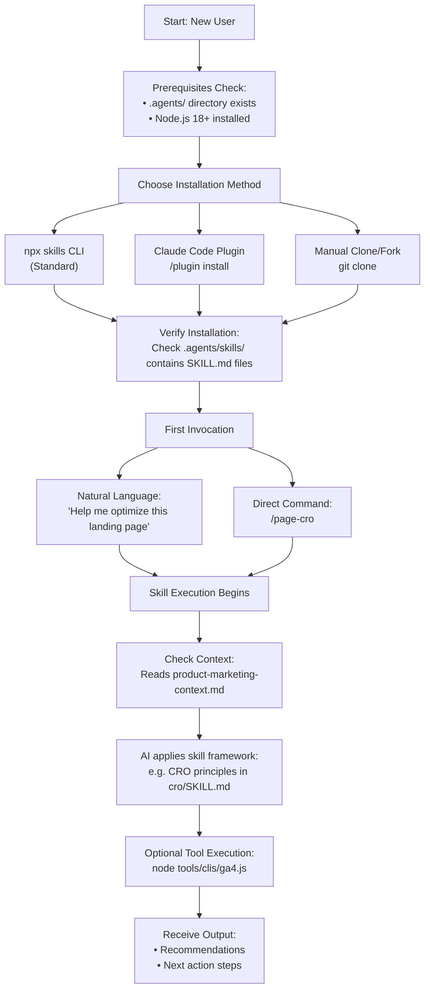
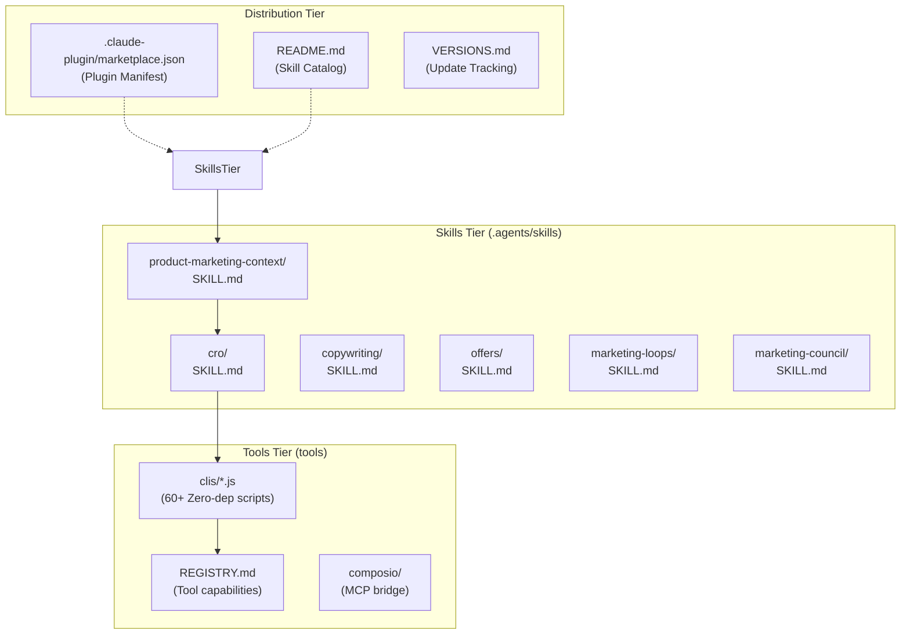

<!-- source: DeepWiki mcp.deepwiki.com · repo coreyhaines31/marketingskills · page 2 Getting Started · fetched 2026-10-27 -->

# Getting Started

<details>
<summary>Relevant source files</summary>

The following files were used as context for generating this wiki page:

- [.claude-plugin/marketplace.json](.claude-plugin/marketplace.json)
- [.claude-plugin/plugin.json](.claude-plugin/plugin.json)
- [AGENTS.md](AGENTS.md)
- [CONTRIBUTING.md](CONTRIBUTING.md)
- [README.md](README.md)
- [VERSIONS.md](VERSIONS.md)

</details>


This page guides you through installing the Marketing Skills system and executing your first skill or CLI tool. It covers the essential setup steps, directory structure, and basic invocation patterns needed to start using marketing skills with AI agents like Claude Code.

The repository now contains 47 marketing skills [README.md:57-104]() and 60+ CLI tools [AGENTS.md:24]().

For detailed comparison of installation methods and trade-offs, see [Installation Methods](#2.1). For in-depth usage patterns and trigger mechanics, see [Using Your First Skill](#2.2). For the CLI tool system, see [Using CLI Tools](#2.3).

**Sources:** [README.md:1-20](), [AGENTS.md:5-13](), [.claude-plugin/marketplace.json:15-15]()

---

## Prerequisites

Before installing marketing skills, ensure you have:

| Requirement | Purpose | Verification |
|------------|---------|--------------|
| Claude Code or compatible AI agent | Runtime environment for skill execution | Check that your IDE has Claude Code installed |
| `.agents/` directory in your project | Target location for skill installation | Create if missing: `mkdir -p .agents/skills` |
| Node.js 18+ | Runtime for CLI tools | Run `node --version` |
| API Keys | Authentication for CLI tools | See individual tool docs in `tools/integrations/` |

The system requires no compilation or build steps for skills. Skills are plain markdown files [AGENTS.md:35-40](). CLI tools are zero-dependency Node.js scripts [AGENTS.md:41-46]().

**Sources:** [AGENTS.md:1-50](), [VERSIONS.md:54-59]()

---

## Quick Start Workflow

The following diagram shows the end-to-end flow from installation to first skill execution:

**Diagram: Quick Start Flow from Installation to Execution**



**Sources:** [README.md:13-51](), [AGENTS.md:130-140]()

---

## Installation Overview

The system offers multiple installation methods. All methods result in `SKILL.md` files placed in `.agents/skills/` (the cross-agent standard) [AGENTS.md:7]().

### Method Comparison

| Method | Target Location | Best For | Command |
|--------|----------------|----------|---------|
| **npx skills CLI** | `.agents/skills/` | Standard setup | `npx skills add coreyhaines31/marketingskills` |
| **Plugin** | `.agents/skills/` | Claude Code users | `/plugin install marketing-skills` |
| **Manual Clone** | `tools/`, `skills/` | Full repository access | `git clone https://github.com/coreyhaines31/marketingskills` |
| **Composio** | MCP Layer | OAuth-heavy tools | `npx @composio/mcp@latest setup` |

### Claude Code Plugin Installation

This repository serves as a plugin marketplace. You can install all 47 skills via the Claude Code terminal [AGENTS.md:130-140](), [.claude-plugin/marketplace.json:12-19]():

```bash
/plugin marketplace add coreyhaines31/marketingskills
/plugin install marketing-skills
```

For detailed instructions on each method, including forking and submodules, see [Installation Methods](#2.1).

**Sources:** [.claude-plugin/marketplace.json:1-19](), [AGENTS.md:130-140](), [README.md:54-85]()

---

## Directory Structure

After installation, the project is organized into three tiers: distribution, skills, and tools.

**Diagram: System Architecture and File Relationships**



### Key Paths

| Path | Description |
|------|-------------|
| `.agents/skills/` | Primary skill installation directory [AGENTS.md:7](). |
| `.agents/product-marketing-context.md` | Shared context file read by all skills [README.md:19](). |
| `tools/clis/` | 60+ zero-dependency Node.js CLI tools [AGENTS.md:24](). |
| `tools/REGISTRY.md` | Index of all tools and integration methods [AGENTS.md:27](). |

**Sources:** [AGENTS.md:14-31](), [README.md:17-48](), [VERSIONS.md:1-51]()

---

## Using Your First Skill

Skills are triggered by natural language or direct commands. Every skill is designed to check for the `product-marketing-context` first to minimize repetitive questions [README.md:19]().

### Invocation Examples

1. **Implicit (Natural Language)**: "I need to reduce churn for my SaaS."
   - Matches: `churn-prevention` skill via trigger phrases [README.md:65]().
2. **Explicit (Direct)**: `/cro`
   - Immediately loads the conversion optimization framework [README.md:74]().
3. **Multi-Agent Simulation**: `/marketing-council`
   - Invokes the board of 12 legendary advisors to review a strategy [VERSIONS.md:29]().

### The Context-First Pattern
Most skills include logic to check `.agents/product-marketing-context.md` first to understand the product, audience, and positioning [README.md:19]().

For concrete examples and integration patterns, see [Using Your First Skill](#2.2).

**Sources:** [README.md:52-85](), [AGENTS.md:120-129](), [VERSIONS.md:29-33]()

---

## Using CLI Tools

The repository includes 60+ zero-dependency Node.js CLI tools in `tools/clis/` for direct API interaction with marketing platforms [AGENTS.md:24]().

### Basic Usage Pattern
All CLIs follow a standard execution pattern [AGENTS.md:41-46]():
```bash
# Syntax check
node --check tools/clis/resend.js

# View help and commands
node tools/clis/resend.js

# Dry-run a command (preview without sending)
node tools/clis/resend.js send --dry-run
```

### Tool Categories
- **Analytics**: `ga4.js`, `mixpanel.js`, `amplitude.js` [AGENTS.md:187-188]()
- **Email**: `resend.js`, `sendgrid.js`, `mailchimp.js` [AGENTS.md:187-188]()
- **Ads**: `meta-ads.js`, `google-ads.js`, `linkedin-ads.js` [AGENTS.md:187-188]()

For details on installation, environment variables, and `--dry-run` mode, see [Using CLI Tools](#2.3).

**Sources:** [AGENTS.md:41-46](), [AGENTS.md:183-195]()

---

## Verification Steps

After installation, verify the setup:

1. **Verify Skills**: Ensure `.agents/skills/` contains 47 directories, each with a `SKILL.md` file [AGENTS.md:20-22](), [VERSIONS.md:1-53]().
2. **Verify Tools**: Run `node tools/clis/ga4.js` to see if the help output appears [AGENTS.md:44]().
3. **Verify Context**: Create `.agents/product-marketing-context.md` to provide your product details [README.md:19]().
4. **Update Check**: Check `VERSIONS.md` to ensure your local skills are current [VERSIONS.md:1-51]().

**Sources:** [AGENTS.md:33-46](), [VERSIONS.md:1-53]()

---

