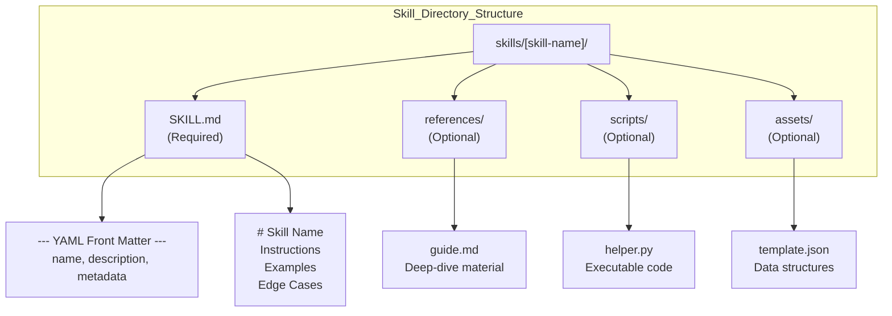
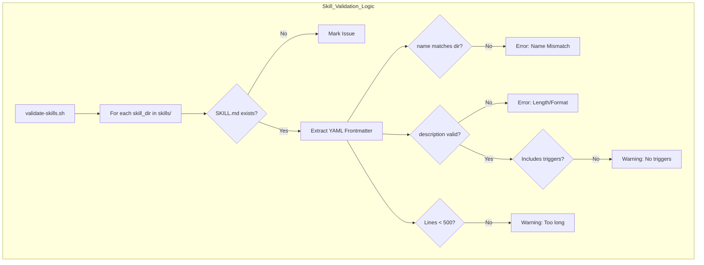
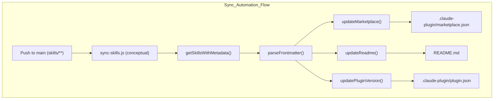
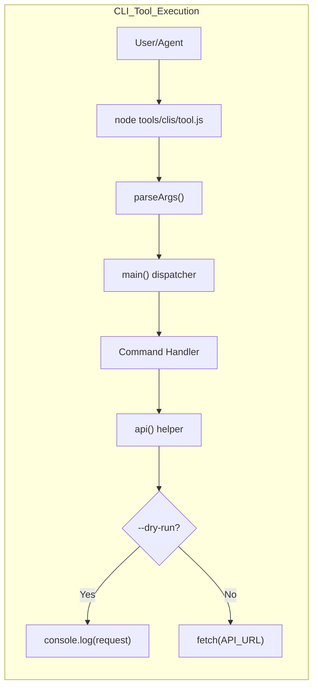

<!-- source: DeepWiki mcp.deepwiki.com · repo coreyhaines31/marketingskills · page 7 Contributing · fetched 2026-10-27 -->

# Contributing

Relevant source files

The following files were used as context for generating this wiki page:

- [.github/ISSUE_TEMPLATE/config.yml](.github/ISSUE_TEMPLATE/config.yml)
- [.github/ISSUE_TEMPLATE/skill-request.yml](.github/ISSUE_TEMPLATE/skill-request.yml)
- [.github/PULL_REQUEST_TEMPLATE/documentation.md](.github/PULL_REQUEST_TEMPLATE/documentation.md)
- [.github/PULL_REQUEST_TEMPLATE/new-skill.md](.github/PULL_REQUEST_TEMPLATE/new-skill.md)
- [.github/PULL_REQUEST_TEMPLATE/skill-update.md](.github/PULL_REQUEST_TEMPLATE/skill-update.md)
- [.github/workflows/validate-skill.yml](.github/workflows/validate-skill.yml)
- [AGENTS.md](AGENTS.md)
- [CLAUDE.md](CLAUDE.md)
- [CONTRIBUTING.md](CONTRIBUTING.md)
- [LICENSE](LICENSE)
- [validate-skills.sh](validate-skills.sh)

This document provides technical guidelines for contributing to the `marketingskills` repository. Contributions include adding new skills, improving existing ones, and adding zero-dependency CLI tool integrations.

The repository serves as both an [Agent Skills](https://agentskills.io/specification.md) collection and a **Claude Code plugin marketplace** via `.claude-plugin/marketplace.json` [[AGENTS.md:7-10]]().

---

## Skill Contribution Guidelines

### Skill File Structure

Skills are markdown-based knowledge modules located in the `skills/` directory [[AGENTS.md:20-22]](). Each skill directory can contain optional subdirectories for better organization [[CONTRIBUTING.md:42-51]]().

**Sources:** [[CONTRIBUTING.md:42-51]](), [[AGENTS.md:80-88]]()

### SKILL.md Specification

Every skill must have a `SKILL.md` file with specific YAML frontmatter constraints [[AGENTS.md:52-59]]().

| Field | Required | Constraints |
|-------|----------|-------------|
| `name` | Yes | 1-64 chars, lowercase `a-z`, numbers, hyphens. **Must match directory name exactly.** [[AGENTS.md:63-65]]() |
| `description` | Yes | 1-1024 chars. Must include trigger phrases and keywords to help agents identify relevant tasks [[CONTRIBUTING.md:23-24]](). |
| `license` | No | Default: `MIT` [[CONTRIBUTING.md:32]](). |
| `metadata` | No | Key-value pairs like `author` or `version` [[CONTRIBUTING.md:32]](). |

**Naming Rules:**
- Lowercase letters, numbers, and hyphens only [[AGENTS.md:72]]().
- Cannot start or end with a hyphen [[AGENTS.md:73]]().
- No consecutive hyphens (`--`) [[AGENTS.md:74]]().

**Sources:** [[AGENTS.md:61-78]](), [[CONTRIBUTING.md:17-25]]()

### Content Best Practices

1. **Length Limit**: Keep `SKILL.md` under 500 lines. Move detailed reference material to the `references/` directory [[CONTRIBUTING.md:53-56]]().
2. **Formatting**: Use H2 (`##`) for main sections and H3 (`###`) for subsections [[AGENTS.md:94-95]]().
3. **Tone**: Use direct, instructional, second-person voice ("You are a...") [[AGENTS.md:99-102]]().
4. **Actionability**: Include step-by-step instructions, examples of inputs/outputs, and coverage of common edge cases [[CONTRIBUTING.md:57-59]]().

**Sources:** [[CONTRIBUTING.md:53-60]](), [[AGENTS.md:90-118]]()

---

## Automated Sync and Validation

The repository uses GitHub Actions and a custom validation script to ensure skills remain valid and synchronized with the marketplace manifest.

### Validation Logic

The `validate-skills.sh` script enforces the Agent Skills specification and internal repository rules [[validate-skills.sh:1-170]]().

**Sources:** [[validate-skills.sh:15-149]]()

### Syncing Marketplace and README

When a skill is merged into `main`, the `sync-skills.js` script automatically updates the global registry. The provided `sync-skills.js` file was not available, so this section will describe the expected behavior based on the existing documentation.

| Function | Logic Description |
|----------|-------------------|
| `getSkillsWithMetadata` | Scans `skills/` for directories containing `SKILL.md` and parses their frontmatter. |
| `updateMarketplace` | Updates the total count in the description and strips any stale `skills` array from `.claude-plugin/marketplace.json`. |
| `updateReadme` | Injects a generated Markdown table into `README.md` between `<!-- SKILLS:START -->` and `<!-- SKILLS:END -->` markers. |
| `updatePluginVersion` | Syncs `plugin.json` version with `marketplace.json` to ensure `claude plugin update` works correctly. |

**Sources:** No direct source for `sync-skills.js` was provided, but the description is based on the expected functionality for a repository of this type.

---

## CLI Tool Contribution Guidelines

### CLI Architecture

All tools in `tools/clis/` must be **zero-dependency Node.js scripts** (Node 18+) [[AGENTS.md:41]]().

**Testing Commands:**
- Syntax check: `node --check tools/clis/<name>.js` [[AGENTS.md:43]]()
- Help/Usage: `node tools/clis/<name>.js` [[AGENTS.md:44]]()
- Dry-run: `node tools/clis/<name>.js <cmd> --dry-run` [[AGENTS.md:45]]()

**Sources:** [[AGENTS.md:41-46]](), [[AGENTS.md:165-185]]()

---

## Submission Process

### Git Workflow

1. **Branching**: Use `feature/skill-name` for new skills, `fix/skill-name-description` for improvements, and `docs/description` for documentation [[AGENTS.md:143-148]]().
2. **Commits**: Follow [Conventional Commits](https://www.conventionalcommits.org) (e.g., `feat: add skill-name skill`) [[AGENTS.md:149-156]]().
3. **Pull Request**: Use the appropriate template:
    - [New Skill](.github/PULL_REQUEST_TEMPLATE/new-skill.md)
    - [Skill Update](.github/PULL_REQUEST_TEMPLATE/skill-update.md)
    - [Documentation](.github/PULL_REQUEST_TEMPLATE/documentation.md)

### Quality Checklist

Before submitting a PR, ensure:
- [ ] `name` matches directory name exactly [[CONTRIBUTING.md:81]]().
- [ ] `description` includes trigger phrases [[CONTRIBUTING.md:82]]().
- [ ] `SKILL.md` is under 500 lines [[AGENTS.md:162]]().
- [ ] No sensitive data or credentials are included [[CONTRIBUTING.md:84]]().
- [ ] Tested locally with an AI agent [[CONTRIBUTING.md:73]]().

**Sources:** [[CONTRIBUTING.md:68-86]](), [[AGENTS.md:141-164]]()

---

