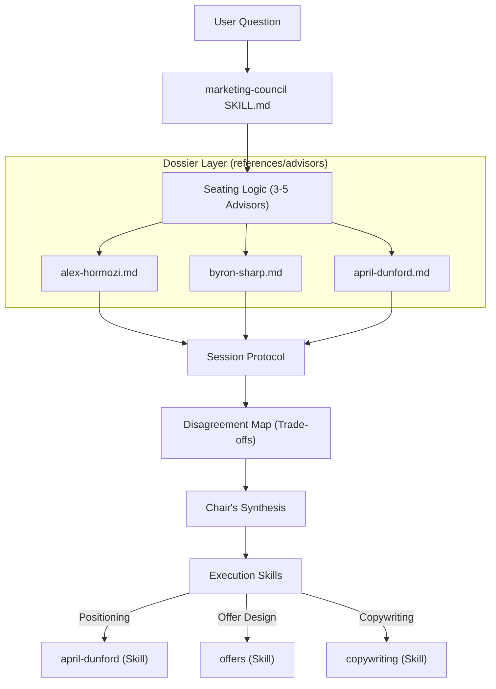
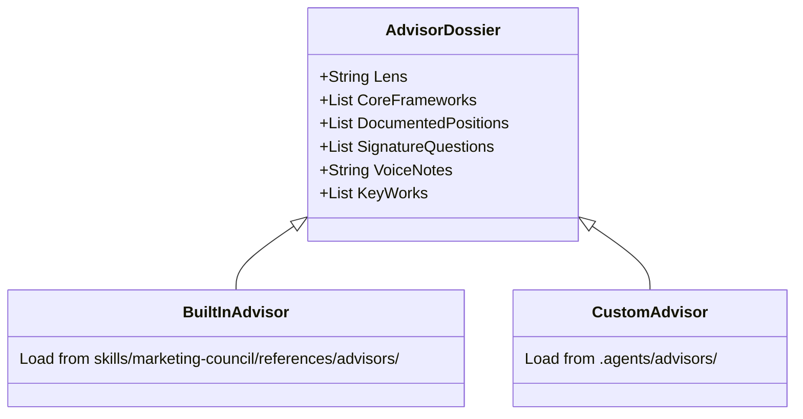

<!-- source: DeepWiki mcp.deepwiki.com · repo coreyhaines31/marketingskills · extra page Marketing Council · fetched 2026-10-27 -->

# Marketing Council

Relevant source files

The following files were used as context for generating this wiki page:

- [skills/marketing-council/SKILL.md](skills/marketing-council/SKILL.md)
- [skills/marketing-council/evals/evals.json](skills/marketing-council/evals/evals.json)
- [skills/marketing-council/references/advisor-template.md](skills/marketing-council/references/advisor-template.md)
- [skills/marketing-council/references/advisors/alex-hormozi.md](skills/marketing-council/references/advisors/alex-hormozi.md)
- [skills/marketing-council/references/advisors/ann-handley.md](skills/marketing-council/references/advisors/ann-handley.md)
- [skills/marketing-council/references/advisors/april-dunford.md](skills/marketing-council/references/advisors/april-dunford.md)
- [skills/marketing-council/references/advisors/byron-sharp.md](skills/marketing-council/references/advisors/byron-sharp.md)
- [skills/marketing-council/references/advisors/claude-hopkins.md](skills/marketing-council/references/advisors/claude-hopkins.md)
- [skills/marketing-council/references/advisors/david-ogilvy.md](skills/marketing-council/references/advisors/david-ogilvy.md)
- [skills/marketing-council/references/advisors/eugene-schwartz.md](skills/marketing-council/references/advisors/eugene-schwartz.md)
- [skills/marketing-council/references/advisors/gary-halbert.md](skills/marketing-council/references/advisors/gary-halbert.md)
- [skills/marketing-council/references/advisors/gary-vaynerchuk.md](skills/marketing-council/references/advisors/gary-vaynerchuk.md)
- [skills/marketing-council/references/advisors/rory-sutherland.md](skills/marketing-council/references/advisors/rory-sutherland.md)
- [skills/marketing-council/references/advisors/russell-brunson.md](skills/marketing-council/references/advisors/russell-brunson.md)
- [skills/marketing-council/references/advisors/seth-godin.md](skills/marketing-council/references/advisors/seth-godin.md)

The `marketing-council` skill (added v2.8.6, 2026-07-06) provides a simulated board of 12 legendary marketing advisors. It is designed to surface conflicting expert perspectives on high-stakes marketing decisions, moving beyond generic advice by applying specific, documented frameworks from industry titans.

## Purpose and Scope

The value of the council lies in **useful disagreement**. By seating advisors with fundamentally different "lenses" (e.g., Byron Sharp’s reach-based science vs. Seth Godin’s resonance-based permission), the system forces the user to confront trade-offs before committing to a direction [skills/marketing-council/SKILL.md:10-12]().

*   **Distinction from `marketing-psychology`:** While `marketing-psychology` applies behavioral science principles (like anchoring or loss aversion), `marketing-council` applies the holistic philosophies and specific heuristics of famous practitioners [skills/marketing-council/SKILL.md:3-3]().
*   **Distinction from `marketing-ideas`:** This skill is for strategic review and debate, not for generating one-off tactics [skills/marketing-council/SKILL.md:3-3]().

## System Architecture & Data Flow

The skill operates as a simulation engine that loads specific "dossiers" (markdown files) for seated advisors. These dossiers contain the "source of truth" for the advisor's frameworks, avoiding AI hallucination of their positions.

### Advisor Bench and Lenses
The council consists of 12 primary advisors, each representing a distinct school of thought:

| Advisor | Primary Lens | Key Frameworks |
| :--- | :--- | :--- |
| **Seth Godin** | Remarkability & Permission | Smallest Viable Audience, Purple Cow |
| **David Ogilvy** | Research-driven Brand Ads | The Big Idea, Brand Personality |
| **Eugene Schwartz** | Channeling Mass Desire | 5 Stages of Awareness, Market Sophistication |
| **Claude Hopkins** | Scientific Advertising | Reason-Why Copy, Test Campaigns |
| **Gary Halbert** | The Starving Crowd | A-Pile/B-Pile, List > Copy |
| **Russell Brunson** | Funnel Architecture | Hook-Story-Offer, Value Ladder |
| **Alex Hormozi** | Offer Math | Value Equation ($100M Offers) |
| **April Dunford** | Strategic Positioning | Competitive Alternatives, Market Category |
| **Rory Sutherland** | Behavioral Psycho-logic | Costly Signaling, The "Illogical" Idea |
| **Byron Sharp** | Evidence-based Science | Mental/Physical Availability, Double Jeopardy |
| **Ann Handley** | Writing & Empathy | The Writing GPS, Slow Marketing |
| **Gary Vaynerchuk** | Attention Arbitrage | Jab-Jab-Right-Hook, Day Trading Attention |

Sources: [skills/marketing-council/SKILL.md:32-49](), [skills/marketing-council/references/advisors/ann-handley.md:3-12](), [skills/marketing-council/references/advisors/alex-hormozi.md:3-12](), [skills/marketing-council/references/advisors/byron-sharp.md:3-13]()

### Entity Relationship Diagram
The following diagram shows how the `marketing-council` skill orchestrates advisor dossiers and hands off to execution skills.

**Council Orchestration Flow**

Sources: [skills/marketing-council/SKILL.md:51-82](), [skills/marketing-council/references/advisor-template.md:3-9]()

## Operational Modes

The skill supports three session modes depending on the depth required:

1.  **Quick Take:** A single named advisor (e.g., "What would Ogilvy think of this headline?").
2.  **Council Session (Default):** 3–5 advisors. Includes 2-3 "fit" advisors and at least one **Designated Dissenter**.
3.  **Full Council:** All 12 advisors for major strategic shifts.

Sources: [skills/marketing-council/SKILL.md:24-30]()

## Seating Logic & The Designated Dissenter

The system uses a mapping table to select the most relevant experts for a specific problem. Crucially, it must seat a "Designated Dissenter" to prevent an echo chamber.

| Question Type | Strong Fits | Natural Dissenters |
| :--- | :--- | :--- |
| **Positioning** | Dunford, Godin | Byron Sharp (differentiation skeptic) |
| **Offer / Pricing** | Hormozi, Brunson | Sutherland (psychological value), Godin (anti-commodity) |
| **Brand Building** | Sharp, Ogilvy | Hopkins, Halbert (demand direct response) |
| **Content Strategy** | Handley, Godin | Sharp (reach beats depth) |

Sources: [skills/marketing-council/SKILL.md:59-71](), [skills/marketing-council/evals/evals.json:32-42]()

## Session Protocol

Every council session follows a four-step execution pattern:

1.  **Advisor Takes:** 2-4 paragraphs per advisor applying their *Signature Questions* and *Core Frameworks* (found in `references/advisors/`) to the specific problem [skills/marketing-council/SKILL.md:76-80]().
2.  **Disagreement Map:** The core value-add. Identifies 2-4 genuine conflicts (e.g., "Sharp vs. Godin on Reach vs. Resonance") and defines what evidence would settle the debate [skills/marketing-council/SKILL.md:81-81]().
3.  **Synthesis:** A "Chair's summary" recommending a path based on the user's current stage and category [skills/marketing-council/SKILL.md:82-82]().
4.  **Skill Handoff:** Directing the user to specific execution skills (e.g., `offers`, `copywriting`, `pricing-strategy`) [skills/marketing-council/SKILL.md:82-82]().

## Implementation Details

### Grounding Rules
To maintain technical integrity, the skill follows strict grounding rules:
*   **Persona Simulation:** All output must be labeled as a simulation [skills/marketing-council/SKILL.md:12-12]().
*   **No Fabricated Quotes:** Advisors must apply their frameworks; they must not "say" things they never said unless they are documented quotes [skills/marketing-council/SKILL.md:80-80]().
*   **Live Research Pass:** If the user asks for current views (e.g., "What did Rory Sutherland say about AI last month?"), the system triggers a `deep-research` pass rather than relying on the static dossier [skills/marketing-council/SKILL.md:84-88](), [skills/marketing-council/evals/evals.json:59-67]().

### Custom Advisors
Users can add custom advisors (e.g., a CEO or a niche expert) by following the structure in `references/advisor-template.md`.
*   **Path:** `.agents/advisors/<kebab-name>.md` [skills/marketing-council/references/advisor-template.md:3-3]().
*   **Constraint:** For private individuals, the agent must interview the user to populate the lens and frameworks rather than inventing them [skills/marketing-council/references/advisor-template.md:8-9](), [skills/marketing-council/evals/evals.json:47-56]().

**Advisor Dossier Structure**

Sources: [skills/marketing-council/references/advisor-template.md:12-47](), [skills/marketing-council/SKILL.md:34-34]()

## Evaluation and Validation

The skill's performance is validated via `evals/evals.json`, which ensures:
1.  **Conflict Integrity:** The council does not produce uniform agreement [skills/marketing-council/evals/evals.json:37-37]().
2.  **Framework Application:** Advisors use their specific terminology (e.g., Hormozi must mention the "Value Equation") [skills/marketing-council/evals/evals.json:12-12]().
3.  **Simulation Labeling:** Mandatory disclosure that these are personas [skills/marketing-council/evals/evals.json:9-9]().

Sources: [skills/marketing-council/evals/evals.json:1-70]()

---

