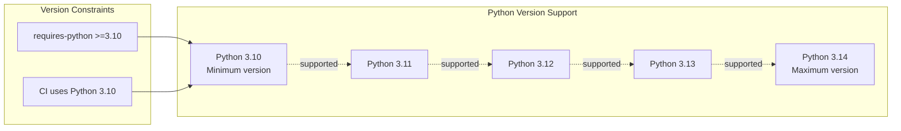
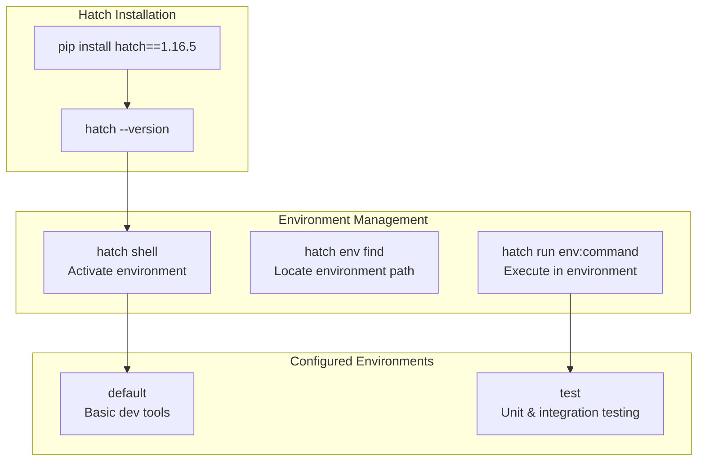
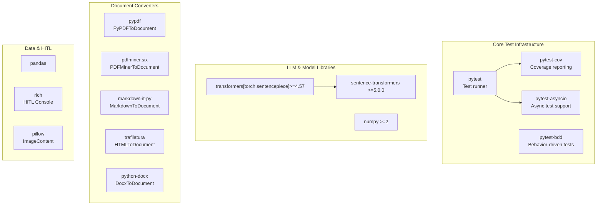

<!-- source: DeepWiki mcp.deepwiki.com · repo deepset-ai/haystack · page 2.1 Installation and Dependencies · fetched 2026-10-27 -->

# Installation and Dependencies

<details>
<summary>Relevant source files</summary>

The following files were used as context for generating this wiki page:

- [.github/pull_request_template.md](.github/pull_request_template.md)
- [.github/workflows/docs-website-test-docs-snippets.yml](.github/workflows/docs-website-test-docs-snippets.yml)
- [.github/workflows/docstring_labeler.yml](.github/workflows/docstring_labeler.yml)
- [.github/workflows/docusaurus_sync.yml](.github/workflows/docusaurus_sync.yml)
- [.github/workflows/e2e.yml](.github/workflows/e2e.yml)
- [.github/workflows/license_compliance.yml](.github/workflows/license_compliance.yml)
- [.github/workflows/nightly_testpypi_release.yml](.github/workflows/nightly_testpypi_release.yml)
- [.github/workflows/promote_unstable_docs.yml](.github/workflows/promote_unstable_docs.yml)
- [.github/workflows/push_release_notes_to_website.yml](.github/workflows/push_release_notes_to_website.yml)
- [.github/workflows/pypi_release.yml](.github/workflows/pypi_release.yml)
- [.github/workflows/release_notes.yml](.github/workflows/release_notes.yml)
- [.github/workflows/slow.yml](.github/workflows/slow.yml)
- [.github/workflows/tests.yml](.github/workflows/tests.yml)
- [.pre-commit-config.yaml](.pre-commit-config.yaml)
- [CONTRIBUTING.md](CONTRIBUTING.md)
- [README.md](README.md)
- [VERSION.txt](VERSION.txt)
- [docs-website/.gitignore](docs-website/.gitignore)
- [images/banner.png](images/banner.png)
- [pyproject.toml](pyproject.toml)
- [scripts/release_note_backticks.py](scripts/release_note_backticks.py)
- [test/conftest.py](test/conftest.py)
- [test/test_release_note_backticks.py](test/test_release_note_backticks.py)

</details>


This document covers the installation methods for Haystack, dependency management using Hatch, and the various development environments available. For information about the testing infrastructure and contribution workflow, see [Testing and Contribution Workflow](#2.2). For CI/CD pipeline details, see [CI/CD and Release Management](#2.3).

## Purpose and Scope

This page explains how to install Haystack for both end-users and contributors, describes the project's dependency management strategy using Hatch, and documents the different environments configured for development, testing, and documentation generation. It focuses on the technical implementation of the build system and environment orchestration.

---

## Installation Methods

### End-User Installation

Haystack is distributed via PyPI under the package name `haystack-ai`. The simplest installation method is:

```sh
pip install haystack-ai
```

To install the latest development version from the `main` branch:

```sh
pip install git+https://github.com/deepset-ai/haystack.git@main
```

The package supports Python versions 3.10 through 3.14, as specified in [pyproject.toml:11]() and [pyproject.toml:37-41](). Note that Python 3.9 support is no longer included in the supported classifiers.

**Sources:** [README.md:38-44](), [pyproject.toml:5-11](), [pyproject.toml:37-41]()

---

### Development Installation

Contributors must clone the repository and use Hatch for environment management:

```sh
git clone https://github.com/deepset-ai/haystack
cd haystack
hatch shell
```

The `hatch shell` command creates and activates a virtual environment with all necessary dependencies. Pre-commit hooks should be installed immediately after cloning:

```sh
pre-commit install
```

This installs Git hooks defined in [.pre-commit-config.yaml:1-49]() that automatically run code quality checks before each commit, including `ruff` formatting, linting, and `codespell` checks.

**Sources:** [CONTRIBUTING.md:21-22](), [README.md:38-52](), [.pre-commit-config.yaml:1-49]()

---

## Python Version Requirements



**Python Version Compatibility**

The project requires Python 3.10 or later, as declared in [pyproject.toml:11](). The CI/CD infrastructure standardizes on Python 3.10 to ensure compatibility with the minimum supported version.

**Sources:** [pyproject.toml:11](), [pyproject.toml:37-41](), [.github/workflows/tests.yml:32]()

---

## Dependency Management with Hatch

Haystack uses [Hatch](https://hatch.pypa.io) as its project manager for environment management, dependency isolation, and build operations. Hatch version 1.16.5 is standardized across all CI workflows.



**Hatch Environment Architecture**

The [pyproject.toml]() file defines several distinct Hatch environments:

| Environment | Purpose | Installer | Key Dependencies |
|-------------|---------|-----------|------------------|
| `default` | Code formatting, linting, release notes | `uv` | pre-commit, ruff, reno, haystack-pydoc-tools |
| `test` | Unit and integration testing | Default (pip) | pytest, transformers, sentence-transformers, converters |

The `default` environment uses `uv` as the installer for faster dependency resolution, as configured in [pyproject.toml:66]().

**Sources:** [pyproject.toml:65-141](), [.github/workflows/tests.yml:33]()

---

### Environment Scripts

Each Hatch environment defines scripts for common development tasks:

**Default Environment Scripts** ([pyproject.toml:79-83]()):
- `release-note`: Create a new release note using `reno` [pyproject.toml:80]()
- `fmt`: Format and fix code using `ruff` [pyproject.toml:81]()
- `fmt-check`: Check code formatting without modifications [pyproject.toml:82]()
- `docs`: Generate API reference using `haystack-pydoc` [pyproject.toml:83]()

**Test Environment Scripts** ([pyproject.toml:143-152]()):
- `unit`: Run unit tests with coverage reporting [pyproject.toml:144]()
- `integration`: Run all integration tests [pyproject.toml:145]()
- `integration-only-fast`: Run fast integration tests (excludes `@pytest.mark.slow`) [pyproject.toml:146]()
- `integration-only-slow`: Run only slow integration tests [pyproject.toml:147]()
- `all`: Run all tests [pyproject.toml:148]()
- `e2e`: Run end-to-end tests [pyproject.toml:149]()
- `types`: Run `mypy` type checking on specific modules [pyproject.toml:152]()

**Usage examples:**
```sh
# Format code
hatch run fmt

# Run unit tests
hatch run test:unit

# Run mypy type checking
hatch run test:types
```

**Sources:** [pyproject.toml:79-152](), [CONTRIBUTING.md:22]()

---

## Core Dependencies

```mermaid
graph TB
    subgraph "Haystack Core Package"
        CoreLib["haystack-ai package"]
    end
    
    subgraph "Essential Runtime Dependencies"
        OpenAI["openai >=2.6.0<br/>LLM integration"]
        Jinja2["Jinja2<br/>Template rendering"]
        Pydantic["pydantic<br/>Data validation"]
        NetworkX["networkx<br/>Pipeline graphs"]
        Tenacity["tenacity !=8.4.0<br/>Retry logic"]
        TqdmLib["tqdm<br/>Progress bars"]
        LazyImports["lazy-imports<br/>Deferred loading"]
    end
    
    subgraph "Data Processing"
        MoreItertools["more-itertools<br/>DocumentSplitter"]
        NumpyLib["numpy<br/>Numerical operations"]
        Httpx["httpx<br/>HTTP client"]
    end
    
    subgraph "Validation & Tooling"
        JSONSchema["jsonschema<br/>JsonSchemaValidator, Tool"]
        DocstringParser["docstring-parser<br/>ComponentTool"]
        Filetype["filetype<br/>MIME type detection"]
    end
    
    subgraph "Supporting Libraries"
        PyYAML["pyyaml<br/>Configuration"]
        TypingExt["typing_extensions >=4.7<br/>Python 3.10+ typing support"]
        Dateutil["python-dateutil<br/>Date parsing"]
        Posthog["posthog !=3.12.0<br/>Telemetry"]
    end
    
    CoreLib --> OpenAI
    CoreLib --> Jinja2
    CoreLib --> Pydantic
    CoreLib --> NetworkX
    CoreLib --> Tenacity
    CoreLib --> TqdmLib
    CoreLib --> LazyImports
    CoreLib --> MoreItertools
    CoreLib --> NumpyLib
    CoreLib --> Httpx
    CoreLib --> JSONSchema
    CoreLib --> DocstringParser
    CoreLib --> Filetype
    CoreLib --> PyYAML
    CoreLib --> TypingExt
    CoreLib --> Dateutil
    CoreLib --> Posthog
```



**Runtime Dependency Breakdown**

The core dependencies declared in [pyproject.toml:44-63]() are focused on essential functionality:

**LLM & AI Integration:**
- `openai>=2.6.0`: Official OpenAI SDK for generators and embeddings [pyproject.toml:48]().
- `pydantic`: Data validation for component inputs/outputs [pyproject.toml:49]().

**Pipeline Infrastructure:**
- `networkx`: Powers the pipeline graph structure and execution planning [pyproject.toml:55]().
- `tenacity!=8.4.0`: Implements retry logic for external service calls [pyproject.toml:46]().
- `lazy-imports`: Enables deferred imports to reduce startup time [pyproject.toml:47]().

**Data Processing:**
- `Jinja2`: Template rendering engine for `PromptBuilder` [pyproject.toml:50]().
- `more-itertools`: Utilities for `DocumentSplitter` [pyproject.toml:54]().
- `numpy`: Numerical array operations for embeddings [pyproject.toml:58]().
- `httpx`: Modern HTTP client for API calls [pyproject.toml:57]().

**Validation & Tooling:**
- `jsonschema`: Validation for `JsonSchemaValidator` and `Tool` [pyproject.toml:60]().
- `docstring-parser`: Extracts metadata for `ComponentTool` [pyproject.toml:61]().
- `filetype`: MIME type detection for `ImageContent` [pyproject.toml:62]().

**Supporting Infrastructure:**
- `posthog!=3.12.0`: Telemetry collection [pyproject.toml:52]().
- `MarkupSafe`: Used in `templatize_part` [pyproject.toml:51]().

**Sources:** [pyproject.toml:44-63]()

---

## Development Dependencies

### Test Environment

The `test` environment provides dependencies for unit and integration testing:



**Test Environment Dependencies** ([pyproject.toml:88-141]()):

- **AI & ML:** `transformers>=4.57`, `sentence-transformers>=5.0.0`, and `numpy>=2` [pyproject.toml:89-96]().
- **Converters:** Includes `pypdf`, `pdfminer.six`, `markdown-it-py`, `trafilatura` (HTML), `python-pptx`, `python-docx`, `jq` (JSON), and `openpyxl` (XLSX) [pyproject.toml:103-113]().
- **Data Processing:** `pandas` for AzureOCR, CSV, and XLSX converters [pyproject.toml:92-93](). `nltk` and `tiktoken` for document splitting [pyproject.toml:115-116]().
- **HITL & UI:** `rich` for console rendering for Human-in-the-Loop [pyproject.toml:119]().
- **Media:** `pillow` for `ImageContent` and `pypdfium2` for `PDFToImageContent` [pyproject.toml:98-99]().

**Sources:** [pyproject.toml:88-141]()

---

## CI/CD Environment Configuration

All GitHub Actions workflows use consistent environment variables:

| Variable | Value | Purpose |
|----------|-------|---------|
| `PYTHON_VERSION` | `"3.10"` | Standard Python version for CI testing [.github/workflows/tests.yml:32]() |
| `HATCH_VERSION` | `"1.16.5"` | Pinned Hatch version for environment management [.github/workflows/tests.yml:33]() |

**Workflow Execution Logic:**
Workflows like `tests.yml` use a `check-if-changed` job to skip tests if only documentation or non-code files are modified [.github/workflows/tests.yml:39-65](). 

**Integration Test Categories:**
- `test:integration-only-fast`: Excludes slow integration tests [.github/workflows/tests.yml:210]().
- `test:integration-only-slow`: Specifically targets components requiring heavy model downloads or long execution times, such as `SASEvaluator` or `OpenAIDALLE` [.github/workflows/slow.yml:58-66]().

**Sources:** [.github/workflows/tests.yml:32-65](), [.github/workflows/slow.yml:12-115]()

---

## Package Build and Distribution

Haystack uses `hatchling` as its build backend [pyproject.toml:1-3]().

**Build Configuration:**
- **Source distribution:** Includes `/haystack` and `VERSION.txt` [pyproject.toml:168-169]().
- **Version source:** Read from `VERSION.txt` using a pattern [pyproject.toml:161-163](). The current version is `3.1.0-rc0` [VERSION.txt:1]().

**Publishing:**
The release process is automated via [.github/workflows/pypi_release.yml](). It triggers on version tags (e.g., `v3.1.0`) and uses `hatch build` to generate artifacts before publishing to PyPI [.github/workflows/pypi_release.yml:34-38](). Version tags ending in `-rc0` are explicitly excluded from production releases [.github/workflows/pypi_release.yml:8]().

**Sources:** [pyproject.toml:1-3](), [pyproject.toml:161-173](), [VERSION.txt:1](), [.github/workflows/pypi_release.yml:1-38]()

---

