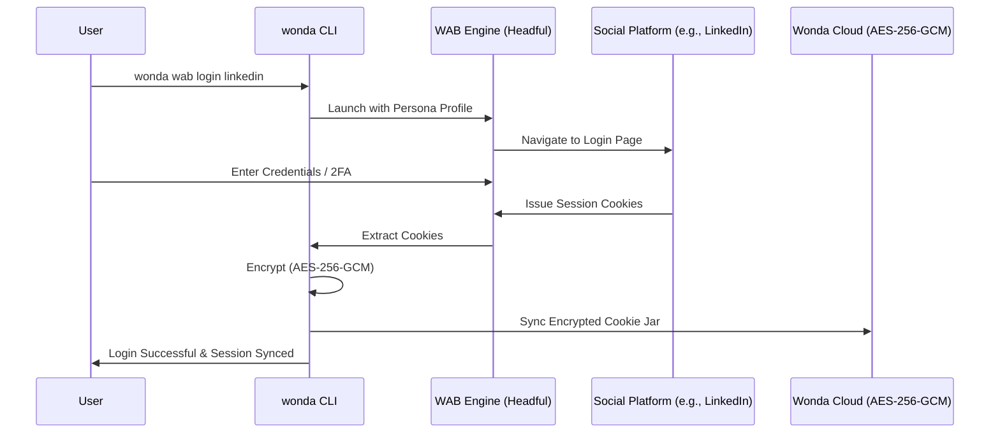
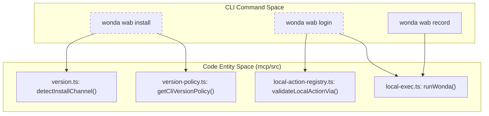

<!-- source: DeepWiki mcp.deepwiki.com · repo degausai/wonda · page 5.2 WAB CLI Commands & Session Management · fetched 2026-10-27 -->

# WAB CLI Commands & Session Management

Relevant source files

The following files were used as context for generating this wiki page:

- [skills/wonda-cli/SKILL.md](skills/wonda-cli/SKILL.md)

The **Wonda Automation Browser (WAB)** CLI interface provides low-level control over the hardened Chromium/Playwright environment used for social platform automation. It manages the lifecycle of browser binaries, local persona profiles, and the secure synchronization of session cookies between the local machine and the Wonda Cloud.

## WAB Lifecycle & Installation

The WAB binary is a specialized fork of Chromium designed to bypass anti-bot detection. It is not bundled with the base `wonda` CLI to keep the initial download small. Users must explicitly install or update the browser environment using the `wonda wab` command group.

| Command | Description |
| :--- | :--- |
| `wonda wab install` | Downloads and installs the hardened WAB binary to the local system. |
| `wonda wab update` | Checks for newer versions of the WAB engine and performs an in-place upgrade. |
| `wonda wab status` | Reports the current installation path, version, and health of the WAB environment. |

**Sources:**
- [skills/wonda-cli/SKILL.md:12-20]() (Installation channels)
- [mcp/src/local-exec.ts:45-60]() (Update policy and version detection)

## Persona & Profile Management

WAB operates using **Personas**, which are isolated browser profiles stored locally in `~/.wonda/wab/personas/`. Each persona maintains its own disk cache, local storage, and indexedDB, ensuring that sessions for different social accounts (e.g., a personal LinkedIn vs. a corporate LinkedIn) never leak into one another.

### The Session Flow
When a user initiates an action via the CLI (e.g., `wonda linkedin post`), the system follows this flow:
1. **Persona Resolution**: The CLI identifies the target persona (defaulting to `default` if not specified).
2. **Lock Acquisition**: WAB enforces session ownership. If another process (like the Wonda Desktop App or a manual `wab record` session) is using the persona, the CLI will block or error to prevent profile corruption.
3. **Execution**: The WAB engine launches in headless mode (by default) to perform the requested automation.

**Sources:**
- [mcp/src/local-action-registry.ts:25-45]() (LocalActionVia and persona resolution)
- [mcp/src/tools/twin-action-manifest.ts:10-25]() (RequestedSlots and persona mapping)

## Session Management & Cookie Jars

WAB manages authentication state through "Cookie Jars"—encrypted JSON files that store session tokens for social platforms. 

### Security & Encryption
*   **Local Storage**: Cookies are stored in the user's home directory, encrypted at rest.
*   **Cloud Backup**: To enable **Cloud Twins** to act on the user's behalf, the CLI performs an **AES-256-GCM** encrypted backup of the session cookies to the Wonda Cloud.
*   **Sync Interval**: The CLI performs a background sync every **10 minutes** during active sessions to ensure the cloud-hosted session remains "warm" and synchronized with local activity.

### The `wonda wab login` Flow
The `login` command is the primary method for seeding a session. Unlike automated actions, this command launches WAB in **headful mode**, allowing the user to solve CAPTCHAs or perform 2FA manually.

**Sources:**
- [skills/wonda-cli/SKILL.md:52-54]() (Login flow and WAB headful usage)
- [mcp/src/local-action-registry.ts:80-95]() (Cookie transport vs WAB transport)

## CLI Command Reference

### Recording and Anonymous Capture
The WAB interface supports an "Anonymous Capture" mode, allowing users to interact with sites without tying the activity to a specific permanent persona.

*   **`wonda wab record`**: Launches a headful browser session. Any actions taken or cookies generated can be exported to a persona or used to generate automation scripts.
*   **Anonymous Mode**: Used for one-off scraping tasks where persistent login state is not required.

### Implementation Mapping

The following diagram bridges the CLI command space to the internal TypeScript classes and functions that handle WAB execution.

**Sources:**
- [mcp/src/local-exec.ts:70-100]() (`runWonda` implementation)
- [mcp/src/version.ts:15-40]() (Version and channel detection)
- [mcp/src/local-action-registry.ts:102-120]() (Action validation logic)

## Session Ownership & Enforcement

To prevent multiple agents or manual users from conflicting on a single social account, WAB implements a strict ownership model:

1.  **Process Locking**: When WAB starts, it creates a lock file in the persona directory. 
2.  **Remote vs. Local Conflict**: If a **Cloud Twin** is currently executing an action for a persona, the local CLI will receive a `twin_active` notice and may defer execution to avoid triggering platform security alerts regarding multiple concurrent IPs.
3.  **Soft/Hard Abort**: In the event of a session conflict or a safety gate trigger (e.g., rate limit hit), the CLI follows the `Safety Gate` logic to either pause (Soft Abort) or terminate (Hard Abort) the WAB process.

**Sources:**
- [mcp/src/local-exec.ts:110-130]() (Concurrency and version checks)
- [mcp/src/tools/platform.ts:45-65]() (Twin Notices and session status)

---

