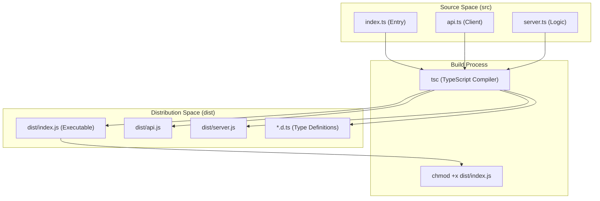
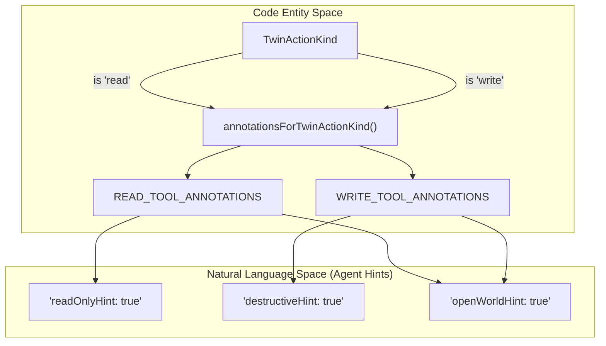

<!-- source: DeepWiki mcp.deepwiki.com · repo degausai/wonda · page 9.2 Build Pipeline & Package Structure · fetched 2026-10-27 -->

# Build Pipeline & Package Structure

Relevant source files

The following files were used as context for generating this wiki page:

- [mcp/.gitignore](mcp/.gitignore)
- [mcp/package.json](mcp/package.json)
- [mcp/src/tools/annotations.ts](mcp/src/tools/annotations.ts)
- [mcp/tsconfig.json](mcp/tsconfig.json)

This page documents the build pipeline, distribution strategy, and internal package structure of the `@degausai/wonda-mcp` package. The package is designed as a high-performance TypeScript ESM project that bridges AI agents to the Wonda ecosystem through the Model Context Protocol (MCP).

## Package Overview & Environment Requirements

The `mcp/` directory contains the source code for the Wonda MCP server. It is structured as a modern TypeScript ESM (ECMAScript Module) package [mcp/package.json:5-5]().

### Requirements
- **Node.js**: Version 18 or higher is strictly required [mcp/package.json:52-54]().
- **Module System**: The package uses `type: "module"` to support top-level await and ESM imports [mcp/package.json:5-5]().
- **Dependencies**: Core dependencies include the `@modelcontextprotocol/sdk` for MCP communication and `zod` for runtime schema validation [mcp/package.json:35-38]().

## Build Pipeline (tsc → dist)

The build process transforms TypeScript source files from `mcp/src/` into a production-ready `mcp/dist/` directory.

### Compilation Strategy
The project uses the TypeScript compiler (`tsc`) with the following key configurations in `tsconfig.json`:
- **Target**: `ES2022` for modern JavaScript features [mcp/tsconfig.json:3-3]().
- **Module Resolution**: `Node16` to ensure compatibility with ESM imports and exports [mcp/tsconfig.json:4-5]().
- **Declarations**: `declaration: true` is enabled to generate `.d.ts` files for consumers [mcp/tsconfig.json:11-11]().

### Build Scripts
The build lifecycle is managed via NPM scripts:
- **`npm run build`**: Executes `tsc` and then applies executable permissions (`0o755`) to the main entry point `dist/index.js` [mcp/package.json:27-27]().
- **`npm run dev`**: Runs `tsc --watch` for rapid development [mcp/package.json:28-28]().
- **`npm run typecheck`**: Runs `tsc --noEmit` to validate types without generating files [mcp/package.json:30-30]().

### Build Data Flow
The following diagram illustrates the transformation from source code to the distributed package.

**Build Transformation Flow**

Sources: [mcp/package.json:27-27](), [mcp/tsconfig.json:1-15]()

## Package Structure & Export Entrypoints

The package exposes three distinct entrypoints to support different integration patterns, defined in the `exports` field of `package.json` [mcp/package.json:9-22]().

| Entrypoint | File | Purpose |
| :--- | :--- | :--- |
| **Main (`.`)** | `dist/index.js` | The primary MCP server executable. |
| **API (`./api`)** | `dist/api.js` | Direct access to the Wonda API client and context management. |
| **Server (`./server`)** | `dist/server.js` | Server factory functions for embedding the MCP server in other apps. |

### The `wonda-mcp` Binary
The package registers a global binary named `wonda-mcp` which points to `dist/index.js` [mcp/package.json:6-8](). This allows users to start the MCP server via `npx @degausai/wonda-mcp` or by running the binary directly after a global installation.

## Validation & Quality Control Scripts

Before distribution, the package undergoes several validation steps to ensure API compatibility and correct tool metadata.

### 1. Annotation Validation (`check:annotations`)
Ensures that all MCP tools have the correct metadata (e.g., `readOnlyHint`, `destructiveHint`).
- **Implementation**: Runs `scripts/check-tool-annotations.mjs` [mcp/package.json:31-31]().
- **Logic**: Validates tools against `READ_TOOL_ANNOTATIONS` and `WRITE_TOOL_ANNOTATIONS` [mcp/src/tools/annotations.ts:5-14]().

### 2. API Compatibility (`check-api-compat`)
Verifies that the MCP server's internal API client matches the expected signatures of the Wonda backend.
- **Implementation**: Runs as part of `npm test` via `scripts/check-api-compat.mjs` [mcp/package.json:32-32]().

### 3. Twin Action Validation (`check-twin-actions`)
Specifically validates the `TWIN_ACTION_MANIFEST` to ensure cloud-based actions are correctly mapped to MCP tool definitions.
- **Implementation**: Runs `scripts/check-twin-actions.mjs` [mcp/package.json:32-32]().

### 4. Distribution Bundling (`pack:mcpb`)
A specialized script for creating the "MCP Bundle" (mcpb) distribution, which is used for optimized delivery in certain environments.
- **Implementation**: Runs `scripts/build-mcpb.mjs` and outputs to the `.mcpb-build/` directory [mcp/package.json:33-33](), [mcp/.gitignore:3-3]().

## Tool Annotation System

Wonda uses a structured annotation system to inform LLMs about the nature of the tools they are calling. This is critical for safety and UI rendering in agentic interfaces.

**Annotation Mapping**

Sources: [mcp/src/tools/annotations.ts:1-20]()

### Annotation Constants
- **`READ_TOOL_ANNOTATIONS`**: Applied to tools that only fetch data. Sets `readOnlyHint: true` [mcp/src/tools/annotations.ts:5-8]().
- **`WRITE_TOOL_ANNOTATIONS`**: Applied to tools that modify state (e.g., posting, editing). Sets `readOnlyHint: false` and `destructiveHint: true` [mcp/src/tools/annotations.ts:10-14]().

Sources:
- [mcp/package.json:1-62]()
- [mcp/tsconfig.json:1-15]()
- [mcp/src/tools/annotations.ts:1-21]()
- [mcp/.gitignore:1-4]()

---

