# Page: Wonda Platform Overview

# Wonda Platform Overview

<details>
<summary>Relevant source files</summary>

The following files were used as context for generating this wiki page:

- [.claude-plugin/plugin.json](.claude-plugin/plugin.json)
- [.codex-plugin/plugin.json](.codex-plugin/plugin.json)
- [README.md](README.md)
- [assets/terminal.gif](assets/terminal.gif)
- [assets/terminal.png](assets/terminal.png)
- [gemini-extension.json](gemini-extension.json)
- [mcp/README.md](mcp/README.md)

</details>


The Wonda platform is an AI-native content generation and social automation suite designed to be operated by both human users and AI agents (e.g., Claude Code, Cursor, Codex). It bridges high-level natural language intent with low-level execution of media generation, video editing, and social platform interactions.

## Core Value Proposition

Wonda provides a unified interface for the entire content lifecycle:
*   **AI Generation**: Integration with 20+ models for images, video, music, and speech.
*   **Programmatic Editing**: A "local-first" editing engine for automated video manipulation (captions, overlays, merges).
*   **Social Connectivity**: Unified drivers for LinkedIn, X (Twitter), Reddit, and Instagram.
*   **Agent-Native Design**: Built-in "Skills" and Model Context Protocol (MCP) support, allowing AI agents to discover and execute workflows without manual configuration.

## System Architecture

The platform consists of four primary layers that bridge the gap between user intent and platform execution.

### High-Level Component Interaction

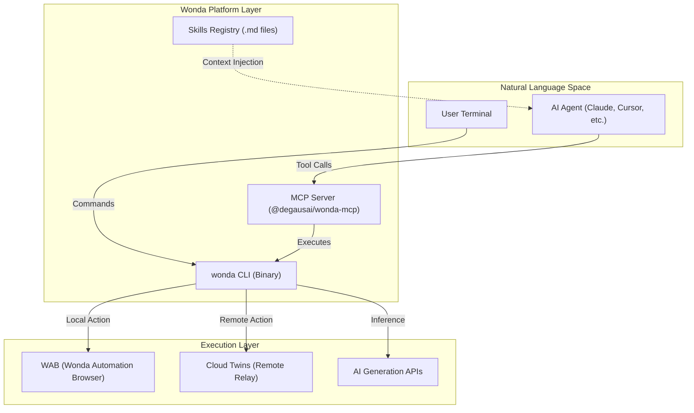

**Sources:**
*   `mcp/src/index.ts` (MCP server entry point) [mcp/src/index.ts:1-10]()
*   `README.md` (CLI overview) [README.md:5-12]()
*   `.codex-plugin/plugin.json` (Agent integration) [.codex-plugin/plugin.json:1-32]()

---

## Key Components

### 1. wonda CLI
The core binary providing the command-line interface. It handles credential encryption, rate limiting, and the heavy lifting of media processing via `ffmpeg`.
*   **For details, see [wonda CLI Reference](#2)**.

### 2. MCP Server (`@degausai/wonda-mcp`)
A Model Context Protocol server that exposes Wonda's capabilities as structured tools to AI agents. It supports two modes: `local` (using the local CLI/browser) and `remote` (dispatching to Cloud Twins).
*   **For details, see [MCP Server Architecture](#3)**.

### 3. Wonda Automation Browser (WAB)
A hardened, anti-detect Chromium fork used to bypass bot detection on social platforms. It maintains real browser fingerprints and persistent sessions.
*   **For details, see [Wonda Automation Browser (WAB)](#5)**.

### 4. Cloud Twins
Provisioned remote environments that run WAB sessions 24/7. They allow agents to perform scheduled tasks or high-volume outreach without keeping a local machine active.
*   **For details, see [Cloud Twins & Digital Personas](#6)**.

---

## Bridging Natural Language to Code Entities

The following diagrams illustrate how abstract concepts like "Generation" or "Social Actions" map to specific code implementations within the `wonda-mcp` package.

### Generation & Media Pipeline Mapping

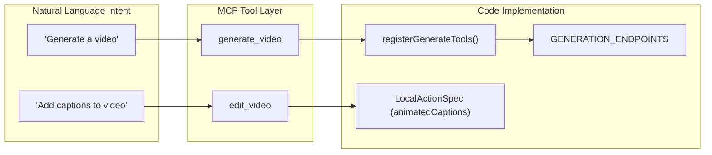
**Sources:**
*   `mcp/src/tools/generate.ts` (Generation tools) [mcp/src/tools/generate.ts:1-20]()
*   `mcp/src/local-action-registry.ts` (Editing actions) [mcp/src/local-action-registry.ts:1-50]()

### Social Action Dispatch Mapping

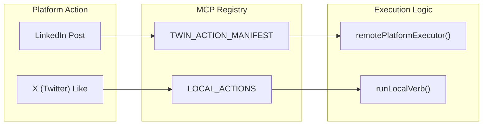
**Sources:**
*   `mcp/src/tools/twin-action-manifest.ts` [mcp/src/tools/twin-action-manifest.ts:1-10]()
*   `mcp/src/local-action-registry.ts` [mcp/src/local-action-registry.ts:1-10]()
*   `mcp/src/local-exec.ts` [mcp/src/local-exec.ts:1-15]()

---

## Getting Started
To begin using the platform, users typically install the CLI and authenticate their accounts. AI agents are then granted access via the MCP server or by installing "Skill" files into the project directory.

*   **Installation**: `curl -fsSL https://wonda.sh/install.sh | bash`
*   **Authentication**: `wonda auth login`
*   **Agent Setup**: `wonda skill install -o .`

For a complete walkthrough, see **[Getting Started & Installation](#1.1)** and **[AI Agent Integration (Skills & Plugins)](#1.2)**.

---

# Page: Getting Started & Installation

# Getting Started & Installation

<details>
<summary>Relevant source files</summary>

The following files were used as context for generating this wiki page:

- [README.md](README.md)
- [assets/terminal.gif](assets/terminal.gif)
- [assets/terminal.png](assets/terminal.png)
- [install.sh](install.sh)

</details>


This page provides a technical guide for the initial setup, authentication, and environment configuration of the Wonda CLI and its associated services. It covers the local installation lifecycle, shell integration, and agent-native skill deployment.

## Installation Overview

The Wonda CLI is distributed as a pre-compiled binary for macOS, Linux, and Windows. The primary installation method is via a shell script that handles architecture detection, binary retrieval, and PATH configuration [install.sh:1-12]() [README.md:35-48]().

### 1. Automated Installation (Recommended)

The `install.sh` script automates the setup process by detecting the host operating system and CPU architecture [install.sh:55-80]().

```bash
curl -fsSL https://wonda.sh/install.sh | bash
```

**Implementation Details:**
- **Binary Source:** Fetches the latest release from the GitHub repository `degausai/wonda` [install.sh:7-8]().
- **Architecture Mapping:** Maps `x86_64` to `amd64` and `aarch64`/`arm64` to `arm64` [install.sh:65-71](). On macOS, it includes logic to detect Rosetta translation and prefer the native `arm64` slice [install.sh:74-79]().
- **Verification:** Downloads the `checksums.txt` from the release assets and performs a SHA-256 verification of the archive before extraction [install.sh:124-147]().
- **Location:** Installs the binary to `$HOME/.wonda/bin/wonda` [install.sh:102-158]().

### 2. Manual Installation via Package Managers

Wonda is also available via platform-specific package managers for users who prefer managed updates [README.md:37-47]().

| Platform | Command |
| :--- | :--- |
| **macOS (Homebrew)** | `brew tap degausai/tap && brew install wonda` |
| **Node.js (NPM)** | `npm i -g @degausai/wonda` |

*Note: If multiple installation methods are used, the `install.sh` version placed in `~/.wonda/bin` typically takes precedence in the PATH [install.sh:201-221]().*

---

## Environment Configuration

### Shell PATH Setup
The installer attempts to modify shell configuration files (`.zshrc`, `.bashrc`, or `config.fish`) to include the Wonda binary directory [install.sh:161-188]().

| Shell | Configuration File | Entry Added |
| :--- | :--- | :--- |
| **Zsh** | `~/.zshrc` | `export PATH=$HOME/.wonda/bin:$PATH` |
| **Bash** | `~/.bashrc` | `export PATH=$HOME/.wonda/bin:$PATH` |
| **Fish** | `~/.config/fish/config.fish` | `fish_add_path $HOME/.wonda/bin` |

### Environment Variables
Wonda behavior can be tuned using the following environment variables:

| Variable | Purpose |
| :--- | :--- |
| `WONDA_NO_AUTO_SETUP` | If set to `1`, skips the prompt to install the desktop relay app during installation [install.sh:25](). |
| `GITHUB_ACTIONS` | When detected as `true`, the installer automatically exports the install path to `$GITHUB_PATH` [install.sh:191-193](). |

---

## Authentication & Initialization

Once installed, the CLI must be authenticated with a Wonda account to access media generation and social automation features [README.md:49-54]().

### Authentication Flow
The command `wonda auth login` initiates an OAuth2-style flow that opens the system browser for credential entry [README.md:52]().

**Data Flow: CLI Authentication**
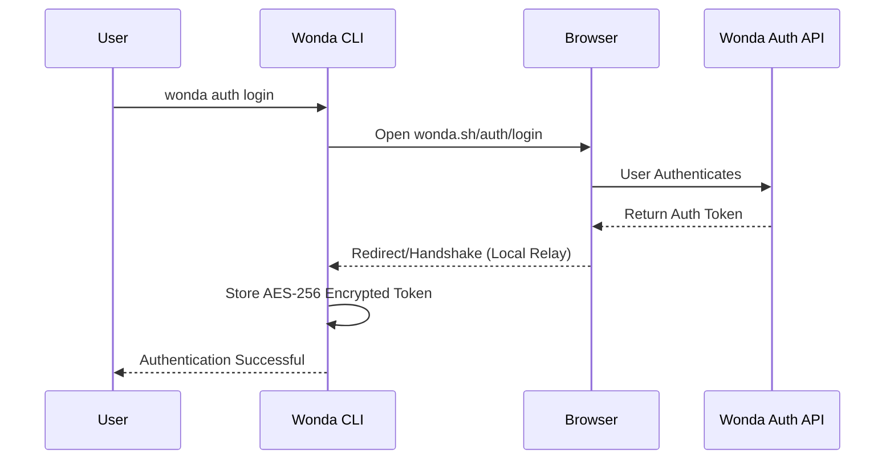
*Sources: [README.md:52-54](), [install.sh:224-226]()*

---

## Agent-Native Setup (Skills)

Wonda is designed to be "agent-native," meaning AI assistants (like Claude, Cursor, or Gemini) can use it without manual training. This is achieved through **Skill Files** [README.md:16-27]().

### Installing Skills
To allow a project-local agent to use Wonda, run:
```bash
wonda skill install -o .
```
This generates a `.wondaskill` (Markdown) file in the current directory containing the tool definitions and workflow instructions the agent needs to interpret [README.md:53-67]().

### Integration Options

| Agent Environment | Installation Command |
| :--- | :--- |
| **General Agents** | `npx skills add degausai/wonda` |
| **Claude Code** | `/plugin marketplace add degausai/wonda` |
| **Gemini CLI** | `gemini extensions install https://github.com/degausai/wonda` |

---

## Desktop Relay App (Optional)

For advanced social automation (LinkedIn, X, etc.) that requires local browser context or "Human-in-the-loop" (HITL) interactions, Wonda offers a desktop relay app [install.sh:24-25]().

**System Component Interaction**
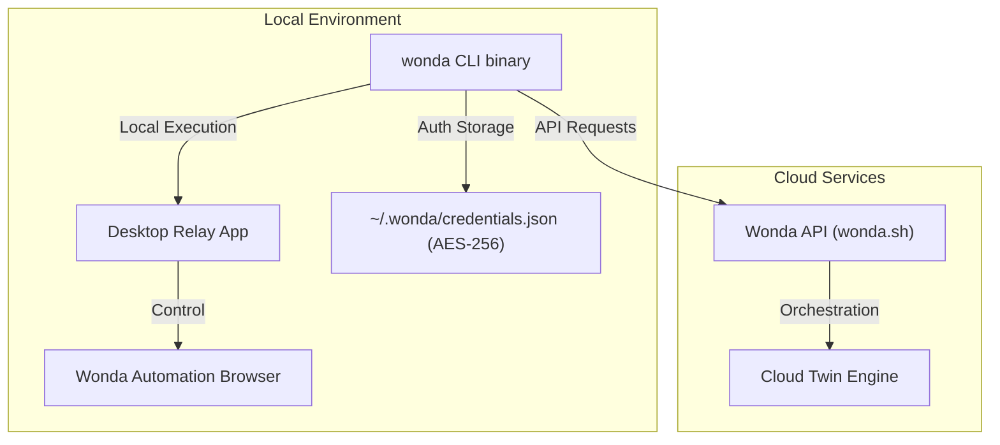
*Sources: [README.md:7-12](), [install.sh:102-110]()*

---

## Summary of Initial Commands

After installation, the following sequence is recommended for a fresh setup:

1.  **Verify Install:** `wonda --version`
2.  **Login:** `wonda auth login` [README.md:52]()
3.  **Check Balance:** `wonda balance` [README.md:88]()
4.  **Install Agent Skill:** `wonda skill install -o .` [README.md:53]()

**Sources:**
- [README.md:1-106]()
- [install.sh:1-226]()

---

# Page: AI Agent Integration (Skills & Plugins)

# AI Agent Integration (Skills & Plugins)

<details>
<summary>Relevant source files</summary>

The following files were used as context for generating this wiki page:

- [.claude-plugin/marketplace.json](.claude-plugin/marketplace.json)
- [.claude-plugin/plugin.json](.claude-plugin/plugin.json)
- [.codex-plugin/plugin.json](.codex-plugin/plugin.json)
- [gemini-extension.json](gemini-extension.json)
- [skills/README.md](skills/README.md)
- [skills/wonda-cli/SKILL.md](skills/wonda-cli/SKILL.md)

</details>


Wonda is architected as an "agent-native" platform. Unlike traditional tools designed primarily for human GUI interaction, Wonda prioritizes discoverability and operability by Large Language Models (LLMs) and autonomous agents. This is achieved through a structured **Skills System** and native **Plugin Manifests** that allow agents to understand the CLI's capabilities without manual training.

## The Skills System

The core of Wonda's agent integration is the **Skill**—a Markdown-based workflow definition that bridges the gap between natural language intent and CLI execution. These files provide agents with high-level context, installation instructions, and common patterns for using the `wonda` binary.

### Skill Structure and Discovery
Skills are defined as Markdown files with YAML frontmatter. The primary entry point for agents is `skills/wonda-cli/SKILL.md` [[skills/wonda-cli/SKILL.md:1-4]]().

*   **Name & Description**: Used by agents to identify the tool's purpose (e.g., content generation, social research) [[skills/wonda-cli/SKILL.md:2-3]]().
*   **Workflow Documentation**: Detailed guides on authentication, organization context (`wonda use --org`), and project tagging [[skills/wonda-cli/SKILL.md:24-82]]().
*   **Agent Instructions**: Specific guidance for agents on how to handle spend context and project management [[skills/wonda-cli/SKILL.md:79-82]]().

### Natural Language to CLI Mapping
The following diagram illustrates how an agent moves from a natural language request to executing a Wonda command using the Skills system.

**Agent Command Discovery Flow**
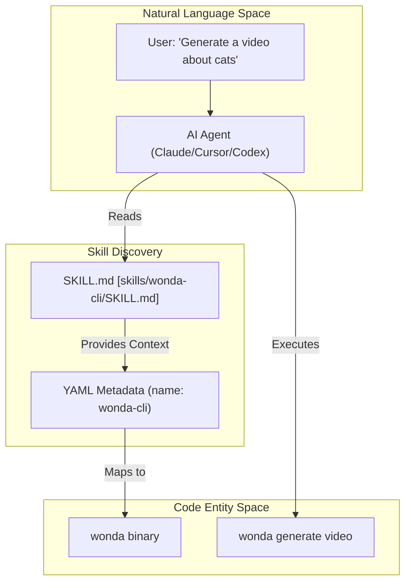
**Sources:** [[skills/wonda-cli/SKILL.md:1-20]](), [[skills/README.md:1-17]]()

## Plugin Manifests

Wonda provides native integration manifests for major AI development environments. These manifests allow agents like Claude Code, Cursor, and Gemini to treat Wonda as a first-class extension.

### Manifest Types
Wonda maintains several platform-specific manifests to ensure compatibility across the agent ecosystem:

| Platform | Manifest File | Purpose |
| :--- | :--- | :--- |
| **Claude Code** | `.claude-plugin/plugin.json` | Defines version, author, and repository for Claude's internal toolbelt [[.claude-plugin/plugin.json:1-21]](). |
| **Codex** | `.codex-plugin/plugin.json` | Maps the `./skills/` directory for OpenAI Codex-based agents [[.codex-plugin/plugin.json:1-32]](). |
| **Gemini** | `gemini-extension.json` | Basic extension metadata for Google Gemini CLI/extensions [[gemini-extension.json:1-6]](). |
| **Marketplace** | `.claude-plugin/marketplace.json` | Registry information for official Wonda plugins [[.claude-plugin/marketplace.json:1-29]](). |

### Capabilities and Interfaces
The `.codex-plugin/plugin.json` defines the `interface` which specifies that Wonda has both `Read` and `Write` capabilities [[.codex-plugin/plugin.json:22-31]](). This tells the agent it can both fetch data (e.g., `wonda usage`) and perform destructive or creative actions (e.g., `wonda publish`).

**Plugin Architecture Association**
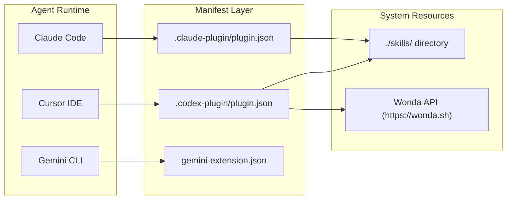
**Sources:** [[.codex-plugin/plugin.json:21-31]](), [[.claude-plugin/plugin.json:1-10]](), [[gemini-extension.json:1-5]]()

## Agent-Native Authentication

Wonda facilitates two primary auth paths for agents to ensure security while maintaining autonomy:

1.  **CLI Auth**: Agents use `wonda auth login` which opens a browser for the human operator, or they consume the `WONDA_API_KEY` environment variable [[skills/wonda-cli/SKILL.md:24-25]]().
2.  **OAuth Connector**: For web-based agents (like Claude web), Wonda uses an OAuth 2.1 flow. The server swaps OAuth tokens for internal API keys so the agent host never sees the raw secret `sk_...` key [[skills/wonda-cli/SKILL.md:27-35]]().
3.  **Local Relay**: The `wonda relay pair` command allows remote connectors to run actions on the user's local machine and residential IP, bridging cloud-based agents to local execution environments [[skills/wonda-cli/SKILL.md:37-52]]().

## Spend and Context Management

Agents are instructed via the Skills system to manage "Spend Context" to ensure costs are attributed correctly within organizations.

*   **Organization Context**: Agents use `wonda use --org <slug>` to switch from personal wallets to shared org wallets [[skills/wonda-cli/SKILL.md:65-68]]().
*   **Project Tagging**: Agents are encouraged to use `wonda use --project <name>` at the start of a task to tag all subsequent generation and social actions for monitoring [[skills/wonda-cli/SKILL.md:79-84]]().
*   **Safety Checks**: Agents check the `active project` and `active org` using `wonda use` to prevent unauthorized spend [[skills/wonda-cli/SKILL.md:79-82]]().

**Sources:** [[skills/wonda-cli/SKILL.md:59-93]]()

---

# Page: wonda CLI Reference

# wonda CLI Reference

<details>
<summary>Relevant source files</summary>

The following files were used as context for generating this wiki page:

- [README.md](README.md)
- [assets/terminal.gif](assets/terminal.gif)
- [assets/terminal.png](assets/terminal.png)
- [skills/wonda-cli/SKILL.md](skills/wonda-cli/SKILL.md)

</details>


The `wonda` CLI is a unified binary designed to handle the entire lifecycle of AI content operations: from generating raw assets (images, video, music) to complex multi-track editing, social platform research, and autonomous publishing. It is designed to be "agent-native," providing a predictable interface for AI assistants like Claude Code, Cursor, and Gemini to execute complex workflows.

## Command Structure & Execution Engines

The CLI operates across two primary execution environments, controlled via the `--engine` and `--via` flags. This allows users to choose between local privacy/control and cloud-scale automation.

### Execution Environments
*   **Local Engine**: Commands run on the user's machine using local resources or a local relay. For social actions, this typically uses the **Wonda Automation Browser (WAB)**, a hardened Playwright fork, to execute actions via the user's local IP [skills/wonda-cli/SKILL.md:37-54]().
*   **Cloud Engine**: Commands are dispatched to **Cloud Twins**, which are managed, persistent browser instances running in Wonda's infrastructure. These are ideal for scheduled tasks and long-running autonomous loops [skills/wonda-cli/SKILL.md:116-120]().

### Command Groups
| Group | Primary Function | Key Commands |
| :--- | :--- | :--- |
| **Generation** | AI Inference | `generate image`, `generate video`, `audio speech` |
| **Editing** | Media Post-Production | `edit video`, `compose`, `transitions`, `clipping` |
| **Social** | Platform Operations | `linkedin`, `twitter`, `reddit`, `instagram` |
| **System** | Auth & Config | `auth login`, `use --org`, `skill install` |

**Sources:** [README.md:93-176](), [skills/wonda-cli/SKILL.md:6-25]()

---

## System Architecture: Code to Entity Mapping

The following diagrams illustrate how CLI commands and system states map to specific code entities and data structures within the repository.

### CLI Command Dispatch & Versioning
This diagram shows how a command invocation (e.g., `wonda linkedin post`) is processed, checked for updates, and dispatched to the local execution engine.

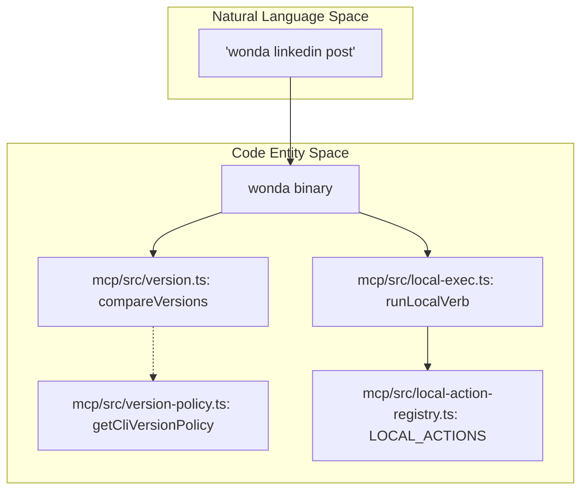
**Sources:** [mcp/src/version.ts](), [mcp/src/version-policy.ts](), [mcp/src/local-exec.ts](), [mcp/src/local-action-registry.ts]()

### Credential & Rate Limit Safety Gate
This diagram maps the logical concept of "Safety Gates" to the specific classes and files that enforce rate limits and encrypted storage.

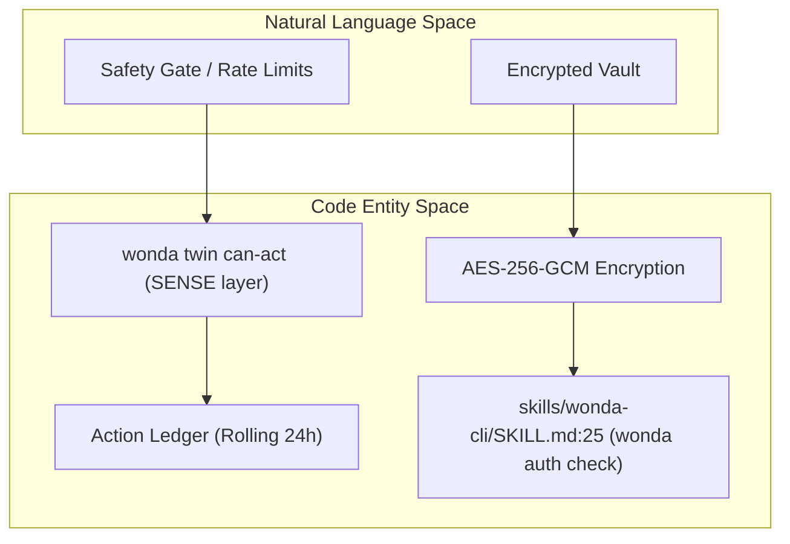
**Sources:** [skills/wonda-cli/SKILL.md:24-35](), [README.md:159-160]()

---

## Major Functional Areas

### Media Generation & Editing
Wonda provides a "model waterfall" approach to generation, allowing agents to pick specific models or use defaults for image, video, and audio creation. The editing suite is designed for "local-first" operations, leveraging `ffmpeg` and `hyperframes` for high-performance video manipulation like animated captions and scene splitting.
*   **For details, see [Media Generation & Editing Commands](#2.1)**

### Social Platform Automation
The CLI offers a unified interface for LinkedIn, X (Twitter), Reddit, and Instagram. It supports "Read" operations (often via cookie-based transport) and "Write" operations (via WAB/Twin transport).
*   **For details, see [Social Platform Commands](#2.2)**

### Credentials, Rate Limits & Safety Gate
Security is handled via an AES-256-GCM encrypted vault. Every profile is subject to a "Safety Gate" that monitors rolling 24-hour rate limit buckets for actions like outreach, posting, and commenting to prevent account flagging.
*   **For details, see [Credentials, Rate Limits & Safety Gate](#2.3)**

---

## Global Options

| Option | Description |
| :--- | :--- |
| `--engine <auto\|my_machine\|cloud>` | Forces execution on the local relay or cloud twin [skills/wonda-cli/SKILL.md:55-58](). |
| `--org <slug>` | Switches context to a specific Organization wallet [skills/wonda-cli/SKILL.md:66-67](). |
| `--project <name>` | Tags the spend of a command to a specific project for monitoring [skills/wonda-cli/SKILL.md:87](). |
| `--via <cookies\|wab>` | Selects the transport mechanism for social platform actions [mcp/src/local-action-registry.ts:25](). |

**Sources:** [skills/wonda-cli/SKILL.md:55-87](), [mcp/src/local-action-registry.ts]()

---

# Page: Media Generation & Editing Commands

# Media Generation & Editing Commands

<details>
<summary>Relevant source files</summary>

The following files were used as context for generating this wiki page:

- [README.md](README.md)
- [assets/terminal.gif](assets/terminal.gif)
- [assets/terminal.png](assets/terminal.png)
- [skills/wonda-cli/SKILL.md](skills/wonda-cli/SKILL.md)

</details>


This section details the media capabilities of the Wonda CLI, focusing on the end-to-end lifecycle from AI-driven generation to programmatic video editing and scene analysis. Wonda adopts a "local-first" philosophy where heavy inference occurs in the cloud, while precise timeline manipulation and composition are handled locally via `ffmpeg` and the `hyperframes` engine.

## Generation Tools & Job Polling

Wonda provides a unified interface for generating multimodal content including images, video, music, and speech. These operations follow an asynchronous **Inference Job Polling** pattern to handle long-running GPU tasks.

### Data Flow: Generation Lifecycle
1.  **Request**: The CLI or MCP server sends a prompt and parameters to the `GENERATION_ENDPOINTS` [mcp/src/tools/generate.ts:24-34]().
2.  **Job ID**: The server returns an `inferenceJobId`.
3.  **Polling**: The client enters a polling loop, querying the job status until it reaches a terminal state (`completed` or `failed`).
4.  **Artifact Retrieval**: Upon completion, the final media URL and metadata are returned to the user or agent.

### Supported Generation Types
| Command | Implementation | Key Parameters |
| :--- | :--- | :--- |
| `generate image` | `generate_image` | `prompt`, `model`, `aspect_ratio` |
| `generate video` | `generate_video` | `prompt`, `referenceMediaId`, `duration` |
| `generate music` | `generate_music` | `prompt`, `duration_seconds` |
| `audio speech` | `speech` | `text`, `voice_id`, `model` |
| `audio dialogue` | `dialogue` | `script` (multi-speaker support) |

**Sources:**
- [mcp/src/tools/generate.ts:1-200]()
- [skills/wonda-cli/SKILL.md:95-106]()

---

## Video Editing & Composition

Wonda's editing suite is designed for "agentic editing," where natural language instructions are translated into precise `ffmpeg` operations. The `wonda edit video` and `wonda compose` commands serve as the primary entry points.

### The Model Waterfall
For high-level operations like background removal or upscaling, Wonda utilizes a **Model Waterfall** approach, routing tasks to specialized AI models:
- **Background Removal**: `birefnet-bg-removal` (images) or `bria-video-background-removal` (video).
- **Enhancement**: `topaz-video-upscale` for resolution increases up to 4x.
- **Synchronization**: `sync-lipsync-v2-pro` for matching character lip movements to audio tracks.

### Local Execution Engine
For timeline edits, Wonda uses a local execution engine that wraps `ffmpeg`.

```mermaid
graph TD
    subgraph "Natural Language Space"
        A["Agent Instruction: 'Trim the first 5s and add captions'"]
    end

    subgraph "Code Entity Space"
        B["wonda-mcp: runLocalVerb"]
        C["wonda-cli: edit video --operation trim"]
        D["FFmpeg Process"]
        E["hyperframes Engine"]
    end

    A --> B
    B --> C
    C --> E
    E --> D
    D --> F["Final .mp4 Artifact"]
end
```

**Sources:**
- [README.md:107-136]()
- [mcp/src/local-exec.ts:10-45]()
- [skills/wonda-cli/SKILL.md:111-136]()

---

## Video Analysis & Clipping

The `analyze video` command is a critical bridge between raw video data and LLM understanding. It decomposes video files into a structured format that agents can process.

### Analysis Pipeline
1.  **Frame Extraction**: Extracts a composite frame grid (e.g., 2x2 or 3x3) representing key moments in the video.
2.  **Transcription**: Extracts the audio track and runs speech-to-text.
3.  **Metadata Extraction**: Gathers resolution, FPS, and duration.
4.  **Context Injection**: The resulting text and image grid are fed back to the LLM, allowing it to "see" the video content for subsequent editing decisions.

### Clipping & Scene Detection
The `wonda clipping` and `splitScenes` operations use visual change detection to identify logical breaks in content.
- `wonda edit video --operation splitScenes`: Automatically detects transitions.
- `wonda edit video --operation skipSilence`: Removes non-vocal gaps in the audio track to tighten pacing.

**Sources:**
- [README.md:137-142]()
- [mcp/src/tools/generate.ts:150-180]()

---

## Technical Implementation: Media Dispatcher

The `registerGenerateTools` function in the MCP server maps natural language tools to API calls and local binary executions.

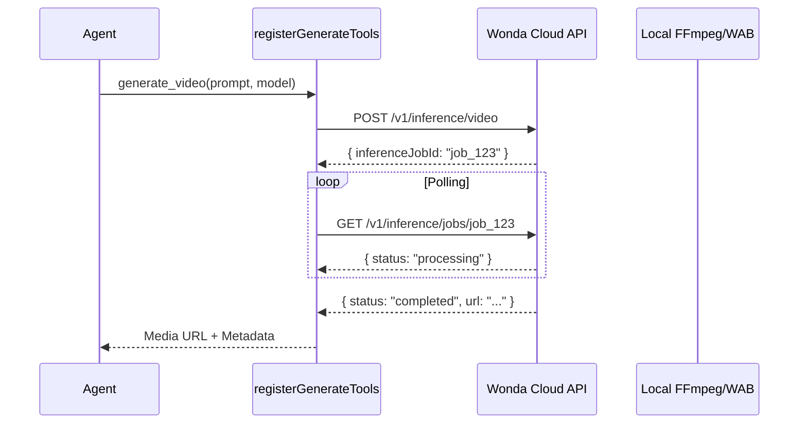

### Key Functions
- `runLocalVerb` [mcp/src/local-exec.ts:12](): Handles local command dispatching with version gating.
- `generateInputSchema` [mcp/src/tools/generate.ts:40](): Defines the Zod validation for all generation requests.
- `extractUpdateNotices` [mcp/src/local-exec.ts:88](): Parses `stderr` from local media commands to check for CLI updates.

**Sources:**
- [mcp/src/tools/generate.ts:10-60]()
- [mcp/src/local-exec.ts:1-100]()
- [README.md:93-136]()

---

# Page: Social Platform Commands

# Social Platform Commands

<details>
<summary>Relevant source files</summary>

The following files were used as context for generating this wiki page:

- [README.md](README.md)
- [assets/terminal.gif](assets/terminal.gif)
- [assets/terminal.png](assets/terminal.png)
- [skills/wonda-cli/SKILL.md](skills/wonda-cli/SKILL.md)

</details>


Wonda provides a unified CLI interface for interacting with major social platforms including LinkedIn, X (Twitter), Reddit, and Instagram. The system abstracts the complexity of different platform APIs and automation requirements through a multi-transport architecture.

## Overview and Transport Engines

Operations are split between **Read** (research/data extraction) and **Write** (publishing/engagement) capabilities. The behavior and environment of these commands are controlled by two primary flags:

*   `--via <cookies|wab>`: Determines the transport layer. `cookies` uses standard HTTP requests with stored session cookies, while `wab` (Wonda Automation Browser) uses a hardened Playwright-based browser to perform actions [mcp/src/local-action-registry.ts:10-14]().
*   `--engine <my_machine|cloud>`: Determines the execution environment. `my_machine` runs the command locally via the CLI or Local Relay, while `cloud` offloads the task to a Wonda Cloud Twin [skills/wonda-cli/SKILL.md:55-58]().

### Data Flow: Natural Language to Platform Action

The following diagram illustrates how a user request (or agent command) transitions from a high-level intent to a specific code execution path.

**Diagram: Command Dispatch Pipeline**
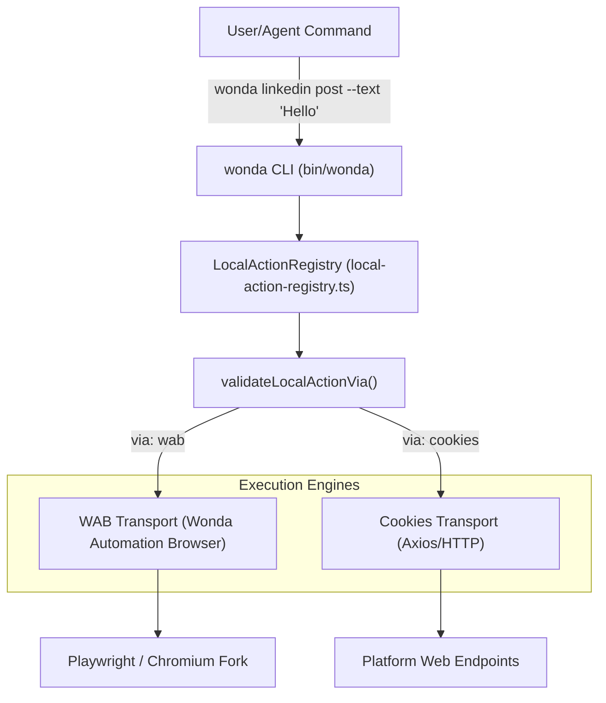
**Sources:** [mcp/src/local-action-registry.ts:10-40](), [skills/wonda-cli/SKILL.md:8-20]()

---

## LinkedIn Commands

LinkedIn support covers profile research, company analysis, messaging, and feed engagement.

### Core Commands
| Command | Description | Transport Default |
| :--- | :--- | :--- |
| `linkedin profile` | View profile by vanity name/URL | `cookies` |
| `linkedin search` | Search people, companies, or posts | `cookies` |
| `linkedin post` | Create a new post | `wab` |
| `linkedin like` | React to a specific post | `wab` |
| `linkedin send-message` | Send a message in a thread | `wab` |

### Implementation Details
LinkedIn actions are defined in the `LOCAL_ACTIONS` registry. For example, the `linkedin-profile` action is restricted to `cookies` transport to ensure high-speed data retrieval without browser overhead [mcp/src/local-action-registry.ts:162-168](). Conversely, writing operations like `linkedin-post` default to `wab` to bypass advanced bot detection [mcp/src/local-action-registry.ts:182-190]().

**Sources:** [README.md:153-174](), [mcp/src/local-action-registry.ts:150-200]()

---

## X (Twitter) & Reddit Commands

Research and automation for X and Reddit focus on content discovery and community engagement.

### X (Twitter)
*   `x search`: Search for tweets or users.
*   `x profile`: Fetch user metadata and recent tweets.
*   `x post`: Publish a tweet (supports `--via wab`).

### Reddit
*   `reddit search`: Search subreddits or posts.
*   `reddit info`: Get details on a specific subreddit.
*   `reddit submit`: Create a post. Note: Reddit submissions require specific validation for `subreddit` and `title` fields [mcp/src/local-action-registry.ts:240-250]().

**Sources:** [README.md:176-192](), [mcp/src/local-action-registry.ts:220-260]()

---

## Instagram & TikTok Publishing

Unlike the research-heavy LinkedIn/X commands, Instagram and TikTok commands are primarily focused on media publishing via the Wonda API.

### Publishing Pipeline
Publishing involves an asynchronous job pattern where media is first uploaded to the Wonda library and then dispatched to the platform.

**Diagram: Media Publishing Logic**
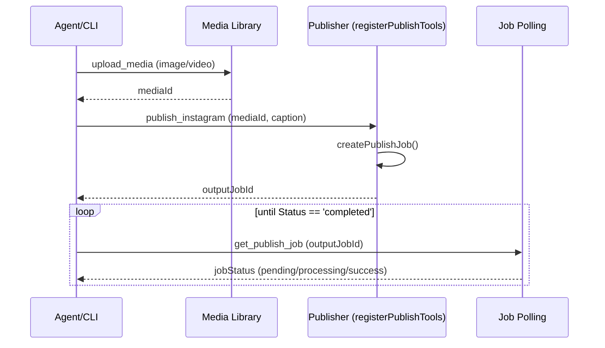
**Sources:** [README.md:143-151](), [skills/wonda-cli/SKILL.md:140-155]()

---

## Execution Control: Via vs. Engine

The system uses a logic gate to determine if a command can run locally or must be sent to the cloud.

### Engine Policy
1.  **`my_machine`**: Forces execution on the local host. If the Wonda Automation Browser is not installed, it will prompt for `wonda wab install` [skills/wonda-cli/SKILL.md:55-58]().
2.  **`cloud`**: Dispatches the command to a **Cloud Twin**. This is required for scheduled tasks or when the local machine is offline [skills/wonda-cli/SKILL.md:116-120]().
3.  **`auto`**: The default behavior. It attempts to use the Local Relay if online, falling back to the Cloud Twin otherwise [skills/wonda-cli/SKILL.md:55-58]().

### Transport Resolution
The function `resolveLocalActionVia` in `local-action-registry.ts` determines the transport based on the action's capabilities and user flags.

```typescript
// Conceptual logic from mcp/src/local-action-registry.ts
function resolveLocalActionVia(action, requestedVia) {
  if (action.via === 'cookies' && requestedVia === 'wab') {
    // Downgrade or error based on capability
  }
  return action.via;
}
```
**Sources:** [mcp/src/local-action-registry.ts:468-490](), [skills/wonda-cli/SKILL.md:55-58]()

## Summary of Social Actions

| Platform | Read (Cookies) | Write (WAB) | Research | Engagement |
| :--- | :---: | :---: | :---: | :---: |
| LinkedIn | Yes | Yes | Profiles/Search | Post/Like/DM |
| X | Yes | Yes | Tweets/Users | Post |
| Reddit | Yes | Yes | Subreddits | Submit |
| Instagram | No | Yes | N/A | Publish |

**Sources:** [README.md:93-200](), [mcp/src/local-action-registry.ts:150-300]()

---

# Page: Credentials, Rate Limits & Safety Gate

# Credentials, Rate Limits & Safety Gate

<details>
<summary>Relevant source files</summary>

The following files were used as context for generating this wiki page:

- [skills/wonda-cli/SKILL.md](skills/wonda-cli/SKILL.md)

</details>


This section documents the security and safety infrastructure of the Wonda platform. Wonda employs a multi-layered approach to protect user identities and social account integrity, combining local AES-256-GCM encryption for credentials with a sophisticated "Safety Gate" that monitors action velocity through rolling 24-hour ledgers.

## 1. Credential Vault & Encryption

Wonda stores sensitive platform credentials (cookies, session tokens, and API keys) in a local vault. This vault is encrypted at rest using **AES-256-GCM**.

### Data Flow & Storage
- **Local Personas**: Platform identities are stored as "Personas" within the `~/.wonda/wab/personas/` directory [wonda-automation-browser-wab-cli-commands-session-management:5.2]().
- **Encryption**: Session data and cookies are encrypted using a device-specific key. This ensures that even if the filesystem is compromised, the social sessions remain protected.
- **Cloud Sync**: Encrypted cookie jars are backed up to the Wonda backend every 10 minutes to allow for session persistence across different environments (e.g., migrating a local session to a Cloud Twin) [wonda-automation-browser-wab-cli-commands-session-management:5.2]().

### Authentication Flow (OAuth 2.1)
For remote connectors (like Claude web), Wonda uses an OAuth 2.1 flow. The connector signs in via a browser, receives an OAuth token, and the Wonda server swaps this token for the internal account API key (`sk_...`) only within the Wonda environment. This prevents third-party agents from ever seeing the raw API key [skills/wonda-cli/SKILL.md:27-35]().

---

## 2. The Safety Gate (Rate Limiting)

The Safety Gate is a per-profile action ledger system designed to prevent account flagging or bans by social platforms. It tracks every automated action and compares it against platform-specific thresholds.

### Rolling 24h Buckets
Actions are tracked in rolling 24-hour windows. The system maintains separate "buckets" for different types of social interactions:
- **Outreach**: Direct messages and connection requests.
- **Post**: Creating new top-level content.
- **Comment**: Replying to existing posts.
- **React**: Likes, upvotes, and reactions.
- **Visit**: Profile views or page visits.
- **Search**: Keyword or Boolean searches.

### SENSE Layer (`wonda twin can-act`)
Before any write operation is dispatched, the system queries the SENSE layer. This is implemented via the `can-act` logic, which checks the current ledger against the twin's limit policy [cloud-twins-digital-personas-twin-provisioning-scheduling-monitoring:6.1]().

| Limit Mode | Description |
| :--- | :--- |
| **Warmup** | Extremely restrictive; used for new accounts to build reputation. |
| **Conservative** | Safe default; mimics low-frequency human behavior. |
| **Moderate** | Balanced; mimics active daily users. |
| **Unlimited** | No local capping; relies entirely on platform-native limits (High Risk). |

### Abort Modes
When a rate limit is approached or hit, the Safety Gate triggers one of two modes:
1. **Soft Abort**: The action is queued or delayed with a jitter window to stay within limits [cloud-twins-digital-personas-twin-provisioning-scheduling-monitoring:6.1]().
2. **Hard Abort**: The execution is stopped immediately, and an error is returned to the agent/CLI to prevent platform penalties.

**Sources:**
- [skills/wonda-cli/SKILL.md:27-35]() (OAuth and API Key safety)
- [wonda-automation-browser-wab-cli-commands-session-management:5.2]() (Encryption and Sync)
- [cloud-twins-digital-personas-twin-provisioning-scheduling-monitoring:6.1]() (Limit modes and Jitter)

---

## 3. System Architecture Diagrams

### Credential & Session Security
The following diagram illustrates how credentials flow from the local Wonda Automation Browser (WAB) to the encrypted vault and eventually to Cloud Twins.

**Title: Credential Encryption & Sync Flow**
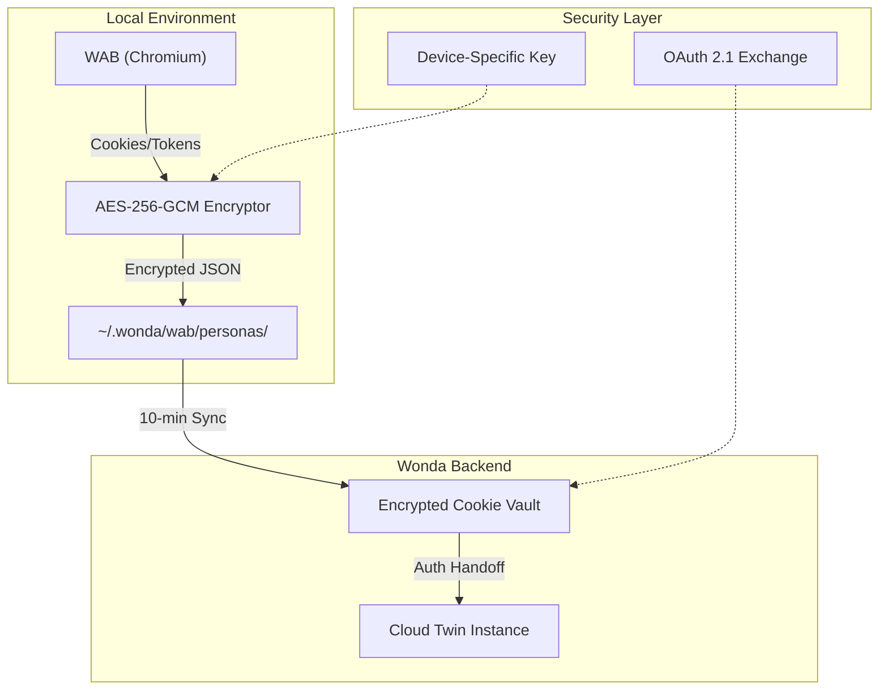
**Sources:**
- [wonda-automation-browser-wab-cli-commands-session-management:5.2]()
- [skills/wonda-cli/SKILL.md:27-35]()

### The Safety Gate Logic
This diagram bridges the Natural Language concepts of "Safety" to the specific code entities that govern action execution.

**Title: Safety Gate Execution Pipeline**
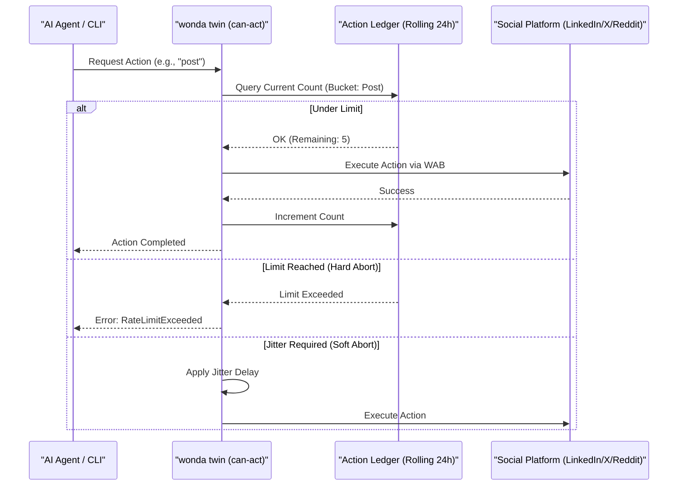
**Sources:**
- [cloud-twins-digital-personas-twin-provisioning-scheduling-monitoring:6.1]()
- [account-management-campaigns-campaign-autonomous-loop-tools:8.2]()

---

## 4. Ledger Sync & Backend Integration

The Safety Gate is not purely local. To support the "Hybrid Relay" model—where a user might run actions from both their local machine and a Cloud Twin—ledgers are synchronized.

1.  **Local Ledger**: The CLI maintains a local SQLite-based ledger for immediate feedback and low-latency safety checks.
2.  **Relay Sync**: The `wonda relay` process periodically pushes local action counts to the backend [skills/wonda-cli/SKILL.md:37-57]().
3.  **Unified View**: The backend aggregates actions from all sources (Local CLI, Cloud Twins, Wonda Web) to ensure the rolling 24h window is accurate across the entire identity.

### Ledger Categories
| Category | Monitored Actions |
| :--- | :--- |
| `outreach` | `linkedin_connect`, `x_dm`, `reddit_message` |
| `content` | `post_create`, `comment_create`, `submit_link` |
| `engagement` | `like`, `upvote`, `react` |
| `discovery` | `search_people`, `search_posts`, `visit_profile` |

**Sources:**
- [skills/wonda-cli/SKILL.md:37-57]() (Relay and Hybrid Model)
- [account-management-campaigns-campaign-autonomous-loop-tools:8.2]() (Action verbs and validation)

---

# Page: MCP Server Architecture

# MCP Server Architecture

<details>
<summary>Relevant source files</summary>

The following files were used as context for generating this wiki page:

- [mcp/README.md](mcp/README.md)
- [mcp/package.json](mcp/package.json)
- [mcp/src/index.ts](mcp/src/index.ts)
- [mcp/src/server.ts](mcp/src/server.ts)

</details>


The `@degausai/wonda-mcp` package provides a Model Context Protocol (MCP) server that bridges AI agents (such as Claude Desktop, Cursor, or Hermes) to the Wonda ecosystem [mcp/package.json:2-4](). It allows agents to perform high-fidelity social media actions, manage media generation pipelines, and control both local and cloud-based browser twins through a unified tool interface [mcp/README.md:3-4]().

### Operational Modes

The server operates in two distinct modes, controlled by the `WONDA_MCP_MODE` environment variable [mcp/src/index.ts:8-9](). The mode significantly alters the server's instructions to the LLM and the execution path for platform tools.

| Mode | Execution Path | Key Characteristics |
| :--- | :--- | :--- |
| **Local** | Local `wonda` binary [mcp/src/index.ts:15-27]() | Executes via the Wonda Automation Browser (WAB) on the host machine. Uses local cookie stores in `~/.wonda/` [mcp/README.md:9-11](). |
| **Remote** | Wonda Cloud API [mcp/src/server.ts:35-38]() | Routes actions to the Wonda backend, which dispatches them to either a provisioned Cloud Twin or a local relay if online [mcp/src/server.ts:37-44](). |

For details on how these modes are initialized, see [Server Initialization & Execution Modes](#3.1).

### System Topology

The following diagram illustrates how the MCP server translates natural language intent from an AI Agent into concrete system calls within the Wonda "Code Entity Space".

**Bridge: AI Agent to Wonda Code Entities**
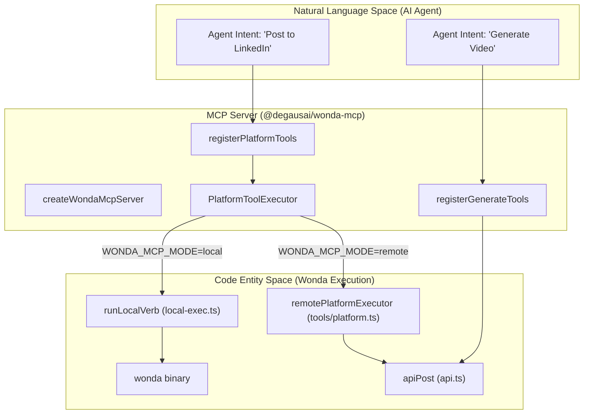
**Sources:** [mcp/src/index.ts:8-29](), [mcp/src/server.ts:52-70](), [mcp/src/tools/platform.ts:3-10]()

### Tool Registration Lifecycle

The server follows a modular registration pattern. The `createWondaMcpServer` factory function [mcp/src/server.ts:52-54]() initializes an `McpServer` instance and populates it by calling various registration functions:

*   **Platform Tools:** Registers over 50+ actions for LinkedIn, X, Reddit, and Instagram [mcp/src/server.ts:9]().
*   **Media & Generation:** Handles `generate_image`, `generate_video`, and media library management [mcp/src/server.ts:59-68]().
*   **Cloud Twins:** Manages the lifecycle of hosted browser environments via `registerTwinTools` [mcp/src/server.ts:13]().
*   **Automation Browser:** Direct control tools for the WAB (e.g., `wab_show`, `wab_open`) [mcp/src/server.ts:14]().

### Execution Logic

The server acts as a thin dispatch layer. For platform actions (like `linkedin_post`), it uses a `PlatformToolExecutor` interface [mcp/src/server.ts:3](). In local mode, this executor maps directly to `runLocalVerb`, which spawns the `wonda` CLI binary [mcp/src/index.ts:17-26](). In remote mode, it uses the `ApiContext` to send signed HTTPS requests to the Wonda backend [mcp/src/api.ts:1-10]().

**Bridge: Request Flow & Context**
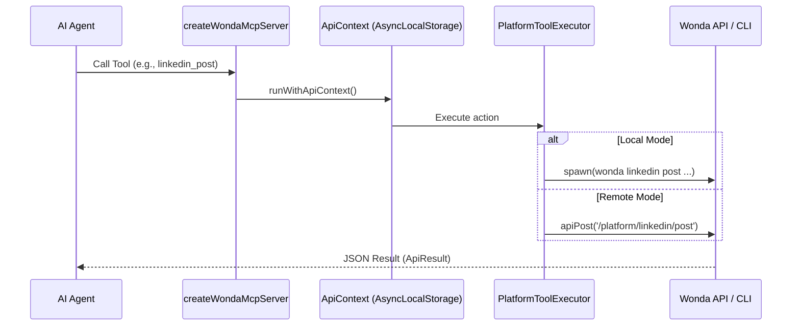
**Sources:** [mcp/src/index.ts:14-29](), [mcp/src/api.ts:12-25](), [mcp/src/server.ts:35-46]()

### Subsystems

Detailed documentation for the MCP server's internal components is split into the following child pages:

*   **[Server Initialization & Execution Modes](#3.1)**: Detailed breakdown of `index.ts` and `server.ts`, including how `LOCAL_INSTRUCTIONS` and `REMOTE_INSTRUCTIONS` guide the LLM's behavior.
*   **[API Client & Context Management](#3.2)**: Deep dive into `api.ts`, focusing on `AsyncLocalStorage` for credential handling and the `ApiResult` union type.
*   **[MCP Resources & Content Skills](#3.3)**: Overview of the `wonda://` URI scheme and how the server exposes dynamic content skills as both resources and tools.

**Sources:** [mcp/src/server.ts:1-75](), [mcp/src/api.ts:1-50](), [mcp/src/resources/index.ts:1-10]()

---

# Page: Server Initialization & Execution Modes

# Server Initialization & Execution Modes

<details>
<summary>Relevant source files</summary>

The following files were used as context for generating this wiki page:

- [mcp/src/index.ts](mcp/src/index.ts)
- [mcp/src/server.ts](mcp/src/server.ts)

</details>


This page details the initialization sequence and dual-mode execution architecture of the `@degausai/wonda-mcp` server. The server acts as a bridge between Model Context Protocol (MCP) clients (like Claude Desktop or Cursor) and the Wonda platform, operating in either a direct local execution mode or a remote cloud-proxy mode.

## Entry Point & Mode Selection

The server entry point is `mcp/src/index.ts`. It determines the operational mode via the `WONDA_MCP_MODE` environment variable. If set to `"local"`, the server is configured to execute social platform actions by directly spawning the local `wonda` CLI binary. Otherwise, it defaults to `"remote"` mode, where actions are dispatched to the Wonda API for routing to Cloud Twins or the Wonda Desktop Relay [mcp/src/index.ts:8-12]().

### Initialization Sequence

1.  **Environment Check**: Reads `process.env.WONDA_MCP_MODE` [mcp/src/index.ts:8]().
2.  **Version Capture**: In local mode, `captureBinaryVersion()` is called to cache the `wonda --version` output for use in the User-Agent header [mcp/src/index.ts:12]().
3.  **Server Factory**: Calls `createWondaMcpServer` with a mode-specific `PlatformToolExecutor` [mcp/src/index.ts:14-29]().
4.  **Transport Binding**: Instantiates `StdioServerTransport` and connects the server to `stdin`/`stdout` [mcp/src/index.ts:31-32]().

### Data Flow: Initialization to Execution

The following diagram illustrates how the `WONDA_MCP_MODE` environment variable influences the internal `PlatformToolExecutor` configuration.

**Wonda MCP Initialization Flow**
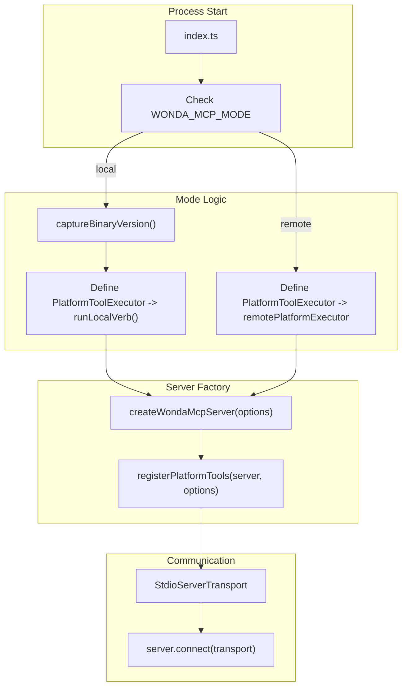
Sources: [mcp/src/index.ts:8-32](), [mcp/src/server.ts:52-70]()

---

## The `createWondaMcpServer` Factory

The `createWondaMcpServer` function in `mcp/src/server.ts` is responsible for instantiating the `McpServer` class from the SDK and attaching all resources and tools.

### Server Instructions
The server dynamically sets its `instructions` property based on the execution mode. This informs the LLM about the capabilities and limitations of the current environment:
*   **LOCAL_INSTRUCTIONS**: Emphasizes that tools (like `linkedin_*`) execute on the host machine via the CLI and Wonda Automation Browser (WAB) [mcp/src/server.ts:23-33]().
*   **REMOTE_INSTRUCTIONS**: Explains that actions are routed through the Wonda backend to either a Cloud Twin or a local relay [mcp/src/server.ts:35-46]().

### Tool Registration Registry
The factory centralizes the registration of various tool groups:

| Registry Function | Responsibility |
| :--- | :--- |
| `registerResources` | Exposes `wonda://` URIs for skills and balance [mcp/src/server.ts:68](). |
| `registerPlatformTools` | Core social actions (LinkedIn, X, Reddit, Instagram) [mcp/src/server.ts:65](). |
| `registerGenerateTools` | AI media generation (Image, Video, Music) [mcp/src/server.ts:59](). |
| `registerWabTools` | Browser control (show, hide, screenshot, login) [mcp/src/server.ts:70](). |
| `registerTwinTools` | Cloud Twin provisioning and lifecycle [mcp/src/server.ts:69](). |
| `registerStatusTools` | System health and versioning information [mcp/src/server.ts:67](). |

Sources: [mcp/src/server.ts:18-72](), [mcp/src/index.ts:14-29]()

---

## Platform Tool Execution Interface

The `PlatformToolExecutor` is a critical interface that abstracts the execution logic for social platform actions. This allows the tool definitions (schemas and metadata) to remain identical regardless of whether the execution happens locally or via the API.

### Local vs. Remote Dispatch

When a platform tool (e.g., `linkedin_post`) is invoked, the `PlatformToolExecutor` provided during server creation is called:

1.  **Local Mode**: The executor calls `runLocalVerb` from `mcp/src/local-exec.ts`. This function builds a command-line string and spawns the `wonda` process [mcp/src/index.ts:17-27]().
2.  **Remote Mode**: The executor defaults to `remotePlatformExecutor` (defined in `mcp/src/tools/platform.ts`), which performs an `apiPost` to the Wonda backend [mcp/src/tools/platform.ts:120-125]().

**Tool Execution Mapping**
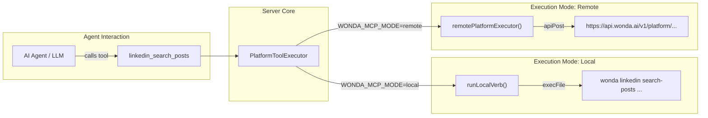
Sources: [mcp/src/index.ts:8-29](), [mcp/src/server.ts:3-15](), [mcp/src/tools/platform.ts:1-20]()

---

## Environment & Configuration

The server relies on several environment variables and global states to function correctly:

*   **`WONDA_MCP_MODE`**: Switches between local CLI execution and remote API routing [mcp/src/index.ts:8]().
*   **`WONDA_API_KEY`**: Required for all modes to authenticate with the Wonda API for generation, media, and remote platform tools [mcp/src/server.ts:33,46]().
*   **`captureBinaryVersion`**: A utility in `mcp/src/version.ts` that runs `wonda --version` once and caches the result. This ensures the server can report the CLI version to the API even if the binary is updated during the process lifetime [mcp/src/index.ts:10-12]().

### Stdio Binding
The server uses `StdioServerTransport` [mcp/src/index.ts:31](). This is the standard for MCP, allowing the server to be managed as a child process by host applications. The host sends JSON-RPC requests via `stdin` and receives responses via `stdout`.

Sources: [mcp/src/index.ts:1-33](), [mcp/src/version.ts:6-10]()

---

# Page: API Client & Context Management

# API Client & Context Management

<details>
<summary>Relevant source files</summary>

The following files were used as context for generating this wiki page:

- [mcp/src/api.ts](mcp/src/api.ts)

</details>


The Wonda MCP server communicates with the Wonda Cloud backend via a specialized API client designed for reliability, contextual awareness, and detailed error reporting. This system leverages Node.js `AsyncLocalStorage` to manage credentials across asynchronous execution flows and provides a unified interface for all HTTP operations.

### ApiContext & Context Management

The API client uses an `ApiContext` to manage the `apiKey` and `baseUrl` for requests. To ensure these credentials remain consistent throughout a specific execution chain (e.g., during a single MCP tool call), the system utilizes `AsyncLocalStorage` [mcp/src/api.ts:17-17]().

#### Key Components
*   **`ApiContext`**: A type defining the required `apiKey` and optional `baseUrl` [mcp/src/api.ts:7-10]().
*   **`runWithApiContext`**: A wrapper function that executes a callback within a specific context, ensuring all downstream API calls use the provided credentials [mcp/src/api.ts:19-24]().
*   **`getApiContext`**: Retrieves the current context from storage. If no context is active, it falls back to environment variables `WONDA_API_KEY` or `WONDERCAT_API_KEY`, and `WONDA_BASE_URL` [mcp/src/api.ts:26-34]().
*   **`normalizeApiContext`**: Ensures the `baseUrl` is correctly formatted (stripping trailing slashes) and defaults to `https://api.wondercat.ai/api/v1` [mcp/src/api.ts:36-44]().

**API Context Flow**
"The following diagram illustrates how the `AsyncLocalStorage` provides context to the API methods."

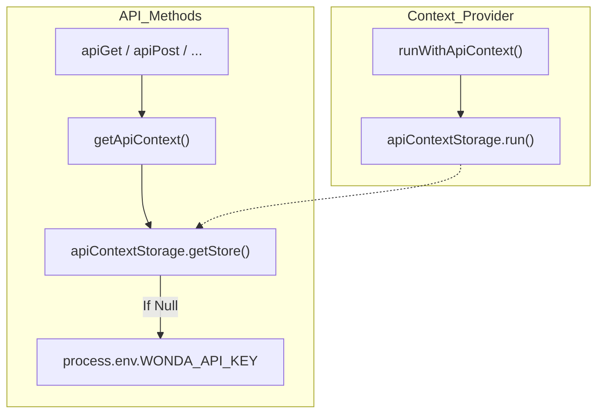
Sources: [mcp/src/api.ts:1-44]()

### HTTP Methods & Result Handling

The client provides a set of typed wrappers for standard HTTP verbs. Every method returns an `ApiResult`, which is a discriminated union used to handle success and failure states without throwing exceptions.

#### Supported Methods
| Method | Function | Description |
| :--- | :--- | :--- |
| `GET` | `apiGet` | Standard JSON GET request [mcp/src/api.ts:77-93](). |
| `GET (Text)` | `apiGetText` | Fetches plain text (e.g., Markdown Skills) without JSON parsing [mcp/src/api.ts:100-131](). |
| `POST` | `apiPost` | Sends JSON payload [mcp/src/api.ts:133-146](). |
| `PUT` | `apiPut` | Updates resources [mcp/src/api.ts:148-161](). |
| `PATCH` | `apiPatch` | Partial updates [mcp/src/api.ts:163-176](). |
| `DELETE` | `apiDelete` | Removes resources [mcp/src/api.ts:178-189](). |
| `UPLOAD` | `apiUpload` | Handles `FormData` for media uploads [mcp/src/api.ts:191-204](). |

#### The ApiResult Union
The `ApiResult<T>` type ensures that callers handle errors and metadata like `notice` or `warning` fields returned by the backend [mcp/src/api.ts:51-75]().

*   **Success**: Contains `ok: true`, `data: T`, and optional `notice` (informational text) or `warning` (staleness indicators) [mcp/src/api.ts:52-61]().
*   **Failure**: Contains `ok: false`, `error: string`, and an optional `partialResult`. The `partialResult` is critical for batch operations (like LinkedIn enrichment) that might fail halfway through; it allows the agent to see what was completed before the error occurred [mcp/src/api.ts:62-75]().

Sources: [mcp/src/api.ts:51-204]()

### User-Agent & Headers

Every request automatically includes authentication and identification headers via `getAuthHeaders` [mcp/src/api.ts:206-226]().

1.  **Authorization**: Uses the `Bearer` token scheme with the `apiKey` [mcp/src/api.ts:221-221]().
2.  **User-Agent**: Constructed via `buildUserAgent()` (defined in `version.ts`), which includes the MCP server version and the environment/platform information to assist in backend debugging and telemetry [mcp/src/api.ts:222-222](), [mcp/src/version.ts:78-83]().

**Request Preparation Flow**
"Association of code entities involved in generating a valid HTTP request."

```mermaid
sequenceDiagram
    participant C as "Caller (e.g. registerPlatformTools)"
    participant A as "api.ts (apiPost)"
    participant H as "getAuthHeaders()"
    participant V as "version.ts (buildUserAgent)"

    C->>A: apiPost("/path", body)
    A->>H: getAuthHeaders()
    H->>V: buildUserAgent()
    V-->>H: "wonda-mcp/1.2.3 (darwin; arm64) ..."
    H-->>A: { Authorization, User-Agent }
    A->>A: fetch(url, { headers, body })
```
Sources: [mcp/src/api.ts:206-226](), [mcp/src/version.ts:78-83]()

### Error Extraction Logic

The API client implements robust error extraction in `extractError` to handle various backend response formats [mcp/src/api.ts:232-258](). It attempts to find a human-readable message in the following order:
1.  Direct string response.
2.  The `error` field if it is a string.
3.  The `message` field nested inside an `error` object.
4.  The `message` field at the top level.
5.  A fallback string `HTTP {status}` if no message is found.

If a response includes a `partialResult` within the error body, it is extracted and attached to the `ApiResult` so that MCP tools can return partial data to the AI agent [mcp/src/api.ts:74-74]().

Sources: [mcp/src/api.ts:232-258]()

---

# Page: MCP Resources & Content Skills

# MCP Resources & Content Skills

<details>
<summary>Relevant source files</summary>

The following files were used as context for generating this wiki page:

- [mcp/src/content-skills.ts](mcp/src/content-skills.ts)
- [mcp/src/resources/index.ts](mcp/src/resources/index.ts)
- [mcp/src/tools/skills.ts](mcp/src/tools/skills.ts)

</details>


The Wonda MCP server exposes a rich set of read-only state and workflow definitions through the **Model Context Protocol (MCP) Resource** system. This system allows AI agents to browse account-level information—such as credit balances, provisioned twins, and platform capabilities—using a standardized URI scheme.

A core component of this system is the **Content Skill** catalog. Skills are Markdown-based workflow definitions that guide agents in content creation and social outreach. By exposing these as both resources and tools, Wonda ensures that agents can discover, inspect, and follow complex multi-step processes defined by either the platform or the user.

## Resource System Overview

The `wonda://` URI scheme provides a structured way for agents to access dynamic platform data. Resources are registered in `mcp/src/resources/index.ts` using the `server.registerResource` method [mcp/src/resources/index.ts:13-172]().

### Registered Resources

| URI | Title | Data Source | MIME Type |
|:---|:---|:---|:---|
| `wonda://balance` | Credit Balance | `GET /balance` | `application/json` |
| `wonda://capabilities` | API Capabilities | `GET /capabilities` | `application/json` |
| `wonda://twins` | Cloud Twins | `GET /twin/sessions` | `application/json` |
| `wonda://skills` | Content Skills | `GET /skill/content` | `application/json` |
| `wonda://skills/{slug}` | Content Skill | `GET /skill/content/{slug}` | `text/markdown` |

### Data Flow: Resource Resolution
The following diagram illustrates how a resource request is routed from the MCP Client through the server to the Wonda API.

**Resource Resolution Sequence**
```mermaid
sequenceDiagram
    participant Client as "MCP Client (e.g. Claude)"
    participant Server as "McpServer (mcp/src/resources/index.ts)"
    participant API as "Wonda API (api.ts)"

    Client->>Server: readResource("wonda://balance")
    Server->>API: apiGet("/balance") [mcp/src/resources/index.ts:23]
    API-->>Server: ApiResult<Balance>
    Server-->>Client: { contents: [{ uri, mimeType, text: JSON }] }

    Client->>Server: readResource("wonda://skills/linkedin-post")
    Server->>API: apiGetText("/skill/content/linkedin-post") [mcp/src/resources/index.ts:152]
    API-->>Server: Markdown String
    Server-->>Client: { contents: [{ uri, mimeType: "text/markdown", text: MD }] }
```
**Sources:** [mcp/src/resources/index.ts:13-172](), [mcp/src/api.ts:1-72]()

---

## Content Skills Catalog

Content Skills are the "brain" of the agent's workflow. They represent a catalog of effective skills, where canonical Wonda defaults are overlaid with user-specific forks or custom-built skills [mcp/src/resources/index.ts:91-94]().

### Data Structures
The `ContentSkillSummary` defines the metadata for discovery, while the skill itself is a Markdown document retrieved via its `slug` [mcp/src/content-skills.ts:3-18]().

*   **Slug Validation**: Slugs must match the pattern `^[a-z0-9-]+$` and have a maximum length of 80 characters [mcp/src/content-skills.ts:24-25]().
*   **Source Gating**: Skills are marked as `source: "default"` or `source: "user"`. If a user has forked a default skill, `hasDefaultUpdate` indicates if the upstream canonical skill has changed [mcp/src/content-skills.ts:7-9]().

### The Dual Exposure Pattern
Wonda employs a "Dual Exposure" pattern where the Skill Catalog is available as both a **Resource** (for context browsing) and a **Tool** (for active discovery during task execution).

| Entity | Type | Purpose |
|:---|:---|:---|
| `wonda://skills` | Resource | Browsing the full catalog list [mcp/src/resources/index.ts:87-110](). |
| `wonda://skills/{slug}` | Resource Template | Direct URI access to a specific workflow [mcp/src/resources/index.ts:112-171](). |
| `list_content_skills` | Tool | Agent discovery of available workflows [mcp/src/tools/skills.ts:22-43](). |
| `get_content_skill` | Tool | Programmatic retrieval of a workflow by an agent [mcp/src/tools/skills.ts:45-70](). |

**Sources:** [mcp/src/content-skills.ts:1-34](), [mcp/src/tools/skills.ts:1-72]()

---

## Implementation Details

### Resource Templates & Completion
The `wonda://skills/{slug}` resource uses a `ResourceTemplate` to support dynamic lookup. It includes a `complete` handler that allows MCP clients to provide auto-completion for skill slugs by fetching the catalog and filtering by the user's input [mcp/src/resources/index.ts:112-126]().

### Tool Implementation
The tools `list_content_skills` and `get_content_skill` are registered in `mcp/src/tools/skills.ts`. They use `zod` for input validation, specifically enforcing the `skillSlugSchema` [mcp/src/tools/skills.ts:12-19]().

*   **list_content_skills**: Calls `fetchContentSkillCatalog()` and returns a JSON string of the catalog [mcp/src/tools/skills.ts:32-41]().
*   **get_content_skill**: Calls `fetchContentSkill(slug)` and returns the raw Markdown content [mcp/src/tools/skills.ts:59-68]().

### Code Entity Mapping
This diagram bridges the Natural Language concepts to the specific TypeScript functions and schemas used in the codebase.

**MCP Content Skills Entity Map**
```mermaid
graph TD
    subgraph "Natural Language Space"
        Catalog["Skill Catalog"]
        Workflow["Markdown Workflow"]
        Slug["Skill ID (Slug)"]
    end

    subgraph "Code Entity Space (mcp/src)"
        fetchCatalog["fetchContentSkillCatalog() (content-skills.ts)"]
        fetchSkill["fetchContentSkill() (content-skills.ts)"]
        SlugSchema["skillSlugSchema (tools/skills.ts)"]
        ResourceTmpl["contentSkillTemplate (resources/index.ts)"]
        ListTool["list_content_skills (tools/skills.ts)"]
        GetTool["get_content_skill (tools/skills.ts)"]
    end

    Catalog --> fetchCatalog
    Workflow --> fetchSkill
    Slug --> SlugSchema
    
    fetchCatalog -.-> ListTool
    fetchCatalog -.-> ResourceTmpl
    fetchSkill -.-> GetTool
    fetchSkill -.-> ResourceTmpl
```

**Sources:** [mcp/src/resources/index.ts:112-171](), [mcp/src/tools/skills.ts:12-70](), [mcp/src/content-skills.ts:27-33]()

## Key Functions Summary

| Function | File | Description |
|:---|:---|:---|
| `registerResources` | [mcp/src/resources/index.ts:13]() | Binds URI paths to API fetchers for balance, capabilities, and twins. |
| `registerSkillTools` | [mcp/src/tools/skills.ts:21]() | Registers the tools agents use to discover and read skills. |
| `fetchContentSkillCatalog` | [mcp/src/content-skills.ts:27]() | Executes `apiGet("/skill/content")` to retrieve the skill list. |
| `fetchContentSkill` | [mcp/src/content-skills.ts:31]() | Executes `apiGetText("/skill/content/{slug}")` to retrieve Markdown content. |

**Sources:** [mcp/src/resources/index.ts:13-172](), [mcp/src/tools/skills.ts:1-72](), [mcp/src/content-skills.ts:1-34]()

---

# Page: Platform Tools & Action Registry

# Platform Tools & Action Registry

<details>
<summary>Relevant source files</summary>

The following files were used as context for generating this wiki page:

- [mcp/src/local-action-registry.ts](mcp/src/local-action-registry.ts)
- [mcp/src/tools/platform.ts](mcp/src/tools/platform.ts)
- [mcp/src/tools/twin-action-manifest.ts](mcp/src/tools/twin-action-manifest.ts)
- [mcp/src/version.ts](mcp/src/version.ts)

</details>


The **Platform Tools & Action Registry** system defines how social platform actions (LinkedIn, X, Reddit, Instagram) are structured, validated, and executed. It serves as the bridge between high-level agent requests and the low-level execution engines, whether running locally via the Wonda CLI or remotely on a Cloud Twin.

The system uses a declarative approach to tool registration, ensuring that AI agents receive rich, schema-validated interfaces while the underlying execution logic remains decoupled from the MCP server transport.

### System Overview

The registry architecture is divided into three primary layers:
1.  **Action Definition**: The `LOCAL_ACTIONS` registry defines the technical capabilities, transport requirements, and CLI argument mapping for every verb.
2.  **Tool Registration**: The `TWIN_ACTION_MANIFEST` and `registerPlatformTools` pipeline converts these definitions into MCP-compliant tools with Zod-validated input schemas.
3.  **Execution Dispatch**: The system determines whether to route the action to `runLocalVerb` (local CLI execution) or `remotePlatformExecutor` (Cloud Twin API call).

### Action Execution Flow: Natural Language to Code

This diagram illustrates how a natural language request from an AI agent traverses the registry to reach the correct execution entity.

**Registry Dispatch Logic**
```mermaid
graph TD
    subgraph "Natural Language Space"
        User["User: 'Post to LinkedIn'"]
    end

    subgraph "MCP Tool Layer"
        MCP["MCP Server"]
        Schema["Zod Input Schema"]
        Entry["TwinActionManifestEntry"]
    end

    subgraph "Registry & Execution Space"
        Registry["LOCAL_ACTIONS Registry"]
        Exec["registerPlatformTools"]
        Local["runLocalVerb (local-exec.ts)"]
        Remote["remotePlatformExecutor (platform.ts)"]
    end

    User --> MCP
    MCP --> Schema
    Schema --> Entry
    Entry --> Exec
    Exec -- "WONDA_MCP_MODE=local" --> Local
    Exec -- "WONDA_MCP_MODE=remote" --> Remote
    Local --> CLI["wonda linkedin post ..."]
    Remote --> API["POST /twin/action"]

    style Local stroke-dasharray: 5 5
    style Remote stroke-dasharray: 5 5
```
**Sources:** [mcp/src/tools/platform.ts:63-97](), [mcp/src/local-action-registry.ts:5-57](), [mcp/src/tools/twin-action-manifest.ts:13-150]()

---

### Key Components

#### 1. LOCAL_ACTIONS Registry
The `LOCAL_ACTIONS` object is the source of truth for action metadata. It defines the `LocalActionSpec` for each command, including supported transports (`cookies` vs `wab`), required payload fields, and version gating requirements.
*   **Transports**: Controlled via `LocalActionVia` [mcp/src/local-action-registry.ts:3]().
*   **Field Overrides**: Custom schemas for complex actions like `linkedin/enrich` or `linkedin/activity` are defined in `FIELD_OVERRIDES` [mcp/src/local-action-registry.ts:111-183]().
*   **Version Gating**: Uses `minCliVersion` to prevent execution on outdated binaries [mcp/src/local-action-registry.ts:41]().

For details, see [LOCAL_ACTIONS Registry (#4.1)](#).

#### 2. Twin Action Manifest & Platform Registration
The `TWIN_ACTION_MANIFEST` lists all actions available to the MCP server. The `registerPlatformTools` function iterates through this manifest to create tools. It dynamically builds Zod schemas using `buildActionInputSchema`, ensuring that the AI agent knows exactly which fields (like `target` or `count`) are required for a specific tool.
*   **Remote Execution**: Dispatched via `remotePlatformExecutor` which calls `apiPost` [mcp/src/tools/platform.ts:65-94]().
*   **Tool Annotations**: Automatically adds safety and category metadata via `annotationsForTwinActionKind` [mcp/src/tools/platform.ts:19]().

For details, see [Twin Action Manifest & Platform Tool Registration (#4.2)](#).

#### 3. Local Execution Engine
When the server is in `local` mode, it uses `runLocalVerb` to spawn the Wonda CLI binary. This component handles the translation of the JSON payload into a command-line argument vector (`buildLocalActionArgv`) and manages process timeouts and concurrency.
*   **Binary Interaction**: Uses `execFile` to run the binary identified by `WONDA_BIN` [mcp/src/version.ts:76]().
*   **Update Notices**: Extracts version warnings and update instructions from `stderr` to return as `Twin Notices` [mcp/src/local-exec.ts:255-275]().

For details, see [Local Execution Engine (#4.3)](#).

---

### Entity Relationship Diagram

This diagram maps the relationships between the configuration objects and the code entities that process them.

**Registry Entity Mapping**
```mermaid
classDiagram
    class LocalActionSpec {
        +platform: LocalActionPlatform
        +action: string
        +via: LocalActionVia
        +payloadFields: PayloadFieldSpec[]
        +buildArgv()
    }
    class TwinActionManifestEntry {
        +key: string
        +toolName: string
        +kind: "read" | "write"
        +localOnly: boolean
    }
    class PlatformToolRegistration {
        +registerPlatformTools()
        +buildActionInputSchema()
    }
    class LocalExec {
        +runLocalVerb()
        +runWonda()
    }

    TwinActionManifestEntry "1" -- "1" LocalActionSpec : maps to via key
    PlatformToolRegistration ..> TwinActionManifestEntry : iterates over
    PlatformToolRegistration ..> LocalActionSpec : derives schema from
    LocalExec ..> LocalActionSpec : executes via buildArgv()
```
**Sources:** [mcp/src/local-action-registry.ts:5-57](), [mcp/src/tools/twin-action-manifest.ts:1-11](), [mcp/src/tools/platform.ts:107-114]()

### Transport Comparison
The registry supports two primary transports for platform actions, defined in the `LocalActionVia` type [mcp/src/local-action-registry.ts:3]():

| Transport | Code Identifier | Description | Use Case |
| :--- | :--- | :--- | :--- |
| **Cookies** | `cookies` | Uses stored AES-256-GCM encrypted session headers. | High-speed read operations, simple likes/follows. |
| **WAB** | `wab` | Launches the Wonda Automation Browser (hardened Chromium). | Complex writes, anti-bot bypass, and human-in-the-loop auth. |

**Sources:** [mcp/src/local-action-registry.ts:3-21](), [mcp/src/tools/platform.ts:116-126]()

---

# Page: LOCAL_ACTIONS Registry

# LOCAL_ACTIONS Registry

<details>
<summary>Relevant source files</summary>

The following files were used as context for generating this wiki page:

- [mcp/src/local-action-registry.ts](mcp/src/local-action-registry.ts)

</details>


The `LOCAL_ACTIONS` registry, defined in [mcp/src/local-action-registry.ts](), is the central source of truth for all social platform operations that can be executed directly by the `wonda` CLI. It defines the mapping between MCP tools and CLI commands, specifying transport mechanisms, argument construction logic, and platform-specific validation rules.

## Core Data Structures

### LocalActionSpec
The `LocalActionSpec` type defines the interface for every action registered in the system. It governs how the MCP server validates incoming tool calls and how it translates them into shell commands for the local binary.

| Property | Type | Description |
| :--- | :--- | :--- |
| `platform` | `LocalActionPlatform` | The target social network (e.g., `linkedin`, `x`, `reddit`). |
| `kind` | `LocalActionKind` | Either `read` (data fetching) or `write` (publishing/interaction). |
| `via` | `LocalActionVia` | The default transport: `cookies` (HTTP/JSON) or `wab` (Automation Browser). |
| `supportedVia` | `LocalActionVia[]` | List of all transports the CLI implementation supports for this action. |
| `payloadFields` | `PayloadFieldSpec[]` | Metadata used to generate Zod schemas and validate tool inputs. |
| `buildArgv` | `Function` | The pipeline that transforms a JSON payload into a CLI argument array. |
| `minCliVersion` | `string` | The minimum version of the `wonda` binary required for this action. |

Sources: [mcp/src/local-action-registry.ts:5-57]()

### PayloadFieldSpec
This structure allows for declarative definition of tool parameters, which are then used to build the MCP tool definitions dynamically.

*   **Supported Kinds**: `string`, `value`, `boolean`, `stringArray`, `positiveInteger` [mcp/src/local-action-registry.ts:65-65]().
*   **Description**: The `description` field is used as the agent-facing hint in the Zod schema [mcp/src/local-action-registry.ts:70-74]().

## Transport Logic: Cookies vs. WAB

The registry distinguishes between two primary execution transports:
1.  **Cookies**: Uses authenticated HTTP requests via the persona's stored session cookies.
2.  **WAB (Wonda Automation Browser)**: Uses a hardened Chromium instance to perform actions as a human user would, bypassing advanced bot detection.

### Transport Resolution and Validation
The registry provides utility functions to ensure the requested transport is valid for a given action and persona.

*   **`validateLocalActionVia`**: Checks if a requested transport (e.g., via the `--via` flag) is supported by the action's `supportedVia` list [mcp/src/local-action-registry.ts:1145-1157]().
*   **`resolveLocalActionVia`**: Determines the final transport. If `viaOverride` is true and the payload specifies a transport, it uses that; otherwise, it defaults to the spec's `via` [mcp/src/local-action-registry.ts:1162-1172]().

### Entity Mapping: Transport Flow
This diagram shows how the `LocalActionSpec` determines the execution path.

```mermaid
graph TD
    subgraph "Natural Language Space"
        UserAction["'Like a post on X'"]
    end

    subgraph "Code Entity Space"
        ToolCall["MCP Tool Call"]
        Registry["LOCAL_ACTIONS Registry"]
        Spec["LocalActionSpec (x/like)"]
        ViaCheck["resolveLocalActionVia()"]
        ArgvPipe["buildArgv()"]
        
        ToolCall --> Registry
        Registry --> Spec
        Spec --> ViaCheck
        ViaCheck -->|cookies| CLI_HTTP["wonda x like --via cookies"]
        ViaCheck -->|wab| CLI_WAB["wonda x like --via wab"]
        Spec --> ArgvPipe
        ArgvPipe --> CLI_HTTP
        ArgvPipe --> CLI_WAB
    end
```
Sources: [mcp/src/local-action-registry.ts:17-21](), [mcp/src/local-action-registry.ts:1162-1172]()

## Argument Construction Pipeline (`buildArgv`)

The `buildArgv` function is the core transformation logic. It follows a consistent pattern across most actions:

1.  **Persona/Account**: Adds `--persona <name>` and optionally `--account <id>` [mcp/src/local-action-registry.ts:1196-1200]().
2.  **Transport**: Appends the `--via` flag based on the resolved transport [mcp/src/local-action-registry.ts:1203-1205]().
3.  **Flags & Positional**: Maps payload keys to CLI flags (e.g., `target` becomes a positional, `count` becomes `--count`) [mcp/src/local-action-registry.ts:1210-1230]().

### Specialized Validation and Overrides
Certain actions require logic that exceeds standard field types. These are handled via `FIELD_OVERRIDES` and custom `validatePayload` functions.

*   **LinkedIn Enrichment**: `linkedin/enrich` supports both `target` (single) and `targets` (array), but requires exactly one to be present. It also supports `preservePartialStdout` to keep data from mid-batch rate limits [mcp/src/local-action-registry.ts:159-183]().
*   **Sales Navigator**: Specific actions like `linkedin/sales-nav-search-people` have strict `maxCount` limits (e.g., 1000) and specific `minCliVersion` gates [mcp/src/local-action-registry.ts:470-498]().
*   **Reddit Submission**: `reddit/submit` requires a complex XOR check between `text`, `url`, and `mediaId` to ensure only one content type is posted [mcp/src/local-action-registry.ts:1097-1111]().

Sources: [mcp/src/local-action-registry.ts:111-183](), [mcp/src/local-action-registry.ts:1097-1111]()

## Version Gating

To prevent the MCP server from attempting to execute commands that the locally installed `wonda` binary does not yet support, the registry employs version gating.

*   **`minCliVersion`**: The absolute floor for the action [mcp/src/local-action-registry.ts:41-41]().
*   **`minCliVersionWhen`**: A predicate that applies a version floor only if certain payload conditions are met (e.g., a new flag added to an old command) [mcp/src/local-action-registry.ts:42-44]().
*   **`minCliVersionBase`**: The version floor for the command when the `minCliVersionWhen` predicate is *false* [mcp/src/local-action-registry.ts:50-50]().

### Implementation Mapping: Version Logic
This diagram associates versioning concepts with their implementation in the registry.

```mermaid
graph LR
    subgraph "Registry Definition"
        Spec["LocalActionSpec"]
        MinV["minCliVersion: '1.2.0'"]
        MinVWhen["minCliVersionWhen: (payload) => ..."]
    end

    subgraph "Execution Logic (local-exec.ts)"
        RunLocal["runLocalVerb()"]
        Check["Version Comparison"]
    end

    Spec --> RunLocal
    MinV --> Check
    MinVWhen --> Check
    Check -->|Version < Min| Abort["Return 409 Upgrade Required"]
    Check -->|Version >= Min| Exec["spawn(wonda ...)"]
```
Sources: [mcp/src/local-action-registry.ts:37-50](), [mcp/src/local-exec.ts:45-60]()

## Resource Management

### Requested Slots
The `requestedSlots` record defines the rate-limiting resources an action consumes. This is passed to the backend/ledger to track usage against persona limits [mcp/src/local-action-registry.ts:9-9](). Common slots include:
*   `post`: 1
*   `comment`: 1
*   `visit`: 1 (often used for enrichment or profile reads)
*   `search`: 1

### Timeouts
Default timeouts are defined to prevent hanging processes:
*   **Standard**: 120,000ms (2 minutes) [mcp/src/local-action-registry.ts:82-82]().
*   **Max**: 180,000ms (3 minutes) [mcp/src/local-action-registry.ts:83-83]().
*   **LinkedIn Posts/Comments**: 840,000ms (14 minutes) to allow for sequential navigation and stability passes [mcp/src/local-action-registry.ts:87-87]().

Sources: [mcp/src/local-action-registry.ts:82-87]()

---

# Page: Twin Action Manifest & Platform Tool Registration

# Twin Action Manifest & Platform Tool Registration

<details>
<summary>Relevant source files</summary>

The following files were used as context for generating this wiki page:

- [mcp/src/tools/platform.ts](mcp/src/tools/platform.ts)
- [mcp/src/tools/twin-action-manifest.ts](mcp/src/tools/twin-action-manifest.ts)
- [mcp/src/version.ts](mcp/src/version.ts)

</details>


This page documents the systems responsible for defining social platform actions and registering them as MCP tools. The core of this system is a static manifest that maps social media verbs to tool definitions, and a registration pipeline that dynamically generates Zod schemas based on the execution environment (Local vs. Remote).

## Twin Action Manifest

The `TWIN_ACTION_MANIFEST` is the source of truth for all social platform actions supported by Wonda. It defines the metadata required to expose these actions to AI agents via the Model Context Protocol (MCP).

### TwinActionManifestEntry Structure
Each entry in the manifest follows the `TwinActionManifestEntry` type definition [mcp/src/tools/twin-action-manifest.ts:1-11]():

*   **`key`**: A unique identifier for the action, typically formatted as `platform/action` (e.g., `linkedin/comment`) [mcp/src/tools/twin-action-manifest.ts:15]().
*   **`platform`**: The target social network (`linkedin`, `reddit`, `x`, or `instagram`) [mcp/src/tools/twin-action-manifest.ts:3]().
*   **`kind`**: Categorizes the action as `read` (data retrieval) or `write` (state-changing) [mcp/src/tools/twin-action-manifest.ts:5]().
*   **`requestedSlots`**: A record of specific action types and their counts, used for rate limiting and budget tracking (e.g., `{ like: 1 }`) [mcp/src/tools/twin-action-manifest.ts:19-21]().
*   **`variableSlots`**: A boolean indicating if the number of actions performed by the tool can vary based on input (e.g., `linkedin/engage-commenters`) [mcp/src/tools/twin-action-manifest.ts:205]().
*   **`toolName`**: The snake_case name exposed to the MCP client (e.g., `instagram_feed_engage`) [mcp/src/tools/twin-action-manifest.ts:43]().
*   **`localOnly`**: If true, the action is only registered when the MCP server is running in local mode [mcp/src/tools/twin-action-manifest.ts:10]().

### Manifest-to-Code Mapping

The following diagram illustrates how manifest entries bridge natural language concepts to internal code entities.

**Manifest Entity Mapping**
```mermaid
graph TD
    subgraph "Natural Language Space"
        A["'Comment on LinkedIn'"]
        B["'Search Reddit'"]
    end

    subgraph "Code Entity Space (twin-action-manifest.ts)"
        A --> Entry1["TwinActionManifestEntry: linkedin/comment"]
        B --> Entry2["TwinActionManifestEntry: reddit/search"]
        
        Entry1 --> T1["toolName: 'linkedin_comment'"]
        Entry1 --> K1["kind: 'write'"]
        
        Entry2 --> T2["toolName: 'reddit_search'"]
        Entry2 --> K2["kind: 'read'"]
    end

    subgraph "Execution Registry (local-action-registry.ts)"
        Entry1 -- "key lookup" --> Spec1["LocalActionSpec"]
        Entry2 -- "key lookup" --> Spec2["LocalActionSpec"]
    end
```
**Sources:** [mcp/src/tools/twin-action-manifest.ts:1-24](), [mcp/src/tools/platform.ts:77]()

---

## Platform Tool Registration

The `registerPlatformTools` function iterates through the `TWIN_ACTION_MANIFEST` and binds each entry to the MCP server.

### Registration Logic
1.  **Environment Detection**: The system checks if it is in local mode using `checkIsLocalMode()` [mcp/src/tools/platform.ts:67]().
2.  **Filtering**: If an entry is marked `localOnly` and the server is in remote mode, it is skipped to avoid 4xx errors from the cloud registry [mcp/src/tools/platform.ts:71]().
3.  **Schema Generation**: The `buildActionInputSchema` function creates a Zod schema for the tool. It attempts to look up a corresponding `LocalActionSpec` in `LOCAL_ACTIONS` to provide detailed field validation [mcp/src/tools/platform.ts:107-114]().
4.  **Description Binding**: Descriptions are dynamically generated based on whether the tool will run locally (via WAB or cookies) or remotely (via Cloud Twin) [mcp/src/tools/platform.ts:83-85]().

### Input Schema Construction
The tool input schema is composed of four primary fields [mcp/src/tools/platform.ts:35-51]():
*   **`persona`**: Identifies the cloud twin or local WAB profile.
*   **`account`**: Selects the local cookie store.
*   **`via`**: Overrides the transport mechanism (`cookies` vs `wab`).
*   **`payload`**: The action-specific data.

If a `LocalActionSpec` exists for the action, `actionInputSchema` generates a strict Zod object for the `payload` field, mapping `payloadFields` from the registry to Zod types [mcp/src/tools/platform.ts:128-135]().

**Sources:** [mcp/src/tools/platform.ts:63-97](), [mcp/src/tools/platform.ts:107-114](), [mcp/src/tools/platform.ts:128-174]()

---

## Execution Flow

When a tool is invoked by an AI agent, the request is routed through a `PlatformToolExecutor`. By default, this is the `remotePlatformExecutor`.

### Remote Platform Executor
The `remotePlatformExecutor` dispatches the action to the Wonda API [mcp/src/tools/platform.ts:233-247]():
1.  Constructs a `PlatformActionRequest` containing the action key, persona, and payload.
2.  Sends a `POST` request to `/platform/action`.
3.  Handles the response via `toolResult`.

### Tool Result & Notice Handling
The `toolResult` function processes the `ApiResult` from the executor [mcp/src/tools/platform.ts:249-269]():
*   **Partial Results**: If the API returns a `partialResult`, the tool reports the successful parts while surfacing the errors [mcp/src/tools/platform.ts:260-264]().
*   **Twin Notices**: The system uses `splitTwinNotices` to extract non-fatal warnings or instructions (e.g., "Account needs re-authentication") from the response data. These are presented to the agent separately from the main result [mcp/src/tools/platform.ts:252-254]().

**Tool Dispatch Sequence**
```mermaid
sequenceDiagram
    participant Agent as AI Agent (Claude/Cursor)
    participant MCP as MCP Server
    participant Reg as Platform Registry
    participant Exec as remotePlatformExecutor
    participant API as Wonda API / Cloud Twin

    Agent->>MCP: Call tool (e.g., 'linkedin_like')
    MCP->>Reg: Lookup 'linkedin/like' in Manifest
    Reg->>Exec: Execute(entry, args)
    Exec->>API: POST /platform/action { key, payload }
    API-->>Exec: ApiResult (data + notices)
    Exec-->>MCP: toolResult(ApiResult)
    MCP->>Agent: Tool Response (Content + Twin Notices)
```
**Sources:** [mcp/src/tools/platform.ts:89-95](), [mcp/src/tools/platform.ts:233-247](), [mcp/src/tools/platform.ts:249-269]()

## Version Gating and User Agents
The registration process and subsequent execution are sensitive to the binary version.
*   **User-Agent**: The `buildUserAgent` function includes both the MCP package version and the local `wonda` binary version (if in local mode) to ensure the backend can apply version-specific logic [mcp/src/version.ts:43-49]().
*   **Binary Refresh**: If an action fails due to a version mismatch, the system can call `refreshBinaryVersion()` to re-probe the local CLI version without requiring an MCP server restart [mcp/src/version.ts:63-66]().

**Sources:** [mcp/src/version.ts:43-49](), [mcp/src/version.ts:63-90]()

---

# Page: Local Execution Engine

# Local Execution Engine

<details>
<summary>Relevant source files</summary>

The following files were used as context for generating this wiki page:

- [mcp/src/local-exec.ts](mcp/src/local-exec.ts)

</details>


The **Local Execution Engine** is the core subsystem within the Wonda MCP server responsible for bridging high-level agent requests to the local `wonda` CLI binary. It handles command construction, version gating, persona resolution, and process execution management.

## Architecture & Data Flow

The engine acts as a translation layer that converts structured tool calls into shell commands. It ensures that the local environment (CLI version, persona configurations, and account sessions) meets the requirements of the requested action before execution.

### Execution Lifecycle Diagram
This diagram illustrates the flow from an MCP tool call to the final execution of the `wonda` binary.

```mermaid
graph TD
    subgraph "Natural Language Space"
        A["Agent Tool Call"]
    end

    subgraph "Code Entity Space: mcp/src/local-exec.ts"
        B["runLocalVerb()"]
        C["version gating (compareVersions)"]
        D["resolvePersona()"]
        E["buildLocalActionArgv()"]
        F["runWonda()"]
    end

    subgraph "Process Space"
        G["execFile('wonda', argv)"]
    end

    A --> B
    B --> C
    C -- "Pass" --> D
    D --> E
    E --> F
    F --> G
```
**Sources:** `[mcp/src/local-exec.ts:71-169]()`, `[mcp/src/local-exec.ts:245-285]()`

## Key Functions

### `runLocalVerb`
The entry point for executing any local action. It performs three critical checks before invoking the binary:
1.  **Registry Validation**: Ensures the requested platform/action pair exists in `LOCAL_ACTIONS` `[mcp/src/local-exec.ts:75-89]()`.
2.  **Version Gating**: Checks the installed `wonda` binary version against `minCliVersion` defined in the action spec `[mcp/src/local-exec.ts:99-147]()`.
3.  **Argument Building**: Transforms the JSON payload into a CLI-compatible `argv` array using the spec's `buildArgv` function `[mcp/src/local-exec.ts:149-162]()`.

### `runWonda`
A wrapper around Node.js `execFile` that manages the lifecycle of the `wonda` process.
*   **Timeout Calculation**: It uses the `timeoutMs` provided by the action spec or a default. If a process exceeds this limit, it is killed `[mcp/src/local-exec.ts:317-331]()`.
*   **Concurrency**: The engine allows multiple concurrent executions but serializes version checks via `captureBinaryVersion` to avoid redundant process spawns `[mcp/src/local-exec.ts:109-121]()`.
*   **Error Handling**: It distinguishes between fatal process errors and application-level errors (e.g., rate limits). If `preservePartialStdout` is true, it returns partial results even on non-zero exit codes `[mcp/src/local-exec.ts:348-356]()`.

**Sources:** `[mcp/src/local-exec.ts:71-169]()`, `[mcp/src/local-exec.ts:287-375]()`

## Version Gating & Update Policy

To prevent agents from attempting to use features not yet supported by the user's local CLI, the engine implements strict version gating.

| Component | Responsibility |
| :--- | :--- |
| `minCliVersion` | The minimum semantic version required for the action `[mcp/src/local-action-registry.ts:23-23]()`. |
| `minCliVersionWhen` | A predicate that triggers version gating only if specific payload fields are present `[mcp/src/local-action-registry.ts:28-28]()`. |
| `captureBinaryVersion` | Probes `wonda --version` and caches the result for the process lifetime `[mcp/src/version.ts:40-58]()`. |
| `UpdatePolicy` | Metadata fetched from the Wonda API indicating the latest available version and urgent update notices `[mcp/src/version-policy.ts:7-14]()`. |

### Update Notice Extraction
The engine monitors the `stderr` of every command. If the CLI binary detects it is out of date, it prints a notice which `extractUpdateNotices` parses and bubbles up to the MCP response `[mcp/src/local-exec.ts:389-407]()`.

**Sources:** `[mcp/src/local-exec.ts:99-147]()`, `[mcp/src/version.ts:40-58]()`, `[mcp/src/version-policy.ts:7-14]()`

## Persona & Config Resolution

Local actions often require a specific identity context (e.g., which LinkedIn account to use). The engine resolves these via `resolvePersona`.

1.  **Explicit Persona**: If a `persona` name is provided in the tool call, it is used directly.
2.  **Account Mapping**: If an `account` (email/username) is provided, the engine searches `~/.wonda/config.json` to find the persona mapped to that account `[mcp/src/local-exec.ts:208-228]()`.
3.  **Default Logic**: If neither is provided, the engine defaults to the `default` persona.

```mermaid
flowchart TD
    Start(["Start resolvePersona(persona, account)"])
    CheckP{Is persona provided?}
    CheckA{Is account provided?}
    ReadConfig["Read ~/.wonda/config.json"]
    FindMatch["Find persona where account matches"]
    
    Start --> CheckP
    CheckP -- Yes --> ReturnP[Return persona]
    CheckP -- No --> CheckA
    CheckA -- No --> ReturnDefault[Return 'default']
    CheckA -- Yes --> ReadConfig
    ReadConfig --> FindMatch
    FindMatch -- Found --> ReturnMatch[Return matched persona]
    FindMatch -- Not Found --> ReturnDefault
```
**Sources:** `[mcp/src/local-exec.ts:199-234]()`

## Implementation Details

### CLI Argument Construction
The `buildLocalActionArgv` logic (referenced via `spec.buildArgv`) follows a strict sequence to ensure the CLI receives flags in the correct order:
1.  **Verb**: The primary command (e.g., `linkedin/post`).
2.  **Payload**: Fields from the MCP tool call mapped to CLI flags (e.g., `--text "hello"`).
3.  **Context**: The `--persona` flag derived from resolution.
4.  **Transport**: The `--via` flag (either `cookies` or `wab`) `[mcp/src/local-exec.ts:152-154]()`.

### Error & Notice Extraction
The engine parses `stderr` for specific patterns using `extractUpdateNotices`. This allows the CLI to pass non-functional metadata (like "A new version is available") back to the user without polluting the primary tool output `[mcp/src/local-exec.ts:389-407]()`.

**Sources:** `[mcp/src/local-exec.ts:149-162]()`, `[mcp/src/local-exec.ts:389-407]()`, `[mcp/src/local-action-registry.ts:114-135]()`

---

# Page: Wonda Automation Browser (WAB)

# Wonda Automation Browser (WAB)

<details>
<summary>Relevant source files</summary>

The following files were used as context for generating this wiki page:

- [mcp/README.md](mcp/README.md)
- [mcp/src/tools/wab.ts](mcp/src/tools/wab.ts)
- [skills/wonda-cli/SKILL.md](skills/wonda-cli/SKILL.md)

</details>


The **Wonda Automation Browser (WAB)** is a hardened, anti-detect fork of Chromium designed specifically for social platform automation. Unlike standard headless browsers, WAB is engineered to bypass anti-bot heuristics by providing real-browser TLS fingerprints, canvas/WebGL rendering, authentic fonts, and trusted input events [mcp/README.md:81-84]().

WAB serves as the primary transport for "write" operations (e.g., posting, commenting, liking) across LinkedIn, X (Twitter), Reddit, and Instagram, where raw HTTP cookie-based requests are frequently flagged as suspicious [mcp/README.md:91-98]().

### Core Architecture

The WAB operates as a background daemon on the user's local machine or within a Cloud Twin environment. It manages isolated browser profiles called **Personas**, each containing its own cookies, localStorage, and browser fingerprint [mcp/README.md:87-87]().

#### System Integration Diagram
This diagram illustrates how the WAB subsystem bridges the gap between high-level AI Agent requests and the underlying OS-level browser processes.

```mermaid
graph TD
    subgraph "Natural Language Space (AI Agent)"
        A["Agent Prompt: 'Post to LinkedIn'"]
    end

    subgraph "Code Entity Space (MCP & CLI)"
        B["registerWabTools"] -- "calls" --> C["runWabVisibility / runWabOpen"]
        C -- "spawns" --> D["wonda wab" binary]
        D -- "manages" --> E["~/.wonda/wab/personas/"]
    end

    subgraph "OS / Browser Space"
        E -- "loads profile" --> F["Hardened Chromium Instance"]
        F -- "Trusted Input" --> G["Social Platform API/Web"]
    end

    A --> B
```
**Sources:** [mcp/src/tools/wab.ts:33-36](), [mcp/src/tools/wab.ts:58-64](), [mcp/README.md:87-87]()

### Key Features

| Feature | Description | Code Reference |
| :--- | :--- | :--- |
| **Stealth Hardening** | Real-browser TLS and WebGL to prevent fingerprinting as automation. | [mcp/README.md:81-84]() |
| **Persona Isolation** | Each persona maps to a unique directory in `~/.wonda/wab/personas/`. | [mcp/README.md:87-87]() |
| **Offscreen Rendering** | Runs in a real window but off-viewport to avoid interrupting the user. | [mcp/README.md:88-88]() |
| **Hybrid Execution** | Works locally via CLI/MCP or remotely via the Local Relay. | [mcp/src/tools/wab.ts:28-32]() |

### WAB Management Lifecycle

The WAB is typically managed through a set of specialized MCP tools that handle everything from browser health checks to manual login flows.

#### Browser Control Flow
The following diagram shows the `registerWabTools` orchestration for a typical automation task.

```mermaid
sequenceDiagram
    participant Agent as AI Agent
    participant MCP as registerWabTools
    participant Exec as local-exec.ts
    participant WAB as WAB Process

    Agent->>MCP: wab_status (check if running)
    MCP->>Exec: runWabStatus()
    Exec->>WAB: wonda wab status
    WAB-->>Agent: Health: ok, PID: 1234

    Agent->>MCP: wab_open (target: "linkedin")
    MCP->>Exec: runWabOpen("linkedin")
    Exec->>WAB: wonda wab open --target linkedin
    Note over WAB: Browser navigates offscreen
```
**Sources:** [mcp/src/tools/wab.ts:36-47](), [mcp/src/tools/wab.ts:84-106](), [mcp/src/local-exec.ts:6-14]()

### Detailed Subsystems

#### [WAB MCP Tools & Browser Control](#5.1)
Details the specific tools used by agents to manipulate the browser. This includes `wab_status` for health monitoring (ok, browser-dead, unresponsive), `wab_show`/`wab_hide` for window visibility, and the `wab_login_open` flow for human-in-the-loop authentication.
For details, see [WAB MCP Tools & Browser Control](#5.1).

#### [WAB CLI Commands & Session Management](#5.2)
Covers the underlying CLI commands such as `wonda wab install` and `wonda wab record`. It also documents how sessions are persisted in the local cookie jar and how these sessions are synced to the cloud for use with Cloud Twins.
For details, see [WAB CLI Commands & Session Management](#5.2).

### Technical Constraints
*   **Platform Transport**: While "reads" can often use the faster `cookies` transport, "writes" are strictly routed via `wab` to maintain account safety [mcp/README.md:91-98]().
*   **Installation**: WAB requires a one-time download of approximately 300MB via `wonda wab install` [mcp/README.md:89-89]().
*   **OS Support**: The signed `.mcpb` bundle and local WAB features are primarily optimized for macOS [mcp/README.md:13-13]().

**Sources:**
- [mcp/README.md:81-107]()
- [mcp/src/tools/wab.ts:1-183]()
- [skills/wonda-cli/SKILL.md:37-58]()

---

# Page: WAB MCP Tools & Browser Control

# WAB MCP Tools & Browser Control

<details>
<summary>Relevant source files</summary>

The following files were used as context for generating this wiki page:

- [mcp/src/local-exec.ts](mcp/src/local-exec.ts)
- [mcp/src/tools/wab.ts](mcp/src/tools/wab.ts)

</details>


The Wonda Automation Browser (WAB) is a hardened, agent-native Chromium fork designed to bypass anti-bot mechanisms while providing a seamless interface for AI agents to control web sessions. The WAB MCP tools bridge the gap between high-level agent intent and low-level browser automation, allowing agents to manage personas, handle authentication lifecycles, and perform visual inspections without requiring generic "computer-use" capabilities.

## Architecture & Execution Paths

WAB tools are registered via `registerWabTools` in `mcp/src/tools/wab.ts` [mcp/src/tools/wab.ts:33-33](). These tools support two distinct execution modes determined by `checkIsLocalMode()` [mcp/src/tools/wab.ts:34-34]():

1.  **Local Mode**: The MCP server shells out directly to the `wonda` binary installed on the host machine using `execFile` [mcp/src/local-exec.ts:1-1]().
2.  **Remote Mode**: The MCP server (running in the cloud) forwards commands to a user's paired relay via the `/twin/sessions/{persona}/wab/{command}` endpoint [mcp/src/tools/wab.ts:28-32]().

### Browser Control Flow

The following diagram illustrates how an agent's request to `wab_show` traverses the system to reach the physical browser.

**Diagram: Natural Language to WAB Execution**
```mermaid
graph TD
    User["User: 'Show me my LinkedIn browser'"] --> Agent["AI Agent"]
    Agent -- "call wab_show({persona: 'default'})" --> MCP["MCP Server (mcp/src/tools/wab.ts)"]
    
    subgraph "Execution Logic"
        MCP --> ModeCheck{"isLocal?"}
        ModeCheck -- "Yes" --> LocalExec["runWabVisibility('show') (mcp/src/local-exec.ts)"]
        ModeCheck -- "No" --> RemoteExec["apiPost('/twin/sessions/.../wab/show') (mcp/src/api.ts)"]
    end
    
    LocalExec --> WondaCLI["wonda wab show --persona default"]
    RemoteExec --> Relay["Wonda Desktop Relay"]
    Relay --> WondaCLI
    
    WondaCLI --> Playwright["Playwright/Chromium Context"]
    Playwright --> UI["Visible Browser Window: 'Wonda · default'"]
```
Sources: [mcp/src/tools/wab.ts:50-64](), [mcp/src/local-exec.ts:1-169]()

## MCP Tool Registry

The following tools are registered to manage the WAB lifecycle:

| Tool Name | Purpose | Key Parameters | Implementation |
| :--- | :--- | :--- | :--- |
| `wab_status` | Reports browser PID, activity, and health. | `persona` | `runWabStatus` [mcp/src/tools/wab.ts:37-47]() |
| `wab_show` | Surfaces the offscreen browser window to the user. | `persona` | `runWabVisibility("show")` [mcp/src/tools/wab.ts:50-64]() |
| `wab_hide` | Sends the window back to background execution. | `persona` | `runWabVisibility("hide")` [mcp/src/tools/wab.ts:67-81]() |
| `wab_open` | Navigates to a specific platform or URL. | `target`, `persona` | `runWabOpen` [mcp/src/tools/wab.ts:84-106]() |
| `wab_screenshot` | Captures PNG of current page (agent vision). | `persona` | `runWabScreenshot` [mcp/src/tools/wab.ts:109-168]() |
| `wab_login_open` | Initiates manual login flow for a user. | `platform`, `persona` | `runWabLoginOpen` [mcp/src/tools/wab.ts:171-185]() |
| `wab_login_check` | Validates if a login session is now active. | `platform`, `persona` | `runWabLoginCheck` [mcp/src/tools/wab.ts:187-201]() |

Sources: [mcp/src/tools/wab.ts:33-201]()

## The Authentication Lifecycle

Wonda enforces a "Human-in-the-Loop" (HITL) pattern for authentication. Agents are explicitly instructed never to handle credentials directly. Instead, they manage the browser visibility while the user performs the login.

### Login Flow (Manual to Automated)

1.  **`wab_login_open`**: The agent triggers this tool, which opens the WAB window directly to the platform's login page (e.g., `linkedin.com/login`) [mcp/src/tools/wab.ts:175-175]().
2.  **Manual Login**: The user interacts with the surfaced window, completing 2FA or SSO.
3.  **`wab_login_check`**: The agent polls this tool. The underlying `wonda wab check` command returns a structured JSON verdict. Even if the command exits with a non-zero code (indicating "not logged in"), the MCP server parses the stdout to provide the agent with the current state [mcp/src/local-exec.ts:46-49]().
4.  **Cookie Sync**: Once `wab_login_check` returns `ok: true`, cookies are persisted to the persona profile in `~/.wonda/wab/personas/` and automatically synced to the cloud for use by Cloud Twins.
5.  **`wab_hide`**: The agent hides the window once the session is established to resume background automation.

**Diagram: WAB Authentication State Machine**
```mermaid
stateDiagram-v2
    [*] --> Offscreen: Persona Created
    Offscreen --> LoginPending: wab_login_open()
    LoginPending --> UserInteracting: Window Surfaced
    UserInteracting --> SessionActive: User logs in (Manual)
    SessionActive --> SessionActive: wab_login_check() -> ok:true
    SessionActive --> Background: wab_hide()
    Background --> Offscreen: wab_status() -> health:browser-dead
```
Sources: [mcp/src/tools/wab.ts:171-201](), [mcp/src/local-exec.ts:46-49]()

## Browser Health & Persona Management

The `wab_status` tool provides critical telemetry for agent recovery logic. Personas are reported with specific health states:

*   **ok**: The browser is running and responding to commands.
*   **browser-dead**: The WAB daemon (Node.js process) is running, but the Chromium context has crashed or been closed [mcp/src/tools/wab.ts:41-41](). The agent must call `wab_show` or `wab_open` to restart the context.
*   **unresponsive**: The browser process is hanging.

### Persona Resolution
When a tool is called without a specific `persona`, the system resolves the "default" account. This logic is handled in `resolvePersona` within `mcp/src/local-exec.ts`, which looks up the active profile in the local Wonda configuration [mcp/src/local-exec.ts:152-152]().

## Version Gating & Safety
WAB tools are subject to version floor checks. If a tool requires a feature not present in the installed `wonda` binary (e.g., the `screenshot` command), `runLocalVerb` intercepts the call and returns a `409 Conflict` error with specific update instructions [mcp/src/local-exec.ts:108-147](). This prevents agents from attempting to execute unknown commands that would lead to non-deterministic failures.

Sources: [mcp/src/local-exec.ts:108-147](), [mcp/src/tools/wab.ts:126-140]()

---

# Page: WAB CLI Commands & Session Management

# WAB CLI Commands & Session Management

<details>
<summary>Relevant source files</summary>

The following files were used as context for generating this wiki page:

- [skills/wonda-cli/SKILL.md](skills/wonda-cli/SKILL.md)

</details>


The **Wonda Automation Browser (WAB)** CLI interface provides low-level control over the hardened Chromium/Playwright environment used for social platform automation. It manages the lifecycle of browser binaries, local persona profiles, and the secure synchronization of session cookies between the local machine and the Wonda Cloud.

## WAB Lifecycle & Installation

The WAB binary is a specialized fork of Chromium designed to bypass anti-bot detection. It is not bundled with the base `wonda` CLI to keep the initial download small. Users must explicitly install or update the browser environment using the `wonda wab` command group.

| Command | Description |
| :--- | :--- |
| `wonda wab install` | Downloads and installs the hardened WAB binary to the local system. |
| `wonda wab update` | Checks for newer versions of the WAB engine and performs an in-place upgrade. |
| `wonda wab status` | Reports the current installation path, version, and health of the WAB environment. |

**Sources:**
- [skills/wonda-cli/SKILL.md:12-20]() (Installation channels)
- [mcp/src/local-exec.ts:45-60]() (Update policy and version detection)

## Persona & Profile Management

WAB operates using **Personas**, which are isolated browser profiles stored locally in `~/.wonda/wab/personas/`. Each persona maintains its own disk cache, local storage, and indexedDB, ensuring that sessions for different social accounts (e.g., a personal LinkedIn vs. a corporate LinkedIn) never leak into one another.

### The Session Flow
When a user initiates an action via the CLI (e.g., `wonda linkedin post`), the system follows this flow:
1. **Persona Resolution**: The CLI identifies the target persona (defaulting to `default` if not specified).
2. **Lock Acquisition**: WAB enforces session ownership. If another process (like the Wonda Desktop App or a manual `wab record` session) is using the persona, the CLI will block or error to prevent profile corruption.
3. **Execution**: The WAB engine launches in headless mode (by default) to perform the requested automation.

**Sources:**
- [mcp/src/local-action-registry.ts:25-45]() (LocalActionVia and persona resolution)
- [mcp/src/tools/twin-action-manifest.ts:10-25]() (RequestedSlots and persona mapping)

## Session Management & Cookie Jars

WAB manages authentication state through "Cookie Jars"—encrypted JSON files that store session tokens for social platforms. 

### Security & Encryption
*   **Local Storage**: Cookies are stored in the user's home directory, encrypted at rest.
*   **Cloud Backup**: To enable **Cloud Twins** to act on the user's behalf, the CLI performs an **AES-256-GCM** encrypted backup of the session cookies to the Wonda Cloud.
*   **Sync Interval**: The CLI performs a background sync every **10 minutes** during active sessions to ensure the cloud-hosted session remains "warm" and synchronized with local activity.

### The `wonda wab login` Flow
The `login` command is the primary method for seeding a session. Unlike automated actions, this command launches WAB in **headful mode**, allowing the user to solve CAPTCHAs or perform 2FA manually.

```mermaid
sequenceDiagram
    participant U as User
    participant CLI as wonda CLI
    participant WAB as WAB Engine (Headful)
    participant P as Social Platform (e.g., LinkedIn)
    participant C as Wonda Cloud (AES-256-GCM)

    U->>CLI: wonda wab login linkedin
    CLI->>WAB: Launch with Persona Profile
    WAB->>P: Navigate to Login Page
    U->>WAB: Enter Credentials / 2FA
    P->>WAB: Issue Session Cookies
    WAB->>CLI: Extract Cookies
    CLI->>CLI: Encrypt (AES-256-GCM)
    CLI->>C: Sync Encrypted Cookie Jar
    CLI->>U: Login Successful & Session Synced
```

**Sources:**
- [skills/wonda-cli/SKILL.md:52-54]() (Login flow and WAB headful usage)
- [mcp/src/local-action-registry.ts:80-95]() (Cookie transport vs WAB transport)

## CLI Command Reference

### Recording and Anonymous Capture
The WAB interface supports an "Anonymous Capture" mode, allowing users to interact with sites without tying the activity to a specific permanent persona.

*   **`wonda wab record`**: Launches a headful browser session. Any actions taken or cookies generated can be exported to a persona or used to generate automation scripts.
*   **Anonymous Mode**: Used for one-off scraping tasks where persistent login state is not required.

### Implementation Mapping

The following diagram bridges the CLI command space to the internal TypeScript classes and functions that handle WAB execution.

```mermaid
graph TD
    subgraph "CLI Command Space"
        CMD_INSTALL["wonda wab install"]
        CMD_LOGIN["wonda wab login"]
        CMD_RECORD["wonda wab record"]
    end

    subgraph "Code Entity Space (mcp/src)"
        LE["local-exec.ts: runWonda()"]
        LAR["local-action-registry.ts: validateLocalActionVia()"]
        VS["version.ts: detectInstallChannel()"]
        VP["version-policy.ts: getCliVersionPolicy()"]
    end

    CMD_INSTALL --> VS
    CMD_INSTALL --> VP
    CMD_LOGIN --> LAR
    CMD_LOGIN --> LE
    CMD_RECORD --> LE

    style CMD_INSTALL stroke-dasharray: 5 5
    style CMD_LOGIN stroke-dasharray: 5 5
```

**Sources:**
- [mcp/src/local-exec.ts:70-100]() (`runWonda` implementation)
- [mcp/src/version.ts:15-40]() (Version and channel detection)
- [mcp/src/local-action-registry.ts:102-120]() (Action validation logic)

## Session Ownership & Enforcement

To prevent multiple agents or manual users from conflicting on a single social account, WAB implements a strict ownership model:

1.  **Process Locking**: When WAB starts, it creates a lock file in the persona directory. 
2.  **Remote vs. Local Conflict**: If a **Cloud Twin** is currently executing an action for a persona, the local CLI will receive a `twin_active` notice and may defer execution to avoid triggering platform security alerts regarding multiple concurrent IPs.
3.  **Soft/Hard Abort**: In the event of a session conflict or a safety gate trigger (e.g., rate limit hit), the CLI follows the `Safety Gate` logic to either pause (Soft Abort) or terminate (Hard Abort) the WAB process.

**Sources:**
- [mcp/src/local-exec.ts:110-130]() (Concurrency and version checks)
- [mcp/src/tools/platform.ts:45-65]() (Twin Notices and session status)

---

# Page: Cloud Twins & Digital Personas

# Cloud Twins & Digital Personas

<details>
<summary>Relevant source files</summary>

The following files were used as context for generating this wiki page:

- [mcp/README.md](mcp/README.md)
- [mcp/src/tools/twin.ts](mcp/src/tools/twin.ts)
- [skills/wonda-cli/SKILL.md](skills/wonda-cli/SKILL.md)

</details>


Cloud Twins are hosted, 24/7 autonomous instances of the Wonda ecosystem. While the local Wonda Automation Browser (WAB) runs on a user's machine, a Cloud Twin acts as a persistent digital persona in the cloud, capable of executing scheduled tasks, maintaining social platform sessions, and responding to agent commands without requiring the user's computer to be online.

### Overview of the Twin System

A Cloud Twin is a provisioned environment that encapsulates a specific **Persona**. It differs from a local WAB instance primarily in its execution environment and lifecycle. While local execution uses the user's residential IP and local hardware, Cloud Twins run on Wonda's hosted infrastructure, managed via the `provision_twin` and `update_twin` tools [mcp/src/tools/twin.ts:84-93]().

The system employs a **Relay Architecture**. If a user has the Wonda Desktop App running locally, the system can route tasks to the "Local Relay" instead of the cloud, allowing for a hybrid model where the agent drives the user's actual machine when available [mcp/src/tools/twin.ts:109-124]().

### Twin vs. Local WAB

| Feature | Local WAB | Cloud Twin |
| :--- | :--- | :--- |
| **Execution** | Manual / Agent-triggered | Scheduled / Persistent |
| **Infrastructure** | User's Machine | Wonda Cloud |
| **IP Address** | Residential (User) | Datacenter / Proxy |
| **Availability** | Only when machine is on | 24/7 |
| **Persistence** | Session-based | Always-on / Periodic |

### Architecture & Entity Mapping

The following diagram illustrates how Natural Language concepts map to specific code entities and how the Relay decides between local and cloud execution.

**Twin Execution & Relay Dispatch**
```mermaid
graph TD
    subgraph "Natural Language Space"
        A["'Run a task as my LinkedIn persona'"]
        B["'Provision a new twin'"]
    end

    subgraph "Code Entity Space"
        C["registerTwinTools"]
        D["provision_twin"]
        E["list_twins"]
        F["fetchLiveRelays"]
        G["apiPost('/twin/sessions')"]
        H["Local Relay (wonda-app)"]
        I["Cloud Twin (Remote)"]
    end

    A --> C
    B --> D
    D --> G
    C --> E
    E --> F
    F -- "If local relay online" --> H
    F -- "If offline / Cloud selected" --> I
```
Sources: [mcp/src/tools/twin.ts:83-131](), [mcp/src/tools/status.ts:9-9]()

### The Twin Lifecycle

The lifecycle of a Cloud Twin spans from initial provisioning to autonomous scheduled execution.

1.  **Provisioning**: A twin is created with a specific `persona`, `region`, and `spendCapMicrodollars` [mcp/src/tools/twin.ts:24-33]().
2.  **Authentication**: The twin must be seeded with credentials. This can be done via `twin_seed_from_cookies` (migrating a local session) or `twin_login_automated` [mcp/README.md:108-108]().
3.  **Scheduling**: Tasks are assigned via `create_twin_schedule`, defining `cron` patterns and `taskKind` (e.g., `engage`, `agent`) [mcp/src/tools/twin.ts:44-60]().
4.  **Execution**: The twin executes commands based on the schedule or on-demand via `run_now_twin` [mcp/src/tools/twin.ts:201-217]().
5.  **Monitoring**: Health and logs are tracked through `twin_health` and `list_twin_runs` [mcp/src/tools/twin.ts:39-42]().

**Twin Lifecycle State Machine**
```mermaid
stateDiagram-v2
    [*] --> Provisioned: provision_twin
    Provisioned --> Authenticated: twin_seed_from_cookies
    Authenticated --> Scheduled: create_twin_schedule
    Scheduled --> Running: Cron Trigger / run_now_twin
    Running --> Idle: Task Complete
    Idle --> Running: Next Schedule
    Running --> NeedsAuth: Session Expired (needs_auth flag)
    NeedsAuth --> Authenticated: twin_login_automated
    Provisioned --> Paused: pause_twin
    Paused --> Provisioned: resume_twin
```
Sources: [mcp/src/tools/twin.ts:146-175](), [mcp/src/tools/twin.ts:201-217](), [mcp/README.md:100-108]()

### Management & Limits

Cloud Twins operate under strict safety and spend controls. Administrators can set `maxWritesPerHour` and `spendCapMicrodollars` to prevent runaway autonomous behavior [mcp/src/tools/twin.ts:28-29](). The system also supports different `limitsMode` settings, such as `warmup` (for new accounts) or `unlimited` (for established personas) [mcp/src/tools/twin.ts:17-22]().

### Child Pages

For detailed technical implementation of these subsystems, refer to the following:

*   **[Twin Provisioning, Scheduling & Monitoring](#6.1)**: Details on the `provision_twin` tool, cron management, spend caps, and the `twin_health` monitoring system.
*   **[Twin Authentication & Human-in-the-Loop Flows](#6.2)**: Details on the `twin_needs_auth_view` mechanism, session streaming via `viewerUrl`, and migrating local cookies to the cloud.

Sources: [mcp/src/tools/twin.ts:1-220](), [mcp/README.md:81-108](), [skills/wonda-cli/SKILL.md:1-116]()

---

# Page: Twin Provisioning, Scheduling & Monitoring

# Twin Provisioning, Scheduling & Monitoring

<details>
<summary>Relevant source files</summary>

The following files were used as context for generating this wiki page:

- [mcp/src/tools/twin.ts](mcp/src/tools/twin.ts)

</details>


This page documents the lifecycle management of Cloud Twins within the Wonda platform. It covers the MCP tools used for provisioning, updating, and scheduling automated tasks, as well as the hybrid "Local Relay" model that bridges local Wonda Automation Browser (WAB) personas with cloud infrastructure.

## Twin Lifecycle Overview

A "Twin" is a persistent digital persona managed by Wonda. While local personas run via the WAB on a user's machine, Cloud Twins are provisioned in remote environments to perform automated tasks without local hardware dependencies.

### Provisioning and Management
The `provision_twin` tool initializes a new cloud session for a specific persona and region [mcp/src/tools/twin.ts:84-93](). Once provisioned, twins can be managed through a suite of state-control tools:

*   **`list_twins`**: Returns all cloud twins associated with the account, while also fetching active local personas from the user's Wonda Mac app via `fetchLiveRelays` [mcp/src/tools/twin.ts:95-131]().
*   **`show_twin`**: Retrieves detailed metadata for a specific persona [mcp/src/tools/twin.ts:133-143]().
*   **`pause_twin` / `resume_twin`**: Toggles the operational status of the twin between `active` and `paused` [mcp/src/tools/twin.ts:145-175]().
*   **`update_twin`**: Modifies permissions, spend caps, and safety limits [mcp/src/tools/twin.ts:177-198]().

### The Local Relay Hybrid Model
Wonda implements a hybrid architecture where the MCP server can interact with both cloud-hosted twins and local WAB instances. The `list_twins` tool explicitly merges these two data sources [mcp/src/tools/twin.ts:105-128](). Local personas are identified as being served by the "local relay" (typically the Wonda Desktop app) and do not require a premium cloud plan [mcp/src/tools/twin.ts:99-100]().

### Twin Provisioning Data Flow
The following diagram illustrates the flow from an AI Agent request to the creation of a Cloud Twin.

**Diagram: Twin Provisioning Sequence**
```mermaid
sequenceDiagram
    participant Agent as "AI Agent (Claude/Cursor)"
    participant MCP as "@degausai/wonda-mcp"
    participant API as "Wonda Cloud API"
    participant Relay as "Local Relay (Desktop App)"

    Agent->>MCP: Call provision_twin(persona, region)
    MCP->>API: POST /twin/sessions [mcp/src/tools/twin.ts:92]
    API-->>MCP: Twin Metadata (ID, Status)
    MCP-->>Agent: Success Result

    Agent->>MCP: Call list_twins()
    par Fetch Cloud
        MCP->>API: GET /twin/sessions [mcp/src/tools/twin.ts:106]
    and Fetch Local
        MCP->>Relay: fetchLiveRelays() [mcp/src/tools/status.ts:11]
    end
    MCP-->>Agent: Combined Twin List [mcp/src/tools/twin.ts:127]
```
**Sources:** [mcp/src/tools/twin.ts:84-131](), [mcp/src/tools/status.ts:11-15]()

---

## Scheduling and Automation

Wonda allows for both deterministic and agentic scheduling of twin activities. Schedules are defined using standard CRON syntax and support advanced features like jitter to avoid bot-detection patterns.

### Schedule Configuration
The `create_twin_schedule` tool [mcp/src/tools/twin.ts:241-250]() accepts a `scheduleInputSchema` [mcp/src/tools/twin.ts:44-60]() which includes:
*   **`taskKind`**: One of `saved_sync`, `engage`, or `agent` [mcp/src/tools/twin.ts:14]().
*   **`jitterWindowSeconds`**: A window (up to 86,400 seconds) to randomize the start time [mcp/src/tools/twin.ts:57]().
*   **`mode`**: Either `deterministic` (fixed commands) or `agent` (dynamic reasoning) [mcp/src/tools/twin.ts:15]().

### Execution Control
*   **`run_now_twin`**: Immediately triggers a run for a specific persona, bypassing the schedule [mcp/src/tools/twin.ts:200-217]().
*   **`cancel_twin_run`**: Aborts an active or queued run [mcp/src/tools/twin.ts:265-274]().
*   **`list_twin_runs`**: Provides history and status of previous executions [mcp/src/tools/twin.ts:276-285]().

---

## Safety, Limits & Monitoring

Wonda enforces strict safety boundaries to protect social accounts and manage costs.

### Spend Caps and Limits
During provisioning or via `update_twin`, users can configure:
*   **`spendCapMicrodollars`**: Hard financial limit for cloud compute and API usage [mcp/src/tools/twin.ts:28]().
*   **`maxWritesPerHour`**: Throttling mechanism for social actions [mcp/src/tools/twin.ts:29]().
*   **`limitsMode`**: Presets for account activity levels, ranging from `warmup` to `unlimited` [mcp/src/tools/twin.ts:17-22]().

### Health and Observability
The platform provides real-time monitoring tools to ensure twins are functioning correctly:
*   **`twin_health`**: Returns the current operational health of a twin [mcp/src/tools/twin.ts:303-312]().
*   **`twin_liveness`**: A heartbeat check to verify the twin's execution environment is responsive [mcp/src/tools/twin.ts:314-323]().
*   **`twin_artifact`**: Retrieves logs or files generated during a twin's run [mcp/src/tools/twin.ts:325-337]().

### The SENSE Layer (`twin_can_act`)
Before performing an action, the system checks the `twin_can_act` tool [mcp/src/tools/twin.ts:220-239](). This queries the backend "SENSE" layer to determine if an action is permitted based on current rate limits, account standing, and safety policies.

**Diagram: Scheduling and Safety Entity Mapping**
```mermaid
classDiagram
    class provisionTwinInputSchema {
        +String persona
        +String region
        +Int spendCapMicrodollars
        +Int maxWritesPerHour
        +String[] allowedCommands
    }
    class scheduleInputSchema {
        +String cron
        +taskKind taskKind
        +Int jitterWindowSeconds
        +scheduleMode mode
    }
    class twin_can_act {
        +persona persona
        +verb verb
        +platform platform
    }

    provisionTwinInputSchema --|> API_POST_TwinSessions : "maps to"
    scheduleInputSchema --|> API_POST_TwinSchedules : "maps to"
    twin_can_act --|> API_POST_TwinCanAct : "Safety Check"
```
**Sources:** [mcp/src/tools/twin.ts:24-33](), [mcp/src/tools/twin.ts:44-60](), [mcp/src/tools/twin.ts:220-239]()

---

## Tool Reference Table

| MCP Tool | HTTP Endpoint | Method | Description |
| :--- | :--- | :--- | :--- |
| `provision_twin` | `/twin/sessions` | POST | Creates a new cloud twin. |
| `list_twins` | `/twin/sessions` | GET | Lists cloud and local personas. |
| `update_twin` | `/twin/sessions/{persona}` | PATCH | Updates limits and permissions. |
| `create_twin_schedule`| `/twin/schedules` | POST | Sets up recurring tasks. |
| `run_now_twin` | `/twin/sessions/{persona}/run-now` | POST | Manual execution trigger. |
| `twin_health` | `/twin/sessions/{persona}/health` | GET | Checks twin status. |
| `twin_can_act` | `/twin/can-act` | POST | Validates safety/rate limits. |

**Sources:** [mcp/src/tools/twin.ts:84-337]()

---

# Page: Twin Authentication & Human-in-the-Loop Flows

# Twin Authentication & Human-in-the-Loop Flows

<details>
<summary>Relevant source files</summary>

The following files were used as context for generating this wiki page:

- [mcp/README.md](mcp/README.md)
- [mcp/src/tools/twin.ts](mcp/src/tools/twin.ts)

</details>


This page details the mechanisms used to authenticate Cloud Twins and manage human-in-the-loop (HITL) escalations when automated processes encounter authentication gates (2FA, captchas, or expired sessions). Wonda employs a hybrid strategy that transitions between fully automated logins, cookie migration, and interactive streamed browser sessions.

## Authentication Lifecycle & State Management

The authentication state of a twin is tracked via the `needs_auth` flag and the `twin_can_act` tool. When a twin encounters a login wall or a security challenge, it enters a state requiring human intervention.

### Key Data Entities
| Entity | Description | Source |
| :--- | :--- | :--- |
| `needs_auth` | A boolean flag on the Twin session indicating if the account is logged out or challenged. | [mcp/src/tools/twin.ts:223-228]() |
| `viewerUrl` | A temporary URL providing a low-latency stream of the remote Wonda Automation Browser (WAB). | [mcp/src/tools/twin.ts:317-320]() |
| `wsUrl` | A WebSocket endpoint for relaying input events (mouse/keyboard) to the remote twin. | [mcp/src/tools/twin.ts:317-320]() |

### The `twin_can_act` Check
Before executing platform actions, agents use `twin_can_act` to verify the session health. If this returns `ok: false` with a `needs_auth: true` flag, the agent must escalate to a login flow.
- **Source:** [mcp/src/tools/twin.ts:220-233]()

## Automated to Human Escalation Pattern

Wonda follows a waterfall approach for twin authentication, starting with automated attempts and falling back to a "3-A" (Fully Attended) flow.

### Flow Diagram: Authentication Escalation
```mermaid
graph TD
    subgraph "Natural Language Space"
        User["'Log in my LinkedIn twin'"]
        Agent["AI Agent (Claude/Cursor)"]
    end

    subgraph "Code Entity Space"
        T_CA["twin_can_act (mcp/src/tools/twin.ts)"]
        T_LA["twin_login_automated (mcp/src/tools/twin.ts)"]
        T_NAV["twin_needs_auth_view (mcp/src/tools/twin.ts)"]
        Relay["Cloud Twin / WAB Instance"]
    end

    User --> Agent
    Agent --> T_CA
    T_CA -- "needs_auth: true" --> T_LA
    T_LA -- "Failure / 2FA Required" --> T_NAV
    T_NAV -- "Returns viewerUrl" --> User
    User -- "Interacts with Stream" --> Relay
    Relay -- "Session Captured" --> T_CA
```
**Sources:** [mcp/src/tools/twin.ts:220-330](), [mcp/README.md:100-108]()

## Core Authentication Tools

### 1. `twin_login_automated`
Attempts to log in using stored credentials (if available in the encrypted vault) or by refreshing existing session tokens.
- **Implementation:** Calls `POST /twin/sessions/:persona/login-automated`.
- **Source:** [mcp/src/tools/twin.ts:245-257]()

### 2. `twin_signup` (Fully-Attended)
Used for creating new accounts or complex registrations. It initializes a twin environment specifically for a guided setup process.
- **Input Schema:** Requires `persona`, `platform`, and `region`.
- **Source:** [mcp/src/tools/twin.ts:259-277]()

### 3. `twin_seed_from_cookies`
Migrates a local session to the cloud. This is the preferred way to "warm up" a twin by taking a session already established in the local WAB and uploading the encrypted cookie jar to the cloud environment.
- **Implementation:** Calls `POST /twin/sessions/:persona/seed-from-cookies`.
- **Source:** [mcp/src/tools/twin.ts:235-243]()

## Human-in-the-Loop: `twin_needs_auth_view`

When automation fails, the `twin_needs_auth_view` tool provides a bridge for the user to solve challenges manually.

### Streamed Sessions
The tool generates a transient `viewerUrl`. This URL points to a Wonda-hosted web client that streams the WAB frame via WebRTC or high-frequency JPEG encoding, allowing the user to:
1. Complete Multi-Factor Authentication (MFA).
2. Solve Captchas.
3. Verify identity via email codes.

### Code Implementation
The tool accepts an optional `url` parameter to direct the twin to a specific login or verification page before opening the view.
- **Source:** [mcp/src/tools/twin.ts:317-330]()

## Local Session Migration
The transition from local development to cloud execution relies on the coherence between the local `~/.wonda/wab/personas/` directory and the cloud twin's environment.

| Feature | Local WAB | Cloud Twin |
| :--- | :--- | :--- |
| **Auth Method** | `wab_login_open` [mcp/src/tools/wab.ts:80-92]() | `twin_needs_auth_view` [mcp/src/tools/twin.ts:317-330]() |
| **Storage** | Local JSON files [mcp/README.md:87-90]() | Encrypted Cloud Vault |
| **Migration** | N/A | `twin_seed_from_cookies` [mcp/src/tools/twin.ts:235-243]() |

### Data Flow: Local to Cloud Sync
```mermaid
sequenceDiagram
    participant CLI as wonda CLI / Local WAB
    participant MCP as Wonda MCP Server
    participant Backend as Wonda Cloud API
    participant Twin as Cloud Twin (WAB)

    CLI->>CLI: User logs in via 'wonda wab login'
    CLI->>CLI: Cookies stored in ~/.wonda/wab/personas/
    MCP->>Backend: twin_seed_from_cookies(persona)
    Backend->>CLI: Request local cookie bundle
    CLI-->>Backend: Upload AES-256-GCM Bundle
    Backend->>Twin: Provision with injected cookies
    Twin->>Twin: Validate Session
    Twin-->>MCP: twin_can_act -> ok: true
```
**Sources:** [mcp/README.md:100-108](), [mcp/src/tools/twin.ts:235-243]()

## Error Handling & Recovery
If a twin's `needs_auth` flag is set, most `WRITE` operations will be blocked by the SENSE layer (Safety Gate) to prevent account flagging. The agent is instructed via the `TwinNotice` structure to prompt the user for a "manual auth session."
- **Source:** [mcp/src/tools/platform.ts:130-145]() (Logic for Twin Notices/Partial Results).

---

# Page: Media Pipeline & Publishing

# Media Pipeline & Publishing

<details>
<summary>Relevant source files</summary>

The following files were used as context for generating this wiki page:

- [mcp/src/tools/generate.ts](mcp/src/tools/generate.ts)
- [mcp/src/tools/jobs.ts](mcp/src/tools/jobs.ts)
- [mcp/src/tools/media.ts](mcp/src/tools/media.ts)
- [mcp/src/tools/publish.ts](mcp/src/tools/publish.ts)

</details>


The Wonda media pipeline provides an end-to-end asynchronous workflow for generating, managing, and publishing AI-driven content. The system bridges high-level AI generation models with social platform APIs through a centralized media library and a robust job polling architecture.

## Pipeline Overview

The content lifecycle in Wonda follows a three-stage progression:
1.  **Generation**: Invoking AI models for text, image, video, or audio creation.
2.  **Management**: Storing and retrieving assets via the Media Library using unique `mediaId` identifiers.
3.  **Publishing**: Dispatching assets to social platforms like Instagram and TikTok.

All long-running operations (generation, editing, and publishing) follow an asynchronous pattern where the initial request returns a Job ID, which must be polled until completion.

### Content Flow Architecture

This diagram maps the transition from natural language prompts to specific code entities and job tracking.

**System Content Flow**
```mermaid
graph TD
    subgraph "Natural Language Space"
        A["User Prompt / Intent"]
    end

    subgraph "Code Entity Space (MCP Tools)"
        B["registerGenerateTools"]
        C["registerMediaTools"]
        D["registerPublishTools"]
        E["registerJobTools"]
    end

    subgraph "Job Tracking"
        F["inferenceJobId"]
        G["editorJobId"]
        H["outputJobId"]
    end

    A --> B
    B -- "Returns" --> F
    F -- "Polled by" --> E
    E -- "Resolves to" --> C
    C -- "mediaId" --> D
    D -- "Returns" --> H
    H -- "Polled by" --> E
```
Sources: [mcp/src/tools/generate.ts:82-138](), [mcp/src/tools/media.ts:10-149](), [mcp/src/tools/publish.ts:7-73](), [mcp/src/tools/jobs.ts:42-67]()

---

## AI Generation & Analysis

Wonda integrates multiple AI modalities through a unified interface. Generation tools are registered via `registerGenerateTools` and interact with specialized backend endpoints.

*   **Multimodal Generation**: Supports `generate_image`, `generate_video`, `generate_music`, and `speech` (TTS) [mcp/src/tools/generate.ts:14-64]().
*   **Analysis & Transcription**: Tools like `analyze_video` extract frame grids and transcripts, while `transcribe` converts audio to text [mcp/src/tools/generate.ts:51-56, 107-123]().
*   **Input Schema**: Most generation tools utilize a common `generationInputSchema` accepting a `model`, `prompt`, and optional `attachmentMediaIds` for reference-based generation [mcp/src/tools/generate.ts:66-80]().

For detailed implementation of model parameters and frame grid extraction, see **[Generation Tools & Job Polling (#7.1)]**.

---

## Media Library & Storage

The Media Library acts as the central repository for all assets. Every asset is tracked by a `mediaId`, which serves as the primary reference for editing and publishing tools.

*   **Ingestion**: Assets enter the library via `upload_media` (URL-based upload) or as outputs from generation/editor jobs [mcp/src/tools/media.ts:12-80]().
*   **Retrieval**: The `list_media` tool allows filtering by `kind` (image, video, audio) and `source` (user_upload, model_generated, etc.) [mcp/src/tools/media.ts:104-148]().
*   **Metadata**: `get_media` provides technical details for a specific asset [mcp/src/tools/media.ts:82-101]().

Sources: [mcp/src/tools/media.ts:1-150]()

---

## Asynchronous Job Model

Because media processing is computationally intensive, Wonda uses a polling pattern. Each stage of the pipeline produces a specific type of Job ID.

| Job Type | ID Key | Polling Tool | Terminal Statuses |
| :--- | :--- | :--- | :--- |
| **Inference** | `inferenceJobId` | `get_inference_job` | succeeded, failed, canceled |
| **Editing** | `editorJobId` | `get_editor_job` | succeeded, failed |
| **Publishing** | `outputJobId` | `get_publish_job` | succeeded, failed |

**Job Polling Logic**
```mermaid
sequenceDiagram
    participant Agent
    participant MCP as "MCP Server"
    participant API as "Wonda Cloud API"

    Agent->>MCP: Call generate_video(prompt)
    MCP->>API: POST /video/generate
    API-->>MCP: 202 Accepted { inferenceJobId: "abc-123" }
    MCP-->>Agent: { inferenceJobId: "abc-123" }

    loop Until Terminal Status
        Agent->>MCP: Call get_inference_job(jobId: "abc-123")
        MCP->>API: GET /jobs/inference/abc-123
        API-->>MCP: { status: "processing" }
        MCP-->>Agent: { status: "processing" }
    end

    Agent->>MCP: Call get_inference_job(jobId: "abc-123")
    MCP->>API: GET /jobs/inference/abc-123
    API-->>MCP: { status: "succeeded", mediaId: "vid-999" }
    MCP-->>Agent: { status: "succeeded", mediaId: "vid-999" }
```
Sources: [mcp/src/tools/jobs.ts:15-40](), [mcp/src/tools/generate.ts:19-21]()

---

## Platform Publishing

Publishing tools bridge the Media Library to external social networks. These tools require pre-connected accounts and support platform-specific metadata.

*   **Instagram**: `publish_instagram` supports different `product` types such as `IMAGE`, `REELS`, and `STORIES` [mcp/src/tools/publish.ts:9-39]().
*   **TikTok**: `publish_tiktok` includes safety features like `isAigc` (AI-Generated Content) flags and `privacyLevel` settings [mcp/src/tools/publish.ts:42-72]().

For details on account IDs, privacy levels, and publishing job monitoring, see **[Media Library & Publishing Tools (#7.2)]**.

---

# Page: Generation Tools & Job Polling

# Generation Tools & Job Polling

<details>
<summary>Relevant source files</summary>

The following files were used as context for generating this wiki page:

- [mcp/src/tools/generate.ts](mcp/src/tools/generate.ts)
- [mcp/src/tools/jobs.ts](mcp/src/tools/jobs.ts)

</details>


The Wonda platform provides a comprehensive suite of AI generation tools through its MCP server, allowing agents to create and analyze multi-modal content. Because high-fidelity media generation (video, audio, high-res images) is computationally intensive and time-consuming, the system utilizes an **asynchronous job polling pattern**.

## Generation Tools Overview

The `registerGenerateTools` function in `mcp/src/tools/generate.ts` exposes several tools to the AI agent. These tools are mapped to specific backend endpoints defined in the `GENERATION_ENDPOINTS` array [mcp/src/tools/generate.ts:14-64]().

### Standard Generation Tools
All standard generation tools share a common `generationInputSchema` [mcp/src/tools/generate.ts:66-80]().

| Tool Name | Purpose | Endpoint Path |
| :--- | :--- | :--- |
| `generate_image` | Create images from text prompts | `/image/generate` |
| `generate_video` | Create video from text or reference images | `/video/generate` |
| `generate_text` | Large language model text generation | `/text/generate` |
| `generate_music` | Generate music tracks from prompts | `/music/generate` |
| `speech` | Text-to-speech (TTS) audio generation | `/audio/speech` |
| `transcribe` | Convert audio to text (requires `attachmentMediaIds`) | `/audio/transcribe` |
| `dialogue` | Generate multi-speaker audio tracks | `/audio/dialogue` |

### Input Schema Details
The `generationInputSchema` [mcp/src/tools/generate.ts:66-80]() includes:
*   `model`: String identifier for the specific AI model (e.g., `nano-banana-2`, `suno-music`).
*   `prompt`: Optional text description.
*   `params`: A record of model-specific parameters (e.g., `duration`, `voiceId`).
*   `attachmentMediaIds`: An array of existing `mediaId` strings to be used as references (essential for `transcribe` or image-to-video).

### Specialized Analysis: `analyze_video`
The `analyze_video` tool [mcp/src/tools/generate.ts:106-137]() differs from standard generation. It is used to extract structured data from existing video assets:
*   **Composite Frame Grids**: Generates a grid of frames for visual context.
*   **Audio Transcript**: Extracts spoken text from the video.
*   **Input**: Takes a `mediaId` and an optional `targetFrameCount` (1-100) [mcp/src/tools/generate.ts:113-122]().

**Sources:**
* [mcp/src/tools/generate.ts:14-64]()
* [mcp/src/tools/generate.ts:66-80]()
* [mcp/src/tools/generate.ts:106-137]()

## The Inference Job Polling Pattern

Generation tools do not return the final media asset immediately. Instead, they return an `inferenceJobId` [mcp/src/tools/generate.ts:19-20](). The agent must then poll for the result using the status tools defined in `mcp/src/tools/jobs.ts`.

### Job Polling Logic Flow

**Generation Tool Execution to Job Completion**

```mermaid
sequenceDiagram
    participant Agent as "AI Agent"
    participant MCP as "mcp/src/tools/generate.ts"
    participant API as "Wonda Cloud API"
    participant Jobs as "mcp/src/tools/jobs.ts"

    Agent->>MCP: call generate_video(prompt, model)
    MCP->>API: POST /video/generate [apiPost]
    API-->>MCP: { ok: true, data: { inferenceJobId: "job_123" } }
    MCP-->>Agent: Returns inferenceJobId: "job_123"
    
    loop Until Terminal Status
        Agent->>Jobs: call get_inference_job(jobId: "job_123")
        Jobs->>API: GET /jobs/inference/job_123 [apiGet]
        API-->>Jobs: { status: "processing" }
        Jobs-->>Agent: JSON string status
    end
    
    Agent->>Jobs: call get_inference_job(jobId: "job_123")
    Jobs->>API: GET /jobs/inference/job_123
    API-->>Jobs: { status: "succeeded", data: { mediaId: "vid_999", url: "..." } }
    Jobs-->>Agent: Final media metadata
```

**Sources:**
* [mcp/src/tools/generate.ts:92-102]()
* [mcp/src/tools/jobs.ts:15-40]()
* [mcp/src/tools/jobs.ts:54-65]()

## Job Status Tools

The `registerJobTools` function [mcp/src/tools/jobs.ts:42-67]() registers tools to check the status of different asynchronous processes. All these tools are marked with `READ_TOOL_ANNOTATIONS` [mcp/src/tools/jobs.ts:49]().

| Tool Name | Job ID Parameter | Terminal Statuses | Endpoint |
| :--- | :--- | :--- | :--- |
| `get_inference_job` | `inferenceJobId` | `succeeded`, `failed`, `canceled` | `/jobs/inference` |
| `get_editor_job` | `editorJobId` | `succeeded`, `failed` | `/jobs/editor` |
| `get_publish_job` | `outputJobId` | `succeeded`, `failed` | `/jobs/publish` |

### Implementation Detail
The job tools are generated dynamically from the `JOB_ENDPOINTS` array [mcp/src/tools/jobs.ts:15-40](). Each tool performs an `apiGet` request to the specific job path appended with the `jobId` provided by the agent [mcp/src/tools/jobs.ts:55]().

**Sources:**
* [mcp/src/tools/jobs.ts:15-40]()
* [mcp/src/tools/jobs.ts:42-67]()
* [mcp/src/tools/annotations.ts:5-5]()

## Tool Annotations & Permissions

Wonda uses specialized annotations to signal the nature of a tool to the MCP host and the agent.

*   **`WRITE_TOOL_ANNOTATIONS`**: Applied to all generation tools [mcp/src/tools/generate.ts:89](). This indicates that the tool performs a "write" or "create" action, which may consume credits or modify the state of the media library.
*   **`READ_TOOL_ANNOTATIONS`**: Applied to job polling tools [mcp/src/tools/jobs.ts:49](). This indicates a safe "read-only" check on the status of a previously initiated process.

**Sources:**
* [mcp/src/tools/generate.ts:89-89]()
* [mcp/src/tools/jobs.ts:49-49]()
* [mcp/src/tools/annotations.ts:1-10]()

## Data Flow: Natural Language to API

The following diagram maps how natural language requests from an agent are transformed into code entities and eventually API calls.

**Media Generation Data Mapping**

```mermaid
graph TD
    NL["'Create a video of a sunset'"] -- "Agent selects tool" --> Tool["generate_video (mcp/src/tools/generate.ts)"]
    Tool -- "Validates via" --> Schema["generationInputSchema (Zod)"]
    Schema -- "Passed to" --> API_C["apiPost (mcp/src/api.ts)"]
    API_C -- "Request to" --> EP["/video/generate (Backend)"]
    EP -- "Returns" --> JobID["inferenceJobId"]
    JobID -- "Used by" --> Poll["get_inference_job (mcp/src/tools/jobs.ts)"]
    Poll -- "Terminal Result" --> Res["Media Metadata (URL/mediaId)"]
```

**Sources:**
* [mcp/src/tools/generate.ts:23-28]()
* [mcp/src/tools/generate.ts:66-80]()
* [mcp/src/tools/jobs.ts:17-23]()
* [mcp/src/api.ts:4-4]()

---

# Page: Media Library & Publishing Tools

# Media Library & Publishing Tools

<details>
<summary>Relevant source files</summary>

The following files were used as context for generating this wiki page:

- [mcp/src/tools/media.ts](mcp/src/tools/media.ts)
- [mcp/src/tools/publish.ts](mcp/src/tools/publish.ts)

</details>


This page documents the MCP tools responsible for managing the media lifecycle and executing publishing operations to social platforms. The system centers around a centralized media library and an asynchronous job pattern for publishing.

## Media Library Tools

The `registerMediaTools` function in `mcp/src/tools/media.ts` exposes tools for interacting with the Wonda media library. This library acts as the central repository for assets generated by models, uploaded by users, or produced by the video editor.

### Media Lifecycle and Upload Flow
Media is identified by a unique `mediaId` which is required by downstream tools like `publish_instagram` or `publish_tiktok`. The `upload_media` tool implements a URL-based upload flow where the MCP server acts as a proxy:
1.  **Download**: The server fetches the file from the provided HTTP/HTTPS URL [mcp/src/tools/media.ts:24-47]().
2.  **Form Construction**: The binary data is wrapped in a `FormData` object as a `File` [mcp/src/tools/media.ts:53-57]().
3.  **API Upload**: The data is sent to the `/media/upload` endpoint via `apiUpload` [mcp/src/tools/media.ts:59-59]().

### Media Tool Definitions

| Tool Name | Purpose | Key Inputs |
| :--- | :--- | :--- |
| `upload_media` | Imports media from a URL into the Wonda library. | `url` |
| `get_media` | Retrieves metadata for a specific asset. | `mediaId` |
| `list_media` | Queries the library with filters for `kind` and `source`. | `kind`, `source`, `limit` |

**Sources:** [mcp/src/tools/media.ts:10-149]()

### Media Data Flow Diagram

The following diagram illustrates how external URLs are ingested into the system and associated with a `mediaId`.

"Media Ingestion Pipeline"
```mermaid
graph TD
    subgraph "Natural Language Space"
        User["User/Agent Prompt"]
    end

    subgraph "Code Entity Space"
        MCP["registerMediaTools (mcp/src/tools/media.ts)"]
        Upload["upload_media tool"]
        Fetcher["fetch(url)"]
        API["apiUpload ('/media/upload')"]
        Store[("Wonda Media Library")]
    end

    User -->|"Upload this URL"| Upload
    Upload --> Fetcher
    Fetcher -->|"Blob + ContentType"| API
    API --> Store
    Store -->|"Returns mediaId"| User
```
**Sources:** [mcp/src/tools/media.ts:11-80](), [mcp/src/api.ts:59-64]()

---

## Publishing Tools

The `registerPublishTools` function in `mcp/src/tools/publish.ts` provides the interface for pushing media to social platforms. Unlike simple API calls, publishing is treated as an asynchronous task due to platform processing times.

### Asynchronous Job Pattern
Both `publish_instagram` and `publish_tiktok` follow the **Output Job Pattern**:
1.  The tool initiates the request via `apiPost` [mcp/src/tools/publish.ts:31-31]().
2.  The backend returns an `outputJobId` immediately.
3.  The caller must poll the status (typically via a `get_publish_job` tool, though not defined in this specific registry file) until the state reaches success or failure [mcp/src/tools/publish.ts:13-13]().

### Platform Specifics

#### Instagram (`publish_instagram`)
*   **Product Types**: Supports `IMAGE`, `REELS`, and `STORIES` via the `product` enum [mcp/src/tools/publish.ts:23-26]().
*   **Feed Integration**: Reels can optionally be shared to the main feed using `shareToFeed` [mcp/src/tools/publish.ts:27-27]().

#### TikTok (`publish_tiktok`)
*   **Privacy**: Allows setting `privacyLevel` (e.g., `PUBLIC_TO_EVERYONE`) [mcp/src/tools/publish.ts:55-58]().
*   **AI Disclosure**: Includes an `isAigc` flag to mark content as AI-generated, complying with platform safety guidelines [mcp/src/tools/publish.ts:59-59]().
*   **Post Mode**: Supports `direct` (immediate post) or `inbox` (send to app for manual finalization) [mcp/src/tools/publish.ts:60-60]().

**Sources:** [mcp/src/tools/publish.ts:7-73]()

### Publishing Dispatch Diagram

This diagram bridges the agent's intent to the underlying API execution.

"Publishing Tool Dispatch"
```mermaid
graph LR
    subgraph "Natural Language Space"
        Agent["AI Agent"]
    end

    subgraph "Code Entity Space"
        Registry["registerPublishTools (mcp/src/tools/publish.ts)"]
        Insta["publish_instagram"]
        TT["publish_tiktok"]
        Client["apiPost (mcp/src/api.ts)"]
        Backend["Wonda Cloud API"]
    end

    Agent -->|"Post mediaId to IG"| Insta
    Agent -->|"Post mediaId to TT"| TT
    Insta --> Client
    TT --> Client
    Client -->|"/publish/instagram"| Backend
    Client -->|"/publish/tiktok"| Backend
    Backend -->|"outputJobId"| Agent
```
**Sources:** [mcp/src/tools/publish.ts:9-72](), [mcp/src/api.ts:38-43]()

---

## Metadata & Filtering
The `list_media` tool allows agents to browse the library using specific filters, which is critical for agents that need to select the "latest video" or "most recent user upload."

| Filter | Values | Description |
| :--- | :--- | :--- |
| `kind` | `image`, `video`, `audio` | The physical format of the file. |
| `source` | `user_upload`, `model_generated`, `editor_output`, `scrape`, `import` | How the file entered the library. |

**Sources:** [mcp/src/tools/media.ts:111-124]()

---

# Page: Account Management & Campaigns

# Account Management & Campaigns

<details>
<summary>Relevant source files</summary>

The following files were used as context for generating this wiki page:

- [mcp/src/notices.ts](mcp/src/notices.ts)
- [mcp/src/tools/campaign.ts](mcp/src/tools/campaign.ts)
- [mcp/src/tools/status.ts](mcp/src/tools/status.ts)
- [mcp/src/tools/whoami.ts](mcp/src/tools/whoami.ts)

</details>


This section covers the tools and systems responsible for identity verification, system status monitoring, and the execution of autonomous campaign loops. Wonda provides a unified interface for managing both local and cloud-based personas, ensuring that AI agents can verify their operating environment and execute long-running tasks safely.

## Status & Identity

The status and identity system allows an agent to determine "who" it is acting as and the health of the underlying execution environment. Wonda distinguishes between **Local Mode** (running directly on the user's machine) and **Remote Mode** (running as a cloud connector) [mcp/src/tools/whoami.ts:51-51]().

### Identity Resolution
The `wonda_whoami` tool provides the authoritative identity for the current session. It resolves the account email, subscription plan, and the `twinEnginePolicy` (which dictates whether actions run on the user's machine or in the cloud) [mcp/src/tools/whoami.ts:8-16](). It also exposes `localPersonas`, which lists the specific browser profiles (e.g., LinkedIn, X) currently logged in on the user's Mac [mcp/src/tools/whoami.ts:32-36]().

### System Health & Updates
The `wonda_status` tool merges local binary information with data from the **Relay** (the Wonda Mac app). In remote mode, the tool focuses on the `localRelay` status—whether the user's Mac app is online and what version it is reporting [mcp/src/tools/status.ts:44-48](). The system automatically compares the current `binaryVersion` against the `latest` version from the server to flag if an `updateAvailable` is true [mcp/src/tools/status.ts:71-74]().

For details, see [Status & Identity Tools](#8.1).

### Identity Mapping
The following diagram illustrates how identity data is retrieved from the backend and mapped to the `WhoamiResponse` structure used by agents.

**Identity Data Flow**
```mermaid
graph TD
    subgraph "Cloud Backend"
        AuthAPI["GET /auth/whoami"]
        RelayAPI["POST /relay/status"]
    end

    subgraph "MCP Server Entities"
        fetchWhoami["fetchWhoami()"]
        fetchLiveRelays["fetchLiveRelays()"]
        WhoamiResponse["WhoamiResponse (Interface)"]
        RelayStatusResponse["RelayStatusResponse (Type)"]
    end

    AuthAPI --> fetchWhoami
    RelayAPI --> fetchLiveRelays
    fetchWhoami --> WhoamiResponse
    fetchLiveRelays --> RelayStatusResponse

    WhoamiResponse -->|"email, plan, twinEnginePolicy"| ToolOutput["wonda_whoami Output"]
    RelayStatusResponse -->|"connected, version, personas"| ToolOutput2["wonda_status Output"]
```
Sources: [mcp/src/tools/whoami.ts:8-37](), [mcp/src/tools/status.ts:16-40]()

---

## Autonomous Campaigns & Loops

Campaign tools allow agents to initiate autonomous, bounded work loops that run independently of the agent's active session. These are governed by the `run_campaign` and `schedule_loop` tools [mcp/src/tools/campaign.ts:150-180]().

### Campaign Actions
Wonda supports specialized autonomous verbs:
*   **`feed-engage`**: Scans a platform feed (LinkedIn, X, etc.) based on authors or keywords and performs reactions or replies [mcp/src/tools/campaign.ts:34-82]().
*   **`engage-commenters`**: Targets a specific post and interacts with the users who have commented on it (e.g., liking their comments or sending connection requests) [mcp/src/tools/campaign.ts:92-107]().

### Validation Pipeline
Before a campaign is dispatched to the backend, it undergoes a strict validation pipeline using `runCampaignInputSchema` and `validateCampaignPayload` [mcp/src/tools/campaign.ts:117-129](). This includes platform-specific logic, such as enforcing that Instagram campaigns use `authors` rather than `keywords` [mcp/src/tools/campaign.ts:216-222]().

### Twin Notices
Successful campaign actions may return "Twin Notices"—soft, out-of-band hints (e.g., "Relay update available"). The `splitTwinNotices` utility strips these from the JSON payload and appends them as plain text lines so the agent can surface them to the user without breaking programmatic parsing of the result [mcp/src/notices.ts:1-32]().

For details, see [Campaign & Autonomous Loop Tools](#8.2).

### Campaign Execution Architecture
This diagram bridges the natural language "Campaign" concept to the internal Zod schemas and API endpoints.

**Campaign Dispatch Pipeline**
```mermaid
graph TD
    Agent["AI Agent Tool Call"] -->|"run_campaign"| runCampaignInputSchema["runCampaignInputSchema (Zod)"]
    runCampaignInputSchema -->|"validate"| validateCampaignPayload["validateCampaignPayload()"]
    
    subgraph "Payload Specialized Schemas"
        feedEngagePayloadSchema["feedEngagePayloadSchema"]
        engageCommentersPayloadSchema["engageCommentersPayloadSchema"]
    end
    
    validateCampaignPayload --> feedEngagePayloadSchema
    validateCampaignPayload --> engageCommentersPayloadSchema
    
    feedEngagePayloadSchema --> apiPost["apiPost('/twin/sessions/:persona/actions/...')"]
    engageCommentersPayloadSchema --> apiPost
    
    apiPost --> splitTwinNotices["splitTwinNotices()"]
    splitTwinNotices -->|"JSON Data + Text Notices"| ToolResult["Tool Result"]
```
Sources: [mcp/src/tools/campaign.ts:117-167](), [mcp/src/notices.ts:11-32]()

---

## Tool Summary Table

| Tool Name | Primary Function | Key Input Entities | Source |
| :--- | :--- | :--- | :--- |
| `wonda_whoami` | Identity & Policy Check | `WhoamiResponse` | [mcp/src/tools/whoami.ts:47]() |
| `wonda_status` | Relay & Binary Health | `RelayStatusResponse` | [mcp/src/tools/status.ts:44]() |
| `run_campaign` | Execute One-off Loop | `runCampaignInputSchema` | [mcp/src/tools/campaign.ts:151]() |
| `schedule_loop` | Recurring Cron Loop | `scheduleLoopInputSchema` | [mcp/src/tools/campaign.ts:171]() |

Sources: [mcp/src/tools/whoami.ts:45-76](), [mcp/src/tools/status.ts:42-106](), [mcp/src/tools/campaign.ts:149-181]()

---

# Page: Status & Identity Tools

# Status & Identity Tools

<details>
<summary>Relevant source files</summary>

The following files were used as context for generating this wiki page:

- [mcp/src/notices.ts](mcp/src/notices.ts)
- [mcp/src/tools/campaign.ts](mcp/src/tools/campaign.ts)
- [mcp/src/tools/status.ts](mcp/src/tools/status.ts)
- [mcp/src/tools/whoami.ts](mcp/src/tools/whoami.ts)

</details>


The Status and Identity tools provide the MCP server with the ability to inspect the Wonda environment, verify user credentials, and determine the health and versioning of the local or remote execution engines. These tools are critical for agents to understand their execution context—specifically whether they are operating in a "Local" mode (direct binary execution) or "Remote" mode (via a cloud connector/relay).

## Wonda Status (`wonda_status`)

The `wonda_status` tool provides a comprehensive snapshot of the Wonda installation. It merges local environment data with relay-reported data from the Wonda backend to give the agent a clear picture of whether the system is ready for action.

### Implementation Details
The tool is registered in `registerStatusTools` [mcp/src/tools/status.ts:42-106](). It performs a multi-step check:
1.  **Execution Mode Detection**: Calls `checkIsLocalMode()` to determine if the MCP server is running on the user's machine [mcp/src/tools/status.ts:53]().
2.  **Identity Fetching**: Simultaneously calls `fetchWhoami()` to identify the acting account [mcp/src/tools/status.ts:59]().
3.  **Relay Polling**: If in remote mode, it calls `fetchLiveRelays()` to query `/relay/status` for connected Wonda Mac apps [mcp/src/tools/status.ts:34-40]().
4.  **Version Merging**: It resolves the `binaryVersion` by either capturing the local binary version via `captureBinaryVersion()` or using the version reported by the active relay [mcp/src/tools/status.ts:64-66]().

### Version & Update Logic
The system compares the active `binaryVersion` against the `latest` version returned by `getCliVersionPolicy()` [mcp/src/tools/status.ts:67-74](). It also detects the `channel` (e.g., brew, npm) to provide specific `updateInstructions` [mcp/src/tools/status.ts:75-78]().

### Data Flow: Status Resolution
The following diagram illustrates how `wonda_status` aggregates data from local and remote sources.

**Wonda Status Data Aggregation**
```mermaid
graph TD
    subgraph "MCP Server (mcp/src/tools/status.ts)"
        ST["wonda_status Tool"]
        LV["checkIsLocalMode()"]
        REL["fetchLiveRelays()"]
        ID["fetchWhoami()"]
        VP["getCliVersionPolicy()"]
    end

    subgraph "External Systems"
        API["Wonda API (/relay/status)"]
        AUTH["Wonda API (/auth/whoami)"]
        BIN["Local wonda binary"]
    end

    ST --> LV
    ST --> ID
    ID --> AUTH
    
    LV -- "isLocal=true" --> BIN
    LV -- "isLocal=false" --> REL
    REL --> API
    
    ST --> VP
    VP -- "policy.latest" --> ST
    
    BIN -- "captureBinaryVersion()" --> ST
    API -- "RelayStatusResponse" --> ST
```
**Sources:** [mcp/src/tools/status.ts:34-106](), [mcp/src/version.ts:8-12](), [mcp/src/version-policy.ts:5-5]()

---

## Wonda Whoami (`wonda_whoami`)

The `wonda_whoami` tool reports the account identity (email, plan) and the routing policy for platform actions. This is essential for agents to verify they are acting on behalf of the correct user before performing write operations.

### Key Data Structures
The tool returns a `WhoamiResponse` object [mcp/src/tools/whoami.ts:12-37]():
*   **`email` / `accountId`**: The authenticated user's identity.
*   **`twinEnginePolicy`**: Defines where actions run (`auto`, `my_machine`, or `cloud`).
*   **`activeDevice`**: Details about the paired Mac/PC, including `online` status and `selfUpdateError`.
*   **`localPersonas`**: A detailed list of personas existing on the user's machine, including which platforms (LinkedIn, X, etc.) each persona is logged into [mcp/src/tools/whoami.ts:36-36]().

### Identity & Mode Context
The tool appends a `mode` field ("local" or "remote") to the response to inform the agent if the MCP server itself is running locally [mcp/src/tools/whoami.ts:69-70]().

**Identity Mapping: Natural Language to Code**
```mermaid
graph LR
    subgraph "Natural Language Concepts"
        U["User Account"]
        D["Active Mac App"]
        P["Profiles/Personas"]
        E["Action Routing"]
    end

    subgraph "Code Entities (mcp/src/tools/whoami.ts)"
        WR["WhoamiResponse"]
        WR_E["email"]
        WR_AD["activeDevice"]
        WR_LP["localPersonas"]
        WR_TEP["twinEnginePolicy"]
    end

    U --- WR_E
    D --- WR_AD
    P --- WR_LP
    E --- WR_TEP
    WR --- WR_E
    WR --- WR_AD
    WR --- WR_LP
    WR --- WR_TEP
```
**Sources:** [mcp/src/tools/whoami.ts:12-76]()

---

## Notice Handling & Response Pattern

Many tools, including status and campaign tools, utilize a "Notice" pattern. These are soft, out-of-band hints (e.g., "Relay update available") that ride along with successful API responses.

### splitTwinNotices
The `splitTwinNotices` function [mcp/src/notices.ts:11-32]() is used to extract these messages from the API payload. It:
1.  Identifies a `notices` array in the JSON response [mcp/src/notices.ts:18-21]().
2.  Extracts the `message` string from each notice object [mcp/src/notices.ts:22-30]().
3.  Returns the cleaned `data` (without the notices) and a list of `noticeLines` to be appended to the tool's output [mcp/src/notices.ts:31]().

This ensures that agents can display critical system warnings to the user without the notices interfering with the structured JSON data the agent might be parsing.

**Sources:** [mcp/src/notices.ts:1-33]()

---

## Tool Summary Table

| Tool Name | Title | Primary Function | Key Output Fields |
| :--- | :--- | :--- | :--- |
| `wonda_status` | Wonda Status | Check installation health and updates. | `binaryVersion`, `updateAvailable`, `localRelay` |
| `wonda_whoami` | Wonda Whoami | Verify account and persona availability. | `email`, `plan`, `twinEnginePolicy`, `localPersonas` |

**Sources:** [mcp/src/tools/status.ts:43-51](), [mcp/src/tools/whoami.ts:46-54]()

---

# Page: Campaign & Autonomous Loop Tools

# Campaign & Autonomous Loop Tools

<details>
<summary>Relevant source files</summary>

The following files were used as context for generating this wiki page:

- [mcp/src/notices.ts](mcp/src/notices.ts)
- [mcp/src/tools/campaign.ts](mcp/src/tools/campaign.ts)
- [mcp/src/tools/status.ts](mcp/src/tools/status.ts)
- [mcp/src/tools/whoami.ts](mcp/src/tools/whoami.ts)

</details>


Campaign and autonomous loop tools provide the interface for executing bounded, self-pacing social engagement workflows and setting up recurring schedules for Cloud Twins. Unlike single-action platform tools, these tools initiate high-level "verbs" that run autonomously under server-side safety caps and rate limits.

## Overview of Autonomous Tools

Wonda distinguishes between immediate actions and autonomous campaigns. Autonomous tools allow an agent to approve a complex workflow once (e.g., "engage with the feed for 2 minutes"), which the system then executes independently.

The two primary tools registered in this category are:
1.  `run_campaign`: Executes a single, time-bounded autonomous session [mcp/src/tools/campaign.ts:151-158]().
2.  `schedule_loop`: Creates a recurring cron-based schedule for autonomous tasks [mcp/src/tools/campaign.ts:171-178]().

### Data Flow: Natural Language to Campaign Execution

The following diagram illustrates how an agent's natural language request is validated against Zod schemas and dispatched to the Cloud Twin API.

**Campaign Dispatch Flow**
```mermaid
graph TD
    subgraph "Natural Language Space"
        User["'Engage with LinkedIn posts by @jdoe'"]
        Agent["AI Agent (Claude/Cursor)"]
    end

    subgraph "MCP Tool Layer (Code Entity Space)"
        Tool["run_campaign [mcp/src/tools/campaign.ts]"]
        Schema["runCampaignInputSchema [mcp/src/tools/campaign.ts:117]"]
        Validator["validateCampaignPayload [mcp/src/tools/campaign.ts:199]"]
    end

    subgraph "API & Backend"
        API["apiPost [mcp/src/api.ts]"]
        Endpoint["/twin/sessions/:persona/actions/:platform/:action"]
    end

    User --> Agent
    Agent --> Tool
    Tool --> Schema
    Schema --> Validator
    Validator --> API
    API --> Endpoint
```
**Sources:** [mcp/src/tools/campaign.ts:117-129](), [mcp/src/tools/campaign.ts:151-168](), [mcp/src/api.ts:1-10]()

---

## Campaign Action Verbs

The `run_campaign` tool supports specific "verbs" that encapsulate complex logic. Each verb has a strict payload schema and platform-specific validation rules.

### feed-engage
This verb instructs the twin to scan a platform feed (optionally filtered by authors or keywords) and perform interactions like liking or replying.

*   **Default Duration:** 120,000ms (2 minutes) [mcp/src/tools/campaign.ts:9]().
*   **Max Duration:** 180,000ms [mcp/src/tools/campaign.ts:8]().
*   **Validation Rules:**
    *   **Instagram:** Requires `authors`. Unlike other platforms, keyword-based feed engagement is not supported on Instagram [mcp/src/tools/campaign.ts:223-229]().
    *   **Reddit:** Requires `subreddits` [mcp/src/tools/campaign.ts:215-221]().
    *   **LinkedIn/X:** Can use `authors` or `keywords` [mcp/src/tools/campaign.ts:231-237]().

### engage-commenters
This verb targets a specific post and interacts with the users who have commented on it.

*   **Actions:** Supports `like`, `reply`, and `connect` [mcp/src/tools/campaign.ts:21]().
*   **Default Duration:** 180,000ms (3 minutes) [mcp/src/tools/campaign.ts:10]().
*   **Requirement:** If the `reply` action is included, `replyText` must be provided [mcp/src/tools/campaign.ts:109-115]().

**Sources:** [mcp/src/tools/campaign.ts:8-10](), [mcp/src/tools/campaign.ts:34-82](), [mcp/src/tools/campaign.ts:92-115](), [mcp/src/tools/campaign.ts:215-237]()

---

## Scheduling & Loops

The `schedule_loop` tool enables recurring execution of autonomous tasks using standard cron syntax.

### scheduleLoopInputSchema
The schema for scheduling includes parameters for both deterministic commands and agentic workflows:

| Field | Type | Description |
| :--- | :--- | :--- |
| `persona` | `string` | The Cloud Twin identity to use [mcp/src/tools/campaign.ts:132](). |
| `cron` | `string` | Standard cron expression for frequency [mcp/src/tools/campaign.ts:134](). |
| `taskKind` | `enum` | `saved_sync`, `engage`, or `agent` [mcp/src/tools/campaign.ts:135](). |
| `jitterWindowSeconds` | `number` | Max random delay (up to 86,400s) to avoid bot-like patterns [mcp/src/tools/campaign.ts:144](). |
| `mode` | `enum` | `deterministic` (fixed command) or `agent` (AI-driven) [mcp/src/tools/campaign.ts:140](). |

**Sources:** [mcp/src/tools/campaign.ts:131-147]()

---

## Response Handling & Notice Stripping

Campaign tools utilize a specific response pattern to handle "Twin Notices"—out-of-band metadata provided by the server (e.g., update alerts or rate limit warnings) that should be surfaced to the user but removed from the raw JSON data passed to the agent's logic.

### The Notice Stripping Pattern
The `toolResult` function (called by `run_campaign` and `schedule_loop`) uses `splitTwinNotices` to clean the response [mcp/src/tools/campaign.ts:166, 179]().

1.  **Input:** A JSON object containing a `notices` array [mcp/src/notices.ts:9]().
2.  **Process:** `splitTwinNotices` extracts the `message` field from each notice object [mcp/src/notices.ts:22-30]().
3.  **Output:** A clean data object and a list of plain-text strings to be appended to the tool's output [mcp/src/notices.ts:31]().

**Notice Processing Logic**
```mermaid
graph LR
    subgraph "apiPost Response"
        Raw["{ data: { success: true }, notices: [{ message: 'Update available' }] }"]
    end

    subgraph "notices.ts"
        Split["splitTwinNotices() [mcp/src/notices.ts:11]"]
    end

    subgraph "MCP Output"
        CleanJSON["JSON String (data only)"]
        NoticeText["Plain Text Message"]
    end

    Raw --> Split
    Split --> CleanJSON
    Split --> NoticeText
```
**Sources:** [mcp/src/notices.ts:1-32](), [mcp/src/tools/campaign.ts:162-167]()

---

## Technical Validation Implementation

The `runCampaignInputSchema` utilizes a `superRefine` block to enforce complex cross-field dependencies that cannot be captured by standard Zod types.

*   **Implementation:** The `validateCampaignPayload` function is called during the parsing phase [mcp/src/tools/campaign.ts:127-129]().
*   **Logic:** It checks the `platform` and `action` fields to determine which specific sub-schema (`feedEngagePayloadSchema` or `engageCommentersPayloadSchema`) to apply to the generic `payload` record [mcp/src/tools/campaign.ts:199-213]().
*   **Platform Restrictions:** Specific logic branches ensure that platforms like Instagram do not receive invalid configurations (e.g., keyword searches on the main feed) before the request ever leaves the MCP server [mcp/src/tools/campaign.ts:223-229]().

**Sources:** [mcp/src/tools/campaign.ts:117-129](), [mcp/src/tools/campaign.ts:183-197](), [mcp/src/tools/campaign.ts:199-237]()

---

# Page: Versioning, Build & Distribution

# Versioning, Build & Distribution

<details>
<summary>Relevant source files</summary>

The following files were used as context for generating this wiki page:

- [mcp/.gitignore](mcp/.gitignore)
- [mcp/package.json](mcp/package.json)
- [mcp/src/tools/annotations.ts](mcp/src/tools/annotations.ts)
- [mcp/src/tools/twin-action-manifest.ts](mcp/src/tools/twin-action-manifest.ts)
- [mcp/src/version-policy.ts](mcp/src/version-policy.ts)
- [mcp/src/version.ts](mcp/src/version.ts)

</details>


This page covers the version management system, build pipeline, and distribution channels for the Wonda MCP server and its relationship with the Wonda CLI binary. Wonda maintains a strict synchronization policy between the MCP server (Node.js) and the CLI (Go) to ensure compatibility across local and remote execution modes.

## Version Management

Wonda uses a dual-versioning system: the `@degausai/wonda-mcp` package version (defined in `package.json`) and the `wonda` CLI binary version. The MCP server is responsible for detecting the local environment, identifying the installation channel, and enforcing update policies to prevent version mismatch errors.

### Version Synchronization Logic
The system uses `captureBinaryVersion` to probe the local environment by executing `wonda --version` [mcp/src/version.ts:73-90](). This version is cached in-process but can be forcefully refreshed via `refreshBinaryVersion` if a user updates their CLI mid-session [mcp/src/version.ts:63-66]().

### Version Flow and Detection
The following diagram illustrates how the MCP server identifies the environment and communicates versioning data to the Wonda Cloud API.

**Version & User-Agent Resolution**
```mermaid
graph TD
    subgraph "Local Environment"
        [PKG_VERSION] -- "Reads" --> A["package.json"]
        [captureBinaryVersion] -- "Executes" --> B["wonda --version"]
        [detectInstallChannel] -- "Inspects" --> C["WONDA_BIN path"]
    end

    subgraph "version.ts"
        B --> D["cachedBinaryVersion"]
        A --> E["PKG_VERSION"]
        D & E --> F["buildUserAgent()"]
    end

    F -- "Headers" --> G["Wonda Cloud API"]
    
    Sources: ["mcp/src/version.ts:37-49", "mcp/src/version.ts:73-90", "mcp/src/version.ts:108-131"]
```

For details on version gating and the `UpdatePolicy` shape, see **[Version Detection & Update Policy](#9.1)**.

## Build Pipeline & Package Structure

The `mcp/` directory is a TypeScript ESM project that produces a distribution ready for both NPM and specialized MCP bundles (MCPB). The build process includes strict validation steps to ensure the `TWIN_ACTION_MANIFEST` remains compatible with the backend API.

### Distribution Channels
Wonda supports multiple installation channels, which are detected by inspecting the file path of the `wonda` binary [mcp/src/version.ts:108-131](). Supported channels include:
*   `brew`: Homebrew Cellar [mcp/src/version.ts:119-121]().
*   `npm`: Global or local node_modules [mcp/src/version.ts:122-122]().
*   `mcpb`: Wonda extension bundle for Claude Desktop [mcp/src/version.ts:118-118]().
*   `windows`: Windows-specific installer [mcp/src/version.ts:129-129]().
*   `curl`: Default shell-script installation [mcp/src/version.ts:130-130]().

### Package Entrypoints
The package exports three primary entrypoints to allow different integration levels:
| Export | Target File | Purpose |
| :--- | :--- | :--- |
| `.` (Main) | `dist/index.js` | Primary CLI entrypoint for `wonda-mcp` binary [mcp/package.json:9-13](). |
| `./api` | `dist/api.js` | The `AsyncLocalStorage` based API client [mcp/package.json:14-17](). |
| `./server` | `dist/server.js` | The MCP server factory and transport logic [mcp/package.json:18-21](). |

### Build & Validation Lifecycle
The build pipeline is managed via `npm scripts` and includes automated compatibility checks.

**Build and Validation Pipeline**
```mermaid
graph LR
    [tsc] --> A["dist/"]
    A --> B["check:annotations"]
    A --> C["check-api-compat"]
    A --> D["check-twin-actions"]
    
    B -- "Validates" --> E["ToolAnnotations"]
    C -- "Validates" --> F["API Endpoints"]
    D -- "Validates" --> G["TWIN_ACTION_MANIFEST"]
    
    subgraph "Scripts"
        B["scripts/check-tool-annotations.mjs"]
        C["scripts/check-api-compat.mjs"]
        D["scripts/check-twin-actions.mjs"]
    end

    Sources: ["mcp/package.json:26-34", "mcp/src/tools/annotations.ts:5-14", "mcp/src/tools/twin-action-manifest.ts:13-20"]
```

For details on the ESM build configuration and validation scripts, see **[Build Pipeline & Package Structure](#9.2)**.

## Update Policy Mechanism

To maintain stability, the MCP server periodically fetches an `UpdatePolicy` from the Wonda API via `GET /cli/version` [mcp/src/version-policy.ts:34-37](). This policy is cached for 30 minutes [mcp/src/version-policy.ts:4-8]().

The policy dictates:
1.  **`minSupported`**: The minimum CLI version required to operate [mcp/src/version.ts:23-23]().
2.  **`latest`**: The current stable version for update notifications [mcp/src/version.ts:22-22]().
3.  **`updateCommands`**: A mapping of `InstallChannel` to specific shell commands (e.g., `brew upgrade wonda`) [mcp/src/version.ts:25-25]().

Sources:
*   `mcp/package.json`: [1-62]()
*   `mcp/src/version.ts`: [10-156]()
*   `mcp/src/version-policy.ts`: [4-57]()
*   `mcp/src/tools/twin-action-manifest.ts`: [1-20]()
*   `mcp/src/tools/annotations.ts`: [1-21]()

---

# Page: Version Detection & Update Policy

# Version Detection & Update Policy

<details>
<summary>Relevant source files</summary>

The following files were used as context for generating this wiki page:

- [mcp/src/tools/twin-action-manifest.ts](mcp/src/tools/twin-action-manifest.ts)
- [mcp/src/version-policy.ts](mcp/src/version-policy.ts)
- [mcp/src/version.ts](mcp/src/version.ts)

</details>


The versioning system in Wonda ensures compatibility between the MCP server (TypeScript) and the Wonda CLI binary (Go), while providing a seamless update experience across diverse distribution channels. It handles binary probing, install channel detection, and enforces server-side version policies to maintain system stability.

## Version Detection & User-Agent

The system differentiates between the version of the MCP package itself (`PKG_VERSION`) and the version of the underlying CLI binary. This is critical because the MCP server often acts as a wrapper that executes the CLI to perform local actions.

### Key Functions
- `captureBinaryVersion`: Executes `wonda --version` once per process and caches the result. It uses a 10-second timeout and ignores non-numeric "dev" build strings [mcp/src/version.ts:73-90]().
- `refreshBinaryVersion`: Clears the cache and re-probes the binary. This is used during per-action version gates to allow users to upgrade the binary mid-session without restarting the MCP host [mcp/src/version.ts:63-66]().
- `buildUserAgent`: Constructs a header string including both the MCP package version and the binary version (e.g., `Wonda-MCP/1.2.3 wonda-bin/0.45.0`) when running in local mode [mcp/src/version.ts:43-49]().

### Version Probing Flow

Title: Binary Version Discovery & Caching
```mermaid
sequenceDiagram
    participant MCP as "mcp/src/version.ts"
    participant CLI as "Wonda CLI Binary"
    
    Note over MCP: getCachedBinaryVersion()
    MCP->>MCP: check cachedBinaryVersion
    alt is cached
        MCP-->>MCP: return string
    else not cached
        MCP->>MCP: captureBinaryVersion()
        MCP->>CLI: execFile("wonda --version")
        CLI-->>MCP: "wonda version 0.51.2"
        MCP->>MCP: parseVersionToken()
        MCP->>MCP: Set cachedBinaryVersion = "0.51.2"
    end
```
**Sources:** [mcp/src/version.ts:54-90](), [mcp/src/version.ts:183-186]()

---

## Install Channel Detection

Wonda identifies how the CLI was installed to provide correct update instructions. This detection relies on environment variables and file system path heuristics.

### Supported Channels
The system recognizes six primary installation channels [mcp/src/version.ts:10-17]():
- `brew`: Homebrew (macOS/Linux)
- `npm`: Node Package Manager
- `curl`: Direct bash script installation (default for Unix-like systems)
- `pkg`: macOS Installer package
- `windows`: Windows MSI/Executable
- `mcpb`: Bundled extension (e.g., Claude Desktop extension)

### Detection Logic
The `detectInstallChannel` function follows a specific precedence order [mcp/src/version.ts:108-131]():
1. **Binary Path Heuristics**: If `WONDA_BIN` is set, it checks if the path contains `Cellar` (Homebrew), `node_modules` (NPM), or if it resides within the MCP package itself (MCPB).
2. **Environment Override**: Checks `WONDA_INSTALL_CHANNEL`.
3. **Platform Default**: Defaults to `windows` on Win32 systems, otherwise `curl`.

**Sources:** [mcp/src/version.ts:10-30](), [mcp/src/version.ts:108-131]()

---

## Update Policy & Remote Sync

Version enforcement is driven by the Wonda API. The MCP server periodically checks the remote policy to determine if the current CLI version is deprecated or if a newer version is recommended.

### Policy Shape
The `UpdatePolicy` object contains the following metadata [mcp/src/version.ts:21-26]():
- `latest`: The most recent stable version.
- `minSupported`: The minimum version required to function.
- `updateCommand`: A generic update string.
- `updateCommands`: A map of channel-specific instructions (e.g., a URL for `windows`, a command for `brew`).

### Implementation Details
- **Cache**: Policies are cached for 30 minutes (`CLI_VERSION_POLICY_TTL_MS`) to minimize API overhead [mcp/src/version-policy.ts:4-15]().
- **Endpoint**: Policies are fetched from `GET /cli/version` [mcp/src/version-policy.ts:34]().
- **Instruction Building**: `buildUpdateInstruction` transforms the policy and detected channel into a user-friendly string, such as "Run: brew upgrade degausai/wonda/wonda" or "Download: [URL]" [mcp/src/version.ts:133-156]().

### Version Policy Data Flow

Title: Version Policy Fetching & Enforcement
```mermaid
graph TD
    subgraph "Local Environment"
        V["mcp/src/version.ts"]
        VP["mcp/src/version-policy.ts"]
        API["mcp/src/api.ts"]
    end

    subgraph "Remote Server"
        RS["GET /cli/version"]
    end

    VP -- "getCliVersionPolicy()" --> VP_Cache{"Check Cache<br/>(30 min)"}
    VP_Cache -- "Expired/Miss" --> API
    API -- "apiGet()" --> RS
    RS -- "UpdatePolicy JSON" --> VP
    VP -- "parseUpdatePolicy()" --> VP_Cache
    VP_Cache -- "Valid" --> V
    
    V -- "buildUpdateInstruction(channel, policy)" --> UI["User Instruction String"]
```
**Sources:** [mcp/src/version-policy.ts:16-57](), [mcp/src/version.ts:133-156]()

---

## Version Comparison Logic

The system uses a custom `compareVersions` function to handle semantic versioning logic without external dependencies.

- **Normalization**: It strips leading `v` characters and splits strings by dots [mcp/src/version.ts:188-197]().
- **Segment Handling**: It converts segments to integers. Non-numeric segments (like "beta" or "dev") are treated as `0` [mcp/src/version.ts:193-196]().
- **Comparison**: It iterates through segments, returning a negative number if the first version is older, zero if equal, and positive if newer [mcp/src/version.ts:97-106]().

| Version A | Version B | Result | Logic |
| :--- | :--- | :--- | :--- |
| `0.51.0` | `0.51.2` | `< 0` | 0 == 0, 51 == 51, 0 < 2 |
| `v1.2.0` | `1.2` | `0` | Leading 'v' ignored, missing segment treated as 0 |
| `0.52.0` | `0.51.9` | `> 0` | 52 > 51 |

**Sources:** [mcp/src/version.ts:97-106](), [mcp/src/version.ts:188-197]()

---

# Page: Build Pipeline & Package Structure

# Build Pipeline & Package Structure

<details>
<summary>Relevant source files</summary>

The following files were used as context for generating this wiki page:

- [mcp/.gitignore](mcp/.gitignore)
- [mcp/package.json](mcp/package.json)
- [mcp/src/tools/annotations.ts](mcp/src/tools/annotations.ts)
- [mcp/tsconfig.json](mcp/tsconfig.json)

</details>


This page documents the build pipeline, distribution strategy, and internal package structure of the `@degausai/wonda-mcp` package. The package is designed as a high-performance TypeScript ESM project that bridges AI agents to the Wonda ecosystem through the Model Context Protocol (MCP).

## Package Overview & Environment Requirements

The `mcp/` directory contains the source code for the Wonda MCP server. It is structured as a modern TypeScript ESM (ECMAScript Module) package [mcp/package.json:5-5]().

### Requirements
- **Node.js**: Version 18 or higher is strictly required [mcp/package.json:52-54]().
- **Module System**: The package uses `type: "module"` to support top-level await and ESM imports [mcp/package.json:5-5]().
- **Dependencies**: Core dependencies include the `@modelcontextprotocol/sdk` for MCP communication and `zod` for runtime schema validation [mcp/package.json:35-38]().

## Build Pipeline (tsc → dist)

The build process transforms TypeScript source files from `mcp/src/` into a production-ready `mcp/dist/` directory.

### Compilation Strategy
The project uses the TypeScript compiler (`tsc`) with the following key configurations in `tsconfig.json`:
- **Target**: `ES2022` for modern JavaScript features [mcp/tsconfig.json:3-3]().
- **Module Resolution**: `Node16` to ensure compatibility with ESM imports and exports [mcp/tsconfig.json:4-5]().
- **Declarations**: `declaration: true` is enabled to generate `.d.ts` files for consumers [mcp/tsconfig.json:11-11]().

### Build Scripts
The build lifecycle is managed via NPM scripts:
- **`npm run build`**: Executes `tsc` and then applies executable permissions (`0o755`) to the main entry point `dist/index.js` [mcp/package.json:27-27]().
- **`npm run dev`**: Runs `tsc --watch` for rapid development [mcp/package.json:28-28]().
- **`npm run typecheck`**: Runs `tsc --noEmit` to validate types without generating files [mcp/package.json:30-30]().

### Build Data Flow
The following diagram illustrates the transformation from source code to the distributed package.

**Build Transformation Flow**
```mermaid
graph TD
    subgraph "Source Space (src)"
        A["index.ts (Entry)"]
        B["api.ts (Client)"]
        C["server.ts (Logic)"]
    end

    subgraph "Build Process"
        D["tsc (TypeScript Compiler)"]
        E["chmod +x dist/index.js"]
    end

    subgraph "Distribution Space (dist)"
        F["dist/index.js (Executable)"]
        G["dist/api.js"]
        H["dist/server.js"]
        I["*.d.ts (Type Definitions)"]
    end

    A & B & C --> D
    D --> F & G & H & I
    F --> E
```
Sources: [mcp/package.json:27-27](), [mcp/tsconfig.json:1-15]()

## Package Structure & Export Entrypoints

The package exposes three distinct entrypoints to support different integration patterns, defined in the `exports` field of `package.json` [mcp/package.json:9-22]().

| Entrypoint | File | Purpose |
| :--- | :--- | :--- |
| **Main (`.`)** | `dist/index.js` | The primary MCP server executable. |
| **API (`./api`)** | `dist/api.js` | Direct access to the Wonda API client and context management. |
| **Server (`./server`)** | `dist/server.js` | Server factory functions for embedding the MCP server in other apps. |

### The `wonda-mcp` Binary
The package registers a global binary named `wonda-mcp` which points to `dist/index.js` [mcp/package.json:6-8](). This allows users to start the MCP server via `npx @degausai/wonda-mcp` or by running the binary directly after a global installation.

## Validation & Quality Control Scripts

Before distribution, the package undergoes several validation steps to ensure API compatibility and correct tool metadata.

### 1. Annotation Validation (`check:annotations`)
Ensures that all MCP tools have the correct metadata (e.g., `readOnlyHint`, `destructiveHint`).
- **Implementation**: Runs `scripts/check-tool-annotations.mjs` [mcp/package.json:31-31]().
- **Logic**: Validates tools against `READ_TOOL_ANNOTATIONS` and `WRITE_TOOL_ANNOTATIONS` [mcp/src/tools/annotations.ts:5-14]().

### 2. API Compatibility (`check-api-compat`)
Verifies that the MCP server's internal API client matches the expected signatures of the Wonda backend.
- **Implementation**: Runs as part of `npm test` via `scripts/check-api-compat.mjs` [mcp/package.json:32-32]().

### 3. Twin Action Validation (`check-twin-actions`)
Specifically validates the `TWIN_ACTION_MANIFEST` to ensure cloud-based actions are correctly mapped to MCP tool definitions.
- **Implementation**: Runs `scripts/check-twin-actions.mjs` [mcp/package.json:32-32]().

### 4. Distribution Bundling (`pack:mcpb`)
A specialized script for creating the "MCP Bundle" (mcpb) distribution, which is used for optimized delivery in certain environments.
- **Implementation**: Runs `scripts/build-mcpb.mjs` and outputs to the `.mcpb-build/` directory [mcp/package.json:33-33](), [mcp/.gitignore:3-3]().

## Tool Annotation System

Wonda uses a structured annotation system to inform LLMs about the nature of the tools they are calling. This is critical for safety and UI rendering in agentic interfaces.

**Annotation Mapping**
```mermaid
graph TD
    subgraph "Code Entity Space"
        K["TwinActionKind"]
        R["READ_TOOL_ANNOTATIONS"]
        W["WRITE_TOOL_ANNOTATIONS"]
        F["annotationsForTwinActionKind()"]
    end

    subgraph "Natural Language Space (Agent Hints)"
        RH["'readOnlyHint: true'"]
        DH["'destructiveHint: true'"]
        OW["'openWorldHint: true'"]
    end

    K -- "is 'read'" --> F
    F --> R
    R --> RH
    R --> OW

    K -- "is 'write'" --> F
    F --> W
    W --> DH
    W --> OW
```
Sources: [mcp/src/tools/annotations.ts:1-20]()

### Annotation Constants
- **`READ_TOOL_ANNOTATIONS`**: Applied to tools that only fetch data. Sets `readOnlyHint: true` [mcp/src/tools/annotations.ts:5-8]().
- **`WRITE_TOOL_ANNOTATIONS`**: Applied to tools that modify state (e.g., posting, editing). Sets `readOnlyHint: false` and `destructiveHint: true` [mcp/src/tools/annotations.ts:10-14]().

Sources:
- [mcp/package.json:1-62]()
- [mcp/tsconfig.json:1-15]()
- [mcp/src/tools/annotations.ts:1-21]()
- [mcp/.gitignore:1-4]()

---

# Page: Glossary

# Glossary

<details>
<summary>Relevant source files</summary>

The following files were used as context for generating this wiki page:

- [mcp/README.md](mcp/README.md)
- [mcp/src/api.ts](mcp/src/api.ts)
- [mcp/src/local-action-registry.ts](mcp/src/local-action-registry.ts)
- [mcp/src/local-exec.ts](mcp/src/local-exec.ts)
- [mcp/src/notices.ts](mcp/src/notices.ts)
- [mcp/src/tools/campaign.ts](mcp/src/tools/campaign.ts)
- [mcp/src/tools/status.ts](mcp/src/tools/status.ts)
- [mcp/src/tools/twin-action-manifest.ts](mcp/src/tools/twin-action-manifest.ts)
- [mcp/src/tools/twin.ts](mcp/src/tools/twin.ts)
- [mcp/src/tools/wab.ts](mcp/src/tools/wab.ts)
- [mcp/src/tools/whoami.ts](mcp/src/tools/whoami.ts)
- [mcp/src/version.ts](mcp/src/version.ts)
- [skills/wonda-cli/SKILL.md](skills/wonda-cli/SKILL.md)

</details>


This page provides technical definitions and implementation details for core Wonda concepts, mapping natural language terms to their respective code entities and files.

## Core System Concepts

### Wonda Automation Browser (WAB)
The WAB is a hardened, antidetect Chromium instance used to bypass bot detection on social platforms. It implements real-browser TLS fingerprints, canvas/WebGL noise, and trusted input events [mcp/README.md:81-84](). Unlike standard headless Chrome, it maintains a coherent identity per persona, including profile data and cookies stored in `~/.wonda/wab/personas/<name>/` [mcp/README.md:87-88]().

*   **Implementation**: Controlled via the `wonda wab` CLI command group. The MCP server bridges these commands using `registerWabTools` [mcp/src/tools/wab.ts:33-35]().
*   **Visibility**: Runs offscreen by default but can be surfaced using `wab_show` [mcp/src/tools/wab.ts:50-57]().

### Local Relay
 A background process (typically the Wonda Desktop App) that allows the Wonda Cloud to execute actions on a user's local machine using their residential IP and local WAB sessions [skills/wonda-cli/SKILL.md:37-44](). It bridges the gap between the "Remote Mode" (Cloud) and "Local Mode" (On-device).

*   **Detection**: The MCP server checks for live relays via `fetchLiveRelays` which queries the `/relay/status` endpoint [mcp/src/tools/status.ts:34-40]().

### Cloud Twin
A hosted digital persona that executes 24/7 automated workflows. Twins can be "born in the cloud" or "synced" from a local session [mcp/src/tools/twin.ts:12-22](). They follow a `twinEnginePolicy` which determines if actions run in the cloud or via the local relay [mcp/src/tools/whoami.ts:16-16]().

### Persona
A distinct identity within Wonda, mapping to a specific browser profile and set of social media credentials. One persona typically manages one account per platform (e.g., "Marketing-John" might have one LinkedIn and one X account) [mcp/README.md:87-88]().

---

## Technical Mapping: Natural Language to Code

The following diagrams bridge domain concepts to specific code entities and data structures.

### Identity and Execution Context
This diagram shows how user identity (`whoami`) and execution environment (`mode`) are represented in the MCP server.

```mermaid
graph TD
    subgraph "Natural Language Space"
        User["'Who am I?'"]
        Mode["'Am I running locally?'"]
        Relay["'Is my Mac connected?'"]
    end

    subgraph "Code Entity Space"
        User --> W["WhoamiResponse"]
        W --> W_File["mcp/src/tools/whoami.ts"]
        
        Mode --> L["checkIsLocalMode()"]
        L --> V_File["mcp/src/version.ts"]
        
        Relay --> R["RelayStatusResponse"]
        R --> S_File["mcp/src/tools/status.ts"]
    end

    style W_File stroke-dasharray: 5 5
    style V_File stroke-dasharray: 5 5
    style S_File stroke-dasharray: 5 5
```
**Sources:** [mcp/src/tools/whoami.ts:12-37](), [mcp/src/version.ts:39-41](), [mcp/src/tools/status.ts:16-26]()

### Action Dispatch and Transport
This diagram illustrates how a "Write" action (like a LinkedIn comment) flows from a tool call to the local binary.

```mermaid
graph LR
    subgraph "Natural Language Space"
        Req["'Post a LinkedIn Comment'"]
    end

    subgraph "Code Entity Space"
        Req --> Tool["linkedin_comment"]
        Tool --> Spec["LocalActionSpec"]
        Spec --> Registry["LOCAL_ACTIONS"]
        Registry --> Exec["runLocalVerb()"]
        Exec --> WondaBin["wonda linkedin comment --via wab"]
    end

    Registry -.-> RegFile["mcp/src/local-action-registry.ts"]
    Exec -.-> ExecFile["mcp/src/local-exec.ts"]
```
**Sources:** [mcp/src/local-action-registry.ts:5-57](), [mcp/src/local-exec.ts:71-169](), [mcp/src/tools/twin-action-manifest.ts:73-82]()

---

## Key Data Structures & Terms

| Term | Code Reference | Description |
| :--- | :--- | :--- |
| **`ApiResult`** | [mcp/src/api.ts:51-75]() | A discriminated union representing successful (`ok: true`) or failed (`ok: false`) API calls, including support for `partialResult` in batch failures. |
| **`LocalActionVia`** | [mcp/src/local-action-registry.ts:3-3]() | The transport mechanism: `cookies` (fast, HTTP-based) or `wab` (stealth browser-based). |
| **`UpdatePolicy`** | [mcp/src/version.ts:21-26]() | Metadata returned from the server to guide CLI updates, including `latest` version and `updateCommands` per platform. |
| **`Twin Notice`** | [mcp/src/api.ts:57-57]() | Informational text appended to tool outputs by the backend, often used for rate limit warnings or credits balance. |
| **`requestedSlots`** | [mcp/src/local-action-registry.ts:9-9]() | A map defining the cost/weight of an action (e.g., `comment: 1`) used for rate limiting and spend tracking. |

### Execution Modes
The system operates in two primary modes defined by the `WONDA_MCP_MODE` environment variable [mcp/src/version.ts:39-41]():

1.  **Local Mode**: The MCP server spawns the `wonda` binary directly on the host machine using `execFile` [mcp/src/local-exec.ts:1-24]().
2.  **Remote Mode**: The MCP server acts as a thin client, forwarding requests to the Wonda API [mcp/src/api.ts:133-146](), which then routes them to a Cloud Twin or a Local Relay.

### Transport Heuristics
*   **`cookies`**: Used primarily for **Read** operations. It uses a Chrome-fingerprinted HTTP client for speed [mcp/README.md:95-98]().
*   **`wab`**: Used for **Write** operations and sensitive reads (e.g., `linkedin_search_posts`). This ensures the action occurs within a real browser session to minimize anti-abuse triggers [mcp/README.md:96-98]().

**Sources:**
- [mcp/src/local-action-registry.ts:1-57]()
- [mcp/src/local-exec.ts:71-169]()
- [mcp/src/api.ts:51-75]()
- [mcp/src/version.ts:39-49]()
- [mcp/README.md:81-108]()