# Page: Overview

# Overview

<details>
<summary>Relevant source files</summary>

The following files were used as context for generating this wiki page:

- [.claude/skills/dust-audit-log-event/SKILL.md](.claude/skills/dust-audit-log-event/SKILL.md)
- [.claude/skills/dust-breaking-changes/SKILL.md](.claude/skills/dust-breaking-changes/SKILL.md)
- [.claude/skills/dust-elasticsearch/SKILL.md](.claude/skills/dust-elasticsearch/SKILL.md)
- [.claude/skills/dust-elasticsearch/references/create-index.md](.claude/skills/dust-elasticsearch/references/create-index.md)
- [.claude/skills/dust-elasticsearch/references/indexing.md](.claude/skills/dust-elasticsearch/references/indexing.md)
- [.claude/skills/dust-elasticsearch/references/overview.md](.claude/skills/dust-elasticsearch/references/overview.md)
- [.claude/skills/dust-elasticsearch/references/querying.md](.claude/skills/dust-elasticsearch/references/querying.md)
- [.claude/skills/dust-elasticsearch/references/relocation.md](.claude/skills/dust-elasticsearch/references/relocation.md)
- [.claude/skills/dust-mcp-server/SKILL.md](.claude/skills/dust-mcp-server/SKILL.md)
- [.claude/skills/dust-swagger/SKILL.md](.claude/skills/dust-swagger/SKILL.md)
- [.claude/skills/dust-test/SKILL.md](.claude/skills/dust-test/SKILL.md)
- [.claude/skills/dust-webhook-source/SKILL.md](.claude/skills/dust-webhook-source/SKILL.md)
- [.cursor/environment.json](.cursor/environment.json)
- [.gitignore](.gitignore)
- [CODING_RULES.md](CODING_RULES.md)
- [connectors/package.json](connectors/package.json)
- [extension/css.d.ts](extension/css.d.ts)
- [extension/package.json](extension/package.json)
- [extension/platforms/chrome/manifests/manifest.base.json](extension/platforms/chrome/manifests/manifest.base.json)
- [extension/platforms/firefox/manifests/manifest.base.json](extension/platforms/firefox/manifests/manifest.base.json)
- [extension/tsconfig.json](extension/tsconfig.json)
- [extension/ui/hooks/useFileUploaderService.ts](extension/ui/hooks/useFileUploaderService.ts)
- [extension/ui/hooks/useSavePageToPod.ts](extension/ui/hooks/useSavePageToPod.ts)
- [front-api/forbid-next.cjs](front-api/forbid-next.cjs)
- [front-spa/TROUBLESHOOTING.md](front-spa/TROUBLESHOOTING.md)
- [front-spa/package.json](front-spa/package.json)
- [front-spa/vite.config.ts](front-spa/vite.config.ts)
- [front/AGENTS.md](front/AGENTS.md)
- [front/CODING_RULES.md](front/CODING_RULES.md)
- [front/admin/register_audit_log_schemas.ts](front/admin/register_audit_log_schemas.ts)
- [front/components/agent_builder/triggers/webhook/WebhookEditionFilters.tsx](front/components/agent_builder/triggers/webhook/WebhookEditionFilters.tsx)
- [front/components/triggers/WebhookSourceViewIcon.tsx](front/components/triggers/WebhookSourceViewIcon.tsx)
- [front/css.d.ts](front/css.d.ts)
- [front/hooks/useFileUploaderService.ts](front/hooks/useFileUploaderService.ts)
- [front/lib/api/audit/audit_log_schemas.test.ts](front/lib/api/audit/audit_log_schemas.test.ts)
- [front/lib/api/triggers/built-in-webhooks/fathom/fathom_client.ts](front/lib/api/triggers/built-in-webhooks/fathom/fathom_client.ts)
- [front/lib/api/triggers/built-in-webhooks/fathom/service.ts](front/lib/api/triggers/built-in-webhooks/fathom/service.ts)
- [front/package.json](front/package.json)
- [package-lock.json](package-lock.json)
- [package.json](package.json)
- [sdks/js/package.json](sdks/js/package.json)
- [sdks/js/tsconfig.json](sdks/js/tsconfig.json)
- [sparkle/package.json](sparkle/package.json)
- [sparkle/tsconfig.json](sparkle/tsconfig.json)
- [temporal/.env](temporal/.env)
- [temporal/docker-compose.yml](temporal/docker-compose.yml)
- [temporal/dynamicconfig/development-sql.yaml](temporal/dynamicconfig/development-sql.yaml)
- [tools/check-start-mprocs.sh](tools/check-start-mprocs.sh)
- [tools/dev.sh](tools/dev.sh)
- [tools/mprocs.yaml](tools/mprocs.yaml)
- [tools/process-compose.yaml](tools/process-compose.yaml)
- [tools/start-mprocs.sh](tools/start-mprocs.sh)
- [tools/wait-for-temporal.sh](tools/wait-for-temporal.sh)
- [viz/package.json](viz/package.json)

</details>


Dust is an AI agent platform that enables conversational interactions with language models augmented by tool execution, knowledge integration, and workspace data access. The platform orchestrates multi-step agent workflows, manages persistent conversations, and provides extensibility through the Model Context Protocol (MCP) for tool integration.

**Scope of this document**: This page provides a high-level overview of the Dust platform architecture, major subsystems, and core concepts. For detailed information about specific subsystems, see:
- Architectural and monorepo details: [System Architecture](#1.1)
- Agent system details: [Agent System](#3)
- MCP tool integration: [MCP Tool System](#4)
- Conversation management: [Conversation System](#5)
- Type system and SDK: [Type System and SDK](#2)

## Platform Purpose

Dust serves as a comprehensive AI assistant platform with the following capabilities:

| Capability | Description |
|------------|-------------|
| **Conversational AI** | Multi-turn conversations with AI agents backed by various LLM providers. |
| **Tool Execution** | Extensible tool system via MCP protocol with built-in internal servers and support for remote/client-side servers. |
| **Knowledge Integration** | Access to workspace data sources (Slack, Notion, Drive, etc.) and structured data. |
| **Workflow Orchestration** | Durable agent execution via Temporal with retry policies and streaming updates. |
| **Skill System** | Reusable capability bundles combining instructions, tools, and knowledge. |
| **Trigger System** | Scheduled and webhook-based automated agent invocations. |

**Sources**: [front/package.json:1-200](), [sdks/js/src/types.ts:1-100](), [front/AGENTS.md:1-50]()

## Monorepo Structure

Dust is organized as a monorepo containing multiple packages and services.

| Directory | Role |
|-----------|------|
| `front/` | Main Next.js application, API routes, and Temporal workers. |
| `connectors/` | Node.js service for synchronizing external data sources (Slack, Notion, etc.). |
| `core/` | Rust service handling document indexing, search (Qdrant/Elasticsearch), and OAuth. |
| `sdks/js/` | Shared TypeScript client and type definitions (`@dust-tt/client`). |
| `sparkle/` | Shared design system and UI component library. |
| `extension/` | Browser extension (Chrome/Firefox) for platform integration. |
| `front-spa/` | Vite-based Single Page Application for the Poke admin tool and specific app modules. |
| `viz/` | Next.js application for interactive content and data visualization. |
| `marketing/` | Public-facing marketing website. |
| `cli/dust-cli/` | Command-line interface for interacting with the Dust API. |

**Sources**: [package.json:5-16](), [package-lock.json:10-21](), [front-spa/vite.config.ts:10-47]()

## High-Level Architecture

The Dust platform is organized into layers, from client applications down to agent execution and external LLM providers. For a deep dive, see [System Architecture](#1.1).

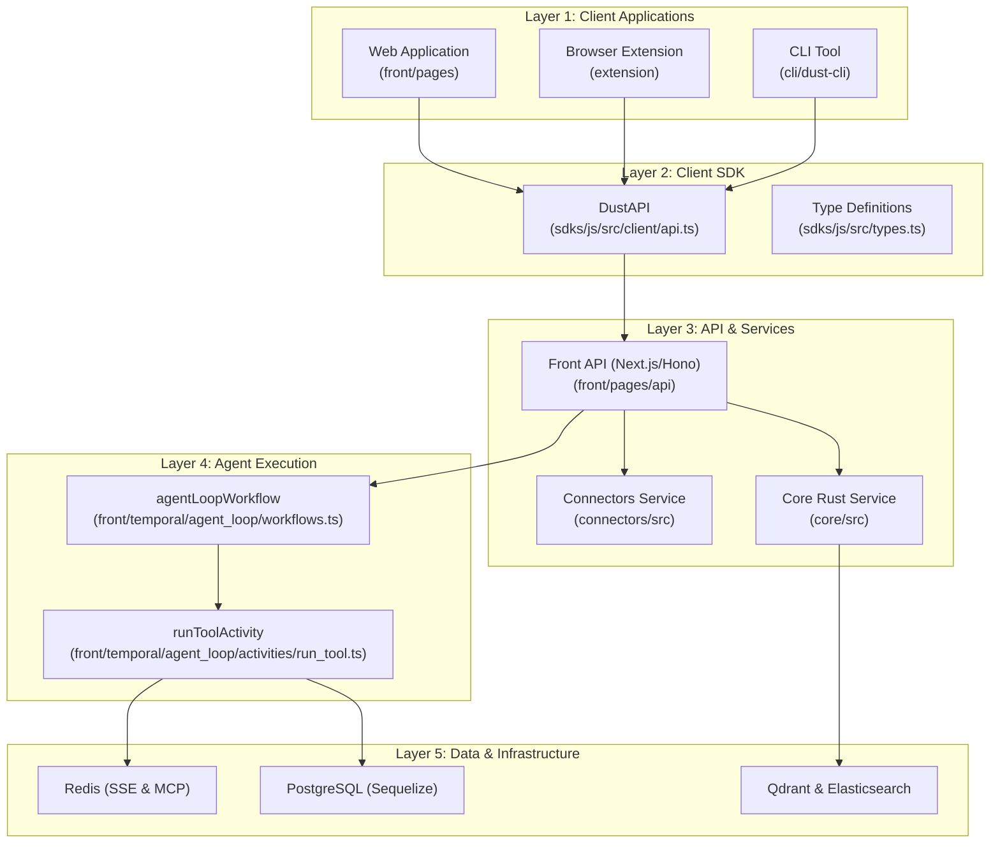

**Sources**: [front/package.json:1-50](), [sdks/js/package.json:1-60](), [front-spa/package.json:20-27](), [connectors/package.json:38-115]()

## Core Domain Entities

The following diagram maps high-level concepts to their primary code implementations in the `front` workspace.

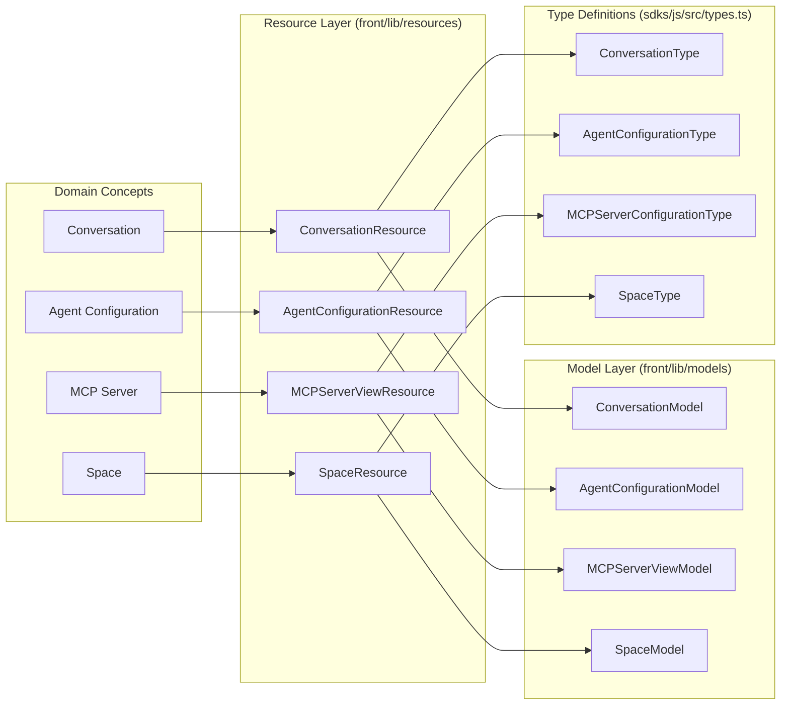

**Sources**: [front/lib/resources/conversation_resource.ts:1-50](), [front/lib/resources/agent_configuration_resource.ts:1-50](), [front/lib/resources/space_resource.ts:1-50](), [sdks/js/src/types.ts:1-500]()

## Development and Deployment

The platform uses `mprocs` for local development orchestration, managing the concurrent execution of Node.js workers, Next.js apps, and the Core Rust service.

| Tool | Purpose |
|------|---------|
| `mprocs` | Process manager for local dev environment ([tools/mprocs.yaml]()). |
| `temporal` | Workflow engine for durable agent execution ([temporal/docker-compose.yml]()). |
| `biome` | Linting and formatting ([package.json:22-25]()). |
| `vitest` | Test runner for JavaScript/TypeScript ([front/package.json:21-25]()). |

**Sources**: [tools/mprocs.yaml:1-220](), [package.json:18-29](), [front/package.json:13-42]()

## Subsystem Overviews

### Agent System
The Agent System handles the definition and execution of AI assistants. It includes the **Agent Builder** for UI-based configuration and the **Temporal-based agent loop** for durable execution. Agents can be augmented with **Skills** and **MCP Tools**.
For details, see [Agent System](#3).

### MCP Tool System
Dust integrates tools using the **Model Context Protocol (MCP)**. This includes internal servers (e.g., Google Drive, Slack), remote servers, and client-side servers via the browser extension. The system handles tool discovery, authentication (OAuth), and secure execution.
For details, see [MCP Tool System](#4).

### Conversation System
The Conversation System manages multi-turn interactions, message persistence, and real-time updates via **Server-Sent Events (SSE)**. It uses a rich text **Input Bar** supporting mentions of agents and skills.
For details, see [Conversation System](#5).

### Core Rust Service
The `core` service provides the high-performance backbone for document indexing and retrieval. It manages **Data Sources**, performs vector search via **Qdrant**, and handles **OAuth** credential encryption and storage.
For details, see [Core Rust Service](#14).

### Connectors Service
The `connectors` service is responsible for synchronizing data from external platforms into Dust's managed data sources. It uses Temporal workflows to handle large-scale syncs and webhook processing.
For details, see [Data Connectors](#8).

**Sources**: [front/AGENTS.md:1-52](), [front/package.json:43-160](), [connectors/package.json:38-115](), [sdks/js/package.json:43-49]()

---

# Page: System Architecture

# System Architecture

<details>
<summary>Relevant source files</summary>

The following files were used as context for generating this wiki page:

- [.github/actions/build-image/action.yml](.github/actions/build-image/action.yml)
- [.github/actions/setup-node-deps/action.yml](.github/actions/setup-node-deps/action.yml)
- [.github/actions/slack-check-deployment-blocked/action.yml](.github/actions/slack-check-deployment-blocked/action.yml)
- [.github/actions/slack-notify/action.yml](.github/actions/slack-notify/action.yml)
- [.github/workflows/build-and-test-core.yml](.github/workflows/build-and-test-core.yml)
- [.github/workflows/build-canary-image.yml](.github/workflows/build-canary-image.yml)
- [.github/workflows/build-dust-sandbox.yml](.github/workflows/build-dust-sandbox.yml)
- [.github/workflows/build-spa.yaml](.github/workflows/build-spa.yaml)
- [.github/workflows/check-migrations.yml](.github/workflows/check-migrations.yml)
- [.github/workflows/claude-code-review.yml](.github/workflows/claude-code-review.yml)
- [.github/workflows/claude.yml](.github/workflows/claude.yml)
- [.github/workflows/deploy-spa-production.yaml](.github/workflows/deploy-spa-production.yaml)
- [.github/workflows/deploy-spa.yaml](.github/workflows/deploy-spa.yaml)
- [.github/workflows/deploy.yml](.github/workflows/deploy.yml)
- [.github/workflows/format-check.yml](.github/workflows/format-check.yml)
- [.github/workflows/lint-github-actions.yml](.github/workflows/lint-github-actions.yml)
- [.github/workflows/list-tags.yaml](.github/workflows/list-tags.yaml)
- [.github/workflows/publish-cli.yml](.github/workflows/publish-cli.yml)
- [.github/workflows/publish-sdk-client.yml](.github/workflows/publish-sdk-client.yml)
- [.github/workflows/release-dsbx-cli.yml](.github/workflows/release-dsbx-cli.yml)
- [.github/workflows/release-sandbox-tool.yml](.github/workflows/release-sandbox-tool.yml)
- [.github/workflows/revert.yml](.github/workflows/revert.yml)
- [.github/workflows/run-dangerjs.yml](.github/workflows/run-dangerjs.yml)
- [.github/workflows/sandbox-bedrock-release.yml](.github/workflows/sandbox-bedrock-release.yml)
- [.github/workflows/sandbox-img-registry.yml](.github/workflows/sandbox-img-registry.yml)
- [.grit/patterns/noClientDeepImports.grit](.grit/patterns/noClientDeepImports.grit)
- [.grit/patterns/noClientDeepImports.md](.grit/patterns/noClientDeepImports.md)
- [.nvmrc](.nvmrc)
- [biome.json](biome.json)
- [cli/dust-sandbox/tests/e2e_local.rs](cli/dust-sandbox/tests/e2e_local.rs)
- [connectors/.nvmrc](connectors/.nvmrc)
- [connectors/esbuild.config.ts](connectors/esbuild.config.ts)
- [connectors/package.json](connectors/package.json)
- [dockerfiles/connectors.Dockerfile](dockerfiles/connectors.Dockerfile)
- [dockerfiles/front.Dockerfile](dockerfiles/front.Dockerfile)
- [dockerfiles/marketing.Dockerfile](dockerfiles/marketing.Dockerfile)
- [dockerfiles/prodbox.Dockerfile](dockerfiles/prodbox.Dockerfile)
- [dockerfiles/sandbox-bedrock.Dockerfile](dockerfiles/sandbox-bedrock.Dockerfile)
- [dockerfiles/sparkle-storybook.Dockerfile](dockerfiles/sparkle-storybook.Dockerfile)
- [dockerfiles/sparkle/sparkle-storybook-nginx.conf](dockerfiles/sparkle/sparkle-storybook-nginx.conf)
- [dockerfiles/viz.Dockerfile](dockerfiles/viz.Dockerfile)
- [extension/css.d.ts](extension/css.d.ts)
- [extension/package.json](extension/package.json)
- [extension/platforms/chrome/manifests/manifest.base.json](extension/platforms/chrome/manifests/manifest.base.json)
- [extension/platforms/firefox/manifests/manifest.base.json](extension/platforms/firefox/manifests/manifest.base.json)
- [extension/tsconfig.json](extension/tsconfig.json)
- [extension/ui/hooks/useFileUploaderService.ts](extension/ui/hooks/useFileUploaderService.ts)
- [extension/ui/hooks/useSavePageToPod.ts](extension/ui/hooks/useSavePageToPod.ts)
- [firebase-functions/webhook-router/Dockerfile](firebase-functions/webhook-router/Dockerfile)
- [front-spa/.nvmrc](front-spa/.nvmrc)
- [front-spa/_headers](front-spa/_headers)
- [front-spa/package.json](front-spa/package.json)
- [front-spa/vite.config.ts](front-spa/vite.config.ts)
- [front-spa/worker/app.ts](front-spa/worker/app.ts)
- [front-spa/worker/poke.ts](front-spa/worker/poke.ts)
- [front-spa/wrangler-app.toml](front-spa/wrangler-app.toml)
- [front-spa/wrangler-poke.toml](front-spa/wrangler-poke.toml)
- [front/.nvmrc](front/.nvmrc)
- [front/components/dev/devStyleOverrides.ts](front/components/dev/devStyleOverrides.ts)
- [front/components/sparkle/ThemeContext.tsx](front/components/sparkle/ThemeContext.tsx)
- [front/config/cors.ts](front/config/cors.ts)
- [front/css.d.ts](front/css.d.ts)
- [front/dangerfile.ts](front/dangerfile.ts)
- [front/esbuild.worker.ts](front/esbuild.worker.ts)
- [front/hooks/useFileUploaderService.ts](front/hooks/useFileUploaderService.ts)
- [front/lib/api/config.ts](front/lib/api/config.ts)
- [front/lib/api/credits/purchase.ts](front/lib/api/credits/purchase.ts)
- [front/lib/api/poke/plugins/workspaces/buy_programmatic_usage_credits.ts](front/lib/api/poke/plugins/workspaces/buy_programmatic_usage_credits.ts)
- [front/lib/api/sandbox/image/index.ts](front/lib/api/sandbox/image/index.ts)
- [front/lib/api/sandbox/image/sandbox_image.test.ts](front/lib/api/sandbox/image/sandbox_image.test.ts)
- [front/lib/api/sandbox/image/sandbox_image.ts](front/lib/api/sandbox/image/sandbox_image.ts)
- [front/lib/api/sandbox/image/tool_manifest.test.ts](front/lib/api/sandbox/image/tool_manifest.test.ts)
- [front/lib/api/sandbox/image/tool_manifest.ts](front/lib/api/sandbox/image/tool_manifest.ts)
- [front/lib/api/sandbox/image/types.ts](front/lib/api/sandbox/image/types.ts)
- [front/lib/api/sandbox/providers/e2b_template.test.ts](front/lib/api/sandbox/providers/e2b_template.test.ts)
- [front/lib/api/sandbox/providers/e2b_template.ts](front/lib/api/sandbox/providers/e2b_template.ts)
- [front/lib/credits/committed.test.ts](front/lib/credits/committed.test.ts)
- [front/lib/credits/committed.ts](front/lib/credits/committed.ts)
- [front/lib/credits/limits.test.ts](front/lib/credits/limits.test.ts)
- [front/lib/credits/limits.ts](front/lib/credits/limits.ts)
- [front/package.json](front/package.json)
- [front/scripts/backfill_metronome_credits.ts](front/scripts/backfill_metronome_credits.ts)
- [front/scripts/metronome_initial_contract_setup.ts](front/scripts/metronome_initial_contract_setup.ts)
- [front/scripts/sandbox_image_build.ts](front/scripts/sandbox_image_build.ts)
- [front/scripts/sandbox_image_check.ts](front/scripts/sandbox_image_check.ts)
- [front/workers-build/scripts/esbuild.worker.ts](front/workers-build/scripts/esbuild.worker.ts)
- [lefthook.yml](lefthook.yml)
- [package-lock.json](package-lock.json)
- [package.json](package.json)
- [scripts/db/run-migrate.cjs](scripts/db/run-migrate.cjs)
- [sdks/js/esbuild.config.ts](sdks/js/esbuild.config.ts)
- [sdks/js/package.json](sdks/js/package.json)
- [sdks/js/tsconfig.json](sdks/js/tsconfig.json)
- [sparkle/package.json](sparkle/package.json)
- [sparkle/tsconfig.json](sparkle/tsconfig.json)
- [viz/.nvmrc](viz/.nvmrc)
- [viz/next.config.mjs](viz/next.config.mjs)
- [viz/package.json](viz/package.json)

</details>


## Purpose and Scope

This document describes the high-level architecture of the Dust platform, a system for building and running AI agents with conversation management, tool integration via the Model Context Protocol (MCP), and skill-based capabilities. The platform is managed as a monorepo containing multiple services, SDKs, and a design system.

For detailed information about specific subsystems:
- Type definitions and SDK client implementation: see [Type System and SDK](#2)
- Agent execution and configuration: see [Agent System](#3)
- MCP tool system: see [MCP Tool System](#4)
- Conversation management: see [Conversation System](#5)
- UI component library: see [Sandbox Execution Environment](#6)

**Sources:** [package.json:1-16](), [front/package.json:1-12](), [sdks/js/package.json:1-10](), [extension/package.json:1-15]()

---

## Workspace Layout

Dust uses an NPM workspace monorepo structure to manage its major components and service boundaries.

| Workspace | Description | Key Technologies |
| :--- | :--- | :--- |
| `front` | Main Next.js application, API routes, and Temporal workers. | Next.js, Sequelize, Temporal |
| `front-api` | Dedicated Hono-based API server for high-performance endpoints. | Hono, Node.js |
| `front-spa` | Vite-based Single Page Application for internal tools (Poke). | Vite, React |
| `connectors` | Service managing data synchronization from external sources. | Temporal, Sequelize, Express |
| `sparkle` | Dust's internal design system and component library. | React, Tailwind CSS, Radix UI |
| `extension` | Browser extension (Chrome/Firefox) for platform integration. | Webpack, React |
| `sdks/js` | Shared JavaScript/TypeScript client library and type system. | Zod, TypeScript |
| `viz` | Visualization service for interactive agent content. | Next.js |

**Sources:** [package.json:5-16](), [front/package.json:1-12](), [connectors/package.json:1-15]()

---

## Architectural Layers

The Dust platform implements a multi-layer architecture separating concerns between client interfaces, API layers, business logic, execution engines, data persistence, and external integrations.

### Service Boundaries and Communication

The platform consists of several distinct services communicating primarily via HTTP/REST, Redis Pub/Sub, and Temporal task queues.

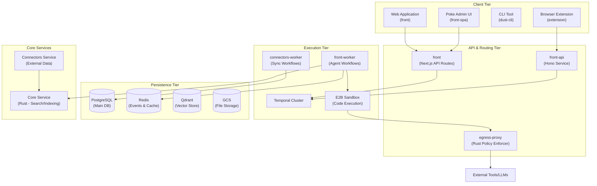

**Sources:** [dockerfiles/front.Dockerfile:1-190](), [dockerfiles/connectors.Dockerfile:1-50](), [front/lib/api/config.ts:63-93](), [package.json:5-16]()

---

## Subsystem Interactions

### Conversation Management System

The conversation system manages multi-turn interactions. It uses advisory locks to prevent race conditions during concurrent message posting.

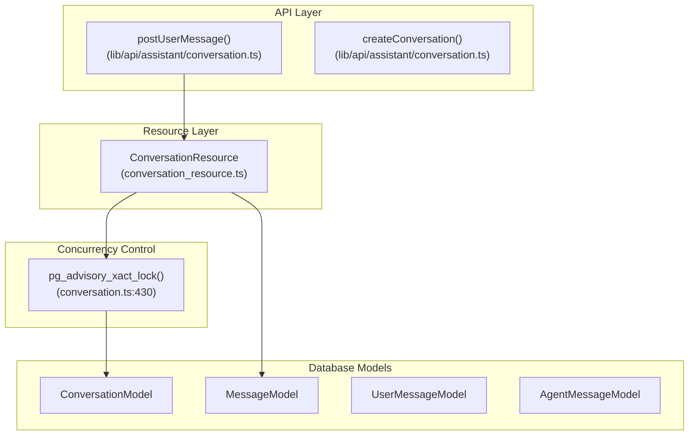

The conversation posting flow:
1. **Lock Acquisition**: Advisory lock prevents concurrent rank/version conflicts [front/lib/api/assistant/conversation.ts:430-454]().
2. **Message Creation**: Atomic creation of `UserMessage` and `AgentMessage` placeholders [front/lib/api/assistant/conversation.ts:670-750]().
3. **Workflow Launch**: Async agent execution via `launchAgentLoopWorkflow` [front/lib/api/assistant/conversation.ts:800-850]().

**Sources:** [front/lib/api/assistant/conversation.ts:430-1000](), [front/lib/resources/conversation_resource.ts:1-150]()

---

### Agent Execution Workflow

Agent execution is orchestrated by Temporal, providing durability and fault tolerance for long-running LLM interactions and tool calls.

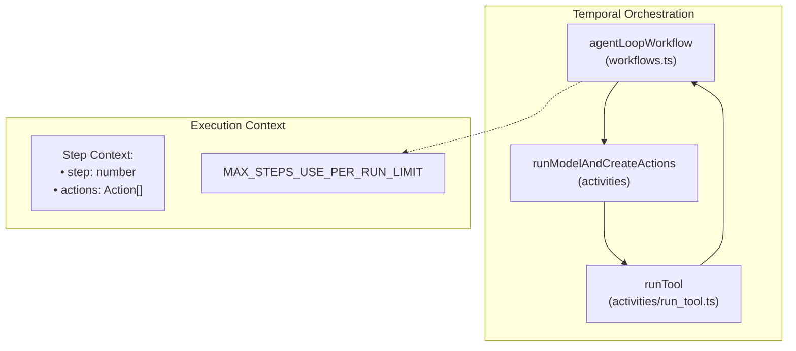

- **Multi-step execution**: The loop supports iterative reasoning up to a defined limit [front/temporal/agent_loop/workflows.ts:36-250]().
- **Tool Handling**: Tools are executed via the `runTool` activity, which handles MCP communication [front/temporal/agent_loop/activities/run_tool.ts:18-250]().

**Sources:** [front/temporal/agent_loop/workflows.ts:1-300](), [front/temporal/agent_loop/activities/run_tool.ts:1-250]()

---

## Infrastructure and Data Flow

### Event Streaming Architecture

Real-time updates use Server-Sent Events (SSE) backed by Redis Pub/Sub to stream LLM tokens and tool status to clients.

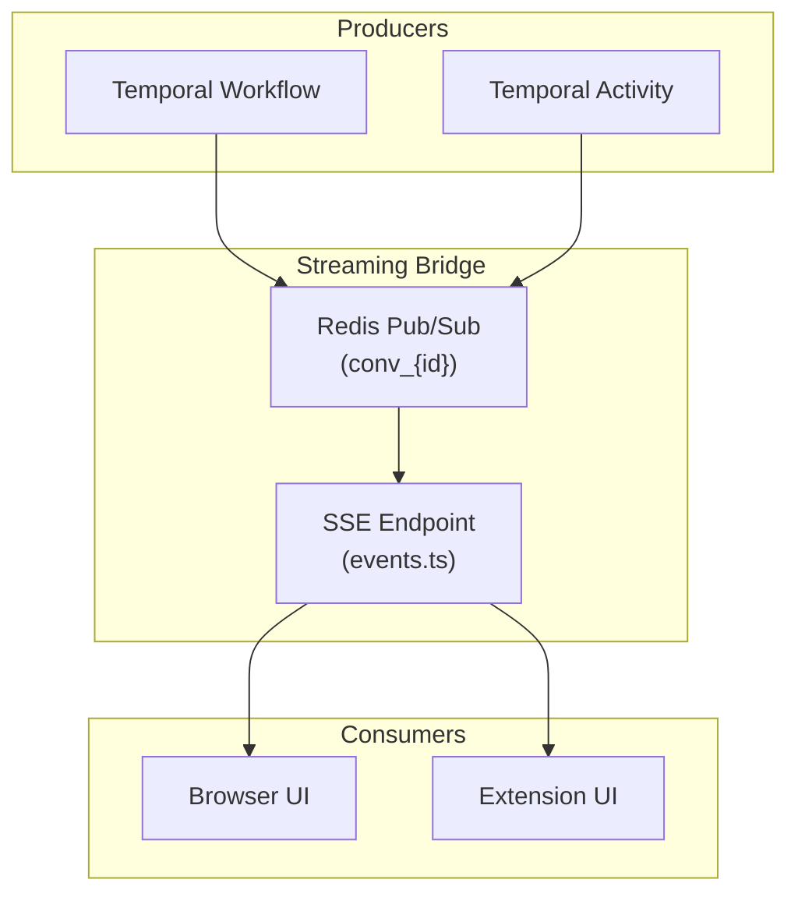

**Sources:** [front/lib/api/assistant/streaming/events.ts:1-202](), [front/pages/api/w/[wId]/assistant/conversations/[cId]/events.ts:1-250]()

### Network Security and Egress

The platform uses a Rust-based `egress-proxy` to control outbound traffic from sandboxed execution environments, ensuring security and compliance.

- **Egress Proxy**: Enforces domain allowlisting and JWT-based policy checks [front/lib/api/config.ts:86-93]().
- **Sandbox Isolation**: Code execution happens in isolated E2B sandboxes [front/lib/api/sandbox/providers/e2b_template.ts:1-50]().

**Sources:** [front/lib/api/config.ts:86-93](), [dockerfiles/front.Dockerfile:150-166]()

---

## Technology Stack Summary

| Layer | Technology |
| :--- | :--- |
| **Frontend Framework** | Next.js 14, Vite (SPA) |
| **Backend Services** | Node.js (Hono/Express), Rust (Core/Proxy) |
| **Workflow Engine** | Temporal |
| **Database** | PostgreSQL (Sequelize ORM) |
| **Vector Search** | Qdrant |
| **Caching/PubSub** | Redis |
| **Infrastructure** | Docker, Cloudflare Workers (SPA), Google Cloud Platform |

**Sources:** [front/package.json:43-160](), [connectors/package.json:38-115](), [package.json:30-53]()

---

# Page: Type System and SDK

# Type System and SDK

<details>
<summary>Relevant source files</summary>

The following files were used as context for generating this wiki page:

- [front/lib/actions/data_source_file_system_read_targets.ts](front/lib/actions/data_source_file_system_read_targets.ts)
- [front/lib/actions/mcp_internal_actions/__snapshots__/mcp_servers_metadata.test.ts.snap](front/lib/actions/mcp_internal_actions/__snapshots__/mcp_servers_metadata.test.ts.snap)
- [front/lib/actions/mcp_internal_actions/constants.test.ts](front/lib/actions/mcp_internal_actions/constants.test.ts)
- [front/lib/actions/mcp_internal_actions/constants.ts](front/lib/actions/mcp_internal_actions/constants.ts)
- [front/lib/actions/mcp_internal_actions/internal_mcp_server_availability.snapshot.json](front/lib/actions/mcp_internal_actions/internal_mcp_server_availability.snapshot.json)
- [front/lib/actions/mcp_internal_actions/servers/index.ts](front/lib/actions/mcp_internal_actions/servers/index.ts)
- [front/lib/actions/tool_display_labels.test.ts](front/lib/actions/tool_display_labels.test.ts)
- [front/lib/actions/tool_display_labels.ts](front/lib/actions/tool_display_labels.ts)
- [front/lib/api/actions/servers/bm25_tool_search.test.ts](front/lib/api/actions/servers/bm25_tool_search.test.ts)
- [front/lib/api/actions/servers/bm25_tool_search_utils.test.ts](front/lib/api/actions/servers/bm25_tool_search_utils.test.ts)
- [front/lib/api/actions/servers/shopify/client.test.ts](front/lib/api/actions/servers/shopify/client.test.ts)
- [front/lib/api/actions/servers/shopify/client.ts](front/lib/api/actions/servers/shopify/client.ts)
- [front/lib/api/actions/servers/shopify/helpers.ts](front/lib/api/actions/servers/shopify/helpers.ts)
- [front/lib/api/actions/servers/shopify/metadata.test.ts](front/lib/api/actions/servers/shopify/metadata.test.ts)
- [front/lib/api/actions/servers/shopify/metadata.ts](front/lib/api/actions/servers/shopify/metadata.ts)
- [front/lib/api/actions/servers/shopify/rendering.ts](front/lib/api/actions/servers/shopify/rendering.ts)
- [front/lib/api/actions/servers/shopify/tools/index.ts](front/lib/api/actions/servers/shopify/tools/index.ts)
- [front/lib/api/actions/servers/shopify/types.ts](front/lib/api/actions/servers/shopify/types.ts)
- [front/lib/api/marketing/integrations.ts](front/lib/api/marketing/integrations.ts)
- [front/temporal/agent_loop/lib/run_model.test.ts](front/temporal/agent_loop/lib/run_model.test.ts)
- [front/temporal/agent_loop/lib/run_model.ts](front/temporal/agent_loop/lib/run_model.ts)
- [front/types/shared/feature_flags.ts](front/types/shared/feature_flags.ts)
- [sdks/js/src/types.ts](sdks/js/src/types.ts)

</details>


## Purpose and Scope

This document covers the **shared type system** and **JavaScript SDK** (`@dust-tt/client`) that provide the foundational type definitions and API client for the Dust platform. The type system uses Zod schemas to enforce runtime type safety across all API boundaries, while the SDK provides a TypeScript client for interacting with Dust's REST and streaming APIs.

For information about how agents use these types during execution, see [Agent Execution and Temporal Workflows](#3.3). For details on the MCP server architecture that consumes these types, see [MCP Server Architecture](#4.1).

**Sources:** [sdks/js/src/types.ts:1-100](), [sdks/js/src/index.ts:1-50]()

---

## Architecture Overview

The type system and SDK form the contract layer between clients (web, CLI, extensions) and the Dust backend. All communication flows through Zod-validated types, ensuring type safety at both compile-time and runtime.

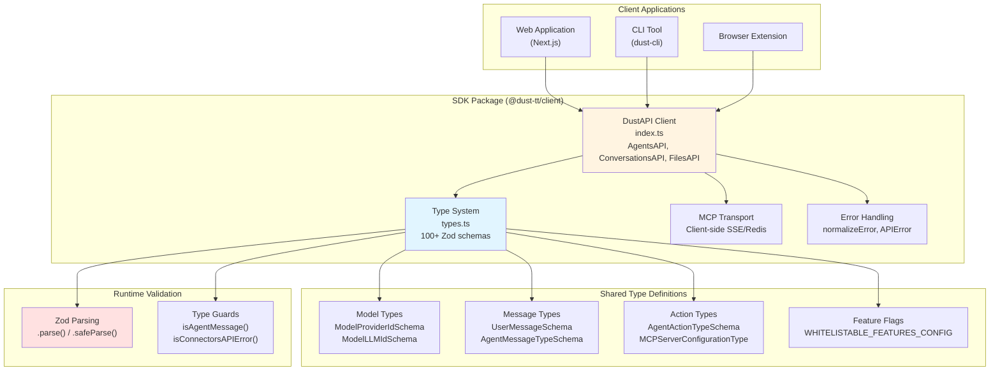

**Diagram: Type System Architecture and Component Relationships**

The SDK package exports three main APIs:
- **AgentsAPI**: Agent configuration CRUD operations.
- **ConversationsAPI**: Conversation and message management with streaming.
- **FilesAPI**: File upload and content fragment management.

**Sources:** [sdks/js/src/index.ts:1-100](), [sdks/js/src/types.ts:1-30]()

---

## Core Type Definitions

### Model Provider and Model ID Types

The type system begins with foundational enums for supported LLM providers and model identifiers. These use `FlexibleEnumSchema` to allow both known values (with autocompletion) and unknown strings, ensuring the SDK remains compatible as new models are added.

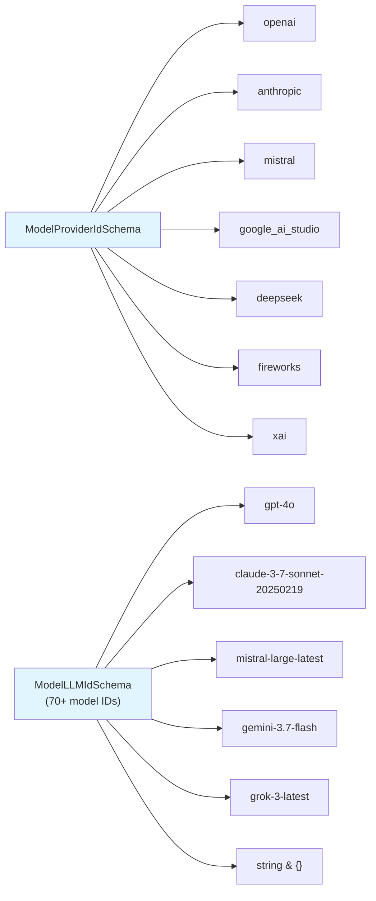

**Diagram: Model Provider and Model ID Type Hierarchy**

| Schema | Purpose | Location |
|--------|---------|----------|
| `ModelProviderIdSchema` | Enum of supported LLM providers (openai, anthropic, etc.) | [sdks/js/src/types.ts:17-29]() |
| `ModelLLMIdSchema` | 70+ known model IDs including O1, Claude 3.7, and Grok 3 | [sdks/js/src/types.ts:31-122]() |
| `PublicModelSelectionSchema` | Per-message model + reasoning effort selection | [sdks/js/src/types.ts:136-140]() |

**Sources:** [sdks/js/src/types.ts:17-140]()

### Feature Flags and Capabilities

Feature flags control access to experimental and premium features across workspaces. These are defined in a central configuration that maps flags to stages (`dust_only`, `self_serve`, `ask_owner`).

| Flag | Stage | Description |
|-------|-------------|---------------|
| `dust_filesystem` | `dust_only` | Allow fresh Pods to use database-backed filesystem | [front/types/shared/feature_flags.ts:8-13]() |
| `claude_4_opus_feature` | `self_serve` | Access to Claude 4 Opus in agent builder | [front/types/shared/feature_flags.ts:91-95]() |
| `google_sheets_tool` | `ask_owner` | Google Sheets MCP tool access | [front/types/shared/feature_flags.ts:134-138]() |
| `sandbox` | `self_serve` | Access to code execution sandbox | [front/types/shared/feature_flags.ts:225-229]() |

For a complete list of flags and their schema, see [Core Types and Schemas](#2.1).

**Sources:** [front/types/shared/feature_flags.ts:1-250]()

---

## MCP Tool and Server Types

The type system provides the foundation for the **Model Context Protocol (MCP)** integration. This includes definitions for internal servers, tool schemas, and billing metadata.

### Internal MCP Servers
Dust maintains a registry of built-in servers such as `google_drive`, `slack`, and `github`. Each server defines a set of tools with specific schemas.

| Server Name | Example Tools | Billing Category |
|-------------|---------------|------------------|
| `agent_memory` | `retrieve`, `record_entries` | `basic` |
| `google_drive` | `search_files`, `get_file_content` | `advanced` |
| `sandbox` | `run_code` | `basic` |

**Sources:** [front/lib/actions/mcp_internal_actions/constants.ts:217-250](), [front/lib/actions/mcp_internal_actions/__snapshots__/mcp_servers_metadata.test.ts.snap:41-62]()

### Tool Search and Discovery
To manage large numbers of tools, Dust uses a **BM25-based search** mechanism. The `TOOL_SEARCH_TOOL` allows the LLM to search for relevant tools dynamically when they are not explicitly in the initial context.

**Sources:** [front/temporal/agent_loop/lib/run_model.ts:149-165](), [front/lib/api/actions/servers/bm25_tool_search.test.ts:6-25]()

For detailed transport implementation, see [MCP Transport Protocol](#2.3).

---

## Content Type System

Dust supports a wide array of file formats that can be processed into conversation content fragments.

| Category | MIME Types | Extensions |
|----------|------------|------------|
| Documents | `application/pdf`, `text/markdown`, `text/plain` | `.pdf`, `.md`, `.txt` |
| Office | `application/msword`, `application/vnd.ms-excel` | `.doc`, `.xls`, `.xlsx` |
| Data | `text/csv`, `text/tsv`, `application/json` | `.csv`, `.tsv`, `.json` |
| Special | `application/vnd.dust.section.json` | `.json` |

**Sources:** [sdks/js/src/types.ts:195-225]()

---

## DustAPI Client

The `DustAPI` client class is the primary interface for external applications to interact with the Dust platform. It provides high-level abstractions for managing agents and conversations.

### Key Capabilities:
- **Conversation Management**: Creating conversations, posting user messages, and handling mentions.
- **Agent Interaction**: Retrieving agent configurations and managing agent-specific settings.
- **Event Streaming**: Consuming Server-Sent Events (SSE) for real-time token generation and tool execution updates.
- **Error Normalization**: Using `isConnectorsAPIError` and `ConnectorsAPIErrorSchema` to provide consistent error structures.

For implementation details and method signatures, see [DustAPI Client](#2.2).

**Sources:** [sdks/js/src/index.ts:1-100](), [sdks/js/src/types.ts:169-192]()

---

## Child Pages

- [Core Types and Schemas](#2.1) — Detailed documentation of Zod schemas, model provider IDs, and feature flags.
- [DustAPI Client](#2.2) — Technical guide for the JS SDK, authentication, and conversation methods.
- [MCP Transport Protocol](#2.3) — Explanation of the SSE and Redis-based transport for client-side MCP servers.

---

# Page: Core Types and Schemas

# Core Types and Schemas

<details>
<summary>Relevant source files</summary>

The following files were used as context for generating this wiki page:

- [extension/ui/components/auth/AuthProvider.tsx](extension/ui/components/auth/AuthProvider.tsx)
- [front-api/routes/poke/plans.ts](front-api/routes/poke/plans.ts)
- [front/components/poke/plans/form.tsx](front/components/poke/plans/form.tsx)
- [front/lib/actions/data_source_file_system_read_targets.ts](front/lib/actions/data_source_file_system_read_targets.ts)
- [front/lib/actions/mcp_internal_actions/__snapshots__/mcp_servers_metadata.test.ts.snap](front/lib/actions/mcp_internal_actions/__snapshots__/mcp_servers_metadata.test.ts.snap)
- [front/lib/actions/mcp_internal_actions/constants.test.ts](front/lib/actions/mcp_internal_actions/constants.test.ts)
- [front/lib/actions/mcp_internal_actions/constants.ts](front/lib/actions/mcp_internal_actions/constants.ts)
- [front/lib/actions/mcp_internal_actions/internal_mcp_server_availability.snapshot.json](front/lib/actions/mcp_internal_actions/internal_mcp_server_availability.snapshot.json)
- [front/lib/actions/mcp_internal_actions/servers/index.ts](front/lib/actions/mcp_internal_actions/servers/index.ts)
- [front/lib/actions/tool_display_labels.test.ts](front/lib/actions/tool_display_labels.test.ts)
- [front/lib/actions/tool_display_labels.ts](front/lib/actions/tool_display_labels.ts)
- [front/lib/api/actions/servers/bm25_tool_search.test.ts](front/lib/api/actions/servers/bm25_tool_search.test.ts)
- [front/lib/api/actions/servers/bm25_tool_search_utils.test.ts](front/lib/api/actions/servers/bm25_tool_search_utils.test.ts)
- [front/lib/api/actions/servers/shopify/client.test.ts](front/lib/api/actions/servers/shopify/client.test.ts)
- [front/lib/api/actions/servers/shopify/client.ts](front/lib/api/actions/servers/shopify/client.ts)
- [front/lib/api/actions/servers/shopify/helpers.ts](front/lib/api/actions/servers/shopify/helpers.ts)
- [front/lib/api/actions/servers/shopify/metadata.test.ts](front/lib/api/actions/servers/shopify/metadata.test.ts)
- [front/lib/api/actions/servers/shopify/metadata.ts](front/lib/api/actions/servers/shopify/metadata.ts)
- [front/lib/api/actions/servers/shopify/rendering.ts](front/lib/api/actions/servers/shopify/rendering.ts)
- [front/lib/api/actions/servers/shopify/tools/index.ts](front/lib/api/actions/servers/shopify/tools/index.ts)
- [front/lib/api/actions/servers/shopify/types.ts](front/lib/api/actions/servers/shopify/types.ts)
- [front/lib/api/marketing/integrations.ts](front/lib/api/marketing/integrations.ts)
- [front/lib/assistant.test.ts](front/lib/assistant.test.ts)
- [front/lib/assistant.ts](front/lib/assistant.ts)
- [front/lib/models/plan.ts](front/lib/models/plan.ts)
- [front/lib/plans/free_plans.ts](front/lib/plans/free_plans.ts)
- [front/lib/plans/plan_codes.ts](front/lib/plans/plan_codes.ts)
- [front/lib/plans/pro_plans.ts](front/lib/plans/pro_plans.ts)
- [front/lib/plans/renderers.ts](front/lib/plans/renderers.ts)
- [front/lib/resources/storage/models/workspace.ts](front/lib/resources/storage/models/workspace.ts)
- [front/scripts/fetch-custom-models.ts](front/scripts/fetch-custom-models.ts)
- [front/scripts/seed/byok/seed.ts](front/scripts/seed/byok/seed.ts)
- [front/temporal/agent_loop/lib/run_model.test.ts](front/temporal/agent_loop/lib/run_model.test.ts)
- [front/temporal/agent_loop/lib/run_model.ts](front/temporal/agent_loop/lib/run_model.ts)
- [front/types/assistant/models/anthropic.ts](front/types/assistant/models/anthropic.ts)
- [front/types/assistant/models/custom_models.generated.ts](front/types/assistant/models/custom_models.generated.ts)
- [front/types/assistant/models/types.ts](front/types/assistant/models/types.ts)
- [front/types/plan.ts](front/types/plan.ts)
- [front/types/shared/feature_flags.ts](front/types/shared/feature_flags.ts)
- [sdks/js/src/types.ts](sdks/js/src/types.ts)

</details>


This document describes the core type system built using Zod schemas in `@dust-tt/client` and shared across the Dust monorepo. The type system provides runtime validation and TypeScript type inference for all data structures exchanged between the SDK, frontend, backend services, and external integrations.

Related pages: [DustAPI Client](#2.2) for SDK client interface, [MCP Transport Protocol](#2.3) for transport details.

## Overview and Architecture

The type system is centralized in `sdks/js/src/types.ts` with supporting files for specialized domains. Key components:

| File | Purpose | Key Exports |
|------|---------|-------------|
| `types.ts` | Core domain types | `PublicModelSelectionSchema`, `UserMessageOrigin`, `SupportedFileContentType` |
| `feature_flags.ts` | Feature gating | `WHITELISTABLE_FEATURES_CONFIG`, `WhitelistableFeature` |
| `raw_mcp_types.ts` | MCP protocol types | `CallToolResultSchema`, `ContentBlockSchema` |
| `helpers.ts` | Schema utilities | `FlexibleEnumSchema` for extensible enums |
| `models/types.ts` | LLM configurations | `ModelConfigurationSchema`, `ModelSelectionSchema` |

The schemas are distributed in the `@dust-tt/client` npm package and consumed by frontend, extension, and connectors services.

**Sources**: [sdks/js/src/types.ts:1-30](), [front/types/shared/feature_flags.ts:1-20](), [sdks/js/src/raw_mcp_types.ts:1-15]()

## Core Type System Architecture

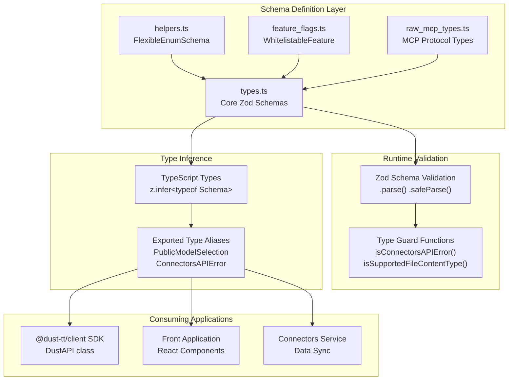

**Sources**: [sdks/js/src/types.ts:1-170](), [front/types/shared/feature_flags.ts:1-100](), [sdks/js/src/helpers.ts:1-10]()

## FlexibleEnumSchema Pattern

The `FlexibleEnumSchema` utility [sdks/js/src/helpers.ts]() creates Zod schemas that accept known values (with autocomplete) while allowing unknown string values for extensibility. This is critical for model IDs where new models are added frequently without requiring SDK updates.

```typescript
// Example usage in sdks/js/src/types.ts
const ModelProviderIdSchema = FlexibleEnumSchema<
  | "openai" | "anthropic" | "mistral" | "google_ai_studio"
  | "deepseek" | "fireworks" | "xai" | "noop"
>();
```

**Sources**: [sdks/js/src/types.ts:17-29](), [sdks/js/src/helpers.ts:1-5]()

## Model Provider and LLM IDs

### Model Provider ID Schema
`ModelProviderIdSchema` defines the supported LLM providers [sdks/js/src/types.ts:17-29]().

### Model LLM ID Schema
`ModelLLMIdSchema` supports a wide array of specific models, including `gpt-4o`, `claude-3-7-sonnet-20250219`, `gemini-2.5-pro`, and `grok-3-latest` [sdks/js/src/types.ts:31-117]().

### Public Model Selection
The `PublicModelSelectionSchema` [sdks/js/src/types.ts:136-140]() allows per-message model overrides. When provided, the agent runs the selected model instead of its default configuration.

| Field | Type | Description |
|-------|------|-------------|
| `providerId` | `ModelProviderIdSchema` | The LLM provider (e.g., "anthropic") |
| `modelId` | `ModelLLMIdSchema` | The specific model ID |
| `reasoningEffort` | `ReasoningEffortSchema` | Optional: "none", "light", "medium", "high" |

**Sources**: [sdks/js/src/types.ts:31-117](), [sdks/js/src/types.ts:136-140](), [sdks/js/src/types.ts:127-129]()

## Feature Flags System

Feature flags gate access to specific models, tools, and UI capabilities. The source of truth is `WHITELISTABLE_FEATURES_CONFIG` [front/types/shared/feature_flags.ts:1-268]().

### WhitelistableFeature Categories

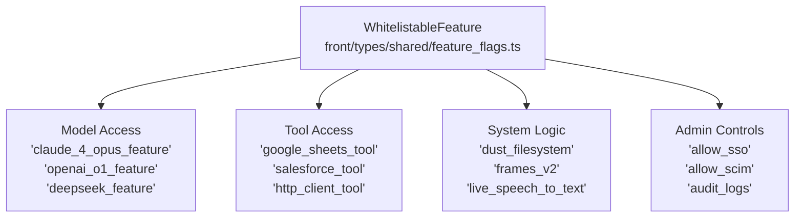

Each flag is associated with a `stage` (`dust_only`, `self_serve`, `ask_owner`) and an `owner` [front/types/shared/feature_flags.ts:1-268]().

**Sources**: [front/types/shared/feature_flags.ts:1-268](), [front/lib/assistant.ts:20-62]()

## Content and File Type Schemas

### Supported File Content Types
Dust supports a wide range of file formats for conversation attachments and knowledge base indexing. These are categorized into plain text, images, and audio.

**Supported Document Formats (Plain Text Fragment)**
`supportedOtherFileFormats` [sdks/js/src/types.ts:195-223]() defines types that can be sent as file-less content fragments, including:
- **PDF**: `application/pdf`
- **Microsoft Office**: `.doc`, `.docx`, `.ppt`, `.pptx`, `.xls`, `.xlsx`
- **Structured Data**: `text/csv`, `text/tsv`, `application/json`
- **Markup**: `text/markdown`, `text/html`

**Sources**: [sdks/js/src/types.ts:195-223](), [sdks/js/src/types.ts:261-281]()

### User Message Origin
`UserMessageOrigin` [sdks/js/src/types.ts:109-128]() tracks where a message was initiated. This is used to block certain tools (like `ask_user_question`) in programmatic contexts.

**Blocked Origins for User Questions**:
`ASK_USER_QUESTION_BLOCKED_ORIGINS` includes `api`, `slack_workflow`, `zapier`, `n8n`, and `transcript` [front/temporal/agent_loop/lib/run_model.ts:109-128]().

**Sources**: [front/temporal/agent_loop/lib/run_model.ts:109-128](), [sdks/js/src/types.ts:109-128]()

## MCP (Model Context Protocol) Type Definitions

### MCP Internal Servers
Internal MCP servers are registered in a central constant, defining their availability and tool stake levels.

| Server Name | Availability | Stake Level (Example) |
|-------------|--------------|-----------------------|
| `google_drive` | `manual` | `list_files`: `never_ask` |
| `slack` | `manual` | `post_message`: `low` |
| `sandbox` | `auto` | `exec`: `never_ask` |
| `search` | `auto` | `search`: `never_ask` |

**Sources**: [front/lib/actions/mcp_internal_actions/constants.ts:217-892](), [front/lib/actions/mcp_internal_actions/servers/index.ts:1-87]()

### Tool Discovery and BM25
Tools are discovered via a BM25 ranking system that matches user queries against tool descriptions. The `rank` function uses indices built from tool metadata [front/lib/api/actions/servers/bm25_tool_search.test.ts:1-20]().

**Sources**: [front/lib/api/actions/servers/bm25_tool_search.test.ts:1-20](), [front/lib/actions/tool_display_labels.ts:1-10]()

## Error Handling Schemas

### Connectors API Error Schema
`ConnectorsAPIErrorSchema` [sdks/js/src/types.ts:169-172]() standardizes errors returned by the connectors service.

**Common Error Types**:
- `authorization_error`: Credential issues.
- `connector_rate_limit_error`: External API throttling.
- `slack_channel_not_found`: Specific integration failures.

**Sources**: [sdks/js/src/types.ts:146-172](), [sdks/js/src/types.ts:182-192]()

## Model Availability Logic

The `isModelAvailable` function [front/lib/assistant.ts:65-97]() determines if a workspace can use a specific model based on:
1. **Plan Tier**: Large models require an upgraded plan [front/lib/assistant.ts:33-35]().
2. **Feature Flags**: Some models (like DeepSeek or Grok) require specific flags [front/lib/assistant.ts:50-52]().
3. **Region**: Regional availability constraints [front/lib/assistant.ts:92-94]().

**Sources**: [front/lib/assistant.ts:20-97](), [front/lib/assistant.test.ts:65-157](), [front/lib/plans/plan_codes.ts:158-164]()

---

# Page: DustAPI Client

# DustAPI Client

<details>
<summary>Relevant source files</summary>

The following files were used as context for generating this wiki page:

- [cli/dust-cli/src/ui/commands/Chat.tsx](cli/dust-cli/src/ui/commands/Chat.tsx)
- [cli/dust-cli/src/ui/components/AgentSelector.tsx](cli/dust-cli/src/ui/components/AgentSelector.tsx)
- [cli/dust-cli/src/utils/tokenStorage.ts](cli/dust-cli/src/utils/tokenStorage.ts)
- [cli/dust-cli/src/utils/toolsCache.ts](cli/dust-cli/src/utils/toolsCache.ts)
- [connectors/src/api/webhooks/teams/adaptive_cards.ts](connectors/src/api/webhooks/teams/adaptive_cards.ts)
- [connectors/src/api/webhooks/teams/bot.ts](connectors/src/api/webhooks/teams/bot.ts)
- [connectors/src/api/webhooks/webhook_slack_bot_interaction.ts](connectors/src/api/webhooks/webhook_slack_bot_interaction.ts)
- [connectors/src/connectors/slack/bot.ts](connectors/src/connectors/slack/bot.ts)
- [connectors/src/connectors/slack/chat/action_utils.ts](connectors/src/connectors/slack/chat/action_utils.ts)
- [connectors/src/connectors/slack/chat/blocks.ts](connectors/src/connectors/slack/chat/blocks.ts)
- [connectors/src/connectors/slack/chat/plan_message_handler.ts](connectors/src/connectors/slack/chat/plan_message_handler.ts)
- [connectors/src/connectors/slack/chat/slack_stream_handler.ts](connectors/src/connectors/slack/chat/slack_stream_handler.ts)
- [connectors/src/connectors/slack/chat/stream_conversation_handler.ts](connectors/src/connectors/slack/chat/stream_conversation_handler.ts)
- [connectors/src/connectors/slack/lib/errors.test.ts](connectors/src/connectors/slack/lib/errors.test.ts)
- [connectors/src/connectors/slack/lib/errors.ts](connectors/src/connectors/slack/lib/errors.ts)
- [connectors/src/lib/bot/mentions.test.ts](connectors/src/lib/bot/mentions.test.ts)
- [connectors/src/lib/bot/mentions.ts](connectors/src/lib/bot/mentions.ts)
- [connectors/src/types/shared/redis_client.ts](connectors/src/types/shared/redis_client.ts)
- [firebase-functions/webhook-router/docker-compose.yml](firebase-functions/webhook-router/docker-compose.yml)
- [front-api/routes/v1/w/[wId]/assistant/conversations/[cId]/index.ts](front-api/routes/v1/w/[wId]/assistant/conversations/[cId]/index.ts)
- [front/lib/actions/data_source_file_system_read_targets.ts](front/lib/actions/data_source_file_system_read_targets.ts)
- [front/lib/actions/mcp_internal_actions/__snapshots__/mcp_servers_metadata.test.ts.snap](front/lib/actions/mcp_internal_actions/__snapshots__/mcp_servers_metadata.test.ts.snap)
- [front/lib/actions/mcp_internal_actions/constants.test.ts](front/lib/actions/mcp_internal_actions/constants.test.ts)
- [front/lib/actions/mcp_internal_actions/constants.ts](front/lib/actions/mcp_internal_actions/constants.ts)
- [front/lib/actions/mcp_internal_actions/internal_mcp_server_availability.snapshot.json](front/lib/actions/mcp_internal_actions/internal_mcp_server_availability.snapshot.json)
- [front/lib/actions/mcp_internal_actions/servers/index.ts](front/lib/actions/mcp_internal_actions/servers/index.ts)
- [front/lib/actions/tool_display_labels.test.ts](front/lib/actions/tool_display_labels.test.ts)
- [front/lib/actions/tool_display_labels.ts](front/lib/actions/tool_display_labels.ts)
- [front/lib/api/actions/servers/bm25_tool_search.test.ts](front/lib/api/actions/servers/bm25_tool_search.test.ts)
- [front/lib/api/actions/servers/bm25_tool_search_utils.test.ts](front/lib/api/actions/servers/bm25_tool_search_utils.test.ts)
- [front/lib/api/actions/servers/shopify/client.test.ts](front/lib/api/actions/servers/shopify/client.test.ts)
- [front/lib/api/actions/servers/shopify/client.ts](front/lib/api/actions/servers/shopify/client.ts)
- [front/lib/api/actions/servers/shopify/helpers.ts](front/lib/api/actions/servers/shopify/helpers.ts)
- [front/lib/api/actions/servers/shopify/metadata.test.ts](front/lib/api/actions/servers/shopify/metadata.test.ts)
- [front/lib/api/actions/servers/shopify/metadata.ts](front/lib/api/actions/servers/shopify/metadata.ts)
- [front/lib/api/actions/servers/shopify/rendering.ts](front/lib/api/actions/servers/shopify/rendering.ts)
- [front/lib/api/actions/servers/shopify/tools/index.ts](front/lib/api/actions/servers/shopify/tools/index.ts)
- [front/lib/api/actions/servers/shopify/types.ts](front/lib/api/actions/servers/shopify/types.ts)
- [front/lib/api/marketing/integrations.ts](front/lib/api/marketing/integrations.ts)
- [front/temporal/agent_loop/lib/run_model.test.ts](front/temporal/agent_loop/lib/run_model.test.ts)
- [front/temporal/agent_loop/lib/run_model.ts](front/temporal/agent_loop/lib/run_model.ts)
- [front/types/shared/feature_flags.ts](front/types/shared/feature_flags.ts)
- [sdks/js/src/index.ts](sdks/js/src/index.ts)
- [sdks/js/src/types.ts](sdks/js/src/types.ts)

</details>


This document covers the `DustAPI` client class, which provides a JavaScript/TypeScript SDK for interacting with the Dust platform API. The client handles authentication, request/response management, streaming, and error handling for all Dust API operations.

For information about the underlying type system and schemas, see [Core Types and Schemas](2.1). For details about the MCP transport protocol used for client-side servers, see [MCP Transport Protocol](2.3).

---

## Purpose and Scope

The `DustAPI` client is the primary interface for external applications (browser extensions, CLI tools, custom integrations) to communicate with the Dust platform. It provides:

- Type-safe API method calls with Zod schema validation.
- Authentication management supporting static API keys and dynamic OAuth tokens.
- Streaming response handling for real-time events via Server-Sent Events (SSE).
- Workspace-scoped operations with automatic URL construction.
- High-level API namespaces for conversations, agents, and files.
- Automatic error handling and retry logic for transient network failures.

**Sources:** [sdks/js/src/index.ts:1-220](), [sdks/js/package.json:1-60]()

---

## Installation

The client is distributed as the `@dust-tt/client` npm package. It is used as a core dependency across the monorepo:

| Package | Usage |
|---------|-------|
| `front` | Server-side API operations and assistant logic [front/package.json:43]() |
| `extension` | Browser extension interactions with the main platform [extension/package.json:52-77]() |
| `connectors` | Connector service API calls for Slack/Notion syncing [connectors/package.json:27]() |
| `cli` | Command-line tool for workspace management [cli/dust-cli/package.json:37]() |

---

## DustAPI Class Overview

### Class Structure

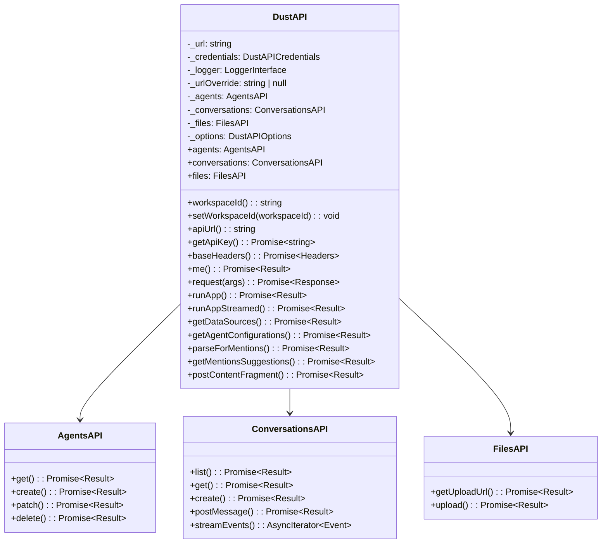

The `DustAPI` class provides three lazy-loaded namespace objects (`agents`, `conversations`, `files`) that group related functionality. The main class handles authentication, request construction, and low-level API operations.

**Sources:** [sdks/js/src/index.ts:220-282]()

---

## Constructor Patterns

The client supports both a modern options-based constructor and a legacy positional argument constructor.

### Modern Constructor (Recommended)
Uses the `DustAPIOptions` interface for clarity.
```typescript
const dustAPI = new DustAPI({
  workspaceId: "workspace-123",
  apiKey: "sk_...",
  baseUrl: "https://dust.tt", // Optional, defaults to https://dust.tt
  logger: console,              // Optional
  extraHeaders: {               // Optional
    "X-Custom-Header": "value"
  }
});
```

### Legacy Constructor
Still supported for backward compatibility.
```typescript
const dustAPI = new DustAPI(
  { url: "https://dust.tt" },
  { workspaceId: "w123", apiKey: "sk_..." },
  console,
  null
);
```

**Sources:** [sdks/js/src/index.ts:231-261]()

---

## Authentication and Credentials

### API Key Patterns
The client handles `apiKey` as either a static string or an asynchronous function, enabling easy integration with OAuth token refresh logic.

| Pattern | Use Case | Implementation |
|---------|----------|----------------|
| Static API Key | Server-side workspace keys | `apiKey: "sk_..."` |
| Dynamic API Key | OAuth tokens, token refresh | `apiKey: async () => getToken()` |
| Extra Headers | Custom auth, tracking | `extraHeaders: { "X-User-Id": "..." }` |

**Sources:** [sdks/js/src/index.ts:303-311](), [sdks/js/src/high_level/types.ts]()

---

## High-Level API Namespaces

The client uses lazy loading for API namespace objects to minimize initialization overhead. When a property like `client.agents` is accessed, the client checks if the internal `_agents` instance exists; if not, it instantiates the specific API class.

| Namespace | Location | Purpose |
|-----------|----------|---------|
| `agents` | [sdks/js/src/high_level/agents.ts]() | Agent CRUD and configuration management. |
| `conversations` | [sdks/js/src/high_level/conversations.ts]() | Message posting and event streaming. |
| `files` | [sdks/js/src/high_level/files.ts]() | Signed URL generation and file uploads. |

**Sources:** [sdks/js/src/index.ts:263-282]()

---

## Request and Response Flow

### Request Construction
The core `request()` method automatically handles workspace-scoped URL construction:
`{apiUrl}/api/v1/w/{workspaceId}/{path}`

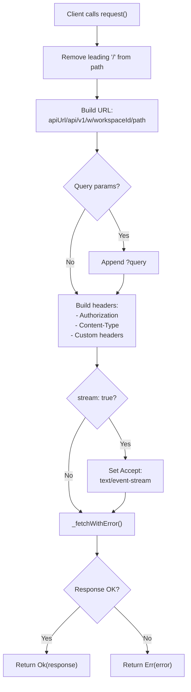

### Result Pattern and Zod Validation
The client uses a `Result<T, E>` pattern (`Ok` or `Err`) to force explicit error handling. Responses are validated against Zod schemas (e.g., `PublicModelSelectionSchema`) to ensure runtime type safety.

**Sources:** [sdks/js/src/index.ts:344-372](), [sdks/js/src/types.ts:136-140]()

---

## Error Handling and Retries

The client includes specialized logic to handle the nuances of AI and streaming APIs.

### Transient Error Handling
The `_fetchWithError` method performs a single retry with a 100ms delay if it encounters a `CONNECTION_CLOSED_RETRY_DELAY_MS` error (e.g., `ECONNRESET` or `socket hang up`), which often occurs with pooled keep-alive sockets.

### Error Classification
- **Stream Termination:** Detected via `isStreamTerminationError()`, covering `AbortError` or network-induced stream cuts [sdks/js/src/index.ts:124-148]().
- **Transient HTTP:** Retries on `408` (Timeout) and `429` (Rate Limit) [sdks/js/src/index.ts:175-178]().
- **Connectors Errors:** Specialized parsing for connector-specific failures like `slack_channel_not_found` using `isConnectorsAPIError()` [sdks/js/src/types.ts:182-192]().

**Sources:** [sdks/js/src/index.ts:154-173](), [sdks/js/src/types.ts:146-167]()

---

## Streaming Responses

The client uses `eventsource-parser` to process Server-Sent Events (SSE) from Dust App runs or Assistant conversations.

### Event Processing Loop
1.  **Request:** Client sends `stream: true`.
2.  **Parsing:** `createParser` is initialized to handle `text/event-stream` chunks [sdks/js/src/index.ts:430-450]().
3.  **Iteration:** Events are yielded through an `AsyncGenerator`.
4.  **Finalization:** The `dustRunId` is extracted from the stream once the `run_status` or `final` event is received.

### Event Types
- `tokens`: Real-time LLM generation.
- `run_status`: Workflow lifecycle updates.
- `block_execution`: Output from specific Dust app blocks.
- `error`: Structured API errors within the stream.

**Sources:** [sdks/js/src/index.ts:430-669](), [sdks/js/src/types.ts:28-58]()

---

## Model and Feature Integration

The client interacts with Dust's extensive model and feature flag system.

### Model Selection
The `PublicModelSelectionSchema` allows consumers to override default agent models by providing specific `providerId` (e.g., `anthropic`, `openai`) and `modelId` (e.g., `gpt-4o`, `claude-3-5-sonnet-20241022`) [sdks/js/src/types.ts:17-142]().

### Feature Flags
The client respects workspace-level feature flags such as `dust_filesystem`, `google_sheets_tool`, and `advanced_notion_management` which dictate which API capabilities are available to the authenticated user [front/types/shared/feature_flags.ts:1-150]().

**Sources:** [sdks/js/src/types.ts:17-142](), [front/types/shared/feature_flags.ts:1-150]()

---

# Page: MCP Transport Protocol

# MCP Transport Protocol

<details>
<summary>Relevant source files</summary>

The following files were used as context for generating this wiki page:

- [extension/platforms/chrome/background.ts](extension/platforms/chrome/background.ts)
- [extension/platforms/chrome/content-script.ts](extension/platforms/chrome/content-script.ts)
- [extension/platforms/chrome/main.tsx](extension/platforms/chrome/main.tsx)
- [extension/platforms/front/FrontApp.tsx](extension/platforms/front/FrontApp.tsx)
- [extension/platforms/front/main.tsx](extension/platforms/front/main.tsx)
- [extension/platforms/front/services/auth.ts](extension/platforms/front/services/auth.ts)
- [extension/shared/lib/ExtensionFetcherProvider.tsx](extension/shared/lib/ExtensionFetcherProvider.tsx)
- [extension/shared/lib/fetcher.ts](extension/shared/lib/fetcher.ts)
- [extension/shared/services/auth.ts](extension/shared/services/auth.ts)
- [extension/ui/components/auth/useAuth.ts](extension/ui/components/auth/useAuth.ts)
- [front-api/routes/v1/w/[wId]/mcp/deregister.ts](front-api/routes/v1/w/[wId]/mcp/deregister.ts)
- [front-api/routes/v1/w/[wId]/mcp/heartbeat.ts](front-api/routes/v1/w/[wId]/mcp/heartbeat.ts)
- [front-api/routes/v1/w/[wId]/mcp/index.ts](front-api/routes/v1/w/[wId]/mcp/index.ts)
- [front-api/routes/v1/w/[wId]/mcp/register.ts](front-api/routes/v1/w/[wId]/mcp/register.ts)
- [front-api/routes/w/[wId]/mcp/deregister.ts](front-api/routes/w/[wId]/mcp/deregister.ts)
- [front-api/routes/w/[wId]/mcp/heartbeat.ts](front-api/routes/w/[wId]/mcp/heartbeat.ts)
- [front-api/routes/w/[wId]/mcp/register.test.ts](front-api/routes/w/[wId]/mcp/register.test.ts)
- [front-api/routes/w/[wId]/mcp/register.ts](front-api/routes/w/[wId]/mcp/register.ts)
- [front/hooks/useDebounce.ts](front/hooks/useDebounce.ts)
- [front/hooks/useEventSource.ts](front/hooks/useEventSource.ts)
- [front/lib/actions/data_source_file_system_read_targets.ts](front/lib/actions/data_source_file_system_read_targets.ts)
- [front/lib/actions/mcp_internal_actions/__snapshots__/mcp_servers_metadata.test.ts.snap](front/lib/actions/mcp_internal_actions/__snapshots__/mcp_servers_metadata.test.ts.snap)
- [front/lib/actions/mcp_internal_actions/constants.test.ts](front/lib/actions/mcp_internal_actions/constants.test.ts)
- [front/lib/actions/mcp_internal_actions/constants.ts](front/lib/actions/mcp_internal_actions/constants.ts)
- [front/lib/actions/mcp_internal_actions/internal_mcp_server_availability.snapshot.json](front/lib/actions/mcp_internal_actions/internal_mcp_server_availability.snapshot.json)
- [front/lib/actions/mcp_internal_actions/servers/index.ts](front/lib/actions/mcp_internal_actions/servers/index.ts)
- [front/lib/actions/tool_display_labels.test.ts](front/lib/actions/tool_display_labels.test.ts)
- [front/lib/actions/tool_display_labels.ts](front/lib/actions/tool_display_labels.ts)
- [front/lib/api/actions/mcp/client_side_registry.test.ts](front/lib/api/actions/mcp/client_side_registry.test.ts)
- [front/lib/api/actions/mcp/client_side_registry.ts](front/lib/api/actions/mcp/client_side_registry.ts)
- [front/lib/api/actions/mcp_client_side.ts](front/lib/api/actions/mcp_client_side.ts)
- [front/lib/api/actions/servers/bm25_tool_search.test.ts](front/lib/api/actions/servers/bm25_tool_search.test.ts)
- [front/lib/api/actions/servers/bm25_tool_search_utils.test.ts](front/lib/api/actions/servers/bm25_tool_search_utils.test.ts)
- [front/lib/api/actions/servers/shopify/client.test.ts](front/lib/api/actions/servers/shopify/client.test.ts)
- [front/lib/api/actions/servers/shopify/client.ts](front/lib/api/actions/servers/shopify/client.ts)
- [front/lib/api/actions/servers/shopify/helpers.ts](front/lib/api/actions/servers/shopify/helpers.ts)
- [front/lib/api/actions/servers/shopify/metadata.test.ts](front/lib/api/actions/servers/shopify/metadata.test.ts)
- [front/lib/api/actions/servers/shopify/metadata.ts](front/lib/api/actions/servers/shopify/metadata.ts)
- [front/lib/api/actions/servers/shopify/rendering.ts](front/lib/api/actions/servers/shopify/rendering.ts)
- [front/lib/api/actions/servers/shopify/tools/index.ts](front/lib/api/actions/servers/shopify/tools/index.ts)
- [front/lib/api/actions/servers/shopify/types.ts](front/lib/api/actions/servers/shopify/types.ts)
- [front/lib/api/marketing/integrations.ts](front/lib/api/marketing/integrations.ts)
- [front/lib/client/BrowserMCPTransport.ts](front/lib/client/BrowserMCPTransport.ts)
- [front/lib/egress/client.ts](front/lib/egress/client.ts)
- [front/lib/swr/search.ts](front/lib/swr/search.ts)
- [front/lib/swr/useIsMobile.ts](front/lib/swr/useIsMobile.ts)
- [front/temporal/agent_loop/lib/run_model.test.ts](front/temporal/agent_loop/lib/run_model.test.ts)
- [front/temporal/agent_loop/lib/run_model.ts](front/temporal/agent_loop/lib/run_model.ts)
- [front/types/shared/feature_flags.ts](front/types/shared/feature_flags.ts)
- [sdks/js/src/mcp_transport.ts](sdks/js/src/mcp_transport.ts)
- [sdks/js/src/types.ts](sdks/js/src/types.ts)

</details>


## Purpose and Scope

This document describes the client-side MCP (Model Context Protocol) transport implementation that enables browser extensions and other client applications to register as MCP servers and communicate with the Dust backend. The transport uses Server-Sent Events (SSE) for receiving tool execution requests from Dust and HTTP POST for sending tool results back. For information about MCP server types and tool discovery, see [MCP Server Architecture](#4.1).

**Scope**: This page covers the transport protocol layer only - registration, heartbeat, SSE connection management, and request/response routing. It does not cover MCP tool semantics, authentication flows, or the broader MCP server configuration system.

---

## Architecture Overview

The client-side MCP transport architecture consists of three main components: a client-side transport implementation, Redis-based server registration, and bidirectional communication channels.

### System Components Diagram

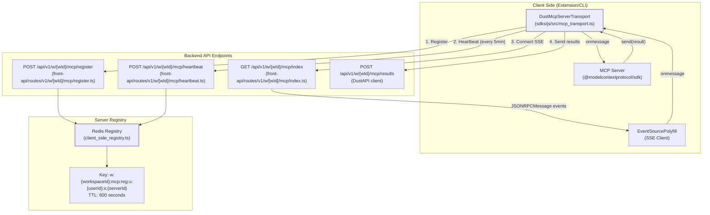

**Sources**: [sdks/js/src/mcp_transport.ts:1-274](), [front/lib/api/actions/mcp/client_side_registry.ts:1-281]()

---

## Transport Lifecycle

The transport follows a strict lifecycle from registration through active operation to graceful shutdown.

### Lifecycle State Machine

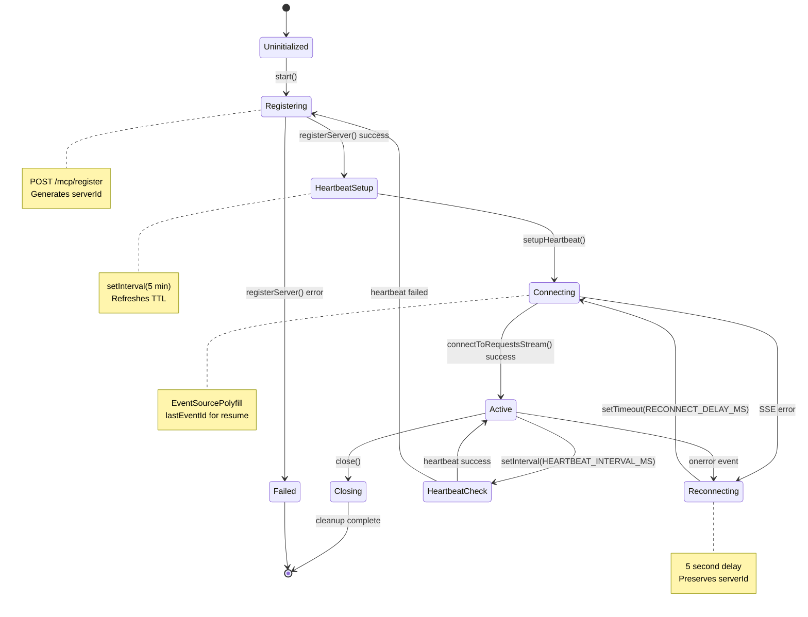

**Sources**: [sdks/js/src/mcp_transport.ts:91-108](), [sdks/js/src/mcp_transport.ts:64-85](), [sdks/js/src/mcp_transport.ts:180-207]()

---

## Registration Flow

When a client starts, it must register with the Dust backend to obtain a unique `serverId`. The registration system supports multiple concurrent instances of the same server name by automatically appending numeric suffixes.

### Registration Sequence

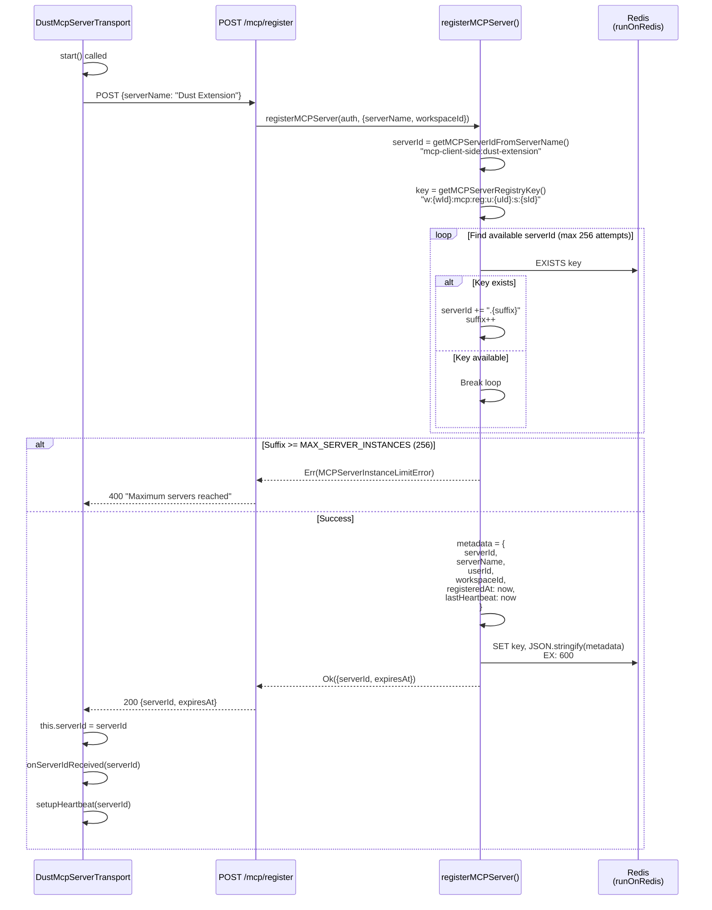

**Sources**: [front/lib/api/actions/mcp/client_side_registry.ts:78-155](), [front-api/routes/v1/w/[wId]/mcp/register.ts:36-95](), [sdks/js/src/mcp_transport.ts:41-59]()

### Server ID Generation

The registration system ensures unique server IDs through a suffix mechanism:

| serverName | Generated serverId | Notes |
|------------|-------------------|-------|
| "Dust Extension" | `mcp-client-side:dust-extension` | First instance |
| "Dust Extension" | `mcp-client-side:dust-extension.1` | Second concurrent instance |
| "Dust Extension" | `mcp-client-side:dust-extension.2` | Third concurrent instance |

The `getBaseServerId()` function at [front/lib/api/actions/mcp/client_side_registry.ts:46-49]() safely removes numeric suffixes by matching the pattern `/\.\d+$/`.

**Sources**: [front/lib/api/actions/mcp/client_side_registry.ts:51-57](), [front/lib/api/actions/mcp/client_side_registry.ts:46-49]()

---

## Heartbeat Mechanism

After successful registration, the transport maintains server liveness through periodic heartbeat requests.

### Heartbeat Configuration

```typescript
// Constants from sdks/js/src/mcp_transport.ts:9-10
const HEARTBEAT_INTERVAL_MS = 5 * 60 * 1000; // 5 minutes
const MCP_SERVER_REGISTRATION_TTL_SECONDS = 10 * 60; // 10 minutes (backend)
```

The heartbeat interval (5 minutes) is deliberately shorter than the Redis TTL (10 minutes) to provide a 5-minute buffer against network delays or transient failures.

### Heartbeat Processing

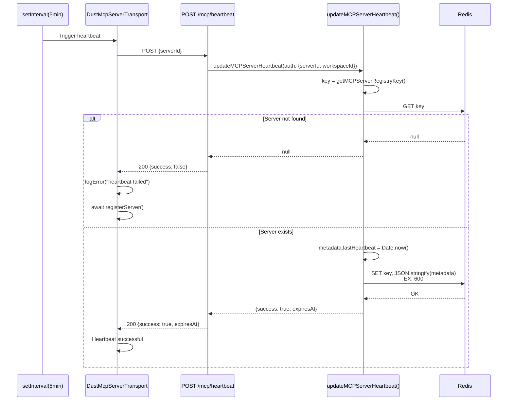

**Sources**: [sdks/js/src/mcp_transport.ts:64-85](), [front/lib/api/actions/mcp/client_side_registry.ts:196-250](), [front-api/routes/v1/w/[wId]/mcp/heartbeat.ts:32-77]()

---

## Request/Response Flow

The core communication uses a bidirectional protocol: SSE for receiving requests, HTTP POST for sending responses.

### SSE Connection Establishment

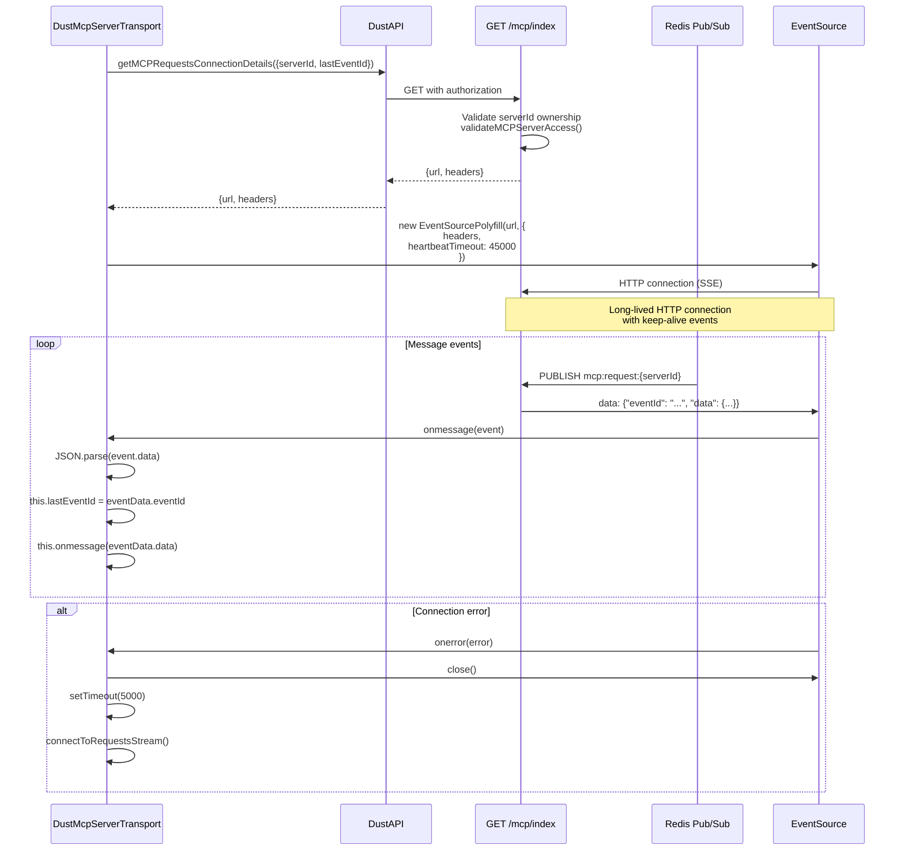

**Sources**: [sdks/js/src/mcp_transport.ts:113-207](), [sdks/js/src/mcp_transport.ts:145-178]()

### Tool Execution Request/Response

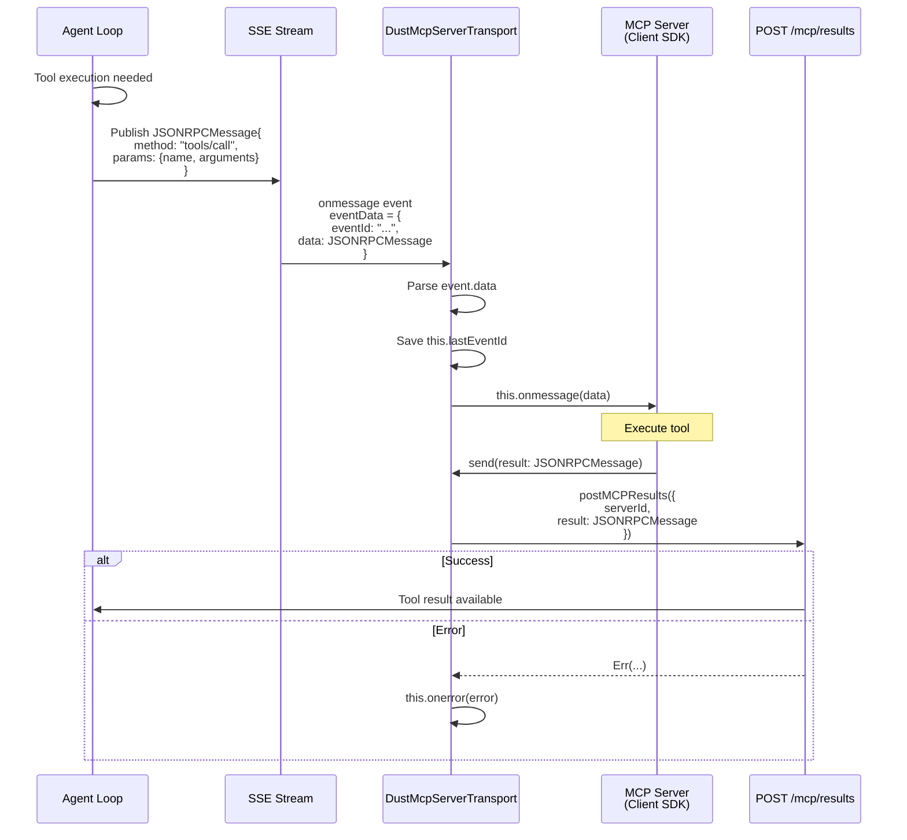

**Sources**: [sdks/js/src/mcp_transport.ts:145-178](), [sdks/js/src/mcp_transport.ts:213-231]()

---

## Redis Schema and TTL Management

The registration system uses Redis as a lightweight, TTL-based registry for active MCP servers.

### Redis Key Structure

```
Pattern: w:{workspaceId}:mcp:reg:u:{userId}:s:{serverId}

Example: w:abc123:mcp:reg:u:456:s:mcp-client-side:dust-extension.1

Value (JSON): {
  "serverId": "mcp-client-side:dust-extension.1",
  "serverName": "Dust Extension",
  "userId": "456",
  "workspaceId": "abc123",
  "registeredAt": 1703001234567,
  "lastHeartbeat": 1703001234567
}

TTL: 600 seconds (10 minutes)
```

**Sources**: [front/lib/api/actions/mcp/client_side_registry.ts:26-36](), [front/lib/api/actions/mcp/client_side_registry.ts:62-69]()

### TTL Refresh Strategy

The 10-minute TTL is refreshed through three mechanisms:

| Mechanism | Trigger | Implementation |
|-----------|---------|----------------|
| **Registration** | Initial `registerMCPServer()` call | [front/lib/api/actions/mcp/client_side_registry.ts:142-144]() `SET key, value, {EX: 600}` |
| **Heartbeat** | Every 5 minutes via client timer | [front/lib/api/actions/mcp/client_side_registry.ts:230-232]() `SET key, value, {EX: 600}` |
| **Access validation** | Each SSE request | [front/lib/api/actions/mcp/client_side_registry.ts:278]() `EXPIRE key, 600` |

**Sources**: [front/lib/api/actions/mcp/client_side_registry.ts:7-10](), [front/lib/api/actions/mcp/client_side_registry.ts:256-281]()

---

## Error Handling and Reconnection

### Reconnection Logic

```typescript
// From sdks/js/src/mcp_transport.ts:180-196
this.eventSource.onerror = (error) => {
  this.eventSource?.close();
  this.logError("Error in MCP EventSource connection:", error);
  this.onerror?.(new Error(`SSE connection error: ${error}`));
  
  setTimeout(() => {
    if (this.eventSource) {
      this.logInfo("Attempting to reconnect to SSE...");
      void this.connectToRequestsStream().catch((reconnectError) => {
        this.logError("Failed to reconnect:", reconnectError);
      });
    }
  }, RECONNECT_DELAY_MS); // 5000ms
};
```

**Sources**: [sdks/js/src/mcp_transport.ts:10](), [sdks/js/src/mcp_transport.ts:180-196]()

### LastEventId Resume Mechanism

When reconnecting after an SSE error, the transport preserves `lastEventId` to resume from the last received event:

```typescript
// From sdks/js/src/mcp_transport.ts:145-158
this.eventSource.onmessage = (event) => {
  const eventData = JSON.parse(event.data);
  if (eventData.eventId) {
    this.lastEventId = eventData.eventId;
  }
};
```

**Sources**: [sdks/js/src/mcp_transport.ts:145-158](), [sdks/js/src/mcp_transport.ts:125-136]()

---

## Implementation Details

### Browser Extension Integration

The browser extension uses the `useAuth` hook to manage authentication tokens which are passed to the `DustAPI` client used by the `BrowserMCPTransport`.

```typescript
// From extension/ui/components/auth/useAuth.ts:37-45
setDefaultInitResolver(async (): Promise<RequestInit> => {
  const accessToken = await platform.auth.getAccessToken();
  return {
    credentials: "omit",
    headers: accessToken
      ? { Authorization: `Bearer ${accessToken}` }
      : {},
  };
});
```

**Sources**: [extension/ui/components/auth/useAuth.ts:35-55](), [extension/platforms/chrome/background.ts:122-206]()

### Transport Interface Compliance

The `DustMcpServerTransport` class implements the `Transport` interface from `@modelcontextprotocol/sdk`:

```typescript
// From sdks/js/src/mcp_transport.ts:18-29
export class DustMcpServerTransport implements Transport {
  public onmessage?: (message: JSONRPCMessage) => void;
  public onclose?: () => void;
  public onerror?: (error: Error) => void;
  
  async start(): Promise<void>
  async send(message: JSONRPCMessage): Promise<void>
  async close(): Promise<void>
}
```

**Sources**: [sdks/js/src/mcp_transport.ts:18-29]()

---

# Page: Agent System

# Agent System

<details>
<summary>Relevant source files</summary>

The following files were used as context for generating this wiki page:

- [front-api/routes/poke/workspaces/[wId]/conversations/index.ts](front-api/routes/poke/workspaces/[wId]/conversations/index.ts)
- [front-api/routes/poke/workspaces/[wId]/spaces/[spaceId]/details.ts](front-api/routes/poke/workspaces/[wId]/spaces/[spaceId]/details.ts)
- [front-api/routes/w/[wId]/spaces/[spaceId]/leave.test.ts](front-api/routes/w/[wId]/spaces/[spaceId]/leave.test.ts)
- [front-api/routes/w/[wId]/spaces/[spaceId]/leave.ts](front-api/routes/w/[wId]/spaces/[spaceId]/leave.ts)
- [front/components/providers/model_configs.ts](front/components/providers/model_configs.ts)
- [front/lib/api/assistant/content_fragments.test.ts](front/lib/api/assistant/content_fragments.test.ts)
- [front/lib/api/assistant/conversation_rendering/helpers.test.ts](front/lib/api/assistant/conversation_rendering/helpers.test.ts)
- [front/lib/api/assistant/conversation_rendering/helpers.ts](front/lib/api/assistant/conversation_rendering/helpers.ts)
- [front/lib/api/assistant/conversation_rendering/message_rendering.test.ts](front/lib/api/assistant/conversation_rendering/message_rendering.test.ts)
- [front/lib/api/assistant/conversation_rendering/message_rendering.ts](front/lib/api/assistant/conversation_rendering/message_rendering.ts)
- [front/lib/api/assistant/generation.test.ts](front/lib/api/assistant/generation.test.ts)
- [front/lib/api/assistant/generation.ts](front/lib/api/assistant/generation.ts)
- [front/lib/api/assistant/global_agents/configurations/dust/deep-dive.ts](front/lib/api/assistant/global_agents/configurations/dust/deep-dive.ts)
- [front/lib/api/assistant/global_agents/configurations/dust/dust.ts](front/lib/api/assistant/global_agents/configurations/dust/dust.ts)
- [front/lib/api/assistant/global_agents/global_agent_metadata.ts](front/lib/api/assistant/global_agents/global_agent_metadata.ts)
- [front/lib/api/assistant/global_agents/global_agents.test.ts](front/lib/api/assistant/global_agents/global_agents.test.ts)
- [front/lib/api/assistant/global_agents/global_agents.ts](front/lib/api/assistant/global_agents/global_agents.ts)
- [front/lib/api/assistant/skills_rendering.test.ts](front/lib/api/assistant/skills_rendering.test.ts)
- [front/lib/api/assistant/skills_rendering.ts](front/lib/api/assistant/skills_rendering.ts)
- [front/lib/api/assistant/token_pricing/global.ts](front/lib/api/assistant/token_pricing/global.ts)
- [front/lib/auth.fromjson.test.ts](front/lib/auth.fromjson.test.ts)
- [front/lib/duration_recorder.ts](front/lib/duration_recorder.ts)
- [front/lib/resources/skill/code_defined/global/go_deep.test.ts](front/lib/resources/skill/code_defined/global/go_deep.test.ts)
- [front/lib/resources/skill/code_defined/global/go_deep.ts](front/lib/resources/skill/code_defined/global/go_deep.ts)
- [front/lib/utils/async_utils.ts](front/lib/utils/async_utils.ts)
- [front/temporal/agent_loop/activities/compaction.ts](front/temporal/agent_loop/activities/compaction.ts)
- [front/temporal/agent_loop/activities/cost_threshold_warnings.ts](front/temporal/agent_loop/activities/cost_threshold_warnings.ts)
- [front/temporal/agent_loop/activities/finalize_sandbox_child_tool.test.ts](front/temporal/agent_loop/activities/finalize_sandbox_child_tool.test.ts)
- [front/temporal/agent_loop/activities/finalize_sandbox_child_tool.ts](front/temporal/agent_loop/activities/finalize_sandbox_child_tool.ts)
- [front/temporal/agent_loop/activities/instrumentation.ts](front/temporal/agent_loop/activities/instrumentation.ts)
- [front/temporal/agent_loop/activities/run_model_and_create_actions_wrapper.ts](front/temporal/agent_loop/activities/run_model_and_create_actions_wrapper.ts)
- [front/temporal/agent_loop/client.ts](front/temporal/agent_loop/client.ts)
- [front/temporal/agent_loop/config.ts](front/temporal/agent_loop/config.ts)
- [front/temporal/agent_loop/lib/compaction.test.ts](front/temporal/agent_loop/lib/compaction.test.ts)
- [front/temporal/agent_loop/lib/compaction.ts](front/temporal/agent_loop/lib/compaction.ts)
- [front/temporal/agent_loop/lib/workflow_ids.ts](front/temporal/agent_loop/lib/workflow_ids.ts)
- [front/temporal/agent_loop/sinks.ts](front/temporal/agent_loop/sinks.ts)
- [front/temporal/agent_loop/worker.ts](front/temporal/agent_loop/worker.ts)
- [front/temporal/agent_loop/workflows.test.ts](front/temporal/agent_loop/workflows.test.ts)
- [front/temporal/agent_loop/workflows.ts](front/temporal/agent_loop/workflows.ts)
- [front/tests/utils/conversation_test_factories.ts](front/tests/utils/conversation_test_factories.ts)
- [front/types/assistant/assistant.ts](front/types/assistant/assistant.ts)
- [front/types/assistant/compaction.ts](front/types/assistant/compaction.ts)
- [front/types/assistant/models/models.ts](front/types/assistant/models/models.ts)
- [x/pr/branching.md](x/pr/branching.md)
- [x/spolu/compaction/compaction.md](x/spolu/compaction/compaction.md)
- [x/spolu/compaction/plan.md](x/spolu/compaction/plan.md)

</details>


The Agent System is the core orchestration layer of the Dust platform, responsible for managing the lifecycle, configuration, and execution of AI agents. This document covers the overall architecture, component interactions, and execution flow of agents. For specific subsystems, see [Agent Configuration and Management](#3.1), [Agent Builder Interface](#3.2), [Agent Execution and Temporal Workflows](#3.3), [Prompt Construction and LLM Integration](#3.4), [Skill System](#3.5), [Trigger System](#3.6), and [Global Agents](#3.7). For details on tool integration, see [MCP Tool System](#4).

## System Architecture

The agent system consists of five primary layers: configuration management, user interface, execution orchestration, skill and trigger extensions, and data persistence.

**Diagram: Agent System Component Architecture**

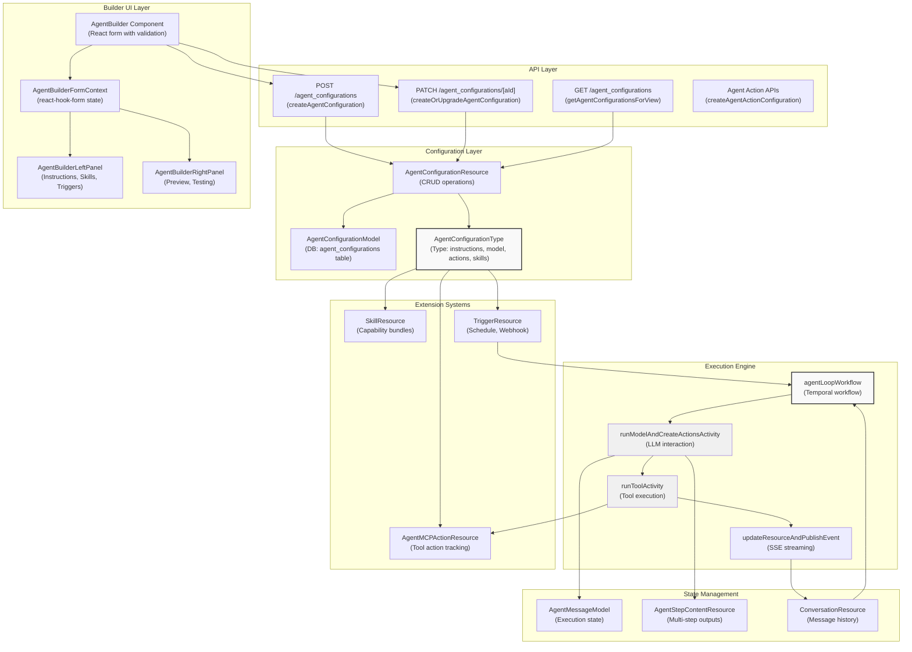

**Sources:** 
- [front/types/assistant/agent.ts:132-191]()
- [front/temporal/agent_loop/workflows.ts:186-257]()
- [front/temporal/agent_loop/activities/run_model_and_create_actions_wrapper.ts:69-106]()

## Agent Configuration

An agent configuration defines the agent's behavior, capabilities, and execution parameters. The configuration is versioned to support safe updates without disrupting running executions.

**Diagram: AgentConfigurationType Structure**

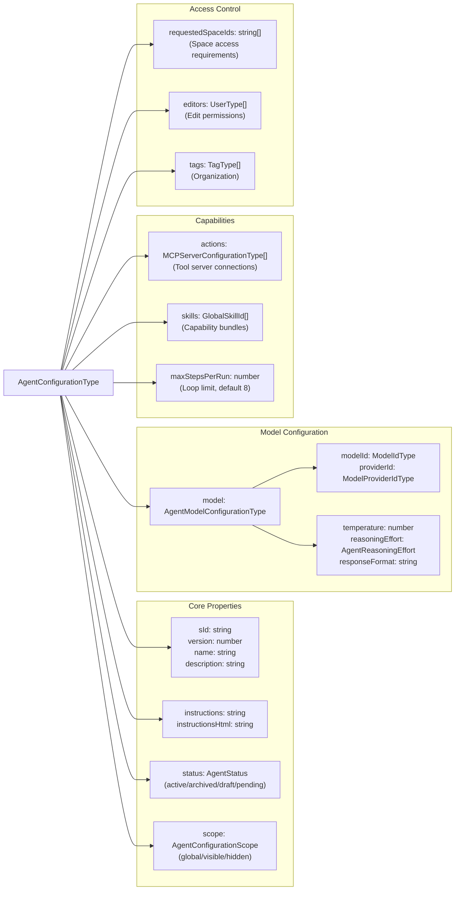

**Sources:**
- [front/types/assistant/agent.ts:132-191]()
- [front/types/assistant/agent.ts:116-123]()
- [front/types/assistant/agent.ts:42-57]()

### Agent Statuses

| Status | Description | Usage |
|--------|-------------|-------|
| `active` | Agent is available for use | Production agents |
| `archived` | Agent was deleted or superseded by newer version | Historical record |
| `draft` | Agent is being tested, not saved to database | Builder preview mode |
| `pending` | Agent stub created before first save | New agent creation |

**Sources:** [front/types/assistant/agent.ts:38-43]()

### Agent Scopes

| Scope | Description | Visibility | Editability |
|-------|-------------|------------|-------------|
| `global` | Dust-provided agents | All users | Read-only |
| `visible` | Published workspace agents | Workspace members | Editors only |
| `hidden` | Unpublished agents | Editors only | Editors only |

**Sources:** [front/types/assistant/agent.ts:46-55]()

## Agent Execution Flow

Agent execution is orchestrated through Temporal workflows, enabling durable, resumable execution with built-in retry logic and state management.

**Diagram: Agent Loop Execution Sequence**

```mermaid
sequenceDiagram
    participant User
    participant ConversationAPI
    participant DB as Database
    participant Temporal as TemporalClient
    participant Workflow as agentLoopWorkflow
    participant RunModel as runModelAndCreateActionsActivity
    participant RunTool as runToolActivity
    participant SSE as Event Stream
    
    User->>ConversationAPI: POST /messages (mentions agent)
    ConversationAPI->>DB: Create UserMessage
    ConversationAPI->>DB: Create AgentMessage (status=created)
    ConversationAPI->>Temporal: launchAgentLoopWorkflow(agentMessageId)
    ConversationAPI-->>User: 200 OK (placeholder message)
    
    User->>SSE: Subscribe to SSE events
    
    Temporal->>Workflow: Start workflow
    loop For each step (0 to maxStepsPerRun)
        Workflow->>RunModel: Execute step N
        RunModel->>RunModel: Load context (conversation, agent config)
        RunModel->>RunModel: Resolve tools (Skills, MCP servers)
        RunModel->>RunModel: Construct prompt with tiers
        RunModel->>RunModel: Call LLM (streaming)
        RunModel->>SSE: Publish generation_tokens events
        SSE-->>User: Display streaming text
        
        alt LLM returns tool calls
            RunModel->>RunModel: Create tool actions in DB
            RunModel->>DB: Insert AgentMCPActionModel records
            
            alt Actions need approval
                RunModel->>SSE: Publish tool_approve_execution events
                RunModel-->>Workflow: Return (shouldContinue=false)
                Workflow->>Workflow: Pause workflow
                Note over User,Workflow: User approves/rejects via UI
                User->>ConversationAPI: POST /validate_action
                ConversationAPI->>Temporal: Resume workflow
            end
            
            par Execute tools in parallel
                loop For each tool
                    Workflow->>RunTool: Execute tool action
                    RunTool->>RunTool: Connect to MCP server
                    RunTool->>RunTool: Call tool with inputs
                    RunTool->>SSE: Publish tool_params, tool_notification
                    RunTool->>DB: Store tool output
                    RunTool->>SSE: Publish agent_action_success
                end
            end
            
            RunModel->>RunModel: Check if should continue
            alt More reasoning needed
                Note over Workflow: Continue to next step
            else Final answer generated
                Workflow->>Workflow: Break loop
            end
        else LLM returns text only
            Workflow->>Workflow: Break loop (generation complete)
        end
    end
    
    Workflow->>DB: Update AgentMessage (status=succeeded)
    Workflow->>SSE: Publish agent_message_success
    SSE-->>User: Display final message
```

**Sources:**
- [front/temporal/agent_loop/workflows.ts:186-257]()
- [front/temporal/agent_loop/activities/run_model_and_create_actions_wrapper.ts:69-106]()
- [front/temporal/agent_loop/worker.ts:99-164]()

### Step Execution and Multi-Step Reasoning

Each agent execution consists of multiple steps, allowing the agent to perform iterative reasoning and tool usage. The `MAX_STEPS_USE_PER_RUN_LIMIT` constant defines the upper bound for execution steps to prevent infinite loops.

**Sources:**
- [front/types/assistant/agent.ts:33]()
- [front/temporal/agent_loop/workflows.ts:33]()
- [front/temporal/agent_loop/activities/run_model_and_create_actions_wrapper.ts:28]()

### Conversation Compaction

To maintain performance and manage context window limits, the system uses a compaction mechanism. This process summarizes previous conversation history into a `<summary>` block that provides the necessary context for the LLM to continue the conversation without processing every historical message.

**Sources:**
- [front/temporal/agent_loop/lib/compaction.ts:28-67]()
- [front/temporal/agent_loop/activities/compaction.ts]()

## Global Agents

Dust includes several pre-configured global agents with specialized behaviors and instructions. These are identified by the `GLOBAL_AGENTS_SID` enum.

| Agent ID | Name | Role |
|----------|------|------|
| `dust` | @dust | The primary workspace agent capable of searching internal data and the web. |
| `helper` | @help | Specialized in helping users navigate and use the Dust platform. |
| `deep-dive` | @deep-dive | Orchestrates complex research tasks by spawning sub-agents. |
| `analyst` | @analyst | Specialized in data analysis and visualization. |

**Sources:**
- [front/types/assistant/assistant.ts:42-149]()
- [front/lib/api/assistant/global_agents/configurations/dust/dust.ts:97-128]()
- [front/lib/api/assistant/global_agents/configurations/dust/deep-dive.ts:60-67]()
- [front/lib/api/assistant/global_agents/global_agents.ts:176-250]()

## Prompt Construction

The system constructs prompts by combining agent instructions, conversation history (or compaction summary), and platform-specific context. For model efficiency, sections are organized to maximize prompt caching effectiveness.

**Context Sections:**
- **# CONTEXT**: Basic metadata like current date, workspace name, and agent identity.
- **# BRANCH CONTEXT**: Details if the conversation was forked from another.
- **# PLATFORM-SPECIFIC CONTEXT**: Instructions for specific interfaces like the browser extension or Slack.
- **# TOOLS**: Tool use directives and specific tool instructions.

**Sources:**
- [front/lib/api/assistant/generation.ts:46-74]()
- [front/lib/api/assistant/generation.ts:80-104]()
- [front/lib/api/assistant/generation.ts:106-121]()
- [front/lib/api/assistant/generation.ts:123-160]()

## Infrastructure and Workers

Agent execution is distributed across specialized Temporal workers based on the nature of the task.

| Worker Queue | Purpose |
|--------------|---------|
| `INTERACTIVE_QUEUE_NAME` | Real-time user conversations requiring low latency. |
| `BATCH_QUEUE_NAME` | Large-scale background processing tasks. |
| `PROGRAMMATIC_QUEUE_NAME` | API-triggered agent executions. |
| `SCHEDULES_QUEUE_NAME` | Time-based triggers and automations. |

**Sources:**
- [front/temporal/agent_loop/worker.ts:57-83]()
- [front/temporal/agent_loop/config.ts:29-32]()

---

### Child Pages
- [Agent Configuration and Management](#3.1)
- [Agent Builder Interface](#3.2)
- [Agent Execution and Temporal Workflows](#3.3)
- [Prompt Construction and LLM Integration](#3.4)
- [Skill System](#3.5)
- [Trigger System](#3.6)
- [Global Agents](#3.7)

---

# Page: Agent Configuration and Management

# Agent Configuration and Management

<details>
<summary>Relevant source files</summary>

The following files were used as context for generating this wiki page:

- [front-api/public/swagger.json](front-api/public/swagger.json)
- [front-api/routes/poke/workspaces/[wId]/agent_configurations/[aId]/index.ts](front-api/routes/poke/workspaces/[wId]/agent_configurations/[aId]/index.ts)
- [front-api/routes/swagger_private_schemas.ts](front-api/routes/swagger_private_schemas.ts)
- [front-api/routes/v1/w/[wId]/assistant/agent_configurations/[sId]/index.ts](front-api/routes/v1/w/[wId]/assistant/agent_configurations/[sId]/index.ts)
- [front-api/routes/v1/w/[wId]/index.ts](front-api/routes/v1/w/[wId]/index.ts)
- [front-api/routes/v1/w/[wId]/swagger_schemas.ts](front-api/routes/v1/w/[wId]/swagger_schemas.ts)
- [front-api/routes/w/[wId]/assistant/agent_configurations/[aId]/editors.test.ts](front-api/routes/w/[wId]/assistant/agent_configurations/[aId]/editors.test.ts)
- [front-api/routes/w/[wId]/assistant/agent_configurations/[aId]/editors.ts](front-api/routes/w/[wId]/assistant/agent_configurations/[aId]/editors.ts)
- [front-api/routes/w/[wId]/assistant/agent_configurations/[aId]/index.test.ts](front-api/routes/w/[wId]/assistant/agent_configurations/[aId]/index.test.ts)
- [front-api/routes/w/[wId]/assistant/agent_configurations/[aId]/index.ts](front-api/routes/w/[wId]/assistant/agent_configurations/[aId]/index.ts)
- [front-api/routes/w/[wId]/assistant/agent_configurations/[aId]/linked_slack_channels.ts](front-api/routes/w/[wId]/assistant/agent_configurations/[aId]/linked_slack_channels.ts)
- [front-api/routes/w/[wId]/assistant/agent_configurations/[aId]/tags.ts](front-api/routes/w/[wId]/assistant/agent_configurations/[aId]/tags.ts)
- [front-api/routes/w/[wId]/assistant/agent_configurations/batch_update_scope.test.ts](front-api/routes/w/[wId]/assistant/agent_configurations/batch_update_scope.test.ts)
- [front-api/routes/w/[wId]/assistant/agent_configurations/batch_update_tags.test.ts](front-api/routes/w/[wId]/assistant/agent_configurations/batch_update_tags.test.ts)
- [front-api/routes/w/[wId]/assistant/agent_configurations/batch_update_tags.ts](front-api/routes/w/[wId]/assistant/agent_configurations/batch_update_tags.ts)
- [front-api/routes/w/[wId]/files/[fileId]/index.test.ts](front-api/routes/w/[wId]/files/[fileId]/index.test.ts)
- [front-api/routes/w/[wId]/files/[fileId]/index.ts](front-api/routes/w/[wId]/files/[fileId]/index.ts)
- [front-api/routes/w/[wId]/skills/[sId]/files/[fileId]/content.test.ts](front-api/routes/w/[wId]/skills/[sId]/files/[fileId]/content.test.ts)
- [front/components/assistant/AgentEditBar.tsx](front/components/assistant/AgentEditBar.tsx)
- [front/components/assistant/CreateDropdown.tsx](front/components/assistant/CreateDropdown.tsx)
- [front/components/assistant/DeleteAssistantsDialog.tsx](front/components/assistant/DeleteAssistantsDialog.tsx)
- [front/components/assistant/ModelsFilterMenu.tsx](front/components/assistant/ModelsFilterMenu.tsx)
- [front/components/assistant/ModelsMenuContent.tsx](front/components/assistant/ModelsMenuContent.tsx)
- [front/components/assistant/SetModelAssistantsDialog.tsx](front/components/assistant/SetModelAssistantsDialog.tsx)
- [front/components/assistant/TagsFilterMenu.tsx](front/components/assistant/TagsFilterMenu.tsx)
- [front/components/assistant/UnpublishAssistantsDialog.tsx](front/components/assistant/UnpublishAssistantsDialog.tsx)
- [front/components/assistant/manager/AssistantsTable.tsx](front/components/assistant/manager/AssistantsTable.tsx)
- [front/components/pages/builder/agents/ManageAgentsPage.tsx](front/components/pages/builder/agents/ManageAgentsPage.tsx)
- [front/components/pages/builder/skills/ManageSkillsPage.tsx](front/components/pages/builder/skills/ManageSkillsPage.tsx)
- [front/components/pages/workspace/governance/GovernancePage.tsx](front/components/pages/workspace/governance/GovernancePage.tsx)
- [front/components/pages/workspace/governance/GovernanceSettingRow.tsx](front/components/pages/workspace/governance/GovernanceSettingRow.tsx)
- [front/components/shared/BulkSelectionBar.tsx](front/components/shared/BulkSelectionBar.tsx)
- [front/components/shared/SpaceLinks.tsx](front/components/shared/SpaceLinks.tsx)
- [front/components/skill_builder/SkillBuilderAvailabilityMessage.tsx](front/components/skill_builder/SkillBuilderAvailabilityMessage.tsx)
- [front/components/skill_builder/SkillBuilderSettingsSection.tsx](front/components/skill_builder/SkillBuilderSettingsSection.tsx)
- [front/components/skills/ArchiveSkillsDialog.tsx](front/components/skills/ArchiveSkillsDialog.tsx)
- [front/components/skills/SkillsBatchEdit.tsx](front/components/skills/SkillsBatchEdit.tsx)
- [front/components/skills/SkillsTable.tsx](front/components/skills/SkillsTable.tsx)
- [front/lib/agent_builder/server_side_props_helpers.ts](front/lib/agent_builder/server_side_props_helpers.ts)
- [front/lib/agent_yaml_converter/converter.ts](front/lib/agent_yaml_converter/converter.ts)
- [front/lib/agent_yaml_converter/schemas.ts](front/lib/agent_yaml_converter/schemas.ts)
- [front/lib/api/assistant/configuration/agent.test.ts](front/lib/api/assistant/configuration/agent.test.ts)
- [front/lib/api/assistant/configuration/agent.ts](front/lib/api/assistant/configuration/agent.ts)
- [front/lib/api/assistant/configuration/yaml_export.ts](front/lib/api/assistant/configuration/yaml_export.ts)
- [front/lib/api/assistant/configuration/yaml_import.test.ts](front/lib/api/assistant/configuration/yaml_import.test.ts)
- [front/lib/api/assistant/configuration/yaml_import.ts](front/lib/api/assistant/configuration/yaml_import.ts)
- [front/lib/api/assistant/streaming/events.ts](front/lib/api/assistant/streaming/events.ts)
- [front/lib/api/assistant/streaming/types.ts](front/lib/api/assistant/streaming/types.ts)
- [front/lib/api/projects/list.test.ts](front/lib/api/projects/list.test.ts)
- [front/lib/resources/tags_resource.ts](front/lib/resources/tags_resource.ts)
- [front/lib/resources/user_resource.ts](front/lib/resources/user_resource.ts)
- [front/lib/user_search/search.test.ts](front/lib/user_search/search.test.ts)
- [front/lib/user_search/search.ts](front/lib/user_search/search.ts)
- [front/migrations/20260828_restore_agent_editor_memberships.ts](front/migrations/20260828_restore_agent_editor_memberships.ts)

</details>


This document covers the agent configuration system, including type definitions, CRUD operations, status management, and the form-to-API transformation pipeline. For information about the Agent Builder UI components, see page [3.2](). For agent execution workflows, see page [3.3]().

## Overview

The agent configuration system provides the data structures and APIs for creating, reading, updating, and deleting AI agents within workspaces. It manages agent metadata (name, description, picture), model settings, instructions, actions, skills, triggers, and access permissions. The system maintains multiple representations of agent configurations: database models, server-side types, form data types, and API request/response types, with explicit transformation functions between each layer.

**Sources:** [front/types/assistant/agent.ts:1-403](), [front/lib/api/assistant/configuration/agent.ts:1-156]()

## Type System Architecture

```mermaid
graph TB
    subgraph "Core Type Hierarchy"
        LightAgent["LightAgentConfigurationType<br/>Basic metadata + computed fields"]
        FullAgent["AgentConfigurationType<br/>Extends Light + actions/skills"]
        TemplateAgent["TemplateAgentConfigurationType<br/>Preconfigured template"]
        
        LightAgent --> FullAgent
    end
    
    subgraph "Model Configuration"
        ModelConfig["AgentModelConfigurationType<br/>providerId, modelId<br/>temperature, reasoningEffort"]
    end
    
    subgraph "Status & Scope"
        AgentStatus["AgentStatus<br/>active | archived | draft | pending"]
        GlobalStatus["GlobalAgentStatus<br/>disabled_by_admin<br/>disabled_missing_datasource<br/>disabled_free_workspace"]
        AgentScope["AgentConfigurationScope<br/>global | visible | hidden"]
        
        ConfigStatus["AgentConfigurationStatus<br/>Union of AgentStatus + GlobalStatus"]
        AgentStatus --> ConfigStatus
        GlobalStatus --> ConfigStatus
    end
    
    subgraph "API Types"
        PostPatch["PostOrPatchAgentConfigurationRequestBody<br/>assistant: {...}"]
        
        PostPatchSchema["PostOrPatchAgentConfigurationRequestBodySchema<br/>io-ts codec"]
        
        PostPatchSchema -.validates.-> PostPatch
    end
    
    FullAgent --> ModelConfig
    FullAgent --> ConfigStatus
    FullAgent --> AgentScope
```

The type system uses three validation layers: Zod schemas for form data, io-ts codecs for API requests, and TypeScript types for runtime safety. Each agent configuration includes a version number that increments on updates, enabling version history tracking.

**Sources:** [front/types/assistant/agent.ts:25-191](), [front/lib/api/assistant/configuration/agent.ts:47-56]()

## Agent Status and Scope

```mermaid
graph LR
    subgraph "Agent Status Flow"
        Pending["pending<br/>Initial state<br/>Has sId, not saved"]
        Draft["draft<br/>Preview mode<br/>Not executable"]
        Active["active<br/>Production ready<br/>Can be used"]
        Archived["archived<br/>Deleted or superseded<br/>by newer version"]
        
        Pending -->|Save| Active
        Pending -->|Try| Draft
        Active -->|New version| Archived
        Active -->|Delete| Archived
        Draft -->|Save| Active
    end
    
    subgraph "Global Agent Statuses"
        GAActive["active<br/>Global agent enabled"]
        GADisabledAdmin["disabled_by_admin<br/>Admin disabled"]
        GADisabledDS["disabled_missing_datasource<br/>Required data unavailable"]
        GADisabledFree["disabled_free_workspace<br/>Not on paid plan"]
    end
    
    subgraph "Scope Definition"
        Global["global<br/>Dust-managed<br/>Not editable"]
        Visible["visible<br/>Published in workspace<br/>All users can see"]
        Hidden["hidden<br/>Private to editors<br/>Draft state"]
    end
```

The status field controls agent executability and visibility. `pending` status is created when opening the agent builder for new agents via `createPendingAgentConfiguration` [front/lib/api/assistant/configuration/agent.ts:91-156](), allowing the frontend to capture a stable `sId` before the first save. `draft` status is used for preview/test functionality. Global agents use extended statuses to represent workspace-level restrictions.

The scope field determines access control: `global` agents are Dust-provided and immutable, `visible` agents are workspace-wide and discoverable, `hidden` agents are only visible to editors and the creator.

**Sources:** [front/types/assistant/agent.ts:25-58](), [front/lib/api/assistant/configuration/agent.ts:118-120]()

## Agent Configuration CRUD API

```mermaid
sequenceDiagram
    participant Client as Frontend
    participant API as /api/v1/w/[wId]/assistant/agent_configurations
    participant Auth as Authenticator
    participant Logic as Agent Configuration Service
    participant DB as AgentConfigurationModel
    participant Groups as GroupResource
    
    Client->>API: POST / (create)
    API->>Auth: hasWorkspacePermission("create", "agent")
    API->>Logic: createAgentConfiguration
    
    Logic->>DB: create (AgentModel identity)
    Logic->>DB: create (AgentConfigurationModel)
    Logic->>Groups: makeNewAgentEditorsGroup
    Logic->>Groups: dangerouslySetMembers (author)
    
    Logic-->>API: AgentConfigurationType
    API-->>Client: 200 OK
```

The API provides endpoints for managing agents. GET supports query parameters for filtering (view, withUsage, withAuthors, withFeedbacks) and pagination.

`createAgentConfiguration` handles the creation of a new agent version. If an `agentConfigurationId` is provided, it checks if the existing configuration is `pending`. If so, it converts the pending agent to `active` [front/lib/api/assistant/configuration/agent.test.ts:161-190]().

**Sources:** [front/lib/api/assistant/configuration/agent.ts:91-156](), [front/lib/api/assistant/configuration/agent.test.ts:1-11](), [front-api/public/swagger.json:235-260]()

## Configuration Lifecycle Management

| Lifecycle Stage | Status | Key Operations |
|----------------|--------|----------------|
| **Builder Open (New)** | `pending` | `createPendingAgentConfiguration` [front/lib/api/assistant/configuration/agent.ts:91](). Captures `sId` early and creates an editors group. |
| **First Save** | `active` or `draft` | `createAgentConfiguration`. Converts pending to active if applicable. |
| **Subsequent Edits** | `active` | `createAgentConfiguration` (with `agentConfigurationId`). Archives previous version, increments version number. |
| **Duplication** | `pending` → `active` | Load existing config, reset scope to "hidden", set editors to current user, then POST. |
| **Deletion** | `archived` | `archiveAgentConfiguration` [front/lib/api/assistant/configuration/agent.test.ts:2](). Sets status to archived. |
| **Hard Deletion** | N/A | `unsafeHardDeleteAgentConfiguration` [front/lib/api/assistant/configuration/agent.test.ts:9](). Used for cleanup and test isolation. |

### Pending Agent Creation

New agents create a "pending" configuration to capture a stable `sId` [front/lib/api/assistant/configuration/agent.ts:102](). This process also initializes a dedicated **Editors Group** via `GroupResource.makeNewAgentEditorsGroup` [front/lib/api/assistant/configuration/agent.ts:138-141](), ensuring the creator has immediate write permissions.

### Versioning and Identity

The system maintains a stable identity across versions using the `AgentModel` (linked via `agentId`) while `AgentConfigurationModel` stores the specific version data [front/lib/api/assistant/configuration/agent.test.ts:82-103](). 

- **Identity Reuse**: One `AgentModel` is reused across multiple `AgentConfigurationModel` versions [front/lib/api/assistant/configuration/agent.test.ts:83-103]().
- **Restoration**: `restoreAgentConfiguration` can revert an agent to a previous version [front/lib/api/assistant/configuration/agent.test.ts:8]().

**Sources:** [front/lib/api/assistant/configuration/agent.ts:91-156](), [front/lib/api/assistant/configuration/agent.test.ts:82-158]()

## Tags and Editor Groups

Agents can be tagged for organization and filtering. The `TagResource` and `TagAgentModel` manage these associations [front/lib/api/assistant/configuration/agent.ts:30-38]().

### Editor Groups
Every custom agent has a specific editors group.
- **Creation**: `makeNewAgentEditorsGroup` is called during initial configuration creation [front/lib/api/assistant/configuration/agent.ts:138]().
- **Membership**: The author is added to this group by default [front/lib/api/assistant/configuration/agent.ts:149-152]().
- **Permissions**: Write access to an agent is governed by membership in its specific editors group [front/lib/api/assistant/configuration/agent.ts:143-148]().

### Tag Management
Workspace-level tags can be applied to agents to facilitate discovery in the `AssistantsTable` [front/components/assistant/manager/AssistantsTable.tsx:67-68]().
- **Filtering**: The `ManageAgentsPage` uses `TagsFilterMenu` to filter the list of configurations [front/components/pages/builder/agents/ManageAgentsPage.tsx:8]().
- **Batch Updates**: The API supports batch updating tags for multiple agents [front-api/routes/w/[wId]/assistant/agent_configurations/batch_update_tags.ts]().

**Sources:** [front/lib/api/assistant/configuration/agent.ts:138-153](), [front/components/assistant/manager/AssistantsTable.tsx:214-222](), [front/components/pages/builder/agents/ManageAgentsPage.tsx:132-140]()

## API Endpoints Summary

| Method | Path | Description |
|--------|------|-------------|
| `GET` | `/api/v1/w/{wId}/assistant/agent_configurations` | List agent configurations for a workspace. |
| `POST` | `/api/v1/w/{wId}/assistant/agent_configurations` | Create a new agent configuration or a new version. |
| `POST` | `/api/v1/w/{wId}/assistant/agent_configurations/create-pending` | Create a placeholder configuration for a new agent. |
| `PATCH` | `/api/v1/w/{wId}/assistant/agent_configurations/{sId}` | Update metadata (scope, status) of an agent. |
| `DELETE` | `/api/v1/w/{wId}/assistant/agent_configurations/{sId}` | Archive an agent configuration. |

**Sources:** [front-api/public/swagger.json:235-260](), [front/lib/api/assistant/configuration/agent.ts:91-156]()

---

# Page: Agent Builder Interface

# Agent Builder Interface

<details>
<summary>Relevant source files</summary>

The following files were used as context for generating this wiki page:

- [front-api/routes/poke/templates/index.ts](front-api/routes/poke/templates/index.ts)
- [front-spa/index.html](front-spa/index.html)
- [front-spa/src/app/App.tsx](front-spa/src/app/App.tsx)
- [front-spa/src/app/components/AuthErrorPage.tsx](front-spa/src/app/components/AuthErrorPage.tsx)
- [front-spa/src/app/layouts/WorkspacePage.tsx](front-spa/src/app/layouts/WorkspacePage.tsx)
- [front-spa/src/app/main.tsx](front-spa/src/app/main.tsx)
- [front-spa/src/app/pages/IndexPage.tsx](front-spa/src/app/pages/IndexPage.tsx)
- [front-spa/src/index.css](front-spa/src/index.css)
- [front-spa/src/lib/initDatadog.ts](front-spa/src/lib/initDatadog.ts)
- [front-spa/src/lib/platform.tsx](front-spa/src/lib/platform.tsx)
- [front-spa/src/poke/PokeApp.tsx](front-spa/src/poke/PokeApp.tsx)
- [front-spa/src/poke/layouts/PokePage.tsx](front-spa/src/poke/layouts/PokePage.tsx)
- [front-spa/src/poke/layouts/PokeWorkspacePage.tsx](front-spa/src/poke/layouts/PokeWorkspacePage.tsx)
- [front/components/agent_builder/AgentBuilder.tsx](front/components/agent_builder/AgentBuilder.tsx)
- [front/components/agent_builder/AgentBuilderRightPanel.tsx](front/components/agent_builder/AgentBuilderRightPanel.tsx)
- [front/components/agent_builder/AgentBuilderSidekick.tsx](front/components/agent_builder/AgentBuilderSidekick.tsx)
- [front/components/agent_builder/SidekickPanelContext.tsx](front/components/agent_builder/SidekickPanelContext.tsx)
- [front/components/agent_builder/instructions/AgentBuilderInstructionsEditor.tsx](front/components/agent_builder/instructions/AgentBuilderInstructionsEditor.tsx)
- [front/components/agent_builder/instructions/utils.ts](front/components/agent_builder/instructions/utils.ts)
- [front/components/agent_builder/transformAgentConfiguration.ts](front/components/agent_builder/transformAgentConfiguration.ts)
- [front/components/agent_builder/utils.ts](front/components/agent_builder/utils.ts)
- [front/components/editor/extensions/ListItemExtension.ts](front/components/editor/extensions/ListItemExtension.ts)
- [front/components/editor/extensions/agent_builder/InstructionBlockExtension.test.ts](front/components/editor/extensions/agent_builder/InstructionBlockExtension.test.ts)
- [front/components/editor/extensions/agent_builder/InstructionBlockExtension.tsx](front/components/editor/extensions/agent_builder/InstructionBlockExtension.tsx)
- [front/components/editor/extensions/agent_builder/InstructionSuggestionExtension.test.ts](front/components/editor/extensions/agent_builder/InstructionSuggestionExtension.test.ts)
- [front/components/editor/extensions/agent_builder/InstructionSuggestionExtension.ts](front/components/editor/extensions/agent_builder/InstructionSuggestionExtension.ts)
- [front/components/editor/extensions/agent_builder/instructionBlockUtils.ts](front/components/editor/extensions/agent_builder/instructionBlockUtils.ts)
- [front/components/editor/extensions/instructions/BlockIdExtension.test.ts](front/components/editor/extensions/instructions/BlockIdExtension.test.ts)
- [front/components/editor/extensions/instructions/BlockIdExtension.tsx](front/components/editor/extensions/instructions/BlockIdExtension.tsx)
- [front/components/editor/extensions/instructions/InstructionsDocumentExtension.tsx](front/components/editor/extensions/instructions/InstructionsDocumentExtension.tsx)
- [front/components/editor/extensions/instructions/InstructionsRootExtension.test.ts](front/components/editor/extensions/instructions/InstructionsRootExtension.test.ts)
- [front/components/editor/extensions/instructions/InstructionsRootExtension.tsx](front/components/editor/extensions/instructions/InstructionsRootExtension.tsx)
- [front/components/editor/lib/preprocessMarkdownForEditor.ts](front/components/editor/lib/preprocessMarkdownForEditor.ts)
- [front/components/pages/CustomErrorPage.tsx](front/components/pages/CustomErrorPage.tsx)
- [front/components/pages/builder/agents/CreateAgentPage.tsx](front/components/pages/builder/agents/CreateAgentPage.tsx)
- [front/components/pages/builder/agents/EditAgentPage.tsx](front/components/pages/builder/agents/EditAgentPage.tsx)
- [front/components/pages/builder/agents/NewAgentPage.tsx](front/components/pages/builder/agents/NewAgentPage.tsx)
- [front/components/pages/builder/agents/NotAvailableErrorPage.tsx](front/components/pages/builder/agents/NotAvailableErrorPage.tsx)
- [front/components/pages/workspace/AnalyticsPage.tsx](front/components/pages/workspace/AnalyticsPage.tsx)
- [front/components/poke/pages/AssistantInstructionsPage.tsx](front/components/poke/pages/AssistantInstructionsPage.tsx)
- [front/components/poke/pages/TemplateDetailPage.tsx](front/components/poke/pages/TemplateDetailPage.tsx)
- [front/components/poke/templates/TemplatesDataTable.tsx](front/components/poke/templates/TemplatesDataTable.tsx)
- [front/components/providers/types.ts](front/components/providers/types.ts)
- [front/components/workspace/analytics/AnalyticsExportPanel.tsx](front/components/workspace/analytics/AnalyticsExportPanel.tsx)
- [front/hooks/useSidekickFirstMessage.ts](front/hooks/useSidekickFirstMessage.ts)
- [front/lib/api/poke/templates.ts](front/lib/api/poke/templates.ts)
- [front/lib/resources/storage/models/templates.ts](front/lib/resources/storage/models/templates.ts)
- [front/lib/resources/template_resource.ts](front/lib/resources/template_resource.ts)
- [front/lib/swr/poke.ts](front/lib/swr/poke.ts)
- [front/lib/swr/workspaces.ts](front/lib/swr/workspaces.ts)
- [front/lib/utils/providersHealth.ts](front/lib/utils/providersHealth.ts)
- [front/migrations/20250928_check_templates_id_match.ts](front/migrations/20250928_check_templates_id_match.ts)
- [front/poke/swr/index.ts](front/poke/swr/index.ts)
- [front/public/manifest.webmanifest](front/public/manifest.webmanifest)
- [front/public/sw.js](front/public/sw.js)
- [front/scripts/seed/factories/seedTemplate.ts](front/scripts/seed/factories/seedTemplate.ts)
- [front/tests/utils/TemplateFactory.ts](front/tests/utils/TemplateFactory.ts)
- [front/types/assistant/models/google_ai_studio.ts](front/types/assistant/models/google_ai_studio.ts)
- [front/types/assistant/models/openai.ts](front/types/assistant/models/openai.ts)
- [front/types/assistant/templates.ts](front/types/assistant/templates.ts)

</details>


## Purpose and Scope

This page documents the Agent Builder UI, which provides the interactive interface for creating and configuring AI agents. It covers the React component architecture, form management with `react-hook-form`, data transformation pipelines between API types and form state, the model selection system, and the Tiptap-based instructions editor.

For backend agent configuration APIs and resources, see [Agent Configuration and Management](3.1). For the execution of agents once configured, see [Agent Execution and Temporal Workflows](3.3). For skill configuration interfaces, see [Skill System](3.5). For trigger execution logic, see [Trigger System](3.6).

## Component Architecture

### Main Components

The Agent Builder is composed of three main layout components:

```mermaid
graph TB
    AgentBuilder["AgentBuilder<br/>(front/components/agent_builder/AgentBuilder.tsx)"]
    AgentBuilderLayout["AgentBuilderLayout"]
    LeftPanel["AgentBuilderLeftPanel<br/>(AgentBuilderLeftPanel.tsx)"]
    RightPanel["AgentBuilderRightPanel<br/>(AgentBuilderRightPanel.tsx)"]
    
    AgentBuilder --> FormContext["AgentBuilderFormContext<br/>react-hook-form"]
    AgentBuilder --> SidekickProvider["SidekickSuggestionsProvider"]
    
    AgentBuilder --> AgentBuilderLayout
    AgentBuilderLayout --> LeftPanel
    AgentBuilderLayout --> RightPanel
    
    LeftPanel --> InstructionsBlock["AgentBuilderInstructionsBlock"]
    LeftPanel --> SpacesBlock["AgentBuilderSpacesBlock"]
    LeftPanel --> CapabilitiesBlock["AgentBuilderCapabilitiesBlock"]
    LeftPanel --> TriggersBlock["AgentBuilderTriggersBlock"]
    LeftPanel --> SettingsBlock["AgentBuilderSettingsBlock"]
    
    RightPanel --> SidekickPanel["SidekickPanelProvider"]
    RightPanel --> ConversationPanel["ConversationSidePanelProvider"]
    RightPanel --> Preview["AgentBuilderPreview"]
    RightPanel --> Insights["AgentInsightsTab"]
    
    FormContext --> LeftPanel
    FormContext --> RightPanel
```

**Sources:** [front/components/agent_builder/AgentBuilder.tsx:1-74]() | [front/components/agent_builder/AgentBuilderRightPanel.tsx:1-21]()

### AgentBuilder Component Structure

The `AgentBuilder` component serves as the root orchestrator:

| Responsibility | Implementation |
|---------------|----------------|
| **Mode Detection** | Determines if creating new, editing existing, or duplicating agent via props `agentConfiguration` and `duplicateAgentId`. |
| **Data Loading** | Uses SWR hooks `useAgentConfigurationActions`, `useAgentTriggers`, `useAgentConfigurationSkills`. |
| **Form Initialization** | Creates `useForm` with Zod resolver and computed default values via `transformAgentConfigurationToFormData`. |
| **Model Selection** | Loads available models via `useModels` hook to set defaults for new agents. |
| **Submit Orchestration** | Validates and submits via `submitAgentBuilderForm`. |
| **Context Providers** | Wraps children with `FormProvider`, `SidekickSuggestionsProvider`, and `SidekickPanelProvider`. |

**Sources:** [front/components/agent_builder/AgentBuilder.tsx:120-164]() | [front/components/agent_builder/AgentBuilder.tsx:170-571]()

### AgentBuilderRightPanel

The `AgentBuilderRightPanel` provides a multi-tab interface for agent development feedback:

*   **Sidekick**: AI-assisted builder suggestions and chat.
*   **Preview**: Live testing of the agent's current configuration.
*   **Insights**: Usage metrics and analytics for the agent (if existing).

The panel state (open/closed) is managed via `usePreviewPanelContext`.

**Sources:** [front/components/agent_builder/AgentBuilderRightPanel.tsx:23-220]()

## Form Management System

### Schema Definition

The form schema is defined using Zod in `AgentBuilderFormContext.tsx`. It enforces strict validation on agent settings and generation parameters.

```typescript
// Core schema structure
export const agentBuilderFormSchema = z.object({
  agentSettings: agentSettingsSchema,
  instructions: z.string().trim().min(1, "Instructions are required"),
  instructionsHtml: z.string().optional(),
  generationSettings: generationSettingsSchema,
  skills: z.array(skillsSchema),
  additionalSpaces: z.array(z.string()),
  actions: z.array(actionSchema),
  triggersToCreate: z.array(triggerSchema),
  triggersToUpdate: z.array(triggerSchema),
  triggersToDelete: z.array(z.string()),
  maxStepsPerRun: z.number().min(1).default(8),
});
```

**Sources:** [front/components/agent_builder/AgentBuilderFormContext.tsx:105-120]()

### Model Provider Selection

Model selection is managed within the `generationSettings` field. The UI renders logos and metadata based on the provider and model IDs defined in the assistant type system.

| Provider | Logo Component | Config Source |
|----------|----------------|---------------|
| `openai` | `OpenaiLogo` | `GPT_4O_MODEL_CONFIG` |
| `anthropic` | `AnthropicLogo` | `CLAUDE_3_5_SONNET_DEFAULT_CONFIG` |
| `google_ai_studio` | `GeminiLogo` | `GEMINI_2_FLASH_CONFIG` |
| `mistral` | `MistralLogo` | `MISTRAL_LARGE_MODEL_CONFIG` |

**Sources:** [front/components/providers/types.ts:33-67]() | [front/types/assistant/models/openai.ts:93-121]()

## Instructions Editor

The instructions editor is a sophisticated rich-text environment built on Tiptap, supporting markdown, block-based structure, and AI-driven suggestions.

### Extension Pipeline

The editor uses a custom set of extensions to enforce the agent builder's schema (Doc > Root > Blocks).

```mermaid
graph LR
    Editor["Tiptap Editor"]
    Editor --> StarterKit["StarterKit (Customized)"]
    Editor --> MD["Markdown Extension"]
    Editor --> Blocks["InstructionBlockExtension"]
    Editor --> Suggestions["InstructionSuggestionExtension"]
    Editor --> Diff["AgentInstructionDiffExtension"]
    Editor --> Root["InstructionsRootExtension"]
```

**Sources:** [front/components/agent_builder/instructions/AgentBuilderInstructionsEditor.tsx:52-116]()

### AI Suggestions and Diffing

The `InstructionSuggestionExtension` handles the logic for applying AI-generated changes to instructions without immediately overwriting the document.

1.  **Apply**: When a suggestion is received, the extension diffs the new content against the current block using `diffBlockContent`.
2.  **Render**: Changes are rendered as decorations (`suggestion-deletion` and `suggestion-addition`).
3.  **Accept/Reject**: The user can accept a suggestion, which triggers a Prosemirror transaction to replace the old content with the new content.

**Sources:** [front/components/editor/extensions/agent_builder/InstructionSuggestionExtension.ts:58-117]() | [front/components/editor/extensions/agent_builder/InstructionSuggestionExtension.ts:245-280]()

## Data Transform Pipeline

### Transform Function Overview

The transform pipeline converts between API representations and form state.

```mermaid
graph TB
    API["AgentConfigurationType<br/>(Backend API)"]
    Form["AgentBuilderFormData<br/>(React Hook Form)"]
    
    API -->|transformAgentConfigurationToFormData| Form
    Template["FetchAgentTemplateResponse"] -->|transformTemplateToFormData| Form
    
    Form -->|submitAgentBuilderForm| Payload["PostOrPatchAgentConfigurationRequestBody"]
```

**Sources:** [front/components/agent_builder/transformAgentConfiguration.ts:15-51]() | [front/components/agent_builder/submitAgentBuilderForm.ts:381-430]()

### transformAgentConfigurationToFormData

This function maps the backend resource to the UI form. Note that `actions` and `skills` are initially empty and populated via SWR hooks to ensure the builder has the most recent tool definitions.

```typescript
export function transformAgentConfigurationToFormData(
  agentConfiguration: AgentConfigurationType
): AgentBuilderFormData {
  return {
    agentSettings: {
      name: agentConfiguration.name,
      description: agentConfiguration.description,
      pictureUrl: agentConfiguration.pictureUrl,
      scope: agentConfiguration.scope === "global" ? "visible" : agentConfiguration.scope,
      editors: [], // Populated reactively
      tags: agentConfiguration.tags,
      // ...
    },
    instructions: agentConfiguration.instructions ?? "",
    generationSettings: {
      modelSettings: {
        modelId: agentConfiguration.model.modelId,
        providerId: agentConfiguration.model.providerId,
      },
      temperature: agentConfiguration.model.temperature,
      // ...
    },
    actions: [], // Populated reactively
    skills: [], // Populated reactively
  };
}
```

**Sources:** [front/components/agent_builder/transformAgentConfiguration.ts:15-51]()

## Form Submission Flow

The submission process involves transforming the form data back into a format acceptable by the backend, including flattening configuration objects for MCP actions.

1.  **Validation**: `react-hook-form` validates the schema.
2.  **Action Processing**: MCP actions are processed to handle folder expansions and parameter flattening via `processAdditionalConfiguration`.
3.  **API Call**: A `POST` (new) or `PATCH` (edit) request is sent to `/api/w/[wId]/assistant/agent_configurations`.
4.  **Trigger Sync**: Triggers are synchronized in a separate batch process (Delete -> Update -> Create).

**Sources:** [front/components/agent_builder/submitAgentBuilderForm.ts:381-672]() | [front/components/agent_builder/submitAgentBuilderForm.ts:176-201]()

---

# Page: Agent Execution and Temporal Workflows

# Agent Execution and Temporal Workflows

<details>
<summary>Relevant source files</summary>

The following files were used as context for generating this wiki page:

- [front-api/middlewares/sandbox_auth.ts](front-api/middlewares/sandbox_auth.ts)
- [front-api/routes/poke/workspaces/[wId]/conversations/[cId]/render.ts](front-api/routes/poke/workspaces/[wId]/conversations/[cId]/render.ts)
- [front-api/routes/poke/workspaces/[wId]/spaces/[spaceId]/details.ts](front-api/routes/poke/workspaces/[wId]/spaces/[spaceId]/details.ts)
- [front-api/routes/v1/w/[wId]/sandbox/actions/[aId]/index.test.ts](front-api/routes/v1/w/[wId]/sandbox/actions/[aId]/index.test.ts)
- [front-api/routes/v1/w/[wId]/sandbox/actions/[aId]/index.ts](front-api/routes/v1/w/[wId]/sandbox/actions/[aId]/index.ts)
- [front-api/routes/v1/w/[wId]/sandbox/actions/call.test.ts](front-api/routes/v1/w/[wId]/sandbox/actions/call.test.ts)
- [front-api/routes/v1/w/[wId]/sandbox/actions/call.ts](front-api/routes/v1/w/[wId]/sandbox/actions/call.ts)
- [front-api/routes/v1/w/[wId]/sandbox/actions/index.test.ts](front-api/routes/v1/w/[wId]/sandbox/actions/index.test.ts)
- [front-api/routes/v1/w/[wId]/sandbox/actions/index.ts](front-api/routes/v1/w/[wId]/sandbox/actions/index.ts)
- [front-api/routes/v1/w/[wId]/sandbox/index.ts](front-api/routes/v1/w/[wId]/sandbox/index.ts)
- [front-api/routes/w/[wId]/spaces/[spaceId]/leave.test.ts](front-api/routes/w/[wId]/spaces/[spaceId]/leave.test.ts)
- [front-api/routes/w/[wId]/spaces/[spaceId]/leave.ts](front-api/routes/w/[wId]/spaces/[spaceId]/leave.ts)
- [front/components/assistant/conversation/ErrorMessage.tsx](front/components/assistant/conversation/ErrorMessage.tsx)
- [front/lib/actions/constants.ts](front/lib/actions/constants.ts)
- [front/lib/actions/mcp_internal_actions/events.ts](front/lib/actions/mcp_internal_actions/events.ts)
- [front/lib/actions/mcp_internal_actions/tool_definition.ts](front/lib/actions/mcp_internal_actions/tool_definition.ts)
- [front/lib/actions/mcp_internal_actions/wrappers.test.ts](front/lib/actions/mcp_internal_actions/wrappers.test.ts)
- [front/lib/actions/mcp_internal_actions/wrappers.ts](front/lib/actions/mcp_internal_actions/wrappers.ts)
- [front/lib/actions/statuses.ts](front/lib/actions/statuses.ts)
- [front/lib/actions/tool_status.test.ts](front/lib/actions/tool_status.test.ts)
- [front/lib/actions/tool_status.ts](front/lib/actions/tool_status.ts)
- [front/lib/api/actions/servers/interactive_content/template_utils.ts](front/lib/api/actions/servers/interactive_content/template_utils.ts)
- [front/lib/api/assistant/credit_check.test.ts](front/lib/api/assistant/credit_check.test.ts)
- [front/lib/api/assistant/credit_check.ts](front/lib/api/assistant/credit_check.ts)
- [front/lib/api/assistant/errors.ts](front/lib/api/assistant/errors.ts)
- [front/lib/api/assistant/jit/common_utilities.ts](front/lib/api/assistant/jit/common_utilities.ts)
- [front/lib/api/assistant/jit/conversation.ts](front/lib/api/assistant/jit/conversation.ts)
- [front/lib/api/assistant/jit/folder.ts](front/lib/api/assistant/jit/folder.ts)
- [front/lib/api/assistant/jit/query_tables_v2.ts](front/lib/api/assistant/jit/query_tables_v2.ts)
- [front/lib/api/assistant/jit/skills.ts](front/lib/api/assistant/jit/skills.ts)
- [front/lib/api/assistant/jit_actions.test.ts](front/lib/api/assistant/jit_actions.test.ts)
- [front/lib/api/assistant/jit_actions.ts](front/lib/api/assistant/jit_actions.ts)
- [front/lib/api/assistant/provider_whitelist.ts](front/lib/api/assistant/provider_whitelist.ts)
- [front/lib/api/assistant/skill_actions.test.ts](front/lib/api/assistant/skill_actions.test.ts)
- [front/lib/api/assistant/skill_actions.ts](front/lib/api/assistant/skill_actions.ts)
- [front/lib/api/cancel.ts](front/lib/api/cancel.ts)
- [front/lib/api/file_system/index.ts](front/lib/api/file_system/index.ts)
- [front/lib/api/llm/batch_llm.ts](front/lib/api/llm/batch_llm.ts)
- [front/lib/api/llm/cache_diagnostics.ts](front/lib/api/llm/cache_diagnostics.ts)
- [front/lib/api/llm/types/errors.ts](front/lib/api/llm/types/errors.ts)
- [front/lib/api/llm/types/options.ts](front/lib/api/llm/types/options.ts)
- [front/lib/api/sandbox/access_tokens.test.ts](front/lib/api/sandbox/access_tokens.test.ts)
- [front/lib/api/sandbox/access_tokens.ts](front/lib/api/sandbox/access_tokens.ts)
- [front/lib/api/sandbox/create_child_action.test.ts](front/lib/api/sandbox/create_child_action.test.ts)
- [front/lib/api/sandbox/create_child_action.ts](front/lib/api/sandbox/create_child_action.ts)
- [front/lib/api/sandbox/image/profile.exec.test.ts](front/lib/api/sandbox/image/profile.exec.test.ts)
- [front/lib/api/sandbox/image/profile.test.ts](front/lib/api/sandbox/image/profile.test.ts)
- [front/lib/api/sandbox/image/profile.ts](front/lib/api/sandbox/image/profile.ts)
- [front/lib/api/sandbox/image/profile/common.sh](front/lib/api/sandbox/image/profile/common.sh)
- [front/lib/api/sandbox/image/profile/tests/_test_utils.ts](front/lib/api/sandbox/image/profile/tests/_test_utils.ts)
- [front/lib/api/sandbox/image/profile/tests/wrap_command.test.ts](front/lib/api/sandbox/image/profile/tests/wrap_command.test.ts)
- [front/lib/api/sandbox_functions/create_sandbox_function_mcp_action.ts](front/lib/api/sandbox_functions/create_sandbox_function_mcp_action.ts)
- [front/lib/api/sandbox_functions/self_heal_execution_mode.ts](front/lib/api/sandbox_functions/self_heal_execution_mode.ts)
- [front/lib/auth.fromjson.test.ts](front/lib/auth.fromjson.test.ts)
- [front/lib/duration_recorder.ts](front/lib/duration_recorder.ts)
- [front/lib/resources/sandbox_function_mcp_action_resource.test.ts](front/lib/resources/sandbox_function_mcp_action_resource.test.ts)
- [front/lib/resources/sandbox_function_mcp_action_resource.ts](front/lib/resources/sandbox_function_mcp_action_resource.ts)
- [front/lib/resources/skill/code_defined/shared.ts](front/lib/resources/skill/code_defined/shared.ts)
- [front/lib/resources/skill/code_defined/system_registry.ts](front/lib/resources/skill/code_defined/system_registry.ts)
- [front/lib/utils/async_utils.ts](front/lib/utils/async_utils.ts)
- [front/scripts/investigate_render_conversation.ts](front/scripts/investigate_render_conversation.ts)
- [front/temporal/agent_loop/activities/common.test.ts](front/temporal/agent_loop/activities/common.test.ts)
- [front/temporal/agent_loop/activities/common.ts](front/temporal/agent_loop/activities/common.ts)
- [front/temporal/agent_loop/activities/compaction.ts](front/temporal/agent_loop/activities/compaction.ts)
- [front/temporal/agent_loop/activities/cost_threshold_warnings.ts](front/temporal/agent_loop/activities/cost_threshold_warnings.ts)
- [front/temporal/agent_loop/activities/credit_check.test.ts](front/temporal/agent_loop/activities/credit_check.test.ts)
- [front/temporal/agent_loop/activities/credit_check.ts](front/temporal/agent_loop/activities/credit_check.ts)
- [front/temporal/agent_loop/activities/finalize.test.ts](front/temporal/agent_loop/activities/finalize.test.ts)
- [front/temporal/agent_loop/activities/finalize.ts](front/temporal/agent_loop/activities/finalize.ts)
- [front/temporal/agent_loop/activities/finalize_sandbox_child_tool.test.ts](front/temporal/agent_loop/activities/finalize_sandbox_child_tool.test.ts)
- [front/temporal/agent_loop/activities/finalize_sandbox_child_tool.ts](front/temporal/agent_loop/activities/finalize_sandbox_child_tool.ts)
- [front/temporal/agent_loop/activities/instrumentation.ts](front/temporal/agent_loop/activities/instrumentation.ts)
- [front/temporal/agent_loop/activities/run_model_and_create_actions_wrapper.ts](front/temporal/agent_loop/activities/run_model_and_create_actions_wrapper.ts)
- [front/temporal/agent_loop/client.ts](front/temporal/agent_loop/client.ts)
- [front/temporal/agent_loop/config.ts](front/temporal/agent_loop/config.ts)
- [front/temporal/agent_loop/lib/compaction.test.ts](front/temporal/agent_loop/lib/compaction.test.ts)
- [front/temporal/agent_loop/lib/compaction.ts](front/temporal/agent_loop/lib/compaction.ts)
- [front/temporal/agent_loop/lib/create_tool_actions.ts](front/temporal/agent_loop/lib/create_tool_actions.ts)
- [front/temporal/agent_loop/lib/deferred_events.ts](front/temporal/agent_loop/lib/deferred_events.ts)
- [front/temporal/agent_loop/lib/event_coalescer.test.ts](front/temporal/agent_loop/lib/event_coalescer.test.ts)
- [front/temporal/agent_loop/lib/event_coalescer.ts](front/temporal/agent_loop/lib/event_coalescer.ts)
- [front/temporal/agent_loop/lib/get_output_from_llm.ts](front/temporal/agent_loop/lib/get_output_from_llm.ts)
- [front/temporal/agent_loop/lib/prompt_commands.ts](front/temporal/agent_loop/lib/prompt_commands.ts)
- [front/temporal/agent_loop/lib/types.ts](front/temporal/agent_loop/lib/types.ts)
- [front/temporal/agent_loop/lib/workflow_ids.ts](front/temporal/agent_loop/lib/workflow_ids.ts)
- [front/temporal/agent_loop/sinks.ts](front/temporal/agent_loop/sinks.ts)
- [front/temporal/agent_loop/worker.ts](front/temporal/agent_loop/worker.ts)
- [front/temporal/agent_loop/workflows.test.ts](front/temporal/agent_loop/workflows.test.ts)
- [front/temporal/agent_loop/workflows.ts](front/temporal/agent_loop/workflows.ts)
- [front/tests/utils/SandboxFunctionMCPActionFactory.ts](front/tests/utils/SandboxFunctionMCPActionFactory.ts)
- [front/tests/utils/SandboxTokenFactory.ts](front/tests/utils/SandboxTokenFactory.ts)
- [front/types/assistant/compaction.ts](front/types/assistant/compaction.ts)
- [front/types/provider_selection.ts](front/types/provider_selection.ts)
- [x/pr/branching.md](x/pr/branching.md)
- [x/spolu/compaction/compaction.md](x/spolu/compaction/compaction.md)
- [x/spolu/compaction/plan.md](x/spolu/compaction/plan.md)

</details>


This page documents the agent execution engine built on Temporal workflows. It covers how agent loops orchestrate multi-step LLM interactions, tool executions, and event streaming through durable, resumable workflows. For agent configuration, see [Agent Configuration and Management](#3.1). For prompt construction details, see [Prompt Construction and LLM Integration](#3.4). For event streaming to clients, see [Event Streaming and Real-time Updates](#5.3).

## Overview

The agent execution system runs asynchronous multi-step agent interactions using Temporal workflows. Each agent message triggers a workflow that:

1. Resolves available tools from multiple sources (JIT, skills, built-in).
2. Calls the LLM with conversation context.
3. Executes tool calls in parallel.
4. Handles human-in-the-loop approvals or authentication pauses.
5. Repeats until completion or max steps reached.
6. Publishes events for real-time UI updates.

The system ensures durability through Temporal's execution guarantees, allowing workflows to survive worker restarts, handle approval pauses, and recover from transient failures.

**Sources:** [front/temporal/agent_loop/workflows.ts:1-257](), [front/temporal/agent_loop/lib/run_model.ts:99-895]()

## Workflow Architecture

### Temporal Workflow and Activities

The `agentLoopWorkflow` is the main orchestrator defined in `front/temporal/agent_loop/workflows.ts`. It coordinates multiple activities:

| Activity | Purpose | Retry Policy |
|----------|---------|--------------|
| `runModelAndCreateActionsActivity` | Runs LLM, checks cost caps, and creates tool actions. | Max 15 attempts (RETRY_ON_INTERRUPT_MAX_ATTEMPTS) |
| `runToolActivity` | Executes a single tool (non-idempotent). | Max 1 attempt (no retry) |
| `runRetryableToolActivity` | Executes a tool with `retry_on_interrupt` policy. | Max 15 attempts |
| `publishDeferredEventsActivity` | Publishes batched events (e.g., tool approvals). | Default |
| `compactionActivity` | Summarizes conversation history when token limits are reached. | Max 1 attempt |
| `finalizeSuccessfulAgentLoopActivity` | Marks completion and triggers analytics/notifications. | Default |

Activities are configured with specific timeouts and heartbeat requirements to detect worker failures promptly. The model activity has a 10-minute timeout with a heartbeat requirement.

**Sources:** [front/temporal/agent_loop/workflows.ts:58-185](), [front/temporal/agent_loop/config.ts:1-33](), [front/temporal/agent_loop/worker.ts:104-119]()

### Task Queue Routing

Dust routes agent loop tasks to different Temporal task queues based on the execution context to isolate workloads and manage capacity:

- **interactive**: User-facing real-time conversations.
- **programmatic**: API-driven agent calls.
- **batch**: High-volume background processing.
- **schedules**: Recurring triggered agent tasks.

**Sources:** [front/temporal/agent_loop/config.ts:29-32](), [front/temporal/agent_loop/worker.ts:57-83]()

### Workflow Execution Flow

```mermaid
graph TD
    Launch["launchAgentLoopWorkflow<br/>(client.ts)"]
    Workflow["agentLoopWorkflow<br/>(workflows.ts:215)"]
    CancelScope["CancellationScope<br/>with signal handler"]
    StepLoop["Step Iteration Loop<br/>i=0 to MAX_STEPS"]
    ExecuteStep["executeStepIteration<br/>(workflows.ts:358)"]
    RunModel["runModelAndCreateActionsActivity<br/>(run_model_and_create_actions_wrapper.ts)"]
    CheckApproval{"Actions need<br/>approval?"}
    ExecuteTools["Execute tools in parallel<br/>runToolActivity × N"]
    PublishEvents["publishDeferredEventsActivity<br/>Batch and publish"]
    CheckPause{"Should pause<br/>workflow?"}
    CheckContinue{"Should<br/>continue?"}
    NextStep["Increment step i++"]
    Finalize["finalizeSuccessfulAgentLoopActivity"]
    TitleWorkflow["agentLoopConversationTitleWorkflow<br/>(background)"]
    
    Launch --> Workflow
    Workflow --> CancelScope
    CancelScope --> StepLoop
    StepLoop --> ExecuteStep
    ExecuteStep --> RunModel
    RunModel --> CheckApproval
    CheckApproval -->|Yes| Finalize
    CheckApproval -->|No| ExecuteTools
    ExecuteTools --> PublishEvents
    PublishEvents --> CheckPause
    CheckPause -->|Yes| Finalize
    CheckPause -->|No| CheckContinue
    CheckContinue -->|Yes| NextStep
    NextStep --> StepLoop
    CheckContinue -->|No| Finalize
    
    StepLoop -.->|After step 0| TitleWorkflow
```

**Sources:** [front/temporal/agent_loop/workflows.ts:215-356](), [front/temporal/agent_loop/workflows.ts:358-479](), [front/temporal/agent_loop/client.ts:24-86]()

## Step Execution Coordination

### runModelAndCreateActionsActivity Wrapper

The `runModelAndCreateActionsActivity` in `front/temporal/agent_loop/activities/run_model_and_create_actions_wrapper.ts` handles the heavy lifting of a step's "thinking" phase:

1. **Resume Check**: If `checkForResume` is true, it checks `AgentMCPActionModel` for existing actions for this step. If found, it returns them immediately to avoid re-running the LLM [lines 374-431]().
2. **Guardrails**: Validates cost thresholds using `checkCostAndSubagentsThresholds` [lines 165-187]().
3. **Model Execution**: Calls `runModel` which constructs the prompt and streams the LLM response [lines 222-251]().
4. **Action Persistence**: Calls `createToolActionsActivity` to save the tool calls to the database [lines 266-273]().

**Sources:** [front/temporal/agent_loop/activities/run_model_and_create_actions_wrapper.ts:69-315](), [front/temporal/agent_loop/activities/run_model_and_create_actions_wrapper.ts:374-428]()

### Tool Action Creation

`createToolActionsActivity` resolves the execution status for every tool call generated by the LLM. It checks if tools require validation (approvals), authentication, or file authorization.

```mermaid
graph LR
    Input["actions[] from LLM"]
    Status["getExecutionStatusFromConfig<br/>(tool_status.ts)"]
    Validate["validateToolInputs"]
    Augment["getAugmentedInputs<br/>(mcp_execution.ts)"]
    Create["createMCPAction<br/>(create_mcp.ts)"]
    Event["Publish tool_params event"]
    
    Input --> Status
    Status --> Validate
    Validate --> Augment
    Augment --> Create
    Create --> Event
```

**Sources:** [front/temporal/agent_loop/lib/create_tool_actions.ts:45-154](), [front/lib/actions/tool_status.ts:32-132]()

## LLM Interaction and Streaming

### Heartbeat Monitoring

LLM calls can be slow. To prevent Temporal from timing out the activity, `withPeriodicHeartbeat` wraps the LLM stream. It sends a heartbeat to Temporal every 10 seconds and enforces a 2-minute timeout between individual stream events.

**Sources:** [front/temporal/agent_loop/lib/get_output_from_llm.ts:105-236](), [front/temporal/agent_loop/lib/get_output_from_llm.ts:26-31]()

### Tool Call Disambiguation

When an LLM generates a tool call, the system must map the streamed name back to a stable configuration. `resolveStableToolCallName` matches the streamed name against the provided tool specifications.

**Sources:** [front/temporal/agent_loop/lib/get_output_from_llm.ts:37-46]()

## Compaction and History Management

When a conversation exceeds token limits, the `agentLoopWorkflow` triggers `compactionActivity`.

1. **Summarization**: It uses a dedicated prompt (`COMPACTION_PROMPT`) to ask the LLM for a thorough summary of intent, information exchanged, and pending tasks.
2. **Persistence**: The summary is stored in a `CompactionMessageType` in the conversation.
3. **Cleanup**: Previous messages are marked as "pruned" to reduce the context window size for future steps.
4. **History File**: A `.history` file is created in the conversation's `DustFileSystem` to preserve the original text for reference.

**Sources:** [front/temporal/agent_loop/lib/compaction.ts:28-67](), [front/temporal/agent_loop/activities/compaction.ts:18-58](), [front/temporal/agent_loop/lib/compaction.ts:124-182]()

## Signals and Cancellation

The workflow listens for three primary signals defined in `front/temporal/agent_loop/signals.ts`:

- `cancelAgentLoopSignal`: Triggers an immediate `CancellationScope` cancellation.
- `gracefullyStopAgentLoopSignal`: Stops the iteration loop after the current step completes.
- `interruptAgentLoopSignal`: Stops the current loop to allow a new user message to take precedence (used for "stop and regenerate" patterns).

**Sources:** [front/temporal/agent_loop/workflows.ts:228-246](), [front/temporal/agent_loop/signals.ts:1-12]()

## Finalization and Analytics

Once the loop completes (successfully, cancelled, or errored), a finalization activity is called (e.g., `finalizeSuccessfulAgentLoopActivity`). These activities perform critical side effects:

- **Credit Calculation**: `computeAndStoreAgentMessageCredits` materializes the cost of the run.
- **Consumption Attribution**: `launchAgentMessageConsumptionAttribution` records usage for billing.
- **Notifications**: Sends `conversationUnreadNotification` or email replies.
- **Analytics**: `launchAgentMessageAnalytics` tracks performance and model usage.
- **Mentions**: `handleMentions` processes any new @-mentions in the agent's response.

**Sources:** [front/temporal/agent_loop/activities/finalize.ts:53-72](), [front/temporal/agent_loop/activities/finalize.ts:36-51](), [front/temporal/agent_loop/activities/common.ts:193-214]()

## Sandbox Child Tools

Agents running in a `sandbox` tool (e.g., executing code) can invoke other MCP tools via `createSandboxChildAction`. This creates a child action linked to the parent sandbox action. If the child tool requires approval, the parent sandbox process is paused (`pauseSandboxBashForBlockedChild`) until the user validates the request.

**Sources:** [front/lib/api/sandbox/create_child_action.ts:45-106](), [front/lib/api/sandbox/create_child_action.ts:189-234]()

---

# Page: Prompt Construction and LLM Integration

# Prompt Construction and LLM Integration

<details>
<summary>Relevant source files</summary>

The following files were used as context for generating this wiki page:

- [front-api/routes/poke/workspaces/[wId]/conversations/index.ts](front-api/routes/poke/workspaces/[wId]/conversations/index.ts)
- [front/components/poke/pages/LLMTracePage.tsx](front/components/poke/pages/LLMTracePage.tsx)
- [front/components/providers/model_configs.ts](front/components/providers/model_configs.ts)
- [front/lib/api/assistant/content_fragments.test.ts](front/lib/api/assistant/content_fragments.test.ts)
- [front/lib/api/assistant/conversation/fetch.test.ts](front/lib/api/assistant/conversation/fetch.test.ts)
- [front/lib/api/assistant/conversation/interactions.test.ts](front/lib/api/assistant/conversation/interactions.test.ts)
- [front/lib/api/assistant/conversation/interactions.ts](front/lib/api/assistant/conversation/interactions.ts)
- [front/lib/api/assistant/conversation_rendering/checkpointed_window_state.test.ts](front/lib/api/assistant/conversation_rendering/checkpointed_window_state.test.ts)
- [front/lib/api/assistant/conversation_rendering/checkpointed_window_state.ts](front/lib/api/assistant/conversation_rendering/checkpointed_window_state.ts)
- [front/lib/api/assistant/conversation_rendering/conversation_window_checkpoint.test.ts](front/lib/api/assistant/conversation_rendering/conversation_window_checkpoint.test.ts)
- [front/lib/api/assistant/conversation_rendering/conversation_window_checkpoint.ts](front/lib/api/assistant/conversation_rendering/conversation_window_checkpoint.ts)
- [front/lib/api/assistant/conversation_rendering/conversation_window_core.ts](front/lib/api/assistant/conversation_rendering/conversation_window_core.ts)
- [front/lib/api/assistant/conversation_rendering/helpers.test.ts](front/lib/api/assistant/conversation_rendering/helpers.test.ts)
- [front/lib/api/assistant/conversation_rendering/helpers.ts](front/lib/api/assistant/conversation_rendering/helpers.ts)
- [front/lib/api/assistant/conversation_rendering/index.test.ts](front/lib/api/assistant/conversation_rendering/index.test.ts)
- [front/lib/api/assistant/conversation_rendering/index.ts](front/lib/api/assistant/conversation_rendering/index.ts)
- [front/lib/api/assistant/conversation_rendering/instrumentation.test.ts](front/lib/api/assistant/conversation_rendering/instrumentation.test.ts)
- [front/lib/api/assistant/conversation_rendering/instrumentation.ts](front/lib/api/assistant/conversation_rendering/instrumentation.ts)
- [front/lib/api/assistant/conversation_rendering/message_rendering.test.ts](front/lib/api/assistant/conversation_rendering/message_rendering.test.ts)
- [front/lib/api/assistant/conversation_rendering/message_rendering.ts](front/lib/api/assistant/conversation_rendering/message_rendering.ts)
- [front/lib/api/assistant/conversation_rendering/pruning.ts](front/lib/api/assistant/conversation_rendering/pruning.ts)
- [front/lib/api/assistant/conversation_rendering/window_types.ts](front/lib/api/assistant/conversation_rendering/window_types.ts)
- [front/lib/api/assistant/generation.test.ts](front/lib/api/assistant/generation.test.ts)
- [front/lib/api/assistant/generation.ts](front/lib/api/assistant/generation.ts)
- [front/lib/api/assistant/global_agents/configurations/dust/deep-dive.ts](front/lib/api/assistant/global_agents/configurations/dust/deep-dive.ts)
- [front/lib/api/assistant/global_agents/configurations/dust/dust.ts](front/lib/api/assistant/global_agents/configurations/dust/dust.ts)
- [front/lib/api/assistant/global_agents/global_agent_metadata.ts](front/lib/api/assistant/global_agents/global_agent_metadata.ts)
- [front/lib/api/assistant/global_agents/global_agents.test.ts](front/lib/api/assistant/global_agents/global_agents.test.ts)
- [front/lib/api/assistant/global_agents/global_agents.ts](front/lib/api/assistant/global_agents/global_agents.ts)
- [front/lib/api/assistant/skills_rendering.test.ts](front/lib/api/assistant/skills_rendering.test.ts)
- [front/lib/api/assistant/skills_rendering.ts](front/lib/api/assistant/skills_rendering.ts)
- [front/lib/api/assistant/token_pricing/eu.ts](front/lib/api/assistant/token_pricing/eu.ts)
- [front/lib/api/assistant/token_pricing/global.ts](front/lib/api/assistant/token_pricing/global.ts)
- [front/lib/api/assistant/token_pricing/index.test.ts](front/lib/api/assistant/token_pricing/index.test.ts)
- [front/lib/api/assistant/token_pricing/index.ts](front/lib/api/assistant/token_pricing/index.ts)
- [front/lib/api/files/processing/index.test.ts](front/lib/api/files/processing/index.test.ts)
- [front/lib/api/files/processing/index.ts](front/lib/api/files/processing/index.ts)
- [front/lib/api/files/upload_metadata.test.ts](front/lib/api/files/upload_metadata.test.ts)
- [front/lib/api/llm/index.test.ts](front/lib/api/llm/index.test.ts)
- [front/lib/api/llm/index.ts](front/lib/api/llm/index.ts)
- [front/lib/api/llm/llm.ts](front/lib/api/llm/llm.ts)
- [front/lib/api/llm/run_lifecycle.test.ts](front/lib/api/llm/run_lifecycle.test.ts)
- [front/lib/api/llm/telemetry.ts](front/lib/api/llm/telemetry.ts)
- [front/lib/api/llm/traces/buffer.ts](front/lib/api/llm/traces/buffer.ts)
- [front/lib/api/llm/transitionLLM.test.ts](front/lib/api/llm/transitionLLM.test.ts)
- [front/lib/api/llm/transitionLLM.ts](front/lib/api/llm/transitionLLM.ts)
- [front/lib/api/llm/types/events.ts](front/lib/api/llm/types/events.ts)
- [front/lib/api/llm/usage_metrics.ts](front/lib/api/llm/usage_metrics.ts)
- [front/lib/api/llm/utils/index.ts](front/lib/api/llm/utils/index.ts)
- [front/lib/file_storage/signed_url_cache.ts](front/lib/file_storage/signed_url_cache.ts)
- [front/lib/llms/batch/types/configuration.ts](front/lib/llms/batch/types/configuration.ts)
- [front/lib/llms/batch/utils/is_endpoint_available.ts](front/lib/llms/batch/utils/is_endpoint_available.ts)
- [front/lib/llms/stream/index.ts](front/lib/llms/stream/index.ts)
- [front/lib/llms/stream/utils/is_endpoint_available.ts](front/lib/llms/stream/utils/is_endpoint_available.ts)
- [front/lib/llms/types/filter.ts](front/lib/llms/types/filter.ts)
- [front/lib/llms/utils/matches_where.test.ts](front/lib/llms/utils/matches_where.test.ts)
- [front/lib/model_constructors/sdk/anthropic_ai/converters/output/tool_search_logging.ts](front/lib/model_constructors/sdk/anthropic_ai/converters/output/tool_search_logging.ts)
- [front/lib/model_constructors/sdk/anthropic_ai/converters/output/utils.test.ts](front/lib/model_constructors/sdk/anthropic_ai/converters/output/utils.test.ts)
- [front/lib/model_constructors/sdk/anthropic_ai/converters/output/utils.ts](front/lib/model_constructors/sdk/anthropic_ai/converters/output/utils.ts)
- [front/lib/model_constructors/sdk/google_genai/converters/output/utils.ts](front/lib/model_constructors/sdk/google_genai/converters/output/utils.ts)
- [front/lib/model_constructors/sdk/mistralai/converters/output/utils.ts](front/lib/model_constructors/sdk/mistralai/converters/output/utils.ts)
- [front/lib/model_constructors/sdk/openai_completions/converters/output/utils.ts](front/lib/model_constructors/sdk/openai_completions/converters/output/utils.ts)
- [front/lib/model_constructors/sdk/openai_responses/converters/output/utils.test.ts](front/lib/model_constructors/sdk/openai_responses/converters/output/utils.test.ts)
- [front/lib/model_constructors/sdk/openai_responses/converters/output/utils.ts](front/lib/model_constructors/sdk/openai_responses/converters/output/utils.ts)
- [front/lib/model_constructors/stream/index.ts](front/lib/model_constructors/stream/index.ts)
- [front/lib/model_constructors/test/endpoints/setups.ts](front/lib/model_constructors/test/endpoints/setups.ts)
- [front/lib/model_constructors/types/input/configuration.ts](front/lib/model_constructors/types/input/configuration.ts)
- [front/lib/model_constructors/types/models.ts](front/lib/model_constructors/types/models.ts)
- [front/lib/model_constructors/types/output/events.ts](front/lib/model_constructors/types/output/events.ts)
- [front/lib/resources/run_resource.test.ts](front/lib/resources/run_resource.test.ts)
- [front/lib/resources/run_resource.ts](front/lib/resources/run_resource.ts)
- [front/lib/resources/skill/code_defined/global/go_deep.test.ts](front/lib/resources/skill/code_defined/global/go_deep.test.ts)
- [front/lib/resources/skill/code_defined/global/go_deep.ts](front/lib/resources/skill/code_defined/global/go_deep.ts)
- [front/lib/resources/storage/models/runs.ts](front/lib/resources/storage/models/runs.ts)
- [front/lib/utils/statsd.ts](front/lib/utils/statsd.ts)
- [front/logger/datadogLogger.test.ts](front/logger/datadogLogger.test.ts)
- [front/logger/datadogLogger.ts](front/logger/datadogLogger.ts)
- [front/logger/logger.test.ts](front/logger/logger.test.ts)
- [front/logger/logger.ts](front/logger/logger.ts)
- [front/migrations/pre-deploy/20260827164821_add_service_tier_to_run_usages.sql](front/migrations/pre-deploy/20260827164821_add_service_tier_to_run_usages.sql)
- [front/tests/utils/conversation_test_factories.ts](front/tests/utils/conversation_test_factories.ts)
- [front/types/assistant/assistant.ts](front/types/assistant/assistant.ts)
- [front/types/assistant/generation.ts](front/types/assistant/generation.ts)
- [front/types/assistant/models/models.ts](front/types/assistant/models/models.ts)

</details>


## Purpose and Scope

This document describes how the Dust platform constructs prompts tailored for large language model (LLM) interactions, manages conversation rendering within token constraints, and streams model output efficiently. It details the structured prompt tiers designed for caching optimization, the conversation rendering logic with token budgeting and pruning, and the unified abstraction layer used to support multiple LLM providers. The core functions and classes covered include `constructPromptMultiActions`, `renderAllMessages`, `getStreamLLM`, the model constructors, and the LLM abstraction layer.

The integration closely supports the agent execution pipeline invoking this layer and the skill system that contributes instructions and tools to the prompt.

---

## System Architecture

The overall pipeline for prompt construction and LLM integration involves multiple phases, from fetching toolsets to streaming generation results:

```mermaid
graph TB
    runModel["runModel<br/>(front/temporal/agent_loop/lib/run_model.ts)"]
    
    subgraph "Phase 1: Tool Discovery"
        getJITServers["getJITServers"]
        listForAgentLoop["SkillResource.listForAgentLoop"]
        tryListMCPTools["tryListMCPTools"]
    end
    
    subgraph "Phase 2: Prompt Construction"
        constructPromptMultiActions["constructPromptMultiActions"]
        constructInstructionsSection["constructInstructionsSection"]
        constructContextSection["constructContextSection"]
        constructToolsSection["constructToolsSection"]
        constructSkillsSection["constructSkillsSection"]
        normalizePrompt["normalizePrompt<br/>(tuple → structured tiers)"]
    end
    
    subgraph "Phase 3: Conversation Rendering"
        renderConversationForModel["renderConversationForModel"]
        renderAllMessages["renderAllMessages"]
        countTokensForMessages["countTokensForMessages"]
        groupMessagesIntoInteractions["groupMessagesIntoInteractions"]
        prunePreviousInteractions["prunePreviousInteractions"]
    end
    
    subgraph "Phase 4: LLM Streaming"
        getLLM["getLLM<br/>(factory)"]
        streamWithTracing["LLM.streamWithTracing"]
        internalStream["provider.internalStream<br/>(Anthropic/OpenAI/Google/etc)"]
        withPeriodicHeartbeat["withPeriodicHeartbeat"]
        getOutputFromLLMStream["getOutputFromLLMStream"]
    end
    
    runModel --> getJITServers
    runModel --> listForAgentLoop
    runModel --> tryListMCPTools
    
    runModel --> constructPromptMultiActions
    constructPromptMultiActions --> constructInstructionsSection
    constructPromptMultiActions --> constructContextSection
    constructPromptMultiActions --> constructToolsSection
    constructPromptMultiActions --> constructSkillsSection
    constructPromptMultiActions --> normalizePrompt
    
    normalizePrompt --> renderConversationForModel
    renderConversationForModel --> renderAllMessages
    renderConversationForModel --> countTokensForMessages
    renderConversationForModel --> groupMessagesIntoInteractions
    renderConversationForModel --> prunePreviousInteractions
    
    renderConversationForModel --> getLLM
    getLLM --> streamWithTracing
    streamWithTracing --> internalStream
    internalStream --> withPeriodicHeartbeat
    withPeriodicHeartbeat --> getOutputFromLLMStream
```

This architecture enables efficient prompt reuse, token budget compliance, and consistent streaming experience across model providers.

**Sources:**  
- [front/temporal/agent_loop/lib/run_model.ts:99-895]()  
- [front/lib/api/assistant/generation.ts:392-529]()  
- [front/lib/api/assistant/conversation_rendering/index.ts:7]()  
- [front/lib/api/llm/llm.ts:143-348]()

---

## Prompt Construction

### Structured System Prompt Design

Dust constructs system prompts with multiple distinct sections organized into tiers that correspond to caching boundaries. This approach optimizes prompt reuse by minimizing injection of high-entropy or user-specific data into sections shared by many users.

```mermaid
graph TB
    SystemPromptInput["SystemPromptInput<br/>(string or SystemPromptSections)"]
    
    subgraph "Flat Form (Default)"
        FlatArray["SystemPromptContext[]<br/>(all sections as context)"]
        FlatInstructions["# INSTRUCTIONS"]
        FlatContext["# CONTEXT"]
        FlatTools["# TOOLS"]
        FlatSkills["# SKILLS"]
        FlatGuidelines["# GUIDELINES"]
    end
    
    subgraph "Structured Form (For Caching)"
        StructuredPrompt["StructuredSystemPrompt"]
        InstructionsTier["instructions: SystemPromptInstruction[]<br/>(stable, long cache TTL)"]
        SharedContextTier["sharedContext: SystemPromptContext[]<br/>(workspace-scoped, short cache)"]
        EphemeralContextTier["ephemeralContext: SystemPromptContext[]<br/>(per-user, no breakpoint)"]
    end
    
    SystemPromptInput --> FlatArray
    SystemPromptInput --> StructuredPrompt
    
    FlatArray --> FlatInstructions
    FlatArray --> FlatContext
    FlatArray --> FlatTools
    FlatArray --> FlatSkills
    FlatArray --> FlatGuidelines
    
    StructuredPrompt --> InstructionsTier
    StructuredPrompt --> SharedContextTier
    StructuredPrompt --> EphemeralContextTier
    
    InstructionsTier -.->|"agent instructions<br/>tools<br/>skills<br/>guidelines"| CacheBlock1["Cache Breakpoint 1"]
    SharedContextTier -.->|"date<br/>project context<br/>workspace info"| CacheBlock2["Cache Breakpoint 2"]
    EphemeralContextTier -.->|"memories<br/>user profile"| NoCache["No Cache (last tier)"]
```

**Key Type Definitions:**

```typescript
interface SystemPromptInstruction {
  role: "instruction";
  content: string;
}

interface SystemPromptContext {
  role: "context";
  content: string;
}

interface StructuredSystemPrompt {
  instructions: SystemPromptInstruction[];      // Long cache tier
  sharedContext: SystemPromptContext[];         // Medium cache tier  
  ephemeralContext: SystemPromptContext[];      // No cache, per-user data
}

type SystemPromptSections = SystemPromptContext[] | StructuredSystemPrompt;
```

This structuring supports separation of stable instructions, workspace-wide context that changes occasionally (e.g., date), and ephemeral per-user context such as memories or profiles.

**Primary functions:**

| Function | Description | Location |
|----------|-------------|----------|
| `constructPromptMultiActions` | Compose all prompt components and returns `SystemPromptSections` | [front/lib/api/assistant/generation.ts:392-529]() |
| `normalizePrompt` | Converts any system prompt input to structured form | [front/lib/api/llm/types/options.ts:65-81]() |
| `systemPromptToText` | Flattens structured prompt to plain string for legacy APIs | [front/lib/api/llm/types/options.ts:84-96]() |
| `buildSystemBlocks` | Converts prompt sections into Anthropic cache blocks | [front/lib/api/llm/clients/anthropic/index.ts:40-64]() |

**Sources:**  
- [front/lib/api/llm/types/options.ts:14-96]()  
- [front/lib/api/assistant/generation.ts:392-529]()

### Prompt Section Builders

The core function `constructPromptMultiActions` builds each section of the prompt through dedicated builder functions:

```mermaid
graph TB
    constructPromptMultiActions["constructPromptMultiActions<br/>(front/lib/api/assistant/generation.ts)"]
    
    subgraph "Section Builders"
        constructInstructionsSection["constructInstructionsSection<br/>(lines 349-382)"]
        constructContextSection["constructContextSection<br/>(lines 51-86)"]
        constructProjectContextSection["constructProjectContextSection<br/>(lines 88-123)"]
        constructToolsSection["constructToolsSection<br/>(lines 125-193)"]
        constructSkillsSection["constructSkillsSection<br/>(lines 218-278)"]
        constructAttachmentsSection["constructAttachmentsSection<br/>(lines 280-293)"]
        constructPastedContentSection["constructPastedContentSection<br/>(lines 295-301)"]
        constructGuidelinesSection["constructGuidelinesSection<br/>(lines 303-347)"]
    end
    
    subgraph "Dynamic Context (Global Agents)"
        buildMemoriesContext["buildMemoriesContext<br/>(for DUST agents)"]
        buildUserContext["buildUserContext<br/>(for SIDEKICK)"]
        buildWorkspaceContext["buildWorkspaceContext<br/>(for SIDEKICK)"]
        buildToolsetsContext["buildToolsetsContext<br/>(for DUST)"]
    end
    
    constructPromptMultiActions --> constructInstructionsSection
    constructPromptMultiActions --> constructContextSection
    constructPromptMultiActions --> constructProjectContextSection
    constructPromptMultiActions --> constructToolsSection
    constructPromptMultiActions --> constructSkillsSection
    constructPromptMultiActions --> constructAttachmentsSection
    constructPromptMultiActions --> constructPastedContentSection
    constructPromptMultiActions --> constructGuidelinesSection
    
    constructPromptMultiActions --> buildMemoriesContext
    constructPromptMultiActions --> buildUserContext
    constructPromptMultiActions --> buildWorkspaceContext
    constructPromptMultiActions --> buildToolsetsContext
```

**Section Contents and Cache Tier:**

| Section | Content Summary | Cache Tier | Location |
|---------|-----------------|------------|----------|
| INSTRUCTIONS | Agent instructions, replaced `{ASSISTANTS_LIST}`, tool use guidance | Instructions tier | [front/lib/api/assistant/generation.ts:349-382]() |
| CONTEXT | Current date (YYYY-MM-DD), workspace name, formatting meta-prompt | Shared context tier | [front/lib/api/assistant/generation.ts:51-86]() |
| PROJECT CONTEXT | Project tool prioritization and file storage instructions | Shared context tier | [front/lib/api/assistant/generation.ts:88-123]() |
| TOOLS | Tool usage directives, reasoning meta-prompts, server tool listings | Instructions tier | [front/lib/api/assistant/generation.ts:125-193]() |
| SKILLS | Enabled skills (full instructions) plus equipped skills (name/description) | Instructions tier | [front/lib/api/assistant/generation.ts:218-278]() |
| ATTACHMENTS | File attachment tags format and includability | Instructions tier | [front/lib/api/assistant/generation.ts:280-293]() |
| PASTED CONTENT | User pasted content guidance and limits | Instructions tier | [front/lib/api/assistant/generation.ts:295-301]() |
| GUIDELINES | Citation rules, LaTeX and markdown meta-prompts | Instructions tier | [front/lib/api/assistant/generation.ts:303-347]() |
| MEMORIES | User memories context (Dust agents only) | Ephemeral context tier | (Defined externally) |
| USER CONTEXT | Job function, platform contexts (Sidekick only) | Ephemeral context tier | (Defined externally) |
| WORKSPACE CONTEXT | Available models, workspace metadata (Sidekick) | Shared context tier | (Defined externally) |

The date uses format `"YYYY-MM-DD (ddd)"` (e.g., "2024-06-20 (Thu)") without time precision to maximize prompt cache hits among users in the same workspace on the same day.

**Sources:**  
- [front/lib/api/assistant/generation.ts:51-382]()  
- [front/lib/api/assistant/global_agents/configurations/dust/dust.ts]()  
- [front/lib/api/assistant/global_agents/sidekick_context.ts]()  

### Cache Tier Assignment and Agent Classification

The prompt construction logic chooses between a fully structured prompt or a flat array of contexts based on agent type:

```mermaid
graph TB
    agentSId["agentConfiguration.sId"]
    
    hasStaticInstructions{"hasStaticInstructions?<br/>(DEEP_DIVE, SIDEKICK,<br/>or dust-like agent)"}
    
    StructuredForm["StructuredSystemPrompt<br/>(3 cache tiers)"]
    FlatForm["Flat SystemPromptContext[]<br/>(no caching optimization)"]
    
    subgraph "Structured Form Tiers"
        Tier1["instructions tier<br/>(agent instructions, tools,<br/>skills, guidelines)"]
        Tier2["sharedContext tier<br/>(date, project context,<br/>workspace info, toolsets)"]
        Tier3["ephemeralContext tier<br/>(memories, user profile)"]
    end
    
    subgraph "Cache Breakpoints (Anthropic)"
        CacheBlock1["cache_control: ephemeral<br/>(after instructions)"]
        CacheBlock2["cache_control: ephemeral<br/>(after sharedContext)"]
    end
    
    agentSId --> hasStaticInstructions
    
    hasStaticInstructions -->|"Yes"| StructuredForm
    hasStaticInstructions -->|"No"| FlatForm
    
    StructuredForm --> Tier1
    StructuredForm --> Tier2
    StructuredForm --> Tier3
    
    Tier1 --> CacheBlock1
    Tier2 --> CacheBlock2
```

The key predicate:

```typescript
const hasStaticInstructions =
  agentConfiguration.sId === GLOBAL_AGENTS_SID.DEEP_DIVE ||
  agentConfiguration.sId === GLOBAL_AGENTS_SID.SIDEKICK ||
  isDustLikeAgent(agentConfiguration.sId);
```

When true, a three-tier structured prompt is constructed; otherwise, a simple flat context array is used.

**Built structured prompt content example:**

```typescript
const fullInstructions = [
  instructionsContent,
  toolsSection,
  skillsSection,
  attachmentsSection,
  pastedContentSection,
  guidelinesSection,
].filter((s) => s.trim() !== "").join("\n");

const sharedContext: SystemPromptContext[] = [
  { role: "context", content: contextSection },
  { role: "context", content: projectContextSection },
  { role: "context", content: toolsetsContext ?? "" },
  { role: "context", content: workspaceContext ?? "" },
].filter((s) => s.content.trim() !== "");

const ephemeralContext: SystemPromptContext[] = [
  { role: "context", content: memoriesContext ?? "" },
  { role: "context", content: userContext ?? "" },
].filter((s) => s.content.trim() !== "");

const structured: StructuredSystemPrompt = {
  instructions: [{ role: "instruction", content: fullInstructions }],
  sharedContext,
  ephemeralContext,
};
```

**Cache Tier Benefits:**

- **Instructions tier**: Stable, shared across agents/users → long cache TTL  
- **Shared context tier**: Workspace-scoped data for the day → medium cache TTL  
- **Ephemeral context tier**: User-specific, no cache → fresh every time  

**Sources:**  
- [front/lib/api/assistant/generation.ts:435-509]()  
- [front/lib/api/assistant/generation.test.ts:315-395]()

---

## Conversation Rendering and Token Management

### Conversation Rendering Pipeline

The `renderConversationForModel` function converts conversation history into model-compatible messages within token budgets:

```mermaid
graph TB
    renderConversationForModel["renderConversationForModel<br/>(front/lib/api/assistant/conversation_rendering/index.ts)"]
    
    renderAllMessages["renderAllMessages<br/>(lines 133-211)"]
    countTokensForMessages["countTokensForMessages<br/>(lines 307-384)"]
    groupMessagesIntoInteractions["groupMessagesIntoInteractions<br/>(lines 258-305)"]
    
    subgraph "Message Type Rendering"
        renderUserMessage["renderUserMessage<br/>(helpers.ts:249-353)"]
        getSteps["getSteps<br/>(helpers.ts:109-244)"]
        renderAgentSteps["renderAgentSteps<br/>(message_rendering.ts:36-125)"]
        renderOtherAgentMessageAsUserMessage["renderOtherAgentMessageAsUserMessage<br/>(helpers.ts:359-387)"]
        renderContentFragment["renderContentFragment<br/>(helpers.ts:392-407)"]
    end
    
    subgraph "Pruning Strategy"
        progressivelyPruneInteraction["progressivelyPruneInteraction<br/>(pruning.ts:57-108)"]
        prunePreviousInteractions["prunePreviousInteractions<br/>(pruning.ts:115-158)"]
    end
    
    subgraph "Output"
        ModelConversationTypeMultiActions["ModelConversationTypeMultiActions<br/>(messages array)"]
        tokensUsed["tokensUsed: number"]
        prunedContext["prunedContext: boolean"]
    end
    
    renderConversationForModel --> renderAllMessages
    
    renderAllMessages --> renderUserMessage
    renderAllMessages --> getSteps
    renderAllMessages --> renderAgentSteps
    renderAllMessages --> renderOtherAgentMessageAsUserMessage
    renderAllMessages --> renderContentFragment
    
    renderConversationForModel --> countTokensForMessages
    renderConversationForModel --> groupMessagesIntoInteractions
    renderConversationForModel --> progressivelyPruneInteraction
    renderConversationForModel --> prunePreviousInteractions
    
    prunePreviousInteractions --> ModelConversationTypeMultiActions
    prunePreviousInteractions --> tokensUsed
    prunePreviousInteractions --> prunedContext
```

#### User Message Rendering

User messages include contextual metadata such as:

- Sender's fullName, email, and mention replacements
- Conversation ID and message origin (web, slack, teams, triggered)
- Timestamp formatted according to user timezone
- Special instructions for Slack and Teams explaining how mentions appear

Mentions in messages are replaced (e.g., `:mention[label]{sId=...}` → `@label`) for clarity in prompt.

**Sources:**  
- [front/lib/api/assistant/conversation_rendering/helpers.ts:249-353]()  
- [front/lib/mentions/format.ts]()  

#### Agent Message Rendering

Agent messages represent multi-step interactions consisting of:

- Model reasoning and text output
- Tool calls (`function_call` messages) with parameters
- Tool results (`function` messages)
- Reasoning tokens tagged within content fragments

The steps are grouped by `stepIndex` and rendered as sequences of messages suitable for LLM consumption.

When rendering with the `excludeActions` option enabled (used when displaying historical messages for OpenAI), only the last step's text content is included, excluding function calls and tool results to avoid API errors.

**Sources:**  
- [front/lib/api/assistant/conversation_rendering/helpers.ts:109-244]()  
- [front/lib/api/assistant/conversation_rendering/message_rendering.ts:36-125]()  

### Token Counting

The function `countTokensForMessages` estimates token usage for a model's input messages, accounting for:

- Text tokens based on tokenization of message content
- Additional cost for images (fixed 3100 tokens each)
- Reasoning tokens separately marked in reasoning content items
- Tokens from function calls (name and arguments)

Result returned is token count per message plus the total tokens used.

**Sources:**  
- [front/lib/api/assistant/conversation_rendering/index.ts:7]()  
- [front/lib/tokenization.ts:tokenCountForTexts]()  

### Context Pruning Strategy

To stay within LLM context window limits, Dust implements a two-phase pruning approach:

```mermaid
graph TB
    Start["Input: Interactions + Token Budget"]
    
    GroupInteractions["groupMessagesIntoInteractions<br/>(user turn + agent responses)"]
    CalculateBase["baseTokens = prompt + tools + margin"]
    
    CurrentInteraction["Last Interaction"]
    CheckCurrent{"Current interaction<br/>fits budget?"}
    
    ProgressivePrune["progressivelyPruneInteraction<br/>(prune tool results oldest→newest)"]
    StillTooBig{"Pruned interaction<br/>still too big?"}
    
    PreviousInteractions["Previous Interactions<br/>(all but last)"]
    PrunePrevious["prunePreviousInteractions<br/>(preserve N interactions,<br/>prune rest)"]
    
    SelectBackward["Select interactions backward<br/>until budget exhausted"]
    
    MergeFragments["Merge ContentFragments<br/>into user messages"]
    
    Output["Output: Final messages + tokensUsed"]
    
    Start --> GroupInteractions
    GroupInteractions --> CalculateBase
    CalculateBase --> CurrentInteraction
    
    CurrentInteraction --> CheckCurrent
    CheckCurrent -->|"No"| ProgressivePrune
    CheckCurrent -->|"Yes"| PreviousInteractions
    
    ProgressivePrune --> StillTooBig
    StillTooBig -->|"Yes"| Error["Error: Context window exceeded"]
    StillTooBig -->|"No"| PreviousInteractions
    
    PreviousInteractions --> PrunePrevious
    PrunePrevious --> SelectBackward
    SelectBackward --> MergeFragments
    MergeFragments --> Output
```

- **Phase 1:** The current (last) user-agent interaction is pruned progressively, replacing individual tool results with a placeholder from oldest to newest until it fits within available tokens.
- **Phase 2:** Previous interactions are pruned more aggressively - only the last N interactions are preserved fully (default N=1). Earlier interactions have tool results replaced with minimal placeholders.
- Final selected interactions are merged and output for the LLM.

Constants used:

```typescript
const PREVIOUS_INTERACTIONS_TO_PRESERVE = 1;
const IMAGE_CONTENT_TOKEN_COUNT = 3100;
const tokensMargin = 1024;
```

This two-phase pruning balances retaining critical recent context with conserving tokens by pruning older data.

**Sources:**  
- [front/lib/api/assistant/conversation_rendering/index.ts:7]()  
- [front/lib/api/assistant/conversation_rendering/pruning.ts:1-55]()  

---

## LLM Client Integration

### LLM Base Class

The abstract `LLM` class encapsulates interaction with model providers, streaming generation with observability, and token usage gathering.

```mermaid
graph TB
    subgraph "LLM Base Class"
        Constructor["constructor<br/>(auth, providerId, params)"]
        StreamPublic["stream()<br/>(public interface)"]
        StreamWithTracing["streamWithTracing()<br/>(wraps tracing)"]
        CompleteStream["completeStream()<br/>(ensures completion)"]
        InternalStream["internalStream()<br/>(abstract, provider-specific)"]
    end
    
    subgraph "Tracing Components"
        TraceBuffer["LLMTraceBuffer<br/>(captures events)"]
        LangfuseGen["Langfuse Generation<br/>(startObservation)"]
        RunResource["RunResource<br/>(token usage)"]
    end
    
    subgraph "Metadata"
        ModelConfig["ModelConfigurationType<br/>(contextSize, tokenCounts)"]
        Temperature["temperature"]
        ReasoningEffort["reasoningEffort"]
        TraceContext["LLMTraceContext<br/>(operationType, workspaceId)"]
    end
    
    Constructor --> ModelConfig
    Constructor --> Temperature
    Constructor --> ReasoningEffort
    Constructor --> TraceContext
    
    StreamPublic --> StreamWithTracing
    StreamWithTracing --> TraceBuffer
    StreamWithTracing --> LangfuseGen
    StreamWithTracing --> CompleteStream
    CompleteStream --> InternalStream
    
    InternalStream --> ProviderStream["Provider-specific<br/>streaming implementation"]
    
    StreamWithTracing --> RunResource
    TraceBuffer --> GCS["GCS Storage<br/>(workspace/trace.json)"]
```

- `stream()` is the public async generator returning LLM events.
- `streamWithTracing()` wraps streaming to provide detailed telemetry and traces (Langfuse, GCS).
- `completeStream()` ensures a terminal success/error event is emitted.
- `internalStream()` is abstract and must be implemented by derived classes for specific providers.

Key metadata like model ID, temperature, reasoning effort, and trace context are initialized in the constructor.

**Sources:**  
- [front/lib/api/llm/llm.ts:61-374]()  

### Provider Implementations

Each LLM provider implements the `internalStream` method according to their API:

| Provider | Implementation Class | Model Examples | Location |
| ----------- | -------------------- | -------------- | -------- |
| Anthropic | `AnthropicLLM` | claude-3.5-sonnet, claude-opus | [front/lib/api/llm/clients/anthropic/index.ts:66-145]() |
| OpenAI Responses | `OpenAIResponsesLLM` | gpt-5, gpt-4-turbo | [front/lib/api/llm/clients/openai/index.ts:28-90]() |
| Google AI Studio | `GoogleLLM` | gemini-2.0-flash, gemini-pro | [front/lib/api/llm/clients/google/index.ts:30-100]() |
| Mistral | `MistralLLM` | mistral-large | [front/lib/api/llm/clients/mistral/index.ts:23-79]() |
| Fireworks | `FireworksLLM` | deepseek-v3.2, kimi-k2 | [front/lib/api/llm/clients/fireworks/index.ts:27-84]() |
| xAI | `XaiLLM` | grok-2 | [front/lib/api/llm/clients/xai/index.ts:25-73]() |

**Anthropic LLM internal workflow:**

```mermaid
graph LR
    AnthropicLLM["AnthropicLLM.internalStream"]
    
    BuildSystemBlocks["buildSystemBlocks<br/>(instructions + context)"]
    ToMessage["toMessage<br/>(conversation conversion)"]
    ToTool["toTool<br/>(tool specifications)"]
    ThinkingConfig["toThinkingConfig<br/>(reasoning effort)"]
    StreamEvents["streamLLMEvents<br/>(Anthropic → LLMEvent)"]
    
    AnthropicLLM --> BuildSystemBlocks
    AnthropicLLM --> ToMessage
    AnthropicLLM --> ToTool
    AnthropicLLM --> ThinkingConfig
    AnthropicLLM --> ClientStream["client.beta.messages.stream"]
    ClientStream --> StreamEvents
```

**OpenAI Responses internal workflow:**

```mermaid
graph LR
    OpenAIResponsesLLM["OpenAIResponsesLLM.internalStream"]
    
    ToInput["toInput<br/>(prompt + conversation)"]
    ToReasoning["toReasoning<br/>(reasoning effort)"]
    ToTool["toTool<br/>(tool specs)"]
    ToResponseFormat["toResponseFormat<br/>(JSON schema)"]
    StreamEvents["streamLLMEvents<br/>(OpenAI → LLMEvent)"]
    
    OpenAIResponsesLLM --> ToInput
    OpenAIResponsesLLM --> ToReasoning
    OpenAIResponsesLLM --> ToTool
    OpenAIResponsesLLM --> ToResponseFormat
    OpenAIResponsesLLM --> ClientCreate["client.responses.create"]
    ClientCreate --> StreamEvents
```

Each provider class bridges Dust-agnostic prompt/message formats to server-specific API calls and streaming event formats.

**Sources:**  
- [front/lib/api/llm/clients/anthropic/index.ts:66-145]()  
- [front/lib/api/llm/clients/openai/index.ts:28-90]()  
- [front/lib/api/llm/clients/google/index.ts:30-100]()  
- [front/lib/api/llm/clients/mistral/index.ts:23-79]()  
- [front/lib/api/llm/clients/fireworks/index.ts:27-84]()  
- [front/lib/api/llm/clients/xai/index.ts:25-73]()  

---

## Streaming and Output Processing

### LLM Event Types and Flow

Dust normalizes LLM output to a common event format that includes incremental tokens, tool calls, token usage, and completion events:

```mermaid
graph TB
    subgraph "LLM Event Stream"
        TextDelta["text_delta<br/>(incremental text)"]
        TextGenerated["text_generated<br/>(final text)"]
        ReasoningDelta["reasoning_delta<br/>(incremental CoT)"]
        ReasoningGenerated["reasoning_generated<br/>(final reasoning)"]
        ToolCall["tool_call<br/>(function call)"]
        TokenUsage["token_usage<br/>(consumption metrics)"]
        InteractionId["interaction_id<br/>(provider trace ID)"]
        Success["success<br/>(completion)"]
        Error["error<br/>(failure details)"]
    end
    
    subgraph "Event Processing"
        HeartbeatWrapper["withPeriodicHeartbeat<br/>(10s intervals)"]
        OutputParser["getOutputFromLLMStream<br/>(accumulates output)"]
        ContentParser["AgentMessageContentParser<br/>(handles delimiters)"]
        EventPublisher["updateResourceAndPublishEvent<br/>(Redis pub/sub)"]
    end
    
    TextDelta --> HeartbeatWrapper
    ReasoningDelta --> HeartbeatWrapper
    ToolCall --> HeartbeatWrapper
    TokenUsage --> HeartbeatWrapper
    Success --> HeartbeatWrapper
    Error --> HeartbeatWrapper
    
    HeartbeatWrapper --> OutputParser
    OutputParser --> ContentParser
    OutputParser --> EventPublisher
    
    ContentParser --> GenerationTokens["generation_tokens event<br/>(streamed to UI)"]
    GenerationTokens --> Redis["Redis Channel<br/>(per-message)"]
```

Events convey both text generation deltas and metadata for token usage and function calls, all streamed asynchronously.

**Sources:**  
- [front/lib/api/llm/types/events.ts]()  
- [front/temporal/agent_loop/lib/get_output_from_llm.ts:125-344]()  

### Heartbeat Mechanism

To keep Temporal workflows alive during prolonged model generation, a heartbeat generator wraps the LLM stream:

```mermaid
graph TB
    subgraph "Heartbeat System"
        StreamIterator["Provider Stream<br/>AsyncIterator"]
        HeartbeatWrapper["withPeriodicHeartbeat<br/>(wrapper generator)"]
        HeartbeatTimer["setTimeout<br/>(10s interval)"]
        TimeoutCheck["Timeout Check<br/>(5 min max per event)"]
    end
    
    subgraph "Racing Promises"
        StreamPromise["nextPromise<br/>(awaits next event)"]
        HeartbeatPromise["heartbeat timeout<br/>(10s resolution)"]
    end
    
    subgraph "Actions"
        EmitHeartbeat["heartbeat()<br/>(Temporal signal)"]
        YieldEvent["yield event<br/>(pass to consumer)"]
        LogWaiting["Log waiting status<br/>(every 60s)"]
        ThrowTimeout["Throw LLMStreamTimeoutError<br/>(5min exceeded)"]
    end
    
    StreamIterator --> HeartbeatWrapper
    HeartbeatWrapper --> StreamPromise
    HeartbeatWrapper --> HeartbeatPromise
    
    StreamPromise --> YieldEvent
    HeartbeatPromise --> EmitHeartbeat
    HeartbeatPromise --> TimeoutCheck
    
    TimeoutCheck -->|"< 5min"| LogWaiting
    TimeoutCheck -->|">= 5min"| ThrowTimeout
    
    EmitHeartbeat --> StreamPromise
    LogWaiting --> StreamPromise
```

Key constants:

- `LLM_HEARTBEAT_INTERVAL_MS = 10,000` (10 seconds)
- `LLM_EVENT_TIMEOUT_MINUTES = 5`

This mechanism sends periodic heartbeats to Temporal while waiting for LLM output, logging status and failing on excessive timeout without events.

**Sources:**  
- [front/temporal/agent_loop/lib/get_output_from_llm.ts:34-123]()  

### Output Accumulation and Content Parsing

The core streaming output parser `getOutputFromLLMStream` accumulates tokens, reasoning, and tool call content:

```mermaid
graph TB
    subgraph "Input"
        LLMStream["LLM Event Stream"]
        HeartbeatWrapper["withPeriodicHeartbeat"]
    end
    
    subgraph "Event Processing"
        TextDeltaHandler["text_delta → AgentMessageContentParser"]
        ReasoningDeltaHandler["reasoning_delta → nativeChainOfThought"]
        ReasoningGeneratedHandler["reasoning_generated → contents array"]
        ToolCallHandler["tool_call → actions + contents"]
        TokenUsageHandler["token_usage → update reasoning tokens"]
        ErrorHandler["error → return Err"]
    end
    
    subgraph "State Accumulation"
        Contents["contents: AgentContentItem[]"]
        Actions["actions: AgentFunctionCallContent[]"]
        Generation["generation: string"]
        NativeCoT["nativeChainOfThought: string"]
    end
    
    subgraph "Output"
        OutputObject["Output: actions, generation, contents"]
        DustRunId["dustRunId: LLM traceId"]
        TimeToFirst["timeToFirstEvent latency"]
    end
    
    LLMStream --> HeartbeatWrapper
    HeartbeatWrapper --> TextDeltaHandler
    HeartbeatWrapper --> ReasoningDeltaHandler
    HeartbeatWrapper --> ReasoningGeneratedHandler
    HeartbeatWrapper --> ToolCallHandler
    HeartbeatWrapper --> TokenUsageHandler
    HeartbeatWrapper --> ErrorHandler
    
    TextDeltaHandler --> ContentParser["AgentMessageContentParser"]
    ContentParser --> Generation
    
    ReasoningDeltaHandler --> NativeCoT
    ReasoningGeneratedHandler --> Contents
    ToolCallHandler --> Contents
    ToolCallHandler --> Actions
    TokenUsageHandler --> Contents
    
    Contents --> OutputObject
    Actions --> OutputObject
    Generation --> OutputObject
    NativeCoT --> OutputObject
    OutputObject --> DustRunId
    OutputObject --> TimeToFirst
```

- The `AgentMessageContentParser` processes incremental content tokens with support for custom delimiters.
- Tool calls add to both action list and content array.
- Reasoning deltas are separately tracked to support native chain-of-thought models.
- On error events, streaming aborts returning retryable or terminal errors accordingly.

**Return Type:**

```typescript
type GetOutputResponse = Result<
  {
    output: {
      actions: AgentFunctionCallContentType[];
      generation: string;
      contents: AgentContentItemType[];
    };
    dustRunId: string;
    nativeChainOfThought: string;
    timeToFirstEvent?: number;
  },
  | { type: "shouldRetryMessage"; content: LLMErrorInfo }
  | { type: "shouldReturnNull" }
>;
```

**Sources:**  
- [front/temporal/agent_loop/lib/get_output_from_llm.ts:128-371]()  
- [front/temporal/agent_loop/lib/types.ts:23-85]()  

---

## Supporting Systems

### Observability and Tracing

#### LLMTraceBuffer

The `LLMTraceBuffer` class tracks the full output trace from a generation session, enforcing maximum output size limits (64 KB output bytes):

```mermaid
graph TB
    subgraph "Trace Buffer Lifecycle"
        Create["Create Buffer<br/>(traceId, workspaceId, context)"]
        SetInput["setInput<br/>(conversation, prompt, specs)"]
        AddEvents["addEvent<br/>(accumulate output)"]
        CheckSize["Check Size<br/>(MAX_OUTPUT_SIZE = 64KB)"]
        WriteGCS["writeToGCS<br/>(flush to storage)"]
    end
    
    subgraph "Input Data"
        Conversation["conversation<br/>(messages)"]
        Prompt["prompt<br/>(system prompt)"]
        Specifications["specifications<br/>(tool schemas)"]
        ModelParams["modelId, temperature,<br/>reasoningEffort"]
    end
    
    subgraph "Output Data"
        Content["content<br/>(generated tokens)"]
        Reasoning["reasoning<br/>(chain of thought)"]
        ToolCalls["toolCalls<br/>(function calls)"]
        TokenUsage["tokenUsage<br/>(consumption)"]
        FinishReason["finishReason"]
    end
    
    subgraph "Storage"
        GCSPath["GCS: workspace/{workspaceId}/trace/{traceId}.json"]
        LangfuseObs["Langfuse Observation<br/>(generation)"]
        RunResource["RunResource<br/>(token usage)"]
    end
    
    Create --> SetInput
    SetInput --> Conversation
    SetInput --> Prompt
    SetInput --> Specifications
    SetInput --> ModelParams
    
    AddEvents --> CheckSize
    CheckSize -->|"< 64KB"| Content
    CheckSize -->|"< 64KB"| Reasoning
    CheckSize -->|"< 64KB"| ToolCalls
    CheckSize -->|">= 64KB"| Truncate["Mark Truncated<br/>+ Insert Marker"]
    
    Content --> WriteGCS
    Reasoning --> WriteGCS
    ToolCalls --> WriteGCS
    TokenUsage --> WriteGCS
    Truncate --> WriteGCS
    
    WriteGCS --> GCSPath
    WriteGCS --> LangfuseObs
    WriteGCS --> RunResource
```

The buffer applies truncation if output data exceeds the limit and writes JSON traces to GCS under the workspace scope. It also updates Langfuse observations and usage resources.

**Sources:**  
- [front/lib/api/llm/traces/buffer.ts:54-330]()  

#### Langfuse Integration

Langfuse observations capture detailed metadata and generation content for downstream analysis:

```mermaid
graph TB
    subgraph "Observation Creation"
        StartObs["startObservation<br/>(llm-completion)"]
        UpdateTrace["updateTrace<br/>(name, input, metadata)"]
        UpdateGeneration["update<br/>(output, usage)"]
        EndObs["end<br/>(finalize)"]
    end
    
    subgraph "Input Data"
        ObsInput["Observation Input<br/>(full conversation + system)"]
        TraceInput["Trace Input<br/>(custom or default)"]
    end
    
    subgraph "Metadata"
        TraceTags["Tags<br/>(isError, errorType)"]
        TraceMetadata["Metadata<br/>(dustTraceId, userId, apiKeyId,<br/>authMethod, context fields)"]
        UserId["userId<br/>(workspaceId for grouping)"]
    end
    
    subgraph "Output Data"
        GenOutput["Generation Output<br/>(content, toolCalls, reasoning)"]
        TraceOutput["Trace Output<br/>(custom or full output)"]
    end
    
    subgraph "Usage Details"
        InputTokens["input<br/>(uncached tokens)"]
        OutputTokens["output"]
        CacheRead["cache_read_input_tokens"]
        CacheCreation["cache_creation_input_tokens"]
        ReasoningTokens["reasoning_tokens"]
    end
    
    StartObs --> ObsInput
    StartObs --> UpdateTrace
    
    UpdateTrace --> TraceInput
    UpdateTrace --> TraceMetadata
    UpdateTrace --> UserId
    
    UpdateGeneration --> GenOutput
    UpdateGeneration --> InputTokens
    UpdateGeneration --> OutputTokens
    UpdateGeneration --> CacheRead
    UpdateGeneration --> CacheCreation
    UpdateGeneration --> ReasoningTokens
    
    TraceOutput --> EndObs
    TraceTags --> EndObs
```

The system records operational metadata, including trace IDs, user/workspace IDs, and model parameters. Output tokens are tracked, including details about cache usage and reasoning tokens.

**Sources:**  
- [front/lib/api/llm/llm.ts:143-348]()  

---

## Error Handling and Retries

### Error Classification and Retry Logic

LLM errors are mapped to categories with associated retry semantics:

```mermaid
graph TB
    subgraph "Error Types"
        RateLimitError["rate_limit_error<br/>(429, retryable)"]
        OverloadedError["overloaded_error<br/>(529, retryable)"]
        TimeoutError["timeout_error<br/>(retryable)"]
        NetworkError["network_error<br/>(retryable)"]
        AuthError["authentication_error<br/>(NOT retryable)"]
        InvalidRequest["invalid_request_error<br/>(NOT retryable)"]
        ContextLength["context_length_exceeded<br/>(NOT retryable)"]
        UnknownError["unknown_error<br/>(retryable)"]
    end
    
    subgraph "Retry Logic"
        TemporalRetry["Temporal Retry Policy<br/>(RUN_MODEL_MAX_RETRIES=3)"]
        UserFacingError["getUserFacingLLMErrorMessage<br/>(friendly message)"]
        PublishAgentError["publishAgentError<br/>(to UI)"]
    end
    
    subgraph "Provider Error Mapping"
        AnthropicError["Anthropic APIError"]
        OpenAIError["OpenAI APIError"]
        GoogleError["Google ApiError"]
        MistralError["MistralError"]
    end
    
    RateLimitError --> TemporalRetry
    OverloadedError --> TemporalRetry
    TimeoutError --> TemporalRetry
    NetworkError --> TemporalRetry
    UnknownError --> TemporalRetry
    
    AuthError --> UserFacingError
    InvalidRequest --> UserFacingError
    ContextLength --> UserFacingError
    
    TemporalRetry -->|"isLastAttempt"| UserFacingError
    UserFacingError --> PublishAgentError
    
    AnthropicError --> RateLimitError
    OpenAIError --> OverloadedError
    GoogleError --> TimeoutError
    MistralError --> InvalidRequest
```

The Temporal workflow retries the model call up to a maximum count (default 3). Non-retryable errors such as authentication or invalid request errors produce user-friendly messages published to the UI.

**Sources:**  
- [front/lib/api/llm/types/errors.ts]()  
- [front/temporal/agent_loop/lib/run_model.ts:594-627]()  
- [front/temporal/agent_loop/config.ts]()  

---

## Tool Call Argument Parsing

### Unicode Corruption Fix for GPT-4o / GPT-5

Tool call arguments are JSON strings. Dust fixes a known GPT streaming bug where certain Unicode escapes are corrupted:

```mermaid
graph TB
    subgraph "Tool Call Parsing"
        RawArguments["Raw Arguments String<br/>(from LLM)"]
        FixUnicode["fixCorruptedUnicodeInJSON<br/>(GPT-5/GPT-4o bug)"]
        SafeParseJSON["safeParseJSON<br/>(with error handling)"]
        ValidateObject["Validate Object Type<br/>(not array/null)"]
        ReturnArgs["Return Parsed Arguments"]
    end
    
    subgraph "Unicode Corruption Fix"
        Pattern["Pattern: \\u0000([0-9a-fA-F]{2})"]
        CheckRange["Check if 0x80-0xFF<br/>(Latin-1 Supplement)"]
        ReplaceWith["Replace with \\u00XX"]
    end
    
    subgraph "Error Cases"
        EmptyString["Empty String → {}"]
        InvalidJSON["Invalid JSON → Error"]
        NotObject["Not Object → Error"]
    end
    
    RawArguments --> FixUnicode
    FixUnicode --> Pattern
    Pattern --> CheckRange
    CheckRange --> ReplaceWith
    
    FixUnicode --> SafeParseJSON
    SafeParseJSON --> ValidateObject
    ValidateObject --> ReturnArgs
    
    RawArguments --> EmptyString
    SafeParseJSON --> InvalidJSON
    ValidateObject --> NotObject
```

**Fix implementation snippet:**

```typescript
function fixCorruptedUnicodeInJSON(jsonString: string): string {
  return jsonString.replace(/\\u0000([0-9a-fA-F]{2})/g, (_match, hex) => {
    const codePoint = parseInt(hex, 16);
    if (codePoint >= 0x80 && codePoint <= 0xff) {
      return `\\u00${hex}`;
    }
    return _match;
  });
}
```

**Parsing function:**

```typescript
export const parseToolArguments = (
  input: string,
  toolName: string
): Record<string, unknown> => {
  if (input.trim() === "") {
    return {};
  }
  const processedInput = fixCorruptedUnicodeInJSON(input);
  if (processedInput !== input) {
    logger.warn({ toolName }, "Unicode corruption fixed in tool args.");
  }
  const parsed = safeParseJSON(processedInput);
  if (parsed.isErr()) {
    throw new Error(`Parsing error in tool '${toolName}': ${parsed.error}`);
  }
  if (!isObject(parsed.value) || Array.isArray(parsed.value)) {
    throw new Error(`Tool arguments must be JSON object. Tool: '${toolName}'`);
  }
  return parsed.value;
};
```

The fix addresses corrupted Unicode escapes like `\u0000e9` instead of `\u00e9`, seen in GPT-5 streaming.

**Sources:**  
- [front/lib/api/llm/utils/tool_arguments.ts:1-60]()  
- [front/lib/api/llm/utils/tool_arguments.test.ts]()  

---

## Integration with Agent Loop

The full LLM prompt construction and invocation are integrated in the agent loop Temporal workflow:

```mermaid
graph TB
    subgraph "Agent Loop Workflow"
        RunModelActivity["runModelActivity<br/>(Temporal activity)"]
        ConstructPrompt["constructPromptMultiActions<br/>(build system prompt)"]
        ListTools["tryListMCPTools<br/>(discover available tools)"]
        RenderConversation["renderConversationForModel<br/>(token counting & pruning)"]
        GetLLM["getLLM<br/>(factory for provider)"]
        StreamLLM["llm.stream<br/>(start streaming)"]
        GetOutput["getOutputFromLLMStream<br/>(process events)"]
        CreateActions["createToolActionsActivity<br/>(execute tools)"]
    end
    
    subgraph "Dependencies"
        JITServers["getJITServers<br/>(conversation-specific)"]
        SkillResources["SkillResource.listForAgentLoop<br/>(enabled skills)"]
        MemoriesContext["buildMemoriesContext<br/>(for Dust agents)"]
    end
    
    subgraph "LLM Layer"
        BaseLLM["LLM.stream"]
        StreamWithTracing["streamWithTracing<br/>(observability)"]
        InternalStream["internalStream<br/>(provider-specific)"]
    end
    
    RunModelActivity --> JITServers
    RunModelActivity --> SkillResources
    RunModelActivity --> MemoriesContext
    
    RunModelActivity --> ListTools
    RunModelActivity --> ConstructPrompt
    RunModelActivity --> RenderConversation
    RunModelActivity --> GetLLM
    
    GetLLM --> StreamLLM
    StreamLLM --> BaseLLM
    BaseLLM --> StreamWithTracing
    StreamWithTracing --> InternalStream
    
    StreamLLM --> GetOutput
    GetOutput --> CreateActions
```

The Temporal activity:

1. Discovers relevant tools (JIT servers and MCP tools)
2. Fetches enabled skills and memories context
3. Constructs the structured system prompt with all sections
4. Renders prior conversation messages and prunes as needed
5. Instantiates the appropriate LLM client via `getLLM`
6. Streams completions with heartbeat and telemetry
7. Accumulates outputs and parses tool calls
8. Triggers tool execution activities if applicable

**Sources:**  
- [front/temporal/agent_loop/lib/run_model.ts:62-790]()  
- [front/lib/api/llm/index.ts]()  

---

# Summary

This page detailed the Dust platform's comprehensive system for constructing rich, tiered prompts; efficiently rendering conversations within token budgets using pruning; integrating multiple LLM providers uniformly; and robustly streaming and parsing LLM generation output to drive agent tool execution. The design emphasizes prompt caching optimization, observability, failover handling, and multi-provider support to enable scalable, extensible AI agents.

# Sources

- front/lib/api/assistant/generation.ts  
- front/lib/api/assistant/generation.test.ts  
- front/lib/api/llm/llm.ts  
- front/lib/api/llm/index.ts  
- front/lib/api/llm/clients/anthropic/index.ts  
- front/lib/api/llm/clients/openai/index.ts  
- front/lib/api/assistant/conversation_rendering/index.ts  
- front/lib/api/assistant/conversation_rendering/message_rendering.ts  
- front/lib/api/assistant/conversation_rendering/helpers.ts  
- front/lib/api/assistant/conversation_rendering/pruning.ts  
- front/temporal/agent_loop/lib/get_output_from_llm.ts  
- front/temporal/agent_loop/lib/run_model.ts  
- front/lib/api/llm/utils/tool_arguments.ts

---

# Page: Skill System

# Skill System

<details>
<summary>Relevant source files</summary>

The following files were used as context for generating this wiki page:

- [front-api/routes/v1/w/[wId]/skills/[skillId].test.ts](front-api/routes/v1/w/[wId]/skills/[skillId].test.ts)
- [front-api/routes/v1/w/[wId]/skills/[skillId].ts](front-api/routes/v1/w/[wId]/skills/[skillId].ts)
- [front-api/routes/v1/w/[wId]/skills/index.test.ts](front-api/routes/v1/w/[wId]/skills/index.test.ts)
- [front-api/routes/v1/w/[wId]/skills/index.ts](front-api/routes/v1/w/[wId]/skills/index.ts)
- [front-api/routes/w/[wId]/skills/[sId]/editors.test.ts](front-api/routes/w/[wId]/skills/[sId]/editors.test.ts)
- [front-api/routes/w/[wId]/skills/[sId]/editors.ts](front-api/routes/w/[wId]/skills/[sId]/editors.ts)
- [front-api/routes/w/[wId]/skills/[sId]/index.test.ts](front-api/routes/w/[wId]/skills/[sId]/index.test.ts)
- [front-api/routes/w/[wId]/skills/[sId]/index.ts](front-api/routes/w/[wId]/skills/[sId]/index.ts)
- [front-api/routes/w/[wId]/skills/[sId]/reinforcement.test.ts](front-api/routes/w/[wId]/skills/[sId]/reinforcement.test.ts)
- [front-api/routes/w/[wId]/skills/[sId]/reinforcement.ts](front-api/routes/w/[wId]/skills/[sId]/reinforcement.ts)
- [front-api/routes/w/[wId]/skills/availability.test.ts](front-api/routes/w/[wId]/skills/availability.test.ts)
- [front-api/routes/w/[wId]/skills/availability.ts](front-api/routes/w/[wId]/skills/availability.ts)
- [front-api/routes/w/[wId]/skills/index.test.ts](front-api/routes/w/[wId]/skills/index.test.ts)
- [front-api/routes/w/[wId]/skills/index.ts](front-api/routes/w/[wId]/skills/index.ts)
- [front-api/routes/w/[wId]/spaces/access-check.test.ts](front-api/routes/w/[wId]/spaces/access-check.test.ts)
- [front-api/routes/w/[wId]/spaces/access-check.ts](front-api/routes/w/[wId]/spaces/access-check.ts)
- [front/admin/audit_log_schemas/skill_import_github_connection.created.json](front/admin/audit_log_schemas/skill_import_github_connection.created.json)
- [front/admin/audit_log_schemas/skill_import_github_connection.deleted.json](front/admin/audit_log_schemas/skill_import_github_connection.deleted.json)
- [front/components/agent_builder/AgentBuilderSectionContainer.tsx](front/components/agent_builder/AgentBuilderSectionContainer.tsx)
- [front/components/agent_builder/AgentBuilderSpacesBlock.tsx](front/components/agent_builder/AgentBuilderSpacesBlock.tsx)
- [front/components/agent_builder/capabilities/capabilities_sheet/SpaceSelectionPage.tsx](front/components/agent_builder/capabilities/capabilities_sheet/SpaceSelectionPage.tsx)
- [front/components/agent_builder/capabilities/knowledge/KnowledgeFooter.tsx](front/components/agent_builder/capabilities/knowledge/KnowledgeFooter.tsx)
- [front/components/assistant/conversation/MessageEmojiPicker.tsx](front/components/assistant/conversation/MessageEmojiPicker.tsx)
- [front/components/assistant/details/tabs/AgentInfoTab/index.tsx](front/components/assistant/details/tabs/AgentInfoTab/index.tsx)
- [front/components/assistant/details/tabs/AgentMemoryTab.tsx](front/components/assistant/details/tabs/AgentMemoryTab.tsx)
- [front/components/pages/builder/skills/CreateSkillPage.tsx](front/components/pages/builder/skills/CreateSkillPage.tsx)
- [front/components/pages/builder/skills/EditSkillPage.tsx](front/components/pages/builder/skills/EditSkillPage.tsx)
- [front/components/pages/builder/skills/utils.ts](front/components/pages/builder/skills/utils.ts)
- [front/components/poke/skill_suggestions/columns.tsx](front/components/poke/skill_suggestions/columns.tsx)
- [front/components/shared/CapabilityDetailsSheets.tsx](front/components/shared/CapabilityDetailsSheets.tsx)
- [front/components/shared/RemoveSpaceDialog.tsx](front/components/shared/RemoveSpaceDialog.tsx)
- [front/components/shared/SpaceChips.tsx](front/components/shared/SpaceChips.tsx)
- [front/components/skill_builder/SkillBuilder.tsx](front/components/skill_builder/SkillBuilder.tsx)
- [front/components/skill_builder/SkillBuilderFormContext.tsx](front/components/skill_builder/SkillBuilderFormContext.tsx)
- [front/components/skill_builder/SkillBuilderRequestedSpacesSection.tsx](front/components/skill_builder/SkillBuilderRequestedSpacesSection.tsx)
- [front/components/skill_builder/SkillBuilderSuggestionsPanel.tsx](front/components/skill_builder/SkillBuilderSuggestionsPanel.tsx)
- [front/components/skill_builder/SkillEditorsAccessWarning.tsx](front/components/skill_builder/SkillEditorsAccessWarning.tsx)
- [front/components/skill_builder/SkillSpaceRestrictionsContext.tsx](front/components/skill_builder/SkillSpaceRestrictionsContext.tsx)
- [front/components/skill_builder/SkillSuggestionCard.tsx](front/components/skill_builder/SkillSuggestionCard.tsx)
- [front/components/skill_builder/skillFormData.ts](front/components/skill_builder/skillFormData.ts)
- [front/components/skill_builder/submitSkillBuilderForm.ts](front/components/skill_builder/submitSkillBuilderForm.ts)
- [front/components/skill_builder/useRemoveSkillSpace.ts](front/components/skill_builder/useRemoveSkillSpace.ts)
- [front/components/skills/SkillDetailsButtonBar.tsx](front/components/skills/SkillDetailsButtonBar.tsx)
- [front/components/skills/SkillDetailsSheet.tsx](front/components/skills/SkillDetailsSheet.tsx)
- [front/components/skills/SkillFavoriteButton.tsx](front/components/skills/SkillFavoriteButton.tsx)
- [front/components/skills/import/ConnectWorkspaceGitHubMessage.tsx](front/components/skills/import/ConnectWorkspaceGitHubMessage.tsx)
- [front/components/skills/import/DetectedSkillsList.tsx](front/components/skills/import/DetectedSkillsList.tsx)
- [front/components/skills/import/GitHubConnectionRow.tsx](front/components/skills/import/GitHubConnectionRow.tsx)
- [front/components/skills/import/ImportFromFilesTab.tsx](front/components/skills/import/ImportFromFilesTab.tsx)
- [front/components/skills/import/ImportFromRepositoryTab.tsx](front/components/skills/import/ImportFromRepositoryTab.tsx)
- [front/components/skills/import/ImportSkillsDialog.tsx](front/components/skills/import/ImportSkillsDialog.tsx)
- [front/components/skills/import/formSchema.ts](front/components/skills/import/formSchema.ts)
- [front/lib/api/actions/servers/skill_authoring/metadata.ts](front/lib/api/actions/servers/skill_authoring/metadata.ts)
- [front/lib/api/actions/servers/skill_authoring/tools/index.test.ts](front/lib/api/actions/servers/skill_authoring/tools/index.test.ts)
- [front/lib/api/actions/servers/skill_authoring/tools/index.ts](front/lib/api/actions/servers/skill_authoring/tools/index.ts)
- [front/lib/api/llm/traces/types.ts](front/lib/api/llm/traces/types.ts)
- [front/lib/api/mcp_server/README.md](front/lib/api/mcp_server/README.md)
- [front/lib/api/mcp_server/server.test.ts](front/lib/api/mcp_server/server.test.ts)
- [front/lib/api/mcp_server/server.ts](front/lib/api/mcp_server/server.ts)
- [front/lib/api/mcp_server/tools/index.ts](front/lib/api/mcp_server/tools/index.ts)
- [front/lib/api/mcp_server/tools/skills/create.ts](front/lib/api/mcp_server/tools/skills/create.ts)
- [front/lib/api/mcp_server/tools/skills/index.ts](front/lib/api/mcp_server/tools/skills/index.ts)
- [front/lib/api/poke/plugins/workspaces/reinforcement_workflow.ts](front/lib/api/poke/plugins/workspaces/reinforcement_workflow.ts)
- [front/lib/api/skills/detection/files/import_skills.ts](front/lib/api/skills/detection/files/import_skills.ts)
- [front/lib/api/skills/detection/github/github_auth.ts](front/lib/api/skills/detection/github/github_auth.ts)
- [front/lib/api/skills/detection/github/import_skills.ts](front/lib/api/skills/detection/github/import_skills.ts)
- [front/lib/api/skills/github_connection.ts](front/lib/api/skills/github_connection.ts)
- [front/lib/editor/instructions_block_conflict.ts](front/lib/editor/instructions_block_conflict.ts)
- [front/lib/models/skill.ts](front/lib/models/skill.ts)
- [front/lib/models/skill/skill_suggestion.ts](front/lib/models/skill/skill_suggestion.ts)
- [front/lib/production_checks/checks/check_active_workflows_for_connectors.ts](front/lib/production_checks/checks/check_active_workflows_for_connectors.ts)
- [front/lib/production_checks/checks/check_active_workflows_for_front.ts](front/lib/production_checks/checks/check_active_workflows_for_front.ts)
- [front/lib/production_checks/checks/check_connectors_last_sync_success.ts](front/lib/production_checks/checks/check_connectors_last_sync_success.ts)
- [front/lib/production_checks/checks/check_data_sources_consistency.ts](front/lib/production_checks/checks/check_data_sources_consistency.ts)
- [front/lib/production_checks/checks/check_ended_backend_only_subscriptions.ts](front/lib/production_checks/checks/check_ended_backend_only_subscriptions.ts)
- [front/lib/production_checks/checks/check_excess_credits.ts](front/lib/production_checks/checks/check_excess_credits.ts)
- [front/lib/production_checks/checks/check_extraneous_workflows_for_paused_connectors.ts](front/lib/production_checks/checks/check_extraneous_workflows_for_paused_connectors.ts)
- [front/lib/reinforcement/aggregate_suggestions.test.ts](front/lib/reinforcement/aggregate_suggestions.test.ts)
- [front/lib/reinforcement/aggregate_suggestions.ts](front/lib/reinforcement/aggregate_suggestions.ts)
- [front/lib/reinforcement/analyze_conversation.test.ts](front/lib/reinforcement/analyze_conversation.test.ts)
- [front/lib/reinforcement/analyze_conversation.ts](front/lib/reinforcement/analyze_conversation.ts)
- [front/lib/reinforcement/billing.ts](front/lib/reinforcement/billing.ts)
- [front/lib/reinforcement/constants.ts](front/lib/reinforcement/constants.ts)
- [front/lib/reinforcement/consumption.test.ts](front/lib/reinforcement/consumption.test.ts)
- [front/lib/reinforcement/consumption.ts](front/lib/reinforcement/consumption.ts)
- [front/lib/reinforcement/format_skill_context.ts](front/lib/reinforcement/format_skill_context.ts)
- [front/lib/reinforcement/run_reinforced_analysis.test.ts](front/lib/reinforcement/run_reinforced_analysis.test.ts)
- [front/lib/reinforcement/run_reinforced_analysis.ts](front/lib/reinforcement/run_reinforced_analysis.ts)
- [front/lib/reinforcement/selection.ts](front/lib/reinforcement/selection.ts)
- [front/lib/reinforcement/skill_instruction_edit_prompt.ts](front/lib/reinforcement/skill_instruction_edit_prompt.ts)
- [front/lib/reinforcement/skill_suggestion_pruning.test.ts](front/lib/reinforcement/skill_suggestion_pruning.test.ts)
- [front/lib/reinforcement/skill_suggestion_pruning.ts](front/lib/reinforcement/skill_suggestion_pruning.ts)
- [front/lib/reinforcement/types.ts](front/lib/reinforcement/types.ts)
- [front/lib/resources/skill/skill_resource.test.ts](front/lib/resources/skill/skill_resource.test.ts)
- [front/lib/resources/skill/skill_resource.ts](front/lib/resources/skill/skill_resource.ts)
- [front/lib/resources/skill_suggestion_resource.test.ts](front/lib/resources/skill_suggestion_resource.test.ts)
- [front/lib/resources/skill_suggestion_resource.ts](front/lib/resources/skill_suggestion_resource.ts)
- [front/lib/skill_detection.ts](front/lib/skill_detection.ts)
- [front/lib/swr/github_connection.ts](front/lib/swr/github_connection.ts)
- [front/lib/swr/skill_configurations.ts](front/lib/swr/skill_configurations.ts)
- [front/migrations/20260828_backfill_skill_manually_requested_spaces.ts](front/migrations/20260828_backfill_skill_manually_requested_spaces.ts)
- [front/scripts/temporal-build/build-temporal-bundles.ts](front/scripts/temporal-build/build-temporal-bundles.ts)
- [front/temporal/production_checks/activities.ts](front/temporal/production_checks/activities.ts)
- [front/temporal/reinforcement/activities.ts](front/temporal/reinforcement/activities.ts)
- [front/temporal/reinforcement/admin/cli.ts](front/temporal/reinforcement/admin/cli.ts)
- [front/temporal/reinforcement/client.ts](front/temporal/reinforcement/client.ts)
- [front/temporal/reinforcement/config.ts](front/temporal/reinforcement/config.ts)
- [front/temporal/reinforcement/worker.ts](front/temporal/reinforcement/worker.ts)
- [front/temporal/reinforcement/workflows.ts](front/temporal/reinforcement/workflows.ts)
- [front/temporal/worker_registry.ts](front/temporal/worker_registry.ts)
- [front/tests/reinforcement-evals/lib/assertions.ts](front/tests/reinforcement-evals/lib/assertions.ts)
- [front/tests/reinforcement-evals/lib/judge.ts](front/tests/reinforcement-evals/lib/judge.ts)
- [front/tests/reinforcement-evals/lib/reinforcement-executor.ts](front/tests/reinforcement-evals/lib/reinforcement-executor.ts)
- [front/tests/reinforcement-evals/lib/types.ts](front/tests/reinforcement-evals/lib/types.ts)
- [front/tests/reinforcement-evals/reinforcement-eval.test.ts](front/tests/reinforcement-evals/reinforcement-eval.test.ts)
- [front/tests/reinforcement-evals/test-suites/aggregate-suggestions.ts](front/tests/reinforcement-evals/test-suites/aggregate-suggestions.ts)
- [front/tests/reinforcement-evals/test-suites/analyze-conversation.ts](front/tests/reinforcement-evals/test-suites/analyze-conversation.ts)
- [front/tests/utils/SkillFactory.ts](front/tests/utils/SkillFactory.ts)
- [front/tests/utils/SkillSuggestionFactory.ts](front/tests/utils/SkillSuggestionFactory.ts)
- [front/types/assistant/skill_configuration.ts](front/types/assistant/skill_configuration.ts)
- [front/types/production_checks.ts](front/types/production_checks.ts)
- [front/types/suggestions/skill_suggestion.ts](front/types/suggestions/skill_suggestion.ts)
- [sparkle/src/components/ConversationMessage.tsx](sparkle/src/components/ConversationMessage.tsx)
- [sparkle/src/components/DataTableLoadingSkeleton.tsx](sparkle/src/components/DataTableLoadingSkeleton.tsx)
- [sparkle/src/components/IconButton.tsx](sparkle/src/components/IconButton.tsx)
- [sparkle/src/components/Notification.tsx](sparkle/src/components/Notification.tsx)
- [sparkle/src/components/PuzzleSpinner.tsx](sparkle/src/components/PuzzleSpinner.tsx)
- [sparkle/src/components/SplitButton.tsx](sparkle/src/components/SplitButton.tsx)
- [sparkle/src/stories/DataTableLoadingSkeleton.stories.tsx](sparkle/src/stories/DataTableLoadingSkeleton.stories.tsx)
- [sparkle/src/stories/Notification.stories.tsx](sparkle/src/stories/Notification.stories.tsx)
- [sparkle/src/stories/PuzzleSpinner.stories.tsx](sparkle/src/stories/PuzzleSpinner.stories.tsx)
- [sparkle/src/styles/sparkle-theme.css](sparkle/src/styles/sparkle-theme.css)

</details>


## Overview

The Skill System provides a mechanism for packaging reusable capabilities that agents can leverage. A skill bundles together four types of components: instructions (agent-facing guidance), MCP server references (pre-configured tools), attached knowledge (data source views), and file attachments (sandbox resources). This system enables both workspace-specific customization through custom skills and platform-wide capabilities through global skills.

For information about MCP tool execution, see [MCP Tool System](#4). For agent configuration and workflow execution, see [Agent System](#3).

**Sources:** [front/lib/resources/skill/skill_resource.ts:145-187]()

---

## Skill Types

### Custom Skills

Custom skills are database-backed, user-created capabilities specific to a workspace. They persist in the `skill_configuration` table and can be created, edited, and archived by users with appropriate permissions. Each custom skill has an associated editor group that controls write access.

**Sources:** [front/lib/resources/skill/skill_resource.ts:88-105](), [front/lib/models/skill.ts:93-114]()

### Global Skills

Global skills are code-defined capabilities maintained in `GlobalSkillsRegistry`. They do not persist in the database and instead use synthetic fields (e.g., `id: -1`) internally. Global skills are available across all workspaces and can be either auto-enabled (baseline discovery capabilities) or extendable (allowing workspace-specific customization).

**Key characteristics:**
- Identified by `globalSId` field presence
- No database persistence
- Defined in code registry
- Cannot be modified directly (only extended)
- May be auto-enabled for all agents

**Sources:** [front/lib/resources/skill/skill_resource.ts:145-187](), [front/lib/resources/skill/skill_resource.ts:197-221]()

### Skill Extension

Custom skills can extend global skills through the `extendedSkillId` field. This allows workspaces to customize global capabilities while maintaining a reference to the base skill. Only non-auto-enabled global skills are extendable.

```typescript
// Checking if a skill is extendable
get isExtendable(): boolean {
  return this.globalSId !== null && !this.isAutoEnabled;
}
```

**Sources:** [front/lib/resources/skill/skill_resource.ts:320-323](), [front-api/routes/w/[wId]/skills/index.ts:268-281]()

---

## Skill Architecture

```mermaid
graph TB
    subgraph "Skill Resource Layer"
        SkillResource["SkillResource<br/>(Unified API)"]
        CustomPath["Custom Skills<br/>(Database-backed)"]
        GlobalPath["Global Skills<br/>(Code-defined)"]
    end
    
    subgraph "Skill Components"
        Instructions["instructions<br/>(Markdown text)"]
        MCPConfigs["mcpServerConfigurations<br/>(SkillMCPServerConfiguration[])"]
        DataSourceConfigs["dataSourceConfigurations<br/>(SkillDataSourceConfigurationModel[])"]
        FileAttachments["fileAttachments<br/>(FileResource[])"]
    end
    
    subgraph "Database Models"
        SkillConfigurationModel["SkillConfigurationModel<br/>(skill_configuration)"]
        SkillMCPServerConfigurationModel["SkillMCPServerConfigurationModel<br/>(skill_mcp_server_configuration)"]
        SkillDataSourceConfigurationModel["SkillDataSourceConfigurationModel<br/>(skill_data_source_configuration)"]
        SkillFileAttachmentModel["SkillFileAttachmentModel<br/>(skill_file_attachment)"]
        SkillVersionModel["SkillVersionModel<br/>(skill_version)"]
    end
    
    subgraph "Permission System"
        RequestedSpaceIds["requestedSpaceIds<br/>(ModelId[])"]
        EditorGroup["editorGroup<br/>(GroupResource)"]
        GroupSkillModel["GroupSkillModel<br/>(group_skill)"]
    end
    
    subgraph "External References"
        MCPServerViewResource["MCPServerViewResource"]
        DataSourceViewResource["DataSourceViewResource"]
        FileResource["FileResource"]
    end
    
    SkillResource --> CustomPath
    SkillResource --> GlobalPath
    
    CustomPath --> SkillConfigurationModel
    CustomPath --> EditorGroup
    
    SkillResource --> Instructions
    SkillResource --> MCPConfigs
    SkillResource --> DataSourceConfigs
    SkillResource --> FileAttachments
    
    SkillConfigurationModel --> SkillMCPServerConfigurationModel
    SkillConfigurationModel --> SkillDataSourceConfigurationModel
    SkillConfigurationModel --> SkillFileAttachmentModel
    SkillConfigurationModel --> SkillVersionModel
    
    MCPConfigs --> MCPServerViewResource
    DataSourceConfigs --> DataSourceViewResource
    FileAttachments --> FileResource
    
    EditorGroup --> GroupSkillModel
    
    SkillConfigurationModel --> RequestedSpaceIds
    MCPServerViewResource -.->|contributes to| RequestedSpaceIds
    DataSourceViewResource -.->|contributes to| RequestedSpaceIds
```

**Diagram: Skill System Architecture**

This diagram illustrates the unified `SkillResource` abstraction that handles both custom and global skills. Custom skills persist through `SkillConfigurationModel` and related join tables, while global skills exist only in code. All skills expose the same four component types through the resource interface.

**Sources:** [front/lib/resources/skill/skill_resource.ts:142-221](), [front/lib/models/skill.ts:93-114]()

---

## Skill Components

### Instructions

Instructions are markdown-formatted text providing agent-facing guidance on how to use the skill. The instructions field supports rich content through a custom editor and can reference attached knowledge items inline.

**Storage:** `skill_configuration.instructions` (TEXT, nullable)

**Sources:** [front/lib/models/skill.ts:44-46]()

### MCP Server References (Tools)

Skills reference MCP server views through the `SkillMCPServerConfigurationModel` join table. Each reference represents a pre-configured tool that becomes available when the skill is enabled.

**Data structure:**
```typescript
type SkillMCPServerConfiguration = {
  view: MCPServerViewResource;
  childAgentId?: string;
  serverNameOverride?: string;
};
```

**Database mapping:**
- Table: `skill_mcp_server_configuration`
- Foreign keys: `skillConfigurationId`, `mcpServerViewId`

**Sources:** [front/lib/resources/skill/skill_resource.ts:120-124](), [front/lib/models/skill.ts:209-271]()

### Attached Knowledge

Skills can attach knowledge from data sources through `SkillDataSourceConfigurationModel`. Each configuration specifies:
- `dataSourceViewId`: Reference to the data source view
- `parentsIn`: Array of node IDs (folders/documents) to include

**Interface:**
```typescript
interface SkillAttachedKnowledge {
  dataSourceView: DataSourceViewResource;
  nodeId: string;
}
```

Knowledge attachments automatically create "skill servers" (dynamic MCP servers) that expose search/query tools over the attached data.

**Sources:** [front/lib/resources/skill/skill_resource.ts:134-137](), [front/lib/resources/skill/skill_resource.ts:246-279](), [front/lib/models/skill.ts:360-444]()

### File Attachments

Skills can attach files for sandbox synchronization. Files must have `useCase: "skill_attachment"` and be in `ready` status. This feature is gated behind the `sandbox_tools` feature flag.

**Database model:**
- Table: `skill_file_attachment`
- Fields: `skillConfigurationId`, `fileId`, `fileName`

**Sources:** [front/lib/models/skill.ts:272-349](), [front-api/routes/w/[wId]/skills/index.ts:284-325]()

---

## Skill States and Lifecycle

### Status Enum

| Status | Description | Behavior |
|--------|-------------|----------|
| `active` | Skill is available for use | Returned in standard queries, can be enabled |
| `archived` | Skill is soft-deleted | Hidden from default queries, cannot be used |
| `suggested` | AI-generated skill awaiting approval | Requires explicit activation before use |

**Sources:** [front/types/assistant/skill_configuration.ts:5](), [front/lib/models/skill.ts:28-31]()

### Lifecycle Operations

```mermaid
stateDiagram-v2
    [*] --> suggested: makeSuggestion()
    suggested --> active: PATCH (update)
    
    [*] --> active: makeNew()
    
    active --> archived: archive()
    archived --> active: restore()
    
    active --> active: updateSkill()
    
    archived --> [*]
    
    note right of suggested
        AI-generated skills
        No editedBy initially
    end note
    
    note right of active
        Standard workflow
        Has editedBy user
    end note
```

**Diagram: Skill Lifecycle State Machine**

**Key lifecycle methods:**
- `SkillResource.makeNew()`: Creates active skill with current user as editor [front/lib/resources/skill/skill_resource.ts:325-401]()
- `SkillResource.makeSuggestion()`: Creates suggested skill without editor [front/lib/resources/skill/skill_resource.ts:403-439]()
- `updateSkill()`: Updates skill and creates version entry [front/lib/resources/skill/skill_resource.ts:1399-1475]()
- `archive()`: Sets status to 'archived' [front/lib/resources/skill/skill_resource.ts:1274-1317]()
- `restore()`: Sets status back to 'active' [front/lib/resources/skill/skill_resource.ts:1319-1361]()

**Sources:** [front/lib/resources/skill/skill_resource.ts:325-401](), [front/lib/resources/skill/skill_resource.ts:403-439](), [front/lib/resources/skill/skill_resource.ts:1274-1361](), [front/lib/resources/skill/skill_resource.ts:1399-1475]()

### Versioning

Each skill update creates an entry in `skill_version` table, capturing:
- All skill configuration fields at that point in time
- `mcpServerViewIds`: Snapshot of attached tools
- `fileAttachmentIds`: Snapshot of attached files
- `version`: Incrementing integer
- `editedBy`: User who made the change

**Sources:** [front/lib/models/skill.ts:140-187](), [front/lib/resources/skill/skill_resource.ts:1399-1475]()

---

## Permission System

### Requested Space IDs

The `requestedSpaceIds` field is the source of truth for space access requirements. It is computed from:

1. **MCP server view space requirements:** Space IDs required by each referenced MCP server
2. **Attached knowledge space IDs:** Space containing each data source view

```typescript
static async computeRequestedSpaceIds(
  auth: Authenticator,
  {
    mcpServerViews,
    attachedKnowledge,
  }: {
    mcpServerViews: MCPServerViewResource[];
    attachedKnowledge: SkillAttachedKnowledge[];
  }
): Promise<ModelId[]>
```

**Filtering logic:**
- Skills are filtered during `baseFetch()` to only return those where the user has read access to all `requestedSpaceIds` [front/lib/resources/skill/skill_resource.ts:509-531]()
- Uses `createResourcePermissionsFromSpacesWithMap()` to construct permission object
- User must be member of groups that have access to the required spaces

**Sources:** [front/lib/resources/skill/skill_resource.ts:285-310](), [front/lib/resources/skill/skill_resource.ts:509-531]()

### Editor Groups

Each custom skill has an associated editor group of kind `skill_editors`. The group membership determines write access.

**Group creation:**
- Automatically created in `makeNew()` with format: `"[Skill] {name} (skill:{id})"` [front/lib/resources/skill/skill_resource.ts:359-360]()
- Creating user is automatically added as member (unless `addCurrentUserAsEditor: false`) [front/lib/resources/skill/skill_resource.ts:361-363]()
- Linked through `GroupSkillModel` join table [front/lib/models/skill/group_skill.ts]()

**Permission checks:**
```typescript
canWrite(auth: Authenticator): boolean {
  return this.editorGroup?.hasMember(auth) ?? false;
}
```

**Sources:** [front/lib/resources/skill/skill_resource.ts:441-485](), [front/lib/models/skill/group_skill.ts]()

---

## Agent Integration

```mermaid
graph TB
    subgraph "Skill Discovery"
        AgentSkills["Agent Skills<br/>(AgentSkillModel)"]
        ConversationSkills["Conversation Skills<br/>(ConversationSkillModel)"]
        DiscoverableSkills["Discoverable Skills<br/>(availability=users_and_agents)"]
    end
    
    subgraph "Skill Classification"
        AutoEnabled["Auto-Enabled Skills<br/>(isAutoEnabled=true)"]
        EnabledSkills["Enabled Skills<br/>(actively used)"]
        EquippedSkills["Equipped Skills<br/>(available for discovery)"]
    end
    
    subgraph "Integration Points"
        AgentLoop["launchAgentLoopWorkflow"]
        ListForAgentLoop["SkillResource.listForAgentLoop()"]
        ResolveTools["Resolve Available Tools"]
    end
    
    AgentSkills --> ListForAgentLoop
    ConversationSkills --> ListForAgentLoop
    
    AutoEnabled --> EnabledSkills
    ConversationSkills --> EnabledSkills
    
    AgentSkills -.->|not enabled| EquippedSkills
    DiscoverableSkills -.->|not enabled/equipped| EquippedSkills
    
    AgentLoop --> ListForAgentLoop
    ListForAgentLoop --> EnabledSkills
    ListForAgentLoop --> EquippedSkills
    
    EnabledSkills --> ResolveTools
    
    note1["discover_skills tool<br/>can enable equipped skills"]
    DiscoverableSkills -.-> note1
```

**Diagram: Skill Integration with Agent Loop**

**Sources:** [front/lib/resources/skill/skill_resource.ts:1071-1144]()

### Enabled Skills

Enabled skills are actively used during agent execution. They contribute their tools, knowledge, and instructions to the agent's context.

**Sources:**
1. **Auto-enabled global skills:** Present in agent configuration and `isAutoEnabled = true` [front/lib/resources/skill/skill_resource.ts:1104-1119]()
2. **Conversation-enabled skills:** Added via `ConversationSkillModel` with `source: "conversation"` [front/lib/models/skill/conversation_skill.ts]()

**Database model for conversation skills:**
```typescript
type ConversationSkillCreationAttributes =
  CreationAttributes<ConversationSkillModel> &
    (
      | {
          source: "conversation";
          agentConfigurationId: null;
        }
      | {
          source: "agent_enabled";
          agentConfigurationId: string;
        }
    );
```

**Sources:** [front/lib/resources/skill/skill_resource.ts:1104-1119](), [front/lib/models/skill/conversation_skill.ts]()

### Equipped Skills

Equipped skills are available for discovery but not actively used. They include:
1. **Agent skills not already enabled:** Skills linked via `AgentSkillModel` but not in enabled set [front/lib/resources/skill/skill_resource.ts:1121-1138]()
2. **Discoverable skills:** Custom skills with `availability: "users_and_agents"` or non-auto-enabled global skills [front/lib/resources/skill/skill_resource.ts:1121-1138]()

Equipped skills become available when the agent has the `discover_skills` global skill enabled.

**Sources:** [front/lib/resources/skill/skill_resource.ts:1121-1138]()

### Auto-Enabled Skills

Auto-enabled skills are global skills that are automatically treated as enabled when present in an agent's configuration. They represent baseline discovery capabilities and are not meant to be extended.

**Identification:**
```typescript
get isAutoEnabled(): boolean {
  if (!this.globalSId) return false;
  return GlobalSkillsRegistry.isSkillAutoEnabled(this.sId);
}
```

**Sources:** [front/lib/resources/skill/skill_resource.ts:312-318]()

### Discoverable Skills

Skills marked as discoverable (`availability: "users_and_agents"` for custom skills, or non-auto-enabled global skills) appear in the `discover_skills` tool output and can be dynamically enabled during conversations.

**Query method:**
```typescript
static async listDiscoverable(auth: Authenticator): Promise<SkillResource[]> {
  return this.baseFetch(auth, {
    where: {
      status: "active",
      availability: "users_and_agents",
    },
  });
}
```

**Sources:** [front/lib/resources/skill/skill_resource.ts:938-946]()

---

## Data Model

```mermaid
erDiagram
    skill_configuration ||--o{ skill_mcp_server_configuration : "has"
    skill_configuration ||--o{ skill_data_source_configuration : "has"
    skill_configuration ||--o{ skill_file_attachment : "has"
    skill_configuration ||--o{ skill_version : "versioned_by"
    skill_configuration ||--o| user : "edited_by"
    skill_configuration ||--o| group_skill : "has_editor_group"
    
    skill_configuration ||--o{ agent_skill : "used_by_agents"
    skill_configuration ||--o{ conversation_skill : "enabled_in_conversations"
    
    skill_mcp_server_configuration }o--|| mcp_server_view : "references"
    skill_data_source_configuration }o--|| data_source_view : "references"
    skill_file_attachment }o--|| file : "references"
    
    group_skill }o--|| group : "references"
    
    skill_configuration {
        bigint id PK
        bigint workspaceId
        string status
        string name
        text agentFacingDescription
        text userFacingDescription
        text instructions
        array requestedSpaceIds
        string icon
        string extendedSkillId
        string source
        jsonb sourceMetadata
        string availability
        bigint editedBy FK
        timestamp createdAt
        timestamp updatedAt
    }
    
    skill_mcp_server_configuration {
        bigint id PK
        bigint workspaceId
        bigint skillConfigurationId FK
        bigint mcpServerViewId FK
        timestamp createdAt
        timestamp updatedAt
    }
    
    skill_data_source_configuration {
        bigint id PK
        bigint workspaceId
        bigint skillConfigurationId FK
        bigint dataSourceId FK
        bigint dataSourceViewId FK
        array parentsIn
        timestamp createdAt
        timestamp updatedAt
    }
    
    skill_file_attachment {
        bigint id PK
        bigint workspaceId
        bigint skillConfigurationId FK
        bigint fileId FK
        string fileName
        timestamp createdAt
        timestamp updatedAt
    }
    
    skill_version {
        bigint id PK
        bigint workspaceId
        bigint skillConfigurationId FK
        int version
        array mcpServerViewIds
        array fileAttachmentIds
        bigint editedBy FK
    }
    
    agent_skill {
        bigint customSkillId FK
        string globalSkillId
        bigint agentConfigurationId FK
    }
    
    conversation_skill {
        bigint customSkillId FK
        string globalSkillId
        bigint conversationId FK
        string agentConfigurationId
        string source
        bigint addedByUserId FK
    }
    
    group_skill {
        bigint groupId FK
        bigint skillConfigurationId FK
    }
```

**Diagram: Skill System Database Schema**

**Key constraints:**
- Skills are workspace-scoped (all tables have `workspaceId`)
- Unique constraint: `(workspaceId, name, status)` on `skill_configuration`
- Unique constraint: `(workspaceId, skillConfigurationId, dataSourceViewId)` on data source configs
- Unique constraint: `(workspaceId, fileId)` on file attachments
- Either `customSkillId` OR `globalSkillId` must be set (not both) in skill reference tables

**Sources:** [front/lib/models/skill.ts:93-444](), [front/lib/models/agent/agent_skill.ts](), [front/lib/models/skill/conversation_skill.ts](), [front/lib/models/skill/group_skill.ts]()

---

## Resource Layer

The `SkillResource` class provides a unified abstraction for both custom and global skills. It implements the resource pattern with specialized fetch methods and lifecycle operations.

### Unified Fetch API

| Method | Description | Custom | Global |
|--------|-------------|---------|--------|
| `fetchById(auth, sId)` | Fetch by string ID | ✓ | ✓ |
| `fetchByIds(auth, sIds[])` | Batch fetch | ✓ | ✓ |
| `fetchByModelIdWithAuth(auth, id)` | Fetch by numeric ID | ✓ | ✗ |
| `fetchActiveByName(auth, name)` | Fetch by name | ✓ | ✓ |
| `listByWorkspace(auth, options)` | List all skills | ✓ | ✓ |
| `listByAgentConfiguration(auth, agent)` | Agent's skills | ✓ | ✓ |
| `listEnabledByConversation(auth, conv)` | Conversation skills | ✓ | ✓ |
| `listForAgentLoop(auth, data)` | Loop integration | ✓ | ✓ |
| `listDiscoverable(auth)` | Default skills | ✓ | ✓ |

### Query Options

The `baseFetch()` method supports a special `onlyCustom` flag:

```typescript
type SkillConfigurationFindOptions = {
  where?: WhereOptions<SkillConfigurationModel>;
  includes?: Includeable[];
  onlyCustom?: boolean;  // If true, exclude global skills
  limit?: number;
};
```

**Constraint:** Complex Sequelize operators (e.g., `Op.in`, `Op.like`) require `onlyCustom: true` because global skills cannot be queried with database operators.

**Sources:** [front/lib/resources/skill/skill_resource.ts:487-687](), [front/lib/resources/skill/types.ts]()

### Mutation Operations

| Operation | Method | Status Transition | Creates Version |
|-----------|--------|-------------------|----------------|
| Create | `makeNew()` | → active | No (initial) |
| Suggest | `makeSuggestion()` | → suggested | No |
| Update | `updateSkill()` | (unchanged) | Yes |
| Activate | `updateSkill({status: "active"})` | suggested → active | Yes |
| Archive | `archive()` | → archived | Yes |
| Restore | `restore()` | archived → active | Yes |

**Global skill protection:** All mutation methods check for `globalSId` presence and reject operations on global skills.

**Sources:** [front/lib/resources/skill/skill_resource.ts:1274-1361](), [front/lib/resources/skill/skill_resource.ts:1399-1475]()

### Permission Helpers

```typescript
// Check write access
canWrite(auth: Authenticator): boolean {
  if (this.globalSId) return false;  // Global skills not writable
  return this.editorGroup?.hasMember(auth) ?? false;
}

// List editors
async listEditors(auth: Authenticator): Promise<UserResource[] | null> {
  if (!this.editorGroup) return null;
  return this.editorGroup.members();
}
```

**Sources:** [front/lib/resources/skill/skill_resource.ts:1554-1575]()

---

## API Endpoints

### GET /api/w/[wId]/skills

**Query parameters:**
- `status`: Filter by status (`active`, `archived`, `suggested`)
- `withRelations`: Include usage and editor information
- `globalSpaceOnly`: Restrict to skills using only global space
- `availability`: Filter by availability (`editors`, `workspace_users`, `users_and_agents`)

**Response types:**
```typescript
type GetSkillsResponseBody = {
  skills: SkillType[];
};

type GetSkillsWithRelationsResponseBody = {
  skills: SkillWithRelationsType[];
};
```

**Sources:** [front-api/routes/w/[wId]/skills/index.ts:121-174]()

### POST /api/w/[wId]/skills

**Request body:**
```typescript
{
  name: string;
  agentFacingDescription: string;
  userFacingDescription: string;
  instructions: string;
  icon: string | null;
  tools: Array<{ mcpServerViewId: string }>;
  attachedKnowledge: Array<{
    dataSourceViewId: string;
    nodeId: string;
    spaceId: string;
    title: string;
  }>;
  fileAttachments?: Array<{ fileId: string }>;
  availability?: SkillAvailability; // Replaces isDefault
  reinforcement?: SkillReinforcementMode;
  source?: "github" | "web_app" | "local_file";
  sourceMetadata?: { repoUrl: string; filePath: string } | null;
}
```

**Validation:**
1. Workspace must have builder role
2. Name must be unique among active skills
3. All MCP server view IDs must exist and be accessible
4. All data source view IDs must exist and be accessible
5. File attachments require `sandbox_tools` feature flag
6. Extended skill must be extendable global skill

**Response:** `PostSkillResponseBody` with created skill

**Sources:** [front-api/routes/w/[wId]/skills/index.ts:50-88]()

### GET /api/w/[wId]/skills/[sId]

**Query parameters:**
- `withRelations`: Include usage and editor information

**Response:** `GetSkillResponseBody` or `GetSkillWithRelationsResponseBody`

**Sources:** [front-api/routes/w/[wId]/skills/[sId]/index.ts:109-177]()

### PATCH /api/w/[wId]/skills/[sId]

**Request body:** Same structure as POST (excluding creator-only fields)

**Behavior:**
- Requires write access (editor group membership)
- Automatically activates suggested skills on first save
- Recomputes `requestedSpaceIds` from tools and knowledge
- Creates version entry via `updateSkill()`
- Validates name uniqueness (excluding current skill)

**Sources:** [front-api/routes/w/[wId]/skills/[sId]/index.ts:180-331]()

### DELETE /api/w/[wId]/skills/[sId]

**Authorization:** Requires write access

**Behavior:** Soft-deletes by setting `status: "archived"`

**Response:** `{ success: boolean }`

**Sources:** [front-api/routes/w/[wId]/skills/[sId]/index.ts:333-358]()

### PATCH /api/w/[wId]/skills/[sId]/editors

**Request body:**
```typescript
{
  addEditorIds: string[];     // User sIds to add
  removeEditorIds: string[];  // User sIds to remove
}
```

**Behavior:** Updates editor group membership through `GroupResource.addMembers()` and `GroupResource.removeMembers()`

**Sources:** [front-api/routes/w/[wId]/skills/[sId]/editors/index.ts](), [front/components/skill_builder/submitSkillBuilderForm.ts:70-116]()

---

## Usage Tracking

Skills track their usage through two join tables:

1. **Agent usage:** `AgentSkillModel` links skills to agent configurations
2. **Conversation usage:** `ConversationSkillModel` tracks JIT enablement

**Usage aggregation:**
```typescript
async fetchUsage(auth: Authenticator): Promise<AgentsUsageType> {
  // Queries both agent_skill and conversation_skill tables
  // Returns: { count: number, agents: LightAgentConfigurationType[] }
}
```

The usage information includes:
- Total count of agents using the skill
- List of agent configurations (sorted by name)
- Message counts per agent (from conversation_skill)

**Sources:** [front/lib/resources/skill/skill_resource.ts:1529-1552](), [front/lib/models/agent/agent_skill.ts](), [front/lib/models/skill/conversation_skill.ts]()

---

## Reinforcement Learning

The skill system incorporates reinforcement learning capabilities to automatically suggest improvements to skills. This process involves analyzing conversations where skills are used, identifying potential edits, and aggregating these into suggestions.

### Reinforcement Modes

Skills can be configured with different reinforcement modes:
- `auto`: Automatically suggests improvements.
- `on`: Reinforcement is enabled, but requires manual triggering or approval.
- `off`: Reinforcement is disabled.

**Sources:** [front/types/assistant/skill_configuration.ts:12-13]()

### Reinforcement Workflow

The reinforcement process is orchestrated by Temporal workflows and activities:

```mermaid
graph TD
    A[Reinforcement Workflow] --> B{Find Conversations with Skills}
    B --> C[Analyze Conversations]
    C --> D[Generate Skill Suggestions]
    D --> E[Aggregate Suggestions]
    E --> F[Store Skill Suggestions]
    F --> G[Notify Users]

    subgraph Temporal Activities
        C -- "buildSkillConversationAnalysisBatchMap" --> C1[LLM Call: Analyze Conversation]
        E -- "buildSkillAggregationBatchMap" --> E1[LLM Call: Aggregate Suggestions]
        F -- "SkillSuggestionResource.create" --> F1[Database Write]
        G -- "notifySkillSuggestionsReady" --> G1[Notification Service]
    end

    C1 --> D
    E1 --> F
```

**Diagram: Reinforcement Learning Workflow**

1.  **`findConversationsWithSkills`**: Selects conversations for analysis based on criteria like skill usage and recency. [front/lib/reinforcement/selection.ts]()
2.  **`analyzeConversation`**: For each selected conversation, an LLM is used to analyze the skill's performance and suggest improvements. This involves:
    *   `buildSkillAnalysisSystemPrompt`: Constructs the system prompt for the LLM. [front/lib/reinforcement/analyze_conversation.ts:48-50]()
    *   `buildSkillConversationAnalysisBatchMap`: Prepares batch LLM calls for conversation analysis. [front/lib/reinforcement/analyze_conversation.ts:52-54]()
    *   The LLM uses tools like `edit_skill` and `reject_suggestion` to propose changes or reject bad suggestions. [front/lib/reinforcement/run_reinforced_analysis.ts:97-114]()
3.  **`aggregateSuggestions`**: Multiple suggestions for the same skill are aggregated into a single, refined suggestion.
    *   `buildSkillAggregationSystemPrompt`: Constructs the system prompt for the LLM. [front/lib/reinforcement/aggregate_suggestions.ts:39-41]()
    *   `buildSkillAggregationBatchMap`: Prepares batch LLM calls for suggestion aggregation. [front/lib/reinforcement/aggregate_suggestions.ts:43-45]()
4.  **`storeTerminalToolCallResults`**: The aggregated suggestions are stored as `SkillSuggestionResource` objects. [front/lib/reinforcement/tool_execution.ts:75-100]()
5.  **`notifySkillSuggestionsReady`**: Users are notified when new suggestions are available. [front/lib/notifications/workflows/skill-suggestions-ready.ts]()

**Sources:** [front/temporal/reinforcement/workflows.ts](), [front/temporal/reinforcement/activities.ts:39-48](), [front/lib/reinforcement/run_reinforced_analysis.ts:97-114]()

### Skill Suggestion Resource

`SkillSuggestionResource` represents an AI-generated suggestion for improving a skill.

**Key fields:**
- `skillId`: The skill being suggested for improvement.
- `sourceSuggestionIds`: IDs of the individual suggestions that were aggregated.
- `status`: `pending`, `applied`, `rejected`.
- `suggestedInstructions`: Proposed new instructions.
- `suggestedAgentFacingDescription`: Proposed new agent-facing description.

**Sources:** [front/lib/resources/skill_suggestion_resource.ts:1-100](), [front/types/suggestions/skill_suggestion.ts:1-30]()

---

## Skill Authoring Tools

The platform provides tools to facilitate skill creation and management.

### Skill Builder UI

The `SkillBuilder` component provides a comprehensive interface for creating and editing skills.

```mermaid
graph TD
    A[SkillBuilder Component] --> B[SkillBuilderFormContext]
    B --> C[SkillBuilderInstructionsSection]
    B --> D[SkillBuilderAgentFacingDescriptionSection]
    B --> E[SkillBuilderRequestedSpacesSection]
    B --> F[SkillBuilderFilesSection]
    B --> G[SkillBuilderSettingsSection]
    A --> H[SkillBuilderSuggestionsPanel]
    A --> I[SkillVersionComparisonProvider]

    subgraph Data Flow
        B -- "formData (React Hook Form)" --> C
        B -- "formData (React Hook Form)" --> D
        B -- "formData (React Hook Form)" --> E
        B -- "formData (React Hook Form)" --> F
        B -- "formData (React Hook Form)" --> G
        A -- "submitSkillBuilderForm" --> J[API: POST/PATCH /skills]
        H -- "useSkillSuggestions" --> K[API: GET /skills/suggestions]
        I -- "useSkillHistory" --> L[API: GET /skills/:sId/history]
    end
```

**Diagram: Skill Builder UI Architecture**

**Key features:**
-   **Form Management**: Uses `react-hook-form` with `zodResolver` for validation. [front/components/skill_builder/SkillBuilder.tsx:118-126]()
-   **Sections**: Organizes skill configuration into logical sections:
    *   `SkillBuilderInstructionsSection`: For editing skill instructions.
    *   `SkillBuilderAgentFacingDescriptionSection`: For editing agent-facing description.
    *   `SkillBuilderRequestedSpacesSection`: For managing space access.
    *   `SkillBuilderFilesSection`: For attaching files.
    *   `SkillBuilderSettingsSection`: For general skill settings.
-   **Suggestions Panel**: Displays AI-generated skill suggestions (`SkillBuilderSuggestionsPanel`). [front/components/skill_builder/SkillBuilderSuggestionsPanel.tsx]()
-   **Versioning**: `SkillVersionComparisonProvider` and `SkillVersionHistoryPicker` allow viewing and comparing different versions of a skill. [front/components/skill_builder/SkillBuilderVersionComparisonBanner.tsx](), [front/components/skill_builder/SkillBuilderVersionContext.tsx]()
-   **Submission**: `submitSkillBuilderForm` handles API calls for creating or updating skills. [front/components/skill_builder/submitSkillBuilderForm.ts]()

**Sources:** [front/components/skill_builder/SkillBuilder.tsx:1-62](), [front/components/skill_builder/SkillBuilderFormContext.tsx](), [front/components/skill_builder/submitSkillBuilderForm.ts]()

### Skill Detection and Import

The system supports detecting and importing skills from various sources, such as GitHub repositories or local files.

**Process:**
1.  **Detection**: `detectSkillsFromZip` analyzes uploaded ZIP files to identify potential skills. [front/lib/api/skills/detection/zip/detect_skills.ts]()
2.  **Validation**: `validateSkillsForImport` checks for conflicts with existing skills and ensures validity. [front/lib/api/skills/detection/validate_skills.ts]()
3.  **Import**: `importSkillsFromFiles` handles the creation or update of `SkillResource` objects, including uploading attachments and suggesting MCP servers. [front/lib/api/skills/detection/files/import_skills.ts:60-69]()

**Conflict Strategies**: When importing, conflicts with existing skills can be handled by `error`, `skip`, or `override`. [front/lib/api/skills/detection/files/import_skills.ts:31-33]()

**Sources:** [front/lib/api/skills/detection/files/import_skills.ts:1-28](), [front/lib/api/skills/detection/zip/detect_skills.ts](), [front/lib/api/skills/detection/validate_skills.ts]()

---

**Sources:** [front/lib/resources/skill/skill_resource.ts:1-1714](), [front/lib/models/skill.ts:1-444](), [front-api/routes/w/[wId]/skills/index.ts:1-392](), [front-api/routes/w/[wId]/skills/[sId]/index.ts:1-373](), [front/types/assistant/skill_configuration.ts:1-55](), [front/temporal/reinforcement/workflows.ts](), [front/temporal/reinforcement/activities.ts:39-48](), [front/lib/reinforcement/run_reinforced_analysis.ts:97-114](), [front/lib/reinforcement/selection.ts](), [front/lib/reinforcement/analyze_conversation.ts:48-54](), [front/lib/reinforcement/aggregate_suggestions.ts:39-45](), [front/lib/notifications/workflows/skill-suggestions-ready.ts](), [front/lib/resources/skill_suggestion_resource.ts:1-100](), [front/types/suggestions/skill_suggestion.ts:1-30](), [front/components/skill_builder/SkillBuilder.tsx:1-62](), [front/components/skill_builder/SkillBuilderFormContext.tsx](), [front/components/skill_builder/submitSkillBuilderForm.ts](), [front/components/skill_builder/SkillBuilderSuggestionsPanel.tsx](), [front/components/skill_builder/SkillBuilderVersionComparisonBanner.tsx](), [front/components/skill_builder/SkillBuilderVersionContext.tsx](), [front/lib/api/skills/detection/files/import_skills.ts:1-28](), [front/lib/api/skills/detection/zip/detect_skills.ts](), [front/lib/api/skills/detection/validate_skills.ts]()

---

# Page: Trigger System

# Trigger System

<details>
<summary>Relevant source files</summary>

The following files were used as context for generating this wiki page:

- [front-api/routes/debug/index.ts](front-api/routes/debug/index.ts)
- [front-api/routes/debug/profiler.ts](front-api/routes/debug/profiler.ts)
- [front-api/routes/email/index.ts](front-api/routes/email/index.ts)
- [front-api/routes/email/validate-action.test.ts](front-api/routes/email/validate-action.test.ts)
- [front-api/routes/email/validate-action.ts](front-api/routes/email/validate-action.ts)
- [front-api/routes/email/webhook.test.ts](front-api/routes/email/webhook.test.ts)
- [front-api/routes/email/webhook.ts](front-api/routes/email/webhook.ts)
- [front-api/routes/enrichment/company.ts](front-api/routes/enrichment/company.ts)
- [front-api/routes/enrichment/index.ts](front-api/routes/enrichment/index.ts)
- [front-api/routes/metronome/index.ts](front-api/routes/metronome/index.ts)
- [front-api/routes/stripe/index.ts](front-api/routes/stripe/index.ts)
- [front-api/routes/stripe/webhook.ts](front-api/routes/stripe/webhook.ts)
- [front-api/routes/templates/[tId]/index.ts](front-api/routes/templates/[tId]/index.ts)
- [front-api/routes/templates/index.ts](front-api/routes/templates/index.ts)
- [front-api/routes/w/[wId]/assistant/agent_configurations/[aId]/triggers/index.test.ts](front-api/routes/w/[wId]/assistant/agent_configurations/[aId]/triggers/index.test.ts)
- [front-api/routes/w/[wId]/assistant/agent_configurations/[aId]/triggers/index.ts](front-api/routes/w/[wId]/assistant/agent_configurations/[aId]/triggers/index.ts)
- [front-api/routes/w/[wId]/me/analytics/automations/triggers/index.test.ts](front-api/routes/w/[wId]/me/analytics/automations/triggers/index.test.ts)
- [front-api/routes/w/[wId]/me/index.ts](front-api/routes/w/[wId]/me/index.ts)
- [front-api/routes/w/[wId]/me/triggers.ts](front-api/routes/w/[wId]/me/triggers.ts)
- [front/components/agent_builder/AgentBuilderFormContext.tsx](front/components/agent_builder/AgentBuilderFormContext.tsx)
- [front/components/agent_builder/submitAgentBuilderForm.ts](front/components/agent_builder/submitAgentBuilderForm.ts)
- [front/components/agent_builder/triggers/AgentBuilderTriggersBlock.tsx](front/components/agent_builder/triggers/AgentBuilderTriggersBlock.tsx)
- [front/components/agent_builder/triggers/TriggerPodSelector.tsx](front/components/agent_builder/triggers/TriggerPodSelector.tsx)
- [front/components/agent_builder/triggers/schedule/ScheduleEditionSheet.tsx](front/components/agent_builder/triggers/schedule/ScheduleEditionSheet.tsx)
- [front/components/agent_builder/triggers/schedule/scheduleEditionFormSchema.ts](front/components/agent_builder/triggers/schedule/scheduleEditionFormSchema.ts)
- [front/components/agent_builder/triggers/webhook/WebhookEditionSheet.tsx](front/components/agent_builder/triggers/webhook/WebhookEditionSheet.tsx)
- [front/components/agent_builder/triggers/webhook/webhookEditionFormSchema.ts](front/components/agent_builder/triggers/webhook/webhookEditionFormSchema.ts)
- [front/components/me/UserAutomationsDialog.tsx](front/components/me/UserAutomationsDialog.tsx)
- [front/components/me/UserAutomationsTable.tsx](front/components/me/UserAutomationsTable.tsx)
- [front/components/me/UserToolsDialog.tsx](front/components/me/UserToolsDialog.tsx)
- [front/components/triggers/TriggerStatusChip.tsx](front/components/triggers/TriggerStatusChip.tsx)
- [front/components/workspace/analytics/automations/AutomationsFilterOptionIcon.tsx](front/components/workspace/analytics/automations/AutomationsFilterOptionIcon.tsx)
- [front/components/workspace/analytics/automations/AutomationsFilterPanel.tsx](front/components/workspace/analytics/automations/AutomationsFilterPanel.tsx)
- [front/components/workspace/analytics/automations/AutomationsFilterSummary.tsx](front/components/workspace/analytics/automations/AutomationsFilterSummary.tsx)
- [front/components/workspace/analytics/automations/AutomationsTriggerBreakdown.test.tsx](front/components/workspace/analytics/automations/AutomationsTriggerBreakdown.test.tsx)
- [front/components/workspace/analytics/automations/AutomationsTriggerBreakdown.tsx](front/components/workspace/analytics/automations/AutomationsTriggerBreakdown.tsx)
- [front/components/workspace/analytics/automations/AutomationsTriggersRowsTable.tsx](front/components/workspace/analytics/automations/AutomationsTriggersRowsTable.tsx)
- [front/components/workspace/analytics/automations/AutomationsTriggersTable.tsx](front/components/workspace/analytics/automations/AutomationsTriggersTable.tsx)
- [front/components/workspace/analytics/automations/automationsTriggerColumns.tsx](front/components/workspace/analytics/automations/automationsTriggerColumns.tsx)
- [front/components/workspace/analytics/automationsFilter.test.ts](front/components/workspace/analytics/automationsFilter.test.ts)
- [front/components/workspace/analytics/automationsFilter.ts](front/components/workspace/analytics/automationsFilter.ts)
- [front/hooks/useAutomationsTriggers.ts](front/hooks/useAutomationsTriggers.ts)
- [front/hooks/useUserAutomationsTriggers.ts](front/hooks/useUserAutomationsTriggers.ts)
- [front/lib/api/analytics/automations/schema.ts](front/lib/api/analytics/automations/schema.ts)
- [front/lib/api/analytics/automations/triggers.test.ts](front/lib/api/analytics/automations/triggers.test.ts)
- [front/lib/api/analytics/automations/triggers.ts](front/lib/api/analytics/automations/triggers.ts)
- [front/lib/api/analytics/automations/user_triggers.test.ts](front/lib/api/analytics/automations/user_triggers.test.ts)
- [front/lib/api/analytics/automations/user_triggers.ts](front/lib/api/analytics/automations/user_triggers.ts)
- [front/lib/api/assistant/email/email_reply.test.ts](front/lib/api/assistant/email/email_reply.test.ts)
- [front/lib/api/assistant/email/email_reply.ts](front/lib/api/assistant/email/email_reply.ts)
- [front/lib/api/assistant/email/email_trigger.test.ts](front/lib/api/assistant/email/email_trigger.test.ts)
- [front/lib/api/assistant/email/email_trigger.ts](front/lib/api/assistant/email/email_trigger.ts)
- [front/lib/api/assistant/email/header_parsing.test.ts](front/lib/api/assistant/email/header_parsing.test.ts)
- [front/lib/api/assistant/email/header_parsing.ts](front/lib/api/assistant/email/header_parsing.ts)
- [front/lib/api/assistant/email/inbound_auth.test.ts](front/lib/api/assistant/email/inbound_auth.test.ts)
- [front/lib/api/assistant/email/inbound_auth.ts](front/lib/api/assistant/email/inbound_auth.ts)
- [front/lib/api/assistant/email/webhook_helpers.ts](front/lib/api/assistant/email/webhook_helpers.ts)
- [front/lib/api/assistant/participants.ts](front/lib/api/assistant/participants.ts)
- [front/lib/api/poke/plugins/triggers/webhook_settings.ts](front/lib/api/poke/plugins/triggers/webhook_settings.ts)
- [front/lib/api/poke/plugins/workspaces/soft_delete_conversation.ts](front/lib/api/poke/plugins/workspaces/soft_delete_conversation.ts)
- [front/lib/iam/users.ts](front/lib/iam/users.ts)
- [front/lib/models/agent/triggers/triggers.ts](front/lib/models/agent/triggers/triggers.ts)
- [front/lib/resources/storage/models/wakeup.ts](front/lib/resources/storage/models/wakeup.ts)
- [front/lib/resources/trigger_resource.test.ts](front/lib/resources/trigger_resource.test.ts)
- [front/lib/resources/trigger_resource.ts](front/lib/resources/trigger_resource.ts)
- [front/lib/resources/wakeup_resource.ts](front/lib/resources/wakeup_resource.ts)
- [front/lib/swr/agent_triggers.ts](front/lib/swr/agent_triggers.ts)
- [front/lib/swr/wakeups.ts](front/lib/swr/wakeups.ts)
- [front/lib/workspace_usage.ts](front/lib/workspace_usage.ts)
- [front/migrations/pre-deploy/20260708120858_index_wake_ups_on_agent_configuration_id.sql](front/migrations/pre-deploy/20260708120858_index_wake_ups_on_agent_configuration_id.sql)
- [front/scripts/merge_mapped_identities.ts](front/scripts/merge_mapped_identities.ts)
- [front/scripts/sync_scim_custom_attributes.ts](front/scripts/sync_scim_custom_attributes.ts)
- [front/temporal/agent_loop/activities/mentions.ts](front/temporal/agent_loop/activities/mentions.ts)
- [front/temporal/agent_loop/activities/notification.ts](front/temporal/agent_loop/activities/notification.ts)
- [front/temporal/agent_loop/activities/snapshot_skills.ts](front/temporal/agent_loop/activities/snapshot_skills.ts)
- [front/temporal/triggers/activities.test.ts](front/temporal/triggers/activities.test.ts)
- [front/temporal/triggers/activities.ts](front/temporal/triggers/activities.ts)
- [front/temporal/triggers/schedule_client.ts](front/temporal/triggers/schedule_client.ts)
- [front/temporal/triggers/wakeup_client.ts](front/temporal/triggers/wakeup_client.ts)
- [front/temporal/triggers/workflows.ts](front/temporal/triggers/workflows.ts)
- [front/tests/utils/TriggerFactory.ts](front/tests/utils/TriggerFactory.ts)
- [front/tests/utils/WakeUpFactory.ts](front/tests/utils/WakeUpFactory.ts)
- [front/types/assistant/triggers.ts](front/types/assistant/triggers.ts)
- [front/types/assistant/wakeups.ts](front/types/assistant/wakeups.ts)
- [x/spolu/wakeup/plan.md](x/spolu/wakeup/plan.md)
- [x/spolu/wakeup/wakeup.md](x/spolu/wakeup/wakeup.md)

</details>


## Purpose and Scope

The Trigger System enables agents to execute automatically based on external events or schedules, rather than requiring manual invocation. This system provides two trigger types: **Schedule Triggers** (cron-based recurring execution) and **Webhook Triggers** (event-driven execution from external systems). The system includes AI-assisted configuration, permission management (editor/subscriber model), and lifecycle controls (enable/disable/delete). It also covers the **Wakeup System** for agent-scheduled one-shot or recurring tasks, and **Email Triggers** for agent interaction via email.

For information about agent execution after trigger activation, see [Agent Execution and Temporal Workflows](). For the Agent Builder interface where triggers are configured, see [Agent Builder Interface]().

---

## Trigger Types and Data Model

The trigger system uses a discriminated union type to represent two distinct trigger kinds:

```mermaid
graph TB
    TriggerType["TriggerType<br/>(discriminated union)"]
    
    ScheduleTriggerType["ScheduleTriggerType<br/>kind: 'schedule'"]
    WebhookTriggerType["WebhookTriggerType<br/>kind: 'webhook'"]
    
    ScheduleConfig["ScheduleConfig<br/>{cron, timezone}"]
    WebhookConfig["WebhookConfig<br/>{includePayload, event?, filter?}"]
    
    TriggerModel["TriggerModel<br/>(Sequelize)"]
    TriggerResource["TriggerResource<br/>(Resource abstraction)"]
    
    TriggerType --> ScheduleTriggerType
    TriggerType --> WebhookTriggerType
    
    ScheduleTriggerType --> ScheduleConfig
    WebhookTriggerType --> WebhookConfig
    
    TriggerModel --> TriggerResource
    TriggerResource --> TriggerType
    
    subgraph "Common Properties"
        CommonProps["- id, sId<br/>- name<br/>- agentConfigurationId<br/>- editor (userId)<br/>- status<br/>- customPrompt<br/>- naturalLanguageDescription<br/>- createdAt<br/>- origin<br/>- spaceId<br/>- executionMode"]
    end
    
    TriggerType -.-> CommonProps
```

**Sources**: [front/types/assistant/triggers.ts:139-192](), [front/lib/resources/trigger_resource.ts:108-132]()

### Core Type Definitions

| Type | Description | Key Fields |
|------|-------------|------------|
| `ScheduleTriggerType` | Cron-based recurring trigger | `configuration: {cron, timezone}` |
| `WebhookTriggerType` | Event-driven webhook trigger | `configuration: {includePayload, event?, filter?}`, `webhookSourceViewId`, `executionPerDayLimitOverride`, `executionMode` |
| `TriggerStatus` | Lifecycle state | `"enabled" \| "disabled" \| "disabled_by_manager" \| "relocating" \| "downgraded"` |
| `TriggerOrigin` | Creation source | `"user" \| "agent" \| "system"` |
| `TriggerExecutionMode` | Billing pool for execution | `"user_pool" \| "workspace_pool"` |

**Sources**: [front/types/assistant/triggers.ts:4-120]()

---

## Trigger Lifecycle and Status Management

### Status States

```mermaid
stateDiagram-v2
    [*] --> enabled: makeNew (if status=enabled)
    [*] --> disabled: makeNew (if status=disabled)
    
    enabled --> disabled: disable()
    disabled --> enabled: enable()
    
    enabled --> disabled_by_manager: Admin disables
    disabled_by_manager --> enabled: Admin enables
    
    enabled --> relocating: Workspace relocation
    relocating --> enabled: After relocation
    
    enabled --> downgraded: Workspace downgrade
    downgraded --> enabled: After upgrade
    
    enabled --> [*]: delete()
    disabled --> [*]: delete()
    disabled_by_manager --> [*]: delete()
    relocating --> [*]: delete()
    downgraded --> [*]: delete()
```

The `getTriggerStatusOwner` function determines who can change a trigger's status: `editor`, `admin`, or `system`. [front/types/assistant/triggers.ts:102-120]()

**Sources**: [front/lib/resources/trigger_resource.ts:622-704](), [front/types/assistant/triggers.ts:85-120]()

### Temporal Workflow Integration

For **schedule triggers**, status changes trigger Temporal workflow operations:

| Status Transition | Temporal Action | Method |
|-------------------|----------------|---------|
| `disabled` → `enabled` | Create/update schedule | `createOrUpdateAgentSchedule()` |
| `enabled` → `disabled` | Delete schedule | `deleteTriggerSchedule()` |
| Update while enabled | Update schedule | `createOrUpdateAgentSchedule()` |

The `upsertTemporalWorkflow` and `removeTemporalWorkflow` methods on `TriggerResource` handle these interactions with the Temporal client. [front/lib/resources/trigger_resource.ts:592-620]()

**Sources**: [front/lib/resources/trigger_resource.ts:592-620](), [front/temporal/triggers/schedule_client.ts:1-25]()

### Bulk Operations for Workspace Management

The `TriggerResource` provides bulk operations for workspace lifecycle events:

```typescript
// Disable all triggers (e.g., during workspace relocation)
TriggerResource.disableAllForWorkspace(auth, targetStatus: "relocating" | "downgraded")

// Re-enable triggers after workspace events
TriggerResource.enableAllForWorkspace(auth, fromStatus: "relocating" | "downgraded")

// Delete all triggers (e.g., workspace deletion)
TriggerResource.deleteAllForWorkspace(auth)
```

These operations filter triggers by status and ensure only active agents are re-enabled.

**Sources**: [front/lib/resources/trigger_resource.ts:457-590]()

---

## Schedule Triggers

### Configuration and Cron Expression

Schedule triggers execute agents on a recurring schedule defined by a cron expression. The configuration includes:

```typescript
type CronScheduleConfig = {
  type?: "cron"; // optional for backward compat with existing DB records
  cron: string;        // Standard cron expression
  timezone: string;    // IANA timezone (e.g., "America/New_York")
};

type IntervalScheduleConfig = {
  type: "interval";
  intervalDays: number; // e.g. 14 for bi-weekly, 3 for every 3 days
  dayOfWeek: number | null; // 0-6 (0=Sunday), null for pure day intervals
  hour: number; // 0-23
  minute: number; // 0-59
  timezone: string;
};

type ScheduleConfig = CronScheduleConfig | IntervalScheduleConfig;
```

**Sources**: [front/types/assistant/triggers.ts:4-20]()

### AI-Assisted Cron Generation

The system provides natural language to cron conversion using the `/text_as_cron_rule` API:

```mermaid
sequenceDiagram
    participant User
    participant UI as ScheduleEditionSheet
    participant API as /api/.../text_as_cron_rule
    participant LLM as Language Model
    
    User->>UI: Types natural description<br/>"every Monday at 9 AM"
    UI->>UI: Debounce 500ms
    UI->>API: POST {naturalDescription, defaultTimezone}
    API->>LLM: Generate cron + timezone
    LLM-->>API: {cronRule, timezone}
    API-->>UI: {cronRule, timezone}
    UI->>UI: setValue("schedule.cron", cronRule)
    UI->>UI: setValue("schedule.timezone", timezone)
    UI->>UI: Display cronstrue description<br/>"At 9:00 AM, only on Monday"
```

**Sources**: [front/components/agent_builder/triggers/schedule/ScheduleEditionSheet.tsx:1-140](), [front/lib/swr/agent_triggers.ts:17-37](), [front-api/routes/w/[wId]/assistant/agent_configurations/text_as_cron_rule.ts]()

### Temporal Schedule Workflow

When a schedule trigger is enabled, the system creates a Temporal schedule:

```typescript
// front/temporal/triggers/schedule_client.ts
createOrUpdateAgentSchedule({
  auth,
  trigger: TriggerResource
})
```

The schedule workflow:
1. Creates a Temporal schedule with the cron expression.
2. Executes `runTriggeredAgentsActivity` at scheduled times. [front/temporal/triggers/workflows.ts:1-83]()
3. Passes `customPrompt` as the initial message to the agent.
4. Runs in the agent's configured timezone.

**Sources**: [front/lib/resources/trigger_resource.ts:592-604](), [front/temporal/triggers/schedule_client.ts:18-25](), [front/temporal/triggers/activities.ts:177-187]()

### Form Schema

```typescript
const ScheduleFormSchema = z.object({
  name: z.string().min(1).max(255),
  status: triggerStatusSchema.default("enabled"),
  naturalLanguageDescription: z.string().optional(),
  customPrompt: z.string(),
  cron: z.string().min(1, "Cron expression is required"),
  timezone: z.string().min(1, "Timezone is required"),
});
```

**Sources**: [front/components/agent_builder/triggers/schedule/ScheduleEditionSheet.tsx:20-26]()

---

## Webhook Triggers

### Configuration and Webhook Sources

Webhook triggers respond to external events from webhook sources. Each trigger must be associated with a `WebhookSourcesViewModel`:

```mermaid
graph LR
    WebhookSource["WebhookSource<br/>(External provider)"]
    WebhookSourcesView["WebhookSourcesViewModel<br/>(Workspace config)"]
    WebhookTrigger["WebhookTrigger"]
    
    WebhookSource -->|"1:N"| WebhookSourcesView
    WebhookSourcesView -->|webhookSourceViewId| WebhookTrigger
    
    subgraph "Webhook Source Types"
        Preset["Preset Webhooks<br/>(GitHub, Linear, etc.)<br/>with provider-specific events"]
        Custom["Custom Webhooks<br/>(No provider)<br/>generic JSON payload"]
    end
    
    WebhookSource --> Preset
    WebhookSource --> Custom
```

**Sources**: [front/lib/resources/trigger_resource.ts:345-377](), [front/lib/models/agent/triggers/webhook_sources_view.ts]()

### Webhook Configuration Structure

```typescript
type WebhookConfig = {
  includePayload: boolean;  // Pass webhook JSON to agent
  event?: string;           // Preset provider event type
  filter?: string;          // Matcher expression for filtering
};

export type WebhookTriggerType = TriggerType & {
  kind: "webhook";
  webhookSourceViewId: string;
  executionPerDayLimitOverride: number | null;
};
```

**Sources**: [front/types/assistant/triggers.ts:60-64](), [front/types/assistant/triggers.ts:206-210]()

### Event Filtering System

Webhook triggers support filtering using a custom expression language, parsed by `parseMatcherExpression`. [front/lib/swr/agent_triggers.ts:4-5]()

```mermaid
graph TB
    WebhookRequest["Webhook Request<br/>(JSON payload)"]
    FilterEval["Filter Evaluation<br/>parseMatcherExpression()"]
    Match{Matches<br/>Filter?}
    CreateConv["Create Conversation<br/>launchAgentLoopWorkflow"]
    Discard["Discard<br/>(status: not_matched)"]
    RateLimit{Within<br/>Rate Limit?}
    RateLimited["Discard<br/>(status: rate_limited)"]
    
    WebhookRequest --> RateLimit
    RateLimit -->|Yes| FilterEval
    RateLimit -->|No| RateLimited
    FilterEval --> Match
    Match -->|Yes| CreateConv
    Match -->|No| Discard
    
    subgraph "Filter Expression Syntax"
        Syntax["(and<br/>  (eq 'action' 'opened')<br/>  (exists 'pull_request')<br/>  (eq 'repository.name' 'dust'))"]
    end
```

**Sources**: [front/lib/swr/agent_triggers.ts:4-5](), [front/components/agent_builder/triggers/webhook/WebhookEditionSheet.tsx:1-200]()

### AI-Assisted Filter Generation

For preset webhook providers, the system generates filter expressions from natural language:

```mermaid
sequenceDiagram
    participant User
    participant UI as WebhookEditionSheet
    participant API as /api/.../webhook_filter_generator
    participant LLM as Language Model
    
    User->>UI: Types natural description<br/>"Pull requests by John on dust repository"
    User->>UI: Selects event "pull_request"
    UI->>UI: Debounce 500ms
    UI->>API: POST {naturalDescription, event, provider}
    API->>LLM: Generate filter expression
    LLM-->>API: {filter: "(and ...)"}
    API->>API: parseMatcherExpression(filter)<br/>Validate syntax
    API-->>UI: {filter}
    UI->>UI: setValue("webhook.filter", filter)
    UI->>UI: Render TriggerFilterRenderer
```

**Sources**: [front/components/agent_builder/triggers/webhook/WebhookEditionSheet.tsx:1-200](), [front/lib/swr/agent_triggers.ts:22-26]()

### Rate Limiting and Execution Modes

Each webhook trigger has configurable rate limits:

| Field | Description | Default |
|-------|-------------|---------|
| `executionPerDayLimitOverride` | Max executions per 24h window | `DEFAULT_SINGLE_TRIGGER_EXECUTION_PER_DAY_LIMIT` (42) [front/types/assistant/triggers.ts:68]() |
| `executionMode` | Quota type | `"user_pool"` or `"workspace_pool"` [front/types/assistant/triggers.ts:70]() |

**Sources**: [front/types/assistant/triggers.ts:68-72](), [front/components/agent_builder/triggers/webhook/WebhookEditionSheet.tsx:91-134]()

### Webhook Request History

The system tracks webhook request attempts for each trigger:

```typescript
// WebhookRequestModel -> WebhookRequestTriggerModel -> TriggerModel
type WebhookRequestTriggerStatus = 
  | "workflow_start_succeeded"  // Successfully launched agent
  | "workflow_start_failed"      // Failed to start workflow
  | "not_matched"                // Didn't match filter
  | "rate_limited"               // Hit rate limit
  | "credits_exhausted"          // Workspace credits exhausted
```

**Sources**: [front/types/assistant/triggers.ts:123-131](), [front/lib/models/agent/triggers/webhook_request_trigger.ts]()

---

## Wakeup System

The wakeup system allows agents to schedule one-shot or recurring tasks for themselves within a conversation. This is distinct from general triggers as wakeups are agent-initiated and conversation-specific.

### Wakeup Configuration

Wakeups can be configured as either one-shot or cron-based:

```typescript
export type WakeUpScheduleConfig =
  | {
      scheduleType: "one_shot";
      fireAt: Date;
      cronExpression: null;
      cronTimezone: null;
    }
  | {
      scheduleType: "cron";
      fireAt: null;
      cronExpression: string;
      cronTimezone: string;
    };
```

**Sources**: [front/types/assistant/wakeups.ts:26-39]()

### Wakeup Lifecycle and Status

Wakeups have statuses like `active`, `fired`, `cancelled`, and `expired`. They are managed by the `WakeUpResource`. [front/types/assistant/wakeups.ts:41-46](), [front/lib/resources/wakeup_resource.ts:84-85]()

**Key constraints**:
- Maximum `MAX_WAKE_UP_FIRES` (32) for cron wakeups to prevent runaway situations. [front/lib/resources/wakeup_resource.ts:47]()
- Minimum interval of `WAKE_UP_MIN_INTERVAL_MINUTES` (5 minutes) for cron wakeups. [front/lib/resources/wakeup_resource.ts:51]()
- Only the wakeup owner or a workspace admin can cancel a wakeup. [x/spolu/wakeup/plan.md:91-96]()
- While a conversation has an active wakeup, only the wakeup owner can post or edit user messages. [x/spolu/wakeup/plan.md:98-105]()

### Temporal Workflow for Wakeups

Wakeups are orchestrated by Temporal workflows:
- `launchOrScheduleWakeUpTemporalWorkflow` starts the workflow. [front/lib/resources/wakeup_resource.ts:30]()
- `cancelWakeUpTemporalWorkflow` cancels it. [front/lib/resources/wakeup_resource.ts:21]()
- `wakeUpWorkflow` handles the logic, calling `runWakeUpActivity` to post the agent message. [x/spolu/wakeup/plan.md:26-30]()

### `wakeups` Internal MCP Server

An internal MCP server (`id 1031`) exposes `schedule_wakeup`, `list_wakeups`, and `cancel_wakeup` tools to agents. [x/spolu/wakeup/plan.md:74-76]()

**Sources**: [front/lib/resources/wakeup_resource.ts:1-229](), [x/spolu/wakeup/plan.md:1-141]()

---

## Email Triggers

The system supports agents interacting via email, primarily for replying to inbound emails. This involves storing context in Redis and handling tool validation.

### Email Reply Context

When an agent is triggered by an email, `EmailReplyContext` is stored in Redis to facilitate replying after the agent's message is complete. This context includes subject, sender, threading headers, and conversation IDs. [front/lib/api/assistant/email/email_trigger.ts:59-70]()

```typescript
export type EmailReplyContext = {
  subject: string;
  originalText: string;
  fromEmail: string;
  fromFull: string;
  threadingMessageId: string | null;
  threadingInReplyTo: string | null;
  threadingReferences: string | null;
  agentConfigurationId: string;
  workspaceId: string;
  conversationId: string;
};
```

The context is stored with a TTL of 3 hours (`EMAIL_REPLY_CONTEXT_TTL_SECONDS`). [front/lib/api/assistant/email/email_trigger.ts:45]()

### Handling Agent Message Completion

The `sendEmailReplyOnCompletion` function is called after an agent message is completed. [front/lib/api/assistant/email/email_reply.ts:155-228]()
1. It retrieves the `EmailReplyContext` from Redis. [front/lib/api/assistant/email/email_reply.ts:167-171]()
2. Checks if email agents are enabled for the workspace. [front/lib/api/assistant/email/email_reply.ts:57-67]()
3. If the agent is blocked on tool validation, it sends a validation email to the user and re-stores the context with a fresh TTL. [front/lib/api/assistant/email/email_reply.ts:74-148]()
4. Otherwise, it sends the agent's response as an email reply and deletes the context from Redis. [front/lib/api/assistant/email/email_reply.ts:219-220]()

**Sources**: [front/lib/api/assistant/email/email_trigger.ts:1-129](), [front/lib/api/assistant/email/email_reply.ts:1-238]()

---

## Permission Model: Editor and Subscribers

### Editor vs Subscriber Roles

```mermaid
graph TB
    Trigger["Trigger"]
    Editor["Editor (User)<br/>Owns the trigger"]
    Subscriber["Subscriber (User)<br/>Receives notifications"]
    
    Editor -->|editor: userId| Trigger
    Trigger -->|TriggerSubscriberModel| Subscriber
    
    subgraph "Editor Permissions"
        EP1["- Update trigger config"]
        EP2["- Delete trigger"]
        EP3["- Enable/disable trigger"]
        EP4["- Receives notifications"]
    end
    
    subgraph "Subscriber Permissions"
        SP1["- View trigger (read-only)"]
        SP2["- Receives notifications"]
        SP3["- Can unsubscribe"]
    end
    
    Editor --> EP1
    Editor --> EP2
    Editor --> EP3
    Editor --> EP4
    
    Subscriber --> SP1
    Subscriber --> SP2
    Subscriber --> SP3
```

**Sources**: [front/lib/resources/trigger_resource.ts:732-849]()

### Subscriber Management API

```typescript
class TriggerResource {
  // Add current user to subscribers
  async addToSubscribers(auth: Authenticator): Promise<Result<undefined, DustError>>
  
  // Remove current user from subscribers
  async removeFromSubscribers(auth: Authenticator): Promise<Result<undefined, DustError>>
  
  // Check if current user is subscriber
  async isSubscriber(auth: Authenticator): Promise<boolean>
  
  // Get all subscribers for trigger
  async getSubscribers(auth: Authenticator): Promise<Result<UserResource[], DustError>>
}
```

**Constraints**:
- Editor cannot subscribe to their own trigger (returns `internal_error`)
- Users can only subscribe to triggers in their workspace
- Unique constraint on `(workspaceId, triggerId, userId)` prevents duplicate subscriptions

**Sources**: [front/lib/resources/trigger_resource.ts:732-849](), [front/lib/resources/trigger_resource.test.ts:14-241]()

---

## UI Components

### Agent Builder Triggers Block

The `AgentBuilderTriggersBlock` component manages trigger CRUD within the Agent Builder:

```mermaid
graph TB
    AgentBuilderTriggersBlock["AgentBuilderTriggersBlock"]
    
    useFieldArray_Create["useFieldArray<br/>'triggersToCreate'"]
    useFieldArray_Update["useFieldArray<br/>'triggersToUpdate'"]
    triggersToDelete["Form field<br/>'triggersToDelete': string[]"]
    
    TriggerCard["TriggerCard<br/>(Display component)"]
    TriggerViewsSheet["TriggerViewsSheet<br/>(Edit/Create modal)"]
    
    AgentBuilderTriggersBlock --> useFieldArray_Create
    AgentBuilderTriggersBlock --> useFieldArray_Update
    AgentBuilderTriggersBlock --> triggersToDelete
    
    useFieldArray_Create --> TriggerCard
    useFieldArray_Update --> TriggerCard
    
    TriggerCard -->|onClick| TriggerViewsSheet
    AgentBuilderTriggersBlock -->|"Add trigger"| TriggerViewsSheet
    
    subgraph "Temporary ID System"
        TempID["New triggers get temporary sId:<br/>'temptrg_' + randomUUID"]
    end
    
    useFieldArray_Create --> TempID
```

**Sources**: [front/components/agent_builder/triggers/AgentBuilderTriggersBlock.tsx:1-257]()

### Form Field Arrays for Batch Operations

The trigger form uses three separate arrays to track changes:

| Field Array | Purpose | Type |
|-------------|---------|------|
| `triggersToCreate` | New triggers to create on save | `AgentBuilderTriggerType[]` |
| `triggersToUpdate` | Existing triggers with modifications | `AgentBuilderTriggerType[]` |
| `triggersToDelete` | Trigger sIds to delete on save | `string[]` |

This design allows batch submission in the correct order: **DELETE** → **PATCH** → **POST**.

**Sources**: [front/components/agent_builder/triggers/AgentBuilderTriggersBlock.tsx:43-63](), [front/components/agent_builder/submitAgentBuilderForm.ts:203-379]()

### Multi-Page Sheet for Trigger Configuration

The `TriggerViewsSheet` uses a multi-page sheet pattern:

```typescript
const TRIGGERS_SHEET_PAGE_IDS = {
  SELECTION: "trigger-selection",    // Choose schedule vs webhook
  SCHEDULE: "schedule-edition",      // Configure schedule trigger
  WEBHOOK: "webhook-edition",        // Configure webhook trigger
}
```

**Navigation flow**:
1. User clicks "Add triggers" → Opens on SELECTION page
2. User selects trigger type → Navigates to SCHEDULE or WEBHOOK page
3. User fills form and saves → Appends to `triggersToCreate` or `triggersToUpdate`
4. For editing, opens directly on the appropriate page (SCHEDULE or WEBHOOK)

**Sources**: [front/components/agent_builder/triggers/TriggerViewsSheet.tsx:32-324]()

---

## Backend Architecture

### Resource Layer: TriggerResource

```mermaid
graph TB
    TriggerResource["TriggerResource<br/>(Resource abstraction)"]
    TriggerModel["TriggerModel<br/>(Sequelize ORM)"]
    TriggerSubscriberModel["TriggerSubscriberModel<br/>(Subscribers junction table)"]
    WebhookSourcesViewModel["WebhookSourcesViewModel<br/>(Webhook source config)"]
    
    TriggerResource --> TriggerModel
    TriggerResource --> TriggerSubscriberModel
    TriggerResource --> WebhookSourcesViewModel
    
    subgraph "Static Methods (Query)"
        Q1["fetchById(auth, sId)"]
        Q2["fetchByIds(auth, sIds)"]
        Q3["listByAgentConfigurationId(auth, agentId)"]
        Q4["listByUserEditor(auth, user)"]
        Q5["listByUserSubscriber(auth, user)"]
        Q6["listByWebhookSourceViewId(auth, viewId)"]
        Q7["listByWorkspaceAndKindsAndExecutionModes(auth, {kinds, executionModes})"]
        Q8["listByWorkspaceAndNameSearch(auth, search)"]
    end
    
    subgraph "Static Methods (Mutation)"
        M1["makeNew(auth, blob)"]
        M2["update(auth, sId, blob)"]
        M3["deleteAllForWorkspace(auth)"]
        M4["disableAllForWorkspace(auth, status)"]
        M5["enableAllForWorkspace(auth, status)"]
    end
    
    subgraph "Instance Methods"
        I1["delete(auth)"]
        I2["enable(auth)"]
        I3["disable(auth, targetStatus)"]
        I4["upsertTemporalWorkflow(auth)"]
        I5["removeTemporalWorkflow(auth)"]
        I6["addToSubscribers(auth)"]
        I7["removeFromSubscribers(auth)"]
        I8["getSubscribers(auth)"]
    end
    
    TriggerResource --> Q1
    TriggerResource --> Q2
    TriggerResource --> Q3
    TriggerResource --> Q4
    TriggerResource --> Q5
    TriggerResource --> Q6
    TriggerResource --> Q7
    TriggerResource --> Q8
    
    TriggerResource --> M1
    TriggerResource --> M2
    TriggerResource --> M3
    TriggerResource --> M4
    TriggerResource --> M5
    
    TriggerResource --> I1
    TriggerResource --> I2
    TriggerResource --> I3
    TriggerResource --> I4
    TriggerResource --> I5
    TriggerResource --> I6
    TriggerResource --> I7
    TriggerResource --> I8
```

**Sources**: [front/lib/resources/trigger_resource.ts:51-900](), [front/lib/api/analytics/automations/triggers.ts:135-138](), [front/lib/api/analytics/automations/triggers.ts:148-151]()

### Database Schema

```mermaid
erDiagram
    TriggerModel {
        int id PK
        string sId
        int workspaceId FK
        string agentConfigurationId FK
        string name
        string kind
        json configuration
        string status
        int editor FK
        string customPrompt
        string naturalLanguageDescription
        int webhookSourceViewId FK
        int executionPerDayLimitOverride
        string executionMode
        string origin
        int spaceId FK
        datetime createdAt
    }
    
    TriggerSubscriberModel {
        int id PK
        int workspaceId FK
        int triggerId FK
        int userId FK
        datetime createdAt
    }
    
    WebhookSourcesViewModel {
        int id PK
        int workspaceId FK
        int webhookSourceId FK
        string spaceId
        string provider
        json subscribedEvents
        string customName
        datetime createdAt
    }
    
    TriggerModel ||--o{ TriggerSubscriberModel : "has subscribers"
    TriggerModel }o--|| WebhookSourcesViewModel : "references (webhooks)"
```

**Sources**: [front/lib/models/agent/triggers/triggers.ts](), [front/lib/models/agent/triggers/trigger_subscriber.ts](), [front/lib/models/agent/triggers/webhook_sources_view.ts]()

---

## API Endpoints

### Trigger CRUD API

**Endpoint**: `/api/w/[wId]/assistant/agent_configurations/[aId]/triggers`

```typescript
// GET - List all triggers for an agent
type GetTriggersResponseBody = {
  triggers: (TriggerType & {
    isSubscriber: boolean;
    isEditor: boolean;
    editorName?: string;
  })[];
}

// POST - Batch create triggers
type PostTriggersRequestBody = {
  triggers: TriggerSchema[];  // Array of new triggers
}

// PATCH - Batch update triggers
type PatchTriggersRequestBody = {
  triggers: (TriggerSchema & { sId: string })[];
}

// DELETE - Batch delete triggers
type DeleteTriggersRequestBody = {
  triggerIds: string[];  // Array of sIds to delete
}
```

**Authorization**:
- GET: Requires agent read permission
- POST/PATCH: Requires agent edit permission
- DELETE: Admin can delete any trigger; users can only delete their own triggers

**Sources**: [front-api/routes/w/[wId]/assistant/agent_configurations/[aId]/triggers/index.ts:1-380]()

### Subscriber Management API

**Endpoint**: `/api/w/[wId]/assistant/agent_configurations/[aId]/triggers/[tId]/subscribers`

```typescript
// GET - List subscribers for a trigger
type GetSubscribersResponseBody = {
  subscribers: UserType[];
}

// POST - Add current user to subscribers
// (No request body)

// DELETE - Remove current user from subscribers
// (No request body)
```

**Sources**: [front-api/routes/w/[wId]/assistant/agent_configurations/[aId]/triggers/[tId]/subscribers.ts]()

### AI Assistant Endpoints

**Schedule Natural Language to Cron**:
```typescript
// POST /api/w/[wId]/assistant/agent_configurations/text_as_cron_rule
type PostTextAsCronRuleRequestBody = {
  naturalDescription: string;
  defaultTimezone: string;
}

type PostTextAsCronRuleResponseBody = {
  cronRule: string;
  timezone: string;
}
```

**Webhook Filter Generation**:
```typescript
// POST /api/w/[wId]/assistant/agent_configurations/webhook_filter_generator
type PostWebhookFilterGeneratorRequestBody = {
  naturalDescription: string;
  event: string;
  provider: WebhookProvider;
}

type PostWebhookFilterGeneratorResponseBody = {
  filter: string;  // Matcher expression
}
```

**Sources**: [front/lib/swr/agent_triggers.ts:17-37](), [front/lib/swr/agent_triggers.ts:22-26](), [front-api/routes/w/[wId]/assistant/agent_configurations/text_as_cron_rule.ts](), [front-api/routes/w/[wId]/assistant/agent_configurations/webhook_filter_generator.ts]()

---

## Submission Flow

### Form Submission in Agent Builder

When the agent is saved, triggers are submitted in a specific order to maintain referential integrity:

```mermaid
sequenceDiagram
    participant Form as AgentBuilderForm
    participant Submit as submitAgentBuilderForm
    participant API as Triggers API
    participant Resource as TriggerResource
    participant Temporal as Temporal Client
    
    Form->>Submit: handleSubmit(formData)
    Submit->>Submit: Save agent configuration first
    
    Note over Submit,API: Process triggers in order: DELETE → PATCH → POST
    
    Submit->>API: DELETE triggersToDelete[]
    loop For each trigger to delete
        API->>Resource: trigger.delete(auth)
        Resource->>Temporal: deleteTriggerSchedule() (if schedule)
        Resource->>Resource: Delete DB records
    end
    
    Submit->>API: PATCH triggersToUpdate[]
    loop For each trigger to update
        API->>Resource: TriggerResource.update(auth, sId, blob)
        Resource->>Temporal: upsertTemporalWorkflow() (if enabled)
        Resource->>Resource: Update DB record
    end
    
    Submit->>API: POST triggersToCreate[]
    loop For each trigger to create
        API->>Resource: TriggerResource.makeNew(auth, blob)
        Resource->>Temporal: upsertTemporalWorkflow() (if enabled)
        Resource->>Resource: Insert DB record
    end
    
    API-->>Submit: Success
    Submit-->>Form: mutateTriggers()
```

**Why this order?**
- **DELETE first**: Remove obsolete triggers to free up names and resources
- **PATCH second**: Update existing triggers (may have name changes)
- **POST last**: Create new triggers with validated names

**Sources**: [front/components/agent_builder/submitAgentBuilderForm.ts:203-379]()

### Validation Rules

The submission process validates:
1. **Unique names**: All trigger names must be unique for a given agent
2. **Editor ownership**: Users can only update/delete triggers they created
3. **Agent permissions**: User must have edit permission on the agent
4. **Webhook source access**: Webhook triggers must reference accessible webhook sources
5. **Execution Mode**: User must have permission to use the specified `executionMode` (e.g., `workspace_pool`). [front/lib/resources/trigger_resource.ts:139-145]()

**Sources**: [front/components/agent_builder/submitAgentBuilderForm.ts:217-241](), [front-api/routes/w/[wId]/assistant/agent_configurations/[aId]/triggers/index.ts:175-263](), [front/lib/resources/trigger_resource.ts:139-145]()

---

## Integration with Agent Execution

When a trigger activates (schedule time reached or webhook received), it launches an agent loop workflow:

```mermaid
graph LR
    ScheduleTrigger["Schedule Trigger<br/>(Temporal Schedule)"]
    WebhookTrigger["Webhook Trigger<br/>(API endpoint)"]
    EmailTrigger["Email Trigger<br/>(Inbound Email Webhook)"]
    
    LaunchWorkflow["runTriggeredAgentsActivity<br/>(userId, workspaceId,<br/>triggerId, webhookRequestId?)"]
    
    AgentLoop["Agent Loop Workflow<br/>(Temporal)"]
    
    Conversation["New Conversation<br/>(with trigger context)"]
    
    ScheduleTrigger -->|"At cron time"| LaunchWorkflow
    WebhookTrigger -->|"After filter match"| LaunchWorkflow
    EmailTrigger -->|"On inbound email"| LaunchWorkflow
    
    LaunchWorkflow --> AgentLoop
    AgentLoop --> Conversation
    
    subgraph "Trigger Context Passed"
        Context["- customPrompt<br/>- webhook payload (if includePayload)<br/>- trigger metadata<br/>- email context (if email trigger)"]
    end
    
    LaunchWorkflow --> Context
```

The `runTriggeredAgentsActivity` is the core activity that creates a new conversation and posts a user message to trigger the agent. [front/temporal/triggers/activities.ts:177-187]() It handles passing the `customPrompt` and, for webhook triggers, optionally includes the webhook payload as a content fragment. [front/temporal/triggers/activities.ts:150-154](), [front/temporal/triggers/activities.ts:87-148]()

For details on agent loop execution, see [Agent Execution and Temporal Workflows]().

**Sources**: [front/temporal/triggers/schedule_client.ts](), [front/lib/resources/trigger_resource.ts:592-604](), [front/temporal/triggers/activities.ts:177-187](), [front/temporal/triggers/activities.ts:87-154]()

---

## Automations Analytics Page

The Automations Analytics page (`/w/[wId]/analytics/automations`) provides insights into trigger usage and performance.

### Data Fetching and Aggregation

The `fetchTriggersRanking` function queries Elasticsearch to retrieve ranked trigger data based on consumption. [front/lib/api/analytics/automations/triggers.ts:171-197]()

**Key metrics**:
- `runCount`: Number of times the trigger executed.
- `credits`: Total credits consumed by the trigger.
- `medianRunCount`, `medianCostPerRun`: Baselines for comparison.

Filters can be applied by `kinds` (schedule/webhook), `executionModes` (user_pool/workspace_pool), `agentIds`, `editorIds`, and `search` by trigger name. [front/lib/api/analytics/automations/schema.ts:16-21]()

### UI Components

The `AutomationsTriggersTable` component displays the ranked triggers. [front/components/workspace/analytics/automations/AutomationsTriggersTable.tsx:204-210]()

**Features**:
- **Search and Filter**: Allows filtering by trigger kind, execution mode, agent, and editor. [front/components/workspace/analytics/automations/AutomationsFilterPanel.tsx]()
- **Status Toggle**: Users can enable/disable triggers directly from the table using a `SliderToggle`. [front/components/workspace/analytics/automations/AutomationsTriggersTable.tsx:77-83]()
- **Bulk Actions**: Supports bulk updating of trigger execution mode. [front/components/workspace/analytics/automations/BulkTriggerPoolModal.tsx]()
- **Breakdown**: Clicking a row expands to show `AutomationsTriggerBreakdown` with detailed consumption data. [front/components/workspace/analytics/automations/AutomationsTriggerBreakdown.tsx]()

**Sources**: [front/components/workspace/analytics/automations/AutomationsTriggersTable.tsx:1-210](), [front/lib/api/analytics/automations/triggers.ts:1-214](), [front/lib/api/analytics/automations/schema.ts:1-84]()

---

# Page: Global Agents

# Global Agents

<details>
<summary>Relevant source files</summary>

The following files were used as context for generating this wiki page:

- [front-api/routes/poke/workspaces/[wId]/conversations/index.ts](front-api/routes/poke/workspaces/[wId]/conversations/index.ts)
- [front/components/agent_builder/sidekick/tools/getAgentConfig.ts](front/components/agent_builder/sidekick/tools/getAgentConfig.ts)
- [front/components/markdown/suggestion/SidekickSuggestionCard.tsx](front/components/markdown/suggestion/SidekickSuggestionCard.tsx)
- [front/components/poke/suggestions/columns.tsx](front/components/poke/suggestions/columns.tsx)
- [front/components/poke/suggestions/table.tsx](front/components/poke/suggestions/table.tsx)
- [front/components/providers/model_configs.ts](front/components/providers/model_configs.ts)
- [front/components/shared/utils.ts](front/components/shared/utils.ts)
- [front/lib/api/actions/servers/agent_sidekick_context/agent_sidekick_context.test.ts](front/lib/api/actions/servers/agent_sidekick_context/agent_sidekick_context.test.ts)
- [front/lib/api/actions/servers/agent_sidekick_context/metadata.ts](front/lib/api/actions/servers/agent_sidekick_context/metadata.ts)
- [front/lib/api/actions/servers/agent_sidekick_context/tools/index.ts](front/lib/api/actions/servers/agent_sidekick_context/tools/index.ts)
- [front/lib/api/assistant/agent_suggestion_pruning.test.ts](front/lib/api/assistant/agent_suggestion_pruning.test.ts)
- [front/lib/api/assistant/agent_suggestion_pruning.ts](front/lib/api/assistant/agent_suggestion_pruning.ts)
- [front/lib/api/assistant/builder/sidekick_prompts.ts](front/lib/api/assistant/builder/sidekick_prompts.ts)
- [front/lib/api/assistant/content_fragments.test.ts](front/lib/api/assistant/content_fragments.test.ts)
- [front/lib/api/assistant/conversation_rendering/helpers.test.ts](front/lib/api/assistant/conversation_rendering/helpers.test.ts)
- [front/lib/api/assistant/conversation_rendering/helpers.ts](front/lib/api/assistant/conversation_rendering/helpers.ts)
- [front/lib/api/assistant/conversation_rendering/message_rendering.test.ts](front/lib/api/assistant/conversation_rendering/message_rendering.test.ts)
- [front/lib/api/assistant/conversation_rendering/message_rendering.ts](front/lib/api/assistant/conversation_rendering/message_rendering.ts)
- [front/lib/api/assistant/generation.test.ts](front/lib/api/assistant/generation.test.ts)
- [front/lib/api/assistant/generation.ts](front/lib/api/assistant/generation.ts)
- [front/lib/api/assistant/global_agents/configurations/dust/agent_suggestions_shared.ts](front/lib/api/assistant/global_agents/configurations/dust/agent_suggestions_shared.ts)
- [front/lib/api/assistant/global_agents/configurations/dust/deep-dive.ts](front/lib/api/assistant/global_agents/configurations/dust/deep-dive.ts)
- [front/lib/api/assistant/global_agents/configurations/dust/dust.ts](front/lib/api/assistant/global_agents/configurations/dust/dust.ts)
- [front/lib/api/assistant/global_agents/configurations/dust/sidekick.ts](front/lib/api/assistant/global_agents/configurations/dust/sidekick.ts)
- [front/lib/api/assistant/global_agents/global_agent_metadata.ts](front/lib/api/assistant/global_agents/global_agent_metadata.ts)
- [front/lib/api/assistant/global_agents/global_agents.test.ts](front/lib/api/assistant/global_agents/global_agents.test.ts)
- [front/lib/api/assistant/global_agents/global_agents.ts](front/lib/api/assistant/global_agents/global_agents.ts)
- [front/lib/api/assistant/global_agents/sidekick_context.ts](front/lib/api/assistant/global_agents/sidekick_context.ts)
- [front/lib/api/assistant/skills_rendering.test.ts](front/lib/api/assistant/skills_rendering.test.ts)
- [front/lib/api/assistant/skills_rendering.ts](front/lib/api/assistant/skills_rendering.ts)
- [front/lib/api/assistant/token_pricing/global.ts](front/lib/api/assistant/token_pricing/global.ts)
- [front/lib/api/assistant/workspace_capabilities.ts](front/lib/api/assistant/workspace_capabilities.ts)
- [front/lib/api/poke/plugins/agents/clean_suggestions.ts](front/lib/api/poke/plugins/agents/clean_suggestions.ts)
- [front/lib/api/poke/plugins/agents/index.ts](front/lib/api/poke/plugins/agents/index.ts)
- [front/lib/models/agent/actions/agent_step_content_tool_execution.ts](front/lib/models/agent/actions/agent_step_content_tool_execution.ts)
- [front/lib/models/agent/agent_suggestion.ts](front/lib/models/agent/agent_suggestion.ts)
- [front/lib/resources/agent_suggestion_resource.test.ts](front/lib/resources/agent_suggestion_resource.test.ts)
- [front/lib/resources/agent_suggestion_resource.ts](front/lib/resources/agent_suggestion_resource.ts)
- [front/lib/resources/skill/code_defined/global/go_deep.test.ts](front/lib/resources/skill/code_defined/global/go_deep.test.ts)
- [front/lib/resources/skill/code_defined/global/go_deep.ts](front/lib/resources/skill/code_defined/global/go_deep.ts)
- [front/migrations/pre-deploy/20260824122407_add_covering_step_content_index_on_tool_executions.sql](front/migrations/pre-deploy/20260824122407_add_covering_step_content_index_on_tool_executions.sql)
- [front/scripts/seed/factories/seedAgentSuggestions.ts](front/scripts/seed/factories/seedAgentSuggestions.ts)
- [front/tests/sidekick-evals/SIDEKICK_TEST.md](front/tests/sidekick-evals/SIDEKICK_TEST.md)
- [front/tests/sidekick-evals/lib/config.ts](front/tests/sidekick-evals/lib/config.ts)
- [front/tests/sidekick-evals/lib/judge.ts](front/tests/sidekick-evals/lib/judge.ts)
- [front/tests/sidekick-evals/lib/mock-responses.ts](front/tests/sidekick-evals/lib/mock-responses.ts)
- [front/tests/sidekick-evals/lib/sidekick-executor.ts](front/tests/sidekick-evals/lib/sidekick-executor.ts)
- [front/tests/sidekick-evals/lib/types.ts](front/tests/sidekick-evals/lib/types.ts)
- [front/tests/sidekick-evals/sidekick-eval.test.ts](front/tests/sidekick-evals/sidekick-eval.test.ts)
- [front/tests/sidekick-evals/test-suites/minimal-instructions.ts](front/tests/sidekick-evals/test-suites/minimal-instructions.ts)
- [front/tests/sidekick-evals/test-suites/new-agent.ts](front/tests/sidekick-evals/test-suites/new-agent.ts)
- [front/tests/sidekick-evals/test-suites/shrink-wrap.ts](front/tests/sidekick-evals/test-suites/shrink-wrap.ts)
- [front/tests/sidekick-evals/test-suites/well-structured-instructions.ts](front/tests/sidekick-evals/test-suites/well-structured-instructions.ts)
- [front/tests/utils/AgentSuggestionFactory.ts](front/tests/utils/AgentSuggestionFactory.ts)
- [front/tests/utils/conversation_test_factories.ts](front/tests/utils/conversation_test_factories.ts)
- [front/types/assistant/assistant.ts](front/types/assistant/assistant.ts)
- [front/types/assistant/models/models.ts](front/types/assistant/models/models.ts)
- [front/types/suggestions/agent_suggestion.ts](front/types/suggestions/agent_suggestion.ts)

</details>


This document describes the pre-configured **global agents** that are built into the Dust platform. Global agents are system-defined agents with specific identifiers, models, and behaviors that are available to all workspaces. For information about custom workspace-specific agents, see [Agent Configuration and Management](). For details on how agents execute tasks, see [Agent Execution and Temporal Workflows]().

---

## Overview and Purpose

Global agents are pre-configured AI agents that come with the Dust platform. Unlike custom agents created by users, global agents have:

- **Fixed identifiers** defined in the `GLOBAL_AGENTS_SID` enum
- **Pre-defined instructions and behaviors** configured in code
- **Automatic MCP server enablement** for specific tools
- **Dynamic content injection** (memory, toolsets, context) based on agent type
- **Workspace-level settings** for enabling/disabling specific agents

Global agents fall into three main categories:
1. **Dust family agents** - General-purpose agents with company data access (DUST, DUST_EDGE, etc.)
2. **Model-direct agents** - Direct access to specific LLM models (GPT5, CLAUDE_4_5_SONNET, etc.)
3. **Special purpose agents** - Task-specific agents (HELPER, DEEP_DIVE, SIDEKICK, ANALYST)

Sources: [front/types/assistant/assistant.ts:42-149](), [front/lib/api/assistant/global_agents/global_agents.ts:1-102]()

---

## Global Agent Identifier System

```mermaid
graph TB
    subgraph "GLOBAL_AGENTS_SID Enum"
        DUST["DUST<br/>'dust'"]
        HELPER["HELPER<br/>'helper'"]
        DEEP_DIVE["DEEP_DIVE<br/>'deep-dive'"]
        GPT5["GPT5<br/>'gpt-5'"]
        CLAUDE["CLAUDE_4_5_SONNET<br/>'claude-4.5-sonnet'"]
        SIDEKICK["SIDEKICK<br/>'sidekick'"]
        ANALYST["ANALYST<br/>'analyst'"]
    end
    
    subgraph "Global Agent Variants"
        DUST_EDGE["DUST_EDGE<br/>'dust-edge'"]
        DUST_QUICK["DUST_QUICK<br/>'dust-quick'"]
        DUST_OAI["DUST_OAI<br/>'dust-oai'"]
        DUST_ANT["DUST_ANT<br/>'dust-ant'"]
    end
    
    subgraph "Model Direct Variants"
        GPT5_MINI["GPT5_MINI<br/>'gpt-5-mini'"]
        GPT5_NANO["GPT5_NANO<br/>'gpt-5-nano'"]
        O1["O1<br/>'o1'"]
        O3["O3<br/>'o3'"]
    end
    
    subgraph "GlobalAgentSettingsModel"
        Settings["agentId: string<br/>status: GlobalAgentStatus<br/>workspaceId: string"]
    end
    
    DUST --> Settings
    HELPER --> Settings
    GPT5 --> Settings
    ANALYST --> Settings
    
    style DUST fill:#f9f9f9
    style HELPER fill:#f9f9f9
    style DEEP_DIVE fill:#f9f9f9
    style ANALYST fill:#f9f9f9
```

**Global Agent Identifier System**

All global agents are identified by string constants in the `GLOBAL_AGENTS_SID` enum. The system uses the `isGlobalAgentId` function to check if a given string ID corresponds to a global agent.

| Function | Purpose | Location |
|----------|---------|----------|
| `isGlobalAgentId` | Type guard to check if string is a valid global agent ID | [front/types/assistant/assistant.ts:151-153]() |
| `getGlobalAgentAuthorName` | Returns display name for the agent's author/provider | [front/types/assistant/assistant.ts:201-230]() |
| `compareAgentsForSort` | Sorting function with global agents prioritized | [front/types/assistant/assistant.ts:253-291]() |

Sources: [front/types/assistant/assistant.ts:42-149](), [front/lib/api/assistant/global_agents/global_agents.ts:498-516]()

---

## Dynamic Content Injection

```mermaid
graph LR
    subgraph "Agent Request"
        UserMessage["User Message"]
    end
    
    subgraph "GLOBAL_AGENT_FLAGS"
        Flags["Record<GLOBAL_AGENTS_SID, {<br/>injectsMemory: boolean<br/>injectsToolsets: boolean<br/>injectsUserContext: boolean<br/>injectsWorkspaceContext: boolean<br/>}>"]
    end
    
    subgraph "Content Injection"
        Memory["buildMemoriesContext()<br/>AgentMemoryResource[]"]
        Toolsets["buildToolsetsContext()<br/>MCPServerViewResource[]"]
        UserCtx["User Context<br/>Sidekick-specific"]
        WorkspaceCtx["Workspace Context<br/>Sidekick-specific"]
    end
    
    subgraph "Prompt Assembly"
        Instructions["Static Instructions"]
        InjectedContent["Dynamic Context Sections"]
        FinalPrompt["Final Prompt"]
    end
    
    UserMessage --> Flags
    Flags -->|"injectsMemory=true"| Memory
    Flags -->|"injectsToolsets=true"| Toolsets
    Flags -->|"injectsUserContext=true"| UserCtx
    Flags -->|"injectsWorkspaceContext=true"| WorkspaceCtx
    
    Instructions --> FinalPrompt
    Memory --> InjectedContent
    Toolsets --> InjectedContent
    UserCtx --> InjectedContent
    WorkspaceCtx --> InjectedContent
    InjectedContent --> FinalPrompt
    
    style Flags fill:#f9f9f9
    style FinalPrompt fill:#f9f9f9
```

**Dynamic Content Injection System**

Global agents support injecting dynamic, per-user content into prompts to improve cache hit rates. The `GLOBAL_AGENT_FLAGS` record defines which agents support each type of injection:

| Agent Type | Memory | Toolsets | User Context | Workspace Context |
|------------|--------|----------|--------------|-------------------|
| DUST family | ✓ | ✓ | ✗ | ✗ |
| SIDEKICK | ✗ | ✗ | ✓ | ✓ |
| Model-direct agents | ✗ | ✗ | ✗ | ✗ |
| HELPER | ✗ | ✗ | ✗ | ✗ |
| DEEP_DIVE | ✗ | ✗ | ✗ | ✗ |
| ANALYST | ✓ | ✓ | ✗ | ✗ |

**Memory Injection**: The `buildMemoriesContext` function formats user-specific memories that were saved by the agent in previous conversations:

```
<existing_memories>
- CFO at Series B startup, 50 employees (saved Jan 15, 2025).
- Prefers concise answers with bullet points (saved Jan 20, 2025).
</existing_memories>
```

**Toolsets Injection**: The `buildToolsetsContext` function lists available toolsets (MCP servers) that can be dynamically enabled:

```
<toolsets_guidelines>
The "toolsets" tools allow listing and enabling additional tools.
<available_toolsets>
- **Google Sheets** (toolsetId: `google_sheets_123`): Read and write data
- **Salesforce** (toolsetId: `salesforce_456`): Query and update CRM
</available_toolsets>
...
```

Sources: [front/lib/api/assistant/global_agents/global_agents.ts:107-488](), [front/lib/api/assistant/global_agents/configurations/dust/dust.ts:217-272]()

---

## The Dust Agent Family

```mermaid
graph TB
    subgraph "Dust Agent Variants"
        DUST["DUST<br/>Main agent<br/>Large model"]
        DUST_EDGE["DUST_EDGE<br/>Fast variant<br/>Haiku model"]
        DUST_QUICK["DUST_QUICK<br/>Quick variant<br/>Small model"]
        DUST_OAI["DUST_OAI<br/>OpenAI variant<br/>GPT model"]
        DUST_ANT["DUST_ANT<br/>Anthropic variant<br/>Claude model"]
        DUST_GOOG["DUST_GOOG<br/>Google variant<br/>Gemini model"]
    end
    
    subgraph "Model Selection Logic"
        Upgraded{"auth.isUpgraded()?"}
        PreferredModel{"preferredModel?"}
        Whitelisted{"isProviderWhitelisted?"}
        FallbackLarge["getLargeWhitelistedModel"]
        FallbackSmall["getSmallWhitelistedModel"]
    end
    
    subgraph "Core Components"
        Instructions["INSTRUCTION_SECTIONS<br/>- primary goal<br/>- instructions<br/>- company data<br/>- warehouses<br/>- help<br/>- memory"]
        Actions["MCP Server Actions<br/>- company data (search)<br/>- data warehouses<br/>- web search/browse<br/>- toolsets<br/>- agent router<br/>- agent memory"]
        Skills["Skills<br/>- discover_skills<br/>- frames<br/>- go-deep<br/>- mention_users"]
    end
    
    DUST --> Upgraded
    DUST_EDGE --> Upgraded
    DUST_OAI --> Upgraded
    
    Upgraded -->|Yes| PreferredModel
    Upgraded -->|No| FallbackSmall
    PreferredModel -->|Set| Whitelisted
    PreferredModel -->|None| FallbackLarge
    Whitelisted -->|Yes| PreferredModel
    Whitelisted -->|No| FallbackLarge
    
    DUST --> Instructions
    DUST --> Actions
    DUST --> Skills
    
    style DUST fill:#f9f9f9
    style Instructions fill:#f9f9f9
```

**Dust Agent Family Architecture**

The Dust agent family provides general-purpose AI assistance with access to company data, web search, and tools. All Dust family agents share the same core functionality but differ in their underlying LLM model.

**Instruction Structure**: Instructions are assembled from modular sections defined in `INSTRUCTION_SECTIONS`:

| Section | Purpose | Conditional |
|---------|---------|-------------|
| `primary` | Primary goal and general guidelines | Always included |
| `instructions` | Task routing (company data vs. web vs. internal knowledge) | Always included |
| `goDeepInstructions` | Delegation to DEEP_DIVE for complex tasks | If `hasDeepDive=true` |
| `companyData` | File system navigation and search guidelines | If company data available |
| `warehouses` | Data warehouse query guidelines | If warehouses available |
| `help` | Dust platform support guidelines | Always included |
| `memory` | Memory system usage guidelines | If `hasAgentMemory=true` |

**MCP Server Actions**: The `_getDustLikeGlobalAgent` function builds a list of MCP server configurations:

1. **Company Data Action** (`getCompanyDataAction`): File system navigation and semantic search
2. **Data Warehouses Action** (`getCompanyDataWarehousesAction`): SQL queries against data warehouses
3. **Web Actions** (`_getDefaultWebActionsForGlobalAgent`): Web search and browsing
4. **Toolsets Action** (`_getToolsetsToolsConfiguration`): Dynamic toolset enablement
5. **Agent Router Action** (`_getAgentRouterToolsConfiguration`): Agent suggestions
6. **Agent Memory Action**: Persistent user memory storage

**Model Selection**: The agent uses a priority-based model selection:

```typescript
if (!auth.isUpgraded()) {
    return getSmallWhitelistedModel(owner);
}

if (preferredModelConfiguration) {
    if (isProviderWhitelisted(owner, preferredModelConfiguration.providerId)) {
        return preferredModelConfiguration;
    }
}

return getLargeWhitelistedModel(owner);
```

Sources: [front/lib/api/assistant/global_agents/configurations/dust/dust.ts:68-488](), [front/lib/api/assistant/global_agents/configurations/dust/dust.ts:274-296]()

---

## Model-Direct Agents

```mermaid
graph TB
    subgraph "OpenAI Agents"
        GPT5["GPT5<br/>gpt-5.5<br/>temp: 0.7"]
        GPT5_MINI["GPT5_MINI<br/>gpt-5-mini<br/>temp: 0.7"]
        GPT5_NANO["GPT5_NANO<br/>gpt-5-nano<br/>temp: 0.7"]
        O1["O1<br/>o1<br/>high reasoning"]
        O3["O3<br/>o3<br/>high reasoning"]
    end
    
    subgraph "Anthropic Agents"
        CLAUDE_4_5_SONNET["CLAUDE_4_5_SONNET<br/>claude-4.5-sonnet<br/>temp: 0.7"]
        CLAUDE_4_5_HAIKU["CLAUDE_4_5_HAIKU<br/>claude-4.5-haiku<br/>temp: 0.7"]
        CLAUDE_4_SONNET["CLAUDE_4_SONNET<br/>claude-4-sonnet<br/>temp: 0.7"]
    end
    
    subgraph "Other Model Agents"
        MISTRAL_LARGE["MISTRAL_LARGE<br/>mistral-large<br/>temp: 0.7"]
        GEMINI_PRO["GEMINI_PRO<br/>gemini-3-pro<br/>temp: 0.7"]
        DEEPSEEK_R1["DEEPSEEK_R1<br/>deepseek-reasoner<br/>temp: 0.7"]
    end
    
    subgraph "Shared Configuration"
        Instructions["globalAgentGuidelines +<br/>globalAgentWebSearchGuidelines"]
        WebActions["web_search_&_browse<br/>MCP server"]
        NoOtherTools["No company data<br/>No memory<br/>No toolsets"]
    end
    
    GPT5 --> Instructions
    CLAUDE_4_5_SONNET --> Instructions
    MISTRAL_LARGE --> Instructions
    
    Instructions --> WebActions
    Instructions --> NoOtherTools
    
    style Instructions fill:#f9f9f9
    style NoOtherTools fill:#f9f9f9
```

**Model-Direct Agents**

Model-direct agents provide direct access to specific LLM models with minimal additional functionality. They are designed for users who want a "pure" model experience without company data integration.

**Common Characteristics**:
- **Instructions**: Combine `globalAgentGuidelines` and `globalAgentWebSearchGuidelines`
- **Tools**: Only web search and browsing (no company data, no memory, no toolsets)
- **Temperature**: Fixed at 0.7 for all models
- **Status**: Can be disabled via workspace settings or missing provider credentials

**Model Availability by Provider**:

| Provider | Global Agents | Feature Flag Required |
|----------|---------------|----------------------|
| OpenAI | GPT5, GPT5_MINI, GPT5_NANO, O1, O1_MINI, O3, O3_MINI | Some require feature flags |
| Anthropic | CLAUDE_4_5_SONNET, CLAUDE_4_5_HAIKU, CLAUDE_4_SONNET, CLAUDE_3_OPUS, etc. | No |
| Mistral | MISTRAL_LARGE, MISTRAL_MEDIUM, MISTRAL_SMALL | No |
| Google | GEMINI_PRO | No |
| DeepSeek | DEEPSEEK_R1 | `deepseek_r1_global_agent_feature` |

**Provider Whitelisting**: Each workspace has a `whiteListedProviders` configuration. If a model's provider is not whitelisted, the agent is disabled:

```typescript
status: isProviderWhitelisted(auth.getNonNullableWorkspace(), modelConfig.providerId)
    ? settings?.status ?? "active"
    : "disabled_by_admin"
```

Sources: [front/lib/api/assistant/global_agents/configurations/openai.ts:36-293](), [front/lib/api/assistant/global_agents/configurations/anthropic.ts:1-309](), [front/lib/api/assistant/global_agents/configurations/google.ts:1-67](), [front/lib/api/assistant/global_agents/configurations/mistral.ts:1-139]()

---

## HELPER Agent

The HELPER agent provides support and guidance on using the Dust platform itself.

**Purpose**: Answer questions about Dust features, capabilities, integrations, and usage patterns.

**Configuration**:
- **Model**: `getSmallWhitelistedModel(owner)` - Uses smallest available model
- **Instructions**: Focused on platform support with web search for documentation
- **Tools**: Web search, browsing, agent router for suggesting other agents
- **Restrictions**: Should only activate when user explicitly asks about Dust

**Instruction Highlights**:
```
<dust_platform_support_guidelines>
Follow these guidelines when the user unambiguously asks support questions 
specifically about how to use Dust features...

1. Perform web searches using site:dust.tt
2. Fetch https://docs.dust.tt/llms.txt for documentation sitemap
3. Provide clear, straightforward answers with bullet points
4. NEVER invent features or capabilities
5. NEVER make promises about future features
6. Only refer to URLs mentioned in documentation
</dust_platform_support_guidelines>
```

Sources: [front/lib/api/assistant/global_agents/configurations/helper.ts:1-100](), [front/lib/api/assistant/global_agents/global_agent_metadata.ts:43-50]()

---

## DEEP_DIVE Agent

```mermaid
graph TB
    subgraph "DEEP_DIVE Agent"
        Coordinator["Coordinator Role<br/>Planning & Delegation"]
        RequestComplexity{"Request<br/>Complexity?"}
        SimplePath["Simple Path<br/>Direct execution<br/>1-2 tools"]
        ComplexPath["Complex Path<br/>Planning required<br/>Sub-agent delegation"]
    end
    
    subgraph "Planning Phase"
        AskPlanning["Call planning agent<br/>Review plan"]
        Plan["Detailed Plan<br/>- Parallel tasks<br/>- Sequential tasks<br/>- Dependencies"]
    end
    
    subgraph "Execution Phase"
        SpawnSubAgents["Spawn Sub-Agents<br/>Max 6 concurrent"]
        TaskTypes["Task Types:<br/>- Web browsing<br/>- Company data search<br/>- File reading<br/>- SQL queries<br/>- Tool usage"]
        Synthesis["Synthesize Results<br/>Comprehensive report"]
    end
    
    RequestComplexity -->|Simple| SimplePath
    RequestComplexity -->|Complex| ComplexPath
    
    ComplexPath --> AskPlanning
    AskPlanning --> Plan
    Plan --> SpawnSubAgents
    SpawnSubAgents --> TaskTypes
    TaskTypes --> Synthesis
    
    style Coordinator fill:#f9f9f9
    style Plan fill:#f9f9f9
    style Synthesis fill:#f9f9f9
```

**DEEP_DIVE Agent for Complex Research**

The DEEP_DIVE agent is designed for complex, multi-step research tasks that benefit from decomposition and parallel execution.

**Core Concept**: Acts as a coordinator that:
1. Assesses request complexity (simple vs. complex)
2. For complex requests, creates a plan using the planning agent
3. Decomposes tasks into atomic, self-contained sub-tasks
4. Spawns sub-agents to execute tasks in parallel (max 6 concurrent)
5. Synthesizes results into comprehensive reports

**Request Complexity Assessment**:

| Simple Request | Complex Request |
|----------------|-----------------|
| Answered with internal knowledge | Requires deep data exploration (3+ searches) |
| 1-2 quick semantic searches | Multiple web searches (3+ pages) |
| Simple websearch + 1-3 pages | SQL queries needed |
| 1-2 steps of tool use | 3+ steps of tool use |

**Sub-Agent Guidelines** (from instructions):
```
<delegation_policy>
- Do not delegate the entire request to a single sub-agent
- Decompose complex tasks into concrete sub-tasks (parallelize when feasible)
- Only delegate monolithic tasks when there's clear benefit (heavy browsing, isolation)

<web_browsing_delegation>
Avoid browsing several web pages yourself. Delegate browsing tasks to sub-agents
</web_browsing_delegation>

<company_data_delegation>
- Avoid reading entire files directly using `cat` tool
- Delegate file reading to sub-agent with content node ID
</company_data_delegation>
</delegation_policy>

<concurrency_limits>
- Use parallel tool calling for SIMULTANEOUS sub-agent tasks
- Max 6 concurrent sub-agent tasks
- Queue remainder if more than 6 needed
</concurrency_limits>
```

**Model Selection**: Uses `getLargeWhitelistedModel(owner)` or Opus for Dust/Enterprise plans via `shouldUseOpus()`.

**Associated Agents**:
- **DUST_PLANNING** agent: Reviews and improves research plans
- **DUST_TASK** agent: Executes individual research sub-tasks
- **DUST_BROWSER_SUMMARY** agent: (Archived) Previously for web browsing

Sources: [front/lib/api/assistant/global_agents/configurations/dust/deep-dive.ts:1-456](), [front/lib/api/assistant/global_agents/configurations/dust/consts.ts:1-3]()

---

## SIDEKICK Agent

The SIDEKICK agent provides contextual assistance within the Agent Builder interface, helping users configure and improve their custom agents.

**Purpose**: AI-assisted agent building with access to user context and workspace metadata.

**Configuration**:
- **Model**: `getLargeWhitelistedModel(owner)`
- **Context Injection**: Both `injectsUserContext` and `injectsWorkspaceContext` are `true`
- **Restrictions**: `scope: "global"`, but `canShowAgentConversationActions()` returns `false` - hidden from normal conversation UI

**Sidekick Context** (built by `buildSidekickContext`):
```typescript
{
  agentsMetadata: Array<{
    sId: string;
    name: string;
    description: string;
    instructions: string | null;
    lastAuthors: string[];
    ...
  }>;
  dataSources: DataSourceType[];
  spaces: SpaceType[];
  plans: PlanType;
  mcpServerViews: MCPServerViewResource[];
}
```

The context provides SIDEKICK with full visibility into:
- All agents in the workspace (names, descriptions, instructions, authors)
- Available data sources and spaces
- Workspace plan limits
- Available MCP servers for tool configuration

**Feature Flag**: Access to SIDEKICK is controlled by `agent_builder_copilot` feature flag.

Sources: [front/lib/api/assistant/global_agents/configurations/dust/sidekick.ts:1-198](), [front/lib/api/assistant/global_agents/sidekick_context.ts:1-77](), [front/lib/api/assistant/global_agents/global_agents.ts:290-295]()

---

## Analyst Agent

The ANALYST agent is a specialized agent designed to assist with data analysis tasks, particularly involving SQL queries against data warehouses.

**Purpose**: To provide data analysis capabilities, leveraging SQL tools and data visualization.

**Configuration**:
- **Model**: `getLargeWhitelistedModel(owner)`
- **Instructions**: Emphasizes SQL query generation, data interpretation, and visualization.
- **Tools**: Primarily `query_tables_v2` for SQL execution, `data_warehouses` for schema introspection, and `slideshow` for visualization.
- **Context Injection**: `injectsMemory` and `injectsToolsets` are `true`.

**Instruction Highlights**:
```
<primary_goal>
You are an expert data analyst. Your primary role is to help users analyze data by writing and executing SQL queries against their data warehouses.
</primary_goal>

<sql_guidelines>
- Always use the `query_tables_v2` tool to execute SQL queries.
- Before writing SQL, use the `data_warehouses` tool to inspect the schema of relevant tables.
- If the user asks for a chart or visualization, use the `slideshow` tool to generate it.
</sql_guidelines>
```

**Feature Flag**: Access to the ANALYST agent is controlled by the `analyst_global_agent` feature flag.

Sources: [front/lib/api/assistant/global_agents/configurations/analyst.ts:1-74](), [front/lib/api/assistant/global_agents/global_agents.ts:176-181]()

---

## Auto-Enabled MCP Servers

```mermaid
graph TB
    subgraph "MCP Server Availability Types"
        Manual["manual<br/>Requires explicit enablement"]
        Auto["auto<br/>Enabled by default in global space"]
        AutoHidden["auto_hidden_builder<br/>Enabled but hidden from builder UI"]
    end
    
    subgraph "Auto-Enabled Servers for Global Agents"
        ImageGen["image_generation<br/>id: 2"]
        FileGen["file_generation<br/>id: 3"]
        WebSearch["web_search_&_browse<br/>id: 5"]
        AgentRouter["agent_router<br/>id: 8"]
        IncludeData["include_data<br/>id: 9"]
        ExtractData["extract_data<br/>id: 12"]
        AgentMemory["agent_memory<br/>id: 21"]
        Search["search<br/>id: 1006"]
        RunAgent["run_agent<br/>id: 1008"]
        QueryTables["query_tables_v2<br/>id: 1009"]
        DataWarehouses["data_warehouses<br/>id: 1012"]
    end
    
    subgraph "Retrieved for Global Agents"
        MCPServersMap["MCP_SERVERS_FOR_GLOBAL_AGENTS<br/>- agent_router<br/>- web_search_&_browse<br/>- search<br/>- data_sources_file_system<br/>- run_agent<br/>- toolsets<br/>- data_warehouses<br/>- slideshow<br/>- agent_memory"]
    end
    
    Auto --> ImageGen
    Auto --> FileGen
    Auto --> WebSearch
    AutoHidden --> AgentRouter
    Auto --> IncludeData
    Auto --> ExtractData
    Auto --> AgentMemory
    Auto --> Search
    Auto --> RunAgent
    Auto --> QueryTables
    Auto --> DataWarehouses
    
    ImageGen --> MCPServersMap
    WebSearch --> MCPServersMap
    AgentRouter --> MCPServersMap
    Search --> MCPServersMap
    RunAgent --> MCPServersMap
    DataWarehouses --> MCPServersMap
    
    style MCPServersMap fill:#f9f9f9
    style Auto fill:#f9f9f9
    style AutoHidden fill:#f9f9f9
```

**Auto-Enabled MCP Servers**

Global agents automatically have access to specific internal MCP servers based on their `availability` configuration in `INTERNAL_MCP_SERVERS`.

**Availability Modes**:
- `"manual"`: User must explicitly add the server to their agent
- `"auto"`: Automatically enabled in global space, visible in Agent Builder
- `"auto_hidden_builder"`: Automatically enabled but hidden from builder UI (system tools)

**Auto-Enabled Servers** (from test snapshot):

| Server Name | ID | Type | Purpose |
|-------------|-----|------|---------|
| `image_generation` | 2 | auto | Generate and edit images |
| `file_generation` | 3 | auto | Create documents, spreadsheets, etc. |
| `web_search_&_browse` | 5 | auto | Web search and page browsing |
| `agent_router` | 8 | auto_hidden | Suggest agents to users |
| `include_data` | 9 | auto | Retrieve recent documents |
| `extract_data` | 12 | auto | Extract structured data from documents |
| `missing_action_catcher` | 13 | auto_hidden | Catch unsupported actions |
| `conversation_files` | 17 | auto_hidden | Access conversation attachments |
| `agent_memory` | 21 | auto | Persistent user memory |
| `interactive_content` | 23 | auto_hidden | Display interactive UI elements |
| `slideshow` | 28 | auto | Create presentations (feature flag) |
| `speech_generator` | 34 | auto | Generate audio |
| `search` | 1006 | auto | Semantic search in company data |
| `run_agent` | 1008 | auto | Spawn sub-agents |
| `query_tables_v2` | 1009 | auto | Query tables in company data |
| `data_sources_file_system` | 1010 | auto_hidden | Advanced file system navigation |
| `data_warehouses` | 1012 | auto | Query data warehouses |
| `toolsets` | 1013 | auto | Enable additional toolsets |

**MCP Server Retrieval**: The `getMCPServerViewsForGlobalAgents` function retrieves specific MCP server views needed by global agents:

```typescript
const MCP_SERVERS_FOR_GLOBAL_AGENTS = [
  "agent_router",
  "web_search_&_browse",
  "search",
  "data_sources_file_system",
  "run_agent",
  "toolsets",
  "data_warehouses",
  "slideshow",
  "agent_memory",
] as const;
```

Sources: [front/lib/actions/mcp_internal_actions/constants.ts:217-953](), [front/lib/actions/mcp_internal_actions/constants.test.ts:27-75](), [front/lib/api/assistant/global_agents/tools.ts:24-39]()

---

## Global Agent Settings

```mermaid
graph LR
    subgraph "GlobalAgentSettingsModel"
        Model["Table: agent_global_settings<br/>- agentId: string (PK)<br/>- status: GlobalAgentStatus<br/>- workspaceId: string (FK)<br/>- createdAt<br/>- updatedAt"]
    end
    
    subgraph "Status Values"
        Active["active<br/>Agent is available"]
        DisabledAdmin["disabled_by_admin<br/>Admin disabled agent"]
        DisabledDS["disabled_missing_datasource<br/>Required data unavailable"]
        DisabledFree["disabled_free_workspace<br/>Upgrade required"]
    end
    
    subgraph "Status Resolution"
        SettingsStatus["Settings status<br/>(from DB)"]
        ModelCheck["Model available?<br/>Provider whitelisted?"]
        DataCheck["Required data<br/>available?"]
        PlanCheck["Plan allows<br/>this agent?"]
        FinalStatus["Final status"]
    end
    
    Model --> SettingsStatus
    SettingsStatus --> ModelCheck
    ModelCheck --> DataCheck
    DataCheck --> PlanCheck
    PlanCheck --> FinalStatus
    
    FinalStatus --> Active
    FinalStatus --> DisabledAdmin
    FinalStatus --> DisabledDS
    FinalStatus --> DisabledFree
    
    style Model fill:#f9f9f9
    style FinalStatus fill:#f9f9f9
```

**Global Agent Settings and Status**

Each workspace can customize the availability of global agents through the `GlobalAgentSettingsModel`.

**Status Types** (from `GlobalAgentStatusSchema`):
- `"active"`: Agent is enabled and available to users
- `"disabled_by_admin"`: Workspace admin has disabled this agent
- `"disabled_missing_datasource"`: Required company data or configuration is missing
- `"disabled_free_workspace"`: Agent requires a paid plan

**Status Resolution Logic**:

1. **Settings Check**: Load `GlobalAgentSettingsModel` for the agent+workspace
2. **Model Availability**: Check if model provider is whitelisted for workspace
3. **Data Requirements**: Verify required data sources exist (e.g., company data for DUST)
4. **Plan Restrictions**: Check if workspace plan allows this agent
5. **Feature Flags**: Verify required feature flags are enabled

Example from DUST agent:
```typescript
if (
  (settings && settings.status === "disabled_by_admin") ||
  !modelConfiguration
) {
  return {
    ...dustAgent,
    status: "disabled_by_admin",
    actions: [..._getDefaultWebActionsForGlobalAgent({ agentId, mcpServerViews })],
    maxStepsPerRun: 0,
  };
}
```

**Internal Global Agents**: The `dust_internal_global_agents` feature flag controls access to Dust-internal variants (DUST_EDGE, DUST_QUICK, DUST_OAI, etc.).

Sources: [front/lib/models/agent/agent.ts]() (model definition), [front/lib/api/assistant/global_agents/configurations/dust/dust.ts:403-418](), [front/types/shared/feature_flags.ts:20-24](), [sdks/js/src/types.ts:835-849]()

---

## Global Agent Fetching

```mermaid
graph TB
    subgraph "Entry Points"
        GetGlobalAgents["getGlobalAgents<br/>(auth, variant?)"]
        GetGlobalAgent["getGlobalAgent<br/>(auth, agentId)"]
    end
    
    subgraph "Variant Types"
        List["list<br/>Minimal data<br/>preFetchedDataSources = null"]
        Full["full<br/>Complete config<br/>All actions/skills"]
    end
    
    subgraph "Data Fetching"
        Settings["GlobalAgentSettingsModel.findAll<br/>(workspaceId)"]
        DataSources["getDataSourcesAndWorkspaceIdForGlobalAgents<br/>(auth)"]
        MCPViews["getMCPServerViewsForGlobalAgents<br/>(auth)"]
        Favorites["getFavoriteStates<br/>(auth, agentIds)"]
    end
    
    subgraph "Agent Builder"
        GetGlobalAgentFunc["getGlobalAgent<br/>(auth, sId, ...)"]
        SwitchCase["switch (sId) {<br/>  case HELPER: ...<br/>  case DUST: ...<br/>  case GPT5: ...<br/>  case ANALYST: ...<br/>}"]
        BuildAgent["_getHelperGlobalAgent<br/>_getDustGlobalAgent<br/>_getGPT5GlobalAgent<br/>_getAnalystGlobalAgent<br/>..."]
    end
    
    GetGlobalAgents --> List
    GetGlobalAgents --> Full
    GetGlobalAgent --> Full
    
    List --> Settings
    Full --> Settings
    Full --> DataSources
    Full --> MCPViews
    
    Settings --> GetGlobalAgentFunc
    DataSources --> GetGlobalAgentFunc
    MCPViews --> GetGlobalAgentFunc
    
    GetGlobalAgentFunc --> SwitchCase
    SwitchCase --> BuildAgent
    
    BuildAgent --> Favorites
    
    style GetGlobalAgents fill:#f9f9f9
    style GetGlobalAgentFunc fill:#f9f9f9
```

**Global Agent Fetching System**

The system provides two main entry points for fetching global agents:

**`getGlobalAgents` Function**:
```typescript
async function getGlobalAgents(
  auth: Authenticator,
  variant: AgentFetchVariant = "list"
): Promise<AgentConfigurationType[]>
```

- **Purpose**: Fetch all global agents visible to the user
- **Variants**:
  - `"list"`: Returns minimal data (no actions/skills), fast
  - `"full"`: Returns complete configuration with all actions/skills
- **Filtering**: Excludes SIDEKICK and internal agents unless feature flags permit
- **Output**: Array of `AgentConfigurationType` with `scope: "global"`

**`getGlobalAgent` Function** (internal):
```typescript
function getGlobalAgent({
  auth,
  sId,
  preFetchedDataSources,
  globalAgentSettings,
  mcpServerViews,
  sidekickContext,
  hasDeepDive,
  globalAgentContext,
}): AgentConfigurationType | null
```

- **Purpose**: Build a single global agent configuration
- **Routing**: Large switch statement based on `sId` calls agent-specific builder functions
- **Builders**: `_getHelperGlobalAgent`, `_getDustGlobalAgent`, `_getGPT5GlobalAgent`, `_getAnalystGlobalAgent`, etc.
- **Returns**: `null` if agent is not available (disabled, missing requirements)

**Pre-fetched Data**:
- **Data Sources**: Fetched once via `getDataSourcesAndWorkspaceIdForGlobalAgents` for efficiency
- **MCP Server Views**: Retrieved via `getMCPServerViewsForGlobalAgents` for specific servers
- **Settings**: All global agent settings for workspace loaded at once
- **Sidekick Context**: Special context built only for SIDEKICK agent

Sources: [front/lib/api/assistant/global_agents/global_agents.ts:773-893](), [front/lib/api/assistant/global_agents/global_agents.ts:498-771](), [front/lib/api/assistant/global_agents/tools.ts:19-92]()

---

# Page: MCP Tool System

# MCP Tool System

<details>
<summary>Relevant source files</summary>

The following files were used as context for generating this wiki page:

- [front-api/routes/w/[wId]/assistant/skills/[sId]/suggestions.test.ts](front-api/routes/w/[wId]/assistant/skills/[sId]/suggestions.test.ts)
- [front-api/routes/w/[wId]/mcp/[serverId]/index.test.ts](front-api/routes/w/[wId]/mcp/[serverId]/index.test.ts)
- [front-api/routes/w/[wId]/mcp/[serverId]/index.ts](front-api/routes/w/[wId]/mcp/[serverId]/index.ts)
- [front-api/routes/w/[wId]/mcp/[serverId]/sync.test.ts](front-api/routes/w/[wId]/mcp/[serverId]/sync.test.ts)
- [front-api/routes/w/[wId]/mcp/connections/[connectionType]/[cId]/index.test.ts](front-api/routes/w/[wId]/mcp/connections/[connectionType]/[cId]/index.test.ts)
- [front-api/routes/w/[wId]/mcp/connections/[connectionType]/[cId]/index.ts](front-api/routes/w/[wId]/mcp/connections/[connectionType]/[cId]/index.ts)
- [front-api/routes/w/[wId]/mcp/views/[viewId]/index.test.ts](front-api/routes/w/[wId]/mcp/views/[viewId]/index.test.ts)
- [front-api/routes/w/[wId]/mcp/views/[viewId]/index.ts](front-api/routes/w/[wId]/mcp/views/[viewId]/index.ts)
- [front-api/routes/w/[wId]/me/approvals.ts](front-api/routes/w/[wId]/me/approvals.ts)
- [front-api/routes/w/[wId]/members/index.test.ts](front-api/routes/w/[wId]/members/index.test.ts)
- [front-api/routes/w/[wId]/skills/[sId]/history/index.test.ts](front-api/routes/w/[wId]/skills/[sId]/history/index.test.ts)
- [front-api/routes/w/[wId]/skills/[sId]/restore.test.ts](front-api/routes/w/[wId]/skills/[sId]/restore.test.ts)
- [front-api/routes/w/[wId]/skills/reinforcement_daily_spend.test.ts](front-api/routes/w/[wId]/skills/reinforcement_daily_spend.test.ts)
- [front-api/routes/w/[wId]/skills/reinforcement_spend.test.ts](front-api/routes/w/[wId]/skills/reinforcement_spend.test.ts)
- [front-api/routes/w/[wId]/spaces/[spaceId]/mcp/available.test.ts](front-api/routes/w/[wId]/spaces/[spaceId]/mcp/available.test.ts)
- [front-api/routes/w/[wId]/spaces/[spaceId]/mcp_views/index.test.ts](front-api/routes/w/[wId]/spaces/[spaceId]/mcp_views/index.test.ts)
- [front-api/routes/w/[wId]/spaces/[spaceId]/webhook_source_views/index.test.ts](front-api/routes/w/[wId]/spaces/[spaceId]/webhook_source_views/index.test.ts)
- [front/lib/actions/action_output_limits.ts](front/lib/actions/action_output_limits.ts)
- [front/lib/actions/mcp.ts](front/lib/actions/mcp.ts)
- [front/lib/actions/mcp_actions.test.ts](front/lib/actions/mcp_actions.test.ts)
- [front/lib/actions/mcp_actions.ts](front/lib/actions/mcp_actions.ts)
- [front/lib/actions/mcp_authentication.test.ts](front/lib/actions/mcp_authentication.test.ts)
- [front/lib/actions/mcp_authentication.ts](front/lib/actions/mcp_authentication.ts)
- [front/lib/actions/mcp_execution.test.ts](front/lib/actions/mcp_execution.test.ts)
- [front/lib/actions/mcp_execution.ts](front/lib/actions/mcp_execution.ts)
- [front/lib/actions/mcp_internal_actions/exit_events.test.ts](front/lib/actions/mcp_internal_actions/exit_events.test.ts)
- [front/lib/actions/mcp_internal_actions/exit_events.ts](front/lib/actions/mcp_internal_actions/exit_events.ts)
- [front/lib/actions/mcp_internal_actions/output_schemas.ts](front/lib/actions/mcp_internal_actions/output_schemas.ts)
- [front/lib/actions/mcp_metadata.ts](front/lib/actions/mcp_metadata.ts)
- [front/lib/actions/mcp_metadata_extraction.ts](front/lib/actions/mcp_metadata_extraction.ts)
- [front/lib/actions/mcp_oauth_provider.ts](front/lib/actions/mcp_oauth_provider.ts)
- [front/lib/actions/mcp_utils.ts](front/lib/actions/mcp_utils.ts)
- [front/lib/actions/types/index.ts](front/lib/actions/types/index.ts)
- [front/lib/api/files/action_output_fs/index.ts](front/lib/api/files/action_output_fs/index.ts)
- [front/lib/api/files/action_output_fs/naming.ts](front/lib/api/files/action_output_fs/naming.ts)
- [front/lib/api/files/action_output_fs/registry.ts](front/lib/api/files/action_output_fs/registry.ts)
- [front/lib/api/mcp/error.ts](front/lib/api/mcp/error.ts)
- [front/lib/api/mcp/run_tool.ts](front/lib/api/mcp/run_tool.ts)
- [front/lib/api/mcp/views.ts](front/lib/api/mcp/views.ts)
- [front/lib/api/mcp_oauth_prerequisites.ts](front/lib/api/mcp_oauth_prerequisites.ts)
- [front/lib/api/poke/plugins/mcp_server_views/update-mcp-url.ts](front/lib/api/poke/plugins/mcp_server_views/update-mcp-url.ts)
- [front/lib/resources/internal_mcp_server_in_memory_resource.ts](front/lib/resources/internal_mcp_server_in_memory_resource.ts)
- [front/lib/resources/mcp_server_connection_resource.test.ts](front/lib/resources/mcp_server_connection_resource.test.ts)
- [front/lib/resources/mcp_server_connection_resource.ts](front/lib/resources/mcp_server_connection_resource.ts)
- [front/lib/resources/mcp_server_view_resource.test.ts](front/lib/resources/mcp_server_view_resource.test.ts)
- [front/lib/resources/mcp_server_view_resource.ts](front/lib/resources/mcp_server_view_resource.ts)
- [front/lib/resources/remote_mcp_servers_resource.test.ts](front/lib/resources/remote_mcp_servers_resource.test.ts)
- [front/lib/resources/remote_mcp_servers_resource.ts](front/lib/resources/remote_mcp_servers_resource.ts)
- [front/temporal/agent_loop/activities/run_tool.ts](front/temporal/agent_loop/activities/run_tool.ts)
- [front/types/assistant/agent.ts](front/types/assistant/agent.ts)
- [front/types/assistant/agent_run.ts](front/types/assistant/agent_run.ts)

</details>


The MCP (Model Context Protocol) Tool System enables agents to execute external tools and integrations through a standardized protocol. This system manages tool discovery, configuration, approval workflows, and execution across three distinct server types: internal servers with 40+ built-in tools, client-side servers for desktop integration, and remote servers for workspace-configured external services.

For information about the agent execution loop that orchestrates tool calls, see [Agent Execution and Temporal Workflows](#3.3). For LLM integration details, see [Prompt Construction and LLM Integration](#3.4).

## Architecture Overview

The MCP Tool System consists of multiple layers: server registration and configuration, tool discovery and metadata extraction, approval and validation workflows, and execution with progress streaming.

```mermaid
graph TB
    subgraph "Server Types"
        InternalServers["Internal MCP Servers<br/>INTERNAL_MCP_SERVERS<br/>40+ built-in tools"]
        ClientServers["Client-Side MCP Servers<br/>Desktop integration<br/>via WebSocket"]
        RemoteServers["Remote MCP Servers<br/>Workspace-configured<br/>external services"]
    end
    
    subgraph "Configuration Layer"
        ServerConfig["MCPServerViewResource<br/>mcpServerViewId"]
        ToolConfig["MCPToolConfigurationType<br/>inputSchema, permission"]
        InternalDef["INTERNAL_MCP_SERVERS<br/>front/lib/actions/mcp_internal_actions/constants.ts"]
    end
    
    subgraph "Tool Discovery"
        ListTools["getAvailableMCPTools<br/>front/lib/actions/mcp_actions.ts"]
        MetadataExtract["extractMetadataFromTools<br/>front/lib/actions/mcp_metadata.ts"]
        ToolSpecs["buildToolSpecification<br/>front/lib/actions/mcp_metadata_extraction.ts"]
    end
    
    subgraph "Execution Pipeline"
        StatusCheck["getExecutionStatusFromConfig<br/>front/lib/actions/tool_status.ts"]
        CreateAction["createMCPAction<br/>front/lib/api/mcp/create_mcp.ts"]
        CallTool["tryCallMCPTool<br/>front/lib/api/mcp/run_tool.ts"]
        StreamProgress["ToolNotificationEvent<br/>Progress streaming"]
    end
    
    InternalServers --> InternalDef
    ClientServers --> ServerConfig
    RemoteServers --> ServerConfig
    
    InternalDef --> ListTools
    ServerConfig --> ListTools
    ListTools --> MetadataExtract
    MetadataExtract --> ToolConfig
    ToolConfig --> ToolSpecs
    
    ToolSpecs --> StatusCheck
    StatusCheck --> CreateAction
    CreateAction --> CallTool
    CallTool --> StreamProgress
```

**Sources:** [front/lib/actions/mcp_internal_actions/constants.ts:215-1006](), [front/lib/actions/mcp.ts:1-323](), [front/lib/actions/mcp_actions.ts:1-900](), [front/lib/actions/mcp_metadata.ts:56-61](), [front/lib/actions/mcp_metadata_extraction.ts:1-33](), [front/lib/actions/tool_status.ts:1-228](), [front/lib/api/mcp/create_mcp.ts:1-58](), [front/lib/api/mcp/run_tool.ts:1-170]()

## Server Types and Registration

The system supports three distinct server types, each with its own registration and connection mechanism. For detailed information on each server type, see [MCP Server Architecture](#4.1).

### Internal MCP Servers

Internal servers are defined in `INTERNAL_MCP_SERVERS` with stable IDs, availability settings, and tool configurations. Each server has metadata including `tools_stakes`, `tools_retry_policies`, and `tools_arguments_requiring_approval`.

```mermaid
graph LR
    subgraph "Internal Server Definition"
        ServerEntry["INTERNAL_MCP_SERVERS<br/>front/lib/actions/mcp_internal_actions/constants.ts"]
        Availability["MCPServerAvailability<br/>auto/manual/auto_hidden_builder"]
        ToolStakes["tools_stakes<br/>Record<toolName, MCPToolStakeLevelType>"]
        RetryPolicy["tools_retry_policies<br/>default: retry_on_interrupt"]
    end
    
    subgraph "Registration"
        GetServer["getInternalMCPServer<br/>front/lib/actions/mcp_internal_actions/constants.ts"]
        ServerImpl["Server implementation<br/>githubServer, searchServer, etc."]
    end
    
    subgraph "Examples"
        Search["search (id: 1006)<br/>availability: auto<br/>retry_on_interrupt"]
        GitHub["github (id: 1)<br/>availability: manual<br/>OAuth required"]
        WebBrowse["web_search_&_browse (id: 5)<br/>availability: auto<br/>retry_on_interrupt"]
    end
    
    ServerEntry --> Availability
    ServerEntry --> ToolStakes
    ServerEntry --> RetryPolicy
    ServerEntry --> GetServer
    GetServer --> ServerImpl
    
    ServerEntry --> Search
    ServerEntry --> GitHub
    ServerEntry --> WebBrowse
```

**Sources:** [front/lib/actions/mcp_internal_actions/constants.ts:215-1006](), [front/lib/actions/mcp_internal_actions/servers/index.ts:100-249]()

### Client-Side MCP Servers

Client-side servers enable desktop integration through a registration and heartbeat protocol. For details, see [MCP Server Architecture](#4.1).

```mermaid
sequenceDiagram
    participant Desktop as Desktop Client
    participant API as POST /register-mcp<br/>front/pages/api/v1/w/[wId]/assistant/mcp/register.ts
    participant Registry as ClientSideMCPServerRegistry
    participant Store as Redis Store<br/>TTL: 20 minutes
    
    Desktop->>API: PublicRegisterMCPRequestBody<br/>{serverId, serverInfo, tools}
    API->>Registry: register(serverId, metadata)
    Registry->>Store: Set with TTL
    API-->>Desktop: RegisterMCPResponseType<br/>{success}
    
    loop Every 15 minutes
        Desktop->>API: POST /heartbeat-mcp<br/>{serverId}
        API->>Registry: updateHeartbeat(serverId)
        Registry->>Store: Refresh TTL
        API-->>Desktop: {success}
    end
    
    Note over Desktop,Store: If no heartbeat for 20min,<br/>server expires
```

**Sources:** [front/pages/api/v1/w/[wId]/assistant/mcp/register.ts:1-100](), [front/lib/api/actions/mcp/client_side_registry.ts:1-200](), [sdks/js/src/index.ts:800-850]()

### Remote MCP Servers

Remote servers are configured at the workspace level with connection parameters stored in `MCPServerViewResource`. For details, see [MCP Server Architecture](#4.1).

```mermaid
graph TB
    subgraph "Configuration"
        MCPView["MCPServerViewResource<br/>mcpServerViewId, spaceId"]
        OAuth["OAuthConnectionResource<br/>provider, credentials"]
        RemoteMetadata["RemoteMCPServerToolMetadataResource<br/>Per-tool settings"]
    end
    
    subgraph "Connection"
        ConnectParams["ServerSideMCPConnectionParams<br/>{params, agentLoopContext}"]
        ConnectFn["connectToMCPServer<br/>front/lib/actions/mcp_metadata.ts"]
        MCPClient["Client instance<br/>callTool, listTools"]
    end
    
    subgraph "Tool Execution"
        RunTool["tryCallMCPTool<br/>front/lib/api/mcp/run_tool.ts"]
        AuthCheck["MCPServerPersonalAuthenticationRequiredError<br/>If auth missing"]
    end
    
    MCPView --> OAuth
    MCPView --> RemoteMetadata
    MCPView --> ConnectParams
    ConnectParams --> ConnectFn
    ConnectFn --> MCPClient
    ConnectFn --> AuthCheck
    MCPClient --> RunTool
```

**Sources:** [front/lib/resources/mcp_server_view_resource.ts:1-400](), [front/lib/actions/mcp_metadata.ts:1-500](), [front/lib/actions/mcp_authentication.ts:1-179](), [front/lib/api/mcp/run_tool.ts:1-170]()

## Tool Discovery and Configuration

Tool discovery aggregates tools from all available servers and enriches them with metadata about permissions, retry policies, and approval requirements. For detailed information, see [Tool Discovery Pipeline](#4.2).

```mermaid
graph TB
    subgraph "Discovery Process"
        GetAvailable["getAvailableMCPTools<br/>front/lib/actions/mcp_actions.ts"]
        FilterServers["Filter by space access<br/>& feature flags"]
        ConnectServers["Connect to each server<br/>listTools()"]
    end
    
    subgraph "Tool Processing"
        ExtractMeta["extractMetadataFromTools<br/>front/lib/actions/mcp_metadata.ts"]
        DedupeTools["Deduplicate tools<br/>by toolServerId + originalName"]
        DisambiguateNames["Disambiguate conflicts<br/>Append server name"]
    end
    
    subgraph "Tool Configuration Types"
        ServerSide["ServerSideMCPToolConfigurationType<br/>{mcpServerViewId, dataSources,<br/>childAgentId, timeFrame}"]
        ClientSide["ClientSideMCPToolConfigurationType<br/>{clientSideMcpServerId}"]
        Common["Common fields<br/>{name, inputSchema, permission,<br/>originalName, mcpServerName}"]
    end
    
    subgraph "Output"
        ToolConfigs["MCPToolConfigurationType[]<br/>Enriched with metadata"]
        BuildSpecs["buildToolSpecification<br/>front/lib/actions/mcp_metadata_extraction.ts"]
        LLMSchema["Function schemas for LLM<br/>hideInternalConfiguration"]
    end
    
    GetAvailable --> FilterServers
    FilterServers --> ConnectServers
    ConnectServers --> ExtractMeta
    ExtractMeta --> DedupeTools
    DedupeTools --> DisambiguateNames
    
    DisambiguateNames --> ServerSide
    DisambiguateNames --> ClientSide
    ServerSide --> Common
    ClientSide --> Common
    
    Common --> ToolConfigs
    ToolConfigs --> BuildSpecs
    BuildSpecs --> LLMSchema
```

**Sources:** [front/lib/actions/mcp_actions.ts:600-900](), [front/lib/actions/mcp_metadata_extraction.ts:1-33](), [front/lib/actions/mcp.ts:240-257](), [front/lib/actions/mcp_metadata.ts:56-61]()

### Tool Naming and Disambiguation

Tools are prefixed with their server name and disambiguated when conflicts occur.

```mermaid
graph LR
    subgraph "Tool Naming"
        OriginalName["Original tool name<br/>e.g., 'search'"]
        Prefix["Add server prefix<br/>TOOL_NAME_SEPARATOR '__'"]
        FullName["Full name<br/>'search__semantic_search'"]
    end
    
    subgraph "Disambiguation"
        CheckConflict["Check for name conflicts<br/>in tool list"]
        AppendServer["Append server name<br/>if conflict exists"]
        FinalName["Final tool name<br/>'search__semantic_search__server1'"]
    end
    
    subgraph "Storage"
        ToolConfig["MCPToolConfigurationType<br/>{name, originalName, mcpServerName}"]
        FunctionCall["Agent function call<br/>Uses full prefixed name"]
    end
    
    OriginalName --> Prefix
    Prefix --> FullName
    FullName --> CheckConflict
    CheckConflict --> AppendServer
    AppendServer --> FinalName
    FinalName --> ToolConfig
    ToolConfig --> FunctionCall
```

**Sources:** [front/lib/actions/constants.ts:16-18](), [front/lib/actions/mcp_actions.ts:700-800]()

## Tool Execution Pipeline

Tool execution follows a multi-stage pipeline with status determination, action creation, and execution with progress streaming. For detailed information, see [Tool Execution and Authentication](#4.3).

```mermaid
graph TB
    subgraph "Status Determination"
        InputContext["ToolInputContext<br/>{inputs, agentConfig, user}"]
        GetStatus["getExecutionStatusFromConfig<br/>front/lib/actions/tool_status.ts"]
        CheckStake["Check stake level<br/>never_ask/low/medium/high"]
        CheckApproval["Check if args require approval<br/>argumentsRequiringApproval"]
    end
    
    subgraph "Status Types"
        Ready["ready_allowed_implicitly<br/>Execute immediately"]
        BlockedVal["blocked_validation_required<br/>Needs user approval"]
        BlockedAuth["blocked_authentication_required<br/>OAuth connection needed"]
        BlockedFile["blocked_file_authorization_required<br/>File access needed"]
        Restricted["agent_restricted_by_space_usage<br/>Agent uses restricted spaces"]
    end
    
    subgraph "Action Creation"
        CreateMCP["createMCPAction<br/>front/lib/api/mcp/create_mcp.ts"]
        StepContent["AgentStepContentResource<br/>type: function_call"]
        ActionResource["AgentMCPActionResource<br/>status, params, stepContentId"]
    end
    
    subgraph "Execution"
        TryCall["tryCallMCPTool<br/>front/lib/api/mcp/run_tool.ts"]
        Connect["connectToMCPServer<br/>front/lib/actions/mcp_metadata.ts"]
        CallTool["mcpClient.callTool<br/>{name, arguments}"]
        StreamEvents["Yield ToolNotificationEvent<br/>Progress updates"]
        Result["CallToolResult<br/>content, isError"]
    end
    
    InputContext --> GetStatus
    GetStatus --> CheckStake
    CheckStake --> CheckApproval
    CheckApproval --> Ready
    CheckApproval --> BlockedVal
    CheckApproval --> BlockedAuth
    CheckApproval --> BlockedFile
    CheckApproval --> Restricted
    
    Ready --> CreateMCP
    CreateMCP --> StepContent
    CreateMCP --> ActionResource
    ActionResource --> TryCall
    TryCall --> Connect
    Connect --> CallTool
    CallTool --> StreamEvents
    CallTool --> Result
```

**Sources:** [front/lib/actions/tool_status.ts:100-228](), [front/lib/api/mcp/create_mcp.ts:1-58](), [front/lib/api/mcp/run_tool.ts:1-170](), [front/lib/actions/mcp_metadata.ts:56-61]()

### Action Status Lifecycle

Action statuses transition through various states during execution.

```mermaid
stateDiagram-v2
    [*] --> ready_allowed_implicitly: Stake: never_ask/low
    [*] --> blocked_validation_required: Stake: medium/high<br/>or args require approval
    [*] --> blocked_authentication_required: OAuth connection missing
    [*] --> blocked_file_authorization_required: File access needed
    [*] --> agent_restricted_by_space_usage: Agent uses restricted spaces
    
    ready_allowed_implicitly --> running: Execute immediately
    
    blocked_validation_required --> ready_allowed_explicitly: User approves
    blocked_validation_required --> denied: User rejects
    
    blocked_authentication_required --> ready_allowed_explicitly: User connects OAuth
    blocked_file_authorization_required --> ready_allowed_explicitly: User grants file access
    
    ready_allowed_explicitly --> running: Execute after approval
    
    running --> succeeded: Tool returns success
    running --> errored: Tool returns error
    running --> cancelled: User/system cancels
    
    succeeded --> [*]
    errored --> [*]
    denied --> [*]
    cancelled --> [*]
```

**Sources:** [front/lib/actions/statuses.ts:1-83](), [front/lib/actions/tool_status.ts:1-228](), [front/lib/resources/agent_mcp_action_resource.ts:1-700]()

## Approval and Validation System

The approval system enables user control over tool execution through a validation workflow. For detailed information, see [Tool Execution and Authentication](#4.3).

```mermaid
sequenceDiagram
    participant Agent as Agent Loop
    participant CreateAction as createToolActionsActivity
    participant Status as getExecutionStatusFromConfig
    participant Publish as publishConversationRelatedEvent
    participant User as User Approval UI
    participant Validate as validateAction API
    participant Resume as Agent Loop Resume
    
    Agent->>CreateAction: Create tool actions
    CreateAction->>Status: Determine status
    Status-->>CreateAction: blocked_validation_required
    CreateAction->>Publish: MCPApproveExecutionEvent<br/>{actionId, inputs, stake, metadata}
    Publish-->>User: Display approval request
    
    User->>Validate: POST validate-action<br/>{actionId, approvalState}
    Validate->>AgentMCPActionResource: Update status<br/>ready_allowed_explicitly/denied
    
    alt Approved
        Validate->>Resume: Resume workflow<br/>continueAsNew if needed
        Resume->>Agent: Re-execute step
    else Rejected
        Validate-->>User: Action denied
    end
    
    alt Always Approve
        User->>Validate: approvalState: always_approved
        Validate->>UserToolApproval: Store approval<br/>{userId, agentConfigId, toolServerId, args}
        Note over Validate: Future calls auto-approved<br/>for this arg combination
    end
```

**Sources:** [front/lib/api/assistant/conversation/validate_actions.ts:1-300](), [front/temporal/agent_loop/lib/create_tool_actions.ts:1-200](), [front/pages/api/v1/w/[wId]/assistant/conversations/[cId]/messages/[mId]/validate-action.ts:1-150]()

### Argument-Level Approval

For medium-stake tools, specific arguments can require approval (e.g., email recipients).

```mermaid
graph TB
    subgraph "Tool Configuration"
        ArgsConfig["tools_arguments_requiring_approval<br/>Record<toolName, argNames[]>"]
        Example["gmail.send_mail<br/>requires approval for: ['to']"]
    end
    
    subgraph "Status Check"
        ExtractArgs["extractArgRequiringApprovalValues<br/>front/lib/actions/tool_status.ts"]
        CheckStored["Check UserToolApproval table<br/>Has user approved these args?"]
        Decision{Previously<br/>approved?}
    end
    
    subgraph "Outcomes"
        AutoApprove["ready_allowed_implicitly<br/>Use stored approval"]
        RequireApproval["blocked_validation_required<br/>Show approval UI"]
    end
    
    ArgsConfig --> ExtractArgs
    Example --> ExtractArgs
    ExtractArgs --> CheckStored
    CheckStored --> Decision
    Decision -->|Yes| AutoApprove
    Decision -->|No| RequireApproval
```

**Sources:** [front/lib/actions/tool_status.ts:228](), [front/lib/actions/mcp_internal_actions/constants.ts:350-400](), [front/lib/models/agent/actions/user_tool_approval.ts:1-100]()

## Integration with Agent Loop

The MCP Tool System integrates tightly with the agent loop workflow orchestrated by Temporal.

```mermaid
graph TB
    subgraph "Agent Loop Workflow"
        RunModel["runModelAndCreateActionsActivity<br/>Generate function calls"]
        ParseOutput["Parse LLM output<br/>Extract tool calls"]
        CreateActions["createToolActionsActivity<br/>Create MCP actions"]
    end
    
    subgraph "Status Branching"
        CheckApproval{Any action needs<br/>approval?}
        BlockedActions["Store blocked actions<br/>Exit workflow"]
        ReadyActions["All actions ready<br/>Continue execution"]
    end
    
    subgraph "Tool Execution"
        RunToolsParallel["Promise.all<br/>Execute tools in parallel"]
        RunToolActivity["runToolActivity<br/>front/temporal/agent_loop/activities/run_tool.ts"]
        TryCallMCP["tryCallMCPTool<br/>front/lib/api/mcp/run_tool.ts"]
        StoreResults["Store action outputs<br/>AgentMCPActionOutputItemModel"]
    end
    
    subgraph "Continuation"
        DeferredEvents["Collect deferred events"]
        PublishEvents["publishDeferredEventsActivity<br/>After all tools complete"]
        NextStep["Continue to next step<br/>or complete"]
    end
    
    RunModel --> ParseOutput
    ParseOutput --> CreateActions
    CreateActions --> CheckApproval
    CheckApproval -->|Yes| BlockedActions
    CheckApproval -->|No| ReadyActions
    ReadyActions --> RunToolsParallel
    RunToolsParallel --> RunToolActivity
    RunToolActivity --> TryCallMCP
    TryCallMCP --> StoreResults
    StoreResults --> DeferredEvents
    DeferredEvents --> PublishEvents
    PublishEvents --> NextStep
```

**Sources:** [front/temporal/agent_loop/workflows.ts:1-350](), [front/temporal/agent_loop/activities/run_tool.ts:1-250](), [front/temporal/agent_loop/lib/create_tool_actions.ts:1-200](), [front/lib/api/mcp/run_tool.ts:1-170]()

### Retry Policies

Tools can have different retry policies for handling interruptions.

```mermaid
graph LR
    subgraph "Retry Policy Types"
        NoRetry["no_retry<br/>Fail immediately<br/>maximumAttempts: 1"]
        RetryInterrupt["retry_on_interrupt<br/>Retry on worker restart<br/>maximumAttempts: 3"]
        DefaultPolicy["DEFAULT_MCP_TOOL_RETRY_POLICY<br/>= no_retry"]
    end
    
    subgraph "Configuration"
        ServerLevel["Server-level default<br/>INTERNAL_MCP_SERVERS[name].tools_retry_policies"]
        ToolLevel["Tool-level override<br/>getRetryPolicyFromToolConfiguration"]
    end
    
    subgraph "Temporal Activity"
        ProxyRetry["runRetryableToolActivity<br/>retry_on_interrupt tools"]
        ProxyNoRetry["runToolActivity<br/>no_retry tools"]
    end
    
    ServerLevel --> ToolLevel
    ToolLevel --> NoRetry
    ToolLevel --> RetryInterrupt
    NoRetry --> ProxyNoRetry
    RetryInterrupt --> ProxyRetry
```

**Sources:** [front/lib/api/mcp.ts:1-100](), [front/temporal/agent_loop/workflows.ts:70-88](), [front/lib/actions/constants.ts:1-50]()

## Tool Output and Progress Streaming

Tool execution streams progress notifications and final results back to the client.

```mermaid
sequenceDiagram
    participant Tool as Tool Execution
    participant Progress as Progress Notifications
    participant EventEmitter as EventEmitter
    participant Stream as notificationStream<br/>AsyncGenerator
    participant Publish as publishConversationRelatedEvent
    participant Client as SSE Client
    
    Tool->>Progress: onprogress callback<br/>ProgressNotificationSchema
    Progress->>EventEmitter: emit MCP_NOTIFICATION_EVENT
    EventEmitter->>Stream: yield MCPProgressNotificationType
    
    loop For each notification
        Stream->>Publish: ToolNotificationEvent<br/>{progress, total, data}
        Publish->>Client: SSE stream
    end
    
    Tool->>Tool: Complete execution
    Tool-->>Stream: Return CallToolResult<br/>{content, isError}
    
    alt Success
        Stream->>Publish: tool_success event
    else Error
        Stream->>Publish: tool_error event
    end
```

**Sources:** [front/lib/actions/mcp_actions.ts:375-500](), [front/lib/api/mcp/run_tool.ts:1-170](), [front/lib/actions/mcp_internal_actions/output_schemas.ts:1-200]()

### Output Item Storage

Tool results are stored as structured output items with content size validation. This includes handling file offloading for large outputs.

```mermaid
graph TB
    subgraph "Output Processing"
        CallResult["CallToolResult<br/>{content: ContentItem[], isError}"]
        ValidateSize["isWithinRemoteContentLimit<br/>front/lib/actions/action_output_limits.ts"]
        ProcessItems["processToolResults<br/>front/lib/actions/mcp_execution.ts"]
    end
    
    subgraph "Content Types"
        TextContent["TextContent<br/>type: text, text: string"]
        ImageContent["ImageContent<br/>type: image, data: base64<br/>mimeType: image/*"]
        ResourceContent["ResourceContent<br/>type: resource, resource: {...}<br/>blob, text, mimeType"]
        AudioContent["AudioContent<br/>type: audio, data: base64"]
        FileOffload["makeOffloadedSnippet<br/>makeOffloadMeta<br/>front/lib/actions/mcp_execution.ts"]
    end
    
    subgraph "Storage"
        OutputItem["AgentMCPActionOutputItemModel<br/>{actionId, index, type, value}"]
        FileResource["FileResource<br/>For image/audio content"]
        PersistOutput["persistToolOutput<br/>front/lib/api/files/action_output_fs/index.ts"]
        BatchInsert["Batch insert<br/>OUTPUT_ITEMS_BATCH_SIZE: 32"]
    end
    
    CallResult --> ValidateSize
    ValidateSize --> ProcessItems
    ProcessItems --> TextContent
    ProcessItems --> ImageContent
    ProcessItems --> ResourceContent
    ProcessItems --> AudioContent
    
    TextContent --> OutputItem
    ImageContent --> FileResource
    ResourceContent --> OutputItem
    AudioContent --> FileResource
    
    ProcessItems --> FileOffload
    FileOffload --> PersistOutput
    PersistOutput --> OutputItem
    
    FileResource --> OutputItem
    OutputItem --> BatchInsert
```

**Sources:** [front/lib/resources/agent_mcp_action_resource.ts:500-700](), [front/lib/actions/action_output_limits.ts:1-100](), [front/lib/models/agent/actions/mcp.ts:1-200](), [front/lib/actions/mcp_execution.ts:1-75](), [front/lib/api/files/action_output_fs/index.ts:1-100]()

## Key Classes and Resources

### `AgentMCPActionResource`

Primary resource for managing MCP action execution.

```typescript
// front/lib/resources/agent_mcp_action_resource.ts
class AgentMCPActionResource {
  // Core fields
  id: ModelId;
  workspaceId: string;
  toolConfiguration: LightMCPToolConfigurationType;
  functionCallName: string;
  status: ToolExecutionStatus;
  params: Record<string, unknown>;
  
  // Related resources
  stepContent: AgentStepContentResource;
  metadata: {
    internalMCPServerName: InternalMCPServerNameType | null;
    mcpServerId: string;
  };
  
  // Methods
  static makeNew(auth, blob, transaction): Promise<AgentMCPActionResource>
  static fetchByModelIdWithAuth(auth, actionId): Promise<AgentMCPActionResource>
  fetchOutputItems(): Promise<AgentMCPActionOutputItemModel[]>
  toPublicType(): AgentMCPActionWithOutputType
}
```

**Sources:** [front/lib/resources/agent_mcp_action_resource.ts:70-700]()

### `MCPServerViewResource`

Manages server configuration and access control.

```typescript
// front/lib/resources/mcp_server_view_resource.ts
class MCPServerViewResource {
  id: ModelId;
  mcpServerId: string;
  spaceId: string;
  
  static fetchByIds(auth, mcpServerViewIds): Promise<MCPServerViewResource[]>
  static listForSpace(auth, spaceId): Promise<MCPServerViewResource[]>
  isMCPServerAccessibleByUser(auth): Promise<boolean>
}
```

**Sources:** [front/lib/resources/mcp_server_view_resource.ts:1-400]()

### Tool Configuration Types

```typescript
// front/lib/actions/mcp.ts

type ServerSideMCPToolConfigurationType = {
  type: "mcp_configuration";
  name: string;
  originalName: string;
  mcpServerName: string;
  inputSchema: JSONSchema;
  permission: MCPToolStakeLevelType; // "never_ask" | "low" | "medium" | "high"
  toolServerId: string;
  retryPolicy: MCPToolRetryPolicyType; // "no_retry" | "retry_on_interrupt"
  mcpServerViewId: string;
  argumentsRequiringApproval?: string[];
  // Data source/table/agent configuration
  dataSources: DataSourceConfiguration[];
  tables: TableDataSourceConfiguration[];
  childAgentId: string | null;
};

type ClientSideMCPToolConfigurationType = {
  type: "mcp_configuration";
  name: string;
  originalName: string;
  mcpServerName: string;
  inputSchema: JSONSchema;
  permission: MCPToolStakeLevelType;
  toolServerId: string;
  clientSideMcpServerId: string;
};
```

**Sources:** [front/lib/actions/mcp.ts:59-144]()

## Error Handling and Authentication

The system handles various error conditions including authentication failures and authorization requirements. For detailed information, see [Tool Execution and Authentication](#4.3).

```mermaid
graph TB
    subgraph "Error Types"
        AuthRequired["MCPServerPersonalAuthenticationRequiredError<br/>OAuth connection missing"]
        FileAuthRequired["FileAuthorizationInfo<br/>Google Drive file access"]
        NetworkError["Connection errors<br/>Remote server unavailable"]
        ExecutionError["Tool execution errors<br/>Invalid inputs, timeouts"]
    end
    
    subgraph "Error Response"
        CheckError{Error type?}
        AuthEvent["tool_personal_auth_required event<br/>Provider, scope info"]
        FileEvent["tool_file_auth_required event<br/>FileId, connectionId"]
        ErrorEvent["tool_error event<br/>code, message, metadata"]
    end
    
    subgraph "Client Handling"
        BlockedQueue["Add to blocked actions queue<br/>BlockedActionsProvider"]
        DisplayUI["Show auth/approval UI<br/>MCPServerAuthRequired component"]
        UserAction["User connects OAuth<br/>or grants file access"]
        Retry["Retry action execution"]
    end
    
    AuthRequired --> CheckError
    FileAuthRequired --> CheckError
    NetworkError --> CheckError
    ExecutionError --> CheckError
    
    CheckError -->|Auth| AuthEvent
    CheckError -->|File| FileEvent
    CheckError -->|Other| ErrorEvent
    
    AuthEvent --> BlockedQueue
    FileEvent --> BlockedQueue
    BlockedQueue --> DisplayUI
    DisplayUI --> UserAction
    UserAction --> Retry
```

**Sources:** [front/lib/actions/mcp_authentication.ts:1-179](), [front/lib/actions/types.ts:300-400](), [front/components/assistant/conversation/MCPServerPersonalAuthenticationRequired.tsx:1-68]()

## Constants and Configuration

Key constants that control MCP behavior:

| Constant | Value | Location | Purpose |
|----------|-------|----------|---------|
| `DEFAULT_MCP_REQUEST_TIMEOUT_MS` | 180,000 (3 min) | [front/lib/actions/constants.ts:12]() | Default tool execution timeout |
| `RUN_AGENT_CALL_TOOL_TIMEOUT_MS` | 300,000 (5 min) | [front/lib/actions/constants.ts:11]() | `run_agent` tool timeout |
| `RETRY_ON_INTERRUPT_MAX_ATTEMPTS` | 3 | [front/lib/actions/constants.ts:13]() | Max retries for interrupted tools |
| `TOOL_NAME_SEPARATOR` | `"__"` | [front/lib/actions/constants.ts:16]() | Tool name prefix separator |
| `OUTPUT_ITEMS_BATCH_SIZE` | 32 | [front/lib/resources/agent_mcp_action_resource.ts:63]() | Batch size for output fetching |
| `MAX_OUTPUT_ITEMS` | 128 | [front/lib/actions/mcp_actions.ts:100]() | Maximum output items per action |
| `CLIENT_SIDE_MCP_SERVER_TTL_MS` | 1,200,000 (20 min) | [front/lib/api/actions/mcp/client_side_registry.ts:15]() | Client server registration TTL |

**Sources:** [front/lib/actions/constants.ts:1-50](), [front/lib/resources/agent_mcp_action_resource.ts:63](), [front/lib/actions/mcp_actions.ts:100](), [front/lib/api/actions/mcp/client_side_registry.ts:15]()

---

# Page: MCP Server Architecture

# MCP Server Architecture

<details>
<summary>Relevant source files</summary>

The following files were used as context for generating this wiki page:

- [front-api/routes/w/[wId]/assistant/skills/[sId]/suggestions.test.ts](front-api/routes/w/[wId]/assistant/skills/[sId]/suggestions.test.ts)
- [front-api/routes/w/[wId]/mcp/[serverId]/index.test.ts](front-api/routes/w/[wId]/mcp/[serverId]/index.test.ts)
- [front-api/routes/w/[wId]/mcp/[serverId]/index.ts](front-api/routes/w/[wId]/mcp/[serverId]/index.ts)
- [front-api/routes/w/[wId]/mcp/[serverId]/sync.test.ts](front-api/routes/w/[wId]/mcp/[serverId]/sync.test.ts)
- [front-api/routes/w/[wId]/mcp/connections/[connectionType]/[cId]/index.test.ts](front-api/routes/w/[wId]/mcp/connections/[connectionType]/[cId]/index.test.ts)
- [front-api/routes/w/[wId]/mcp/connections/[connectionType]/[cId]/index.ts](front-api/routes/w/[wId]/mcp/connections/[connectionType]/[cId]/index.ts)
- [front-api/routes/w/[wId]/mcp/index.test.ts](front-api/routes/w/[wId]/mcp/index.test.ts)
- [front-api/routes/w/[wId]/mcp/index.ts](front-api/routes/w/[wId]/mcp/index.ts)
- [front-api/routes/w/[wId]/mcp/views/[viewId]/index.test.ts](front-api/routes/w/[wId]/mcp/views/[viewId]/index.test.ts)
- [front-api/routes/w/[wId]/mcp/views/[viewId]/index.ts](front-api/routes/w/[wId]/mcp/views/[viewId]/index.ts)
- [front-api/routes/w/[wId]/me/approvals.ts](front-api/routes/w/[wId]/me/approvals.ts)
- [front-api/routes/w/[wId]/members/index.test.ts](front-api/routes/w/[wId]/members/index.test.ts)
- [front-api/routes/w/[wId]/skills/[sId]/history/index.test.ts](front-api/routes/w/[wId]/skills/[sId]/history/index.test.ts)
- [front-api/routes/w/[wId]/skills/[sId]/restore.test.ts](front-api/routes/w/[wId]/skills/[sId]/restore.test.ts)
- [front-api/routes/w/[wId]/skills/reinforcement_daily_spend.test.ts](front-api/routes/w/[wId]/skills/reinforcement_daily_spend.test.ts)
- [front-api/routes/w/[wId]/skills/reinforcement_spend.test.ts](front-api/routes/w/[wId]/skills/reinforcement_spend.test.ts)
- [front-api/routes/w/[wId]/spaces/[spaceId]/mcp/available.test.ts](front-api/routes/w/[wId]/spaces/[spaceId]/mcp/available.test.ts)
- [front-api/routes/w/[wId]/spaces/[spaceId]/mcp_views/index.test.ts](front-api/routes/w/[wId]/spaces/[spaceId]/mcp_views/index.test.ts)
- [front-api/routes/w/[wId]/spaces/[spaceId]/webhook_source_views/index.test.ts](front-api/routes/w/[wId]/spaces/[spaceId]/webhook_source_views/index.test.ts)
- [front/components/actions/mcp/MCPServerAuthConnection.tsx](front/components/actions/mcp/MCPServerAuthConnection.tsx)
- [front/components/actions/mcp/create/ConnectMCPServerDialog.tsx](front/components/actions/mcp/create/ConnectMCPServerDialog.tsx)
- [front/components/actions/mcp/create/CreateMCPServerDialog.tsx](front/components/actions/mcp/create/CreateMCPServerDialog.tsx)
- [front/components/actions/mcp/create/SnowflakeKeypairCredentialForm.tsx](front/components/actions/mcp/create/SnowflakeKeypairCredentialForm.tsx)
- [front/components/actions/mcp/create/static_credential_forms.ts](front/components/actions/mcp/create/static_credential_forms.ts)
- [front/components/actions/mcp/forms/submitCreateMCPServerDialogForm.test.ts](front/components/actions/mcp/forms/submitCreateMCPServerDialogForm.test.ts)
- [front/components/actions/mcp/forms/submitCreateMCPServerDialogForm.ts](front/components/actions/mcp/forms/submitCreateMCPServerDialogForm.ts)
- [front/components/actions/mcp/forms/utils.ts](front/components/actions/mcp/forms/utils.ts)
- [front/components/actions/mcp/provider_setup_instructions/NetSuiteSetupInstructions.tsx](front/components/actions/mcp/provider_setup_instructions/NetSuiteSetupInstructions.tsx)
- [front/components/actions/mcp/provider_setup_instructions/PowerBiSetupInstructions.tsx](front/components/actions/mcp/provider_setup_instructions/PowerBiSetupInstructions.tsx)
- [front/components/actions/mcp/provider_setup_instructions/SnowflakeSetupInstructions.tsx](front/components/actions/mcp/provider_setup_instructions/SnowflakeSetupInstructions.tsx)
- [front/components/actions/mcp/provider_setup_instructions/index.tsx](front/components/actions/mcp/provider_setup_instructions/index.tsx)
- [front/components/agent_builder/PersonalConnectionRequiredDialog.tsx](front/components/agent_builder/PersonalConnectionRequiredDialog.tsx)
- [front/components/poke/mcp_server_views/view.tsx](front/components/poke/mcp_server_views/view.tsx)
- [front/components/resources/resources_icon_names.ts](front/components/resources/resources_icon_names.ts)
- [front/components/resources/resources_icons.tsx](front/components/resources/resources_icons.tsx)
- [front/lib/actions/data_source_file_system_read_targets.ts](front/lib/actions/data_source_file_system_read_targets.ts)
- [front/lib/actions/mcp_internal_actions/__snapshots__/mcp_servers_metadata.test.ts.snap](front/lib/actions/mcp_internal_actions/__snapshots__/mcp_servers_metadata.test.ts.snap)
- [front/lib/actions/mcp_internal_actions/constants.test.ts](front/lib/actions/mcp_internal_actions/constants.test.ts)
- [front/lib/actions/mcp_internal_actions/constants.ts](front/lib/actions/mcp_internal_actions/constants.ts)
- [front/lib/actions/mcp_internal_actions/internal_mcp_server_availability.snapshot.json](front/lib/actions/mcp_internal_actions/internal_mcp_server_availability.snapshot.json)
- [front/lib/actions/mcp_internal_actions/remote_servers.ts](front/lib/actions/mcp_internal_actions/remote_servers.ts)
- [front/lib/actions/mcp_internal_actions/servers/index.ts](front/lib/actions/mcp_internal_actions/servers/index.ts)
- [front/lib/actions/mcp_metadata_extraction.ts](front/lib/actions/mcp_metadata_extraction.ts)
- [front/lib/actions/tool_display_labels.test.ts](front/lib/actions/tool_display_labels.test.ts)
- [front/lib/actions/tool_display_labels.ts](front/lib/actions/tool_display_labels.ts)
- [front/lib/api/actions/servers/bm25_tool_search.test.ts](front/lib/api/actions/servers/bm25_tool_search.test.ts)
- [front/lib/api/actions/servers/bm25_tool_search_utils.test.ts](front/lib/api/actions/servers/bm25_tool_search_utils.test.ts)
- [front/lib/api/actions/servers/shopify/client.test.ts](front/lib/api/actions/servers/shopify/client.test.ts)
- [front/lib/api/actions/servers/shopify/client.ts](front/lib/api/actions/servers/shopify/client.ts)
- [front/lib/api/actions/servers/shopify/helpers.ts](front/lib/api/actions/servers/shopify/helpers.ts)
- [front/lib/api/actions/servers/shopify/metadata.test.ts](front/lib/api/actions/servers/shopify/metadata.test.ts)
- [front/lib/api/actions/servers/shopify/metadata.ts](front/lib/api/actions/servers/shopify/metadata.ts)
- [front/lib/api/actions/servers/shopify/rendering.ts](front/lib/api/actions/servers/shopify/rendering.ts)
- [front/lib/api/actions/servers/shopify/tools/index.ts](front/lib/api/actions/servers/shopify/tools/index.ts)
- [front/lib/api/actions/servers/shopify/types.ts](front/lib/api/actions/servers/shopify/types.ts)
- [front/lib/api/marketing/integrations.ts](front/lib/api/marketing/integrations.ts)
- [front/lib/api/mcp.ts](front/lib/api/mcp.ts)
- [front/lib/api/mcp/servers.ts](front/lib/api/mcp/servers.ts)
- [front/lib/api/mcp/views.ts](front/lib/api/mcp/views.ts)
- [front/lib/api/mcp_oauth_prerequisites.ts](front/lib/api/mcp_oauth_prerequisites.ts)
- [front/lib/api/poke/plugins/mcp_server_views/update-mcp-url.ts](front/lib/api/poke/plugins/mcp_server_views/update-mcp-url.ts)
- [front/lib/resources/default_remote_mcp_server_in_memory_resource.ts](front/lib/resources/default_remote_mcp_server_in_memory_resource.ts)
- [front/lib/resources/internal_mcp_server_in_memory_resource.ts](front/lib/resources/internal_mcp_server_in_memory_resource.ts)
- [front/lib/resources/mcp_server_connection_resource.test.ts](front/lib/resources/mcp_server_connection_resource.test.ts)
- [front/lib/resources/mcp_server_connection_resource.ts](front/lib/resources/mcp_server_connection_resource.ts)
- [front/lib/resources/mcp_server_view_resource.test.ts](front/lib/resources/mcp_server_view_resource.test.ts)
- [front/lib/resources/mcp_server_view_resource.ts](front/lib/resources/mcp_server_view_resource.ts)
- [front/lib/resources/remote_mcp_servers_resource.test.ts](front/lib/resources/remote_mcp_servers_resource.test.ts)
- [front/lib/resources/remote_mcp_servers_resource.ts](front/lib/resources/remote_mcp_servers_resource.ts)
- [front/lib/swr/mcp_servers.ts](front/lib/swr/mcp_servers.ts)
- [front/temporal/agent_loop/lib/run_model.test.ts](front/temporal/agent_loop/lib/run_model.test.ts)
- [front/temporal/agent_loop/lib/run_model.ts](front/temporal/agent_loop/lib/run_model.ts)
- [front/types/shared/feature_flags.ts](front/types/shared/feature_flags.ts)
- [marketing/components/resources/resources_icon_names.ts](marketing/components/resources/resources_icon_names.ts)
- [marketing/components/resources/resources_icons.tsx](marketing/components/resources/resources_icons.tsx)
- [sdks/js/src/mcp_icon_types.ts](sdks/js/src/mcp_icon_types.ts)
- [sdks/js/src/types.ts](sdks/js/src/types.ts)
- [sparkle/src/logo/platforms/Databricks.tsx](sparkle/src/logo/platforms/Databricks.tsx)
- [sparkle/src/logo/platforms/Shopify.tsx](sparkle/src/logo/platforms/Shopify.tsx)
- [sparkle/src/logo/platforms/index.ts](sparkle/src/logo/platforms/index.ts)
- [sparkle/src/logo/platforms/registry.ts](sparkle/src/logo/platforms/registry.ts)
- [sparkle/src/logo/src/platforms/Databricks.svg](sparkle/src/logo/src/platforms/Databricks.svg)
- [sparkle/src/logo/src/platforms/PowerBi.svg](sparkle/src/logo/src/platforms/PowerBi.svg)
- [sparkle/src/logo/src/platforms/Shopify.svg](sparkle/src/logo/src/platforms/Shopify.svg)

</details>


This page documents the Model Context Protocol (MCP) server architecture, which enables extensible tool integration in the Dust platform. It covers the four types of MCP servers, the configuration layer, authentication mechanisms, and how servers integrate with the agent execution system. For details on tool execution and the discovery pipeline, see [Tool Discovery Pipeline](#4.2) and [Tool Execution and Authentication](#4.3).

## Server Types and Identification

The system supports four distinct MCP server types, each with a unique identification scheme and lifecycle model.

### Server Type Classification

```mermaid
graph TB
    subgraph ServerTypes["Server Type Taxonomy"]
        Internal["Internal Servers<br/>Built-in, code-defined<br/>60+ tools"]
        Remote["Remote Servers<br/>External HTTP/SSE endpoints<br/>30+ default providers"]
        ClientSide["Client-Side Servers<br/>User browser extensions<br/>Redis transport"]
        JIT["JIT Servers<br/>Context-dependent<br/>Dynamic creation"]
    end
    
    subgraph IDSchemes["sId Format Examples"]
        InternalID["internal-{workspaceId}-{serverId}<br/>e.g., internal-w123-5"]
        RemoteID["remote-{workspaceId}-{uuid}<br/>e.g., remote-w123-abc123"]
        ClientID["client-{sessionId}<br/>e.g., client-sess456"]
        JITID["jit-{contextHash}<br/>e.g., jit-conv789"]
    end
    
    subgraph Storage["Persistence Model"]
        InMemory["INTERNAL_MCP_SERVERS<br/>In-memory constant map"]
        RemoteDB["RemoteMCPServerModel<br/>PostgreSQL table"]
        Ephemeral["Redis pub/sub<br/>Session-scoped"]
        Dynamic["Temporary instance<br/>Request-scoped"]
    end
    
    Internal --> InternalID
    Remote --> RemoteID
    ClientSide --> ClientID
    JIT --> JITID
    
    Internal --> InMemory
    Remote --> RemoteDB
    ClientSide --> Ephemeral
    JIT --> Dynamic
```

**Sources**: [front/lib/actions/mcp_internal_actions/constants.ts:129-200](), [front/lib/actions/mcp_helper.ts](), [front/lib/resources/internal_mcp_server_in_memory_resource.ts](), [front/lib/resources/remote_mcp_servers_resource.ts]()

### Internal MCP Servers

Internal servers are defined at compile time in the `INTERNAL_MCP_SERVERS` constant map. Each server has a stable numeric ID and metadata including availability, retry policies, and tool stakes.

| Server Name | ID | Availability | Multiple Instances | Key Tools |
|-------------|----|--------------|--------------------|-----------|
| `web_search_&_browse` | 5 | auto | no | `websearch`, `webbrowser` |
| `search` | 1006 | auto | no | `semantic_search` |
| `query_tables_v2` | 1009 | auto | no | `query_tables` |
| `run_agent` | 1008 | auto | yes | `run_agent` |
| `github` | 1 | manual | yes | Various GitHub operations |
| `slack` | 18 | manual | yes | Slack messaging |
| `salesforce` | 14 | manual | yes | Salesforce CRM |

The availability field controls default enablement:
- `"auto"`: Enabled by default in global space
- `"manual"`: Requires explicit workspace configuration  
- `"auto_hidden_builder"`: Auto-enabled but hidden from UI

**Sources**: [front/lib/actions/mcp_internal_actions/constants.ts:217-890]()

### Remote MCP Servers

Remote servers connect to external HTTP/SSE endpoints. The system includes 30+ default server configurations in `DEFAULT_REMOTE_MCP_SERVERS`, but workspaces can add custom remote servers.

```mermaid
graph LR
    Config["DEFAULT_REMOTE_MCP_SERVERS<br/>Array of configs"]
    Remote["RemoteMCPServerResource"]
    Model["RemoteMCPServerModel<br/>DB table"]
    View["MCPServerViewResource<br/>Per-space config"]
    
    Config -->|"Default configs"| Remote
    Remote -->|"Persisted via"| Model
    Model -->|"Referenced by"| View
    
    subgraph DefaultServers["Default Remote Servers (subset)"]
        Stripe["Stripe<br/>id: 10000<br/>mcp.stripe.com"]
        Supabase["Supabase<br/>id: 10001<br/>mcp.supabase.com"]
        Linear["Linear<br/>id: 10002<br/>mcp.linear.app"]
    end
```

Remote servers support three authentication methods:
- `"oauth-dynamic"`: OAuth flow with provider-specific scopes
- `"bearer"`: Shared secret or API key in Authorization header
- `null`: No authentication required

**Sources**: [front/lib/actions/mcp_internal_actions/remote_servers.ts:20-545](), [front/lib/resources/remote_mcp_servers_resource.ts]()

### Server ID Parsing

The `getServerTypeAndIdFromSId` function extracts server type and internal ID from the composite sId:

```typescript
// Returns: { serverType: "internal" | "remote" | "client", id: number | string }
// Example: "internal-w123-5" -> { serverType: "internal", id: 5 }
// Example: "remote-w123-abc" -> { serverType: "remote", id: "abc" }
```

**Sources**: [front/lib/actions/mcp_helper.ts]()

## MCPServerViewResource: Configuration Layer

`MCPServerViewResource` provides workspace-specific and space-scoped configuration for MCP servers. It wraps the underlying server (internal or remote) with customization, metadata, and access control.

### Resource Model

```mermaid
graph TB
    subgraph ResourceLayer["MCPServerViewResource Layer"]
        ViewResource["MCPServerViewResource<br/>extends ResourceWithSpace"]
        ViewModel["MCPServerViewModel<br/>DB: mcp_server_views table"]
        
        ViewResource -->|"wraps"| ViewModel
    end
    
    subgraph ServerReference["Server Reference"]
        InternalRef["internalMCPServerId: number | null"]
        RemoteRef["remoteMCPServerId: number | null"]
        
        ViewModel --> InternalRef
        ViewModel --> RemoteRef
    end
    
    subgraph UnderlyingServers["Underlying Servers"]
        InternalResource["InternalMCPServerInMemoryResource"]
        RemoteResource["RemoteMCPServerResource"]
        
        InternalRef -.->|"references"| InternalResource
        RemoteRef -.->|"references"| RemoteResource
    end
    
    subgraph CustomFields["Customization Fields"]
        ToolMeta["toolsMetadata: array<br/>enabled, permission, displayName"]
        ServerMeta["serverMetadata<br/>name, description, icon"]
        ServerInst["serverInstructions: string | null"]
    end
    
    ViewModel --> ToolMeta
    ViewModel --> ServerMeta
    ViewModel --> ServerInst
```

**Sources**: [front/lib/resources/mcp_server_view_resource.ts:53-76](), [front/lib/models/agent/actions/mcp_server_view.ts]()

### Key Methods

| Method | Purpose | Returns |
|--------|---------|---------|
| `createFromInternalServer` | Create view for internal server | `MCPServerViewResource` |
| `createFromRemoteServer` | Create view for remote server | `MCPServerViewResource` |
| `fetchById` | Retrieve by numeric ID | `MCPServerViewResource \| null` |
| `fetchBySId` | Retrieve by composite sId | `MCPServerViewResource \| null` |
| `listBySpace` | All views in a space | `MCPServerViewResource[]` |
| `fetchSystemViewForInternalServer` | Get system space view | `MCPServerViewResource \| null` |

The `makeNew` static method enforces:
- Only admins can create MCP server views
- Valid internal server IDs (workspace-scoped)
- Space association (vaultId) for access control

**Sources**: [front/lib/resources/mcp_server_view_resource.ts:78-142](), [front/lib/resources/mcp_server_view_resource.ts:146-279]()

### System vs Custom Views

Internal servers always have a "system view" in the workspace's system space, created automatically. Workspaces can override settings by creating custom views in regular spaces.

```mermaid
graph TB
    subgraph SystemSpace["System Space (Global)"]
        SysView1["MCPServerView<br/>search server<br/>Default config"]
        SysView2["MCPServerView<br/>web_search_&_browse<br/>Default config"]
    end
    
    subgraph CustomSpace["Custom Space (Engineering)"]
        CustomView["MCPServerView<br/>search server<br/>Custom: use advanced_search"]
    end
    
    InternalServer["InternalMCPServerInMemoryResource<br/>search (id: 1006)"]
    
    SysView1 -.->|"references"| InternalServer
    CustomView -.->|"references"| InternalServer
    
    AgentInSpace["Agent in Engineering space"]
    
    AgentInSpace -->|"prefers custom over system"| CustomView
    CustomView -.->|"fallback if not found"| SysView1
```

**Sources**: [front/lib/resources/mcp_server_view_resource.ts:146-194](), [front/lib/resources/mcp_server_view_resource.ts:510-558]()

### Conflict Prevention

The `isCreatingConflictingView` method prevents duplicate server instances when `allowMultipleInstances = false`:

```typescript
// Checks if creating a view for systemView in targetSpace would conflict
// Returns true if:
//   1. Server doesn't allow multiple instances AND
//   2. A view for the same underlying server already exists in targetSpace
```

**Sources**: [front/lib/resources/mcp_server_view_resource.ts:144-194]()

## Server Metadata and Capabilities

### Metadata Structure

The `ServerMetadata` type defines server-level configuration that affects all tools:

```mermaid
graph TB
    subgraph ServerMeta["ServerMetadata Type"]
        Name["name: string"]
        Desc["description: string"]
        Icon["icon: IconType"]
        Avail["availability: auto | manual"]
        MultiInst["allowMultipleInstances: boolean"]
        Preview["isPreview: boolean"]
        Restricted["isRestricted: function"]
        BearerReq["requiresBearerToken: boolean"]
    end
    
    subgraph ToolPolicies["Tool-Level Policies"]
        Stakes["tools_stakes<br/>Record<toolName, stakeLevel>"]
        Retry["tools_retry_policies<br/>Record<toolName, policy>"]
        Approval["tools_arguments_requiring_approval<br/>Record<toolName, args[]>"]
        Timeout["timeoutMs: number | undefined"]
    end
    
    ServerMeta --> ToolPolicies
    
    subgraph ServerInfo["serverInfo from metadata"]
        InfoName["name: string"]
        InfoDesc["description: string"]
        InfoVer["version: string"]
        InfoAuth["authorization: OAuth | null"]
        InfoDoc["documentationUrl: string | undefined"]
        InfoInst["instructions: string | undefined"]
    end
    
    ServerMeta --> ServerInfo
```

**Sources**: [front/lib/actions/mcp_internal_actions/tool_definition.ts](), [front/lib/api/mcp.ts:1-100]()

### Tool Stakes and Approval

Tool stakes determine approval requirements before execution:

| Stake Level | Behavior | Example Tools |
|-------------|----------|---------------|
| `"never_ask"` | Execute without approval | `semantic_search`, `list_tables` |
| `"low"` | Ask approval only once per conversation | `send_request` (HTTP client) |
| `"medium"` | Ask approval for each invocation | `post_message` (Slack) |
| `"high"` | Always require explicit approval | `update_word_document`, `upload_file` |

Some tools require approval for specific arguments (e.g., `gmail.send_mail` requires approval for `to` field).

**Sources**: [front/lib/actions/mcp_internal_actions/constants.ts:366-640](), [front/lib/actions/constants.ts]()

### Retry Policies

The `MCPToolRetryPolicyType` enum defines how to handle tool failures:

```typescript
type MCPToolRetryPolicyType = "retry_on_interrupt" | "no_retry";

// Tools with "retry_on_interrupt" (default):
// - Retry if interrupted by cancellation/timeout
// - Up to RETRY_ON_INTERRUPT_MAX_ATTEMPTS (3)

// Tools with "no_retry":
// - Fail immediately on any error
```

Servers can specify a default retry policy and per-tool overrides in `tools_retry_policies`.

**Sources**: [front/lib/api/mcp.ts:200-220](), [front/lib/actions/constants.ts:14]()

### Availability and Restrictions

Internal servers define availability and restriction logic:

```typescript
// Availability: controls default enablement
type MCPServerAvailability = "manual" | "auto" | "auto_hidden_builder";

// isRestricted: function that determines if server is accessible
isRestricted?: (context: { 
  featureFlags: WhitelistableFeature[], 
  plan: PlanType 
}) => boolean;

// Example: salesforce restricted unless feature flag or plan allows
salesforce: {
  isRestricted: ({ featureFlags, plan }) => {
    const isInPlan = plan.limits.connections.isSalesforceAllowed;
    const hasFeatureFlag = featureFlags.includes("salesforce_tool");
    return !(isInPlan || hasFeatureFlag);
  }
}
```

**Sources**: [front/lib/actions/mcp_internal_actions/constants.ts:210-215](), [front/lib/actions/mcp_internal_actions/constants.ts:344-359]()

## Authentication and Authorization

MCP servers support three authentication patterns, with personal vs workspace OAuth connections for different use cases.

### Authentication Methods

```mermaid
graph TB
    subgraph AuthMethods["Authentication Method Resolution"]
        CheckSecret["Has sharedSecret?"]
        CheckAuth["Has authorization?"]
        GetOAuth["Resolve OAuth token"]
        NoAuth["No authentication"]
        
        CheckSecret -->|"Yes"| BearerSecret["Bearer token<br/>from sharedSecret"]
        CheckSecret -->|"No"| CheckAuth
        CheckAuth -->|"No"| NoAuth
        CheckAuth -->|"Yes"| GetOAuth
    end
    
    subgraph OAuthFlow["OAuth Token Resolution"]
        CheckUseCase["oAuthUseCase?"]
        CheckExec["isToolExecution?"]
        
        CheckUseCase -->|"personal_actions"| CheckExec
        CheckUseCase -->|"platform_actions"| WorkspaceConn["Use workspace connection"]
        
        CheckExec -->|"Yes"| PersonalConn["Use personal connection"]
        CheckExec -->|"No + has user"| TryPersonal["Try personal, fallback workspace"]
        CheckExec -->|"No + no user"| WorkspaceConn
    end
    
    subgraph ConnTypes["Connection Types"]
        Personal["MCPServerConnection<br/>connectionType: personal<br/>userId: X"]
        Workspace["MCPServerConnection<br/>connectionType: workspace<br/>userId: null"]
    end
    
    GetOAuth --> CheckUseCase
    PersonalConn --> Personal
    WorkspaceConn --> Workspace
    TryPersonal --> Personal
    TryPersonal -.->|"if not found"| Workspace
```

**Sources**: [front/lib/actions/mcp_metadata.ts:174-308](), [front/lib/actions/mcp_authentication.ts]()

### OAuth Connection Management

The `MCPServerConnectionResource` manages OAuth connections:

| Field | Description |
|-------|-------------|
| `mcpServerId` | Foreign key to `MCPServerViewResource` |
| `connectionType` | `"personal"` or `"workspace"` |
| `userId` | User ID for personal connections, null for workspace |
| `provider` | OAuth provider name (e.g., `"microsoft_tools"`) |
| `connectionId` | Provider-specific connection identifier |
| `rawMetadata` | OAuth metadata (scope, etc.) |

Personal connections are user-specific and stored per-user. Workspace connections are admin-configured and shared across users.

**Sources**: [front/lib/resources/mcp_server_connection_resource.ts](), [front/lib/models/agent/actions/mcp_server_connection.ts]()

### Authentication Error Handling

```typescript
// MCPServerPersonalAuthenticationRequiredError
// - Thrown when personal OAuth is needed but missing
// - Triggers in-conversation auth flow
// - Returns special exit content for user action

// MCPServerRequiresAdminAuthenticationError  
// - Thrown when workspace OAuth is needed but missing/expired
// - Cannot be fixed by user in conversation
// - Displayed as tool error requiring admin intervention
```

**Sources**: [front/lib/actions/mcp_authentication.ts](), [front/lib/actions/mcp_actions.ts:353-384]()

### Token Caching and Refresh

OAuth tokens are cached with TTL:

```typescript
// invalidateOAuthConnectionAccessTokenCache(connectionId)
// - Clears cached token for a connection
// - Called on OAuth errors (401, token_expired)
// - Forces re-fetch from OAuthConnectionResource
```

The `MCPOAuthProvider` class wraps the OAuth provider and implements token refresh via the MCP SDK's `OAuthProvider` interface.

**Sources**: [front/lib/api/oauth_access_token.ts](), [front/lib/actions/mcp_oauth_provider.ts]()

## Connection Management

### Connection Establishment

The `connectToMCPServer` function establishes MCP client connections based on server type:

```mermaid
graph TB
    Start["connectToMCPServer(auth, params)"]
    
    subgraph TypeCheck["Determine Connection Type"]
        IsInternal{"params type = mcpServerId<br/>AND internal?"}
        IsRemote{"params type = mcpServerId<br/>AND remote?"}
        IsClient{"params type = clientSideMCPServerId?"}
        IsDirect{"params type = remoteMCPServerUrl?"}
    end
    
    Start --> IsInternal
    IsInternal -->|"Yes"| InternalConn["connectToInternalMCPServer"]
    IsInternal -->|"No"| IsRemote
    
    IsRemote -->|"Yes"| RemoteFlow["Remote server flow"]
    IsRemote -->|"No"| IsClient
    
    IsClient -->|"Yes"| ClientFlow["Client-side flow"]
    IsClient -->|"No"| IsDirect
    
    IsDirect -->|"Yes"| DirectFlow["Direct URL flow"]
    
    subgraph InternalFlow["Internal Server Connection"]
        GetServer["getInternalMCPServer(name)"]
        InMemoryTransport["InMemoryWithAuthTransport"]
        MCPClient1["Client.connect(transport)"]
        
        InternalConn --> GetServer
        GetServer --> InMemoryTransport
        InMemoryTransport --> MCPClient1
    end
    
    subgraph RemoteServerFlow["Remote Server Connection"]
        ResolveAuth["resolveRemoteServerOAuthToken"]
        ProxyConfig["createMCPProxyConfig"]
        CreateTransport["SSEClientTransport or<br/>StreamableHTTPClientTransport"]
        MCPClient2["Client.connect(transport)"]
        
        RemoteFlow --> ResolveAuth
        ResolveAuth --> ProxyConfig
        ProxyConfig --> CreateTransport
        CreateTransport --> MCPClient2
    end
    
    subgraph ClientSideFlow["Client-Side Connection"]
        Redis["ClientSideRedisMCPTransport"]
        MCPClient3["Client.connect(transport)"]
        Timeout["SHORT_TIMEOUT (5s)"]
        
        ClientFlow --> Redis
        Redis --> MCPClient3
        Redis --> Timeout
    end
```

**Sources**: [front/lib/actions/mcp_metadata.ts:310-450](), [front/lib/actions/mcp_internal_actions/index.ts]()

### Proxy Configuration

Remote server connections use proxies based on workspace configuration:

```typescript
async function createMCPProxyConfig(auth, host): Promise<MCPProxyConfig> {
  // 1. Check if workspace requires static IP proxy
  //    (legacy hardcoded list OR host under verified domain)
  const useStaticIP = 
    isWorkspaceUsingStaticIP(workspace) ||
    await isHostUnderVerifiedDomain(auth, host);
  
  if (useStaticIP) {
    return {
      dispatcher: getStaticIPProxyAgent(),
      fetch: createProxyFetch(staticAgent),
      proxyKind: "static_ip_proxy"
    };
  }
  
  // 2. Otherwise use untrusted egress proxy
  return {
    dispatcher: getUntrustedEgressAgent(),
    fetch: createProxyFetch(dispatcher),
    proxyKind: "untrusted_egress_proxy"
  };
}
```

The custom `fetch` function is required because the MCP SDK's `SSEClientTransport` and `StreamableHTTPClientTransport` do not forward `dispatcher` to internal fetch calls.

**Sources**: [front/lib/actions/mcp_metadata.ts:121-163]()

### Transport Types

| Transport | Used For | Timeout | Notes |
|-----------|----------|---------|-------|
| `InMemoryWithAuthTransport` | Internal servers | Default | In-process, no network |
| `SSEClientTransport` | Remote servers (SSE) | 25s | Server-Sent Events stream |
| `StreamableHTTPClientTransport` | Remote servers (HTTP) | 25s | Request/response |
| `ClientSideRedisMCPTransport` | Client-side servers | 5s | Redis pub/sub |

**Sources**: [front/lib/actions/mcp_internal_actions/in_memory_with_auth_transport.ts](), [front/lib/api/actions/mcp_client_side.ts](), [front/lib/actions/mcp_metadata.ts:56-61]()

## Integration with Agent System

### Agent Loop Integration

The agent loop resolves and executes MCP tools during workflow execution:

```mermaid
graph TB
    subgraph AgentLoopWorkflow["launchAgentLoopWorkflow"]
        LoadConfig["Load AgentConfiguration"]
        ResolveTools["resolveToolsForActions"]
        ExecuteStep["Execute step N"]
        CallTools["Call tool actions"]
    end
    
    subgraph ToolResolution["Tool Resolution Process"]
        ListJIT["List JIT servers<br/>Dynamic per-conversation"]
        ListSkills["List skill servers<br/>From equipped skills"]
        ListMCP["tryListMCPTools<br/>From MCPServerViews"]
        ListClient["List client-side tools<br/>From user session"]
        
        Merge["Merge all tools"]
        Disambiguate["Disambiguate names<br/>Prepend space names"]
        Filter["Filter by permissions"]
    end
    
    subgraph ToolExecution["Tool Execution"]
        CheckConfig{"Tool config type?"}
        IsMCP{"MCP tool?"}
        CallMCP["tryCallMCPTool"]
        Connect["connectToMCPServer"]
        Execute["client.callTool"]
        Stream["Stream notifications<br/>via SSE"]
    end
    
    LoadConfig --> ResolveTools
    ResolveTools --> ListJIT
    ResolveTools --> ListSkills
    ResolveTools --> ListMCP
    ResolveTools --> ListClient
    
    ListJIT --> Merge
    ListSkills --> Merge
    ListMCP --> Merge
    ListClient --> Merge
    
    Merge --> Disambiguate
    Disambiguate --> Filter
    
    ExecuteStep --> CallTools
    CallTools --> CheckConfig
    CheckConfig --> IsMCP
    IsMCP -->|"Yes"| CallMCP
    CallMCP --> Connect
    Connect --> Execute
    Execute --> Stream
```

**Sources**: [front/lib/actions/types.ts](), [front/lib/actions/mcp_actions.ts:138-254](), [front/lib/actions/mcp_actions.ts:281-563]()

### Skill Integration

Skills can attach MCP servers to pre-configure tool access:

```typescript
// SkillResource has:
// - mcpServerViews: MCPServerViewResource[]
// - Creates "skill servers" (JIT MCP servers) from knowledge

// When agent has equipped skill:
// 1. Skill's MCP server views are added to available tools
// 2. Skill's knowledge creates dynamic search/query servers
// 3. Skill instructions guide tool usage
```

**Sources**: [front/lib/resources/skill_resource.ts](), [front/lib/api/assistant/agent.ts]()

### Global Agent Auto-Enablement

Global agents automatically enable certain internal servers:

```typescript
// Example: DUST global agent
const actions: MCPServerConfigurationType[] = [
  getCompanyDataAction(dataSources),        // search server (id: 1006)
  getCompanyDataWarehousesAction(),         // data_warehouses server
  ...getDefaultWebActionsForGlobalAgent(),  // web_search_&_browse (id: 5)
  ...getToolsetsToolsConfiguration(),       // toolsets server
  ...getAgentRouterToolsConfiguration(),    // agent_router (id: 8)
];

// These servers are "auto" availability, so they're enabled
// by default in the global space
```

**Sources**: [front/lib/api/assistant/global_agents/configurations/dust/dust.ts:295-450](), [front/lib/api/assistant/global_agents/tools.ts]()

### Space-Scoped Access

MCP server views are scoped to spaces (vaults), enabling per-space customization:

```mermaid
graph TB
    subgraph Workspace["Workspace"]
        SystemSpace["System Space<br/>(global scope)"]
        EngSpace["Engineering Space"]
        MarketingSpace["Marketing Space"]
    end
    
    subgraph ServerViews["MCPServerViews"]
        SysView["search server view<br/>Default config"]
        EngView["search server view<br/>advanced_search enabled"]
        MktView["slack server view<br/>Marketing channel only"]
    end
    
    SystemSpace --> SysView
    EngSpace --> EngView
    MarketingSpace --> MktView
    
    subgraph Agents["Agents"]
        GlobalAgent["DUST global agent<br/>System space"]
        EngAgent["Engineering assistant<br/>Engineering space"]
        MktAgent["Marketing assistant<br/>Marketing space"]
    end
    
    GlobalAgent -.->|"uses"| SysView
    EngAgent -.->|"uses"| EngView
    EngAgent -.->|"fallback"| SysView
    MktAgent -.->|"uses"| MktView
```

The `listBySpace` method retrieves all server views accessible from a space, including system space views.

**Sources**: [front/lib/resources/mcp_server_view_resource.ts:510-558](), [front/lib/api/assistant/agent.ts]()

---

# Page: Tool Discovery Pipeline

# Tool Discovery Pipeline

<details>
<summary>Relevant source files</summary>

The following files were used as context for generating this wiki page:

- [front-api/routes/poke/workspaces/[wId]/conversations/[cId]/render.ts](front-api/routes/poke/workspaces/[wId]/conversations/[cId]/render.ts)
- [front/lib/actions/action_output_limits.ts](front/lib/actions/action_output_limits.ts)
- [front/lib/actions/constants.ts](front/lib/actions/constants.ts)
- [front/lib/actions/data_source_file_system_read_targets.ts](front/lib/actions/data_source_file_system_read_targets.ts)
- [front/lib/actions/mcp.ts](front/lib/actions/mcp.ts)
- [front/lib/actions/mcp_actions.test.ts](front/lib/actions/mcp_actions.test.ts)
- [front/lib/actions/mcp_actions.ts](front/lib/actions/mcp_actions.ts)
- [front/lib/actions/mcp_authentication.test.ts](front/lib/actions/mcp_authentication.test.ts)
- [front/lib/actions/mcp_authentication.ts](front/lib/actions/mcp_authentication.ts)
- [front/lib/actions/mcp_execution.test.ts](front/lib/actions/mcp_execution.test.ts)
- [front/lib/actions/mcp_execution.ts](front/lib/actions/mcp_execution.ts)
- [front/lib/actions/mcp_internal_actions/__snapshots__/mcp_servers_metadata.test.ts.snap](front/lib/actions/mcp_internal_actions/__snapshots__/mcp_servers_metadata.test.ts.snap)
- [front/lib/actions/mcp_internal_actions/constants.test.ts](front/lib/actions/mcp_internal_actions/constants.test.ts)
- [front/lib/actions/mcp_internal_actions/constants.ts](front/lib/actions/mcp_internal_actions/constants.ts)
- [front/lib/actions/mcp_internal_actions/exit_events.test.ts](front/lib/actions/mcp_internal_actions/exit_events.test.ts)
- [front/lib/actions/mcp_internal_actions/exit_events.ts](front/lib/actions/mcp_internal_actions/exit_events.ts)
- [front/lib/actions/mcp_internal_actions/internal_mcp_server_availability.snapshot.json](front/lib/actions/mcp_internal_actions/internal_mcp_server_availability.snapshot.json)
- [front/lib/actions/mcp_internal_actions/output_schemas.ts](front/lib/actions/mcp_internal_actions/output_schemas.ts)
- [front/lib/actions/mcp_internal_actions/servers/index.ts](front/lib/actions/mcp_internal_actions/servers/index.ts)
- [front/lib/actions/mcp_metadata.ts](front/lib/actions/mcp_metadata.ts)
- [front/lib/actions/mcp_oauth_provider.ts](front/lib/actions/mcp_oauth_provider.ts)
- [front/lib/actions/mcp_utils.ts](front/lib/actions/mcp_utils.ts)
- [front/lib/actions/tool_display_labels.test.ts](front/lib/actions/tool_display_labels.test.ts)
- [front/lib/actions/tool_display_labels.ts](front/lib/actions/tool_display_labels.ts)
- [front/lib/actions/types/index.ts](front/lib/actions/types/index.ts)
- [front/lib/api/actions/servers/bm25_tool_search.test.ts](front/lib/api/actions/servers/bm25_tool_search.test.ts)
- [front/lib/api/actions/servers/bm25_tool_search_utils.test.ts](front/lib/api/actions/servers/bm25_tool_search_utils.test.ts)
- [front/lib/api/actions/servers/interactive_content/template_utils.ts](front/lib/api/actions/servers/interactive_content/template_utils.ts)
- [front/lib/api/actions/servers/shopify/client.test.ts](front/lib/api/actions/servers/shopify/client.test.ts)
- [front/lib/api/actions/servers/shopify/client.ts](front/lib/api/actions/servers/shopify/client.ts)
- [front/lib/api/actions/servers/shopify/helpers.ts](front/lib/api/actions/servers/shopify/helpers.ts)
- [front/lib/api/actions/servers/shopify/metadata.test.ts](front/lib/api/actions/servers/shopify/metadata.test.ts)
- [front/lib/api/actions/servers/shopify/metadata.ts](front/lib/api/actions/servers/shopify/metadata.ts)
- [front/lib/api/actions/servers/shopify/rendering.ts](front/lib/api/actions/servers/shopify/rendering.ts)
- [front/lib/api/actions/servers/shopify/tools/index.ts](front/lib/api/actions/servers/shopify/tools/index.ts)
- [front/lib/api/actions/servers/shopify/types.ts](front/lib/api/actions/servers/shopify/types.ts)
- [front/lib/api/assistant/jit/common_utilities.ts](front/lib/api/assistant/jit/common_utilities.ts)
- [front/lib/api/assistant/jit/conversation.ts](front/lib/api/assistant/jit/conversation.ts)
- [front/lib/api/assistant/jit/folder.ts](front/lib/api/assistant/jit/folder.ts)
- [front/lib/api/assistant/jit/query_tables_v2.ts](front/lib/api/assistant/jit/query_tables_v2.ts)
- [front/lib/api/assistant/jit/skills.ts](front/lib/api/assistant/jit/skills.ts)
- [front/lib/api/assistant/jit_actions.test.ts](front/lib/api/assistant/jit_actions.test.ts)
- [front/lib/api/assistant/jit_actions.ts](front/lib/api/assistant/jit_actions.ts)
- [front/lib/api/assistant/skill_actions.test.ts](front/lib/api/assistant/skill_actions.test.ts)
- [front/lib/api/assistant/skill_actions.ts](front/lib/api/assistant/skill_actions.ts)
- [front/lib/api/file_system/index.ts](front/lib/api/file_system/index.ts)
- [front/lib/api/files/action_output_fs/index.ts](front/lib/api/files/action_output_fs/index.ts)
- [front/lib/api/files/action_output_fs/naming.ts](front/lib/api/files/action_output_fs/naming.ts)
- [front/lib/api/files/action_output_fs/registry.ts](front/lib/api/files/action_output_fs/registry.ts)
- [front/lib/api/llm/batch_llm.ts](front/lib/api/llm/batch_llm.ts)
- [front/lib/api/llm/cache_diagnostics.ts](front/lib/api/llm/cache_diagnostics.ts)
- [front/lib/api/llm/types/options.ts](front/lib/api/llm/types/options.ts)
- [front/lib/api/marketing/integrations.ts](front/lib/api/marketing/integrations.ts)
- [front/lib/api/mcp/error.ts](front/lib/api/mcp/error.ts)
- [front/lib/api/mcp/run_tool.ts](front/lib/api/mcp/run_tool.ts)
- [front/lib/resources/skill/code_defined/shared.ts](front/lib/resources/skill/code_defined/shared.ts)
- [front/lib/resources/skill/code_defined/system_registry.ts](front/lib/resources/skill/code_defined/system_registry.ts)
- [front/scripts/investigate_render_conversation.ts](front/scripts/investigate_render_conversation.ts)
- [front/temporal/agent_loop/activities/run_tool.ts](front/temporal/agent_loop/activities/run_tool.ts)
- [front/temporal/agent_loop/lib/get_output_from_llm.ts](front/temporal/agent_loop/lib/get_output_from_llm.ts)
- [front/temporal/agent_loop/lib/prompt_commands.ts](front/temporal/agent_loop/lib/prompt_commands.ts)
- [front/temporal/agent_loop/lib/run_model.test.ts](front/temporal/agent_loop/lib/run_model.test.ts)
- [front/temporal/agent_loop/lib/run_model.ts](front/temporal/agent_loop/lib/run_model.ts)
- [front/temporal/agent_loop/lib/types.ts](front/temporal/agent_loop/lib/types.ts)
- [front/types/assistant/agent.ts](front/types/assistant/agent.ts)
- [front/types/assistant/agent_run.ts](front/types/assistant/agent_run.ts)
- [front/types/shared/feature_flags.ts](front/types/shared/feature_flags.ts)
- [sdks/js/src/types.ts](sdks/js/src/types.ts)

</details>


## Purpose and Scope

The Tool Discovery Pipeline is responsible for aggregating, validating, and preparing MCP (Model Context Protocol) tools for use by AI agents. It collects tools from multiple sources (agent-configured servers, skill servers, JIT servers, client-side servers), resolves naming conflicts, validates schemas, and enhances tool descriptions before presenting them to the agent loop.

For information about the different types of MCP servers and their configuration, see [MCP Server Architecture](#4.1). For details on how discovered tools are executed, see [Tool Execution and Authentication](#4.3).

---

## Discovery Flow Overview

The tool discovery pipeline executes during agent loop initialization, before the model generates its first response. The pipeline aggregates tools from all available sources, applies transformations to ensure uniqueness and validity, then returns a list of tool configurations ready for LLM consumption.

```mermaid
graph TB
    AgentLoop["Agent Loop<br/>Initialization"]
    
    TryListTools["tryListMCPTools()<br/>mcp_actions.ts:810"]
    
    subgraph "Source Collection"
        AgentActions["Agent Actions<br/>(configured tools)"]
        ClientSide["Client-Side Servers<br/>(browser extensions)"]
        SkillServers["Skill Servers<br/>(knowledge-backed)"]
        JITServers["JIT Servers<br/>(context-dependent)"]
    end
    
    Deduplicate["deduplicateMCPServerConfigurations()<br/>mcp_actions.ts:774"]
    
    Disambiguate["disambiguateServerNamesBySpace()<br/>mcp_actions.ts:716"]
    
    subgraph "Per-Server Processing"
        Connect["connectToMCPServer()<br/>mcp_metadata.ts:310"]
        ListTools["listMCPServerToolsAndServerInstructions()<br/>mcp_actions.ts:1063"]
        ValidateNames["Validate tool and argument names<br/>mcp_actions.ts:913-955"]
        EnhanceDesc["Enhance descriptions with<br/>data source context<br/>mcp_actions.ts:962-989"]
    end
    
    AssembleConfig["makeServerSideMCPToolConfigurations()<br/>or makeClientSideMCPToolConfigurations()<br/>mcp_actions.ts:192,230"]
    
    ReturnTools["Return ServerToolsAndInstructions[]<br/>with tool configs"]
    
    AgentLoop --> TryListTools
    
    TryListTools --> AgentActions
    TryListTools --> ClientSide
    TryListTools --> SkillServers
    TryListTools --> JITServers
    
    AgentActions --> Deduplicate
    ClientSide --> Deduplicate
    SkillServers --> Deduplicate
    JITServers --> Deduplicate
    
    Deduplicate --> Disambiguate
    
    Disambiguate --> Connect
    Connect --> ListTools
    ListTools --> ValidateNames
    ValidateNames --> EnhanceDesc
    EnhanceDesc --> AssembleConfig
    
    AssembleConfig --> ReturnTools
    ReturnTools --> AgentLoop
```

**Sources:**
- [front/lib/actions/mcp_actions.ts:810-1030]()
- [front/temporal/agent_loop/lib/run_model.ts]()

---

## Source Aggregation and Deduplication

### Input Sources

The pipeline accepts tools from four distinct sources, each with different priorities and characteristics:

| Source | Priority | Characteristics | Code Location |
|--------|----------|-----------------|---------------|
| **Agent Actions** | 1 (Highest) | Explicitly configured by agent builder | `agentConfiguration.actions` |
| **Client-Side Servers** | 2 | Running in user's browser via Redis transport | `clientSideActionConfigurations` |
| **Skill Servers** | 3 | Pre-configured servers from skills | `skillServers` parameter |
| **JIT Servers** | 4 (Lowest) | Dynamically created based on context | `jitServers` parameter |

### Deduplication Logic

The `deduplicateMCPServerConfigurations` function ensures each unique (viewId, serverName) pair appears only once, with priority-based conflict resolution:

```mermaid
flowchart TD
    Input["MCPServerConfigurationType[]<br/>from all sources"]
    
    BuildKey["Generate key:<br/>viewId = serverConfig.mcpServerViewId<br/>or clientSideMcpServerId<br/>key = viewId:slugify(config.name)"]
    
    CheckSeen{"Key in<br/>seen Set?"}
    
    Filter["Filter out<br/>duplicate"]
    
    AddToSeen["Add key to seen Set<br/>Include in results"]
    
    Output["Deduplicated<br/>MCPServerConfigurationType[]"]
    
    Input --> BuildKey
    BuildKey --> CheckSeen
    CheckSeen -->|Yes| Filter
    CheckSeen -->|No| AddToSeen
    AddToSeen --> Output
    Filter --> Output
```

**Sources:**
- [front/lib/actions/mcp_actions.ts:774-804]()

---

## Name Disambiguation

When multiple server configurations share the same server name but have different `mcpServerViewId` values (indicating the same server configured in different spaces), the pipeline prepends the space name to avoid collisions.

### Disambiguation Algorithm

```mermaid
flowchart LR
    Input["MCPServerConfigurationType[]"]
    
    BuildMap["Build Map<string, Set<string>><br/>name → Set of viewIds"]
    
    FindCollisions["Identify names with<br/>viewIds.size > 1"]
    
    FetchViews["MCPServerViewResource.fetchByIds()<br/>Get space names"]
    
    ApplyPrefix["For colliding configs:<br/>name = slugify(spaceName) + '__' + name"]
    
    Output["Configs with<br/>unique names"]
    
    Input --> BuildMap
    BuildMap --> FindCollisions
    FindCollisions --> FetchViews
    FetchViews --> ApplyPrefix
    ApplyPrefix --> Output
```

The `TOOL_NAME_SEPARATOR` constant (`"__"`) is used to join the space name and server name.

**Example:**
- Original: `google_sheets` (in "Marketing" space) and `google_sheets` (in "Engineering" space)
- After disambiguation: `marketing__google_sheets` and `engineering__google_sheets`

**Sources:**
- [front/lib/actions/mcp_actions.ts:716-768]()
- [front/lib/actions/constants.ts:18]() (TOOL_NAME_SEPARATOR)

---

## Tool Listing from Servers

For each deduplicated and disambiguated server configuration, the pipeline establishes a connection and retrieves the available tools.

### Server-Side Tool Listing

```mermaid
sequenceDiagram
    participant Pipeline as tryListMCPTools
    participant Connect as connectToMCPServer
    participant Client as MCP Client
    participant Server as Remote/Internal Server
    participant Metadata as getToolExtraFields
    participant Config as makeServerSideMCPToolConfigurations
    
    Pipeline->>Connect: mcpServerId, oAuthUseCase
    Connect->>Client: Initialize client
    Client->>Server: connect()
    Server-->>Client: Connection established
    Connect-->>Pipeline: Client instance
    
    Pipeline->>Client: listTools()
    Client->>Server: tools/list RPC
    
    loop Pagination
        Server-->>Client: {tools, nextCursor}
        Client->>Client: Accumulate tools
    end
    
    Client-->>Pipeline: All tools[]
    
    Pipeline->>Metadata: Get stakes, retry policies, timeouts
    Metadata-->>Pipeline: Tool metadata
    
    Pipeline->>Config: Create configurations
    Config-->>Pipeline: ServerSideMCPToolConfigurationType[]
```

The `listToolsForServerSideMCPServer` function at [front/lib/actions/mcp_actions.ts:1063-1138]() handles:
1. Fetching cached tool metadata from `RemoteMCPServerToolMetadataResource`
2. Connecting to the server with appropriate authentication
3. Paginating through all available tools
4. Extracting tool stakes (permissions) from metadata or internal server definitions using `getToolExtraFields` [front/lib/actions/mcp_actions.ts:167-180]()
5. Attaching retry policies and timeouts

### Client-Side Tool Listing

Client-side servers use Redis transport and follow a simpler flow without metadata persistence:

```mermaid
graph LR
    Connect["connectToMCPServer()<br/>clientSideMCPServerId"]
    Transport["ClientSideRedisMCPTransport<br/>5s timeout"]
    ListTools["client.listTools()<br/>with pagination"]
    DefaultStake["Apply DEFAULT_CLIENT_SIDE_MCP_TOOL_STAKE_LEVEL"]
    CreateConfig["makeClientSideMCPToolConfigurations()"]
    
    Connect --> Transport
    Transport --> ListTools
    ListTools --> DefaultStake
    DefaultStake --> CreateConfig
```

**Sources:**
- [front/lib/actions/mcp_actions.ts:1032-1061]() (client-side)
- [front/lib/actions/mcp_actions.ts:1063-1206]() (server-side)
- [front/lib/actions/mcp_metadata.ts:310-676]()
- [front/lib/actions/mcp_actions.ts:167-180]()

---

## Tool Validation

### Name Validation

All tool names and argument names must conform to model-compatible patterns. The validation occurs at [front/lib/actions/mcp_actions.ts:913-955]().

**Tool Name Requirements:**
- Fixed by `getPrefixedToolName()` to include server prefix
- Format: `serverName__toolName` (using `TOOL_NAME_SEPARATOR`)

**Argument Name Requirements:**
- Pattern: `/^[a-zA-Z0-9_.-]+$/`
- Invalid characters cause the tool to be skipped with a warning log

```mermaid
graph TB
    ToolInput["Raw tool from server"]
    
    FixName["getPrefixedToolName()<br/>serverName, toolName"]
    
    ValidToolName{"Valid tool<br/>name?"}
    
    ExtractArgs["Extract argument names from<br/>inputSchema.properties"]
    
    CheckArgs["Check each arg matches<br/>/^[a-zA-Z0-9_.-]+$/"]
    
    InvalidArgs{"Any invalid<br/>arguments?"}
    
    LogSkip["logger.warn()<br/>Skip tool"]
    
    Continue["Continue with<br/>tool processing"]
    
    ToolInput --> FixName
    FixName --> ValidToolName
    ValidToolName -->|No| LogSkip
    ValidToolName -->|Yes| ExtractArgs
    ExtractArgs --> CheckArgs
    CheckArgs --> InvalidArgs
    InvalidArgs -->|Yes| LogSkip
    InvalidArgs -->|No| Continue
```

### Schema Validation

Input schemas are also validated:
- Empty schemas are normalized to `{properties: {}, required: [], type: "object"}` at [front/lib/actions/mcp_actions.ts:204-205]()
- The `hideInternalConfiguration()` function removes properties with internal MIME types before exposing to models

**Sources:**
- [front/lib/actions/mcp_actions.ts:913-956]()
- [front/lib/actions/tool_name_utils.ts]()
- [front/lib/actions/mcp_actions.ts:204-205]()

---

## Description Enhancement

For tools that reference pre-configured data sources or tables, the pipeline enriches the tool description with contextual information to help the model make better decisions.

### Enhancement Logic

```mermaid
flowchart TD
    ToolConfig["Tool configuration<br/>with inputSchema"]
    
    CheckAction{"action.description<br/>exists?"}
    
    FindDataSource["findMatchingSubSchemas()<br/>INTERNAL_MIME_TYPES.TOOL_INPUT.DATA_SOURCE"]
    
    FindTable["findMatchingSubSchemas()<br/>INTERNAL_MIME_TYPES.TOOL_INPUT.TABLE"]
    
    BothTypes{"Both data source<br/>and table?"}
    
    OnlyDataSource{"Only data<br/>source?"}
    
    OnlyTable{"Only<br/>table?"}
    
    AppendBoth["extraDescription =<br/>'\\nDescription of data sources and tables:\\n' + description"]
    
    AppendDataSource["extraDescription =<br/>'\\nDescription of data sources:\\n' + description"]
    
    AppendTable["extraDescription =<br/>'\\nDescription of tables:\\n' + description"]
    
    NoAppend["extraDescription = ''"]
    
    FinalDesc["tool.description =<br/>originalDescription + extraDescription"]
    
    ToolConfig --> CheckAction
    CheckAction -->|No| NoAppend
    CheckAction -->|Yes| FindDataSource
    FindDataSource --> FindTable
    FindTable --> BothTypes
    
    BothTypes -->|Yes| AppendBoth
    BothTypes -->|No| OnlyDataSource
    
    OnlyDataSource -->|Yes| AppendDataSource
    OnlyDataSource -->|No| OnlyTable
    
    OnlyTable -->|Yes| AppendTable
    OnlyTable -->|No| NoAppend
    
    AppendBoth --> FinalDesc
    AppendDataSource --> FinalDesc
    AppendTable --> FinalDesc
    NoAppend --> FinalDesc
```

This replicates the behavior of the Retrieval action, providing context about which data sources the tool will search. The enhanced description helps the model understand tool capabilities without requiring the model to parse the entire input schema.

**Sources:**
- [front/lib/actions/mcp_actions.ts:962-997]()
- [front/lib/actions/mcp_internal_actions/input_configuration.ts]() (findMatchingSubSchemas)

---

## Configuration Assembly

The final step creates typed tool configurations with all metadata attached.

### Server-Side Configuration Assembly

The `makeServerSideMCPToolConfigurations` function at [front/lib/actions/mcp_actions.ts:192-228]() creates configurations with:

| Field | Source | Description |
|-------|--------|-------------|
| `sId` | `generateRandomModelSId()` | Unique identifier |
| `type` | `"mcp_configuration"` | Discriminator |
| `name` | `tool.name` | Prefixed tool name |
| `description` | `tool.description` + extra | Enhanced description |
| `inputSchema` | `tool.inputSchema` | Normalized schema |
| `icon` | `config.icon` | Server icon |
| `mcpServerViewId` | `config.mcpServerViewId` | View reference |
| `internalMCPServerId` | `config.internalMCPServerId` | Internal server ID (if applicable) |
| `dataSources` | `config.dataSources` | Pre-configured data sources |
| `tables` | `config.tables` | Pre-configured tables |
| `availability` | `tool.availability` | `"auto"` or `"manual"` |
| `permission` | `tool.stakeLevel` | `"low"`, `"medium"`, or `"high"` |
| `toolServerId` | `tool.toolServerId` | Server identifier for tool grouping |
| `retryPolicy` | `tool.retryPolicy` | `"retry_on_interrupt"` or `"no_retry"` |
| `timeoutMs` | `tool.timeoutMs` | Optional timeout override |
| `argumentsRequiringApproval` | `toolsArgumentsRequiringApproval[tool.name]` | Medium-stake approval fields |
| `originalName` | `tool.name` | Unprefixed tool name |
| `mcpServerName` | `config.name` | Display name |

### Client-Side Configuration Assembly

The `makeClientSideMCPToolConfigurations` function at [front/lib/actions/mcp_actions.ts:230-254]() creates simpler configurations:

- Uses `getBaseServerId()` to normalize the `toolServerId` across instances
- Always sets `availability` to `"manual"` (cannot be auto-invoked)
- Uses `DEFAULT_CLIENT_SIDE_MCP_TOOL_STAKE_LEVEL` for permissions
- Omits retry policies (not supported for client-side tools)

### Configuration Flow Diagram

```mermaid
graph TB
    RawTools["Tool[] from server.listTools()"]
    
    Metadata["Tool metadata:<br/>- stakes (permissions)<br/>- retry policies<br/>- timeouts<br/>- args requiring approval"]
    
    ServerConfig["MCPServerConfigurationType<br/>(base server config)"]
    
    Transform["For each tool:<br/>- Generate sId<br/>- Prefix name<br/>- Normalize schema<br/>- Attach metadata<br/>- Set originalName<br/>- Set mcpServerName"]
    
    ServerSide["ServerSideMCPToolConfigurationType[]"]
    
    ClientSide["ClientSideMCPToolConfigurationType[]"]
    
    Output["MCPToolConfigurationType[]<br/>(union type)"]
    
    RawTools --> Transform
    Metadata --> Transform
    ServerConfig --> Transform
    
    Transform -->|Server-side| ServerSide
    Transform -->|Client-side| ClientSide
    
    ServerSide --> Output
    ClientSide --> Output
```

**Sources:**
- [front/lib/actions/mcp_actions.ts:192-254]()
- [front/lib/actions/mcp.ts]() (type definitions)

---

## Result Format

The `tryListMCPTools` function returns a `ServerToolsAndInstructions[]` structure defined at [front/lib/actions/mcp_actions.ts:132-136]():

```typescript
export interface ServerToolsAndInstructions {
  serverName: string;              // Display name of the server
  instructions?: string;           // Optional server-level instructions
  tools: MCPToolConfigurationType[]; // Fully configured tools
}
```

### Aggregate Structure

```mermaid
classDiagram
    class ServerToolsAndInstructions {
        +string serverName
        +string instructions
        +MCPToolConfigurationType[] tools
    }
    
    class MCPToolConfigurationType {
        <<union>>
    }
    
    class ServerSideMCPToolConfigurationType {
        +string sId
        +string name
        +string originalName
        +string mcpServerName
        +string description
        +JSONSchema inputSchema
        +string mcpServerViewId
        +string toolServerId
        +MCPToolStakeLevelType permission
        +MCPServerAvailability availability
        +MCPToolRetryPolicyType retryPolicy
        +number timeoutMs
        +string[] argumentsRequiringApproval
    }
    
    class ClientSideMCPToolConfigurationType {
        +string sId
        +string name
        +string originalName
        +string mcpServerName
        +string clientSideMcpServerId
        +string toolServerId
        +JSONSchema inputSchema
        +MCPToolStakeLevelType permission
    }
    
    ServerToolsAndInstructions *-- MCPToolConfigurationType
    MCPToolConfigurationType <|-- ServerSideMCPToolConfigurationType
    MCPToolConfigurationType <|-- ClientSideMCPToolConfigurationType
```

This structure groups tools by their source server, preserving server-level context (like instructions) while providing per-tool configuration. The agent loop uses this to construct prompts with appropriate tool descriptions.

**Sources:**
- [front/lib/actions/mcp_actions.ts:132-136]()
- [front/lib/actions/mcp.ts:80-145]()

---

## Error Handling

The pipeline implements graceful degradation when individual servers fail:

### Per-Server Error Collection

```mermaid
flowchart TD
    Servers["For each server config"]
    
    TryConnect["Try:<br/>listMCPServerToolsAndServerInstructions()"]
    
    Success{"Result.isOk()?"}
    
    LogError["logger.error()<br/>workspaceId, conversationId,<br/>messageId, actionId, error"]
    
    CreateError["Return Err(<br/>'Tools from this server<br/>are not available'<br/>)"]
    
    AddSuccess["Add ServerToolsAndInstructions<br/>to success array"]
    
    AddError["Add error message<br/>to errors array"]
    
    Aggregate["Aggregate:<br/>- serverToolsAndInstructions[]<br/>- errors[]"]
    
    ReturnResult["Return {<br/>serverToolsAndInstructions,<br/>error: errors.join('\\n')<br/>}"]
    
    Servers --> TryConnect
    TryConnect --> Success
    
    Success -->|Yes| AddSuccess
    Success -->|No| LogError
    
    LogError --> CreateError
    CreateError --> AddError
    
    AddSuccess --> Aggregate
    AddError --> Aggregate
    
    Aggregate --> ReturnResult
```

Errors are logged with full context but do not abort the entire discovery process. The agent receives tools from successful servers and an aggregated error message for diagnostics.

**Sources:**
- [front/lib/actions/mcp_actions.ts:884-906]()
- [front/lib/actions/mcp_actions.ts:1010-1029]()

---

## Integration with Agent Loop

The tool discovery pipeline is invoked by the agent loop before each model generation step:

```mermaid
sequenceDiagram
    participant Workflow as agentLoopWorkflow
    participant Activity as runModelAndCreateActionsActivity
    participant RunModel as runModel
    participant Resolve as resolveAvailableTools
    participant Pipeline as tryListMCPTools
    participant Prompt as constructPrompt
    
    Workflow->>Activity: step, runAgentArgs
    Activity->>RunModel: runAgentData, step
    RunModel->>Resolve: agentConfiguration,<br/>clientSideActions, conversation
    
    Resolve->>Pipeline: jitServers, skillServers
    
    Pipeline->>Pipeline: Deduplicate sources
    Pipeline->>Pipeline: Disambiguate names
    
    loop For each server
        Pipeline->>Pipeline: List tools
        Pipeline->>Pipeline: Validate
        Pipeline->>Pipeline: Enhance
    end
    
    Pipeline-->>Resolve: ServerToolsAndInstructions[]
    
    Resolve->>Resolve: Flatten to tool specs
    Resolve-->>RunModel: AgentActionSpecification[]
    
    RunModel->>Prompt: Build with tools
    Prompt->>Prompt: Format tools in prompt
    Prompt-->>RunModel: Final prompt
    
    RunModel->>RunModel: Call LLM with tools
```

The discovered tools are converted to `AgentActionSpecification` format (containing only `name`, `description`, and `inputSchema`) before being included in the model prompt.

**Sources:**
- [front/temporal/agent_loop/lib/run_model.ts]()
- [front/temporal/agent_loop/activities/run_model_and_create_actions_wrapper.ts:50-276]()

---

# Page: Tool Execution and Authentication

# Tool Execution and Authentication

<details>
<summary>Relevant source files</summary>

The following files were used as context for generating this wiki page:

- [front/components/actions/ActionDetailsWrapper.tsx](front/components/actions/ActionDetailsWrapper.tsx)
- [front/components/actions/blocked/PersonalAuthenticationCard.tsx](front/components/actions/blocked/PersonalAuthenticationCard.tsx)
- [front/components/actions/blocked/SandboxFunctionPersonalAuthCard.test.tsx](front/components/actions/blocked/SandboxFunctionPersonalAuthCard.test.tsx)
- [front/components/actions/blocked/SandboxFunctionPersonalAuthCard.tsx](front/components/actions/blocked/SandboxFunctionPersonalAuthCard.tsx)
- [front/components/actions/blocked/SandboxFunctionToolApprovalCard.tsx](front/components/actions/blocked/SandboxFunctionToolApprovalCard.tsx)
- [front/components/actions/blocked/ToolValidationCard.tsx](front/components/actions/blocked/ToolValidationCard.tsx)
- [front/components/actions/blocked/toolValidationLabels.ts](front/components/actions/blocked/toolValidationLabels.ts)
- [front/components/actions/mcp/details/MCPActionDetails.tsx](front/components/actions/mcp/details/MCPActionDetails.tsx)
- [front/components/actions/mcp/details/MCPExtractActionDetails.tsx](front/components/actions/mcp/details/MCPExtractActionDetails.tsx)
- [front/components/actions/mcp/details/MCPSandboxActionDetails.tsx](front/components/actions/mcp/details/MCPSandboxActionDetails.tsx)
- [front/components/actions/mcp/details/MCPSkillEnableActionDetails.tsx](front/components/actions/mcp/details/MCPSkillEnableActionDetails.tsx)
- [front/components/actions/mcp/details/MCPToolOutputDetails.tsx](front/components/actions/mcp/details/MCPToolOutputDetails.tsx)
- [front/components/actions/mcp/details/types.ts](front/components/actions/mcp/details/types.ts)
- [front/components/assistant/conversation/ContextUsageWarningBanner.tsx](front/components/assistant/conversation/ContextUsageWarningBanner.tsx)
- [front/components/assistant/conversation/GoogleDriveFileAuthorizationRequired.tsx](front/components/assistant/conversation/GoogleDriveFileAuthorizationRequired.tsx)
- [front/components/assistant/conversation/MCPServerPersonalAuthenticationRequired.test.tsx](front/components/assistant/conversation/MCPServerPersonalAuthenticationRequired.test.tsx)
- [front/components/assistant/conversation/MCPServerPersonalAuthenticationRequired.tsx](front/components/assistant/conversation/MCPServerPersonalAuthenticationRequired.tsx)
- [front/components/assistant/conversation/MCPToolValidationRequired.tsx](front/components/assistant/conversation/MCPToolValidationRequired.tsx)
- [front/components/assistant/conversation/ToolValidationDetails.tsx](front/components/assistant/conversation/ToolValidationDetails.tsx)
- [front/components/assistant/conversation/attachment/AttachmentCitation.tsx](front/components/assistant/conversation/attachment/AttachmentCitation.tsx)
- [front/components/assistant/conversation/attachment/types.ts](front/components/assistant/conversation/attachment/types.ts)
- [front/components/assistant/conversation/attachment/utils.tsx](front/components/assistant/conversation/attachment/utils.tsx)
- [front/components/assistant/conversation/editable_tool_validation/EditableToolValidation.tsx](front/components/assistant/conversation/editable_tool_validation/EditableToolValidation.tsx)
- [front/components/assistant/conversation/editable_tool_validation/gmail/GmailEditableToolValidation.tsx](front/components/assistant/conversation/editable_tool_validation/gmail/GmailEditableToolValidation.tsx)
- [front/components/assistant/conversation/editable_tool_validation/gmail/tools/GmailSendMailValidation.tsx](front/components/assistant/conversation/editable_tool_validation/gmail/tools/GmailSendMailValidation.tsx)
- [front/components/assistant/conversation/editable_tool_validation/types.ts](front/components/assistant/conversation/editable_tool_validation/types.ts)
- [front/components/assistant/conversation/input_bar/ContextUsageIndicator.tsx](front/components/assistant/conversation/input_bar/ContextUsageIndicator.tsx)
- [front/components/assistant/conversation/input_bar/InputBarAttachments.tsx](front/components/assistant/conversation/input_bar/InputBarAttachments.tsx)
- [front/components/assistant/conversation/tool_validation/SandboxFunctionPublishValidationDetails.tsx](front/components/assistant/conversation/tool_validation/SandboxFunctionPublishValidationDetails.tsx)
- [front/components/assistant/conversation/tool_validation/SandboxFunctionUnpublishValidationDetails.tsx](front/components/assistant/conversation/tool_validation/SandboxFunctionUnpublishValidationDetails.tsx)
- [front/components/markdown/MCPReferenceCitation.tsx](front/components/markdown/MCPReferenceCitation.tsx)
- [front/components/misc/DropzoneContainer.tsx](front/components/misc/DropzoneContainer.tsx)
- [front/hooks/conversations/useConversationContextUsage.ts](front/hooks/conversations/useConversationContextUsage.ts)
- [front/hooks/useDocumentScrollMode.ts](front/hooks/useDocumentScrollMode.ts)
- [front/hooks/useEditAndValidateAction.ts](front/hooks/useEditAndValidateAction.ts)
- [front/hooks/useGooglePicker.ts](front/hooks/useGooglePicker.ts)
- [front/hooks/useLockDocumentScroll.ts](front/hooks/useLockDocumentScroll.ts)
- [front/lib/actions/action_output_limits.ts](front/lib/actions/action_output_limits.ts)
- [front/lib/actions/mcp.ts](front/lib/actions/mcp.ts)
- [front/lib/actions/mcp_actions.test.ts](front/lib/actions/mcp_actions.test.ts)
- [front/lib/actions/mcp_actions.ts](front/lib/actions/mcp_actions.ts)
- [front/lib/actions/mcp_authentication.test.ts](front/lib/actions/mcp_authentication.test.ts)
- [front/lib/actions/mcp_authentication.ts](front/lib/actions/mcp_authentication.ts)
- [front/lib/actions/mcp_execution.test.ts](front/lib/actions/mcp_execution.test.ts)
- [front/lib/actions/mcp_execution.ts](front/lib/actions/mcp_execution.ts)
- [front/lib/actions/mcp_internal_actions/exit_events.test.ts](front/lib/actions/mcp_internal_actions/exit_events.test.ts)
- [front/lib/actions/mcp_internal_actions/exit_events.ts](front/lib/actions/mcp_internal_actions/exit_events.ts)
- [front/lib/actions/mcp_internal_actions/output_schemas.ts](front/lib/actions/mcp_internal_actions/output_schemas.ts)
- [front/lib/actions/mcp_metadata.ts](front/lib/actions/mcp_metadata.ts)
- [front/lib/actions/mcp_oauth_provider.ts](front/lib/actions/mcp_oauth_provider.ts)
- [front/lib/actions/mcp_utils.ts](front/lib/actions/mcp_utils.ts)
- [front/lib/actions/tool_approval_events.ts](front/lib/actions/tool_approval_events.ts)
- [front/lib/actions/types/index.ts](front/lib/actions/types/index.ts)
- [front/lib/api/actions/servers/gmail/types.ts](front/lib/api/actions/servers/gmail/types.ts)
- [front/lib/api/assistant/conversation/answer_user_question.ts](front/lib/api/assistant/conversation/answer_user_question.ts)
- [front/lib/api/assistant/conversation/resolve_authentication.ts](front/lib/api/assistant/conversation/resolve_authentication.ts)
- [front/lib/api/assistant/conversation/retry_blocked_actions.ts](front/lib/api/assistant/conversation/retry_blocked_actions.ts)
- [front/lib/api/assistant/conversation/validate_actions.test.ts](front/lib/api/assistant/conversation/validate_actions.test.ts)
- [front/lib/api/assistant/conversation/validate_actions.ts](front/lib/api/assistant/conversation/validate_actions.ts)
- [front/lib/api/assistant/email/validate_tool_from_email.test.ts](front/lib/api/assistant/email/validate_tool_from_email.test.ts)
- [front/lib/api/assistant/email/validate_tool_from_email.ts](front/lib/api/assistant/email/validate_tool_from_email.ts)
- [front/lib/api/assistant/messages.ts](front/lib/api/assistant/messages.ts)
- [front/lib/api/files/action_output_fs/index.ts](front/lib/api/files/action_output_fs/index.ts)
- [front/lib/api/files/action_output_fs/naming.ts](front/lib/api/files/action_output_fs/naming.ts)
- [front/lib/api/files/action_output_fs/registry.ts](front/lib/api/files/action_output_fs/registry.ts)
- [front/lib/api/mcp/create_mcp.ts](front/lib/api/mcp/create_mcp.ts)
- [front/lib/api/mcp/error.ts](front/lib/api/mcp/error.ts)
- [front/lib/api/mcp/run_tool.ts](front/lib/api/mcp/run_tool.ts)
- [front/lib/documentScrollLayoutClasses.ts](front/lib/documentScrollLayoutClasses.ts)
- [front/lib/models/agent/actions/mcp.ts](front/lib/models/agent/actions/mcp.ts)
- [front/lib/notifications/events.ts](front/lib/notifications/events.ts)
- [front/lib/reinforcement/tool_execution.ts](front/lib/reinforcement/tool_execution.ts)
- [front/lib/resources/agent_mcp_action/output_storage.ts](front/lib/resources/agent_mcp_action/output_storage.ts)
- [front/lib/resources/agent_mcp_action_resource.test.ts](front/lib/resources/agent_mcp_action_resource.test.ts)
- [front/lib/resources/agent_mcp_action_resource.ts](front/lib/resources/agent_mcp_action_resource.ts)
- [front/lib/swr/tool_actions.ts](front/lib/swr/tool_actions.ts)
- [front/migrations/20260512_backfill_step_content_tool_execution.ts](front/migrations/20260512_backfill_step_content_tool_execution.ts)
- [front/migrations/pre-deploy/20260813145341_add_generated_files_lookup_index.sql](front/migrations/pre-deploy/20260813145341_add_generated_files_lookup_index.sql)
- [front/scripts/backfill_mcp_action_output_item_gcs_paths.ts](front/scripts/backfill_mcp_action_output_item_gcs_paths.ts)
- [front/temporal/agent_loop/activities/run_tool.ts](front/temporal/agent_loop/activities/run_tool.ts)
- [front/tests/utils/ConversationFactory.ts](front/tests/utils/ConversationFactory.ts)
- [front/types/assistant/agent.ts](front/types/assistant/agent.ts)
- [front/types/assistant/agent_run.ts](front/types/assistant/agent_run.ts)
- [sparkle/src/components/Separator.tsx](sparkle/src/components/Separator.tsx)
- [sparkle/src/components/Tooltip.tsx](sparkle/src/components/Tooltip.tsx)
- [sparkle/src/components/VoicePicker.tsx](sparkle/src/components/VoicePicker.tsx)
- [sparkle/src/hooks/index.ts](sparkle/src/hooks/index.ts)
- [sparkle/src/hooks/useTranscribingProgress.ts](sparkle/src/hooks/useTranscribingProgress.ts)

</details>


## Purpose and Scope

This page documents the execution layer of the MCP tool system, detailing how tools are invoked, how authentication credentials are resolved, and how execution flows through the Temporal activity framework. It covers the runtime mechanics of tool calls including connection establishment, progress streaming, approval workflows, retry policies, and error handling.

For information about how MCP servers are configured and stored, see [MCP Server Architecture](#4.1). For details on how tools are discovered and prepared for execution, see [Tool Discovery Pipeline](#4.2).

---

## Tool Execution Flow Overview

Tool execution flows through the `tryCallMCPTool` async generator which orchestrates connection establishment, tool invocation, progress streaming, and result collection. The execution model supports three key capabilities: streaming progress notifications, workflow cancellation, and transparent retry on interruption.

### Core Execution Pipeline

```mermaid
graph TB
    subgraph "Entry Point"
        RunTool["runToolActivity<br/>(Temporal activity)"]
    end
    
    subgraph "Execution Layer"
        TryCall["tryCallMCPTool<br/>(async generator)"]
        MakeConnection["makeServerSideMCPConnectionParams<br/>or makeClientSideMCPConnectionParams"]
        ConnectServer["connectToMCPServer"]
    end
    
    subgraph "MCP Client Layer"
        MCPClient["Client.callTool<br/>(MCP SDK)"]
        NotificationHandler["setNotificationHandler<br/>(ProgressNotificationSchema)"]
    end
    
    subgraph "Streaming & Heartbeat"
        NotificationEmitter["EventEmitter<br/>(MCP_NOTIFICATION_EVENT_NAME)"]
        HeartbeatLoop["Heartbeat Loop<br/>(10s intervals)"]
        ToolPromise["Tool Promise<br/>(race condition)"]
    end
    
    subgraph "Result Processing"
        ValidateSize["isValidContentSize"]
        CreateOutputItems["createOutputItems<br/>(AgentMCPActionResource)"]
        WriteGCS["batchWriteContentsToGcs"]
    end
    
    subgraph "Error Handling"
        TimeoutError["McpError -32001<br/>(timeout)"]
        OAuthError["MCPOAuthProviderError<br/>(401/403 from remote)"]
        GeneralError["Generic errors<br/>(connection, execution)"]
    end
    
    RunTool --> TryCall
    TryCall --> MakeConnection
    MakeConnection --> ConnectServer
    ConnectServer --> MCPClient
    MCPClient --> NotificationHandler
    NotificationHandler --> NotificationEmitter
    
    MCPClient --> ToolPromise
    NotificationEmitter --> ToolPromise
    HeartbeatLoop --> ToolPromise
    
    ToolPromise --> ValidateSize
    ValidateSize --> CreateOutputItems
    CreateOutputItems --> WriteGCS
    
    ToolPromise -.-> TimeoutError
    ToolPromise -.-> OAuthError
    ToolPromise -.-> GeneralError
    
    style TryCall fill:#f9f9f9,stroke:#333,stroke-width:2px
    style MCPClient fill:#e1f5ff
    style TimeoutError fill:#ffe1e1
```

**Diagram: Tool Execution Pipeline from Temporal Activity to Result Storage**

Sources: [front/temporal/agent_loop/activities/run_tool.ts:30-133](), [front/lib/actions/mcp_actions.ts:281-675]()

### Tool Call Mechanics

The `tryCallMCPTool` function implements an async generator pattern that yields progress notifications and returns the final tool result:

| Phase | Function/Class | Key Responsibilities |
|-------|---------------|---------------------|
| **Connection** | `connectToMCPServer` | Establish MCP client transport (internal/remote/client-side) |
| **Notification Setup** | `mcpClient.setNotificationHandler` | Subscribe to progress notifications before tool execution |
| **Parallel Execution** | `Promise.race` | Race tool promise against notification stream and heartbeat |
| **Streaming** | `yield makeToolNotificationEvent` | Stream notifications to UI via SSE |
| **Heartbeat** | `heartbeat()` (10s interval) | Keep Temporal activity alive, detect cancellation |
| **Result Validation** | `isValidContentSize` | Enforce size limits on remote server outputs |
| **Storage** | `createOutputItems` + `batchWriteContentsToGcs` | Persist large outputs to GCS, small outputs to DB |

Sources: [front/lib/actions/mcp_actions.ts:281-675](), [front/temporal/agent_loop/activities/run_tool.ts:135-350]()

### Event Stream and Race Condition

Tool execution operates as a race between three concurrent operations:

```mermaid
sequenceDiagram
    participant Activity as Temporal Activity
    participant TryCall as tryCallMCPTool
    participant Client as MCP Client
    participant Notification as Notification Stream
    participant Heartbeat as Heartbeat Timer
    
    Activity->>TryCall: Invoke with signal
    TryCall->>Client: setNotificationHandler(ProgressNotificationSchema)
    TryCall->>Client: callTool({name, arguments, _meta})
    
    par Parallel Race
        Client->>Client: Execute tool remotely
        Client-->>Notification: emit(MCP_NOTIFICATION_EVENT_NAME)
        Notification-->>TryCall: iteratorResult
        TryCall->>Activity: yield makeToolNotificationEvent()
        Activity->>Activity: Publish SSE event
        
        loop Every 10s
            Heartbeat->>TryCall: resolve
            TryCall->>Activity: heartbeat()
            Heartbeat->>Heartbeat: createHeartbeatPromise()
        end
    end
    
    Client-->>TryCall: CallToolResult
    TryCall->>TryCall: toolDone = true
    TryCall->>TryCall: Validate content size
    TryCall->>Activity: return CallToolResult
```

**Diagram: Concurrent Execution Model with Notifications and Heartbeat**

The loop at [front/lib/actions/mcp_actions.ts:469-496]() uses `Promise.race` to handle whichever completes first: a notification, the tool result, or a heartbeat timeout. This enables responsive UI updates while maintaining workflow liveness.

Sources: [front/lib/actions/mcp_actions.ts:410-496]()

---

## Authentication and Connection Management

Authentication credentials are resolved based on server type (internal/remote/client-side) and OAuth use case (personal vs workspace). The system supports four authentication models: OAuth tokens, shared secrets, bearer tokens, and no authentication.

### Connection Parameter Construction

```mermaid
graph TB
    subgraph "Tool Configuration"
        ToolConfig["MCPToolConfigurationType"]
        ServerSide["ServerSideMCPToolConfiguration<br/>(mcpServerViewId)"]
        ClientSide["ClientSideMCPToolConfiguration<br/>(clientSideMcpServerId)"]
    end
    
    subgraph "Connection Params"
        ServerParams["ServerSideMCPConnectionParams<br/>{type: 'mcpServerId',<br/>mcpServerId, oAuthUseCase}"]
        ClientParams["ClientSideMCPConnectionParams<br/>{type: 'clientSideMCPServerId',<br/>mcpServerId, conversationId, messageId}"]
    end
    
    subgraph "Connection Resolution"
        ConnectToMCP["connectToMCPServer"]
        InternalRoute["Internal Server<br/>(InMemoryWithAuthTransport)"]
        RemoteRoute["Remote Server<br/>(SSE or StreamableHTTP)"]
        ClientRoute["Client-Side Server<br/>(ClientSideRedisMCPTransport)"]
    end
    
    ToolConfig --> ServerSide
    ToolConfig --> ClientSide
    
    ServerSide --> ServerParams
    ClientSide --> ClientParams
    
    ServerParams --> ConnectToMCP
    ClientParams --> ConnectToMCP
    
    ConnectToMCP --> InternalRoute
    ConnectToMCP --> RemoteRoute
    ConnectToMCP --> ClientRoute
    
    style ConnectToMCP fill:#f9f9f9,stroke:#333,stroke-width:2px
```

**Diagram: Connection Parameter Flow from Tool Configuration to Transport**

Sources: [front/lib/actions/mcp_actions.ts:677-705](), [front/lib/actions/mcp_metadata.ts:310-676]()

### OAuth Token Resolution for Remote Servers

Remote MCP servers requiring OAuth use a prioritized resolution strategy:

| Use Case | Execution Context | Token Priority | Fallback |
|----------|------------------|----------------|----------|
| `personal_actions` | Tool execution | **Personal token (required)** | Error → `MCPServerPersonalAuthenticationRequiredError` |
| `personal_actions` | Tool listing (user session) | Personal token | **Workspace token** |
| `personal_actions` | Tool listing (sync/no user) | **Workspace token** | Error → `MCPServerRequiresAdminAuthenticationError` |
| `platform_actions` | Any context | **Workspace token** | Error → `MCPServerRequiresAdminAuthenticationError` |

The resolution logic at [front/lib/actions/mcp_metadata.ts:174-308]() implements this strategy:

```mermaid
graph TB
    subgraph "Entry"
        Resolve["resolveRemoteServerOAuthToken"]
    end
    
    subgraph "Check Server Auth Type"
        SharedSecret{Shared Secret?}
        NoAuth{No Authorization?}
        OAuthRequired["OAuth Required"]
    end
    
    subgraph "Determine Connection Type"
        PersonalExec{personal_actions<br/>+ isToolExecution?}
        PersonalList{personal_actions<br/>+ auth.user()?}
        TryPersonal["Try Personal Connection"]
        UseWorkspace["Use Workspace Connection"]
    end
    
    subgraph "Fetch Connection"
        GetConnection["getConnectionForMCPServer<br/>(connectionType)"]
        Success["Return OAuthTokens"]
        Error["Return Error"]
    end
    
    subgraph "Error Classification"
        PersonalError["MCPServerPersonalAuthenticationRequiredError"]
        AdminError["MCPServerRequiresAdminAuthenticationError"]
        CheckAdmin{Admin connection exists?}
    end
    
    Resolve --> SharedSecret
    SharedSecret -->|Yes| Success
    SharedSecret -->|No| NoAuth
    NoAuth -->|Yes| Success
    NoAuth -->|No| OAuthRequired
    
    OAuthRequired --> PersonalExec
    PersonalExec -->|Yes| GetConnection
    PersonalExec -->|No| PersonalList
    PersonalList -->|Yes| TryPersonal
    PersonalList -->|No| UseWorkspace
    TryPersonal -->|Ok| Success
    TryPersonal -->|Err| UseWorkspace
    UseWorkspace --> GetConnection
    
    GetConnection -->|Ok| Success
    GetConnection -->|Err| CheckAdmin
    CheckAdmin -->|No| AdminError
    CheckAdmin -->|Yes| PersonalError
    
    style OAuthRequired fill:#e1f5ff
    style PersonalError fill:#ffe1e1
    style AdminError fill:#ffe1e1
```

**Diagram: OAuth Token Resolution Decision Tree**

Sources: [front/lib/actions/mcp_metadata.ts:174-308]()

### Authentication Flow for Internal Servers

Internal MCP servers use in-memory transports with authentication injected via `setAuthInfo`:

```mermaid
sequenceDiagram
    participant Connect as connectToMCPServer
    participant Transport as InMemoryWithAuthTransport
    participant Fetch as fetchDecryptedCredentials
    participant Client as MCP Client
    
    Connect->>Transport: createLinkedPair()
    Transport-->>Connect: [clientTransport, serverTransport]
    
    Connect->>Client: connect(clientTransport)
    
    alt Bearer Token Configuration
        Connect->>Fetch: fetchDecryptedCredentials(mcpServerId)
        Fetch-->>Connect: {sharedSecret, customHeaders}
        Connect->>Transport: setAuthInfo({token, extra: {customHeaders}})
    else OAuth Configuration
        Connect->>Connect: getConnectionForMCPServer(connectionType)
        Connect->>Transport: setAuthInfo({token, expiresAt, extra: {metadata}})
    else No Auth Required
        Connect->>Connect: Skip auth setup
    end
```

**Diagram: Internal Server Authentication Setup**

The authentication info is set on both client and server sides of the linked pair at [front/lib/actions/mcp_metadata.ts:338-495]().

Sources: [front/lib/actions/mcp_metadata.ts:330-497](), [front/lib/resources/internal_mcp_server_in_memory_resource.ts:220-264]()

### OAuth Token Refresh on 401/403

When remote servers reject OAuth tokens (401/403), the MCP SDK calls unimplemented methods on `MCPOAuthProvider` which throw `MCPOAuthProviderError`. This triggers token invalidation and re-authentication:

```typescript
// Detection in tryCallMCPTool at [front/lib/actions/mcp_actions.ts:621-661]()
if (
  error instanceof MCPOAuthProviderError &&
  isServerSideMCPToolConfiguration(toolConfiguration)
) {
  // Invalidate cached token
  invalidateOAuthConnectionAccessTokenCache(connection.value.connectionId);
  
  // Return re-auth error to pause workflow
  return {
    isError: false, // Processed as special exit condition
    content: makePersonalAuthenticationError(provider, scope).content,
  };
}
```

This error propagates through `getExitOrPauseEvents` and causes the workflow to pause until the user re-authenticates.

Sources: [front/lib/actions/mcp_actions.ts:621-661](), [front/lib/actions/mcp_metadata.ts:544-574]()

---

## Approval Workflows and Tool Stakes

Tool execution may require user approval based on the tool's **stake level** and **per-argument approval configuration**. The system enforces three stake levels with different approval requirements.

### Tool Stake Levels

| Stake Level | Approval Requirement | Example Tools |
|-------------|---------------------|---------------|
| **low** | Auto-approved, executes immediately | `read_data_sources`, `list_files` |
| **medium** | Per-agent or per-argument approval | `create_agent`, `send_email` with specific recipients |
| **high** | Always requires user approval | `execute_code`, `delete_resource` |

Stake levels are configured per-server at [front/lib/actions/mcp_internal_actions/constants.ts]() and can be overridden in `RemoteMCPServerToolMetadataModel`.

Sources: [front/lib/actions/constants.ts:6-10](), [front/lib/actions/mcp_actions.ts:138-190]()

### Approval Status Determination

The `getExecutionStatusFromConfig` function at [front/lib/actions/tool_status.ts]() determines whether a tool needs approval:

```mermaid
graph TB
    subgraph "Input"
        Config["MCPToolConfiguration<br/>(permission: stake level)"]
        Context["ToolInputContext<br/>(agentId, toolInputs)"]
    end
    
    subgraph "Stake Level Check"
        LowStake{permission === 'low'?}
        MediumStake{permission === 'medium'?}
        HighStake{permission === 'high'?}
    end
    
    subgraph "Medium Stake Logic"
        HasArgs{argumentsRequiringApproval?}
        CheckApproval["checkUserAlwaysApprovedTool<br/>(agentId, toolServerId, toolName, argValues)"]
        AlreadyApproved{Already approved?}
    end
    
    subgraph "Output Status"
        ReadyLow["ready_allowed_low"]
        ReadyAllowed["ready_allowed_explicitly"]
        Blocked["blocked_validation_required"]
    end
    
    Config --> LowStake
    LowStake -->|Yes| ReadyLow
    LowStake -->|No| MediumStake
    
    MediumStake -->|Yes| HasArgs
    MediumStake -->|No| HighStake
    
    HasArgs -->|Yes| CheckApproval
    HasArgs -->|No| Blocked
    
    CheckApproval --> AlreadyApproved
    AlreadyApproved -->|Yes| ReadyAllowed
    AlreadyApproved -->|No| Blocked
    
    HighStake -->|Yes| Blocked
    
    style ReadyLow fill:#e1ffe1
    style ReadyAllowed fill:#e1ffe1
    style Blocked fill:#ffe1e1
```

**Diagram: Tool Execution Status Determination Logic**

Sources: [front/lib/actions/tool_status.ts:68-149]()

### Validation and Resume Flow

When a tool requires approval, the workflow pauses and publishes a `tool_approve_execution` event:

```mermaid
sequenceDiagram
    participant Workflow as Agent Loop Workflow
    participant Activity as createToolActionsActivity
    participant Action as AgentMCPActionResource
    participant DB as Database
    participant User as User (UI)
    
    Workflow->>Activity: Execute step N
    Activity->>Activity: getExecutionStatusFromConfig()
    
    alt Status = blocked_validation_required
        Activity->>Action: createMCPAction(status: 'blocked_validation_required')
        Action->>DB: INSERT AgentMCPActionModel
        Activity->>Activity: publishDeferredEventsActivity([tool_approve_execution])
        Activity-->>Workflow: {needsApproval: true}
        Workflow->>Workflow: Break loop, pause workflow
    end
    
    User->>User: Click Approve in UI
    User->>API: POST /api/.../validate
    API->>DB: UPDATE status = 'ready_allowed_explicitly'
    API->>Workflow: launchAgentLoopWorkflow(checkForResume: true)
    
    Workflow->>Activity: Execute step N (resumed)
    Activity->>Activity: getExistingActionsAndBlobs(step: N)
    Activity-->>Workflow: {actionBlobs: [...], runId: null}
    Workflow->>Workflow: Execute tools (status ready)
```

**Diagram: Approval Pause and Resume Flow**

The validation API at [front/lib/api/assistant/conversation/validate_actions.ts:25-104]() updates action status and optionally records the approval in `ToolUsageValidationTable` for future auto-approval. The `MCPToolValidationRequired` component at [front/components/assistant/conversation/MCPToolValidationRequired.tsx:23-150]() renders the UI for user approval, handling both simple and editable validation.

Sources: [front/lib/api/assistant/conversation/validate_actions.ts:25-155](), [front/temporal/agent_loop/lib/create_tool_actions.ts:40-109](), [front/temporal/agent_loop/activities/run_model_and_create_actions_wrapper.ts:205-218](), [front/components/assistant/conversation/MCPToolValidationRequired.tsx:23-150]()

### Per-Argument Approval for Medium Stakes

Medium stake tools can specify `argumentsRequiringApproval` to require approval only when specific arguments match previously-approved values:

```typescript
// Configuration at [front/lib/actions/mcp_internal_actions/constants.ts]()
tools_arguments_requiring_approval: {
  "create_agent": ["name", "instructions"],
  "send_email": ["to", "subject"]
}

// Approval check at [front/lib/actions/tool_status.ts:107-138]()
const argValues = extractArgRequiringApprovalValues(
  argumentsRequiringApproval,
  toolInputs
);
const isApproved = await checkUserAlwaysApprovedTool(auth, {
  agentId,
  toolServerId,
  toolName,
  argRequiringApprovalValues: argValues,
});
```

This enables fine-grained approval: e.g., `create_agent` is auto-approved for previously-used names but requires approval for new names.

Sources: [front/lib/actions/tool_status.ts:25-149](), [front/temporal/agent_loop/lib/create_tool_actions.ts:156-167]()

---

## Retry Policies and Error Handling

Tool execution supports two retry policies that control behavior when tools timeout or encounter interruptions. Retry policies are configured per-server and per-tool.

### Retry Policy Types

| Policy | Temporal Activity Config | Timeout Behavior | Use Cases |
|--------|-------------------------|------------------|-----------|
| **no_retry** | `maximumAttempts: 1` | Return error to model | Default for all tools; model decides next action |
| **retry_on_interrupt** | `maximumAttempts: 3` | Retry activity up to 3 times | Long-running data processing tools that can recover from interruption |

Configuration:

```typescript
// Activity proxy at [front/temporal/agent_loop/workflows.ts:66-84]()
const { runToolActivity } = proxyActivities<typeof runToolActivities>({
  startToCloseTimeout: toolActivityStartToCloseTimeoutMs,
  heartbeatTimeout: TOOL_ACTIVITY_HEARTBEAT_TIMEOUT_MS,
  retry: { maximumAttempts: 1 }, // no_retry
});

const { runToolActivity: runRetryableToolActivity } = proxyActivities<typeof runToolActivities>({
  startToCloseTimeout: toolActivityStartToCloseTimeoutMs,
  heartbeatTimeout: TOOL_ACTIVITY_HEARTBEAT_TIMEOUT_MS,
  retry: { maximumAttempts: RETRY_ON_INTERRUPT_MAX_ATTEMPTS }, // retry_on_interrupt
});

// Selection at [front/temporal/agent_loop/workflows.ts:304-320]()
actionBlobs.map(({ actionId, retryPolicy }) =>
  retryPolicy === "no_retry"
    ? runToolActivity(...)
    : runRetryableToolActivity(...)
)
```

Sources: [front/temporal/agent_loop/workflows.ts:66-84](), [front/temporal/agent_loop/workflows.ts:304-320]()

### Timeout Handling

When a tool times out (MCP error code `-32001`), the behavior depends on retry policy:

```mermaid
graph TB
    subgraph "Tool Execution"
        CallTool["client.callTool({timeout})"]
        Timeout["McpError code: -32001"]
    end
    
    subgraph "Retry Policy Check"
        GetPolicy["getRetryPolicyFromToolConfiguration"]
        IsRetry{Policy = 'retry_on_interrupt'?}
        CheckAttempt{Attempt < MAX_ATTEMPTS?}
    end
    
    subgraph "No Retry Path"
        ReturnError["Return error to model:<br/>'The tool execution timed out'"]
        ModelDecides["Model decides next action"]
    end
    
    subgraph "Retry Path"
        ThrowError["throw Error<br/>(Temporal retries activity)"]
        LastAttempt["Return error to model<br/>(final attempt)"]
    end
    
    CallTool --> Timeout
    Timeout --> GetPolicy
    GetPolicy --> IsRetry
    
    IsRetry -->|No| ReturnError
    ReturnError --> ModelDecides
    
    IsRetry -->|Yes| CheckAttempt
    CheckAttempt -->|Yes| ThrowError
    ThrowError -.->|Temporal retries| CallTool
    CheckAttempt -->|No| LastAttempt
    LastAttempt --> ModelDecides
    
    style ThrowError fill:#fff4e1
    style LastAttempt fill:#ffe1e1
```

**Diagram: Timeout Handling Based on Retry Policy**

Sources: [front/lib/actions/mcp_actions.ts:595-615]()

### Error Categories and Propagation

Tool execution errors are classified and propagated differently based on their type:

| Error Type | Source | Handling | Workflow Impact |
|-----------|--------|----------|----------------|
| **Size Limit** | `isValidContentSize` | Return `isError: true` | Marks message as failed |
| **Timeout** | `McpError -32001` | Depends on retry policy | Retry or surface to model |
| **OAuth Expired** | `MCPOAuthProviderError` | Return re-auth content | Pauses workflow for user action |
| **Admin Auth Required** | `MCPServerRequiresAdminAuthenticationError` | Return error to model | Surfaces to UI as tool error |
| **Connection Error** | `connectToMCPServer` failure | Return generic error | Marks message as failed |
| **Cancellation** | `abortSignal?.aborted` | Return cancellation message | Workflow cancelled |

Authentication errors are special-cased to return `isError: false` with special content that triggers workflow pause via `getExitOrPauseEvents` at [front/lib/actions/mcp_internal_actions/utils.ts]().

Sources: [front/lib/actions/mcp_actions.ts:349-394](), [front/lib/actions/mcp_actions.ts:504-512](), [front/lib/actions/mcp_actions.ts:583-671]()

---

## Activity Integration and Event Publishing

Tool execution is wrapped in a Temporal activity (`runToolActivity`) that manages lifecycle, heartbeat, cancellation, and event publishing. The activity integrates with the broader agent loop workflow and event streaming infrastructure.

### Activity Lifecycle

```mermaid
sequenceDiagram
    participant Workflow as agentLoopWorkflow
    participant Activity as runToolActivity
    participant Auth as Authenticator.fromJSON
    participant Data as getAgentLoopDataWithAuth
    participant Execute as executeToolStreaming
    participant Event as updateResourceAndPublishEvent
    
    Workflow->>Activity: Invoke with actionId, step, runIds
    Activity->>Auth: Deserialize authenticator
    Activity->>Data: Fetch conversation, agent message, action
    Activity->>Activity: heartbeat()
    
    Activity->>Execute: runToolWithStreaming(action, context, signal)
    
    loop For each event in stream
        Execute-->>Activity: yield event
        
        alt Event: tool_error
            Activity->>Event: Publish tool_error (immediate)
            Activity->>Activity: Mark message as failed
            Activity-->>Workflow: {deferredEvents: []}
        else Event: tool_early_exit
            Activity->>Activity: Create text_content step if needed
            Activity->>Event: Publish agent_message_success or tool_error
            Activity-->>Workflow: {deferredEvents: [], shouldPauseAgentLoop: true}
        else Event: tool_personal_auth_required
            Activity->>Activity: Push to deferredEvents
            Activity->>Activity: markAsActionRequired(conversation)
            Activity-->>Workflow: {deferredEvents: [...], shouldPauseAgentLoop: true}
        else Event: tool_success
            Activity->>Event: Publish agent_action_success (immediate)
        else Event: tool_params | tool_notification
            Activity->>Event: Publish (immediate)
        end
    end
    
    Activity-->>Workflow: {deferredEvents: [...]}
```

**Diagram: Temporal Activity Execution Flow with Event Handling**

Sources: [front/temporal/agent_loop/activities/run_tool.ts:30-350]()

### Deferred Event Publishing

Events that block workflow execution (approval, authentication) are collected and published in batch after all parallel tool executions complete:

```mermaid
graph TB
    subgraph "Tool Execution"
        Tool1["Tool 1<br/>runToolActivity"]
        Tool2["Tool 2<br/>runToolActivity"]
        Tool3["Tool 3<br/>runToolActivity"]
    end
    
    subgraph "Event Collection"
        Deferred["Deferred Events:<br/>- tool_approve_execution<br/>- tool_personal_auth_required<br/>- tool_file_auth_required"]
    end
    
    subgraph "Batch Publishing"
        PublishActivity["publishDeferredEventsActivity"]
        Coalesce["Coalesce by<br/>(conversation, message, step)"]
        SetLastFlag["Set isLastBlockingEventForStep<br/>on final event"]
        Publish["publishConversationRelatedEvent"]
    end
    
    subgraph "Workflow Control"
        ShouldPause{Any deferred<br/>events?}
        Pause["Break loop, pause workflow"]
        Continue["Continue to next step"]
    end
    
    Tool1 --> Deferred
    Tool2 --> Deferred
    Tool3 --> Deferred
    
    Deferred --> PublishActivity
    PublishActivity --> Coalesce
    Coalesce --> SetLastFlag
    SetLastFlag --> Publish
    
    PublishActivity --> ShouldPause
    ShouldPause -->|Yes| Pause
    ShouldPause -->|No| Continue
    
    style Deferred fill:#fff4e1
    style Pause fill:#ffe1e1
```

**Diagram: Deferred Event Publishing After Parallel Tool Execution**

The `publishDeferredEventsActivity` at [front/temporal/agent_loop/activities/publish_deferred_events.ts]() marks the last event with `isLastBlockingEventForStep: true` so the UI knows when to show approval buttons.

Sources: [front/temporal/agent_loop/workflows.ts:304-344](), [front/temporal/agent_loop/activities/publish_deferred_events.ts:9-78]()

### Heartbeat and Cancellation

The activity uses Temporal heartbeat to maintain liveness and detect cancellation:

```typescript
// Heartbeat setup at [front/lib/actions/mcp_actions.ts:456-466]()
const createHeartbeatPromise = (): Promise<void> =>
  new Promise((resolve) => {
    setTimeout(() => {
      logger.info(toolLogContext, "MCP tool heartbeat");
      heartbeat();
      resolve();
    }, 10_000); // 10 second intervals
  });

// Cancellation detection at [front/lib/actions/mcp_actions.ts:504-512]()
try {
  toolCallResult = await toolPromise;
} catch (toolError) {
  if (abortSignal?.aborted) {
    return makeMCPToolExit({
      message: "The tool execution was cancelled.",
      isError: true,
    });
  }
  throw toolError;
}
```

The `abortSignal` is passed through from `Context.current().cancellationSignal` at [front/temporal/agent_loop/activities/run_tool.ts:155]() to enable immediate cancellation of HTTP requests.

Sources: [front/lib/actions/mcp_actions.ts:408-512](), [front/temporal/agent_loop/activities/run_tool.ts:155-168]()

### Event Coalescing for High Throughput

To reduce Redis stream load, events are coalesced using a global instance that batches events by conversation and step:

```typescript
// Global coalescer at [front/temporal/agent_loop/lib/event_coalescer.ts]()
export const globalCoalescer = new EventCoalescer();

// Usage at [front/temporal/agent_loop/activities/common.ts:371-382]()
const key = `${conversation.sId}-${event.messageId}-${step}`;
const flushIntervalMs = conversation.depth > 0 
  ? DEEP_CONVERSATION_FLUSH_INTERVAL_MS 
  : undefined;
await globalCoalescer.handleEvent({
  conversationId: conversation.sId,
  event,
  key,
  step,
  flushIntervalMs,
});
```

The coalescer batches events with the same key and flushes them periodically (1s for deep conversations, default for main conversations).

Sources: [front/temporal/agent_loop/activities/common.ts:342-382](), [front/temporal/agent_loop/lib/event_coalescer.ts]()

---

## Output Storage and Size Limits

Tool outputs are stored using a hybrid approach: small outputs in PostgreSQL, large outputs in Google Cloud Storage, with automatic migration to GCS during the transition period.

### Storage Strategy

| Output Size | Storage Location | Access Pattern |
|-------------|------------------|----------------|
| Small (< limit) | PostgreSQL JSONB column | Direct database read |
| Large (> limit) | GCS bucket | Fetch via `batchFetchContentsFromGcs` |
| Migration period | Both (dual write) | GCS preferred, fallback to DB |

```mermaid
graph TB
    subgraph "Output Creation"
        CallResult["CallToolResult<br/>(content array)"]
        CreateItems["AgentMCPActionResource.createOutputItems"]
    end
    
    subgraph "Storage Layer"
        BulkCreate["AgentMCPActionOutputItemModel.bulkCreate<br/>(write to DB with content)"]
        WriteGCS["batchWriteContentsToGcs<br/>(parallel GCS writes)"]
        UpdatePaths["Update contentGcsPath in DB"]
    end
    
    subgraph "Retrieval Layer"
        FetchItems["fetchOutputItemsByActionIds<br/>(batch query)"]
        SplitQuery["Split: GCS-backed vs legacy"]
        FetchGCS["batchFetchContentsFromGcs"]
        ReadDB["Read content from DB<br/>(legacy rows)"]
        Merge["Merge results"]
    end
    
    CallResult --> CreateItems
    CreateItems --> BulkCreate
    BulkCreate --> WriteGCS
    WriteGCS --> UpdatePaths
    
    FetchItems --> SplitQuery
    SplitQuery --> FetchGCS
    SplitQuery --> ReadDB
    FetchGCS --> Merge
    ReadDB --> Merge
    
    style WriteGCS fill:#e1f5ff
    style FetchGCS fill:#fff4e1
```

**Diagram: Hybrid Storage Architecture for Tool Outputs**

Sources: [front/lib/resources/agent_mcp_action_resource.ts:638-689](), [front/lib/resources/agent_mcp_action_resource.ts:691-790]()

### File Offloading and Snippets

When tool output content exceeds a certain size (`FILE_OFFLOAD_TEXT_SIZE_BYTES`), it is offloaded to GCS. A snippet of the content is kept in the database, along with metadata pointing to the full content in GCS.

The `makeOffloadedSnippet` function at [front/lib/actions/mcp_execution.ts:95-115]() generates the snippet, which includes a `[Full content archived at <path>]` marker. For sandbox functions, JSON content gets a parse-safe stub with an explicit offload pointer object.

```typescript
// Snippet generation at [front/lib/actions/mcp_execution.ts:95-115]()
function makeOffloadedSnippet(
  text: string,
  offload: PersistedToolOutput,
  runContext: ToolRunContext
): string {
  const archiveSentence = `[Full content archived at ${offload.scopedPath}]`;

  if (
    isSandboxFunctionRunContext(runContext) &&
    offload.contentType === "application/json"
  ) {
    return `${makeParseSafeOffloadStub(text, offload)}\n${archiveSentence}`;
  }

  const head = text.substring(0, FILE_OFFLOAD_SNIPPET_LENGTH);
  const truncatedSuffix = head.length < text.length ? "... (truncated)" : "";
  return `${head}${truncatedSuffix}\n${archiveSentence}`;
}
```

The `_meta` payload for offloaded content, generated by `makeOffloadMeta` at [front/lib/actions/mcp_execution.ts:149-155](), provides a machine-readable descriptor for locating the full content.

Sources: [front/lib/actions/mcp_execution.ts:95-155](), [front/lib/actions/action_output_limits.ts:2-5]()

### Size Validation for Remote Servers

Remote server outputs are validated against size limits before storage:

```typescript
// Validation at [front/lib/actions/mcp_actions.ts:542-562]()
if (serverType === "remote") {
  const isValid = isValidContentSize(content);
  
  if (!isValid) {
    const contentMetadata = generateContentMetadata(content);
    logger.info({ contentMetadata, isValid }, "Information on MCP tool result");
    
    return {
      isError: true,
      content: [{
        type: "text",
        text: "The tool execution failed because of a tool result content size exceeding the maximum limit."
      }],
    };
  }
}
```

The validation function `isValidContentSize` at [front/lib/actions/action_output_limits.ts]() checks both individual item sizes and total output size against per-type limits.

Sources: [front/lib/actions/mcp_actions.ts:542-562](), [front/lib/actions/action_output_limits.ts]()

---

# Page: Built-in MCP Servers

# Built-in MCP Servers

<details>
<summary>Relevant source files</summary>

The following files were used as context for generating this wiki page:

- [connectors/src/types/shared/headers.ts](connectors/src/types/shared/headers.ts)
- [core/src/oauth/providers/hubspot.rs](core/src/oauth/providers/hubspot.rs)
- [front/components/actions/mcp/details/ChildAgentActivityTimeline.tsx](front/components/actions/mcp/details/ChildAgentActivityTimeline.tsx)
- [front/components/actions/mcp/details/MCPAskUserQuestionActionDetails.tsx](front/components/actions/mcp/details/MCPAskUserQuestionActionDetails.tsx)
- [front/components/actions/mcp/details/MCPRunAgentActionDetails.tsx](front/components/actions/mcp/details/MCPRunAgentActionDetails.tsx)
- [front/components/assistant/conversation/actions/inline/ActivityTimeline.tsx](front/components/assistant/conversation/actions/inline/ActivityTimeline.tsx)
- [front/components/assistant/conversation/actions/inline/utils.ts](front/components/assistant/conversation/actions/inline/utils.ts)
- [front/hooks/useAnswerUserQuestion.ts](front/hooks/useAnswerUserQuestion.ts)
- [front/lib/actions/user_question.ts](front/lib/actions/user_question.ts)
- [front/lib/api/actions/servers/agent_router/metadata.ts](front/lib/api/actions/servers/agent_router/metadata.ts)
- [front/lib/api/actions/servers/ashby/client.ts](front/lib/api/actions/servers/ashby/client.ts)
- [front/lib/api/actions/servers/ashby/helpers.ts](front/lib/api/actions/servers/ashby/helpers.ts)
- [front/lib/api/actions/servers/ashby/index.ts](front/lib/api/actions/servers/ashby/index.ts)
- [front/lib/api/actions/servers/ashby/metadata.ts](front/lib/api/actions/servers/ashby/metadata.ts)
- [front/lib/api/actions/servers/ashby/rendering.ts](front/lib/api/actions/servers/ashby/rendering.ts)
- [front/lib/api/actions/servers/ashby/tools/index.ts](front/lib/api/actions/servers/ashby/tools/index.ts)
- [front/lib/api/actions/servers/ashby/types.ts](front/lib/api/actions/servers/ashby/types.ts)
- [front/lib/api/actions/servers/ask_user_question/metadata.ts](front/lib/api/actions/servers/ask_user_question/metadata.ts)
- [front/lib/api/actions/servers/ask_user_question/tools/index.ts](front/lib/api/actions/servers/ask_user_question/tools/index.ts)
- [front/lib/api/actions/servers/data_warehouses/metadata.ts](front/lib/api/actions/servers/data_warehouses/metadata.ts)
- [front/lib/api/actions/servers/file_generation/metadata.ts](front/lib/api/actions/servers/file_generation/metadata.ts)
- [front/lib/api/actions/servers/file_generation/tools/index.ts](front/lib/api/actions/servers/file_generation/tools/index.ts)
- [front/lib/api/actions/servers/front/helpers.test.ts](front/lib/api/actions/servers/front/helpers.test.ts)
- [front/lib/api/actions/servers/front/helpers.ts](front/lib/api/actions/servers/front/helpers.ts)
- [front/lib/api/actions/servers/front/index.ts](front/lib/api/actions/servers/front/index.ts)
- [front/lib/api/actions/servers/front/metadata.ts](front/lib/api/actions/servers/front/metadata.ts)
- [front/lib/api/actions/servers/front/tools/index.ts](front/lib/api/actions/servers/front/tools/index.ts)
- [front/lib/api/actions/servers/github/index.ts](front/lib/api/actions/servers/github/index.ts)
- [front/lib/api/actions/servers/github/metadata.ts](front/lib/api/actions/servers/github/metadata.ts)
- [front/lib/api/actions/servers/github/tools/index.test.ts](front/lib/api/actions/servers/github/tools/index.test.ts)
- [front/lib/api/actions/servers/github/tools/index.ts](front/lib/api/actions/servers/github/tools/index.ts)
- [front/lib/api/actions/servers/gmail/helpers.test.ts](front/lib/api/actions/servers/gmail/helpers.test.ts)
- [front/lib/api/actions/servers/gmail/helpers.ts](front/lib/api/actions/servers/gmail/helpers.ts)
- [front/lib/api/actions/servers/gmail/index.ts](front/lib/api/actions/servers/gmail/index.ts)
- [front/lib/api/actions/servers/gmail/metadata.ts](front/lib/api/actions/servers/gmail/metadata.ts)
- [front/lib/api/actions/servers/gmail/tools/index.ts](front/lib/api/actions/servers/gmail/tools/index.ts)
- [front/lib/api/actions/servers/gong/metadata.ts](front/lib/api/actions/servers/gong/metadata.ts)
- [front/lib/api/actions/servers/google_calendar/helpers.test.ts](front/lib/api/actions/servers/google_calendar/helpers.test.ts)
- [front/lib/api/actions/servers/google_calendar/helpers.ts](front/lib/api/actions/servers/google_calendar/helpers.ts)
- [front/lib/api/actions/servers/google_calendar/index.ts](front/lib/api/actions/servers/google_calendar/index.ts)
- [front/lib/api/actions/servers/google_calendar/metadata.ts](front/lib/api/actions/servers/google_calendar/metadata.ts)
- [front/lib/api/actions/servers/google_calendar/tools/index.ts](front/lib/api/actions/servers/google_calendar/tools/index.ts)
- [front/lib/api/actions/servers/google_drive/helpers.ts](front/lib/api/actions/servers/google_drive/helpers.ts)
- [front/lib/api/actions/servers/google_drive/index.ts](front/lib/api/actions/servers/google_drive/index.ts)
- [front/lib/api/actions/servers/google_drive/metadata.ts](front/lib/api/actions/servers/google_drive/metadata.ts)
- [front/lib/api/actions/servers/google_drive/tools/index.test.ts](front/lib/api/actions/servers/google_drive/tools/index.test.ts)
- [front/lib/api/actions/servers/google_drive/tools/index.ts](front/lib/api/actions/servers/google_drive/tools/index.ts)
- [front/lib/api/actions/servers/http_client/tools/index.ts](front/lib/api/actions/servers/http_client/tools/index.ts)
- [front/lib/api/actions/servers/hubspot/client.ts](front/lib/api/actions/servers/hubspot/client.ts)
- [front/lib/api/actions/servers/hubspot/helpers.ts](front/lib/api/actions/servers/hubspot/helpers.ts)
- [front/lib/api/actions/servers/hubspot/index.ts](front/lib/api/actions/servers/hubspot/index.ts)
- [front/lib/api/actions/servers/hubspot/metadata.ts](front/lib/api/actions/servers/hubspot/metadata.ts)
- [front/lib/api/actions/servers/hubspot/rendering.ts](front/lib/api/actions/servers/hubspot/rendering.ts)
- [front/lib/api/actions/servers/hubspot/tools/index.ts](front/lib/api/actions/servers/hubspot/tools/index.ts)
- [front/lib/api/actions/servers/microsoft/utils.ts](front/lib/api/actions/servers/microsoft/utils.ts)
- [front/lib/api/actions/servers/microsoft_drive/metadata.ts](front/lib/api/actions/servers/microsoft_drive/metadata.ts)
- [front/lib/api/actions/servers/microsoft_drive/tools/index.ts](front/lib/api/actions/servers/microsoft_drive/tools/index.ts)
- [front/lib/api/actions/servers/microsoft_excel/helpers.ts](front/lib/api/actions/servers/microsoft_excel/helpers.ts)
- [front/lib/api/actions/servers/microsoft_excel/index.ts](front/lib/api/actions/servers/microsoft_excel/index.ts)
- [front/lib/api/actions/servers/microsoft_excel/metadata.ts](front/lib/api/actions/servers/microsoft_excel/metadata.ts)
- [front/lib/api/actions/servers/microsoft_excel/tools/index.ts](front/lib/api/actions/servers/microsoft_excel/tools/index.ts)
- [front/lib/api/actions/servers/microsoft_teams/metadata.ts](front/lib/api/actions/servers/microsoft_teams/metadata.ts)
- [front/lib/api/actions/servers/microsoft_teams/microsoft_teams_rendering.ts](front/lib/api/actions/servers/microsoft_teams/microsoft_teams_rendering.ts)
- [front/lib/api/actions/servers/microsoft_teams/tools/index.ts](front/lib/api/actions/servers/microsoft_teams/tools/index.ts)
- [front/lib/api/actions/servers/microsoft_teams/tools/pagination.test.ts](front/lib/api/actions/servers/microsoft_teams/tools/pagination.test.ts)
- [front/lib/api/actions/servers/microsoft_teams/tools/pagination.ts](front/lib/api/actions/servers/microsoft_teams/tools/pagination.ts)
- [front/lib/api/actions/servers/openai_usage/client.ts](front/lib/api/actions/servers/openai_usage/client.ts)
- [front/lib/api/actions/servers/openai_usage/metadata.ts](front/lib/api/actions/servers/openai_usage/metadata.ts)
- [front/lib/api/actions/servers/outlook/mail_metadata.ts](front/lib/api/actions/servers/outlook/mail_metadata.ts)
- [front/lib/api/actions/servers/outlook/tools/mail.ts](front/lib/api/actions/servers/outlook/tools/mail.ts)
- [front/lib/api/actions/servers/query_tables_v2/metadata.ts](front/lib/api/actions/servers/query_tables_v2/metadata.ts)
- [front/lib/api/actions/servers/run_agent/conversation.test.ts](front/lib/api/actions/servers/run_agent/conversation.test.ts)
- [front/lib/api/actions/servers/run_agent/conversation.ts](front/lib/api/actions/servers/run_agent/conversation.ts)
- [front/lib/api/actions/servers/run_agent/file_paths.test.ts](front/lib/api/actions/servers/run_agent/file_paths.test.ts)
- [front/lib/api/actions/servers/run_agent/file_paths.ts](front/lib/api/actions/servers/run_agent/file_paths.ts)
- [front/lib/api/actions/servers/run_agent/index.ts](front/lib/api/actions/servers/run_agent/index.ts)
- [front/lib/api/actions/servers/run_agent/metadata.ts](front/lib/api/actions/servers/run_agent/metadata.ts)
- [front/lib/api/actions/servers/salesloft/helpers.ts](front/lib/api/actions/servers/salesloft/helpers.ts)
- [front/lib/api/actions/servers/salesloft/metadata.ts](front/lib/api/actions/servers/salesloft/metadata.ts)
- [front/lib/api/actions/servers/slab/metadata.ts](front/lib/api/actions/servers/slab/metadata.ts)
- [front/lib/api/actions/servers/slack/block.ts](front/lib/api/actions/servers/slack/block.ts)
- [front/lib/api/actions/servers/slack/helpers.ts](front/lib/api/actions/servers/slack/helpers.ts)
- [front/lib/api/actions/servers/slack/update_message.test.ts](front/lib/api/actions/servers/slack/update_message.test.ts)
- [front/lib/api/actions/servers/slack_bot/metadata.ts](front/lib/api/actions/servers/slack_bot/metadata.ts)
- [front/lib/api/actions/servers/slack_bot/tools/index.ts](front/lib/api/actions/servers/slack_bot/tools/index.ts)
- [front/lib/api/actions/servers/slack_personal/metadata.ts](front/lib/api/actions/servers/slack_personal/metadata.ts)
- [front/lib/api/actions/servers/slack_personal/tools/index.ts](front/lib/api/actions/servers/slack_personal/tools/index.ts)
- [front/lib/api/actions/servers/snowflake/index.ts](front/lib/api/actions/servers/snowflake/index.ts)
- [front/lib/api/actions/servers/snowflake/metadata.ts](front/lib/api/actions/servers/snowflake/metadata.ts)
- [front/lib/api/actions/servers/statuspage/client.ts](front/lib/api/actions/servers/statuspage/client.ts)
- [front/lib/api/actions/servers/statuspage/metadata.ts](front/lib/api/actions/servers/statuspage/metadata.ts)
- [front/lib/api/actions/servers/statuspage/tools/index.ts](front/lib/api/actions/servers/statuspage/tools/index.ts)
- [front/lib/api/actions/servers/val_town/helpers.ts](front/lib/api/actions/servers/val_town/helpers.ts)
- [front/lib/api/actions/servers/web_search_browse/metadata.ts](front/lib/api/actions/servers/web_search_browse/metadata.ts)
- [front/lib/api/dust_app_secrets.ts](front/lib/api/dust_app_secrets.ts)
- [front/lib/api/oauth/providers/hubspot.ts](front/lib/api/oauth/providers/hubspot.ts)
- [front/lib/api/oauth/providers/microsoft_tools.ts](front/lib/api/oauth/providers/microsoft_tools.ts)
- [front/lib/api/workos/client.ts](front/lib/api/workos/client.ts)
- [front/lib/api/workos/user.ts](front/lib/api/workos/user.ts)
- [front/lib/providers/google_drive/search.ts](front/lib/providers/google_drive/search.ts)
- [front/lib/providers/google_drive/utils.ts](front/lib/providers/google_drive/utils.ts)
- [front/lib/resources/skill/code_defined/global/docx.ts](front/lib/resources/skill/code_defined/global/docx.ts)
- [front/lib/resources/skill/code_defined/global/sandbox.test.ts](front/lib/resources/skill/code_defined/global/sandbox.test.ts)
- [front/lib/resources/skill/code_defined/global/sandbox.ts](front/lib/resources/skill/code_defined/global/sandbox.ts)
- [front/lib/resources/skill/code_defined/global/xlsx.ts](front/lib/resources/skill/code_defined/global/xlsx.ts)
- [front/types/shared/utils/http_headers.test.ts](front/types/shared/utils/http_headers.test.ts)
- [front/types/shared/utils/http_headers.ts](front/types/shared/utils/http_headers.ts)
- [sdks/js/src/http_headers.ts](sdks/js/src/http_headers.ts)

</details>


This page documents the collection of built-in internal MCP (Model Context Protocol) servers integrated within the Dust platform. These servers provide native connectivity and toolsets for popular external services and internal sandboxing capabilities. Each server is implemented with a consistent architecture consisting of metadata definitions, tool handler implementations, and client integration code. This page covers prominent built-in servers like Sandbox, Google Drive, Slack (both personal and bot modes), Gmail, Outlook, Microsoft Teams, GitHub, Shopify, Salesforce, Ashby, HubSpot, Gong, and others.

---

## Purpose and Scope

Built-in MCP servers are internal Dust platform services that expose predefined tools (APIs/actions) to Dust agents and conversations. These servers enable agents to interact programmatically with external applications or internal execution environments. Their implementations consolidate:

- **Metadata** describing server capabilities, OAuth scopes, and tool input schemas.
- **Tool handlers**, which implement the actual integration logic for each supported API action.
- **Client-side components** and authentication flows to manage connections and sessions.

This page documents their common structural patterns, key code entities, and the catalogue of servers currently bundled into Dust.

---

## MCP Server Architecture Overview

Each built-in MCP server consists of the following core parts:

1. **Server Metadata**: Defines the server identity, supported OAuth scopes, and the available tools. Tools define name, description, input schemas (typically using Zod), and execution stakes.

2. **Tool Handlers**: Implement the business logic of each tool. They receive tool parameters and contextual information (like authentication tokens) and perform external API calls or internal operations. Handlers return tool results as structured responses or errors.

3. **Client Implementations and Utilities**: These encapsulate external API clients (e.g., GitHub REST client, Google Drive SDK) and helper functions like token validation, pagination, or error handling.

4. **Integration with Dust MCP System**: The server and tools register with Dust’s `INTERNAL_MCP_SERVERS` registry, enabling agents to discover and invoke their functionality.

---

## Core Classes and Functions

- `ServerMetadata` (type): Defines server-wide metadata including tool schemas and OAuth scopes. Found in server-specific `metadata.ts` files.

- `ToolHandlers<T>`: Type-safe mapping of tool names to handler functions implementing the tool logic. Located in `tools/index.ts`.

- `makeInternalMCPServer`: Utility to define and register an internal MCP server with Dust infrastructure.

- Authentication utilities: Common helpers to validate tokens, handle 403 errors, and manage OAuth flows (e.g., in helpers files and OAuth provider modules).

---

## Data Flow and Execution Model

When an agent or conversation invokes a tool on a built-in MCP server:

1. The Dust platform performs authentication checks using OAuth token info managed internally.

2. The tool handler is invoked with validated parameters and execution context.

3. The handler calls the external API or performs sandbox/local operations as needed.

4. The handler returns a `ToolHandlerResult` indicating success with output or an `MCPError`.

5. Results can include structured text content, file attachments, or references consumable by other Dust systems.

---

# Catalogue of Built-in Servers

Below is an in-depth overview of key built-in MCP servers, their structure, notable tools, and key code references.

---

## 1. Sandbox MCP Server

### Purpose

Provides an isolated Linux sandbox environment ("the Computer") where agents can run code, shell commands, and scripts securely. This server exposes tools for executing commands, managing files, and running embedded tools within the sandbox environment.

### Structure

- Metadata (`front/lib/resources/skill/code_defined/global/sandbox.ts` lines 1-125) describes the sandbox environment and usage instructions.

- Filesystem access is managed through mounted GCS-backed paths (`/files/conversation`, `/files/pod`).

- Tools allow executing bash commands with structured arguments, return output as text or JSON results.

- Sandbox files and tool outputs are automatically persisted and exposed via the `files` MCP server.

- The environment lifecycle and security policies are managed via sandbox resource APIs and egress policies.

### Key Metadata & Instructions

```ts
function buildSandboxInstructionProse({ hasDsbxTools }: { hasDsbxTools: boolean }): string {
// Returns detailed user instructions on how to use sandbox, including dsbx CLI usage.
}
```

### References

- `front/lib/resources/skill/code_defined/global/sandbox.ts:1-125`()

---

## 2. Google Drive MCP Server

### Purpose

Enables programmatic access to Google Drive documents (Docs, Sheets, Slides) and files. Agents can list drives, search files, read file contents, and perform document operations.

### Metadata

- `GOOGLE_DRIVE_TOOLS_METADATA` defines tools like `list_drives`, `search_files`, `get_file_content` with detailed Zod input schemas.

- Required OAuth scopes are specified in `GOOGLE_DRIVE_SCOPES`.

### Implementation

- Tool handlers are defined in `tools/index.ts`, implementing API calls to Google Drive REST and Docs APIs.

- Utility functions handle file text extraction, binary file resource creation, and error classification based on Google API error reasons.

- Handlers support content pagination, MIME type normalization, and attachment processing.

### Example Tool Definition Snippet

```ts
{
  name: "search_files",
  description: "Search and find files in Google Drive by name or content. Locate Docs, Sheets, Slides, and folders.",
  schema: {
    q: z.string().optional(), // Google Drive search query
    driveId: z.string().optional(),
    includeSharedDrives: z.boolean().default(true),
    ...
  },
  stake: "never_ask",
  displayLabels: {...},
  toolCostCategory: "advanced",
  freeUsage: false,
}
```

### References

- Metadata: `front/lib/api/actions/servers/google_drive/metadata.ts:1-150`()

- Tool handlers: `front/lib/api/actions/servers/google_drive/tools/index.ts:1-140`()

---

## 3. Slack MCP Servers

Dust integrates two Slack MCP servers serving different scopes:

- **Slack Personal** (`slack_personal`): Tools acting on behalf of a user’s personal Slack account, supporting message search, posting, scheduling, and user lookup.

- **Slack Bot** (`slack_bot`): Tools where actions are taken by the workspace bot/app user, mainly posting and editing messages in channels where the bot is a member.

### Metadata and Tools

- Both servers define Zod schemas for inputs, detailed descriptions, and stakes.

- Tools include searching messages (keyword and semantic), posting messages, editing messages, listing channels and users, and scheduling messages.

### Implementation

- Helpers provide Slack API client instantiation (`getSlackClient`), caching for channels and users, and utilities for message formatting and markdown conversion.

- Tool handlers implement Slack Web API calls and error handling, including graceful handling of missing scopes.

### Metadata Example: Tool to Search Slack Messages (Personal)

```ts
{
  name: "search_messages",
  description: "Search Slack messages by keyword...",
  schema: {
    keywords: z.string().array().min(1),
    channels: z.string().array().optional(),
    ...
  },
  stake: "never_ask",
  toolCostCategory: "advanced",
}
```

### References

- Slack Personal Metadata: `front/lib/api/actions/servers/slack_personal/metadata.ts:1-90`()

- Slack Personal Helpers & utils: `front/lib/api/actions/servers/slack/helpers.ts:1-210`()

- Slack Bot Metadata: `front/lib/api/actions/servers/slack_bot/metadata.ts:1-180`()

---

## 4. Outlook MCP Server

### Purpose

Allows interacting with Outlook mailboxes via Microsoft Graph API, including listing messages, folders, attachments, drafts, and sending emails.

### Metadata

- The tool metadata defines operations like `get_messages`, `list_folders`, `list_attachments`, `get_attachment`, etc., with corresponding Zod schemas and parameters for mailbox selection and paging.

### Implementation

- Tool handlers perform calls to Microsoft Graph API endpoints with proper OAuth authentication.

- Utilities handle attachment fetching, sanitization, and API retry headers.

- Provides detailed error handling with parsing of Graph API responses.

### References

- Metadata: `front/lib/api/actions/servers/outlook/mail_metadata.ts:1-170`()

- Tool handlers: `front/lib/api/actions/servers/outlook/tools/mail.ts:1-150`()

---

## 5. Microsoft Teams MCP Server

### Purpose

Exposes Microsoft Teams data and messages similarly to Outlook, supporting conversations, chats, and files managed within Teams.

### Metadata & Tools

- Metadata and tool definitions include querying Teams channels, reading messages, and posting.

### References

- Metadata: `front/lib/api/actions/servers/microsoft_teams/metadata.ts` (not fully shown)

- Tools: `front/lib/api/actions/servers/microsoft_teams/tools/index.ts`

---

## 6. GitHub MCP Server

### Purpose

Facilitates querying GitHub repositories, issues, pull requests, and other GitHub data programmatically.

### Structure

- Metadata defining search and retrieval tools.

- Tool handlers using GitHub REST API client.

### References

- Metadata: `front/lib/api/actions/servers/github/metadata.ts`

- Tools: `front/lib/api/actions/servers/github/tools/index.ts`

---

## 7. Shopify MCP Server

### Purpose

Allows interaction with Shopify store data like orders, customers, and products.

### Structure

- Tools and metadata conforming to Shopify API endpoints and query parameters.

### References

- Metadata and tools likely defined in `front/lib/api/actions/servers/shopify/*` (not shown here)

---

## 8. Salesforce MCP Server

### Purpose

Exposes Salesforce CRM data, including records, reports, and custom objects.

### Structure

- Metadata with APIs for searching objects and querying reports.

- Implementation handling Salesforce OAuth and API limits.

### References

- Metadata and tools in respective Salesforce action directories.

---

## 9. Ashby MCP Server

### Purpose

Integration with Ashby HR/recruiting platform for candidate, application, and feedback management.

### Metadata

- Extensive Zod schemas describing API error models, candidate search, reports, feedback submissions, notes, and applications.

- Robust request/response structures for synchronous report fetching and candidate note management.

### Structure

- Tools implementing searching candidates, listing applications, creating notes.

- Client utilities to handle API pagination and error responses.

### References

- Metadata: `front/lib/api/actions/servers/ashby/types.ts` and `metadata.ts`

- Tools: `front/lib/api/actions/servers/ashby/tools/index.ts`

- Client helpers: `front/lib/api/actions/servers/ashby/helpers.ts`

---

## 10. HubSpot MCP Server

### Purpose

Integrates HubSpot CRM objects, allowing querying contacts, companies, deals, meetings, owners, and custom objects.

### Metadata

- Defines rich schemas for filters, associations, paging, and property retrieval.

- Tools cover reading object properties, searching CRM records, counting records, meeting retrieval.

### Implementation

- Tool handlers use official HubSpot SDK and implement search, property listing, and metadata fetch.

- Handles HubSpot specific errors and rate limiting.

### References

- Metadata: `front/lib/api/actions/servers/hubspot/metadata.ts`()

- Tools: `front/lib/api/actions/servers/hubspot/tools/index.ts`()

- Client SDK + utils: `front/lib/api/actions/servers/hubspot/client.ts`()

---

## 11. Gong MCP Server

### Purpose

Exposes Gong conversation intelligence data like calls, transcripts, and engagement analytics.

### Metadata

- Tool metadata describing Gong API endpoints and input schemas.

### References

- Metadata: `front/lib/api/actions/servers/gong/metadata.ts`

---

## Common Pattern in Built-in MCP Servers

| Component           | Description                                                                                 | Typical Location                                  |
|---------------------|---------------------------------------------------------------------------------------------|--------------------------------------------------|
| Server Metadata     | Tool definitions, OAuth scopes, tool stakes, descriptions, and Zod input schemas            | `servers/{server-name}/metadata.ts`               |
| Tool Implementations | Handler functions for each tool performing API calls and returning structured results       | `servers/{server-name}/tools/index.ts`             |
| Helper Functions    | Utility methods for API client creation, error normalization, token validation, and caching | `servers/{server-name}/helpers.ts`                 |
| Client Integrations | OAuth provider modules and SDK clients for external service API access                      | `lib/api/oauth/providers/`, `lib/api/actions/servers/{server-name}/client.ts` |
| Server Registration | Internal MCP server registered in `INTERNAL_MCP_SERVERS` for global discovery              | `lib/actions/mcp_internal_actions/utils.ts`        |

---

## Diagram 1: Natural Language Space to MCP Server Code Entities Overview

```mermaid
flowchart TD
  NLP["Natural Language User Intent"]
  Agent["Dust Agent System"]
  MCPServer["Built-in MCP Server"]
  Tools["Tool Repository (Handler Functions)"]
  Metadata["Server & Tools Metadata"]
  OAuth["OAuth & Authentication"]
  ClientImpl["API Client Implementations"]

  NLP -->|User invokes tool| Agent
  Agent -->|Routes request| MCPServer
  MCPServer --> Tools
  MCPServer --> Metadata
  MCPServer --> OAuth
  Tools --> ClientImpl
  ClientImpl --> ExternalAPI["External Service API"]
```

**Description**: User intents expressed in natural language trigger agent pipelines that route commands to MCP servers. MCP servers use metadata and tool handlers to execute integrated API client calls against external services, enforcing OAuth authentication.

Sources: `front/lib/api/actions/servers/google_drive/metadata.ts`, `front/lib/api/actions/servers/google_drive/tools/index.ts`, `front/lib/api/actions/servers/slack/helpers.ts`, `front/lib/api/actions/servers/outlook/mail_metadata.ts`, `front/lib/api/actions/servers/ashby/types.ts`, `front/lib/resources/skill/code_defined/global/sandbox.ts`()

---

## Diagram 2: Code Entity Mapping for Selected Built-in MCP Servers

```mermaid
flowchart LR
  subgraph GoogleDrive
    GD_Metadata["GoogleDrive Metadata (metadata.ts)"]
    GD_Tools["GoogleDrive Tool Handlers (tools/index.ts)"]
    GD_Helper["GoogleDrive Helpers"]
  end

  subgraph SlackPersonal
    SP_Metadata["SlackPersonal Metadata (metadata.ts)"]
    SP_Tools["SlackPersonal Tool Handlers (tools/index.ts)"]
    SP_Helper["SlackPersonal Helpers (helpers.ts)"]
  end

  subgraph Outlook
    OL_Metadata["Outlook Metadata (mail_metadata.ts)"]
    OL_Tools["Outlook Mail Handlers (tools/mail.ts)"]
  end

  subgraph Sandbox
    SB_Definition["Sandbox Skill Definition (sandbox.ts)"]
    SB_Environment["Linux Sandbox Environment"]
  end

  AgentSystem["Dust Agent System"]
  MCPRegistry["INTERNAL_MCP_SERVERS Registry"]

  AgentSystem --> MCPRegistry
  MCPRegistry --> GD_Metadata
  MCPRegistry --> SP_Metadata
  MCPRegistry --> OL_Metadata
  MCPRegistry --> SB_Definition

  GD_Metadata --> GD_Tools
  GD_Tools --> GD_Helper

  SP_Metadata --> SP_Tools
  SP_Tools --> SP_Helper

  OL_Metadata --> OL_Tools

  SB_Definition --> SB_Environment
```

**Description**: Shows how major dust agent system interacts with the internal MCP server registry and the connection to server metadata, tools, and helper implementations for four major built-in MCP servers.

Sources: `front/lib/api/actions/servers/google_drive/metadata.ts`, `front/lib/api/actions/servers/google_drive/tools/index.ts`, `front/lib/api/actions/servers/slack_personal/metadata.ts`, `front/lib/api/actions/servers/slack/helpers.ts`, `front/lib/api/actions/servers/outlook/mail_metadata.ts`, `front/lib/api/actions/servers/outlook/tools/mail.ts`, `front/lib/resources/skill/code_defined/global/sandbox.ts`()

---

## Summary Table of Notable Built-in MCP Servers

| Server Name         | Key Features                                           | OAuth Scopes / Permissions            | Tool Examples                            | Client API & Helpers                    |
|---------------------|-------------------------------------------------------|-------------------------------------|-----------------------------------------|---------------------------------------|
| Sandbox             | Isolated Linux environment, code/shell execution      | Internal, no external OAuth          | Execute bash commands, file operations  | `sandbox.ts`, egress policies         |
| Google Drive        | File browsing, searching, reading, Docs/Sheets ops    | `drive.file`, `drive.readonly`       | `search_files`, `get_file_content`      | Google APIs, extraction utils         |
| Slack Personal      | Search messages, post, schedule, user lookups         | User OAuth token                    | `search_messages`, `post_message`       | Slack Web API client wrappers         |
| Slack Bot           | Post and edit messages as bot user                     | Bot token in workspace              | `post_message`, `edit_message`          | Slack bot specific helpers            |
| Outlook             | Mail folders, messages, attachments management        | Microsoft Graph scopes              | `get_messages`, `list_folders`           | MS Graph client helpers               |
| Microsoft Teams     | Teams channels, messages, files                        | Microsoft OAuth scopes              | List channels, post/read messages        | Teams-specific Graph API client       |
| GitHub              | Repository, issue, pull request data                   | GitHub OAuth scopes                 | Search repos, issues                     | Octokit client wrappers               |
| Shopify             | Store data access (orders, customers, products)       | Shopify API OAuth scopes            | List products, orders                    | Shopify client modules                |
| Salesforce          | CRM data access, reports                               | Salesforce OAuth                   | Retrieve records, reports                | Salesforce API helpers                |
| Ashby               | Recruiting data: candidates, applications, feedback   | Ashby API keys/OAuth                | Search candidates, create notes          | Typed client with Zod schemas         |
| HubSpot             | CRM objects and records                                | HubSpot OAuth                      | Search CRM objects, get properties        | HubSpot SDK and API client           |
| Gong                | Conversation intelligence data                         | Gong API OAuth                    | Fetch calls and transcripts              | Gong API client functions            |

---

# Conclusion

Built-in MCP servers are foundational Dust platform integrations providing tightly coupled APIs to external services and internal capabilities such as sandbox execution. Each server is architected with clear metadata describing tools and schemas, robust tool handler implementations, and client mechanisms handling authentication and API interaction. This modular design enables Dust agents to uniformly invoke these external services while maintaining security, reliability, and observability.

---

Sources:  
`front/lib/api/actions/servers/google_drive/metadata.ts`, `front/lib/api/actions/servers/google_drive/tools/index.ts`,  
`front/lib/api/actions/servers/slack_personal/metadata.ts`, `front/lib/api/actions/servers/slack/helpers.ts`,  
`front/lib/api/actions/servers/outlook/mail_metadata.ts`, `front/lib/api/actions/servers/outlook/tools/mail.ts`,  
`front/lib/api/actions/servers/microsoft_drive/tools/index.ts`,  
`front/lib/resources/skill/code_defined/global/sandbox.ts`,  
`front/lib/api/actions/servers/ashby/types.ts`, `front/lib/api/actions/servers/ashby/tools/index.ts`,  
`front/lib/api/actions/servers/hubspot/metadata.ts`, `front/lib/api/actions/servers/hubspot/tools/index.ts`

---

# Page: Conversation System

# Conversation System

<details>
<summary>Relevant source files</summary>

The following files were used as context for generating this wiki page:

- [front/admin/db.ts](front/admin/db.ts)
- [front/components/assistant/conversation/AgentMessage.tsx](front/components/assistant/conversation/AgentMessage.tsx)
- [front/components/assistant/conversation/CompactionMessage.tsx](front/components/assistant/conversation/CompactionMessage.tsx)
- [front/components/assistant/conversation/ConversationViewer.tsx](front/components/assistant/conversation/ConversationViewer.tsx)
- [front/components/assistant/conversation/MessageItem.tsx](front/components/assistant/conversation/MessageItem.tsx)
- [front/components/assistant/conversation/UserMessage.tsx](front/components/assistant/conversation/UserMessage.tsx)
- [front/components/assistant/conversation/actions/AgentActionsPanel.tsx](front/components/assistant/conversation/actions/AgentActionsPanel.tsx)
- [front/components/assistant/conversation/actions/inline/InlineActivitySteps.tsx](front/components/assistant/conversation/actions/inline/InlineActivitySteps.tsx)
- [front/components/assistant/conversation/actions/inline/TimelineRow.tsx](front/components/assistant/conversation/actions/inline/TimelineRow.tsx)
- [front/components/assistant/conversation/types.ts](front/components/assistant/conversation/types.ts)
- [front/hooks/conversations/index.ts](front/hooks/conversations/index.ts)
- [front/hooks/conversations/useConversationMessages.ts](front/hooks/conversations/useConversationMessages.ts)
- [front/hooks/useAgentMessageStream.test.ts](front/hooks/useAgentMessageStream.test.ts)
- [front/hooks/useAgentMessageStream.ts](front/hooks/useAgentMessageStream.ts)
- [front/hooks/useChildAgentStream.ts](front/hooks/useChildAgentStream.ts)
- [front/hooks/useConversationEvents.ts](front/hooks/useConversationEvents.ts)
- [front/lib/api/assistant/activity_steps.test.ts](front/lib/api/assistant/activity_steps.test.ts)
- [front/lib/api/assistant/activity_steps.ts](front/lib/api/assistant/activity_steps.ts)
- [front/lib/api/assistant/conversation.test.ts](front/lib/api/assistant/conversation.test.ts)
- [front/lib/api/assistant/conversation.ts](front/lib/api/assistant/conversation.ts)
- [front/lib/api/assistant/conversation/destroy.ts](front/lib/api/assistant/conversation/destroy.ts)
- [front/lib/api/assistant/conversation/fetch.ts](front/lib/api/assistant/conversation/fetch.ts)
- [front/lib/api/assistant/conversation/forks.test.ts](front/lib/api/assistant/conversation/forks.test.ts)
- [front/lib/api/assistant/conversation/forks.ts](front/lib/api/assistant/conversation/forks.ts)
- [front/lib/api/assistant/conversation/messages.test.ts](front/lib/api/assistant/conversation/messages.test.ts)
- [front/lib/api/assistant/conversation/messages.ts](front/lib/api/assistant/conversation/messages.ts)
- [front/lib/api/assistant/conversation/permissions.test.ts](front/lib/api/assistant/conversation/permissions.test.ts)
- [front/lib/api/assistant/conversation/permissions.ts](front/lib/api/assistant/conversation/permissions.ts)
- [front/lib/api/assistant/conversation/validate_agent_mention.ts](front/lib/api/assistant/conversation/validate_agent_mention.ts)
- [front/lib/api/assistant/premium_model_limit.test.ts](front/lib/api/assistant/premium_model_limit.test.ts)
- [front/lib/api/assistant/premium_model_limit.ts](front/lib/api/assistant/premium_model_limit.ts)
- [front/lib/api/spaces/access.ts](front/lib/api/spaces/access.ts)
- [front/lib/models/agent/conversation.ts](front/lib/models/agent/conversation.ts)
- [front/lib/resources/conversation_resource.test.ts](front/lib/resources/conversation_resource.test.ts)
- [front/lib/resources/conversation_resource.ts](front/lib/resources/conversation_resource.ts)
- [front/lib/resources/storage/models/files.ts](front/lib/resources/storage/models/files.ts)
- [front/lib/resources/string_ids.ts](front/lib/resources/string_ids.ts)
- [front/migrations/post-deploy/20260721120000_drop_shareable_files_workspace_id_file_id_index.sql](front/migrations/post-deploy/20260721120000_drop_shareable_files_workspace_id_file_id_index.sql)
- [front/migrations/pre-deploy/20260720180500_add_index_shareable_files_file_id.sql](front/migrations/pre-deploy/20260720180500_add_index_shareable_files_file_id.sql)
- [front/migrations/pre-deploy/20260819134521_add_file_system_node_id_to_files.sql](front/migrations/pre-deploy/20260819134521_add_file_system_node_id_to_files.sql)
- [front/poke/temporal/activities.ts](front/poke/temporal/activities.ts)
- [front/types/assistant/conversation.ts](front/types/assistant/conversation.ts)
- [sparkle/src/components/ConversationMessages.tsx](sparkle/src/components/ConversationMessages.tsx)

</details>


## Purpose and Scope

The Conversation System manages the creation, persistence, and real-time updates of conversations between users and AI agents in the Dust platform. This system handles message threading, participant management, mentions, reactions, and synchronization between the backend database and frontend UI.

For information about agent execution within conversations, see [Agent Execution and Temporal Workflows](#3.3). For details on real-time event streaming, see [Event Streaming and Real-time Updates](#5.3). For UI-specific rendering logic, see [Conversation UI Components](#5.4).

**Sources:** [front/lib/api/assistant/conversation.ts:1-133](), [front/lib/resources/conversation_resource.ts:1-95]()

---

## Core Concepts

### Conversations

A **Conversation** represents a threaded discussion between users and agents. Each conversation has:

- **Visibility**: `unlisted` (default), `deleted` (soft-deleted), or `test` (hidden from user history)
- **Space Association**: Conversations can belong to a project space or be private (`spaceId`)
- **Depth**: Tracks conversation nesting level (default 0)
- **Metadata**: Extensible JSON object for additional context
- **Requested Space IDs**: List of space IDs required for permission checks
- **Trigger**: Optional reference to scheduled or webhook triggers

```mermaid
graph TB
    Conversation["ConversationModel<br/>(Database)"]
    ConvResource["ConversationResource<br/>(Business Logic)"]
    ConvType["ConversationType<br/>(API Response)"]
    
    Conversation -->|wraps| ConvResource
    ConvResource -->|renders to| ConvType
    
    ConvType -->|contains| Content["content: MessageType[][]<br/>(2D array for versions)"]
    ConvType -->|has| Visibility["visibility:<br/>unlisted/deleted/test"]
    ConvType -->|references| Space["spaceId: string | null"]
    ConvType -->|tracked by| Trigger["triggerId: string | null"]
```

**Sources:** [front/types/assistant/conversation.ts:286-349](), [front/lib/resources/conversation_resource.ts:66-95]()

### Messages

Messages follow a **2D array structure** to support versioning (edits/retries):
- First dimension: `rank` (chronological order)
- Second dimension: `version` (edit history for user messages, retry history for agent messages)

| Message Type | Description | Key Fields |
|-------------|-------------|------------|
| `UserMessageType` | User-authored messages | `content`, `mentions`, `context`, `user` |
| `AgentMessageType` | Agent-generated responses | `configuration`, `actions`, `status`, `content` |
| `ContentFragmentType` | Attached files/documents | `contentType`, `fileId`, `title` |

**Sources:** [front/types/assistant/conversation.ts:34-49](), [front/types/assistant/conversation.ts:145-169](), [front/types/assistant/conversation.ts:212-246]()

### Message Status and Lifecycle

```mermaid
stateDiagram-v2
    [*] --> created: Agent message placeholder created
    created --> succeeded: Generation completes successfully
    created --> failed: Error during generation
    created --> cancelled: User cancels generation
    
    succeeded --> [*]
    failed --> [*]
    cancelled --> [*]
    
    note right of created: UserMessages have no status<br/>AgentMessages track execution state
```

**Sources:** [front/types/assistant/conversation.ts:186-195]()

### Participants

Participants track user engagement with conversations:

- **Action Types**: `posted` (sent message), `reacted` (added emoji), `subscribed` (manually joined)
- **Action Required**: Flag indicating user needs to respond
- **Last Read Timestamp**: Used for unread indicators
- **Conversation Creator**: First participant who created the conversation

**Sources:** [front/lib/resources/conversation_resource.ts:60-78](), [front/types/assistant/conversation.ts:351-377]()

---

## Database Schema

### Core Models

```mermaid
erDiagram
    ConversationModel ||--o{ MessageModel : "has many"
    ConversationModel ||--o{ ConversationParticipantModel : "has many"
    ConversationModel }o--|| SpaceModel : "belongs to (optional)"
    ConversationModel }o--|| TriggerModel : "triggered by (optional)"
    
    MessageModel ||--o| UserMessageModel : "polymorphic"
    MessageModel ||--o| AgentMessageModel : "polymorphic"
    MessageModel ||--o| ContentFragmentModel : "polymorphic"
    MessageModel ||--o{ MentionModel : "has many"
    MessageModel ||--o{ MessageReactionModel : "has many"
    
    AgentMessageModel ||--o{ AgentMCPActionModel : "has many"
    AgentMessageModel ||--o{ AgentStepContentModel : "has many"
    
    ConversationModel {
        int id PK
        string sId
        int workspaceId FK
        string title
        string visibility
        int depth
        int triggerId FK
        int spaceId FK
        int[] requestedSpaceIds
        jsonb metadata
        boolean hasError
    }
    
    MessageModel {
        int id PK
        string sId
        int conversationId FK
        int rank
        int version
        string visibility
        int userMessageId FK
        int agentMessageId FK
        string contentFragment
    }
```

**Key Indexes:**
- `(conversationId, rank, version)` - Fast message retrieval
- `(workspaceId, visibility, updatedAt)` - Conversation listing
- `(spaceId)` - Project conversation filtering

**Sources:** [front/lib/models/agent/conversation.ts:1-800](), [front/admin/db.ts:27-35]()

### Advisory Locks

To prevent race conditions during message creation, the system uses PostgreSQL advisory locks based on conversation ID:

```typescript
// Key generation: md5(conversation_message_rank_version_{conversationId}) % 9999999999
```

The lock is acquired at transaction start and automatically released at commit/rollback, ensuring atomic rank/version assignment.

**Sources:** [front/lib/api/assistant/conversation.ts:430-454]()

---

## Conversation Management API

The Conversation Management API provides endpoints for creating, retrieving, updating, and deleting conversations and their associated messages. The core abstraction for managing conversations is the `ConversationResource` class. This API handles permission checks, database interactions, and ensures data consistency.

For detailed information on the API endpoints and the `ConversationResource` class, see [Conversation Management API](#5.1).

**Sources:** [front/lib/resources/conversation_resource.ts:191-192](), [front/lib/api/assistant/conversation.ts:515-891]()

## Message Flow and Persistence

The message flow describes the lifecycle of messages from user input to agent response and their persistence in the database. This includes handling user messages, processing mentions, creating agent messages, and managing content fragments and attachments. Transactions are used to ensure atomicity and consistency during message creation and updates.

For a comprehensive explanation of message posting, transaction management, and persistence details, see [Message Flow and Persistence](#5.2).

**Sources:** [front/lib/api/assistant/conversation.ts:515-891](), [front/lib/api/assistant/conversation/messages.ts:1-50]()

## Event Streaming and Real-time Updates

The conversation system leverages Server-Sent Events (SSE) and Redis streams to provide real-time updates to UI clients. This enables a dynamic and responsive user experience, where new messages, agent progress, and other conversation-related events are pushed to the client as they occur. Events are coalesced to optimize performance and reduce network overhead.

For an in-depth look at event types, publishing mechanisms, and client-side consumption of real-time updates, see [Event Streaming and Real-time Updates](#5.3).

**Sources:** [front/lib/api/assistant/streaming/events.ts:58-61](), [front/hooks/useAgentMessageStream.ts:1-150](), [front/hooks/useConversationEvents.ts:1-47]()

## Conversation UI Components

The user interface for conversations is built using a hierarchy of React components, designed for efficient rendering and interactive user experience. Key components include the `ConversationViewer` for displaying messages, `AgentMessage` and `UserMessage` for rendering individual messages, and the `AgentInputBar` for user input. The `VirtuosoMessageList` library is used for virtualized scrolling to handle long conversations efficiently.

For a detailed breakdown of the UI components, their structure, and how they render conversation elements, see [Conversation UI Components](#5.4).

**Sources:** [front/components/assistant/conversation/ConversationViewer.tsx:1-150](), [front/components/assistant/conversation/AgentMessage.tsx:1-140](), [front/components/assistant/conversation/UserMessage.tsx:1-100]()

## Input Bar

The input bar is a rich text editor that allows users to compose messages, mention agents and skills, attach files, and select models. It includes features like slash commands, draft persistence, and real-time validation of mentions. The `InputBarContainer` component wraps a TipTap editor to provide these capabilities.

For a comprehensive guide to the input bar's features, its underlying components, and how it integrates with the conversation system, see [Input Bar](#5.5).

**Sources:** [front/components/assistant/conversation/input_bar/InputBarContainer.tsx:1-200](), [front/components/assistant/conversation/input_bar/InputBarContext.ts:1-50]()

---

# Page: Conversation Management API

# Conversation Management API

<details>
<summary>Relevant source files</summary>

The following files were used as context for generating this wiki page:

- [front-api/routes/w/[wId]/assistant/conversations/[cId]/messages/index.ts](front-api/routes/w/[wId]/assistant/conversations/[cId]/messages/index.ts)
- [front-api/routes/w/[wId]/assistant/conversations/index.test.ts](front-api/routes/w/[wId]/assistant/conversations/index.test.ts)
- [front-api/routes/w/[wId]/assistant/conversations/index.ts](front-api/routes/w/[wId]/assistant/conversations/index.ts)
- [front-api/routes/w/[wId]/spaces/index.test.ts](front-api/routes/w/[wId]/spaces/index.test.ts)
- [front/admin/db.ts](front/admin/db.ts)
- [front/components/assistant/conversation/AgentMessage.tsx](front/components/assistant/conversation/AgentMessage.tsx)
- [front/components/assistant/conversation/CompactionMessage.tsx](front/components/assistant/conversation/CompactionMessage.tsx)
- [front/components/assistant/conversation/ConversationViewer.tsx](front/components/assistant/conversation/ConversationViewer.tsx)
- [front/components/assistant/conversation/MentionInvalid.tsx](front/components/assistant/conversation/MentionInvalid.tsx)
- [front/components/assistant/conversation/MentionValidationRequired.tsx](front/components/assistant/conversation/MentionValidationRequired.tsx)
- [front/components/assistant/conversation/MessageItem.tsx](front/components/assistant/conversation/MessageItem.tsx)
- [front/components/assistant/conversation/UserMessage.tsx](front/components/assistant/conversation/UserMessage.tsx)
- [front/components/assistant/conversation/actions/AgentActionsPanel.tsx](front/components/assistant/conversation/actions/AgentActionsPanel.tsx)
- [front/components/assistant/conversation/actions/inline/InlineActivitySteps.tsx](front/components/assistant/conversation/actions/inline/InlineActivitySteps.tsx)
- [front/components/assistant/conversation/actions/inline/TimelineRow.tsx](front/components/assistant/conversation/actions/inline/TimelineRow.tsx)
- [front/components/assistant/conversation/types.ts](front/components/assistant/conversation/types.ts)
- [front/hooks/conversations/index.ts](front/hooks/conversations/index.ts)
- [front/hooks/conversations/useConversationMessages.ts](front/hooks/conversations/useConversationMessages.ts)
- [front/hooks/useAgentMessageStream.test.ts](front/hooks/useAgentMessageStream.test.ts)
- [front/hooks/useAgentMessageStream.ts](front/hooks/useAgentMessageStream.ts)
- [front/hooks/useChildAgentStream.ts](front/hooks/useChildAgentStream.ts)
- [front/hooks/useConversationEvents.ts](front/hooks/useConversationEvents.ts)
- [front/lib/api/assistant/activity_steps.test.ts](front/lib/api/assistant/activity_steps.test.ts)
- [front/lib/api/assistant/activity_steps.ts](front/lib/api/assistant/activity_steps.ts)
- [front/lib/api/assistant/conversation.test.ts](front/lib/api/assistant/conversation.test.ts)
- [front/lib/api/assistant/conversation.ts](front/lib/api/assistant/conversation.ts)
- [front/lib/api/assistant/conversation/destroy.ts](front/lib/api/assistant/conversation/destroy.ts)
- [front/lib/api/assistant/conversation/fetch.ts](front/lib/api/assistant/conversation/fetch.ts)
- [front/lib/api/assistant/conversation/forks.test.ts](front/lib/api/assistant/conversation/forks.test.ts)
- [front/lib/api/assistant/conversation/forks.ts](front/lib/api/assistant/conversation/forks.ts)
- [front/lib/api/assistant/conversation/mentions.test.ts](front/lib/api/assistant/conversation/mentions.test.ts)
- [front/lib/api/assistant/conversation/mentions.ts](front/lib/api/assistant/conversation/mentions.ts)
- [front/lib/api/assistant/conversation/messages.test.ts](front/lib/api/assistant/conversation/messages.test.ts)
- [front/lib/api/assistant/conversation/messages.ts](front/lib/api/assistant/conversation/messages.ts)
- [front/lib/api/assistant/conversation/permissions.test.ts](front/lib/api/assistant/conversation/permissions.test.ts)
- [front/lib/api/assistant/conversation/permissions.ts](front/lib/api/assistant/conversation/permissions.ts)
- [front/lib/api/assistant/conversation/selected_spaces.test.ts](front/lib/api/assistant/conversation/selected_spaces.test.ts)
- [front/lib/api/assistant/conversation/selected_spaces.ts](front/lib/api/assistant/conversation/selected_spaces.ts)
- [front/lib/api/assistant/conversation/validate_agent_mention.ts](front/lib/api/assistant/conversation/validate_agent_mention.ts)
- [front/lib/api/assistant/premium_model_limit.test.ts](front/lib/api/assistant/premium_model_limit.test.ts)
- [front/lib/api/assistant/premium_model_limit.ts](front/lib/api/assistant/premium_model_limit.ts)
- [front/lib/api/config.test.ts](front/lib/api/config.test.ts)
- [front/lib/api/file_system/backends/database_file_system_backend.test.ts](front/lib/api/file_system/backends/database_file_system_backend.test.ts)
- [front/lib/api/file_system/backends/database_file_system_backend.ts](front/lib/api/file_system/backends/database_file_system_backend.ts)
- [front/lib/api/file_system/sandbox/database_sandbox_mount_adapter.test.ts](front/lib/api/file_system/sandbox/database_sandbox_mount_adapter.test.ts)
- [front/lib/api/file_system/sandbox/database_sandbox_mount_adapter.ts](front/lib/api/file_system/sandbox/database_sandbox_mount_adapter.ts)
- [front/lib/api/projects/conversations.test.ts](front/lib/api/projects/conversations.test.ts)
- [front/lib/api/projects/conversations.ts](front/lib/api/projects/conversations.ts)
- [front/lib/api/spaces/access.ts](front/lib/api/spaces/access.ts)
- [front/lib/models/agent/conversation.ts](front/lib/models/agent/conversation.ts)
- [front/lib/models/agent/conversation_selected_space.ts](front/lib/models/agent/conversation_selected_space.ts)
- [front/lib/resources/conversation_resource.test.ts](front/lib/resources/conversation_resource.test.ts)
- [front/lib/resources/conversation_resource.ts](front/lib/resources/conversation_resource.ts)
- [front/lib/resources/conversation_selected_space_resource.test.ts](front/lib/resources/conversation_selected_space_resource.test.ts)
- [front/lib/resources/conversation_selected_space_resource.ts](front/lib/resources/conversation_selected_space_resource.ts)
- [front/lib/resources/data_source_resource.test.ts](front/lib/resources/data_source_resource.test.ts)
- [front/lib/resources/resource_with_space.ts](front/lib/resources/resource_with_space.ts)
- [front/lib/resources/storage/models/files.ts](front/lib/resources/storage/models/files.ts)
- [front/lib/resources/string_ids.ts](front/lib/resources/string_ids.ts)
- [front/lib/swr/mentions.tsx](front/lib/swr/mentions.tsx)
- [front/migrations/20250428_backfill_editor_groups.ts](front/migrations/20250428_backfill_editor_groups.ts)
- [front/migrations/20250429_update_agent_scopes.ts](front/migrations/20250429_update_agent_scopes.ts)
- [front/migrations/20251117_backfill_missing_agent_editor_groups.ts](front/migrations/20251117_backfill_missing_agent_editor_groups.ts)
- [front/migrations/20260114_backfill_project_metadata.ts](front/migrations/20260114_backfill_project_metadata.ts)
- [front/migrations/20260402_backfill_project_content_fragments.ts](front/migrations/20260402_backfill_project_content_fragments.ts)
- [front/migrations/20260820_prune_skill_dangling_requested_spaces.ts](front/migrations/20260820_prune_skill_dangling_requested_spaces.ts)
- [front/migrations/20260825_backfill_open_space_admin_manager_members.ts](front/migrations/20260825_backfill_open_space_admin_manager_members.ts)
- [front/migrations/20260825_reset_open_space_members.ts](front/migrations/20260825_reset_open_space_members.ts)
- [front/migrations/post-deploy/20260721120000_drop_shareable_files_workspace_id_file_id_index.sql](front/migrations/post-deploy/20260721120000_drop_shareable_files_workspace_id_file_id_index.sql)
- [front/migrations/pre-deploy/20260624143314_add_conversation_selected_spaces.sql](front/migrations/pre-deploy/20260624143314_add_conversation_selected_spaces.sql)
- [front/migrations/pre-deploy/20260720180500_add_index_shareable_files_file_id.sql](front/migrations/pre-deploy/20260720180500_add_index_shareable_files_file_id.sql)
- [front/migrations/pre-deploy/20260819134521_add_file_system_node_id_to_files.sql](front/migrations/pre-deploy/20260819134521_add_file_system_node_id_to_files.sql)
- [front/poke/temporal/activities.ts](front/poke/temporal/activities.ts)
- [front/types/api/assistant.ts](front/types/api/assistant.ts)
- [front/types/assistant/conversation.ts](front/types/assistant/conversation.ts)
- [sparkle/src/components/ConversationMessages.tsx](sparkle/src/components/ConversationMessages.tsx)

</details>


## Purpose and Scope

This document describes the core API for managing conversations in the Dust platform, including conversation lifecycle operations (creation, updating, deletion), message posting and editing, and the `ConversationResource` interface. This covers the fundamental operations that enable users and agents to create and interact with conversations.

For information about real-time event streaming and message propagation, see [Message Flow and Event Streaming](). For details on mention validation and user invitation workflows, see [Tool Execution and Authentication](#4.3). For UI components that use these APIs, see [Conversation UI Components]().

## Overview

The Conversation Management API provides the programmatic interface for all conversation operations in Dust. Conversations are the primary container for interactions between users and agents, organizing messages into versioned sequences with rank-based ordering. The system supports:

- **Multi-visibility conversations**: Private (`unlisted`), soft-deleted (`deleted`), and test (`test`) modes
- **Space-based permissions**: Conversations inherit access control from associated spaces
- **Message versioning**: Users can edit messages, creating new versions while preserving history
- **Participant tracking**: Automatic tracking of user participation, read status, and action requirements
- **Transaction safety**: Advisory locks prevent race conditions during concurrent message posting

**Key Components:**

| Component | Purpose | Location |
|-----------|---------|----------|
| `ConversationResource` | Resource class for conversation data access and permission filtering | [front/lib/resources/conversation_resource.ts]() |
| `postUserMessage` | Creates user messages and triggers agent responses | [front/lib/api/assistant/conversation.ts:523-822]() |
| `editUserMessage` | Creates new versions of user messages | [front/lib/api/assistant/conversation.ts:851-1131]() |
| `retryAgentMessage` | Retries failed or cancelled agent messages | [front/lib/api/assistant/conversation.ts:1180-1357]() |
| `ConversationModel` | Sequelize model for conversation data | [front/lib/models/agent/conversation.ts:21-106]() |

Sources: [front/lib/api/assistant/conversation.ts](), [front/lib/resources/conversation_resource.ts](), [front/lib/models/agent/conversation.ts]()

## Core Data Models

### Database Schema

The conversation system uses several interconnected tables to manage conversations, messages, and participation:

```mermaid
erDiagram
    ConversationModel ||--o{ MessageModel : "contains"
    ConversationModel ||--o{ ConversationParticipantModel : "has participants"
    ConversationModel ||--o{ UserConversationReadsModel : "tracks reads"
    ConversationModel }o--|| SpaceModel : "belongs to"
    ConversationModel }o--|| TriggerModel : "triggered by"
    ConversationModel }o--o{ ConversationForkModel : "forked from/to"
    ConversationModel }o--o{ ConversationSelectedSpaceModel : "selected spaces"
    
    MessageModel ||--o| UserMessageModel : "user content"
    MessageModel ||--o| AgentMessageModel : "agent content"
    MessageModel ||--o| ContentFragmentModel : "file content"
    MessageModel }o--|| MessageModel : "parent (for versions)"
    MessageModel ||--o{ MentionModel : "contains"
    
    AgentMessageModel ||--o{ AgentStepContentModel : "step outputs"
    AgentMessageModel ||--o{ AgentMCPActionModel : "tool executions"
    
    MentionModel }o--|| UserModel : "mentions user"
    MentionModel }o--|| AgentConfigurationModel : "mentions agent"
    
    ConversationParticipantModel {
        bigint id PK
        bigint workspaceId FK
        bigint conversationId FK
        bigint userId FK
        string action
        boolean actionRequired
        timestamp updatedAt
    }
    
    UserConversationReadsModel {
        bigint workspaceId FK
        bigint conversationId FK
        bigint userId FK
        timestamp lastReadAt
    }
    
    ConversationModel {
        bigint id PK
        string sId UK
        bigint workspaceId FK
        string title
        string visibility
        int depth
        bigint[] requestedSpaceIds
        bigint spaceId FK
        bigint triggerId FK
        boolean hasError
        jsonb metadata
        timestamp createdAt
        timestamp updatedAt
    }
    
    MessageModel {
        bigint id PK
        string sId UK
        bigint workspaceId FK
        bigint conversationId FK
        bigint parentId FK
        int rank
        int version
        string visibility
        bigint userMessageId FK
        bigint agentMessageId FK
        bigint contentFragment FK
        timestamp createdAt
    }
    
    UserMessageModel {
        bigint id PK
        bigint workspaceId FK
        bigint userId FK
        text content
        string[] clientSideMCPServerIds
        string userContextOrigin
        string agenticMessageType
        string agenticOriginMessageId
    }
    
    AgentMessageModel {
        bigint id PK
        bigint workspaceId FK
        string agentConfigurationId
        int agentConfigurationVersion
        string status
        boolean skipToolsValidation
        string errorCode
        string errorMessage
        timestamp completedAt
        int modelInteractionDurationMs
    }
    
    MentionModel {
        bigint id PK
        bigint workspaceId FK
        bigint messageId FK
        bigint userId FK
        string agentConfigurationId
        string status
        boolean dismissed
    }

    ConversationForkModel {
        bigint id PK
        bigint workspaceId FK
        bigint parentConversationId FK
        bigint childConversationId FK
        bigint sourceMessageId FK
        timestamp createdAt
    }

    ConversationSelectedSpaceModel {
        bigint id PK
        bigint workspaceId FK
        bigint conversationId FK
        bigint spaceId FK
        timestamp createdAt
    }
```

**Key Model Characteristics:**

- **`ConversationModel`**: Central entity with visibility control, space association, and metadata support
- **`MessageModel`**: Versioning support via `rank` (position in conversation) and `version` (edit number), with `parentId` linking versions
- **`UserMessageModel`** / **`AgentMessageModel`**: Separate tables for user and agent content, referenced by `MessageModel`
- **`MentionModel`**: Tracks both user and agent mentions with status for approval workflows
- **`ConversationParticipantModel`**: Records user interactions (posted, reacted, subscribed) with action-required flag
- **`UserConversationReadsModel`**: Separate table for tracking last-read timestamps per user
- **`ConversationForkModel`**: Links conversations that are forked from one another.
- **`ConversationSelectedSpaceModel`**: Stores explicit space selections for a conversation.

Sources: [front/lib/models/agent/conversation.ts:21-425](), [front/lib/resources/conversation_resource.ts](), [front/lib/models/agent/conversation_fork.ts](), [front/lib/models/agent/conversation_selected_space.ts]()

### Type Definitions

```typescript
// Core conversation type with full content
type ConversationType = {
  id: ModelId;
  owner: WorkspaceType;
  created: number;
  updated: number;
  sId: string;
  title: string | null;
  depth: number;
  content: (UserMessageType[] | AgentMessageType[] | ContentFragmentType[])[];
  lastReadMs: number;
  unread: boolean;
  actionRequired: boolean;
  hasError: boolean;
  visibility: ConversationVisibility;
  requestedSpaceIds: string[];
  spaceId: string | null;
  triggerId: string | null;
  metadata: ConversationMetadata;
  forkedFrom: ConversationForkedFromType | null;
  forkedChildren: ConversationForkedChildType[];
  selectedSpaceIds: string[];
};

// Lightweight version without content (for listings)
type ConversationWithoutContentType = Omit<ConversationType, 'owner' | 'visibility' | 'content'>;

// Visibility states
type ConversationVisibility = "unlisted" | "deleted" | "test";
```

The `content` array uses a two-dimensional structure: `content[rank][version]`, where:
- **`rank`**: Position of the message in the conversation (0, 1, 2, ...)
- **`version`**: Edit version at that rank (0 for original, 1+ for edits)

This structure enables both message editing (new versions at the same rank) and conversation flow (sequential ranks).

Sources: [front/types/assistant/conversation.ts:279-327]()

## Conversation Lifecycle

### Creating Conversations

```mermaid
graph TB
    API["createConversation(auth, options)"]
    Validate["Validate Space Access"]
    CheckSpace["SpaceResource.fetchByModelIds()"]
    CheckPerm["Check space.canRead(auth)"]
    
    CreateResource["ConversationResource.makeNew()"]
    CreateModel["ConversationModel.create()"]
    SetSpaceIds["Set requestedSpaceIds"]
    CreateSelectedSpaces["ConversationSelectedSpaceResource.createMany()"]
    
    Notification["notifyNewProjectConversation()"]
    Return["Return ConversationType"]
    
    API --> Validate
    Validate --> CheckSpace
    CheckSpace --> CheckPerm
    CheckPerm -->|authorized| CreateResource
    CheckPerm -->|unauthorized| Error["throw Error"]
    
    CreateResource --> CreateModel
    CreateModel --> SetSpaceIds
    SetSpaceIds --> CreateSelectedSpaces
    CreateSelectedSpaces --> Notification
    Notification --> Return
    
    style CreateResource fill:#f9f9f9
    style CreateModel fill:#f9f9f9
```

**Function:** `createConversation(auth, options)`

**Parameters:**
- `title`: Initial conversation title (nullable)
- `visibility`: `"unlisted"` (default), `"deleted"`, or `"test"`
- `spaceId`: Optional space association for project conversations
- `triggerId`: Optional trigger that created this conversation
- `depth`: Nesting level for multi-agent conversations (default: 0)
- `metadata`: Custom metadata object
- `selectedSpaceIds`: Optional array of space SIDs explicitly selected for the conversation.

**Process:**
1. Validates space existence and user permissions via `SpaceResource.fetchByModelIds()` [front/lib/api/assistant/conversation.ts:139-147]()
2. Creates conversation with `ConversationResource.makeNew()`, which:
   - Generates a random `sId` using `generateRandomModelSId()`
   - Adds `spaceId` to `requestedSpaceIds` array
   - Creates database record via `ConversationModel.create()`
   - Creates `ConversationSelectedSpaceModel` entries for `selectedSpaceIds` [front/lib/resources/conversation_resource.ts:97-134]()
3. For project conversations, triggers notification via `notifyNewProjectConversation()` [front/lib/api/assistant/conversation.ts:166-170]()
4. Returns full `ConversationType` object with empty `content` array

**Example:**
```typescript
const conversation = await createConversation(auth, {
  title: "Customer Support Q&A",
  visibility: "unlisted",
  spaceId: projectSpace.id,
  metadata: { source: "zendesk", ticketId: "12345" },
  selectedSpaceIds: ["space_abc", "space_def"]
});
```

Sources: [front/lib/api/assistant/conversation.ts:118-191](), [front/lib/resources/conversation_resource.ts:97-134]()

### Updating Conversations

**Title Updates:**

```typescript
await updateConversationTitle(auth, {
  conversationId: "conv_abc123",
  title: "Updated Title"
});
```

Updates are performed via `conversation.updateTitle()` which directly modifies the `ConversationModel` record [front/lib/api/assistant/conversation.ts:193-215]().

**Requirements Updates:**

The `updateConversationRequirements()` function manages the `requestedSpaceIds` array based on mentioned agents and content fragments [front/lib/api/assistant/conversation/mentions.ts:360-454]():

- For **project conversations**: Strips all space requirements except the project's `spaceId`
- For **regular conversations**: Adds space requirements from agents and content fragments additively (never removes requirements)
- Uses `ConversationResource.updateRequirements()` within transactions

Sources: [front/lib/api/assistant/conversation.ts:193-215](), [front/lib/api/assistant/conversation/mentions.ts:360-454]()

### Deleting or Leaving Conversations

```mermaid
graph TB
    API["deleteOrLeaveConversation(auth, conversationId, forceDelete)"]
    Fetch["ConversationResource.fetchById()"]
    CheckCreator["isConversationCreator()"]
    Leave["conversation.leaveConversation()"]
    
    CheckDeletion{"Should Delete?"}
    SoftDelete["conversation.updateVisibilityToDeleted()"]
    Return["Return { success: true }"]
    
    API --> Fetch
    Fetch --> CheckCreator
    CheckCreator --> Leave
    Leave --> CheckDeletion
    
    CheckDeletion -->|forceDelete && isCreator| SoftDelete
    CheckDeletion -->|wasLastMember| SoftDelete
    CheckDeletion -->|otherwise| Return
    
    SoftDelete --> Return
    
    style Leave fill:#f9f9f9
    style SoftDelete fill:#f9f9f9
```

**Function:** `deleteOrLeaveConversation(auth, conversationId, forceDelete)`

**Deletion Logic:**
1. Fetches conversation (including soft-deleted ones) [front/lib/api/assistant/conversation.ts:233-239]()
2. Checks if user is the conversation creator
3. Calls `conversation.leaveConversation(auth)` which removes the user from `ConversationParticipantModel` [front/lib/resources/conversation_resource.ts:1195-1270]()
4. Soft-deletes the conversation (sets `visibility = 'deleted'`) if:
   - User was the last participant (`affectedCount === 0 && wasLastMember`)
   - User is creator and `forceDelete = true`

**Important:** Conversations are **never hard-deleted**. The `visibility = 'deleted'` flag hides them from normal queries but preserves data for audit purposes. The `destroyConversation` function, used internally by Poke, performs a hard delete, removing all associated messages, actions, content fragments, and sandbox policies. [front/lib/api/assistant/conversation/destroy.ts:219-249]()

Sources: [front/lib/api/assistant/conversation.ts:223-280](), [front/lib/resources/conversation_resource.ts:1195-1270](), [front/lib/api/assistant/conversation/destroy.ts:219-249]()

## Message Operations

### Posting User Messages

```mermaid
graph TB
    API["postUserMessage(auth, conversation, content, mentions)"]
    RateLimit["checkMessagesLimit()"]
    GetAgents["getAgentConfigurations()"]
    ValidateAgents["Validate agent access & models"]
    
    Transaction["withTransaction()"]
    GetLock["getConversationRankVersionLock()"]
    GetRank["Get next message rank"]
    
    CreateUser["createUserMessage()"]
    CreateMentions["createUserMentions()"]
    CreateAgents["createAgentMessages()"]
    MarkUpdated["ConversationResource.markAsUpdated()"]
    MarkRead["markAsReadForAuthUser()"]
    
    CommitTx["Commit Transaction"]
    RunLoops["runAgentLoopWorkflow()"]
    PublishEvents["publishMessageEventsOnMessagePostOrEdit()"]
    Return["Return { userMessage, agentMessages }"]
    
    API --> RateLimit
    RateLimit --> GetAgents
    GetAgents --> ValidateAgents
    ValidateAgents --> Transaction
    
    Transaction --> GetLock
    GetLock --> GetRank
    GetRank --> CreateUser
    CreateUser --> CreateMentions
    CreateMentions --> CreateAgents
    CreateAgents --> MarkUpdated
    MarkUpdated --> MarkRead
    MarkRead --> CommitTx
    
    CommitTx --> RunLoops
    RunLoops --> PublishEvents
    PublishEvents --> Return
    
    style Transaction fill:#ffffcc
    style GetLock fill:#ffffcc
    style CommitTx fill:#ffffcc
```

**Function:** `postUserMessage(auth, { conversation, content, mentions, context, skipToolsValidation })`

**Pre-Transaction Steps:**

1. **Rate Limiting**: Checks plan limits and rate limits via `checkMessagesLimit()` [front/lib/api/assistant/conversation.ts:590-593]()
2. **Agent Validation**: Fetches agent configurations and validates:
   - Agent is accessible (`canAccessAgent()`)
   - Model provider is whitelisted for workspace
   - Model feature flags are enabled [front/lib/api/assistant/conversation.ts:597-661]()
3. **Participation Update**: Upserts user participation (except for `run_agent` origin messages) [front/lib/api/assistant/conversation.ts:611-616]()

**Transaction Steps:**

Within a PostgreSQL transaction [front/lib/api/assistant/conversation.ts:664-765]():

1. **Advisory Lock**: Acquires conversation-specific lock via `pg_advisory_xact_lock()` to prevent concurrent message creation [front/lib/api/assistant/conversation.ts:437-462]()
2. **Clear Error Flag**: Resets `conversation.hasError = false` if set [front/lib/api/assistant/conversation.ts:671-679]()
3. **Get Next Rank**: Queries `MAX(rank)` from `MessageModel` and increments [front/lib/api/assistant/conversation.ts:681-687]()
4. **Create User Message**: Calls `createUserMessage()` which:
   - Creates `UserMessageModel` with content and context
   - Creates `MessageModel` with rank, version=0, and generated `sId`
   - Returns `UserMessageTypeWithoutMentions` [front/lib/api/assistant/conversation.ts:698-709]()
5. **Process Mentions**: 
   - User mentions via `createUserMentions()` [front/lib/api/assistant/conversation.ts:724-729]()
   - Agent mentions via `createAgentMessages()`, which creates `AgentMessageModel` and `MentionModel` records [front/lib/api/assistant/conversation.ts:731-743]()
6. **Update Conversation**: Marks conversation as updated and read by current user [front/lib/api/assistant/conversation.ts:753-759]()

**Post-Transaction Steps:**

After transaction commits [front/lib/api/assistant/conversation.ts:791-816]():

1. **Trigger Notifications**: Sends unread notification via `triggerConversationUnreadNotifications()` [front/lib/api/assistant/conversation.ts:776-779]()
2. **Track Analytics**: Records user message event via `ServerSideTracking.trackUserMessage()` [front/lib/api/assistant/conversation.ts:781-787]()
3. **Launch Agent Workflows**: Calls `runAgentLoopWorkflow()` for each agent message, which starts Temporal workflows [front/lib/api/assistant/conversation.ts:791-797]()
4. **Publish Events**: Sends real-time events to connected clients via Redis [front/lib/api/assistant/conversation.ts:799-816]()

**Key Design Decisions:**

- Agent loop workflows launch **after transaction commit** to ensure messages are persisted before execution starts [front/lib/api/assistant/conversation.ts:790]()
- Advisory lock prevents race conditions when multiple users post simultaneously
- `requestedSpaceIds` updated via `updateConversationRequirements()` to track all space permissions needed for conversation access

Sources: [front/lib/api/assistant/conversation.ts:523-822](), [front/lib/api/assistant/conversation/mentions.ts:360-454](), [front/lib/api/assistant/conversation/messages.ts:619-806]()

### Editing User Messages

```mermaid
graph TB
    API["editUserMessage(auth, conversation, message, content, mentions)"]
    ValidateUser["Check message.user.id == auth.user.id"]
    GetAgents["getAgentConfigurations()"]
    ValidateAgents["Validate agent access"]
    
    Transaction["withTransaction()"]
    GetLock["getConversationRankVersionLock()"]
    FindMessage["Find MessageModel by sId"]
    CheckNewer{"Newer version exists?"}
    
    CreateNewVersion["createUserMessage(type: 'edit')"]
    CreateMentions["createUserMentions()"]
    
    CheckAgentMentions{"Has agent mentions?"}
    CheckFollowing{"Agent messages after this rank?"}
    CreateAgents["createAgentMessages()"]
    MarkRead["markAsReadForAuthUser()"]
    
    CommitTx["Commit Transaction"]
    RunLoops["runAgentLoopWorkflow()"]
    PublishEvents["publishMessageEventsOnMessagePostOrEdit()"]
    Return["Return { userMessage, agentMessages }"]
    
    API --> ValidateUser
    ValidateUser --> GetAgents
    GetAgents --> ValidateAgents
    ValidateAgents --> Transaction
    
    Transaction --> GetLock
    GetLock --> FindMessage
    FindMessage --> CheckNewer
    CheckNewer -->|yes| Error["Return error: already edited"]
    CheckNewer -->|no| CreateNewVersion
    
    CreateNewVersion --> CreateMentions
    CreateMentions --> CheckAgentMentions
    CheckAgentMentions -->|yes| CheckFollowing
    CheckAgentMentions -->|no| MarkRead
    
    CheckFollowing -->|no| CreateAgents
    CheckFollowing -->|yes| MarkRead
    CreateAgents --> MarkRead
    MarkRead --> CommitTx
    
    CommitTx --> RunLoops
    RunLoops --> PublishEvents
    PublishEvents --> Return
    
    style Transaction fill:#ffffcc
    style GetLock fill:#ffffcc
    style CommitTx fill:#ffffcc
```

**Function:** `editUserMessage(auth, { conversation, message, content, mentions, skipToolsValidation })`

**Key Constraints:**

1. **Author-only editing**: Only the original author can edit their message [front/lib/api/assistant/conversation.ts:885-893]()
2. **Single edit at a time**: If a newer version exists (same rank, higher version), returns error [front/lib/api/assistant/conversation.ts:973-987]()
3. **Conditional agent messages**: New agent messages only created if:
   - Edit adds agent mentions, AND
   - No agent messages exist after this rank [front/lib/api/assistant/conversation.ts:1009-1052]()

**Versioning Logic:**

The edit creates a new `MessageModel` with:
- Same `rank` as original
- `version = original.version + 1`
- `parentId` pointing to original message
- New `UserMessageModel` with updated content

This preserves edit history while maintaining conversation order via rank [front/lib/api/assistant/conversation.ts:989-998]().

**Example Edit Scenario:**

```
Rank 0: User message (version 0) -> "Hello @Agent1"
Rank 1: Agent1 response
[User edits Rank 0]
Rank 0: User message (version 1) -> "Hello @Agent1 and @Agent2"
[NO new agent messages created because agent message already exists at Rank 1]
```

But if editing at the end of conversation:
```
Rank 0: User message (version 0) -> "Hello"
[User edits Rank 0]
Rank 0: User message (version 1) -> "Hello @Agent1"
Rank 1: Agent1 response (NEW)
```

Sources: [front/lib/api/assistant/conversation.ts:851-1131](), [front/lib/api/assistant/conversation.test.ts:304-461]()

### Retrying Agent Messages

```mermaid
graph TB
    API["retryAgentMessage(auth, conversation, message)"]
    FindParent["Find parent user message"]
    RateLimit["checkMessagesLimit(parent.context)"]
    
    Transaction["withTransaction()"]
    GetLock["getConversationRankVersionLock()"]
    FindMessage["Find AgentMessageModel by id"]
    CheckNewer{"Newer version exists?"}
    
    CreateVersion["Create new AgentMessageModel"]
    CreateMessage["Create MessageModel"]
    SignalUsage["signalAgentUsage()"]
    
    CommitTx["Commit Transaction"]
    LaunchWorkflow["launchAgentLoopWorkflow()"]
    PublishEvents["publishAgentMessagesEvents()"]
    Return["Return new AgentMessageType"]
    
    API --> FindParent
    FindParent --> RateLimit
    RateLimit --> Transaction
    
    Transaction --> GetLock
    GetLock --> FindMessage
    FindMessage --> CheckNewer
    CheckNewer -->|yes| Error["Return error: already retried"]
    CheckNewer -->|no| CreateVersion
    
    CreateVersion --> CreateMessage
    CreateMessage --> SignalUsage
    SignalUsage --> CommitTx
    
    CommitTx --> LaunchWorkflow
    LaunchWorkflow --> PublishEvents
    PublishEvents --> Return
    
    style Transaction fill:#ffffcc
    style GetLock fill:#ffffcc
    style CommitTx fill:#ffffcc
```

**Function:** `retryAgentMessage(auth, { conversation, message })`

**Rate Limiting Context:**

The retry uses the **parent user message's context** for rate limiting [front/lib/api/assistant/conversation.ts:1192-1217](). This ensures:
- Retries count toward the same origin (web vs. programmatic) as the original request
- API key limits apply correctly for programmatic retries
- Users can't bypass limits by repeatedly retrying

**Retry Process:**

1. Finds parent user message to extract original context [front/lib/api/assistant/conversation.ts:1192-1207]()
2. Checks rate limits using parent's `context` [front/lib/api/assistant/conversation.ts:1210-1217]()
3. Within transaction:
   - Acquires advisory lock
   - Verifies no newer version exists (same rank, higher version)
   - Creates new `AgentMessageModel` with `status = "created"`
   - Creates new `MessageModel` with `version = original.version + 1`, `parentId = original.id`
   - Signals agent usage for analytics
4. After commit:
   - Launches new agent loop workflow via `launchAgentLoopWorkflow()`
   - Publishes retry event to connected clients

**Retry vs. Edit:**

Unlike user message edits, agent message retries **always** create a new agent execution at the same rank. This allows users to retry failed/cancelled agents or try different responses.

Sources: [front/lib/api/assistant/conversation.ts:1180-1357](), [front/lib/api/assistant/conversation.test.ts:120-246]()

### Soft Deleting Messages

**Agent Messages:**

```typescript
await softDeleteAgentMessage(auth, {
  conversation,
  message
});
```

Creates a new message version with `visibility = "deleted"` [front/lib/api/assistant/conversation.ts:1364-1469]():
- Same rank and incremented version
- Sets `visibility` to `"deleted"` on new `MessageModel`
- Preserves original message data for audit trail

**User Messages:**

User message deletion uses the same `createUserMessage()` function with `type: "delete"` metadata [front/lib/api/assistant/conversation/messages.ts:506-516](), creating a new version marked as deleted.

Sources: [front/lib/api/assistant/conversation.ts:1364-1469](), [front/lib/api/assistant/conversation/messages.ts:456-617]()

## ConversationResource Interface

The `ConversationResource` class provides a resource-based abstraction over `ConversationModel` with built-in permission filtering and participation tracking.

### Core Methods

```mermaid
graph LR
    subgraph "Static Factory Methods"
        MakeNew["makeNew()"]
        FetchById["fetchById()"]
        FetchByIds["fetchByIds()"]
        ListAll["listAll()"]
    end
    
    subgraph "Instance Methods"
        Update["update()"]
        UpdateTitle["updateTitle()"]
        UpdateVisibility["updateVisibilityToDeleted()"]
        UpdateSelectedSpaces["updateSelectedSpaces()"]
    end
    
    subgraph "Participation"
        UpsertPart["upsertParticipation()"]
        IsPart["isConversationParticipant()"]
        LeaveConv["leaveConversation()"]
        IsCreator["isConversationCreator()"]
    end
    
    subgraph "Read Status"
        MarkRead["markAsReadForAuthUser()"]
        FetchPartMap["fetchParticipationMapForUser()"]
        ClearAction["clearActionRequired()"]
    end
    
    MakeNew --> Update
    FetchById --> Update
    Update --> UpdateTitle
    Update --> UpdateVisibility
    Update --> UpdateSelectedSpaces
    
    UpsertPart --> IsPart
    IsPart --> LeaveConv
    
    MarkRead --> FetchPartMap
```

**Fetching Conversations:**

| Method | Purpose | Permission Filtering |
|--------|---------|---------------------|
| `fetchById(auth, sId, options?)` | Single conversation by ID | Yes (via `baseFetchWithAuthorization`) |
| `fetchByIds(auth, sIds[], options?)` | Multiple conversations | Yes |
| `listAll(auth, options?)` | All workspace conversations | Yes |
| `listPrivateConversationsForUser(auth)` | User's private conversations | Yes (via participation) |
| `listConversationsInSpace(auth, spaceId, options?)` | Space conversations | Yes |

**Permission Filtering Logic:**

All fetch methods use `baseFetchWithAuthorization()` which [front/lib/resources/conversation_resource.ts:180-256]():
1. Fetches conversations from database
2. Loads all referenced spaces via `SpaceResource.fetchByModelIds()`
3. Filters out conversations with missing/deleted spaces
4. Creates space-to-groups mapping for efficient permission checks
5. Filters conversations using `auth.canRead(createResourcePermissionsFromSpacesWithMap(...))`

This ensures users only see conversations where they have read access to **all** required spaces in `requestedSpaceIds`.

**Example:**
```typescript
// Fetch conversation with automatic permission check
const conversation = await ConversationResource.fetchById(auth, "conv_abc");
if (!conversation) {
  // Either doesn't exist or user lacks permission
}

// Fetch without permission filtering (internal use only)
const conversationRaw = await ConversationResource.fetchById(auth, "conv_abc", {
  dangerouslySkipPermissionFiltering: true
});
```

Sources: [front/lib/resources/conversation_resource.ts:180-256](), [front/lib/resources/conversation_resource.ts:374-394]()

### Participation Management

```mermaid
graph TB
    subgraph "Participation Actions"
        Posted["action: 'posted'"]
        Reacted["action: 'reacted'"]
        Subscribed["action: 'subscribed'"]
    end
    
    Upsert["ConversationResource.upsertParticipation()"]
    
    FindOrCreate["ConversationParticipantModel.findOrCreate()"]
    Update["Update updatedAt, action"]
    
    Posted --> Upsert
    Reacted --> Upsert
    Subscribed --> Upsert
    
    Upsert --> FindOrCreate
    FindOrCreate --> Update
    
    style Upsert fill:#f9f9f9
```

**Function:** `ConversationResource.upsertParticipation(auth, { conversation, action, user, lastReadAt?, transaction? })`

**Actions:**
- `"posted"`: User sent a message
- `"reacted"`: User added a reaction
- `"subscribed"`: User was invited/mentioned

**Implementation:**

Uses `ConversationParticipantModel.findOrCreate()` to insert or update participation record [front/lib/resources/conversation_resource.ts:1110-1147]():
- Creates record if first participation
- Updates `updatedAt` on subsequent actions
- Optionally sets `lastReadAt` for read tracking
- Records `actionRequired` flag for approval workflows

**Checking Participation:**

```typescript
const isParticipant = await ConversationResource.isConversationParticipant(
  auth,
  { conversation, user: user.toJSON() }
);
```

Queries `ConversationParticipantModel` for matching record [front/lib/resources/conversation_resource.ts:1149-1168]().

Sources: [front/lib/resources/conversation_resource.ts:1086-1193]()

### Read Status Management

```mermaid
graph TB
    MarkRead["markAsReadForAuthUser()"]
    Upsert["UserConversationReadsModel.upsert()"]
    FetchMap["fetchParticipationMapForUser()"]
    
    Query1["Query ConversationParticipantModel"]
    Query2["Query UserConversationReadsModel"]
    Join["Join participation + reads"]
    
    MarkRead --> Upsert
    FetchMap --> Query1
    FetchMap --> Query2
    Query1 --> Join
    Query2 --> Join
    
    style Upsert fill:#f9f9f9
    style Join fill:#f9f9f9
```

**Marking as Read:**

```typescript
await ConversationResource.markAsReadForAuthUser(auth, {
  conversation,
  transaction: t
});
```

Uses `UserConversationReadsModel.upsert()` to set `lastReadAt = NOW()` [front/lib/resources/conversation_resource.ts:1076-1084](). This is separate from participation tracking to allow non-participants to mark conversations as read.

**Fetching Participation + Read Status:**

```typescript
const participationMap = await ConversationResource.fetchParticipationMapForUser(
  auth,
  conversationIds?
);
// Returns Map<conversationId, { actionRequired, lastReadAt, updated }>
```

Performs two queries and joins the results [front/lib/resources/conversation_resource.ts:284-330]():
1. Fetches participation records for user
2. Fetches read status records for same conversations
3. Returns map with combined data

**Unread Detection:**

A conversation is unread if:
```typescript
lastReadAt === null || conversation.updatedAt > lastReadAt
```

This logic appears in multiple places, e.g., [front/lib/resources/conversation_resource.ts:793-805]().

Sources: [front/lib/resources/conversation_resource.ts:1076-1084](), [front/lib/resources/conversation_resource.ts:284-330]()

### Conversation Forks

The system supports conversation forking, allowing users to branch off a conversation at a specific message.

**Forking Logic:**

- When a conversation is forked, a new `ConversationModel` is created.
- A `ConversationForkModel` entry links the original (parent) conversation and the new (child) conversation, along with the `sourceMessageId` where the fork occurred. [front/lib/models/agent/conversation_fork.ts]()
- The `ConversationResource.fetchById` method can include forking data via the `includeForkingData` option. [front/lib/resources/conversation_resource.ts:83-84]()
- The `ConversationForkResource` provides methods to manage these relationships, such as `listByParentConversation` and `listByChildConversation`. [front/lib/resources/conversation_fork_resource.ts]()

**UI Representation:**

- The `ConversationViewer` component can display `ConversationForkNotice` messages to indicate where a conversation was forked. [front/components/assistant/conversation/ConversationViewer.tsx:171-177]()
- These notices include links to the child conversation.

Sources: [front/lib/models/agent/conversation_fork.ts](), [front/lib/resources/conversation_resource.ts:83-84](), [front/lib/resources/conversation_fork_resource.ts](), [front/components/assistant/conversation/ConversationViewer.tsx:171-177]()

### Selected Spaces

Conversations can have explicitly "selected" spaces, which are distinct from the `requestedSpaceIds` derived from mentions.

**Management:**

- `ConversationSelectedSpaceModel` stores the association between a conversation and a selected space. [front/lib/models/agent/conversation_selected_space.ts]()
- `ConversationSelectedSpaceResource` provides CRUD operations for these associations. [front/lib/resources/conversation_selected_space_resource.ts]()
- The `ConversationResource.updateSelectedSpaces` method allows updating the set of selected spaces for a conversation. [front/lib/resources/conversation_resource.ts:1272-1309]()

**Purpose:**

- Allows users to explicitly associate a conversation with certain spaces, even if no agents or content fragments in the conversation directly require those spaces.
- Used for filtering and organizing conversations within the UI.

Sources: [front/lib/models/agent/conversation_selected_space.ts](), [front/lib/resources/conversation_selected_space_resource.ts](), [front/lib/resources/conversation_resource.ts:1272-1309]()

## Message Versioning and Ranking

### Rank and Version System

Messages use a two-dimensional coordinate system:

| Coordinate | Meaning | Changes When |
|------------|---------|--------------|
| `rank` | Position in conversation | New message added (user or agent) |
| `version` | Edit iteration at this rank | Message edited or retried |

**Example Conversation:**

```
rank=0, version=0: User message "Hello"
rank=1, version=0: Agent message "Hi!"
rank=0, version=1: User message "Hello @Agent" (edit)
rank=1, version=1: Agent message "Hi! How can I help?" (retry)
rank=2, version=0: User message "Thanks"
```

**Content Array Structure:**

```typescript
content: [
  // Rank 0
  [
    { ...userMessage, version: 0 },
    { ...userMessage, version: 1 }  // Edit
  ],
  // Rank 1
  [
    { ...agentMessage, version: 0 },
    { ...agentMessage, version: 1 }  // Retry
  ],
  // Rank 2
  [
    { ...userMessage, version: 0 }
  ]
]
```

The UI typically displays only the **latest version** at each rank, but the full history is preserved in the database via `parentId` linkage.

Sources: [front/lib/api/assistant/conversation/fetch.ts:143-174]()

### Rank Allocation

**Next Rank Calculation:**

```typescript
let nextMessageRank = ((await MessageModel.max<number | null, MessageModel>("rank", {
  where: { conversationId: conversation.id },
  transaction: t
})) ?? -1) + 1;
```

This pattern appears in [front/lib/api/assistant/conversation.ts:681-687]() and ensures ranks are sequential starting from 0.

**Rank Allocation Rules:**

1. **User messages** always get the next available rank
2. **Agent messages** immediately follow their parent user message (nextRank++)
3. **Content fragments** get ranks before their associated user message [front/tests/utils/ConversationFactory.ts:72-91]()

Sources: [front/lib/api/assistant/conversation.ts:681-687](), [front/tests/utils/ConversationFactory.ts:72-91]()

## Rate Limiting

### Rate Limit Tiers

```mermaid
graph TB
    subgraph "Rate Limit Keys"
        Workspace["Workspace-level"]
        Actor["Actor-level (user/API key)"]
        AgentMentions["Agent mentions"]
        KeyCap["API key spend cap"]
        Programmatic["Programmatic usage"]
        Sidekick["Sidekick usage"]
    end
    
    Check["checkMessagesLimit()"]
    
    Check --> Workspace
    Check --> Actor
    Check --> AgentMentions
    Check --> KeyCap
    Check --> Programmatic
    Check --> Sidekick
    
    Workspace --> RateLimiter["rateLimiter.check()"]
    Actor --> RateLimiter
    AgentMentions --> RateLimiter
    KeyCap --> GetRemaining["getRemainingKeyCapMicroUsd()"]
    Programmatic --> RateLimiter
    Sidekick --> RateLimiter
```

**Rate Limit Checks in `checkMessagesLimit()`:**

| Check | Key | Limit | Window |
|-------|-----|-------|--------|
| Per workspace | `message:workspace:{wId}` | Plan-dependent | 1 minute |
| Per actor | `message:workspace:{wId}:user:{userId}` or `...key:{keyId}` | 60 messages | 1 minute |
| Agent mentions | `agent_mentions:workspace:{wId}` | Plan-dependent | 1 hour |
| Key spend cap | `key_cap:{keyId}` | Key's `microUsdBudget` | No window |
| Programmatic usage | `programmatic_usage:workspace:{wId}` | Based on spend | 1 minute |
| Sidekick usage | `sidekick_message:workspace:{wId}:user:{userId}` | Plan-dependent | 1 day |

**Implementation:**

The function is located in [front/lib/api/assistant/conversation.ts:1508-1697]() and:

1. Computes effective limits based on plan and feature flags
2. Checks all applicable rate limiters using `rateLimiter.check()`
3. For API keys, checks remaining budget via `getRemainingKeyCapMicroUsd()`
4. For programmatic usage, converts spend to message allowance (1 message per $3)
5. Returns first limit error encountered, or `Ok(undefined)` if all pass

**Context-Aware Limiting:**

Rate limits distinguish between user and programmatic usage based on `context.origin`:
- **User origins**: `web`, `slack`, `email`, etc.
- **Programmatic origins**: `api`, `cli_programmatic`, `triggered_programmatic`, integrations (zapier, make, etc.)

This prevents API users from consuming workspace message limits intended for human users [front/lib/api/assistant/conversation.ts:1631-1697]().

Sources: [front/lib/api/assistant/conversation.ts:1508-1697](), [front/lib/api/assistant/rate_limits.ts]()

## Transaction Management

### Advisory Lock Mechanism

```mermaid
graph TB
    Start["Start Transaction"]
    GetLock["getConversationRankVersionLock(auth, conversation, t)"]
    ComputeHash["md5('conversation_message_rank_version_' + conversation.id)"]
    ParseKey["parseInt(hash, 16) % 9999999999"]
    AcquireLock["SELECT pg_advisory_xact_lock(:key)"]
    
    Critical["Critical Section:<br/>- Get next rank<br/>- Create messages<br/>- Update conversation"]
    
    Commit["Commit Transaction<br/>(auto-releases lock)"]
    
    Start --> GetLock
    GetLock --> ComputeHash
    ComputeHash --> ParseKey
    ParseKey --> AcquireLock
    AcquireLock --> Critical
    Critical --> Commit
    
    style AcquireLock fill:#ffcccc
    style Critical fill:#ccffcc
```

**Purpose:**

Prevents race conditions when multiple users post messages simultaneously to the same conversation. Without locking, concurrent requests could:
- Allocate the same rank to different messages
- Create version conflicts
- Corrupt message ordering

**Implementation:**

```typescript
async function getConversationRankVersionLock(
  auth: Authenticator,
  conversation: ConversationWithoutContentType,
  t: Transaction
) {
  const hash = md5(`conversation_message_rank_version_${conversation.id}`);
  const lockKey = parseInt(hash, 16) % 9999999999;
  
  await frontSequelize.query("SELECT pg_advisory_xact_lock(:key)", {
    transaction: t,
    replacements: { key: lockKey }
  });
}
```

[front/lib/api/assistant/conversation/lock.ts:13-24]()

**Advisory Lock Characteristics:**

- **Session-scoped**: Lock held for transaction duration only (`pg_advisory_xact_lock`)
- **Non-blocking**: If lock unavailable, query waits (no timeout)
- **Automatic release**: Lock released on transaction commit/rollback
- **Per-conversation**: Lock key derived from conversation ID, so different conversations can post concurrently

**Important Warning:**

Once the advisory lock is acquired, **no SQL queries should be issued outside the transaction** [front/lib/api/assistant/conversation/lock.ts:8-12](). This prevents deadlocks when the connection pool is exhausted—queries outside the transaction compete for connections, while the locked transaction holds a connection and waits for data.

Sources: [front/lib/api/assistant/conversation/lock.ts:13-24]()

### Transaction Scope

**What's in the transaction:**

```typescript
const result = await withTransaction(async (t) => {
  await getConversationRankVersionLock(auth, conversation, t);
  
  // All message creation
  const userMessage = await createUserMessage(..., t);
  const mentions = await createUserMentions(..., t);
  const agentMessages = await createAgentMessages(..., t);
  
  // Conversation updates
  await ConversationResource.markAsUpdated(auth, { conversation, t });
  await ConversationResource.markAsReadForAuthUser(auth, { conversation, t });
  
  return { userMessage, agentMessages };
});
```

**What's after the transaction:**

```typescript
// After commit, safe to do I/O
await runAgentLoopWorkflow({ auth, agentMessages, conversation, userMessage });
await publishMessageEventsOnMessagePostOrEdit(conversation, userMessage, agentMessages);
await ensureConversationTitle(auth, { conversation, userMessage });
```

The transaction ensures **atomicity** of message creation. If any step fails, all database changes roll back. Agent workflows launch only after commit to ensure messages are persisted before execution starts.

Sources: [front/lib/api/assistant/conversation.ts:664-822]()

## API Routes

**Primary Conversation Endpoints:**

| Method | Route | Handler Function | Purpose |
|--------|-------|------------------|---------|
| POST | `/api/w/[wId]/assistant/conversations` | `createConversation()` | Create new conversation |
| GET | `/api/w/[wId]/assistant/conversations/[cId]` | `getConversation()` | Fetch conversation with messages |
| PATCH | `/api/w/[wId]/assistant/conversations/[cId]` | `updateConversationTitle()` | Update title |
| DELETE | `/api/w/[wId]/assistant/conversations/[cId]` | `deleteOrLeaveConversation()` | Delete/leave conversation |
| POST | `/api/w/[wId]/assistant/conversations/[cId]/messages` | `postUserMessage()` | Post new user message |
| PATCH | `/api/w/[wId]/assistant/conversations/[cId]/messages/[mId]` | `editUserMessage()` | Edit user message |
| POST | `/api/w/[wId]/assistant/conversations/[cId]/messages/[mId]/retry` | `retryAgentMessage()` | Retry agent message |

**Space-Scoped Endpoints:**

| Method | Route | Purpose |
|--------|-------|---------|
| GET | `/api/w/[wId]/assistant/conversations/spaces` | Fetch unread conversations by space |
| GET | `/api/w/[wId]/assistant/conversations/spaces/[spaceId]` | Fetch conversations in specific space |

Sources: [front/lib/api/assistant/conversation.ts](), [front-api/routes/w/[wId]/assistant/conversations/index.ts](), [front-api/routes/w/[wId]/assistant/conversations/[cId]/messages/index.ts]()

---

# Page: Message Flow and Persistence

# Message Flow and Persistence

<details>
<summary>Relevant source files</summary>

The following files were used as context for generating this wiki page:

- [front/admin/db.ts](front/admin/db.ts)
- [front/components/assistant/conversation/AgentMessage.tsx](front/components/assistant/conversation/AgentMessage.tsx)
- [front/components/assistant/conversation/CompactionMessage.tsx](front/components/assistant/conversation/CompactionMessage.tsx)
- [front/components/assistant/conversation/ConversationViewer.tsx](front/components/assistant/conversation/ConversationViewer.tsx)
- [front/components/assistant/conversation/MessageItem.tsx](front/components/assistant/conversation/MessageItem.tsx)
- [front/components/assistant/conversation/UserMessage.tsx](front/components/assistant/conversation/UserMessage.tsx)
- [front/components/assistant/conversation/actions/AgentActionsPanel.tsx](front/components/assistant/conversation/actions/AgentActionsPanel.tsx)
- [front/components/assistant/conversation/actions/inline/InlineActivitySteps.tsx](front/components/assistant/conversation/actions/inline/InlineActivitySteps.tsx)
- [front/components/assistant/conversation/actions/inline/TimelineRow.tsx](front/components/assistant/conversation/actions/inline/TimelineRow.tsx)
- [front/components/assistant/conversation/input_bar/pasted_utils.ts](front/components/assistant/conversation/input_bar/pasted_utils.ts)
- [front/components/assistant/conversation/types.ts](front/components/assistant/conversation/types.ts)
- [front/hooks/conversations/index.ts](front/hooks/conversations/index.ts)
- [front/hooks/conversations/useConversationMessages.ts](front/hooks/conversations/useConversationMessages.ts)
- [front/hooks/useAgentMessageStream.test.ts](front/hooks/useAgentMessageStream.test.ts)
- [front/hooks/useAgentMessageStream.ts](front/hooks/useAgentMessageStream.ts)
- [front/hooks/useChildAgentStream.ts](front/hooks/useChildAgentStream.ts)
- [front/hooks/useConversationEvents.ts](front/hooks/useConversationEvents.ts)
- [front/lib/actions/mcp_internal_actions/utils/file_utils.ts](front/lib/actions/mcp_internal_actions/utils/file_utils.ts)
- [front/lib/api/actions/servers/conversation_files/index.ts](front/lib/api/actions/servers/conversation_files/index.ts)
- [front/lib/api/actions/servers/conversation_files/metadata.ts](front/lib/api/actions/servers/conversation_files/metadata.ts)
- [front/lib/api/actions/servers/conversation_files/tools/index.test.ts](front/lib/api/actions/servers/conversation_files/tools/index.test.ts)
- [front/lib/api/actions/servers/conversation_files/tools/index.ts](front/lib/api/actions/servers/conversation_files/tools/index.ts)
- [front/lib/api/assistant/activity_steps.test.ts](front/lib/api/assistant/activity_steps.test.ts)
- [front/lib/api/assistant/activity_steps.ts](front/lib/api/assistant/activity_steps.ts)
- [front/lib/api/assistant/conversation.test.ts](front/lib/api/assistant/conversation.test.ts)
- [front/lib/api/assistant/conversation.ts](front/lib/api/assistant/conversation.ts)
- [front/lib/api/assistant/conversation/answer_user_question.ts](front/lib/api/assistant/conversation/answer_user_question.ts)
- [front/lib/api/assistant/conversation/attachments.test.ts](front/lib/api/assistant/conversation/attachments.test.ts)
- [front/lib/api/assistant/conversation/attachments.ts](front/lib/api/assistant/conversation/attachments.ts)
- [front/lib/api/assistant/conversation/destroy.ts](front/lib/api/assistant/conversation/destroy.ts)
- [front/lib/api/assistant/conversation/fetch.ts](front/lib/api/assistant/conversation/fetch.ts)
- [front/lib/api/assistant/conversation/forks.test.ts](front/lib/api/assistant/conversation/forks.test.ts)
- [front/lib/api/assistant/conversation/forks.ts](front/lib/api/assistant/conversation/forks.ts)
- [front/lib/api/assistant/conversation/messages.test.ts](front/lib/api/assistant/conversation/messages.test.ts)
- [front/lib/api/assistant/conversation/messages.ts](front/lib/api/assistant/conversation/messages.ts)
- [front/lib/api/assistant/conversation/permissions.test.ts](front/lib/api/assistant/conversation/permissions.test.ts)
- [front/lib/api/assistant/conversation/permissions.ts](front/lib/api/assistant/conversation/permissions.ts)
- [front/lib/api/assistant/conversation/resolve_authentication.ts](front/lib/api/assistant/conversation/resolve_authentication.ts)
- [front/lib/api/assistant/conversation/retry_blocked_actions.ts](front/lib/api/assistant/conversation/retry_blocked_actions.ts)
- [front/lib/api/assistant/conversation/validate_actions.test.ts](front/lib/api/assistant/conversation/validate_actions.test.ts)
- [front/lib/api/assistant/conversation/validate_actions.ts](front/lib/api/assistant/conversation/validate_actions.ts)
- [front/lib/api/assistant/conversation/validate_agent_mention.ts](front/lib/api/assistant/conversation/validate_agent_mention.ts)
- [front/lib/api/assistant/email/validate_tool_from_email.test.ts](front/lib/api/assistant/email/validate_tool_from_email.test.ts)
- [front/lib/api/assistant/email/validate_tool_from_email.ts](front/lib/api/assistant/email/validate_tool_from_email.ts)
- [front/lib/api/assistant/jit_utils.ts](front/lib/api/assistant/jit_utils.ts)
- [front/lib/api/assistant/messages.ts](front/lib/api/assistant/messages.ts)
- [front/lib/api/assistant/premium_model_limit.test.ts](front/lib/api/assistant/premium_model_limit.test.ts)
- [front/lib/api/assistant/premium_model_limit.ts](front/lib/api/assistant/premium_model_limit.ts)
- [front/lib/api/files/snippet.ts](front/lib/api/files/snippet.ts)
- [front/lib/api/mcp/create_mcp.ts](front/lib/api/mcp/create_mcp.ts)
- [front/lib/api/spaces/access.ts](front/lib/api/spaces/access.ts)
- [front/lib/models/agent/actions/mcp.ts](front/lib/models/agent/actions/mcp.ts)
- [front/lib/models/agent/conversation.ts](front/lib/models/agent/conversation.ts)
- [front/lib/reinforcement/tool_execution.ts](front/lib/reinforcement/tool_execution.ts)
- [front/lib/resources/agent_mcp_action/output_storage.ts](front/lib/resources/agent_mcp_action/output_storage.ts)
- [front/lib/resources/agent_mcp_action_resource.test.ts](front/lib/resources/agent_mcp_action_resource.test.ts)
- [front/lib/resources/agent_mcp_action_resource.ts](front/lib/resources/agent_mcp_action_resource.ts)
- [front/lib/resources/content_fragment_resource.test.ts](front/lib/resources/content_fragment_resource.test.ts)
- [front/lib/resources/content_fragment_resource.ts](front/lib/resources/content_fragment_resource.ts)
- [front/lib/resources/conversation_resource.test.ts](front/lib/resources/conversation_resource.test.ts)
- [front/lib/resources/conversation_resource.ts](front/lib/resources/conversation_resource.ts)
- [front/lib/resources/storage/models/files.ts](front/lib/resources/storage/models/files.ts)
- [front/lib/resources/string_ids.ts](front/lib/resources/string_ids.ts)
- [front/migrations/20260512_backfill_step_content_tool_execution.ts](front/migrations/20260512_backfill_step_content_tool_execution.ts)
- [front/migrations/post-deploy/20260721120000_drop_shareable_files_workspace_id_file_id_index.sql](front/migrations/post-deploy/20260721120000_drop_shareable_files_workspace_id_file_id_index.sql)
- [front/migrations/pre-deploy/20260720180500_add_index_shareable_files_file_id.sql](front/migrations/pre-deploy/20260720180500_add_index_shareable_files_file_id.sql)
- [front/migrations/pre-deploy/20260813145341_add_generated_files_lookup_index.sql](front/migrations/pre-deploy/20260813145341_add_generated_files_lookup_index.sql)
- [front/migrations/pre-deploy/20260819134521_add_file_system_node_id_to_files.sql](front/migrations/pre-deploy/20260819134521_add_file_system_node_id_to_files.sql)
- [front/poke/temporal/activities.ts](front/poke/temporal/activities.ts)
- [front/scripts/backfill_mcp_action_output_item_gcs_paths.ts](front/scripts/backfill_mcp_action_output_item_gcs_paths.ts)
- [front/tests/utils/ConversationFactory.ts](front/tests/utils/ConversationFactory.ts)
- [front/types/api/assistant/conversation/attachments.ts](front/types/api/assistant/conversation/attachments.ts)
- [front/types/assistant/conversation.ts](front/types/assistant/conversation.ts)
- [front/types/content_fragment.ts](front/types/content_fragment.ts)
- [sparkle/src/components/ConversationMessages.tsx](sparkle/src/components/ConversationMessages.tsx)

</details>


## Purpose and Scope

This document describes how messages are created, persisted, and managed within conversations in the Dust platform. It covers the complete lifecycle of message creation, including transaction management, advisory locking mechanisms, database persistence patterns, message versioning for edits, and cascading deletion behaviors.

For information about conversation management and retrieval, see [Conversation Management API](#5.1). For real-time event streaming and SSE updates, see [Event Streaming and Real-time Updates](#5.3).

---

## Message Creation Lifecycle

When a user posts a message to a conversation, the system follows a multi-phase process that creates the user message, processes mentions, creates placeholder agent messages, and launches asynchronous agent execution.

### High-Level Flow

```mermaid
sequenceDiagram
    participant Client
    participant API as "postUserMessage()"
    participant Lock as "Advisory Lock"
    participant DB as "Database Transaction"
    participant Temporal as "Temporal Workflow"
    participant Events as "Event Publisher"

    Client->>API: POST message with mentions
    API->>API: Validate permissions & rate limits
    API->>DB: BEGIN TRANSACTION
    DB->>Lock: pg_advisory_xact_lock()
    Lock-->>DB: Lock acquired
    
    DB->>DB: Calculate nextMessageRank
    DB->>DB: Create UserMessageModel
    DB->>DB: Create MentionModel records
    DB->>DB: Create AgentMessageModel placeholders
    DB->>DB: Update conversation updatedAt
    
    DB->>DB: COMMIT TRANSACTION
    DB-->>API: Messages created
    
    par Async Operations
        API->>Temporal: launchAgentLoopWorkflow()
        API->>Events: publishMessageEventsOnMessagePostOrEdit()
    end
    
    API-->>Client: 200 OK with userMessage & agentMessages
```

**Sources:** [front/lib/api/assistant/conversation.ts:515-891]()

---

### Message Creation Transaction

The core message creation logic executes within a single database transaction protected by an advisory lock. This ensures atomicity and prevents race conditions when multiple messages are posted concurrently.

```mermaid
flowchart TD
    Start["postUserMessage()"]
    Start --> ValidateAuth["Validate auth & permissions"]
    ValidateAuth --> RateLimit["Check rate limits"]
    RateLimit --> GetLock["withTransaction()"]
    
    GetLock --> AcquireLock["getConversationRankVersionLock()"]
    AcquireLock --> Hash["Calculate md5(conversation_message_rank_version_$id)"]
    Hash --> PgLock["pg_advisory_xact_lock(lockKey)"]
    
    PgLock --> CalcRank["Calculate nextMessageRank<br/>MessageModel.max('rank') + 1"]
    CalcRank --> CreateUser["createUserMessage()"]
    CreateUser --> CreateMentions["createUserMentions()"]
    CreateMentions --> CreateAgents["createAgentMessages()"]
    CreateAgents --> UpdateConv["ConversationResource.markAsUpdated()"]
    UpdateConv --> MarkRead["ConversationResource.markAsReadForAuthUser()"]
    
    MarkRead --> Commit["COMMIT TRANSACTION"]
    Commit --> LaunchWorkflow["launchAgentLoopWorkflow()"]
    LaunchWorkflow --> PublishEvents["publishMessageEventsOnMessagePostOrEdit()"]
    PublishEvents --> Return["Return userMessage & agentMessages"]
    
    style AcquireLock fill:#f9f9f9
    style PgLock fill:#f9f9f9
    style Commit fill:#e8e8e8
```

The transaction flow at [front/lib/api/assistant/conversation.ts:669-804]() uses `withTransaction()` to ensure all database operations succeed or fail atomically. The advisory lock prevents multiple concurrent message posts from creating messages with duplicate ranks.

**Sources:** [front/lib/api/assistant/conversation.ts:669-804](), [front/lib/api/assistant/conversation/lock.ts:1-30]()

---

## Transaction Management and Advisory Locking

### Advisory Lock Implementation

The system uses PostgreSQL advisory locks to synchronize concurrent message creation. Each conversation has a unique lock key derived from its ID:

```mermaid
flowchart LR
    ConvId["conversation.id"]
    ConvId --> Hash["md5('conversation_message_rank_version_' + id)"]
    Hash --> ParseInt["parseInt(hash, 16)"]
    ParseInt --> Modulo["% 9999999999"]
    Modulo --> LockKey["lockKey (BigInt)"]
    LockKey --> PgLock["SELECT pg_advisory_xact_lock(lockKey)"]
    
    style LockKey fill:#f9f9f9
    style PgLock fill:#f9f9f9
```

The lock acquisition at [front/lib/api/assistant/conversation/lock.ts:14-20]() uses a transaction-scoped advisory lock that automatically releases when the transaction commits or rolls back. The lock key is computed to fit within PostgreSQL's BigInt range.

**Critical Constraint:** During the advisory lock period, **no other SQL queries** should be issued outside the transaction holding the lock. This prevents connection pool exhaustion and potential deadlocks [front/lib/api/assistant/conversation/lock.ts:9-13]().

**Sources:** [front/lib/api/assistant/conversation/lock.ts:1-30]()

---

### Message Rank Calculation

Messages within a conversation are ordered by two fields:
- **`rank`**: The position in the conversation (0, 1, 2, ...)
- **`version`**: The version at that rank (0 for original, 1+ for edits)

```mermaid
flowchart TD
    Start["Calculate nextMessageRank"]
    Start --> Query["MessageModel.max('rank', {<br/>  where: {<br/>    workspaceId,<br/>    conversationId,<br/>    branchId<br/>  }<br/>})"]
    Query --> MaxRank["maxRank = result ?? -1"]
    MaxRank --> Increment["nextMessageRank = maxRank + 1"]
    Increment --> Use["Use rank for new messages"]
    
    style Query fill:#f9f9f9
```

At [front/lib/api/assistant/conversation/lock.ts:22-28](), the system queries for the maximum rank and increments it. This ensures sequential ordering within the transaction's isolated view of the database.

**Sources:** [front/lib/api/assistant/conversation/lock.ts:22-28]()

---

## Database Schema and Models

### Core Message Models

The conversation message persistence uses a multi-table schema with the `MessageModel` as the central junction point:

```mermaid
erDiagram
    ConversationModel ||--o{ MessageModel : "contains"
    MessageModel ||--o| UserMessageModel : "has"
    MessageModel ||--o| AgentMessageModel : "has"
    MessageModel ||--o| ContentFragmentModel : "has"
    MessageModel ||--o{ MentionModel : "has"
    MessageModel ||--o{ MessageReactionModel : "has"
    MessageModel }o--|| ConversationForkModel : "optionally in"
    
    ConversationModel {
        int id PK
        string sId
        int workspaceId FK
        string title
        string visibility
        int depth
        int spaceId FK
        int triggerId FK
        timestamp createdAt
        timestamp updatedAt
    }
    
    MessageModel {
        int id PK
        string sId
        int conversationId FK
        int workspaceId FK
        int parentId FK
        int rank
        int version
        string visibility
        int userMessageId FK
        int agentMessageId FK
        int contentFragmentId FK
        int conversationForkId FK
        timestamp createdAt
        timestamp updatedAt
    }
    
    UserMessageModel {
        int id PK
        string sId
        string content
        int userId FK
        string userContextUsername
        string userContextOrigin
        timestamp createdAt
    }
    
    AgentMessageModel {
        int id PK
        string sId
        string agentConfigurationId
        int agentConfigurationVersion
        string status
        string errorCode
        string errorMessage
        jsonb errorMetadata
        timestamp completedAt
        timestamp createdAt
    }
    
    MentionModel {
        int id PK
        int messageId FK
        int workspaceId FK
        int userId FK
        string agentConfigurationId
        string status
        boolean dismissed
        timestamp createdAt
    }
    
    ContentFragmentModel {
        int id PK
        string sId
        int workspaceId FK
        string type
        string title
        string content
        string url
        string fileId
        string contentType
        int size
        timestamp createdAt
    }
    
    AgentMCPActionModel {
        int id PK
        string sId
        int agentMessageId FK
        int workspaceId FK
        string toolName
        jsonb toolConfiguration
        string status
        jsonb output
        timestamp createdAt
    }
```

**Key Design Patterns:**

1.  **Polymorphic Message Types**: `MessageModel` acts as a junction with foreign keys to `userMessageId`, `agentMessageId`, or `contentFragmentId` (only one is non-null) [front/lib/models/agent/conversation.ts:200-269]().
2.  **Rank-Version Tuple**: The `(rank, version)` pair provides both ordering and edit history. Fetching "latest" messages requires grouping by rank and selecting max version [front/lib/api/assistant/messages.ts:180-303]().
3.  **Workspace Scoping**: All tables include `workspaceId` for multi-tenancy and efficient querying with composite indexes.
4.  **Content Fragments**: `ContentFragmentModel` stores structured content (e.g., files, URLs) that can be attached to messages.
5.  **AgentMCPActionModel**: Records the execution of MCP tools by agents, including tool configuration, status, and output.

**Sources:** [front/lib/models/agent/conversation.ts:95-269](), [front/lib/models/agent/actions/mcp.ts:1-100](), [front/lib/resources/storage/models/content_fragment.ts:1-50]()

---

### Message Visibility and Soft Deletion

Messages use the `visibility` field for soft deletion:

| Visibility | Meaning |
|------------|---------|
| `"visible"` | Normal, active message |
| `"deleted"` | Soft-deleted, excluded from queries by default |

The deletion at [front/lib/api/assistant/conversation/destroy.ts:59-119]() updates visibility rather than removing rows, preserving referential integrity and audit history.

**Sources:** [front/lib/api/assistant/conversation/destroy.ts:1-150](), [front/lib/models/agent/conversation.ts:95-269]()

---

## Message Versioning and Editing

### Edit Message Flow

When a user edits a message, the system creates a new version at the same rank rather than mutating the existing record:

```mermaid
sequenceDiagram
    participant Client
    participant Edit as "editUserMessage()"
    participant Lock as "Advisory Lock"
    participant DB as "Database"
    participant Workflow as "Temporal"
    
    Client->>Edit: PATCH with new content
    Edit->>Edit: Validate user is author
    Edit->>DB: BEGIN TRANSACTION
    DB->>Lock: getConversationRankVersionLock()
    
    Lock->>DB: Find existing message
    DB-->>Lock: MessageModel (rank=N, version=V)
    
    Lock->>DB: Check for conflicting edit<br/>WHERE rank=N AND version=V+1
    DB-->>Lock: newerMessage (null or exists)
    
    alt No Conflict
        Lock->>DB: createUserMessage(version=V+1)
        Lock->>DB: createUserMentions()
        
        alt Has agent mentions AND no agent messages after
            Lock->>DB: createAgentMessages()
            DB-->>Lock: New agent messages
        end
        
        Lock->>DB: COMMIT
        DB-->>Edit: Success
        
        Edit->>Workflow: launchAgentLoopWorkflow() (if agents created)
        Edit->>Edit: publishMessageEventsOnMessagePostOrEdit()
    else Conflict Detected
        Lock->>Lock: Throw UserMessageError
    end
    
    Edit-->>Client: Updated message
```

The edit logic at [front/lib/api/assistant/conversation.ts:920-1199]() checks for concurrent edits by querying for `version + 1` at the same rank. If found, the edit is rejected to prevent overwriting another user's concurrent edit.

**Edit Behavior with Agent Mentions:**

1.  If the edited message **adds agent mentions** AND there are **no agent messages after the edited rank**, the system creates new agent message placeholders [front/lib/api/assistant/conversation.ts:1076-1125]().
2.  If agent messages already exist after the edit point, the edit updates the user message only, leaving the conversation flow intact.

**Sources:** [front/lib/api/assistant/conversation.ts:920-1199]()

---

### Message Version Retrieval

Fetching messages from the conversation requires handling the rank-version structure:

```mermaid
flowchart TD
    Start["Fetch messages for conversation"]
    Start --> QueryAll["Query MessageModel<br/>WHERE conversationId = X<br/>ORDER BY rank ASC, version ASC"]
    QueryAll --> GroupByRank["Group messages by rank"]
    
    GroupByRank --> Decision{"Include all versions?"}
    Decision -->|Yes| ReturnAll["Return all versions<br/>(for full history)"]
    Decision -->|No| FilterLatest["For each rank,<br/>keep max(version)"]
    
    FilterLatest --> BuildContent["Build content array:<br/>content[rank] = [versions]"]
    BuildContent --> Return["Return structured conversation"]
    
    style QueryAll fill:#f9f9f9
    style GroupByRank fill:#f9f9f9
```

The query at [front/lib/api/assistant/conversation/fetch.ts:1-350]() retrieves all messages ordered by `(rank, version)`. For display, the system typically shows only the latest version of each rank, but the full version history remains accessible for audit purposes.

**Sources:** [front/lib/api/assistant/conversation/fetch.ts:1-350](), [front/lib/api/assistant/messages.ts:180-303]()

---

## Message Deletion and Cascades

### Soft Delete vs Hard Delete

The system supports two deletion modes:

1.  **Soft Delete** (default): Sets `visibility = 'deleted'` without removing rows
2.  **Hard Delete**: Physically removes records and all related data

```mermaid
flowchart TD
    Start["destroyConversation()"]
    Start --> FetchConv["ConversationResource.fetchById()"]
    FetchConv --> Exists{Conversation<br/>exists?}
    
    Exists -->|No| ReturnErr["Return ConversationError"]
    Exists -->|Yes| FetchMessages["Fetch all MessageModel<br/>WHERE conversationId = X"]
    
    FetchMessages --> BatchDelete["Process in batches of 50"]
    BatchDelete --> Loop["For each message batch"]
    
    Loop --> GetIds["Extract userMessageIds,<br/>agentMessageIds,<br/>contentFragmentIds"]
    GetIds --> DestroyActions["destroyActionsRelatedResources()<br/>- AgentMCPActionResource<br/>- Output items + GCS<br/>- AgentStepContentResource"]
    
    DestroyActions --> DestroyFragments["destroyContentFragments()<br/>- ContentFragmentModel"]
    DestroyFragments --> DestroyModels["Destroy models:<br/>- AgentMessageFeedbackModel<br/>- MessageReactionModel<br/>- MentionModel<br/>- UserMessageModel<br/>- AgentMessageModel<br/>- CompactionMessageModel<br/>- MessageModel"]
    
    DestroyModels --> MoreBatches{More batches?}
    MoreBatches -->|Yes| Loop
    MoreBatches -->|No| CleanupRest["Destroy remaining resources:<br/>- ConversationParticipantModel<br/>- ConversationForkModel<br/>- UserConversationReadsModel<br/>- ConversationSkillModel<br/>- AgentMessageSkillModel<br/>- ProjectTaskConversationModel<br/>- ProjectTaskSourceModel<br/>- AgentSuggestionModel<br/>- WakeUpResource"]
    
    CleanupRest --> DeleteSandboxPolicy["deleteOwnerPolicy()"]
    DeleteSandboxPolicy --> DeleteConversationDataSource["destroyConversationDataSource()"]
    DeleteConversationDataSource --> FinalDelete["ConversationModel.destroy()"]
    FinalDelete --> Done["Return Ok"]
    
    style BatchDelete fill:#f9f9f9
    style DestroyActions fill:#e8e8e8
    style FinalDelete fill:#e8e8e8
```

**Cascade Order:**

The deletion at [front/lib/api/assistant/conversation/destroy.ts:59-150]() follows a specific order to respect foreign key constraints:

1.  **Message-related data** (batched by 50 messages):
    *   Agent action outputs (including GCS cleanup) [front/lib/api/assistant/conversation/destroy.ts:53-74]()
    *   Agent actions (`AgentMCPActionResource`) [front/lib/api/assistant/conversation/destroy.ts:66-74]()
    *   Agent step contents (`AgentStepContentResource`) [front/lib/api/assistant/conversation/destroy.ts:180-182]()
    *   Content fragments (`ContentFragmentModel`) [front/lib/api/assistant/conversation/destroy.ts:103-120]()
    *   Feedbacks (`AgentMessageFeedbackModel`) [front/lib/api/assistant/conversation/destroy.ts:183-188]()
    *   Reactions (`MessageReactionModel`) [front/lib/api/assistant/conversation/destroy.ts:86-91]()
    *   Mentions (`MentionResource`) [front/lib/api/assistant/conversation/destroy.ts:92-95]()
    *   User messages (`UserMessageModel`) [front/lib/api/assistant/conversation/destroy.ts:174-179]()
    *   Agent messages (`AgentMessageModel`) [front/lib/api/assistant/conversation/destroy.ts:197-202]()
    *   Compaction messages (`CompactionMessageModel`) [front/lib/api/assistant/conversation/destroy.ts:207-212]()
    *   Message records (`MessageModel`) [front/lib/api/assistant/conversation/destroy.ts:96-101]()
2.  **Conversation-level data**:
    *   Conversation forks (`ConversationForkResource`) [front/lib/api/assistant/conversation/destroy.ts:82-85]()
    *   Participants (`ConversationParticipantModel`) [front/lib/resources/conversation_resource.ts:300-305]()
    *   Read markers (`UserConversationReadsModel`) [front/lib/resources/conversation_resource.ts:306-311]()
    *   Skills (`ConversationSkillModel`, `AgentMessageSkillModel`) [front/lib/api/assistant/conversation/destroy.ts:189-196]()
    *   Project tasks (`ProjectTaskConversationModel`, `ProjectTaskSourceModel`) [front/lib/resources/conversation_resource.ts:312-317]()
    *   Agent suggestions (`AgentSuggestionModel`) [front/lib/resources/conversation_resource.ts:318-323]()
    *   Wake-ups (`WakeUpResource`) [front/lib/resources/conversation_resource.ts:324-329]()
3.  **Sandbox Egress Policy**: `deleteOwnerPolicy()` for sandbox-related network rules [front/lib/api/assistant/conversation/destroy.ts:3-3]()
4.  **Conversation Data Source**: `destroyConversationDataSource()` if the conversation has an associated data source [front/lib/api/assistant/conversation/destroy.ts:122-139]()
5.  **Conversation record** (`ConversationModel`) [front/lib/resources/conversation_resource.ts:330-335]()

**Batching Strategy:** Messages are processed in batches of 50 (`DESTROY_MESSAGE_BATCH`) to avoid loading excessive data into memory for large conversations [front/lib/api/assistant/conversation/destroy.ts:45]().

**Sources:** [front/lib/api/assistant/conversation/destroy.ts:1-215](), [front/lib/resources/conversation_resource.ts:295-335](), [front/poke/temporal/activities.ts:203-236]()

---

## Mention Processing

### Mention Creation Flow

When a message contains mentions (either user or agent mentions), the system creates corresponding `MentionModel` records linked to the message:

```mermaid
flowchart TD
    Start["postUserMessage() with mentions"]
    Start --> Transaction["Inside transaction"]
    Transaction --> CreateMsg["createUserMessage()"]
    CreateMsg --> Mentions["createUserMentions(mentions, message)"]
    
    Mentions --> Dedupe["Deduplicate user mentions<br/>uniqBy(mentions, 'userId')"]
    Dedupe --> Loop["For each unique user mention"]
    
    Loop --> FetchUser["getUserForWorkspace(userId)"]
    FetchUser --> UserExists{User in<br/>workspace?}
    
    UserExists -->|No| Skip["Skip this mention"]
    UserExists -->|Yes| CheckParticipant["isConversationParticipant()?"]
    
    CheckParticipant --> CalcStatus["getMentionStatus()<br/>→ determines status"]
    CalcStatus --> Status{Status?}
    
    Status -->|"approved"| CreateApproved["MentionModel.create(status='approved')"]
    Status -->|"pending_conversation_access"| CreatePending["MentionModel.create(status='pending_...')"]
    Status -->|"pending_project_membership"| CreateProjectPending["MentionModel.create(status='pending_project_...')"]
    Status -->|"user_restricted_..."| CreateRestricted["MentionModel.create(status='user_restricted_...')"]
    
    CreateApproved --> AddParticipant{Auto-add<br/>participant?}
    AddParticipant -->|Yes| Upsert["upsertParticipation(action='subscribed')"]
    AddParticipant -->|No| Continue
    
    Continue --> MoreMentions{More mentions?}
    MoreMentions -->|Yes| Loop
    MoreMentions -->|No| BuildRich["Build RichMentionWithStatus[]"]
    
    BuildRich --> Return["Return rich mentions"]
    
    style CalcStatus fill:#f9f9f9
    style CreateApproved fill:#e8e8e8
```

**Mention Status Values:**

| Status | Meaning |
|--------|---------|
| `"approved"` | User can access conversation and is auto-added as participant |
| `"pending_conversation_access"` | User exists but awaits approval to access conversation |
| `"pending_project_membership"` | User needs to be added to project space |
| `"user_restricted_by_conversation_access"` | User cannot access due to space permissions |
| `"agent_restricted_by_space_usage"` | Agent cannot be used due to space restrictions |

The status determination at [front/lib/api/assistant/conversation/mentions.ts:55-114]() considers:
- Whether conversation is a project conversation
- User's membership in the project space
- User's access to conversation's requested spaces
- Whether user is already a participant

**Sources:** [front/lib/api/assistant/conversation/mentions.ts:116-195](), [front/lib/api/assistant/conversation/mentions.ts:55-114]()

---

### Mention Validation and Project Membership

Users can approve or reject pending mentions. For project conversations, approval automatically adds the user to the project space:

```mermaid
sequenceDiagram
    participant User
    participant API as "validateUserMention()"
    participant Space as "SpaceResource"
    participant DB as "Database"
    participant Notif as "Notification"
    
    User->>API: Approve mention (userId, messageId)
    API->>API: Fetch conversation
    API->>API: Check if project conversation
    
    alt Is Project Conversation
        API->>Space: space.addMembers([userId])
        Space->>DB: Insert membership
        DB-->>Space: Success
        Space-->>API: Member added
        API->>Notif: notifyProjectMembersAdded()
    end
    
    API->>DB: UPDATE MentionModel<br/>SET status = 'approved'
    DB-->>API: Mention updated
    
    API->>API: publishUserMentionEvents()
    API-->>User: Success
```

At [front/lib/api/assistant/conversation/mentions.ts:224-258](), approving a mention in a project conversation triggers `space.addMembers()` before updating the mention status. This ensures the user gains project access before being notified.

**Sources:** [front/lib/api/assistant/conversation/mentions.ts:196-383]()

---

## Agent Message Creation and Persistence

When an agent is mentioned, a placeholder `AgentMessageModel` is created. The actual content and status of this message are updated asynchronously by the agent loop.

### AgentMCPActionResource

The `AgentMCPActionResource` manages the persistence of actions performed by agents, particularly those involving Model Context Protocol (MCP) tools. It stores details about tool calls, their configurations, and outputs.

```mermaid
erDiagram
    AgentMessageModel ||--o{ AgentMCPActionModel : "has"
    AgentMCPActionModel ||--o{ AgentMCPActionOutputItemModel : "has"
    AgentMCPActionModel ||--o| AgentStepContentToolExecutionModel : "has"
    AgentStepContentToolExecutionModel ||--o| AgentStepContentModel : "has"
    
    AgentMessageModel {
        int id PK
        string sId
        string status
        timestamp completedAt
    }
    
    AgentMCPActionModel {
        int id PK
        string sId
        int agentMessageId FK
        int workspaceId FK
        string toolName
        jsonb toolConfiguration
        string status
        jsonb output
        timestamp createdAt
    }
    
    AgentMCPActionOutputItemModel {
        int id PK
        int agentMCPActionId FK
        int workspaceId FK
        string type
        string value
        string name
        string contentType
        int size
        string fileId
        string url
        timestamp createdAt
    }
    
    AgentStepContentToolExecutionModel {
        int id PK
        int agentMCPActionId FK
        int stepContentId FK
        int workspaceId FK
    }
    
    AgentStepContentModel {
        int id PK
        string sId
        int agentMessageId FK
        int workspaceId FK
        string type
        jsonb value
        int step
        timestamp createdAt
    }
```

**Key aspects of `AgentMCPActionResource`:**

*   **Tool Execution Tracking**: Each `AgentMCPActionModel` represents a single tool execution by an agent [front/lib/models/agent/actions/mcp.ts:10-12]().
*   **Output Storage**: `AgentMCPActionOutputItemModel` stores the output of tool executions, which can include various types of data like files, text, or structured JSON [front/lib/models/agent/actions/mcp.ts:13-15](). Large outputs are stored in GCS and referenced by `fileId` [front/lib/resources/agent_mcp_action/output_storage.ts:1-50]().
*   **Status Management**: The `status` field tracks the lifecycle of the tool execution (e.g., `running`, `succeeded`, `failed`, `blocked`) [front/lib/resources/agent_mcp_action_resource.ts:6-11]().
*   **Content Fragments**: Tool outputs can generate content fragments, which are then associated with the conversation.
*   **Deletion Cascade**: When an `AgentMessageModel` is deleted, all associated `AgentMCPActionModel` records and their `AgentMCPActionOutputItemModel`s are also deleted, including cleanup of GCS objects [front/lib/api/assistant/conversation/destroy.ts:53-74]().

**Sources:** [front/lib/resources/agent_mcp_action_resource.ts:1-128](), [front/lib/models/agent/actions/mcp.ts:1-15](), [front/lib/api/assistant/conversation/destroy.ts:53-74]()

---

## Content Fragments and Attachments

Content fragments represent structured pieces of content (e.g., files, URLs, code snippets) that can be part of a message.

### ContentFragmentModel

The `ContentFragmentModel` stores metadata about these fragments.

```mermaid
erDiagram
    MessageModel ||--o| ContentFragmentModel : "references"
    ContentFragmentModel ||--o| FileModel : "optionally references"
    
    ContentFragmentModel {
        int id PK
        string sId
        int workspaceId FK
        string type
        string title
        string content
        string url
        string fileId
        string contentType
        int size
        timestamp createdAt
    }
    
    FileModel {
        int id PK
        string sId
        int workspaceId FK
        string fileName
        string fileType
        string storagePath
        int size
        timestamp createdAt
    }
```

**Key aspects:**

*   **Types**: Fragments can be of various types, such as `file`, `url`, `code`, `text` [front/lib/resources/storage/models/content_fragment.ts:1-50]().
*   **File Attachments**: If a fragment is a file, it references a `FileModel` via `fileId`. The actual file content is stored in GCS [front/lib/api/files/attachments.ts:1-92]().
*   **Creation**: `postNewContentFragment()` handles the creation and association of content fragments with messages [front/lib/api/assistant/conversation.ts:1201-1260]().
*   **Deletion**: When a message referencing a content fragment is deleted, the `ContentFragmentModel` is also deleted. If it's a file, the associated GCS object is cleaned up [front/lib/api/assistant/conversation/destroy.ts:103-120]().

**Sources:** [front/lib/resources/storage/models/content_fragment.ts:1-50](), [front/lib/api/assistant/conversation.ts:1201-1260](), [front/lib/api/assistant/conversation/destroy.ts:103-120]()

---

## Transaction Isolation and Consistency

### Isolation Level

The system uses PostgreSQL's default `READ COMMITTED` isolation level. Within a transaction:

1.  **Snapshot Consistency**: All reads see a consistent snapshot from transaction start
2.  **Write Visibility**: Writes are visible only within the transaction until commit
3.  **Advisory Lock Serialization**: The advisory lock ensures only one transaction at a time modifies a conversation's messages

### Read-Your-Writes Consistency

After message creation, the API immediately returns the created messages [front/lib/api/assistant/conversation.ts:887-890](). Subsequent reads may occur from:

1.  **Primary Database**: Sees changes immediately after commit
2.  **Read Replicas** (if configured): May have replication lag (typically <1s)
3.  **SSE Events**: Delivered asynchronously to all connected clients

The optimistic UI pattern in the frontend displays placeholder messages immediately based on the API response, while SSE events provide eventual consistency for all observers.

**Sources:** [front/lib/api/assistant/conversation.ts:515-891](), [front/lib/api/assistant/streaming/events.ts:1-202]()

---

# Page: Event Streaming and Real-time Updates

# Event Streaming and Real-time Updates

<details>
<summary>Relevant source files</summary>

The following files were used as context for generating this wiki page:

- [connectors/vite.setup.ts](connectors/vite.setup.ts)
- [front-api/lib/api/poke/cache_catalog.test.ts](front-api/lib/api/poke/cache_catalog.test.ts)
- [front-api/lib/api/poke/cache_catalog.ts](front-api/lib/api/poke/cache_catalog.ts)
- [front-api/public/swagger.json](front-api/public/swagger.json)
- [front-api/routes/poke/cache/catalog.ts](front-api/routes/poke/cache/catalog.ts)
- [front-api/routes/poke/cache/index.test.ts](front-api/routes/poke/cache/index.test.ts)
- [front-api/routes/poke/cache/index.ts](front-api/routes/poke/cache/index.ts)
- [front-api/routes/poke/workspaces/[wId]/agent_configurations/[aId]/index.ts](front-api/routes/poke/workspaces/[wId]/agent_configurations/[aId]/index.ts)
- [front-api/routes/swagger_private_schemas.ts](front-api/routes/swagger_private_schemas.ts)
- [front-api/routes/v1/w/[wId]/assistant/agent_configurations/[sId]/index.ts](front-api/routes/v1/w/[wId]/assistant/agent_configurations/[sId]/index.ts)
- [front-api/routes/v1/w/[wId]/index.ts](front-api/routes/v1/w/[wId]/index.ts)
- [front-api/routes/v1/w/[wId]/swagger_schemas.ts](front-api/routes/v1/w/[wId]/swagger_schemas.ts)
- [front-api/routes/w/[wId]/assistant/agent_configurations/[aId]/editors.test.ts](front-api/routes/w/[wId]/assistant/agent_configurations/[aId]/editors.test.ts)
- [front-api/routes/w/[wId]/assistant/agent_configurations/[aId]/editors.ts](front-api/routes/w/[wId]/assistant/agent_configurations/[aId]/editors.ts)
- [front-api/routes/w/[wId]/assistant/agent_configurations/[aId]/index.test.ts](front-api/routes/w/[wId]/assistant/agent_configurations/[aId]/index.test.ts)
- [front-api/routes/w/[wId]/assistant/agent_configurations/[aId]/index.ts](front-api/routes/w/[wId]/assistant/agent_configurations/[aId]/index.ts)
- [front-api/routes/w/[wId]/assistant/agent_configurations/[aId]/linked_slack_channels.ts](front-api/routes/w/[wId]/assistant/agent_configurations/[aId]/linked_slack_channels.ts)
- [front-api/routes/w/[wId]/assistant/agent_configurations/[aId]/tags.ts](front-api/routes/w/[wId]/assistant/agent_configurations/[aId]/tags.ts)
- [front-api/routes/w/[wId]/assistant/agent_configurations/batch_update_scope.test.ts](front-api/routes/w/[wId]/assistant/agent_configurations/batch_update_scope.test.ts)
- [front-api/routes/w/[wId]/assistant/agent_configurations/batch_update_tags.test.ts](front-api/routes/w/[wId]/assistant/agent_configurations/batch_update_tags.test.ts)
- [front-api/routes/w/[wId]/assistant/agent_configurations/batch_update_tags.ts](front-api/routes/w/[wId]/assistant/agent_configurations/batch_update_tags.ts)
- [front-api/routes/w/[wId]/files/[fileId]/index.test.ts](front-api/routes/w/[wId]/files/[fileId]/index.test.ts)
- [front-api/routes/w/[wId]/files/[fileId]/index.ts](front-api/routes/w/[wId]/files/[fileId]/index.ts)
- [front-api/routes/w/[wId]/skills/[sId]/files/[fileId]/content.test.ts](front-api/routes/w/[wId]/skills/[sId]/files/[fileId]/content.test.ts)
- [front/admin/db.ts](front/admin/db.ts)
- [front/components/assistant/conversation/AgentMessage.tsx](front/components/assistant/conversation/AgentMessage.tsx)
- [front/components/assistant/conversation/CompactionMessage.tsx](front/components/assistant/conversation/CompactionMessage.tsx)
- [front/components/assistant/conversation/ConversationViewer.tsx](front/components/assistant/conversation/ConversationViewer.tsx)
- [front/components/assistant/conversation/MessageItem.tsx](front/components/assistant/conversation/MessageItem.tsx)
- [front/components/assistant/conversation/UserMessage.tsx](front/components/assistant/conversation/UserMessage.tsx)
- [front/components/assistant/conversation/actions/AgentActionsPanel.tsx](front/components/assistant/conversation/actions/AgentActionsPanel.tsx)
- [front/components/assistant/conversation/actions/inline/InlineActivitySteps.tsx](front/components/assistant/conversation/actions/inline/InlineActivitySteps.tsx)
- [front/components/assistant/conversation/actions/inline/TimelineRow.tsx](front/components/assistant/conversation/actions/inline/TimelineRow.tsx)
- [front/components/assistant/conversation/types.ts](front/components/assistant/conversation/types.ts)
- [front/hooks/conversations/index.ts](front/hooks/conversations/index.ts)
- [front/hooks/conversations/useConversationMessages.ts](front/hooks/conversations/useConversationMessages.ts)
- [front/hooks/useAgentMessageStream.test.ts](front/hooks/useAgentMessageStream.test.ts)
- [front/hooks/useAgentMessageStream.ts](front/hooks/useAgentMessageStream.ts)
- [front/hooks/useChildAgentStream.ts](front/hooks/useChildAgentStream.ts)
- [front/hooks/useConversationEvents.ts](front/hooks/useConversationEvents.ts)
- [front/lib/api/assistant/activity_steps.test.ts](front/lib/api/assistant/activity_steps.test.ts)
- [front/lib/api/assistant/activity_steps.ts](front/lib/api/assistant/activity_steps.ts)
- [front/lib/api/assistant/configuration/agent.test.ts](front/lib/api/assistant/configuration/agent.test.ts)
- [front/lib/api/assistant/configuration/agent.ts](front/lib/api/assistant/configuration/agent.ts)
- [front/lib/api/assistant/conversation.test.ts](front/lib/api/assistant/conversation.test.ts)
- [front/lib/api/assistant/conversation.ts](front/lib/api/assistant/conversation.ts)
- [front/lib/api/assistant/conversation/destroy.ts](front/lib/api/assistant/conversation/destroy.ts)
- [front/lib/api/assistant/conversation/fetch.ts](front/lib/api/assistant/conversation/fetch.ts)
- [front/lib/api/assistant/conversation/forks.test.ts](front/lib/api/assistant/conversation/forks.test.ts)
- [front/lib/api/assistant/conversation/forks.ts](front/lib/api/assistant/conversation/forks.ts)
- [front/lib/api/assistant/conversation/messages.test.ts](front/lib/api/assistant/conversation/messages.test.ts)
- [front/lib/api/assistant/conversation/messages.ts](front/lib/api/assistant/conversation/messages.ts)
- [front/lib/api/assistant/conversation/permissions.test.ts](front/lib/api/assistant/conversation/permissions.test.ts)
- [front/lib/api/assistant/conversation/permissions.ts](front/lib/api/assistant/conversation/permissions.ts)
- [front/lib/api/assistant/conversation/validate_agent_mention.ts](front/lib/api/assistant/conversation/validate_agent_mention.ts)
- [front/lib/api/assistant/premium_model_limit.test.ts](front/lib/api/assistant/premium_model_limit.test.ts)
- [front/lib/api/assistant/premium_model_limit.ts](front/lib/api/assistant/premium_model_limit.ts)
- [front/lib/api/assistant/streaming/events.ts](front/lib/api/assistant/streaming/events.ts)
- [front/lib/api/assistant/streaming/types.ts](front/lib/api/assistant/streaming/types.ts)
- [front/lib/api/redis-hybrid-manager.ts](front/lib/api/redis-hybrid-manager.ts)
- [front/lib/api/redis.test.ts](front/lib/api/redis.test.ts)
- [front/lib/api/redis.ts](front/lib/api/redis.ts)
- [front/lib/api/resources/cached_resource_lookup.ts](front/lib/api/resources/cached_resource_lookup.ts)
- [front/lib/api/spaces/access.ts](front/lib/api/spaces/access.ts)
- [front/lib/models/agent/conversation.ts](front/lib/models/agent/conversation.ts)
- [front/lib/resources/conversation_resource.test.ts](front/lib/resources/conversation_resource.test.ts)
- [front/lib/resources/conversation_resource.ts](front/lib/resources/conversation_resource.ts)
- [front/lib/resources/storage/models/files.ts](front/lib/resources/storage/models/files.ts)
- [front/lib/resources/string_ids.ts](front/lib/resources/string_ids.ts)
- [front/lib/resources/tags_resource.ts](front/lib/resources/tags_resource.ts)
- [front/lib/utils/cache.test.ts](front/lib/utils/cache.test.ts)
- [front/lib/utils/cache.ts](front/lib/utils/cache.ts)
- [front/lib/utils/cache_operations.ts](front/lib/utils/cache_operations.ts)
- [front/migrations/20260828_restore_agent_editor_memberships.ts](front/migrations/20260828_restore_agent_editor_memberships.ts)
- [front/migrations/post-deploy/20260721120000_drop_shareable_files_workspace_id_file_id_index.sql](front/migrations/post-deploy/20260721120000_drop_shareable_files_workspace_id_file_id_index.sql)
- [front/migrations/pre-deploy/20260720180500_add_index_shareable_files_file_id.sql](front/migrations/pre-deploy/20260720180500_add_index_shareable_files_file_id.sql)
- [front/migrations/pre-deploy/20260819134521_add_file_system_node_id_to_files.sql](front/migrations/pre-deploy/20260819134521_add_file_system_node_id_to_files.sql)
- [front/poke/temporal/activities.ts](front/poke/temporal/activities.ts)
- [front/tests/utils/test_cls.ts](front/tests/utils/test_cls.ts)
- [front/types/assistant/conversation.ts](front/types/assistant/conversation.ts)
- [front/vite.setup.ts](front/vite.setup.ts)
- [sparkle/src/components/ConversationMessages.tsx](sparkle/src/components/ConversationMessages.tsx)

</details>


This document describes the event streaming infrastructure that delivers real-time updates to clients during conversation interactions. It covers the Redis pub/sub architecture, event coalescing mechanisms, SSE delivery, and how UI clients consume and render streaming events.

For information about message creation and persistence, see [Message Flow and Persistence](#5.2). For details about agent execution that generates these events, see [Agent Execution and Temporal Workflows](#3.3).

---

## Overview

The event streaming system enables real-time UI updates during agent execution through a Redis-based pub/sub architecture with Server-Sent Events (SSE) delivery:

1.  **Event Publishing**: Activities in Temporal workflows publish events to Redis channels as agent execution progresses
2.  **Event Coalescing**: A buffering mechanism batches rapid-fire events to reduce Redis load and network overhead
3.  **SSE Delivery**: Long-lived HTTP connections stream events from Redis to browser clients in real-time
4.  **Client Consumption**: React components subscribe to event streams and update the UI as tokens, actions, and status changes arrive

All conversation state changes flow through this streaming infrastructure, keeping multiple browser tabs synchronized with <100ms latency.

Sources: [front/lib/api/assistant/streaming/events.ts](), [front/temporal/agent_loop/activities/common.ts:112-197]()

---

## Redis Pub/Sub Architecture

### Channel Structure and Naming

```mermaid
graph TB
    subgraph "Event Sources"
        ModelActivity["runModelAndCreateActionsActivity<br/>Generation tokens, reasoning"]
        ToolActivity["runToolActivity<br/>Tool params, progress, results"]
        FinalizeActivity["finalizeSuccessfulAgentLoopActivity<br/>Terminal events"]
        UserPost["postUserMessage<br/>User message events"]
    end
    
    subgraph "Publishing Layer"
        PublishFunc["publishConversationRelatedEvent()"]
        Coalescer["globalCoalescer<br/>16ms buffer window"]
        RedisPublish["Redis PUBLISH command"]
    end
    
    subgraph "Redis Channels"
        MessageChannel["events-${conversationId}-${messageId}"]
        ConvChannel["events-${conversationId}"]
    end
    
    subgraph "Subscribers"
        SSERoute["GET /api/w/:wId/assistant/conversations/:cId/events"]
        MultiTab["Multiple Browser Tabs"]
    end
    
    ModelActivity --> PublishFunc
    ToolActivity --> PublishFunc
    FinalizeActivity --> PublishFunc
    UserPost --> PublishFunc
    
    PublishFunc --> Coalescer
    Coalescer --> RedisPublish
    
    RedisPublish --> MessageChannel
    RedisPublish --> ConvChannel
    
    MessageChannel --> SSERoute
    ConvChannel --> SSERoute
    SSERoute --> MultiTab
```

**Channel Identification**

Events are published to two types of Redis channels:

| Channel Pattern | Purpose | Example |
| :-------------- | :------------------------------------ | :------------------- |
| `events-${conversationId}-${messageId}` | Message-specific events (tokens, actions, status) | `events-conv123-msg456` |
| `events-${conversationId}` | Conversation-level events (title, butler suggestions) | `events-conv123` |

Clients subscribe to both channels to receive complete updates. The message channel uses the agent message ID, not the triggering user message ID.

Sources: [front/lib/api/assistant/streaming/events.ts](), [front/pages/api/w/[wId]/assistant/conversations/[cId]/events.ts]()

### Event Publishing Function

```mermaid
graph TB
    Caller["Activity or API Handler"]
    
    subgraph "publishConversationRelatedEvent()"
        ValidateEvent["Validate event type<br/>Check required fields"]
        DetermineChannel["Determine channel name<br/>message-specific or conversation"]
        SerializeEvent["JSON.stringify(event)"]
        SendToCoalescer["globalCoalescer.coalesce()"]
    end
    
    subgraph "Coalescing Buffer"
        BufferKey["Key: conversationId-messageId-step"]
        BufferEvents["Array of pending events"]
        CheckThreshold{Buffer full<br/>or timeout?}
        FlushToRedis["Batch PUBLISH to Redis"]
    end
    
    Caller --> ValidateEvent
    ValidateEvent --> DetermineChannel
    DetermineChannel --> SerializeEvent
    SerializeEvent --> SendToCoalescer
    
    SendToCoalescer --> BufferKey
    BufferKey --> BufferEvents
    BufferEvents --> CheckThreshold
    CheckThreshold -->|Yes| FlushToRedis
    CheckThreshold -->|No| BufferEvents
```

The `publishConversationRelatedEvent()` function serves as the central event publishing API. It:

1.  Validates the event structure against expected types
2.  Determines the appropriate Redis channel based on event type
3.  Serializes the event to JSON
4.  Passes it to the coalescer for batched publishing

Sources: [front/lib/api/assistant/streaming/events.ts](), [front/temporal/agent_loop/lib/event_coalescer.ts]()

---

## Event Coalescing Mechanism

### globalCoalescer Buffer Management

```mermaid
graph TB
    Event1["Event 1 arrives<br/>t=0ms"]
    Event2["Event 2 arrives<br/>t=2ms"]
    Event3["Event 3 arrives<br/>t=8ms"]
    
    subgraph "Coalescing Buffer"
        BufferKey["Coalesce Key:<br/>(conversationId, messageId, step)"]
        EventArray["events: [Event1, Event2, Event3]"]
        Timer["Flush timer: 16ms"]
        SizeCheck["Size threshold: 100 events"]
    end
    
    subgraph "Flush Conditions"
        TimeoutReached{Timeout<br/>reached?}
        BufferFull{Buffer<br/>full?}
        Flush["Flush all buffered events<br/>Single Redis PUBLISH"]
    end
    
    Event1 --> BufferKey
    Event2 --> BufferKey
    Event3 --> BufferKey
    
    BufferKey --> EventArray
    EventArray --> Timer
    EventArray --> SizeCheck
    
    TimeoutReached -->|Yes| Flush
    SizeCheck -->|Yes| Flush
    
    Flush --> Redis["Redis Channel"]
```

**Coalescing Strategy**

The `globalCoalescer` batches events using a composite key:
-   **Conversation ID**: Groups events for the same conversation
-   **Message ID**: Separates events for different agent messages
-   **Step**: Distinguishes multi-step agent executions

Events are buffered for up to 16ms or until the buffer contains 100 events, whichever comes first. This reduces Redis operations by ~10x during rapid token generation.

**Implementation Details**

```typescript
// Pseudo-code representation
class EventCoalescer {
  private buffers: Map<string, Event[]> = new Map();
  private timers: Map<string, NodeJS.Timeout> = new Map();
  
  coalesce(key: string, event: Event) {
    const buffer = this.buffers.get(key) || [];
    buffer.push(event);
    this.buffers.set(key, buffer);
    
    if (!this.timers.has(key)) {
      this.timers.set(key, setTimeout(() => this.flush(key), 16));
    }
    
    if (buffer.length >= 100) {
      this.flush(key);
    }
  }
  
  flush(key: string) {
    const events = this.buffers.get(key) || [];
    if (events.length > 0) {
      redis.publish(channelName, JSON.stringify(events));
      this.buffers.delete(key);
      this.timers.delete(key);
    }
  }
}
```

Sources: [front/lib/api/redis-hybrid-manager.ts](), [front/lib/api/assistant/streaming/events.ts]()

---

## SSE Endpoint and Delivery

### Connection Establishment

```mermaid
sequenceDiagram
    participant Client as Browser Client
    participant SSERoute as /api/w/:wId/assistant/conversations/:cId/events
    participant Auth as Authenticator
    participant Redis as Redis Client
    participant Channel as Redis Channels
    
    Client->>SSERoute: GET with Last-Event-ID header
    SSERoute->>Auth: Verify workspace & conversation access
    Auth-->>SSERoute: Authentication result
    
    SSERoute->>Redis: Create subscriber client
    Redis->>Channel: SUBSCRIBE events-{cId}-*
    Redis->>Channel: SUBSCRIBE events-{cId}
    
    SSERoute->>Client: 200 OK<br/>Content-Type: text/event-stream<br/>Connection: keep-alive
    
    loop Event Stream
        Channel->>Redis: New event published
        Redis->>SSERoute: Event data
        SSERoute->>SSERoute: Format as SSE message
        SSERoute->>Client: id: {timestamp}\ndata: {json}\n\n
    end
    
    Note over Client,SSERoute: Connection remains open
    
    Client->>SSERoute: Connection closed/reconnect
    SSERoute->>Redis: UNSUBSCRIBE
    Redis->>Channel: Cleanup subscription
```

**SSE Response Format**

Each event is formatted according to the SSE specification:

```
id: 1704067200123
event: message
data: {"type":"agent_generation_tokens","text":"Hello","messageId":"msg-abc"}

id: 1704067200456
event: message
data: {"type":"tool_params","action":{...}}

```

The `id` field contains a millisecond timestamp, enabling clients to resume from their last received event using the `Last-Event-ID` header on reconnection.

Sources: [front/pages/api/w/[wId]/assistant/conversations/[cId]/events.ts]()

### Event Filtering and Delivery

```mermaid
graph TB
    RedisEvent["Event from Redis"]
    
    subgraph "SSE Route Processing"
        ParseJSON["JSON.parse(event)"]
        CheckAuth["Verify client still authorized"]
        CheckMessageID{Message-specific<br/>event?}
        FilterDeleted["Filter if message deleted"]
        FormatSSE["Format as SSE message"]
    end
    
    subgraph "Client Delivery"
        WriteStream["response.write()"]
        FlushBuffer["response.flush()"]
    end
    
    RedisEvent --> ParseJSON
    ParseJSON --> CheckAuth
    CheckAuth --> CheckMessageID
    
    CheckMessageID -->|Yes| FilterDeleted
    CheckMessageID -->|No| FormatSSE
    
    FilterDeleted --> FormatSSE
    FormatSSE --> WriteStream
    WriteStream --> FlushBuffer
    FlushBuffer --> Client["Browser Client"]
```

The SSE route performs minimal processing:
1.  Parses the JSON event from Redis
2.  Verifies the client still has access (conversation not deleted)
3.  Filters out events for deleted messages
4.  Formats as SSE and writes to the HTTP response stream

No buffering occurs at the SSE layer—events are forwarded immediately to maintain low latency.

Sources: [front/pages/api/w/[wId]/assistant/conversations/[cId]/events.ts]()

---

## Event Types and Publishing

### Agent Execution Events

```mermaid
graph TB
    subgraph "Model Generation Phase"
        GenTokens["agent_generation_tokens<br/>published by runModelAndCreateActionsActivity"]
        Actions["agent_actions<br/>published after model call"]
        CoT["agent_context_pruned<br/>if context exceeded"]
    end
    
    subgraph "Tool Execution Phase"
        ToolParams["tool_params<br/>published at start of runToolActivity"]
        ToolNotif["tool_notification<br/>progress updates during execution"]
        ToolSuccess["tool_success<br/>published on completion"]
        ToolError["tool_error<br/>published on failure"]
    end
    
    subgraph "Approval Phase"
        ApproveExec["tool_approve_execution<br/>requires user validation"]
        PersonalAuth["tool_personal_auth_required<br/>OAuth authentication needed"]
        FileAuth["tool_file_auth_required<br/>file access needed"]
    end
    
    subgraph "Terminal Phase"
        MessageSuccess["agent_message_success<br/>all steps completed"]
        MessageError["agent_error<br/>execution failed"]
        Cancelled["agent_generation_cancelled<br/>user stopped"]
    end
    
    GenTokens --> Actions
    Actions --> ToolParams
    ToolParams --> ToolNotif
    ToolNotif --> ToolSuccess
    ToolNotif --> ToolError
    
    Actions --> ApproveExec
    ToolParams --> PersonalAuth
    ToolParams --> FileAuth
    
    ToolSuccess --> MessageSuccess
    ToolError --> MessageError
    ApproveExec --> MessageSuccess
```

**Event Type Reference**

| Event Type | Source | Payload | Purpose |
| :-------------------------- | :---------------------------------- | :-------------------------------- | :------------------------------------ |
| `agent_generation_tokens` | `runModelAndCreateActionsActivity` | `{text, messageId, configurationId}` | Stream LLM output tokens |
| `agent_actions` | `runModelAndCreateActionsActivity` | `{actions[]}` | Announce tool calls |
| `tool_params` | `runToolActivity` | `{action}` | Show tool inputs |
| `tool_notification` | `runToolActivity` | `{notification, action}` | Progress updates |
| `tool_success` | `runToolActivity` | `{action}` | Tool completed |
| `tool_error` | `runToolActivity` | `{error, action}` | Tool failed |
| `tool_approve_execution` | `createToolActionsActivity` | `{actionId, stake, inputs}` | Request approval |
| `tool_personal_auth_required` | `runToolActivity` | `{authError, actionId}` | OAuth needed |
| `agent_message_success` | `finalizeSuccessfulAgentLoopActivity` | `{messageId}` | Execution complete |
| `agent_error` | `finalizeErroredAgentLoopActivity` | `{error}` | Execution failed |

Sources: [front/types/assistant/agent.ts](), [front/lib/api/assistant/streaming/types.ts](), [front/temporal/agent_loop/activities/run_tool.ts:101-260]()

### Conversation-Level Events

```mermaid
graph LR
    UserPost["postUserMessage()"]
    TitleGen["ensureConversationTitleActivity"]
    ButlerWorkflow["Butler Workflow"]
    
    UserMsgNew["user_message_new"]
    TitleEvent["conversation_title"]
    ButlerThinking["butler_thinking"]
    ButlerSuggestion["butler_suggestion_created"]
    
    UserPost --> UserMsgNew
    TitleGen --> TitleEvent
    ButlerWorkflow --> ButlerThinking
    ButlerWorkflow --> ButlerSuggestion
    
    UserMsgNew --> ConvChannel["events-{conversationId}"]
    TitleEvent --> ConvChannel
    ButlerThinking --> ConvChannel
    ButlerSuggestion --> ConvChannel
```

Conversation-level events are published to the conversation channel without a specific message ID:

-   `user_message_new`: Published immediately after user message creation
-   `conversation_title`: Published when title is generated or updated
-   `butler_thinking`: Butler is analyzing the conversation
-   `butler_suggestion_created`: Butler suggestion is ready

Sources: [front/lib/api/assistant/streaming/events.ts](), [front/types/assistant/conversation.ts:407-457]()

---

## Client-Side Event Consumption

### useConversationEvents Hook

```mermaid
graph TB
    Component["React Component<br/>ConversationViewer"]
    Hook["useConversationEvents()"]
    
    subgraph "Hook Initialization"
        CreateEventSource["new EventSource(sseUrl)"]
        SetupListeners["onmessage, onerror, onopen"]
        ParseEvent["JSON.parse(event.data)"]
    end
    
    subgraph "Event Processing"
        RouterFunc{Event Type}
        UpdateMessages["updateMessagesFromEvent()<br/>Modify message list data"]
        UpdateParticipants["updateParticipantsFromEvent()<br/>Add user/agent participants"]
        TriggerRevalidation["mutateMessages()<br/>Refresh from API"]
    end
    
    subgraph "UI Updates"
        VirtuosoList["VirtuosoMessageList<br/>Message rendering"]
        InputBar["AgentInputBar<br/>Show stop button"]
        StatusIndicators["Typing indicators<br/>Progress bars"]
    end
    
    Component --> Hook
    Hook --> CreateEventSource
    CreateEventSource --> SetupListeners
    SetupListeners --> ParseEvent
    
    ParseEvent --> RouterFunc
    
    RouterFunc --> UpdateMessages
    RouterFunc --> UpdateParticipants
    RouterFunc --> TriggerRevalidation
    
    UpdateMessages --> VirtuosoList
    UpdateParticipants --> VirtuosoList
    TriggerRevalidation --> InputBar
    TriggerRevalidation --> StatusIndicators
```

**Event Handler Implementation**

The `useConversationEvents` hook manages the SSE connection and routes events to appropriate handlers:

```typescript
// Conceptual implementation
function useConversationEvents(conversationId: string) {
  useEffect(() => {
    const eventSource = new EventSource(
      `/api/w/${workspaceId}/assistant/conversations/${conversationId}/events`,
      { withCredentials: true }
    );
    
    eventSource.onmessage = (event) => {
      const data = JSON.parse(event.data);
      
      switch (data.type) {
        case 'agent_generation_tokens':
          appendTokensToMessage(data);
          break;
        case 'tool_params':
          updateActionStatus(data.action.id, 'running');
          break;
        case 'agent_message_success':
          markMessageComplete(data.messageId);
          mutateMessages(); // Revalidate from API
          break;
        // ... other cases
      }
    };
    
    return () => eventSource.close();
  }, [conversationId]);
}
```

Sources: [front/hooks/conversations/index.ts:38](), [front/components/assistant/conversation/ConversationViewer.tsx:273-451]()

### useAgentMessageStream Hook

```mermaid
graph TB
    Component["AgentMessage Component"]
    Hook["useAgentMessageStream()"]
    
    subgraph "Stream State Management"
        InitialState["makeInitialMessageStreamState()<br/>From cached message data"]
        StreamState["streaming: AgentMessageStreamState"]
        UpdateState["Update streaming.tokens<br/>streaming.actions<br/>streaming.agentState"]
    end
    
    subgraph "Event Subscription"
        Subscribe["Subscribe to events-{cId}-{msgId}"]
        FilterEvents["Filter by messageId"]
        ApplyEvent["Apply event to state"]
    end
    
    subgraph "Rendering Decision"
        ShouldStream{shouldStream<br/>flag}
        DisplayCached["Display cached content"]
        DisplayStreaming["Display streaming content"]
    end
    
    Component --> Hook
    Hook --> InitialState
    InitialState --> StreamState
    
    Hook --> Subscribe
    Subscribe --> FilterEvents
    FilterEvents --> ApplyEvent
    ApplyEvent --> UpdateState
    
    UpdateState --> ShouldStream
    ShouldStream -->|false| DisplayCached
    ShouldStream -->|true| DisplayStreaming
```

**Streaming State Structure**

The `useAgentMessageStream` hook maintains a local state object that accumulates streaming events:

```typescript
type AgentMessageStreamState = {
  tokens: string;              // Accumulated generation tokens
  actions: AgentMCPActionType[]; // Tool calls
  agentState: 'acting' | 'thinking' | 'done';
  citations: Record<string, CitationType>;
  generatedFiles: ActionGeneratedFileType[];
};
```

This state is updated as events arrive, causing React to re-render the message component with the latest content. The `shouldStream` flag determines whether to display this streaming state or the final cached data from the API.

Sources: [front/hooks/useAgentMessageStream.ts](), [front/components/assistant/conversation/types.ts:45-82]()

### Optimistic UI Updates

```mermaid
graph TB
    UserSubmit["User submits message"]
    
    subgraph "Optimistic Creation"
        CreatePlaceholder["createPlaceholderUserMessage()<br/>createPlaceholderAgentMessage()"]
        AddToList["methods.data.append()"]
        ScrollToBottom["scrollToBottom()"]
    end
    
    subgraph "Server Confirmation"
        APIResponse["POST /messages returns"]
        UserMsgEvent["user_message_new event"]
        AgentMsgEvent["agent_message_new event"]
    end
    
    subgraph "State Reconciliation"
        ReplaceTemporary["Replace temporary messages<br/>with real message IDs"]
        PreservePosition["Maintain scroll position"]
    end
    
    UserSubmit --> CreatePlaceholder
    CreatePlaceholder --> AddToList
    AddToList --> ScrollToBottom
    
    UserSubmit --> APIResponse
    APIResponse --> UserMsgEvent
    APIResponse --> AgentMsgEvent
    
    UserMsgEvent --> ReplaceTemporary
    AgentMsgEvent --> ReplaceTemporary
    ReplaceTemporary --> PreservePosition
```

The conversation UI uses optimistic updates to provide instant feedback:

1.  **Immediate Display**: Placeholder messages are added to the message list immediately when the user submits
2.  **Temporary State**: Placeholders have `status: 'temporary'` and use client-generated IDs
3.  **Streaming Overlay**: As events arrive, streaming state is displayed over the placeholder
4.  **Final Reconciliation**: When the workflow completes, the API is revalidated and temporary messages are replaced with persisted data

This pattern ensures the UI feels responsive even though message creation and agent execution happen asynchronously.

Sources: [front/components/assistant/conversation/lib.ts](), [front/components/assistant/conversation/ConversationViewer.tsx:354-451]()

---

## Event Publishing Patterns

### updateResourceAndPublishEvent Pattern

```mermaid
graph TB
    Activity["Temporal Activity<br/>runToolActivity, runModelActivity"]
    
    subgraph "updateResourceAndPublishEvent(auth, event)"
        ProcessDB["processEventForDatabase(event)<br/>Update AgentMessageModel status/error"]
        SaveStepContent["AgentStepContentResource.save()<br/>Store tool outputs, reasoning"]
        PublishEvent["publishConversationRelatedEvent(event)<br/>Send to Redis"]
        Coalesce["Event coalescer batches"]
    end
    
    Database["PostgreSQL"]
    RedisChannel["Redis Pub/Sub Channel"]
    
    Activity --> ProcessDB
    ProcessDB --> SaveStepContent
    SaveStepContent --> PublishEvent
    PublishEvent --> Coalesce
    
    ProcessDB --> Database
    SaveStepContent --> Database
    Coalesce --> RedisChannel
```

**Pattern Purpose**

The `updateResourceAndPublishEvent()` function ensures database updates and event publishing happen atomically within Temporal activity execution:

1.  **Database Updates**: Writes agent message status, error codes, completion timestamps
2.  **Step Content**: Persists tool outputs, reasoning, generation content
3.  **Event Publishing**: Publishes the event to Redis for SSE delivery
4.  **Coalescing**: Batches rapid events to reduce overhead

This pattern maintains consistency between database state and client-visible events, preventing scenarios where clients see events but the database reflects different state.

Sources: [front/temporal/agent_loop/activities/common.ts:38-197]()

### Deferred Event Publishing

```mermaid
sequenceDiagram
    participant Workflow as agentLoopWorkflow
    participant Tool1 as runToolActivity(action1)
    participant Tool2 as runToolActivity(action2)
    participant Tool3 as runToolActivity(action3)
    participant BatchPublish as publishDeferredEventsActivity
    
    Workflow->>Tool1: Execute in parallel
    Workflow->>Tool2: Execute in parallel
    Workflow->>Tool3: Execute in parallel
    
    Tool1->>Tool1: Discovers approval required
    Tool1->>Tool1: Return {deferredEvents: [approval_event]}
    
    Tool2->>Tool2: Executes successfully
    Tool2->>Tool2: Publishes events immediately
    
    Tool3->>Tool3: Discovers OAuth required
    Tool3->>Tool3: Return {deferredEvents: [auth_event]}
    
    Tool1-->>Workflow: {deferredEvents: [approval]}
    Tool2-->>Workflow: {deferredEvents: []}
    Tool3-->>Workflow: {deferredEvents: [auth]}
    
    Workflow->>Workflow: Collect all deferredEvents
    Workflow->>BatchPublish: Publish [approval, auth]<br/>isLastBlockingEventForStep=true
    
    BatchPublish->>Redis: Batch publish to Redis
```

**Deferred Event Strategy**

When tools execute in parallel, approval-required events are deferred rather than published immediately. This prevents partial UI states where some tools show approval requests while others haven't completed yet.

**Implementation Flow**:

1.  Each `runToolActivity` returns a `deferredEvents` array containing approval/auth events
2.  The workflow collects all `deferredEvents` from parallel executions
3.  `publishDeferredEventsActivity` publishes them together with `isLastBlockingEventForStep: true` on the final event
4.  Clients wait for this flag before rendering approval UI

This ensures atomic approval requests, preventing race conditions and improving UX.

Sources: [front/temporal/agent_loop/workflows.ts:307-343](), [front/temporal/agent_loop/activities/publish_deferred_events.ts](), [front/temporal/agent_loop/lib/deferred_events.ts]()

### Terminal Event Processing

```mermaid
graph TB
    TerminalEvent{Terminal Event Type}
    
    Success["agent_message_success"]
    Error["agent_error"]
    Cancelled["agent_generation_cancelled"]
    
    subgraph "Database Updates"
        SetStatus["Update AgentMessageModel.status"]
        SetCompleted["Set completedAt timestamp"]
        StoreError["Store error code/message"]
        MarkConvError["Set conversation.hasError = true"]
        CalcDuration["Calculate completionDurationMs"]
    end
    
    subgraph "Event Publishing"
        BuildEvent["Build terminal event payload"]
        PublishToRedis["publishConversationRelatedEvent()"]
    end
    
    subgraph "Client Effects"
        HideSpinner["Hide loading indicator"]
        ShowError["Display error message"]
        EnableRetry["Enable retry button"]
        TriggerNotif["Trigger browser notification"]
    end
    
    TerminalEvent --> Success
    TerminalEvent --> Error
    TerminalEvent --> Cancelled
    
    Success --> SetStatus
    Success --> SetCompleted
    Success --> CalcDuration
    
    Error --> SetStatus
    Error --> StoreError
    Error --> MarkConvError
    
    Cancelled --> SetStatus
    
    SetStatus --> BuildEvent
    SetCompleted --> BuildEvent
    StoreError --> BuildEvent
    
    BuildEvent --> PublishToRedis
    
    PublishToRedis --> HideSpinner
    PublishToRedis --> ShowError
    PublishToRedis --> EnableRetry
    PublishToRedis --> TriggerNotif
```

Terminal events mark the end of agent execution and trigger final state updates:

-   `agent_message_success`: Sets status to `"succeeded"`, calculates completion duration, publishes success event
-   `agent_error`: Sets status to `"failed"`, stores error details, marks conversation as errored, publishes error event
-   `agent_generation_cancelled`: Sets status to `"cancelled"`, publishes cancellation event

These events are always published immediately (never deferred) to ensure clients promptly recognize execution has ended.

Sources: [front/temporal/agent_loop/activities/finalize.ts](), [front/lib/api/assistant/streaming/types.ts:11-13](), [front/temporal/agent_loop/activities/common.ts:75-111]()

---

## Summary

The event streaming system provides real-time conversation updates through:

1.  **Redis Pub/Sub Architecture**: Separate channels for message-specific and conversation-level events enable targeted subscriptions
2.  **Event Coalescing**: A 16ms buffering window batches rapid events, reducing Redis operations by ~10x during token streaming
3.  **SSE Delivery**: Long-lived HTTP connections with `Last-Event-ID` support enable resilient streaming with automatic reconnection
4.  **Typed Event System**: 15+ event types cover the complete agent execution lifecycle from token generation to tool completion
5.  **Optimistic UI**: Placeholder messages and streaming state provide instant feedback while maintaining consistency with database state
6.  **Deferred Publishing**: Approval-required events are batched to ensure atomic UI updates for parallel tool execution

All state changes flow through this infrastructure, keeping multiple browser tabs synchronized with <100ms latency while maintaining consistency with the PostgreSQL database.

---

## Event Types and Flow Sequence

This section details the various event types and their typical sequence during a conversation.

**Conversation Events (`ConversationEvents`):**
These events are published to the `events-${conversationId}` channel and provide updates relevant to the entire conversation.

| Event Type | Description | Trigger |
| :-------------------------- | :----------------------------------------------------------------------------------------------------------------------------------------------------------------------------------------------------------------------------------------------------------------------------------------------------------------------------------------------------------------------------------------------------------------------------------------------------------------------------------------------------------------------------------------------------------------------------------------------------------------------------------------------------------------------------------------------------------------------------------------------------------------------------------------------------------------------------------------------------------------------------------------------------------------------------------------------------------------------------------------------------------------------------------------------------------------------------------------------------------------------------------------------------------------------------------------------------------------------------------------------------------------------------------------------------------------------------------------------------------------------------------------------------------------------------------------------------------------------------------------------------------------------------------------------------------------------------------------------------------------------------------------------------------------------------------------------------------------------------------------------------------------------------------------------------------------------------------------------------------------------------------------------------------------------------------------------------------------------------------------------------------------------------------------------------------------------------------------------------------------------------------------------------------------------------------------------------------------------------------------------------------------------------------------------------------------------------------------------------------------------------------------------------------------------------------------------------------------------------------------------------------------------------------------------------------------------------------------------------------------------------------------------------------------------------------------------------------------------------------------------------------------------------------------------------------------------------------------------------------------------------------------------------------------------------------------------------------------------------------------------------------------------------------------------------------------------------------------------------------------------------------------------------------------------------------------------------------------------------------------------------------------------------------------------------------------------------------------------------------------------------------------------------------------------------------------------------------------------------------------------------------------------------------------------------------------------------------------------------------------------------------------------------------------------------------------------------------------------------------------------------------------------------------------------------------------------------------------------------------------------------------------------------------------------------------------------------------------------------------------------------------------------------------------------------------------------------------------------------------------------------------------------------------------------------------------------------------------------------------------------------------------------------------------------------------------------------------------------------------------------------------------------------------------------------------------------------------------------------------------------------------------------------------------------------------------------------------------------------------------------------------------------------------------------------------------------------------------------------------------------------------------------------------------------------------------------------------------------------------------------------------------------------------------------------------------------------------------------------------------------------------------------------------------------------------------------------------------------------------------------------------------------------------------------------------------------------------------------------------------------------------------------------------------------------------------------------------------------------------------------------------------------------------------------------------------------------------------------------------------------------------------------------------------------------------------------------------------------------------------------------------------------------------------------------------------------------------------------------------------------------------------------------------------------------------------------------------------------------------------------------------------------------------------------------------------------------------------------------------------------------------------------------------------------------------------------------------------------------------------------------------------------------------------------------------------------------------------------------------------------------------------------------------------------------------------------------------------------------------------------------------------------------------------------------------------------------------------------------------------------------------------------------------------------------------------------------------------------------------------------------------------------------------------------------------------------------------------------------------------------------------------------------------------------------------------------------------------------------------------------------------------------------------------------------------------------------------------------------------------------------------------------------------------------------------------------------------------------------------------------------------------------------------------------------------------------------------------------------------------------------------------------------------------------------------------------------------------------------------------------------------------------------------------------------------------------------------------------------------------------------------------------------------------------------------------------------------------------------------------------------------------------------------------------------------------------------------------------------------------------------------------------------------------------------------------------------------------------------------------------------------------------------------------------------------------------------------------------------------------------------------------------------------------------------------------------------------------------------------------------------------------------------------------------------------------------------------------------------------------------------------------------------------------------------------------------------------------------------------------------------------------------------------------------------------------------------------------------------------------------------------------------------------------------------------------------------------------------------------------------------------------------------------------------------------------------------------------------------------------------------------------------------------------------------------------------------------------------------------------------------------------------------------------------------------------------------------------------------------------------------------------------------------------------------------------------------------------------------------------------------------------------------------------------------------------------------------------------------------------------------------------------------------------------------------------------------------------------------------------------------------------------------------------------------------------------------------------------------------------------------------------------------------------------------------------------------------------------------------------------------------------------------------------------------------------------------------------------------------------------------------------------------------------------------------------------------------------------------------------------------------------------------------------------------------------------------------------------------------------------------------------------------------------------------------------------------------------------------------------------------------------------------------------------------------------------------------------------------------------------------------------------------------------------------------------------------------------------------------------------------------------------------------------------------------------------------------------------------------------------------------------------------------------------------------------------------------------------------------------------------------------------------------------------------------------------------------------------------------------------------------------------------------------------------------------------------------------------------------------------------------------------------------------------------------------------------------------------------------------------------------------------------------------------------------------------------------------------------------------------------------------------------------------------------------------------------------------------------------------------------------------------------------------------------------------------------------------------------------------------------------------------------------------------------------------------------------------------------------------------------------------------------------------------------------------------------------------------------------------------------------------------------------------------------------------------------------------------------------------------------------------------------------------------------------------------------------------------------------------------------------------------------------------------------------------------------------------------------------------------------------------------------------------------------------------------------------------------------------------------------------------------------------------------------------------------------------------------------------------------------------------------------------------------------------------------------------------------------------------------------------------------------------------------------------------------------------------------------------------------------------------------------------------------------------------------------------------------------------------------------------------------------------------------------------------------------------------------------------------------------------------------------------------------------------------------------------------------------------------------------------------------------------------------------------------------------------------------------------------------------------------------------------------------------------------------------------------------------------------------------------------------------------------------------------------------------------------------------------------------------------------------------------------------------------------------------------------------------------------------------------------------------------------------------------------------------------------------------------------------------------------------------------------------------------------------------------------------------------------------------------------------------------------------------------------------------------------------------------------------------------------------------------------------------------------------------------------------------------------------------------------------------------------------------------------------------------------------------------------------------------------------------------------------------------------------------------------------------------------------------------------------------------------------------------------------------------------------------------------------------------------------------------------------------------------------------------------------------------------------------------------------------------------------------------------------------------------------------------------------------------------------------------------------------------------------------------------------------------------------------------------------------------------------------------------------------------------------------------------------------------------------------------------------------------------------------------------------------------------------------------------------------------------------------------------------------------------------------------------------------------------------------------------------------------------------------------------------------------------------------------------------------------------------------------------------------------------------------------------------------------------------------------------------------------------------------------------------------------------------------------------------------------------------------------------------------------------------------------------------------------------------------------------------------------------------------------------------------------------------------------------------------------------------------------------------------------------------------------------------------------------------------------------------------------------------------------------------------------------------------------------------------------------------------------------------------------------------------------------------------------------------------------------------------------------------------------------------------------------------------------------------------------------------------------------------------------------------------------------------------------------------------------------------------------------------------------------------------------------------------------------------------------------------------------------------------------------------------------------------------------------------------------------------------------------------------------------------------------------------------------------------------------------------------------------------------------------------------------------------------------------------------------------------------------------------------------------------------------------------------------------------------------------------------------------------------------------------------------------------------------------------------------------------------------------------------------------------------------------------------------------------------------------------------------------------------------------------------------------------------------------------------------------------------------------------------------------------------------------------------------------------------------------------------------------------------------------------------------------------------------------------------------------------------------------------------------------------------------------------------------------------------------------------------------------------------------------------------------------------------------------------------------------------------------------------------------------------------------------------------------------------------------------------------------------------------------------------------------------------------------------------------------------------------------------------------------------------------------------------------------------------------------------------------------------------------------------------------------------------------------------------------------------------------------------------------------------------------------------------------------------------------------------------------------------------------------------------------------------------------------------------------------------------------------------------------------------------------------------------------------------------------------------------------------------------------------------------------------------------------------------------------------------------------------------------------------------------------------------------------------------------------------------------------------------------------------------------------------------------------------------------------------------------------------------------------------------------------------------------------------------------------------------------------------------------------------------------------------------------------------------------------------------------------------------------------------------------------------------------------------------------------------------------------------------------------------------------------------------------------------------------------------------------------------------------------------------------------------------------------------------------------------------------------------------------------------------------------------------------------------------------------------------------------------------------------------------------------------------------------------------------------------------------------------------------------------------------------------------------------------------------------------------------------------------------------------------------------------------------------------------------------------------------------------------------------------------------------------------------------------------------------------------------------------------------------------------------------------------------------------------------------------------------------------------------------------------------------------------------------------------------------------------------------------------------------------------------------------------------------------------------------------------------------------------------------------------------------------------------------------------------------------------------------------------------------------------------------------------------------------------------------------------------------------------------------------------------------------------------------------------------------------------------------------------------------------------------------------------------------------------------------------------------------------------------------------------------------------------------------------------------------------------------------------------------------------------------------------------------------------------------------------------------------------------------------------------------------------------------------------------------------------------------------------------------------------------------------------------------------------------------------------------------------------------------------------------------------------------------------------------------------------------------------------------------------------------------------------------------------------------------------------------------------------------------------------------------------------------------------------------------------------------------------------------------------------------------------------------------------------------------------------------------------------------------------------------------------------------------------------------------------------------------------------------------------------------------------------------------------------------------------------------------------------------------------------------------------------------------------------------------------------------------------------------------------------------------------------------------------------------------------------------------------------------------------------------------------------------------------------------------------------------------------------------------------------------------------------------------------------------------------------------------------------------------------------------------------------------------------------------------------------------------------------------------------------------------------------------------------------------------------------------------------------------------------------------------------------------------------------------------------------------------------------------------------------------------------------------------------------------------------------------------------------------------------------------------------------------------------------------------------------------------------------------------------------------------------------------------------------------------------------------------------------------------------------------------------------------------------------------------------------------------------------------------------------------------------------------------------------------------------------------------------------------------------------------------------------------------------------------------------------------------------------------------------------------------------------------------------------------------------------------------------------------------------------------------------------------------------------------------------------------------------------------------------------------------------------------------------------------------------------------------------------------------------------------------------------------------------------------------------------------------------------------------------------------------------------------------------------------------------------------------------------------------------------------------------------------------------------------------------------------------------------------------------------------------------------------------------------------------------------------------------------------------------------------------------------------------------------------------------------------------------------------------------------------------------------------------------------------------------------------------------------------------------------------------------------------------------------------------------------------------------------------------------------------------------------------------------------------------------------------------------------------------------------------------------------------------------------------------------------------------------------------------------------------------------------------------------------------------------------------------------------------------------------------------------------------------------------------------------------------------------------------------------------------------------------------------------------------------------------------------------------------------------------------------------------------------------------------------------------------------------------------------------------------------------------------------------------------------------------------------------------------------------------------------------------------------------------------------------------------------------------------------------------------------------------------------------------------------------------------------------------------------------------------------------------------------------------------------------------------------------------------------------------------------------------------------------------------------------------------------------------------------------------------------------------------------------------------------------------------------------------------------------------------------------------------------------------------------------------------------------------------------------------------------------------------------------------------------------------------------------------------------------------------------------------------------------------------------------------------------------------------------------------------------------------------------------------------------------------------------------------------------------------------------------------------------------------------------------------------------------------------------------------------------------------------------------------------------------------------------------------------------------------------------------------------------------------------------------------------------------------------------------------------------------------------------------------------------------------------------------------------------------------------------------------------------------------------------------------------------------------------------------------------------------------------------------------------------------------------------------------------------------------------------------------------------------------------------------------------------------------------------------------------------------------------------------------------------------------------------------------------------------------------------------------------------------------------------------------------------------------------------------------------------------------------------------------------------------------------------------------------------------------------------------------------------------------------------------------------------------------------------------------------------------------------------------------------------------------------------------------------------------------------------------------------------------------------------------------------------------------------------------------------------------------------------------------------------------------------------------------------------------------------------------------------------------------------------------------------------------------------------------------------------------------------------------------------------------------------------------------------------------------------------------------------------------------------------------------------------------------------------------------------------------------------------------------------------------------------------------------------------------------------------------------------------------------------------------------------------------------------------------------------------------------------------------------------------------------------------------------------------------------------------------------------------------------------------------------------------------------------------------------------------------------------------------------------------------------------------------------------------------------------------------------------------------------------------------------------------------------------------------------------------------------------------------------------------------------------------------------------------------------------------------------------------------------------------------------------------------------------------------------------------------------------------------------------------------------------------------------------------------------------------------------------------------------------------------------------------------------------------------------------------------------------------------------------------------------------------------------------------------------------------------------------------------------------------------------------------------------------------------------------------------------------------------------------------------------------------------------------------------------------------------------------------------------------------------------------------------------------------------------------------------------------------------------------------------------------------------------------------------------------------------------------------------------------------------------------------------------------------------------------------------------------------------------------------------------------------------------------------------------------------------------------------------------------------------------------------------------------------------------------------------------------------------------------------------------------------------------------------------------------------------------------------------------------------------------------------------------------------------------------------------------------------------------------------------------------------------------------------------------------------------------------------------------------------------------------------------------------------------------------------------------------------------------------------------------------------------------------------------------------------------------------------------------------------------------------------------------------------------------------------------------------------------------------------------------------------------------------------------------------------------------------------------------------------------------------------------------------------------------------------------------------------------------------------------------------------------------------------------------------------------------------------------------------------------------------------------------------------------------------------------------------------------------------------------------------------------------------------------------------------------------------------------------------------------------------------------------------------------------------------------------------------------------------------------------------------------------------------------------------------------------------------------------------------------------------------------------------------------------------------------------------------------------------------------------------------------------------------------------------------------------------------------------------------------------------------------------------------------------------------------------------------------------------------------------------------------------------------------------------------------------------------------------------------------------------------------------------------------------------------------------------------------------------------------------------------------------------------------------------------------------------------------------------------------------------------------------------------------------------------------------------------------------------------------------------------------------------------------------------------------------------------------------------------------------------------------------------------------------------------------------------------------------------------------------------------------------------------------------------------------------------------------------------------------------------------------------------------------------------------------------------------------------------------------------------------------------------------------------------------------------------------------------------------------------------------------------------------------------------------------------------------------------------------------------------------------------------------------------------------------------------------------------------------------------------------------------------------------------------------------------------------------------------------------------------------------------------------------------------------------------------------------------------------------------------------------------------------------------------------------------------------------------------------------------------------------------------------------------------------------------------------------------------------------------------------------------------------------------------------------------------------------------------------------------------------------------------------------------------------------------------------------------------------------------------------------------------------------------------------------------------------------------------------------------------------------------------------------------------------------------------------------------------------------------------------------------------------------------------------------------------------------------------------------------------------------------------------------------------------------------------------------------------------------------------------------------------------------------------------------------------------------------------------------------------------------------------------------------------------------------------------------------------------------------------------------------------------------------------------------------------------------------------------------------------------------------------------------------------------------------------------------------------------------------------------------------------------------------------------------------------------------------------------------------------------------------------------------------------------------------------------------------------------------------------------------------------------------------------------------------------------------------------------------------------------------------------------------------------------------------------------------------------------------------------------------------------------------------------------------------------------------------------------------------------------------------------------------------------------------------------------------------------------------------------------------------------------------------------------------------------------------------------------------------------------------------------------------------------------------------------------------------------------------------------------------------------------------------------------------------------------------------------------------------------------------------------------------------------------------------------------------------------------------------------------------------------------------------------------------------------------------------------------------------------------------------------------------------------------------------------------------------------------------------------------------------------------------------------------------------------------------------------------------------------------------------------------------------------------------------------------------------------------------------------------------------------------------------------------------------------------------------------------------------------------------------------------------------------------------------------------------------------------------------------------------------------------------------------------------------------------------------------------------------------------------------------------------------------------------------------------------------------------------------------------------------------------------------------------------------------------------------------------------------------------------------------------------------------------------------------------------------------------------------------------------------------------------------------------------------------------------------------------------------------------------------------------------------------------------------------------------------------------------------------------------------------------------------------------------------------------------------------1.  `ConversationModel` ([front/lib/models/agent/conversation.ts:35]())
    *   `id`: Unique identifier for the conversation.
    *   `sId`: String ID for the conversation.
    *   `workspaceId`: Foreign key to the workspace.
    *   `title`: Display title of the conversation.
    *   `visibility`: Visibility status (`"public"`, `"private"`, `"unlisted"`).
    *   `hasError`: Boolean indicating if the conversation has encountered an error.
    *   `createdAt`: Timestamp of creation.
    *   `updatedAt`: Timestamp of last update.
    *   `deletedAt`: Timestamp if soft-deleted.

2.  `MessageModel` ([front/lib/models/agent/conversation.ts:38]())
    *   `id`: Unique identifier for the message.
    *   `sId`: String ID for the message.
    *   `conversationId`: Foreign key to the `ConversationModel`.
    *   `rank`: Order of the message within the conversation.
    *   `version`: Version of the message (for edits/retries).
    *   `type`: `"user_message"`, `"agent_message"`, or `"compaction_message"`.
    *   `visibility`: `"visible"`, `"deleted"`, `"pending"`.
    *   `createdAt`, `updatedAt`, `deletedAt`.

3.  `UserMessageModel` ([front/lib/models/agent/conversation.ts:41]())
    *   `id`: Unique identifier.
    *   `messageId`: Foreign key to `MessageModel`.
    *   `userId`: Foreign key to `UserModel` (if applicable).
    *   `content`: The actual text content of the user message.
    *   `context`: JSONB field storing `UserMessageContext` (e.g., `username`, `origin`).
    *   `agenticMessageType`: `"run_agent"` or `"agent_handover"` if the message triggers an agent.
    *   `agenticOriginMessageId`: `sId` of the message that triggered this agentic message.

4.  `AgentMessageModel` ([front/lib/models/agent/conversation.ts:34]())
    *   `id`: Unique identifier.
    *   `messageId`: Foreign key to `MessageModel`.
    *   `agentConfigurationId`: `sId` of the agent configuration used.
    *   `agentConfigurationVersion`: Version of the agent configuration.
    *   `status`: `"creating"`, `"running"`, `"succeeded"`, `"failed"`, `"cancelled"`.
    *   `version`: Version of the agent message (for retries).
    *   `content`: The generated text content of the agent message.
    *   `error`: JSONB field storing `GenericErrorContent` if the agent failed.
    *   `modelResolutionMethod`: How the model was resolved (e.g., `"auto"`, `"explicit"`).
    *   `resolvedModelId`, `resolvedProviderId`, `resolvedReasoningEffort`: Details of the LLM used.
    *   `costCredits`: Cost of the agent message in micro-USD.
    *   `completedAt`: Timestamp when the agent message finished execution.
    *   `runIds`: Array of Temporal run IDs associated with this message.

5.  `CompactionMessageModel` ([front/lib/models/agent/conversation.ts:35]())
    *   `id`: Unique identifier.
    *   `messageId`: Foreign key to `MessageModel`.
    *   `status`: `"running"`, `"succeeded"`, `"failed"`.
    *   `content`: The compacted text content.
    *   `error`: JSONB field for compaction errors.
    *   `completedAt`: Timestamp when compaction finished.

6.  `MentionModel` ([front/lib/models/agent/conversation.ts:37]())
    *   `id`: Unique identifier.
    *   `messageId`: Foreign key to `MessageModel`.
    *   `agentConfigurationId`: `sId` of the mentioned agent.
    *   `agentConfigurationVersion`: Version of the mentioned agent.
    *   `userId`: `sId` of the mentioned user.
    *   `type`: `"agent"` or `"user"`.
    *   `status`: `"pending_conversation_access"`, `"approved"`, etc.

7.  `ContentFragmentModel` ([front/lib/resources/storage/models/content_fragment.ts:1]())
    *   `id`: Unique identifier.
    *   `messageId`: Foreign key to `MessageModel`.
    *   `rank`: Order within the message.
    *   `type`: `"file_attachment"`, `"code_block"`, `"text_block"`.
    *   `content`: JSONB field storing content details (e.g., `fileId`, `title`, `text`).

Sources: [front/lib/models/agent/conversation.ts:34-41](), [front/lib/resources/storage/models/content_fragment.ts:1]()

---

## Message Editing and Retry Flow

### Edit User Message

```mermaid
sequenceDiagram
    participant Client
    participant API as editUserMessage()
    participant DB as PostgreSQL
    participant Redis
    
    Client->>API: PATCH /messages/:mId<br/>{content, mentions}
    API->>DB: Advisory Lock + Transaction
    API->>DB: Check no newer version exists<br/>(version = current + 1)
    API->>DB: Create UserMessage (new version)<br/>same rank, version++
    
    alt New agent mentions AND no agent messages after
        API->>DB: Create new AgentMessages
        API->>Temporal: Launch agent workflows
    end
    
    API->>DB: Commit Transaction
    API->>Redis: user_message_new (new version)
    
    opt Has agent messages
        API->>Redis: agent_message_new events
    end
    
    Redis->>Client: Events via SSE
```

When editing a user message:
1.  Creates a new `UserMessageModel` with `version = previous.version + 1`
2.  Keeps the same `rank` so it appears in the same conversation position
3.  Only creates new agent messages if: (a) there are new @agent mentions AND (b) no agent messages exist after this rank
4.  Publishes `user_message_new` event with the new version

The client displays both versions, allowing users to see edit history.

Sources: [front/lib/api/assistant/conversation.ts:851-1131]()

### Retry Agent Message

```mermaid
sequenceDiagram
    participant Client
    participant API as retryAgentMessage()
    participant DB
    participant Temporal
    participant Redis
    
    Client->>API: POST /messages/:mId/retry
    API->>DB: Advisory Lock + Transaction
    API->>DB: Check no newer version exists
    API->>DB: Create AgentMessage<br/>(same rank, version++)
    API->>DB: Commit Transaction
    
    API->>Temporal: Launch agent workflow<br/>(same args, new messageId)
    API->>Redis: agent_message_new<br/>(retry version)
    
    Redis->>Client: Display new attempt
```

Retry creates a new agent message version at the same rank. The original message remains in the database and conversation history, allowing users to compare different attempts.

Rate limiting uses the parent user message's context to ensure retries count toward the same limits as the original.

Sources: [front/lib/api/assistant/conversation.ts:1180-1272]()

---

## Summary

The message flow and event streaming system provides:

1.  **Transactional Consistency**: Advisory locks ensure correct message ordering; all message creation happens atomically
2.  **Asynchronous Execution**: Agent workflows run in Temporal after transaction commit, decoupling message persistence from execution
3.  **Real-Time Updates**: Redis pub/sub with SSE delivers events to clients with <100ms latency
4.  **Parallel Tool Execution**: Multiple tools execute concurrently with deferred event batching for atomic approval requests
5.  **Fault Tolerance**: SSE `Last-Event-ID` enables client reconnection without missing events; Temporal handles workflow retries

All state changes flow through the event stream, keeping multiple browser tabs synchronized and enabling features like live typing indicators, progress updates, and approval workflows.

---

# Page: Conversation UI Components

# Conversation UI Components

<details>
<summary>Relevant source files</summary>

The following files were used as context for generating this wiki page:

- [connectors/src/connectors/dust_project/lib/api_errors.test.ts](connectors/src/connectors/dust_project/lib/api_errors.test.ts)
- [connectors/src/connectors/dust_project/lib/api_errors.ts](connectors/src/connectors/dust_project/lib/api_errors.ts)
- [front-api/routes/poke/workspaces/[wId]/files/[sId].ts](front-api/routes/poke/workspaces/[wId]/files/[sId].ts)
- [front/admin/db.ts](front/admin/db.ts)
- [front/components/FairUsageModal.tsx](front/components/FairUsageModal.tsx)
- [front/components/app/FairUseCreditsUsage.tsx](front/components/app/FairUseCreditsUsage.tsx)
- [front/components/assistant/ConversationViewerEmptyState.tsx](front/components/assistant/ConversationViewerEmptyState.tsx)
- [front/components/assistant/conversation/AgentBrowserContainer.tsx](front/components/assistant/conversation/AgentBrowserContainer.tsx)
- [front/components/assistant/conversation/AgentMessage.tsx](front/components/assistant/conversation/AgentMessage.tsx)
- [front/components/assistant/conversation/CompactionMessage.tsx](front/components/assistant/conversation/CompactionMessage.tsx)
- [front/components/assistant/conversation/ConversationContainer.tsx](front/components/assistant/conversation/ConversationContainer.tsx)
- [front/components/assistant/conversation/ConversationLayout.tsx](front/components/assistant/conversation/ConversationLayout.tsx)
- [front/components/assistant/conversation/ConversationMenu.tsx](front/components/assistant/conversation/ConversationMenu.tsx)
- [front/components/assistant/conversation/ConversationSidePanelHeader.tsx](front/components/assistant/conversation/ConversationSidePanelHeader.tsx)
- [front/components/assistant/conversation/ConversationTitle.tsx](front/components/assistant/conversation/ConversationTitle.tsx)
- [front/components/assistant/conversation/ConversationViewer.tsx](front/components/assistant/conversation/ConversationViewer.tsx)
- [front/components/assistant/conversation/MessageItem.tsx](front/components/assistant/conversation/MessageItem.tsx)
- [front/components/assistant/conversation/SidebarMenu.tsx](front/components/assistant/conversation/SidebarMenu.tsx)
- [front/components/assistant/conversation/UserMessage.tsx](front/components/assistant/conversation/UserMessage.tsx)
- [front/components/assistant/conversation/actions/AgentActionsPanel.tsx](front/components/assistant/conversation/actions/AgentActionsPanel.tsx)
- [front/components/assistant/conversation/actions/inline/InlineActivitySteps.tsx](front/components/assistant/conversation/actions/inline/InlineActivitySteps.tsx)
- [front/components/assistant/conversation/actions/inline/TimelineRow.tsx](front/components/assistant/conversation/actions/inline/TimelineRow.tsx)
- [front/components/assistant/conversation/attachment/utils.test.tsx](front/components/assistant/conversation/attachment/utils.test.tsx)
- [front/components/assistant/conversation/files_panel/ConversationFileExplorer.tsx](front/components/assistant/conversation/files_panel/ConversationFileExplorer.tsx)
- [front/components/assistant/conversation/files_panel/ConversationFilesPanel.tsx](front/components/assistant/conversation/files_panel/ConversationFilesPanel.tsx)
- [front/components/assistant/conversation/files_panel/FilePreviewPanel.tsx](front/components/assistant/conversation/files_panel/FilePreviewPanel.tsx)
- [front/components/assistant/conversation/files_panel/FilesTab.tsx](front/components/assistant/conversation/files_panel/FilesTab.tsx)
- [front/components/assistant/conversation/files_panel/SandboxTab.tsx](front/components/assistant/conversation/files_panel/SandboxTab.tsx)
- [front/components/assistant/conversation/files_panel/types.ts](front/components/assistant/conversation/files_panel/types.ts)
- [front/components/assistant/conversation/files_panel/utils.ts](front/components/assistant/conversation/files_panel/utils.ts)
- [front/components/assistant/conversation/interactive_content/UnsupportedContentRenderer.tsx](front/components/assistant/conversation/interactive_content/UnsupportedContentRenderer.tsx)
- [front/components/assistant/conversation/types.ts](front/components/assistant/conversation/types.ts)
- [front/components/assistant/conversation/utils.ts](front/components/assistant/conversation/utils.ts)
- [front/components/file_explorer/FileExplorer.test.tsx](front/components/file_explorer/FileExplorer.test.tsx)
- [front/components/file_explorer/FileExplorer.tsx](front/components/file_explorer/FileExplorer.tsx)
- [front/components/file_explorer/FileExplorerBreadcrumb.tsx](front/components/file_explorer/FileExplorerBreadcrumb.tsx)
- [front/components/file_explorer/FileExplorerContent.tsx](front/components/file_explorer/FileExplorerContent.tsx)
- [front/components/file_explorer/FileExplorerItem.tsx](front/components/file_explorer/FileExplorerItem.tsx)
- [front/components/file_explorer/FilePreviewContent.tsx](front/components/file_explorer/FilePreviewContent.tsx)
- [front/components/file_explorer/FilePreviewDialog.tsx](front/components/file_explorer/FilePreviewDialog.tsx)
- [front/components/file_explorer/PDFViewer.tsx](front/components/file_explorer/PDFViewer.tsx)
- [front/components/file_explorer/fileExplorerDragDrop.test.ts](front/components/file_explorer/fileExplorerDragDrop.test.ts)
- [front/components/file_explorer/fileExplorerDragDrop.ts](front/components/file_explorer/fileExplorerDragDrop.ts)
- [front/components/file_explorer/fileExplorerPipeline.test.ts](front/components/file_explorer/fileExplorerPipeline.test.ts)
- [front/components/file_explorer/fileExplorerPipeline.ts](front/components/file_explorer/fileExplorerPipeline.ts)
- [front/components/file_explorer/types.ts](front/components/file_explorer/types.ts)
- [front/components/file_explorer/utils.test.ts](front/components/file_explorer/utils.test.ts)
- [front/components/file_explorer/utils.ts](front/components/file_explorer/utils.ts)
- [front/components/navigation/NavigationSidebar.tsx](front/components/navigation/NavigationSidebar.tsx)
- [front/components/pod/files/EditPodFrameTabDialog.tsx](front/components/pod/files/EditPodFrameTabDialog.tsx)
- [front/components/pod/files/PodFileExplorer.tsx](front/components/pod/files/PodFileExplorer.tsx)
- [front/components/pod/files/PodFrameTabButton.tsx](front/components/pod/files/PodFrameTabButton.tsx)
- [front/components/pod/tasks/SuggestedTaskItem.tsx](front/components/pod/tasks/SuggestedTaskItem.tsx)
- [front/components/poke/pages/FramePage.tsx](front/components/poke/pages/FramePage.tsx)
- [front/components/spaces/SpaceSideBarMenu.tsx](front/components/spaces/SpaceSideBarMenu.tsx)
- [front/hooks/conversations/index.ts](front/hooks/conversations/index.ts)
- [front/hooks/conversations/useBranchConversation.ts](front/hooks/conversations/useBranchConversation.ts)
- [front/hooks/conversations/useConversationMessages.ts](front/hooks/conversations/useConversationMessages.ts)
- [front/hooks/conversations/useConversationSandboxFiles.ts](front/hooks/conversations/useConversationSandboxFiles.ts)
- [front/hooks/conversations/useConversationSandboxStatus.ts](front/hooks/conversations/useConversationSandboxStatus.ts)
- [front/hooks/useAgentMessageStream.test.ts](front/hooks/useAgentMessageStream.test.ts)
- [front/hooks/useAgentMessageStream.ts](front/hooks/useAgentMessageStream.ts)
- [front/hooks/useChildAgentStream.ts](front/hooks/useChildAgentStream.ts)
- [front/hooks/useConversationEvents.ts](front/hooks/useConversationEvents.ts)
- [front/hooks/useCreateConversationWithMessage.ts](front/hooks/useCreateConversationWithMessage.ts)
- [front/hooks/useFolderPathUrlState.ts](front/hooks/useFolderPathUrlState.ts)
- [front/hooks/usePodFrameTabs.ts](front/hooks/usePodFrameTabs.ts)
- [front/hooks/useSubmitMessage.ts](front/hooks/useSubmitMessage.ts)
- [front/lib/api/assistant/activity_steps.test.ts](front/lib/api/assistant/activity_steps.test.ts)
- [front/lib/api/assistant/activity_steps.ts](front/lib/api/assistant/activity_steps.ts)
- [front/lib/api/assistant/conversation.test.ts](front/lib/api/assistant/conversation.test.ts)
- [front/lib/api/assistant/conversation.ts](front/lib/api/assistant/conversation.ts)
- [front/lib/api/assistant/conversation/destroy.ts](front/lib/api/assistant/conversation/destroy.ts)
- [front/lib/api/assistant/conversation/fetch.ts](front/lib/api/assistant/conversation/fetch.ts)
- [front/lib/api/assistant/conversation/forks.test.ts](front/lib/api/assistant/conversation/forks.test.ts)
- [front/lib/api/assistant/conversation/forks.ts](front/lib/api/assistant/conversation/forks.ts)
- [front/lib/api/assistant/conversation/messages.test.ts](front/lib/api/assistant/conversation/messages.test.ts)
- [front/lib/api/assistant/conversation/messages.ts](front/lib/api/assistant/conversation/messages.ts)
- [front/lib/api/assistant/conversation/permissions.test.ts](front/lib/api/assistant/conversation/permissions.test.ts)
- [front/lib/api/assistant/conversation/permissions.ts](front/lib/api/assistant/conversation/permissions.ts)
- [front/lib/api/assistant/conversation/validate_agent_mention.ts](front/lib/api/assistant/conversation/validate_agent_mention.ts)
- [front/lib/api/assistant/premium_model_limit.test.ts](front/lib/api/assistant/premium_model_limit.test.ts)
- [front/lib/api/assistant/premium_model_limit.ts](front/lib/api/assistant/premium_model_limit.ts)
- [front/lib/api/files/read.ts](front/lib/api/files/read.ts)
- [front/lib/api/spaces/access.ts](front/lib/api/spaces/access.ts)
- [front/lib/models/agent/conversation.ts](front/lib/models/agent/conversation.ts)
- [front/lib/resources/conversation_resource.test.ts](front/lib/resources/conversation_resource.test.ts)
- [front/lib/resources/conversation_resource.ts](front/lib/resources/conversation_resource.ts)
- [front/lib/resources/storage/models/files.ts](front/lib/resources/storage/models/files.ts)
- [front/lib/resources/string_ids.ts](front/lib/resources/string_ids.ts)
- [front/lib/spaces.ts](front/lib/spaces.ts)
- [front/lib/spaces_utils.ts](front/lib/spaces_utils.ts)
- [front/lib/swr/files.ts](front/lib/swr/files.ts)
- [front/migrations/post-deploy/20260721120000_drop_shareable_files_workspace_id_file_id_index.sql](front/migrations/post-deploy/20260721120000_drop_shareable_files_workspace_id_file_id_index.sql)
- [front/migrations/pre-deploy/20260720180500_add_index_shareable_files_file_id.sql](front/migrations/pre-deploy/20260720180500_add_index_shareable_files_file_id.sql)
- [front/migrations/pre-deploy/20260819134521_add_file_system_node_id_to_files.sql](front/migrations/pre-deploy/20260819134521_add_file_system_node_id_to_files.sql)
- [front/poke/swr/frame_details.ts](front/poke/swr/frame_details.ts)
- [front/poke/temporal/activities.ts](front/poke/temporal/activities.ts)
- [front/styles/theme-extras.css](front/styles/theme-extras.css)
- [front/types/assistant/conversation.ts](front/types/assistant/conversation.ts)
- [front/types/error.ts](front/types/error.ts)
- [sdks/js/src/errors/errors.ts](sdks/js/src/errors/errors.ts)
- [sparkle/src/components/ConversationMessages.tsx](sparkle/src/components/ConversationMessages.tsx)
- [sparkle/src/components/NavigationList.tsx](sparkle/src/components/NavigationList.tsx)

</details>


## Purpose and Scope

This document covers the frontend UI components responsible for rendering conversations, messages, and user input in the Dust platform. These components handle the display of agent and user messages, real-time streaming updates, message interactions (reactions, editing, deletion), and the input bar for composing new messages.

For information about the backend conversation API and message persistence, see [Conversation Management API](#5.1). For details on event streaming and SSE, see [Event Streaming and Real-time Updates](#5.3). For agent execution logic, see [Agent Execution and Temporal Workflows](#3.3).

---

## Component Hierarchy

The conversation UI is structured as a hierarchy of components, with `ConversationLayout` at the top providing layout structure, `ConversationViewer` managing the virtualized message list, and specialized components for rendering individual messages and handling user input.

### Main Component Tree

```mermaid
graph TB
    ConversationLayout["ConversationLayout<br/>(ConversationLayout.tsx)"]
    ConversationInnerLayout["ConversationInnerLayout"]
    ConversationTitle["ConversationTitle"]
    ConversationViewer["ConversationViewer<br/>(ConversationViewer.tsx)"]
    VirtuosoMessageList["VirtuosoMessageList<br/>(from @virtuoso.dev/message-list)"]
    MessageItem["MessageItem<br/>(MessageItem.tsx)"]
    UserMessage["UserMessage<br/>(UserMessage.tsx)"]
    AgentMessage["AgentMessage<br/>(AgentMessage.tsx)"]
    AgentInputBar["AgentInputBar<br/>(AgentInputBar.tsx)"]
    InputBar["InputBar<br/>(InputBar.tsx)"]
    InputBarContainer["InputBarContainer<br/>(InputBarContainer.tsx)"]
    
    ConversationLayout --> ConversationSidePanelProvider
    ConversationSidePanelProvider --> ConversationInnerLayout
    ConversationInnerLayout --> ErrorBoundary
    ErrorBoundary --> ConversationTitle
    ErrorBoundary --> FileDropProvider
    FileDropProvider --> GenerationContextProvider
    GenerationContextProvider --> ConversationViewer
    
    ConversationViewer --> VirtuosoMessageList
    VirtuosoMessageList --> MessageItem
    MessageItem --> UserMessage
    MessageItem --> AgentMessage
    
    VirtuosoMessageList --> AgentInputBar
    AgentInputBar --> InputBar
    InputBar --> InputBarContainer
    
    style ConversationLayout fill:#f9f9f9
    style ConversationViewer fill:#f9f9f9
    style VirtuosoMessageList fill:#e8e8e8
```

**Sources**: [front/components/assistant/conversation/ConversationLayout.tsx:1-201](), [front/components/assistant/conversation/ConversationViewer.tsx:1-850](), [front/components/assistant/conversation/MessageItem.tsx:1-230]()

---

## Message Rendering Components

### MessageItem Component

The `MessageItem` component acts as a router that determines which specialized component to render based on message type. It wraps both user and agent messages with common functionality like date indicators and mention validation displays.

```mermaid
graph LR
    MessageItem["MessageItem"]
    isUserMessage{"isUserMessage(data)?"}
    isMessageTemporaryState{"isMessageTemporaryState(data)?"}
    UserMessage["UserMessage"]
    AgentMessage["AgentMessage"]
    MentionValidation["MentionValidationRequired"]
    MentionInvalid["MentionInvalid"]
    ButlerSuggestion["ButlerSuggestionCard"]
    
    MessageItem --> isUserMessage
    isUserMessage -->|Yes| UserMessage
    isUserMessage -->|No| isMessageTemporaryState
    isMessageTemporaryState -->|Yes| AgentMessage
    
    MessageItem --> MentionValidation
    MessageItem --> MentionInvalid
    MessageItem --> ButlerSuggestion
```

The component performs type discrimination using helper functions `isUserMessage()` and `isMessageTemporaryState()` defined in [front/components/assistant/conversation/types.ts:208-210](). It also handles visibility checks via `isHiddenMessage()` to filter out system messages like onboarding messages and handovers.

**Sources**: [front/components/assistant/conversation/MessageItem.tsx:29-230](), [front/components/assistant/conversation/types.ts:175-182]()

### UserMessage Component

The `UserMessage` component renders user-authored messages with support for editing, deletion, reactions, and content fragments (attachments).

**Key Features**:
- **Inline Editing**: Uses `UserMessageEditor` with TipTap editor for in-place message editing
- **Reactions**: Displays `MessageReactions` and `MessageEmojiPicker` for emoji responses
- **Action Menu**: Dropdown with copy link, edit, and delete actions
- **Citations**: Renders attached content fragments as `AttachmentCitation` components
- **Agent Suggestions**: Shows `AgentSuggestion` component for last message without mentions

```mermaid
graph TB
    UserMessage["UserMessage"]
    ConversationMessageContainer["ConversationMessageContainer<br/>type='user'"]
    ConversationMessageAvatar["ConversationMessageAvatar"]
    ConversationMessageTitle["ConversationMessageTitle<br/>with UserHandle"]
    ConversationMessageContent["ConversationMessageContent<br/>with citations"]
    UserMessageMarkdown["UserMessageMarkdown"]
    ActionMenu["ActionMenu<br/>(edit, delete, copy link)"]
    MessageReactions["MessageReactions"]
    MessageEmojiPicker["MessageEmojiPicker"]
    
    UserMessage --> ConversationMessageContainer
    ConversationMessageContainer --> ConversationMessageAvatar
    ConversationMessageContainer --> ConversationMessageTitle
    ConversationMessageContainer --> ConversationMessageContent
    ConversationMessageContent --> UserMessageMarkdown
    ConversationMessageContainer --> ActionMenu
    ActionMenu --> MessageReactions
    ActionMenu --> MessageEmojiPicker
```

The component uses the custom hook `useEditUserMessage()` to handle saving edits and `useDeleteMessage()` for deletions. Message visibility is controlled by the `shouldShowEditor` state which toggles between display and edit modes.

**Sources**: [front/components/assistant/conversation/UserMessage.tsx:1-528]()

### AgentMessage Component

The `AgentMessage` component is the most complex message renderer, handling agent responses with streaming content, tool actions, and various blocked states requiring user intervention.

**Component Structure**:

```mermaid
graph TB
    AgentMessage["AgentMessage"]
    shouldStream{"shouldStream<br/>(useAgentMessageStream)"}
    blockedAction{"blockedAction?"}
    status{"message.status"}
    
    ValidationRequired["MCPToolValidationRequired"]
    AuthRequired["MCPServerPersonalAuthenticationRequired"]
    FileAuthRequired["GoogleDriveFileAuthorizationRequired"]
    ErrorMessage["ErrorMessage"]
    AgentMessageContent["AgentMessageContent"]
    
    AgentMessage --> shouldStream
    shouldStream -->|streaming| StreamingDisplay
    shouldStream -->|not streaming| blockedAction
    
    blockedAction -->|validation_required| ValidationRequired
    blockedAction -->|auth_required| AuthRequired
    blockedAction -->|file_auth_required| FileAuthRequired
    blockedAction -->|none| status
    
    status -->|failed| ErrorMessage
    status -->|success/cancelled| AgentMessageContent
    
    AgentMessageContent --> AgentMessageActions
    AgentMessageContent --> AgentMessageMarkdown
    AgentMessageContent --> InteractiveImageGrid
    AgentMessageContent --> AgentMessageGeneratedFiles
```

**Streaming State Management**: The component uses `useAgentMessageStream()` hook to subscribe to SSE events for the message. The hook processes events like:
- `tool_approve_execution`: Enqueues blocked action requiring validation
- `tool_personal_auth_required`: Enqueues authentication requirement
- `tool_file_auth_required`: Enqueues file authorization requirement
- `agent_message_success`/`agent_error`/`agent_generation_cancelled`: Removes blocked actions

**Message Actions**: The component renders various action buttons based on state:
- **Stop button**: When streaming with multiple agents
- **Copy button**: With dropdown for retry and delete
- **Feedback selector**: Thumbs up/down for completed messages
- **Retry button**: For non-streaming, non-failed messages

**Sources**: [front/components/assistant/conversation/AgentMessage.tsx:1-1297]()

### AgentMessageContent Sub-Component

The `AgentMessageContent` component (within AgentMessage.tsx) handles the actual content rendering and citation management.

**Key Responsibilities**:
- **Citation Tracking**: Uses `CitationsContext.Provider` to manage active references
- **Custom Markdown Components**: Registers visualization, cite block, quick reply, and tool setup plugins
- **Generated Files**: Displays both images (via `InteractiveImageGrid`) and interactive content
- **Blocked Actions**: Renders validation/authentication prompts via `MCPToolValidationRequired`, `MCPServerPersonalAuthenticationRequired`, and `GoogleDriveFileAuthorizationRequired`

**Sources**: [front/components/assistant/conversation/AgentMessage.tsx:851-1297]()

---

## Input Bar Components

The input bar system is layered with three main components providing progressively more specialized functionality.

### Input Bar Component Hierarchy

```mermaid
graph TB
    AgentInputBar["AgentInputBar<br/>(AgentInputBar.tsx)"]
    InputBar["InputBar<br/>(InputBar.tsx)"]
    InputBarContainer["InputBarContainer<br/>(InputBarContainer.tsx)"]
    EditorContent["EditorContent<br/>(TipTap editor)"]
    
    AgentPicker["AgentPicker"]
    CapabilitiesPicker["CapabilitiesPicker<br/>(skills & MCP servers)"]
    InputBarAttachmentsPicker["InputBarAttachmentsPicker"]
    VoicePicker["VoicePicker"]
    ToolBarContent["ToolBarContent<br/>(formatting toolbar)"]
    
    AgentInputBar --> StopButton["Stop/Navigation Buttons"]
    AgentInputBar --> BlockedActionsMessage["Blocked Actions Message"]
    AgentInputBar --> InputBar
    
    InputBar --> FileUploaderService
    InputBar --> ConversationSkills["useConversationSkills"]
    InputBar --> ConversationTools["useConversationTools"]
    InputBar --> InputBarContainer
    
    InputBarContainer --> EditorContent
    InputBarContainer --> AgentPicker
    InputBarContainer --> CapabilitiesPicker
    InputBarContainer --> InputBarAttachmentsPicker
    InputBarContainer --> VoicePicker
    
    EditorContent --> ToolBarContent
    
    style InputBarContainer fill:#f9f9f9
```

**Sources**: [front/components/assistant/conversation/AgentInputBar.tsx:1-368](), [front/components/assistant/conversation/input_bar/InputBar.tsx:1-404](), [front/components/assistant/conversation/input_bar/InputBarContainer.tsx:1-1108]()

### AgentInputBar

`AgentInputBar` provides conversation-level controls and wraps the `InputBar` component:

**Features**:
- **Stop Generation**: Button to cancel all generating agent messages in the conversation
- **Message Navigation**: Arrow buttons to scroll to previous/next user messages
- **Blocked Actions Indicator**: Shows count of pending validations with "Review" button to cycle through them
- **Auto-Mentions**: Automatically prefills agent mentions from the last user message

The navigation logic uses `VirtuosoMessageList` methods to calculate message positions and scroll locations. It filters for user messages using `isUserMessage()` and determines scrollability based on viewport position.

**Sources**: [front/components/assistant/conversation/AgentInputBar.tsx:40-368]()

### InputBar

`InputBar` manages conversation-specific state and coordinates file uploads, tool selection, and message submission:

**State Management**:
- **Attached Nodes**: Data source content nodes selected for attachment
- **Selected MCP Server Views**: Tools selected via `CapabilitiesPicker`
- **Selected Skills**: Skills selected for the conversation
- **File Uploader Service**: Manages file upload lifecycle

**Hooks Used**:
| Hook | Purpose |
|------|---------|
| `useConversationSkills()` | Fetches current conversation skills |
| `useConversationTools()` | Fetches current conversation MCP server views |
| `useAddDeleteConversationSkill()` | Mutates conversation skills |
| `useAddDeleteConversationTool()` | Mutates conversation MCP server views |
| `useConversationDrafts()` | Auto-saves and restores draft text |

The component handles submission differently for new vs. existing conversations. For new conversations, it passes `selectedMCPServerViewIds` and `selectedSkillIds` to the submit handler since there's no conversation to attach them to yet.

**Sources**: [front/components/assistant/conversation/input_bar/InputBar.tsx:39-404]()

### InputBarContainer

`InputBarContainer` provides the core text editing experience using TipTap editor with custom extensions:

**Custom Editor Features** (via `useCustomEditor` hook):
- **Mention Support**: Auto-complete for agent and user mentions
- **URL Detection**: Automatically detects and converts pasted URLs to knowledge nodes
- **Long Text Paste**: Automatically converts long pasted text into file attachments
- **Inline Text**: Allows converting file attachments back to inline text
- **Markdown Export**: Converts editor content to markdown for submission

**Attachment Pickers**:
- `InputBarAttachmentsPicker`: For adding knowledge nodes and tool files
- `CapabilitiesPicker`: For selecting skills and MCP server views
- `AgentPicker`: For mentioning agents
- `VoicePicker`: For voice transcription

**Editor State Management**: The component uses refs to track:
- `editorRef`: Current editor instance
- `pastedAttachmentIdsRef`: Set of pasted attachment file IDs for cleanup

**Sources**: [front/components/assistant/conversation/input_bar/InputBarContainer.tsx:83-1108]()

---

## Context Providers

The conversation UI uses several React context providers to share state and functionality across components without prop drilling.

### Context Provider Stack

```mermaid
graph TB
    ConversationLayout["ConversationLayout"]
    BlockedActionsProvider["BlockedActionsProvider<br/>(owner, conversation)"]
    ConversationSidePanelProvider["ConversationSidePanelProvider<br/>(panel state)"]
    FileDropProvider["FileDropProvider<br/>(drag-drop state)"]
    GenerationContextProvider["GenerationContextProvider<br/>(streaming messages)"]
    InputBarContext["InputBarContext<br/>(file uploader, agent selection)"]
    
    ConversationLayout --> BlockedActionsProvider
    BlockedActionsProvider --> ConversationSidePanelProvider
    ConversationSidePanelProvider --> FileDropProvider
    FileDropProvider --> GenerationContextProvider
    GenerationContextProvider --> ConversationViewer
    
    ConversationContainer --> InputBarContext
    InputBarContext --> InputBar
    
    style BlockedActionsProvider fill:#f9f9f9
    style GenerationContextProvider fill:#f9f9f9
```

### BlockedActionsProvider

Manages blocked agent actions that require user intervention (OAuth, validation, file access). Components use `useBlockedActionsContext()` to:
- `enqueueBlockedAction()`: Add a new blocked action
- `getBlockedActions()`: Get all blocked actions for a user
- `hasPendingValidations()`: Check if validations are pending
- `startPulsingAction()`: Highlight a specific action for review

**Sources**: [front/components/assistant/conversation/BlockedAction.tsx:1-10](), [front/components/assistant/conversation/BlockedActionsProvider.tsx:1-100]()

### GenerationContextProvider

Tracks which messages are currently streaming across all conversations. This is critical for showing/hiding the stop button and managing UI state during generation.

**API**:
- `addGeneratingMessage(messageId, conversationId)`: Mark message as generating
- `removeGeneratingMessage(messageId)`: Mark message as complete
- `getConversationGeneratingMessages(conversationId)`: Get all generating messages for a conversation
- `generatingMessages`: Array of all generating messages

**Sources**: [front/components/assistant/conversation/GenerationContextProvider.tsx:1-100]() (referenced in [front/components/assistant/conversation/AgentMessage.tsx:13,341]())

### InputBarContext

Provides shared state for the input bar across the application:
- `fileUploaderService`: File upload management service
- `animate`: Trigger animation when clicking "New" button
- `selectedAgent`: Agent to auto-mention when input bar opens
- `captureActions`: Browser extension capture actions (screenshot, page content)

**Sources**: [front/components/assistant/conversation/input_bar/InputBarContext.tsx:1-100]() (referenced in [front/components/assistant/conversation/input_bar/InputBar.tsx:69]())

---

## VirtuosoMessageList Integration

The conversation viewer uses `VirtuosoMessageList` from `@virtuoso.dev/message-list` for efficient rendering of large conversation histories with virtualization.

### VirtuosoMessageList Configuration

```mermaid
graph TB
    ConversationViewer["ConversationViewer"]
    VirtuosoMessageList["VirtuosoMessageList&lt;VirtuosoMessage,<br/>VirtuosoMessageListContext&gt;"]
    
    ItemContent["ItemContent<br/>(MessageItem component)"]
    FirstItemIndex["firstItemIndex<br/>(calculated from pagination)"]
    InitialData["initialData<br/>(convertLightMessageTypeToVirtuosoMessages)"]
    ComputeItemKey["computeItemKey<br/>(conversation-{sId}-message-rank-{rank})"]
    OnScroll["onScroll<br/>(infinite scroll pagination)"]
    
    ConversationViewer --> VirtuosoMessageList
    
    VirtuosoMessageList --> ItemContent
    VirtuosoMessageList --> FirstItemIndex
    VirtuosoMessageList --> InitialData
    VirtuosoMessageList --> ComputeItemKey
    VirtuosoMessageList --> OnScroll
    
    ItemContent --> MessageItem
    OnScroll --> SetSize["setSize(size + 1)"]
```

**Key Props and Methods**:

| Property/Method | Purpose | Location |
|----------------|---------|----------|
| `initialData` | Initial messages to render | [front/components/assistant/conversation/ConversationViewer.tsx:202-263]() |
| `ItemContent` | Component to render each message (MessageItem) | [front/components/assistant/conversation/ConversationViewer.tsx:820-861]() |
| `computeItemKey` | Stable key for each message (conversation-sId-message-rank-N) | [front/components/assistant/conversation/ConversationViewer.tsx:766-777]() |
| `firstItemIndex` | Index offset for pagination | [front/components/assistant/conversation/ConversationViewer.tsx:803]() |
| `context` | VirtuosoMessageListContext passed to all items | [front/components/assistant/conversation/ConversationViewer.tsx:788-833]() |
| `methods.data` | Imperative API for data manipulation | Used throughout |

### Data Manipulation Methods

The `VirtuosoMessageList` provides an imperative API via `methods.data` for updating the message list without re-mounting components:

```typescript
// Append new messages
methods.data.append([newMessage], shouldScroll)

// Prepend older messages (pagination)
methods.data.prepend([olderMessages])

// Update existing message
methods.data.map(m => m.rank === targetRank ? updatedMessage : m)

// Insert at specific position
methods.data.insert([messages], offset, shouldScroll)

// Find messages
methods.data.find(predicate)
methods.data.findIndex(predicate)
```

**Sources**: [front/components/assistant/conversation/ConversationViewer.tsx:209-308,401-557]()

### Scroll Behavior

The viewer implements custom scroll behavior for different scenarios:

**Auto-Scroll on New Messages**:
- User messages from others: Scroll to show message
- Agent messages: Scroll to put user message at top (for multi-turn)
- Own messages: Don't scroll (prevent disruption)

**Initial Scroll Position**:
- Deep link (URL hash): Scroll to linked message
- Unread conversation: Scroll to first unread message
- Read conversation: Scroll to bottom

**Custom Smooth Scroll**: Uses `customSmoothScroll()` function with easing:
```typescript
function easeOutQuint(x: number): number {
  return 1 - Math.pow(1 - x, 5);
}

function customSmoothScroll() {
  return {
    animationFrameCount: 30,
    easing: easeOutQuint,
  };
}
```

**Sources**: [front/components/assistant/conversation/ConversationViewer.tsx:131-140,649-675]()

---

## Message Streaming and Real-Time Updates

The conversation UI receives real-time updates via Server-Sent Events (SSE) and updates the UI reactively.

### Event Processing Flow

```mermaid
sequenceDiagram
    participant SSE as SSE Event Stream
    participant useConversationEvents
    participant onEventCallback
    participant VirtuosoMethods as methods.data
    participant AgentMessage
    participant useAgentMessageStream
    
    SSE->>useConversationEvents: Event received
    useConversationEvents->>onEventCallback: Parse event JSON
    
    alt user_message_new
        onEventCallback->>VirtuosoMethods: append or insert userMessage
    end
    
    alt agent_message_new
        onEventCallback->>VirtuosoMethods: append or map agentMessage
    end
    
    alt agent_message_done
        onEventCallback->>mutateConversations: Update hasError state
    end
    
    alt conversation_title
        onEventCallback->>mutateConversation: Update title
    end
    
    par Agent Message Streaming
        SSE->>useAgentMessageStream: generation_tokens event
        useAgentMessageStream->>AgentMessage: Update streaming content
        
        SSE->>useAgentMessageStream: tool_approve_execution
        useAgentMessageStream->>BlockedActionsContext: enqueueBlockedAction
    end
```

**Sources**: [front/components/assistant/conversation/ConversationViewer.tsx:373-567]()

### Agent Message Streaming Hook

The `useAgentMessageStream` hook subscribes to SSE events for a specific agent message and processes streaming updates:

**Event Types Handled**:
- `generation_tokens`: Updates streaming text content
- `tool_params`, `tool_notification`, `tool_success`, `tool_error`: Updates tool execution state
- `tool_approve_execution`: Enqueues blocked action for validation
- `tool_personal_auth_required`: Enqueues authentication requirement
- `tool_file_auth_required`: Enqueues file authorization requirement
- `agent_message_success`, `agent_error`, `agent_generation_cancelled`: Finalizes message state

The hook returns `{ shouldStream }` which indicates whether the message is currently streaming. This controls the display of streaming indicators and content updates.

**Sources**: [front/hooks/useAgentMessageStream.ts:1-250]() (referenced in [front/components/assistant/conversation/AgentMessage.tsx:200-310]())

### Conversation Event Subscription

The `useConversationEvents` hook (referenced but not shown in files) subscribes to conversation-level events and invokes the `onEventCallback` with each event. The callback uses `eventIds.current` array to deduplicate events since SSE may replay events on reconnection.

**Event Deduplication**:
```typescript
if (!eventIds.current.includes(eventPayload.eventId)) {
  eventIds.current.push(eventPayload.eventId);
  // Process event...
}
```

**Sources**: [front/components/assistant/conversation/ConversationViewer.tsx:380,399-556]()

---

## VirtuosoMessageListContext

The `VirtuosoMessageListContext` type defines the shared context passed to all message components via the VirtuosoMessageList.

### Context Structure

```typescript
type VirtuosoMessageListContext = {
  owner: LightWorkspaceType;
  user: UserType;
  isOnboardingConversation: boolean;
  handleSubmit: (
    input: string,
    mentions: RichMention[],
    contentFragments: ContentFragmentsType
  ) => Promise<Result<undefined, DustError>>;
  draftKey: string;
  conversation?: ConversationWithoutContentType;
  // Whether the conversation should render its compact UI variant (currently:
  // conversations that live in the user's activation pod).
  uiView: UiView;
  agentBuilderContext?: {
    draftAgent?: LightAgentConfigurationType;
    isSubmitting: boolean;
    actionsToShow: InputBarContainerProps["actions"];
    // Locks the conversation to its current agent: no `@` agent suggestions
    // and no agent switch on paste (used by the sidekick).
    disableAgentMentions?: boolean;
    resetConversation: () => void;
    clientSideMCPServerIds?: string[];
    skipToolsValidation?: boolean;
  };
  feedbacksByMessageId: Record<string, AgentMessageFeedbackType>;
  additionalMarkdownComponents?: Components;
  additionalMarkdownPlugins?: PluggableList;
  // Project membership fields (undefined for non-project conversations)
  isProjectMember?: boolean;
  isProjectRestricted?: boolean;
  isProjectArchived?: boolean;
  projectId?: string;
  projectSpaceName?: string;
  isAutoScrollEnabledRef: MutableRefObject<boolean>;
  isNoSeat?: boolean;
  setLimitReachedCode?: (code: WorkspaceLimit) => void;
};
```

**Sources**: [front/components/assistant/conversation/types.ts:115-152]() (referenced in [front/components/assistant/conversation/ConversationViewer.tsx:788-833]())

### Agent Builder Context Usage

When rendering in the agent builder preview, the context includes `agentBuilderContext` which:
- Provides `draftAgent` to auto-mention in input bar
- Indicates `isSubmitting` state for button loading
- Specifies `actionsToShow` to limit input bar features (e.g., only "attachment")
- Provides `resetConversation()` to clear the preview conversation
- Passes `clientSideMCPServerIds` for extension-based tools

This enables the same conversation components to work in both normal conversations and agent builder preview.

**Sources**: [front/components/assistant/conversation/types.ts:129-139]()

---

## Message Type Definitions

The conversation system uses discriminated unions to represent different message types in the virtualized list.

### VirtuosoMessage Type

```mermaid
graph TB
    VirtuosoMessage["VirtuosoMessage<br/>(Discriminated Union)"]
    UserMessageTypeWithContentFragments["UserMessageTypeWithContentFragments<br/>type: 'user_message'"]
    AgentMessageWithStreaming["AgentMessageWithStreaming<br/>(extends LightAgentMessageWithActionsType)"]
    CompactionMessageType["CompactionMessageType<br/>type: 'compaction_message'"]
    ConversationForkNotice["ConversationForkNotice<br/>type: 'conversation_fork_notice'"]
    
    VirtuosoMessage --> UserMessageTypeWithContentFragments
    VirtuosoMessage --> AgentMessageWithStreaming
    VirtuosoMessage --> CompactionMessageType
    VirtuosoMessage --> ConversationForkNotice
    
    UserMessageTypeWithContentFragments --> ContentFragments["contentFragments: ContentFragmentsType[]"]
    UserMessageTypeWithContentFragments --> RichMentions["richMentions: RichMention[]"]
    
    AgentMessageWithStreaming --> StreamingState["streaming: {<br/>  agentState: AgentStateClassification,<br/>  actionProgress: Map,<br/>  isRetrying: boolean,<br/>  inlineActivitySteps: InlineActivityStep[]<br/>}"]
    AgentMessageWithStreaming --> Actions["actions: AgentMCPActionType[]"]
```

**Type Guards**:
- `isUserMessage(msg)`: Checks if message is user message [front/components/assistant/conversation/types.ts:208-210]()
- `isAgentMessageWithStreaming(msg)`: Checks if message is agent message with streaming state [front/components/assistant/conversation/types.ts:212-214]()
- `isCompactionMessage(msg)`: Checks if message is a compaction message [front/components/assistant/conversation/types.ts:200-202]()
- `isConversationForkNotice(msg)`: Checks if message is a conversation fork notice [front/components/assistant/conversation/types.ts:204-206]()
- `isHiddenMessage(msg)`: Checks if message should be hidden (onboarding, handover, etc.) [front/components/assistant/conversation/types.ts:175-182]()
- `isHandoverUserMessage(msg)`: Checks if message is agent handover [front/components/assistant/conversation/types.ts:220-222]()

**Sources**: [front/components/assistant/conversation/types.ts:109-114]()

### AgentMessageWithStreaming

Agent messages are wrapped in `AgentMessageWithStreaming` to add streaming-related state:

| Field | Type | Purpose |
|-------|------|---------|
| `agentState` | `"placeholder" \| "thinking" \| "acting" \| "writing" \| "done"` | Current agent execution phase |
| `actionProgress` | `Map<ModelId, {action, progress}>` | Progress of each tool action |
| `isRetrying` | `boolean` | Whether message is being retried |
| `lastUpdated` | `Date` | Last update timestamp |
| `inlineActivitySteps` | `InlineActivityStep[]` | Steps of the agent's activity |

The `makeInitialMessageStreamState()` helper converts `LightAgentMessageType` to `AgentMessageWithStreaming` with initial streaming state.

**Sources**: [front/components/assistant/conversation/types.ts:78-86](), [front/components/assistant/conversation/types.ts:146-148]()

---

## Conversation Container Integration

The top-level `ConversationContainerVirtuoso` component orchestrates conversation creation and handles plan limits.

### Component Responsibilities

```mermaid
graph TB
    ConversationContainerVirtuoso["ConversationContainerVirtuoso"]
    ConversationViewer["ConversationViewer<br/>(existing conversation)"]
    NewConversationUI["New Conversation UI"]
    
    InputBar["InputBar<br/>(new conversation)"]
    AgentBrowserContainer["AgentBrowserContainer<br/>(browse agents)"]
    ReachedLimitPopup["ReachedLimitPopup"]
    
    ConversationContainerVirtuoso --> ActiveConversation{"activeConversationId?"}
    ActiveConversation -->|Yes| ConversationViewer
    ActiveConversation -->|No| NewConversationUI
    
    NewConversationUI --> PageHeader["Page.Header<br/>(greeting)"]
    NewConversationUI --> InputBar
    NewConversationUI --> AgentBrowserContainer
    
    ConversationContainerVirtuoso --> ReachedLimitPopup
    
    InputBar --> handleConversationCreation
    handleConversationCreation --> createConversationWithMessage
    createConversationWithMessage --> RouterPush["router.push(conversationRoute)"]
    createConversationWithMessage --> mutateConversations["Update sidebar list"]
```

**Conversation Creation Flow**:
1. User submits message in input bar
2. `handleConversationCreation` called with input, mentions, content fragments, and selected tools/skills
3. `createConversationWithMessage` API call
4. On success: Navigate to new conversation URL and update sidebar
5. On error: Show notification or plan limit popup

**Sources**: [front/components/assistant/conversation/ConversationContainer.tsx:1-221]()

---

## Layout and Error Handling

### ConversationLayout

The `ConversationLayout` component provides the overall page structure with error boundaries and side panels:

**Key Features**:
- Error boundary for uncaught errors
- Resizable panel group for main content and side panel
- Agent details and member details modals
- Welcome tour guide integration
- Navigation children (sidebar menu)

**Sources**: [front/components/assistant/conversation/ConversationLayout.tsx:38-201]()

### Error Display Components

The system provides specialized error components for different error scenarios:

| Component | Use Case | Display |
|-----------|----------|---------|
| `ConversationErrorDisplay` | API errors (access restricted, not found) | Error-specific message with icon |
| `ErrorDisplay` | Generic errors | Customizable icon, title, message |
| `UncaughtConversationErrorFallback` | Error boundary fallback | Generic "something unexpected happened" |

**Sources**: [front/components/assistant/conversation/ConversationError.tsx:1-93](), [front/components/assistant/conversation/ConversationLayout.tsx:173-183]()

---

## Agent Builder Preview Integration

The conversation components are reused in the agent builder preview panel with specialized context.

### Preview Component Structure

```mermaid
graph TB
    AgentBuilderPreview["AgentBuilderPreview"]
    useDraftAgent["useDraftAgent()<br/>(creates draft agent)"]
    useDraftConversation["useDraftConversation()<br/>(manages preview conversation)"]
    
    ConversationViewer["ConversationViewer<br/>(with agentBuilderContext)"]
    InputBar["InputBar<br/>(isFloating=false)"]
    
    AgentBuilderPreview --> useDraftAgent
    AgentBuilderPreview --> useDraftConversation
    
    useDraftAgent --> createDraftAgent["createDraftAgent()<br/>(debounced on name change)"]
    useDraftConversation --> createConversation["createConversation()<br/>(with draft agent mention)"]
    
    AgentBuilderPreview --> ConversationViewer
    AgentBuilderPreview --> InputBar
    
    ConversationViewer --> agentBuilderContext["agentBuilderContext: {<br/>  draftAgent,<br/>  isSubmitting,<br/>  resetConversation,<br/>  actionsToShow: ['attachment']<br/>}"]
```

**Draft Agent Lifecycle**:
1. User edits agent configuration in form
2. `useWatch()` detects changes to instructions/actions/name
3. Debounced call to `createDraftAgent()` after 500ms
4. Draft agent saved with `status: 'draft'`
5. Preview conversation uses draft agent mention

**Preview Conversation**:
- Isolated conversation for testing agent
- Auto-mentions draft agent
- Limited input actions (only attachments)
- Reset button clears conversation

**Sources**: [front/components/agent_builder/AgentBuilderPreview.tsx:1-310](), [front/components/agent_builder/hooks/useAgentPreview.ts:1-185]()

---

## Sidebar Menu and File Explorer

### SidebarMenu

The `SidebarMenu` component, located in the left navigation panel, displays a list of conversations and pods, and provides functionality for searching, filtering, and managing them.

**Key Features**:
- **Conversation Listing**: Displays conversations grouped by date or unread status.
- **Pod Listing**: Shows pods (project spaces) and allows creation of new ones.
- **Search Functionality**: Integrates `SidebarSearch` to filter conversations and pods.
- **Actions**: Provides options to mark all conversations as read, delete conversations, and move conversations to pods.
- **Activation Nudges**: Displays recommendations for new users.

```mermaid
graph TD
    SidebarMenu["SidebarMenu<br/>(SidebarMenu.tsx)"]
    NavigationList["NavigationList"]
    SidebarSearch["SidebarSearch"]
    PodsBrowsePopover["PodsBrowsePopover"]
    ConversationMenu["ConversationMenu"]
    CreatePodModal["CreatePodModal"]
    DeleteConversationsDialog["DeleteConversationsDialog"]

    SidebarMenu --> NavigationList
    SidebarMenu --> SidebarSearch
    SidebarMenu --> PodsBrowsePopover
    SidebarMenu --> ConversationMenu
    SidebarMenu --> CreatePodModal
    SidebarMenu --> DeleteConversationsDialog

    NavigationList --> NavigationListCollapsibleSection["NavigationListCollapsibleSection<br/>(Conversations, Pods, Starred Pods)"]
    NavigationListCollapsibleSection --> NavigationListItem["NavigationListItem<br/>(Individual Conversation/Pod)"]

    subgraph Hooks
        useConversations["useConversations"]
        usePodConversationsSummary["usePodConversationsSummary"]
        useSearchPodConversations["useSearchPodConversations"]
        useSearchPrivateConversations["useSearchPrivateConversations"]
        useSearchPods["useSearchPods"]
        useDeleteConversation["useDeleteConversation"]
        useMarkAllConversationsAsRead["useMarkAllConversationsAsRead"]
        useBulkMoveConversationsToPod["useBulkMoveConversationsToPod"]
        useMoveConversationToPod["useMoveConversationToPod"]
        useActivationPod["useActivationPod"]
        useActivationRecommendations["useActivationRecommendations"]
    end

    SidebarMenu --> useConversations
    SidebarMenu --> usePodConversationsSummary
    SidebarMenu --> useSearchPodConversations
    SidebarMenu --> useSearchPrivateConversations
    SidebarMenu --> useSearchPods
    SidebarMenu --> useDeleteConversation
    SidebarMenu --> useMarkAllConversationsAsRead
    SidebarMenu --> useBulkMoveConversationsToPod
    SidebarMenu --> useMoveConversationToPod
    SidebarMenu --> useActivationPod
    SidebarMenu --> useActivationRecommendations
```

The `SidebarMenu` uses several hooks to fetch and manage conversation and pod data, including `useConversations` [front/hooks/conversations/index.ts:1-38]() for general conversations, `usePodConversationsSummary` [front/hooks/conversations/index.ts:1-38]() for pod-specific conversations, and `useSearchPods` [front/hooks/useSearchPods.ts:1-96]() for searching pods. It also integrates with `InputBarContext` [front/components/assistant/conversation/input_bar/InputBarContext.tsx:1-100]() to handle actions like creating new conversations.

**Sources**: [front/components/assistant/conversation/SidebarMenu.tsx:1-122]()

### File Explorer Panel

The `FileExplorer` component provides a UI for browsing and managing files associated with a conversation or project. It is typically rendered within a side panel.

**Key Features**:
- **File Listing**: Displays files in a hierarchical view.
- **File Upload**: Allows users to upload new files.
- **File Actions**: Provides options to delete files, rename them, and manage their visibility.
- **Contextual Filtering**: Can display files relevant to the current conversation or project.

```mermaid
graph TD
    FileExplorer["FileExplorer<br/>(FileExplorer.tsx)"]
    FileExplorerContent["FileExplorerContent"]
    FileExplorerHeader["FileExplorerHeader"]
    FileExplorerFooter["FileExplorerFooter"]
    FileExplorerUploadButton["FileExplorerUploadButton"]
    FileExplorerFileRow["FileExplorerFileRow"]

    FileExplorer --> FileExplorerHeader
    FileExplorer --> FileExplorerContent
    FileExplorer --> FileExplorerFooter

    FileExplorerHeader --> FileExplorerUploadButton
    FileExplorerContent --> FileExplorerFileRow

    subgraph Hooks
        useFiles["useFiles"]
        useFileExplorerContext["useFileExplorerContext"]
        useFileActions["useFileActions"]
    end

    FileExplorer --> useFiles
    FileExplorer --> useFileExplorerContext
    FileExplorer --> useFileActions
```

The `FileExplorer` component uses `useFiles` [front/lib/swr/files.ts:1-100]() to fetch file data and `useFileExplorerContext` [front/components/file_explorer/FileExplorer.tsx:1-100]() to manage the state of the file explorer, such as the currently selected folder and search query. It also integrates with `FileResource` [front/lib/resources/storage/models/files.ts:1-100]() for file operations.

**Sources**: [front/components/file_explorer/FileExplorer.tsx:1-100](), [front/components/file_explorer/FileExplorerContent.tsx:1-100](), [front/components/file_explorer/utils.ts:1-100]()

---

# Page: Input Bar

# Input Bar

<details>
<summary>Relevant source files</summary>

The following files were used as context for generating this wiki page:

- [front/components/actions/mcp/forms/submitConnectMCPServerDialogForm.ts](front/components/actions/mcp/forms/submitConnectMCPServerDialogForm.ts)
- [front/components/agent_builder/AgentBuilderPreview.tsx](front/components/agent_builder/AgentBuilderPreview.tsx)
- [front/components/assistant/AgentPicker.tsx](front/components/assistant/AgentPicker.tsx)
- [front/components/assistant/CapabilitiesPicker.tsx](front/components/assistant/CapabilitiesPicker.tsx)
- [front/components/assistant/conversation/AgentInputBar.tsx](front/components/assistant/conversation/AgentInputBar.tsx)
- [front/components/assistant/conversation/GenerationContextProvider.tsx](front/components/assistant/conversation/GenerationContextProvider.tsx)
- [front/components/assistant/conversation/InAppBanner.tsx](front/components/assistant/conversation/InAppBanner.tsx)
- [front/components/assistant/conversation/input_bar/InputBar.tsx](front/components/assistant/conversation/input_bar/InputBar.tsx)
- [front/components/assistant/conversation/input_bar/InputBarButtons.tsx](front/components/assistant/conversation/input_bar/InputBarButtons.tsx)
- [front/components/assistant/conversation/input_bar/InputBarContainer.tsx](front/components/assistant/conversation/input_bar/InputBarContainer.tsx)
- [front/components/assistant/conversation/input_bar/InputBarContext.tsx](front/components/assistant/conversation/input_bar/InputBarContext.tsx)
- [front/components/assistant/conversation/input_bar/InputBarMessageNavigation.tsx](front/components/assistant/conversation/input_bar/InputBarMessageNavigation.tsx)
- [front/components/assistant/conversation/input_bar/InputBarModelPicker.tsx](front/components/assistant/conversation/input_bar/InputBarModelPicker.tsx)
- [front/components/assistant/conversation/input_bar/ModelPickerHighlight.tsx](front/components/assistant/conversation/input_bar/ModelPickerHighlight.tsx)
- [front/components/assistant/conversation/input_bar/inputBarCompactStyles.ts](front/components/assistant/conversation/input_bar/inputBarCompactStyles.ts)
- [front/components/assistant/conversation/input_bar/useConversationDrafts.ts](front/components/assistant/conversation/input_bar/useConversationDrafts.ts)
- [front/components/assistant/conversation/lib.ts](front/components/assistant/conversation/lib.ts)
- [front/components/editor/SkillInstructionsEditor.tsx](front/components/editor/SkillInstructionsEditor.tsx)
- [front/components/editor/extensions/MentionExtension.test.ts](front/components/editor/extensions/MentionExtension.test.ts)
- [front/components/editor/extensions/MentionExtension.tsx](front/components/editor/extensions/MentionExtension.tsx)
- [front/components/editor/extensions/input_bar/InputBarSlashSuggestionDropdown.test.ts](front/components/editor/extensions/input_bar/InputBarSlashSuggestionDropdown.test.ts)
- [front/components/editor/extensions/input_bar/InputBarSlashSuggestionDropdown.tsx](front/components/editor/extensions/input_bar/InputBarSlashSuggestionDropdown.tsx)
- [front/components/editor/extensions/input_bar/InputBarSlashSuggestionExtension.tsx](front/components/editor/extensions/input_bar/InputBarSlashSuggestionExtension.tsx)
- [front/components/editor/extensions/input_bar/InputBarSlashSuggestionItems.tsx](front/components/editor/extensions/input_bar/InputBarSlashSuggestionItems.tsx)
- [front/components/editor/extensions/input_bar/InputBarSlashSuggestionTypes.ts](front/components/editor/extensions/input_bar/InputBarSlashSuggestionTypes.ts)
- [front/components/editor/extensions/shared/SlashCommandCapabilitiesItems.test.ts](front/components/editor/extensions/shared/SlashCommandCapabilitiesItems.test.ts)
- [front/components/editor/extensions/shared/SlashCommandCapabilitiesItems.ts](front/components/editor/extensions/shared/SlashCommandCapabilitiesItems.ts)
- [front/components/editor/extensions/shared/slash_suggestion/PickModelSubMenuDropdown.tsx](front/components/editor/extensions/shared/slash_suggestion/PickModelSubMenuDropdown.tsx)
- [front/components/editor/extensions/shared/slash_suggestion/SlashCommandDropdown.tsx](front/components/editor/extensions/shared/slash_suggestion/SlashCommandDropdown.tsx)
- [front/components/editor/extensions/shared/slash_suggestion/buildSlashCommandItems.ts](front/components/editor/extensions/shared/slash_suggestion/buildSlashCommandItems.ts)
- [front/components/editor/extensions/shared/slash_suggestion/slashStaticCommands.tsx](front/components/editor/extensions/shared/slash_suggestion/slashStaticCommands.tsx)
- [front/components/editor/extensions/shared/slash_suggestion/slashSuggestionUtils.ts](front/components/editor/extensions/shared/slash_suggestion/slashSuggestionUtils.ts)
- [front/components/editor/extensions/skill_builder/RawMarkdownBlock.test.ts](front/components/editor/extensions/skill_builder/RawMarkdownBlock.test.ts)
- [front/components/editor/extensions/skill_builder/RawMarkdownBlock.tsx](front/components/editor/extensions/skill_builder/RawMarkdownBlock.tsx)
- [front/components/editor/extensions/skill_builder/SlashCommandDropdown.tsx](front/components/editor/extensions/skill_builder/SlashCommandDropdown.tsx)
- [front/components/editor/extensions/skill_builder/SlashCommandExtension.test.ts](front/components/editor/extensions/skill_builder/SlashCommandExtension.test.ts)
- [front/components/editor/extensions/skill_builder/SlashCommandExtension.tsx](front/components/editor/extensions/skill_builder/SlashCommandExtension.tsx)
- [front/components/editor/input_bar/mentionSuggestion.tsx](front/components/editor/input_bar/mentionSuggestion.tsx)
- [front/components/editor/input_bar/useCustomEditor.test.ts](front/components/editor/input_bar/useCustomEditor.test.ts)
- [front/components/editor/input_bar/useCustomEditor.tsx](front/components/editor/input_bar/useCustomEditor.tsx)
- [front/components/editor/input_bar/useHandleMentions.tsx](front/components/editor/input_bar/useHandleMentions.tsx)
- [front/components/labs/transcripts/ProviderSelection.tsx](front/components/labs/transcripts/ProviderSelection.tsx)
- [front/components/model_picker/ModelPicker.tsx](front/components/model_picker/ModelPicker.tsx)
- [front/components/model_picker/ModelPickerContent.tsx](front/components/model_picker/ModelPickerContent.tsx)
- [front/components/model_picker/ModelPickerMakersView.tsx](front/components/model_picker/ModelPickerMakersView.tsx)
- [front/components/model_picker/ModelPickerModelRow.tsx](front/components/model_picker/ModelPickerModelRow.tsx)
- [front/components/model_picker/ModelPickerSelectionIndicator.tsx](front/components/model_picker/ModelPickerSelectionIndicator.tsx)
- [front/components/model_picker/ModelTierChip.tsx](front/components/model_picker/ModelTierChip.tsx)
- [front/components/model_picker/modelPickerIcons.ts](front/components/model_picker/modelPickerIcons.ts)
- [front/components/model_picker/modelPickerTracking.test.ts](front/components/model_picker/modelPickerTracking.test.ts)
- [front/components/model_picker/modelPickerTracking.ts](front/components/model_picker/modelPickerTracking.ts)
- [front/components/pages/oauth/OAuthFinalizePage.tsx](front/components/pages/oauth/OAuthFinalizePage.tsx)
- [front/components/skill_builder/SkillBuilderInstructionsEditor.tsx](front/components/skill_builder/SkillBuilderInstructionsEditor.tsx)
- [front/components/skill_builder/SkillBuilderInstructionsReferenceSummary.tsx](front/components/skill_builder/SkillBuilderInstructionsReferenceSummary.tsx)
- [front/components/skills/SkillInfoTab.tsx](front/components/skills/SkillInfoTab.tsx)
- [front/components/skills/SkillInstructionsReadOnlyEditor.tsx](front/components/skills/SkillInstructionsReadOnlyEditor.tsx)
- [front/components/spaces/AddConnectionMenu.tsx](front/components/spaces/AddConnectionMenu.tsx)
- [front/components/triggers/CreateWebhookSourceWithProviderForm.tsx](front/components/triggers/CreateWebhookSourceWithProviderForm.tsx)
- [front/components/workspace/settings/BotToggle.tsx](front/components/workspace/settings/BotToggle.tsx)
- [front/lib/api/assistant/citations.ts](front/lib/api/assistant/citations.ts)
- [front/lib/context/clientType.tsx](front/lib/context/clientType.tsx)
- [front/lib/editor/build_skill_instructions_extensions.ts](front/lib/editor/build_skill_instructions_extensions.ts)
- [front/lib/editor/skill_instructions_preprocessing.test.ts](front/lib/editor/skill_instructions_preprocessing.test.ts)
- [front/lib/editor/skill_instructions_preprocessing.ts](front/lib/editor/skill_instructions_preprocessing.ts)
- [front/lib/resources/skill/code_defined/global/search_aliases.test.ts](front/lib/resources/skill/code_defined/global/search_aliases.test.ts)
- [front/lib/skills/global_search_aliases.ts](front/lib/skills/global_search_aliases.ts)
- [front/lib/tracking.ts](front/lib/tracking.ts)
- [front/lib/utils.ts](front/lib/utils.ts)
- [front/migrations/20260415_truncate_skill_suggestions.sql](front/migrations/20260415_truncate_skill_suggestions.sql)
- [front/public/static/Academy_Banner.png](front/public/static/Academy_Banner.png)
- [front/public/static/Extension_Banner.png](front/public/static/Extension_Banner.png)
- [front/public/static/Skills_Banner.jpg](front/public/static/Skills_Banner.jpg)
- [front/scripts/migrate_skill_instructions_html.ts](front/scripts/migrate_skill_instructions_html.ts)
- [front/tests/lib/utils.test.ts](front/tests/lib/utils.test.ts)
- [front/types/oauth/client/setup.ts](front/types/oauth/client/setup.ts)
- [sparkle/src/components/DiscoveryGlint.tsx](sparkle/src/components/DiscoveryGlint.tsx)
- [sparkle/src/stories/DiscoveryGlint.stories.tsx](sparkle/src/stories/DiscoveryGlint.stories.tsx)

</details>


The Input Bar is a rich text editor component central to user interaction within the Dust platform, particularly in conversations and agent/skill building. It provides capabilities for rich text formatting, agent and skill mentions, file attachments, model selection, and slash commands, all while ensuring draft persistence. This page details its architecture, key components, and data flow.

## Purpose and Scope

The Input Bar serves as the primary interface for users to compose messages and interact with AI agents and skills. Its design prioritizes a rich user experience, offering features like:
*   **Rich Text Editing**: Users can format their input with various styles.
*   **Slash Commands**: A powerful mechanism to trigger actions, mention agents, skills, or tools, and attach context.
*   **Agent/Skill Mentions**: Direct referencing of AI agents and skills within the input.
*   **File Attachments**: Seamless integration for attaching files to messages.
*   **Model Picker**: Allows users to override the default model used by an agent for a specific message.
*   **Draft Persistence**: Ensures that user input is saved across sessions, preventing data loss.

This page will delve into the technical implementation of these features, covering the core React components, custom editor extensions, and context providers that enable this functionality.

## Architecture and Key Components

The Input Bar's functionality is distributed across several interconnected components and hooks, primarily located in `front/components/assistant/conversation/input_bar/` and `front/components/editor/input_bar/`.

### `InputBarContainer`

The `InputBarContainer` [front/components/assistant/conversation/input_bar/InputBarContainer.tsx:1-118]() is the main wrapper component for the rich text editor and its associated controls. It orchestrates the various sub-components and manages the overall state of the input bar.

It handles:
*   **Editor Initialization**: Uses `useCustomEditor` to set up the Tiptap editor instance.
*   **Slash Command Management**: Integrates with `InputBarSlashSuggestionExtension` and `InputBarSlashSuggestionDropdown` to provide agent, skill, and tool suggestions.
*   **Mention Handling**: Leverages `useHandleMentions` for processing agent and user mentions.
*   **File Attachments**: Coordinates with `InputBarAttachmentsPicker` and `FileUploaderService` for file uploads.
*   **Model Selection**: Incorporates `InputBarModelPicker` for model overrides.
*   **Draft Persistence**: Interacts with `useConversationDrafts` to save and restore input.
*   **Context Usage Indication**: Displays `ContextUsageIndicator` to inform users about conversation context limits.

```mermaid
graph TD
    A[InputBarContainer] --> B[useCustomEditor]
    A --> C[InputBarAttachmentsPicker]
    A --> D[InputBarModelPicker]
    A --> E[InputBarButtons]
    A --> F[ContextUsageIndicator]
    A --> G[useHandleMentions]
    A --> H[useConversationDrafts]
    B --> B1[Tiptap Editor]
    B1 --> B2[InputBarSlashSuggestionExtension]
    B1 --> B3[MentionExtension]
    B1 --> B4[FilePreviewExtension]
    B1 --> B5[SkillNode]
    B2 --> B2_1[InputBarSlashSuggestionDropdown]
    C --> C1[FileUploaderService]
    E --> E1[AgentPicker]
    E --> E2[CapabilitiesPicker]
    E --> E3[InputBarPlusMenu]
    E2 --> E2_1[SlashCommandCapabilitiesItems]
    H --> H1[localStorage]

    style A fill:#f9f,stroke:#333,stroke-width:2px
    style B fill:#ccf,stroke:#333,stroke-width:1px
    style C fill:#ccf,stroke:#333,stroke-width:1px
    style D fill:#ccf,stroke:#333,stroke-width:1px
    style E fill:#ccf,stroke:#333,stroke-width:1px
    style F fill:#ccf,stroke:#333,stroke-width:1px
    style G fill:#ccf,stroke:#333,stroke-width:1px
    style H fill:#ccf,stroke:#333,stroke-width:1px
```
**Diagram: InputBarContainer and its Dependencies**

Sources:
- [front/components/assistant/conversation/input_bar/InputBarContainer.tsx:1-118]()

### `useCustomEditor` Hook

The `useCustomEditor` hook [front/components/editor/input_bar/useCustomEditor.tsx:36-38]() is responsible for initializing and managing the Tiptap editor instance used in the Input Bar. It configures various Tiptap extensions to provide rich text capabilities and integrate with other Input Bar features.

Key extensions configured by `useCustomEditor`:
*   `MentionExtension`: Enables `@` mentions for agents and users.
*   `InputBarSlashSuggestionExtension`: Handles `/` commands for agents, skills, and tools.
*   `FilePreviewExtension`: Displays attached files within the editor.
*   `SkillNode`: Custom node type for rendering skill mentions.
*   `URLDetectionExtension` and `URLStorageExtension`: For handling URLs.
*   `PastedAttachmentExtension`: Manages pasted files.
*   `CodeExtension`, `BlockquoteExtension`, `LinkExtension`, `EmojiExtension`, `KeyboardShortcutsExtension`, `VoicePartialNode`: Standard rich text and utility extensions.

The hook also provides an `editorService` [front/components/editor/input_bar/useCustomEditor.tsx:54-152]() with methods like `insertText`, `appendText`, `setVoicePartialText`, and `commitVoicePartialText` for programmatic interaction with the editor content.

Sources:
- [front/components/editor/input_bar/useCustomEditor.tsx:36-38]()
- [front/components/editor/input_bar/useCustomEditor.tsx:54-152]()

### Slash Command Capabilities

Slash commands (`/`) are a core interaction mechanism in the Input Bar, allowing users to quickly invoke agents, skills, or tools.

#### `SlashCommandCapabilitiesItems`

This module [front/components/editor/extensions/shared/SlashCommandCapabilitiesItems.ts:1-240]() defines the types and utility functions for handling slash commands related to capabilities (skills and tools).

*   `SELECT_SKILL_SLASH_COMMAND_ACTION`, `SELECT_TOOL_SLASH_COMMAND_ACTION`, `RUN_COMMAND_SLASH_COMMAND_ACTION`: Constants defining the actions associated with different slash commands.
*   `SkillSlashCommand`, `ToolSlashCommand`, `RunCommandSlashCommand`: Interfaces extending `SlashCommand` to carry specific data for skills, tools, and generic commands.
*   `isSkillSlashCommand`, `isToolSlashCommand`, `isRunCommandSlashCommand`: Type guards for narrowing down `SlashCommand` types.
*   `searchCapabilityIndex`: A utility function [front/components/editor/extensions/shared/SlashCommandCapabilitiesItems.ts:67-135]() that filters and sorts capability items based on a query, prioritizing exact matches, prefix matches, and favorites. This is crucial for the dropdown's suggestion logic.

#### `CapabilitiesPicker`

The `CapabilitiesPicker` component [front/components/assistant/CapabilitiesPicker.tsx:182-300]() provides a UI for users to browse and select skills and tools. It's used both as a standalone button in the Input Bar and as part of the slash command dropdown.

It fetches available skills and MCP servers (tools) and presents them in a searchable dropdown. When a capability is selected, it triggers the `onSelect` or `onSkillSelect` callback, which typically inserts the corresponding mention into the editor.

#### `InputBarSlashSuggestionDropdown`

This component [front/components/editor/extensions/input_bar/InputBarSlashSuggestionDropdown.tsx:33-76]() is the UI for the slash command suggestions that appear as the user types `/`. It uses `buildInputBarSlashCommandItems` and `useInputBarSlashCommandCapabilities` to populate the list of suggestions. It also handles sub-menus for attaching context (`AttachContextSubMenuDropdown`) and picking models (`PickModelSubMenuDropdown`).

```mermaid
graph TD
    A[User types /command] --> B[InputBarSlashSuggestionExtension]
    B --> C[InputBarSlashSuggestionDropdown]
    C --> D[buildInputBarSlashCommandItems]
    C --> E[useInputBarSlashCommandCapabilities]
    E --> F[SlashCommandCapabilitiesItems]
    F --> F1[searchCapabilityIndex]
    C --> G{Selected Command Type?}
    G -- "Skill" --> H[SkillSlashCommand]
    G -- "Tool" --> I[ToolSlashCommand]
    G -- "Attach Context" --> J[AttachContextSubMenuDropdown]
    G -- "Pick Model" --> K[PickModelSubMenuDropdown]
    H --> H1[editor.insertContent(SkillNode)]
    I --> I1[editor.insertContent(ToolNode)]
    J --> J1[applyAttachContextSelection]
    K --> K1[onModelSelectRef.current]

    style A fill:#f9f,stroke:#333,stroke-width:2px
    style B fill:#ccf,stroke:#333,stroke-width:1px
    style C fill:#ccf,stroke:#333,stroke-width:1px
    style D fill:#ccf,stroke:#333,stroke-width:1px
    style E fill:#ccf,stroke:#333,stroke-width:1px
    style F fill:#ccf,stroke:#333,stroke-width:1px
    style G fill:#f9f,stroke:#333,stroke-width:2px
    style H fill:#ccf,stroke:#333,stroke-width:1px
    style I fill:#ccf,stroke:#333,stroke-width:1px
    style J fill:#ccf,stroke:#333,stroke-width:1px
    style K fill:#ccf,stroke:#333,stroke-width:1px
```
**Diagram: Slash Command Data Flow**

Sources:
- [front/components/editor/extensions/shared/SlashCommandCapabilitiesItems.ts:1-240]()
- [front/components/editor/extensions/shared/SlashCommandCapabilitiesItems.ts:67-135]()
- [front/components/assistant/CapabilitiesPicker.tsx:182-300]()
- [front/components/editor/extensions/input_bar/InputBarSlashSuggestionDropdown.tsx:33-76]()

### Agent and Skill Mentions

The Input Bar supports `@` mentions for agents and skills, which are rendered as special nodes within the Tiptap editor.

*   **Agent Mentions**: Handled by `MentionExtension` [front/components/editor/extensions/MentionExtension.tsx:1-10]() and `mentionSuggestion` [front/components/editor/input_bar/mentionSuggestion.tsx:1-10](). When a user types `@`, a dropdown appears with suggestions for available agents. Selecting an agent inserts a `mention` node into the editor.
*   **Skill Mentions**: Skills are inserted as `SkillNode` [front/components/editor/extensions/input_bar/SkillNode.tsx:1-10]() instances. These nodes contain the skill's ID and are used to identify which skills are referenced in the user's input. The `readDefaultSkillEditorState` function [front/components/assistant/conversation/input_bar/InputBarContainer.tsx:166-186]() in `InputBarContainer` extracts these skill IDs from the editor's content.

Sources:
- [front/components/editor/extensions/MentionExtension.tsx:1-10]()
- [front/components/editor/input_bar/mentionSuggestion.tsx:1-10]()
- [front/components/editor/extensions/input_bar/SkillNode.tsx:1-10]()
- [front/components/assistant/conversation/input_bar/InputBarContainer.tsx:166-186]()

### File Attachments

Users can attach files to their messages through the Input Bar.

*   **`InputBarAttachmentsPicker`**: This component [front/components/assistant/conversation/input_bar/InputBarAttachmentsPicker.tsx:1-10]() provides the UI for selecting and managing file attachments. It integrates with a `FileUploaderService` [front/hooks/useFileUploaderService.ts:1-10]() to handle the actual upload process.
*   **`FilePreviewExtension`**: Once attached, files are represented within the Tiptap editor as special nodes, rendered by the `FilePreviewExtension` [front/components/editor/extensions/input_bar/FilePreviewExtension.tsx:1-10](). This allows users to see their attached files directly in the input area.
*   **`PastedAttachmentExtension`**: This extension [front/components/editor/extensions/input_bar/PastedAttachmentExtension.tsx:1-10]() handles files pasted directly into the editor, automatically uploading them and inserting their representation.

Sources:
- [front/components/assistant/conversation/input_bar/InputBarAttachmentsPicker.tsx:1-10]()
- [front/hooks/useFileUploaderService.ts:1-10]()
- [front/components/editor/extensions/input_bar/FilePreviewExtension.tsx:1-10]()
- [front/components/editor/extensions/input_bar/PastedAttachmentExtension.tsx:1-10]()

### Model Picker

The Input Bar includes a model picker, allowing users to override the default LLM used by an agent for a specific message.

*   **`InputBarModelPicker`**: This component [front/components/assistant/conversation/input_bar/InputBarModelPicker.tsx:1-10]() provides the UI for selecting a model. It uses the `ModelPicker` component [front/components/model_picker/ModelPicker.tsx:1-10]() from the Sparkle design system.
*   **`modelSelectionRef`**: The selected model is stored in a `modelSelectionRef` [front/components/assistant/conversation/input_bar/InputBar.tsx:157-158]() within the `InputBar` component, which is then read at the time of message submission.

Sources:
- [front/components/assistant/conversation/input_bar/InputBarModelPicker.tsx:1-10]()
- [front/components/model_picker/ModelPicker.tsx:1-10]()
- [front/components/assistant/conversation/input_bar/InputBar.tsx:157-158]()

### Draft Persistence

To prevent data loss, the Input Bar automatically saves and restores user input as a draft.

*   **`useConversationDrafts`**: This hook [front/components/assistant/conversation/input_bar/useConversationDrafts.ts:1-10]() manages the saving and loading of drafts. It stores the editor's content (in JSON format) in `localStorage` [front/components/assistant/conversation/input_bar/useConversationDrafts.ts:100-100](), keyed by the conversation ID and user ID.
*   **`InputBarContext`**: The `InputBarContext` [front/components/assistant/conversation/input_bar/InputBarContext.tsx:1-10]() provides functions like `getAndClearPendingInputText` [front/components/assistant/conversation/input_bar/InputBarContext.tsx:29-31]() to retrieve and clear the pending input text, which can be used to pre-populate the editor.

Sources:
- [front/components/assistant/conversation/input_bar/useConversationDrafts.ts:1-10]()
- [front/components/assistant/conversation/input_bar/useConversationDrafts.ts:100-100]()
- [front/components/assistant/conversation/input_bar/InputBarContext.tsx:1-10]()
- [front/components/assistant/conversation/input_bar/InputBarContext.tsx:29-31]()

## Data Flow

When a user interacts with the Input Bar, the data flows through several stages:

1.  **User Input**: Text, mentions, slash commands, and attachments are entered into the Tiptap editor managed by `useCustomEditor`.
2.  **Editor State Management**: The Tiptap editor maintains its internal state, representing the rich text content as a JSON document. Custom nodes (e.g., `SkillNode`, `FilePreviewExtension` nodes) store metadata about mentions and attachments.
3.  **Slash Command Processing**: If a user types `/`, `InputBarSlashSuggestionExtension` detects it and triggers `InputBarSlashSuggestionDropdown` to display suggestions. `SlashCommandCapabilitiesItems` and `CapabilitiesPicker` provide the data for these suggestions.
4.  **Mention Processing**: If a user types `@`, `MentionExtension` triggers a dropdown with agent/user suggestions. `useHandleMentions` processes these selections.
5.  **Attachment Handling**: Files are uploaded via `FileUploaderService` and represented in the editor by `FilePreviewExtension`.
6.  **Draft Saving**: `useConversationDrafts` periodically saves the editor's JSON content to `localStorage`.
7.  **Submission**: When the user submits the message:
    *   The editor's content is extracted, including plain text, rich mentions, and content fragments (for attachments).
    *   Selected MCP server views (tools) and space IDs are gathered.
    *   The `modelSelectionRef` is read to get any model override.
    *   This consolidated data is passed to the `onSubmit` callback [front/components/assistant/conversation/input_bar/InputBar.tsx:83-88]() provided by the parent component (e.g., `AgentInputBar`), which then sends the message to the backend.

```mermaid
sequenceDiagram
    actor User
    participant IB as Input Bar (UI)
    participant Editor as Tiptap Editor (useCustomEditor)
    participant SlashExt as InputBarSlashSuggestionExtension
    participant SlashDD as InputBarSlashSuggestionDropdown
    participant CapPicker as CapabilitiesPicker
    participant Mentions as MentionExtension/useHandleMentions
    participant Attachments as InputBarAttachmentsPicker/FileUploaderService
    participant ModelPicker as InputBarModelPicker
    participant Drafts as useConversationDrafts
    participant Backend as Dust API

    User->>IB: Types text, @mentions, /commands, attaches files
    IB->>Editor: Updates editor content
    Editor->>SlashExt: Detects "/" command
    SlashExt->>SlashDD: Triggers suggestion dropdown
    SlashDD->>CapPicker: Fetches capabilities (skills/tools)
    CapPicker-->>SlashDD: Returns suggestions
    SlashDD-->>IB: Displays suggestions
    User->>IB: Selects a suggestion (e.g., @agent, /skill, /tool)
    IB->>Editor: Inserts rich mention/node
    Editor->>Mentions: Processes @mention
    Editor->>Attachments: Processes file attachment
    Attachments->>Backend: Uploads file
    Backend-->>Attachments: Returns file ID/URL
    Attachments->>Editor: Inserts file node
    User->>IB: Selects model override
    IB->>ModelPicker: Updates modelSelectionRef
    IB->>Drafts: Saves editor content to localStorage
    User->>IB: Clicks "Send" or presses Enter
    IB->>Editor: Extracts content (text, mentions, attachments)
    IB->>ModelPicker: Reads model override from modelSelectionRef
    IB->>Backend: Calls onSubmit with extracted content, mentions, attachments, model selection
    Backend-->>IB: Message sent confirmation
    IB->>Editor: Clears editor content
    IB->>Drafts: Clears draft from localStorage
```
**Diagram: Input Bar Data Flow**

Sources:
- [front/components/assistant/conversation/input_bar/InputBar.tsx:83-88]()

---

# Page: Sandbox Execution Environment

# 6. Sandbox Execution Environment

<details>
<summary>Relevant source files</summary>

The following files were used as context for generating this wiki page:

- [cli/dust-sandbox/Cargo.lock](cli/dust-sandbox/Cargo.lock)
- [cli/dust-sandbox/Cargo.toml](cli/dust-sandbox/Cargo.toml)
- [front-api/routes/w/[wId]/assistant/conversations/[cId]/sandbox/index.ts](front-api/routes/w/[wId]/assistant/conversations/[cId]/sandbox/index.ts)
- [front/lib/api/actions/servers/sandbox/metadata.ts](front/lib/api/actions/servers/sandbox/metadata.ts)
- [front/lib/api/actions/servers/sandbox/tools/index.test.ts](front/lib/api/actions/servers/sandbox/tools/index.test.ts)
- [front/lib/api/actions/servers/sandbox/tools/index.ts](front/lib/api/actions/servers/sandbox/tools/index.ts)
- [front/lib/api/file_system/sandbox/gcs_sandbox_mount_adapter.test.ts](front/lib/api/file_system/sandbox/gcs_sandbox_mount_adapter.test.ts)
- [front/lib/api/file_system/sandbox/gcs_sandbox_mount_adapter.ts](front/lib/api/file_system/sandbox/gcs_sandbox_mount_adapter.ts)
- [front/lib/api/sandbox/egress.test.ts](front/lib/api/sandbox/egress.test.ts)
- [front/lib/api/sandbox/egress.ts](front/lib/api/sandbox/egress.ts)
- [front/lib/api/sandbox/gcs/token.test.ts](front/lib/api/sandbox/gcs/token.test.ts)
- [front/lib/api/sandbox/gcs/token.ts](front/lib/api/sandbox/gcs/token.ts)
- [front/lib/api/sandbox/hardening.ts](front/lib/api/sandbox/hardening.ts)
- [front/lib/api/sandbox/image/egress/dust-egress-nftables.service](front/lib/api/sandbox/image/egress/dust-egress-nftables.service)
- [front/lib/api/sandbox/image/egress/dust-egress-resolver.service](front/lib/api/sandbox/image/egress/dust-egress-resolver.service)
- [front/lib/api/sandbox/image/egress/egress-nftables.sh](front/lib/api/sandbox/image/egress/egress-nftables.sh)
- [front/lib/api/sandbox/image/profile/soffice/pdf_text.py](front/lib/api/sandbox/image/profile/soffice/pdf_text.py)
- [front/lib/api/sandbox/image/profile/soffice/pptx_audit.py](front/lib/api/sandbox/image/profile/soffice/pptx_audit.py)
- [front/lib/api/sandbox/image/profile/soffice/pptx_contrast.py](front/lib/api/sandbox/image/profile/soffice/pptx_contrast.py)
- [front/lib/api/sandbox/image/profile/soffice/pptx_fontmetrics.py](front/lib/api/sandbox/image/profile/soffice/pptx_fontmetrics.py)
- [front/lib/api/sandbox/image/profile/soffice/pptx_geometry.py](front/lib/api/sandbox/image/profile/soffice/pptx_geometry.py)
- [front/lib/api/sandbox/image/profile/soffice/pptx_inspect.py](front/lib/api/sandbox/image/profile/soffice/pptx_inspect.py)
- [front/lib/api/sandbox/image/profile/soffice/pptx_render_boxes.py](front/lib/api/sandbox/image/profile/soffice/pptx_render_boxes.py)
- [front/lib/api/sandbox/image/profile/soffice/pptx_slides.py](front/lib/api/sandbox/image/profile/soffice/pptx_slides.py)
- [front/lib/api/sandbox/image/profile/soffice/pptx_typography.py](front/lib/api/sandbox/image/profile/soffice/pptx_typography.py)
- [front/lib/api/sandbox/image/profile/soffice/render.py](front/lib/api/sandbox/image/profile/soffice/render.py)
- [front/lib/api/sandbox/image/profile/soffice/render_publish.py](front/lib/api/sandbox/image/profile/soffice/render_publish.py)
- [front/lib/api/sandbox/image/profile/soffice/tests/test_audit.py](front/lib/api/sandbox/image/profile/soffice/tests/test_audit.py)
- [front/lib/api/sandbox/image/profile/soffice/tests/test_contrast.py](front/lib/api/sandbox/image/profile/soffice/tests/test_contrast.py)
- [front/lib/api/sandbox/image/profile/soffice/tests/test_geometry.py](front/lib/api/sandbox/image/profile/soffice/tests/test_geometry.py)
- [front/lib/api/sandbox/image/profile/soffice/tests/test_render.py](front/lib/api/sandbox/image/profile/soffice/tests/test_render.py)
- [front/lib/api/sandbox/image/profile/soffice/tests/test_slides.py](front/lib/api/sandbox/image/profile/soffice/tests/test_slides.py)
- [front/lib/api/sandbox/image/registry.test.ts](front/lib/api/sandbox/image/registry.test.ts)
- [front/lib/api/sandbox/image/registry.ts](front/lib/api/sandbox/image/registry.ts)
- [front/lib/api/sandbox/image/token/dust-gcs-token-firewall.sh](front/lib/api/sandbox/image/token/dust-gcs-token-firewall.sh)
- [front/lib/api/sandbox/instrumentation.ts](front/lib/api/sandbox/instrumentation.ts)
- [front/lib/api/sandbox/lifecycle.test.ts](front/lib/api/sandbox/lifecycle.test.ts)
- [front/lib/api/sandbox/lifecycle.ts](front/lib/api/sandbox/lifecycle.ts)
- [front/lib/api/sandbox/provider.ts](front/lib/api/sandbox/provider.ts)
- [front/lib/api/sandbox/providers/e2b.test.ts](front/lib/api/sandbox/providers/e2b.test.ts)
- [front/lib/api/sandbox/providers/e2b.ts](front/lib/api/sandbox/providers/e2b.ts)
- [front/lib/api/sandbox/sandbox_child_block.test.ts](front/lib/api/sandbox/sandbox_child_block.test.ts)
- [front/lib/api/sandbox/sandbox_child_block.ts](front/lib/api/sandbox/sandbox_child_block.ts)
- [front/lib/resources/conversation_sandbox_adapter.ts](front/lib/resources/conversation_sandbox_adapter.ts)
- [front/lib/resources/pod_sandbox_adapter.ts](front/lib/resources/pod_sandbox_adapter.ts)
- [front/lib/resources/sandbox_resource.test.ts](front/lib/resources/sandbox_resource.test.ts)
- [front/lib/resources/sandbox_resource.ts](front/lib/resources/sandbox_resource.ts)
- [front/lib/resources/skill/code_defined/global/pptx.ts](front/lib/resources/skill/code_defined/global/pptx.ts)
- [front/lib/resources/storage/models/sandbox.ts](front/lib/resources/storage/models/sandbox.ts)
- [front/migrations/pre-deploy/20260724155601_add_sandbox_reaper_indexes.sql](front/migrations/pre-deploy/20260724155601_add_sandbox_reaper_indexes.sql)
- [front/migrations/pre-deploy/20260730131801_add_sandbox_reaper_kill_requested_sleeping_index.sql](front/migrations/pre-deploy/20260730131801_add_sandbox_reaper_kill_requested_sleeping_index.sql)
- [front/migrations/pre-deploy/20260826122416_prepare_frames_v2_schema.sql](front/migrations/pre-deploy/20260826122416_prepare_frames_v2_schema.sql)
- [front/scripts/sandbox_security_check.test.ts](front/scripts/sandbox_security_check.test.ts)
- [front/scripts/sandbox_security_check.ts](front/scripts/sandbox_security_check.ts)
- [front/temporal/sandbox_reaper/activities.test.ts](front/temporal/sandbox_reaper/activities.test.ts)
- [front/temporal/sandbox_reaper/activities.ts](front/temporal/sandbox_reaper/activities.ts)
- [front/temporal/sandbox_reaper/config.ts](front/temporal/sandbox_reaper/config.ts)
- [front/temporal/sandbox_reaper/kill_requester/activities.test.ts](front/temporal/sandbox_reaper/kill_requester/activities.test.ts)
- [front/temporal/sandbox_reaper/kill_requester/activities.ts](front/temporal/sandbox_reaper/kill_requester/activities.ts)
- [front/temporal/sandbox_reaper/kill_requester/client.test.ts](front/temporal/sandbox_reaper/kill_requester/client.test.ts)
- [front/temporal/sandbox_reaper/kill_requester/client.ts](front/temporal/sandbox_reaper/kill_requester/client.ts)
- [front/temporal/sandbox_reaper/kill_requester/helpers.ts](front/temporal/sandbox_reaper/kill_requester/helpers.ts)
- [front/temporal/sandbox_reaper/kill_requester/workflows.ts](front/temporal/sandbox_reaper/kill_requester/workflows.ts)
- [front/temporal/sandbox_reaper/worker.ts](front/temporal/sandbox_reaper/worker.ts)
- [front/temporal/sandbox_reaper/workflows.test.ts](front/temporal/sandbox_reaper/workflows.test.ts)
- [front/temporal/sandbox_reaper/workflows.ts](front/temporal/sandbox_reaper/workflows.ts)
- [front/tests/utils/SandboxFactory.ts](front/tests/utils/SandboxFactory.ts)

</details>


The Sandbox Execution Environment provides a secure and isolated system for executing untrusted code, primarily for Dust's AI agents. This environment is critical for enabling agents to run custom code, interact with external services, and process data without compromising the integrity or security of the main Dust platform.

The system leverages E2B as its primary sandbox provider, managing the lifecycle of sandboxes from creation to destruction. It incorporates robust security hardening measures, including network egress control and file system isolation, to ensure that code execution is contained. A dedicated CLI tool, `dsbx`, facilitates interaction with the sandbox environment.

This page offers a high-level overview of the sandbox system. For detailed information on specific components, refer to the linked child pages.

## Sandbox Infrastructure

The sandbox infrastructure is responsible for the provisioning, management, and security of the execution environments. It defines the lifecycle of a `SandboxResource` [front/lib/resources/sandbox_resource.ts:155-156](), integrating with the E2B provider to create and manage isolated virtual machines. Key aspects include the sandbox image registry, which defines the base environment for execution, and the egress proxy, which strictly controls outbound network access. Security hardening is a continuous process, with measures like `nftables` for network control and file system isolation. The `sandbox_reaper` Temporal workflow [front/temporal/sandbox_reaper/workflows.ts:1-10]() ensures that inactive or problematic sandboxes are properly terminated and cleaned up.

For details, see [Sandbox Infrastructure](#6.1).

Sources:
- [front/lib/resources/sandbox_resource.ts:155-156]()
- [front/temporal/sandbox_reaper/workflows.ts:1-10]()

## Sandbox Functions (Pod Functions)

Sandbox Functions, also known as Pod Functions, are the specific units of code executed within the sandboxed environment. This system manages the lifecycle of `SandboxFunctionResource` and `SandboxFunctionInvocationResource`, from their initial publishing through a dedicated pipeline to their execution. It supports both fast and durable execution modes, catering to different performance and reliability requirements. Integration with the MCP (Model Context Protocol) tool system allows these functions to interact with external services in a controlled manner. The `functions-runner` protocol defines how these functions are invoked and how their results are communicated back to the Dust platform.

For details, see [Sandbox Functions (Pod Functions)](#6.2).

Sources:
- [front/lib/resources/sandbox_resource.ts]()

## Sandbox Lifecycle and E2B Provider

The `SandboxResource` [front/lib/resources/sandbox_resource.ts:155-156]() is the central abstraction for managing sandboxes. Its lifecycle is orchestrated through methods like `ensureActive` [front/lib/resources/sandbox_resource.ts:290-290]() and `destroy` [front/lib/resources/sandbox_resource.ts:499-499](), which interact with the underlying `E2BSandboxProvider` [front/lib/api/sandbox/providers/e2b.ts:1-1](). The `ensureActive` method handles the creation or waking of a sandbox, while `destroy` is responsible for its termination.

The `E2BSandboxProvider` [front/lib/api/sandbox/providers/e2b.ts:1-1]() implements the `SandboxProvider` [front/lib/api/sandbox/provider.ts:14-20]() interface, abstracting the specifics of E2B's API. This provider handles the actual VM provisioning, command execution (`exec` [front/lib/api/sandbox/provider.ts:11-11]()), and file system operations, including mounting GCS buckets via the `GCSMountAdapter` [front/lib/api/file_system/sandbox/gcs_sandbox_mount_adapter.ts:1-1]().

```mermaid
graph TD
    A[Dust Platform] --> B{SandboxResource.ensureActive()};
    B --> C{executeWithLock()};
    C --> D{SandboxResource.fetchSandbox()};
    D -- "Sandbox exists and is running" --> E[SandboxResource.wake()];
    D -- "Sandbox exists but is sleeping" --> E;
    D -- "No sandbox" --> F[SandboxResource.create()];
    E --> G[E2BSandboxProvider.wake()];
    F --> H[E2BSandboxProvider.create()];
    G --> I[Sandbox Ready];
    H --> I;
    I --> J[SandboxResource.exec()];
    J --> K[E2BSandboxProvider.exec()];
    K --> L[Command Execution Result];
    L --> M[SandboxResource.updateStatus()];
    M --> N[SandboxResource.destroy()];
    N --> O[E2BSandboxProvider.destroy()];
    O --> P[Sandbox Terminated];

    subgraph "Sandbox Lifecycle"
        B
        C
        D
        E
        F
        G
        H
        I
        J
        K
        L
        M
        N
        O
        P
    end

    subgraph "E2B Provider"
        G
        H
        K
        O
    end

    subgraph "Database"
        D -- "Read SandboxModel" --> Q[SandboxModel];
        F -- "Create SandboxModel" --> Q;
        M -- "Update SandboxModel" --> Q;
        N -- "Delete SandboxModel" --> Q;
    end

    subgraph "Locking"
        C -- "Acquires lockKey" --> R[Redis Lock];
        C -- "Releases lockKey" --> R;
    end

    subgraph "GCS Integration"
        K -- "Mount GCS" --> S[GCSMountAdapter];
    end
```
**Diagram: Sandbox Lifecycle and E2B Provider Interaction**

Sources:
- [front/lib/resources/sandbox_resource.ts:155-156]()
- [front/lib/resources/sandbox_resource.ts:290-290]()
- [front/lib/resources/sandbox_resource.ts:499-499]()
- [front/lib/api/sandbox/providers/e2b.ts:1-1]()
- [front/lib/api/sandbox/provider.ts:14-20]()
- [front/lib/api/sandbox/provider.ts:11-11]()
- [front/lib/api/file_system/sandbox/gcs_sandbox_mount_adapter.ts:1-1]()

## Sandbox Image Registry

The sandbox image registry [front/lib/api/sandbox/image/registry.ts:1-1]() defines the various base images used for sandboxes, such as `dust-base` [front/lib/api/sandbox/image/registry.ts:29-29]() and `dust-bedrock` [front/lib/api/sandbox/image/registry.ts:28-28](). These images are pre-configured with essential tools and libraries, including Python packages [front/lib/api/sandbox/image/registry.ts:71-129]() like `pandas`, `numpy`, and `scikit-learn`, as well as CLI tools like `dsbx` [front/lib/api/sandbox/image/registry.ts:30-30](), `dbt` [front/lib/api/sandbox/image/registry.ts:41-41](), and `snow` (Snowflake CLI) [front/lib/api/sandbox/image/registry.ts:43-43](). The registry also specifies security hardening commands [front/lib/api/sandbox/image/registry.ts:3-5]() that are applied during image build to restrict privileges and access.

```mermaid
graph TD
    A[Sandbox Image Registry] --> B{getSandboxImageFromRegistry()};
    B --> C{SandboxImage: "dust-base"};
    B --> D{SandboxImage: "dust-bedrock"};

    C --> C1[Base OS: Ubuntu 24.04];
    C --> C2[Python Libraries: pandas, numpy, scikit-learn, etc.];
    C --> C3[CLI Tools: dsbx, dbt, snow, etc.];
    C --> C4[Security Hardening Commands];

    D --> D1[Base OS: Ubuntu 24.04];
    D --> D2[Minimal Toolset];
    D --> D3[Security Hardening Commands];

    subgraph "Image Build Process"
        C4 --> E[getLocalAccountPrivilegeHardeningCommand()];
        C4 --> F[getRootConsumedPathHardeningCommand()];
        C4 --> G[getSandboxServicePathHardeningCommand()];
    end

    subgraph "Python Environment"
        C2 --> H[PYTHON_LIBRARIES];
        C2 --> I[getPythonInstallCmd()];
    end

    subgraph "dsbx CLI"
        C3 --> J[DSBX_CLI_VERSION];
    end
```
**Diagram: Sandbox Image Registry Overview**

Sources:
- [front/lib/api/sandbox/image/registry.ts:1-1]()
- [front/lib/api/sandbox/image/registry.ts:29-29]()
- [front/lib/api/sandbox/image/registry.ts:28-28]()
- [front/lib/api/sandbox/image/registry.ts:71-129]()
- [front/lib/api/sandbox/image/registry.ts:30-30]()
- [front/lib/api/sandbox/image/registry.ts:41-41]()
- [front/lib/api/sandbox/image/registry.ts:43-43]()
- [front/lib/api/sandbox/image/registry.ts:3-5]()

## Security Hardening and Egress Control

Security is paramount in the sandbox environment. Hardening measures are applied at multiple layers:

*   **Image Level**: During image creation, commands are executed to restrict user privileges, lock down sensitive paths, and remove unnecessary software like `sudo` [front/lib/api/sandbox/image/registry.test.ts:174-199]().
*   **Network Egress**: All outbound network traffic from the sandbox is routed through a Rust-based `egress-proxy` [front/lib/api/sandbox/egress.ts:65-68](). This proxy enforces a strict allowlist policy, controlled by `nftables` [front/lib/api/sandbox/image/egress/egress-nftables.sh:1-1](). The `mintEgressJwt` [front/lib/api/sandbox/egress.ts:118-144]() function generates JWTs for authentication with the proxy, ensuring that only authorized traffic reaches external services. The `add_egress_domain` [front/lib/api/actions/servers/sandbox/tools/index.ts:73-73]() and `request_egress_domain` [front/lib/api/actions/servers/sandbox/tools/index.ts:74-74]() tools allow agents to dynamically manage their allowed egress domains, subject to workspace policies.
*   **File System**: The `GCSMountAdapter` [front/lib/api/file_system/sandbox/gcs_sandbox_mount_adapter.ts:1-1]() securely mounts Google Cloud Storage buckets into the sandbox, providing isolated and persistent storage for agent data.

```mermaid
graph TD
    A[Sandbox VM] --> B{Egress Proxy};
    B --> C[External Services];

    subgraph "Sandbox Environment"
        A1[Agent Code Execution] --> A2[Network Request];
        A2 --> B;
        A3[File System Access] --> A4[GCSMountAdapter];
        A4 --> A5[Google Cloud Storage];
    end

    subgraph "Egress Proxy"
        B1[JWT Validation] --> B2[Policy Enforcement];
        B2 --> B3[nftables Rules];
        B3 --> C;
    end

    subgraph "Security Hardening"
        H1[Image Build] --> H2[Privilege Restriction];
        H1 --> H3[Path Hardening];
        H1 --> H4[Sudo Removal];
    end

    A1 -- "Uses" --> H1;
    A2 -- "Authenticated by" --> D[mintEgressJwt()];
    D --> B1;
    A2 -- "Managed by" --> E[add_egress_domain()];
    A2 -- "Managed by" --> F[request_egress_domain()];
    E --> B2;
    F --> B2;
```
**Diagram: Sandbox Security and Egress Control**

Sources:
- [front/lib/api/sandbox/image/registry.test.ts:174-199]()
- [front/lib/api/sandbox/egress.ts:65-68]()
- [front/lib/api/sandbox/image/egress/egress-nftables.sh:1-1]()
- [front/lib/api/sandbox/egress.ts:118-144]()
- [front/lib/api/actions/servers/sandbox/tools/index.ts:73-73]()
- [front/lib/api/actions/servers/sandbox/tools/index.ts:74-74]()
- [front/lib/api/file_system/sandbox/gcs_sandbox_mount_adapter.ts:1-1]()

## The `dsbx` CLI

The `dsbx` CLI [cli/dust-sandbox/Cargo.toml:3-4]() is a Rust-based command-line tool [cli/dust-sandbox/Cargo.toml:1-1]() that provides an interface for interacting with the sandbox environment. It is built with `clap` [cli/dust-sandbox/Cargo.toml:11-11]() for argument parsing and `tokio` [cli/dust-sandbox/Cargo.toml:12-12]() for asynchronous operations. This tool is instrumental for debugging, testing, and managing sandboxes directly, offering functionalities such as executing commands, managing files, and inspecting sandbox state.

Sources:
- [cli/dust-sandbox/Cargo.toml:3-4]()
- [cli/dust-sandbox/Cargo.toml:1-1]()
- [cli/dust-sandbox/Cargo.toml:11-11]()
- [cli/dust-sandbox/Cargo.toml:12-12]()

---

# Page: Sandbox Infrastructure

# Sandbox Infrastructure

<details>
<summary>Relevant source files</summary>

The following files were used as context for generating this wiki page:

- [cli/dust-sandbox/Cargo.lock](cli/dust-sandbox/Cargo.lock)
- [cli/dust-sandbox/Cargo.toml](cli/dust-sandbox/Cargo.toml)
- [cli/dust-sandbox/src/api/client.rs](cli/dust-sandbox/src/api/client.rs)
- [cli/dust-sandbox/src/api/error.rs](cli/dust-sandbox/src/api/error.rs)
- [cli/dust-sandbox/src/api/mod.rs](cli/dust-sandbox/src/api/mod.rs)
- [cli/dust-sandbox/src/api/types.rs](cli/dust-sandbox/src/api/types.rs)
- [cli/dust-sandbox/src/commands/frame/create.rs](cli/dust-sandbox/src/commands/frame/create.rs)
- [cli/dust-sandbox/src/commands/frame/mod.rs](cli/dust-sandbox/src/commands/frame/mod.rs)
- [cli/dust-sandbox/src/commands/frame/register.rs](cli/dust-sandbox/src/commands/frame/register.rs)
- [cli/dust-sandbox/src/commands/mod.rs](cli/dust-sandbox/src/commands/mod.rs)
- [cli/dust-sandbox/src/commands/tools/exec.rs](cli/dust-sandbox/src/commands/tools/exec.rs)
- [cli/dust-sandbox/src/commands/tools/list_servers.rs](cli/dust-sandbox/src/commands/tools/list_servers.rs)
- [cli/dust-sandbox/src/commands/tools/list_tools.rs](cli/dust-sandbox/src/commands/tools/list_tools.rs)
- [cli/dust-sandbox/src/commands/tools/mod.rs](cli/dust-sandbox/src/commands/tools/mod.rs)
- [cli/dust-sandbox/src/commands/tools/offload.rs](cli/dust-sandbox/src/commands/tools/offload.rs)
- [cli/dust-sandbox/src/main.rs](cli/dust-sandbox/src/main.rs)
- [dockerfiles/sandbox-bedrock.Dockerfile](dockerfiles/sandbox-bedrock.Dockerfile)
- [front-api/routes/v1/w/[wId]/sandbox/frames/index.test.ts](front-api/routes/v1/w/[wId]/sandbox/frames/index.test.ts)
- [front-api/routes/v1/w/[wId]/sandbox/frames/index.ts](front-api/routes/v1/w/[wId]/sandbox/frames/index.ts)
- [front-api/routes/v1/w/[wId]/sandbox/frames/register.ts](front-api/routes/v1/w/[wId]/sandbox/frames/register.ts)
- [front-api/routes/w/[wId]/assistant/conversations/[cId]/sandbox/index.ts](front-api/routes/w/[wId]/assistant/conversations/[cId]/sandbox/index.ts)
- [front/lib/api/actions/servers/sandbox/metadata.ts](front/lib/api/actions/servers/sandbox/metadata.ts)
- [front/lib/api/actions/servers/sandbox/tools/index.test.ts](front/lib/api/actions/servers/sandbox/tools/index.test.ts)
- [front/lib/api/actions/servers/sandbox/tools/index.ts](front/lib/api/actions/servers/sandbox/tools/index.ts)
- [front/lib/api/config.ts](front/lib/api/config.ts)
- [front/lib/api/credits/purchase.ts](front/lib/api/credits/purchase.ts)
- [front/lib/api/file_system/sandbox/gcs_sandbox_mount_adapter.test.ts](front/lib/api/file_system/sandbox/gcs_sandbox_mount_adapter.test.ts)
- [front/lib/api/file_system/sandbox/gcs_sandbox_mount_adapter.ts](front/lib/api/file_system/sandbox/gcs_sandbox_mount_adapter.ts)
- [front/lib/api/poke/plugins/workspaces/buy_programmatic_usage_credits.ts](front/lib/api/poke/plugins/workspaces/buy_programmatic_usage_credits.ts)
- [front/lib/api/sandbox/egress.test.ts](front/lib/api/sandbox/egress.test.ts)
- [front/lib/api/sandbox/egress.ts](front/lib/api/sandbox/egress.ts)
- [front/lib/api/sandbox/gcs/token.test.ts](front/lib/api/sandbox/gcs/token.test.ts)
- [front/lib/api/sandbox/gcs/token.ts](front/lib/api/sandbox/gcs/token.ts)
- [front/lib/api/sandbox/hardening.ts](front/lib/api/sandbox/hardening.ts)
- [front/lib/api/sandbox/image/egress/dust-egress-nftables.service](front/lib/api/sandbox/image/egress/dust-egress-nftables.service)
- [front/lib/api/sandbox/image/egress/dust-egress-resolver.service](front/lib/api/sandbox/image/egress/dust-egress-resolver.service)
- [front/lib/api/sandbox/image/egress/egress-nftables.sh](front/lib/api/sandbox/image/egress/egress-nftables.sh)
- [front/lib/api/sandbox/image/index.ts](front/lib/api/sandbox/image/index.ts)
- [front/lib/api/sandbox/image/profile/soffice/pdf_text.py](front/lib/api/sandbox/image/profile/soffice/pdf_text.py)
- [front/lib/api/sandbox/image/profile/soffice/pptx_audit.py](front/lib/api/sandbox/image/profile/soffice/pptx_audit.py)
- [front/lib/api/sandbox/image/profile/soffice/pptx_contrast.py](front/lib/api/sandbox/image/profile/soffice/pptx_contrast.py)
- [front/lib/api/sandbox/image/profile/soffice/pptx_fontmetrics.py](front/lib/api/sandbox/image/profile/soffice/pptx_fontmetrics.py)
- [front/lib/api/sandbox/image/profile/soffice/pptx_geometry.py](front/lib/api/sandbox/image/profile/soffice/pptx_geometry.py)
- [front/lib/api/sandbox/image/profile/soffice/pptx_inspect.py](front/lib/api/sandbox/image/profile/soffice/pptx_inspect.py)
- [front/lib/api/sandbox/image/profile/soffice/pptx_render_boxes.py](front/lib/api/sandbox/image/profile/soffice/pptx_render_boxes.py)
- [front/lib/api/sandbox/image/profile/soffice/pptx_slides.py](front/lib/api/sandbox/image/profile/soffice/pptx_slides.py)
- [front/lib/api/sandbox/image/profile/soffice/pptx_typography.py](front/lib/api/sandbox/image/profile/soffice/pptx_typography.py)
- [front/lib/api/sandbox/image/profile/soffice/render.py](front/lib/api/sandbox/image/profile/soffice/render.py)
- [front/lib/api/sandbox/image/profile/soffice/render_publish.py](front/lib/api/sandbox/image/profile/soffice/render_publish.py)
- [front/lib/api/sandbox/image/profile/soffice/tests/test_audit.py](front/lib/api/sandbox/image/profile/soffice/tests/test_audit.py)
- [front/lib/api/sandbox/image/profile/soffice/tests/test_contrast.py](front/lib/api/sandbox/image/profile/soffice/tests/test_contrast.py)
- [front/lib/api/sandbox/image/profile/soffice/tests/test_geometry.py](front/lib/api/sandbox/image/profile/soffice/tests/test_geometry.py)
- [front/lib/api/sandbox/image/profile/soffice/tests/test_render.py](front/lib/api/sandbox/image/profile/soffice/tests/test_render.py)
- [front/lib/api/sandbox/image/profile/soffice/tests/test_slides.py](front/lib/api/sandbox/image/profile/soffice/tests/test_slides.py)
- [front/lib/api/sandbox/image/registry.test.ts](front/lib/api/sandbox/image/registry.test.ts)
- [front/lib/api/sandbox/image/registry.ts](front/lib/api/sandbox/image/registry.ts)
- [front/lib/api/sandbox/image/sandbox_image.test.ts](front/lib/api/sandbox/image/sandbox_image.test.ts)
- [front/lib/api/sandbox/image/sandbox_image.ts](front/lib/api/sandbox/image/sandbox_image.ts)
- [front/lib/api/sandbox/image/token/dust-gcs-token-firewall.sh](front/lib/api/sandbox/image/token/dust-gcs-token-firewall.sh)
- [front/lib/api/sandbox/image/tool_manifest.test.ts](front/lib/api/sandbox/image/tool_manifest.test.ts)
- [front/lib/api/sandbox/image/tool_manifest.ts](front/lib/api/sandbox/image/tool_manifest.ts)
- [front/lib/api/sandbox/image/types.ts](front/lib/api/sandbox/image/types.ts)
- [front/lib/api/sandbox/instrumentation.ts](front/lib/api/sandbox/instrumentation.ts)
- [front/lib/api/sandbox/lifecycle.test.ts](front/lib/api/sandbox/lifecycle.test.ts)
- [front/lib/api/sandbox/lifecycle.ts](front/lib/api/sandbox/lifecycle.ts)
- [front/lib/api/sandbox/provider.ts](front/lib/api/sandbox/provider.ts)
- [front/lib/api/sandbox/providers/e2b.test.ts](front/lib/api/sandbox/providers/e2b.test.ts)
- [front/lib/api/sandbox/providers/e2b.ts](front/lib/api/sandbox/providers/e2b.ts)
- [front/lib/api/sandbox/providers/e2b_template.test.ts](front/lib/api/sandbox/providers/e2b_template.test.ts)
- [front/lib/api/sandbox/providers/e2b_template.ts](front/lib/api/sandbox/providers/e2b_template.ts)
- [front/lib/api/sandbox/sandbox_child_block.test.ts](front/lib/api/sandbox/sandbox_child_block.test.ts)
- [front/lib/api/sandbox/sandbox_child_block.ts](front/lib/api/sandbox/sandbox_child_block.ts)
- [front/lib/credits/committed.test.ts](front/lib/credits/committed.test.ts)
- [front/lib/credits/committed.ts](front/lib/credits/committed.ts)
- [front/lib/credits/limits.test.ts](front/lib/credits/limits.test.ts)
- [front/lib/credits/limits.ts](front/lib/credits/limits.ts)
- [front/lib/resources/conversation_sandbox_adapter.ts](front/lib/resources/conversation_sandbox_adapter.ts)
- [front/lib/resources/pod_sandbox_adapter.ts](front/lib/resources/pod_sandbox_adapter.ts)
- [front/lib/resources/sandbox_resource.test.ts](front/lib/resources/sandbox_resource.test.ts)
- [front/lib/resources/sandbox_resource.ts](front/lib/resources/sandbox_resource.ts)
- [front/lib/resources/skill/code_defined/global/frames.test.ts](front/lib/resources/skill/code_defined/global/frames.test.ts)
- [front/lib/resources/skill/code_defined/global/frames_v2.ts](front/lib/resources/skill/code_defined/global/frames_v2.ts)
- [front/lib/resources/skill/code_defined/global/pptx.ts](front/lib/resources/skill/code_defined/global/pptx.ts)
- [front/lib/resources/storage/models/sandbox.ts](front/lib/resources/storage/models/sandbox.ts)
- [front/migrations/pre-deploy/20260724155601_add_sandbox_reaper_indexes.sql](front/migrations/pre-deploy/20260724155601_add_sandbox_reaper_indexes.sql)
- [front/migrations/pre-deploy/20260730131801_add_sandbox_reaper_kill_requested_sleeping_index.sql](front/migrations/pre-deploy/20260730131801_add_sandbox_reaper_kill_requested_sleeping_index.sql)
- [front/migrations/pre-deploy/20260826122416_prepare_frames_v2_schema.sql](front/migrations/pre-deploy/20260826122416_prepare_frames_v2_schema.sql)
- [front/scripts/backfill_metronome_credits.ts](front/scripts/backfill_metronome_credits.ts)
- [front/scripts/metronome_initial_contract_setup.ts](front/scripts/metronome_initial_contract_setup.ts)
- [front/scripts/sandbox_security_check.test.ts](front/scripts/sandbox_security_check.test.ts)
- [front/scripts/sandbox_security_check.ts](front/scripts/sandbox_security_check.ts)
- [front/temporal/sandbox_reaper/activities.test.ts](front/temporal/sandbox_reaper/activities.test.ts)
- [front/temporal/sandbox_reaper/activities.ts](front/temporal/sandbox_reaper/activities.ts)
- [front/temporal/sandbox_reaper/config.ts](front/temporal/sandbox_reaper/config.ts)
- [front/temporal/sandbox_reaper/kill_requester/activities.test.ts](front/temporal/sandbox_reaper/kill_requester/activities.test.ts)
- [front/temporal/sandbox_reaper/kill_requester/activities.ts](front/temporal/sandbox_reaper/kill_requester/activities.ts)
- [front/temporal/sandbox_reaper/kill_requester/client.test.ts](front/temporal/sandbox_reaper/kill_requester/client.test.ts)
- [front/temporal/sandbox_reaper/kill_requester/client.ts](front/temporal/sandbox_reaper/kill_requester/client.ts)
- [front/temporal/sandbox_reaper/kill_requester/helpers.ts](front/temporal/sandbox_reaper/kill_requester/helpers.ts)
- [front/temporal/sandbox_reaper/kill_requester/workflows.ts](front/temporal/sandbox_reaper/kill_requester/workflows.ts)
- [front/temporal/sandbox_reaper/worker.ts](front/temporal/sandbox_reaper/worker.ts)
- [front/temporal/sandbox_reaper/workflows.test.ts](front/temporal/sandbox_reaper/workflows.test.ts)
- [front/temporal/sandbox_reaper/workflows.ts](front/temporal/sandbox_reaper/workflows.ts)
- [front/tests/utils/SandboxFactory.ts](front/tests/utils/SandboxFactory.ts)

</details>


This page details the infrastructure supporting the sandboxed code execution environment, focusing on the `SandboxResource` lifecycle, the `E2BSandboxProvider`, the sandbox image registry, integration with the egress proxy, security hardening measures, and the `sandbox_reaper` Temporal workflow. It covers key operations such as `ensureActive` and `exec`, the `GCS mount adapter`, and `nftables` for egress control.

## Sandbox Resource Lifecycle

The `SandboxResource` [front/lib/resources/sandbox_resource.ts:155-156]() manages the state and interactions with a sandboxed execution environment. It provides methods for creating, activating, executing commands within, and destroying sandboxes. The lifecycle is orchestrated through a combination of database state, external provider calls (e.g., E2B), and Temporal workflows.

### States and Transitions

A sandbox can exist in several states, tracked by the `status` field in the `SandboxModel` [front/lib/resources/storage/models/sandbox.ts:19](). Key states include:
*   `running`: The sandbox is active and ready for execution.
*   `sleeping`: The sandbox is paused or hibernating, but its state is preserved.
*   `creating`: The sandbox is being provisioned.
*   `destroying`: The sandbox is being terminated.
*   `failed`: The sandbox encountered an unrecoverable error.
*   `kill_requested`: A request has been made to terminate the sandbox.

The `updateStatus` method [front/lib/resources/sandbox_resource.ts:300-330]() handles state transitions, recording duration metrics for each state change.

### `ensureActive`

The `ensureActive` method [front/lib/api/sandbox/lifecycle.ts:100-260]() is central to the sandbox lifecycle. It ensures that a sandbox is in a `running` state, creating it if it doesn't exist, or waking it up if it's `sleeping`. This operation is protected by a distributed lock to prevent race conditions during concurrent access [front/lib/lock.ts:10-10]().

```mermaid
graph TD
    A[Call ensureActive] --> B{Sandbox exists?};
    B -- No --> C{Acquire Lock};
    C --> D[Create Sandbox];
    D --> E[Initialize Sandbox (Egress, Mounts, Env Vars)];
    E --> F[Set status to running];
    F --> G[Release Lock];
    G --> H[Return Sandbox];

    B -- Yes --> I{Sandbox status?};
    I -- sleeping --> J{Acquire Lock};
    J --> K[Wake Sandbox];
    K --> E;
    J --> L[Release Lock];
    L --> H;

    I -- running --> H;
    I -- creating/destroying/failed/kill_requested --> M[Wait for status change or error];
    M --> H;
```
**Diagram: Sandbox `ensureActive` Flow**
Sources:
- [front/lib/api/sandbox/lifecycle.ts:100-260]()
- [front/lib/resources/sandbox_resource.ts:300-330]()
- [front/lib/lock.ts:10-10]()

The `ensureActive` process involves:
1.  **Lock Acquisition**: A lock is acquired using `executeWithLock` [front/lib/lock.ts:10-10]() to serialize operations on a specific sandbox. The lock has a `SANDBOX_LIFECYCLE_LOCK_TTL_MS` of 5 minutes [front/lib/resources/sandbox_resource.ts:131-131]().
2.  **Sandbox Fetch**: It attempts to fetch an existing sandbox associated with the owner.
3.  **Scope Resolution**: The owner's scope (e.g., conversation ID, space ID) is resolved within the lock [front/lib/resources/sandbox_resource.ts:88-93]().
4.  **Creation/Wake-up**:
    *   If no sandbox exists, a new one is created via the `E2BSandboxProvider` [front/lib/api/sandbox/providers/e2b.ts:100-100]().
    *   If a `sleeping` sandbox exists, it is woken up.
5.  **Initialization**: This includes setting up egress rules, mounting GCS buckets, and injecting environment variables.
6.  **Status Update**: The sandbox's status is updated to `running` [front/lib/resources/sandbox_resource.ts:300-330]().
7.  **Lock Release**: The lock is released.

### `exec`

The `exec` method [front/lib/resources/sandbox_resource.ts:332-369]() allows executing commands within a running sandbox. It takes `ExecOptions` [front/lib/api/sandbox/provider.ts:10-10]() which include the command, working directory, environment variables, and timeout.

```mermaid
graph TD
    A[Call SandboxResource.exec] --> B{Generate Exec Token};
    B --> C[Call SandboxProvider.exec];
    C --> D[Execute Command in Sandbox];
    D --> E[Capture stdout, stderr, exitCode];
    E --> F[Revoke Exec Token];
    F --> G[Return ExecResult];
```
**Diagram: Sandbox `exec` Flow**
Sources:
- [front/lib/resources/sandbox_resource.ts:332-369]()
- [front/lib/api/sandbox/provider.ts:10-10]()
- [front/lib/api/sandbox/access_tokens.ts:10-10]()

Key aspects of `exec`:
*   **Execution Tokens**: Each `exec` call generates a short-lived execution token [front/lib/api/sandbox/access_tokens.ts:10-10]() to authenticate the command with the sandbox. These tokens are revoked after execution [front/lib/api/sandbox/access_tokens.ts:10-10]().
*   **Root Execution**: The `execRoot` method [front/lib/resources/sandbox_resource.ts:371-374]() allows executing commands with root privileges, primarily used for system-level setup and hardening.
*   **Output Capture**: `stdout`, `stderr`, and `exitCode` are captured and returned in an `ExecResult` [front/lib/api/sandbox/provider.ts:10-10]().

### `SandboxDeleteOwner` and `withScopeTransition`

The `SandboxDeleteOwner` interface [front/lib/resources/sandbox_resource.ts:109-113]() defines how a sandbox owner can delete a sandbox. The `withScopeTransition` method [front/lib/resources/conversation_sandbox_adapter.ts:100-100]() is used for operations that involve changing the ownership or scope of a sandbox, ensuring that the old sandbox is properly destroyed before a new one is created or associated. This process is also protected by the lifecycle lock [front/lib/resources/sandbox_resource.test.ts:171-202]().

Sources:
- [front/lib/resources/sandbox_resource.ts:54-154]()
- [front/lib/resources/sandbox_resource.test.ts:93-168]()
- [front/lib/resources/sandbox_resource.test.ts:171-202]()
- [front/lib/api/sandbox/lifecycle.ts:100-260]()
- [front/lib/api/sandbox/providers/e2b.ts:100-100]()
- [front/lib/api/sandbox/access_tokens.ts:10-10]()
- [front/lib/api/sandbox/provider.ts:10-10]()
- [front/lib/resources/storage/models/sandbox.ts:19]()
- [front/lib/lock.ts:10-10]()

## E2BSandboxProvider

The `E2BSandboxProvider` [front/lib/api/sandbox/providers/e2b.ts:100-100]() is the concrete implementation that interfaces with the E2B sandbox service. It handles the actual creation, management, and destruction of sandbox instances.

```mermaid
classDiagram
    direction LR
    class SandboxProvider {
        <<interface>>
        +create(image: SandboxImage, envs: Record<string, string>): Promise<Result<Sandbox, Error>>
        +wake(sandboxId: string): Promise<Result<Sandbox, Error>>
        +destroy(sandboxId: string): Promise<Result<void, Error>>
        +exec(sandboxId: string, options: ExecOptions): Promise<Result<ExecResult, Error>>
        +execRoot(sandboxId: string, options: RootExecOptions): Promise<Result<ExecResult, Error>>
        +uploadFile(sandboxId: string, path: string, content: string): Promise<Result<void, Error>>
        +downloadFile(sandboxId: string, path: string): Promise<Result<FileEntry, Error>>
        +readDenyLog(sandboxId: string, offset: number): Promise<Result<{ entries: string[]; newOffset: number }, Error>>
        +getHealth(sandboxId: string): Promise<Result<EgressHealthState, Error>>
    }

    class E2BSandboxProvider {
        -client: E2BClient
        +create(image: SandboxImage, envs: Record<string, string>): Promise<Result<Sandbox, Error>>
        +wake(sandboxId: string): Promise<Result<Sandbox, Error>>
        +destroy(sandboxId: string): Promise<Result<void, Error>>
        +exec(sandboxId: string, options: ExecOptions): Promise<Result<ExecResult, Error>>
        +execRoot(sandboxId: string, options: RootExecOptions): Promise<Result<ExecResult, Error>>
        +uploadFile(sandboxId: string, path: string, content: string): Promise<Result<void, Error>>
        +downloadFile(sandboxId: string, path: string): Promise<Result<FileEntry, Error>>
        +readDenyLog(sandboxId: string, offset: number): Promise<Result<{ entries: string[]; newOffset: number }, Error>>
        +getHealth(sandboxId: string): Promise<Result<EgressHealthState, Error>>
    }

    SandboxProvider <|-- E2BSandboxProvider
```
**Diagram: `SandboxProvider` and `E2BSandboxProvider`**
Sources:
- [front/lib/api/sandbox/provider.ts:10-10]()
- [front/lib/api/sandbox/providers/e2b.ts:100-100]()

The `E2BSandboxProvider` implements the `SandboxProvider` interface [front/lib/api/sandbox/provider.ts:10-10]() and uses an internal `E2BClient` to communicate with the E2B API. It handles:
*   **Sandbox Creation**: `create` [front/lib/api/sandbox/providers/e2b.ts:100-100]() provisions a new sandbox instance, specifying the base image and initial environment variables.
*   **Wake/Sleep**: `wake` [front/lib/api/sandbox/providers/e2b.ts:100-100]() resumes a previously suspended sandbox, while `destroy` [front/lib/api/sandbox/providers/e2b.ts:100-100]() terminates it.
*   **Command Execution**: `exec` and `execRoot` [front/lib/api/sandbox/providers/e2b.ts:100-100]() send commands to the sandbox and retrieve their output.
*   **File Operations**: `uploadFile` and `downloadFile` [front/lib/api/sandbox/providers/e2b.ts:100-100]() facilitate file transfer between the host and the sandbox.
*   **Health Checks**: `getHealth` [front/lib/api/sandbox/providers/e2b.ts:100-100]() checks the status of the sandbox, including egress proxy configuration.

Sources:
- [front/lib/api/sandbox/providers/e2b.ts:100-100]()
- [front/lib/api/sandbox/provider.ts:10-10]()

## Sandbox Image Registry

The sandbox image registry defines the Docker images used for sandboxes and their capabilities. The `getSandboxImageFromRegistry` function [front/lib/api/sandbox/image/registry.ts:209-209]() retrieves image definitions.

```mermaid
graph TD
    A[getSandboxImageFromRegistry({ name: "dust-base" })] --> B[SandboxImage Definition];
    B --> C{Image ID: dust-base:0.8.99};
    B --> D{Base Image: dust-sbx-bedrock:1.11.0};
    B --> E{Capabilities: dust_filesystem};
    B --> F[Operations: Run commands, Copy files];
    F --> G[Hardening Commands];
    F --> H[Python Library Installs];
    F --> I[Egress Configuration];
```
**Diagram: Sandbox Image Registry Overview**
Sources:
- [front/lib/api/sandbox/image/registry.ts:209-209]()
- [front/lib/api/sandbox/image/registry.test.ts:94-104]()

Key images and their components:
*   **`dust-base`**: The primary sandbox image [front/lib/api/sandbox/image/registry.test.ts:94-104](). It's built on `dust-sbx-bedrock` [front/lib/api/sandbox/image/registry.test.ts:99-101]().
*   **`dust-sbx-bedrock`**: A base image providing fundamental OS and runtime components [dockerfiles/sandbox-bedrock.Dockerfile]().
*   **Python Libraries**: A comprehensive set of Python libraries for data analysis, scientific computing, machine learning, and document processing are pre-installed [front/lib/api/sandbox/image/registry.ts:71-129](). These include `pandas`, `numpy`, `scipy`, `scikit-learn`, `plotly`, `requests`, `openpyxl`, `pdfplumber`, `pypdf`, `python-docx`, `python-pptx`, `beautifulsoup4`, `lxml`, `pillow`, `duckdb`, and `markitdown`.
*   **Tools**: Specific tools like `dsbx` CLI [cli/dust-sandbox/Cargo.toml:3](), `dbt` CLI, `Snowflake CLI`, `Litestream`, and `LibreOffice` are included [front/lib/api/sandbox/image/registry.ts:30-58]().
*   **Capabilities**: Images declare capabilities, such as `dust_filesystem` [front/lib/api/sandbox/image/registry.test.ts:103-103](), which indicates support for the GCS mount adapter.

Sources:
- [front/lib/api/sandbox/image/registry.ts:28-209]()
- [front/lib/api/sandbox/image/registry.test.ts:94-104]()
- [dockerfiles/sandbox-bedrock.Dockerfile]()

## Egress Proxy Integration

The sandbox environment integrates with a Rust-based egress proxy [cli/dust-sandbox/src/main.rs]() to control outbound network access. This proxy enforces security policies and logs network activity.

```mermaid
graph TD
    A[Sandbox] --> B[Egress Proxy (dsbx)];
    B --> C{Policy Enforcement};
    C -- Allowed --> D[External Service];
    C -- Denied --> E[Deny Log];
    E --> F[readDenyLogEntries];
    F --> G[Agent Feedback];
```
**Diagram: Egress Proxy Flow**
Sources:
- [front/lib/api/sandbox/egress.ts:31-36]()
- [front/lib/api/sandbox/egress.ts:118-144]()
- [front/lib/api/actions/servers/sandbox/tools/index.ts:111-173]()
- [cli/dust-sandbox/src/main.rs]()

Key components and processes:
*   **`dsbx` CLI**: The `dust-sandbox` Rust binary (`dsbx`) [cli/dust-sandbox/src/main.rs]() acts as the egress forwarder and resolver within the sandbox.
*   **`mintEgressJwt`**: A JWT is minted by the `front` service [front/lib/api/sandbox/egress.ts:118-144]() and passed to the sandbox. This token contains claims about the workspace, owner, and sandbox ID, which the proxy uses for policy enforcement.
*   **`nftables`**: Linux `nftables` rules are configured within the sandbox to redirect all outbound DNS and HTTP/S traffic through the `dsbx` proxy [front/lib/api/sandbox/image/egress/egress-nftables.sh]().
*   **Policy Enforcement**: The proxy checks the JWT claims against configured egress policies (workspace-level, owner-level, and pod-level) to determine if a domain is allowed [front/lib/api/sandbox/egress.ts:118-144]().
*   **Deny Logging**: If a request is denied, an entry is written to a deny log file (`/tmp/dust-egress-denied.log`) [front/lib/api/sandbox/egress.ts:35-35]().
*   **`readNewDenyLogEntries`**: The `readNewDenyLogEntries` function [front/lib/api/sandbox/egress.ts:290-320]() reads and parses these log entries, providing feedback to the agent about blocked domains.
*   **`add_egress_domain` / `request_egress_domain` tools**: Agents can use these tools [front/lib/api/actions/servers/sandbox/tools/index.ts:73-74]() to programmatically add domains to the allowlist or request admin approval for new domains.
*   **MITM CA**: The proxy generates a Man-in-the-Middle (MITM) CA certificate to intercept and inspect HTTPS traffic, ensuring policy compliance [front/lib/api/sandbox/egress.ts:44-59](). This CA is installed in the sandbox's trust store.

Sources:
- [front/lib/api/sandbox/egress.ts:31-36]()
- [front/lib/api/sandbox/egress.ts:118-144]()
- [front/lib/api/actions/servers/sandbox/tools/index.ts:73-74]()
- [front/lib/api/actions/servers/sandbox/tools/index.ts:111-173]()
- [cli/dust-sandbox/src/main.rs]()
- [front/lib/api/sandbox/image/egress/egress-nftables.sh]()

## Security Hardening

Sandbox images and the runtime environment are hardened to minimize attack surface and enforce isolation.

```mermaid
graph TD
    A[Sandbox Image Build] --> B[Root Safe Path Hardening];
    B --> C[Local Account Hardening];
    B --> D[Sudo Removal];
    B --> E[Service Path Permissions];
    A --> F[Egress Control (nftables)];
    A --> G[Trust Environment Variables];
```
**Diagram: Sandbox Security Hardening**
Sources:
- [front/lib/api/sandbox/hardening.ts:10-10]()
- [front/lib/api/sandbox/image/registry.ts:5-5]()
- [front/lib/api/sandbox/image/registry.test.ts:116-144]()
- [front/lib/api/sandbox/image/registry.test.ts:146-171]()
- [front/lib/api/sandbox/trust_env.ts:10-10]()

Key hardening measures include:
*   **Root Safe Path**: The `SANDBOX_ROOT_SAFE_PATH` [front/lib/api/sandbox/hardening.ts:10-10]() script ensures that critical root-owned paths are read-only or have restricted permissions.
*   **Local Account Hardening**: Provider-created local accounts are hardened by locking passwords, disabling login shells, and removing them from privileged groups [front/lib/api/sandbox/image/registry.test.ts:146-171]().
*   **Sudo Removal**: `sudo` is purged from sandbox images to prevent privilege escalation [front/lib/api/sandbox/image/registry.test.ts:146-171]().
*   **Service Path Permissions**: Service-owned runtime paths (e.g., `/home/agent`, `/opt/venv`) have their permissions locked down after package installations, typically making them owned by `root:agent` and removing group/other write access [front/lib/api/sandbox/image/registry.test.ts:116-144]().
*   **`nftables` Egress Control**: As described above, `nftables` rules are used to strictly control outbound network connections [front/lib/api/sandbox/image/egress/egress-nftables.sh]().
*   **Trust Environment Variables**: Sensitive environment variables are managed through `SANDBOX_TRUST_ENV_VARS` [front/lib/api/sandbox/trust_env.ts:10-10]() and injected securely.

Sources:
- [front/lib/api/sandbox/hardening.ts:10-10]()
- [front/lib/api/sandbox/image/registry.ts:5-5]()
- [front/lib/api/sandbox/image/registry.test.ts:116-144]()
- [front/lib/api/sandbox/image/registry.test.ts:146-171]()
- [front/lib/api/sandbox/trust_env.ts:10-10]()
- [front/lib/api/sandbox/image/egress/egress-nftables.sh]()

## GCS Mount Adapter

The `GCS Sandbox Mount Adapter` [front/lib/api/file_system/sandbox/gcs_sandbox_mount_adapter.ts:10-10]() enables sandboxes to interact with Google Cloud Storage (GCS) buckets as if they were local file systems. This is crucial for persistent storage and data exchange.

```mermaid
graph TD
    A[Sandbox] --> B[dsbx CLI (FUSE)];
    B --> C[GCS Sandbox Mount Adapter];
    C --> D[GCS Bucket];
```
**Diagram: GCS Mount Adapter**
Sources:
- [front/lib/api/file_system/sandbox/gcs_sandbox_mount_adapter.ts:10-10]()
- [cli/dust-sandbox/src/main.rs]()
- [cli/dust-sandbox/src/commands/mod.rs]()

Key aspects:
*   **FUSE Integration**: The `dsbx` CLI [cli/dust-sandbox/src/main.rs]() within the sandbox uses FUSE (Filesystem in Userspace) to mount GCS buckets.
*   **`mount_gcs` command**: The `dsbx mount_gcs` command [cli/dust-sandbox/src/commands/mod.rs]() is responsible for initiating the GCS mount.
*   **Authentication**: The adapter handles authentication with GCS, typically using service account credentials.
*   **File Operations**: Standard file system operations (read, write, list, delete) are translated into GCS API calls.
*   **`Litestream`**: `Litestream` [front/lib/api/sandbox/image/registry.ts:56-56]() is used to replicate SQLite databases (e.g., for pod state) to the GCS replica mount, ensuring durability.

Sources:
- [front/lib/api/file_system/sandbox/gcs_sandbox_mount_adapter.ts:10-10]()
- [cli/dust-sandbox/src/main.rs]()
- [cli/dust-sandbox/src/commands/mod.rs]()
- [front/lib/api/sandbox/image/registry.ts:56-56]()

## `sandbox_reaper` Temporal Workflow

The `sandbox_reaper` Temporal workflow [front/temporal/sandbox_reaper/workflows.ts:10-10]() is responsible for managing the lifecycle of sandboxes, particularly for cleaning up inactive or `kill_requested` sandboxes.

```mermaid
graph TD
    A[Temporal Worker] --> B[sandbox_reaper_workflow];
    B --> C[fetchSandboxesToReap Activity];
    C --> D{For each sandbox};
    D --> E[acquireSandboxLifecycleLock Activity];
    E --> F[checkSandboxPreSleep Activity];
    F -- OK --> G[destroySandbox Activity];
    F -- Error --> H[Log Error, Continue];
    G --> I[releaseSandboxLifecycleLock Activity];
    I --> J[Mark Sandbox as Destroyed];
    D --> K[Loop];
```
**Diagram: `sandbox_reaper` Temporal Workflow**
Sources:
- [front/temporal/sandbox_reaper/workflows.ts:10-10]()
- [front/temporal/sandbox_reaper/activities.ts:10-10]()
- [front/lib/resources/sandbox_resource.ts:140-143]()

The workflow consists of:
*   **`sandbox_reaper_workflow`**: The main workflow definition [front/temporal/sandbox_reaper/workflows.ts:10-10]().
*   **`fetchSandboxesToReap` activity**: This activity [front/temporal/sandbox_reaper/activities.ts:10-10]() queries the database for sandboxes that are `kill_requested` or have been inactive for a long time. It orders them by `killRequestedAt` (ascending) or `lastActivityAt` (descending) [front/lib/resources/sandbox_resource.ts:109-113]().
*   **`acquireSandboxLifecycleLock` activity**: Acquires the distributed lock for a specific sandbox to ensure exclusive access during cleanup [front/temporal/sandbox_reaper/activities.ts:10-10]().
*   **`checkSandboxPreSleep` activity**: Performs a health check on a running sandbox before destruction. This check ensures that any durable state (e.g., SQLite databases replicated by Litestream) has been safely flushed [front/lib/resources/sandbox_resource.ts:75-79](). If this check fails for a `kill_requested` sandbox, the reaper will retry for a `KILL_REQUESTED_FLUSH_GRACE_MS` period (1 hour) before forcing destruction [front/lib/resources/sandbox_resource.ts:140-143]().
*   **`destroySandbox` activity**: Calls the `E2BSandboxProvider` to terminate the sandbox instance [front/temporal/sandbox_reaper/activities.ts:10-10]().
*   **`releaseSandboxLifecycleLock` activity**: Releases the lock after the cleanup operation [front/temporal/sandbox_reaper/activities.ts:10-10]().

Sources:
- [front/temporal/sandbox_reaper/workflows.ts:10-10]()
- [front/temporal/sandbox_reaper/activities.ts:10-10]()
- [front/lib/resources/sandbox_resource.ts:109-113]()
- [front/lib/resources/sandbox_resource.ts:140-143]()

---

# Page: Sandbox Functions (Pod Functions)

# Sandbox Functions (Pod Functions)

<details>
<summary>Relevant source files</summary>

The following files were used as context for generating this wiki page:

- [cli/dust-sandbox/functions-runner/emit.test.ts](cli/dust-sandbox/functions-runner/emit.test.ts)
- [cli/dust-sandbox/functions-runner/emit.ts](cli/dust-sandbox/functions-runner/emit.ts)
- [cli/dust-sandbox/functions-runner/fixtures/bad-schema.ts](cli/dust-sandbox/functions-runner/fixtures/bad-schema.ts)
- [cli/dust-sandbox/functions-runner/fixtures/big-output.ts](cli/dust-sandbox/functions-runner/fixtures/big-output.ts)
- [cli/dust-sandbox/functions-runner/fixtures/default-output.ts](cli/dust-sandbox/functions-runner/fixtures/default-output.ts)
- [cli/dust-sandbox/functions-runner/fixtures/echo.ts](cli/dust-sandbox/functions-runner/fixtures/echo.ts)
- [cli/dust-sandbox/functions-runner/fixtures/invalid-output.ts](cli/dust-sandbox/functions-runner/fixtures/invalid-output.ts)
- [cli/dust-sandbox/functions-runner/fixtures/slow-import.ts](cli/dust-sandbox/functions-runner/fixtures/slow-import.ts)
- [cli/dust-sandbox/functions-runner/invoke.test.ts](cli/dust-sandbox/functions-runner/invoke.test.ts)
- [cli/dust-sandbox/functions-runner/invoke.ts](cli/dust-sandbox/functions-runner/invoke.ts)
- [cli/dust-sandbox/functions-runner/protocol.test.ts](cli/dust-sandbox/functions-runner/protocol.test.ts)
- [cli/dust-sandbox/functions-runner/protocol.ts](cli/dust-sandbox/functions-runner/protocol.ts)
- [cli/dust-sandbox/functions-runner/runner.test.ts](cli/dust-sandbox/functions-runner/runner.test.ts)
- [cli/dust-sandbox/functions-runner/runner.ts](cli/dust-sandbox/functions-runner/runner.ts)
- [cli/dust-sandbox/functions-runner/serve.test.ts](cli/dust-sandbox/functions-runner/serve.test.ts)
- [cli/dust-sandbox/functions-runner/serve.ts](cli/dust-sandbox/functions-runner/serve.ts)
- [cli/dust-sandbox/src/commands/function/envelope.rs](cli/dust-sandbox/src/commands/function/envelope.rs)
- [cli/dust-sandbox/src/commands/function/get.rs](cli/dust-sandbox/src/commands/function/get.rs)
- [cli/dust-sandbox/src/commands/function/mod.rs](cli/dust-sandbox/src/commands/function/mod.rs)
- [cli/dust-sandbox/src/commands/function/run.rs](cli/dust-sandbox/src/commands/function/run.rs)
- [cli/dust-sandbox/src/commands/function/warm.rs](cli/dust-sandbox/src/commands/function/warm.rs)
- [front-api/routes/w/[wId]/sandbox-functions/[functionId]/invocations.test.ts](front-api/routes/w/[wId]/sandbox-functions/[functionId]/invocations.test.ts)
- [front-api/routes/w/[wId]/sandbox-functions/[functionId]/invocations.ts](front-api/routes/w/[wId]/sandbox-functions/[functionId]/invocations.ts)
- [front/components/assistant/conversation/ConversationSidePanelContainer.tsx](front/components/assistant/conversation/ConversationSidePanelContainer.tsx)
- [front/components/assistant/conversation/constant.test.ts](front/components/assistant/conversation/constant.test.ts)
- [front/components/assistant/conversation/constant.ts](front/components/assistant/conversation/constant.ts)
- [front/lib/api/actions/servers/common/viz/instructions.ts](front/lib/api/actions/servers/common/viz/instructions.ts)
- [front/lib/api/actions/servers/interactive_content/instructions_v2.ts](front/lib/api/actions/servers/interactive_content/instructions_v2.ts)
- [front/lib/api/actions/servers/sandbox_functions/metadata.ts](front/lib/api/actions/servers/sandbox_functions/metadata.ts)
- [front/lib/api/actions/servers/sandbox_functions/tools/call.ts](front/lib/api/actions/servers/sandbox_functions/tools/call.ts)
- [front/lib/api/actions/servers/sandbox_functions/tools/get.test.ts](front/lib/api/actions/servers/sandbox_functions/tools/get.test.ts)
- [front/lib/api/actions/servers/sandbox_functions/tools/get.ts](front/lib/api/actions/servers/sandbox_functions/tools/get.ts)
- [front/lib/api/actions/servers/sandbox_functions/tools/index.ts](front/lib/api/actions/servers/sandbox_functions/tools/index.ts)
- [front/lib/api/actions/servers/sandbox_functions/tools/list.test.ts](front/lib/api/actions/servers/sandbox_functions/tools/list.test.ts)
- [front/lib/api/actions/servers/sandbox_functions/tools/list.ts](front/lib/api/actions/servers/sandbox_functions/tools/list.ts)
- [front/lib/api/actions/servers/sandbox_functions/tools/publish.test.ts](front/lib/api/actions/servers/sandbox_functions/tools/publish.test.ts)
- [front/lib/api/actions/servers/sandbox_functions/tools/publish.ts](front/lib/api/actions/servers/sandbox_functions/tools/publish.ts)
- [front/lib/api/sandbox_functions/call_sandbox_function.test.ts](front/lib/api/sandbox_functions/call_sandbox_function.test.ts)
- [front/lib/api/sandbox_functions/call_sandbox_function.ts](front/lib/api/sandbox_functions/call_sandbox_function.ts)
- [front/lib/api/sandbox_functions/errors.ts](front/lib/api/sandbox_functions/errors.ts)
- [front/lib/api/sandbox_functions/publish_sandbox_function.test.ts](front/lib/api/sandbox_functions/publish_sandbox_function.test.ts)
- [front/lib/api/sandbox_functions/publish_sandbox_function.ts](front/lib/api/sandbox_functions/publish_sandbox_function.ts)
- [front/lib/api/sandbox_functions/result_delivery.test.ts](front/lib/api/sandbox_functions/result_delivery.test.ts)
- [front/lib/api/sandbox_functions/result_delivery.ts](front/lib/api/sandbox_functions/result_delivery.ts)
- [front/lib/api/sandbox_functions/result_envelope.test.ts](front/lib/api/sandbox_functions/result_envelope.test.ts)
- [front/lib/api/sandbox_functions/result_envelope.ts](front/lib/api/sandbox_functions/result_envelope.ts)
- [front/lib/api/sandbox_functions/workspace_user.ts](front/lib/api/sandbox_functions/workspace_user.ts)
- [front/lib/api/viz/extract_file_refs.test.ts](front/lib/api/viz/extract_file_refs.test.ts)
- [front/lib/api/viz/extract_file_refs.ts](front/lib/api/viz/extract_file_refs.ts)
- [front/lib/resources/sandbox_function_invocation_resource.test.ts](front/lib/resources/sandbox_function_invocation_resource.test.ts)
- [front/lib/resources/sandbox_function_invocation_resource.ts](front/lib/resources/sandbox_function_invocation_resource.ts)
- [front/lib/resources/sandbox_function_resource.test.ts](front/lib/resources/sandbox_function_resource.test.ts)
- [front/lib/resources/sandbox_function_resource.ts](front/lib/resources/sandbox_function_resource.ts)
- [front/lib/resources/skill/code_defined/global/pod_functions.ts](front/lib/resources/skill/code_defined/global/pod_functions.ts)
- [front/lib/resources/storage/models/sandbox_function.ts](front/lib/resources/storage/models/sandbox_function.ts)
- [front/types/api/pod_function_reference.test.ts](front/types/api/pod_function_reference.test.ts)
- [front/types/api/sandbox_functions.ts](front/types/api/sandbox_functions.ts)
- [viz/app/content/ClientVisualizationWrapper.tsx](viz/app/content/ClientVisualizationWrapper.tsx)
- [viz/app/content/ServerVisualizationWrapper.tsx](viz/app/content/ServerVisualizationWrapper.tsx)
- [viz/app/content/ServerVisualizationWrapperClient.tsx](viz/app/content/ServerVisualizationWrapperClient.tsx)
- [viz/app/content/page.tsx](viz/app/content/page.tsx)
- [viz/app/lib/parseFileRefs.test.ts](viz/app/lib/parseFileRefs.test.ts)
- [viz/app/lib/parseFileRefs.ts](viz/app/lib/parseFileRefs.ts)
- [viz/app/lib/pod-function-hooks.test.tsx](viz/app/lib/pod-function-hooks.test.tsx)
- [viz/app/lib/pod-function-hooks.tsx](viz/app/lib/pod-function-hooks.tsx)
- [viz/app/lib/pod-function-slug.test.ts](viz/app/lib/pod-function-slug.test.ts)
- [viz/app/lib/pod-function-slug.ts](viz/app/lib/pod-function-slug.ts)

</details>


This page documents the **Sandbox Functions** (also known as **Pod Functions**) subsystem of the Dust platform. Sandbox Functions provide a powerful way to run hosted TypeScript functions in a persistent, sandboxed environment within a Pod—referred to as the "Pod's Computer." These functions can persist data, invoke other Dust tools, and serve as server-side extensions accessible across all conversations in a Pod. 

This documentation covers the lifecycle of `SandboxFunctionResource` and `SandboxFunctionInvocationResource`, the publishing and invocation pipeline, execution modes (`fast` vs. `durable`), integration with the MCP tool system, and details of the `functions-runner` protocol used internally in the Dust sandbox environment.

---

## Overview and Terminology

- **SandboxFunctionResource**: Represents a published sandbox function in the database. It includes metadata like slug, description, input/output schemas, user identity policies, and the published bundle hash.
- **SandboxFunctionInvocationResource**: Represents an invocation (execution) of a sandbox function, tracking input, status, execution results, errors, and GCS storage paths for invocation input/output blobs.
- **Publishing Pipeline**: The process of bundling, validating, and deploying a source TypeScript function to the Pod sandbox, resulting in a `SandboxFunctionResource`.
- **Invocation Pipeline**: The process of calling a sandbox function either inline (fast) or through a durable Temporal workflow, managing the lifecycle, concurrency, and results.
- **Execution Modes**:
  - `fast`: Runs synchronously inline in an API request, limited feature set (cannot call Dust tools that require user approvals).
  - `durable`: Runs asynchronously via Temporal workflow, supports tool calls that wait on user approval or authentication.
- **MCP Tool Integration**: Published sandbox functions are available as MCP tools within the Dust platform tooling ecosystem, enabling invocation and management via the MCP protocol.
- **functions-runner Protocol**: The runtime protocol and execution harness inside Dust's sandbox environment, orchestrating function sandboxing, invocation, result delivery, and caching.

---

## 1. SandboxFunctionResource: Lifecycle and Schema

The `SandboxFunctionResource` class models a Pod Function. It extends the generic `BaseResource` and wraps the `SandboxFunctionModel` Sequelize model.

### Key Attributes:
- `slug`: A unique function name encoded as `${appPrefix}__${functionName}`, e.g. `myapp__list-notes`.
- `description`: Human-readable description of the function.
- `userIdentity`: Defines what user identity the function requires (`optional`, `workspace_user_required`, `interactive_workspace_user_required`, `pod_member_required`).
- `executionMode`: Either `fast` or `durable`. Defaults to `durable`.
- `defaultStake`: Approval level when the function is shared as an MCP tool (`never_ask`, `low`, `high`).
- `bundleSha256`: SHA256 hash of the published function bundle code. Used for caching validation and versioning.
- `inputSchema` and `outputSchema`: JSON Schema describing the function's typed input and output, extracted from the source code's zod schema exports.

### Creation and Validation:
- The static method `makeNew` initializes a new sandbox function linked to a Pod (space), a file resource (the TS source), slug, and schema.
- Publishing requires valid slugs and JSON schemas.
- The Pod's space must be a project (Pod).
- User identity policies are ranked by strength to allow controlled evolution of authorization.

Sources:

- `front/lib/resources/sandbox_function_resource.ts:10-200`  
- `front/lib/resources/storage/models/sandbox_function.ts:50-110`  
- `front/types/api/sandbox_functions.ts:15-150`

---

## 2. SandboxFunctionInvocationResource: Invocation Lifecycle

`SandboxFunctionInvocationResource` manages function calls. Each invocation tracks:

- `sandboxFunction`: The target function resource.
- `input`: The input data passed to the function (validated inside the sandbox).
- `status`: One of `created`, `errored`, or `succeeded`.
- `origin`: Invocation origin, e.g., `interactive_session` or `delegated`.
- `result`: The output or error from the invocation.
- `gcsPath`: Blob storage path for persisted invocation data.
- Handles authorization for invocation, validation, retries, and event publishing.

### Invocation Creation:
- Created with `makeNew(auth, { sandboxFunction, input, origin })`.
- Ensures the Pod sandbox is ready via `ensurePodSandboxReady`.
- Generates an execution ID and invocation token to authenticate and manage the invocation lifecycle.
- Input validation happens inside the sandbox environment.

### Managing Execution Outcome:
- Invocations can be marked as succeeded or failed (`succeed(output)`, `fail(error)`).
- Results can be large: they may be "spilled" to GCS file storage and referenced by pointer metadata.
- Invocations publish events on status changes for real-time UI updates.

### Event Streaming:
- Clients can listen to invocation events streamed via SSE for real-time feedback during executions.

Sources:

- `front/lib/resources/sandbox_function_invocation_resource.ts:1-2500` (truncated for brevity)  
- `front/types/api/sandbox_functions.ts:9-57`

---

## 3. Publishing Pipeline

Publishing a Pod Function consists of:

- Authoring the function as a TypeScript module in the Pod's file system, exporting a default object with `fetch(request: Request): Promise<Response>` and a `schema` export with zod-typed input/output.
- Using the `publish` MCP tool or API action to validate, bundle, and upload the function to the Pod sandbox.
- Automatic extraction of JSON schemas for input/output validation.
- Computation and storage of the `bundleSha256` hash for versioning.
- Locking on publish to avoid concurrent publishes to the same slug.
- Publishing emits events and updates the stored `SandboxFunctionResource` metadata.
- Supports versioned slugs with app prefixes to isolate functions by app namespace.

Function source layout is expected to be structured, e.g.:

```
/files/pod-<podId>/
  MyApp/
    MyApp.tsx            # The corresponding Frame's source
    functions/
      list-notes.ts      # One file per function
      post-note.ts
      lib/
        notes.ts         # Shared helpers
    databases/
      notes.db.ts        # Drizzle schema for shared DB
```

This layout ensures a clear namespace and enablement of code reuse and deployment.

Sources:

- `front/lib/resources/skill/code_defined/global/pod_functions.ts:10-150`  
- `front/lib/api/actions/servers/sandbox_functions/metadata.ts:10-140`

---

## 4. Execution Modes: Fast vs Durable

Pod Functions can execute in two modes:

### Fast Mode
- Runs inline synchronously within the API request.
- Limited to short execution time (max ~10 seconds inline).
- Cannot invoke Dust tools that require waiting on user approval or personal authentication.
- Suitable for quick, stateless logic that does not require tool calls.
- Once the inline timeout is exceeded, the invocation is failed rather than handed off to workflow to avoid repeated side effects.

### Durable Mode
- Runs asynchronously through a Temporal workflow.
- Supports tool calls that may require user approval or personal authentication.
- Can pause and resume invocation execution.
- Uses the `launchSandboxFunctionInvocationWorkflow` Temporal client to invoke.
- Allows longer runtime (up to 2 minutes per execution segment).
- Invocation status and results are persisted durably.

This separation isolates UI responsiveness requirements from complex workflow-driven operations.

Sources:

- `front/lib/resources/sandbox_function_invocation_resource.ts:75-130`  
- `front/types/api/sandbox_functions.ts:25-40`

---

## 5. MCP Tool Integration

Published sandbox functions are integrated as MCP tools under the `sandbox_functions` MCP server:

- Tools include `list`, `get`, `publish`, `unpublish`, `call`, and `inspect_invocations`.
- These tools invoke operations on `SandboxFunctionResource` and `SandboxFunctionInvocationResource`, exposing function publishing, inspection, and invocation functionality.
- Tool schemas reflect and validate the function slugs and input/output schemas.
- MCP tool stake levels (`never_ask`, `low`, `high`) map to publishing stakes.
- MCP protocols for authorization and interaction leverage the function user identity policies.
- The `call` tool is the primary user-facing mechanism to invoke functions programmatically from Dust agents and UI.

Sources:

- `front/lib/api/actions/servers/sandbox_functions/metadata.ts:10-140`  
- `front/lib/resources/sandbox_function_invocation_resource.ts:600-900` (tool integration parts)

---

## 6. The functions-runner Protocol and Runtime

The runtime for Pod Functions is implemented in the `dsbx` binary's `functions-runner` module, consisting of:

- **Runner Harness** (`runner.js` embedded in the binary): Runs the compiled TS bundle, validating input/output using the extracted zod schemas.
- **Commands**:
  - `run`: Executes an invocation, reads a request envelope from stdin, writes a protocol v3 result envelope to stdout.
  - `get`: Returns the function’s JSON schema contract.
  - `build`: Bundles TS sources into standalone bundles with inlined zod schema.
- **Warm Servers**: Functions can be "warmed" (resident servers) to improve latency by avoiding cold startups.
- **Egress Proxied User**: Untrusted function code runs as the "agent-proxied" user inside the sandbox, limiting network access via nftables and domain allow-listing.
- **Cache**: Bundles cache by SHA256 to speed re-invocations.
- **Result Delivery**: Results are serialized as JSON envelopes on stdout with metadata including timings, runner kind (warm vs cold), and outcome.
- **Error Handling**: Structured errors delivered as part of the protocol to distinguish runner and invocation failures.

This runtime is invoked by the `SandboxFunctionInvocationResource` via shell commands in the sandbox environment using `spawnFunction` methods.

---

## 7. Data Flow and Execution Summary

```mermaid
flowchart TD
  NL["Natural Language / User UI"] -->|calls `call` MCP tool| MCP["sandbox_functions MCP Server"]
  MCP -->|calls API routes| API["Sandbox Function API resources"]
  API -->|creates/reads| SF[SandboxFunctionResource]
  API -->|creates invocation| SFI[SandboxFunctionInvocationResource]
  SFI -->|checks Pod sandbox status| SandboxReady["Pod Sandbox Ready?"]
  SandboxReady -->|ready| InvokeRunner[functions-runner CLI via shell]
  InvokeRunner -->|runs function bundle| Runner[functions-runner process inside sandbox]
  Runner -->|returns result| SFI
  SFI -->|persists result| GCS["GCS Blob Storage (for large data)"]
  SFI -->|publishes event| EventStream["SSE Event Stream for UI"]
  EventStream -->|updates| NL
```

This describes the typical end-to-end flow from user or agent invocation through the MCP tool, the API resource layer, invocation execution in the sandbox, and event streaming back to the UI.

Sources:

- `front/lib/resources/sandbox_function_invocation_resource.ts:20-200`  
- `front/lib/api/sandbox_functions/call_sandbox_function.ts` (calls to spawn processes)  
- `cli/dust-sandbox/src/commands/function/run.rs` (runs sandbox function process)  
- `front/lib/api/actions/servers/sandbox_functions/metadata.ts`

---

## 8. Authorization and User Identity Policies

- Functions enforce invocation authorization based on their `userIdentity` policy.
- Policies range from:
  - `optional`: no user required
  - `workspace_user_required`: a workspace user session is mandatory
  - `interactive_workspace_user_required`: user must be interactively logged in
  - `pod_member_required`: caller must be a Pod member
- These policies are ranked to prevent downgrade in republishing.
- Authorization is checked both in resource layer (`authorizeSandboxFunctionInvocation`) and in the MCP tool layer.
- Frame share tokens provide scoped invocation authority for embedded frames.

Sources:

- `front/lib/api/sandbox_functions/workspace_user.ts`  
- `front/lib/resources/sandbox_function_resource.ts:75-135`  
- `front/types/api/sandbox_functions.ts:15-40`

---

## 9. Publishing Locking

- Publishing a sandbox function acquires a distributed lock (`sandbox_function:publish:${sandboxFunctionSId}`) to prevent conflicting publishes for the same function.
- The lock has a time-to-live of 5 minutes to cover the entire bundle and publish flow.
- This ensures serialization of deployment and consistent updates of the bundle SHA256.

Sources:

- `front/lib/resources/sandbox_function_resource.ts:50-130`  
- `front/lib/resources/sandbox_function_resource.ts:170-230`

---

## 10. Relationship to MCP Tool System and Pod Functions Skill

- The **Pod Functions Skill** is a named global skill exposing sandbox functions as callable tools inside the Dust agent framework.
- Implements tool calls compliant with MCP and Dust's tool invocation framework.
- The skill can invoke pod functions by slug, bridging natural language agents' calls to persistent, typed, versioned code in the Pod sandbox.
- Pod Functions Skill documentation includes authoring instructions, app folder structuring, and recommended best practices for Frame app integration.

Sources:

- `front/lib/resources/skill/code_defined/global/pod_functions.ts:15-140`  
- `front/lib/api/actions/servers/sandbox_functions/metadata.ts`  
- `front/lib/api/sandbox_functions/publish_sandbox_function.ts`

---

## 11. Summary Mermaid Diagram: Natural Language to Code Entities

```mermaid
graph LR
  NLUser["Natural Language User / Agent"]
  PodFunctionsSkill["PodFunctions Skill (podFunctionsSkill)"]
  MCPServer["sandbox_functions MCP Server"]
  SandboxFunctionResource["SandboxFunctionResource"]
  SandboxFunctionInvocationResource["SandboxFunctionInvocationResource"]
  FunctionsRunnerCLI["dsbx functions-runner CLI"]
  PodSandbox["Pod Sandbox Environment"]
  GCSStorage["GCS Blob Storage"]
  EventStream["SSE Event Stream"]

  NLUser -->|calls via skill tool invocation| PodFunctionsSkill
  PodFunctionsSkill -->|calls MCP tool actions| MCPServer
  MCPServer --> SandboxFunctionResource
  SandboxFunctionResource --> SandboxFunctionInvocationResource
  SandboxFunctionInvocationResource -->|spawn process| FunctionsRunnerCLI
  FunctionsRunnerCLI --> PodSandbox
  PodSandbox --> SandboxFunctionInvocationResource
  SandboxFunctionInvocationResource --> GCSStorage
  SandboxFunctionInvocationResource --> EventStream
  EventStream --> NLUser
```

---

## Conclusion

The Sandbox Functions subsystem enables Dust Pods to host typed, server-side TypeScript functions running in a secure, sandboxed environment. These functions extend the platform with durable, persistent capabilities accessible from frames and agents across conversations in the Pod. The lifecycle is tightly integrated with MCP tooling, Temporal workflows, and the Dust sandbox runtime protocol, providing a robust foundation for building interactive, persistent Pod applications.

---

### Sources

- `front/lib/resources/sandbox_function_resource.ts:1-23000`  
- `front/lib/resources/sandbox_function_invocation_resource.ts:1-2500`  
- `front/lib/api/actions/servers/sandbox_functions/metadata.ts:1-150`  
- `front/lib/resources/skill/code_defined/global/pod_functions.ts:1-140`  
- `cli/dust-sandbox/src/commands/function/run.rs:1-130`  
- `cli/dust-sandbox/src/commands/function/mod.rs:1-200`  
- `front/types/api/sandbox_functions.ts:1-170`

---

# Page: Spaces, Groups, and Permissions

# Spaces, Groups, and Permissions

<details>
<summary>Relevant source files</summary>

The following files were used as context for generating this wiki page:

- [front-api/routes/w/[wId]/governance-permissions.test.ts](front-api/routes/w/[wId]/governance-permissions.test.ts)
- [front-api/routes/w/[wId]/governance-permissions.ts](front-api/routes/w/[wId]/governance-permissions.ts)
- [front-api/routes/w/[wId]/groups/[groupId]/spend_limit.test.ts](front-api/routes/w/[wId]/groups/[groupId]/spend_limit.test.ts)
- [front-api/routes/w/[wId]/keys/groups.test.ts](front-api/routes/w/[wId]/keys/groups.test.ts)
- [front-api/routes/w/[wId]/keys/groups.ts](front-api/routes/w/[wId]/keys/groups.ts)
- [front-api/routes/w/[wId]/permissions.ts](front-api/routes/w/[wId]/permissions.ts)
- [front/admin/audit_log_schemas/workspace.governance_permission_updated.json](front/admin/audit_log_schemas/workspace.governance_permission_updated.json)
- [front/components/pages/workspace/governance/GovernancePageSkeleton.tsx](front/components/pages/workspace/governance/GovernancePageSkeleton.tsx)
- [front/lib/api/groups/spend_limit.test.ts](front/lib/api/groups/spend_limit.test.ts)
- [front/lib/api/groups/spend_limit.ts](front/lib/api/groups/spend_limit.ts)
- [front/lib/api/keys/scopable_groups.ts](front/lib/api/keys/scopable_groups.ts)
- [front/lib/api/permissions/governance.ts](front/lib/api/permissions/governance.ts)
- [front/lib/api/permissions/governance_seeding.test.ts](front/lib/api/permissions/governance_seeding.test.ts)
- [front/lib/api/permissions/governance_seeding.ts](front/lib/api/permissions/governance_seeding.ts)
- [front/lib/api/poke/group_permissions.ts](front/lib/api/poke/group_permissions.ts)
- [front/lib/api/spaces.test.ts](front/lib/api/spaces.test.ts)
- [front/lib/api/spaces.ts](front/lib/api/spaces.ts)
- [front/lib/auth.ts](front/lib/auth.ts)
- [front/lib/auth.workspace_permission.test.ts](front/lib/auth.workspace_permission.test.ts)
- [front/lib/dev/byok_seed.sql](front/lib/dev/byok_seed.sql)
- [front/lib/dev/dust_hive_seed.sql](front/lib/dev/dust_hive_seed.sql)
- [front/lib/dev/dust_hive_seed_schema.test.ts](front/lib/dev/dust_hive_seed_schema.test.ts)
- [front/lib/model_tiers/allowed_tiers.ts](front/lib/model_tiers/allowed_tiers.ts)
- [front/lib/resources/group_permission_governance.test.ts](front/lib/resources/group_permission_governance.test.ts)
- [front/lib/resources/group_permission_registry.test.ts](front/lib/resources/group_permission_registry.test.ts)
- [front/lib/resources/group_permission_registry.ts](front/lib/resources/group_permission_registry.ts)
- [front/lib/resources/group_permission_resource.test.ts](front/lib/resources/group_permission_resource.test.ts)
- [front/lib/resources/group_permission_resource.ts](front/lib/resources/group_permission_resource.ts)
- [front/lib/resources/group_resource.test.ts](front/lib/resources/group_resource.test.ts)
- [front/lib/resources/group_resource.ts](front/lib/resources/group_resource.ts)
- [front/lib/resources/space_resource.test.ts](front/lib/resources/space_resource.test.ts)
- [front/lib/resources/space_resource.ts](front/lib/resources/space_resource.ts)
- [front/lib/swr/governance.ts](front/lib/swr/governance.ts)
- [front/migrations/20241205_update_space_group_names.ts](front/migrations/20241205_update_space_group_names.ts)
- [front/scripts/seed/factories/seedSpace.ts](front/scripts/seed/factories/seedSpace.ts)
- [front/scripts/seed_missing_governance_capabilities.ts](front/scripts/seed_missing_governance_capabilities.ts)
- [front/tests/utils/SpaceFactory.ts](front/tests/utils/SpaceFactory.ts)
- [front/tests/utils/WorkspaceFactory.ts](front/tests/utils/WorkspaceFactory.ts)
- [front/types/api/governance.ts](front/types/api/governance.ts)
- [front/types/group_permissions.ts](front/types/group_permissions.ts)
- [front/types/groups.ts](front/types/groups.ts)

</details>


This page provides a high-level overview of Dust's workspace access control model, which is built around the concepts of **Spaces**, **Groups**, and a **group-based permission system**. This system governs how users interact with resources within a workspace, ensuring appropriate access and capabilities.

Spaces serve as organizational units for various resources, while Groups define collections of users or system entities. Permissions are then granted to these Groups, determining their access rights within specific Spaces or across the workspace.

For detailed information on each component, please refer to the linked child pages.

## Spaces and Groups

Spaces (`SpaceResource` [front/lib/resources/space_resource.ts:59-59]()) are fundamental organizational units within a Dust workspace. They can represent different contexts, such as a "system" space for internal operations, a "global" space for workspace-wide resources, "conversations" for user interactions, or "project/pod" spaces for specific projects. Each space is associated with one or more `GroupResource`s [front/lib/resources/group_resource.ts:93-93](), which define its membership and access.

Groups (`GroupResource` [front/lib/resources/group_resource.ts:93-93]()) categorize users or system entities. Different `GroupKind`s [front/types/groups.ts:38-38]() exist, such as `regular_auto` (implicitly created for resources like spaces or agents), `regular_manual` (user-created), `global` (containing all workspace members), `system` (for internal Dust operations), `agent_editors` (for agent-specific editing permissions), and `provisioned` (synced from external identity providers) [front/types/groups.ts:30-36](). Group membership can be managed manually or automatically, and groups can have associated spend limits (`poolCapAwuCredits` [front/types/groups.ts:104-104]()).

The interaction between spaces and groups is crucial for defining access. For instance, when a new space is created, a corresponding group is often generated to manage its members [front/lib/api/spaces.test.ts:134-139](). Permissions are then assigned to these groups, dictating what actions members can perform within that space.

For details on `SpaceResource` and `GroupResource` management, space kinds, group membership, and the spaces API, see [Spaces and Groups](#7.1).

**Space and Group Relationship**
```mermaid
graph TD
    subgraph "Workspace"
        W[("Workspace")]
        W --> S1(Space "Global")
        W --> S2(Space "Project X")
        W --> S3(Space "Conversation Y")
        W --> S4(Space "System")

        G1(Group "Global Group")
        G2(Group "Project X Members")
        G3(Group "Project X Editors")
        G4(Group "Conversation Y Participants")
        G5(Group "System Group")

        S1 -- "Associated with" --> G1
        S2 -- "Associated with" --> G2
        S2 -- "Associated with" --> G3
        S3 -- "Associated with" --> G4
        S4 -- "Associated with" --> G5

        G1 -- "Contains all users" --> U1(User "Alice")
        G1 -- "Contains all users" --> U2(User "Bob")
        G2 -- "Contains" --> U1
        G3 -- "Contains" --> U2
        G4 -- "Contains" --> U1
        G4 -- "Contains" --> U2
    end
```
Sources:
- [front/lib/resources/space_resource.ts:59-59]()
- [front/lib/resources/group_resource.ts:93-93]()
- [front/types/groups.ts:38-38]()
- [front/types/groups.ts:30-36]()
- [front/lib/api/spaces.test.ts:134-139]()
- [front/types/groups.ts:104-104]()

## Authentication and Authorization

The `Authenticator` class [front/lib/auth.ts:142-142]() is the central component for managing authentication and authorization within Dust. It determines a user's or system entity's identity and their associated permissions. The `Authenticator` can be instantiated from various sources, such as a user session (`fromSession`) or an API key (`fromKey`) [front/lib/auth.ts:200-200]().

Permissions are managed through `GroupPermissionResource` [front/lib/resources/group_permission_resource.ts:174-176]() and `GroupPermissionRegistry` [front/lib/resources/group_permission_registry.ts:56-59](). The registry defines the valid `GrantVerb`s [front/types/group_permissions.ts:10-10]() (actions like `read`, `write`, `admin`, `create`, `publish`) and `GrantType`s [front/types/group_permissions.ts:10-10]() (roles like `reader`, `member`, `editor`, `admin`) that can be applied to different resource types (e.g., `space`, `agent`, `skill`) [front/lib/resources/group_permission_registry.ts:60-99]().

The `Authenticator` uses these definitions to resolve a caller's permissions, including checking if a user `hasWorkspacePermission` [front/lib/auth.ts:300-300]() for a specific action on a resource. This system supports both instance-level grants (for specific resources) and type-level grants (for all resources of a certain type) [front/lib/resources/group_permission_registry.ts:48-50](). Governance capabilities, such as who can create agents or publish skills, are also managed through this permission system, often involving type-level grants to specific groups or the global group [front/lib/auth.workspace_permission.test.ts:135-148]().

For a deep dive into the `Authenticator` class, `GroupPermissionResource`, `GroupPermissionRegistry`, and the governance system, see [Authentication and Authorization](#7.2).

**Authenticator and Permission Flow**
```mermaid
graph TD
    A[("Request (User/API Key)")] --> B{Authenticator.fromSession / fromKey}
    B --> C{Resolve User/Key Identity}
    C --> D[("User/Key Context (Workspace, Groups, Role)")]
    D --> E{Authenticator.hasWorkspacePermission(verb, resourceType, resourceId)}
    E --> F{GroupPermissionRegistry: Define Roles & Verbs}
    E --> G{GroupPermissionResource: Fetch Grants for Groups}
    F -- "Validates" --> G
    G -- "Grants" --> H{Permission Decision}
    H -- "Allowed" --> I[("Access Granted")]
    H -- "Denied" --> J[("Access Denied")]
```
Sources:
- [front/lib/auth.ts:142-142]()
- [front/lib/auth.ts:200-200]()
- [front/lib/resources/group_permission_resource.ts:174-176]()
- [front/lib/resources/group_permission_registry.ts:56-59]()
- [front/types/group_permissions.ts:10-10]()
- [front/lib/resources/group_permission_registry.ts:60-99]()
- [front/lib/auth.ts:300-300]()
- [front/lib/resources/group_permission_registry.ts:48-50]()
- [front/lib/auth.workspace_permission.test.ts:135-148]()

---

# Page: Spaces and Groups

# 7.1. Spaces and Groups

<details>
<summary>Relevant source files</summary>

The following files were used as context for generating this wiki page:

- [cli/dust-cli/src/index.tsx](cli/dust-cli/src/index.tsx)
- [cli/dust-cli/src/ui/App.tsx](cli/dust-cli/src/ui/App.tsx)
- [cli/dust-cli/src/ui/Help.tsx](cli/dust-cli/src/ui/Help.tsx)
- [cli/dust-cli/src/ui/commands/NonInteractiveChat.tsx](cli/dust-cli/src/ui/commands/NonInteractiveChat.tsx)
- [cli/dust-cli/src/ui/commands/chat/nonInteractive.ts](cli/dust-cli/src/ui/commands/chat/nonInteractive.ts)
- [front-api/routes/v1/w/[wId]/apps/index.ts](front-api/routes/v1/w/[wId]/apps/index.ts)
- [front-api/routes/v1/w/[wId]/spaces/[spaceId]/apps/index.ts](front-api/routes/v1/w/[wId]/spaces/[spaceId]/apps/index.ts)
- [front-api/routes/v1/w/[wId]/spaces/[spaceId]/members/index.ts](front-api/routes/v1/w/[wId]/spaces/[spaceId]/members/index.ts)
- [front-api/routes/v1/w/[wId]/spaces/index.test.ts](front-api/routes/v1/w/[wId]/spaces/index.test.ts)
- [front-api/routes/v1/w/[wId]/spaces/index.ts](front-api/routes/v1/w/[wId]/spaces/index.ts)
- [front-api/routes/w/[wId]/groups/[groupId]/spend_limit.test.ts](front-api/routes/w/[wId]/groups/[groupId]/spend_limit.test.ts)
- [front-api/routes/w/[wId]/spaces/[spaceId]/index.ts](front-api/routes/w/[wId]/spaces/[spaceId]/index.ts)
- [front-api/routes/w/[wId]/spaces/index.ts](front-api/routes/w/[wId]/spaces/index.ts)
- [front/components/agent_builder/SpacesContext.tsx](front/components/agent_builder/SpacesContext.tsx)
- [front/components/agent_builder/capabilities/shared/ProjectSection.tsx](front/components/agent_builder/capabilities/shared/ProjectSection.tsx)
- [front/components/poke/pages/PlansPage.tsx](front/components/poke/pages/PlansPage.tsx)
- [front/components/poke/plans/NewPlanWarningDialog.tsx](front/components/poke/plans/NewPlanWarningDialog.tsx)
- [front/lib/api/groups/spend_limit.test.ts](front/lib/api/groups/spend_limit.test.ts)
- [front/lib/api/groups/spend_limit.ts](front/lib/api/groups/spend_limit.ts)
- [front/lib/api/plan_compatibility.ts](front/lib/api/plan_compatibility.ts)
- [front/lib/api/plan_limit_overrides.test.ts](front/lib/api/plan_limit_overrides.test.ts)
- [front/lib/api/plan_limit_overrides.ts](front/lib/api/plan_limit_overrides.ts)
- [front/lib/api/poke/plugins/spaces/update_pod_members.test.ts](front/lib/api/poke/plugins/spaces/update_pod_members.test.ts)
- [front/lib/api/poke/plugins/spaces/update_pod_members.ts](front/lib/api/poke/plugins/spaces/update_pod_members.ts)
- [front/lib/api/poke/plugins/workspaces/conversations_retention.ts](front/lib/api/poke/plugins/workspaces/conversations_retention.ts)
- [front/lib/api/poke/plugins/workspaces/override_plan_limits.ts](front/lib/api/poke/plugins/workspaces/override_plan_limits.ts)
- [front/lib/api/projects/list.ts](front/lib/api/projects/list.ts)
- [front/lib/api/spaces.test.ts](front/lib/api/spaces.test.ts)
- [front/lib/api/spaces.ts](front/lib/api/spaces.ts)
- [front/lib/conversations_retention.ts](front/lib/conversations_retention.ts)
- [front/lib/plans/plan_limit_overrides.test.ts](front/lib/plans/plan_limit_overrides.test.ts)
- [front/lib/plans/plan_limit_overrides.ts](front/lib/plans/plan_limit_overrides.ts)
- [front/lib/resources/app_resource.ts](front/lib/resources/app_resource.ts)
- [front/lib/resources/group_resource.test.ts](front/lib/resources/group_resource.test.ts)
- [front/lib/resources/group_resource.ts](front/lib/resources/group_resource.ts)
- [front/lib/resources/space_resource.test.ts](front/lib/resources/space_resource.test.ts)
- [front/lib/resources/space_resource.ts](front/lib/resources/space_resource.ts)
- [front/lib/resources/storage/models/workspace_plan_limit_override.ts](front/lib/resources/storage/models/workspace_plan_limit_override.ts)
- [front/lib/resources/workspace_resource.test.ts](front/lib/resources/workspace_resource.test.ts)
- [front/lib/resources/workspace_resource.ts](front/lib/resources/workspace_resource.ts)
- [front/lib/swr/spaces.ts](front/lib/swr/spaces.ts)
- [front/lib/utils/apps.ts](front/lib/utils/apps.ts)
- [front/migrations/20241205_update_space_group_names.ts](front/migrations/20241205_update_space_group_names.ts)
- [front/migrations/20260728_backfill_space_group_permissions.ts](front/migrations/20260728_backfill_space_group_permissions.ts)
- [front/scripts/seed/factories/seedSpace.ts](front/scripts/seed/factories/seedSpace.ts)
- [front/tests/utils/SpaceFactory.ts](front/tests/utils/SpaceFactory.ts)
- [front/types/api/spaces.ts](front/types/api/spaces.ts)
- [front/types/groups.ts](front/types/groups.ts)
- [front/types/space.ts](front/types/space.ts)

</details>


This page details the management of `SpaceResource` and `GroupResource` within the Dust platform. It covers the different kinds of spaces (system, global, conversations, project/pod), how group membership is managed, the concept of spend limits for groups, and the API endpoints related to spaces. Key functions and classes like `makeNew`, `listWorkspaceSpaces`, and the `SpaceFactory` are explained.

## SpaceResource

The `SpaceResource` class [front/lib/resources/space_resource.ts:59-59]() is a stateless representation of a space within a workspace. Spaces are fundamental for organizing and controlling access to various resources like data sources, tools, and conversations.

### Space Kinds

Dust supports several types of spaces, each serving a distinct purpose:

*   **System Space**: An internal space accessible only by Dust's system API keys. It holds core connected data sources [front/types/groups.ts:8-10]().
*   **Global Space**: Contains all users from the workspace and holds data sources created before the introduction of spaces [front/types/groups.ts:11-13](). Its name is `GLOBAL_SPACE_NAME` ("Company Data") [front/types/groups.ts:173-173]().
*   **Regular Space**: User-created spaces for general organization. They can be either "manual" (membership managed directly) or "provisioned" (membership synced from an external identity provider) [front/lib/api/spaces.test.ts:117-149]().
*   **Project/Pod Space**: These are specialized spaces designed for projects, often referred to as "Pods". They can have associated metadata, sandbox environments, and specific access controls. Project spaces can also be linked to a database filesystem [front/lib/api/spaces.test:82-114]().

### Space Management Modes

Spaces can operate in different management modes:

*   **Manual**: Membership and permissions are managed directly within Dust.
*   **Provisioned**: Membership is synced from an external identity provider (e.g., WorkOS) [front/lib/api/spaces.test:171-180]().

### Space Creation

New spaces are created using `SpaceResource.makeNew()` [front/lib/resources/space_resource.ts:290-290]() or the `createSpaceAndGroup` API function [front/lib/api/spaces.test:39-40](). When a space is created, an associated `GroupResource` is also created to manage its members and permissions.

```typescript
// Example of creating a regular space with manual management
const regularSpace = await SpaceResource.makeNew(
  adminAuth,
  {
    name: "Test Regular Space",
    kind: "regular",
    workspaceId: workspace.id,
    managementMode: "manual",
  },
  { members: [regularGroup] }
);
```
Sources:
* [front/lib/resources/space_resource.ts:290-290]()
* [front/lib/api/spaces.test:39-40]()
* [front/lib/api/spaces.test:117-149]()

### Space Permissions and Membership

Space permissions are managed through `GroupPermissionResource` [front/lib/resources/group_permission_resource.ts:7-7](). A `SpaceGroupReference` [front/lib/resources/space_resource.ts:66-95]() object links a space to a group and specifies the `GrantType` (e.g., "reader", "member", "admin").

*   `isReader()`: Checks if a `SpaceGroupReference` confers read-only access [front/lib/resources/space_resource.ts:93-94]().
*   `isMember()`: Determines if a user is a member of a space based on their grants. The membership verb (`"read"` for regular spaces, `"write"` for project spaces) differs by space kind [front/lib/resources/space_resource.ts:98-106]().
*   `canAdministrate()`: Checks if the authenticator has administrative privileges over the space [front/lib/resources/space_resource.ts:490-492]().

The `updatePermissions` method [front/lib/resources/space_resource.ts:500-500]() is used to modify the groups associated with a space and their respective grant types.

#### Space Permissions Diagram

```mermaid
graph TD
    A[Authenticator] -->|Requests Access| B{SpaceResource}
    B -->|Checks Permissions| C[GroupPermissionResource]
    C -->|Queries| D[GroupModel]
    C -->|Queries| E[GroupPermissionModel]
    D -- "Group Kind (e.g., 'global', 'regular_auto')" --> B
    E -- "Grant Type (e.g., 'reader', 'member', 'admin')" --> B
    B -->|Determines| F{Access Granted?}
    F -- "Yes" --> G[User can interact with Space]
    F -- "No" --> H[Access Denied]

    subgraph SpaceResource Methods
        B -- "isMember(auth)" --> F
        B -- "canAdministrate(auth)" --> F
        B -- "updatePermissions(auth, ...)" --> C
    end
    subgraph GroupPermissionRegistry
        C -- "grantTypesForVerb(resourceType, verb, scope)" --> E
    end
```
Sources:
* [front/lib/resources/space_resource.ts:66-95]()
* [front/lib/resources/space_resource.ts:93-94]()
* [front/lib/resources/space_resource.ts:98-106]()
* [front/lib/resources/space_resource.ts:490-492]()
* [front/lib/resources/space_resource.ts:500-500]()
* [front/lib/resources/group_permission_resource.ts:7-7]()

### Space Deletion

Spaces can be soft-deleted or hard-deleted.
*   `delete()`: Performs a soft delete, marking the space as deleted but retaining its data [front/lib/resources/space_resource.ts:600-600]().
*   `hardDeleteSpace()`: Permanently removes a space and its associated resources, including selected conversations, sandbox environment variables, and project metadata [front/lib/api/spaces.ts:9-9](). This process involves a Temporal workflow (`launchScrubSpaceWorkflow`) [front/lib/api/spaces.ts:35-35]().

```typescript
// Example of hard deleting a space
const hardDeleteResult = await hardDeleteSpace(adminAuth, deletedSpace);
expect(hardDeleteResult.isOk()).toBe(true);
```
Sources:
* [front/lib/resources/space_resource.ts:600-600]()
* [front/lib/api/spaces.ts:9-9]()
* [front/lib/api/spaces.ts:35-35]()
* [front/lib/resources/space_resource.test.ts:158-160]()

### Space API Endpoints

The following API endpoints are available for managing spaces:

*   `GET /api/w/:wId/spaces`: Lists all spaces for a workspace [front-api/routes/v1/w/[wId]/spaces/index.ts]().
*   `GET /api/w/:wId/spaces/:spaceId`: Retrieves details for a specific space [front-api/routes/w/[wId]/spaces/[spaceId]/index.ts:58-170]().
*   `PATCH /api/w/:wId/spaces/:spaceId`: Updates a space's properties [front-api/routes/w/[wId]/spaces/[spaceId]/index.ts:172-172]().
*   `DELETE /api/w/:wId/spaces/:spaceId`: Deletes a space [front-api/routes/w/[wId]/spaces/[spaceId]/index.ts:172-172]().
*   `POST /api/w/:wId/spaces`: Creates a new space [front-api/routes/v1/w/[wId]/spaces/index.ts]().

Sources:
* [front-api/routes/v1/w/[wId]/spaces/index.ts]()
* [front-api/routes/w/[wId]/spaces/[spaceId]/index.ts:58-170]()
* [front-api/routes/w/[wId]/spaces/[spaceId]/index.ts:172-172]()

## GroupResource

The `GroupResource` class [front/lib/resources/group_resource.ts:93-93]() represents a group within a workspace. Groups are used to manage collections of users and assign permissions to resources.

### Group Kinds

Groups are categorized by their `kind` [front/types/groups.ts:30-38]():

*   **`regular_auto`**: Implicitly created by Dust (e.g., for agent editors, space members) [front/types/groups.ts:18-19]().
*   **`regular_manual`**: Manually created by users via the UI [front/types/groups.ts:21-22]().
*   **`global`**: Contains all users from the workspace [front/types/groups.ts:11-13]().
*   **`system`**: Accessible only by Dust's system API keys [front/types/groups.ts:8-10]().
*   **`agent_editors`**: Specific to represent agent editors, tied to an agent [front/types/groups.ts:25-27]().
*   **`provisioned`**: Membership synced from an external identity provider [front/types/groups.ts:29-29]().

### Group Creation and Management

*   `makeNew()`: Creates a new group [front/lib/resources/group_resource.ts:200-200]().
*   `dangerouslyAddMembers()`: Adds members to a group [front/lib/resources/group_resource.ts:400-400]().
*   `getAllMembers()`: Retrieves all members of a group [front/lib/resources/group_resource.ts:420-420]().
*   `dangerouslyListUserGroupsForAuth()`: Lists groups a user belongs to for authentication purposes [front/lib/resources/group_resource.ts:500-500]().

```typescript
// Example of creating a new group
const regularGroup = await GroupResource.makeNew({
  name: "Test Regular Group",
  workspaceId: workspace.id,
  kind: "regular_auto",
});
```
Sources:
* [front/lib/resources/group_resource.ts:93-93]()
* [front/lib/resources/group_resource.ts:200-200]()
* [front/lib/resources/group_resource.ts:400-400]()
* [front/lib/resources/group_resource.ts:420-420]()
* [front/lib/resources/group_resource.ts:500-500]()
* [front/types/groups.ts:8-10]()
* [front/types/groups.ts:11-13]()
* [front/types/groups.ts:18-19]()
* [front/types/groups.ts:21-22]()
* [front/types/groups.ts:25-27]()
* [front/types/groups.ts:29-29]()
* [front/types/groups.ts:30-38]()
* [front/lib/resources/space_resource.test.ts:80-83]()

### Group Spend Limits

Certain group kinds (`provisioned`, `regular_manual`) can have a `poolCapAwuCredits` [front/types/groups.ts:103-104]() attribute, which defines a per-group usage spend limit. This allows for granular control over credit consumption within a workspace.

```mermaid
graph TD
    A[Workspace] --> B[GroupResource]
    B --> C[GroupKind]
    C -- "provisioned" --> D[Spend Limit (poolCapAwuCredits)]
    C -- "regular_manual" --> D
    C -- "global" --> E[No Spend Limit]
    C -- "system" --> E
    C -- "regular_auto" --> E
    C -- "agent_editors" --> E
    D --> F[Usage Tracking]
    F --> G[Billing]
```
Sources:
* [front/types/groups.ts:103-104]()
* [front/types/groups.ts:43-46]()

### Group API Endpoints

*   `GET /api/w/:wId/groups`: Lists all groups for a workspace.
*   `GET /api/w/:wId/groups/:groupId`: Retrieves details for a specific group.
*   `PATCH /api/w/:wId/groups/:groupId/spend_limit`: Updates the spend limit for a group [front-api/routes/w/[wId]/groups/[groupId]/spend_limit.ts]().

Sources:
* [front-api/routes/w/[wId]/groups/[groupId]/spend_limit.ts]()

## SpaceFactory

The `SpaceFactory` [front/tests/utils/SpaceFactory.ts]() is a utility class used in tests to create `SpaceResource` instances. It simplifies the setup of various space configurations for testing purposes.

```typescript
// Example from tests: creating a project space
const pod = await SpaceFactory.project(workspace, user1.id);
```
Sources:
* [front/tests/utils/SpaceFactory.ts]()
* [front/lib/resources/space_resource.test.ts:172-172]()

## Listing Workspace Spaces

The `listWorkspaceSpaces` function (or similar methods like `useSpaces` in SWR hooks [front/lib/swr/spaces.ts:50-50]()) allows fetching spaces based on various criteria, including `SpaceKind` and whether the user is an admin.

```typescript
// Example from SWR hook
export function useSpaces({
  workspaceId,
  kinds, // e.g., ["regular", "project"] or "all"
  disabled,
  swrOptions,
}: {
  workspaceId: string;
  kinds: SpaceKind[] | "all";
  disabled?: boolean;
  swrOptions?: SWRConfiguration;
}) {
  // ... fetches spaces based on kinds
}
```
Sources:
* [front/lib/swr/spaces.ts:50-50]()

## Space and Group Interaction Flow

```mermaid
graph TD
    User[User] -->|Interacts with UI| Frontend[Frontend Application]
    Frontend -->|API Request (e.g., GET /spaces)| API[Dust API]
    API -->|Authenticator.fromSession()| Auth[Authenticator]
    Auth -->|getNonNullableWorkspace()| Workspace[WorkspaceResource]
    API -->|SpaceResource.listWorkspaceSpaces(auth, ...)| SpaceResource[SpaceResource]
    SpaceResource -->|Queries DB (SpaceModel)| DB[(Database)]
    SpaceResource -->|Fetches associated groups| GroupResource[GroupResource]
    GroupResource -->|Queries DB (GroupModel, GroupMembershipModel)| DB
    SpaceResource -->|Checks permissions (GroupPermissionResource)| GroupPermissionResource[GroupPermissionResource]
    GroupPermissionResource -->|Queries DB (GroupPermissionModel)| DB
    SpaceResource -->|Enriches data (e.g., categories, members)| SpaceEnrichment[Space Enrichment Logic]
    SpaceEnrichment -->|Returns EnrichedSpaceType| API
    API -->|Sends response| Frontend
    Frontend -->|Displays spaces and groups| User
```
Sources:
* [front/lib/resources/space_resource.ts]()
* [front/lib/resources/group_resource.ts]()
* [front/lib/resources/group_permission_resource.ts]()
* [front/lib/swr/spaces.ts]()
* [front-api/routes/w/[wId]/spaces/[spaceId]/index.ts]()
* [front-api/routes/v1/w/[wId]/spaces/index.ts]()

---

# Page: Authentication and Authorization

# 7.2. Authentication and Authorization

<details>
<summary>Relevant source files</summary>

The following files were used as context for generating this wiki page:

- [front-api/routes/w/[wId]/governance-permissions.test.ts](front-api/routes/w/[wId]/governance-permissions.test.ts)
- [front-api/routes/w/[wId]/governance-permissions.ts](front-api/routes/w/[wId]/governance-permissions.ts)
- [front-api/routes/w/[wId]/groups/[groupId]/spend_limit.test.ts](front-api/routes/w/[wId]/groups/[groupId]/spend_limit.test.ts)
- [front-api/routes/w/[wId]/keys/groups.test.ts](front-api/routes/w/[wId]/keys/groups.test.ts)
- [front-api/routes/w/[wId]/keys/groups.ts](front-api/routes/w/[wId]/keys/groups.ts)
- [front-api/routes/w/[wId]/permissions.ts](front-api/routes/w/[wId]/permissions.ts)
- [front/admin/audit_log_schemas/workspace.governance_permission_updated.json](front/admin/audit_log_schemas/workspace.governance_permission_updated.json)
- [front/components/pages/workspace/governance/GovernancePageSkeleton.tsx](front/components/pages/workspace/governance/GovernancePageSkeleton.tsx)
- [front/lib/api/groups/spend_limit.test.ts](front/lib/api/groups/spend_limit.test.ts)
- [front/lib/api/groups/spend_limit.ts](front/lib/api/groups/spend_limit.ts)
- [front/lib/api/keys/scopable_groups.ts](front/lib/api/keys/scopable_groups.ts)
- [front/lib/api/permissions/governance.ts](front/lib/api/permissions/governance.ts)
- [front/lib/api/permissions/governance_seeding.test.ts](front/lib/api/permissions/governance_seeding.test.ts)
- [front/lib/api/permissions/governance_seeding.ts](front/lib/api/permissions/governance_seeding.ts)
- [front/lib/api/poke/group_permissions.ts](front/lib/api/poke/group_permissions.ts)
- [front/lib/api/spaces.test.ts](front/lib/api/spaces.test.ts)
- [front/lib/api/spaces.ts](front/lib/api/spaces.ts)
- [front/lib/auth.ts](front/lib/auth.ts)
- [front/lib/auth.workspace_permission.test.ts](front/lib/auth.workspace_permission.test.ts)
- [front/lib/dev/byok_seed.sql](front/lib/dev/byok_seed.sql)
- [front/lib/dev/dust_hive_seed.sql](front/lib/dev/dust_hive_seed.sql)
- [front/lib/dev/dust_hive_seed_schema.test.ts](front/lib/dev/dust_hive_seed_schema.test.ts)
- [front/lib/model_tiers/allowed_tiers.ts](front/lib/model_tiers/allowed_tiers.ts)
- [front/lib/resources/group_permission_governance.test.ts](front/lib/resources/group_permission_governance.test.ts)
- [front/lib/resources/group_permission_registry.test.ts](front/lib/resources/group_permission_registry.test.ts)
- [front/lib/resources/group_permission_registry.ts](front/lib/resources/group_permission_registry.ts)
- [front/lib/resources/group_permission_resource.test.ts](front/lib/resources/group_permission_resource.test.ts)
- [front/lib/resources/group_permission_resource.ts](front/lib/resources/group_permission_resource.ts)
- [front/lib/resources/group_resource.test.ts](front/lib/resources/group_resource.test.ts)
- [front/lib/resources/group_resource.ts](front/lib/resources/group_resource.ts)
- [front/lib/resources/space_resource.test.ts](front/lib/resources/space_resource.test.ts)
- [front/lib/resources/space_resource.ts](front/lib/resources/space_resource.ts)
- [front/lib/swr/governance.ts](front/lib/swr/governance.ts)
- [front/migrations/20241205_update_space_group_names.ts](front/migrations/20241205_update_space_group_names.ts)
- [front/scripts/seed/factories/seedSpace.ts](front/scripts/seed/factories/seedSpace.ts)
- [front/scripts/seed_missing_governance_capabilities.ts](front/scripts/seed_missing_governance_capabilities.ts)
- [front/tests/utils/SpaceFactory.ts](front/tests/utils/SpaceFactory.ts)
- [front/tests/utils/WorkspaceFactory.ts](front/tests/utils/WorkspaceFactory.ts)
- [front/types/api/governance.ts](front/types/api/governance.ts)
- [front/types/group_permissions.ts](front/types/group_permissions.ts)
- [front/types/groups.ts](front/types/groups.ts)

</details>


This page details the authentication and authorization mechanisms within the Dust platform, focusing on the `Authenticator` class, `GroupPermissionResource`, `GroupPermissionRegistry`, and the governance system. It covers how permissions are resolved and enforced, including the `fromSession` and `fromKey` factory methods, `hasWorkspacePermission` checks, and the `GrantVerb` and `GrantType` concepts. The page also touches upon the governance seeding system that initializes default permissions.

## The Authenticator Class

The `Authenticator` class [front/lib/auth.ts:142-143]() is the central component for enforcing permissions across the Dust platform. It encapsulates the identity and permissions of the caller, whether a user via session, an API key, or an internal system. It explicitly does not store a reference to the current user, emphasizing a workspace-oriented permission model.

### Authenticator Initialization

The `Authenticator` can be initialized in several ways, depending on the authentication method:

#### `fromSession`

This factory method [front/lib/auth.ts:200-200]() creates an `Authenticator` instance from a user session. It retrieves the user's workspace, role, and associated groups, then resolves their permissions.

```mermaid
graph TD
    A[User Session] --> B{Authenticator.fromSession(session)};
    B --> C{Fetch Workspace, User, Membership};
    C --> D{Fetch User's Groups};
    D --> E{Resolve Permissions (GroupPermissionRegistry)};
    E --> F[Authenticator Instance];
    F -- authMethod: "session" --> G[Authenticated Request];
```

Sources:
- [front/lib/auth.ts:200-200]()

#### `fromKey`

This factory method [front/lib/auth.ts:260-260]() creates an `Authenticator` instance from an API key. It determines the key's type (system, regular, or sandbox token) and resolves the associated workspace, user (if any), and permissions.

```mermaid
graph TD
    A[API Key] --> B{Authenticator.fromKey(key)};
    B --> C{Determine Key Type (System, Regular, Sandbox)};
    C -- System Key --> D{Fetch System Key Details};
    C -- Regular Key --> E{Fetch Regular Key Details};
    C -- Sandbox Token --> F{Parse Sandbox Token Payload};
    D & E & F --> G{Fetch Workspace, User (if applicable), Groups};
    G --> H{Resolve Permissions (GroupPermissionRegistry)};
    H --> I[Authenticator Instance];
    I -- authMethod: "api_key" / "system_api_key" / "sandbox_token" --> J[Authenticated Request];
```

Sources:
- [front/lib/auth.ts:260-260]()

### Permission Resolution

The `Authenticator` resolves permissions by aggregating grants from all groups the caller belongs to. This process involves:
1.  Identifying all `GroupResource` instances associated with the caller (user or API key).
2.  Fetching all `GroupPermissionModel` entries for these groups within the workspace.
3.  Translating these raw grants into a structured `WorkspacePermissions` object [front/types/group_permissions.ts:10-10]() using the `GroupPermissionRegistry`.

The `_permissions` field [front/lib/auth.ts:157-157]() of the `Authenticator` stores the resolved `GroupPermissions` object, which is then used for authorization checks.

Sources:
- [front/lib/auth.ts:157-157]()
- [front/types/group_permissions.ts:10-10]()

### `hasWorkspacePermission`

The `hasWorkspacePermission` method [front/lib/auth.ts:500-500]() is the primary way to check if the authenticated caller has a specific capability within the workspace. It takes a `GrantVerb` (e.g., "read", "write", "admin") and a `ConcreteResourceType` (e.g., "agent", "space", "skill") as arguments.

```mermaid
graph TD
    A[Authenticator Instance] --> B{hasWorkspacePermission(verb, resourceType)};
    B -- Is Admin? --> C{Return true};
    B -- Not Admin --> D{Get GrantTypes for Verb and ResourceType (from GroupPermissionRegistry)};
    D --> E{Check if any of caller's groups hold any of the required GrantTypes};
    E -- Match Found --> F{Return true};
    E -- No Match --> G{Return false};
```

This method first checks if the caller is an administrator, who implicitly has all permissions [front/lib/auth.ts:502-502()]. If not, it consults the `GroupPermissionRegistry` to determine which `GrantType`s confer the requested `GrantVerb` for the given `ResourceType`. It then checks if any of the caller's groups possess any of these `GrantType`s.

Sources:
- [front/lib/auth.ts:500-500]()
- [front/lib/auth.ts:502-502]()
- [front/lib/auth.workspace_permission.test.ts:45-48]()

## GroupPermissionResource

The `GroupPermissionResource` class [front/lib/resources/group_permission_resource.ts:175-176]() manages the persistence and retrieval of group-based permissions. It interacts directly with the `GroupPermissionModel` [front/lib/resources/storage/models/group_permissions.ts:1-1]() to store grants in the database.

Key functionalities include:
*   **`grant`**: Creates an instance-level grant for a specific group, grant type, resource type, and resource ID [front/lib/resources/group_permission_resource.ts:33-33()]. It enforces validity checks against the `GroupPermissionRegistry` [front/lib/resources/group_permission_resource.ts:5-5()].
*   **`grantTypeWide`**: Creates a type-level grant, applying to all resources of a given type (e.g., "create" permission for all "agent" resources) [front/lib/resources/group_permission_resource.ts:124-124()].
*   **`listForGroups`**: Retrieves all grants for a given set of group IDs, optionally filtered by grant type, resource type, and resource ID [front/lib/resources/group_permission_resource.ts:140-140()]. This method is heavily cached to optimize performance.
*   **`setForEverybody`**: Grants a capability to the workspace's global group, effectively making it available to all workspace members [front/lib/resources/group_permission_resource.ts:300-300()].
*   **`setGroups`**: Manages the groups associated with a specific capability, adding or removing grants as needed [front/lib/resources/group_permission_resource.ts:329-329()].

The `GroupPermissionResource` uses Redis caching [front/lib/resources/group_permission_resource.ts:46-50()] to store grants per workspace, with fields per `groupId`. This ensures efficient retrieval of permissions.

Sources:
- [front/lib/resources/group_permission_resource.ts:175-176]()
- [front/lib/resources/storage/models/group_permissions.ts:1-1]()
- [front/lib/resources/group_permission_resource.ts:33-33]()
- [front/lib/resources/group_permission_resource.ts:5-5]()
- [front/lib/resources/group_permission_resource.ts:124-124]()
- [front/lib/resources/group_permission_resource.ts:140-140]()
- [front/lib/resources/group_permission_resource.ts:300-300]()
- [front/lib/resources/group_permission_resource.ts:329-329]()
- [front/lib/resources/group_permission_resource.ts:46-50]()

## GroupPermissionRegistry

The `GroupPermissionRegistry` [front/lib/resources/group_permission_registry.ts:20-20]() acts as the static source of truth for defining valid `GrantType`s (roles) and their associated `GrantVerb`s (capabilities) for different `GroupPermissionResourceType`s.

It defines:
*   **`ROLE_REGISTRY`**: A mapping of `ConcreteResourceType` to a partial record of `ConcreteGrantType`s, each with a `RoleDefinition` [front/lib/resources/group_permission_registry.ts:57-63()]. A `RoleDefinition` specifies the `GrantVerb`s conferred by the role and the `GrantLevel`s ("instance" or "type") at which it can be granted.
*   **`assertValidGrant`**: A function that validates if a given combination of `grantType`, `resourceType`, and `resourceId` is representable in the governance model [front/lib/resources/group_permission_registry.ts:109-113()]. This prevents invalid permission configurations.
*   **`grantTypesForVerb`**: Translates a `GrantVerb` and `ResourceType` into a list of `ConcreteGrantType`s that confer that verb at a specific `GrantLevel` [front/lib/resources/group_permission_registry.ts:151-155()]. This is crucial for `hasWorkspacePermission` checks.
*   **`verbsForGrantAtLevels`**: Returns the `GrantVerb`s conferred by a specific `GrantType` for a given `ResourceType` at certain `GrantLevel`s [front/lib/resources/group_permission_registry.ts:167-171()].

This registry ensures consistency and correctness in how permissions are defined and interpreted across the system.

Sources:
- [front/lib/resources/group_permission_registry.ts:20-20]()
- [front/lib/resources/group_permission_registry.ts:57-63]()
- [front/lib/resources/group_permission_registry.ts:109-113]()
- [front/lib/resources/group_permission_registry.ts:151-155]()
- [front/lib/resources/group_permission_registry.ts:167-171]()

## Governance Capabilities and Seeding

The governance system allows administrators to control capabilities within a workspace. This is managed through the `GroupPermissionResource` and `GroupPermissionRegistry`.

### GrantVerb and GrantType

*   **`GrantVerb`**: Represents an action or capability, such as "read", "write", "admin", "create", "publish", "invite", "use", "make_discoverable", or "use_workspace_pool" [front/types/group_permissions.ts:17-17()].
*   **`GrantType`**: Represents a role or a bundle of verbs, such as "reader", "member", "editor", or "admin" [front/types/group_permissions.ts:17-17()]. Some `GrantType`s are named after their verbs when they represent a single, type-level capability (e.g., "create" for agents).

The `ROLE_REGISTRY` [front/lib/resources/group_permission_registry.ts:57-63()] explicitly defines which verbs are associated with each grant type and at which levels (instance or type) they can be applied.

### Governance Seeding System

The platform includes a governance seeding system to establish default permissions for new workspaces or during system initialization. This ensures that essential capabilities are available out-of-the-box.

For example, the `seedWorkspaceCapabilities` function [front/lib/api/permissions/governance_seeding.ts:10-10()] is responsible for setting up initial governance capabilities for a workspace. This includes granting the global group "read" access to skills and setting up default permissions for various resource types.

```mermaid
graph TD
    A[New Workspace Creation] --> B{seedWorkspaceCapabilities(workspace, globalGroup)};
    B --> C{Grant "read" on "skill" to Global Group};
    B --> D{Grant "create" on "agent" to Global Group (if enabled)};
    B --> E{Grant "publish" on "agent" to Global Group (if enabled)};
    B --> F{Grant "create" on "skill" to Global Group (if enabled)};
    B --> G{Grant "publish" on "skill" to Global Group (if enabled)};
    B --> H{Grant "make_discoverable" on "skill" to Global Group (if enabled)};
    B --> I{Grant "invite" on "frame" to Global Group (if enabled)};
    B --> J{Grant "publish" on "frame" to Global Group (if enabled)};
    B --> K{Grant "use_workspace_pool" on "trigger" to Global Group (if enabled)};
    K --> L[Default Permissions Established];
```

This seeding process ensures that basic functionalities are accessible to workspace members while allowing administrators to further customize permissions through the governance UI.

Sources:
- [front/types/group_permissions.ts:17-17]()
- [front/lib/resources/group_permission_registry.ts:57-63]()
- [front/lib/api/permissions/governance_seeding.ts:10-10]()

---

# Page: Data Connectors

# Data Connectors

<details>
<summary>Relevant source files</summary>

The following files were used as context for generating this wiki page:

- [cli/dust-cli/src/ui/commands/Chat.tsx](cli/dust-cli/src/ui/commands/Chat.tsx)
- [cli/dust-cli/src/ui/components/AgentSelector.tsx](cli/dust-cli/src/ui/components/AgentSelector.tsx)
- [cli/dust-cli/src/utils/tokenStorage.ts](cli/dust-cli/src/utils/tokenStorage.ts)
- [cli/dust-cli/src/utils/toolsCache.ts](cli/dust-cli/src/utils/toolsCache.ts)
- [connectors/migrations/20260227_clear_gdrive_first_sync_progress.ts](connectors/migrations/20260227_clear_gdrive_first_sync_progress.ts)
- [connectors/migrations/20260313_clear_microsoft_first_sync_progress.ts](connectors/migrations/20260313_clear_microsoft_first_sync_progress.ts)
- [connectors/scripts/debug/run_profiler.ts](connectors/scripts/debug/run_profiler.ts)
- [connectors/scripts/microsoft_terminate_sensitivity_labels_workflows.ts](connectors/scripts/microsoft_terminate_sensitivity_labels_workflows.ts)
- [connectors/src/api/profiler.ts](connectors/src/api/profiler.ts)
- [connectors/src/api/webhooks/teams/adaptive_cards.ts](connectors/src/api/webhooks/teams/adaptive_cards.ts)
- [connectors/src/api/webhooks/teams/bot.ts](connectors/src/api/webhooks/teams/bot.ts)
- [connectors/src/api/webhooks/webhook_slack_bot_interaction.ts](connectors/src/api/webhooks/webhook_slack_bot_interaction.ts)
- [connectors/src/connectors/confluence/temporal/workflows.ts](connectors/src/connectors/confluence/temporal/workflows.ts)
- [connectors/src/connectors/github/lib/code/gcs_repository.ts](connectors/src/connectors/github/lib/code/gcs_repository.ts)
- [connectors/src/connectors/github/lib/github_api.ts](connectors/src/connectors/github/lib/github_api.ts)
- [connectors/src/connectors/gong/index.ts](connectors/src/connectors/gong/index.ts)
- [connectors/src/connectors/gong/lib/errors.ts](connectors/src/connectors/gong/lib/errors.ts)
- [connectors/src/connectors/gong/lib/gong_api.ts](connectors/src/connectors/gong/lib/gong_api.ts)
- [connectors/src/connectors/gong/lib/permission_profiles.ts](connectors/src/connectors/gong/lib/permission_profiles.ts)
- [connectors/src/connectors/gong/lib/users.ts](connectors/src/connectors/gong/lib/users.ts)
- [connectors/src/connectors/gong/lib/utils.ts](connectors/src/connectors/gong/lib/utils.ts)
- [connectors/src/connectors/gong/temporal/activities.ts](connectors/src/connectors/gong/temporal/activities.ts)
- [connectors/src/connectors/gong/temporal/cast_known_errors.ts](connectors/src/connectors/gong/temporal/cast_known_errors.ts)
- [connectors/src/connectors/gong/temporal/client.ts](connectors/src/connectors/gong/temporal/client.ts)
- [connectors/src/connectors/gong/temporal/workflows.ts](connectors/src/connectors/gong/temporal/workflows.ts)
- [connectors/src/connectors/google_drive/temporal/activities/get_drives_to_sync.ts](connectors/src/connectors/google_drive/temporal/activities/get_drives_to_sync.ts)
- [connectors/src/connectors/google_drive/temporal/config.ts](connectors/src/connectors/google_drive/temporal/config.ts)
- [connectors/src/connectors/google_drive/temporal/workflows.ts](connectors/src/connectors/google_drive/temporal/workflows.ts)
- [connectors/src/connectors/intercom/lib/intercom_api.ts](connectors/src/connectors/intercom/lib/intercom_api.ts)
- [connectors/src/connectors/intercom/temporal/workflows.ts](connectors/src/connectors/intercom/temporal/workflows.ts)
- [connectors/src/connectors/microsoft/index.ts](connectors/src/connectors/microsoft/index.ts)
- [connectors/src/connectors/microsoft/lib/errors.ts](connectors/src/connectors/microsoft/lib/errors.ts)
- [connectors/src/connectors/microsoft/lib/graph_api.ts](connectors/src/connectors/microsoft/lib/graph_api.ts)
- [connectors/src/connectors/microsoft/lib/types.ts](connectors/src/connectors/microsoft/lib/types.ts)
- [connectors/src/connectors/microsoft/temporal/activities.ts](connectors/src/connectors/microsoft/temporal/activities.ts)
- [connectors/src/connectors/microsoft/temporal/cast_known_errors.ts](connectors/src/connectors/microsoft/temporal/cast_known_errors.ts)
- [connectors/src/connectors/microsoft/temporal/client.ts](connectors/src/connectors/microsoft/temporal/client.ts)
- [connectors/src/connectors/microsoft/temporal/file.ts](connectors/src/connectors/microsoft/temporal/file.ts)
- [connectors/src/connectors/microsoft/temporal/sensitivity_labels.test.ts](connectors/src/connectors/microsoft/temporal/sensitivity_labels.test.ts)
- [connectors/src/connectors/microsoft/temporal/workflows.ts](connectors/src/connectors/microsoft/temporal/workflows.ts)
- [connectors/src/connectors/notion/index.ts](connectors/src/connectors/notion/index.ts)
- [connectors/src/connectors/notion/lib/cli.ts](connectors/src/connectors/notion/lib/cli.ts)
- [connectors/src/connectors/notion/lib/notion_api.test.ts](connectors/src/connectors/notion/lib/notion_api.test.ts)
- [connectors/src/connectors/notion/lib/notion_api.ts](connectors/src/connectors/notion/lib/notion_api.ts)
- [connectors/src/connectors/notion/temporal/activities.ts](connectors/src/connectors/notion/temporal/activities.ts)
- [connectors/src/connectors/notion/temporal/config.ts](connectors/src/connectors/notion/temporal/config.ts)
- [connectors/src/connectors/notion/temporal/workflows/admins.ts](connectors/src/connectors/notion/temporal/workflows/admins.ts)
- [connectors/src/connectors/notion/temporal/workflows/children.ts](connectors/src/connectors/notion/temporal/workflows/children.ts)
- [connectors/src/connectors/notion/temporal/workflows/garbage_collection.ts](connectors/src/connectors/notion/temporal/workflows/garbage_collection.ts)
- [connectors/src/connectors/notion/temporal/workflows/upserts.ts](connectors/src/connectors/notion/temporal/workflows/upserts.ts)
- [connectors/src/connectors/slack/bot.ts](connectors/src/connectors/slack/bot.ts)
- [connectors/src/connectors/slack/chat/action_utils.ts](connectors/src/connectors/slack/chat/action_utils.ts)
- [connectors/src/connectors/slack/chat/blocks.ts](connectors/src/connectors/slack/chat/blocks.ts)
- [connectors/src/connectors/slack/chat/plan_message_handler.ts](connectors/src/connectors/slack/chat/plan_message_handler.ts)
- [connectors/src/connectors/slack/chat/slack_stream_handler.ts](connectors/src/connectors/slack/chat/slack_stream_handler.ts)
- [connectors/src/connectors/slack/chat/stream_conversation_handler.ts](connectors/src/connectors/slack/chat/stream_conversation_handler.ts)
- [connectors/src/connectors/slack/lib/errors.test.ts](connectors/src/connectors/slack/lib/errors.test.ts)
- [connectors/src/connectors/slack/lib/errors.ts](connectors/src/connectors/slack/lib/errors.ts)
- [connectors/src/connectors/slack/lib/slack_client.ts](connectors/src/connectors/slack/lib/slack_client.ts)
- [connectors/src/connectors/slack/lib/thread.ts](connectors/src/connectors/slack/lib/thread.ts)
- [connectors/src/connectors/slack/lib/utils.ts](connectors/src/connectors/slack/lib/utils.ts)
- [connectors/src/connectors/slack/lib/workspace_limits.test.ts](connectors/src/connectors/slack/lib/workspace_limits.test.ts)
- [connectors/src/connectors/slack/lib/workspace_limits.ts](connectors/src/connectors/slack/lib/workspace_limits.ts)
- [connectors/src/connectors/slack/temporal/cast_known_errors.ts](connectors/src/connectors/slack/temporal/cast_known_errors.ts)
- [connectors/src/connectors/zendesk/lib/zendesk_api.ts](connectors/src/connectors/zendesk/lib/zendesk_api.ts)
- [connectors/src/connectors/zendesk/temporal/activities.ts](connectors/src/connectors/zendesk/temporal/activities.ts)
- [connectors/src/connectors/zendesk/temporal/workflows.ts](connectors/src/connectors/zendesk/temporal/workflows.ts)
- [connectors/src/lib/api/config.ts](connectors/src/lib/api/config.ts)
- [connectors/src/lib/api/dust_api.ts](connectors/src/lib/api/dust_api.ts)
- [connectors/src/lib/bot/mentions.test.ts](connectors/src/lib/bot/mentions.test.ts)
- [connectors/src/lib/bot/mentions.ts](connectors/src/lib/bot/mentions.ts)
- [connectors/src/lib/bot/user_validation.ts](connectors/src/lib/bot/user_validation.ts)
- [connectors/src/lib/data_sources.ts](connectors/src/lib/data_sources.ts)
- [connectors/src/lib/models/gong.ts](connectors/src/lib/models/gong.ts)
- [connectors/src/lib/models/microsoft.ts](connectors/src/lib/models/microsoft.ts)
- [connectors/src/lib/oauth.ts](connectors/src/lib/oauth.ts)
- [connectors/src/lib/sync_status.ts](connectors/src/lib/sync_status.ts)
- [connectors/src/resources/gong_resources.ts](connectors/src/resources/gong_resources.ts)
- [connectors/src/resources/microsoft_resource.ts](connectors/src/resources/microsoft_resource.ts)
- [connectors/src/types/shared/redis_client.ts](connectors/src/types/shared/redis_client.ts)
- [connectors/tsconfig.json](connectors/tsconfig.json)
- [firebase-functions/webhook-router/docker-compose.yml](firebase-functions/webhook-router/docker-compose.yml)
- [front-api/routes/v1/w/[wId]/assistant/conversations/[cId]/index.ts](front-api/routes/v1/w/[wId]/assistant/conversations/[cId]/index.ts)
- [front/components/Confirm.tsx](front/components/Confirm.tsx)
- [front/components/data_source/ZendeskOAuthExtraConfig.tsx](front/components/data_source/ZendeskOAuthExtraConfig.tsx)
- [front/components/data_source/gong/GongOptionComponent.tsx](front/components/data_source/gong/GongOptionComponent.tsx)
- [front/components/data_source/salesforce/SalesforceOAuthExtractConfig.tsx](front/components/data_source/salesforce/SalesforceOAuthExtractConfig.tsx)
- [front/hooks/useEnableBrowserNotification.tsx](front/hooks/useEnableBrowserNotification.tsx)
- [front/lib/api/oauth/providers/gong.ts](front/lib/api/oauth/providers/gong.ts)
- [front/lib/api/oauth/providers/zendesk.test.ts](front/lib/api/oauth/providers/zendesk.test.ts)
- [front/lib/api/oauth/providers/zendesk.ts](front/lib/api/oauth/providers/zendesk.ts)
- [front/lib/api/poke/plugins/data_sources/notion_unstuck_syncing_nodes.ts](front/lib/api/poke/plugins/data_sources/notion_unstuck_syncing_nodes.ts)
- [sdks/js/src/index.test.ts](sdks/js/src/index.test.ts)
- [sdks/js/src/index.ts](sdks/js/src/index.ts)

</details>


The Data Connectors service is responsible for synchronizing external data sources into Dust. It provides a standardized interface for integrating with various third-party platforms, enabling Dust agents to access and utilize data from these sources. This page provides a high-level overview of the connector interface, the Temporal-based synchronization workflows, and the range of supported integrations.

For detailed information on the architecture and implementation, refer to the [Connector Architecture](#8.1) child page. For specifics on each supported integration, see [Supported Integrations](#8.2).

## Overview of Data Synchronization

The core function of the Data Connectors service is to ingest data from external platforms and make it available within the Dust ecosystem. This involves:
1.  **Authentication and Authorization**: Securely connecting to external services using OAuth or API keys.
2.  **Data Retrieval**: Fetching data from the external source, often involving pagination and handling of rate limits.
3.  **Data Transformation**: Converting the external data into a standardized format (`ContentNode`) that Dust can understand and process.
4.  **Data Storage**: Storing the transformed data in Dust's internal data sources, typically involving upsert operations.
5.  **Synchronization Management**: Orchestrating full and incremental syncs, handling errors, and performing garbage collection to maintain data freshness and consistency.

The synchronization process is primarily managed through Temporal workflows, which provide robust, fault-tolerant, and scalable execution of these tasks.

## Connector Interface

All data connectors adhere to a common interface, defined by the `BaseConnectorManager` class [connectors/src/connectors/interface.ts](). This interface ensures consistency across different integrations and simplifies the management of connectors. Key operations supported by the interface include:

*   **Creation**: Setting up a new connector instance for a given data source and workspace.
*   **Update**: Modifying connector configurations, such as connection details or sync settings.
*   **Deletion**: Removing a connector and cleaning up associated data.
*   **Permissions Retrieval**: Fetching the permissions associated with the connector, which dictates what data can be accessed.
*   **Synchronization Control**: Initiating, pausing, and resuming synchronization processes.

The `ConnectorResource` class [connectors/src/resources/connector_resource.ts]() represents a connector instance in the database, storing its configuration and status.

Sources:
* [connectors/src/connectors/gong/index.ts:74-76]()
* [connectors/src/connectors/microsoft/index.ts:92-94]()

## Temporal-based Sync Workflows

The synchronization logic for each connector is implemented as Temporal workflows and activities. Temporal provides a durable execution environment, ensuring that sync operations can withstand failures and resume from where they left off.

### Sync Workflow Types

Each connector typically implements several types of workflows:

*   **Full Sync Workflow**: Performs an initial, comprehensive synchronization of all selected data from the external source. This often involves traversing the entire data hierarchy.
*   **Incremental Sync Workflow**: Periodically fetches only the changes (new, updated, or deleted items) from the external source since the last sync. This is crucial for maintaining data freshness efficiently.
*   **Garbage Collection Workflow**: Identifies and removes data from Dust that no longer exists in the external source or is no longer selected for synchronization.
*   **Webhook Handling Workflows**: For connectors that support webhooks, these workflows process real-time notifications from the external service to trigger immediate incremental updates.

### Example: Microsoft 365 Sync Workflows

The Microsoft 365 connector, for instance, utilizes several Temporal workflows to manage its synchronization:

```mermaid
graph TD
    A[MicrosoftConnectorManager.create] --> B{Launch Workflows};
    B --> C[microsoftIncrementalSyncWorkflow];
    B --> D[microsoftGarbageCollectionWorkflow];
    B --> E{Conditional: Sensitivity Labels Workflow};
    E -- if config.allowedSensitivityLabels --> F[microsoftSensitivityLabelsReconciliationWorkflow];

    subgraph Temporal Workflows
        C[microsoftIncrementalSyncWorkflow]
        D[microsoftGarbageCollectionWorkflow]
        F[microsoftSensitivityLabelsReconciliationWorkflow]
    end
```

**Diagram: Microsoft 365 Connector Workflow Launch**

Sources:
* [connectors/src/connectors/microsoft/index.ts:36-47]()
* [connectors/src/connectors/microsoft/index.ts:151-175]()

The `microsoftIncrementalSyncWorkflow` [connectors/src/connectors/microsoft/temporal/workflows.ts]() is responsible for continuously pulling changes from Microsoft Graph API using delta links. The `microsoftGarbageCollectionWorkflow` [connectors/src/connectors/microsoft/temporal/workflows.ts]() ensures that deleted or unselected items are removed from Dust.

### Example: Gong Sync Workflows

The Gong connector also uses Temporal for its synchronization. A key aspect is the `gongSyncWorkflow` [connectors/src/connectors/gong/temporal/workflows.ts](), which handles the periodic fetching and processing of call transcripts.

```mermaid
graph TD
    A[GongConnectorManager.create] --> B[createGongSchedule];
    B --> C[Temporal Schedule];
    C -- triggers periodically --> D[gongSyncWorkflow];

    subgraph Temporal Workflows
        D[gongSyncWorkflow]
    end
```

**Diagram: Gong Connector Workflow Launch**

Sources:
* [connectors/src/connectors/gong/index.ts:123-157]()
* [connectors/src/connectors/gong/temporal/workflows.ts]()

The `gongSyncWorkflow` [connectors/src/connectors/gong/temporal/workflows.ts]() orchestrates activities like `gongSaveStartSyncActivity` [connectors/src/connectors/gong/temporal/activities.ts:136-147]() and `gongSyncTranscriptsActivity` [connectors/src/connectors/gong/temporal/activities.ts:199-209]() to manage the sync state and fetch transcripts. It also incorporates logic for handling permission profiles and excluding transcripts based on keywords [connectors/src/connectors/gong/temporal/activities.ts:43-134]().

For details on the specific activities and their implementation, see [Connector Architecture](#8.1).

## Supported Integrations

The Data Connectors service supports a growing list of external data sources. Each integration is tailored to the specific API and data model of the external service, while still adhering to the common connector interface.

Some of the key integrations include:

*   **Slack**: Synchronizes messages and files from Slack channels, enabling agents to access conversation history and shared documents. The Slack bot functionality also allows agents to participate in Slack conversations [connectors/src/connectors/slack/bot.ts]().
*   **Notion**: Ingests Notion pages and databases, making structured and unstructured content available to Dust agents.
*   **Google Drive**: Synchronizes files and folders from Google Drive, including handling of permissions and delta updates [connectors/src/connectors/google_drive/temporal/workflows.ts]().
*   **Microsoft 365 (SharePoint/OneDrive)**: Integrates with Microsoft SharePoint sites and OneDrive, synchronizing documents and site content. It includes advanced features like sensitivity label handling [connectors/src/connectors/microsoft/temporal/activities.ts:205-211]().
*   **GitHub**: Connects to GitHub repositories to synchronize code, issues, and pull requests.
*   **Confluence**: Ingests content from Confluence spaces and pages.
*   **Gong**: Synchronizes call transcripts and metadata, allowing agents to analyze sales conversations [connectors/src/connectors/gong/lib/gong_api.ts]().
*   **Salesforce**: Integrates with Salesforce to access CRM data.
*   **Zendesk**: Connects to Zendesk for customer support ticket data.

Each integration has its own specific sync strategies, permission models, and webhook handling mechanisms, which are detailed in the [Supported Integrations](#8.2) child page.

Sources:
* [connectors/src/connectors/slack/bot.ts]()
* [connectors/src/connectors/google_drive/temporal/workflows.ts]()
* [connectors/src/connectors/microsoft/temporal/activities.ts:205-211]()
* [connectors/src/connectors/gong/lib/gong_api.ts]()

---

# Page: Connector Architecture

# Connector Architecture

<details>
<summary>Relevant source files</summary>

The following files were used as context for generating this wiki page:

- [cli/dust-cli/src/ui/commands/Chat.tsx](cli/dust-cli/src/ui/commands/Chat.tsx)
- [cli/dust-cli/src/ui/components/AgentSelector.tsx](cli/dust-cli/src/ui/components/AgentSelector.tsx)
- [cli/dust-cli/src/utils/tokenStorage.ts](cli/dust-cli/src/utils/tokenStorage.ts)
- [cli/dust-cli/src/utils/toolsCache.ts](cli/dust-cli/src/utils/toolsCache.ts)
- [connectors/migrations/20260227_clear_gdrive_first_sync_progress.ts](connectors/migrations/20260227_clear_gdrive_first_sync_progress.ts)
- [connectors/migrations/20260313_clear_microsoft_first_sync_progress.ts](connectors/migrations/20260313_clear_microsoft_first_sync_progress.ts)
- [connectors/scripts/microsoft_terminate_sensitivity_labels_workflows.ts](connectors/scripts/microsoft_terminate_sensitivity_labels_workflows.ts)
- [connectors/src/api/webhooks/teams/adaptive_cards.ts](connectors/src/api/webhooks/teams/adaptive_cards.ts)
- [connectors/src/api/webhooks/teams/bot.ts](connectors/src/api/webhooks/teams/bot.ts)
- [connectors/src/api/webhooks/webhook_slack_bot_interaction.ts](connectors/src/api/webhooks/webhook_slack_bot_interaction.ts)
- [connectors/src/connectors/confluence/temporal/workflows.ts](connectors/src/connectors/confluence/temporal/workflows.ts)
- [connectors/src/connectors/github/lib/code/gcs_repository.ts](connectors/src/connectors/github/lib/code/gcs_repository.ts)
- [connectors/src/connectors/google_drive/temporal/activities/get_drives_to_sync.ts](connectors/src/connectors/google_drive/temporal/activities/get_drives_to_sync.ts)
- [connectors/src/connectors/google_drive/temporal/config.ts](connectors/src/connectors/google_drive/temporal/config.ts)
- [connectors/src/connectors/google_drive/temporal/workflows.ts](connectors/src/connectors/google_drive/temporal/workflows.ts)
- [connectors/src/connectors/microsoft/index.ts](connectors/src/connectors/microsoft/index.ts)
- [connectors/src/connectors/microsoft/lib/errors.ts](connectors/src/connectors/microsoft/lib/errors.ts)
- [connectors/src/connectors/microsoft/lib/graph_api.ts](connectors/src/connectors/microsoft/lib/graph_api.ts)
- [connectors/src/connectors/microsoft/lib/types.ts](connectors/src/connectors/microsoft/lib/types.ts)
- [connectors/src/connectors/microsoft/temporal/activities.ts](connectors/src/connectors/microsoft/temporal/activities.ts)
- [connectors/src/connectors/microsoft/temporal/cast_known_errors.ts](connectors/src/connectors/microsoft/temporal/cast_known_errors.ts)
- [connectors/src/connectors/microsoft/temporal/client.ts](connectors/src/connectors/microsoft/temporal/client.ts)
- [connectors/src/connectors/microsoft/temporal/file.ts](connectors/src/connectors/microsoft/temporal/file.ts)
- [connectors/src/connectors/microsoft/temporal/sensitivity_labels.test.ts](connectors/src/connectors/microsoft/temporal/sensitivity_labels.test.ts)
- [connectors/src/connectors/microsoft/temporal/workflows.ts](connectors/src/connectors/microsoft/temporal/workflows.ts)
- [connectors/src/connectors/notion/index.ts](connectors/src/connectors/notion/index.ts)
- [connectors/src/connectors/notion/lib/cli.ts](connectors/src/connectors/notion/lib/cli.ts)
- [connectors/src/connectors/notion/lib/notion_api.test.ts](connectors/src/connectors/notion/lib/notion_api.test.ts)
- [connectors/src/connectors/notion/lib/notion_api.ts](connectors/src/connectors/notion/lib/notion_api.ts)
- [connectors/src/connectors/notion/temporal/activities.ts](connectors/src/connectors/notion/temporal/activities.ts)
- [connectors/src/connectors/notion/temporal/config.ts](connectors/src/connectors/notion/temporal/config.ts)
- [connectors/src/connectors/notion/temporal/workflows/admins.ts](connectors/src/connectors/notion/temporal/workflows/admins.ts)
- [connectors/src/connectors/notion/temporal/workflows/garbage_collection.ts](connectors/src/connectors/notion/temporal/workflows/garbage_collection.ts)
- [connectors/src/connectors/slack/bot.ts](connectors/src/connectors/slack/bot.ts)
- [connectors/src/connectors/slack/chat/action_utils.ts](connectors/src/connectors/slack/chat/action_utils.ts)
- [connectors/src/connectors/slack/chat/blocks.ts](connectors/src/connectors/slack/chat/blocks.ts)
- [connectors/src/connectors/slack/chat/plan_message_handler.ts](connectors/src/connectors/slack/chat/plan_message_handler.ts)
- [connectors/src/connectors/slack/chat/slack_stream_handler.ts](connectors/src/connectors/slack/chat/slack_stream_handler.ts)
- [connectors/src/connectors/slack/chat/stream_conversation_handler.ts](connectors/src/connectors/slack/chat/stream_conversation_handler.ts)
- [connectors/src/connectors/slack/lib/errors.test.ts](connectors/src/connectors/slack/lib/errors.test.ts)
- [connectors/src/connectors/slack/lib/errors.ts](connectors/src/connectors/slack/lib/errors.ts)
- [connectors/src/connectors/slack/lib/utils.ts](connectors/src/connectors/slack/lib/utils.ts)
- [connectors/src/connectors/zendesk/lib/zendesk_api.ts](connectors/src/connectors/zendesk/lib/zendesk_api.ts)
- [connectors/src/connectors/zendesk/temporal/activities.ts](connectors/src/connectors/zendesk/temporal/activities.ts)
- [connectors/src/lib/bot/mentions.test.ts](connectors/src/lib/bot/mentions.test.ts)
- [connectors/src/lib/bot/mentions.ts](connectors/src/lib/bot/mentions.ts)
- [connectors/src/lib/models/microsoft.ts](connectors/src/lib/models/microsoft.ts)
- [connectors/src/lib/sync_status.ts](connectors/src/lib/sync_status.ts)
- [connectors/src/resources/microsoft_resource.ts](connectors/src/resources/microsoft_resource.ts)
- [connectors/src/types/shared/redis_client.ts](connectors/src/types/shared/redis_client.ts)
- [firebase-functions/webhook-router/docker-compose.yml](firebase-functions/webhook-router/docker-compose.yml)
- [front-api/routes/v1/w/[wId]/assistant/conversations/[cId]/index.ts](front-api/routes/v1/w/[wId]/assistant/conversations/[cId]/index.ts)
- [front/lib/api/poke/plugins/data_sources/notion_unstuck_syncing_nodes.ts](front/lib/api/poke/plugins/data_sources/notion_unstuck_syncing_nodes.ts)
- [sdks/js/src/index.ts](sdks/js/src/index.ts)

</details>


This page details the architecture of the Dust platform's connector service, which is responsible for synchronizing external data sources. It covers the core connector interface, the use of Temporal for managing sync workflows, webhook handling, and the administrative command-line interface (CLI). The page also describes the connector lifecycle, the data source upsert queue, and the connectors API server.

## Connector Interface and `ConnectorResource`

The core of the connector architecture is defined by the `BaseConnectorManager` class and the `ConnectorResource` model. The `BaseConnectorManager` [connectors/src/connectors/microsoft/index.ts:7-9]() provides a standardized interface for managing various data source connectors, ensuring consistent operations across different external services. Each specific connector, such as Microsoft or Slack, implements this base class, overriding methods for `create`, `update`, `stop`, `resume`, `delete`, `retrievePermissions`, `setPermissions`, `retrieveContentNode`, `retrieveContentNodes`, `retrieveDataSourceConfig`, and `retrieveConnectorPermissions`.

The `ConnectorResource` [connectors/src/resources/connector_resource.ts]() is a database model that represents an installed connector instance. It stores essential information about the connector, including its `connectorProvider` (e.g., "microsoft", "slack"), `workspaceId`, `dataSourceId`, and `connectionId` to the OAuth credentials.

### Connector Lifecycle

The lifecycle of a connector involves several key operations:

*   **Create**: When a new connector is created, the `create` method of the specific `BaseConnectorManager` implementation is called. This method typically performs initial setup, such as validating connection details, creating the `ConnectorResource` entry in the database, and launching initial Temporal workflows for synchronization. For example, the `MicrosoftConnectorManager.create` method [connectors/src/connectors/microsoft/index.ts:95-177]() creates a `ConnectorResource`, sets up initial configuration, and launches incremental sync and garbage collection workflows.
*   **Sync**: Data synchronization is primarily handled by Temporal workflows. Connectors can initiate full syncs or incremental syncs. The `sync` method [connectors/src/connectors/microsoft/index.ts:269-271]() (or `fullSync` [connectors/src/connectors/microsoft/index.ts:273-275]()) triggers the appropriate Temporal workflow.
*   **Pause/Resume**: The `stop` [connectors/src/connectors/microsoft/index.ts:280-282]() and `resume` [connectors/src/connectors/microsoft/index.ts:290-292]() methods allow administrators to temporarily halt or restart synchronization for a connector. This typically involves terminating or restarting Temporal workflows associated with the connector.
*   **Delete**: The `delete` method [connectors/src/connectors/microsoft/index.ts:300-302]() removes the connector and its associated data. This includes terminating all Temporal workflows for the connector and deleting its entry from the database.

### `ConnectorResource` and `BaseConnectorManager` Interaction

The `ConnectorResource` acts as the persistent state for a connector instance, while the `BaseConnectorManager` provides the operational logic. When an action is requested for a connector (e.g., `update`), the system fetches the `ConnectorResource` by its ID and then uses the appropriate `BaseConnectorManager` implementation to perform the action.

```mermaid
graph TD
    subgraph "Dust Platform"
        A[User/Admin Action] --> B(Connectors API Server);
        B --> C{ConnectorManager.create/update/delete};
        C --> D(ConnectorResource);
        D -- Reads/Writes --> E[Connectors Database];
        C --> F(Temporal Client);
        F --> G(Temporal Workflow);
        G --> H(Temporal Activity);
        H --> I[External Data Source];
        H --> J(Core Rust Service - Data Source Upsert Queue);
    end

    subgraph "Code Entity Space"
        classDef code_entity fill:#ADD8E6,stroke:#333,stroke-width:2px;
        C -- "connectors/src/connectors/microsoft/index.ts" --> MicrosoftConnectorManager;
        D -- "connectors/src/resources/connector_resource.ts" --> ConnectorResource;
        G -- "connectors/src/connectors/microsoft/temporal/workflows.ts" --> MicrosoftFullSyncWorkflow;
        H -- "connectors/src/connectors/microsoft/temporal/activities.ts" --> MicrosoftSyncFilesActivity;
        J -- "core/src/data_source.rs" --> DataSourceUpsertQueue;

        MicrosoftConnectorManager:::code_entity;
        ConnectorResource:::code_entity;
        MicrosoftFullSyncWorkflow:::code_entity;
        MicrosoftSyncFilesActivity:::code_entity;
        DataSourceUpsertQueue:::code_entity;
    end
```
**Diagram: Connector Lifecycle and Core Components**

Sources:
* [connectors/src/connectors/microsoft/index.ts:7-9]()
* [connectors/src/connectors/microsoft/index.ts:95-177]()
* [connectors/src/connectors/microsoft/index.ts:269-271]()
* [connectors/src/connectors/microsoft/index.ts:273-275]()
* [connectors/src/connectors/microsoft/index.ts:280-282]()
* [connectors/src/connectors/microsoft/index.ts:290-292]()
* [connectors/src/connectors/microsoft/index.ts:300-302]()
* [connectors/src/resources/connector_resource.ts]()

## Temporal Sync Workflows

Temporal is a critical component for orchestrating long-running and fault-tolerant synchronization processes. Each connector leverages Temporal workflows and activities to manage data ingestion from external sources.

### Workflow Types

Connectors typically implement several types of Temporal workflows:

*   **Full Sync Workflows**: These workflows perform an initial, comprehensive synchronization of all accessible data from the external source. For example, `googleDriveFullSyncV2` [connectors/src/connectors/google_drive/temporal/workflows.ts:203-215]() for Google Drive or `fullSyncWorkflow` [connectors/src/connectors/microsoft/temporal/workflows.ts:55-195]() for Microsoft. These workflows often involve iterating through large datasets, handling pagination, and potentially continuing as new workflows to manage history length [connectors/src/connectors/google_drive/temporal/workflows.ts:164-173]().
*   **Incremental Sync Workflows**: These workflows are designed to detect and synchronize only the changes (new, updated, or deleted items) since the last sync. They often rely on delta tokens or change tracking mechanisms provided by the external API. For instance, `incrementalSyncWorkflowV2` [connectors/src/connectors/microsoft/temporal/workflows.ts:219-242]() for Microsoft fetches delta data and processes changes.
*   **Garbage Collection Workflows**: These workflows are responsible for identifying and removing data from Dust that no longer exists in the external source or is no longer permitted to be synced. An example is `googleDriveGarbageCollectorWorkflow` [connectors/src/connectors/google_drive/temporal/workflows.ts:68-78]().
*   **Reconciliation Workflows**: Some connectors, like Microsoft, have specific reconciliation workflows, such as `microsoftSensitivityLabelsReconciliationWorkflow` [connectors/src/connectors/microsoft/temporal/workflows.ts:37-40](), which handles cases where sensitivity labels might prevent certain files from being synced.

### Activities

Workflows orchestrate activities, which are the actual units of work that interact with external APIs, process data, and update Dust's internal data sources. Examples of activities include:

*   `syncFiles` [connectors/src/connectors/microsoft/temporal/activities.ts:51]() (Microsoft): Downloads and processes individual files.
*   `getDrivesToSync` [connectors/src/connectors/google_drive/temporal/workflows.ts:29]() (Google Drive): Retrieves a list of drives to be synchronized.
*   `populateDeltas` [connectors/src/connectors/microsoft/temporal/activities.ts:32]() (Microsoft): Populates delta information for incremental sync.
*   `deleteFile` [connectors/src/connectors/microsoft/temporal/activities.ts:45]() (Microsoft): Deletes a file from Dust's data source.
*   `upsertDataSourceFolder` [connectors/src/lib/data_sources.ts:65]() (General): Creates or updates a folder entry in Dust's data source.

### Signals and `continueAsNew`

Temporal signals are used to communicate with running workflows, allowing for dynamic adjustments. For example, the `folderUpdatesSignal` [connectors/src/connectors/google_drive/temporal/signals.ts:9]() in Google Drive workflows can add or remove folders from the sync scope [connectors/src/connectors/microsoft/temporal/workflows.ts:70-94]().

The `continueAsNew` feature [connectors/src/connectors/google_drive/temporal/workflows.ts:164-173]() is used in long-running workflows to prevent the workflow history from growing too large, effectively restarting the workflow with a fresh history while preserving its state.

### Error Handling and Interceptors

Temporal activities are wrapped with interceptors to handle common errors gracefully. For instance, `MicrosoftCastKnownErrorsInterceptor` [connectors/src/connectors/microsoft/temporal/cast_known_errors.ts:113-141]() catches specific Microsoft API errors like throttling (`MicrosoftThrottlingError` [connectors/src/connectors/microsoft/lib/errors.ts:3-4]()) or OAuth token errors (`ExternalOAuthTokenError` [connectors/src/connectors/microsoft/temporal/cast_known_errors.ts:133]()), allowing for retries or specific error handling.

```mermaid
graph TD
    subgraph "Temporal Workflows"
        W1[MicrosoftFullSyncWorkflow] --> A1(GetRootNodesToSync);
        W1 --> A2(PopulateDeltas);
        W1 --> A3(SyncFilesActivity);
        W1 --> A4(MarkNodeAsSeen);
        W1 --> A5(MicrosoftDeletionActivity);
        W1 --> W1_CN(ContinueAsNew);

        W2[MicrosoftIncrementalSyncWorkflowV2] --> A6(IsMicrosoftFullSyncRunning);
        W2 --> A7(GetRootNodesToSync);
        W2 --> A8(FetchDeltaForRootNodesInDrive);
        W2 --> A9(ProcessDeltaChangesFromGCS);
        W2 --> A10(CleanupDeltaGCSFile);

        W3[GoogleDriveFullSyncV2] --> A11(PopulateSyncTokens);
        W3 --> A12(GetFoldersToSync);
        W3 --> W3_Child(googleDriveFolderSync);
        W3_Child --> A13(SyncFilesActivity);
        W3_Child --> A14(MarkFolderAsVisited);
        W3_Child --> W3_Child_CN(ContinueAsNew);

        W4[GoogleDriveGarbageCollectorWorkflow] --> A15(GarbageCollectorActivity);
        W4 --> A16(GarbageCollectorFinished);

        W5[MicrosoftSensitivityLabelsReconciliationWorkflow] --> A17(GetDisallowedSensitivityLabelGuids);
        W5 --> A18(SearchFilesByLabel);
        W5 --> A19(RemoveSensitivityLabelFilesActivity);
        W5 --> A20(ReconcileHiddenFilesActivity);
    end

    subgraph "Code Entity Space"
        classDef code_entity fill:#ADD8E6,stroke:#333,stroke-width:2px;
        W1 -- "connectors/src/connectors/microsoft/temporal/workflows.ts" --> fullSyncWorkflow;
        W2 -- "connectors/src/connectors/microsoft/temporal/workflows.ts" --> incrementalSyncWorkflowV2;
        W3 -- "connectors/src/connectors/google_drive/temporal/workflows.ts" --> googleDriveFullSyncV2;
        W3_Child -- "connectors/src/connectors/google_drive/temporal/workflows.ts" --> googleDriveFolderSync;
        W4 -- "connectors/src/connectors/google_drive/temporal/workflows.ts" --> googleDriveGarbageCollectorWorkflow;
        W5 -- "connectors/src/connectors/microsoft/temporal/workflows.ts" --> microsoftSensitivityLabelsReconciliationWorkflow;

        A1 -- "connectors/src/connectors/microsoft/temporal/activities.ts" --> getRootNodesToSync;
        A2 -- "connectors/src/connectors/microsoft/temporal/activities.ts" --> populateDeltas;
        A3 -- "connectors/src/connectors/microsoft/temporal/activities.ts" --> syncFiles;
        A4 -- "connectors/src/connectors/microsoft/temporal/activities.ts" --> markNodeAsSeen;
        A5 -- "connectors/src/connectors/microsoft/temporal/activities.ts" --> microsoftDeletionActivity;
        A6 -- "connectors/src/connectors/microsoft/temporal/activities.ts" --> isMicrosoftFullSyncRunning;
        A7 -- "connectors/src/connectors/microsoft/temporal/activities.ts" --> getRootNodesToSync;
        A8 -- "connectors/src/connectors/microsoft/temporal/activities.ts" --> fetchDeltaForRootNodesInDrive;
        A9 -- "connectors/src/connectors/microsoft/temporal/activities.ts" --> processDeltaChangesFromGCS;
        A10 -- "connectors/src/connectors/microsoft/temporal/activities.ts" --> cleanupDeltaGCSFile;
        A11 -- "connectors/src/connectors/google_drive/temporal/activities.ts" --> populateSyncTokens;
        A12 -- "connectors/src/connectors/google_drive/temporal/activities.ts" --> getFoldersToSync;
        A13 -- "connectors/src/connectors/google_drive/temporal/activities.ts" --> syncFiles;
        A14 -- "connectors/src/connectors/google_drive/temporal/activities.ts" --> markFolderAsVisited;
        A15 -- "connectors/src/connectors/google_drive/temporal/activities.ts" --> garbageCollector;
        A16 -- "connectors/src/connectors/google_drive/temporal/activities.ts" --> garbageCollectorFinished;
        A17 -- "connectors/src/connectors/microsoft/temporal/activities.ts" --> getDisallowedSensitivityLabelGuids;
        A18 -- "connectors/src/connectors/microsoft/temporal/activities.ts" --> searchFilesByLabel;
        A19 -- "connectors/src/connectors/microsoft/temporal/activities.ts" --> removeSensitivityLabelFilesActivity;
        A20 -- "connectors/src/connectors/microsoft/temporal/activities.ts" --> reconcileHiddenFilesActivity;

        fullSyncWorkflow:::code_entity;
        incrementalSyncWorkflowV2:::code_entity;
        googleDriveFullSyncV2:::code_entity;
        googleDriveFolderSync:::code_entity;
        googleDriveGarbageCollectorWorkflow:::code_entity;
        microsoftSensitivityLabelsReconciliationWorkflow:::code_entity;
        getRootNodesToSync:::code_entity;
        populateDeltas:::code_entity;
        syncFiles:::code_entity;
        markNodeAsSeen:::code_entity;
        microsoftDeletionActivity:::code_entity;
        isMicrosoftFullSyncRunning:::code_entity;
        fetchDeltaForRootNodesInDrive:::code_entity;
        processDeltaChangesFromGCS:::code_entity;
        cleanupDeltaGCSFile:::code_entity;
        populateSyncTokens:::code_entity;
        getFoldersToSync:::code_entity;
        markFolderAsVisited:::code_entity;
        garbageCollector:::code_entity;
        garbageCollectorFinished:::code_entity;
        getDisallowedSensitivityLabelGuids:::code_entity;
        searchFilesByLabel:::code_entity;
        removeSensitivityLabelFilesActivity:::code_entity;
        reconcileHiddenFilesActivity:::code_entity;
    end
```
**Diagram: Temporal Sync Workflows and Activities**

Sources:
* [connectors/src/connectors/google_drive/temporal/workflows.ts:203-215]()
* [connectors/src/connectors/google_drive/temporal/workflows.ts:164-173]()
* [connectors/src/connectors/google_drive/temporal/workflows.ts:68-78]()
* [connectors/src/connectors/google_drive/temporal/signals.ts:9]()
* [connectors/src/connectors/google_drive/temporal/workflows.ts:29]()
* [connectors/src/connectors/microsoft/temporal/workflows.ts:55-195]()
* [connectors/src/connectors/microsoft/temporal/workflows.ts:219-242]()
* [connectors/src/connectors/microsoft/temporal/workflows.ts:37-40]()
* [connectors/src/connectors/microsoft/temporal/workflows.ts:70-94]()
* [connectors/src/connectors/microsoft/temporal/activities.ts:32]()
* [connectors/src/connectors/microsoft/temporal/activities.ts:45]()
* [connectors/src/connectors/microsoft/temporal/activities.ts:51]()
* [connectors/src/connectors/microsoft/temporal/cast_known_errors.ts:113-141]()
* [connectors/src/connectors/microsoft/lib/errors.ts:3-4]()
* [connectors/src/connectors/microsoft/temporal/cast_known_errors.ts:133]()
* [connectors/src/lib/data_sources.ts:65]()

## Webhook Handling

Connectors can also process webhooks from external services to enable real-time or near real-time updates. This is particularly important for interactive connectors like Slack.

### Slack Webhook Example

For Slack, the `webhook_slack_bot_interaction` [connectors/src/api/webhooks/webhook_slack_bot_interaction.ts]() endpoint handles incoming interactions. When a user interacts with the Dust bot in Slack, a webhook is triggered.

The `botAnswerMessage` function [connectors/src/connectors/slack/bot.ts:154-177]() is a central entry point for processing messages directed at the Slack bot. It retrieves the relevant `SlackConfigurationResource` and `ConnectorResource` [connectors/src/connectors/slack/bot.ts:133-152](), then calls `answerMessage` to generate a response.

The `streamConversationToSlack` function [connectors/src/connectors/slack/chat/stream_conversation_handler.ts:162-222]() handles streaming the agent's response back to Slack, updating the message in real-time. It uses `SlackStreamHandler` [connectors/src/connectors/slack/chat/slack_stream_handler.ts]() to manage the streaming process and `PlanMessageHandler` [connectors/src/connectors/slack/chat/plan_message_handler.ts]() for displaying intermediate steps.

Slack messages are constructed using various block types defined in `blocks.ts` [connectors/src/connectors/slack/chat/blocks.ts](), such as `makeMarkdownBlock` [connectors/src/connectors/slack/chat/blocks.ts:42-67]() for text and `makeAssistantSelectionBlock` [connectors/src/connectors/slack/chat/blocks.ts:155-227]() for interactive elements like agent selection or feedback buttons.

```mermaid
graph TD
    subgraph "Slack Interaction Flow"
        A[User Message/Interaction in Slack] --> B(Slack Webhook);
        B --> C(Connectors API Server);
        C -- "/webhooks/slack/bot_interaction" --> D(webhook_slack_bot_interaction);
        D --> E(botAnswerMessage);
        E --> F(getSlackConnector);
        F --> G(SlackConfigurationResource);
        F --> H(ConnectorResource);
        E --> I(answerMessage);
        I --> J(streamConversationToSlack);
        J --> K(SlackStreamHandler);
        J --> L(PlanMessageHandler);
        J --> M(makeMessageUpdateBlocksAndText);
        M --> N(Slack Blocks - e.g., makeMarkdownBlock, makeAssistantSelectionBlock);
        N --> O(Slack API - chat.update/postMessage);
        O --> P[Updated Slack Message];
    end

    subgraph "Code Entity Space"
        classDef code_entity fill:#ADD8E6,stroke:#333,stroke-width:2px;
        D -- "connectors/src/api/webhooks/webhook_slack_bot_interaction.ts" --> webhook_slack_bot_interaction;
        E -- "connectors/src/connectors/slack/bot.ts" --> botAnswerMessage;
        F -- "connectors/src/connectors/slack/bot.ts" --> getSlackConnector;
        G -- "connectors/src/resources/slack_configuration_resource.ts" --> SlackConfigurationResource;
        H -- "connectors/src/resources/connector_resource.ts" --> ConnectorResource;
        J -- "connectors/src/connectors/slack/chat/stream_conversation_handler.ts" --> streamConversationToSlack;
        K -- "connectors/src/connectors/slack/chat/slack_stream_handler.ts" --> SlackStreamHandler;
        L -- "connectors/src/connectors/slack/chat/plan_message_handler.ts" --> PlanMessageHandler;
        M -- "connectors/src/connectors/slack/chat/blocks.ts" --> makeMessageUpdateBlocksAndText;
        N -- "connectors/src/connectors/slack/chat/blocks.ts" --> makeMarkdownBlock;
        N -- "connectors/src/connectors/slack/chat/blocks.ts" --> makeAssistantSelectionBlock;

        webhook_slack_bot_interaction:::code_entity;
        botAnswerMessage:::code_entity;
        getSlackConnector:::code_entity;
        SlackConfigurationResource:::code_entity;
        ConnectorResource:::code_entity;
        streamConversationToSlack:::code_entity;
        SlackStreamHandler:::code_entity;
        PlanMessageHandler:::code_entity;
        makeMessageUpdateBlocksAndText:::code_entity;
        makeMarkdownBlock:::code_entity;
        makeAssistantSelectionBlock:::code_entity;
    end
```
**Diagram: Slack Webhook Processing Flow**

Sources:
* [connectors/src/api/webhooks/webhook_slack_bot_interaction.ts]()
* [connectors/src/connectors/slack/bot.ts:154-177]()
* [connectors/src/connectors/slack/bot.ts:133-152]()
* [connectors/src/connectors/slack/chat/stream_conversation_handler.ts:162-222]()
* [connectors/src/connectors/slack/chat/slack_stream_handler.ts]()
* [connectors/src/connectors/slack/chat/plan_message_handler.ts]()
* [connectors/src/connectors/slack/chat/blocks.ts]()
* [connectors/src/connectors/slack/chat/blocks.ts:42-67]()
* [connectors/src/connectors/slack/chat/blocks.ts:155-227]()

## Data Source Upsert Queue

When connectors synchronize data, they don't directly write to the main data store. Instead, they push documents and folders to a data source upsert queue. This queue is managed by the Core Rust Service and ensures that data ingestion is decoupled from the connector's sync logic, providing resilience and scalability.

Activities like `upsertDataSourceDocument` [connectors/src/lib/data_sources.ts:39]() and `upsertDataSourceFolder` [connectors/src/lib/data_sources.ts:65]() are used by connectors to add or update content in Dust. These activities interact with the Core Rust Service, which then handles the actual storage, indexing, and processing of the data.

The `MAX_FILE_SIZE_TO_DOWNLOAD` [connectors/src/lib/data_sources.ts:35]() and `MAX_DOCUMENT_TXT_LEN` [connectors/src/lib/data_sources.ts:36]() constants define limits for documents processed by the upsert queue.

Sources:
* [connectors/src/lib/data_sources.ts:39]()
* [connectors/src/lib/data_sources.ts:65]()
* [connectors/src/lib/data_sources.ts:35]()
* [connectors/src/lib/data_sources.ts:36]()

## Connectors API Server

The connectors service runs its own API server, which exposes endpoints for managing connectors and handling webhooks. This server acts as the entry point for external interactions with the connector system.

The `sdks/js/src/index.ts` [sdks/js/src/index.ts]() file defines the `DustAPI` client, which is used by other Dust services (e.g., the frontend) to interact with the connectors API. It includes methods for various operations, such as `postUserMessage` [sdks/js/src/index.ts:96]() for sending messages to agents (which might involve connectors like Slack), and `AnswerUserQuestion` [sdks/js/src/index.ts:15]() for getting answers from agents.

The API server handles authentication, authorization, and routes requests to the appropriate connector manager or webhook handler.

Sources:
* [sdks/js/src/index.ts]()
* [sdks/js/src/index.ts:96]()
* [sdks/js/src/index.ts:15]()

## Admin CLI

The `cli/dust-cli` [cli/dust-cli/src/ui/commands/Chat.tsx]() provides administrative tools for interacting with the Dust platform, including connector management. While the provided snippets don't directly show connector-specific CLI commands, the CLI typically allows for:

*   Listing installed connectors.
*   Triggering syncs manually.
*   Inspecting connector status and logs.
*   Managing connector configurations.

For example, `cli/dust-cli/src/ui/components/AgentSelector.tsx` [cli/dust-cli/src/ui/components/AgentSelector.tsx]() and `cli/dust-cli/src/ui/commands/Chat.tsx` [cli/dust-cli/src/ui/commands/Chat.tsx]() show how the CLI interacts with agents, which in turn might leverage connectors for data access.

Sources:
* [cli/dust-cli/src/ui/commands/Chat.tsx]()
* [cli/dust-cli/src/ui/components/AgentSelector.tsx]()

---

# Page: Supported Integrations

# Supported Integrations

<details>
<summary>Relevant source files</summary>

The following files were used as context for generating this wiki page:

- [connectors/migrations/20260227_clear_gdrive_first_sync_progress.ts](connectors/migrations/20260227_clear_gdrive_first_sync_progress.ts)
- [connectors/migrations/20260313_clear_microsoft_first_sync_progress.ts](connectors/migrations/20260313_clear_microsoft_first_sync_progress.ts)
- [connectors/scripts/debug/run_profiler.ts](connectors/scripts/debug/run_profiler.ts)
- [connectors/scripts/microsoft_terminate_sensitivity_labels_workflows.ts](connectors/scripts/microsoft_terminate_sensitivity_labels_workflows.ts)
- [connectors/src/api/profiler.ts](connectors/src/api/profiler.ts)
- [connectors/src/connectors/confluence/temporal/workflows.ts](connectors/src/connectors/confluence/temporal/workflows.ts)
- [connectors/src/connectors/github/lib/code/gcs_repository.ts](connectors/src/connectors/github/lib/code/gcs_repository.ts)
- [connectors/src/connectors/github/lib/github_api.ts](connectors/src/connectors/github/lib/github_api.ts)
- [connectors/src/connectors/gong/index.ts](connectors/src/connectors/gong/index.ts)
- [connectors/src/connectors/gong/lib/errors.ts](connectors/src/connectors/gong/lib/errors.ts)
- [connectors/src/connectors/gong/lib/gong_api.ts](connectors/src/connectors/gong/lib/gong_api.ts)
- [connectors/src/connectors/gong/lib/permission_profiles.ts](connectors/src/connectors/gong/lib/permission_profiles.ts)
- [connectors/src/connectors/gong/lib/users.ts](connectors/src/connectors/gong/lib/users.ts)
- [connectors/src/connectors/gong/lib/utils.ts](connectors/src/connectors/gong/lib/utils.ts)
- [connectors/src/connectors/gong/temporal/activities.ts](connectors/src/connectors/gong/temporal/activities.ts)
- [connectors/src/connectors/gong/temporal/cast_known_errors.ts](connectors/src/connectors/gong/temporal/cast_known_errors.ts)
- [connectors/src/connectors/gong/temporal/client.ts](connectors/src/connectors/gong/temporal/client.ts)
- [connectors/src/connectors/gong/temporal/workflows.ts](connectors/src/connectors/gong/temporal/workflows.ts)
- [connectors/src/connectors/google_drive/temporal/activities/get_drives_to_sync.ts](connectors/src/connectors/google_drive/temporal/activities/get_drives_to_sync.ts)
- [connectors/src/connectors/google_drive/temporal/config.ts](connectors/src/connectors/google_drive/temporal/config.ts)
- [connectors/src/connectors/google_drive/temporal/workflows.ts](connectors/src/connectors/google_drive/temporal/workflows.ts)
- [connectors/src/connectors/intercom/lib/intercom_api.ts](connectors/src/connectors/intercom/lib/intercom_api.ts)
- [connectors/src/connectors/intercom/temporal/workflows.ts](connectors/src/connectors/intercom/temporal/workflows.ts)
- [connectors/src/connectors/microsoft/index.ts](connectors/src/connectors/microsoft/index.ts)
- [connectors/src/connectors/microsoft/lib/errors.ts](connectors/src/connectors/microsoft/lib/errors.ts)
- [connectors/src/connectors/microsoft/lib/graph_api.ts](connectors/src/connectors/microsoft/lib/graph_api.ts)
- [connectors/src/connectors/microsoft/lib/types.ts](connectors/src/connectors/microsoft/lib/types.ts)
- [connectors/src/connectors/microsoft/temporal/activities.ts](connectors/src/connectors/microsoft/temporal/activities.ts)
- [connectors/src/connectors/microsoft/temporal/cast_known_errors.ts](connectors/src/connectors/microsoft/temporal/cast_known_errors.ts)
- [connectors/src/connectors/microsoft/temporal/client.ts](connectors/src/connectors/microsoft/temporal/client.ts)
- [connectors/src/connectors/microsoft/temporal/file.ts](connectors/src/connectors/microsoft/temporal/file.ts)
- [connectors/src/connectors/microsoft/temporal/sensitivity_labels.test.ts](connectors/src/connectors/microsoft/temporal/sensitivity_labels.test.ts)
- [connectors/src/connectors/microsoft/temporal/workflows.ts](connectors/src/connectors/microsoft/temporal/workflows.ts)
- [connectors/src/connectors/notion/index.ts](connectors/src/connectors/notion/index.ts)
- [connectors/src/connectors/notion/lib/cli.ts](connectors/src/connectors/notion/lib/cli.ts)
- [connectors/src/connectors/notion/lib/notion_api.test.ts](connectors/src/connectors/notion/lib/notion_api.test.ts)
- [connectors/src/connectors/notion/lib/notion_api.ts](connectors/src/connectors/notion/lib/notion_api.ts)
- [connectors/src/connectors/notion/temporal/activities.ts](connectors/src/connectors/notion/temporal/activities.ts)
- [connectors/src/connectors/notion/temporal/config.ts](connectors/src/connectors/notion/temporal/config.ts)
- [connectors/src/connectors/notion/temporal/workflows/admins.ts](connectors/src/connectors/notion/temporal/workflows/admins.ts)
- [connectors/src/connectors/notion/temporal/workflows/children.ts](connectors/src/connectors/notion/temporal/workflows/children.ts)
- [connectors/src/connectors/notion/temporal/workflows/garbage_collection.ts](connectors/src/connectors/notion/temporal/workflows/garbage_collection.ts)
- [connectors/src/connectors/notion/temporal/workflows/upserts.ts](connectors/src/connectors/notion/temporal/workflows/upserts.ts)
- [connectors/src/connectors/slack/lib/slack_client.ts](connectors/src/connectors/slack/lib/slack_client.ts)
- [connectors/src/connectors/slack/lib/thread.ts](connectors/src/connectors/slack/lib/thread.ts)
- [connectors/src/connectors/slack/lib/utils.ts](connectors/src/connectors/slack/lib/utils.ts)
- [connectors/src/connectors/slack/lib/workspace_limits.test.ts](connectors/src/connectors/slack/lib/workspace_limits.test.ts)
- [connectors/src/connectors/slack/lib/workspace_limits.ts](connectors/src/connectors/slack/lib/workspace_limits.ts)
- [connectors/src/connectors/slack/temporal/cast_known_errors.ts](connectors/src/connectors/slack/temporal/cast_known_errors.ts)
- [connectors/src/connectors/zendesk/lib/zendesk_api.ts](connectors/src/connectors/zendesk/lib/zendesk_api.ts)
- [connectors/src/connectors/zendesk/temporal/activities.ts](connectors/src/connectors/zendesk/temporal/activities.ts)
- [connectors/src/connectors/zendesk/temporal/workflows.ts](connectors/src/connectors/zendesk/temporal/workflows.ts)
- [connectors/src/lib/api/config.ts](connectors/src/lib/api/config.ts)
- [connectors/src/lib/api/dust_api.ts](connectors/src/lib/api/dust_api.ts)
- [connectors/src/lib/bot/user_validation.ts](connectors/src/lib/bot/user_validation.ts)
- [connectors/src/lib/data_sources.ts](connectors/src/lib/data_sources.ts)
- [connectors/src/lib/models/gong.ts](connectors/src/lib/models/gong.ts)
- [connectors/src/lib/models/microsoft.ts](connectors/src/lib/models/microsoft.ts)
- [connectors/src/lib/oauth.ts](connectors/src/lib/oauth.ts)
- [connectors/src/lib/sync_status.ts](connectors/src/lib/sync_status.ts)
- [connectors/src/resources/gong_resources.ts](connectors/src/resources/gong_resources.ts)
- [connectors/src/resources/microsoft_resource.ts](connectors/src/resources/microsoft_resource.ts)
- [connectors/tsconfig.json](connectors/tsconfig.json)
- [front/components/Confirm.tsx](front/components/Confirm.tsx)
- [front/components/data_source/ZendeskOAuthExtraConfig.tsx](front/components/data_source/ZendeskOAuthExtraConfig.tsx)
- [front/components/data_source/gong/GongOptionComponent.tsx](front/components/data_source/gong/GongOptionComponent.tsx)
- [front/components/data_source/salesforce/SalesforceOAuthExtractConfig.tsx](front/components/data_source/salesforce/SalesforceOAuthExtractConfig.tsx)
- [front/hooks/useEnableBrowserNotification.tsx](front/hooks/useEnableBrowserNotification.tsx)
- [front/lib/api/oauth/providers/gong.ts](front/lib/api/oauth/providers/gong.ts)
- [front/lib/api/oauth/providers/zendesk.test.ts](front/lib/api/oauth/providers/zendesk.test.ts)
- [front/lib/api/oauth/providers/zendesk.ts](front/lib/api/oauth/providers/zendesk.ts)
- [front/lib/api/poke/plugins/data_sources/notion_unstuck_syncing_nodes.ts](front/lib/api/poke/plugins/data_sources/notion_unstuck_syncing_nodes.ts)
- [sdks/js/src/index.test.ts](sdks/js/src/index.test.ts)

</details>


This page details the data source connectors supported by Dust, outlining their sync strategies, permission models, and webhook handling. These connectors are part of the `connectors` service, which is responsible for synchronizing external data into the Dust platform.

## Microsoft 365 (OneDrive/SharePoint)

The Microsoft 365 connector integrates with OneDrive and SharePoint to synchronize files and folders. It supports both full and incremental synchronization, as well as garbage collection and sensitivity label reconciliation.

### Sync Strategy

The Microsoft 365 connector employs a Temporal-based workflow for synchronization.

#### Full Sync

A full sync workflow (`microsoftFullSyncWorkflowId` [connectors/src/connectors/microsoft/temporal/workflows.ts:65-67]()) is initiated to synchronize all selected content. It uses a breadth-first traversal to discover and sync files and folders. The workflow can be resumed using `continueAsNew` [connectors/src/connectors/microsoft/temporal/workflows.ts:157-164]() if the history length becomes too large.

The `fullSyncWorkflow` [connectors/src/connectors/microsoft/temporal/workflows.ts:55-195]() activity `syncFiles` [connectors/src/connectors/microsoft/temporal/activities.ts:176-197]() is responsible for fetching files and folders from a given parent and upserting them into the data source. It also discovers child nodes to be processed.

#### Incremental Sync

Incremental synchronization is handled by `incrementalSyncWorkflowV2` [connectors/src/connectors/microsoft/temporal/workflows.ts:219-260](). This workflow fetches delta changes from the Microsoft Graph API using `fetchDeltaForRootNodesInDrive` [connectors/src/connectors/microsoft/temporal/activities.ts:236-241]() and processes them. Large delta results are stored in GCS using `createDeltaJsonStream` [connectors/src/connectors/microsoft/temporal/activities.ts:119-165]() and read back using `readDeltaFromGCSStream` [connectors/src/connectors/microsoft/temporal/activities.ts:167-197]() to avoid memory issues.

The `processDeltaChangesFromGCS` [connectors/src/connectors/microsoft/temporal/activities.ts:243-247]() activity then iterates through the changed items, performing `syncOneFile` [connectors/src/connectors/microsoft/temporal/file.ts:167-230]() for new or updated files and `deleteFile` [connectors/src/connectors/microsoft/temporal/file.ts:145-151]() or `deleteFolder` [connectors/src/connectors/microsoft/temporal/file.ts:153-159]() for deleted items.

#### Garbage Collection

The `microsoftGarbageCollectionWorkflow` [connectors/src/connectors/microsoft/temporal/workflows.ts:262-270]() is responsible for removing documents that are no longer part of the selected content. It uses `microsoftGarbageCollectionActivity` [connectors/src/connectors/microsoft/temporal/activities.ts:272-280]() to identify and delete stale documents.

#### Sensitivity Labels Reconciliation

The connector supports filtering content based on Microsoft Information Protection (MIP) sensitivity labels. The `microsoftSensitivityLabelsReconciliationWorkflow` [connectors/src/connectors/microsoft/temporal/workflows.ts:272-280]() identifies files that should be excluded or included based on configured sensitivity labels. `computeDisallowedLabels` [connectors/src/connectors/microsoft/temporal/file.ts:113-124]() determines which labels are not allowed, and `removeFileBasedOnSensitivityLabel` [connectors/src/connectors/microsoft/temporal/file.ts:126-165]() handles the removal of non-compliant files.

### Permission Model

The Microsoft 365 connector operates under the permissions granted to the OAuth token used for connection. It respects the access controls configured within Microsoft 365. If a user does not have access to a particular file or site, the connector will not be able to sync it. Errors like `isAccessBlockedError` [connectors/src/connectors/microsoft/temporal/cast_known_errors.ts:53-61]() or `isGeneralExceptionError` [connectors/src/connectors/microsoft/temporal/cast_known_errors.ts:64-72]() are handled to gracefully skip inaccessible resources.

### Key Functions and Classes

*   `MicrosoftConnectorManager` [connectors/src/connectors/microsoft/index.ts:93-340](): Manages the lifecycle of Microsoft 365 connectors, including creation, update, and deletion.
*   `getMicrosoftClient` [connectors/src/connectors/microsoft/temporal/activities.ts:2](): Retrieves an authenticated Microsoft Graph API client.
*   `clientApiGet`, `clientApiPost` [connectors/src/connectors/microsoft/lib/graph_api.ts:37-88](): Wrapper functions for making Graph API calls, including retry logic for throttling errors.
*   `MicrosoftConfigurationResource` [connectors/src/resources/microsoft_resource.ts:42-140](): Stores configuration specific to a Microsoft 365 connector, such as enabled features and selected sites.
*   `MicrosoftNodeResource` [connectors/src/resources/microsoft_resource.ts:142-200](): Represents a synchronized file or folder from Microsoft 365.
*   `MicrosoftRootResource` [connectors/src/resources/microsoft_resource.ts:202-240](): Represents a root node (site, drive, or folder) selected for synchronization.

### Microsoft 365 Sync Data Flow

```mermaid
graph TD
    subgraph "Connectors Service"
        C[MicrosoftConnectorManager] --> WFS[microsoftFullSyncWorkflow]
        C --> WIS[microsoftIncrementalSyncWorkflowV2]
        C --> WGC[microsoftGarbageCollectionWorkflow]
        C --> WSR[microsoftSensitivityLabelsReconciliationWorkflow]
    end

    subgraph "Temporal Workflows"
        WFS --> A1[getRootNodesToSync]
        WFS --> A2[populateDeltas]
        WFS --> A3[syncFiles]
        WFS --> A4[markNodeAsSeen]
        WFS --> A5[microsoftDeletionActivity]

        WIS --> A6[isMicrosoftFullSyncRunning]
        WIS --> A7[getRootNodesToSync]
        WIS --> A8[groupRootItemsByDriveId]
        WIS --> A9[fetchDeltaForRootNodesInDrive]
        WIS --> A10[processDeltaChangesFromGCS]
        WIS --> A11[cleanupDeltaGCSFile]

        WGC --> A12[microsoftGarbageCollectionActivity]

        WSR --> A13[getDisallowedSensitivityLabelGuids]
        WSR --> A14[searchFilesByLabel]
        WSR --> A15[removeSensitivityLabelFilesActivity]
        WSR --> A16[reconcileHiddenFilesActivity]
    end

    subgraph "Activities"
        A3 --> F1[syncOneFile]
        A3 --> F2[deleteFile]
        A3 --> F3[deleteFolder]
        A10 --> F1
        A10 --> F2
        A10 --> F3
        A15 --> F2
        A16 --> F1
        A16 --> F2
    end

    subgraph "Microsoft Graph API"
        MSAPI[Microsoft Graph API]
    end

    subgraph "Dust Data Source"
        DDS[Dust Data Source]
    end

    subgraph "Google Cloud Storage"
        GCS[GCS Bucket]
    end

    A1 -- "Selected Root Nodes" --> WFS
    A7 -- "Selected Root Nodes" --> WIS
    A9 -- "Delta Data" --> GCS
    GCS -- "Delta Data" --> A10
    A3 -- "Files/Folders" --> MSAPI
    A9 -- "Delta Changes" --> MSAPI
    A14 -- "Files by Label" --> MSAPI
    F1 -- "Upsert Document/Folder" --> DDS
    F2 -- "Delete Document" --> DDS
    F3 -- "Delete Folder" --> DDS
    A12 -- "Delete Stale Documents" --> DDS

    MSAPI -- "File Content" --> F1
    MSAPI -- "Metadata" --> F1
    MSAPI -- "Metadata" --> A9
    MSAPI -- "Metadata" --> A14

    style C fill:#f9f,stroke:#333,stroke-width:2px
    style WFS fill:#bbf,stroke:#333,stroke-width:2px
    style WIS fill:#bbf,stroke:#333,stroke-width:2px
    style WGC fill:#bbf,stroke:#333,stroke-width:2px
    style WSR fill:#bbf,stroke:#333,stroke-width:2px
    style A1 fill:#ccf,stroke:#333,stroke-width:1px
    style A2 fill:#ccf,stroke:#333,stroke-width:1px
    style A3 fill:#ccf,stroke:#333,stroke-width:1px
    style A4 fill:#ccf,stroke:#333,stroke-width:1px
    style A5 fill:#ccf,stroke:#333,stroke-width:1px
    style A6 fill:#ccf,stroke:#333,stroke-width:1px
    style A7 fill:#ccf,stroke:#333,stroke-width:1px
    style A8 fill:#ccf,stroke:#333,stroke-width:1px
    style A9 fill:#ccf,stroke:#333,stroke-width:1px
    style A10 fill:#ccf,stroke:#333,stroke-width:1px
    style A11 fill:#ccf,stroke:#333,stroke-width:1px
    style A12 fill:#ccf,stroke:#333,stroke-width:1px
    style A13 fill:#ccf,stroke:#333,stroke-width:1px
    style A14 fill:#ccf,stroke:#333,stroke-width:1px
    style A15 fill:#ccf,stroke:#333,stroke-width:1px
    style A16 fill:#ccf,stroke:#333,stroke-width:1px
    style F1 fill:#eef,stroke:#333,stroke-width:1px
    style F2 fill:#eef,stroke:#333,stroke-width:1px
    style F3 fill:#eef,stroke:#333,stroke-width:1px
    style MSAPI fill:#fcf,stroke:#333,stroke-width:2px
    style DDS fill:#cfc,stroke:#333,stroke-width:2px
    style GCS fill:#ffc,stroke:#333,stroke-width:2px
```
**Diagram: Microsoft 365 Sync Data Flow**

Sources:
- [connectors/src/connectors/microsoft/temporal/activities.ts:119-165]()
- [connectors/src/connectors/microsoft/temporal/activities.ts:167-197]()
- [connectors/src/connectors/microsoft/temporal/activities.ts:236-241]()
- [connectors/src/connectors/microsoft/temporal/activities.ts:243-247]()
- [connectors/src/connectors/microsoft/temporal/cast_known_errors.ts:53-61]()
- [connectors/src/connectors/microsoft/temporal/cast_known_errors.ts:64-72]()
- [connectors/src/connectors/microsoft/temporal/file.ts:113-124]()
- [connectors/src/connectors/microsoft/temporal/file.ts:126-165]()
- [connectors/src/connectors/microsoft/temporal/file.ts:145-151]()
- [connectors/src/connectors/microsoft/temporal/file.ts:153-159]()
- [connectors/src/connectors/microsoft/temporal/file.ts:167-230]()
- [connectors/src/connectors/microsoft/temporal/workflows.ts:55-195]()
- [connectors/src/connectors/microsoft/temporal/workflows.ts:65-67]()
- [connectors/src/connectors/microsoft/temporal/workflows.ts:157-164]()
- [connectors/src/connectors/microsoft/temporal/workflows.ts:219-260]()
- [connectors/src/connectors/microsoft/temporal/workflows.ts:262-270]()
- [connectors/src/connectors/microsoft/temporal/workflows.ts:272-280]()
- [connectors/src/connectors/microsoft/index.ts:93-340]()
- [connectors/src/connectors/microsoft/temporal/activities.ts:2]()
- [connectors/src/connectors/microsoft/lib/graph_api.ts:37-88]()
- [connectors/src/resources/microsoft_resource.ts:42-140]()
- [connectors/src/resources/microsoft_resource.ts:142-200]()
- [connectors/src/resources/microsoft_resource.ts:202-240]()

## Gong

The Gong connector synchronizes call transcripts and metadata from the Gong platform. It supports configurable retention periods, tracker and account data inclusion, and filtering based on permission profiles and title keywords.

### Sync Strategy

The Gong connector uses a scheduled Temporal workflow (`gongSyncWorkflow` [connectors/src/connectors/gong/temporal/workflows.ts:15-17]()) for synchronization.

#### Initial and Incremental Sync

The `gongSyncWorkflow` [connectors/src/connectors/gong/temporal/workflows.ts:15-17]() orchestrates the synchronization process. It starts by calling `gongSaveStartSyncActivity` [connectors/src/connectors/gong/temporal/activities.ts:136-147]() to mark the sync as started.

The core of the sync involves fetching transcripts using `gongSyncTranscriptsActivity` [connectors/src/connectors/gong/temporal/activities.ts:199-235](). This activity retrieves call transcripts and their metadata from the Gong API. It handles pagination and can restart from the beginning if an expired cursor is encountered.

For each fetched transcript, `shouldSyncTranscript` [connectors/src/connectors/gong/temporal/activities.ts:88-134]() determines if it should be synced based on privacy settings, configured permission profiles, and excluded title keywords. If a transcript is to be synced, `syncGongTranscript` [connectors/src/connectors/gong/lib/upserts.ts:10-12]() is called to upsert it into the Dust data source.

#### Garbage Collection

The `gongGarbageCollectActivity` [connectors/src/connectors/gong/temporal/activities.ts:300-319]() is responsible for deleting old transcripts based on the configured `retentionPeriodDays` [connectors/src/resources/gong_resources.ts:141-146](). It runs periodically, as determined by `checkGarbageCollectionState` [connectors/src/resources/gong_resources.ts:197-215]().

### Permission Model

The Gong connector's permission model is based on Gong's permission profiles. Users can select a specific permission profile from Gong, and the connector will only sync calls that are accessible according to that profile.

*   `PermissionProfileSelector` [front/components/data_source/gong/GongOptionComponent.tsx:67-240]() in the frontend allows users to choose a permission profile.
*   `resolvePermissionProfile` [connectors/src/connectors/gong/temporal/activities.ts:42-66]() activity fetches the details of the selected permission profile from Gong and determines the set of user IDs whose calls should be synced.
*   `shouldSyncTranscript` [connectors/src/connectors/gong/temporal/activities.ts:88-134]() uses this resolved permission profile to filter transcripts. If the profile is "restricted", only calls where at least one participant (or the primary user) is in the `userIds` set of the profile are synced.

Additionally, the connector allows excluding transcripts based on keywords in their titles, configured via `setExcludeTitleKeywords` [connectors/src/resources/gong_resources.ts:148-175]().

### Key Functions and Classes

*   `GongConnectorManager` [connectors/src/connectors/gong/index.ts:74-300](): Manages the lifecycle of Gong connectors.
*   `GongConfigurationResource` [connectors/src/resources/gong_resources.ts:41-222](): Stores configuration for a Gong connector, including `retentionPeriodDays` [connectors/src/resources/gong_resources.ts:141-146](), `trackersEnabled` [connectors/src/resources/gong_resources.ts:109-114](), `accountsEnabled` [connectors/src/resources/gong_resources.ts:116-121](), `permissionProfileId` [connectors/src/resources/gong_resources.ts:134-139](), and `excludeTitleKeywords` [connectors/src/resources/gong_resources.ts:148-175]().
*   `GongTranscriptResource` [connectors/src/resources/gong_resources.ts:230-270](): Represents a synchronized Gong transcript.
*   `getGongClient` [connectors/src/connectors/gong/lib/utils.ts:10-12](): Retrieves an authenticated Gong API client.
*   `getTranscriptsMetadata` [connectors/src/connectors/gong/temporal/activities.ts:169-196]() and `getTranscripts` [connectors/src/connectors/gong/lib/gong_api.ts:300-319](): Functions for fetching transcript data from the Gong API.

### Gong Sync Data Flow

```mermaid
graph TD
    subgraph "Connectors Service"
        GCM[GongConnectorManager] --> WGS[gongSyncWorkflow]
    end

    subgraph "Temporal Workflows"
        WGS[gongSyncWorkflow] --> A1[gongSaveStartSyncActivity]
        WGS --> A2[gongSyncTranscriptsActivity]
        WGS --> A3[gongGarbageCollectActivity]
        WGS --> A4[gongSaveSyncSuccessActivity]
    end

    subgraph "Activities"
        A2 --> F1[getGongClient]
        A2 --> F2[fetchGongConfiguration]
        A2 --> F3[resolvePermissionProfile]
        A2 --> F4[getTranscripts]
        A2 --> F5[shouldSyncTranscript]
        A2 --> F6[syncGongTranscript]
        A3 --> F7[deleteDataSourceDocument]
    end

    subgraph "Gong API"
        GAPI[Gong API]
    end

    subgraph "Dust Data Source"
        DDS[Dust Data Source]
    end

    GCM -- "Start Sync" --> WGS
    WGS -- "Mark Sync Started" --> A1
    WGS -- "Fetch & Process Transcripts" --> A2
    WGS -- "Garbage Collect" --> A3
    WGS -- "Mark Sync Succeeded" --> A4

    F1 -- "Auth Token" --> GAPI
    F2 -- "Configuration" --> A2
    F3 -- "Permission Profile" --> GAPI
    F4 -- "Transcripts Data" --> GAPI
    F5 -- "Filter Logic" --> A2
    F6 -- "Upsert Document" --> DDS
    F7 -- "Delete Document" --> DDS

    GAPI -- "Transcript Metadata" --> F4
    GAPI -- "Permission Profile Details" --> F3
```
**Diagram: Gong Sync Data Flow**

Sources:
- [connectors/src/connectors/gong/lib/gong_api.ts:300-319]()
- [connectors/src/connectors/gong/lib/upserts.ts:10-12]()
- [connectors/src/connectors/gong/lib/utils.ts:10-12]()
- [connectors/src/connectors/gong/temporal/activities.ts:42-66]()
- [connectors/src/connectors/gong/temporal/activities.ts:88-134]()
- [connectors/src/connectors/gong/temporal/activities.ts:136-147]()
- [connectors/src/connectors/gong/temporal/activities.ts:169-196]()
- [connectors/src/connectors/gong/temporal/activities.ts:199-235]()
- [connectors/src/connectors/gong/temporal/activities.ts:300-319]()
- [connectors/src/connectors/gong/temporal/workflows.ts:15-17]()
- [connectors/src/connectors/gong/index.ts:74-300]()
- [connectors/src/resources/gong_resources.ts:41-222]()
- [connectors/src/resources/gong_resources.ts:109-114]()
- [connectors/src/resources/gong_resources.ts:116-121]()
- [connectors/src/resources/gong_resources.ts:134-139]()
- [connectors/src/resources/gong_resources.ts:141-146]()
- [connectors/src/resources/gong_resources.ts:148-175]()
- [connectors/src/resources/gong_resources.ts:197-215]()
- [connectors/src/resources/gong_resources.ts:230-270]()
- [front/components/data_source/gong/GongOptionComponent.tsx:67-240]()

## Google Drive

The Google Drive connector synchronizes files and folders from Google Drive. It supports full and incremental synchronization, as well as garbage collection.

### Sync Strategy

The Google Drive connector uses Temporal workflows for its synchronization process.

#### Full Sync

The `googleDriveFullSyncV2` [connectors/src/connectors/google_drive/temporal/workflows.ts:203-235]() workflow coordinates the full synchronization. It first calls `syncStarted` [connectors/src/lib/sync_status.ts:10-12]() and `clearInitialSyncProgress` [connectors/src/lib/sync_status.ts:14-16]() to initialize the sync state. It then populates sync tokens using `populateSyncTokens` [connectors/src/connectors/google_drive/temporal/activities.ts:10-12]() and upserts the "Shared with me" folder using `upsertSharedWithMeFolder` [connectors/src/connectors/google_drive/temporal/activities.ts:14-16]().

The workflow then launches child workflows, `googleDriveFolderSync` [connectors/src/connectors/google_drive/temporal/workflows.ts:113-178](), for each selected root folder. These child workflows explore the folder tree breadth-first, syncing files and discovering subfolders using `syncFiles` [connectors/src/connectors/google_drive/temporal/activities.ts:18-20](). `markFolderAsVisited` [connectors/src/connectors/google_drive/temporal/activities.ts:22-24]() is used to track visited folders. The `googleDriveFolderSync` [connectors/src/connectors/google_drive/temporal/workflows.ts:113-178]() workflow can `continueAsNew` [connectors/src/connectors/google_drive/temporal/workflows.ts:160-172]() to prevent history bloat.

#### Incremental Sync

The `googleDriveIncrementalSyncWorkflow` [connectors/src/connectors/google_drive/temporal/workflows.ts:300-302]() handles incremental updates. It fetches changes using `incrementalSync` [connectors/src/connectors/google_drive/temporal/activities.ts:26-28]() and processes them to update, create, or delete documents in the Dust data source.

#### Garbage Collection

The `googleDriveGarbageCollectorWorkflow` [connectors/src/connectors/google_drive/temporal/workflows.ts:68-78]() is responsible for cleaning up documents that are no longer selected for synchronization. It uses `garbageCollector` [connectors/src/connectors/google_drive/temporal/activities.ts:30-32]() to identify and remove stale documents.

### Permission Model

The Google Drive connector's permission model is based on the OAuth token used to connect. It respects the permissions of the connected Google account. If the account does not have access to a file or folder, it will not be synced. The connector also supports selecting specific folders for synchronization, effectively limiting the scope of data access.

### Key Functions and Classes

*   `googleDriveFullSyncV2` [connectors/src/connectors/google_drive/temporal/workflows.ts:203-235](): The main workflow for full synchronization.
*   `googleDriveFolderSync` [connectors/src/connectors/google_drive/temporal/workflows.ts:113-178](): A child workflow for syncing a single folder subtree.
*   `syncFiles` [connectors/src/connectors/google_drive/temporal/activities.ts:18-20](): Activity to synchronize files within a folder.
*   `incrementalSync` [connectors/src/connectors/google_drive/temporal/activities.ts:26-28](): Activity for incremental synchronization.
*   `garbageCollector` [connectors/src/connectors/google_drive/temporal/activities.ts:30-32](): Activity for garbage collection.

### Google Drive Sync Data Flow

```mermaid
graph TD
    subgraph "Connectors Service"
        GDC[GoogleDriveConnectorManager] --> WGFS[googleDriveFullSyncV2]
        GDC --> WGIS[googleDriveIncrementalSyncWorkflow]
        GDC --> WGGC[googleDriveGarbageCollectorWorkflow]
    end

    subgraph "Temporal Workflows"
        WGFS --> A1[syncStarted]
        WGFS --> A2[clearInitialSyncProgress]
        WGFS --> A3[populateSyncTokens]
        WGFS --> A4[upsertSharedWithMeFolder]
        WGFS --> CWFS[googleDriveFolderSync]
        CWFS --> A5[syncFiles]
        CWFS --> A6[markFolderAsVisited]

        WGIS --> A7[incrementalSync]

        WGGC --> A8[garbageCollector]
    end

    subgraph "Activities"
        A5 -- "File Content" --> DDS[Dust Data Source]
        A5 -- "Folder Structure" --> DDS
        A6 -- "Mark Visited" --> DB[Database]
        A7 -- "Changes" --> DDS
        A8 -- "Deletions" --> DDS
    end

    subgraph "Google Drive API"
        GDAPI[Google Drive API]
    end

    A3 -- "Sync Tokens" --> GDAPI
    A4 -- "Shared with me folder" --> GDAPI
    A5 -- "Files/Folders" --> GDAPI
    A7 -- "Delta Changes" --> GDAPI

    style GDC fill:#f9f,stroke:#333,stroke-width:2px
    style WGFS fill:#bbf,stroke:#333,stroke-width:2px
    style WGIS fill:#bbf,stroke:#333,stroke-width:2px
    style WGGC fill:#bbf,stroke:#333,stroke-width:2px
    style A1 fill:#ccf,stroke:#333,stroke-width:1px
    style A2 fill:#ccf,stroke:#333,stroke-width:1px
    style A3 fill:#ccf,stroke:#333,stroke-width:1px
    style A4 fill:#ccf,stroke:#333,stroke-width:1px
    style A5 fill:#ccf,stroke:#333,stroke-width:1px
    style A6 fill:#ccf,stroke:#333,stroke-width:1px
    style A7 fill:#ccf,stroke:#333,stroke-width:1px
    style A8 fill:#ccf,stroke:#333,stroke-width:1px
    style CWFS fill:#ddf,stroke:#333,stroke-width:1px
    style GDAPI fill:#fcf,stroke:#333,stroke-width:2px
    style DDS fill:#cfc,stroke:#333,stroke-width:2px
    style DB fill:#cfc,stroke:#333,stroke-width:2px
```
**Diagram: Google Drive Sync Data Flow**

Sources:
- [connectors/src/connectors/google_drive/temporal/activities.ts:10-12]()
- [connectors/src/connectors/google_drive/temporal/activities.ts:14-16]()
- [connectors/src/connectors/google_drive/temporal/activities.ts:18-20]()
- [connectors/src/connectors/google_drive/temporal/activities.ts:22-24]()
- [connectors/src/connectors/google_drive/temporal/activities.ts:26-28]()
- [connectors/src/connectors/google_drive/temporal/activities.ts:30-32]()
- [connectors/src/connectors/google_drive/temporal/workflows.ts:68-78]()
- [connectors/src/connectors/google_drive/temporal/workflows.ts:113-178]()
- [connectors/src/connectors/google_drive/temporal/workflows.ts:160-172]()
- [connectors/src/connectors/google_drive/temporal/workflows.ts:203-235]()
- [connectors/src/connectors/google_drive/temporal/workflows.ts:300-302]()
- [connectors/src/lib/sync_status.ts:10-12]()
- [connectors/src/lib/sync_status.ts:14-16]()

## Other Connectors

Dust supports a variety of other data sources, each with its own synchronization mechanisms and permission models. While the detailed workflows for each are extensive, they generally follow similar patterns of full and incremental synchronization, often leveraging Temporal workflows.

### Notion

*   **Sync Strategy**: Notion synchronization involves fetching pages and databases. It uses `notionSyncWorkflow` [connectors/src/connectors/notion/temporal/workflows/main.ts:15-17]() for full and incremental syncs. `notionGarbageCollectionWorkflow` [connectors/src/connectors/notion/temporal/workflows/garbage_collection.ts:15-17]() handles deletion of unselected content.
*   **Permission Model**: Based on the Notion integration's permissions. Users select specific pages and databases to grant access to.
*   **Key Activities**: `notionUpsertPageActivity` [connectors/src/connectors/notion/temporal/activities.ts:10-12](), `notionUpsertDatabaseActivity` [connectors/src/connectors/notion/temporal/activities.ts:14-16](), `notionDeletePageActivity` [connectors/src/connectors/notion/temporal/activities.ts:18-20]().

### Slack

*   **Sync Strategy**: Slack synchronization focuses on channels and messages. It uses `slackSyncWorkflow` [connectors/src/connectors/slack/temporal/workflows/sync_workflow.ts:15-17]() for syncing and `slackGarbageCollectWorkflow` [connectors/src/connectors/slack/temporal/workflows/garbage_collect_workflow.ts:15-17]() for cleanup.
*   **Permission Model**: Based on the Slack app's permissions and the channels selected by the user.
*   **Key Activities**: `slackUpsertChannelActivity` [connectors/src/connectors/slack/temporal/activities.ts:10-12](), `slackUpsertMessagesActivity` [connectors/src/connectors/slack/temporal/activities.ts:14-16]().

### GitHub

*   **Sync Strategy**: GitHub synchronization involves repositories, issues, and pull requests. It uses `githubSyncWorkflow` [connectors/src/connectors/github/temporal/workflows.ts:15-17]() for syncing.
*   **Permission Model**: Based on the GitHub App's installation permissions and the repositories selected by the user.
*   **Key Activities**: `githubUpsertIssueActivity` [connectors/src/connectors/github/temporal/activities.ts:10-12](), `githubUpsertPullRequestActivity` [connectors/src/connectors/github/temporal/activities.ts:14-16]().

### Confluence

*   **Sync Strategy**: Confluence synchronization fetches spaces and pages. It uses `confluenceSyncWorkflow` [connectors/src/connectors/confluence/temporal/workflows.ts:15-17]() for synchronization.
*   **Permission Model**: Based on the Confluence OAuth app's permissions and the spaces selected by the user.
*   **Key Activities**: `confluenceUpsertSpaceActivity` [connectors/src/connectors/confluence/temporal/activities.ts:10-12](), `confluenceUpsertPageActivity` [connectors/src/connectors/confluence/temporal/activities.ts:14-16]().

### Intercom

*   **Sync Strategy**: Intercom synchronization fetches articles and conversations.
*   **Permission Model**: Based on the Intercom OAuth app's permissions.

### Salesforce

*   **Sync Strategy**: Salesforce synchronization fetches objects like accounts, contacts, and opportunities.
*   **Permission Model**: Based on the Salesforce OAuth app's permissions and the objects selected by the user.

### Zendesk

*   **Sync Strategy**: Zendesk synchronization fetches tickets and articles.
*   **Permission Model**: Based on the Zendesk OAuth app's permissions.

### BigQuery & Snowflake

*   **Sync Strategy**: These are database connectors. They typically involve fetching schema information and potentially data from tables. The sync strategy would involve querying the database and ingesting the results.
*   **Permission Model**: Based on database user credentials and granted permissions within the respective database systems.

### Webhook Handling

Many connectors, especially those supporting incremental updates, rely on webhooks to receive notifications about changes in the source system. When a webhook event is received, the `connectors` service processes it, often triggering a specific Temporal activity or workflow to handle the update. This allows for near real-time synchronization of changes.

Sources:
- [connectors/src/connectors/confluence/temporal/activities.ts:10-12]()
- [connectors/src/connectors/confluence/temporal/activities.ts:14-16]()
- [connectors/src/connectors/confluence/temporal/workflows.ts:15-17]()
- [connectors/src/connectors/github/temporal/activities.ts:10-12]()
- [connectors/src/connectors/github/temporal/activities.ts:14-16]()
- [connectors/src/connectors/github/temporal/workflows.ts:15-17]()
- [connectors/src/connectors/notion/temporal/activities.ts:10-12]()
- [connectors/src/connectors/notion/temporal/activities.ts:14-16]()
- [connectors/src/connectors/notion/temporal/activities.ts:18-20]()
- [connectors/src/connectors/notion/temporal/workflows/garbage_collection.ts:15-17]()
- [connectors/src/connectors/notion/temporal/workflows/main.ts:15-17]()
- [connectors/src/connectors/slack/temporal/activities.ts:10-12]()
- [connectors/src/connectors/slack/temporal/activities.ts:14-16]()
- [connectors/src/connectors/slack/temporal/workflows/garbage_collect_workflow.ts:15-17]()
- [connectors/src/connectors/slack/temporal/workflows/sync_workflow.ts:15-17]()

---

# Page: Billing and Usage

# Billing and Usage

<details>
<summary>Relevant source files</summary>

The following files were used as context for generating this wiki page:

- [front-api/routes/poke/workspaces/[wId]/switch_contract.test.ts](front-api/routes/poke/workspaces/[wId]/switch_contract.test.ts)
- [front-api/routes/poke/workspaces/[wId]/switch_contract.ts](front-api/routes/poke/workspaces/[wId]/switch_contract.ts)
- [front-api/routes/w/[wId]/credits/index.ts](front-api/routes/w/[wId]/credits/index.ts)
- [front/components/members/InviteEmailButtonWithModal.tsx](front/components/members/InviteEmailButtonWithModal.tsx)
- [front/components/pages/workspace/UsagePage.tsx](front/components/pages/workspace/UsagePage.tsx)
- [front/components/poke/subscriptions/FreePlanUpgradeDialog.tsx](front/components/poke/subscriptions/FreePlanUpgradeDialog.tsx)
- [front/components/poke/subscriptions/SwitchContractDialog.tsx](front/components/poke/subscriptions/SwitchContractDialog.tsx)
- [front/components/workspace/BuyAwuCreditsDialog.tsx](front/components/workspace/BuyAwuCreditsDialog.tsx)
- [front/components/workspace/ChangeSeatModal.tsx](front/components/workspace/ChangeSeatModal.tsx)
- [front/components/workspace/EditSpendLimitModal.tsx](front/components/workspace/EditSpendLimitModal.tsx)
- [front/components/workspace/MembersSelectionBanner.tsx](front/components/workspace/MembersSelectionBanner.tsx)
- [front/components/workspace/MembersUsageTable.tsx](front/components/workspace/MembersUsageTable.tsx)
- [front/components/workspace/SeatCard.tsx](front/components/workspace/SeatCard.tsx)
- [front/hooks/useTableRowsSelection.ts](front/hooks/useTableRowsSelection.ts)
- [front/lib/api/credits/awu_pool_summary.ts](front/lib/api/credits/awu_pool_summary.ts)
- [front/lib/api/credits/credit_based_payg.ts](front/lib/api/credits/credit_based_payg.ts)
- [front/lib/api/credits/members_usage.ts](front/lib/api/credits/members_usage.ts)
- [front/lib/api/credits/seat_plan.ts](front/lib/api/credits/seat_plan.ts)
- [front/lib/api/membership.test.ts](front/lib/api/membership.test.ts)
- [front/lib/api/membership.ts](front/lib/api/membership.ts)
- [front/lib/api/metronome/credit_state_dispatcher.test.ts](front/lib/api/metronome/credit_state_dispatcher.test.ts)
- [front/lib/api/metronome/credit_state_dispatcher.ts](front/lib/api/metronome/credit_state_dispatcher.ts)
- [front/lib/api/metronome/process_webhook.ts](front/lib/api/metronome/process_webhook.ts)
- [front/lib/api/metronome/reconcile_credit_state.test.ts](front/lib/api/metronome/reconcile_credit_state.test.ts)
- [front/lib/api/metronome/reconcile_credit_state.ts](front/lib/api/metronome/reconcile_credit_state.ts)
- [front/lib/api/metronome/seat_sync.ts](front/lib/api/metronome/seat_sync.ts)
- [front/lib/api/poke/plugins/workspaces/sync_metronome_seats.ts](front/lib/api/poke/plugins/workspaces/sync_metronome_seats.ts)
- [front/lib/api/poke/switch_contract.ts](front/lib/api/poke/switch_contract.ts)
- [front/lib/credits/awu_purchase.test.ts](front/lib/credits/awu_purchase.test.ts)
- [front/lib/credits/awu_purchase.ts](front/lib/credits/awu_purchase.ts)
- [front/lib/credits/awu_purchase_constants.ts](front/lib/credits/awu_purchase_constants.ts)
- [front/lib/credits/credit_payg.ts](front/lib/credits/credit_payg.ts)
- [front/lib/metronome/alerts/per_user_credit_balance.ts](front/lib/metronome/alerts/per_user_credit_balance.ts)
- [front/lib/metronome/alerts/usage_cap.ts](front/lib/metronome/alerts/usage_cap.ts)
- [front/lib/metronome/client.ts](front/lib/metronome/client.ts)
- [front/lib/metronome/constants.ts](front/lib/metronome/constants.ts)
- [front/lib/metronome/contracts.test.ts](front/lib/metronome/contracts.test.ts)
- [front/lib/metronome/contracts.ts](front/lib/metronome/contracts.ts)
- [front/lib/metronome/live_user_credit_inputs.test.ts](front/lib/metronome/live_user_credit_inputs.test.ts)
- [front/lib/metronome/live_user_credit_inputs.ts](front/lib/metronome/live_user_credit_inputs.ts)
- [front/lib/metronome/plan_type.ts](front/lib/metronome/plan_type.ts)
- [front/lib/metronome/seat_types.test.ts](front/lib/metronome/seat_types.test.ts)
- [front/lib/metronome/seat_types.ts](front/lib/metronome/seat_types.ts)
- [front/lib/metronome/seats.test.ts](front/lib/metronome/seats.test.ts)
- [front/lib/metronome/seats.ts](front/lib/metronome/seats.ts)
- [front/lib/metronome/seats_sync.test.ts](front/lib/metronome/seats_sync.test.ts)
- [front/lib/metronome/setup_common.ts](front/lib/metronome/setup_common.ts)
- [front/lib/metronome/setup_legacy.ts](front/lib/metronome/setup_legacy.ts)
- [front/lib/metronome/setup_new_pricing.ts](front/lib/metronome/setup_new_pricing.ts)
- [front/lib/metronome/types.test.ts](front/lib/metronome/types.test.ts)
- [front/lib/metronome/types.ts](front/lib/metronome/types.ts)
- [front/lib/metronome/user_credit_state_machine.test.ts](front/lib/metronome/user_credit_state_machine.test.ts)
- [front/lib/metronome/user_credit_state_machine.ts](front/lib/metronome/user_credit_state_machine.ts)
- [front/lib/plans/credit_priced_plans.ts](front/lib/plans/credit_priced_plans.ts)
- [front/lib/plans/stripe.test.ts](front/lib/plans/stripe.test.ts)
- [front/lib/plans/stripe.ts](front/lib/plans/stripe.ts)
- [front/lib/resources/membership_resource.ts](front/lib/resources/membership_resource.ts)
- [front/lib/resources/storage/models/membership.ts](front/lib/resources/storage/models/membership.ts)
- [front/lib/resources/subscription_resource.ts](front/lib/resources/subscription_resource.ts)
- [front/lib/swr/credits.ts](front/lib/swr/credits.ts)
- [front/lib/swr/memberships.ts](front/lib/swr/memberships.ts)
- [front/migrations/20260605_backfill_membership_pool_cap_overrides.ts](front/migrations/20260605_backfill_membership_pool_cap_overrides.ts)
- [front/migrations/pre-deploy/20260729153513_add_pool_cap_override_expires_at_to_memberships.sql](front/migrations/pre-deploy/20260729153513_add_pool_cap_override_expires_at_to_memberships.sql)
- [front/scripts/metronome_setup.ts](front/scripts/metronome_setup.ts)
- [front/tests/utils/MembershipFactory.ts](front/tests/utils/MembershipFactory.ts)
- [front/tests/utils/metronome_contracts.ts](front/tests/utils/metronome_contracts.ts)
- [front/types/memberships.test.ts](front/types/memberships.test.ts)
- [front/types/memberships.ts](front/types/memberships.ts)

</details>


This page provides a high-level overview of Dust's billing and usage system, which is primarily built around Metronome for subscription management, seat allocation, credit tracking, and usage analytics. It covers how user seats are managed, how credits are consumed and tracked, and how usage data is presented. Detailed technical documentation for each sub-topic is provided in dedicated child pages.

## Metronome Billing Integration

Dust leverages Metronome as its core billing platform. This integration handles the lifecycle of customer contracts, subscription management, and the processing of webhooks from Metronome to update Dust's internal state. Key functionalities include provisioning new contracts, synchronizing seat counts, managing user credit states, and processing usage events. The system is designed to support various billing models, including pay-as-you-go (PAYG) and seat-based subscriptions.

For details, see [Metronome Billing Integration](#9.1).

### Metronome Client and Contract Management

The Metronome client, initialized by `getMetronomeClient()` [front/lib/metronome/client.ts:56-68](), provides the interface for interacting with the Metronome API. This client is used to manage customer accounts, provision contracts, and ingest usage events. Contracts are provisioned using `provisionMetronomeContract()` [front/lib/metronome/contracts.ts:190-240]() and can be scheduled to end with `scheduleMetronomeContractEnd()` [front/lib/metronome/client.ts:290-300](). The system also ensures that a Metronome customer exists for each workspace via `ensureMetronomeCustomerForWorkspace()` [front/lib/metronome/contracts.ts:50-108]().

### Seat Synchronization and Credit States

Seat management is a critical aspect of the billing system. The `syncSeatCount()` function [front/lib/metronome/seats.ts:300-302]() is responsible for reconciling the number of active seats in Metronome with the actual user memberships in Dust. This involves adding or revoking per-user credits in Metronome based on changes in user `MembershipSeatType` [front/types/memberships.ts:10-10](). User credit states, such as `capped`, `unlimited`, or `blocked`, are managed by a state machine and updated based on Metronome alerts and usage. The `UserCreditState` [front/types/memberships.ts:71-71]() enum defines these states.

### Webhook Processing

Metronome webhooks are crucial for real-time updates to Dust's billing state. The `processMetronomeWebhook()` function [front/lib/api/metronome/process_webhook.ts:157-157]() handles incoming events, such as `contract.start`, `credit.create`, and `alerts.spend_threshold_reached`. These webhooks trigger various actions, including updating subscription statuses, dispatching credit-related notifications, and reconciling user credit states.

### Metronome Billing System Overview

The following diagram illustrates the high-level interaction between Dust and Metronome for billing and usage tracking.

```mermaid
graph TD
    subgraph Dust
        A[User Actions] --> B(Usage Events Ingestion)
        C[Workspace Management] --> D(Seat Management)
        E[Subscription Management] --> F(Contract Provisioning)
        G[Webhook Handler]
    end

    subgraph Metronome
        H[Metronome API]
        I[Metronome Contracts]
        J[Metronome Customers]
        K[Metronome Credits]
        L[Metronome Webhooks]
    end

    B -- "ingestMetronomeEvents()" --> H
    F -- "createMetronomeContract()" --> H
    D -- "syncSeatCount()" --> H
    G <-- "unwrapMetronomeWebhook()" --- L
    H -- "getMetronomeClient()" --> MetronomeSDK[Metronome SDK]
    MetronomeSDK -- "API Calls" --> I
    MetronomeSDK -- "API Calls" --> J
    MetronomeSDK -- "API Calls" --> K
    L -- "Event Data" --> G
    G -- "processMetronomeWebhook()" --> DustInternalState[Dust Internal State Updates]
```
Sources:
- [front/lib/metronome/client.ts:56-68]()
- [front/lib/metronome/contracts.ts:50-108]()
- [front/lib/metronome/contracts.ts:190-240]()
- [front/lib/metronome/client.ts:290-300]()
- [front/lib/metronome/seats.ts:300-302]()
- [front/types/memberships.ts:10-10]()
- [front/types/memberships.ts:71-71]()
- [front/lib/api/metronome/process_webhook.ts:157-157]()

## Usage Management UI

The Usage Management UI provides administrators and users with tools to monitor and control their workspace's consumption. This includes viewing member usage, changing seat types, configuring spend limits, and purchasing additional credits. The interface is designed to be intuitive, allowing for both individual and bulk actions.

For details, see [Usage Management UI](#9.2).

### Usage Page and Member Tables

The `UsagePage` [front/components/pages/workspace/UsagePage.tsx:1-131]() is the central hub for usage management. It displays an overview of workspace consumption and includes the `MembersUsageTable` [front/components/workspace/MembersUsageTable.tsx:1-17]() for a detailed breakdown of individual member usage. This table shows each member's `seatType` [front/types/memberships.ts:10-10](), `consumedAwuCredits` [front/lib/api/credits/members_usage.ts:110-110](), and `spendLimitAwuCredits` [front/lib/api/credits/members_usage.ts:129-129]().

### Seat and Spend Limit Management

Administrators can change a user's seat type using the `ChangeSeatModal` [front/components/workspace/ChangeSeatModal.tsx:1-1]() and configure individual spend limits with the `EditSpendLimitModal` [front/components/workspace/EditSpendLimitModal.tsx:1-1](). Bulk actions are also supported through `BulkChangeSeatModal` [front/components/workspace/BulkChangeSeatModal.tsx:5-5]() and `BulkEditSpendLimitModal` [front/components/workspace/BulkEditSpendLimitModal.tsx:6-6](). These modals interact with API routes to update membership and credit usage configurations.

### AWU Credit Purchases

Workspaces can purchase additional AWU (AI Work Unit) credits through the `BuyAwuCreditsDialog` [front/components/workspace/BuyAwuCreditsDialog.tsx:1-1](). This dialog facilitates the process of adding credits to the workspace's pool, which are then consumed by users. The purchase process involves interaction with Stripe for payment processing.

### Poke Admin Billing Interface

The internal Poke admin interface provides advanced billing management capabilities, including the `SwitchContractDialog` [front/components/poke/subscriptions/SwitchContractDialog.tsx:1-1]() for changing a workspace's subscription contract. This interface allows for granular control over billing parameters and is used for internal support and reconciliation.

### Usage Management UI Components

```mermaid
graph TD
    A[UsagePage] --> B(MembersUsageTable)
    A --> C(GroupsUsageTable)
    A --> D(ModelTiersSettingsCard)
    A --> E(UsageSettingsCard)
    B --> F(ChangeSeatModal)
    B --> G(EditSpendLimitModal)
    A --> H(BuyAwuCreditsDialog)
    A --> I(BulkChangeSeatModal)
    A --> J(BulkEditSpendLimitModal)
    K[Poke Admin Interface] --> L(SwitchContractDialog)

    subgraph User Actions
        F -- "Update MembershipSeatType" --> API_MEMBERSHIP[API: /api/w/[wId]/memberships]
        G -- "Update Spend Limit" --> API_CREDITS[API: /api/w/[wId]/credits]
        H -- "Purchase AWU Credits" --> API_AWU_PURCHASE[API: /api/w/[wId]/credits/awu_purchase]
        I -- "Bulk Update Seat Type" --> API_MEMBERSHIP
        J -- "Bulk Update Spend Limit" --> API_CREDITS
        L -- "Switch Contract" --> API_SWITCH_CONTRACT[API: /poke/workspaces/[wId]/switch_contract]
    end
```
Sources:
- [front/components/pages/workspace/UsagePage.tsx:1-131]()
- [front/components/workspace/MembersUsageTable.tsx:1-17]()
- [front/types/memberships.ts:10-10]()
- [front/lib/api/credits/members_usage.ts:110-110]()
- [front/lib/api/credits/members_usage.ts:129-129]()
- [front/components/workspace/ChangeSeatModal.tsx:1-1]()
- [front/components/workspace/EditSpendLimitModal.tsx:1-1]()
- [front/components/workspace/BulkChangeSeatModal.tsx:5-5]()
- [front/components/workspace/BulkEditSpendLimitModal.tsx:6-6]()
- [front/components/workspace/BuyAwuCreditsDialog.tsx:1-1]()
- [front/components/poke/subscriptions/SwitchContractDialog.tsx:1-1]()

## Consumption Analytics

The consumption analytics system provides detailed insights into how resources are being used across workspaces and by individual users. This system collects, processes, and presents usage data, enabling administrators to understand consumption patterns, identify top users, and export data for further analysis.

For details, see [Consumption Analytics](#9.3).

### Analytics Consumption Page

The `AnalyticsConsumptionPage` (not explicitly provided in the snippets but implied by the context) is where users can view their consumption data. This page likely integrates with components like `ConsumptionAttributionTable` (implied) to display usage metrics. The system supports faceted filtering, allowing users to drill down into specific dimensions of usage.

### Data Collection and Storage

Usage data is collected through Metronome's event ingestion API, as described in the Metronome Billing Integration section. These events are then processed and stored, likely in an Elasticsearch-backed system, to enable efficient querying and analysis. The `searchAnalytics()` function [front/lib/api/credits/members_usage.ts:10-10]() is used to query this data.

### Usage Dimensions and Filtering

Consumption data can be analyzed across various dimensions, such as user, agent, and model. The `usageFilter` (implied) mechanism allows for complex queries to retrieve specific subsets of data. This enables functionalities like identifying top-N consumers or analyzing usage trends over time.

### Consumption Analytics Flow

```mermaid
graph TD
    A[User Actions in Dust] --> B(Generate Usage Events)
    B --> C{Metronome Ingestion API}
    C --> D[Metronome Usage Data]
    D --> E[Elasticsearch / Analytics Backend]
    F[AnalyticsConsumptionPage] --> G(ConsumptionAttributionTable)
    G --> H{Usage Filter / Top-N Queries}
    H --> E
    E -- "searchAnalytics()" --> G
    G --> I[Data Export]
```
Sources:
- [front/lib/api/credits/members_usage.ts:10-10]()

---

# Page: Metronome Billing Integration

# Metronome Billing Integration

<details>
<summary>Relevant source files</summary>

The following files were used as context for generating this wiki page:

- [front-api/routes/poke/workspaces/[wId]/switch_contract.test.ts](front-api/routes/poke/workspaces/[wId]/switch_contract.test.ts)
- [front-api/routes/poke/workspaces/[wId]/switch_contract.ts](front-api/routes/poke/workspaces/[wId]/switch_contract.ts)
- [front-api/routes/w/[wId]/coupon/redeem.ts](front-api/routes/w/[wId]/coupon/redeem.ts)
- [front-api/routes/w/[wId]/credits/upgrade-requests.test.ts](front-api/routes/w/[wId]/credits/upgrade-requests.test.ts)
- [front-api/routes/w/[wId]/credits/upgrade-requests.ts](front-api/routes/w/[wId]/credits/upgrade-requests.ts)
- [front-api/routes/w/[wId]/members/[uId]/spend_limit.test.ts](front-api/routes/w/[wId]/members/[uId]/spend_limit.test.ts)
- [front-api/routes/w/[wId]/subscriptions/checkout/business-activation.ts](front-api/routes/w/[wId]/subscriptions/checkout/business-activation.ts)
- [front-api/routes/w/[wId]/subscriptions/checkout/index.ts](front-api/routes/w/[wId]/subscriptions/checkout/index.ts)
- [front-api/routes/w/[wId]/usage-status.test.ts](front-api/routes/w/[wId]/usage-status.test.ts)
- [front-api/routes/w/[wId]/usage-status.ts](front-api/routes/w/[wId]/usage-status.ts)
- [front-api/routes/w/[wId]/usage_settings/default_user_spend_limit.test.ts](front-api/routes/w/[wId]/usage_settings/default_user_spend_limit.test.ts)
- [front-api/routes/w/[wId]/usage_settings/default_user_spend_limit.ts](front-api/routes/w/[wId]/usage_settings/default_user_spend_limit.ts)
- [front-api/routes/w/[wId]/usage_settings/index.ts](front-api/routes/w/[wId]/usage_settings/index.ts)
- [front-api/routes/w/[wId]/usage_settings/programmatic_usage_limit.test.ts](front-api/routes/w/[wId]/usage_settings/programmatic_usage_limit.test.ts)
- [front-api/routes/w/[wId]/usage_settings/programmatic_usage_limit.ts](front-api/routes/w/[wId]/usage_settings/programmatic_usage_limit.ts)
- [front/admin/audit_log_schemas/membership.upgrade_request_created.json](front/admin/audit_log_schemas/membership.upgrade_request_created.json)
- [front/components/assistant/conversation/input_bar/InputBarUsageBanner.tsx](front/components/assistant/conversation/input_bar/InputBarUsageBanner.tsx)
- [front/components/credits/UsageUpgradeButton.tsx](front/components/credits/UsageUpgradeButton.tsx)
- [front/components/navigation/AppStatusBanner.tsx](front/components/navigation/AppStatusBanner.tsx)
- [front/components/pages/onboarding/CheckoutPage.tsx](front/components/pages/onboarding/CheckoutPage.tsx)
- [front/components/poke/coupons/CreateCouponForm.tsx](front/components/poke/coupons/CreateCouponForm.tsx)
- [front/components/poke/subscriptions/FreePlanUpgradeDialog.tsx](front/components/poke/subscriptions/FreePlanUpgradeDialog.tsx)
- [front/components/poke/subscriptions/SwitchContractDialog.tsx](front/components/poke/subscriptions/SwitchContractDialog.tsx)
- [front/components/workspace/UpgradeRequestsTable.tsx](front/components/workspace/UpgradeRequestsTable.tsx)
- [front/lib/actions/tool_loading.test.ts](front/lib/actions/tool_loading.test.ts)
- [front/lib/actions/tool_loading.ts](front/lib/actions/tool_loading.ts)
- [front/lib/api/assistant/agent_message_consumption_attribution/attribution_builder.ts](front/lib/api/assistant/agent_message_consumption_attribution/attribution_builder.ts)
- [front/lib/api/assistant/agent_message_consumption_attribution/enabled_skill_footprint.ts](front/lib/api/assistant/agent_message_consumption_attribution/enabled_skill_footprint.ts)
- [front/lib/api/assistant/agent_message_consumption_attribution/store.test.ts](front/lib/api/assistant/agent_message_consumption_attribution/store.test.ts)
- [front/lib/api/assistant/agent_message_consumption_attribution/store.ts](front/lib/api/assistant/agent_message_consumption_attribution/store.ts)
- [front/lib/api/assistant/agent_message_consumption_attribution/tool_footprint.test.ts](front/lib/api/assistant/agent_message_consumption_attribution/tool_footprint.test.ts)
- [front/lib/api/assistant/agent_message_consumption_attribution/tool_footprint.ts](front/lib/api/assistant/agent_message_consumption_attribution/tool_footprint.ts)
- [front/lib/api/assistant/credit_cost.test.ts](front/lib/api/assistant/credit_cost.test.ts)
- [front/lib/api/assistant/credit_cost.ts](front/lib/api/assistant/credit_cost.ts)
- [front/lib/api/checkout/business_activation.test.ts](front/lib/api/checkout/business_activation.test.ts)
- [front/lib/api/checkout/business_activation.ts](front/lib/api/checkout/business_activation.ts)
- [front/lib/api/credits/credit_based_payg.ts](front/lib/api/credits/credit_based_payg.ts)
- [front/lib/api/credits/programmatic_usage_limit.test.ts](front/lib/api/credits/programmatic_usage_limit.test.ts)
- [front/lib/api/credits/programmatic_usage_limit.ts](front/lib/api/credits/programmatic_usage_limit.ts)
- [front/lib/api/credits/upgrade_requests.ts](front/lib/api/credits/upgrade_requests.ts)
- [front/lib/api/keys/spend_limit.ts](front/lib/api/keys/spend_limit.ts)
- [front/lib/api/membership.test.ts](front/lib/api/membership.test.ts)
- [front/lib/api/membership.ts](front/lib/api/membership.ts)
- [front/lib/api/metronome/credit_state_dispatcher.test.ts](front/lib/api/metronome/credit_state_dispatcher.test.ts)
- [front/lib/api/metronome/credit_state_dispatcher.ts](front/lib/api/metronome/credit_state_dispatcher.ts)
- [front/lib/api/metronome/process_webhook.test.ts](front/lib/api/metronome/process_webhook.test.ts)
- [front/lib/api/metronome/process_webhook.ts](front/lib/api/metronome/process_webhook.ts)
- [front/lib/api/metronome/reconcile_credit_state.test.ts](front/lib/api/metronome/reconcile_credit_state.test.ts)
- [front/lib/api/metronome/reconcile_credit_state.ts](front/lib/api/metronome/reconcile_credit_state.ts)
- [front/lib/api/metronome/seat_sync.ts](front/lib/api/metronome/seat_sync.ts)
- [front/lib/api/poke/plugins/workspaces/apply_coupon.test.ts](front/lib/api/poke/plugins/workspaces/apply_coupon.test.ts)
- [front/lib/api/poke/plugins/workspaces/apply_coupon.ts](front/lib/api/poke/plugins/workspaces/apply_coupon.ts)
- [front/lib/api/poke/plugins/workspaces/manage_programmatic_usage_configuration.ts](front/lib/api/poke/plugins/workspaces/manage_programmatic_usage_configuration.ts)
- [front/lib/api/poke/plugins/workspaces/sync_api_key_cap_alerts.ts](front/lib/api/poke/plugins/workspaces/sync_api_key_cap_alerts.ts)
- [front/lib/api/poke/plugins/workspaces/sync_metronome_seats.ts](front/lib/api/poke/plugins/workspaces/sync_metronome_seats.ts)
- [front/lib/api/poke/switch_contract.ts](front/lib/api/poke/switch_contract.ts)
- [front/lib/api/users/spend_limit.ts](front/lib/api/users/spend_limit.ts)
- [front/lib/api/workspace/default_user_spend_limit.test.ts](front/lib/api/workspace/default_user_spend_limit.test.ts)
- [front/lib/api/workspace/default_user_spend_limit.ts](front/lib/api/workspace/default_user_spend_limit.ts)
- [front/lib/credits/agent_message_billing.test.ts](front/lib/credits/agent_message_billing.test.ts)
- [front/lib/credits/agent_message_billing.ts](front/lib/credits/agent_message_billing.ts)
- [front/lib/credits/checkout_payment_status.test.ts](front/lib/credits/checkout_payment_status.test.ts)
- [front/lib/credits/checkout_payment_status.ts](front/lib/credits/checkout_payment_status.ts)
- [front/lib/credits/credit_payg.ts](front/lib/credits/credit_payg.ts)
- [front/lib/metronome/alerts/per_user_credit_balance.ts](front/lib/metronome/alerts/per_user_credit_balance.ts)
- [front/lib/metronome/alerts/programmatic_cap.ts](front/lib/metronome/alerts/programmatic_cap.ts)
- [front/lib/metronome/alerts/spend_limits.test.ts](front/lib/metronome/alerts/spend_limits.test.ts)
- [front/lib/metronome/alerts/spend_limits.ts](front/lib/metronome/alerts/spend_limits.ts)
- [front/lib/metronome/alerts/usage_cap.ts](front/lib/metronome/alerts/usage_cap.ts)
- [front/lib/metronome/client.test.ts](front/lib/metronome/client.test.ts)
- [front/lib/metronome/client.ts](front/lib/metronome/client.ts)
- [front/lib/metronome/constants.ts](front/lib/metronome/constants.ts)
- [front/lib/metronome/contracts.test.ts](front/lib/metronome/contracts.test.ts)
- [front/lib/metronome/contracts.ts](front/lib/metronome/contracts.ts)
- [front/lib/metronome/coupons.test.ts](front/lib/metronome/coupons.test.ts)
- [front/lib/metronome/coupons.ts](front/lib/metronome/coupons.ts)
- [front/lib/metronome/events.test.ts](front/lib/metronome/events.test.ts)
- [front/lib/metronome/events.ts](front/lib/metronome/events.ts)
- [front/lib/metronome/live_user_credit_inputs.test.ts](front/lib/metronome/live_user_credit_inputs.test.ts)
- [front/lib/metronome/live_user_credit_inputs.ts](front/lib/metronome/live_user_credit_inputs.ts)
- [front/lib/metronome/programmatic_credit_state_machine.test.ts](front/lib/metronome/programmatic_credit_state_machine.test.ts)
- [front/lib/metronome/programmatic_credit_state_machine.ts](front/lib/metronome/programmatic_credit_state_machine.ts)
- [front/lib/metronome/seat_types.test.ts](front/lib/metronome/seat_types.test.ts)
- [front/lib/metronome/seat_types.ts](front/lib/metronome/seat_types.ts)
- [front/lib/metronome/seats.test.ts](front/lib/metronome/seats.test.ts)
- [front/lib/metronome/seats.ts](front/lib/metronome/seats.ts)
- [front/lib/metronome/seats_sync.test.ts](front/lib/metronome/seats_sync.test.ts)
- [front/lib/metronome/setup_common.ts](front/lib/metronome/setup_common.ts)
- [front/lib/metronome/setup_legacy.ts](front/lib/metronome/setup_legacy.ts)
- [front/lib/metronome/setup_new_pricing.ts](front/lib/metronome/setup_new_pricing.ts)
- [front/lib/metronome/types.test.ts](front/lib/metronome/types.test.ts)
- [front/lib/metronome/types.ts](front/lib/metronome/types.ts)
- [front/lib/metronome/user_block.test.ts](front/lib/metronome/user_block.test.ts)
- [front/lib/metronome/user_block.ts](front/lib/metronome/user_block.ts)
- [front/lib/metronome/user_credit_state_machine.test.ts](front/lib/metronome/user_credit_state_machine.test.ts)
- [front/lib/metronome/user_credit_state_machine.ts](front/lib/metronome/user_credit_state_machine.ts)
- [front/lib/metronome/workspace_credit_state_machine.test.ts](front/lib/metronome/workspace_credit_state_machine.test.ts)
- [front/lib/metronome/workspace_credit_state_machine.ts](front/lib/metronome/workspace_credit_state_machine.ts)
- [front/lib/model_constructors/types/tool_search.ts](front/lib/model_constructors/types/tool_search.ts)
- [front/lib/notifications/workflows/upgrade-request-created.ts](front/lib/notifications/workflows/upgrade-request-created.ts)
- [front/lib/plans/credit_priced_plans.ts](front/lib/plans/credit_priced_plans.ts)
- [front/lib/plans/stripe.test.ts](front/lib/plans/stripe.test.ts)
- [front/lib/plans/stripe.ts](front/lib/plans/stripe.ts)
- [front/lib/resources/coupon_redemption_resource.test.ts](front/lib/resources/coupon_redemption_resource.test.ts)
- [front/lib/resources/coupon_redemption_resource.ts](front/lib/resources/coupon_redemption_resource.ts)
- [front/lib/resources/coupon_resource.test.ts](front/lib/resources/coupon_resource.test.ts)
- [front/lib/resources/coupon_resource.ts](front/lib/resources/coupon_resource.ts)
- [front/lib/resources/membership_resource.ts](front/lib/resources/membership_resource.ts)
- [front/lib/resources/membership_upgrade_request_resource.ts](front/lib/resources/membership_upgrade_request_resource.ts)
- [front/lib/resources/storage/models/coupon_redemptions.ts](front/lib/resources/storage/models/coupon_redemptions.ts)
- [front/lib/resources/storage/models/coupons.ts](front/lib/resources/storage/models/coupons.ts)
- [front/lib/resources/storage/models/membership.ts](front/lib/resources/storage/models/membership.ts)
- [front/lib/resources/storage/models/membership_upgrade_requests.ts](front/lib/resources/storage/models/membership_upgrade_requests.ts)
- [front/lib/resources/subscription_resource.ts](front/lib/resources/subscription_resource.ts)
- [front/lib/swr/upgrade_requests.ts](front/lib/swr/upgrade_requests.ts)
- [front/lib/swr/user.ts](front/lib/swr/user.ts)
- [front/migrations/20260408_backfill_metronome_events.ts](front/migrations/20260408_backfill_metronome_events.ts)
- [front/migrations/20260605_backfill_membership_pool_cap_overrides.ts](front/migrations/20260605_backfill_membership_pool_cap_overrides.ts)
- [front/migrations/pre-deploy/20260727135138_add_reason_to_membership_upgrade_requests.sql](front/migrations/pre-deploy/20260727135138_add_reason_to_membership_upgrade_requests.sql)
- [front/migrations/pre-deploy/20260729153513_add_pool_cap_override_expires_at_to_memberships.sql](front/migrations/pre-deploy/20260729153513_add_pool_cap_override_expires_at_to_memberships.sql)
- [front/scripts/audit_metronome_seat_state.ts](front/scripts/audit_metronome_seat_state.ts)
- [front/scripts/backfill_db_free_credits_from_metronome.ts](front/scripts/backfill_db_free_credits_from_metronome.ts)
- [front/scripts/backfill_stranded_ended_backend_only_subscriptions.ts](front/scripts/backfill_stranded_ended_backend_only_subscriptions.ts)
- [front/scripts/fix_metronome_future_seat_segment.ts](front/scripts/fix_metronome_future_seat_segment.ts)
- [front/scripts/metronome_setup.ts](front/scripts/metronome_setup.ts)
- [front/scripts/remove_duplicated_credits.ts](front/scripts/remove_duplicated_credits.ts)
- [front/scripts/set_programmatic_monthly_limit_legacy_credits.ts](front/scripts/set_programmatic_monthly_limit_legacy_credits.ts)
- [front/scripts/workspace_helpers.ts](front/scripts/workspace_helpers.ts)
- [front/temporal/analytics_queue/activities/agent_analytics.ts](front/temporal/analytics_queue/activities/agent_analytics.ts)
- [front/temporal/usage_queue/activities.ts](front/temporal/usage_queue/activities.ts)
- [front/temporal/usage_queue/client.ts](front/temporal/usage_queue/client.ts)
- [front/temporal/usage_queue/helpers.ts](front/temporal/usage_queue/helpers.ts)
- [front/temporal/usage_queue/signals.ts](front/temporal/usage_queue/signals.ts)
- [front/temporal/usage_queue/worker.ts](front/temporal/usage_queue/worker.ts)
- [front/temporal/usage_queue/workflows.ts](front/temporal/usage_queue/workflows.ts)
- [front/tests/utils/AgentMCPActionFactory.ts](front/tests/utils/AgentMCPActionFactory.ts)
- [front/tests/utils/CouponFactory.ts](front/tests/utils/CouponFactory.ts)
- [front/tests/utils/MembershipFactory.ts](front/tests/utils/MembershipFactory.ts)
- [front/tests/utils/metronome_contracts.ts](front/tests/utils/metronome_contracts.ts)
- [front/types/api/credits/programmatic_usage_limit.ts](front/types/api/credits/programmatic_usage_limit.ts)
- [front/types/coupon.ts](front/types/coupon.ts)
- [front/types/credits.ts](front/types/credits.ts)
- [front/types/memberships.test.ts](front/types/memberships.test.ts)
- [front/types/memberships.ts](front/types/memberships.ts)

</details>


This page documents Dust's integration with Metronome, a usage-based billing platform. It covers the Metronome client, the contract lifecycle, subscription management, webhook processing, seat synchronization, and the user credit state machine. Key functions and classes like `provisionMetronomeContract`, `syncSeatCount`, `UserCreditState`, `processMetronomeWebhook`, and the PAYG (Pay-As-You-Go) model are explained in detail.

Sources:
- [front/lib/metronome/client.ts]()
- [front/scripts/metronome_setup.ts]()
- [front/lib/resources/subscription_resource.ts]()
- [front/lib/api/metronome/process_webhook.ts]()
- [front/lib/metronome/seats.ts]()
- [front/lib/metronome/constants.ts]()
- [front/lib/metronome/events.ts]()
- [front/lib/plans/stripe.ts]()
- [front/lib/metronome/contracts.ts]()
- [front/temporal/usage_queue/activities.ts]()
- [front/lib/resources/membership_resource.ts]()
- [front/lib/api/membership.ts]()

## Metronome Client

The Metronome client is responsible for interacting with the Metronome API. It is initialized as a singleton to ensure consistent configuration and efficient resource usage. The client handles API key management, retries for transient errors, and provides methods for various Metronome operations.

The `getMetronomeClient` function [front/lib/metronome/client.ts:56-68]() returns a configured `Metronome` SDK instance. It ensures that the `METRONOME_API_KEY` environment variable is set and configures the client with an increased `maxRetries` to handle rate limits gracefully.

```typescript
export function getMetronomeClient(): Metronome {
  if (!cachedClient) {
    const bearerToken = config.getMetronomeApiKey();
    if (!bearerToken) {
      throw new Error("METRONOME_API_KEY is not set");
    }
    cachedClient = new Metronome({ bearerToken, maxRetries: 5 });
  }
  return cachedClient;
}
```

The client also provides utility functions for date manipulation, ensuring that timestamps sent to Metronome adhere to its specific boundary requirements (e.g., `floorToHourISO`, `ceilToHourISO`, `floorToMidnightUTC`, `ceilToMidnightUTC`) [front/lib/metronome/client.ts:71-99]().

Sources:
- [front/lib/metronome/client.ts:56-68]()
- [front/lib/metronome/client.ts:71-99]()

## Contract Lifecycle and Subscription Management

The Metronome contract represents a billing agreement for a workspace. Its lifecycle involves creation, updates, and termination, closely tied to Dust's subscription model.

### Provisioning a Metronome Contract

The `provisionMetronomeContract` function [front/lib/metronome/contracts.ts:190-279]() is central to establishing a new billing contract. It ensures a Metronome customer exists for the workspace, ends any overlapping existing contracts, and then creates the new contract based on a specified package alias.

**Diagram: Metronome Contract Provisioning**
```mermaid
graph TD
    A[Workspace] --> B{ensureMetronomeCustomerForWorkspace};
    B -- metronomeCustomerId --> C{resolveActiveMetronomeIds};
    C -- overlapping contracts --> D{scheduleMetronomeContractEnd};
    D -- contracts ended --> E{createMetronomeContract};
    E -- new contract --> F{syncSeatCount};
    F -- seats synced --> G[Contract Provisioned];
```

Sources:
- [front/lib/metronome/contracts.ts:190-279]()

The `ensureMetronomeCustomerForWorkspace` function [front/lib/metronome/contracts.ts:50-108]() idempotently creates or retrieves a Metronome customer for a given workspace. It also ensures that the Metronome customer is linked to a Stripe customer if `stripeCustomerId` is provided, which is crucial for paid plans.

```typescript
export async function ensureMetronomeCustomerForWorkspace({
  workspace,
  stripeCustomerId,
  stripeCollectionMethod,
}: {
  workspace: LightWorkspaceType;
  stripeCustomerId?: string;
  stripeCollectionMethod?: MetronomeStripeCollectionMethod;
}): Promise<Result<{ metronomeCustomerId: string }, Error>> {
  // ... logic to find or create Metronome customer ...
  // ... logic to update workspace with metronomeCustomerId ...
  // ... logic to ensure Stripe billing config ...
}
```

Sources:
- [front/lib/metronome/contracts.ts:50-108]()

### Subscription Resource Integration

The `SubscriptionResource` [front/lib/resources/subscription_resource.ts:142-142]() manages the mapping between Dust's internal subscription model and Metronome contracts. It tracks the `metronomeContractId` [front/lib/resources/subscription_resource.ts:128]() and provides methods to determine if a subscription is Metronome-billed (`isMetronomeOnlyBilled`) or shadow-billed (`isMetronomeShadowBilled`) alongside Stripe.

```typescript
export class SubscriptionResource extends BaseResource<SubscriptionModel> {
  // ...
  get isMetronomeShadowBilled(): boolean {
    return !!this.stripeSubscriptionId && !!this.metronomeContractId;
  }

  get isMetronomeOnlyBilled(): boolean {
    return !!this.metronomeContractId && !this.stripeSubscriptionId;
  }
  // ...
}
```

Sources:
- [front/lib/resources/subscription_resource.ts:142-142]()
- [front/lib/resources/subscription_resource.ts:128]()

### Metronome Setup Script

The `metronome_setup.ts` script [front/scripts/metronome_setup.ts:1-13]() is used to idempotently synchronize Metronome's metrics, products, rate cards, and packages with the definitions in the Dust codebase. This script is critical for maintaining consistency between the application's billing logic and Metronome's configuration. It can run in dry-run mode or execute changes.

**Diagram: Metronome Setup Script Flow**
```mermaid
graph TD
    A[Start metronome_setup.ts] --> B{Detect Environment};
    B -- sandbox/production --> C{Sync Metrics};
    C --> D{Sync Products};
    D --> E{Sync Rate Cards};
    E --> F{Sync Packages};
    F --> G{Sync Alerts};
    G --> H[Setup Complete];
```

Sources:
- [front/scripts/metronome_setup.ts:1-13]()

## Webhook Processing

Metronome webhooks are crucial for real-time updates on billing events, such as contract changes, credit balance alerts, and usage thresholds. The `processMetronomeWebhook` function [front/lib/api/metronome/process_webhook.ts:156-156]() is the entry point for handling these events.

**Diagram: Metronome Webhook Processing**
```mermaid
graph TD
    A[Metronome Webhook Event] --> B{unwrapMetronomeWebhook};
    B -- parsed event --> C{processMetronomeWebhook};
    C -- event type --> D{switch (event.type)};
    D -- "contract.start" --> D1[handleContractStart];
    D -- "contract.end" --> D2[handleContractEnd];
    D -- "credit.create" --> D3[handleCreditCreate];
    D -- "credit.segment.start" --> D4[handleCreditSegmentStart];
    D -- "alerts.spend_threshold_reached" --> D5[handleSpendThresholdReached];
    D -- "alerts.spend_threshold_resolved" --> D6[handleSpendThresholdResolved];
    D -- "payment_gate.payment_status" --> D7[handlePaymentGatePaymentStatus];
    D -- "customer.alert.created" --> D8[handleCustomerAlertCreated];
    D -- "customer.alert.deleted" --> D9[handleCustomerAlertDeleted];
    D -- "customer.alert.updated" --> D10[handleCustomerAlertUpdated];
    D -- "invoice.created" --> D11[handleInvoiceCreated];
    D -- "invoice.updated" --> D12[handleInvoiceUpdated];
    D -- "invoice.finalized" --> D13[handleInvoiceFinalized];
    D -- "invoice.voided" --> D14[handleInvoiceVoided];
    D -- "invoice.paid" --> D15[handleInvoicePaid];
    D -- "invoice.payment_failed" --> D16[handleInvoicePaymentFailed];
    D -- "invoice.payment_succeeded" --> D17[handleInvoicePaymentSucceeded];
    D -- "invoice.payment_refunded" --> D18[handleInvoicePaymentRefunded];
    D -- "invoice.payment_reversed" --> D19[handleInvoicePaymentReversed];
    D -- "invoice.payment_disputed" --> D20[handleInvoicePaymentDisputed];
    D -- "invoice.payment_dispute_closed" --> D21[handleInvoicePaymentDisputeClosed];
    D -- "invoice.payment_dispute_won" --> D22[handleInvoicePaymentDisputeWon];
    D -- "invoice.payment_dispute_lost" --> D23[handleInvoicePaymentDisputeLost];
    D -- "invoice.payment_refund_failed" --> D24[handleInvoicePaymentRefundFailed];
    D -- "invoice.payment_refund_succeeded" --> D25[handleInvoicePaymentRefundSucceeded];
    D -- "invoice.payment_refund_reversed" --> D26[handleInvoicePaymentRefundReversed];
    D -- "invoice.payment_refund_disputed" --> D27[handleInvoicePaymentRefundDisputed];
    D -- "invoice.payment_refund_dispute_closed" --> D28[handleInvoicePaymentRefundDisputeClosed];
    D -- "invoice.payment_refund_dispute_won" --> D29[handleInvoicePaymentRefundDisputeWon];
    D -- "invoice.payment_refund_dispute_lost" --> D30[handleInvoicePaymentRefundDisputeLost];
    D -- "invoice.payment_refund_failed" --> D31[handleInvoicePaymentRefundFailed];
    D -- "invoice.payment_refund_succeeded" --> D32[handleInvoicePaymentRefundSucceeded];
    D -- "invoice.payment_refund_reversed" --> D33[handleInvoicePaymentRefundReversed];
    D -- "invoice.payment_refund_disputed" --> D34[handleInvoicePaymentRefundDisputed];
    D -- "invoice.payment_refund_dispute_closed" --> D35[handleInvoicePaymentRefundDisputeClosed];
    D -- "invoice.payment_refund_dispute_won" --> D36[handleInvoicePaymentRefundDisputeWon];
    D -- "invoice.payment_refund_dispute_lost" --> D37[handleInvoicePaymentRefundDisputeLost];
    D -- default --> D38[Log unhandled event];
```

The `unwrapMetronomeWebhook` function [front/lib/metronome/client.ts:109-115]() verifies the webhook signature and parses the payload.

Key event handlers within `processMetronomeWebhook` include:
*   **`contract.start`**: Triggered when a Metronome contract becomes active. This handler performs critical actions like:
    *   Invalidating the contract cache [front/lib/api/metronome/process_webhook.ts:72]().
    *   Applying legacy credit migrations if applicable [front/lib/api/metronome/process_webhook.ts:26]().
    *   Swapping the Dust subscription to reflect the new contract [front/lib/api/metronome/process_webhook.ts:260-260]().
    *   Carrying over contract balances on renewal [front/lib/api/metronome/process_webhook.ts:73]().
    *   Ensuring WorkOS organization for paid plans [front/lib/api/metronome/process_webhook.ts:29]().
    *   Reconciling workspace user credit states [front/lib/api/metronome/process_webhook.ts:27]().
*   **`alerts.spend_threshold_reached` / `alerts.spend_threshold_resolved`**: These events manage credit balance alerts, dispatching notifications for low balance, pool exhaustion, or cap reached events [front/lib/api/metronome/process_webhook.ts:10-25]().
*   **`payment_gate.payment_status`**: Handles payment status updates for payment-gated contracts, marking AWU purchase attempts as successful or failed [front/lib/api/metronome/process_webhook.ts:32-34]().

Sources:
- [front/lib/api/metronome/process_webhook.ts:156-156]()
- [front/lib/metronome/client.ts:109-115]()
- [front/lib/api/metronome/process_webhook.ts:72]()
- [front/lib/api/metronome/process_webhook.ts:26]()
- [front/lib/api/metronome/process_webhook.ts:260-260]()
- [front/lib/api/metronome/process_webhook.ts:73]()
- [front/lib/api/metronome/process_webhook.ts:29]()
- [front/lib/api/metronome/process_webhook.ts:27]()
- [front/lib/api/metronome/process_webhook.ts:10-25]()
- [front/lib/api/metronome/process_webhook.ts:32-34]()

## Seat Synchronization

Seat synchronization ensures that the number and type of active users in a Dust workspace are correctly reflected in Metronome for billing purposes. The `syncSeatCount` function [front/lib/metronome/seats.ts:19-19]() is the primary mechanism for this.

**Diagram: Seat Synchronization Flow**
```mermaid
graph TD
    A[Workspace Membership Change] --> B{syncMetronomeSeatCountForWorkspace};
    B -- fetches --> C[Active Metronome Contract];
    B -- fetches --> D[Workspace Memberships];
    C & D --> E{Determine Seat Changes};
    E -- add/remove seats --> F{updateSubscriptionSeats};
    F -- updates Metronome --> G[Metronome Seat State Updated];
    G --> H{adjustSeatCreditBalances};
    H -- adjusts credits --> I[User Credit State Updated];
    I --> J{upsertPerUserCreditBalanceAlerts};
    J --> K[Per-User Alerts Updated];
```

Sources:
- [front/lib/metronome/seats.ts:19-19]()

The `syncSeatCount` function [front/lib/metronome/seats.ts:19-19]() performs the following steps:
1.  Fetches the active Metronome contract for the workspace.
2.  Retrieves all active memberships for the workspace.
3.  Compares the current Metronome seat state with the desired state based on Dust memberships.
4.  Calls `updateSubscriptionSeats` [front/lib/metronome/client.ts:400-400]() to add or remove seats in Metronome.
5.  Calls `adjustSeatCreditBalances` [front/lib/metronome/client.ts:420-420]() to update individual user credit balances based on their seat type.
6.  Manages per-user credit balance alerts using `upsertPerUserCreditBalanceAlerts` [front/lib/metronome/alerts/per_user_credit_balance.ts:4-4]() and `clearPerUserCreditBalanceAlerts` [front/lib/metronome/alerts/per_user_credit_balance.ts:3-3]().

The `classifySeatChange` function [front/lib/metronome/seats.ts:179-190]() determines how a user's seat type change should be handled (immediate, deferred, cancelled, or no-op) based on the contract, product seat types, and any pending scheduled changes. This logic is crucial for managing upgrades/downgrades and ensuring users retain access for already-paid allowances.

Sources:
- [front/lib/metronome/seats.ts:19-19]()
- [front/lib/metronome/client.ts:400-400]()
- [front/lib/metronome/client.ts:420-420]()
- [front/lib/metronome/alerts/per_user_credit_balance.ts:4-4]()
- [front/lib/metronome/alerts/per_user_credit_balance.ts:3-3]()
- [front/lib/metronome/seats.ts:179-190]()

## User Credit State Machine

The `UserCreditState` [front/types/memberships.ts:27-27]() represents the billing status of a user within a workspace, particularly concerning their AWU (AI Work Unit) credits. This state machine is critical for managing user access and applying spend limits.

**Diagram: User Credit State Machine**
```mermaid
stateDiagram
    direction LR
    Idle: "User has credits, no limits reached"
    NearLimit: "User is near their spend limit"
    Blocked: "User has reached their spend limit"

    Idle --> NearLimit: Usage approaches limit (warning alert)
    NearLimit --> Blocked: Usage reaches limit (cap alert)
    Blocked --> Idle: Credits added or limit increased (cap resolved)
    NearLimit --> Idle: Usage drops below warning (warning resolved)
    Blocked --> NearLimit: Credits added or limit increased (cap resolved, still near limit)
```

Sources:
- [front/types/memberships.ts:27-27]()

The `UserCreditState` can be one of:
*   `"active"`: The user has sufficient credits and is not near any spend limits.
*   `"near_limit"`: The user is approaching their spend limit, triggering warning notifications. This state is managed by `upsertMetronomePerUserWarningAlert` [front/lib/api/membership.ts:13]() and `setUserNearLimit` [front/lib/metronome/user_block.ts:10-10]().
*   `"blocked"`: The user has reached their spend limit and cannot perform further actions that consume credits. This state is managed by `upsertMetronomePerUserCapAlert` [front/lib/api/membership.ts:12]() and `setUserBlocked` [front/lib/metronome/user_block.ts:11-11]().

The `reconcileWorkspaceUserCreditStates` function [front/lib/api/metronome/reconcile_credit_state.ts:10-10]() is a Temporal activity that periodically updates the credit states for all users in a workspace. This ensures that the `UserCreditState` accurately reflects their Metronome credit balances and any active spend limits.

Sources:
- [front/lib/api/membership.ts:13]()
- [front/lib/metronome/user_block.ts:10-10]()
- [front/lib/api/membership.ts:12]()
- [front/lib/metronome/user_block.ts:11-11]()
- [front/lib/api/metronome/reconcile_credit_state.ts:10-10]()

## PAYG (Pay-As-You-Go)

Dust supports a PAYG model where users consume AWU credits, which are billed through Metronome.

### Ingesting Usage Events

Usage events, such as LLM calls and tool invocations, are sent to Metronome for billing. The `ingestMetronomeEvents` function [front/lib/metronome/client.ts:128-173]() batches these events and sends them to Metronome's ingest API. It filters out events older than 34 days to avoid Metronome rejections.

```typescript
export async function ingestMetronomeEvents(
  events: MetronomeEvent[]
): Promise<void> {
  // ... filtering logic for old events ...
  for (let i = 0; i < validEvents.length; i += METRONOME_INGEST_BATCH_SIZE) {
    const batch = validEvents.slice(i, i + METRONOME_INGEST_BATCH_SIZE);
    await client.v1.usage.ingest({ usage: batch });
  }
  // ... error handling and logging ...
}
```

Sources:
- [front/lib/metronome/client.ts:128-173]()

The `emitMetronomeUsageEvents` activity [front/temporal/usage_queue/activities.ts:210-210]() is responsible for generating and ingesting these events. It constructs `llm_usage_v3` events using `buildLlmUsageEvents` [front/lib/metronome/events.ts:161-229]() and `tool_use_v2` events using `buildToolUseEvents` [front/lib/metronome/events.ts:231-280](). These events include details like `transaction_id`, `customer_id`, `event_type`, `timestamp`, and various properties for granular billing.

Sources:
- [front/temporal/usage_queue/activities.ts:210-210]()
- [front/lib/metronome/events.ts:161-229]()
- [front/lib/metronome/events.ts:231-280]()

### Programmatic Usage Tracking

Programmatic usage, typically via API keys, is tracked separately. The `trackProgrammaticUsageActivity` [front/temporal/usage_queue/activities.ts:121-204]() activity identifies programmatic usage based on the `userMessageOrigin` and calls `trackProgrammaticCost` [front/lib/api/programmatic_usage/tracking.ts:6-6]() to record the associated costs.

**Diagram: Programmatic Usage Tracking**
```mermaid
graph TD
    A[Agent Loop Activity] --> B{trackProgrammaticUsageActivity};
    B -- agentLoopArgs --> C{isProgrammaticUsage};
    C -- true --> D{trackProgrammaticCost};
    D -- usage events --> E[ingestMetronomeEvents];
    E --> F[Metronome];
```

Sources:
- [front/temporal/usage_queue/activities.ts:121-204]()
- [front/lib/api/programmatic_usage/tracking.ts:6-6]()

Programmatic usage also has its own set of alerts (`PROGRAMMATIC_CAP_ALERT_NAME`, `PROGRAMMATIC_LOW_BALANCE_ALERT_NAME`, `PROGRAMMATIC_CRITICAL_BALANCE_ALERT_NAME`) [front/lib/api/metronome/process_webhook.ts:39-41]() that trigger specific `ProgrammaticCreditEvent`s [front/lib/api/metronome/process_webhook.ts:128-146]() to manage the programmatic credit state machine.

Sources:
- [front/lib/api/metronome/process_webhook.ts:39-41]()
- [front/lib/api/metronome/process_webhook.ts:128-146]()

---

# Page: Usage Management UI

# Usage Management UI

<details>
<summary>Relevant source files</summary>

The following files were used as context for generating this wiki page:

- [front-api/routes/poke/workspaces/[wId]/credits/api-keys-usage.ts](front-api/routes/poke/workspaces/[wId]/credits/api-keys-usage.ts)
- [front-api/routes/poke/workspaces/[wId]/credits/consumption-export.ts](front-api/routes/poke/workspaces/[wId]/credits/consumption-export.ts)
- [front-api/routes/poke/workspaces/[wId]/credits/index.ts](front-api/routes/poke/workspaces/[wId]/credits/index.ts)
- [front-api/routes/poke/workspaces/[wId]/credits/members-usage.ts](front-api/routes/poke/workspaces/[wId]/credits/members-usage.ts)
- [front-api/routes/w/[wId]/credits/awu-pool-summary.test.ts](front-api/routes/w/[wId]/credits/awu-pool-summary.test.ts)
- [front-api/routes/w/[wId]/credits/awu-pool-summary.ts](front-api/routes/w/[wId]/credits/awu-pool-summary.ts)
- [front-api/routes/w/[wId]/credits/index.ts](front-api/routes/w/[wId]/credits/index.ts)
- [front-api/routes/w/[wId]/credits/members-usage.test.ts](front-api/routes/w/[wId]/credits/members-usage.test.ts)
- [front-api/routes/w/[wId]/credits/members-usage.ts](front-api/routes/w/[wId]/credits/members-usage.ts)
- [front-api/routes/w/[wId]/credits/purchase.test.ts](front-api/routes/w/[wId]/credits/purchase.test.ts)
- [front-api/routes/w/[wId]/credits/purchase.ts](front-api/routes/w/[wId]/credits/purchase.ts)
- [front-api/routes/w/[wId]/credits/usage-configuration.test.ts](front-api/routes/w/[wId]/credits/usage-configuration.test.ts)
- [front-api/routes/w/[wId]/credits/usage-configuration.ts](front-api/routes/w/[wId]/credits/usage-configuration.ts)
- [front-api/routes/w/[wId]/members/[uId]/seat-type.test.ts](front-api/routes/w/[wId]/members/[uId]/seat-type.test.ts)
- [front-api/routes/w/[wId]/members/[uId]/seat-type.ts](front-api/routes/w/[wId]/members/[uId]/seat-type.ts)
- [front-api/routes/w/[wId]/members/[uId]/spend_limit.ts](front-api/routes/w/[wId]/members/[uId]/spend_limit.ts)
- [front-api/routes/w/[wId]/metronome/contract.ts](front-api/routes/w/[wId]/metronome/contract.ts)
- [front-api/routes/w/[wId]/seats/plan.ts](front-api/routes/w/[wId]/seats/plan.ts)
- [front-api/routes/w/[wId]/subscriptions/checkout/business-activation.test.ts](front-api/routes/w/[wId]/subscriptions/checkout/business-activation.test.ts)
- [front-api/routes/w/[wId]/subscriptions/index.test.ts](front-api/routes/w/[wId]/subscriptions/index.test.ts)
- [front-api/routes/w/[wId]/subscriptions/status.ts](front-api/routes/w/[wId]/subscriptions/status.ts)
- [front-api/routes/w/[wId]/trial/start.ts](front-api/routes/w/[wId]/trial/start.ts)
- [front-spa/src/app/layouts/AuthenticatedPage.tsx](front-spa/src/app/layouts/AuthenticatedPage.tsx)
- [front-spa/src/app/layouts/UnauthenticatedPage.tsx](front-spa/src/app/layouts/UnauthenticatedPage.tsx)
- [front-spa/src/app/routes/onboardingRoutes.tsx](front-spa/src/app/routes/onboardingRoutes.tsx)
- [front/components/members/InviteEmailButtonWithModal.tsx](front/components/members/InviteEmailButtonWithModal.tsx)
- [front/components/pages/onboarding/PaymentProcessingPage.tsx](front/components/pages/onboarding/PaymentProcessingPage.tsx)
- [front/components/pages/onboarding/SelectSubscriptionPage.tsx](front/components/pages/onboarding/SelectSubscriptionPage.tsx)
- [front/components/pages/onboarding/SubscribePage.tsx](front/components/pages/onboarding/SubscribePage.tsx)
- [front/components/pages/onboarding/SubscriptionPlans.tsx](front/components/pages/onboarding/SubscriptionPlans.tsx)
- [front/components/pages/onboarding/TrialEndedPage.tsx](front/components/pages/onboarding/TrialEndedPage.tsx)
- [front/components/pages/onboarding/TrialPage.tsx](front/components/pages/onboarding/TrialPage.tsx)
- [front/components/pages/onboarding/VerifyPage.tsx](front/components/pages/onboarding/VerifyPage.tsx)
- [front/components/pages/workspace/UsagePage.tsx](front/components/pages/workspace/UsagePage.tsx)
- [front/components/pages/workspace/subscription/SubscriptionPage.tsx](front/components/pages/workspace/subscription/SubscriptionPage.tsx)
- [front/components/poke/credits/CreditStateLogsLink.tsx](front/components/poke/credits/CreditStateLogsLink.tsx)
- [front/components/poke/credits/MemberConsumptionExportButton.tsx](front/components/poke/credits/MemberConsumptionExportButton.tsx)
- [front/components/poke/credits/PokeApiKeysUsageTable.tsx](front/components/poke/credits/PokeApiKeysUsageTable.tsx)
- [front/components/poke/credits/PokeMembersUsageTable.tsx](front/components/poke/credits/PokeMembersUsageTable.tsx)
- [front/components/poke/credits/PokeUsageTab.tsx](front/components/poke/credits/PokeUsageTab.tsx)
- [front/components/poke/credits/ReconcileCreditStateButton.tsx](front/components/poke/credits/ReconcileCreditStateButton.tsx)
- [front/components/poke/pages/KillPage.tsx](front/components/poke/pages/KillPage.tsx)
- [front/components/poke/pages/WorkspacePage.tsx](front/components/poke/pages/WorkspacePage.tsx)
- [front/components/poke/shadcn/ui/form/fields.tsx](front/components/poke/shadcn/ui/form/fields.tsx)
- [front/components/poke/subscriptions/EnterpriseUpgradeDialog.tsx](front/components/poke/subscriptions/EnterpriseUpgradeDialog.tsx)
- [front/components/poke/subscriptions/columns.tsx](front/components/poke/subscriptions/columns.tsx)
- [front/components/poke/subscriptions/table.tsx](front/components/poke/subscriptions/table.tsx)
- [front/components/poke/workspace/table.tsx](front/components/poke/workspace/table.tsx)
- [front/components/workspace/BuyAwuCreditsDialog.tsx](front/components/workspace/BuyAwuCreditsDialog.tsx)
- [front/components/workspace/ChangeSeatModal.tsx](front/components/workspace/ChangeSeatModal.tsx)
- [front/components/workspace/EditSpendLimitModal.tsx](front/components/workspace/EditSpendLimitModal.tsx)
- [front/components/workspace/MembersSelectionBanner.tsx](front/components/workspace/MembersSelectionBanner.tsx)
- [front/components/workspace/MembersUsageTable.tsx](front/components/workspace/MembersUsageTable.tsx)
- [front/components/workspace/SeatCard.tsx](front/components/workspace/SeatCard.tsx)
- [front/components/workspace/usage/UsageNotificationsCard.tsx](front/components/workspace/usage/UsageNotificationsCard.tsx)
- [front/components/workspace/usage/UsageProgrammaticLimitCard.tsx](front/components/workspace/usage/UsageProgrammaticLimitCard.tsx)
- [front/components/workspace/usage/UsageSettingsCard.tsx](front/components/workspace/usage/UsageSettingsCard.tsx)
- [front/hooks/useTableRowsSelection.ts](front/hooks/useTableRowsSelection.ts)
- [front/lib/api/credits/api_keys_usage.ts](front/lib/api/credits/api_keys_usage.ts)
- [front/lib/api/credits/awu_pool_summary.ts](front/lib/api/credits/awu_pool_summary.ts)
- [front/lib/api/credits/balance_threshold_alert.ts](front/lib/api/credits/balance_threshold_alert.ts)
- [front/lib/api/credits/consumption_export.test.ts](front/lib/api/credits/consumption_export.test.ts)
- [front/lib/api/credits/consumption_export.ts](front/lib/api/credits/consumption_export.ts)
- [front/lib/api/credits/members_usage.ts](front/lib/api/credits/members_usage.ts)
- [front/lib/api/credits/seat_plan.ts](front/lib/api/credits/seat_plan.ts)
- [front/lib/api/credits/usage_configuration.ts](front/lib/api/credits/usage_configuration.ts)
- [front/lib/api/permissions/legacy_acls.ts](front/lib/api/permissions/legacy_acls.ts)
- [front/lib/api/poke/plugins/workspaces/manage_credit_usage_configuration.ts](front/lib/api/poke/plugins/workspaces/manage_credit_usage_configuration.ts)
- [front/lib/api/poke/workspace_info.ts](front/lib/api/poke/workspace_info.ts)
- [front/lib/api/subscription.ts](front/lib/api/subscription.ts)
- [front/lib/api/subscription/checkout_url.ts](front/lib/api/subscription/checkout_url.ts)
- [front/lib/client/subscription.ts](front/lib/client/subscription.ts)
- [front/lib/credits/awu_purchase.test.ts](front/lib/credits/awu_purchase.test.ts)
- [front/lib/credits/awu_purchase.ts](front/lib/credits/awu_purchase.ts)
- [front/lib/credits/awu_purchase_constants.ts](front/lib/credits/awu_purchase_constants.ts)
- [front/lib/iam/session.ts](front/lib/iam/session.ts)
- [front/lib/metronome/per_user_usage.test.ts](front/lib/metronome/per_user_usage.test.ts)
- [front/lib/metronome/per_user_usage.ts](front/lib/metronome/per_user_usage.ts)
- [front/lib/metronome/plan_type.ts](front/lib/metronome/plan_type.ts)
- [front/lib/metronome/programmatic_awu_usage.ts](front/lib/metronome/programmatic_awu_usage.ts)
- [front/lib/poke/types.ts](front/lib/poke/types.ts)
- [front/lib/resources/credit_usage_configuration_resource.ts](front/lib/resources/credit_usage_configuration_resource.ts)
- [front/lib/resources/storage/models/credit_usage_configurations.ts](front/lib/resources/storage/models/credit_usage_configurations.ts)
- [front/lib/swr/credits.ts](front/lib/swr/credits.ts)
- [front/lib/swr/memberships.ts](front/lib/swr/memberships.ts)
- [front/lib/swr/usage_settings.ts](front/lib/swr/usage_settings.ts)
- [front/migrations/pre-deploy/20260731152015_add_require_upgrade_request_reason_to_credit_usage_configuration.sql](front/migrations/pre-deploy/20260731152015_add_require_upgrade_request_reason_to_credit_usage_configuration.sql)
- [front/poke/swr/credits.ts](front/poke/swr/credits.ts)
- [front/scripts/debug_seat_balances.ts](front/scripts/debug_seat_balances.ts)
- [front/scripts/debug_user_awu_spend.ts](front/scripts/debug_user_awu_spend.ts)
- [front/temporal/upsert_queue/activities.test.ts](front/temporal/upsert_queue/activities.test.ts)
- [front/temporal/upsert_queue/activities.ts](front/temporal/upsert_queue/activities.ts)
- [front/types/api/credits/usage_configuration.ts](front/types/api/credits/usage_configuration.ts)
- [x/spolu/credit_pricing/billing/overview.md](x/spolu/credit_pricing/billing/overview.md)
- [x/spolu/credit_pricing/billing/plan.md](x/spolu/credit_pricing/billing/plan.md)

</details>


This page details the user interface components and underlying logic for managing workspace usage, billing, and member-specific settings within the Dust platform. It covers the `UsagePage` component, the `MembersUsageTable`, modals for changing seat types and configuring spend limits, the process for purchasing AWU credits, and the administrative billing interface available in Poke.

## UsagePage

The `UsagePage` [front/components/pages/workspace/UsagePage.tsx:1-700]() is the central hub for workspace administrators to monitor and manage their team's usage and billing. It provides an overview of credit consumption, allows for seat management, and enables configuration of spending policies.

The page is structured with several tabs:
*   **Members**: Displays a table of all workspace members with their individual usage, seat types, and spend limits.
*   **Groups**: Shows usage aggregated by groups.
*   **Upgrade Requests**: Lists pending requests from members to upgrade their seat or increase their spend limit.
*   **Top-ups History**: Provides a record of all AWU credit purchases.

Key features of the `UsagePage` include:
*   **Credit Pool Overview**: A progress bar and summary of the workspace's overall AWU credit pool, including projected usage and remaining balance [front/components/pages/workspace/UsagePage.tsx:299-340]().
*   **Seat Plan Information**: Displays the current subscription plan and available seat types [front/components/pages/workspace/UsagePage.tsx:342-359]().
*   **Usage Settings Cards**: Components like `UsageSettingsCard` [front/components/workspace/usage/UsageSettingsCard.tsx:26-196](), `UsageNotificationsCard` [front/components/workspace/usage/UsageNotificationsCard.tsx:1-100](), and `UsageProgrammaticLimitCard` [front/components/workspace/usage/UsageProgrammaticLimitCard.tsx:1-85]() allow configuration of various usage-related policies.
*   **Bulk Actions**: Administrators can perform bulk actions on selected members, such as changing seat types or editing spend limits [front/components/pages/workspace/UsagePage.tsx:400-401]().

The page leverages several SWR hooks for data fetching, including `useMembersUsage` [front/lib/swr/memberships.ts:226-240](), `useSeatPlan` [front/lib/swr/credits.ts:240-254](), `useAwuPoolSummary` [front/lib/swr/credits.ts:256-270](), and `useUsageSettings` [front/lib/swr/usage_settings.ts:20-34]().

```mermaid
graph TD
    UsagePage["UsagePage (front/components/pages/workspace/UsagePage.tsx)"]
    UsagePage --> MembersUsageTable["MembersUsageTable (front/components/workspace/MembersUsageTable.tsx)"]
    UsagePage --> GroupsUsageTable["GroupsUsageTable (front/components/workspace/GroupsUsageTable.tsx)"]
    UsagePage --> UpgradeRequestsTable["UpgradeRequestsTable (front/components/workspace/UpgradeRequestsTable.tsx)"]
    UsagePage --> TopUpsHistoryTable["TopUpsHistoryTable (front/components/workspace/TopUpsHistoryTable.tsx)"]
    UsagePage --> UsageSettingsCard["UsageSettingsCard (front/components/workspace/usage/UsageSettingsCard.tsx)"]
    UsagePage --> UsageNotificationsCard["UsageNotificationsCard (front/components/workspace/usage/UsageNotificationsCard.tsx)"]
    UsagePage --> UsageProgrammaticLimitCard["UsageProgrammaticLimitCard (front/components/workspace/usage/UsageProgrammaticLimitCard.tsx)"]
    UsagePage --> ChangeSeatModal["ChangeSeatModal (front/components/workspace/ChangeSeatModal.tsx)"]
    UsagePage --> EditSpendLimitModal["EditSpendLimitModal (front/components/workspace/EditSpendLimitModal.tsx)"]
    UsagePage --> BuyAwuCreditsDialog["BuyAwuCreditsDialog (front/components/workspace/BuyAwuCreditsDialog.tsx)"]

    MembersUsageTable -- "MemberUsageType[]" --> useMembersUsage["useMembersUsage (front/lib/swr/memberships.ts)"]
    UsagePage -- "SeatPlanResponseBody" --> useSeatPlan["useSeatPlan (front/lib/swr/credits.ts)"]
    UsagePage -- "AwuPoolSummaryResponseBody" --> useAwuPoolSummary["useAwuPoolSummary (front/lib/swr/credits.ts)"]
    UsagePage -- "UsageSettingsType" --> useUsageSettings["useUsageSettings (front/lib/swr/usage_settings.ts)"]
```
Sources:
- [front/components/pages/workspace/UsagePage.tsx:1-700]()
- [front/components/workspace/usage/UsageSettingsCard.tsx:26-196]()
- [front/components/workspace/usage/UsageNotificationsCard.tsx:1-100]()
- [front/components/workspace/usage/UsageProgrammaticLimitCard.tsx:1-85]()
- [front/lib/swr/memberships.ts:226-240]()
- [front/lib/swr/credits.ts:240-254]()
- [front/lib/swr/credits.ts:256-270]()
- [front/lib/swr/usage_settings.ts:20-34]()
- [front/components/pages/workspace/UsagePage.tsx:299-340]()
- [front/components/pages/workspace/UsagePage.tsx:342-359]()
- [front/components/pages/workspace/UsagePage.tsx:400-401]()

## MembersUsageTable

The `MembersUsageTable` [front/components/workspace/MembersUsageTable.tsx:1-305]() component displays a detailed breakdown of each member's usage within the workspace. It is a `DataTable` from the Sparkle design system, providing sorting, pagination, and selection capabilities.

Each row in the table represents a `MemberUsageType` [front/lib/api/credits/members_usage.ts:90-163]() and includes:
*   **Member Information**: Name, email, and avatar.
*   **Seat Type**: Current and scheduled seat types, with an icon indicating the type [front/components/workspace/MembersUsageTable.tsx:140-160]().
*   **Usage Bar**: A visual representation of AWU credit consumption against their allowance and spend limit [front/components/workspace/MembersUsageTable.tsx:205-305](). This bar distinguishes between credits consumed from the individual allowance and those from the workspace pool.
*   **Spend Limit**: The effective spend limit in AWU credits and its source (e.g., user override, group default, workspace default) [front/components/workspace/MembersUsageTable.tsx:187-202]().
*   **Model Tiers**: Configured model tiers for the user.

The table supports bulk selection of members, enabling administrators to apply changes to multiple users simultaneously.

Sources:
- [front/components/workspace/MembersUsageTable.tsx:1-305]()
- [front/lib/api/credits/members_usage.ts:90-163]()
- [front/components/workspace/MembersUsageTable.tsx:140-160]()
- [front/components/workspace/MembersUsageTable.tsx:205-305]()
- [front/components/workspace/MembersUsageTable.tsx:187-202]()

## Seat Change Modals

Two primary modals facilitate seat type changes: `ChangeSeatModal` and `BulkChangeSeatModal`.

### ChangeSeatModal

The `ChangeSeatModal` [front/components/workspace/ChangeSeatModal.tsx:74-196]() allows an administrator to change the seat type for a single member. It displays available seat plans, their pricing, and the potential invoice impact of the change.

Key aspects:
*   **Member Context**: The modal is opened with a specific `MemberUsageType` [front/components/workspace/ChangeSeatModal.tsx:77]().
*   **Seat Selection**: Users can select from available `MembershipSeatType` options, grouped by billing frequency (monthly/yearly) [front/components/workspace/ChangeSeatModal.tsx:140-165]().
*   **Invoice Preview**: It fetches and displays a preview of the invoice impact using `useBulkSeatChangePreview` [front/lib/swr/memberships.ts:260-274]() to inform the administrator of cost changes [front/components/workspace/ChangeSeatModal.tsx:196-209]().
*   **Subscription Cancellation Check**: Prevents seat changes if the workspace's subscription is scheduled for cancellation [front/components/workspace/ChangeSeatModal.tsx:101-104]().
*   **Action**: The `doUpdateSeatType` function from `useUpdateMemberSeatType` [front/lib/swr/memberships.ts:242-258]() is used to persist the seat change.

### BulkChangeSeatModal

The `BulkChangeSeatModal` [front/components/workspace/BulkChangeSeatModal.tsx:1-190]() is similar to `ChangeSeatModal` but operates on multiple selected members. It takes an array of `MemberUsageType` [front/components/workspace/BulkChangeSeatModal.tsx:30]() and applies the chosen seat type to all of them. It also provides an invoice preview for the bulk change. The `useBulkChangeSeatType` hook [front/lib/swr/memberships.ts:276-290]() handles the API call for bulk updates.

Sources:
- [front/components/workspace/ChangeSeatModal.tsx:74-196]()
- [front/components/workspace/ChangeSeatModal.tsx:77]()
- [front/components/workspace/ChangeSeatModal.tsx:140-165]()
- [front/lib/swr/memberships.ts:260-274]()
- [front/components/workspace/ChangeSeatModal.tsx:196-209]()
- [front/components/workspace/ChangeSeatModal.tsx:101-104]()
- [front/lib/swr/memberships.ts:242-258]()
- [front/components/workspace/BulkChangeSeatModal.tsx:1-190]()
- [front/components/workspace/BulkChangeSeatModal.tsx:30]()
- [front/lib/swr/memberships.ts:276-290]()

## Spend Limit Configuration

Spend limits can be configured at the workspace level (default), group level, or individual member level.

### EditSpendLimitModal

The `EditSpendLimitModal` [front/components/workspace/EditSpendLimitModal.tsx:1-140]() allows administrators to set or modify the AWU credit spend limit for a single member. It displays the current limit, its source, and provides an input field to set a new limit. The `useUpdateMemberSpendLimit` hook [front/lib/swr/memberships.ts:308-322]() is used to update the limit.

### BulkEditSpendLimitModal

The `BulkEditSpendLimitModal` [front/components/workspace/BulkEditSpendLimitModal.tsx:1-100]() extends the functionality of `EditSpendLimitModal` to multiple selected members. It uses the `useBulkSetUserSpendLimit` hook [front/lib/swr/memberships.ts:292-306]() to apply the same spend limit to all selected users.

### UsageSettingsCard

The `UsageSettingsCard` [front/components/workspace/usage/UsageSettingsCard.tsx:26-196]() component, displayed on the `UsagePage`, includes a setting for the "Default per-user workspace credit pool monthly limit" [front/components/workspace/usage/UsageSettingsCard.tsx:84-120](). This sets the default spend limit for all users who do not have an individual or group-level override. It uses `useDefaultUserSpendLimit` [front/lib/swr/usage_settings.ts:36-50]() and `useUpdateDefaultUserSpendLimit` [front/lib/swr/usage_settings.ts:52-66]() to manage this setting.

Sources:
- [front/components/workspace/EditSpendLimitModal.tsx:1-140]()
- [front/lib/swr/memberships.ts:308-322]()
- [front/components/workspace/BulkEditSpendLimitModal.tsx:1-100]()
- [front/lib/swr/memberships.ts:292-306]()
- [front/components/workspace/usage/UsageSettingsCard.tsx:26-196]()
- [front/components/workspace/usage/UsageSettingsCard.tsx:84-120]()
- [front/lib/swr/usage_settings.ts:36-50]()
- [front/lib/swr/usage_settings.ts:52-66]()

## AWU Credit Purchases

The `BuyAwuCreditsDialog` [front/components/workspace/BuyAwuCreditsDialog.tsx:1-1092]() facilitates the purchase of additional AWU credits for the workspace pool.

Key features:
*   **Amount Selection**: Users can select predefined amounts or enter a custom amount of credits to purchase [front/components/workspace/BuyAwuCreditsDialog.tsx:60-61]().
*   **Payment Method**: Displays the workspace's default payment method and allows for selection if multiple are available [front/components/workspace/BuyAwuCreditsDialog.tsx:63-77]().
*   **Coupon Redemption**: Includes a separate tab for redeeming coupon codes, which can grant bonus credits [front/components/workspace/BuyAwuCreditsDialog.tsx:115-195]().
*   **Purchase Flow**: The `useAwuPurchase` hook [front/hooks/useAwuPurchase.ts:1-92]() manages the purchase process, including Stripe integration for payment.
*   **Credit Refresh**: After a successful purchase, the dialog triggers a refresh of the workspace's credit balance using `resetPostPurchaseRefreshCount` [front/lib/swr/credits.ts:55-58]() and `mutateCredits` [front/lib/swr/credits.ts:95-96]().

The purchase process involves the `/api/w/[wId]/credits/awu_purchase` API route [front-api/routes/w/[wId]/credits/awu-purchase.ts:1-100]().

```mermaid
graph TD
    BuyAwuCreditsDialog["BuyAwuCreditsDialog (front/components/workspace/BuyAwuCreditsDialog.tsx)"]
    BuyAwuCreditsDialog --> useAwuPurchase["useAwuPurchase (front/hooks/useAwuPurchase.ts)"]
    BuyAwuCreditsDialog --> useValidateCoupon["useValidateCoupon (front/lib/swr/workspaces.ts)"]
    BuyAwuCreditsDialog --> useRedeemPoolTopupCoupon["useRedeemPoolTopupCoupon (front/lib/swr/credits.ts)"]
    useAwuPurchase -- "POST /api/w/{wId}/credits/awu_purchase" --> AwuPurchaseAPI["Awu Purchase API (front-api/routes/w/[wId]/credits/awu-purchase.ts)"]
    useRedeemPoolTopupCoupon -- "POST /api/w/{wId}/credits/awu_purchase/redeem_coupon" --> RedeemCouponAPI["Redeem Coupon API (front-api/routes/w/[wId]/credits/awu-purchase.ts)"]
    AwuPurchaseAPI -- "Updates Metronome" --> Metronome["Metronome Billing System"]
    RedeemCouponAPI -- "Updates Metronome" --> Metronome
    BuyAwuCreditsDialog -- "Triggers refresh" --> resetPostPurchaseRefreshCount["resetPostPurchaseRefreshCount (front/lib/swr/credits.ts)"]
    BuyAwuCreditsDialog -- "Triggers refresh" --> mutateCredits["mutateCredits (front/lib/swr/credits.ts)"]
```
Sources:
- [front/components/workspace/BuyAwuCreditsDialog.tsx:1-1092]()
- [front/components/workspace/BuyAwuCreditsDialog.tsx:60-61]()
- [front/components/workspace/BuyAwuCreditsDialog.tsx:63-77]()
- [front/components/workspace/BuyAwuCreditsDialog.tsx:115-195]()
- [front/hooks/useAwuPurchase.ts:1-92]()
- [front/lib/swr/credits.ts:55-58]()
- [front/lib/swr/credits.ts:95-96]()
- [front-api/routes/w/[wId]/credits/awu-purchase.ts:1-100]()

## Poke Admin Billing Interface

The Poke admin interface provides a comprehensive view and management tools for workspace billing and usage, accessible via the `WorkspacePage` [front/components/poke/pages/WorkspacePage.tsx:53-170]().

### WorkspacePage (Poke)

The `WorkspacePage` in Poke [front/components/poke/pages/WorkspacePage.tsx:53-170]() includes a dedicated "Usage" tab (`PokeUsageTab`) [front/components/poke/credits/PokeUsageTab.tsx:33-49]() that offers detailed insights into a workspace's credit consumption and billing status.

Key elements within the Poke `UsageTab`:
*   **Credit State Machine**: Displays the current credit state for both the workspace pool and programmatic usage (e.g., `active`, `active_low_balance`, `depleted`) [front/components/poke/credits/PokeUsageTab.tsx:103-178]().
*   **Spend Counters**: Shows a comparison of AWU credit consumption from Elasticsearch, Redis rate-limiter, and Metronome, helping to identify discrepancies [front/components/poke/credits/PokeUsageTab.tsx:64-76]().
*   **Alerts**: Lists Metronome alerts related to credit balances and spend limits [front/components/poke/credits/PokeUsageTab.tsx:112-113]().
*   **Reconcile Credit State Button**: Allows administrators to manually trigger a reconciliation of the credit state [front/components/poke/credits/PokeUsageTab.tsx:143]().
*   **Usage Charts**: Visualizations of AWU usage over time, including `PokeWorkspaceUsageChart` [front/components/poke/analytics/PokeWorkspaceUsageChart.tsx:1-100]() and `PokeAwuUsageFromAnalyticsChart` [front/components/poke/credits/PokeAwuUsageFromAnalyticsChart.tsx:1-67]().
*   **Tables**:
    *   `PokeMembersUsageTable` [front/components/poke/credits/PokeMembersUsageTable.tsx:1-100](): A Poke-specific version of the members usage table with additional diagnostic information.
    *   `PokeApiKeysUsageTable` [front/components/poke/credits/PokeApiKeysUsageTable.tsx:1-100](): Details usage attributed to API keys.
    *   `PokeTopUpsHistoryTable` [front/components/poke/credits/PokeTopUpsHistoryTable.tsx:1-85](): History of AWU credit top-ups.

### Credits API Routes

The backend API routes for managing credits and usage are crucial for both the user-facing UI and the Poke admin interface.

*   **`/api/w/[wId]/credits`**: This route [front-api/routes/w/[wId]/credits/index.ts:1-100]() provides an overview of the workspace's credit balance and pending credits. The `useCredits` hook [front/lib/swr/credits.ts:60-97]() consumes this endpoint.
*   **`/api/w/[wId]/credits/members-usage`**: Used by `useMembersUsage` [front/lib/swr/memberships.ts:226-240]() to fetch detailed usage information for each member.
*   **`/api/w/[wId]/credits/awu-pool-summary`**: Provides a summary of the AWU credit pool, consumed by `useAwuPoolSummary` [front/lib/swr/credits.ts:256-270]().
*   **`/api/w/[wId]/credits/awu_purchase`**: Handles the purchase of AWU credits. The `usePurchaseCredits` hook [front/lib/swr/credits.ts:104-170]() interacts with this endpoint.
*   **`/api/w/[wId]/members/[uId]/seat-type`**: Used to update a single member's seat type [front-api/routes/w/[wId]/members/[uId]/seat-type.ts:1-100]().
*   **`/api/w/[wId]/members/bulk-seat-type`**: For bulk updates of member seat types.
*   **`/api/w/[wId]/members/bulk-spend-limit`**: For bulk updates of member spend limits.
*   **`/api/w/[wId]/users/[uId]/spend_limit`**: Manages individual user spend limits.
*   **`/api/w/[wId]/usage_settings`**: Configures workspace-wide usage settings, including the default user spend limit.

Sources:
- [front/components/poke/pages/WorkspacePage.tsx:53-170]()
- [front/components/poke/credits/PokeUsageTab.tsx:33-49]()
- [front/components/poke/credits/PokeUsageTab.tsx:103-178]()
- [front/components/poke/credits/PokeUsageTab.tsx:64-76]()
- [front/components/poke/credits/PokeUsageTab.tsx:112-113]()
- [front/components/poke/credits/PokeUsageTab.tsx:143]()
- [front/components/poke/analytics/PokeWorkspaceUsageChart.tsx:1-100]()
- [front/components/poke/credits/PokeAwuUsageFromAnalyticsChart.tsx:1-67]()
- [front/components/poke/credits/PokeMembersUsageTable.tsx:1-100]()
- [front/components/poke/credits/PokeApiKeysUsageTable.tsx:1-100]()
- [front/components/poke/credits/PokeTopUpsHistoryTable.tsx:1-85]()
- [front-api/routes/w/[wId]/credits/index.ts:1-100]()
- [front/lib/swr/credits.ts:60-97]()
- [front/lib/swr/memberships.ts:226-240]()
- [front/lib/swr/credits.ts:256-270]()
- [front/lib/swr/credits.ts:104-170]()
- [front-api/routes/w/[wId]/members/[uId]/seat-type.ts:1-100]()

---

# Page: Consumption Analytics

# Consumption Analytics

<details>
<summary>Relevant source files</summary>

The following files were used as context for generating this wiki page:

- [front-api/routes/v1/w/[wId]/analytics/export.test.ts](front-api/routes/v1/w/[wId]/analytics/export.test.ts)
- [front-api/routes/v1/w/[wId]/analytics/export.ts](front-api/routes/v1/w/[wId]/analytics/export.ts)
- [front-api/routes/w/[wId]/analytics/active-users.ts](front-api/routes/w/[wId]/analytics/active-users.ts)
- [front-api/routes/w/[wId]/analytics/agents-export.ts](front-api/routes/w/[wId]/analytics/agents-export.ts)
- [front-api/routes/w/[wId]/analytics/consumption/facets.test.ts](front-api/routes/w/[wId]/analytics/consumption/facets.test.ts)
- [front-api/routes/w/[wId]/analytics/consumption/facets.ts](front-api/routes/w/[wId]/analytics/consumption/facets.ts)
- [front-api/routes/w/[wId]/analytics/consumption/index.ts](front-api/routes/w/[wId]/analytics/consumption/index.ts)
- [front-api/routes/w/[wId]/analytics/consumption/top.test.ts](front-api/routes/w/[wId]/analytics/consumption/top.test.ts)
- [front-api/routes/w/[wId]/analytics/overview.ts](front-api/routes/w/[wId]/analytics/overview.ts)
- [front-api/routes/w/[wId]/analytics/skill-usage-export.ts](front-api/routes/w/[wId]/analytics/skill-usage-export.ts)
- [front-api/routes/w/[wId]/analytics/skill-usage.ts](front-api/routes/w/[wId]/analytics/skill-usage.ts)
- [front-api/routes/w/[wId]/analytics/source-export.ts](front-api/routes/w/[wId]/analytics/source-export.ts)
- [front-api/routes/w/[wId]/analytics/source.ts](front-api/routes/w/[wId]/analytics/source.ts)
- [front-api/routes/w/[wId]/analytics/tool-usage-export.ts](front-api/routes/w/[wId]/analytics/tool-usage-export.ts)
- [front-api/routes/w/[wId]/analytics/tool-usage.ts](front-api/routes/w/[wId]/analytics/tool-usage.ts)
- [front-api/routes/w/[wId]/analytics/usage-metrics-export.ts](front-api/routes/w/[wId]/analytics/usage-metrics-export.ts)
- [front-api/routes/w/[wId]/analytics/usage-metrics.ts](front-api/routes/w/[wId]/analytics/usage-metrics.ts)
- [front-api/routes/w/[wId]/analytics/users-export.ts](front-api/routes/w/[wId]/analytics/users-export.ts)
- [front/components/UserAnalyticsPopover.tsx](front/components/UserAnalyticsPopover.tsx)
- [front/components/pages/workspace/AnalyticsConsumptionPage.tsx](front/components/pages/workspace/AnalyticsConsumptionPage.tsx)
- [front/components/workspace/analytics/UsageFilterPanel.tsx](front/components/workspace/analytics/UsageFilterPanel.tsx)
- [front/components/workspace/analytics/consumption/ConsumptionAttributionBreakdown.tsx](front/components/workspace/analytics/consumption/ConsumptionAttributionBreakdown.tsx)
- [front/components/workspace/analytics/consumption/ConsumptionAttributionRowsTable.tsx](front/components/workspace/analytics/consumption/ConsumptionAttributionRowsTable.tsx)
- [front/components/workspace/analytics/consumption/ConsumptionAttributionTable.test.tsx](front/components/workspace/analytics/consumption/ConsumptionAttributionTable.test.tsx)
- [front/components/workspace/analytics/consumption/ConsumptionAttributionTable.tsx](front/components/workspace/analytics/consumption/ConsumptionAttributionTable.tsx)
- [front/components/workspace/analytics/consumption/ConsumptionChart.tsx](front/components/workspace/analytics/consumption/ConsumptionChart.tsx)
- [front/components/workspace/analytics/consumption/ConsumptionOverview.tsx](front/components/workspace/analytics/consumption/ConsumptionOverview.tsx)
- [front/components/workspace/analytics/consumption/consumptionDimensions.test.ts](front/components/workspace/analytics/consumption/consumptionDimensions.test.ts)
- [front/components/workspace/analytics/consumption/consumptionDimensions.ts](front/components/workspace/analytics/consumption/consumptionDimensions.ts)
- [front/components/workspace/analytics/usageFilter.test.ts](front/components/workspace/analytics/usageFilter.test.ts)
- [front/components/workspace/analytics/usageFilter.ts](front/components/workspace/analytics/usageFilter.ts)
- [front/hooks/useConsumptionFacets.ts](front/hooks/useConsumptionFacets.ts)
- [front/hooks/useConsumptionOverview.ts](front/hooks/useConsumptionOverview.ts)
- [front/hooks/useConsumptionQuery.ts](front/hooks/useConsumptionQuery.ts)
- [front/hooks/useConsumptionTimeseries.ts](front/hooks/useConsumptionTimeseries.ts)
- [front/hooks/useConsumptionTop.ts](front/hooks/useConsumptionTop.ts)
- [front/lib/analytics/consumption_period.ts](front/lib/analytics/consumption_period.ts)
- [front/lib/analytics/view_params.test.ts](front/lib/analytics/view_params.test.ts)
- [front/lib/analytics/view_params.ts](front/lib/analytics/view_params.ts)
- [front/lib/api/analytics/agents_export.test.ts](front/lib/api/analytics/agents_export.test.ts)
- [front/lib/api/analytics/agents_export.ts](front/lib/api/analytics/agents_export.ts)
- [front/lib/api/analytics/consumption/facet_catalog.ts](front/lib/api/analytics/consumption/facet_catalog.ts)
- [front/lib/api/analytics/consumption/facets.test.ts](front/lib/api/analytics/consumption/facets.test.ts)
- [front/lib/api/analytics/consumption/facets.ts](front/lib/api/analytics/consumption/facets.ts)
- [front/lib/api/analytics/consumption/labels.test.ts](front/lib/api/analytics/consumption/labels.test.ts)
- [front/lib/api/analytics/consumption/labels.ts](front/lib/api/analytics/consumption/labels.ts)
- [front/lib/api/analytics/consumption/period.test.ts](front/lib/api/analytics/consumption/period.test.ts)
- [front/lib/api/analytics/consumption/period.ts](front/lib/api/analytics/consumption/period.ts)
- [front/lib/api/analytics/consumption/schema.ts](front/lib/api/analytics/consumption/schema.ts)
- [front/lib/api/analytics/consumption/scope.test.ts](front/lib/api/analytics/consumption/scope.test.ts)
- [front/lib/api/analytics/consumption/scope.ts](front/lib/api/analytics/consumption/scope.ts)
- [front/lib/api/analytics/consumption/timeseries.test.ts](front/lib/api/analytics/consumption/timeseries.test.ts)
- [front/lib/api/analytics/consumption/top.test.ts](front/lib/api/analytics/consumption/top.test.ts)
- [front/lib/api/analytics/consumption/top.ts](front/lib/api/analytics/consumption/top.ts)
- [front/lib/api/analytics/consumption/top_agents.ts](front/lib/api/analytics/consumption/top_agents.ts)
- [front/lib/api/analytics/consumption/top_groups.ts](front/lib/api/analytics/consumption/top_groups.ts)
- [front/lib/api/analytics/consumption/top_models.ts](front/lib/api/analytics/consumption/top_models.ts)
- [front/lib/api/analytics/consumption/top_skills.ts](front/lib/api/analytics/consumption/top_skills.ts)
- [front/lib/api/analytics/consumption/top_sources.ts](front/lib/api/analytics/consumption/top_sources.ts)
- [front/lib/api/analytics/consumption/top_tools.ts](front/lib/api/analytics/consumption/top_tools.ts)
- [front/lib/api/analytics/consumption/top_users.ts](front/lib/api/analytics/consumption/top_users.ts)
- [front/lib/api/analytics/enrichment.ts](front/lib/api/analytics/enrichment.ts)
- [front/lib/api/analytics/export_tables.test.ts](front/lib/api/analytics/export_tables.test.ts)
- [front/lib/api/analytics/export_tables.ts](front/lib/api/analytics/export_tables.ts)
- [front/lib/api/analytics/feedback_export.ts](front/lib/api/analytics/feedback_export.ts)
- [front/lib/api/analytics/messages_export.test.ts](front/lib/api/analytics/messages_export.test.ts)
- [front/lib/api/analytics/messages_export.ts](front/lib/api/analytics/messages_export.ts)
- [front/lib/api/analytics/skill_usage_export.ts](front/lib/api/analytics/skill_usage_export.ts)
- [front/lib/api/analytics/tool_usage_export.ts](front/lib/api/analytics/tool_usage_export.ts)
- [front/lib/api/analytics/usage_metrics_export.ts](front/lib/api/analytics/usage_metrics_export.ts)
- [front/lib/api/analytics/users_export.test.ts](front/lib/api/analytics/users_export.test.ts)
- [front/lib/api/analytics/users_export.ts](front/lib/api/analytics/users_export.ts)
- [front/lib/api/assistant/observability/agent_labels.ts](front/lib/api/assistant/observability/agent_labels.ts)

</details>


This page documents the consumption analytics system, which provides insights into how Dust resources are being used within a workspace. It covers the UI components for displaying analytics, the underlying data fetching mechanisms, faceted filtering, top-N queries, and data export capabilities. The system leverages Elasticsearch for efficient querying and aggregation of consumption data.

## Analytics Consumption Page (`AnalyticsConsumptionPage`)

The `AnalyticsConsumptionPage` [front/components/pages/workspace/AnalyticsConsumptionPage.tsx:147-190]() is the main entry point for users to view consumption analytics. It orchestrates the display of various components, including the `ConsumptionAttributionTable`, `ConsumptionChart`, `ConsumptionOverview`, `ConsumptionSummary`, and `UsageFilterPanel`.

The page uses several hooks to manage its state and fetch data:
*   `useWorkspace()` and `useAuth()`: To get the current workspace and user context.
*   `useState()`: To manage the visibility of agent and skill detail sheets.
*   `useAnalyticsConsumptionState()`: A custom hook that manages the analytics view state, including the selected period, dimension, and filters.
*   `useResolvedUsageFilter()`: Resolves the `UsageFilter` based on the current workspace, period, and filter state.

The `AnalyticsConsumptionPage` also handles tracking user interactions for analytics purposes using `trackEvent` [front/components/pages/workspace/AnalyticsConsumptionPage.tsx:160-166]().

```mermaid
graph TD
    A[AnalyticsConsumptionPage] --> B{useWorkspace, useAuth}
    A --> C{useAnalyticsConsumptionState}
    A --> D{useResolvedUsageFilter}
    C -- "period, dimension, filter" --> D
    D -- "resolvedFilter" --> E[AnalyticsConsumptionContent]
    E --> F[ConsumptionOverview]
    E --> G[ConsumptionChart]
    E --> H[ConsumptionAttributionTable]
    E --> I[ConsumptionSummary]
    E --> J[UsageFilterPanel]
    H -- "onAgentClick" --> K[AgentDetailsSheet]
    H -- "onSkillClick" --> L[SkillDetailsSheetById]
    A -- "trackEvent" --> M[Tracking System]

    style A fill:#f9f,stroke:#333,stroke-width:2px
    style E fill:#f9f,stroke:#333,stroke-width:2px
```
**Diagram: Analytics Consumption Page Flow**
Sources: [front/components/pages/workspace/AnalyticsConsumptionPage.tsx:1-190]()

## Consumption Attribution Table (`ConsumptionAttributionTable`)

The `ConsumptionAttributionTable` [front/components/workspace/analytics/consumption/ConsumptionAttributionTable.tsx:77]() component displays a breakdown of consumption by various dimensions (e.g., agents, users, models, skills). It supports:

*   **Dimension Selection**: Users can switch between different consumption dimensions using tabs.
*   **Pagination**: Data is paginated to handle large result sets.
*   **Sorting**: Columns can be sorted, with "credits" and "costShare" being server-sortable [front/components/workspace/analytics/consumption/ConsumptionAttributionTable.tsx:98-101]().
*   **Search**: A search input allows filtering the displayed rows.
*   **Faceted Filtering**: Users can apply filters based on selected dimensions, which updates the `UsageFilter`.
*   **Conversation Attribution**: For personal analytics, it can display consumption attributed to specific conversations [front/components/workspace/analytics/consumption/ConsumptionAttributionTable.tsx:8]().
*   **Data Export**: Provides a panel to export raw consumption data [front/components/workspace/analytics/consumption/ConsumptionExportPanel.tsx]().

The table uses `useConsumptionTop` [front/hooks/useConsumptionTop.ts:81]() to fetch the top N entities for the selected dimension and period. It also uses `framer-motion` for smooth transitions when changing dimensions [front/components/workspace/analytics/consumption/ConsumptionAttributionTable.tsx:103-131]().

### Consumption Dimensions

The system defines various `ConsumptionDimension` types [front/components/workspace/analytics/consumption/consumptionDimensions.ts]() that represent different ways to categorize consumption. These include:

*   `agent`: Consumption by agent.
*   `user`: Consumption by user.
*   `group`: Consumption by user group.
*   `model`: Consumption by LLM model.
*   `tool`: Consumption by tool.
*   `skill`: Consumption by skill.
*   `source`: Consumption by data source.
*   `api_key`: Consumption by API key.
*   `conversation`: Consumption by conversation (primarily for personal analytics).
*   `reasoning_effort`: Consumption by model reasoning effort.

The `CONSUMPTION_ATTRIBUTION_DIMENSIONS` array [front/components/workspace/analytics/consumption/consumptionDimensions.ts:10]() defines the dimensions available for attribution. The `getConsumptionAttributionDimensions` function [front/components/workspace/analytics/consumption/consumptionDimensions.ts:100]() dynamically determines which dimensions are available based on the `ConsumptionAnalyticsScope`.

### Top-N Queries (`useConsumptionTop`)

The `useConsumptionTop` hook [front/hooks/useConsumptionTop.ts:81]() is responsible for fetching the top N consuming entities for a given dimension. It constructs a request to the analytics API based on the selected dimension, period, limit, offset, search query, and filters.

The `toConsumptionTopRows` function [front/hooks/useConsumptionTop.ts:85]() maps the API response for different dimensions (e.g., `GetConsumptionTopAgentsResponse`, `GetConsumptionTopUsersResponse`) into a common `ConsumptionTopRow` format, which includes `id`, `name`, `credits`, `avgCredits`, and `previousCredits`.

```mermaid
graph TD
    A[ConsumptionAttributionTable] --> B{useConsumptionTop}
    B -- "dimension, period, filter, limit, offset, search" --> C[Analytics API]
    C -- "ConsumptionTopResponse" --> B
    B -- "ConsumptionTopRow[]" --> A
    A -- "Dimension Tabs" --> D[ConsumptionDimension]
    A -- "Search Input" --> E[Search Query]
    A -- "Pagination" --> F[Offset, Limit]
    A -- "Sorting" --> G[Sort Order]
    A -- "Add/Remove Filter" --> H[UsageFilter]
    A -- "Export Button" --> I[ConsumptionExportPanel]
    I -- "startConsumptionExport" --> J[Analytics API Export]

    style A fill:#f9f,stroke:#333,stroke-width:2px
    style C fill:#f9f,stroke:#333,stroke-width:2px
```
**Diagram: Consumption Attribution Table Data Flow**
Sources: [front/components/workspace/analytics/consumption/ConsumptionAttributionTable.tsx:77](), [front/hooks/useConsumptionTop.ts:81](), [front/hooks/useConsumptionTop.ts:85]()

## Usage Filter (`UsageFilterPanel`)

The `UsageFilterPanel` [front/components/workspace/analytics/UsageFilterPanel.tsx:53]() component provides a faceted filtering interface for consumption analytics. It allows users to select specific agents, members, groups, models, tools, skills, sources, or API keys to narrow down the consumption data.

Key aspects of the `UsageFilterPanel`:

*   **Categories**: Filters are organized by categories like "Agents", "Members", "Models", etc. [front/components/workspace/analytics/usageFilter.ts:20]().
*   **Options**: Each category presents a list of available options (facets) fetched from the backend.
*   **Selection**: Users can select multiple options within each category.
*   **Draft State**: Selections are staged in a draft state (`draftFilter`) while the panel is open and only applied when the user clicks "Apply" [front/components/workspace/analytics/UsageFilterPanel.tsx:115]().
*   **Dynamic Categories**: The available filter categories can change based on the `ConsumptionAnalyticsScope` (e.g., "member" and "group" categories are hidden in personal scope) [front/components/workspace/analytics/usageFilter.ts:41-52]().
*   **Facet Fetching**: The `useConsumptionFacets` hook [front/hooks/useConsumptionFacets.ts]() fetches the available filter options (facets) for each category based on the current `draftScopeFilter`.

The `UsageFilter` type [front/components/workspace/analytics/usageFilter.ts:161]() represents the selected filters, mapping each category to an array of selected options. The `toConsumptionScopeFilter` function [front/components/workspace/analytics/usageFilter.ts:239]() converts the `UsageFilter` into a `ConsumptionScopeFilter` suitable for API requests.

```mermaid
graph TD
    A[UsageFilterPanel] --> B{useUsageFilterPanelState}
    B -- "draftFilter, activeCategory, searchText" --> C{useConsumptionFacets}
    C -- "facetOptions" --> D[FilterOptionCheckboxList]
    B -- "draftFilter" --> E[FilterSelectionSummary]
    A -- "Apply/Clear Buttons" --> F[onFilterChange]
    F -- "next UsageFilter" --> G[AnalyticsConsumptionPage]

    style A fill:#f9f,stroke:#333,stroke-width:2px
    style C fill:#f9f,stroke:#333,stroke-width:2px
```
**Diagram: Usage Filter Panel Data Flow**
Sources: [front/components/workspace/analytics/UsageFilterPanel.tsx:53](), [front/components/workspace/analytics/UsageFilterPanel.tsx:115](), [front/components/workspace/analytics/usageFilter.ts:161](), [front/components/workspace/analytics/usageFilter.ts:239]()

## Analytics API (Elasticsearch-backed)

The consumption analytics data is stored and queried using Elasticsearch. The backend API endpoints for analytics (e.g., `/api/w/[wId]/analytics/consumption/top`, `/api/w/[wId]/analytics/consumption/facets`) interact with Elasticsearch to retrieve aggregated consumption metrics.

### Consumption Scope Query (`buildConsumptionScopeQuery`)

The core of the Elasticsearch querying for consumption analytics is the `buildConsumptionScopeQuery` function [front/lib/api/analytics/consumption/scope.ts:175](). This function constructs an Elasticsearch `bool` query that filters consumption documents based on:

*   **Workspace ID**: Ensures data is scoped to the current workspace.
*   **Time Range**: Filters documents by `completed_at` within a specified `startDate` and `endDate`. The range is half-open `[startDate, endDate)`.
*   **Consumption Scope Filter**: Applies filters based on selected dimensions (e.g., `agent.attributed_id`, `user.id`, `model.model_id`). These filters are derived from the `UsageFilter` in the frontend.
*   **Extra Filters**: Allows for additional custom Elasticsearch query clauses.

The `CONSUMPTION_DIMENSION_FIELDS` [front/lib/api/analytics/consumption/scope.ts:63]() maps each `ConsumptionScopeDimension` to its corresponding field in the Elasticsearch document. For example, `agent` maps to `agent.attributed_id`.

### Metrics and Aggregations

Consumption metrics, such as `credit_micro` [front/lib/api/analytics/consumption/scope.ts:113](), are aggregated using Elasticsearch's `sum` aggregation. The `metricSubAgg` function [front/lib/api/analytics/consumption/scope.ts:140]() generates the aggregation structure for a given metric.

To count distinct messages, the `uniqueMessagesCardinalityAgg` function [front/lib/api/analytics/consumption/scope.ts:48]() uses a `cardinality` aggregation on the `agent_message_id` field, with a `precision_threshold` to optimize performance for high-cardinality fields.

### Data Export

The system supports exporting various analytics tables, including usage metrics, active users, agents, users, skills, and messages. The `exportTable` function [front/lib/api/analytics/export_tables.ts:174]() handles the logic for fetching data for each table type. It uses `searchConsumptionAnalytics` [front/lib/api/elasticsearch.ts]() to query Elasticsearch and then formats the results into CSV using `rowsToCsv` [front/lib/api/analytics/export_tables.ts:223]().

```mermaid
graph TD
    A[Frontend Components] --> B{Analytics API Endpoints}
    B -- "ConsumptionTopBody, ConsumptionFacetsBody" --> C[Elasticsearch Query Builder]
    C -- "buildConsumptionScopeQuery" --> D[Elasticsearch]
    D -- "Aggregated Data" --> C
    C -- "ConsumptionTopResponse, ConsumptionFacetsResponse" --> B
    B --> A

    subgraph "Elasticsearch Query Builder"
        C1[Workspace ID Filter]
        C2[Time Range Filter (completed_at)]
        C3[ConsumptionScopeFilter (e.g., agent.attributed_id)]
        C4[Metric Aggregations (credit_micro)]
        C5[Cardinality Aggregations (agent_message_id)]
        C --> C1
        C --> C2
        C --> C3
        C --> C4
        C --> C5
    end

    subgraph "Data Export"
        A_exp[ConsumptionExportPanel] --> B_exp[Analytics API Export Endpoint]
        B_exp -- "exportTable" --> C_exp[Elasticsearch Query Builder]
        C_exp --> D
        D -- "Raw Data" --> B_exp
        B_exp -- "CSV Conversion (rowsToCsv)" --> A_exp
    end

    style A fill:#f9f,stroke:#333,stroke-width:2px
    style B fill:#f9f,stroke:#333,stroke-width:2px
    style D fill:#f9f,stroke:#333,stroke-width:2px
```
**Diagram: Analytics API and Elasticsearch Interaction**
Sources: [front/lib/api/analytics/consumption/scope.ts:175](), [front/lib/api/analytics/consumption/scope.ts:63](), [front/lib/api/analytics/consumption/scope.ts:113](), [front/lib/api/analytics/consumption/scope.ts:140](), [front/lib/api/analytics/consumption/scope.ts:48](), [front/lib/api/analytics/export_tables.ts:174](), [front/lib/api/analytics/export_tables.ts:223]()

---

# Page: File System and Storage

# File System and Storage

<details>
<summary>Relevant source files</summary>

The following files were used as context for generating this wiki page:

- [front-api/middlewares/public_api_auth.ts](front-api/middlewares/public_api_auth.ts)
- [front-api/routes/v1/viz/content.test.ts](front-api/routes/v1/viz/content.test.ts)
- [front-api/routes/v1/viz/content.ts](front-api/routes/v1/viz/content.ts)
- [front-api/routes/v1/viz/files/[...segments].ts](front-api/routes/v1/viz/files/[...segments].ts)
- [front-api/routes/v1/viz/files/[fileId].ts](front-api/routes/v1/viz/files/[fileId].ts)
- [front-api/routes/v1/w/[wId]/assistant/conversations/[cId]/content_fragments.ts](front-api/routes/v1/w/[wId]/assistant/conversations/[cId]/content_fragments.ts)
- [front-api/routes/v1/w/[wId]/assistant/conversations/index.ts](front-api/routes/v1/w/[wId]/assistant/conversations/index.ts)
- [front-api/routes/v1/w/[wId]/spaces/[spaceId]/conversation_ids.test.ts](front-api/routes/v1/w/[wId]/spaces/[spaceId]/conversation_ids.test.ts)
- [front-api/routes/v1/w/[wId]/spaces/[spaceId]/conversation_ids.ts](front-api/routes/v1/w/[wId]/spaces/[spaceId]/conversation_ids.ts)
- [front-api/routes/v1/w/[wId]/spaces/[spaceId]/project_files/index.test.ts](front-api/routes/v1/w/[wId]/spaces/[spaceId]/project_files/index.test.ts)
- [front-api/routes/v1/w/[wId]/spaces/[spaceId]/project_files/index.ts](front-api/routes/v1/w/[wId]/spaces/[spaceId]/project_files/index.ts)
- [front-api/routes/v1/w/[wId]/spaces/[spaceId]/project_metadata.ts](front-api/routes/v1/w/[wId]/spaces/[spaceId]/project_metadata.ts)
- [front-api/routes/w/[wId]/files/[fileId]/export/pdf.test.ts](front-api/routes/w/[wId]/files/[fileId]/export/pdf.test.ts)
- [front-api/routes/w/[wId]/files/[fileId]/share/grants.test.ts](front-api/routes/w/[wId]/files/[fileId]/share/grants.test.ts)
- [front-api/routes/w/[wId]/files/[fileId]/share/grants.ts](front-api/routes/w/[wId]/files/[fileId]/share/grants.ts)
- [front-api/routes/w/[wId]/files/[fileId]/share/index.test.ts](front-api/routes/w/[wId]/files/[fileId]/share/index.test.ts)
- [front-api/routes/w/[wId]/files/[fileId]/share/index.ts](front-api/routes/w/[wId]/files/[fileId]/share/index.ts)
- [front-api/routes/w/[wId]/spaces/[spaceId]/files/index.test.ts](front-api/routes/w/[wId]/spaces/[spaceId]/files/index.test.ts)
- [front-api/routes/w/[wId]/spaces/[spaceId]/files/index.ts](front-api/routes/w/[wId]/spaces/[spaceId]/files/index.ts)
- [front/admin/audit_log_schemas/frame.email_grant_added.json](front/admin/audit_log_schemas/frame.email_grant_added.json)
- [front/admin/audit_log_schemas/frame.email_grant_revoked.json](front/admin/audit_log_schemas/frame.email_grant_revoked.json)
- [front/admin/audit_log_schemas/frame.share_scope_updated.json](front/admin/audit_log_schemas/frame.share_scope_updated.json)
- [front/lib/actions/action_file_helpers.ts](front/lib/actions/action_file_helpers.ts)
- [front/lib/api/assistant/conversation/content_fragment.ts](front/lib/api/assistant/conversation/content_fragment.ts)
- [front/lib/api/file_system/backends/file_system_backend.ts](front/lib/api/file_system/backends/file_system_backend.ts)
- [front/lib/api/file_system/backends/gcs_file_system_backend.test.ts](front/lib/api/file_system/backends/gcs_file_system_backend.test.ts)
- [front/lib/api/file_system/backends/gcs_file_system_backend.ts](front/lib/api/file_system/backends/gcs_file_system_backend.ts)
- [front/lib/api/file_system/dust_file_system.test.ts](front/lib/api/file_system/dust_file_system.test.ts)
- [front/lib/api/file_system/dust_file_system.ts](front/lib/api/file_system/dust_file_system.ts)
- [front/lib/api/files/gcs_mount/files.test.ts](front/lib/api/files/gcs_mount/files.test.ts)
- [front/lib/api/files/gcs_mount/files.ts](front/lib/api/files/gcs_mount/files.ts)
- [front/lib/api/files/mount_path.test.ts](front/lib/api/files/mount_path.test.ts)
- [front/lib/api/files/upload.ts](front/lib/api/files/upload.ts)
- [front/lib/api/files/upsert.test.ts](front/lib/api/files/upsert.test.ts)
- [front/lib/api/files/upsert.ts](front/lib/api/files/upsert.ts)
- [front/lib/api/mcp_server/tools/files/list.ts](front/lib/api/mcp_server/tools/files/list.ts)
- [front/lib/api/mcp_server/tools/files/list_output.ts](front/lib/api/mcp_server/tools/files/list_output.ts)
- [front/lib/api/mcp_server/tools/pods/get.ts](front/lib/api/mcp_server/tools/pods/get.ts)
- [front/lib/api/projects/context.ts](front/lib/api/projects/context.ts)
- [front/lib/api/v1/backward_compatibility.ts](front/lib/api/v1/backward_compatibility.ts)
- [front/lib/api/viz/authorized_file_access.test.ts](front/lib/api/viz/authorized_file_access.test.ts)
- [front/lib/api/viz/authorized_file_access.ts](front/lib/api/viz/authorized_file_access.ts)
- [front/lib/api/viz/authorized_file_access_policy.ts](front/lib/api/viz/authorized_file_access_policy.ts)
- [front/lib/api/viz/share_frame_viewer_files.ts](front/lib/api/viz/share_frame_viewer_files.ts)
- [front/lib/resources/file_resource.test.ts](front/lib/resources/file_resource.test.ts)
- [front/lib/resources/file_resource.ts](front/lib/resources/file_resource.ts)
- [front/lib/resources/frame_file_resource.test.ts](front/lib/resources/frame_file_resource.test.ts)
- [front/types/files.test.ts](front/types/files.test.ts)
- [front/types/files.ts](front/types/files.ts)

</details>


This page provides a high-level overview of the file management system within the Dust platform. It covers the `FileResource` abstraction for managing files, the underlying Google Cloud Storage (GCS) backend, the `DustFileSystem` abstraction for unified file access, and the various file processing pipelines. It also touches upon how files are integrated into different parts of the platform, such as conversations, project contexts, and sandbox environments.

## File Resource and Upload Pipeline

The `FileResource` class [front/lib/resources/file_resource.ts:140-141]() is the primary abstraction for managing files within the Dust platform. It handles file metadata, status, and access control. Files can be associated with various use cases, including:

*   **Conversation Attachments**: Files uploaded directly within a conversation [front/types/files.ts:16]().
*   **Skill Attachments**: Files attached to skill configurations, which are then synced to the sandbox environment [front/types/files.ts:35-36]().
*   **Project Context**: Files uploaded to a project's shared context, accessible to all conversations within that project [front/types/files.ts:30-32]().
*   **Tool Output**: Files generated as output by tools during agent execution [front/types/files.ts:19]().

The file upload pipeline involves several steps:
1.  **Creation**: A new `FileResource` is created with initial metadata [front/lib/resources/file_resource.ts:156-167]().
2.  **Signed URL Generation**: For direct uploads to GCS, signed URLs are generated to allow clients to upload files securely without exposing GCS credentials [front/lib/file_storage/signed_url_cache.ts:1-12]().
3.  **Upload**: The client uploads the file content to GCS using the signed URL.
4.  **Processing**: After upload, files may undergo processing such as content type detection, resizing, or transcription, depending on their type and use case [front/lib/api/files/processing.ts:1-12]().
5.  **Status Update**: The `FileResource` status is updated to `ready` once processing is complete [front/lib/resources/file_resource.ts:290-300]().

The system also includes a mechanism for authorized file access, particularly for interactive content (Frames) [front/lib/api/viz/authorized_file_access_policy.ts:22-23](). This ensures that only authorized users or agents can access specific files, even if they are publicly shared.

For details, see [File Resource and Upload Pipeline](#10.1).

Sources:
- [front/lib/resources/file_resource.ts:140-141]()
- [front/lib/resources/file_resource.ts:156-167]()
- [front/lib/resources/file_resource.ts:290-300]()
- [front/lib/file_storage/signed_url_cache.ts:1-12]()
- [front/lib/api/files/processing.ts:1-12]()
- [front/lib/api/viz/authorized_file_access_policy.ts:22-23]()
- [front/types/files.ts:16]()
- [front/types/files.ts:19]()
- [front/types/files.ts:30-32]()
- [front/types/files.ts:35-36]()

## DustFileSystem and GCS Mount

The `DustFileSystem` [front/lib/api/file_system/dust_file_system.ts:1-17]() is a unified abstraction layer for all file system operations within Dust. It provides a consistent interface for interacting with files, regardless of their underlying storage mechanism. Currently, the primary backend for `DustFileSystem` is Google Cloud Storage (GCS) [front/lib/api/file_system/backends/gcs_file_system_backend.ts:89-94]().

`DustFileSystem` supports various mount points, allowing files to be organized and accessed based on their context:

*   **Conversation Mounts**: Files associated with specific conversations [front/lib/api/file_system/dust_file_system.ts:114-130]().
*   **Pod Mounts**: Files associated with project spaces (referred to as "pods" in some contexts) [front/lib/api/file_system/dust_file_system.ts:132-149]().
*   **User Mounts**: Personal files for authenticated users [front/lib/api/file_system/dust_file_system.ts:151-163]().

### DustFileSystem Architecture

```mermaid
graph TD
    A[DustFileSystem] --> B{File System Operations};
    B -- "read, write, list, delete" --> C[FileSystemBackend Interface];
    C -- "Implements" --> D[GCSFileSystemBackend];
    D -- "Interacts with" --> E[Google Cloud Storage (GCS)];

    subgraph Mount Points
        F[Conversation Mount] --> A;
        G[Pod Mount] --> A;
        H[User Mount] --> A;
    end

    subgraph Sandbox Integration
        I[Sandbox Environment] --> J[GCSSandboxMountAdapter];
        J --> D;
    end

    style A fill:#ace,stroke:#333,stroke-width:2px
    style D fill:#ace,stroke:#333,stroke-width:2px
    style E fill:#ace,stroke:#333,stroke-width:2px
```
Title: DustFileSystem Architecture

Sources:
- [front/lib/api/file_system/dust_file_system.ts:1-17]()
- [front/lib/api/file_system/dust_file_system.ts:114-130]()
- [front/lib/api/file_system/dust_file_system.ts:132-149]()
- [front/lib/api/file_system/dust_file_system.ts:151-163]()
- [front/lib/api/file_system/backends/gcs_file_system_backend.ts:89-94]()

### GCS Mount Adapter for Sandbox

The `GCSSandboxMountAdapter` [front/lib/api/file_system/backends/gcs_file_system_backend.ts:1-3]() facilitates mounting GCS-backed file systems into the sandbox execution environment. This allows agents running in the sandbox to access files stored in GCS as if they were local files. The adapter handles the translation between `DustFileSystem`'s scoped paths and the actual GCS object paths.

### File Explorer UI

The File Explorer UI component provides a user-friendly interface for browsing and managing files within the `DustFileSystem`. It allows users to view files associated with conversations, projects, and their personal storage, and perform operations like uploading, downloading, renaming, and deleting files.

For details, see [DustFileSystem and GCS Mount](#10.2).

Sources:
- [front/lib/api/file_system/backends/gcs_file_system_backend.ts:1-3]()

### File Path Resolution

The system uses a structured approach to resolve file paths, distinguishing between canonical and legacy scoped paths. Canonical paths use prefixes like `conversation-{cId}/` or `pod-{pId}/` [front/lib/api/file_system/dust_file_system.ts:48-53](), while legacy paths use simpler prefixes like `conversation/` or `project/` [front/lib/api/file_system/dust_file_system.ts:48-53](). Helper functions like `resolveCanonicalScopedPath` [front/lib/api/files/mount_path.test.ts:127-158]() and `parseScopedPrefix` [front/lib/api/file_system/dust_file_system.ts:86-112]() are used to correctly interpret and translate these paths to their corresponding GCS locations.

```mermaid
graph TD
    A[User Input / Agent Request] --> B{Scoped Path};
    B -- "e.g., conversation-c123/report.pdf" --> C[parseScopedPrefix];
    B -- "e.g., conversation/report.pdf (legacy)" --> D[resolveCanonicalScopedPath];
    C --> E{Parsed Scoped Prefix};
    D --> E;
    E --> F[GCSFileSystemBackend.toGCSPath];
    F --> G[GCS Object Path];
    G -- "e.g., w/ws1/conversations/c123/files/report.pdf" --> H[Google Cloud Storage];
```
Title: Scoped Path Resolution Flow

Sources:
- [front/lib/api/file_system/dust_file_system.ts:48-53]()
- [front/lib/api/file_system/dust_file_system.ts:86-112]()
- [front/lib/api/files/mount_path.test.ts:127-158]()

---

# Page: File Resource and Upload Pipeline

# File Resource and Upload Pipeline

<details>
<summary>Relevant source files</summary>

The following files were used as context for generating this wiki page:

- [front-api/middlewares/public_api_auth.ts](front-api/middlewares/public_api_auth.ts)
- [front-api/routes/v1/viz/content.test.ts](front-api/routes/v1/viz/content.test.ts)
- [front-api/routes/v1/viz/content.ts](front-api/routes/v1/viz/content.ts)
- [front-api/routes/v1/viz/files/[...segments].ts](front-api/routes/v1/viz/files/[...segments].ts)
- [front-api/routes/v1/viz/files/[fileId].ts](front-api/routes/v1/viz/files/[fileId].ts)
- [front-api/routes/v1/w/[wId]/assistant/conversations/[cId]/content_fragments.ts](front-api/routes/v1/w/[wId]/assistant/conversations/[cId]/content_fragments.ts)
- [front-api/routes/v1/w/[wId]/assistant/conversations/index.ts](front-api/routes/v1/w/[wId]/assistant/conversations/index.ts)
- [front-api/routes/w/[wId]/files/[fileId]/export/pdf.test.ts](front-api/routes/w/[wId]/files/[fileId]/export/pdf.test.ts)
- [front-api/routes/w/[wId]/files/[fileId]/share/grants.test.ts](front-api/routes/w/[wId]/files/[fileId]/share/grants.test.ts)
- [front-api/routes/w/[wId]/files/[fileId]/share/grants.ts](front-api/routes/w/[wId]/files/[fileId]/share/grants.ts)
- [front-api/routes/w/[wId]/files/[fileId]/share/index.test.ts](front-api/routes/w/[wId]/files/[fileId]/share/index.test.ts)
- [front-api/routes/w/[wId]/files/[fileId]/share/index.ts](front-api/routes/w/[wId]/files/[fileId]/share/index.ts)
- [front/admin/audit_log_schemas/frame.email_grant_added.json](front/admin/audit_log_schemas/frame.email_grant_added.json)
- [front/admin/audit_log_schemas/frame.email_grant_revoked.json](front/admin/audit_log_schemas/frame.email_grant_revoked.json)
- [front/admin/audit_log_schemas/frame.share_scope_updated.json](front/admin/audit_log_schemas/frame.share_scope_updated.json)
- [front/lib/actions/action_file_helpers.ts](front/lib/actions/action_file_helpers.ts)
- [front/lib/api/actions/servers/files/index.ts](front/lib/api/actions/servers/files/index.ts)
- [front/lib/api/actions/servers/files/metadata.ts](front/lib/api/actions/servers/files/metadata.ts)
- [front/lib/api/actions/servers/files/tools/cat.ts](front/lib/api/actions/servers/files/tools/cat.ts)
- [front/lib/api/actions/servers/files/tools/copy.test.ts](front/lib/api/actions/servers/files/tools/copy.test.ts)
- [front/lib/api/actions/servers/files/tools/copy.ts](front/lib/api/actions/servers/files/tools/copy.ts)
- [front/lib/api/actions/servers/files/tools/create.ts](front/lib/api/actions/servers/files/tools/create.ts)
- [front/lib/api/actions/servers/files/tools/delete.test.ts](front/lib/api/actions/servers/files/tools/delete.test.ts)
- [front/lib/api/actions/servers/files/tools/delete.ts](front/lib/api/actions/servers/files/tools/delete.ts)
- [front/lib/api/actions/servers/files/tools/grep.ts](front/lib/api/actions/servers/files/tools/grep.ts)
- [front/lib/api/actions/servers/files/tools/grep_regex.test.ts](front/lib/api/actions/servers/files/tools/grep_regex.test.ts)
- [front/lib/api/actions/servers/files/tools/grep_regex.ts](front/lib/api/actions/servers/files/tools/grep_regex.ts)
- [front/lib/api/actions/servers/files/tools/index.ts](front/lib/api/actions/servers/files/tools/index.ts)
- [front/lib/api/actions/servers/files/tools/list.test.ts](front/lib/api/actions/servers/files/tools/list.test.ts)
- [front/lib/api/actions/servers/files/tools/list.ts](front/lib/api/actions/servers/files/tools/list.ts)
- [front/lib/api/actions/servers/files/tools/move.test.ts](front/lib/api/actions/servers/files/tools/move.test.ts)
- [front/lib/api/actions/servers/files/tools/move.ts](front/lib/api/actions/servers/files/tools/move.ts)
- [front/lib/api/actions/servers/files/tools/resolve.ts](front/lib/api/actions/servers/files/tools/resolve.ts)
- [front/lib/api/actions/servers/files/tools/utils.test.ts](front/lib/api/actions/servers/files/tools/utils.test.ts)
- [front/lib/api/actions/servers/files/tools/utils.ts](front/lib/api/actions/servers/files/tools/utils.ts)
- [front/lib/api/assistant/conversation/content_fragment.ts](front/lib/api/assistant/conversation/content_fragment.ts)
- [front/lib/api/files/upload.ts](front/lib/api/files/upload.ts)
- [front/lib/api/files/upsert.test.ts](front/lib/api/files/upsert.test.ts)
- [front/lib/api/files/upsert.ts](front/lib/api/files/upsert.ts)
- [front/lib/api/mcp_server/tools/files/grep.ts](front/lib/api/mcp_server/tools/files/grep.ts)
- [front/lib/api/v1/backward_compatibility.ts](front/lib/api/v1/backward_compatibility.ts)
- [front/lib/api/viz/authorized_file_access.test.ts](front/lib/api/viz/authorized_file_access.test.ts)
- [front/lib/api/viz/authorized_file_access.ts](front/lib/api/viz/authorized_file_access.ts)
- [front/lib/api/viz/authorized_file_access_policy.ts](front/lib/api/viz/authorized_file_access_policy.ts)
- [front/lib/api/viz/share_frame_viewer_files.ts](front/lib/api/viz/share_frame_viewer_files.ts)
- [front/lib/resources/file_resource.test.ts](front/lib/resources/file_resource.test.ts)
- [front/lib/resources/file_resource.ts](front/lib/resources/file_resource.ts)
- [front/lib/resources/frame_file_resource.test.ts](front/lib/resources/frame_file_resource.test.ts)
- [front/start_worker.ts](front/start_worker.ts)
- [front/types/files.test.ts](front/types/files.test.ts)
- [front/types/files.ts](front/types/files.ts)

</details>


This page details the `FileResource` abstraction, the various use cases for files within the Dust platform, the end-to-end upload pipeline, including signed URL generation, file processing, and the authorized file access system for visualizations (viz).

## FileResource Abstraction

The `FileResource` class [front/lib/resources/file_resource.ts:142-143]() is a core abstraction for managing files within the Dust platform. It provides methods for creating, fetching, updating, and deleting file metadata, as well as interacting with the underlying storage. `FileResource` is a stateless resource, reflecting a design that will eventually be moved to `BaseResource` [front/lib/resources/file_resource.ts:1-2]().

Key models associated with `FileResource` include:
*   `FileModel`: Stores the primary metadata for a file [front/lib/resources/file_resource.ts:45]().
*   `ShareableFileModel`: Manages sharing information for files [front/lib/resources/file_resource.ts:45]().
*   `AuthorizedFileAccessModel`: Records authorized file references for visualization frames [front/lib/resources/file_resource.ts:44]().

### File Use Cases

Files in Dust serve various purposes, categorized by `FileUseCase` [front/types/files.ts:16-37]():

*   **`conversation`**: Files attached to conversations, such as images, documents, or interactive content.
*   **`avatar`**: User or agent profile pictures.
*   **`tool_output`**: Files generated as output by agent tools.
*   **`upsert_document`**: Temporary files used during the upsert process for data sources.
*   **`folders_document`**: Files uploaded directly to a data source folder.
*   **`upsert_table`**: Files used to upsert tables into data sources.
*   **`project_context`**: Files uploaded to a project's shared context data source, accessible to all conversations within that project.
*   **`skill_attachment`**: Files attached to a skill configuration, synced to the sandbox at `/dust/skills/<skill-name>/<filename>`.
*   **`workspace_branding`**: Logos or favicons uploaded by workspace administrators.

The `FileUseCaseMetadata` [front/types/files.ts:39-66]() provides additional context for each use case, such as `conversationId`, `skillId`, `spaceId`, and flags like `skipFileProcessing`.

Sources:
*   [front/lib/resources/file_resource.ts:1-2]()
*   [front/lib/resources/file_resource.ts:44-45]()
*   [front/lib/resources/file_resource.ts:142-143]()
*   [front/types/files.ts:16-37]()
*   [front/types/files.ts:39-66]()

## File Upload Pipeline

The file upload pipeline handles the secure and efficient transfer of files to Google Cloud Storage (GCS), their processing, and metadata management.

### Signed URL Generation

When a user initiates a file upload, the frontend requests a signed URL from the backend. This allows the client to directly upload the file to GCS without exposing GCS credentials.

The `FileResource.getSignedUploadUrl` method [front/lib/resources/file_resource.ts:1000-1001]() is responsible for generating these URLs. It takes into account the file's `contentType` and `fileSize` to determine if a resumable upload is necessary. For larger files (exceeding `GCS_RESUMABLE_UPLOAD_THRESHOLD_BYTES` [front/lib/resources/file_resource.ts:31]()), a resumable upload URL is generated.

The `getPrivateUploadBucket` [front/lib/resources/file_resource.ts:34]() function retrieves the GCS bucket designated for private uploads.

### File Processing

After a file is uploaded to GCS, it enters a processing pipeline. The `processAndStoreFile` function [front/lib/api/files/upsert.ts:14]() orchestrates this.

The processing steps can include:
*   **Content Type Detection**: Determining the actual content type of the file.
*   **Text Extraction**: For text-based files, extracting the content for indexing or display.
*   **Image Resizing**: For images, generating different sizes for various UI needs.
*   **Audio Transcription**: For audio files, transcribing the speech to text.

The `hasProcessedVersion` [front/lib/resources/file_resource.ts:13]() and `getProcessedContentType` [front/lib/resources/file_resource.ts:12]() functions help determine if a processed version of a file exists and its content type.

The `FileResource.markAsReady` method [front/lib/resources/file_resource.ts:300-301]() updates the file's status to "ready" once processing is complete and sets its `mountFilePath`.

### Upload Pipeline Flow

The following diagram illustrates the general flow of a file upload:

```mermaid
graph TD
    A[Client Initiates Upload] --> B{Request Signed URL};
    B --> C[Backend: FileResource.getSignedUploadUrl];
    C --> D{Generate GCS Signed URL};
    D --> E[Client: Upload File to GCS];
    E --> F[GCS: File Stored];
    F --> G[Backend: File Processing (e.g., processAndStoreFile)];
    G --> H{Update FileResource Status to "ready"};
    H --> I[File Available for Use];

    subgraph Backend
        C
        D
        G
        H
    end

    subgraph GCS
        E
        F
    end
```
**Diagram: File Upload Pipeline**

Sources:
*   [front/lib/api/files/upsert.ts:14]()
*   [front/lib/resources/file_resource.ts:12]()
*   [front/lib/resources/file_resource.ts:13]()
*   [front/lib/resources/file_resource.ts:31]()
*   [front/lib/resources/file_resource.ts:34]()
*   [front/lib/resources/file_resource.ts:300-301]()
*   [front/lib/resources/file_resource.ts:1000-1001]()

## Viz Authorized File Access System

The viz authorized file access system ensures that interactive content (Frames) can securely reference and load other files, while respecting sharing policies and preventing unauthorized access. This system is particularly relevant for `frameContentType` [front/types/files.ts:73]() and `frameSlideshowContentType` [front/types/files.ts:73]().

### File References in Frames

Frames can declare dependencies on other files using `useFile()` calls within their code. These references are extracted by `extractFileRefs` [front/lib/resources/file_resource.ts:25]() and are categorized into `AuthorizedFileRef` types [front/types/files.ts:173]():
*   **`file_id`**: References a file by its `sId`.
*   **`canonical_path`**: References a file by its canonical scoped path (e.g., `conversation-<id>/chart.png`).

### Authorization Policy

The `AuthorizedFileAccessModel` [front/lib/resources/file_resource.ts:44]() stores an allowlist of files that a specific Frame version is permitted to access. This allowlist is computed and updated when a Frame is saved or published.

Key aspects of the authorization policy:
*   **`computeFrameContentHash`**: Used to detect changes in Frame content that might necessitate a recomputation of the allowlist [front/lib/resources/file_resource.ts:21]().
*   **`isVerifiableAuthorizedFileIdRefUseCase`**: Checks if a file reference's use case is verifiable for authorization [front/lib/resources/file_resource.ts:22]().
*   **`ensureAuthorizedFileAccessForShare`**: This function [front/lib/api/viz/authorized_file_access.ts:131-132]() recomputes the allowlist if it's missing or stale. It blocks if any static file reference cannot be verified under the author's authentication.
*   **`readAllowlistedScopedVizFile`**: This function [front/lib/api/viz/authorized_file_access.ts:195-203]() allows reading a file from the allowlist using the authoring user's permissions.

### Sharing and Access Control

The `FileShareScope` [front/types/files.ts:76-81]() defines who can access a shared file:
*   `emails_only`: Only specific email addresses.
*   `public`: Accessible to anyone with the link.
*   `workspace_and_emails`: Workspace members and specific email addresses.
*   `workspace`: All workspace members.

The `isWorkspaceVisibleShareScope` function [front/types/files.ts:89-91]() determines if a share scope makes the file visible to every workspace member holding its link.

When a Frame is shared publicly and references new files, a `formatPublicShareReferencedFilesChangeNoticeForLLM` notice [front/lib/api/viz/authorized_file_access.ts:60-73]() is generated to inform the user that additional source files might become accessible.

### Viz File Access Flow

```mermaid
graph TD
    A[User Edits/Publishes Frame] --> B{Frame Content Changed?};
    B -- Yes --> C[Backend: FileResource.computeAuthorizedFileAccess];
    C --> D{Extract File References (extractFileRefs)};
    D --> E{Verify File References (isVerifiableAuthorizedFileIdRefUseCase)};
    E -- Unverifiable Refs --> F[Error: Cannot Share/Publish];
    E -- All Refs Verifiable --> G[Persist Allowlist (AuthorizedFileAccessModel)];
    G --> H[Frame Rendered/Shared];
    H --> I[Viz App Requests File (readAllowlistedScopedVizFile)];
    I --> J{Check AuthorizedFileAccessModel};
    J -- Authorized --> K[Serve File Content];
    J -- Denied --> L[Access Denied];

    subgraph Frame Authoring
        A
        B
        C
        D
        E
        F
        G
    end

    subgraph Viz App Access
        H
        I
        J
        K
        L
    end
```
**Diagram: Viz Authorized File Access Flow**

Sources:
*   [front/lib/api/viz/authorized_file_access.ts:60-73]()
*   [front/lib/api/viz/authorized_file_access.ts:131-132]()
*   [front/lib/api/viz/authorized_file_access.ts:195-203]()
*   [front/lib/resources/file_resource.ts:21]()
*   [front/lib/resources/file_resource.ts:22]()
*   [front/lib/resources/file_resource.ts:25]()
*   [front/lib/resources/file_resource.ts:44]()
*   [front/types/files.ts:73]()
*   [front/types/files.ts:76-81]()
*   [front/types/files.ts:89-91]()
*   [front/types/files.ts:173]()

---

# Page: DustFileSystem and GCS Mount

# DustFileSystem and GCS Mount

<details>
<summary>Relevant source files</summary>

The following files were used as context for generating this wiki page:

- [front-api/routes/poke/workspaces/[wId]/files/[sId].ts](front-api/routes/poke/workspaces/[wId]/files/[sId].ts)
- [front-api/routes/v1/w/[wId]/spaces/[spaceId]/conversation_ids.test.ts](front-api/routes/v1/w/[wId]/spaces/[spaceId]/conversation_ids.test.ts)
- [front-api/routes/v1/w/[wId]/spaces/[spaceId]/conversation_ids.ts](front-api/routes/v1/w/[wId]/spaces/[spaceId]/conversation_ids.ts)
- [front-api/routes/v1/w/[wId]/spaces/[spaceId]/project_files/index.test.ts](front-api/routes/v1/w/[wId]/spaces/[spaceId]/project_files/index.test.ts)
- [front-api/routes/v1/w/[wId]/spaces/[spaceId]/project_files/index.ts](front-api/routes/v1/w/[wId]/spaces/[spaceId]/project_files/index.ts)
- [front-api/routes/v1/w/[wId]/spaces/[spaceId]/project_metadata.ts](front-api/routes/v1/w/[wId]/spaces/[spaceId]/project_metadata.ts)
- [front-api/routes/w/[wId]/spaces/[spaceId]/files/index.test.ts](front-api/routes/w/[wId]/spaces/[spaceId]/files/index.test.ts)
- [front-api/routes/w/[wId]/spaces/[spaceId]/files/index.ts](front-api/routes/w/[wId]/spaces/[spaceId]/files/index.ts)
- [front/components/assistant/conversation/ConversationSidePanelHeader.tsx](front/components/assistant/conversation/ConversationSidePanelHeader.tsx)
- [front/components/assistant/conversation/attachment/utils.test.tsx](front/components/assistant/conversation/attachment/utils.test.tsx)
- [front/components/assistant/conversation/files_panel/ConversationFileExplorer.tsx](front/components/assistant/conversation/files_panel/ConversationFileExplorer.tsx)
- [front/components/assistant/conversation/files_panel/ConversationFilesPanel.tsx](front/components/assistant/conversation/files_panel/ConversationFilesPanel.tsx)
- [front/components/assistant/conversation/files_panel/FilePreviewPanel.tsx](front/components/assistant/conversation/files_panel/FilePreviewPanel.tsx)
- [front/components/assistant/conversation/files_panel/FilesTab.tsx](front/components/assistant/conversation/files_panel/FilesTab.tsx)
- [front/components/assistant/conversation/files_panel/SandboxTab.tsx](front/components/assistant/conversation/files_panel/SandboxTab.tsx)
- [front/components/assistant/conversation/files_panel/types.ts](front/components/assistant/conversation/files_panel/types.ts)
- [front/components/assistant/conversation/files_panel/utils.ts](front/components/assistant/conversation/files_panel/utils.ts)
- [front/components/assistant/conversation/interactive_content/UnsupportedContentRenderer.tsx](front/components/assistant/conversation/interactive_content/UnsupportedContentRenderer.tsx)
- [front/components/file_explorer/FileExplorer.test.tsx](front/components/file_explorer/FileExplorer.test.tsx)
- [front/components/file_explorer/FileExplorer.tsx](front/components/file_explorer/FileExplorer.tsx)
- [front/components/file_explorer/FileExplorerBreadcrumb.tsx](front/components/file_explorer/FileExplorerBreadcrumb.tsx)
- [front/components/file_explorer/FileExplorerContent.tsx](front/components/file_explorer/FileExplorerContent.tsx)
- [front/components/file_explorer/FileExplorerItem.tsx](front/components/file_explorer/FileExplorerItem.tsx)
- [front/components/file_explorer/FilePreviewContent.tsx](front/components/file_explorer/FilePreviewContent.tsx)
- [front/components/file_explorer/FilePreviewDialog.tsx](front/components/file_explorer/FilePreviewDialog.tsx)
- [front/components/file_explorer/PDFViewer.tsx](front/components/file_explorer/PDFViewer.tsx)
- [front/components/file_explorer/fileExplorerDragDrop.test.ts](front/components/file_explorer/fileExplorerDragDrop.test.ts)
- [front/components/file_explorer/fileExplorerDragDrop.ts](front/components/file_explorer/fileExplorerDragDrop.ts)
- [front/components/file_explorer/fileExplorerPipeline.test.ts](front/components/file_explorer/fileExplorerPipeline.test.ts)
- [front/components/file_explorer/fileExplorerPipeline.ts](front/components/file_explorer/fileExplorerPipeline.ts)
- [front/components/file_explorer/types.ts](front/components/file_explorer/types.ts)
- [front/components/file_explorer/utils.test.ts](front/components/file_explorer/utils.test.ts)
- [front/components/file_explorer/utils.ts](front/components/file_explorer/utils.ts)
- [front/components/pod/files/EditPodFrameTabDialog.tsx](front/components/pod/files/EditPodFrameTabDialog.tsx)
- [front/components/pod/files/PodFileExplorer.tsx](front/components/pod/files/PodFileExplorer.tsx)
- [front/components/pod/files/PodFrameTabButton.tsx](front/components/pod/files/PodFrameTabButton.tsx)
- [front/components/poke/pages/FramePage.tsx](front/components/poke/pages/FramePage.tsx)
- [front/hooks/conversations/useConversationSandboxFiles.ts](front/hooks/conversations/useConversationSandboxFiles.ts)
- [front/hooks/conversations/useConversationSandboxStatus.ts](front/hooks/conversations/useConversationSandboxStatus.ts)
- [front/hooks/useFolderPathUrlState.ts](front/hooks/useFolderPathUrlState.ts)
- [front/hooks/usePodFrameTabs.ts](front/hooks/usePodFrameTabs.ts)
- [front/lib/api/file_system/backends/file_system_backend.ts](front/lib/api/file_system/backends/file_system_backend.ts)
- [front/lib/api/file_system/backends/gcs_file_system_backend.test.ts](front/lib/api/file_system/backends/gcs_file_system_backend.test.ts)
- [front/lib/api/file_system/backends/gcs_file_system_backend.ts](front/lib/api/file_system/backends/gcs_file_system_backend.ts)
- [front/lib/api/file_system/dust_file_system.test.ts](front/lib/api/file_system/dust_file_system.test.ts)
- [front/lib/api/file_system/dust_file_system.ts](front/lib/api/file_system/dust_file_system.ts)
- [front/lib/api/files/gcs_mount/files.test.ts](front/lib/api/files/gcs_mount/files.test.ts)
- [front/lib/api/files/gcs_mount/files.ts](front/lib/api/files/gcs_mount/files.ts)
- [front/lib/api/files/mount_path.test.ts](front/lib/api/files/mount_path.test.ts)
- [front/lib/api/files/read.ts](front/lib/api/files/read.ts)
- [front/lib/api/mcp_server/tools/files/list.ts](front/lib/api/mcp_server/tools/files/list.ts)
- [front/lib/api/mcp_server/tools/files/list_output.ts](front/lib/api/mcp_server/tools/files/list_output.ts)
- [front/lib/api/mcp_server/tools/pods/get.ts](front/lib/api/mcp_server/tools/pods/get.ts)
- [front/lib/api/projects/context.ts](front/lib/api/projects/context.ts)
- [front/lib/swr/files.ts](front/lib/swr/files.ts)
- [front/poke/swr/frame_details.ts](front/poke/swr/frame_details.ts)

</details>


This page details the `DustFileSystem` abstraction, its GCS-backed implementation, the GCS mount adapter for the sandbox environment, how project context files are managed, and the `FileExplorer` UI component that allows users to interact with these files.

## DustFileSystem Abstraction

The `DustFileSystem` class [front/lib/api/file_system/dust_file_system.ts:2-17]() serves as the unified entry point for all file system operations within the Dust platform. It provides a consistent interface for interacting with various file storage backends, abstracting away the underlying storage mechanisms.

### Scoped Paths

`DustFileSystem` operates on "scoped paths," which are agent/API-visible paths that include a prefix indicating the scope of the file. Examples include:
*   `conversation-{cId}/report.pdf` [front/lib/api/file_system/dust_file_system.ts:3]()
*   `pod-{pId}/data.csv` [front/lib/api/file_system/dust_file_system.ts:4]()
*   `user-{uId}/MEMORY.md` [front/lib/api/file_system/dust_file_system.ts:5]()

Legacy paths (`conversation/...`, `project/...`) are also supported for backward compatibility [front/lib/api/file_system/dust_file_system.ts:6](). The `parseScopedPrefix` function [front/lib/api/file_system/dust_file_system.ts:86-112]() is responsible for extracting the kind and ID from a scoped path.

### File System Mounts

`DustFileSystem` manages different types of file system mounts, each representing a specific context:
*   **Conversation Mount**: Created for individual conversations, allowing agents to access files related to that conversation [front/lib/api/file_system/dust_file_system.ts:114-130]().
*   **Pod Mount**: Represents files associated with a project space (referred to as "pod" in some contexts), providing a shared file system for project-related data [front/lib/api/file_system/dust_file_system.ts:132-148]().
*   **User Mount**: For files specific to an authenticated user, such as personal memory files [front/lib/api/file_system/dust_file_system.ts:150-164]().

Each mount defines a `kind`, `id`, `scopedPrefix`, `sandboxMountPoint`, and `permissions` [front/lib/api/file_system/dust_file_system.ts:45]().

### Factories

`DustFileSystem` provides several factory methods to create instances with specific mounts:
*   `DustFileSystem.forConversation(auth, conversation)`: Creates a file system for a single conversation, including a pod mount if the conversation belongs to a project space [front/lib/api/file_system/dust_file_system.ts:9]().
*   `DustFileSystem.forConversations(auth, conversations)`: For multiple conversation mounts [front/lib/api/file_system/dust_file_system.ts:10]().
*   `DustFileSystem.forPod(auth, space)`: Creates a file system for a single pod mount [front/lib/api/file_system/dust_file_system.ts:11]().
*   `DustFileSystem.forUser(auth)`: For the authenticated user's memory scope [front/lib/api/file_system/dust_file_system.ts:12]().
*   `DustFileSystem.fromScopedPath(auth, scopedPath)`: Infers the context from the path prefix [front/lib/api/file_system/dust_file_system.ts:13]().
*   `DustFileSystem.forAgentLoop(auth, { conversation, scopedPaths })`: Defaults to the agent loop conversation and its pod, plus any other referenced conversation/pod mounts [front/lib/api/file_system/dust_file_system.ts:14-17]().

### File System Operations

The `DustFileSystem` class exposes methods for common file system operations:
*   `list(scopedPath, options)`: Lists files and directories within a given scoped path [front/lib/api/file_system/dust_file_system.ts:300-303]().
*   `read(scopedPath)`: Reads the content of a file [front/lib/api/file_system/dust_file_system.ts:349]().
*   `write(scopedPath, content, contentType)`: Writes content to a file [front/lib/api/file_system/dust_file_system.ts:386]().
*   `delete(scopedPath)`: Deletes a file or directory [front/lib/api/file_system/dust_file_system.ts:423]().
*   `createDirectory(scopedPath)`: Creates a new directory [front/lib/api/file_system/dust_file_system.ts:458]().
*   `rename(oldScopedPath, newScopedPath)`: Renames a file or directory [front/lib/api/file_system/dust_file_system.ts:493]().
*   `copy(sourceScopedPath, destinationScopedPath)`: Copies a file [front/lib/api/file_system/dust_file_system.ts:530]().
*   `getSignedUrl(scopedPath)`: Generates a signed URL for a file [front/lib/api/file_system/dust_file_system.ts:567]().

```mermaid
graph TD
    subgraph "DustFileSystem Abstraction"
        DFS[DustFileSystem] --> DFS_FOR_CONV(forConversation)
        DFS --> DFS_FOR_POD(forPod)
        DFS --> DFS_FOR_USER(forUser)
        DFS --> DFS_FROM_PATH(fromScopedPath)
        DFS --> DFS_FOR_AGENT_LOOP(forAgentLoop)

        DFS_FOR_CONV -- "Conversation Mount" --> FM[FileSystemMount]
        DFS_FOR_POD -- "Pod Mount" --> FM
        DFS_FOR_USER -- "User Mount" --> FM

        DFS -- "list(scopedPath)" --> FSO_LIST[List Files/Dirs]
        DFS -- "read(scopedPath)" --> FSO_READ[Read File]
        DFS -- "write(scopedPath)" --> FSO_WRITE[Write File]
        DFS -- "delete(scopedPath)" --> FSO_DELETE[Delete File/Dir]
        DFS -- "createDirectory(scopedPath)" --> FSO_MKDIR[Create Directory]
        DFS -- "rename(oldPath, newPath)" --> FSO_RENAME[Rename File/Dir]
        DFS -- "copy(srcPath, destPath)" --> FSO_COPY[Copy File]
        DFS -- "getSignedUrl(scopedPath)" --> FSO_SIGNED_URL[Get Signed URL]

        FSO_LIST --> GCS_BE[GCSFileSystemBackend]
        FSO_READ --> GCS_BE
        FSO_WRITE --> GCS_BE
        FSO_DELETE --> GCS_BE
        FSO_MKDIR --> GCS_BE
        FSO_RENAME --> GCS_BE
        FSO_COPY --> GCS_BE
        FSO_SIGNED_URL --> GCS_BE
    end

    subgraph "File System Backends"
        GCS_BE[GCSFileSystemBackend]
        DB_BE[DatabaseFileSystemBackend]
    end

    GCS_BE -- "Interacts with" --> GCS[Google Cloud Storage]
    DB_BE -- "Interacts with" --> DB[Database]
```
**Diagram: DustFileSystem Architecture**

Sources:
- [front/lib/api/file_system/dust_file_system.ts:2-17]()
- [front/lib/api/file_system/dust_file_system.ts:45]()
- [front/lib/api/file_system/dust_file_system.ts:86-112]()
- [front/lib/api/file_system/dust_file_system.ts:114-130]()
- [front/lib/api/file_system/dust_file_system.ts:132-148]()
- [front/lib/api/file_system/dust_file_system.ts:150-164]()
- [front/lib/api/file_system/dust_file_system.ts:9]()
- [front/lib/api/file_system/dust_file_system.ts:10]()
- [front/lib/api/file_system/dust_file_system.ts:11]()
- [front/lib/api/file_system/dust_file_system.ts:12]()
- [front/lib/api/file_system/dust_file_system.ts:13]()
- [front/lib/api/file_system/dust_file_system.ts:14-17]()
- [front/lib/api/file_system/dust_file_system.ts:300-303]()
- [front/lib/api/file_system/dust_file_system.ts:349]()
- [front/lib/api/file_system/dust_file_system.ts:386]()
- [front/lib/api/file_system/dust_file_system.ts:423]()
- [front/lib/api/file_system/dust_file_system.ts:458]()
- [front/lib/api/file_system/dust_file_system.ts:493]()
- [front/lib/api/file_system/dust_file_system.ts:530]()
- [front/lib/api/file_system/dust_file_system.ts:567]()

## GCS File System Backend

The `GCSFileSystemBackend` [front/lib/api/file_system/backends/gcs_file_system_backend.ts:90]() is the primary implementation of the `FileSystemBackend` interface, leveraging Google Cloud Storage (GCS) for file persistence.

### Path Translation

A key responsibility of `GCSFileSystemBackend` is translating between `DustFileSystem`'s scoped paths and GCS object paths.
*   `toGCSPath(scopedPath)`: Converts a scoped path (e.g., `conversation-{cId}/report.pdf`) into a GCS object path (e.g., `w/{wId}/conversations/{cId}/files/report.pdf`) [front/lib/api/file_system/backends/gcs_file_system_backend.ts:96-115]().
*   `fromGCSPath(gcsPath)`: Performs the inverse translation, converting a GCS path back to a scoped path [front/lib/api/file_system/backends/gcs_file_system_backend.ts:117-140]().

This translation ensures that files are stored in a structured manner within GCS, organized by workspace, conversation, pod, or user.

### GCS Operations

The backend implements core file system operations by interacting with the GCS bucket:
*   `list`: Fetches files from GCS using prefixes, handling pagination and converting GCS objects into `FileSystemEntry` objects [front/lib/api/file_system/backends/gcs_file_system_backend.ts:159-211](). It also synthesizes directory entries from GCS object paths [front/lib/api/file_system/backends/gcs_file_system_backend.ts:213-214]().
*   `read`: Retrieves a file's content from GCS [front/lib/api/file_system/backends/gcs_file_system_backend.ts:290-306]().
*   `write`: Uploads a file's content to GCS [front/lib/api/file_system/backends/gcs_file_system_backend.ts:310-330]().
*   `delete`: Deletes a file or all files under a prefix for directories [front/lib/api/file_system/backends/gcs_file_system_backend.ts:334-350]().
*   `getSignedUrl`: Generates a signed URL for direct access to a GCS object [front/lib/api/file_system/backends/gcs_file_system_backend.ts:354-366]().

### GCS Mount Point Management

The `front/lib/api/files/gcs_mount/files.ts` module provides utilities for managing GCS mount points directly, particularly for operations like renaming and copying.
*   `GCSMountPoint` type: Defines the scope of a GCS mount, either `conversation` or `pod` [front/lib/api/files/gcs_mount/files.ts:33-35]().
*   `resolvePrefix`: Determines the base GCS path prefix for a given workspace and `GCSMountPoint` [front/lib/api/files/gcs_mount/files.ts:37-57]().
*   `renameGCSMountFile`: Renames a single file within a GCS mount point by copying and deleting GCS objects [front/lib/api/files/gcs_mount/files.ts:105-130]().
*   `renameGCSMountDirectory`: Renames a directory by moving all objects under its prefix [front/lib/api/files/gcs_mount/files.ts:137-185]().
*   `deleteGCSMountFile`: Deletes a file from a GCS mount point [front/lib/api/files/gcs_mount/files.ts:217-231]().
*   `copyConversationGCSMount`: Copies all files from one conversation's GCS mount to another [front/lib/api/files/gcs_mount/files.ts:238-299]().

```mermaid
graph TD
    subgraph "GCS File System Backend"
        GCS_FS_BE[GCSFileSystemBackend] --> GCS_TO_PATH(toGCSPath)
        GCS_FS_BE --> GCS_FROM_PATH(fromGCSPath)
        GCS_FS_BE --> GCS_LIST(list)
        GCS_FS_BE --> GCS_READ(read)
        GCS_FS_BE --> GCS_WRITE(write)
        GCS_FS_BE --> GCS_DELETE(delete)
        GCS_FS_BE --> GCS_SIGNED_URL(getSignedUrl)
    end

    subgraph "GCS Mount Utilities"
        GCS_MOUNT_FILES[gcs_mount/files.ts] --> GCS_MOUNT_POINT[GCSMountPoint]
        GCS_MOUNT_FILES --> RESOLVE_PREFIX(resolvePrefix)
        GCS_MOUNT_FILES --> RENAME_FILE(renameGCSMountFile)
        GCS_MOUNT_FILES --> RENAME_DIR(renameGCSMountDirectory)
        GCS_MOUNT_FILES --> DELETE_FILE(deleteGCSMountFile)
        GCS_MOUNT_FILES --> COPY_CONV_MOUNT(copyConversationGCSMount)
    end

    GCS_TO_PATH -- "Converts" --> GCS_OBJECT_PATH[GCS Object Path]
    GCS_FROM_PATH -- "Converts" --> SCOPED_PATH[Scoped Path]

    GCS_LIST -- "Interacts with" --> GCS_BUCKET[Google Cloud Storage Bucket]
    GCS_READ -- "Interacts with" --> GCS_BUCKET
    GCS_WRITE -- "Interacts with" --> GCS_BUCKET
    GCS_DELETE -- "Interacts with" --> GCS_BUCKET
    GCS_SIGNED_URL -- "Interacts with" --> GCS_BUCKET

    RENAME_FILE -- "Performs copy/delete on" --> GCS_BUCKET
    RENAME_DIR -- "Performs copy/delete on" --> GCS_BUCKET
    DELETE_FILE -- "Performs delete on" --> GCS_BUCKET
    COPY_CONV_MOUNT -- "Performs copy on" --> GCS_BUCKET
```
**Diagram: GCS Backend and Mount Utilities**

Sources:
- [front/lib/api/file_system/backends/gcs_file_system_backend.ts:90]()
- [front/lib/api/file_system/backends/gcs_file_system_backend.ts:96-115]()
- [front/lib/api/file_system/backends/gcs_file_system_backend.ts:117-140]()
- [front/lib/api/file_system/backends/gcs_file_system_backend.ts:159-211]()
- [front/lib/api/file_system/backends/gcs_file_system_backend.ts:213-214]()
- [front/lib/api/file_system/backends/gcs_file_system_backend.ts:290-306]()
- [front/lib/api/file_system/backends/gcs_file_system_backend.ts:310-330]()
- [front/lib/api/file_system/backends/gcs_file_system_backend.ts:334-350]()
- [front/lib/api/file_system/backends/gcs_file_system_backend.ts:354-366]()
- [front/lib/api/files/gcs_mount/files.ts:33-35]()
- [front/lib/api/files/gcs_mount/files.ts:37-57]()
- [front/lib/api/files/gcs_mount/files.ts:105-130]()
- [front/lib/api/files/gcs_mount/files.ts:137-185]()
- [front/lib/api/files/gcs_mount/files.ts:217-231]()
- [front/lib/api/files/gcs_mount/files.ts:238-299]()

## Sandbox GCS Mount Adapter

The `GCSSandboxMountAdapter` [front/lib/api/file_system/sandbox/gcs_sandbox_mount_adapter.ts:17]() facilitates mounting GCS-backed file systems into the sandbox execution environment. This allows agents running in the sandbox to access and manipulate files stored in GCS.

### Mount Configuration

The adapter takes a list of `FileSystemMount` objects and converts them into `GCSMountTarget` configurations suitable for the sandbox. Each `GCSMountTarget` specifies:
*   `bucketName`: The GCS bucket to mount.
*   `gcsPrefix`: The GCS prefix to expose.
*   `mountPath`: The path within the sandbox where the GCS prefix will be mounted.
*   `readOnly`: Whether the mount is read-only.

The `getSandboxMounts` method [front/lib/api/file_system/sandbox/gcs_sandbox_mount_adapter.ts:30-100]() iterates through the `FileSystemMount` objects, resolves their GCS prefixes using `mountRootGCSPrefix` [front/lib/api/file_system/backends/gcs_file_system_backend.ts:143-157](), and constructs the `GCSMountTarget` array. It also handles legacy mount points for backward compatibility.

### Sandbox Interaction

The `GCSSandboxMountAdapter` is used by the sandbox infrastructure to configure the file system for agent execution. This enables agents to:
*   Read files from conversation or project contexts.
*   Write files to conversation or project contexts (if permissions allow).
*   Access tool outputs stored in GCS.

Sources:
- [front/lib/api/file_system/sandbox/gcs_sandbox_mount_adapter.ts:17]()
- [front/lib/api/file_system/sandbox/gcs_sandbox_mount_adapter.ts:30-100]()
- [front/lib/api/file_system/backends/gcs_file_system_backend.ts:143-157]()

## Project Context Files

Project context files are files associated with a project space (pod) that can be accessed by agents. These files are managed through the `DustFileSystem` and stored in GCS.

The `front/lib/api/projects/context.ts` module handles the management of project context, including both file-backed attachments and content-node fragments.
*   `listProjectContextAttachments`: Retrieves content-node fragments for a given space, filtering out file-backed attachments which are handled separately by the GCS-backed endpoints [front/lib/api/projects/context.ts:97-134]().
*   File operations for project context (e.g., `deleteGCSMountFile`, `renameGCSMountDirectory`, `renameGCSMountFile`) are delegated to the `gcs_mount/files.ts` utilities [front/lib/api/projects/context.ts:9-13]().
*   `requestDustProjectIncrementalSync`: Triggers an incremental sync for the Dust project data source, ensuring that changes to project files are reflected in the indexing system [front/lib/api/projects/context.ts:15]().

Sources:
- [front/lib/api/projects/context.ts]()
- [front/lib/api/projects/context.ts:97-134]()
- [front/lib/api/projects/context.ts:9-13]()
- [front/lib/api/projects/context.ts:15]()

## File Explorer UI Component

The `FileExplorer` React component [front/components/file_explorer/FileExplorer.tsx:38]() provides a user interface for browsing, managing, and interacting with files within the `DustFileSystem`. It is used in various parts of the application, such as the conversation side panel and pod file management.

### Key Features

*   **File and Folder Display**: Shows a hierarchical view of files and folders.
*   **Breadcrumbs**: Navigational breadcrumbs for easy folder traversal [front/components/file_explorer/FileExplorerBreadcrumb.tsx]().
*   **Filtering and Sorting**: Allows users to filter files by type and sort them by various criteria [front/components/file_explorer/FileExplorerFilters.tsx]().
*   **Search**: Provides a search bar to find files within the current folder [front/components/file_explorer/FileExplorer.tsx:90]().
*   **File Preview**: Supports previewing various file types, including interactive content, PDFs, code, and text [front/components/file_explorer/FilePreviewDialog.tsx]().
*   **Actions**: Supports actions like download, rename, delete, and move [front/components/file_explorer/FileExplorer.tsx:79-81]().
*   **Drag and Drop**: Enables moving files between folders via drag and drop [front/components/file_explorer/fileExplorerDragDrop.ts]().
*   **Virtual Scope Roots**: For contexts like pod conversations, it can display multiple top-level scopes (e.g., `conversation`, `pod`) as virtual roots [front/components/file_explorer/FileExplorer.tsx:64]().

### Data Flow

1.  **`ConversationFileExplorer`**: This component [front/components/assistant/conversation/files_panel/ConversationFileExplorer.tsx:28]() is responsible for fetching files relevant to a conversation.
    *   It uses `useConversationSandboxFiles` to get files from the conversation's sandbox mount [front/hooks/conversations/useConversationSandboxFiles.ts]().
    *   If the conversation is a "pod conversation" (i.e., associated with a project space), it also uses `usePodFiles` to fetch files from the project's mount [front/lib/swr/pods]().
    *   It combines these files, potentially adding virtual explorer paths to distinguish between conversation and pod files [front/components/assistant/conversation/files_panel/ConversationFileExplorer.tsx:54-56]().
2.  **`FileExplorer`**: Receives the combined list of `FileExplorerPathEntry` objects [front/components/file_explorer/FileExplorer.tsx:45]() and `currentFolderPath` [front/components/file_explorer/FileExplorer.tsx:44]().
3.  **`getFileExplorerPipeline`**: Processes the raw file data, applying search queries, filters, and sorting to generate the `sortedNodes` for display [front/components/file_explorer/fileExplorerPipeline.ts](). It also builds a folder tree for navigation [front/components/file_explorer/FileExplorer.tsx:129]().
4.  **`FileExplorerContent`**: Renders the files and folders based on the processed data [front/components/file_explorer/FileExplorerContent.tsx]().
5.  **Actions**: When a user performs an action (e.g., rename, delete, move), the `FileExplorer` component calls the appropriate callback props (`onRename`, `onDelete`, `onMoveFile`) [front/components/file_explorer/FileExplorer.tsx:79-81](). These callbacks then interact with the `DustFileSystem` or GCS mount utilities to perform the actual file system operation.

### File Preview and Download

*   `getFileUrl`: Generates a URL for viewing a file's content [front/components/file_explorer/FileExplorer.tsx:46](), typically using `getFilePathViewUrl` [front/lib/swr/files:51-54]().
*   `onFileDownload`: Handles downloading files, often using `downloadFile` from `front/lib/swr/files` [front/lib/swr/files:180-201]().
*   `FilePreviewDialog`: Displays file content based on its `contentType`, supporting various categories like `frame`, `code`, `text`, `pdf`, `image`, etc. [front/components/file_explorer/utils:40-50]().

```mermaid
graph TD
    FE_UI[FileExplorer UI Component] --> FE_BREADCRUMB[FileExplorerBreadcrumb]
    FE_UI --> FE_TOOLBAR[FileExplorerToolbar]
    FE_UI --> FE_FILTERS[FileExplorerFilters]
    FE_UI --> FE_CONTENT[FileExplorerContent]
    FE_UI --> FE_PREVIEW_DIALOG[FilePreviewDialog]

    FE_CONTENT -- "Renders" --> FE_ITEM[FileExplorerItem]

    subgraph "Data Flow"
        CFE[ConversationFileExplorer] --> USE_SANDBOX_FILES[useConversationSandboxFiles]
        CFE --> USE_POD_FILES[usePodFiles]
        USE_SANDBOX_FILES -- "Sandbox Files" --> CFE
        USE_POD_FILES -- "Pod Files" --> CFE
        CFE -- "Combined Files (FileExplorerPathEntry[])" --> FE_UI

        FE_UI -- "currentFolderPath, files, searchQuery, activeFilter, sortMode" --> GET_PIPELINE[getFileExplorerPipeline]
        GET_PIPELINE -- "sortedNodes, filterCounts, folderCount, fileCount" --> FE_CONTENT
    end

    subgraph "Actions"
        FE_UI -- "onDelete(entry)" --> DELETE_GCS_FILE[deleteGCSMountFile]
        FE_UI -- "onRename(entry)" --> RENAME_GCS_FILE[renameGCSMountFile]
        FE_UI -- "onMoveFile(entry, parentPath)" --> MOVE_FILE[moveFile]
        FE_UI -- "onFileDownload(entry)" --> DOWNLOAD_FILE[downloadFile]
        FE_UI -- "onOpenInteractive(entry)" --> OPEN_INTERACTIVE[Open Interactive Content Panel]
        FE_UI -- "onOpenInPanel(entry)" --> OPEN_FILE_PREVIEW_PANEL[Open File Preview Panel]
    end

    subgraph "File Preview"
        FE_PREVIEW_DIALOG --> GET_FILE_PREVIEW_CONFIG[getFilePreviewConfig]
        GET_FILE_PREVIEW_CONFIG -- "Determines category" --> FILE_PREVIEW_CONTENT[FilePreviewContent]
        FILE_PREVIEW_CONTENT -- "Fetches content via" --> USE_FILE_CONTENT_BY_URL[useFileContentByUrl]
        USE_FILE_CONTENT_BY_URL -- "API Call" --> GET_FILE_PATH_VIEW_URL[getFilePathViewUrl]
    end

    GET_FILE_PATH_VIEW_URL -- "Generates URL for" --> DUST_FILE_SYSTEM[DustFileSystem]
    DELETE_GCS_FILE -- "Uses" --> GCS_MOUNT_FILES[gcs_mount/files.ts]
    RENAME_GCS_FILE -- "Uses" --> GCS_MOUNT_FILES
    MOVE_FILE -- "Uses" --> GCS_MOUNT_FILES
    DOWNLOAD_FILE -- "Uses" --> SWR_FILES[front/lib/swr/files.ts]
```
**Diagram: File Explorer UI Data Flow and Interactions**

Sources:
- [front/components/file_explorer/FileExplorer.tsx:38]()
- [front/components/file_explorer/FileExplorerBreadcrumb.tsx]()
- [front/components/file_explorer/FileExplorerFilters.tsx]()
- [front/components/file_explorer/FileExplorer.tsx:90]()
- [front/components/file_explorer/FilePreviewDialog.tsx]()
- [front/components/file_explorer/FileExplorer.tsx:79-81]()
- [front/components/file_explorer/fileExplorerDragDrop.ts]()
- [front/components/file_explorer/FileExplorer.tsx:64]()
- [front/components/assistant/conversation/files_panel/ConversationFileExplorer.tsx:28]()
- [front/hooks/conversations/useConversationSandboxFiles.ts]()
- [front/lib/swr/pods]()
- [front/components/assistant/conversation/files_panel/ConversationFileExplorer.tsx:54-56]()
- [front/components/file_explorer/FileExplorer.tsx:45]()
- [front/components/file_explorer/FileExplorer.tsx:44]()
- [front/components/file_explorer/fileExplorerPipeline.ts]()
- [front/components/file_explorer/FileExplorer.tsx:129]()
- [front/components/file_explorer/FileExplorerContent.tsx]()
- [front/components/file_explorer/FileExplorer.tsx:79-81]()
- [front/components/file_explorer/FileExplorer.tsx:46]()
- [front/lib/swr/files:51-54]()
- [front/lib/swr/files:180-201]()
- [front/components/file_explorer/utils:40-50]()

---

# Page: Visualization and Interactive Content

# Visualization and Interactive Content

<details>
<summary>Relevant source files</summary>

The following files were used as context for generating this wiki page:

- [front-api/routes/share/frame/[token].ts](front-api/routes/share/frame/[token].ts)
- [front-api/routes/v1/public/frames/[token]/index.test.ts](front-api/routes/v1/public/frames/[token]/index.test.ts)
- [front-api/routes/v1/public/frames/[token]/index.ts](front-api/routes/v1/public/frames/[token]/index.ts)
- [front/components/assistant/conversation/ConversationSidePanelContainer.tsx](front/components/assistant/conversation/ConversationSidePanelContainer.tsx)
- [front/components/assistant/conversation/actions/AuthenticatedVisualizationActionIframe.test.ts](front/components/assistant/conversation/actions/AuthenticatedVisualizationActionIframe.test.ts)
- [front/components/assistant/conversation/actions/AuthenticatedVisualizationActionIframe.tsx](front/components/assistant/conversation/actions/AuthenticatedVisualizationActionIframe.tsx)
- [front/components/assistant/conversation/actions/VisualizationActionIframe.test.ts](front/components/assistant/conversation/actions/VisualizationActionIframe.test.ts)
- [front/components/assistant/conversation/actions/VisualizationActionIframe.tsx](front/components/assistant/conversation/actions/VisualizationActionIframe.tsx)
- [front/components/assistant/conversation/constant.test.ts](front/components/assistant/conversation/constant.test.ts)
- [front/components/assistant/conversation/constant.ts](front/components/assistant/conversation/constant.ts)
- [front/components/assistant/conversation/interactive_content/FrameRenderer.tsx](front/components/assistant/conversation/interactive_content/FrameRenderer.tsx)
- [front/components/assistant/conversation/interactive_content/InteractiveContentContainer.tsx](front/components/assistant/conversation/interactive_content/InteractiveContentContainer.tsx)
- [front/components/assistant/conversation/interactive_content/PublicFrameRenderer.test.ts](front/components/assistant/conversation/interactive_content/PublicFrameRenderer.test.ts)
- [front/components/assistant/conversation/interactive_content/PublicFrameRenderer.tsx](front/components/assistant/conversation/interactive_content/PublicFrameRenderer.tsx)
- [front/components/assistant/conversation/interactive_content/PublicInteractiveContentContainer.tsx](front/components/assistant/conversation/interactive_content/PublicInteractiveContentContainer.tsx)
- [front/components/assistant/conversation/interactive_content/PublicInteractiveContentHeader.tsx](front/components/assistant/conversation/interactive_content/PublicInteractiveContentHeader.tsx)
- [front/components/markdown/VisualizationBlock.tsx](front/components/markdown/VisualizationBlock.tsx)
- [front/components/pages/share/EmailVerificationFlow.tsx](front/components/pages/share/EmailVerificationFlow.tsx)
- [front/components/pages/share/SharedFramePage.tsx](front/components/pages/share/SharedFramePage.tsx)
- [front/components/pod/PodFrameTabContent.tsx](front/components/pod/PodFrameTabContent.tsx)
- [front/components/pod/PodFrameVisualization.tsx](front/components/pod/PodFrameVisualization.tsx)
- [front/components/pod/conversation/PodPinnedBanner.tsx](front/components/pod/conversation/PodPinnedBanner.tsx)
- [front/components/pod/files/PodFrameSheet.tsx](front/components/pod/files/PodFrameSheet.tsx)
- [front/lib/api/actions/servers/common/viz/instructions.ts](front/lib/api/actions/servers/common/viz/instructions.ts)
- [front/lib/api/actions/servers/interactive_content/index.test.ts](front/lib/api/actions/servers/interactive_content/index.test.ts)
- [front/lib/api/actions/servers/interactive_content/index.ts](front/lib/api/actions/servers/interactive_content/index.ts)
- [front/lib/api/actions/servers/interactive_content/instructions_v2.ts](front/lib/api/actions/servers/interactive_content/instructions_v2.ts)
- [front/lib/api/actions/servers/interactive_content_v2/index.ts](front/lib/api/actions/servers/interactive_content_v2/index.ts)
- [front/lib/api/actions/servers/interactive_content_v2/tools/index.test.ts](front/lib/api/actions/servers/interactive_content_v2/tools/index.test.ts)
- [front/lib/api/actions/servers/interactive_content_v2/tools/index.ts](front/lib/api/actions/servers/interactive_content_v2/tools/index.ts)
- [front/lib/api/frames/build_and_publish.test.ts](front/lib/api/frames/build_and_publish.test.ts)
- [front/lib/api/frames/build_and_publish.ts](front/lib/api/frames/build_and_publish.ts)
- [front/lib/api/frames/publication_storage.test.ts](front/lib/api/frames/publication_storage.test.ts)
- [front/lib/api/frames/publication_storage.ts](front/lib/api/frames/publication_storage.ts)
- [front/lib/api/frames/publish_from_source.test.ts](front/lib/api/frames/publish_from_source.test.ts)
- [front/lib/api/frames/publish_from_source.ts](front/lib/api/frames/publish_from_source.ts)
- [front/lib/api/sandbox_functions/slug.ts](front/lib/api/sandbox_functions/slug.ts)
- [front/lib/api/share/frame_session.ts](front/lib/api/share/frame_session.ts)
- [front/lib/api/viz/extract_file_refs.test.ts](front/lib/api/viz/extract_file_refs.test.ts)
- [front/lib/api/viz/extract_file_refs.ts](front/lib/api/viz/extract_file_refs.ts)
- [front/lib/resources/skill/code_defined/global/pod_functions.ts](front/lib/resources/skill/code_defined/global/pod_functions.ts)
- [front/lib/swr/frames.ts](front/lib/swr/frames.ts)
- [front/lib/swr/share.ts](front/lib/swr/share.ts)
- [front/types/api/frame_manifest.test.ts](front/types/api/frame_manifest.test.ts)
- [front/types/api/frame_manifest.ts](front/types/api/frame_manifest.ts)
- [front/types/api/frame_storage.test.ts](front/types/api/frame_storage.test.ts)
- [front/types/api/frame_storage.ts](front/types/api/frame_storage.ts)
- [front/types/api/pod_function_reference.test.ts](front/types/api/pod_function_reference.test.ts)
- [front/types/api/pod_function_reference.ts](front/types/api/pod_function_reference.ts)
- [front/types/assistant/visualization.ts](front/types/assistant/visualization.ts)
- [viz/app/components/VisualizationWrapper.test.ts](viz/app/components/VisualizationWrapper.test.ts)
- [viz/app/components/VisualizationWrapper.tsx](viz/app/components/VisualizationWrapper.tsx)
- [viz/app/content/ClientVisualizationWrapper.tsx](viz/app/content/ClientVisualizationWrapper.tsx)
- [viz/app/content/ServerVisualizationWrapper.tsx](viz/app/content/ServerVisualizationWrapper.tsx)
- [viz/app/content/ServerVisualizationWrapperClient.tsx](viz/app/content/ServerVisualizationWrapperClient.tsx)
- [viz/app/content/page.tsx](viz/app/content/page.tsx)
- [viz/app/lib/data-apis/cache-data-api.ts](viz/app/lib/data-apis/cache-data-api.ts)
- [viz/app/lib/data-apis/rpc-data-api.test.ts](viz/app/lib/data-apis/rpc-data-api.test.ts)
- [viz/app/lib/data-apis/rpc-data-api.ts](viz/app/lib/data-apis/rpc-data-api.ts)
- [viz/app/lib/parseFileRefs.test.ts](viz/app/lib/parseFileRefs.test.ts)
- [viz/app/lib/parseFileRefs.ts](viz/app/lib/parseFileRefs.ts)
- [viz/app/lib/pod-function-hooks.test.tsx](viz/app/lib/pod-function-hooks.test.tsx)
- [viz/app/lib/pod-function-hooks.tsx](viz/app/lib/pod-function-hooks.tsx)
- [viz/app/lib/pod-function-slug.test.ts](viz/app/lib/pod-function-slug.test.ts)
- [viz/app/lib/pod-function-slug.ts](viz/app/lib/pod-function-slug.ts)
- [viz/app/lib/visualization-api.ts](viz/app/lib/visualization-api.ts)
- [viz/app/types.ts](viz/app/types.ts)

</details>


This page details the system for rendering interactive content, primarily "Frames," within the Dust platform. It covers the visualization iframe system, the storage mechanism for published Frames, the rendering process for interactive content, and the architecture of the dedicated Next.js application (`viz`). Key components discussed include `VisualizationActionIframe`, `FrameRenderer`, the `publication_storage` module, and the integration with Pod Functions.

## Visualization Iframe System

Interactive content, such as Frames, is rendered within an `<iframe>` element to provide isolation and a controlled execution environment. The `VisualizationActionIframe` component [front/components/assistant/conversation/actions/VisualizationActionIframe.tsx:40-44]() is responsible for embedding the `viz` Next.js application and facilitating communication between the parent Dust application and the embedded Frame.

### Communication Protocol

Communication between the parent application and the `viz` iframe occurs via `postMessage`. The `VisualizationActionIframe` component handles outgoing messages to the iframe and listens for incoming messages.

**Outgoing Messages (Parent to Iframe):**
The parent sends messages to the iframe to provide configuration, data, and to trigger actions.
- `setContentHeight`: Informs the parent about the iframe's content height for resizing [viz/app/components/VisualizationWrapper.tsx:175-182]().
- `downloadFileRequest`: Requests the parent to download a file [viz/app/components/VisualizationWrapper.tsx:187-192]().
- `displayCode`: Requests the parent to display the Frame's source code [viz/app/components/VisualizationWrapper.tsx:194-196]().
- `editText`: Requests the parent to edit a file's content [viz/app/components/VisualizationWrapper.tsx:198-200]().
- `callFunction`: Invokes a Pod Function [front/components/assistant/conversation/actions/VisualizationActionIframe.tsx:330-332]().

**Incoming Messages (Iframe to Parent):**
The iframe sends messages to the parent to request data, report errors, or signal readiness.
- `answer`: Responds to a command from the parent [front/components/assistant/conversation/actions/VisualizationActionIframe.tsx:125-131]().
- `callFunction`: Requests the parent to invoke a Pod Function [front/components/assistant/conversation/actions/VisualizationActionIframe.tsx:330-332]().
- `downloadFileRequest`: Requests the parent to download a file [viz/app/components/VisualizationWrapper.tsx:187-192]().
- `displayCode`: Requests the parent to display the Frame's source code [viz/app/components/VisualizationWrapper.tsx:194-196]().
- `editText`: Requests the parent to edit a file's content [viz/app/components/VisualizationWrapper.tsx:198-200]().

The `sendResponseToIframe` [front/components/assistant/conversation/actions/VisualizationActionIframe.tsx:118-131]() and `sendErrorToIframe` [front/components/assistant/conversation/actions/VisualizationActionIframe.tsx:134-164]() functions are used by the parent to send responses and errors back to the iframe.

### `VisualizationActionIframe` Component

The `VisualizationActionIframe` component [front/components/assistant/conversation/actions/VisualizationActionIframe.tsx:40-44]() is a React component that renders the `viz` application within an `<iframe>`. It manages the lifecycle of the iframe, including loading, error handling, and communication.

Key props include:
- `vizUrl`: The URL of the `viz` Next.js application.
- `visualization`: An object containing `accessToken` and `identifier` for the Frame [front/components/assistant/conversation/actions/VisualizationActionIframe.tsx:75-85]().
- `canInvokeFunctions`: A boolean indicating if the current user can invoke Pod Functions.
- `scopedUserIdentity`: User identity information for authorization within the iframe [front/components/assistant/conversation/actions/VisualizationActionIframe.tsx:30-34]().
- `viewer`: Information about the viewer, used for blocked action cards [front/components/assistant/conversation/actions/VisualizationActionIframe.tsx:196-206]().
- `framePath`: The path to the Frame within the Pod file system.

The component uses `useEventSource` [front/components/assistant/conversation/actions/VisualizationActionIframe.tsx:4]() to listen for server-sent events related to Sandbox Function invocations, such as `SandboxFunctionMCPApproveExecutionEvent` and `SandboxFunctionToolPersonalAuthRequiredEvent` [front/components/assistant/conversation/actions/VisualizationActionIframe.tsx:7-9](). These events can trigger UI elements like `SandboxFunctionPersonalAuthCard` and `SandboxFunctionToolApprovalCard` [front/components/assistant/conversation/actions/VisualizationActionIframe.tsx:1-2]() to handle authorization flows.

```mermaid
graph TD
    A[Dust Frontend] -->|Renders| B(VisualizationActionIframe)
    B -->|Embeds iframe| C(viz Next.js App)
    C -->|postMessage: "setContentHeight"| B
    B -->|postMessage: "answer"| C
    C -->|postMessage: "callFunction"| B
    B -->|API Call: /api/w/:wId/sandbox_functions/:fnId/invoke| D[Dust Backend]
    D -->|SSE: SandboxFunctionBlockingEvent| B
    B -->|Renders| E{Auth/Approval Cards}
    E -->|User Action| D
    D -->|SSE: SandboxFunctionInvocationEvent| B
    B -->|postMessage: "answer"| C
    C -->|API Call: /api/w/:wId/files/:fileId/edit-text| D
    D -->|Updates File| F[File Storage]
    C -->|API Call: /api/w/:wId/files/:fileId?action=view| D
    D -->|Fetches File Content| F
    C -->|postMessage: "downloadFileRequest"| B
    B -->|Triggers Browser Download| G[User Browser]

    subgraph "Dust Frontend"
        B
        E
    end

    subgraph "viz Next.js App (iframe)"
        C
    end

    subgraph "Dust Backend"
        D
        F
    end
```
**Diagram: Visualization Iframe Communication Flow**
Sources: [front/components/assistant/conversation/actions/VisualizationActionIframe.tsx:1-164](), [viz/app/components/VisualizationWrapper.tsx:175-200]()

## Frame Publication Storage

Frames are stored as "publications" in Google Cloud Storage (GCS). This system ensures versioning, immutability, and efficient retrieval of Frame assets. The `publication_storage.ts` module [front/lib/api/frames/publication_storage.ts:1-80]() handles the storage and retrieval logic.

### Storage Structure

Each Frame publication is identified by a `workspaceId`, `frameId`, and `publicationId`. The files associated with a publication are stored under a specific GCS path structure:
- `w/:workspaceId/frames/:frameId/publications/:publicationId/` [front/types/api/frame_storage.ts:31-39]()
- `manifest.json`: Contains the `FrameManifest` [front/types/api/frame_manifest.ts:1-10]() which describes the Frame, its entry points, and declared functions [front/types/api/frame_storage.ts:41-48]().
- `ui/bundle.js`: The bundled JavaScript code for the Frame's UI [front/types/api/frame_storage.ts:74-80]().
- `source/`: Directory for original source files [front/types/api/frame_storage.ts:50-56]().
- `functions/:functionName/bundle.js`: Bundled code for individual Pod Functions [front/types/api/frame_storage.ts:94-101]().
- `functions/:functionName/schema.json`: JSON schema for Pod Function inputs and outputs [front/types/api/frame_storage.ts:103-110]().

The `getFramePublicationManifestPath`, `getFramePublicationSourcePath`, `getFramePublicationUiBundlePath`, `getFramePublicationFunctionBundlePath`, and `getFramePublicationFunctionSchemaPath` functions [front/types/api/frame_storage.ts:41-110]() define these paths.

### `storeFramePublication`

The `storeFramePublication` function [front/lib/api/frames/publication_storage.ts:99-114]() is responsible for uploading all Frame assets to GCS. It takes the `FileResource` representing the Frame, `functionArtifacts` (bundled code and schemas for Pod Functions), the `manifest`, `sourceFiles`, and the `uiBundleCode`.

Before storing, it performs several validations:
- Ensures the `FileResource` is a Frames v2 type and belongs to the current workspace [front/lib/api/frames/publication_storage.ts:82-97]().
- Validates that all `sourceFiles` have safe relative paths and that the UI entry point and function entry points declared in the manifest exist within the `sourceFiles` [front/lib/api/frames/publication_storage.ts:120-157]().
- Checks for duplicate source paths and function artifact names [front/lib/api/frames/publication_storage.ts:130-136]().
- Verifies that all functions declared in the manifest have corresponding artifacts [front/lib/api/frames/publication_storage.ts:159-191]().

The actual storage process uses `concurrentExecutor` [front/lib/api/frames/publication_storage.ts:16]() to upload files in parallel to GCS. The manifest is stored last, acting as a commit marker [front/lib/api/frames/publication_storage.ts:199-200]().

### `activateFramePublication` and `publishFramePublication`

The `activateFramePublication` function [front/lib/api/frames/publication_storage.ts:300-319]() updates the `FileResource` to point to a newly stored publication, making it the active version. This involves updating the `contentHash` and `publicationId` fields of the `FileResource`.

The `publishFramePublication` function [front/lib/api/frames/publication_storage.ts:321-339]() combines `storeFramePublication` and `activateFramePublication` to perform a complete publication workflow.

```mermaid
graph TD
    A[Frame Source Files] --> B{Build Process}
    B --> C[UI Bundle Code]
    B --> D[Function Artifacts (Bundles & Schemas)]
    B --> E[Frame Manifest]
    F[FileResource (Frame)] --> G(storeFramePublication)
    G -->|Validates & Uploads| H[GCS Bucket]
    H -->|Stores UI Bundle| H1[.../ui/bundle.js]
    H -->|Stores Source Files| H2[.../source/*]
    H -->|Stores Function Bundles| H3[.../functions/:fn/bundle.js]
    H -->|Stores Function Schemas| H4[.../functions/:fn/schema.json]
    H -->|Stores Manifest (Last)| H5[.../manifest.json]
    G --> I(activateFramePublication)
    I --> J[Update FileResource: contentHash, publicationId]
    J --> K[Active Frame]
```
**Diagram: Frame Publication Workflow**
Sources: [front/lib/api/frames/publication_storage.ts:99-339](), [front/types/api/frame_storage.ts:31-110]()

## Interactive Content Rendering

The `FrameRenderer` component [front/components/assistant/conversation/interactive_content/FrameRenderer.tsx:60-68]() is responsible for displaying interactive content within the Dust application. It acts as a wrapper around `VisualizationActionIframe`, providing additional UI elements and logic for managing the Frame's state and interactions.

### `FrameRenderer` Features

- **Loading and Error States**: Displays spinners during loading and error messages if the Frame fails to load [front/components/assistant/conversation/interactive_content/FrameRenderer.tsx:75-76]().
- **Full-screen Mode**: Allows users to toggle a full-screen view of the Frame [front/components/assistant/conversation/interactive_content/FrameRenderer.tsx:130-133]().
- **Code Display**: Provides a button to show the Frame's source code [front/components/assistant/conversation/interactive_content/FrameRenderer.tsx:156]().
- **Revert Functionality**: Integrates with `useVisualizationRevert` [front/components/assistant/conversation/interactive_content/FrameRenderer.tsx:150-153]() to allow reverting Frame changes.
- **File Editing**: Handles `editText` requests from the iframe, allowing direct editing of Frame source files [front/components/assistant/conversation/interactive_content/FrameRenderer.tsx:157-201]().
- **Project Integration**: Determines if the Frame is part of a "Pod" (project) and provides options to save or pin it to the project [front/components/assistant/conversation/interactive_content/FrameRenderer.tsx:88-104]().
- **Sharing**: Offers functionality to share the Frame [front/components/assistant/conversation/interactive_content/FrameRenderer.tsx:7]().

### Public Frame Rendering

For publicly shared Frames, the `PublicFrameRenderer` component [front/components/assistant/conversation/interactive_content/PublicFrameRenderer.tsx:63-72]() is used. This component wraps `VisualizationActionIframe` and provides a public-facing header (`PublicInteractiveContentHeader` [front/components/assistant/conversation/interactive_content/PublicInteractiveContentHeader.tsx:3]()) and handles email verification flows if required [front/components/pages/share/EmailVerificationFlow.tsx:3]().

The `SharedFramePage` [front/components/pages/share/SharedFramePage.tsx:18-19]() is the entry point for viewing publicly shared Frames. It fetches metadata about the shared Frame (`useShareFrameMetadata` [front/lib/swr/share.ts:1-2]()) and the Frame content itself (`usePublicFrame` [front/lib/swr/frames.ts:1-2]()). It also handles tracking views with PostHog [front/components/pages/share/SharedFramePage.tsx:53-57]() and setting appropriate SEO meta tags [front/components/pages/share/SharedFramePage.tsx:75-138]().

## `viz` Next.js Application

The `viz` application is a standalone Next.js project (`viz/`) designed to render interactive content within an iframe. It acts as the runtime environment for Frames.

### `VisualizationWrapper`

The core of the `viz` application is the `VisualizationWrapper` component [viz/app/components/VisualizationWrapper.tsx:46-47](). This component:
- **Initializes the Runtime**: Sets up the `react-runner` environment for executing user-provided React code [viz/app/components/VisualizationWrapper.tsx:104-106]().
- **Handles File Resolution**: The `resolveFileRef` function [viz/app/components/VisualizationWrapper.tsx:61-114]() recursively resolves file references (e.g., `fil_...` IDs or relative paths) within the Frame's code. It distinguishes between Frame files (compiled as React modules) and data files (wrapped as `{ default: File }`).
- **Provides APIs**: Exposes `VisualizationAPI`, `VisualizationDataAPI`, and `VisualizationUIAPI` [viz/app/components/VisualizationWrapper.tsx:16-20]() to the Frame's runtime, allowing Frames to interact with the parent Dust application (e.g., `fetchFile`, `downloadFile`, `callFunction`).
- **Pod Function Integration**: Uses `PodFunctionHooksProvider`, `usePodFunction`, and `usePodFunctionMutation` [viz/app/lib/pod-function-hooks.tsx:9-11]() to enable Frames to call Pod Functions.
- **Error Handling**: Includes an `ErrorBoundary` [viz/app/components/VisualizationWrapper.tsx:4]() to catch and display errors within the Frame.
- **Tailwind Validation**: `validateTailwindCode` [viz/app/components/VisualizationWrapper.tsx:134-168]() checks for forbidden Tailwind arbitrary values in the generated code to prevent visualization failures.
- **PDF Mode**: Includes logic for delaying readiness in PDF mode to allow animations to complete [viz/app/components/VisualizationWrapper.tsx:46-47]().

### Pod Functions Integration

Frames can interact with server-side logic through Pod Functions. This integration is crucial for persistent data storage, calling other tools, or accessing workspace secrets.

- **`pod_functions` Skill**: The `podFunctionsSkill` [front/lib/resources/skill/code_defined/global/pod_functions.ts:39-40]() defines the capabilities and instructions for using Pod Functions. It emphasizes that Pod Functions are versioned, typed TypeScript functions running on the Pod's Computer, shared across conversations in a Pod.
- **Authoring**: Pod Functions are authored as TypeScript files within an app's `functions/` folder (e.g., `pod-<podId>/MyApp/functions/list-notes.ts`) [front/lib/resources/skill/code_defined/global/pod_functions.ts:75-77](). They must export a `schema` object (with `description`, `input`, `output` Zod schemas) and default-export an object with an `async fetch(request: Request): Promise<Response>` method [front/lib/resources/skill/code_defined/global/pod_functions.ts:126-137]().
- **Calling from Frame**: Frames can call Pod Functions using the `usePodFunction` hook [viz/app/lib/pod-function-hooks.tsx:10](). This hook handles the RPC communication with the parent Dust application, which then routes the invocation to the backend.
- **User Identity Policy**: Pod Functions can specify a `userIdentity` policy (e.g., `workspace_user_required`) [front/lib/api/frames/publication_storage.ts:53]() to control who can invoke them.

```mermaid
graph TD
    A[Frame Code (in viz iframe)] -->|usePodFunction()| B(PodFunctionHooksProvider)
    B -->|RPC: "callFunction"| C(VisualizationActionIframe)
    C -->|API Call: /api/w/:wId/sandbox_functions/:fnId/invoke| D[Dust Backend]
    D --> E[Sandbox Execution Environment]
    E --> F[Pod Function Runtime]
    F -->|Accesses| G[Pod File System / Databases]
    F -->|Calls| H[Other MCP Tools]
    F -->|Returns Result| E
    E --> D
    D -->|SSE: Invocation Events| C
    C -->|RPC: "answer"| B
    B --> A

    subgraph "viz Next.js App"
        A
        B
    end

    subgraph "Dust Frontend"
        C
    end

    subgraph "Dust Backend"
        D
        E
        F
        G
        H
    end
```
**Diagram: Pod Function Invocation Flow**
Sources: [front/components/assistant/conversation/actions/VisualizationActionIframe.tsx:330-332](), [viz/app/lib/pod-function-hooks.tsx:9-11](), [front/lib/resources/skill/code_defined/global/pod_functions.ts:39-40]()

Sources:
- [front/components/assistant/conversation/actions/VisualizationActionIframe.tsx:1-164]()
- [front/components/assistant/conversation/actions/VisualizationActionIframe.tsx:118-131]()
- [front/components/assistant/conversation/actions/VisualizationActionIframe.tsx:134-164]()
- [front/components/assistant/conversation/actions/VisualizationActionIframe.tsx:330-332]()
- [front/components/assistant/conversation/actions/VisualizationActionIframe.tsx:4]()
- [front/components/assistant/conversation/actions/VisualizationActionIframe.tsx:7-9]()
- [front/components/assistant/conversation/actions/VisualizationActionIframe.tsx:1-2]()
- [front/components/assistant/conversation/actions/VisualizationActionIframe.tsx:75-85]()
- [front/components/assistant/conversation/actions/VisualizationActionIframe.tsx:30-34]()
- [front/components/assistant/conversation/actions/VisualizationActionIframe.tsx:196-206]()
- [front/components/assistant/conversation/interactive_content/FrameRenderer.tsx:60-68]()
- [front/components/assistant/conversation/interactive_content/FrameRenderer.tsx:75-76]()
- [front/components/assistant/conversation/interactive_content/FrameRenderer.tsx:130-133]()
- [front/components/assistant/conversation/interactive_content/FrameRenderer.tsx:156]()
- [front/components/assistant/conversation/interactive_content/FrameRenderer.tsx:150-153]()
- [front/components/assistant/conversation/interactive_content/FrameRenderer.tsx:157-201]()
- [front/components/assistant/conversation/interactive_content/FrameRenderer.tsx:88-104]()
- [front/components/assistant/conversation/interactive_content/FrameRenderer.tsx:7]()
- [front/components/assistant/conversation/interactive_content/PublicFrameRenderer.tsx:63-72]()
- [front/components/assistant/conversation/interactive_content/PublicInteractiveContentHeader.tsx:3]()
- [front/components/pages/share/EmailVerificationFlow.tsx:3]()
- [front/components/pages/share/SharedFramePage.tsx:18-19]()
- [front/lib/swr/share.ts:1-2]()
- [front/lib/swr/frames.ts:1-2]()
- [front/components/pages/share/SharedFramePage.tsx:53-57]()
- [front/components/pages/share/SharedFramePage.tsx:75-138]()
- [front/lib/api/frames/publication_storage.ts:1-80]()
- [front/types/api/frame_storage.ts:31-39]()
- [front/types/api/frame_manifest.ts:1-10]()
- [front/types/api/frame_storage.ts:41-48]()
- [front/types/api/frame_storage.ts:74-80]()
- [front/types/api/frame_storage.ts:94-101]()
- [front/types/api/frame_storage.ts:103-110]()
- [front/types/api/frame_storage.ts:41-110]()
- [front/lib/api/frames/publication_storage.ts:99-114]()
- [front/lib/api/frames/publication_storage.ts:82-97]()
- [front/lib/api/frames/publication_storage.ts:120-157]()
- [front/lib/api/frames/publication_storage.ts:130-136]()
- [front/lib/api/frames/publication_storage.ts:159-191]()
- [front/lib/api/frames/publication_storage.ts:16]()
- [front/lib/api/frames/publication_storage.ts:199-200]()
- [front/lib/api/frames/publication_storage.ts:300-319]()
- [front/lib/api/frames/publication_storage.ts:321-339]()
- [viz/app/components/VisualizationWrapper.tsx:46-47]()
- [viz/app/components/VisualizationWrapper.tsx:4]()
- [viz/app/components/VisualizationWrapper.tsx:61-114]()
- [viz/app/components/VisualizationWrapper.tsx:16-20]()
- [viz/app/components/VisualizationWrapper.tsx:134-168]()
- [viz/app/components/VisualizationWrapper.tsx:175-182]()
- [viz/app/components/VisualizationWrapper.tsx:187-192]()
- [viz/app/components/VisualizationWrapper.tsx:194-196]()
- [viz/app/components/VisualizationWrapper.tsx:198-200]()
- [viz/app/lib/pod-function-hooks.tsx:9-11]()
- [front/lib/resources/skill/code_defined/global/pod_functions.ts:39-40]()
- [front/lib/resources/skill/code_defined/global/pod_functions.ts:75-77]()
- [front/lib/resources/skill/code_defined/global/pod_functions.ts:126-137]()
- [viz/app/lib/pod-function-hooks.tsx:10]()
- [front/lib/api/frames/publication_storage.ts:53]()

---

# Page: Sparkle Design System

# Sparkle Design System

<details>
<summary>Relevant source files</summary>

The following files were used as context for generating this wiki page:

- [front/components/agent_builder/AgentTemplateGrid.tsx](front/components/agent_builder/AgentTemplateGrid.tsx)
- [front/components/assistant/WelcomeTourGuide.tsx](front/components/assistant/WelcomeTourGuide.tsx)
- [front/components/assistant/conversation/AgentHandle.tsx](front/components/assistant/conversation/AgentHandle.tsx)
- [front/components/assistant/conversation/UserHandle.tsx](front/components/assistant/conversation/UserHandle.tsx)
- [front/components/assistant/conversation/agent_browser/AgentBrowser.tsx](front/components/assistant/conversation/agent_browser/AgentBrowser.tsx)
- [front/components/assistant/conversation/agent_browser/MobileOrExtensionAgentBrowser.tsx](front/components/assistant/conversation/agent_browser/MobileOrExtensionAgentBrowser.tsx)
- [front/components/assistant/conversation/agent_browser/WebAgentBrowser.tsx](front/components/assistant/conversation/agent_browser/WebAgentBrowser.tsx)
- [front/components/assistant/conversation/agent_browser/shared.tsx](front/components/assistant/conversation/agent_browser/shared.tsx)
- [front/components/assistant/conversation/input_bar/InputBarAttachmentsPicker.tsx](front/components/assistant/conversation/input_bar/InputBarAttachmentsPicker.tsx)
- [front/lib/swr/permissions.ts](front/lib/swr/permissions.ts)
- [sparkle/src/components/AssistantCard.tsx](sparkle/src/components/AssistantCard.tsx)
- [sparkle/src/components/Button.tsx](sparkle/src/components/Button.tsx)
- [sparkle/src/components/ButtonsSwitch.tsx](sparkle/src/components/ButtonsSwitch.tsx)
- [sparkle/src/components/Card.tsx](sparkle/src/components/Card.tsx)
- [sparkle/src/components/Citation.tsx](sparkle/src/components/Citation.tsx)
- [sparkle/src/components/CollapseButton.tsx](sparkle/src/components/CollapseButton.tsx)
- [sparkle/src/components/DataTable.tsx](sparkle/src/components/DataTable.tsx)
- [sparkle/src/components/Dialog.tsx](sparkle/src/components/Dialog.tsx)
- [sparkle/src/components/Dropdown.tsx](sparkle/src/components/Dropdown.tsx)
- [sparkle/src/components/DropzoneOverlay.tsx](sparkle/src/components/DropzoneOverlay.tsx)
- [sparkle/src/components/FaviconIcon.tsx](sparkle/src/components/FaviconIcon.tsx)
- [sparkle/src/components/FilterChips.tsx](sparkle/src/components/FilterChips.tsx)
- [sparkle/src/components/Hover3D.tsx](sparkle/src/components/Hover3D.tsx)
- [sparkle/src/components/ImageZoomDialog.tsx](sparkle/src/components/ImageZoomDialog.tsx)
- [sparkle/src/components/MessageCard.tsx](sparkle/src/components/MessageCard.tsx)
- [sparkle/src/components/Pagination.tsx](sparkle/src/components/Pagination.tsx)
- [sparkle/src/components/Popover.tsx](sparkle/src/components/Popover.tsx)
- [sparkle/src/components/SearchInput.tsx](sparkle/src/components/SearchInput.tsx)
- [sparkle/src/components/Sheet.tsx](sparkle/src/components/Sheet.tsx)
- [sparkle/src/components/Spinner.tsx](sparkle/src/components/Spinner.tsx)
- [sparkle/src/components/Tabs.tsx](sparkle/src/components/Tabs.tsx)
- [sparkle/src/components/TruncatedText.tsx](sparkle/src/components/TruncatedText.tsx)
- [sparkle/src/components/TypingAnimation.tsx](sparkle/src/components/TypingAnimation.tsx)
- [sparkle/src/components/index.ts](sparkle/src/components/index.ts)
- [sparkle/src/components/markdown/ContentBlockWrapper.tsx](sparkle/src/components/markdown/ContentBlockWrapper.tsx)
- [sparkle/src/stories/AssistantCard.stories.tsx](sparkle/src/stories/AssistantCard.stories.tsx)
- [sparkle/src/stories/Chip.stories.tsx](sparkle/src/stories/Chip.stories.tsx)
- [sparkle/src/stories/Dialog.stories.tsx](sparkle/src/stories/Dialog.stories.tsx)
- [sparkle/src/stories/Dropdown.stories.tsx](sparkle/src/stories/Dropdown.stories.tsx)
- [sparkle/src/stories/SidebarLayout.stories.tsx](sparkle/src/stories/SidebarLayout.stories.tsx)
- [sparkle/src/stories/Tree.stories.tsx](sparkle/src/stories/Tree.stories.tsx)

</details>


## Purpose and Scope

Sparkle is Dust's standalone design system implemented as an npm package (`@dust-tt/sparkle`). It provides a comprehensive React component library built on Radix UI primitives, styled with Tailwind CSS, and documented through Storybook. This page covers the package architecture, build system, component library structure, and composition patterns.

For information about how Sparkle components are used in the frontend application, see [Conversation UI Components](#5.4). For the overall frontend architecture, see [System Architecture](#1.1).

---

## Package Architecture and Build System

### Package Structure

The Sparkle package is organized as a standalone npm workspace with dual ESM/CJS distribution support. The package exports over 100 components through a centralized index, provides type definitions, and includes compiled CSS for Tailwind styles.

**Sources:** [sparkle/package.json:1-147]()

```mermaid
graph TB
    subgraph "Source Files"
        Components["src/components/<br/>100+ React Components"]
        Stories["src/stories/<br/>Storybook Documentation"]
        Styles["src/styles/tailwind.css<br/>Design Tokens"]
        Index["src/index_with_tw_base.ts<br/>Main Export"]
    end
    
    subgraph "Build Pipeline"
        TailwindBuild["Tailwind CSS Compilation<br/>tailwind → sparkle.css"]
        ESMBuild["ESM Build<br/>tsgo + tsc-alias"]
        CJSBuild["CJS Build<br/>scripts/build-cjs.mjs"]
        CopyAssets["Asset Copying<br/>CSS, SVG, PNG, JSON"]
    end
    
    subgraph "Distribution"
        ESMOutput["dist/esm/<br/>ES Modules + Types"]
        CJSOutput["dist/cjs/<br/>CommonJS"]
        CSSOutput["dist/sparkle.css<br/>Compiled Styles"]
    end
    
    subgraph "Package Exports"
        MainExport["Main: index.js<br/>Types: index.d.ts"]
        SubpathExports["Subpath: esm/*, cjs/*"]
        CSSExport["CSS: sparkle.css"]
    end
    
    Components --> ESMBuild
    Components --> CJSBuild
    Stories --> Storybook["Storybook Dev Server<br/>Port 6006"]
    Styles --> TailwindBuild
    Index --> ESMBuild
    
    ESMBuild --> ESMOutput
    CJSBuild --> CJSOutput
    TailwindBuild --> CSSOutput
    CopyAssets --> ESMOutput
    
    ESMOutput --> MainExport
    CJSOutput --> MainExport
    ESMOutput --> SubpathExports
    CJSOutput --> SubpathExports
    CSSOutput --> CSSExport
    
    MainExport --> Consumers["Consumer Applications<br/>front-next.js"]
    CSSExport --> Consumers
```

**Sources:** [sparkle/package.json:8-15](), [sparkle/package.json:24-44]()

### Build Configuration

The build system supports multiple output formats with optimized asset handling. For details on the build process and consumption patterns, see [Build System and Distribution](#12.2).

| Build Target | Command | Output Location | Purpose |
|-------------|---------|-----------------|---------|
| **ESM** | `npm run build:esm` | `dist/esm/` | Modern module format, tree-shakeable |
| **CJS** | `npm run build:cjs` | `dist/cjs/` | Legacy compatibility for Node.js |
| **Tailwind** | `npm run tailwind` | `dist/sparkle.css` | Compiled design tokens and utilities |
| **Storybook** | `npm run storybook` | In-memory | Component development and documentation |

**Sources:** [sparkle/package.json:8-15]()

The package exports configuration ensures proper resolution across different module systems:

```typescript
// Main entry points
"main": "dist/cjs/index.js"        // CommonJS default
"module": "dist/esm/index.js"      // ESM for bundlers
"types": "dist/esm/index.d.ts"     // TypeScript definitions

// Conditional exports for Node.js resolution
".": {
  "types": "./dist/esm/index.d.ts",
  "import": "./dist/esm/index.js",    // ESM import
  "require": "./dist/cjs/index.js",   // CJS require
  "default": "./dist/esm/index.js"
}
```

**Sources:** [sparkle/package.json:24-44]()

---

## Component Library Architecture

### Component Catalog

Sparkle exports 100+ components organized into functional categories. The component index provides a single import point for all components and their type definitions. For a detailed list and usage of core components, see [Component Library and Architecture](#12.1).

**Sources:** [sparkle/src/components/index.ts:1-248]()

```mermaid
graph LR
    subgraph "Primitive Components"
        Button["Button<br/>IconButton"]
        Input["Input<br/>TextArea<br/>SearchInput"]
        Checkbox["Checkbox<br/>RadioGroup"]
        Avatar["Avatar"]
        Icon["Icon<br/>DoubleIcon"]
    end
    
    subgraph "Layout Components"
        Card["Card<br/>CardGrid<br/>ActionCard"]
        Dialog["Dialog<br/>Sheet<br/>MultiPageDialog"]
        Page["Page<br/>Container<br/>SidebarLayout"]
        Tabs["Tabs<br/>Collapsible"]
    end
    
    subgraph "Overlay Components"
        Dropdown["DropdownMenu<br/>DropdownMenuContent<br/>DropdownMenuItem"]
        Tooltip["Tooltip<br/>Popover"]
        Notification["Notification<br/>useSendNotification"]
    end
    
    subgraph "Data Components"
        DataTable["DataTable<br/>ScrollableDataTable"]
        Tree["Tree"]
        Timeline["Timeline"]
        Pagination["Pagination"]
    end
    
    subgraph "Conversation Components"
        ConvMsg["ConversationMessage<br/>ConversationContainer"]
        ConvList["ConversationListItem"]
        MessageCard["MessageCard"]
    end
    
    subgraph "Special Purpose"
        Markdown["Markdown Renderer<br/>markdownStyles"]
        EmojiPicker["EmojiPicker<br/>DataEmojiMart"]
        VoicePicker["VoicePicker"]
        Spinner["Spinner<br/>LoadingBlock"]
    end
    
    Button --> Card
    Icon --> Button
    Avatar --> Card
    Dropdown --> Dialog
    Tooltip --> Button
    Input --> Dropdown
    
    Card --> ConvMsg
    Markdown --> ConvMsg
    DataTable --> Page
```

**Sources:** [sparkle/src/components/index.ts:1-248]()

### Foundation Dependencies

Sparkle is built on a curated set of third-party libraries that provide accessible primitives and utilities:

| Dependency | Purpose | Key Exports |
|-----------|---------|-------------|
| **@radix-ui/react-*** | Unstyled accessible primitives | Dialog, Dropdown, Tooltip, Checkbox, RadioGroup, Tabs |
| **@headlessui/react** | Additional primitives | Menu components |
| **class-variance-authority** | Variant management | `cva()` for component variants |
| **tailwind-merge** | Class merging | `cn()` utility function |
| **framer-motion** | Animation | Motion components |
| **react-markdown** | Markdown rendering | Markdown component with plugins |
| **@tanstack/react-table** | Table functionality | DataTable implementation |
| **mermaid** | Diagram rendering | Mermaid chart support |

**Sources:** [sparkle/package.json:105-147]()

---

## Core Component Patterns

### Dropdown Menu System

The `DropdownMenu` component family demonstrates Sparkle's composition patterns and Radix UI integration. It provides a comprehensive menu system with search, filters, radio/checkbox selection, and keyboard navigation. For a detailed breakdown of the Dropdown Menu and other core components, see [Component Library and Architecture](#12.1).

**Sources:** [sparkle/src/components/Dropdown.tsx:1-899]()

```mermaid
graph TB
    subgraph "Radix UI Primitives"
        RadixRoot["DropdownMenuPrimitive.Root<br/>State Management"]
        RadixTrigger["DropdownMenuPrimitive.Trigger<br/>Button Anchor"]
        RadixContent["DropdownMenuPrimitive.Content<br/>Portal Container"]
        RadixItem["DropdownMenuPrimitive.Item<br/>Menu Option"]
    end
    
    subgraph "Sparkle Wrappers"
        DropdownMenu["DropdownMenu<br/>Re-export Root"]
        DropdownMenuTrigger["DropdownMenuTrigger<br/>Re-export Trigger"]
        DropdownMenuContent["DropdownMenuContent<br/>+ ScrollArea<br/>+ Portal Logic"]
        DropdownMenuItem["DropdownMenuItem<br/>+ Label/Icon Support<br/>+ LinkWrapper"]
    end
    
    subgraph "Specialized Items"
        SearchBar["DropdownMenuSearchbar<br/>SearchInput + Focus"]
        Filters["DropdownMenuFilters<br/>Button Toggles"]
        CheckboxItem["DropdownMenuCheckboxItem<br/>+ ItemIndicator"]
        RadioItem["DropdownMenuRadioItem<br/>+ ItemIndicator"]
        TagItem["DropdownMenuTagItem<br/>+ Chip Component"]
    end
    
    subgraph "Styling System"
        MenuStyles["menuStyleClasses<br/>Tailwind Classes"]
        CVA["cva() Variants<br/>default, tags, warning"]
        DarkMode["Dark Mode Support<br/>dark: prefix"]
    end
    
    RadixRoot --> DropdownMenu
    RadixTrigger --> DropdownMenuTrigger
    RadixContent --> DropdownMenuContent
    RadixItem --> DropdownMenuItem
    
    DropdownMenuItem --> CheckboxItem
    DropdownMenuItem --> RadioItem
    DropdownMenuItem --> TagItem
    
    DropdownMenuContent --> SearchBar
    DropdownMenuContent --> Filters
    
    MenuStyles --> DropdownMenuItem
    CVA --> DropdownMenuItem
    DarkMode --> MenuStyles
```

**Sources:** [sparkle/src/components/Dropdown.tsx:26-94](), [sparkle/src/components/Dropdown.tsx:344-417]()

#### Component API Example

The `DropdownMenuItem` component demonstrates the pattern of wrapping Radix primitives with enhanced functionality:

```typescript
type DropdownMenuItemProps = {
  // Label/Icon pattern (mutually exclusive with children)
  label?: string
  icon?: React.ComponentType | React.ReactNode
  description?: string
  truncateText?: boolean
  endComponent?: React.ReactNode
  
  // Styling
  variant?: "default" | "warning"
  inset?: boolean
  className?: string
  
  // Link behavior
  href?: string
  target?: string
  rel?: string
  
  // Radix passthrough
  disabled?: boolean
  onSelect?: (event: Event) => void
}
```

**Sources:** [sparkle/src/components/Dropdown.tsx:344-354]()

The implementation uses composition to combine `LinkWrapper`, `ItemWithLabelIconAndDescription`, and Radix's `Item` primitive:

**Sources:** [sparkle/src/components/Dropdown.tsx:356-417]()

#### Specialized Menu Components

The dropdown system includes several specialized components built on the base primitives:

| Component | Purpose | Key Features |
|-----------|---------|-------------|
| `DropdownMenuSearchbar` | Search filtering | Auto-focus, Enter key handling, keyboard navigation |
| `DropdownMenuFilters` | Multi-select filters | Button toggles, visual feedback |
| `DropdownMenuCheckboxItem` | Multi-select options | Check indicator, label/icon support |
| `DropdownMenuRadioItem` | Single-select options | Radio indicator, grouped selection |
| `DropdownMenuTagItem` | Tag selection | Chip component, remove action |
| `DropdownTooltipTrigger` | Item with tooltip | Hover description, media support |

**Sources:** [sparkle/src/components/Dropdown.tsx:628-752](), [sparkle/src/components/Dropdown.tsx:786-839]()

### Action Card Component

The `ActionCard` component demonstrates variant management and conditional rendering patterns used throughout Sparkle.

**Sources:** [sparkle/src/components/Card.tsx:1-238](), [sparkle/src/components/AssistantCard.tsx:1-210]()

```mermaid
graph TB
    subgraph "Component Props"
        BaseProps["Base Props<br/>icon, label, description<br/>canAdd, footer, onClick"]
        SelectProps["Selectable Props<br/>isSelected: boolean<br/>diffStatus: never"]
        DiffProps["Diff Props<br/>diffStatus: 'added'|'removed'<br/>isSelected: never"]
    end
    
    subgraph "Composition"
        Card["Card Component<br/>variant: primary|secondary<br/>onClick handler"]
        Avatar["Avatar Component<br/>icon + size + colors"]
        Chip["Chip Component<br/>status indicators"]
        Button["Button Component<br/>Add action"]
        TruncatedText["TruncatedText<br/>lineClamp support"]
    end
    
    subgraph "Variant System"
        CVA["actionCardDiffVariants<br/>cva() definition"]
        AddedStyle["added variant<br/>success-50 bg<br/>success-200 border"]
        RemovedStyle["removed variant<br/>warning-50 bg<br/>warning-200 border"]
    end
    
    BaseProps --> Card
    SelectProps --> Card
    DiffProps --> CVA
    
    Card --> Avatar
    Card --> Chip
    Card --> Button
    Card --> TruncatedText
    
    CVA --> AddedStyle
    CVA --> RemovedStyle
```

**Sources:** [sparkle/src/components/Card.tsx:14-26](), [sparkle/src/components/Card.tsx:43-78]()

The component uses TypeScript discriminated unions to enforce mutually exclusive props:

```typescript
interface ActionCardSelectableProps extends ActionCardBaseProps {
  isSelected: boolean
  diffStatus?: never  // Cannot be set when isSelected is present
}

interface ActionCardDiffProps extends ActionCardBaseProps {
  diffStatus: ActionCardDiffStatus
  isSelected?: never  // Cannot be set when diffStatus is present
}

type ActionCardProps = ActionCardSelectableProps | ActionCardDiffProps
```

**Sources:** [sparkle/src/components/Card.tsx:201-216]()

---

## Styling and Theming System

### Tailwind Integration

Sparkle uses Tailwind CSS with custom design tokens and dark mode support. The styling system is organized into three layers:

**Sources:** [sparkle/package.json:9](), [sparkle/src/components/Dropdown.tsx:30-94]()

```mermaid
graph TB
    subgraph "Design Tokens"
        Colors["Color System<br/>primary, muted, warning<br/>success, highlight, border"]
        DarkColors["Dark Mode Colors<br/>*-night suffixes<br/>e.g. primary-night"]
        Typography["Typography<br/>heading-xs, heading-sm<br/>text-xs, text-sm"]
        Spacing["Spacing System<br/>Tailwind scale<br/>s- prefix"]
    end
    
    subgraph "Utility Layer"
        CN["cn() Function<br/>tailwind-merge<br/>clsx combination"]
        CVA["cva() Function<br/>class-variance-authority<br/>variant management"]
    end
    
    subgraph "Component Styles"
        StaticStyles["Static Classes<br/>menuStyleClasses.container<br/>menuStyleClasses.label"]
        VariantStyles["Variant Classes<br/>cva({variants: {...}})<br/>menuStyleClasses.item"]
        DynamicStyles["Dynamic Classes<br/>cn() merging<br/>conditional classes"]
    end
    
    Colors --> StaticStyles
    DarkColors --> StaticStyles
    Typography --> StaticStyles
    Spacing --> StaticStyles
    
    CN --> DynamicStyles
    CVA --> VariantStyles
    
    StaticStyles --> ComponentClass["Final className"]
    VariantStyles --> ComponentClass
    DynamicStyles --> ComponentClass
```

**Sources:** [sparkle/src/components/Dropdown.tsx:21](), [sparkle/src/components/Dropdown.tsx:40-73]()

#### Style Class Organization

The dropdown component demonstrates the pattern of organizing styles into reusable objects:

```typescript
export const menuStyleClasses = {
  inset: "pl-8",
  container: cn(
    "rounded-xl border-hovering p-1",
    "border border-border",
    "bg-overlay-background",
    "text-foreground",
    "z-50 min-w-[8rem]",
    // Animation classes...
  ),
  item: cva(
    // Base classes
    cn(
      "relative flex gap-2 cursor-pointer select-none items-center outline-hidden rounded-lg heading-sm transition-colors duration-150 motion-reduce:transition-none data-[disabled]:pointer-events-none",
      "data-[disabled]:text-primary-400"
    ),
    {
      variants: {
        variant: {
          default: "hover:bg-hover",
          tags: "p-0.5",
          warning: "text-warning-500 hover:bg-warning-50"
        }
      }
    }
  )
}
```

**Sources:** [sparkle/src/components/Dropdown.tsx:30-94]()

### Dark Mode Support

All components support dark mode through Tailwind's `dark:` variant system. The pattern consistently applies night-suffixed color tokens:

| Light Mode Token | Dark Mode Token | Usage |
|-----------------|-----------------|-------|
| `bg-background` | `dark:bg-muted-background` | Container backgrounds |
| `text-foreground` | `dark:text-foreground` | Primary text |
| `text-muted-foreground` | `dark:text-muted-foreground` | Secondary text |
| `border-border` | `dark:border-border` | Border colors |

**Sources:** [sparkle/src/components/Dropdown.tsx:32-36]()

---

## Composition Patterns and Hooks

### Portal Mounting Strategy

Components that render overlays (dropdowns, dialogs, tooltips) support flexible portal mounting through the `useSheetContainer` hook. This enables proper rendering context when components are nested inside sheets or modals.

**Sources:** [sparkle/src/components/Dropdown.tsx:19](), [sparkle/src/components/Sheet.tsx:6]()

```mermaid
graph TB
    subgraph "Component Props"
        MountPortal["mountPortal?: boolean<br/>default: true"]
        MountContainer["mountPortalContainer?: HTMLElement<br/>custom container"]
    end
    
    subgraph "useSheetContainer Hook"
        HookInput["mountPortalContainer<br/>undefined | HTMLElement"]
        Detection["Sheet Context Detection<br/>Find parent sheet"]
        Resolution["Container Resolution<br/>custom || sheet || document.body"]
    end
    
    subgraph "Rendering Strategy"
        DirectRender["Direct Render<br/>mountPortal=false<br/>In-place rendering"]
        PortalRender["Portal Render<br/>Radix Portal<br/>container prop"]
    end
    
    MountPortal --> DirectRender
    MountPortal --> PortalRender
    MountContainer --> HookInput
    
    HookInput --> Detection
    Detection --> Resolution
    Resolution --> PortalRender
```

**Sources:** [sparkle/src/components/Dropdown.tsx:275-341]()

Example from `DropdownMenuContent`:

```typescript
const DropdownMenuContent = React.forwardRef<
  React.ElementRef<typeof DropdownMenuPrimitive.Content>,
  DropdownMenuContentProps
>(({ mountPortal = true, mountPortalContainer, children, ...props }, ref) => {
  const container = useSheetContainer(mountPortalContainer)
  
  const content = (
    <DropdownMenuPrimitive.Content {...props}>
      {children}
    </DropdownMenuPrimitive.Content>
  )
  
  return mountPortal ? (
    <DropdownMenuPrimitive.Portal container={container}>
      {content}
    </DropdownMenuPrimitive.Portal>
  ) : content
})
```

**Sources:** [sparkle/src/components/Dropdown.tsx:275-341]()

### Render Props and Component Functions

Sparkle components support both component types and React elements as icon props, using a `renderIcon` helper to normalize rendering:

```typescript
const renderIcon = (
  icon: React.ComponentType | React.ReactNode,
  size: "xs" | "sm" = "xs"
) => {
  // Already rendered element
  if (React.isValidElement(icon)) {
    return icon
  }
  
  // Component type - render with Icon wrapper
  if (typeof icon === "function" || typeof icon === "object") {
    return <Icon size={size} visual={icon as React.ComponentType} />
  }
  
  return null
}
```

**Sources:** [sparkle/src/components/Dropdown.tsx:150-173]()

This pattern allows flexible icon usage:

```typescript
// Component type
<DropdownMenuItem icon={UserIcon} label="Profile" />

// Pre-rendered element
<DropdownMenuItem 
  icon={() => <Avatar size="xs" visual="..." />} 
  label="Profile" 
/>
```

**Sources:** [sparkle/src/stories/Dropdown.stories.tsx:89-101]()

---

## Storybook Documentation

### Story Organization

Sparkle uses Storybook to document components with interactive examples. Stories are organized by component type and demonstrate real-world usage patterns. For more details on Storybook usage and component documentation, see [Component Library and Architecture](#12.1).

**Sources:** [sparkle/src/stories/Dropdown.stories.tsx:1-899](), [sparkle/src/stories/AssistantCard.stories.tsx:1-97]()

```mermaid
graph TB
    subgraph "Story Categories"
        Primitives["Primitives/<br/>Basic UI elements<br/>Button, Input, Dropdown"]
        Modules["Modules/<br/>Composed components<br/>ActionCard, MessageCard"]
        Layout["Layout/<br/>Page structure<br/>SidebarLayout, Page"]
        Data["Data/<br/>Tables and lists<br/>DataTable, Tree"]
    end
    
    subgraph "Story Types"
        Simple["Simple Stories<br/>Basic usage<br/>Default props"]
        Complex["Complex Stories<br/>Advanced features<br/>Multiple variants"]
        Interactive["Interactive Stories<br/>State management<br/>User interactions"]
        Integration["Integration Stories<br/>Multiple components<br/>Real scenarios"]
    end
    
    Primitives --> Simple
    Primitives --> Complex
    Modules --> Interactive
    Modules --> Integration
    Layout --> Integration
    Data --> Complex
```

**Sources:** [sparkle/src/stories/Dropdown.stories.tsx:73-77](), [sparkle/src/stories/AssistantCard.stories.tsx:12-15]()

### Example Story Structure

The Dropdown stories demonstrate progressive complexity:

| Story Name | Purpose | Key Features |
|-----------|---------|--------------|
| `SimpleDropdown` | Basic usage | Label, description, onClick handler |
| `ComplexDropdown` | Full features | Groups, separators, sub-menus, icons |
| `WithShortcuts` | Keyboard navigation | Keyboard shortcuts, focus management |
| `WithCheckboxes` | Multi-select | Checkbox items, state management |
| `WithRadioGroup` | Single-select | Radio items, grouped selection |
| `ModelSelector` | Real scenario | Model selection with icons/descriptions |
| `WithSearchAndPicker` | Advanced | Search, filters, scroll areas |

**Sources:** [sparkle/src/stories/Dropdown.stories.tsx:82-717]()

---

## Integration with Frontend Application

### Import and Usage Pattern

Frontend applications consume Sparkle through standard npm imports. The package provides both individual component imports and a centralized export. For more details on how `front`, `extension`, and `marketing` consume Sparkle, see [Build System and Distribution](#12.2).

```typescript
// Individual component imports
import { Button, DropdownMenu, ActionCard } from "@dust-tt/sparkle"
import "@dust-tt/sparkle/dist/sparkle.css"

// Or direct subpath imports
import { Button } from "@dust-tt/sparkle/dist/esm/components/Button"
```

**Sources:** [sparkle/package.json:27-43]()

### Type Safety Integration

All components export their prop types, enabling type-safe consumption:

```typescript
// Export pattern from components/index.ts
export type { ButtonProps, IconOnlyButtonProps, RegularButtonProps } from "./Button"
export type { DropdownMenuItemProps, DropdownTooltipProps } from "./Dropdown"
export type { ActionCardDiffStatus } from "./ActionCard"

// Consumer usage
import type { ButtonProps, DropdownMenuItemProps } from "@dust-tt/sparkle"
```

**Sources:** [sparkle/src/components/index.ts:1-6](), [sparkle/src/components/index.ts:18-22](), [sparkle/src/components/index.ts:121-125]()

### CSS Distribution

The compiled Tailwind CSS must be imported alongside component code:

```typescript
// In application entry point
import "@dust-tt/sparkle/dist/sparkle.css"
```

The CSS includes:
- All Tailwind utilities with `s-` prefix
- Custom design tokens
- Dark mode variants
- Animation definitions

**Sources:** [sparkle/package.json:43]()

---

## Development Workflow

### Build and Watch Scripts

The package includes development scripts for iterative work:

```bash
# Full build (Tailwind + ESM + CJS)
npm run build

# Watch mode for development
npm run watch  # Watches src/ for changes, rebuilds on save

# Storybook development
npm run storybook  # Starts dev server on port 6006
npm run build-storybook  # Static build for deployment
```

**Sources:** [sparkle/package.json:8-23]()

### Peer Dependencies

Consumer applications must provide React 18.3.1+ as a peer dependency:

```json
{
  "peerDependencies": {
    "react": "^18.3.1",
    "react-dom": "^18.3.1"
  }
}
```

**Sources:** [sparkle/package.json:90-93]()

---

# Page: Component Library and Architecture

# Component Library and Architecture

<details>
<summary>Relevant source files</summary>

The following files were used as context for generating this wiki page:

- [front/components/FairUsageModal.tsx](front/components/FairUsageModal.tsx)
- [front/components/agent_builder/AgentTemplateGrid.tsx](front/components/agent_builder/AgentTemplateGrid.tsx)
- [front/components/app/FairUseCreditsUsage.tsx](front/components/app/FairUseCreditsUsage.tsx)
- [front/components/assistant/WelcomeTourGuide.tsx](front/components/assistant/WelcomeTourGuide.tsx)
- [front/components/assistant/conversation/AgentHandle.tsx](front/components/assistant/conversation/AgentHandle.tsx)
- [front/components/assistant/conversation/ConversationLayout.tsx](front/components/assistant/conversation/ConversationLayout.tsx)
- [front/components/assistant/conversation/ConversationMenu.tsx](front/components/assistant/conversation/ConversationMenu.tsx)
- [front/components/assistant/conversation/ConversationTitle.tsx](front/components/assistant/conversation/ConversationTitle.tsx)
- [front/components/assistant/conversation/SidebarMenu.tsx](front/components/assistant/conversation/SidebarMenu.tsx)
- [front/components/assistant/conversation/UserHandle.tsx](front/components/assistant/conversation/UserHandle.tsx)
- [front/components/assistant/conversation/agent_browser/AgentBrowser.tsx](front/components/assistant/conversation/agent_browser/AgentBrowser.tsx)
- [front/components/assistant/conversation/agent_browser/MobileOrExtensionAgentBrowser.tsx](front/components/assistant/conversation/agent_browser/MobileOrExtensionAgentBrowser.tsx)
- [front/components/assistant/conversation/agent_browser/WebAgentBrowser.tsx](front/components/assistant/conversation/agent_browser/WebAgentBrowser.tsx)
- [front/components/assistant/conversation/agent_browser/shared.tsx](front/components/assistant/conversation/agent_browser/shared.tsx)
- [front/components/assistant/conversation/input_bar/InputBarAttachmentsPicker.tsx](front/components/assistant/conversation/input_bar/InputBarAttachmentsPicker.tsx)
- [front/components/assistant/conversation/utils.ts](front/components/assistant/conversation/utils.ts)
- [front/components/navigation/NavigationSidebar.tsx](front/components/navigation/NavigationSidebar.tsx)
- [front/components/pod/tasks/SuggestedTaskItem.tsx](front/components/pod/tasks/SuggestedTaskItem.tsx)
- [front/components/spaces/SpaceSideBarMenu.tsx](front/components/spaces/SpaceSideBarMenu.tsx)
- [front/hooks/conversations/useBranchConversation.ts](front/hooks/conversations/useBranchConversation.ts)
- [front/lib/spaces.ts](front/lib/spaces.ts)
- [front/lib/spaces_utils.ts](front/lib/spaces_utils.ts)
- [front/lib/swr/permissions.ts](front/lib/swr/permissions.ts)
- [sparkle/src/components/AssistantCard.tsx](sparkle/src/components/AssistantCard.tsx)
- [sparkle/src/components/Button.tsx](sparkle/src/components/Button.tsx)
- [sparkle/src/components/ButtonsSwitch.tsx](sparkle/src/components/ButtonsSwitch.tsx)
- [sparkle/src/components/Card.tsx](sparkle/src/components/Card.tsx)
- [sparkle/src/components/Citation.tsx](sparkle/src/components/Citation.tsx)
- [sparkle/src/components/CollapseButton.tsx](sparkle/src/components/CollapseButton.tsx)
- [sparkle/src/components/DataTable.tsx](sparkle/src/components/DataTable.tsx)
- [sparkle/src/components/Dialog.tsx](sparkle/src/components/Dialog.tsx)
- [sparkle/src/components/Dropdown.tsx](sparkle/src/components/Dropdown.tsx)
- [sparkle/src/components/DropzoneOverlay.tsx](sparkle/src/components/DropzoneOverlay.tsx)
- [sparkle/src/components/FaviconIcon.tsx](sparkle/src/components/FaviconIcon.tsx)
- [sparkle/src/components/FilterChips.tsx](sparkle/src/components/FilterChips.tsx)
- [sparkle/src/components/Hover3D.tsx](sparkle/src/components/Hover3D.tsx)
- [sparkle/src/components/ImageZoomDialog.tsx](sparkle/src/components/ImageZoomDialog.tsx)
- [sparkle/src/components/MessageCard.tsx](sparkle/src/components/MessageCard.tsx)
- [sparkle/src/components/NavigationList.tsx](sparkle/src/components/NavigationList.tsx)
- [sparkle/src/components/Pagination.tsx](sparkle/src/components/Pagination.tsx)
- [sparkle/src/components/Popover.tsx](sparkle/src/components/Popover.tsx)
- [sparkle/src/components/SearchInput.tsx](sparkle/src/components/SearchInput.tsx)
- [sparkle/src/components/Sheet.tsx](sparkle/src/components/Sheet.tsx)
- [sparkle/src/components/Spinner.tsx](sparkle/src/components/Spinner.tsx)
- [sparkle/src/components/Tabs.tsx](sparkle/src/components/Tabs.tsx)
- [sparkle/src/components/TruncatedText.tsx](sparkle/src/components/TruncatedText.tsx)
- [sparkle/src/components/TypingAnimation.tsx](sparkle/src/components/TypingAnimation.tsx)
- [sparkle/src/components/index.ts](sparkle/src/components/index.ts)
- [sparkle/src/components/markdown/ContentBlockWrapper.tsx](sparkle/src/components/markdown/ContentBlockWrapper.tsx)
- [sparkle/src/stories/AssistantCard.stories.tsx](sparkle/src/stories/AssistantCard.stories.tsx)
- [sparkle/src/stories/Chip.stories.tsx](sparkle/src/stories/Chip.stories.tsx)
- [sparkle/src/stories/Dialog.stories.tsx](sparkle/src/stories/Dialog.stories.tsx)
- [sparkle/src/stories/Dropdown.stories.tsx](sparkle/src/stories/Dropdown.stories.tsx)
- [sparkle/src/stories/SidebarLayout.stories.tsx](sparkle/src/stories/SidebarLayout.stories.tsx)
- [sparkle/src/stories/Tree.stories.tsx](sparkle/src/stories/Tree.stories.tsx)

</details>


## Purpose and Scope

This page documents the Sparkle component library architecture, including component organization, composition patterns, primitive wrapping strategies, and Storybook integration. Sparkle serves as Dust's design system, providing reusable UI components built on Radix UI primitives with Tailwind CSS styling.

For information about the build system and package distribution, see [Sandbox Functions (Pod Functions)](#6.2). For usage of Sparkle components in the main Dust application UI, see [Conversation UI Components](#5.4) and [Agent Builder Interface](#3.2).

**Sources:** [sparkle/package.json:1-147](), [sparkle/src/components/index.ts:1-248]()

---

## Component Organization

### Export Structure

The Sparkle library exports 100+ components through a centralized index file that re-exports from individual component modules. Components are organized into several categories:

| Category | Examples | Purpose |
|----------|----------|---------|
| Primitives | `Button`, `Input`, `Checkbox`, `Label` | Basic interactive elements |
| Dropdown System | `DropdownMenu`, `DropdownMenuItem`, `DropdownMenuContent` | Menu and selection interfaces |
| Dialogs & Sheets | `Dialog`, `Sheet`, `MultiPageDialog` | Modal and sliding panel interfaces |
| Data Display | `DataTable`, `Card`, `Timeline`, `PaginatedCitationsGrid` | Structured data presentation |
| Layout | `Page`, `Container`, `SidebarLayout`, `Resizable` | Page structure components |
| Conversation | `ConversationMessage`, `ConversationListItem` | Chat-specific UI |
| Specialized | `ActionCard`, `AssistantCard`, `EmojiPicker` | Domain-specific components |

**Sources:** [sparkle/src/components/index.ts:1-248]()

### Component Export Pattern

```mermaid
graph TB
    subgraph "Component Modules"
        DropdownFile["Dropdown.tsx<br/>Implementation"]
        ActionCardFile["ActionCard.tsx<br/>Implementation"]
        ButtonFile["Button.tsx<br/>Implementation"]
    end
    
    subgraph "Export Patterns"
        DropdownExports["Named Exports:<br/>DropdownMenu<br/>DropdownMenuItem<br/>DropdownMenuContent<br/>+15 more variants"]
        ActionCardExports["Named Exports:<br/>ActionCard<br/>ActionCardProps<br/>ACTION_CARD_DIFF_STATUSES"]
        ButtonExports["Named Exports:<br/>Button<br/>ButtonProps<br/>ButtonGroup"]
    end
    
    subgraph "Central Index"
        IndexFile["index.ts<br/>Re-exports all components"]
    end
    
    subgraph "Package Distribution"
        ESMOutput["dist/esm/index.js<br/>ES Module exports"]
        CJSOutput["dist/cjs/index.js<br/>CommonJS exports"]
    end
    
    DropdownFile --> DropdownExports
    ActionCardFile --> ActionCardExports
    ButtonFile --> ButtonExports
    
    DropdownExports --> IndexFile
    ActionCardExports --> IndexFile
    ButtonExports --> IndexFile
    
    IndexFile --> ESMOutput
    IndexFile --> CJSOutput
    
    style IndexFile fill:#f9f9f9,stroke:#333,stroke-width:2px
    style ESMOutput fill:#e1f5ff
    style CJSOutput fill:#e1f5ff
```

**Diagram:** Component export flow from individual modules through the central index to package distribution formats.

The library uses a flat export structure where all components are available as named exports from the package root. This enables tree-shaking and clear import statements: `import { Button, DropdownMenu } from "@dust-tt/sparkle"`.

**Sources:** [sparkle/src/components/index.ts:1-248](), [sparkle/package.json:27-43]()

---

## Component Architecture Patterns

### Primitive Wrapping with Radix UI

Sparkle components wrap unstyled Radix UI primitives to provide consistent styling and behavior. The pattern involves:

1.  **Import Radix primitives** with namespace prefixes
2.  **Wrap with styled components** using `forwardRef` for ref forwarding
3.  **Apply style classes** via `class-variance-authority` and `tailwind-merge`
4.  **Export typed components** with custom prop interfaces

```mermaid
graph TB
    subgraph "Radix UI Primitives"
        RadixDropdown["@radix-ui/react-dropdown-menu<br/>Unstyled primitives"]
        RadixTooltip["@radix-ui/react-tooltip<br/>Unstyled primitives"]
        RadixDialog["@radix-ui/react-dialog<br/>Unstyled primitives"]
    end
    
    subgraph "Sparkle Wrappers"
        DropdownWrapper["DropdownMenu Components<br/>Styled wrappers"]
        TooltipWrapper["Tooltip Components<br/>Styled wrappers"]
        DialogWrapper["Dialog Components<br/>Styled wrappers"]
    end
    
    subgraph "Styling System"
        CVA["class-variance-authority<br/>Variant management"]
        TailwindMerge["tailwind-merge<br/>Class deduplication"]
        StyleClasses["menuStyleClasses<br/>Shared style constants"]
    end
    
    subgraph "Type System"
        PropTypes["Custom Prop Interfaces<br/>DropdownMenuItemProps<br/>Extended Radix types"]
        RefTypes["React.forwardRef<br/>Ref forwarding"]
    end
    
    RadixDropdown --> DropdownWrapper
    RadixTooltip --> TooltipWrapper
    RadixDialog --> DialogWrapper
    
    CVA --> DropdownWrapper
    TailwindMerge --> DropdownWrapper
    StyleClasses --> DropdownWrapper
    
    CVA --> TooltipWrapper
    CVA --> DialogWrapper
    
    PropTypes --> DropdownWrapper
    RefTypes --> DropdownWrapper
    
    style DropdownWrapper fill:#f9f9f9,stroke:#333,stroke-width:2px
    style CVA fill:#fff4e1
```

**Diagram:** Architecture showing how Sparkle wraps Radix UI primitives with styling and type systems.

**Example: Dropdown Component Wrapper**

The `DropdownMenuItem` demonstrates this pattern [sparkle/src/components/Dropdown.tsx:356-417]():

-   Imports `DropdownMenuPrimitive.Item` from Radix [sparkle/src/components/Dropdown.tsx:1]()
-   Wraps with `forwardRef` for ref support [sparkle/src/components/Dropdown.tsx:356-358]()
-   Defines custom props via `DropdownMenuItemProps` interface [sparkle/src/components/Dropdown.tsx:344-354]()
-   Applies variant styles via `menuStyleClasses.item({ variant })` [sparkle/src/components/Dropdown.tsx:393-396]()
-   Renders with `LinkWrapper` for navigation support [sparkle/src/components/Dropdown.tsx:383-390]()

**Sources:** [sparkle/src/components/Dropdown.tsx:1-899](), [sparkle/package.json:109-122]()

### Variant System with CVA

Components use `class-variance-authority` to define style variants. This pattern enables type-safe variant selection with automatic class composition.

**Example: ActionCard Diff Variants** [sparkle/src/components/ActionCard.tsx:17-30]()

```typescript
const actionCardDiffVariants = cva("s-p-3", {
  variants: {
    diffStatus: {
      added: cn("s-bg-success-50 s-border-success-200", ...),
      removed: cn("s-bg-warning-50 s-border-warning-200", ...)
    }
  }
});
```

The `cva` function creates a variant function that combines base classes with variant-specific classes. The `cn` utility (from `tailwind-merge`) deduplicates conflicting Tailwind classes.

**Sources:** [sparkle/src/components/ActionCard.tsx:17-30](), [sparkle/src/components/Dropdown.tsx:40-73]()

### Composition with Sub-components

Complex components expose sub-components for flexible composition:

```mermaid
graph TB
    subgraph "DropdownMenu Composition API"
        Root["DropdownMenu<br/>Root component"]
        Trigger["DropdownMenuTrigger<br/>Opens menu"]
        Content["DropdownMenuContent<br/>Menu container"]
        
        Item["DropdownMenuItem<br/>Menu item"]
        CheckboxItem["DropdownMenuCheckboxItem<br/>Checkbox item"]
        RadioItem["DropdownMenuRadioItem<br/>Radio item"]
        
        Separator["DropdownMenuSeparator<br/>Divider"]
        Label["DropdownMenuLabel<br/>Section header"]
        Searchbar["DropdownMenuSearchbar<br/>Filter input"]
        
        SubMenu["DropdownMenuSub<br/>Nested menu"]
        SubTrigger["DropdownMenuSubTrigger<br/>Opens submenu"]
        SubContent["DropdownMenuSubContent<br/>Submenu container"]
    end
    
    Root --> Trigger
    Root --> Content
    Content --> Item
    Content --> CheckboxItem
    Content --> RadioItem
    Content --> Separator
    Content --> Label
    Content --> Searchbar
    Content --> SubMenu
    
    SubMenu --> SubTrigger
    SubMenu --> SubContent
    
    style Root fill:#f9f9f9,stroke:#333,stroke-width:2px
    style Content fill:#fff4e1
    style SubMenu fill:#e1f5ff
```

**Diagram:** DropdownMenu component composition tree showing parent-child relationships.

This pattern enables declarative usage:

```tsx
<DropdownMenu>
  <DropdownMenuTrigger>Open</DropdownMenuTrigger>
  <DropdownMenuContent>
    <DropdownMenuLabel label="Section" />
    <DropdownMenuItem label="Option 1" />
    <DropdownMenuSeparator />
    <DropdownMenuSub>
      <DropdownMenuSubTrigger label="More" />
      <DropdownMenuSubContent>
        <DropdownMenuItem label="Nested option" />
      </DropdownMenuSubContent>
    </DropdownMenuSub>
  </DropdownMenuContent>
</DropdownMenu>
```

**Sources:** [sparkle/src/components/Dropdown.tsx:96-101](), [sparkle/src/stories/Dropdown.stories.tsx:126-192]()

---

## Core Component Systems

### Dropdown Menu System

The Dropdown component provides a comprehensive menu system with 18+ sub-components for different interaction patterns.

#### Component Hierarchy

| Component | Purpose | Key Props |
|-----------|---------|-----------|
| `DropdownMenu` | Root container | `open`, `onOpenChange`, `modal` |
| `DropdownMenuTrigger` | Trigger element | `asChild` |
| `DropdownMenuContent` | Menu container | `dropdownHeaders`, `mountPortal`, `sideOffset` |
| `DropdownMenuItem` | Clickable item | `label`, `icon`, `description`, `href`, `variant` |
| `DropdownMenuCheckboxItem` | Checkbox item | `checked`, `onCheckedChange` |
| `DropdownMenuRadioItem` | Radio item | `value` (within `RadioGroup`) |
| `DropdownMenuSearchbar` | Search input | `value`, `onChange`, `autoFocus` |
| `DropdownMenuFilters` | Filter chips | `filters`, `selectedValues`, `onSelectFilter` |

**Sources:** [sparkle/src/components/Dropdown.tsx:96-101](), [sparkle/src/components/Dropdown.tsx:344-417]()

#### Icon Rendering Pattern

The Dropdown system supports flexible icon rendering via the `renderIcon` helper [sparkle/src/components/Dropdown.tsx:127-143]():

```typescript
const renderIcon = (icon, size = "xs") => {
  if (React.isValidElement(icon)) return icon;  // Pre-rendered
  if (typeof icon === "function" || typeof icon === "object") {
    return <Icon size={size} visual={icon as React.ComponentType} />;
  }
  return null;  // Primitive values
};
```

This pattern allows passing icons as:
-   Component types: `icon={UserIcon}`
-   Rendered elements: `icon={<Avatar size="xs" />}`
-   Render functions: `icon={() => <CustomIcon />}`

**Sources:** [sparkle/src/components/Dropdown.tsx:127-143](), [sparkle/src/components/Dropdown.tsx:156-192]()

#### Searchbar with Keyboard Navigation

`DropdownMenuSearchbar` implements keyboard navigation [sparkle/src/components/Dropdown.tsx:633-708]():

-   **Enter**: Clicks first menu item
-   **Tab/ArrowDown**: Focuses first menu item
-   **Auto-focus**: Optional via `autoFocus` prop with `setTimeout` for Radix portal timing

The component uses `useRef` and `useImperativeHandle` to manage focus imperatively [sparkle/src/components/Dropdown.tsx:651-663]().

**Sources:** [sparkle/src/components/Dropdown.tsx:633-708](), [sparkle/src/stories/Dropdown.stories.tsx:400-717]()

#### Portal Management

Dropdown supports configurable portal mounting via `mountPortal` and `mountPortalContainer` props [sparkle/src/components/Dropdown.tsx:268-270]():

```typescript
const container = useSheetContainer(mountPortalContainer);
return mountPortal ? (
  <DropdownMenuPrimitive.Portal container={container}>
    {content}
  </DropdownMenuPrimitive.Portal>
) : content;
```

The `useSheetContainer` hook determines the correct container when rendering inside Sheet components, preventing z-index and positioning issues.

**Sources:** [sparkle/src/components/Dropdown.tsx:275-340](), [sparkle/src/hooks/useSheetContainer:19]()

#### Tooltip Integration

`DropdownTooltipTrigger` provides hover tooltips for dropdown items [sparkle/src/components/Dropdown.tsx:786-838]():

-   Wraps Radix Tooltip primitives
-   Supports media preview (images, diagrams)
-   Uses 300ms delay duration
-   Follows same portal management pattern

**Sources:** [sparkle/src/components/Dropdown.tsx:754-840]()

### ActionCard Component

`ActionCard` provides a specialized card for displaying selectable actions with diff status visualization [sparkle/src/components/ActionCard.tsx:40-173]().

#### Variant Modes

The component supports two mutually exclusive modes via discriminated union types:

```typescript
interface ActionCardSelectableProps extends ActionCardBaseProps {
  isSelected: boolean;
  diffStatus?: never;
}

interface ActionCardDiffProps extends ActionCardBaseProps {
  diffStatus: ActionCardDiffStatus;  // "added" | "removed"
  isSelected?: never;
}

type ActionCardProps = ActionCardSelectableProps | ActionCardDiffProps;
```

**Sources:** [sparkle/src/components/ActionCard.tsx:57-67]()

#### Visual States

| State | Visual Treatment | Use Case |
|-------|-----------------|----------|
| `isSelected=true` | Green "ADDED" chip | User has selected action |
| `canAdd=true` | "Add" button visible | Action available to add |
| `canAdd=false` with `cantAddReason` | Reason text visible | Action unavailable with explanation |
| `diffStatus="added"` | Green background, plus icon chip | Preview of addition in diff |
| `diffStatus="removed"` | Warning background, dash icon chip | Preview of removal in diff |

**Sources:** [sparkle/src/components/ActionCard.tsx:91-145]()

#### Composition Elements

ActionCard composes several child components [sparkle/src/components/ActionCard.tsx:102-169]():

1.  **Avatar**: Icon display with customizable background color [sparkle/src/components/ActionCard.tsx:106-111]()
2.  **Chip**: Status indicators with fade transitions [sparkle/src/components/ActionCard.tsx:113-130]()
3.  **Button**: Add action button [sparkle/src/components/ActionCard.tsx:131-139]()
4.  **TruncatedText**: Description with configurable line clamping and tooltip [sparkle/src/components/ActionCard.tsx:147-154]()
5.  **Footer**: Optional link with hover effects [sparkle/src/components/ActionCard.tsx:156-168]()

**Sources:** [sparkle/src/components/ActionCard.tsx:1-175]()

### DataTable Component

The `DataTable` component is a highly configurable table built on `@tanstack/react-table` [sparkle/src/components/DataTable.tsx:148-172](). It supports client-side or server-side sorting, pagination, filtering, and row selection.

#### Data Flow and State Management

```mermaid
graph TD
    A[DataTableProps<br/>data, columns, filter, pagination, sorting, rowSelection] --> B{useReactTable Hook}
    B --> C[Table Instance<br/>getCoreRowModel, getSortedRowModel, getFilteredRowModel, getPaginationRowModel]
    C --> D[Table Headers<br/>flexRender(header.column.columnDef.header)]
    C --> E[Table Rows<br/>flexRender(cell.column.columnDef.cell)]
    
    subgraph "User Interactions"
        F[User Clicks Sort Header] --> G{setSorting Callback}
        H[User Changes Page] --> I{setPagination Callback}
        J[User Selects Row] --> K{setRowSelection Callback}
    end
    
    G --> B
    I --> B
    K --> B
    
    subgraph "Conditional Rendering"
        L[Window Size Hook<br/>useWindowSize] --> M{shouldRenderColumn Function}
        M --> D
    end
    
    style B fill:#f9f9f9,stroke:#333,stroke-width:2px
    style C fill:#e1f5ff
```

**Diagram:** Data flow and state management within the `DataTable` component.

Key aspects of its implementation:

-   **`useReactTable`**: The core hook for managing table state, including sorting, filtering, and pagination [sparkle/src/components/DataTable.tsx:208-220]().
-   **Controlled Props**: `pagination`, `sorting`, and `rowSelection` can be controlled externally via `setPagination`, `setSorting`, and `setRowSelection` callbacks [sparkle/src/components/DataTable.tsx:105-128]().
-   **Server-Side Operations**: Supports server-side sorting and pagination by checking `isServerSideSorting` and `totalRowCount` [sparkle/src/components/DataTable.tsx:114-115](), [sparkle/src/components/DataTable.tsx:177]().
-   **Column Visibility**: Columns can be conditionally rendered based on window breakpoints using `columnsBreakpoints` and the `shouldRenderColumn` helper [sparkle/src/components/DataTable.tsx:109](), [sparkle/src/components/DataTable.tsx:80-86]().

**Sources:** [sparkle/src/components/DataTable.tsx:1-500]()

### NavigationList Component

The `NavigationList` component provides a vertical, scrollable list for sidebar navigation [sparkle/src/components/NavigationList.tsx:41-57](). It is composed of several sub-components:

-   `NavigationListItem`: A single navigation entry [sparkle/src/components/NavigationList.tsx:99-201]().
-   `NavigationListLabel`: A non-interactive label for sections [sparkle/src/components/NavigationList.tsx:203-220]().
-   `NavigationListCompactLabel`: A compact version of the label [sparkle/src/components/NavigationList.tsx:222-239]().
-   `NavigationListCollapsibleSection`: A collapsible section for grouping items [sparkle/src/components/NavigationList.tsx:241-309]().
-   `NavigationListItemAction`: An action button for list items, typically used with `DropdownMenu` [sparkle/src/components/NavigationList.tsx:311-330]().

#### `NavigationListItem` Features

-   **Status Dots**: Displays a colored dot (`unread`, `blocked`, `error`) at the end of the row [sparkle/src/components/NavigationList.tsx:65-66](), [sparkle/src/components/NavigationList.tsx:128-138]().
-   **Count Badge**: Shows a numerical badge for counts greater than zero [sparkle/src/components/NavigationList.tsx:87](), [sparkle/src/components/NavigationList.tsx:142]().
-   **Label Animation**: Supports `typing` and `streaming` animations for the label text [sparkle/src/components/NavigationList.tsx:74](), [sparkle/src/components/NavigationList.tsx:195-200]().
-   **More Menu**: An optional slot for a `DropdownMenu` triggered on hover/focus, often used for contextual actions [sparkle/src/components/NavigationList.tsx:80-81]().
-   **Link Integration**: Uses `LinkWrapper` to handle internal and external navigation [sparkle/src/components/NavigationList.tsx:153-159]().

**Sources:** [sparkle/src/components/NavigationList.tsx:1-330](), [front/components/assistant/conversation/SidebarMenu.tsx:96-101](), [front/components/navigation/NavigationSidebar.tsx:153-175]()

---

## Type Safety and Props Patterns

### Discriminated Unions

Sparkle uses discriminated unions to enforce mutually exclusive props:

```typescript
// Dropdown item: either children OR label+icon
type EitherChildrenOrProps<BaseProps, ExtraProps> =
  | (BaseProps & ExtraProps & { children?: never })
  | (BaseProps & { [K in keyof ExtraProps]?: never });

type MutuallyExclusiveProps<BaseProps, ExtraProps> = 
  Simplify<EitherChildrenOrProps<BaseProps, ExtraProps>>;
```

This pattern appears in:
-   `DropdownMenuItem`: `label`/`icon` XOR `children` [sparkle/src/components/Dropdown.tsx:344-354]()
-   `DropdownMenuSubTrigger`: Same pattern [sparkle/src/components/Dropdown.tsx:194-220]()
-   `ActionCard`: `isSelected` XOR `diffStatus` [sparkle/src/components/ActionCard.tsx:57-67]()

**Sources:** [sparkle/src/components/Dropdown.tsx:108-116](), [sparkle/src/components/ActionCard.tsx:40-67]()

### Link Wrapper Integration

Components supporting navigation extend `LinkWrapperProps` [sparkle/src/components/Dropdown.tsx:344-354]():

```typescript
export type DropdownMenuItemProps = MutuallyExclusiveProps<
  React.ComponentPropsWithoutRef<typeof DropdownMenuPrimitive.Item> & {
    // ... component-specific props
  } & Omit<LinkWrapperProps, "children" | "className">,
  LabelAndIconProps & { /* ... */ }
>;
```

The `LinkWrapper` component handles both internal routing (Next.js `Link`) and external navigation seamlessly [sparkle/src/components/Dropdown.tsx:383-414]().

**Sources:** [sparkle/src/components/Dropdown.tsx:344-417](), [sparkle/src/components/LinkWrapper:147-148]()

### Forward Ref Pattern

All interactive components use `React.forwardRef` for ref forwarding [sparkle/src/components/Dropdown.tsx:356-358]():

```typescript
const DropdownMenuItem = React.forwardRef<
  React.ElementRef<typeof DropdownMenuPrimitive.Item>,
  DropdownMenuItemProps
>(({ /* props */ }, ref) => {
  // Implementation
});
DropdownMenuItem.displayName = DropdownMenuPrimitive.Item.displayName;
```

This enables:
-   Parent components to access DOM nodes
-   Form libraries to register inputs
-   Scroll and focus management

**Sources:** [sparkle/src/components/Dropdown.tsx:356-417](), [sparkle/src/components/ActionCard.tsx:69-173]()

---

## Storybook Integration

### Story Organization

Components include comprehensive Storybook stories for development and documentation. Stories are organized by complexity [sparkle/src/stories/Dropdown.stories.tsx:73-80]():

```typescript
const meta = {
  title: "Primitives/Dropdown",  // Navigation path
  component: DropdownMenu,
  tags: ["autodocs"],            // Enable auto-generated docs
} satisfies Meta<typeof DropdownMenu>;
```

**Sources:** [sparkle/src/stories/Dropdown.stories.tsx:73-80](), [sparkle/package.json:13-14]()

### Story Patterns

| Story Type | Purpose | Example |
|------------|---------|---------|
| Simple | Basic usage | `SimpleDropdown` [sparkle/src/stories/Dropdown.stories.tsx:82-124]() |
| Complex | All features | `ComplexDropdown` [sparkle/src/stories/Dropdown.stories.tsx:126-192]() |
| With State | Interactive demos | `WithCheckboxes` [sparkle/src/stories/Dropdown.stories.tsx:233-272]() |
| Use Case | Real-world scenarios | `ModelSelector` [sparkle/src/stories/Dropdown.stories.tsx:295-342]() |
| Variants | All visual states | `DiffStatus` [sparkle/src/stories/ActionCard.stories.tsx:73-96]() |

**Sources:** [sparkle/src/stories/Dropdown.stories.tsx:1-947](), [sparkle/src/stories/ActionCard.stories.tsx:1-97]()

### Interactive State Management

Stories use React hooks for interactive demos [sparkle/src/stories/Dropdown.stories.tsx:234-238]():

```typescript
export const WithCheckboxes: Story = {
  render: () => {
    const [showStatusBar, setShowStatusBar] = React.useState<Checked>(true);
    const [showActivityBar, setShowActivityBar] = React.useState<Checked>(false);
    // ... render with state
  }
};
```

This pattern enables testing components with realistic state transitions and user interactions.

**Sources:** [sparkle/src/stories/Dropdown.stories.tsx:233-272](), [sparkle/src/stories/Dropdown.stories.tsx:400-717]()

### Component Development Workflow

```mermaid
graph LR
    subgraph "Development"
        Implement["Implement Component<br/>Component.tsx"]
        Types["Define Types<br/>Props interfaces"]
        Stories["Write Stories<br/>Component.stories.tsx"]
    end
    
    subgraph "Storybook Dev Server"
        HMR["Hot Module Reload<br/>npm run storybook"]
        Preview["Visual Preview<br/>localhost:6006"]
        Docs["Auto-generated Docs<br/>From JSDoc + types"]
    end
    
    subgraph "Testing & Review"
        Visual["Visual Testing<br/>Chromatic"]
        Interaction["Interaction Tests<br/>@storybook/test"]
        Build["Build for Production<br/>npm run build"]
    end
    
    Implement --> Types
    Types --> Stories
    Stories --> HMR
    HMR --> Preview
    Preview --> Docs
    
    Preview --> Visual
    Preview --> Interaction
    Interaction --> Build
    
    style Preview fill:#f9f9f9,stroke:#333,stroke-width:2px
    style Build fill:#e1f5ff
```

**Diagram:** Component development workflow from implementation through Storybook to production build.

The development server runs on port 6006 with hot reload [sparkle/package.json:13](). Stories serve as both documentation and visual regression tests via Chromatic integration [sparkle/package.json:52]().

**Sources:** [sparkle/package.json:13-14](), [sparkle/package.json:47-88]()

---

## Specialized Component Patterns

### SearchDropdownMenu Wrapper

`SearchDropdownMenu` wraps `DropdownMenu` to provide search-triggered menu opening [sparkle/src/components/SearchDropdownMenu.tsx:1-104]():

```typescript
export function SearchDropdownMenu({
  searchInputValue,
  setSearchInputValue,
  minLengthToOpen = 1,
  children,
}: SearchDropdownMenuProps) {
  const [isOpen, setIsOpen] = useState(false);
  
  return (
    <DropdownMenu
      open={isOpen && searchInputValue.length >= minLengthToOpen}
      modal={false}
      onOpenChange={(open) => { if (!open) setIsOpen(open); }}
    >
      <DropdownMenuTrigger asChild>
        <SearchInput
          value={searchInputValue}
          onChange={(value) => {
            setSearchInputValue(value);
            setIsOpen(value.length >= minLengthToOpen);
          }}
          // ... keyboard handlers
        />
      </DropdownMenuTrigger>
      <DropdownMenuContent>{children}</DropdownMenuContent>
    </DropdownMenu>
  );
}
```

**Key features:**
-   Controlled open state based on search input length
-   Non-modal to prevent focus loss
-   Keyboard navigation (Enter, Tab, ArrowDown) [sparkle/src/components/SearchDropdownMenu.tsx:58-77]()
-   Focus management to prevent premature closing [sparkle/src/components/SearchDropdownMenu.tsx:87-98]()

**Sources:** [sparkle/src/components/SearchDropdownMenu.tsx:1-104](), [sparkle/src/stories/Dropdown.stories.tsx:764-791]()

### Shared Style Constants

Components define shared style constants for consistency [sparkle/src/components/Dropdown.tsx:30-94]():

```typescript
export const menuStyleClasses = {
  inset: "s-pl-8",
  container: cn("s-rounded-xl s-border-hovering ...", ...),
  item: cva("s-relative s-flex s-gap-2 ...", { variants: {...} }),
  label: cn("s-px-2 s-py-2 s-heading-xs", ...),
  separator: cn("-s-mx-1 s-my-1 s-h-px", ...),
  // ...
};
```

This pattern:
-   Centralizes style definitions
-   Ensures consistent spacing and colors
-   Enables theme-aware styling (light/dark mode)
-   Simplifies style composition

All Tailwind classes use the `s-` prefix to prevent conflicts with consuming applications.

**Sources:** [sparkle/src/components/Dropdown.tsx:30-94]()

---

## Component Categories Reference

### Complete Component List by Category

```mermaid
graph TB
    subgraph "Primitives"
        P1["Button<br/>IconButton<br/>ButtonGroup"]
        P2["Input<br/>TextArea<br/>SearchInput"]
        P3["Checkbox<br/>RadioGroup<br/>SliderToggle"]
    end
    
    subgraph "Layout"
        L1["Page<br/>Container<br/>SidebarLayout"]
        L2["Bar, BarHeader, BarFooter"]
        L3["Tabs<br/>Collapsible<br/>Separator"]
    end
    
    subgraph "Overlay"
        O1["Dialog<br/>MultiPageDialog<br/>Sheet, MultiPageSheet"]
        O2["Popover<br/>Tooltip"]
        O3["DropdownMenu<br/>18+ sub-components"]
    end
    
    subgraph "Data Display"
        D1["DataTable<br/>ScrollableDataTable"]
        D2["Card, CardGrid<br/>ValueCard<br/>MessageCard"]
        D3["Timeline<br/>Tree<br/>PriceTable"]
    end
    
    subgraph "Conversation"
        C1["ConversationMessage<br/>ConversationContainer"]
        C2["ConversationListItem<br/>ReplySection"]
        C3["Citation<br/>PaginatedCitationsGrid"]
    end
    
    subgraph "Specialized"
        S1["ActionCard<br/>AssistantCard"]
        S2["EmojiPicker<br/>ColorPicker<br/>IconPicker"]
        S3["Notification<br/>NotificationButton"]
    end
    
    subgraph "Media"
        M1["Avatar<br/>Icon, DoubleIcon"]
        M2["ImagePreview<br/>ImageZoomDialog<br/>InteractiveImageGrid"]
        M3["Spinner<br/>LoadingBlock"]
    end
    
    subgraph "Markdown"
        MD1["Markdown rendering<br/>markdownStyles"]
        MD2["Code highlighting<br/>Mermaid diagrams"]
    end
    
    style O3 fill:#f9f9f9,stroke:#333,stroke-width:2px
    style S1 fill:#f9f9f9,stroke:#333,stroke-width:2px
    style D1 fill:#fff4e1
```

**Diagram:** Complete component taxonomy showing all major component categories exported by Sparkle.

**Sources:** [sparkle/src/components/index.ts:1-248]()

---

## Dependency Architecture

### Core Dependencies

| Package | Version | Purpose |
|---------|---------|---------|
| `@radix-ui/*` | 1.x-2.x | Unstyled primitive components |
| `tailwindcss` | ^3.4 | Utility-first CSS framework |
| `class-variance-authority` | ^0.7 | Type-safe variant management |
| `tailwind-merge` | ^2.5 | Tailwind class deduplication |
| `framer-motion` | ^11.18 | Animation library |
| `react-markdown` | ^8.0 | Markdown rendering |
| `@tanstack/react-table` | ^8.13 | Table data management |

**Sources:** [sparkle/package.json:105-147]()

### Peer Dependencies

Sparkle requires React 18.3.1+ as a peer dependency [sparkle/package.json:90-93]():

```json
"peerDependencies": {
  "react": "^18.3.1",
  "react-dom": "^18.3.1"
}
```

This prevents React version conflicts in consuming applications while keeping the bundle size minimal.

**Sources:** [sparkle/package.json:90-93]()

---

# Page: Build System and Distribution

# Build System and Distribution

<details>
<summary>Relevant source files</summary>

The following files were used as context for generating this wiki page:

- [connectors/package.json](connectors/package.json)
- [extension/css.d.ts](extension/css.d.ts)
- [extension/package.json](extension/package.json)
- [extension/platforms/chrome/manifests/manifest.base.json](extension/platforms/chrome/manifests/manifest.base.json)
- [extension/platforms/firefox/manifests/manifest.base.json](extension/platforms/firefox/manifests/manifest.base.json)
- [extension/tsconfig.json](extension/tsconfig.json)
- [extension/ui/hooks/useFileUploaderService.ts](extension/ui/hooks/useFileUploaderService.ts)
- [extension/ui/hooks/useSavePageToPod.ts](extension/ui/hooks/useSavePageToPod.ts)
- [front-spa/package.json](front-spa/package.json)
- [front-spa/vite.config.ts](front-spa/vite.config.ts)
- [front/components/agent_builder/AgentTemplateGrid.tsx](front/components/agent_builder/AgentTemplateGrid.tsx)
- [front/components/assistant/WelcomeTourGuide.tsx](front/components/assistant/WelcomeTourGuide.tsx)
- [front/components/assistant/conversation/AgentHandle.tsx](front/components/assistant/conversation/AgentHandle.tsx)
- [front/components/assistant/conversation/UserHandle.tsx](front/components/assistant/conversation/UserHandle.tsx)
- [front/components/assistant/conversation/agent_browser/AgentBrowser.tsx](front/components/assistant/conversation/agent_browser/AgentBrowser.tsx)
- [front/components/assistant/conversation/agent_browser/MobileOrExtensionAgentBrowser.tsx](front/components/assistant/conversation/agent_browser/MobileOrExtensionAgentBrowser.tsx)
- [front/components/assistant/conversation/agent_browser/WebAgentBrowser.tsx](front/components/assistant/conversation/agent_browser/WebAgentBrowser.tsx)
- [front/components/assistant/conversation/agent_browser/shared.tsx](front/components/assistant/conversation/agent_browser/shared.tsx)
- [front/components/assistant/conversation/input_bar/InputBarAttachmentsPicker.tsx](front/components/assistant/conversation/input_bar/InputBarAttachmentsPicker.tsx)
- [front/css.d.ts](front/css.d.ts)
- [front/hooks/useFileUploaderService.ts](front/hooks/useFileUploaderService.ts)
- [front/lib/swr/permissions.ts](front/lib/swr/permissions.ts)
- [front/package.json](front/package.json)
- [package-lock.json](package-lock.json)
- [package.json](package.json)
- [sdks/js/package.json](sdks/js/package.json)
- [sdks/js/tsconfig.json](sdks/js/tsconfig.json)
- [sparkle/package.json](sparkle/package.json)
- [sparkle/src/components/AssistantCard.tsx](sparkle/src/components/AssistantCard.tsx)
- [sparkle/src/components/Button.tsx](sparkle/src/components/Button.tsx)
- [sparkle/src/components/ButtonsSwitch.tsx](sparkle/src/components/ButtonsSwitch.tsx)
- [sparkle/src/components/Card.tsx](sparkle/src/components/Card.tsx)
- [sparkle/src/components/Citation.tsx](sparkle/src/components/Citation.tsx)
- [sparkle/src/components/CollapseButton.tsx](sparkle/src/components/CollapseButton.tsx)
- [sparkle/src/components/DataTable.tsx](sparkle/src/components/DataTable.tsx)
- [sparkle/src/components/Dialog.tsx](sparkle/src/components/Dialog.tsx)
- [sparkle/src/components/Dropdown.tsx](sparkle/src/components/Dropdown.tsx)
- [sparkle/src/components/DropzoneOverlay.tsx](sparkle/src/components/DropzoneOverlay.tsx)
- [sparkle/src/components/FaviconIcon.tsx](sparkle/src/components/FaviconIcon.tsx)
- [sparkle/src/components/FilterChips.tsx](sparkle/src/components/FilterChips.tsx)
- [sparkle/src/components/Hover3D.tsx](sparkle/src/components/Hover3D.tsx)
- [sparkle/src/components/ImageZoomDialog.tsx](sparkle/src/components/ImageZoomDialog.tsx)
- [sparkle/src/components/MessageCard.tsx](sparkle/src/components/MessageCard.tsx)
- [sparkle/src/components/Pagination.tsx](sparkle/src/components/Pagination.tsx)
- [sparkle/src/components/Popover.tsx](sparkle/src/components/Popover.tsx)
- [sparkle/src/components/SearchInput.tsx](sparkle/src/components/SearchInput.tsx)
- [sparkle/src/components/Sheet.tsx](sparkle/src/components/Sheet.tsx)
- [sparkle/src/components/Spinner.tsx](sparkle/src/components/Spinner.tsx)
- [sparkle/src/components/Tabs.tsx](sparkle/src/components/Tabs.tsx)
- [sparkle/src/components/TruncatedText.tsx](sparkle/src/components/TruncatedText.tsx)
- [sparkle/src/components/TypingAnimation.tsx](sparkle/src/components/TypingAnimation.tsx)
- [sparkle/src/components/index.ts](sparkle/src/components/index.ts)
- [sparkle/src/components/markdown/ContentBlockWrapper.tsx](sparkle/src/components/markdown/ContentBlockWrapper.tsx)
- [sparkle/src/stories/AssistantCard.stories.tsx](sparkle/src/stories/AssistantCard.stories.tsx)
- [sparkle/src/stories/Chip.stories.tsx](sparkle/src/stories/Chip.stories.tsx)
- [sparkle/src/stories/Dialog.stories.tsx](sparkle/src/stories/Dialog.stories.tsx)
- [sparkle/src/stories/Dropdown.stories.tsx](sparkle/src/stories/Dropdown.stories.tsx)
- [sparkle/src/stories/SidebarLayout.stories.tsx](sparkle/src/stories/SidebarLayout.stories.tsx)
- [sparkle/src/stories/Tree.stories.tsx](sparkle/src/stories/Tree.stories.tsx)
- [sparkle/tsconfig.json](sparkle/tsconfig.json)
- [viz/package.json](viz/package.json)

</details>


This document describes the build system, compilation pipeline, and distribution strategy for the Sparkle design system library. It covers the dual ESM/CJS build process, Tailwind CSS compilation, asset handling, and package export configuration. For information about the component library architecture and individual components, see [Sandbox Infrastructure](#6.1).

## Purpose and Scope

The Sparkle package (`@dust-tt/sparkle`) is distributed as a dual-format library supporting both ECMAScript Modules (ESM) and CommonJS (CJS). The build system compiles TypeScript source code, processes Tailwind CSS stylesheets, and packages static assets (SVG, PNG, JSON) into a consumable npm package. This document explains how the build pipeline transforms source code in `src/` into the distributable artifacts in `dist/`, and how consuming applications import and use the library.

## Build Pipeline Overview

```mermaid
graph TB
    subgraph "Source Files"
        TSX["src/**/*.tsx<br/>src/**/*.ts"]
        CSS["src/styles/tailwind.css"]
        Assets["src/**/*.svg<br/>src/**/*.png<br/>src/**/*.json"]
    end
    
    subgraph "Build Scripts"
        BuildMain["npm run build"]
        TailwindScript["npm run tailwind<br/>tailwindcss CLI"]
        ESMScript["npm run build:esm<br/>copy:esm + tsgo + tsc-alias"]
        CJSScript["npm run build:cjs<br/>scripts/build-cjs.mjs"]
    end
    
    subgraph "Build Tools"
        Tailwind["tailwindcss"]
        TSC["TypeScript Compiler"]
        TSGo["tsgo<br/>(TS to ESM)"]
        TSCAlias["tsc-alias<br/>(Path resolution)"]
        Copyfiles["copyfiles<br/>(Asset copying)"]
        BuildCJS["build-cjs.mjs<br/>(ESM to CJS transform)"]
    end
    
    subgraph "Distribution Artifacts"
        DistESM["dist/esm/<br/>*.js, *.d.ts"]
        DistCJS["dist/cjs/<br/>*.js"]
        DistCSS["dist/sparkle.css"]
        DistAssets["dist/esm/**/*.svg<br/>dist/esm/**/*.png<br/>dist/esm/**/*.json"]
    end
    
    BuildMain --> TailwindScript
    BuildMain --> ESMScript
    BuildMain --> CJSScript
    
    TailwindScript --> Tailwind
    ESMScript --> Copyfiles
    ESMScript --> TSGo
    ESMScript --> TSCAlias
    CJSScript --> BuildCJS
    
    CSS --> Tailwind --> DistCSS
    
    TSX --> Copyfiles --> DistAssets
    Assets --> Copyfiles
    
    TSX --> TSGo --> TSCAlias --> DistESM
    DistESM --> BuildCJS --> DistCJS
    
    style BuildMain fill:#f9f9f9
    style DistESM fill:#e1f5ff
    style DistCJS fill:#ffe1e1
    style DistCSS fill:#e1ffe1
```

**Build Pipeline Flow**: The main `build` script orchestrates three parallel processes: (1) Tailwind CSS compilation from source to `dist/sparkle.css`, (2) ESM build that copies assets, compiles TypeScript, and resolves path aliases, and (3) CJS build that transforms ESM output into CommonJS format. The pipeline ensures both module formats and all static assets are available in the distribution directory.

Sources: [sparkle/package.json:8-12]()

## Build Script Configuration

The build system is defined in the `scripts` section of `package.json`:

| Script | Command | Purpose |
|--------|---------|---------|
| `build` | `rm -rf dist && npm run tailwind && npm run build:esm && npm run build:cjs` | Main build entry point; cleans dist/ and runs all sub-builds |
| `tailwind` | `npx @tailwindcss/cli -i ./src/styles/tailwind.css -o dist/sparkle.css` | Compiles Tailwind CSS with custom styles |
| `build:esm` | `npm run copy:esm && tsgo && tsc-alias` | Builds ESM output: copy assets, compile TS, resolve aliases |
| `copy:esm` | `copyfiles -u 1 src/**/*.css src/**/*.svg src/**/*.png src/**/*.json dist/esm` | Copies non-TS assets to dist/esm with flattened structure |
| `build:cjs` | `node scripts/build-cjs.mjs` | Transforms ESM output to CommonJS format |
| `watch` | `npm-watch` | Development mode: watches src/ for changes and rebuilds |

The watch configuration monitors TypeScript and CSS files, automatically triggering rebuilds during development:

```json
{
  "watch": {
    "build": {
      "patterns": ["src"],
      "extensions": "ts,tsx,css",
      "ignore": ""
    }
  }
}
```

Sources: [sparkle/package.json:8-23]()

## ESM Build Process

```mermaid
graph LR
    subgraph "Asset Copying"
        CSS["src/**/*.css"]
        SVG["src/**/*.svg"]
        PNG["src/**/*.png"]
        JSON["src/**/*.json"]
        Copyfiles["copyfiles -u 1<br/>Flattens one directory level"]
        
        CSS --> Copyfiles
        SVG --> Copyfiles
        PNG --> Copyfiles
        JSON --> Copyfiles
    end
    
    subgraph "TypeScript Compilation"
        TSSource["src/**/*.ts<br/>src/**/*.tsx"]
        TSGo["tsgo<br/>TS -> ESM JS<br/>Generate .d.ts"]
        TSCAlias["tsc-alias<br/>Resolve @sparkle/* paths<br/>to relative paths"]
        
        TSSource --> TSGo --> TSCAlias
    end
    
    subgraph "ESM Output"
        ESMAssets["dist/esm/**/*.css<br/>dist/esm/**/*.svg<br/>dist/esm/**/*.png<br/>dist/esm/**/*.json"]
        ESMJS["dist/esm/**/*.js"]
        ESMDTS["dist/esm/**/*.d.ts"]
        
        Copyfiles --> ESMAssets
        TSCAlias --> ESMJS
        TSCAlias --> ESMDTS
    end
```

**ESM Build Pipeline**: The ESM build first copies static assets using `copyfiles` with the `-u 1` flag to strip one directory level (moving from `src/components/Icon.svg` to `dist/esm/components/Icon.svg`). TypeScript source files are compiled by `tsgo` which generates both JavaScript modules and TypeScript declaration files. Finally, `tsc-alias` resolves path aliases (like `@sparkle/components`) to relative paths for proper module resolution in consuming applications.

The ESM output preserves the original source directory structure, making imports intuitive:

```typescript
// Source: src/components/Button.tsx
// Output: dist/esm/components/Button.js
//         dist/esm/components/Button.d.ts
```

Sources: [sparkle/package.json:10-11]()

## CJS Build Process

The CommonJS build transforms the ESM output into CJS format using a custom build script:

```mermaid
graph TB
    subgraph "Input"
        ESMJS["dist/esm/**/*.js<br/>ESM modules"]
        ESMDTS["dist/esm/**/*.d.ts<br/>Type definitions"]
    end
    
    subgraph "Build Script"
        BuildCJS["scripts/build-cjs.mjs"]
        Transform["Transform Logic:<br/>1. Convert import/export<br/>2. Rewrite .js to .cjs extensions<br/>3. Handle dynamic imports<br/>4. Preserve side effects"]
    end
    
    subgraph "Output"
        CJSJS["dist/cjs/**/*.js<br/>CommonJS modules<br/>module.exports / require()"]
        SharedDTS["Type definitions<br/>shared from ESM<br/>(not duplicated)"]
    end
    
    ESMJS --> BuildCJS
    BuildCJS --> Transform
    Transform --> CJSJS
    
    ESMDTS -.->|Referenced via package.json| SharedDTS
```

**CJS Transformation**: The `build-cjs.mjs` script reads ESM JavaScript files and transforms them into CommonJS format. Import statements become `require()` calls, and export statements become `module.exports` assignments. File extensions are rewritten from `.js` to `.cjs` in internal references. Type definitions are not duplicated; instead, the `package.json` exports configuration points CJS consumers to the ESM `.d.ts` files.

The script handles several edge cases:
- **Dynamic imports**: Preserved as-is since they're valid in both formats
- **Side effects**: Maintained through proper execution order
- **Default exports**: Transformed to `module.exports.default`
- **Named exports**: Each becomes a property on `module.exports`

Sources: [sparkle/package.json:12]()

## Tailwind CSS Compilation

```mermaid
graph LR
    subgraph "Input Files"
        TailwindConfig["tailwind.config.js<br/>Component paths<br/>Theme configuration<br/>Plugins"]
        SourceCSS["src/styles/tailwind.css<br/>@tailwind base<br/>@tailwind components<br/>@tailwind utilities<br/>Custom styles"]
        Components["src/components/**/*.tsx<br/>className usage<br/>Utility classes"]
    end
    
    subgraph "Compilation"
        TailwindCLI["tailwindcss CLI<br/>-i src/styles/tailwind.css<br/>-o dist/sparkle.css"]
        PurgeCSS["Content Scanning:<br/>Extracts used classes<br/>from component files"]
        PostCSS["PostCSS Processing:<br/>autoprefixer<br/>postcss plugins"]
    end
    
    subgraph "Output"
        DistCSS["dist/sparkle.css<br/>Compiled CSS<br/>Vendor prefixes<br/>Minified (production)"]
    end
    
    TailwindConfig --> TailwindCLI
    SourceCSS --> TailwindCLI
    Components --> PurgeCSS
    PurgeCSS --> TailwindCLI
    TailwindCLI --> PostCSS
    PostCSS --> DistCSS
```

**Tailwind Compilation Process**: The Tailwind CLI scans component source files for utility class usage, generates only the CSS rules needed, applies PostCSS plugins (including `autoprefixer` for vendor prefixes), and outputs a single `dist/sparkle.css` file. The configuration includes custom plugins like `@tailwindcss/forms`, `@tailwindcss/postcss`, and `tailwind-scrollbar-hide`.

Key configuration elements:

| Configuration | Purpose |
|---------------|---------|
| Content paths | Tells Tailwind which files to scan for class usage |
| Theme extensions | Custom colors, spacing, animations defined for Sparkle |
| Plugins | Additional utility generators for forms, animations, etc. |
| Dark mode | Class-based dark mode strategy (`dark:` prefix) |

The compiled CSS is self-contained and can be imported separately from JavaScript components.

Sources: [sparkle/package.json:9](), [sparkle/package.json:65-66](), [sparkle/package.json:83-84]()

## Package Exports Configuration

```mermaid
graph TB
    subgraph "Package Entry Points"
        MainExport["exports['.']<br/>Main package entry"]
        ESMExport["exports['./dist/esm/*']<br/>Direct ESM imports"]
        CJSExport["exports['./dist/cjs/*']<br/>Direct CJS imports"]
        CSSExport["exports['./dist/sparkle.css']<br/>Stylesheet import"]
    end
    
    subgraph "Main Entry Resolution"
        TypesField["types: ./dist/esm/index.d.ts"]
        ImportField["import: ./dist/esm/index.js"]
        RequireField["require: ./dist/cjs/index.js"]
        DefaultField["default: ./dist/esm/index.js"]
        
        MainExport --> TypesField
        MainExport --> ImportField
        MainExport --> RequireField
        MainExport --> DefaultField
    end
    
    subgraph "Direct Path Resolution"
        ESMTypes["types: ./dist/esm/*.d.ts"]
        ESMImport["import: ./dist/esm/*.js"]
        CJSTypes["types: ./dist/esm/*.d.ts<br/>(shared with ESM)"]
        CJSRequire["require: ./dist/cjs/*.js"]
        
        ESMExport --> ESMTypes
        ESMExport --> ESMImport
        CJSExport --> CJSTypes
        CJSExport --> CJSRequire
    end
    
    subgraph "CSS Resolution"
        CSSPath["Direct path to compiled CSS"]
        CSSExport --> CSSPath
    end
```

**Package Exports Strategy**: The `exports` field defines how consumers can import from the package. The main entry (`'.'`) provides automatic format selection based on the consumer's module system. Direct path exports allow importing specific files while maintaining type safety. Both ESM and CJS consumers share the same TypeScript definitions from `dist/esm/*.d.ts`.

The `package.json` configuration:

```json
{
  "main": "dist/cjs/index.js",
  "types": "dist/esm/index.d.ts",
  "module": "dist/esm/index.js",
  "exports": {
    ".": {
      "types": "./dist/esm/index.d.ts",
      "import": "./dist/esm/index.js",
      "require": "./dist/cjs/index.js",
      "default": "./dist/esm/index.js"
    },
    "./dist/esm/*": {
      "types": "./dist/esm/*.d.ts",
      "import": "./dist/esm/*.js",
      "default": "./dist/esm/*.js"
    },
    "./dist/cjs/*": {
      "types": "./dist/esm/*.d.ts",
      "require": "./dist/cjs/*.js"
    },
    "./dist/sparkle.css": "./dist/sparkle.css",
    "./styles/tailwind.css": "./src/styles/tailwind.css",
    "./styles/theme.css": "./src/styles/theme.css"
  }
}
```

**Field Priority**:
1. **types**: TypeScript looks here first for `.d.ts` files
2. **import**: Used by ESM-aware bundlers/runtimes
3. **require**: Used by CommonJS environments
4. **default**: Fallback for tools that don't recognize import/require

The `files` field limits package contents to essential directories:

```json
{
  "files": ["dist/", "src/", "!src/stories/"]
}
```

This includes the compiled `dist/` directory and source `src/` directory (excluding Storybook stories) for source map resolution and debugging.

Sources: [sparkle/package.json:28-50](), [sparkle/package.json:51]()

## Distribution Structure

The `dist/` directory contains all build artifacts:

```
dist/
├── sparkle.css              # Compiled Tailwind CSS
├── esm/                     # ESM build output
│   ├── index.js             # Main entry point
│   ├── index.d.ts           # Type definitions
│   ├── components/          # Component modules
│   │   ├── Button.js
│   │   ├── Button.d.ts
│   │   ├── Dropdown.js
│   │   ├── Dropdown.d.ts
│   │   ├── Icon.svg         # Copied assets
│   │   └── index.js         # Component barrel export
│   ├── icons/               # Icon modules
│   ├── lib/                 # Utility modules
│   └── styles/              # CSS modules (copied)
└── cjs/                     # CJS build output
    ├── index.js             # Main entry point (CJS)
    ├── components/          # Component modules (CJS)
    │   ├── Button.js
    │   ├── Dropdown.js
    │   └── index.js
    ├── icons/
    └── lib/
```

**Key Observations**:
- ESM directory contains both `.js` and `.d.ts` files
- CJS directory contains only `.js` files (types reference ESM)
- Static assets (SVG, PNG, JSON, CSS) exist only in ESM directory
- Directory structure mirrors source layout

The main barrel export in `src/components/index.ts` re-exports all components:

Sources: [sparkle/src/components/index.ts:1-248]()

## Component Export Pattern

```mermaid
graph TB
    subgraph "Individual Components"
        ButtonFile["src/components/Button.tsx<br/>export { Button }"]
        DropdownFile["src/components/Dropdown.tsx<br/>export { DropdownMenu, ... }"]
        ActionCardFile["src/components/ActionCard.tsx<br/>export { ActionCard }"]
    end
    
    subgraph "Barrel Export"
        ComponentIndex["src/components/index.ts<br/>export * from './Button'<br/>export * from './Dropdown'<br/>export * from './ActionCard'<br/>..."]
    end
    
    subgraph "Main Entry Point"
        MainIndex["src/index.ts or<br/>src/index_with_tw_base.ts<br/>export * from './components'"]
    end
    
    subgraph "Consumer Import Patterns"
        NamedImport["import { Button, Dropdown }<br/>from '@dust-tt/sparkle'"]
        DirectImport["import { Button }<br/>from '@dust-tt/sparkle/dist/esm/components/Button'"]
        CSSImport["import '@dust-tt/sparkle/dist/sparkle.css'"]
    end
    
    ButtonFile --> ComponentIndex
    DropdownFile --> ComponentIndex
    ActionCardFile --> ComponentIndex
    ComponentIndex --> MainIndex
    MainIndex --> NamedImport
    ComponentIndex --> DirectImport
    MainIndex --> CSSImport
```

**Export Strategy**: Individual component files export their components and types. The `components/index.ts` barrel file re-exports everything, making them available from a single import. Consumers can import from the main entry point (tree-shakeable) or directly from specific component files (explicit dependencies).

Example component exports:

```typescript
// From src/components/Dropdown.tsx
export {
  DropdownMenu,
  DropdownMenuCheckboxItem,
  DropdownMenuContent,
  DropdownMenuFilters,
  // ... 20+ exports
}
```

The barrel export pattern enables clean imports while maintaining tree-shaking capabilities:

```typescript
// Consumer can import everything needed in one line
import { Button, DropdownMenu, Avatar } from '@dust-tt/sparkle';
```

Sources: [sparkle/src/components/index.ts:1-248](), [sparkle/src/components/Dropdown.tsx:106-147](), [sparkle/src/components/ActionCard.tsx:1-5]()

## Consumption Patterns

### Basic Usage

Consuming applications typically import components and styles:

```typescript
// Import components
import { Button, DropdownMenu, ActionCard } from '@dust-tt/sparkle';

// Import types
import type { ButtonProps, DropdownMenuItemProps } from '@dust-tt/sparkle';

// Import CSS (once in main app file)
import '@dust-tt/sparkle/dist/sparkle.css';
```

### Direct Imports

For fine-grained control or to avoid barrel import overhead:

```typescript
// Import specific component file
import { Button } from '@dust-tt/sparkle/dist/esm/components/Button';

// Import sub-module
import { cn } from '@dust-tt/sparkle/dist/esm/lib/utils';
```

### Asset References

Components may reference static assets bundled with the package:

```typescript
// Assets are co-located with components in dist/esm/
// Bundlers resolve these automatically
<Icon visual={require('@dust-tt/sparkle/dist/esm/icons/app/PlusIcon.svg')} />
```

### Side Effects Configuration

The `sideEffects` field informs bundlers about files with global side effects:

```json
{
  "sideEffects": ["src/index_with_tw_base.ts", "*.css"]
}
```

This tells webpack and other bundlers:
- `index_with_tw_base.ts` imports Tailwind base styles (side effect)
- All CSS files have global side effects
- Other files are pure and can be tree-shaken

Sources: [sparkle/package.json:52]()

## Peer Dependencies

Sparkle declares React as a peer dependency to avoid bundling it:

```json
{
  "peerDependencies": {
    "react": "^18.3.1",
    "react-dom": "^18.3.1"
  }
}
```

This ensures:
- Consuming applications provide their own React version
- Only one React instance exists in the dependency tree
- React's rules of hooks and context work correctly

The library includes React and react-dom as dev dependencies for development and Storybook, but excludes them from the published package.

Sources: [sparkle/package.json:91-94](), [sparkle/package.json:79-80]()

## Development Tools

### Storybook Integration

The package includes Storybook for component development and documentation:

| Script | Purpose |
|--------|---------|
| `storybook` | Start dev server on port 6006 with webpack debugging |
| `build-storybook` | Build static Storybook site for deployment |

Storybook stories are excluded from the published package via the `files` field.

Sources: [sparkle/package.json:13-14](), [sparkle/package.json:51]()

### Watch Mode

The `watch` script uses `npm-watch` to automatically rebuild on file changes:

```json
{
  "watch": {
    "build": {
      "patterns": ["src"],
      "extensions": "ts,tsx,css",
      "ignore": ""
    }
  }
}
```

This monitors the `src/` directory for TypeScript, TSX, and CSS file changes, triggering the full build pipeline.

Sources: [sparkle/package.json:15](), [sparkle/package.json:17-23]()

## Build Tool Dependencies

Key build tools and their versions:

| Tool | Version | Purpose |
|------|---------|---------|
| `@tailwindcss/cli` | ^4.3.0 | Tailwind CSS CLI compiler |
| `typescript` | (via tsgo) | TypeScript compilation |
| `tsc-alias` | ^1.8.10 | Path alias resolution in compiled output |
| `copyfiles` | ^2.4.1 | Asset copying with directory flattening |
| `esbuild` | ^0.27.3 | Fast JavaScript bundler (if used by build-cjs.mjs) |
| `postcss` | ^8.5.6 | PostCSS processing (used by Tailwind) |

Additional Tailwind plugins:

| Plugin | Purpose |
|--------|---------|
| `@tailwindcss/forms` | Form control styling utilities |
| `@tailwindcss/postcss` | PostCSS integration for Tailwind |
| `tailwind-scrollbar-hide` | Scrollbar hiding utilities |

Sources: [sparkle/package.json:65-84]()

## Node.js Version Requirement

The package requires Node.js >= 24.16.0:

```json
{
  "engines": {
    "node": ">=24.16.0"
  }
}
```

This ensures compatibility with modern JavaScript features and build tool requirements.

Sources: [sparkle/package.json:4-6]()

---

# Page: Browser Extension

# Browser Extension

<details>
<summary>Relevant source files</summary>

The following files were used as context for generating this wiki page:

- [.github/configs/europe-west1/.env.edge](.github/configs/europe-west1/.env.edge)
- [.github/configs/europe-west1/.env.prod](.github/configs/europe-west1/.env.prod)
- [.github/configs/us-central1/.env.edge](.github/configs/us-central1/.env.edge)
- [.github/configs/us-central1/.env.prod](.github/configs/us-central1/.env.prod)
- [extension/domino.d.ts](extension/domino.d.ts)
- [extension/global.d.ts](extension/global.d.ts)
- [extension/platforms/chrome/ChromeApp.tsx](extension/platforms/chrome/ChromeApp.tsx)
- [extension/platforms/chrome/ChromeExtensionWrapper.tsx](extension/platforms/chrome/ChromeExtensionWrapper.tsx)
- [extension/platforms/chrome/background.ts](extension/platforms/chrome/background.ts)
- [extension/platforms/chrome/content-script.ts](extension/platforms/chrome/content-script.ts)
- [extension/platforms/chrome/main.tsx](extension/platforms/chrome/main.tsx)
- [extension/platforms/chrome/manifests/manifest.development.json](extension/platforms/chrome/manifests/manifest.development.json)
- [extension/platforms/chrome/manifests/manifest.production.json](extension/platforms/chrome/manifests/manifest.production.json)
- [extension/platforms/chrome/manifests/manifest.release.json](extension/platforms/chrome/manifests/manifest.release.json)
- [extension/platforms/chrome/services/platform.ts](extension/platforms/chrome/services/platform.ts)
- [extension/platforms/chrome/webpack.config.ts](extension/platforms/chrome/webpack.config.ts)
- [extension/platforms/firefox/FirefoxApp.tsx](extension/platforms/firefox/FirefoxApp.tsx)
- [extension/platforms/firefox/background.ts](extension/platforms/firefox/background.ts)
- [extension/platforms/firefox/main.tsx](extension/platforms/firefox/main.tsx)
- [extension/platforms/firefox/manifests/manifest.development.json](extension/platforms/firefox/manifests/manifest.development.json)
- [extension/platforms/firefox/manifests/manifest.production.json](extension/platforms/firefox/manifests/manifest.production.json)
- [extension/platforms/firefox/manifests/manifest.release.json](extension/platforms/firefox/manifests/manifest.release.json)
- [extension/platforms/firefox/services/platform.ts](extension/platforms/firefox/services/platform.ts)
- [extension/platforms/firefox/webpack.config.ts](extension/platforms/firefox/webpack.config.ts)
- [extension/platforms/front/FrontApp.tsx](extension/platforms/front/FrontApp.tsx)
- [extension/platforms/front/context/FrontPlatformProvider.tsx](extension/platforms/front/context/FrontPlatformProvider.tsx)
- [extension/platforms/front/main.tsx](extension/platforms/front/main.tsx)
- [extension/platforms/front/services/auth.ts](extension/platforms/front/services/auth.ts)
- [extension/platforms/front/services/platform.ts](extension/platforms/front/services/platform.ts)
- [extension/platforms/front/webpack.config.ts](extension/platforms/front/webpack.config.ts)
- [extension/shared/AuthenticatedImage.tsx](extension/shared/AuthenticatedImage.tsx)
- [extension/shared/background.ts](extension/shared/background.ts)
- [extension/shared/hooks/useCaptureActions.ts](extension/shared/hooks/useCaptureActions.ts)
- [extension/shared/lib/ExtensionFetcherProvider.tsx](extension/shared/lib/ExtensionFetcherProvider.tsx)
- [extension/shared/lib/extraction.ts](extension/shared/lib/extraction.ts)
- [extension/shared/lib/fetcher.ts](extension/shared/lib/fetcher.ts)
- [extension/shared/lib/html_to_markdown.ts](extension/shared/lib/html_to_markdown.ts)
- [extension/shared/lib/utils.ts](extension/shared/lib/utils.ts)
- [extension/shared/messages.ts](extension/shared/messages.ts)
- [extension/shared/platform.tsx](extension/shared/platform.tsx)
- [extension/shared/services/auth.ts](extension/shared/services/auth.ts)
- [extension/shared/services/browser_messaging.ts](extension/shared/services/browser_messaging.ts)
- [extension/shared/services/platform.ts](extension/shared/services/platform.ts)
- [extension/ui/components/ErrorFallback.tsx](extension/ui/components/ErrorFallback.tsx)
- [extension/ui/components/auth/ProtectedRoute.tsx](extension/ui/components/auth/ProtectedRoute.tsx)
- [extension/ui/components/auth/useAuth.ts](extension/ui/components/auth/useAuth.ts)
- [extension/ui/components/conversation/ConversationContainer.tsx](extension/ui/components/conversation/ConversationContainer.tsx)
- [extension/ui/components/conversation/ConversationLayout.tsx](extension/ui/components/conversation/ConversationLayout.tsx)
- [extension/ui/components/conversation/ExtensionInputBarProvider.tsx](extension/ui/components/conversation/ExtensionInputBarProvider.tsx)
- [extension/ui/components/navigation/UserDropdownMenu.tsx](extension/ui/components/navigation/UserDropdownMenu.tsx)
- [extension/ui/components/quick_actions/ExtensionQuickActionsProvider.tsx](extension/ui/components/quick_actions/ExtensionQuickActionsProvider.tsx)
- [extension/ui/components/quick_actions/SavePageToPodDialog.tsx](extension/ui/components/quick_actions/SavePageToPodDialog.tsx)
- [extension/ui/css/custom.css](extension/ui/css/custom.css)
- [extension/ui/css/fonts.css](extension/ui/css/fonts.css)
- [extension/ui/css/global.css](extension/ui/css/global.css)
- [extension/ui/fonts/GeistMonoVariable.woff2](extension/ui/fonts/GeistMonoVariable.woff2)
- [extension/ui/fonts/GeistVariable-Italic.woff2](extension/ui/fonts/GeistVariable-Italic.woff2)
- [extension/ui/fonts/GeistVariable.woff2](extension/ui/fonts/GeistVariable.woff2)
- [extension/ui/pages/LoginPage.tsx](extension/ui/pages/LoginPage.tsx)
- [extension/ui/pages/MainPage.tsx](extension/ui/pages/MainPage.tsx)
- [extension/ui/pages/SubscribePage.tsx](extension/ui/pages/SubscribePage.tsx)
- [extension/ui/pages/routes.tsx](extension/ui/pages/routes.tsx)
- [extension/ui/pcm-processor.js](extension/ui/pcm-processor.js)
- [front-api/routes/v1/w/[wId]/mcp/deregister.ts](front-api/routes/v1/w/[wId]/mcp/deregister.ts)
- [front-api/routes/v1/w/[wId]/mcp/heartbeat.ts](front-api/routes/v1/w/[wId]/mcp/heartbeat.ts)
- [front-api/routes/v1/w/[wId]/mcp/index.ts](front-api/routes/v1/w/[wId]/mcp/index.ts)
- [front-api/routes/v1/w/[wId]/mcp/register.ts](front-api/routes/v1/w/[wId]/mcp/register.ts)
- [front-api/routes/w/[wId]/mcp/deregister.ts](front-api/routes/w/[wId]/mcp/deregister.ts)
- [front-api/routes/w/[wId]/mcp/heartbeat.ts](front-api/routes/w/[wId]/mcp/heartbeat.ts)
- [front-api/routes/w/[wId]/mcp/register.test.ts](front-api/routes/w/[wId]/mcp/register.test.ts)
- [front-api/routes/w/[wId]/mcp/register.ts](front-api/routes/w/[wId]/mcp/register.ts)
- [front-spa/src/email/EmailApp.tsx](front-spa/src/email/EmailApp.tsx)
- [front/components/markdown/Image.tsx](front/components/markdown/Image.tsx)
- [front/components/pages/email/ValidationPage.test.tsx](front/components/pages/email/ValidationPage.test.tsx)
- [front/components/pages/onboarding/InviteChoosePage.tsx](front/components/pages/onboarding/InviteChoosePage.tsx)
- [front/global.d.ts](front/global.d.ts)
- [front/hooks/useDebounce.ts](front/hooks/useDebounce.ts)
- [front/hooks/useEventSource.ts](front/hooks/useEventSource.ts)
- [front/lib/api/actions/mcp/client_side_registry.test.ts](front/lib/api/actions/mcp/client_side_registry.test.ts)
- [front/lib/api/actions/mcp/client_side_registry.ts](front/lib/api/actions/mcp/client_side_registry.ts)
- [front/lib/api/actions/mcp_client_side.ts](front/lib/api/actions/mcp_client_side.ts)
- [front/lib/auth/RegionContext.tsx](front/lib/auth/RegionContext.tsx)
- [front/lib/client/BrowserMCPTransport.ts](front/lib/client/BrowserMCPTransport.ts)
- [front/lib/egress/client.ts](front/lib/egress/client.ts)
- [front/lib/swr/search.ts](front/lib/swr/search.ts)
- [front/lib/swr/useIsMobile.ts](front/lib/swr/useIsMobile.ts)
- [front/vite.globalSetup.ts](front/vite.globalSetup.ts)
- [sdks/js/src/mcp_transport.ts](sdks/js/src/mcp_transport.ts)
- [sparkle/src/components/ImageGenerationPlaceholder.tsx](sparkle/src/components/ImageGenerationPlaceholder.tsx)
- [sparkle/src/components/ImagePreview.tsx](sparkle/src/components/ImagePreview.tsx)
- [sparkle/src/components/ImageWrapper.tsx](sparkle/src/components/ImageWrapper.tsx)
- [sparkle/src/components/InteractiveImageGrid.tsx](sparkle/src/components/InteractiveImageGrid.tsx)
- [sparkle/src/stories/ImageGenerationPlaceholder.stories.tsx](sparkle/src/stories/ImageGenerationPlaceholder.stories.tsx)

</details>


The Dust browser extension provides a cross-platform (Chrome/Firefox) interface to interact with the Dust platform directly from the user's browser. It enables features such as capturing web page content, managing conversations, and authenticating users, integrating seamlessly with the main Dust application.

The extension is built to be lightweight and responsive, leveraging a background service worker for persistent tasks and content scripts for interacting with web pages. Its UI is designed to offer a familiar experience to users of the main Dust application, including conversation management and agent interactions.

For details on the extension's internal structure and build process, see [Extension Architecture and Build](#13.1). For an in-depth look at its user interface and specific features, refer to [Extension UI and Features](#13.2).

## Architecture Overview

The browser extension is designed with a clear separation of concerns, utilizing browser-specific APIs while maintaining a shared codebase for core logic and UI components. This allows for cross-platform compatibility (Chrome and Firefox) with minimal duplication.

The architecture comprises:
*   **Platform Abstraction**: A layer that abstracts browser-specific APIs, allowing shared code to interact with Chrome and Firefox consistently.
*   **Background Service Worker**: A persistent script that handles events, manages state, and orchestrates communication between different parts of the extension and the Dust backend.
*   **Content Scripts**: Scripts injected into web pages to interact with the DOM, capture content, and communicate with the background service worker.
*   **Extension UI**: The user interface, typically rendered in a side panel, providing access to Dust conversations, agents, and other features.

### Extension Component Diagram

```mermaid
graph TD
    subgraph "Browser Environment"
        User["User Interaction"] --> ExtensionUI["Extension UI (Side Panel)"]
        ExtensionUI --> BackgroundServiceWorker["Background Service Worker"]
        ContentScript["Content Script (per tab)"] -- "DOM Interaction, Data Capture" --> BackgroundServiceWorker
        BackgroundServiceWorker -- "Browser APIs (Storage, Tabs, Context Menus)" --> BrowserAPIs["Browser APIs"]
    end

    subgraph "Dust Platform"
        BackgroundServiceWorker -- "API Calls (Auth, Conversations, MCP)" --> DustAPI["Dust API"]
        DustAPI -- "Data (Conversations, Agents, Files)" --> DustBackend["Dust Backend"]
    end

    subgraph "Shared Codebase"
        ExtensionUI -- "React Components, Hooks" --> SharedUI["Shared UI Components"]
        BackgroundServiceWorker -- "Shared Logic (Auth, Messaging)" --> SharedLogic["Shared Logic"]
        ContentScript -- "Shared Utilities" --> SharedUtils["Shared Utilities"]
    end

    BrowserAPIs -- "Platform-specific implementations" --> PlatformServices["Platform Services (Chrome/Firefox)"]
    PlatformServices --> BackgroundServiceWorker

    style ExtensionUI fill:#f9f,stroke:#333,stroke-width:2px
    style BackgroundServiceWorker fill:#bbf,stroke:#333,stroke-width:2px
    style ContentScript fill:#ccf,stroke:#333,stroke-width:2px
    style DustAPI fill:#cfc,stroke:#333,stroke-width:2px
    style DustBackend fill:#cfc,stroke:#333,stroke-width:2px
    style SharedUI fill:#ffc,stroke:#333,stroke-width:2px
    style SharedLogic fill:#ffc,stroke:#333,stroke-width:2px
    style SharedUtils fill:#ffc,stroke:#333,stroke-width:2px
    style PlatformServices fill:#fcf,stroke:#333,stroke-width:2px
```
Sources: [extension/platforms/chrome/background.ts:1-208](), [extension/shared/background.ts:1-209](), [extension/platforms/chrome/content-script.ts:1-100](), [extension/shared/services/platform.ts:1-87]()

## Authentication Flow

The extension integrates with the Dust platform's authentication system. Users log in via the extension UI, which then stores authentication tokens securely using browser storage APIs. These tokens are used for all subsequent API calls to the Dust backend. The `useAuth` hook [extension/ui/components/auth/useAuth.ts:18-22]() manages the authentication state, including token refreshing and user/workspace data fetching.

The authentication process involves:
1.  **Login**: User initiates login from the extension UI.
2.  **Token Storage**: Access and refresh tokens are stored securely using the platform's storage service [extension/shared/services/auth.ts:9-10]().
3.  **Token Refresh**: The `useAuthHook` [extension/ui/components/auth/useAuth.ts:18-212]() proactively refreshes tokens before they expire to maintain a continuous session.
4.  **API Integration**: All API requests from the extension include the access token for authorization.

For a detailed explanation of the authentication mechanism, refer to [Extension UI and Features](#13.2).

Sources: [extension/ui/components/auth/useAuth.ts:18-212](), [extension/shared/services/auth.ts:9-10]()

## File Capture and Page Saving

A key feature of the extension is its ability to capture content from web pages and save it to the user's Dust Pod. This is facilitated by content scripts that extract relevant information from the current tab and send it to the background service worker. The background worker then processes this data and interacts with the Dust API to save it.

The extension provides context menu options for:
*   Adding tab content to a conversation [extension/platforms/chrome/background.ts:44-47]().
*   Adding a tab screenshot to a conversation [extension/platforms/chrome/background.ts:48-51]().
*   Adding selected text to a conversation [extension/platforms/chrome/background.ts:55-59]().
*   Saving the entire page to a user's Pod [extension/platforms/chrome/background.ts:60-63]().

The `useSavePageToPod` hook (detailed in [Extension UI and Features](#13.2)) encapsulates the logic for interacting with the Dust API to store captured page content.

Sources: [extension/platforms/chrome/background.ts:44-63]()

## Client-Side MCP Transport

The browser extension utilizes a client-side Model Context Protocol (MCP) transport to enable real-time communication and interaction with Dust agents. This transport mechanism allows the extension to register itself as an MCP server, receive requests from Dust, and send back results.

The `BrowserMCPTransport` class [front/lib/client/BrowserMCPTransport.ts:16-210]() handles the client-side implementation, using Server-Sent Events (SSE) for receiving requests and HTTP POST for sending responses. It also manages server registration, heartbeats to keep the connection alive, and deregistration.

### Client-Side MCP Registration Flow

```mermaid
sequenceDiagram
    participant ExtUI as "Extension UI"
    participant ExtBG as "Extension Background Service Worker"
    participant DustAPI as "Dust API"
    participant Redis as "Redis (MCP Registry)"

    ExtUI->>ExtBG: "Register Client-Side MCP Server"
    ExtBG->>DustAPI: POST /api/w/{workspaceId}/mcp/register (serverName)
    DustAPI->>Redis: SET w:{wsId}:mcp:reg:u:{userId}:s:{serverId} (metadata, EX: TTL)
    Redis-->>DustAPI: OK
    DustAPI-->>ExtBG: { serverId, expiresAt }
    ExtBG->>ExtBG: Store serverId, schedule heartbeat
    ExtBG->>DustAPI: Connect to SSE /api/w/{workspaceId}/mcp/stream (serverId)
    DustAPI-->>ExtBG: SSE connection established
    ExtBG->>ExtUI: "Client-Side MCP Server Ready"

    loop Heartbeat
        ExtBG->>DustAPI: POST /api/w/{workspaceId}/mcp/heartbeat (serverId)
        DustAPI->>Redis: EXPIRE w:{wsId}:mcp:reg:u:{userId}:s:{serverId} (TTL)
        Redis-->>DustAPI: OK
        DustAPI-->>ExtBG: { success: true }
    end

    DustAPI->>ExtBG: SSE Message (JSONRPC Request)
    ExtBG->>ExtUI: Process Request
    ExtUI->>ExtBG: JSONRPC Response
    ExtBG->>DustAPI: POST /api/w/{workspaceId}/mcp/response (serverId, response)
    DustAPI-->>ExtBG: OK
```
Sources: [front/lib/client/BrowserMCPTransport.ts:16-210](), [front-api/routes/v1/w/[wId]/mcp/register.ts:1-100](), [front-api/routes/w/[wId]/mcp/register.ts:1-100](), [front-api/routes/v1/w/[wId]/mcp/heartbeat.ts:1-100](), [front/lib/api/actions/mcp/client_side_registry.ts:86-135]()

## Webpack Build Process

The extension uses Webpack for bundling its assets and code. Separate Webpack configurations exist for Chrome and Firefox, as well as for the "front" (SPA) version of the extension, which is used for local development and testing.

The build process handles:
*   **Transpilation**: TypeScript and JSX are transpiled to JavaScript.
*   **Asset Management**: CSS, fonts, and other assets are processed.
*   **Manifest Generation**: Browser-specific manifest files (`manifest.json`) are generated or merged based on environment.
*   **Environment Variables**: Environment-specific variables are injected using `webpack.EnvironmentPlugin` and `Dotenv`.
*   **Optimization**: Code splitting, minification, and tree-shaking are applied for production builds.

The `getConfig` function [extension/platforms/chrome/webpack.config.ts:38-250]() defines the Webpack configuration for Chrome, including entry points for the main UI, background script, and content script. Similar configurations exist for Firefox [extension/platforms/firefox/webpack.config.ts:1-100]() and the front-end SPA [extension/platforms/front/webpack.config.ts:22-197]().

For a deeper dive into the build system and platform abstraction, see [Extension Architecture and Build](#13.1).

Sources: [extension/platforms/chrome/webpack.config.ts:38-250](), [extension/platforms/firefox/webpack.config.ts:1-100](), [extension/platforms/front/webpack.config.ts:22-197]()

---

# Page: Extension Architecture and Build

# Extension Architecture and Build

<details>
<summary>Relevant source files</summary>

The following files were used as context for generating this wiki page:

- [.github/configs/europe-west1/.env.edge](.github/configs/europe-west1/.env.edge)
- [.github/configs/europe-west1/.env.prod](.github/configs/europe-west1/.env.prod)
- [.github/configs/us-central1/.env.edge](.github/configs/us-central1/.env.edge)
- [.github/configs/us-central1/.env.prod](.github/configs/us-central1/.env.prod)
- [connectors/package.json](connectors/package.json)
- [extension/css.d.ts](extension/css.d.ts)
- [extension/global.d.ts](extension/global.d.ts)
- [extension/package.json](extension/package.json)
- [extension/platforms/chrome/background.ts](extension/platforms/chrome/background.ts)
- [extension/platforms/chrome/content-script.ts](extension/platforms/chrome/content-script.ts)
- [extension/platforms/chrome/main.tsx](extension/platforms/chrome/main.tsx)
- [extension/platforms/chrome/manifests/manifest.base.json](extension/platforms/chrome/manifests/manifest.base.json)
- [extension/platforms/chrome/manifests/manifest.development.json](extension/platforms/chrome/manifests/manifest.development.json)
- [extension/platforms/chrome/manifests/manifest.production.json](extension/platforms/chrome/manifests/manifest.production.json)
- [extension/platforms/chrome/manifests/manifest.release.json](extension/platforms/chrome/manifests/manifest.release.json)
- [extension/platforms/chrome/webpack.config.ts](extension/platforms/chrome/webpack.config.ts)
- [extension/platforms/firefox/main.tsx](extension/platforms/firefox/main.tsx)
- [extension/platforms/firefox/manifests/manifest.base.json](extension/platforms/firefox/manifests/manifest.base.json)
- [extension/platforms/firefox/manifests/manifest.development.json](extension/platforms/firefox/manifests/manifest.development.json)
- [extension/platforms/firefox/manifests/manifest.production.json](extension/platforms/firefox/manifests/manifest.production.json)
- [extension/platforms/firefox/manifests/manifest.release.json](extension/platforms/firefox/manifests/manifest.release.json)
- [extension/platforms/firefox/webpack.config.ts](extension/platforms/firefox/webpack.config.ts)
- [extension/platforms/front/FrontApp.tsx](extension/platforms/front/FrontApp.tsx)
- [extension/platforms/front/main.tsx](extension/platforms/front/main.tsx)
- [extension/platforms/front/services/auth.ts](extension/platforms/front/services/auth.ts)
- [extension/platforms/front/webpack.config.ts](extension/platforms/front/webpack.config.ts)
- [extension/shared/lib/ExtensionFetcherProvider.tsx](extension/shared/lib/ExtensionFetcherProvider.tsx)
- [extension/shared/lib/fetcher.ts](extension/shared/lib/fetcher.ts)
- [extension/shared/services/auth.ts](extension/shared/services/auth.ts)
- [extension/tsconfig.json](extension/tsconfig.json)
- [extension/ui/components/auth/useAuth.ts](extension/ui/components/auth/useAuth.ts)
- [extension/ui/hooks/useFileUploaderService.ts](extension/ui/hooks/useFileUploaderService.ts)
- [extension/ui/hooks/useSavePageToPod.ts](extension/ui/hooks/useSavePageToPod.ts)
- [extension/ui/pcm-processor.js](extension/ui/pcm-processor.js)
- [front-api/routes/v1/w/[wId]/mcp/deregister.ts](front-api/routes/v1/w/[wId]/mcp/deregister.ts)
- [front-api/routes/v1/w/[wId]/mcp/heartbeat.ts](front-api/routes/v1/w/[wId]/mcp/heartbeat.ts)
- [front-api/routes/v1/w/[wId]/mcp/index.ts](front-api/routes/v1/w/[wId]/mcp/index.ts)
- [front-api/routes/v1/w/[wId]/mcp/register.ts](front-api/routes/v1/w/[wId]/mcp/register.ts)
- [front-api/routes/w/[wId]/mcp/deregister.ts](front-api/routes/w/[wId]/mcp/deregister.ts)
- [front-api/routes/w/[wId]/mcp/heartbeat.ts](front-api/routes/w/[wId]/mcp/heartbeat.ts)
- [front-api/routes/w/[wId]/mcp/register.test.ts](front-api/routes/w/[wId]/mcp/register.test.ts)
- [front-api/routes/w/[wId]/mcp/register.ts](front-api/routes/w/[wId]/mcp/register.ts)
- [front-spa/package.json](front-spa/package.json)
- [front-spa/src/email/EmailApp.tsx](front-spa/src/email/EmailApp.tsx)
- [front-spa/vite.config.ts](front-spa/vite.config.ts)
- [front/components/markdown/Image.tsx](front/components/markdown/Image.tsx)
- [front/components/pages/email/ValidationPage.test.tsx](front/components/pages/email/ValidationPage.test.tsx)
- [front/components/pages/onboarding/InviteChoosePage.tsx](front/components/pages/onboarding/InviteChoosePage.tsx)
- [front/css.d.ts](front/css.d.ts)
- [front/global.d.ts](front/global.d.ts)
- [front/hooks/useDebounce.ts](front/hooks/useDebounce.ts)
- [front/hooks/useEventSource.ts](front/hooks/useEventSource.ts)
- [front/hooks/useFileUploaderService.ts](front/hooks/useFileUploaderService.ts)
- [front/lib/api/actions/mcp/client_side_registry.test.ts](front/lib/api/actions/mcp/client_side_registry.test.ts)
- [front/lib/api/actions/mcp/client_side_registry.ts](front/lib/api/actions/mcp/client_side_registry.ts)
- [front/lib/api/actions/mcp_client_side.ts](front/lib/api/actions/mcp_client_side.ts)
- [front/lib/auth/RegionContext.tsx](front/lib/auth/RegionContext.tsx)
- [front/lib/client/BrowserMCPTransport.ts](front/lib/client/BrowserMCPTransport.ts)
- [front/lib/egress/client.ts](front/lib/egress/client.ts)
- [front/lib/swr/search.ts](front/lib/swr/search.ts)
- [front/lib/swr/useIsMobile.ts](front/lib/swr/useIsMobile.ts)
- [front/package.json](front/package.json)
- [front/vite.globalSetup.ts](front/vite.globalSetup.ts)
- [package-lock.json](package-lock.json)
- [package.json](package.json)
- [sdks/js/package.json](sdks/js/package.json)
- [sdks/js/src/mcp_transport.ts](sdks/js/src/mcp_transport.ts)
- [sdks/js/tsconfig.json](sdks/js/tsconfig.json)
- [sparkle/package.json](sparkle/package.json)
- [sparkle/tsconfig.json](sparkle/tsconfig.json)
- [viz/package.json](viz/package.json)

</details>


This page details the architecture and build process of the Dust browser extension, which supports both Chrome and Firefox. It covers the platform abstraction, manifest configuration, webpack build pipeline, background service worker, content scripts, and the `PlatformContext` hook.

## Platform Abstraction

The Dust extension is designed to be cross-browser compatible, supporting both Chrome and Firefox. This is achieved through a platform abstraction layer that encapsulates browser-specific APIs and behaviors. The core logic is shared, while platform-specific implementations handle interactions with the browser's extension APIs.

The `PlatformService` interface [extension/shared/services/platform.ts:10-20]() defines the common functionalities required by the extension, such as storage, messaging, and tab management. Concrete implementations like `ChromePlatformService` [extension/platforms/chrome/services/platform.ts:1-1]() and `FirefoxPlatformService` provide the browser-specific logic.

### PlatformContext Hook

The `PlatformContext` [extension/shared/platform.ts:1-1]() is a React Context that provides access to the currently active `PlatformService` instance throughout the extension's UI components. This allows components to interact with browser APIs in a platform-agnostic way. The `usePlatform` hook [extension/shared/platform.ts:22-24]() simplifies accessing this context.

```mermaid
graph TD
    A[Extension UI Components] --> B{usePlatform() hook};
    B --> C[PlatformContext];
    C --> D{PlatformService Interface};
    D --> E[ChromePlatformService];
    D --> F[FirefoxPlatformService];
    E -- "Chrome API calls" --> G[Chrome Browser];
    F -- "Firefox API calls" --> H[Firefox Browser];
```

**Diagram: Platform Abstraction Layer**

Sources:
- [extension/shared/services/platform.ts:10-20]()
- [extension/platforms/chrome/services/platform.ts:1-1]()
- [extension/shared/platform.ts:1-1]()
- [extension/shared/platform.ts:22-24]()

## Manifest Configuration

The extension uses a base manifest file (`manifest.base.json`) [extension/platforms/chrome/manifests/manifest.base.json:1-60]() that contains common configurations for both Chrome and Firefox. This base manifest is then merged with environment-specific manifest files (e.g., `manifest.development.json` [extension/platforms/chrome/manifests/manifest.development.json:1-1]() or `manifest.production.json` [extension/platforms/firefox/manifests/manifest.production.json:1-1]()) during the build process.

Key configurations in the manifest include:
*   `manifest_version`: Specifies the manifest file format version (currently 3).
*   `name`, `version`, `description`: Basic extension metadata.
*   `icons`: Paths to extension icons.
*   `background`: Specifies the background service worker script.
*   `action`: Defines the behavior when the extension icon is clicked.
*   `commands`: Keyboard shortcuts for extension actions.
*   `side_panel`: Configures the side panel, including the default HTML page (`main.html`).
*   `content_scripts`: Scripts injected into web pages.
*   `web_accessible_resources`: Resources that can be accessed by web pages.
*   `permissions`: Required API permissions (e.g., `sidePanel`, `identity`, `storage`, `tabs`, `scripting`, `contextMenus`).
*   `optional_permissions`: Optional permissions (e.g., `notifications`).
*   `host_permissions`: URLs the extension can interact with.
*   `externally_connectable`: Specifies which websites can connect to the extension (e.g., `https://dust.tt/*`).

The `webpack.config.ts` [extension/platforms/chrome/webpack.config.ts:57-63]() reads and merges these manifest files, ensuring that the `version` in `package.json` [extension/package.json:3-3]() matches the manifest version.

Sources:
- [extension/platforms/chrome/manifests/manifest.base.json:1-60]()
- [extension/platforms/chrome/manifests/manifest.development.json:1-1]()
- [extension/platforms/firefox/manifests/manifest.production.json:1-1]()
- [extension/platforms/chrome/webpack.config.ts:57-63]()
- [extension/package.json:3-3]()

## Webpack Build Pipeline

The extension uses Webpack for bundling its assets. Separate Webpack configurations exist for Chrome [extension/platforms/chrome/webpack.config.ts:1-217]() and Firefox [extension/platforms/firefox/webpack.config.ts:1-217](), and a "front" platform for local development [extension/platforms/front/webpack.config.ts:1-197]().

The build process is managed by `run/build.ts` and `run/watch.ts` scripts [extension/package.json:6-10](), which use `tsx` to execute the TypeScript-based Webpack configurations.

Key aspects of the Webpack configuration:
*   **Entry Points**: The extension has multiple entry points: `main.tsx` (for the side panel UI), `background.ts` (for the service worker), `page.ts` (for content scripts), and `content-script.ts` (for content scripts). [extension/platforms/chrome/webpack.config.ts:95-100]()
*   **Output**: Bundled files are placed in the `build` directory, with `[name].js` for entry points and `[id].chunk.js` for code-split chunks. [extension/platforms/chrome/webpack.config.ts:101-105]()
*   **Resolvers**: Aliases are configured to simplify imports, such as `@extension` for the extension root and `@app` for the `front` codebase. Node.js built-in modules are polyfilled or set to `false` for browser compatibility. [extension/platforms/chrome/webpack.config.ts:106-132]()
*   **Loaders**:
    *   `ts-loader`: Transpiles TypeScript/TSX files. [extension/platforms/chrome/webpack.config.ts:160-168]()
    *   `css-loader`, `style-loader`, `postcss-loader`: Handle CSS and Tailwind CSS processing. [extension/platforms/chrome/webpack.config.ts:137-157]()
*   **Plugins**:
    *   `webpack.DefinePlugin`: Injects global variables, including environment variables from `.env` files and build-specific information like `COMMIT_HASH` and `DUST_EXTENSION_VERSION`. [extension/platforms/chrome/webpack.config.ts:180-214]()
    *   `HtmlWebpackPlugin`: Generates the `main.html` file for the side panel. [extension/platforms/chrome/webpack.config.ts:215-220]()
    *   `CopyPlugin`: Copies static assets like images and the manifest file. [extension/platforms/chrome/webpack.config.ts:221-226]()
    *   `TerserPlugin`: Minimizes JavaScript bundles in production. [extension/platforms/chrome/webpack.config.ts:81-91]()
    *   `WebpackBar`: Provides a progress bar during builds. [extension/platforms/chrome/webpack.config.ts:193-196]()
    *   `ZipPlugin`: Creates a `.zip` archive of the build output for release. [extension/platforms/chrome/webpack.config.ts:240-245]()
    *   `BundleAnalyzerPlugin`: Generates an interactive treemap visualization of bundle contents for analysis. [extension/platforms/chrome/webpack.config.ts:235-239]()
    *   `ExtReloader`: For development, automatically reloads the extension when changes are detected. [extension/platforms/chrome/webpack.config.ts:227-234]()

```mermaid
graph TD
    A[package.json scripts] --> B{run/build.ts or run/watch.ts};
    B --> C{Webpack Configuration};
    C -- "platform=chrome" --> D[extension/platforms/chrome/webpack.config.ts];
    C -- "platform=firefox" --> E[extension/platforms/firefox/webpack.config.ts];
    C -- "platform=front" --> F[extension/platforms/front/webpack.config.ts];

    D -- "Reads" --> D1[manifest.base.json];
    D -- "Reads" --> D2[manifest.development.json/manifest.production.json];
    D -- "Entry Points" --> D3[main.tsx];
    D -- "Entry Points" --> D4[background.ts];
    D -- "Entry Points" --> D5[content-script.ts];
    D -- "Entry Points" --> D6[page.ts];

    D -- "Uses Loaders" --> L1[ts-loader];
    D -- "Uses Loaders" --> L2[css-loader];
    D -- "Uses Loaders" --> L3[postcss-loader];

    D -- "Uses Plugins" --> P1[webpack.DefinePlugin];
    D -- "Uses Plugins" --> P2[HtmlWebpackPlugin];
    D -- "Uses Plugins" --> P3[CopyPlugin];
    D -- "Uses Plugins" --> P4[TerserPlugin];
    D -- "Uses Plugins" --> P5[ZipPlugin];
    D -- "Uses Plugins" --> P6[BundleAnalyzerPlugin];
    D -- "Uses Plugins" --> P7[ExtReloader (dev only)];

    D -- "Output" --> G[build/ directory];
    G -- "Contains" --> G1[main.html];
    G -- "Contains" --> G2[background.js];
    G -- "Contains" --> G3[content-script.js];
    G -- "Contains" --> G4[page.js];
    G -- "Contains" --> G5[images/];
    G -- "Contains" --> G6[manifest.json];
    G -- "Contains" --> G7[*.zip (release)];
```

**Diagram: Webpack Build Pipeline**

Sources:
- [extension/package.json:6-10]()
- [extension/platforms/chrome/webpack.config.ts:1-217]()
- [extension/platforms/firefox/webpack.config.ts:1-217]()
- [extension/platforms/front/webpack.config.ts:1-197]()
- [extension/platforms/chrome/webpack.config.ts:95-100]()
- [extension/platforms/chrome/webpack.config.ts:101-105]()
- [extension/platforms/chrome/webpack.config.ts:106-132]()
- [extension/platforms/chrome/webpack.config.ts:160-168]()
- [extension/platforms/chrome/webpack.config.ts:137-157]()
- [extension/platforms/chrome/webpack.config.ts:180-214]()
- [extension/platforms/chrome/webpack.config.ts:215-220]()
- [extension/platforms/chrome/webpack.config.ts:221-226]()
- [extension/platforms/chrome/webpack.config.ts:81-91]()
- [extension/platforms/chrome/webpack.config.ts:193-196]()
- [extension/platforms/chrome/webpack.config.ts:240-245]()
- [extension/platforms/chrome/webpack.config.ts:235-239]()
- [extension/platforms/chrome/webpack.config.ts:227-234]()

## Background Service Worker

The background service worker (`background.ts`) [extension/platforms/chrome/background.ts:1-208]() is the central event handler for the extension. It runs in the background and handles various browser events and messages.

Key responsibilities:
*   **Platform Service Initialization**: Initializes the `ChromePlatformService` [extension/platforms/chrome/background.ts:24-24]() (or `FirefoxPlatformService`) to interact with browser APIs.
*   **Event Listeners**:
    *   `chrome.action.onClicked`: Toggles the side panel when the extension icon is clicked. [extension/platforms/chrome/background.ts:31-36]()
    *   `chrome.runtime.onInstalled`: Sets initial storage values, configures side panel behavior, and creates context menu items (e.g., "Add tab content to conversation", "Save page to Pod"). [extension/platforms/chrome/background.ts:39-65]()
    *   `chrome.contextMenus.onClicked`: Handles clicks on context menu items, opening the side panel and triggering corresponding actions. It also manages pending actions if the extension UI is not yet ready. [extension/platforms/chrome/background.ts:71-92]()
    *   `chrome.runtime.onMessageExternal`: Listens for messages from whitelisted external websites to open the side panel and navigate to specific conversations or pre-select agents. [extension/platforms/chrome/background.ts:122-206]()
*   **Message Handling**: Registers listeners for various messages from content scripts and the extension UI using `registerMessageListener` [extension/platforms/chrome/background.ts:208-208]() and `registerConnectionListener` [extension/platforms/chrome/background.ts:69-69]().
*   **Force Update Listener**: `registerForceUpdateListener` [extension/platforms/chrome/background.ts:26-26]() handles updates to the extension.

The `openSidePanelSchema` [extension/platforms/chrome/background.ts:95-107]() defines the expected payload for external messages to ensure data integrity.

Sources:
- [extension/platforms/chrome/background.ts:1-208]()
- [extension/platforms/chrome/background.ts:24-24]()
- [extension/platforms/chrome/background.ts:31-36]()
- [extension/platforms/chrome/background.ts:39-65]()
- [extension/platforms/chrome/background.ts:71-92]()
- [extension/platforms/chrome/background.ts:122-206]()
- [extension/platforms/chrome/background.ts:208-208]()
- [extension/platforms/chrome/background.ts:69-69]()
- [extension/platforms/chrome/background.ts:26-26]()
- [extension/platforms/chrome/background.ts:95-107]()

## Content Scripts

Content scripts (`content-script.ts`) [extension/platforms/chrome/content-script.ts:1-1]() run in the context of web pages and allow the extension to interact with the DOM.

Key functionalities:
*   **Message Passing**: Content scripts communicate with the background service worker using `chrome.runtime.sendMessage`. For example, the Chrome content script sends a `toggleSidebar` message to the background script when the extension icon is clicked on non-Google Chrome browsers. [extension/platforms/chrome/background.ts:31-36]()
*   **DOM Interaction**: They can read and modify the content of web pages, which is crucial for features like capturing page content or selected text.
*   **Platform-Specific Behavior**: The content script might have platform-specific logic, such as handling `toggleSidebar` messages for Firefox, where `chrome.sidePanel.open()` is not available directly from `onClicked`.

Sources:
- [extension/platforms/chrome/content-script.ts:1-1]()
- [extension/platforms/chrome/background.ts:31-36]()

---

# Page: Extension UI and Features

# Extension UI and Features

<details>
<summary>Relevant source files</summary>

The following files were used as context for generating this wiki page:

- [connectors/package.json](connectors/package.json)
- [extension/css.d.ts](extension/css.d.ts)
- [extension/domino.d.ts](extension/domino.d.ts)
- [extension/package.json](extension/package.json)
- [extension/platforms/chrome/ChromeApp.tsx](extension/platforms/chrome/ChromeApp.tsx)
- [extension/platforms/chrome/ChromeExtensionWrapper.tsx](extension/platforms/chrome/ChromeExtensionWrapper.tsx)
- [extension/platforms/chrome/manifests/manifest.base.json](extension/platforms/chrome/manifests/manifest.base.json)
- [extension/platforms/chrome/services/platform.ts](extension/platforms/chrome/services/platform.ts)
- [extension/platforms/firefox/FirefoxApp.tsx](extension/platforms/firefox/FirefoxApp.tsx)
- [extension/platforms/firefox/background.ts](extension/platforms/firefox/background.ts)
- [extension/platforms/firefox/manifests/manifest.base.json](extension/platforms/firefox/manifests/manifest.base.json)
- [extension/platforms/firefox/services/platform.ts](extension/platforms/firefox/services/platform.ts)
- [extension/platforms/front/context/FrontPlatformProvider.tsx](extension/platforms/front/context/FrontPlatformProvider.tsx)
- [extension/platforms/front/services/platform.ts](extension/platforms/front/services/platform.ts)
- [extension/shared/AuthenticatedImage.tsx](extension/shared/AuthenticatedImage.tsx)
- [extension/shared/background.ts](extension/shared/background.ts)
- [extension/shared/hooks/useCaptureActions.ts](extension/shared/hooks/useCaptureActions.ts)
- [extension/shared/lib/extraction.ts](extension/shared/lib/extraction.ts)
- [extension/shared/lib/html_to_markdown.ts](extension/shared/lib/html_to_markdown.ts)
- [extension/shared/lib/utils.ts](extension/shared/lib/utils.ts)
- [extension/shared/messages.ts](extension/shared/messages.ts)
- [extension/shared/platform.tsx](extension/shared/platform.tsx)
- [extension/shared/services/browser_messaging.ts](extension/shared/services/browser_messaging.ts)
- [extension/shared/services/platform.ts](extension/shared/services/platform.ts)
- [extension/tsconfig.json](extension/tsconfig.json)
- [extension/ui/components/ErrorFallback.tsx](extension/ui/components/ErrorFallback.tsx)
- [extension/ui/components/auth/ProtectedRoute.tsx](extension/ui/components/auth/ProtectedRoute.tsx)
- [extension/ui/components/conversation/ConversationContainer.tsx](extension/ui/components/conversation/ConversationContainer.tsx)
- [extension/ui/components/conversation/ConversationLayout.tsx](extension/ui/components/conversation/ConversationLayout.tsx)
- [extension/ui/components/conversation/ExtensionInputBarProvider.tsx](extension/ui/components/conversation/ExtensionInputBarProvider.tsx)
- [extension/ui/components/navigation/UserDropdownMenu.tsx](extension/ui/components/navigation/UserDropdownMenu.tsx)
- [extension/ui/components/quick_actions/ExtensionQuickActionsProvider.tsx](extension/ui/components/quick_actions/ExtensionQuickActionsProvider.tsx)
- [extension/ui/components/quick_actions/SavePageToPodDialog.tsx](extension/ui/components/quick_actions/SavePageToPodDialog.tsx)
- [extension/ui/css/custom.css](extension/ui/css/custom.css)
- [extension/ui/css/fonts.css](extension/ui/css/fonts.css)
- [extension/ui/css/global.css](extension/ui/css/global.css)
- [extension/ui/fonts/GeistMonoVariable.woff2](extension/ui/fonts/GeistMonoVariable.woff2)
- [extension/ui/fonts/GeistVariable-Italic.woff2](extension/ui/fonts/GeistVariable-Italic.woff2)
- [extension/ui/fonts/GeistVariable.woff2](extension/ui/fonts/GeistVariable.woff2)
- [extension/ui/hooks/useFileUploaderService.ts](extension/ui/hooks/useFileUploaderService.ts)
- [extension/ui/hooks/useSavePageToPod.ts](extension/ui/hooks/useSavePageToPod.ts)
- [extension/ui/pages/LoginPage.tsx](extension/ui/pages/LoginPage.tsx)
- [extension/ui/pages/MainPage.tsx](extension/ui/pages/MainPage.tsx)
- [extension/ui/pages/SubscribePage.tsx](extension/ui/pages/SubscribePage.tsx)
- [extension/ui/pages/routes.tsx](extension/ui/pages/routes.tsx)
- [front-spa/package.json](front-spa/package.json)
- [front-spa/vite.config.ts](front-spa/vite.config.ts)
- [front/css.d.ts](front/css.d.ts)
- [front/hooks/useFileUploaderService.ts](front/hooks/useFileUploaderService.ts)
- [front/package.json](front/package.json)
- [package-lock.json](package-lock.json)
- [package.json](package.json)
- [sdks/js/package.json](sdks/js/package.json)
- [sdks/js/tsconfig.json](sdks/js/tsconfig.json)
- [sparkle/package.json](sparkle/package.json)
- [sparkle/src/components/ImageGenerationPlaceholder.tsx](sparkle/src/components/ImageGenerationPlaceholder.tsx)
- [sparkle/src/components/ImagePreview.tsx](sparkle/src/components/ImagePreview.tsx)
- [sparkle/src/components/ImageWrapper.tsx](sparkle/src/components/ImageWrapper.tsx)
- [sparkle/src/components/InteractiveImageGrid.tsx](sparkle/src/components/InteractiveImageGrid.tsx)
- [sparkle/src/stories/ImageGenerationPlaceholder.stories.tsx](sparkle/src/stories/ImageGenerationPlaceholder.stories.tsx)
- [sparkle/tsconfig.json](sparkle/tsconfig.json)
- [viz/package.json](viz/package.json)

</details>


This page details the user interface (UI) and key features of the Dust browser extension. It covers the main components that users interact with, including the side panel, conversation display, authentication mechanisms, and functionalities like saving web page content to a Dust "pod" and the enhanced input bar.

## Side Panel UI

The Dust browser extension primarily operates within a side panel, providing a dedicated space for user interaction without navigating away from the current web page. The `MainPage` component serves as the entry point for this side panel UI.

The side panel is configured in the browser's manifest file. For Chrome, this is specified by `"side_panel": { "default_path": "main.html" }` [extension/platforms/chrome/manifests/manifest.base.json:26-28](). For Firefox, it's `"sidebar_action": { "default_panel": "main.html" }` [extension/platforms/firefox/manifests/manifest.base.json:27-35]().

The `MainPage` component orchestrates the display of conversations and other features. It uses `ConversationLayout` for overall structure and `ConversationContainer` to render the actual conversation content [extension/ui/pages/MainPage.tsx:55-118]().

### MainPage

The `MainPage` component is the root of the extension's UI. It handles:
*   **Authentication**: It retrieves user, workspace, and subscription information using the `useAuth` hook [extension/ui/pages/MainPage.tsx:20]().
*   **Notifications**: It sets up notifications using `useSetupNotifications` [extension/ui/pages/MainPage.tsx:21]().
*   **Active Conversation Management**: It determines the active conversation ID using `useActiveConversationId` [extension/ui/pages/MainPage.tsx:25]() and fetches conversation data with `useConversation` [extension/ui/pages/MainPage.tsx:28-32]().
*   **Header Display**: It dynamically sets the header title based on the conversation status (loading, error, or title) [extension/ui/pages/MainPage.tsx:41-52]().
*   **Right Actions**: It provides actions like "Files" to open the file panel and a `ConversationMenu` for conversation-specific options [extension/ui/pages/MainPage.tsx:63-91](). If no conversation is active, it displays a `UserDropdownMenu` [extension/ui/pages/MainPage.tsx:94-96]().
*   **Keyboard Shortcut Hint**: Displays a keyboard shortcut hint (`⇧⌘E` or `⇧+Ctrl+E`) when no conversation is active [extension/ui/pages/MainPage.tsx:100-105]().
*   **Context Providers**: Wraps the `ConversationContainer` with `BlockedActionsProvider` and `GenerationContextProvider` to manage agent actions and generation states [extension/ui/pages/MainPage.tsx:107-117]().

Sources:
- [extension/platforms/chrome/manifests/manifest.base.json:26-28]()
- [extension/platforms/firefox/manifests/manifest.base.json:27-35]()
- [extension/ui/pages/MainPage.tsx:20]()
- [extension/ui/pages/MainPage.tsx:21]()
- [extension/ui/pages/MainPage.tsx:25]()
- [extension/ui/pages/MainPage.tsx:28-32]()
- [extension/ui/pages/MainPage.tsx:41-52]()
- [extension/ui/pages/MainPage.tsx:55-118]()
- [extension/ui/pages/MainPage.tsx:63-91]()
- [extension/ui/pages/MainPage.tsx:94-96]()
- [extension/ui/pages/MainPage.tsx:100-105]()
- [extension/ui/pages/MainPage.tsx:107-117]()

## Conversation Container

The `ConversationContainer` component is responsible for rendering the actual conversation messages and the input bar within the extension's side panel. It receives `workspace`, `user`, `subscription`, `conversationId`, and `conversation` as props [extension/ui/pages/MainPage.tsx:110-115]().

Sources:
- [extension/ui/pages/MainPage.tsx:110-115]()

## Conversation Layout

The `ConversationLayout` component provides the structural layout for the conversation view within the extension. It includes a title, an optional back button, and a slot for right-aligned actions.

Sources:
- [extension/ui/components/conversation/ConversationLayout.tsx]()

## Authentication Provider (`useAuth`)

The extension uses a custom authentication provider, exposed via the `useAuth` hook [extension/ui/pages/MainPage.tsx:11](). This hook provides access to the authenticated `user`, `workspace`, and `subscription` objects.

The authentication flow typically involves:
1.  **Login Page**: If a user is not authenticated, they are redirected to the `LoginPage` [extension/ui/pages/LoginPage.tsx]().
2.  **ProtectedRoute**: Components requiring authentication are wrapped in `ProtectedRoute` [extension/ui/components/auth/ProtectedRoute.tsx](), which redirects unauthenticated users.
3.  **Session Management**: The extension manages user sessions, likely storing authentication tokens in browser storage (`storage` permission is requested in manifest [extension/platforms/chrome/manifests/manifest.base.json:46](), [extension/platforms/firefox/manifests/manifest.base.json:42]()).

Sources:
- [extension/platforms/chrome/manifests/manifest.base.json:46]()
- [extension/platforms/firefox/manifests/manifest.base.json:42]()
- [extension/ui/components/auth/ProtectedRoute.tsx]()
- [extension/ui/pages/LoginPage.tsx]()
- [extension/ui/pages/MainPage.tsx:11]()

## File Capture (`useSavePageToPod`)

The `useSavePageToPod` hook provides functionality to capture the content of the currently active web page and save it to a Dust "pod" (a personal knowledge base). This is a key feature for integrating web content into Dust's AI capabilities.

The hook likely interacts with content scripts to extract page content and then sends this data to the Dust backend via the extension's background service worker. The `scripting` permission in the manifest [extension/platforms/chrome/manifests/manifest.base.json:48](), [extension/platforms/firefox/manifests/manifest.base.json:42]() is crucial for content script injection and interaction with web pages.

Sources:
- [extension/platforms/chrome/manifests/manifest.base.json:48]()
- [extension/platforms/firefox/manifests/manifest.base.json:42]()
- [extension/ui/hooks/useSavePageToPod.ts]()

## Extension Input Bar Provider

The `ExtensionInputBarProvider` component is responsible for managing the state and functionality of the input bar within the extension. This likely includes handling user input, agent mentions, file attachments, and submitting messages to the conversation.

Sources:
- [extension/ui/components/conversation/ExtensionInputBarProvider.tsx]()

## UI Component Interaction Diagram

```mermaid
graph TD
    A[Browser Extension] --> B(Side Panel)
    B --> C{MainPage}
    C --> D[useAuth Hook]
    C --> E[useActiveConversationId Hook]
    C --> F[useConversation Hook]
    C --> G[ConversationLayout]
    G --> H[ConversationContainer]
    H --> I[ExtensionInputBarProvider]
    H --> J[Conversation Messages]
    C --> K[UserDropdownMenu]
    C --> L[ConversationMenu]
    L --> M[Files Button]
    M --> N[useConversationSidePanelContext]
    N --> O[File Panel]
    D --> P{User, Workspace, Subscription}
    F --> Q{Conversation Data}
    click M "extension/ui/pages/MainPage.tsx"
    click C "extension/ui/pages/MainPage.tsx"
    click G "extension/ui/components/conversation/ConversationLayout.tsx"
    click H "extension/ui/components/conversation/ConversationContainer.tsx"
    click I "extension/ui/components/conversation/ExtensionInputBarProvider.tsx"
    click D "extension/ui/pages/MainPage.tsx"
    click E "extension/ui/pages/MainPage.tsx"
    click F "extension/ui/pages/MainPage.tsx"
    click K "extension/ui/components/navigation/UserDropdownMenu.tsx"
    click L "extension/ui/pages/MainPage.tsx"
    click N "extension/ui/pages/MainPage.tsx"
```
**Diagram: Extension UI Component Flow**

Sources:
- [extension/ui/components/conversation/ConversationContainer.tsx]()
- [extension/ui/components/conversation/ConversationLayout.tsx]()
- [extension/ui/components/conversation/ExtensionInputBarProvider.tsx]()
- [extension/ui/components/navigation/UserDropdownMenu.tsx]()
- [extension/ui/pages/MainPage.tsx]()

## Extension Data Flow Diagram

```mermaid
graph TD
    A[Web Page] -->|Extract Content| B(Content Script)
    B -->|Message Passing| C(Background Service Worker)
    C -->|API Calls| D[Dust Backend]
    D -->|Auth Token| E[Browser Storage]
    C -->|Data to UI| F(Side Panel UI)
    F --> G[MainPage]
    G --> H[useAuth]
    G --> I[useSavePageToPod]
    G --> J[ConversationContainer]
    J --> K[ExtensionInputBarProvider]
    K -->|User Input| C
    H -->|User, Workspace, Subscription| G
    I -->|Save Page Content| C
    C -->|Conversation Events| J
    subgraph Extension
        B
        C
        F
        G
        H
        I
        J
        K
    end
    subgraph Browser
        A
        E
    end
```
**Diagram: Extension Data Flow**

Sources:
- [extension/shared/background.ts]()
- [extension/shared/messages.ts]()
- [extension/shared/services/browser_messaging.ts]()
- [extension/ui/hooks/useSavePageToPod.ts]()
- [extension/ui/pages/MainPage.tsx]()

---

# Page: Core Rust Service

# Core Rust Service

<details>
<summary>Relevant source files</summary>

The following files were used as context for generating this wiki page:

- [.github/actions/build-image/action.yml](.github/actions/build-image/action.yml)
- [.nvmrc](.nvmrc)
- [connectors/.nvmrc](connectors/.nvmrc)
- [connectors/esbuild.config.ts](connectors/esbuild.config.ts)
- [dockerfiles/connectors.Dockerfile](dockerfiles/connectors.Dockerfile)
- [dockerfiles/front.Dockerfile](dockerfiles/front.Dockerfile)
- [dockerfiles/marketing.Dockerfile](dockerfiles/marketing.Dockerfile)
- [dockerfiles/prodbox.Dockerfile](dockerfiles/prodbox.Dockerfile)
- [dockerfiles/sandbox-bedrock.Dockerfile](dockerfiles/sandbox-bedrock.Dockerfile)
- [dockerfiles/sparkle-storybook.Dockerfile](dockerfiles/sparkle-storybook.Dockerfile)
- [dockerfiles/sparkle/sparkle-storybook-nginx.conf](dockerfiles/sparkle/sparkle-storybook-nginx.conf)
- [dockerfiles/viz.Dockerfile](dockerfiles/viz.Dockerfile)
- [firebase-functions/webhook-router/Dockerfile](firebase-functions/webhook-router/Dockerfile)
- [front-spa/.nvmrc](front-spa/.nvmrc)
- [front/.nvmrc](front/.nvmrc)
- [front/esbuild.worker.ts](front/esbuild.worker.ts)
- [front/lib/api/config.ts](front/lib/api/config.ts)
- [front/lib/api/credits/purchase.ts](front/lib/api/credits/purchase.ts)
- [front/lib/api/poke/plugins/workspaces/buy_programmatic_usage_credits.ts](front/lib/api/poke/plugins/workspaces/buy_programmatic_usage_credits.ts)
- [front/lib/api/sandbox/image/index.ts](front/lib/api/sandbox/image/index.ts)
- [front/lib/api/sandbox/image/sandbox_image.test.ts](front/lib/api/sandbox/image/sandbox_image.test.ts)
- [front/lib/api/sandbox/image/sandbox_image.ts](front/lib/api/sandbox/image/sandbox_image.ts)
- [front/lib/api/sandbox/image/tool_manifest.test.ts](front/lib/api/sandbox/image/tool_manifest.test.ts)
- [front/lib/api/sandbox/image/tool_manifest.ts](front/lib/api/sandbox/image/tool_manifest.ts)
- [front/lib/api/sandbox/image/types.ts](front/lib/api/sandbox/image/types.ts)
- [front/lib/api/sandbox/providers/e2b_template.test.ts](front/lib/api/sandbox/providers/e2b_template.test.ts)
- [front/lib/api/sandbox/providers/e2b_template.ts](front/lib/api/sandbox/providers/e2b_template.ts)
- [front/lib/credits/committed.test.ts](front/lib/credits/committed.test.ts)
- [front/lib/credits/committed.ts](front/lib/credits/committed.ts)
- [front/lib/credits/limits.test.ts](front/lib/credits/limits.test.ts)
- [front/lib/credits/limits.ts](front/lib/credits/limits.ts)
- [front/scripts/backfill_metronome_credits.ts](front/scripts/backfill_metronome_credits.ts)
- [front/scripts/metronome_initial_contract_setup.ts](front/scripts/metronome_initial_contract_setup.ts)
- [front/workers-build/scripts/esbuild.worker.ts](front/workers-build/scripts/esbuild.worker.ts)
- [scripts/db/run-migrate.cjs](scripts/db/run-migrate.cjs)
- [sdks/js/esbuild.config.ts](sdks/js/esbuild.config.ts)
- [viz/.nvmrc](viz/.nvmrc)

</details>


The Core Rust Service is a critical component of the Dust platform, responsible for managing data sources, indexing documents, integrating with Large Language Model (LLM) providers, handling OAuth credentials, and powering search functionalities through Qdrant and Elasticsearch. This service provides the backbone for many of Dust's core features, ensuring efficient data handling, secure access to external services, and robust search capabilities.

This page provides a high-level overview of the Core Rust Service's architecture and its main responsibilities. Detailed information on specific modules and functionalities can be found in the linked child pages.

## Architecture Overview

The Core Rust Service is designed for performance and reliability, leveraging Rust's strengths in concurrency and memory safety. It exposes an API (primarily defined in `app.rs`) that other Dust services interact with. Key areas of functionality include:

- **Data Source Management**: Ingesting, processing, and indexing data from various external sources.
- **LLM Provider Integrations**: Connecting to and managing interactions with different LLM providers.
- **OAuth Credential Management**: Securely storing and managing OAuth tokens for external service access.
- **Search Backends**: Utilizing Qdrant for vector search and Elasticsearch for full-text search to enable powerful information retrieval.

The service interacts with various databases and external systems to perform its tasks.

```mermaid
graph TD
    A[Dust Front-end/Connectors] --> B(Core Rust Service API)
    B --> C{Data Source Management}
    B --> D{LLM Provider Integration}
    B --> E{OAuth Credential Management}
    B --> F{Search Backends}

    C --> C1[Document Ingestion]
    C1 --> C2[Chunking/Splitting]
    C2 --> G[Qdrant Vector DB]
    C2 --> H[Elasticsearch]

    D --> D1[LLM Providers]

    E --> E1[Credential Storage]
    E1 --> E2[OAuth Providers]

    F --> G
    F --> H

    style A fill:#ececff,stroke:#333,stroke-width:2px
    style B fill:#f9f,stroke:#333,stroke-width:2px
    style C fill:#bbf,stroke:#333,stroke-width:2px
    style D fill:#bbf,stroke:#333,stroke-width:2px
    style E fill:#bbf,stroke:#333,stroke-width:2px
    style F fill:#bbf,stroke:#333,stroke-width:2px
    style G fill:#ccf,stroke:#333,stroke-width:2px
    style H fill:#ccf,stroke:#333,stroke-width:2px
    style C1 fill:#ddf,stroke:#333,stroke-width:1px
    style C2 fill:#ddf,stroke:#333,stroke-width:1px
    style D1 fill:#ddf,stroke:#333,stroke-width:1px
    style E1 fill:#ddf,stroke:#333,stroke-width:1px
    style E2 fill:#ddf,stroke:#333,stroke-width:1px
```
Sources: [front/lib/api/config.ts:5-20](), [dockerfiles/front.Dockerfile:1-171](), [dockerfiles/connectors.Dockerfile:1-60]()

## Data Sources and Search

The Core Rust Service is central to how Dust manages and searches data. It handles the entire lifecycle of data from external sources, including ingestion, processing, and indexing. This involves:

- **Document Upsert Pipeline**: A robust pipeline for adding and updating documents, often involving a Temporal workflow for orchestration.
- **Chunking and Splitting**: Breaking down large documents into smaller, manageable chunks suitable for vector embedding and search.
- **Vector Search with Qdrant**: Utilizing Qdrant for efficient similarity search on document embeddings.
- **Full-Text Search with Elasticsearch**: Providing comprehensive keyword-based search capabilities.

For a detailed exploration of data source management, the upsert pipeline, and search backends, refer to [Data Sources and Search](#14.1).

```mermaid
graph TD
    A[External Data Sources] --> B(Data Source Connector)
    B --> C(Core Rust Service)
    C --> D[Document Upsert Pipeline]
    D --> E[Document Splitter/Chunker]
    E --> F[Vector Embedder]
    F --> G[Qdrant Vector DB]
    E --> H[Elasticsearch Full-Text Index]
    C --> I[Search API]
    I --> G
    I --> H

    style A fill:#ececff,stroke:#333,stroke-width:2px
    style B fill:#f9f,stroke:#333,stroke-width:2px
    style C fill:#bbf,stroke:#333,stroke-width:2px
    style D fill:#ddf,stroke:#333,stroke-width:1px
    style E fill:#ddf,stroke:#333,stroke-width:1px
    style F fill:#ddf,stroke:#333,stroke-width:1px
    style G fill:#ccf,stroke:#333,stroke-width:2px
    style H fill:#ccf,stroke:#333,stroke-width:2px
    style I fill:#bbf,stroke:#333,stroke-width:2px
```
Sources: [front/lib/api/sandbox/image/types.ts:1-189](), [front/lib/api/sandbox/image/index.ts:1-134](), [front/lib/api/sandbox/image/sandbox_image.ts:1-257]()

## OAuth and Provider Management

The Core Rust Service includes a dedicated `oauth` module responsible for securely handling OAuth credentials and managing integrations with various external providers. This module ensures that Dust can connect to services like GitHub, Google, Slack, Notion, HubSpot, and Gong on behalf of users, while maintaining security and compliance.

Key aspects include:

- **Connection and Credential Management**: Storing and retrieving encrypted OAuth tokens.
- **Provider Integrations**: Supporting a wide range of OAuth providers.
- **Token Refresh and Lifecycle**: Managing the refresh and expiration of access tokens.

For an in-depth look at the OAuth system, credential encryption, and supported providers, see [OAuth and Provider Management](#14.2).
Sources: [front/lib/credits/committed.ts:1-36](), [front/scripts/backfill_metronome_credits.ts:1-37](), [front/lib/api/poke/plugins/workspaces/buy_programmatic_usage_credits.ts:1-64]()

---

# Page: Data Sources and Search

# 14.1. Data Sources and Search

<details>
<summary>Relevant source files</summary>

The following files were used as context for generating this wiki page:

- [connectors/migrations/20260227_clear_gdrive_first_sync_progress.ts](connectors/migrations/20260227_clear_gdrive_first_sync_progress.ts)
- [connectors/migrations/20260313_clear_microsoft_first_sync_progress.ts](connectors/migrations/20260313_clear_microsoft_first_sync_progress.ts)
- [connectors/scripts/microsoft_terminate_sensitivity_labels_workflows.ts](connectors/scripts/microsoft_terminate_sensitivity_labels_workflows.ts)
- [connectors/src/connectors/confluence/temporal/workflows.ts](connectors/src/connectors/confluence/temporal/workflows.ts)
- [connectors/src/connectors/github/lib/code/gcs_repository.ts](connectors/src/connectors/github/lib/code/gcs_repository.ts)
- [connectors/src/connectors/google_drive/temporal/activities/get_drives_to_sync.ts](connectors/src/connectors/google_drive/temporal/activities/get_drives_to_sync.ts)
- [connectors/src/connectors/google_drive/temporal/config.ts](connectors/src/connectors/google_drive/temporal/config.ts)
- [connectors/src/connectors/google_drive/temporal/workflows.ts](connectors/src/connectors/google_drive/temporal/workflows.ts)
- [connectors/src/connectors/microsoft/index.ts](connectors/src/connectors/microsoft/index.ts)
- [connectors/src/connectors/microsoft/lib/errors.ts](connectors/src/connectors/microsoft/lib/errors.ts)
- [connectors/src/connectors/microsoft/lib/graph_api.ts](connectors/src/connectors/microsoft/lib/graph_api.ts)
- [connectors/src/connectors/microsoft/lib/types.ts](connectors/src/connectors/microsoft/lib/types.ts)
- [connectors/src/connectors/microsoft/temporal/activities.ts](connectors/src/connectors/microsoft/temporal/activities.ts)
- [connectors/src/connectors/microsoft/temporal/cast_known_errors.ts](connectors/src/connectors/microsoft/temporal/cast_known_errors.ts)
- [connectors/src/connectors/microsoft/temporal/client.ts](connectors/src/connectors/microsoft/temporal/client.ts)
- [connectors/src/connectors/microsoft/temporal/file.ts](connectors/src/connectors/microsoft/temporal/file.ts)
- [connectors/src/connectors/microsoft/temporal/sensitivity_labels.test.ts](connectors/src/connectors/microsoft/temporal/sensitivity_labels.test.ts)
- [connectors/src/connectors/microsoft/temporal/workflows.ts](connectors/src/connectors/microsoft/temporal/workflows.ts)
- [connectors/src/connectors/notion/index.ts](connectors/src/connectors/notion/index.ts)
- [connectors/src/connectors/notion/lib/cli.ts](connectors/src/connectors/notion/lib/cli.ts)
- [connectors/src/connectors/notion/lib/notion_api.test.ts](connectors/src/connectors/notion/lib/notion_api.test.ts)
- [connectors/src/connectors/notion/lib/notion_api.ts](connectors/src/connectors/notion/lib/notion_api.ts)
- [connectors/src/connectors/notion/temporal/activities.ts](connectors/src/connectors/notion/temporal/activities.ts)
- [connectors/src/connectors/notion/temporal/config.ts](connectors/src/connectors/notion/temporal/config.ts)
- [connectors/src/connectors/notion/temporal/workflows/admins.ts](connectors/src/connectors/notion/temporal/workflows/admins.ts)
- [connectors/src/connectors/notion/temporal/workflows/garbage_collection.ts](connectors/src/connectors/notion/temporal/workflows/garbage_collection.ts)
- [connectors/src/connectors/slack/lib/utils.ts](connectors/src/connectors/slack/lib/utils.ts)
- [connectors/src/connectors/zendesk/lib/zendesk_api.ts](connectors/src/connectors/zendesk/lib/zendesk_api.ts)
- [connectors/src/connectors/zendesk/temporal/activities.ts](connectors/src/connectors/zendesk/temporal/activities.ts)
- [connectors/src/lib/models/microsoft.ts](connectors/src/lib/models/microsoft.ts)
- [connectors/src/lib/sync_status.ts](connectors/src/lib/sync_status.ts)
- [connectors/src/resources/microsoft_resource.ts](connectors/src/resources/microsoft_resource.ts)
- [dockerfiles/sandbox-bedrock.Dockerfile](dockerfiles/sandbox-bedrock.Dockerfile)
- [front/lib/api/config.ts](front/lib/api/config.ts)
- [front/lib/api/credits/purchase.ts](front/lib/api/credits/purchase.ts)
- [front/lib/api/poke/plugins/data_sources/notion_unstuck_syncing_nodes.ts](front/lib/api/poke/plugins/data_sources/notion_unstuck_syncing_nodes.ts)
- [front/lib/api/poke/plugins/workspaces/buy_programmatic_usage_credits.ts](front/lib/api/poke/plugins/workspaces/buy_programmatic_usage_credits.ts)
- [front/lib/api/sandbox/image/index.ts](front/lib/api/sandbox/image/index.ts)
- [front/lib/api/sandbox/image/sandbox_image.test.ts](front/lib/api/sandbox/image/sandbox_image.test.ts)
- [front/lib/api/sandbox/image/sandbox_image.ts](front/lib/api/sandbox/image/sandbox_image.ts)
- [front/lib/api/sandbox/image/tool_manifest.test.ts](front/lib/api/sandbox/image/tool_manifest.test.ts)
- [front/lib/api/sandbox/image/tool_manifest.ts](front/lib/api/sandbox/image/tool_manifest.ts)
- [front/lib/api/sandbox/image/types.ts](front/lib/api/sandbox/image/types.ts)
- [front/lib/api/sandbox/providers/e2b_template.test.ts](front/lib/api/sandbox/providers/e2b_template.test.ts)
- [front/lib/api/sandbox/providers/e2b_template.ts](front/lib/api/sandbox/providers/e2b_template.ts)
- [front/lib/credits/committed.test.ts](front/lib/credits/committed.test.ts)
- [front/lib/credits/committed.ts](front/lib/credits/committed.ts)
- [front/lib/credits/limits.test.ts](front/lib/credits/limits.test.ts)
- [front/lib/credits/limits.ts](front/lib/credits/limits.ts)
- [front/scripts/backfill_metronome_credits.ts](front/scripts/backfill_metronome_credits.ts)
- [front/scripts/metronome_initial_contract_setup.ts](front/scripts/metronome_initial_contract_setup.ts)

</details>


This page details the core components involved in managing data sources, ingesting documents, and enabling search capabilities within the Dust platform. It covers the document upsert pipeline, Qdrant vector search, Elasticsearch full-text search, and the logic for splitting and chunking documents. Key Rust modules like `data_source.rs` and `search_stores` are central to this process, along with the Temporal workflow for the upsert queue.

## Data Source Management

Data sources in Dust are external systems from which information is ingested. Connectors (e.g., Microsoft, Google Drive, Notion) are responsible for fetching data from these external systems and pushing it into Dust's data ingestion pipeline.

### Connector Integration

Connectors, such as the Microsoft connector, interact with external APIs to retrieve data. For instance, the Microsoft connector uses the Microsoft Graph API to fetch sites, drives, files, and folders [connectors/src/connectors/microsoft/lib/graph_api.ts](). It handles pagination, delta synchronization, and error management, including throttling and OAuth token errors [connectors/src/connectors/microsoft/lib/graph_api.ts:37-88]().

The `MicrosoftConnectorManager` class orchestrates the creation, update, and deletion of Microsoft data sources [connectors/src/connectors/microsoft/index.ts:92-177](). It launches Temporal workflows for full synchronization, incremental synchronization, and garbage collection [connectors/src/connectors/microsoft/index.ts:151-162]().

### Temporal Workflows for Synchronization

Synchronization processes are managed by Temporal workflows to ensure reliability and scalability.

#### Full Sync Workflows

For Google Drive, the `googleDriveFullSyncV2` workflow coordinates the initial ingestion of data [connectors/src/connectors/google_drive/temporal/workflows.ts:203-215](). It populates sync tokens, upserts shared-with-me folders, and launches child workflows (`googleDriveFolderSync`) for each selected root folder to process subtrees in parallel [connectors/src/connectors/google_drive/temporal/workflows.ts:223-231, 106-178]().

#### Incremental Sync Workflows

Incremental sync workflows, like `launchMicrosoftIncrementalSyncWorkflow` [connectors/src/connectors/microsoft/index.ts:151-153](), are designed to process changes (deltas) from external data sources efficiently. For Microsoft, this involves fetching delta results from the Graph API [connectors/src/connectors/microsoft/lib/graph_api.ts:207-236]() and storing them in GCS for batch processing [connectors/src/connectors/microsoft/temporal/activities.ts:96-102](). The `createDeltaJsonStream` and `readDeltaFromGCSStream` functions handle large JSON payloads by streaming them to and from GCS to avoid memory issues [connectors/src/connectors/microsoft/temporal/activities.ts:127-165, 167-197]().

#### Garbage Collection Workflows

Garbage collection workflows, such as `googleDriveGarbageCollectorWorkflow` [connectors/src/connectors/google_drive/temporal/workflows.ts:68-78](), are responsible for identifying and deleting documents that are no longer part of the connected data source.

Sources:
- [connectors/src/connectors/microsoft/temporal/activities.ts:96-102]()
- [connectors/src/connectors/microsoft/temporal/activities.ts:127-165]()
- [connectors/src/connectors/microsoft/temporal/activities.ts:167-197]()
- [connectors/src/connectors/microsoft/index.ts:92-177]()
- [connectors/src/connectors/microsoft/index.ts:151-153]()
- [connectors/src/connectors/microsoft/index.ts:151-162]()
- [connectors/src/connectors/microsoft/lib/graph_api.ts]()
- [connectors/src/connectors/microsoft/lib/graph_api.ts:37-88]()
- [connectors/src/connectors/microsoft/lib/graph_api.ts:207-236]()
- [connectors/src/connectors/google_drive/temporal/workflows.ts:68-78]()
- [connectors/src/connectors/google_drive/temporal/workflows.ts:106-178]()
- [connectors/src/connectors/google_drive/temporal/workflows.ts:203-215]()
- [connectors/src/connectors/google_drive/temporal/workflows.ts:223-231]()

## Document Upsert Pipeline

The document upsert pipeline is responsible for processing raw data from connectors, splitting it into manageable chunks, and storing it in both vector and full-text search indexes.

### Upsert Queue Temporal Workflow

The `upsertQueueWorkflow` (not explicitly provided in the snippets but referenced by context) is a Temporal workflow that manages the asynchronous processing of documents for upsertion. Connectors enqueue documents into this workflow, which then orchestrates the splitting, chunking, and indexing activities.

### Document Splitting and Chunking

Before indexing, documents are split into smaller, semantically meaningful chunks. This process is crucial for effective retrieval augmented generation (RAG) and search.

The splitting logic typically involves:
1.  **Loading the document**: Retrieving the content of the document.
2.  **Text extraction**: Extracting plain text from various document formats (e.g., PDF, HTML, Markdown).
3.  **Recursive character text splitter**: This is a common strategy that attempts to split text based on a list of characters (e.g., `\n\n`, `\n`, ` `, `.`). It recursively tries smaller delimiters if a chunk is still too large.
4.  **Chunk size and overlap**: Chunks are configured with a maximum size and an overlap to maintain context between adjacent chunks.

This process ensures that each chunk is small enough to be processed by LLMs while retaining sufficient context for relevance.

### Qdrant Vector Search

Qdrant is used for vector similarity search. After documents are chunked, each chunk is embedded into a vector representation using an embedding model. These vectors are then stored in Qdrant.

When a query is made, the query itself is embedded, and Qdrant is used to find the most semantically similar document chunks based on their vector representations.

### Elasticsearch Full-Text Search

Elasticsearch provides full-text search capabilities. Document chunks, along with their metadata, are indexed in Elasticsearch. This allows for keyword-based searches, filtering, and more traditional information retrieval.

Elasticsearch is particularly useful for:
*   **Exact keyword matching**: Finding documents containing specific terms.
*   **Faceted search**: Filtering results based on metadata.
*   **Hybrid search**: Combining keyword search with vector search for improved relevance.

### Data Flow Diagram

```mermaid
graph TD
    A[External Data Source] --> B(Connector Service);
    B -- "Fetch Data (e.g., Microsoft Graph API)" --> C{Raw Document Data};
    C --> D(Upsert Queue Temporal Workflow);
    D -- "Orchestrates Processing" --> E(Document Splitting & Chunking Activity);
    E -- "Text Chunks" --> F(Embedding Generation Activity);
    F -- "Vector Embeddings" --> G(Qdrant Vector Store);
    E -- "Text Chunks + Metadata" --> H(Elasticsearch Full-Text Index);
    G -- "Vector Search Results" --> I(Search Service);
    H -- "Full-Text Search Results" --> I;
    I --> J[User Query / LLM Context];

    subgraph "Core Rust Service"
        G; H; I;
    end

    subgraph "Connectors Service"
        B; D; E; F;
    end
```

Sources:
- [connectors/src/connectors/microsoft/lib/graph_api.ts]()

## `data_source.rs` and `search_stores`

The Rust codebase, particularly `data_source.rs` and the `search_stores` module, implements the core logic for interacting with Qdrant and Elasticsearch.

### `data_source.rs`

This module likely defines the data structures and functions for managing data sources, documents, and their associated metadata within the Rust service. It would handle:
*   **Document ingestion**: Receiving processed chunks from the Temporal workflow.
*   **Metadata management**: Storing and retrieving document metadata.
*   **Interaction with search stores**: Calling functions in `search_stores` to index data.

### `search_stores` Module

The `search_stores` module abstracts the interactions with Qdrant and Elasticsearch. It provides a unified interface for indexing and searching across both vector and full-text stores.

Key functionalities would include:
*   **Qdrant client**: Managing connections and operations (e.g., `upsert_points`, `search_points`) with Qdrant.
*   **Elasticsearch client**: Managing connections and operations (e.g., `index_document`, `search_document`) with Elasticsearch.
*   **Hybrid search logic**: Combining results from both Qdrant and Elasticsearch to provide comprehensive search results. This often involves re-ranking or fusing results based on relevance scores.

### Code Entity to Natural Language Space Mapping

```mermaid
graph TD
    subgraph "Natural Language Space"
        NL1["Data Source Management"]
        NL2["Document Ingestion Pipeline"]
        NL3["Vector Search"]
        NL4["Full-Text Search"]
        NL5["Document Chunking"]
    end

    subgraph "Code Entity Space"
        CE1["`connectors/src/connectors/microsoft/index.ts` (MicrosoftConnectorManager)"]
        CE2["`connectors/src/connectors/google_drive/temporal/workflows.ts` (Full/Incremental Sync Workflows)"]
        CE3["`connectors/src/connectors/microsoft/temporal/activities.ts` (Delta Processing, GCS Streaming)"]
        CE4["`core/src/data_source.rs` (Document Ingestion Logic)"]
        CE5["`core/src/search_stores/qdrant.rs` (Qdrant Client, Vector Operations)"]
        CE6["`core/src/search_stores/elastic.rs` (Elasticsearch Client, Full-Text Operations)"]
        CE7["`core/src/search_stores/splitter.rs` (Document Splitting Logic)"]
        CE8["`core/src/search_stores/mod.rs` (Search Store Abstraction, Hybrid Search)"]
    end

    NL1 --> CE1;
    NL1 --> CE2;
    NL2 --> CE3;
    NL2 --> CE4;
    NL5 --> CE7;
    NL3 --> CE5;
    NL4 --> CE6;
    NL3 & NL4 --> CE8;
```

Sources:
- [connectors/src/connectors/microsoft/temporal/activities.ts]()
- [connectors/src/connectors/microsoft/index.ts]()
- [connectors/src/connectors/google_drive/temporal/workflows.ts]()

---

# Page: OAuth and Provider Management

# 14.2 OAuth and Provider Management

<details>
<summary>Relevant source files</summary>

The following files were used as context for generating this wiki page:

- [dockerfiles/sandbox-bedrock.Dockerfile](dockerfiles/sandbox-bedrock.Dockerfile)
- [front/lib/actions/action_output_limits.ts](front/lib/actions/action_output_limits.ts)
- [front/lib/actions/mcp.ts](front/lib/actions/mcp.ts)
- [front/lib/actions/mcp_actions.test.ts](front/lib/actions/mcp_actions.test.ts)
- [front/lib/actions/mcp_actions.ts](front/lib/actions/mcp_actions.ts)
- [front/lib/actions/mcp_authentication.test.ts](front/lib/actions/mcp_authentication.test.ts)
- [front/lib/actions/mcp_authentication.ts](front/lib/actions/mcp_authentication.ts)
- [front/lib/actions/mcp_execution.test.ts](front/lib/actions/mcp_execution.test.ts)
- [front/lib/actions/mcp_execution.ts](front/lib/actions/mcp_execution.ts)
- [front/lib/actions/mcp_internal_actions/exit_events.test.ts](front/lib/actions/mcp_internal_actions/exit_events.test.ts)
- [front/lib/actions/mcp_internal_actions/exit_events.ts](front/lib/actions/mcp_internal_actions/exit_events.ts)
- [front/lib/actions/mcp_internal_actions/output_schemas.ts](front/lib/actions/mcp_internal_actions/output_schemas.ts)
- [front/lib/actions/mcp_metadata.ts](front/lib/actions/mcp_metadata.ts)
- [front/lib/actions/mcp_oauth_provider.ts](front/lib/actions/mcp_oauth_provider.ts)
- [front/lib/actions/mcp_utils.ts](front/lib/actions/mcp_utils.ts)
- [front/lib/actions/types/index.ts](front/lib/actions/types/index.ts)
- [front/lib/api/config.ts](front/lib/api/config.ts)
- [front/lib/api/credits/purchase.ts](front/lib/api/credits/purchase.ts)
- [front/lib/api/files/action_output_fs/index.ts](front/lib/api/files/action_output_fs/index.ts)
- [front/lib/api/files/action_output_fs/naming.ts](front/lib/api/files/action_output_fs/naming.ts)
- [front/lib/api/files/action_output_fs/registry.ts](front/lib/api/files/action_output_fs/registry.ts)
- [front/lib/api/mcp/error.ts](front/lib/api/mcp/error.ts)
- [front/lib/api/mcp/run_tool.ts](front/lib/api/mcp/run_tool.ts)
- [front/lib/api/poke/plugins/workspaces/buy_programmatic_usage_credits.ts](front/lib/api/poke/plugins/workspaces/buy_programmatic_usage_credits.ts)
- [front/lib/api/sandbox/image/index.ts](front/lib/api/sandbox/image/index.ts)
- [front/lib/api/sandbox/image/sandbox_image.test.ts](front/lib/api/sandbox/image/sandbox_image.test.ts)
- [front/lib/api/sandbox/image/sandbox_image.ts](front/lib/api/sandbox/image/sandbox_image.ts)
- [front/lib/api/sandbox/image/tool_manifest.test.ts](front/lib/api/sandbox/image/tool_manifest.test.ts)
- [front/lib/api/sandbox/image/tool_manifest.ts](front/lib/api/sandbox/image/tool_manifest.ts)
- [front/lib/api/sandbox/image/types.ts](front/lib/api/sandbox/image/types.ts)
- [front/lib/api/sandbox/providers/e2b_template.test.ts](front/lib/api/sandbox/providers/e2b_template.test.ts)
- [front/lib/api/sandbox/providers/e2b_template.ts](front/lib/api/sandbox/providers/e2b_template.ts)
- [front/lib/credits/committed.test.ts](front/lib/credits/committed.test.ts)
- [front/lib/credits/committed.ts](front/lib/credits/committed.ts)
- [front/lib/credits/limits.test.ts](front/lib/credits/limits.test.ts)
- [front/lib/credits/limits.ts](front/lib/credits/limits.ts)
- [front/scripts/backfill_metronome_credits.ts](front/scripts/backfill_metronome_credits.ts)
- [front/scripts/metronome_initial_contract_setup.ts](front/scripts/metronome_initial_contract_setup.ts)
- [front/temporal/agent_loop/activities/run_tool.ts](front/temporal/agent_loop/activities/run_tool.ts)
- [front/types/assistant/agent.ts](front/types/assistant/agent.ts)
- [front/types/assistant/agent_run.ts](front/types/assistant/agent_run.ts)

</details>


This page documents the OAuth credential system within Dust's core Rust service, covering its architecture, data flow, and implementation details. It explains how connectors and MCP (Model Context Protocol) servers use OAuth tokens obtained via this system. It also details the supported OAuth providers such as GitHub, Google, Slack, Notion, HubSpot, Gong, and others.

## Purpose and Scope

OAuth and provider management is critical for Dust's integration with external services. The OAuth system spans credential storage, connection management, encryption, and provider-specific logic, enabling secure authentication and authorization flows. This page provides a comprehensive technical overview of:

- Core OAuth-related structures and classes in core.
- How tokens are obtained and managed for connectors and MCP servers.
- The supported OAuth providers and their integration approach.

This documentation assumes familiarity with Dust's monorepo structure and core service design fundamentals.

---

## 1. Core OAuth Credential System Architecture

The OAuth system is implemented primarily in the `core` Rust service, managing the lifecycle and secure storage of OAuth credentials used by connectors and MCP servers.

### Key Concepts and Components

- **Connection**: Represents an OAuth connection to an external service, binding a workspace or user identity to OAuth tokens.
- **Credential**: OAuth token data (e.g., access tokens, refresh tokens) stored securely and associated with connections.
- **Encryption**: OAuth tokens are encrypted at rest using Dust's core encryption services to prevent unauthorized access.
- **Providers**: OAuth provider definitions and handlers that encapsulate OAuth flows and API interactions for supported services.

The system ensures proper granting, refreshing, and revoking of tokens, handling provider nuances.

### Data Flow Overview

1. **Provider Registration**: Providers are registered within the core with configuration including client IDs, secrets, and scopes.
2. **Connection Creation**: When a user or workspace attempts to connect a provider, a connection record is created, associating it with the OAuth credential.
3. **Authorization Flow**: OAuth authorization codes are exchanged for tokens via providers.
4. **Token Storage**: Tokens are encrypted and stored as credentials tied to connections.
5. **Token Use**: When connectors or MCP servers need to access external APIs, they retrieve and decrypt tokens to perform authorized calls.
6. **Token Refresh**: Long-lived tokens are refreshed automatically as needed, ensuring uninterrupted access.

---

## 2. How Connectors and MCP Servers Obtain OAuth Tokens

Dust supports two primary types of MCP servers in relation to OAuth:

- **Server-side MCP Servers**: These run in core or server environments and obtain tokens securely by retrieving stored credentials associated with workspace or user connections.
- **Client-side MCP Servers**: These run in browsers or extensions and obtain tokens through client-initiated OAuth flows, typically via WorkOS or custom OAuth providers.

### Token Retrieval Process

- **Server-side**: When an MCP server needs tokens, it queries Dust core resources tied to the MCP server's workspace. The core service decrypts stored credentials and provides the valid OAuth tokens.
- **Client-side**: The client performs an OAuth authorization code flow with redirects to Dust's OAuth redirect URLs. After authorization, the client obtains tokens and securely transmits connection information back to Dust.

### Security and Permissions

- Connections are permissioned to workspaces or users, restricting token access.
- Sensitive fields in credentials (refresh tokens, secrets) are stored encrypted.
- Token caches and expiration handling ensure minimal latency and avoid stale tokens.

---

## 3. Supported OAuth Providers

Dust integrates with several enterprise and productivity services via OAuth to enable connector synchronization and MCP server tool actions. The key supported OAuth providers include:

| Provider  | Description                                | Identifier (Code)      |
|-----------|--------------------------------------------|-----------------------|
| GitHub    | Source code hosting and collaboration      | `github`              |
| Google    | Google Workspace services (Drive, Gmail, etc.) | `google`              |
| Slack     | Team messaging and collaboration platform | `slack`               |
| Notion    | All-in-one workspace for note-taking       | `notion`              |
| HubSpot   | CRM, marketing, and sales platform          | `hubspot`             |
| Gong      | Conversation analytics and AI platform      | `gong`                |

Each provider has an implementation that:

- Defines OAuth scopes and URLs.
- Handles provider-specific OAuth quirks.
- Integrates with Dust's credential and connection storage.
- Provides token renewal logic if needed.

---

## 4. Key Code Entities and Their Roles

To bridge the natural language concepts above to Dust's codebase, the following diagram maps major OAuth and provider management entities to code:

```mermaid
flowchart TD
  A["OAuth Credential System (core/oauth.rs)"] --> B["Connection Management (connections.rs)"]
  A --> C["Credential Storage & Encryption (credentials.rs)"]
  A --> D["Provider Definitions (providers/*.rs)"]

  E["Connectors & MCP Servers"] --> F["Token Request via Provider API (mcp_oauth_provider.ts)"]
  F --> C

  B --> G["Authorize & Link Connection (oauth_flows.rs)"]
  G --> D

  H["Supported OAuth Providers"]
  H --> I["GitHub Provider (providers/github.rs)"]
  H --> J["Google Provider (providers/google.rs)"]
  H --> K["Slack Provider (providers/slack.rs)"]
  H --> L["Notion Provider (providers/notion.rs)"]
  H --> M["HubSpot Provider (providers/hubspot.rs)"]
  H --> N["Gong Provider (providers/gong.rs)"]

  style A fill:#ddd,stroke:#000,stroke-width:1px
  style E fill:#eee,stroke:#000,stroke-width:1px
  style H fill:#eee,stroke:#000,stroke-width:1px
```

- `core/oauth.rs`, `connections.rs`, `credentials.rs`: Core Rust files for OAuth connection and credential management.
- `providers/*.rs`: Modules for OAuth provider implementations.
- `front/lib/actions/mcp_oauth_provider.ts`: Frontend TypeScript logic for MCP OAuth tokens retrieval and management.
- MCP servers and connectors call into these systems to securely acquire OAuth tokens.

Sources:  
- `core/oauth.rs` (not directly listed but implied core location)  
- `front/lib/actions/mcp_oauth_provider.ts:32-74,108-145`  
- `front/lib/actions/mcp_metadata.ts:32-60`  
- `front/lib/actions/mcp_actions.ts:20-63`  

---

## 5. OAuth Connections and Credential Management in Core

### Connections

Connections abstract the linking of a Dust workspace or user identity to an external OAuth session. They maintain:

- OAuth provider identifier (e.g., `google`, `github`).
- Token-related data (encrypted access and refresh tokens).
- Metadata such as connection status, last refresh time, and scopes granted.

### Credentials and Encryption

- Credentials are stored encrypted in the database.
- Core uses envelope encryption techniques for sensitive token data.
- Access tokens have expiration; refresh tokens allow renewal.
- Core ensures tokens are valid before returning them for use.

This ensures robust security compliance.

---

## 6. OAuth Provider Implementations

Each provider module encapsulates:

- OAuth 2.0 endpoints: authorization URL, token exchange URL.
- Required OAuth scopes for Dust features.
- Parsing and validation of token responses.
- Refresh token support and renewal logic.

For example:

- **GitHub**: Offers OAuth scopes for repo access, user profile.
- **Google**: Wide scope support for Drive, Gmail, Contacts.
- **Slack**: Scopes for reading and posting in Slack workspaces.
- **Notion**: Database reading/writing scopes.
- **HubSpot** and **Gong**: CRM and conversation analytics scopes respectively.

Providers integrate with MCP tool actions and connectors that leverage these APIs once authorized.

---

## 7. MCP OAuth Token Acquisition Flow

MCP servers utilize OAuth tokens by following:

1. MCP server identified by `mcpServerId` requests connection info via core API.
2. Core resolves stored encrypted OAuth credential.
3. Core decrypts and refreshes tokens if needed.
4. Core provides valid access token transparently to MCP server requests.
5. MCP actions pass token in API calls to external services.

In frontend contexts, MCP OAuth flows include:

- Redirects using URLs from the base config (`getAuthRedirectBaseUrl` function in `front/lib/api/config.ts`).
- Client-side token caching and refresh logic.
- Error handling for token expiration, re-authentication prompts.

This is integrated with MCP execution logic in TypeScript, such as `runToolWithStreaming` in `front/lib/api/mcp/run_tool.ts`.

---

## 8. Diagram: OAuth System from Connector and MCP Perspectives

```mermaid
flowchart LR
  subgraph Connector/MCP Client Side
    C1["User or Connector triggers OAuth login"]
    C2["Redirect to OAuth Provider Authorization URL"]
    C3["OAuth Provider redirects back with code"]
    C4["Client exchanges code for tokens via Dust OAuth API"]
    C5["Tokens stored as Connection & Credential in Core"]
    C6["MCP Server or Connector requests access token"]
    C7["Core decrypts & refreshes token as needed"]
    C8["Tokens delivered for API calls"]
  end

  subgraph Core Rust Service
    D1["OAuth Connections & Credentials"]
    D2["Encrypted Credential Storage"]
    D3["Provider-specific OAuth Flows"]
    D4["Token Refresh & Management"]
  end

  C1 --> C2 --> C3 --> C4 --> C5
  C6 --> D1 --> D2 --> D4 --> C8
  D3 --> C4

  C5 -.-> D1
  C8 -.-> C7
```

This lifecycle illustrates the interplay between user/client initiated OAuth flows, the core secure storage and token management, and token usage by MCP servers and connectors.

Sources:  
- `front/lib/api/config.ts:116-123`  
- `front/lib/actions/mcp_oauth_provider.ts`  
- `front/lib/actions/mcp_metadata.ts`  
- `front/lib/api/mcp/run_tool.ts:30-170`  

---

## 9. OAuth Provider List in MCP Server View

Dust maintains a list of supported OAuth providers for MCP servers. MCP server tooling and connectors recognize these identifiers:

| Provider key | Common Use Case                                   |
|--------------|-------------------------------------------------|
| `github`     | Code collaboration, repos access                |
| `google`     | Drive, Gmail, Workspace services                 |
| `slack`      | Messaging and collaboration                       |
| `notion`     | Workspace documents and databases                 |
| `hubspot`    | Customer relationship management                  |
| `gong`       | Conversation analysis and AI insights             |

Provider IDs are used in MCP server connection metadata, OAuth scope checks, and UI display.

---

## 10. Summary

Dust’s OAuth and Provider Management system is a secure, modular system embedded in core with frontend integrations, enabling:

- Secure credential storage with encryption.
- Provider abstraction for OAuth flow implementation.
- Token lifecycle management with refresh and expiration handling.
- Support for MCP servers and connectors to use external APIs seamlessly.
- Integration with multiple enterprise SaaS platforms through OAuth.

This system is foundational for Dust’s capability to extend through connectors and MCP servers authenticated against various external services.

---

Generated with primary source files:  
- `front/lib/actions/mcp_oauth_provider.ts:1-150`  
- `front/lib/actions/mcp_metadata.ts:1-180`  
- `front/lib/api/config.ts:110-123`  
- `front/lib/api/mcp/run_tool.ts:1-170`  
- `front/lib/actions/mcp_actions.ts:1-150`

---

# Page: Infrastructure and DevOps

# Infrastructure and DevOps

<details>
<summary>Relevant source files</summary>

The following files were used as context for generating this wiki page:

- [.cursor/environment.json](.cursor/environment.json)
- [.github/actions/build-image/action.yml](.github/actions/build-image/action.yml)
- [.github/actions/setup-node-deps/action.yml](.github/actions/setup-node-deps/action.yml)
- [.github/actions/slack-check-deployment-blocked/action.yml](.github/actions/slack-check-deployment-blocked/action.yml)
- [.github/actions/slack-notify/action.yml](.github/actions/slack-notify/action.yml)
- [.github/workflows/build-and-test-core.yml](.github/workflows/build-and-test-core.yml)
- [.github/workflows/build-canary-image.yml](.github/workflows/build-canary-image.yml)
- [.github/workflows/build-dust-sandbox.yml](.github/workflows/build-dust-sandbox.yml)
- [.github/workflows/build-spa.yaml](.github/workflows/build-spa.yaml)
- [.github/workflows/check-migrations.yml](.github/workflows/check-migrations.yml)
- [.github/workflows/claude-code-review.yml](.github/workflows/claude-code-review.yml)
- [.github/workflows/claude.yml](.github/workflows/claude.yml)
- [.github/workflows/deploy-spa-production.yaml](.github/workflows/deploy-spa-production.yaml)
- [.github/workflows/deploy-spa.yaml](.github/workflows/deploy-spa.yaml)
- [.github/workflows/deploy.yml](.github/workflows/deploy.yml)
- [.github/workflows/format-check.yml](.github/workflows/format-check.yml)
- [.github/workflows/lint-github-actions.yml](.github/workflows/lint-github-actions.yml)
- [.github/workflows/list-tags.yaml](.github/workflows/list-tags.yaml)
- [.github/workflows/publish-cli.yml](.github/workflows/publish-cli.yml)
- [.github/workflows/publish-sdk-client.yml](.github/workflows/publish-sdk-client.yml)
- [.github/workflows/release-dsbx-cli.yml](.github/workflows/release-dsbx-cli.yml)
- [.github/workflows/release-sandbox-tool.yml](.github/workflows/release-sandbox-tool.yml)
- [.github/workflows/revert.yml](.github/workflows/revert.yml)
- [.github/workflows/run-dangerjs.yml](.github/workflows/run-dangerjs.yml)
- [.github/workflows/sandbox-bedrock-release.yml](.github/workflows/sandbox-bedrock-release.yml)
- [.github/workflows/sandbox-img-registry.yml](.github/workflows/sandbox-img-registry.yml)
- [.gitignore](.gitignore)
- [.grit/patterns/noClientDeepImports.grit](.grit/patterns/noClientDeepImports.grit)
- [.grit/patterns/noClientDeepImports.md](.grit/patterns/noClientDeepImports.md)
- [.nvmrc](.nvmrc)
- [biome.json](biome.json)
- [cli/dust-sandbox/tests/e2e_local.rs](cli/dust-sandbox/tests/e2e_local.rs)
- [connectors/.nvmrc](connectors/.nvmrc)
- [connectors/esbuild.config.ts](connectors/esbuild.config.ts)
- [dockerfiles/connectors.Dockerfile](dockerfiles/connectors.Dockerfile)
- [dockerfiles/front.Dockerfile](dockerfiles/front.Dockerfile)
- [dockerfiles/marketing.Dockerfile](dockerfiles/marketing.Dockerfile)
- [dockerfiles/prodbox.Dockerfile](dockerfiles/prodbox.Dockerfile)
- [dockerfiles/sparkle-storybook.Dockerfile](dockerfiles/sparkle-storybook.Dockerfile)
- [dockerfiles/sparkle/sparkle-storybook-nginx.conf](dockerfiles/sparkle/sparkle-storybook-nginx.conf)
- [dockerfiles/viz.Dockerfile](dockerfiles/viz.Dockerfile)
- [firebase-functions/webhook-router/Dockerfile](firebase-functions/webhook-router/Dockerfile)
- [front-api/forbid-next.cjs](front-api/forbid-next.cjs)
- [front-spa/.nvmrc](front-spa/.nvmrc)
- [front-spa/_headers](front-spa/_headers)
- [front-spa/worker/app.ts](front-spa/worker/app.ts)
- [front-spa/worker/poke.ts](front-spa/worker/poke.ts)
- [front-spa/wrangler-app.toml](front-spa/wrangler-app.toml)
- [front-spa/wrangler-poke.toml](front-spa/wrangler-poke.toml)
- [front/.nvmrc](front/.nvmrc)
- [front/components/dev/devStyleOverrides.ts](front/components/dev/devStyleOverrides.ts)
- [front/components/sparkle/ThemeContext.tsx](front/components/sparkle/ThemeContext.tsx)
- [front/config/cors.ts](front/config/cors.ts)
- [front/dangerfile.ts](front/dangerfile.ts)
- [front/esbuild.worker.ts](front/esbuild.worker.ts)
- [front/scripts/sandbox_image_build.ts](front/scripts/sandbox_image_build.ts)
- [front/scripts/sandbox_image_check.ts](front/scripts/sandbox_image_check.ts)
- [front/workers-build/scripts/esbuild.worker.ts](front/workers-build/scripts/esbuild.worker.ts)
- [lefthook.yml](lefthook.yml)
- [scripts/db/run-migrate.cjs](scripts/db/run-migrate.cjs)
- [sdks/js/esbuild.config.ts](sdks/js/esbuild.config.ts)
- [temporal/.env](temporal/.env)
- [temporal/docker-compose.yml](temporal/docker-compose.yml)
- [temporal/dynamicconfig/development-sql.yaml](temporal/dynamicconfig/development-sql.yaml)
- [tools/check-start-mprocs.sh](tools/check-start-mprocs.sh)
- [tools/dev.sh](tools/dev.sh)
- [tools/mprocs.yaml](tools/mprocs.yaml)
- [tools/process-compose.yaml](tools/process-compose.yaml)
- [tools/start-mprocs.sh](tools/start-mprocs.sh)
- [tools/wait-for-temporal.sh](tools/wait-for-temporal.sh)
- [viz/.nvmrc](viz/.nvmrc)
- [viz/next.config.mjs](viz/next.config.mjs)

</details>


This page provides a high-level overview of the Dust platform's infrastructure and DevOps practices. It covers deployment strategies, continuous integration/continuous delivery (CI/CD) pipelines, Docker image management, local development tooling, and the egress proxy for network security. Detailed information for each of these topics can be found in their respective child pages.

## Deployment Infrastructure

The Dust platform leverages a robust deployment infrastructure primarily based on Google Cloud Platform (GCP) and Cloudflare Workers. Services are deployed across multiple regions (e.g., `us-central1`, `europe-west1`) to ensure high availability and low latency. Deployments are managed through GitHub Actions workflows, which automate the build, test, and deployment processes for various components like the `front` (Next.js application), `front-spa` (Single Page Application), `connectors` service, and `core` Rust service.

For details, see [CI/CD and Deployment](#15.1).

## CI/CD Pipelines

The CI/CD pipelines are orchestrated using GitHub Actions. These pipelines automate the entire software delivery lifecycle, from code commit to production deployment. Key workflows include:

*   **`deploy.yml`**: Handles the deployment of backend services and Next.js applications (e.g., `front`, `connectors`, `core`, `marketing`). It supports regional deployments and various environments (prod, edge, canary). [deploy.yml]().
*   **`deploy-spa.yaml`**: Manages the deployment of Single Page Applications (SPAs) like `front-spa` and `poke` to Cloudflare Workers. [deploy-spa.yaml]().
*   **`build-image` action**: A reusable GitHub Action that encapsulates the logic for building Docker images using Depot, pushing them to Google Artifact Registry, and handling environment-specific configurations. [.github/actions/build-image/action.yml]().

Beyond deployment, the CI/CD system also incorporates quality gates:

*   **Biome Linting**: Enforces code style and catches common errors across the monorepo's JavaScript/TypeScript files. [biome.json](), [.github/workflows/format-check.yml]().
*   **Lefthook**: A Git hook manager that runs pre-commit checks, including linting, type-checking, and custom scripts, to maintain code quality before commits are made. [lefthook.yml]().
*   **Danger.js PR Checks**: Automates code review feedback by running checks on pull requests, such as verifying SDK changes, migration acknowledgments, and documentation updates. [front/dangerfile.ts](), [.github/workflows/run-dangerjs.yml]().

For details, see [CI/CD and Deployment](#15.1).

## Docker Images

Docker images are central to the deployment strategy, providing consistent and isolated environments for each service. Each major component of the Dust platform has its own Dockerfile, defining its build process and dependencies.

*   **`front.Dockerfile`**: Defines the build for the `front` Next.js application and its associated Temporal workers. It includes multi-stage builds for base dependencies, worker-specific builds, and the `front-api` Hono server. [dockerfiles/front.Dockerfile]().
*   **`connectors.Dockerfile`**: Specifies the build for the `connectors` service, including its Temporal workers and API server. [dockerfiles/connectors.Dockerfile]().
*   **`viz.Dockerfile`**: Used for the visualization service. [dockerfiles/viz.Dockerfile]().
*   **`marketing.Dockerfile`**: For the marketing website. [dockerfiles/marketing.Dockerfile]().
*   **`prodbox.Dockerfile`**: For the production sandbox environment. [dockerfiles/prodbox.Dockerfile]().

These Dockerfiles often include steps for:
*   Installing Node.js dependencies using `npm ci`.
*   Building TypeScript projects (e.g., `sdks/js`, `sparkle`).
*   Copying source code and configuration files.
*   Uploading source maps to Datadog for error tracking.

## Local Development Tooling

Local development is streamlined using a combination of tools to manage multiple concurrent processes and ensure a consistent environment.

*   **`mprocs` / `process-compose`**: These tools are used to run various services (e.g., `core`, `front-api-hono`, `front-workers`, `connectors`, `front-spa`, `sparkle`) simultaneously in development. The `tools/mprocs.yaml` configuration defines the processes and their dependencies. [tools/mprocs.yaml]().
*   **`dev.sh` script**: A wrapper script that sets up the local environment and starts the necessary services.
*   **Temporal Local Setup**: The `mprocs.yaml` includes commands to start Temporal's local Docker Compose setup, ensuring that search attributes are created for `connectorId`, `conversationId`, and `workspaceId`. [tools/mprocs.yaml:28-42]().
*   **Database Seeding**: The local environment supports database seeding, including `dust_hive_seed.sql` and seed factories, to populate the database with development data.
*   **`front-spa` Vite Configuration**: The `front-spa` application uses Vite for development, with specific configurations to handle module isolation and ensure proper integration with other services. [front-spa/worker/app.ts](), [front-spa/wrangler-app.toml]().

For details, see [Local Development](#15.2).

## Egress Proxy and Network Security

The platform employs a Rust-based egress proxy to control and secure outbound network access, particularly for sandboxed environments.

*   **Rust-based Egress Proxy**: The `egress-proxy` service, written in Rust, acts as a gatekeeper for all outbound network requests from sandboxes and other services. [egress-proxy/src]().
*   **JWT-based Policy Enforcement**: The proxy enforces policies using JSON Web Tokens (JWTs), which contain information about allowed domains and other network restrictions. The `mintEgressJwt` function is responsible for generating these tokens.
*   **Domain Allowlisting**: Outbound access is restricted to a predefined list of allowed domains, preventing unauthorized connections.
*   **`nftables` Integration**: For sandboxed environments, `nftables` (a Linux packet filtering framework) is used in conjunction with the egress proxy to enforce network policies at the kernel level, providing a robust layer of security. The `sandbox egress nftables scripts` configure these rules.
*   **Sandbox Control**: This system ensures that sandboxes, which execute untrusted code, have tightly controlled outbound network access, mitigating potential security risks.

For details, see [Egress Proxy and Network Security](#15.3).

```mermaid
graph TD
    subgraph "CI/CD Pipelines"
        GH_Actions["GitHub Actions"] --> Deploy_YML["deploy.yml (Backend/Next.js)"]
        GH_Actions --> Deploy_SPA_YML["deploy-spa.yaml (Cloudflare Workers)"]
        Deploy_YML --> Build_Image_Action["build-image Action"]
        Deploy_SPA_YML --> Build_Image_Action
        GH_Actions --> Format_Check_YML["format-check.yml (Biome)"]
        GH_Actions --> Run_DangerJS_YML["run-dangerjs.yml (Danger.js)"]
        Lefthook["Lefthook (Pre-commit hooks)"] --> Biome_Lint["Biome Linting"]
        Lefthook --> Type_Check["Type Checking"]
        Lefthook --> Custom_Scripts["Custom Scripts"]
        Format_Check_YML --> Biome_Lint
        Run_DangerJS_YML --> DangerJS_Checks["Danger.js PR Checks"]
    end

    subgraph "Deployment Targets"
        Deploy_YML --> GCP_Artifact_Registry["GCP Artifact Registry"]
        Deploy_YML --> GKE["Google Kubernetes Engine (GKE)"]
        Deploy_SPA_YML --> Cloudflare_Workers["Cloudflare Workers"]
    end

    subgraph "Docker Images"
        Front_Dockerfile["front.Dockerfile"] --> Front_Image["front Image"]
        Connectors_Dockerfile["connectors.Dockerfile"] --> Connectors_Image["connectors Image"]
        Viz_Dockerfile["viz.Dockerfile"] --> Viz_Image["viz Image"]
        Marketing_Dockerfile["marketing.Dockerfile"] --> Marketing_Image["marketing Image"]
        Prodbox_Dockerfile["prodbox.Dockerfile"] --> Prodbox_Image["prodbox Image"]
        Front_Image --> GCP_Artifact_Registry
        Connectors_Image --> GCP_Artifact_Registry
        Viz_Image --> GCP_Artifact_Registry
        Marketing_Image --> GCP_Artifact_Registry
        Prodbox_Image --> GCP_Artifact_Registry
    end

    subgraph "Local Development"
        Mprocs_YAML["tools/mprocs.yaml"] --> Mprocs_Tool["mprocs/process-compose"]
        Mprocs_Tool --> Core_Service["core (Rust)"]
        Mprocs_Tool --> Front_API_Hono["front-api-hono"]
        Mprocs_Tool --> Front_Workers["front-workers"]
        Mprocs_Tool --> Connectors_Service["connectors"]
        Mprocs_Tool --> Front_SPA["front-spa (Vite)"]
        Mprocs_Tool --> Sparkle_Dev["sparkle (watch)"]
        Mprocs_Tool --> Temporal_Local["Temporal Local Setup"]
        Dev_SH["dev.sh script"] --> Mprocs_Tool
        DB_Seeding["Database Seeding"]
    end

    subgraph "Egress Proxy"
        Egress_Proxy_Service["egress-proxy (Rust)"]
        Egress_Proxy_Service --> JWT_Enforcement["JWT-based Policy Enforcement"]
        Egress_Proxy_Service --> Domain_Allowlisting["Domain Allowlisting"]
        Egress_Proxy_Service --> NFTables_Integration["nftables Integration"]
        Sandbox_Env["Sandbox Execution Environment"] --> Egress_Proxy_Service
        Sandbox_Env --> NFTables_Integration
    end

    GKE --> Front_Image
    GKE --> Connectors_Image
    GKE --> Viz_Image
    GKE --> Marketing_Image
    GKE --> Prodbox_Image

    style GH_Actions fill:#ECECFF,stroke:#9370DB,stroke-width:2px
    style Deploy_YML fill:#D4EDDA,stroke:#28A745,stroke-width:2px
    style Deploy_SPA_YML fill:#D4EDDA,stroke:#28A745,stroke-width:2px
    style Build_Image_Action fill:#D4EDDA,stroke:#28A745,stroke-width:2px
    style Format_Check_YML fill:#F8D7DA,stroke:#DC3545,stroke-width:2px
    style Run_DangerJS_YML fill:#F8D7DA,stroke:#DC3545,stroke-width:2px
    style Lefthook fill:#FFF3CD,stroke:#FFC107,stroke-width:2px
    style Biome_Lint fill:#FFF3CD,stroke:#FFC107,stroke-width:2px
    style Type_Check fill:#FFF3CD,stroke:#FFC107,stroke-width:2px
    style Custom_Scripts fill:#FFF3CD,stroke:#FFC107,stroke-width:2px
    style DangerJS_Checks fill:#F8D7DA,stroke:#DC3545,stroke-width:2px

    style GCP_Artifact_Registry fill:#E0F2F7,stroke:#00BCD4,stroke-width:2px
    style GKE fill:#E0F2F7,stroke:#00BCD4,stroke-width:2px
    style Cloudflare_Workers fill:#E0F2F7,stroke:#F48C06,stroke-width:2px

    style Front_Dockerfile fill:#D1ECF1,stroke:#17A2B8,stroke-width:2px
    style Connectors_Dockerfile fill:#D1ECF1,stroke:#17A2B8,stroke-width:2px
    style Viz_Dockerfile fill:#D1ECF1,stroke:#17A2B8,stroke-width:2px
    style Marketing_Dockerfile fill:#D1ECF1,stroke:#17A2B8,stroke-width:2px
    style Prodbox_Dockerfile fill:#D1ECF1,stroke:#17A2B8,stroke-width:2px
    style Front_Image fill:#D1ECF1,stroke:#17A2B8,stroke-width:2px
    style Connectors_Image fill:#D1ECF1,stroke:#17A2B8,stroke-width:2px
    style Viz_Image fill:#D1ECF1,stroke:#17A2B8,stroke-width:2px
    style Marketing_Image fill:#D1ECF1,stroke:#17A2B8,stroke-width:2px
    style Prodbox_Image fill:#D1ECF1,stroke:#17A2B8,stroke-width:2px

    style Mprocs_YAML fill:#F0F8FF,stroke:#6A5ACD,stroke-width:2px
    style Mprocs_Tool fill:#F0F8FF,stroke:#6A5ACD,stroke-width:2px
    style Core_Service fill:#F0F8FF,stroke:#6A5ACD,stroke-width:2px
    style Front_API_Hono fill:#F0F8FF,stroke:#6A5ACD,stroke-width:2px
    style Front_Workers fill:#F0F8FF,stroke:#6A5ACD,stroke-width:2px
    style Connectors_Service fill:#F0F8FF,stroke:#6A5ACD,stroke-width:2px
    style Front_SPA fill:#F0F8FF,stroke:#6A5ACD,stroke-width:2px
    style Sparkle_Dev fill:#F0F8FF,stroke:#6A5ACD,stroke-width:2px
    style Temporal_Local fill:#F0F8FF,stroke:#6A5ACD,stroke-width:2px
    style Dev_SH fill:#F0F8FF,stroke:#6A5ACD,stroke-width:2px
    style DB_Seeding fill:#F0F8FF,stroke:#6A5ACD,stroke-width:2px

    style Egress_Proxy_Service fill:#F5F5DC,stroke:#8B4513,stroke-width:2px
    style JWT_Enforcement fill:#F5F5DC,stroke:#8B4513,stroke-width:2px
    style Domain_Allowlisting fill:#F5F5DC,stroke:#8B4513,stroke-width:2px
    style NFTables_Integration fill:#F5F5DC,stroke:#8B4513,stroke-width:2px
    style Sandbox_Env fill:#F5F5DC,stroke:#8B4513,stroke-width:2px
```
**Diagram: Infrastructure and DevOps Overview**
Sources: [.github/workflows/deploy-spa.yaml](), [.github/workflows/deploy.yml](), [dockerfiles/front.Dockerfile](), [dockerfiles/connectors.Dockerfile](), [biome.json](), [lefthook.yml](), [front/dangerfile.ts](), [tools/mprocs.yaml](), [.github/actions/build-image/action.yml](), [.github/workflows/format-check.yml](), [dockerfiles/viz.Dockerfile](), [dockerfiles/marketing.Dockerfile](), [dockerfiles/prodbox.Dockerfile]()

---

# Page: CI/CD and Deployment

# CI/CD and Deployment

<details>
<summary>Relevant source files</summary>

The following files were used as context for generating this wiki page:

- [.github/actions/build-image/action.yml](.github/actions/build-image/action.yml)
- [.github/actions/setup-node-deps/action.yml](.github/actions/setup-node-deps/action.yml)
- [.github/actions/slack-check-deployment-blocked/action.yml](.github/actions/slack-check-deployment-blocked/action.yml)
- [.github/actions/slack-notify/action.yml](.github/actions/slack-notify/action.yml)
- [.github/workflows/build-and-test-core.yml](.github/workflows/build-and-test-core.yml)
- [.github/workflows/build-canary-image.yml](.github/workflows/build-canary-image.yml)
- [.github/workflows/build-dust-sandbox.yml](.github/workflows/build-dust-sandbox.yml)
- [.github/workflows/build-spa.yaml](.github/workflows/build-spa.yaml)
- [.github/workflows/check-migrations.yml](.github/workflows/check-migrations.yml)
- [.github/workflows/claude-code-review.yml](.github/workflows/claude-code-review.yml)
- [.github/workflows/claude.yml](.github/workflows/claude.yml)
- [.github/workflows/deploy-spa-production.yaml](.github/workflows/deploy-spa-production.yaml)
- [.github/workflows/deploy-spa.yaml](.github/workflows/deploy-spa.yaml)
- [.github/workflows/deploy.yml](.github/workflows/deploy.yml)
- [.github/workflows/format-check.yml](.github/workflows/format-check.yml)
- [.github/workflows/lint-github-actions.yml](.github/workflows/lint-github-actions.yml)
- [.github/workflows/list-tags.yaml](.github/workflows/list-tags.yaml)
- [.github/workflows/publish-cli.yml](.github/workflows/publish-cli.yml)
- [.github/workflows/publish-sdk-client.yml](.github/workflows/publish-sdk-client.yml)
- [.github/workflows/release-dsbx-cli.yml](.github/workflows/release-dsbx-cli.yml)
- [.github/workflows/release-sandbox-tool.yml](.github/workflows/release-sandbox-tool.yml)
- [.github/workflows/revert.yml](.github/workflows/revert.yml)
- [.github/workflows/run-dangerjs.yml](.github/workflows/run-dangerjs.yml)
- [.github/workflows/sandbox-bedrock-release.yml](.github/workflows/sandbox-bedrock-release.yml)
- [.github/workflows/sandbox-img-registry.yml](.github/workflows/sandbox-img-registry.yml)
- [.grit/patterns/noClientDeepImports.grit](.grit/patterns/noClientDeepImports.grit)
- [.grit/patterns/noClientDeepImports.md](.grit/patterns/noClientDeepImports.md)
- [.nvmrc](.nvmrc)
- [biome.json](biome.json)
- [cli/dust-sandbox/tests/e2e_local.rs](cli/dust-sandbox/tests/e2e_local.rs)
- [connectors/.nvmrc](connectors/.nvmrc)
- [connectors/esbuild.config.ts](connectors/esbuild.config.ts)
- [dockerfiles/connectors.Dockerfile](dockerfiles/connectors.Dockerfile)
- [dockerfiles/front.Dockerfile](dockerfiles/front.Dockerfile)
- [dockerfiles/marketing.Dockerfile](dockerfiles/marketing.Dockerfile)
- [dockerfiles/prodbox.Dockerfile](dockerfiles/prodbox.Dockerfile)
- [dockerfiles/sparkle-storybook.Dockerfile](dockerfiles/sparkle-storybook.Dockerfile)
- [dockerfiles/sparkle/sparkle-storybook-nginx.conf](dockerfiles/sparkle/sparkle-storybook-nginx.conf)
- [dockerfiles/viz.Dockerfile](dockerfiles/viz.Dockerfile)
- [firebase-functions/webhook-router/Dockerfile](firebase-functions/webhook-router/Dockerfile)
- [front-spa/.nvmrc](front-spa/.nvmrc)
- [front-spa/_headers](front-spa/_headers)
- [front-spa/worker/app.ts](front-spa/worker/app.ts)
- [front-spa/worker/poke.ts](front-spa/worker/poke.ts)
- [front-spa/wrangler-app.toml](front-spa/wrangler-app.toml)
- [front-spa/wrangler-poke.toml](front-spa/wrangler-poke.toml)
- [front/.nvmrc](front/.nvmrc)
- [front/components/dev/devStyleOverrides.ts](front/components/dev/devStyleOverrides.ts)
- [front/components/sparkle/ThemeContext.tsx](front/components/sparkle/ThemeContext.tsx)
- [front/config/cors.ts](front/config/cors.ts)
- [front/dangerfile.ts](front/dangerfile.ts)
- [front/esbuild.worker.ts](front/esbuild.worker.ts)
- [front/scripts/sandbox_image_build.ts](front/scripts/sandbox_image_build.ts)
- [front/scripts/sandbox_image_check.ts](front/scripts/sandbox_image_check.ts)
- [front/workers-build/scripts/esbuild.worker.ts](front/workers-build/scripts/esbuild.worker.ts)
- [lefthook.yml](lefthook.yml)
- [scripts/db/run-migrate.cjs](scripts/db/run-migrate.cjs)
- [sdks/js/esbuild.config.ts](sdks/js/esbuild.config.ts)
- [viz/.nvmrc](viz/.nvmrc)
- [viz/next.config.mjs](viz/next.config.mjs)

</details>


This page details the Continuous Integration/Continuous Deployment (CI/CD) processes and deployment strategies employed within the Dust monorepo. It covers the GitHub Actions workflows responsible for building and deploying various services, including the `front`, `front-spa`, `connectors`, and `sandbox` images. Additionally, it explains the `build-image` action, the `deploy.yml` and `deploy-spa.yaml` workflows, code quality checks using Biome and Lefthook, and the automated PR checks powered by Danger.js.

## GitHub Actions Workflows

The Dust project leverages GitHub Actions for its CI/CD pipelines. These workflows automate the build, test, and deployment phases for different components of the platform.

### Core Deployment Workflow (`deploy.yml`)

The `deploy.yml` workflow [`.github/workflows/deploy.yml`]() is the central orchestrator for deploying most backend and frontend services, including `front`, `connectors`, `core`, `viz`, `oauth`, `egress-proxy`, and `marketing`. It supports deployments to specific regions (`us-central1`, `europe-west1`) or all regions.

The workflow is triggered manually via `workflow_dispatch` [`.github/workflows/deploy.yml:5-59`](), allowing operators to select the component, target regions, and other deployment parameters. It also includes checks to prevent deployments from non-`main` branches for production components [`.github/workflows/deploy.yml:78-85`]().

#### Workflow Steps

1.  **`verify-sandbox-images`**: If deploying `front` or `front-edge`, this job ensures that all required sandbox images are present and up-to-date in the E2B registry. This is crucial for the `front` service which relies on these images for sandbox execution. [`.github/workflows/deploy.yml:71-76`]()
2.  **`check-branch`**: Verifies that production deployments are initiated from the `main` branch [`.github/workflows/deploy.yml:78-85`]().
3.  **`prepare`**: Retrieves the short and long commit SHAs for the current build [`.github/workflows/deploy.yml:87-100`]().
4.  **`notify-start`**: Sends a Slack notification to indicate the start of the deployment. It also checks for deployment locks in the `#deployment` Slack channel [`.github/workflows/deploy.yml:101-134`]().
5.  **`create-matrix`**: Dynamically generates a matrix of regions based on the `inputs.regions` parameter, allowing parallel builds and deployments across regions [`.github/workflows/deploy.yml:136-147`]().
6.  **`build`**: This job runs in parallel for each region defined in the matrix. It uses the reusable `build-image` action to construct and push Docker images to Google Cloud Artifact Registry.
    *   It first sets the correct Google Cloud project ID based on the region [`.github/workflows/deploy.yml:166-172`]().
    *   It then calls the `build-image` action, passing various build arguments such as Datadog API keys, Contentful credentials, and environment-specific configurations [`.github/workflows/deploy.yml:174-194`]().
    *   Upon successful build, it sends a Slack notification [`.github/workflows/deploy.yml:196-204`]().
7.  **`deploy`**: This job also runs in parallel for each region. It uses `gcloud` to deploy the newly built Docker image to Google Cloud Run.
    *   It determines the target service name and environment variables based on the component and region [`.github/workflows/deploy.yml:229-260`]().
    *   It performs a `gcloud run deploy` command, specifying the image, service account, and environment variables [`.github/workflows/deploy.yml:262-280`]().
    *   Includes a post-deployment Slack notification [`.github/workflows/deploy.yml:282-290`]().
8.  **`notify-success` / `notify-failure`**: Final Slack notifications indicating the overall success or failure of the deployment [`.github/workflows/deploy.yml:300-326`]().

#### `build-image` Action

The `build-image` action [`.github/actions/build-image/action.yml`]() is a reusable GitHub Action that encapsulates the logic for building Docker images. It authenticates with Google Cloud, configures Docker, fetches custom model configurations (for `front` components), and then uses Depot to build and push the Docker image.

Key features of `build-image`:
*   **Authentication**: Uses Google Cloud Workload Identity Federation for secure authentication [`.github/actions/build-image/action.yml:69-75`]().
*   **Environment Configuration**: Reads environment variables from `.github/configs/<region>/.env.<env>` files and passes them as build arguments [`.github/actions/build-image/action.yml:125-133`]().
*   **Datadog Integration**: Injects Datadog API keys and service names for source map uploads and RUM tracking [`.github/actions/build-image/action.yml:140-153`]().
*   **Contentful Integration**: Passes Contentful credentials for components that require them (e.g., `front`, `marketing`) [`.github/actions/build-image/action.yml:155-165`]().
*   **Preview URLs**: For `*-edge` components, it constructs a preview URL based on the branch name and passes it as `NEXT_PUBLIC_DUST_APP_URL` [`.github/actions/build-image/action.yml:167-177`]().
*   **Dockerfiles**: The action uses specific Dockerfiles for each component, such as `dockerfiles/front.Dockerfile` for the `front` service and `dockerfiles/connectors.Dockerfile` for the `connectors` service.

**Docker Image Build Process (Example: `front.Dockerfile`)**

The `front.Dockerfile` [ `dockerfiles/front.Dockerfile` ] demonstrates a multi-stage build process:
1.  **`base-deps` stage**: Installs core Node.js dependencies, copies `package.json` files, and runs `npm ci` to install dependencies for all workspaces. It also builds the `sdks/js` and `sparkle` packages [ `dockerfiles/front.Dockerfile:1-57` ].
2.  **`workers-build` stage**: Builds Temporal workers and esbuild workers. It also uploads source maps to Datadog [ `dockerfiles/front.Dockerfile:59-87` ].
3.  **`workers` stage**: Creates the final image for `front-workers` deployment, copying built assets and setting runtime environment variables [ `dockerfiles/front.Dockerfile:89-167` ].
4.  **`front-api-build` stage**: Builds the Hono server for `front-api` and uploads its source maps to Datadog [ `dockerfiles/front.Dockerfile:168-200` ].
5.  **`front-api` stage**: Creates the final image for `front-api` deployment [ `dockerfiles/front.Dockerfile:201-235` ].

This multi-stage approach optimizes image size and build times by separating build-time dependencies from runtime dependencies.

Diagram: `deploy.yml` Workflow Overview
```mermaid
graph TD
    A[Manual Trigger: workflow_dispatch] --> B{inputs: component, regions, env, etc.};

    subgraph "Deployment Orchestration"
        B --> C[check-branch: Validate Branch];
        C --> D[prepare: Get Commit SHAs];
        D --> E[notify-start: Slack Notification (Start)];
        E --> F[create-matrix: Generate Region Matrix];
        F -- For Each Region --> G[build: Build Docker Image];
        G --> H[deploy: Deploy to Cloud Run];
        H --> I[notify-success/failure: Slack Notification (End)];
    end

    subgraph "Build Docker Image (build-image action)"
        G --> G1[Auth to GCP];
        G1 --> G2[Configure GCP Artifact Auth];
        G2 --> G3[Fetch Custom Models Config (if front)];
        G3 --> G4[Setup Depot];
        G4 --> G5[Build and Push Image to Artifact Registry];
        G5 -- Uses --> G6[Dockerfile (e.g., front.Dockerfile)];
    end

    subgraph "Deploy to Cloud Run"
        H --> H1[Set Project ID];
        H1 --> H2[Deploy Service (gcloud run deploy)];
    end

    subgraph "SPA Deployment (deploy-spa.yaml)"
        J[deploy-spa.yaml] -- Called by deploy.yml for front/front-edge --> K[Build SPA (Vite)];
        K --> L[Upload Sourcemaps to Datadog];
        L --> M[Remove Sourcemaps];
        M --> N[Upload Version to Cloudflare Workers];
        N --> O[Activate Version (if main branch)];
    end

    style A fill:#f9f,stroke:#333,stroke-width:2px
    style J fill:#f9f,stroke:#333,stroke-width:2px
```
Sources:
- [`.github/workflows/deploy.yml`]()
- [`.github/workflows/deploy.yml:5-59`]()
- [`.github/workflows/deploy.yml:78-85`]()
- [`.github/workflows/deploy.yml:87-100`]()
- [`.github/workflows/deploy.yml:101-134`]()
- [`.github/workflows/deploy.yml:136-147`]()
- [`.github/workflows/deploy.yml:166-172`]()
- [`.github/workflows/deploy.yml:174-194`]()
- [`.github/workflows/deploy.yml:196-204`]()
- [`.github/workflows/deploy.yml:229-260`]()
- [`.github/workflows/deploy.yml:262-280`]()
- [`.github/workflows/deploy.yml:282-290`]()
- [`.github/workflows/deploy.yml:300-326`]()
- [`.github/actions/build-image/action.yml`]()
- [`.github/actions/build-image/action.yml:69-75`]()
- [`.github/actions/build-image/action.yml:125-133`]()
- [`.github/actions/build-image/action.yml:140-153`]()
- [`.github/actions/build-image/action.yml:155-165`]()
- [`.github/actions/build-image/action.yml:167-177`]()
- [ `dockerfiles/front.Dockerfile` ]
- [ `dockerfiles/front.Dockerfile:1-57` ]
- [ `dockerfiles/front.Dockerfile:59-87` ]
- [ `dockerfiles/front.Dockerfile:89-167` ]
- [ `dockerfiles/front.Dockerfile:168-200` ]
- [ `dockerfiles/front.Dockerfile:201-235` ]

### SPA Deployment Workflow (`deploy-spa.yaml`)

The `deploy-spa.yaml` workflow [`.github/workflows/deploy-spa.yaml`]() is responsible for building and deploying the Single Page Applications (SPAs), specifically the `app` (main Dust application) and `poke` (admin interface). These SPAs are deployed to Cloudflare Workers. This workflow can be triggered manually or called by other workflows (e.g., `deploy.yml` for `front` or `front-edge` components).

#### Workflow Steps

1.  **`check-branch`**: Prevents `edge` environment deployments from the `main` branch [`.github/workflows/deploy-spa.yaml:68-76`]().
2.  **`prepare`**: Checks out the repository and gets the short commit SHA [`.github/workflows/deploy-spa.yaml:78-86`]().
3.  **`notify-start`**: Sends a Slack notification about the SPA deployment start [`.github/workflows/deploy-spa.yaml:89-107`]().
4.  **`deploy`**:
    *   **Setup Node Dependencies**: Uses the reusable `setup-node-deps` action to install Node.js and dependencies, including building SDKs and Sparkle [`.github/workflows/deploy-spa.yaml:122-126`]().
    *   **Sanitize Branch Name**: For non-`main` branches, it sanitizes the branch name to create a valid preview alias for Cloudflare Workers [`.github/workflows/deploy-spa.yaml:128-138`]().
    *   **Build SPA**: Navigates to the `front-spa` directory and runs the `npm run build:<app>` command. It injects various environment variables, including Datadog tokens, Virtuoso license keys, and dynamically sets `NEXT_PUBLIC_DUST_APP_URL` for preview deployments [`.github/workflows/deploy-spa.yaml:140-161`]().
    *   **Upload Sourcemaps to Datadog**: For `main` branch deployments, it uploads sourcemaps to Datadog for error tracking [`.github/workflows/deploy-spa.yaml:163-179`]().
    *   **Remove Sourcemaps**: Deletes sourcemap files from the build output to reduce bundle size [`.github/workflows/deploy-spa.yaml:181-183`]().
    *   **Upload Version**: Uses `cloudflare/wrangler-action` to upload the built SPA as a new version to Cloudflare Workers. For non-`main` branches, it uses a preview alias [`.github/workflows/deploy-spa.yaml:185-200`]().
    *   **Activate Version**: If deploying from the `main` branch, it activates the newly uploaded version, making it live [`.github/workflows/deploy-spa.yaml:202-216`]().
5.  **`notify-success` / `notify-failure`**: Sends final Slack notifications [`.github/workflows/deploy-spa.yaml:218-244`]().

The `front-spa` application uses `wrangler-app.toml` [ `front-spa/wrangler-app.toml` ] and `wrangler-poke.toml` [ `front-spa/wrangler-poke.toml` ] for Cloudflare Worker configuration.

Sources:
- [`.github/workflows/deploy-spa.yaml`]()
- [`.github/workflows/deploy-spa.yaml:68-76`]()
- [`.github/workflows/deploy-spa.yaml:78-86`]()
- [`.github/workflows/deploy-spa.yaml:89-107`]()
- [`.github/workflows/deploy-spa.yaml:122-126`]()
- [`.github/workflows/deploy-spa.yaml:128-138`]()
- [`.github/workflows/deploy-spa.yaml:140-161`]()
- [`.github/workflows/deploy-spa.yaml:163-179`]()
- [`.github/workflows/deploy-spa.yaml:181-183`]()
- [`.github/workflows/deploy-spa.yaml:185-200`]()
- [`.github/workflows/deploy-spa.yaml:202-216`]()
- [`.github/workflows/deploy-spa.yaml:218-244`]()
- [ `front-spa/wrangler-app.toml` ]
- [ `front-spa/wrangler-poke.toml` ]

### Sandbox Image Registry Workflow (`sandbox-img-registry.yml`)

The `sandbox-img-registry.yml` workflow [`.github/workflows/sandbox-img-registry.yml`]() manages the building and registration of sandbox images used by the E2B sandbox environment. This workflow is critical for ensuring that the sandbox has access to the correct and secure execution environments.

#### Workflow Steps

1.  **`check-branch`**: Ensures that sandbox images are only built from the `main` branch [`.github/workflows/sandbox-img-registry.yml:17-24`]().
2.  **`check-and-build`**: This job runs for both `eu` and `us` regions.
    *   **Configure E2B**: Sets E2B API keys and domain based on the region [`.github/workflows/sandbox-img-registry.yml:35-42`]().
    *   **Setup Node Dependencies**: Installs Node.js dependencies [`.github/workflows/sandbox-img-registry.yml:47-51`]().
    *   **Check Sandbox Images**: Executes `front/scripts/sandbox_image_check.ts` [ `front/scripts/sandbox_image_check.ts` ] to determine which sandbox images are missing or need rebuilding. It outputs a `buildMatrix` of images to be built [`.github/workflows/sandbox-img-registry.yml:53-87`]().
    *   **Build Missing Sandbox Images**: If there are missing images, it iterates through the `buildMatrix` and calls `front/scripts/sandbox_image_build.ts` [ `front/scripts/sandbox_image_build.ts` ] to build and push them to the Docker registry [`.github/workflows/sandbox-img-registry.yml:104-126`]().
    *   **Run Sandbox Security Regression Checks**: After building, it runs security checks on the newly built images using `front/scripts/sandbox_security_check.ts` [`.github/workflows/sandbox-img-registry.yml:128-140`]().
3.  **`summary`**: Aggregates the results from both regions and provides a summary of built images [`.github/workflows/sandbox-img-registry.yml:147-190`]().

Sources:
- [`.github/workflows/sandbox-img-registry.yml`]()
- [`.github/workflows/sandbox-img-registry.yml:17-24`]()
- [`.github/workflows/sandbox-img-registry.yml:35-42`]()
- [`.github/workflows/sandbox-img-registry.yml:47-51`]()
- [`.github/workflows/sandbox-img-registry.yml:53-87`]()
- [`.github/workflows/sandbox-img-registry.yml:104-126`]()
- [`.github/workflows/sandbox-img-registry.yml:128-140`]()
- [`.github/workflows/sandbox-img-registry.yml:147-190`]()
- [ `front/scripts/sandbox_image_check.ts` ]
- [ `front/scripts/sandbox_image_build.ts` ]

## Code Quality and Pre-commit Hooks

The project enforces code quality through a combination of Biome, Lefthook, and Danger.js.

### Biome Linting and Formatting

Biome is used for linting and formatting JavaScript/TypeScript code across the monorepo. The `biome.json` configuration file [ `biome.json` ] defines the rules for formatting and linting.

Key aspects of Biome configuration:
*   **Root Configuration**: `root: true` indicates it's the root configuration for the monorepo [ `biome.json:3` ].
*   **VCS Integration**: Enabled for Git, using `.gitignore` [ `biome.json:5-10` ].
*   **File Inclusion/Exclusion**: Specifies which files to include and exclude from processing [ `biome.json:11-31` ].
*   **Formatter**: Defines formatting rules such as `indentWidth: 2`, `lineWidth: 80`, and `semicolons: always` [ `biome.json:33-44`, `biome.json:246-252` ].
*   **Linter**: Configures linting rules, including `noUnusedImports`, `noUnusedVariables`, `useBlockStatements`, `useImportType`, and `noImportCycles` [ `biome.json:63-74` ].
*   **Overrides**: Applies specific linting rules and GritQL patterns to different parts of the codebase (e.g., `front`, `connectors`, `front-api`) [ `biome.json:77-243` ]. These overrides enforce architectural constraints and best practices, such as preventing direct `lodash` imports or raw SQL queries.

The `format-check.yml` GitHub Actions workflow [`.github/workflows/format-check.yml`]() runs Biome checks on pushes to ensure code adheres to the defined standards. It also includes GritQL plugin tests [`.github/workflows/format-check.yml:39`]().

Sources:
- [ `biome.json` ]
- [ `biome.json:3` ]
- [ `biome.json:5-10` ]
- [ `biome.json:11-31` ]
- [ `biome.json:33-44` ]
- [ `biome.json:246-252` ]
- [ `biome.json:63-74` ]
- [ `biome.json:77-243` ]
- [`.github/workflows/format-check.yml`]()
- [`.github/workflows/format-check.yml:39`]()

### Lefthook Pre-commit Hooks

Lefthook is used to manage Git hooks, ensuring that various checks and formatting steps are run before commits are made. The `lefthook.yml` file [ `lefthook.yml` ] defines these pre-commit hooks.

Key pre-commit hooks:
*   **`check-main-branch`**: Prevents direct commits to the `main` branch [ `lefthook.yml:40-48` ].
*   **`ggshield-scan`**: Scans for secrets using `ggshield` [ `lefthook.yml:51-59` ].
*   **`package-lock-check`**: Ensures `package-lock.json` is in sync [ `lefthook.yml:62-64` ].
*   **`actionlint`**: Lints GitHub Actions workflow files [ `lefthook.yml:67-77` ].
*   **`front-typecheck` / `connectors-typecheck`**: Runs TypeScript type checks for the `front` and `connectors` workspaces [ `lefthook.yml:88-92`, `lefthook.yml:108-112` ].
*   **`front-api-docs-check`**: Verifies API documentation consistency [ `lefthook.yml:101-105` ].
*   **Rust Formatting**: Runs `cargo fmt` for `core`, `dust-sandbox`, and `egress-proxy` Rust projects [ `lefthook.yml:115-136` ].
*   **`no-legacy-db-migration-*`**: Guards against adding files to frozen legacy migration directories, enforcing the use of the new phased migration system [ `lefthook.yml:154-180` ].
*   **`biome`**: Runs Biome formatting on staged JavaScript/TypeScript files, automatically fixing issues and re-staging them [ `lefthook.yml:183-186` ].
*   **Image Optimization**: Optional hooks for lossless image optimization using `oxipng`, `jpegoptim`, and `svgo` [ `lefthook.yml:189-225` ].

Sources:
- [ `lefthook.yml` ]
- [ `lefthook.yml:40-48` ]
- [ `lefthook.yml:51-59` ]
- [ `lefthook.yml:62-64` ]
- [ `lefthook.yml:67-77` ]
- [ `lefthook.yml:88-92` ]
- [ `lefthook.yml:108-112` ]
- [ `lefthook.yml:101-105` ]
- [ `lefthook.yml:115-136` ]
- [ `lefthook.yml:154-180` ]
- [ `lefthook.yml:183-186` ]
- [ `lefthook.yml:189-225` ]

### Danger.js PR Checks

Danger.js is used to automate code review feedback on Pull Requests. The `front/dangerfile.ts` [ `front/dangerfile.ts` ] script defines various checks that run on every PR.

Key Danger.js checks:
*   **Migration Acknowledgment**: If files in `**/models/` are modified, it requires the `migration-ack` label to acknowledge that a database migration will be needed [ `front/dangerfile.ts:29-56` ].
*   **SDK Changes**: If files in `**/sdks/js/` are modified, it requires the `sdk-ack` label to acknowledge potential breaking changes to the Public API [ `front/dangerfile.ts:133-147` ].
*   **SSE Endpoint Changes**: If SSE endpoint files or shared files (`front/lib/auth.ts`) are modified, it requires the `sse-ack` label to ensure `front-sse` is deployed alongside `front` [ `front/dangerfile.ts:58-131` ].
*   **Documentation Acknowledgment**: If `front-api/routes/v1/` files are modified, it requires the `documentation-ack` label and reminds to update OpenAPI documentation [ `front/dangerfile.ts:163-187` ].
*   **Deploy Plan Section**: Enforces that PR descriptions include a detailed "Deploy Plan" section [ `front/dangerfile.ts:149-161` ].
*   **Sparkle Version Consistency**: Checks if the `@dust-tt/sparkle` version is consistent between `front/package.json` and `extension/package.json` [ `front/dangerfile.ts:197-230` ].
*   **Raw SQL Check**: Warns if raw SQL queries are detected in certain files and requires the `raw-sql-ack` label [ `front/dangerfile.ts:232-246` ].
*   **Sandbox Image Update**: If `front/scripts/sandbox_image_check.ts` or `front/scripts/sandbox_image_build.ts` are modified, it requires the `sandbox-image-ack` label [ `front/dangerfile.ts:248-262` ].

The `run-dangerjs.yml` GitHub Actions workflow [`.github/workflows/run-dangerjs.yml`]() executes the Danger.js script on pull requests.

Sources:
- [ `front/dangerfile.ts` ]
- [ `front/dangerfile.ts:29-56` ]
- [ `front/dangerfile.ts:133-147` ]
- [ `front/dangerfile.ts:58-131` ]
- [ `front/dangerfile.ts:163-187` ]
- [ `front/dangerfile.ts:149-161` ]
- [ `front/dangerfile.ts:197-230` ]
- [ `front/dangerfile.ts:232-246` ]
- [ `front/dangerfile.ts:248-262` ]
- [`.github/workflows/run-dangerjs.yml`]()

## Other Deployment-Related Workflows

*   **`build-canary-image.yml`**: Builds a canary image for a specified component, allowing for phased rollouts and testing in production environments.
*   **`revert.yml`**: Provides a mechanism to revert a deployed component to a previous version.
*   **`publish-sdk-client.yml`**: Publishes the JavaScript SDK client to npm.
*   **`release-dsbx-cli.yml`**: Releases the `dsbx` CLI tool.
*   **`publish-cli.yml`**: Publishes other CLI tools.
*   **`build-and-test-core.yml`**: Builds and tests the `core` Rust service.
*   **`claude.yml` / `claude-code-review.yml`**: Workflows related to Claude AI integration, potentially for code review or other automated tasks.
*   **`check-migrations.yml`**: Ensures database migrations are correctly handled.

Sources:
- [`.github/workflows/build-canary-image.yml`]()
- [`.github/workflows/revert.yml`]()
- [`.github/workflows/publish-sdk-client.yml`]()
- [`.github/workflows/release-dsbx-cli.yml`]()
- [`.github/workflows/publish-cli.yml`]()
- [`.github/workflows/build-and-test-core.yml`]()
- [`.github/workflows/claude.yml`]()
- [`.github/workflows/claude-code-review.yml`]()
- [`.github/workflows/check-migrations.yml`]()

## Cross-Origin Resource Sharing (CORS) Configuration

The `front/config/cors.ts` file [ `front/config/cors.ts` ] defines the allowed origins and headers for CORS requests. This is crucial for security and proper functioning of the frontend applications, extensions, and integrations.

*   **`STATIC_ALLOWED_ORIGINS`**: A list of explicitly allowed origins, including various Dust domains (e.g., `app.dust.tt`, `dust.tt`, `docs.dust.tt`), extension origins, and integration partners like Microsoft Power Automate [ `front/config/cors.ts:1-26` ].
*   **`ALLOWED_ORIGIN_PATTERNS`**: Regular expressions for dynamically allowed origins, such as staging preview domains (`*.preview.dust.tt`) and Firefox extension UUIDs [ `front/config/cors.ts:28-35` ].
*   **`isAllowedOrigin(origin: string)`**: A function to check if a given origin is allowed [ `front/config/cors.ts:39-44` ].
*   **`ALLOWED_HEADERS`**: A list of HTTP headers that are allowed in CORS requests, including custom headers like `x-commit-hash`, `x-dust-extension-version`, and Datadog tracing headers [ `front/config/cors.ts:46-68` ].

Sources:
- [ `front/config/cors.ts` ]
- [ `front/config/cors.ts:1-26` ]
- [ `front/config/cors.ts:28-35` ]
- [ `front/config/cors.ts:39-44` ]
- [ `front/config/cors.ts:46-68` ]

---

# Page: Local Development

# 15.2. Local Development

<details>
<summary>Relevant source files</summary>

The following files were used as context for generating this wiki page:

- [.cursor/environment.json](.cursor/environment.json)
- [.gitignore](.gitignore)
- [connectors/package.json](connectors/package.json)
- [extension/css.d.ts](extension/css.d.ts)
- [extension/package.json](extension/package.json)
- [extension/platforms/chrome/manifests/manifest.base.json](extension/platforms/chrome/manifests/manifest.base.json)
- [extension/platforms/firefox/manifests/manifest.base.json](extension/platforms/firefox/manifests/manifest.base.json)
- [extension/tsconfig.json](extension/tsconfig.json)
- [extension/ui/hooks/useFileUploaderService.ts](extension/ui/hooks/useFileUploaderService.ts)
- [extension/ui/hooks/useSavePageToPod.ts](extension/ui/hooks/useSavePageToPod.ts)
- [front-api/forbid-next.cjs](front-api/forbid-next.cjs)
- [front-spa/package.json](front-spa/package.json)
- [front-spa/src/app/routes/adminRoutes.tsx](front-spa/src/app/routes/adminRoutes.tsx)
- [front-spa/vite.config.ts](front-spa/vite.config.ts)
- [front/components/navigation/config.test.ts](front/components/navigation/config.test.ts)
- [front/components/navigation/config.ts](front/components/navigation/config.ts)
- [front/components/pages/workspace/AnalyticsAutomationsPage.tsx](front/components/pages/workspace/AnalyticsAutomationsPage.tsx)
- [front/css.d.ts](front/css.d.ts)
- [front/hooks/useFileUploaderService.ts](front/hooks/useFileUploaderService.ts)
- [front/package.json](front/package.json)
- [front/scripts/seed/README.md](front/scripts/seed/README.md)
- [front/scripts/seed/analytics/assets/triggers.json](front/scripts/seed/analytics/assets/triggers.json)
- [front/scripts/seed/analytics/assets/webhook-sources.json](front/scripts/seed/analytics/assets/webhook-sources.json)
- [front/scripts/seed/analytics/seed.ts](front/scripts/seed/analytics/seed.ts)
- [front/scripts/seed/factories/seedConsumptionAnalytics.ts](front/scripts/seed/factories/seedConsumptionAnalytics.ts)
- [front/scripts/seed/mcp_tools/README.md](front/scripts/seed/mcp_tools/README.md)
- [front/scripts/seed/mcp_tools/seed.ts](front/scripts/seed/mcp_tools/seed.ts)
- [package-lock.json](package-lock.json)
- [package.json](package.json)
- [sdks/js/package.json](sdks/js/package.json)
- [sdks/js/tsconfig.json](sdks/js/tsconfig.json)
- [sparkle/package.json](sparkle/package.json)
- [sparkle/tsconfig.json](sparkle/tsconfig.json)
- [temporal/.env](temporal/.env)
- [temporal/docker-compose.yml](temporal/docker-compose.yml)
- [temporal/dynamicconfig/development-sql.yaml](temporal/dynamicconfig/development-sql.yaml)
- [tools/check-start-mprocs.sh](tools/check-start-mprocs.sh)
- [tools/dev.sh](tools/dev.sh)
- [tools/mprocs.yaml](tools/mprocs.yaml)
- [tools/process-compose.yaml](tools/process-compose.yaml)
- [tools/start-mprocs.sh](tools/start-mprocs.sh)
- [tools/wait-for-temporal.sh](tools/wait-for-temporal.sh)
- [viz/package.json](viz/package.json)

</details>


This page details the local development environment setup for the Dust monorepo, covering the use of `mprocs` or `process-compose`, the `dev.sh` script, Temporal local setup, database seeding, and the `front-spa` Vite configuration.

## Overview of Local Development Setup

Local development for the Dust monorepo is primarily managed through `mprocs` or `process-compose`, which orchestrate the various services and build processes. The `dev.sh` script provides a convenient entry point for starting the entire development environment. Key components include:

*   **`mprocs`/`process-compose`**: A process manager that runs multiple services concurrently, defined in `tools/mprocs.yaml` or `tools/process-compose.yaml`.
*   **`dev.sh`**: A wrapper script that sets up environment variables and starts `mprocs`.
*   **Temporal**: A distributed workflow engine, run locally via Docker Compose.
*   **Database Seeding**: Scripts and factories to populate the local PostgreSQL databases with initial data.
*   **`front-spa`**: The Single Page Application frontend, configured with Vite, including module isolation checks.

The monorepo structure, as defined in `package.json` [package.json:5-16](), includes several workspaces: `front`, `front-api`, `front-spa`, `marketing`, `sparkle`, `connectors`, `cli/dust-cli`, `extension`, `viz`, and `sdks/js`. Each of these may have its own build and run scripts orchestrated by the process manager.

Sources:
* `package.json:5-16`
* `tools/mprocs.yaml`
* `tools/process-compose.yaml`
* `tools/dev.sh`

## Process Management with `mprocs` / `process-compose`

The `tools/mprocs.yaml` [tools/mprocs.yaml:1-223]() file (or `tools/process-compose.yaml` [tools/process-compose.yaml]()) defines the various services and their commands for local development. This configuration allows developers to start and manage all necessary components from a single interface.

### Key Services and Their Roles

The `mprocs.yaml` configuration includes the following services:

*   **`_check-start-script`**: Runs a script to check prerequisites before starting other services [tools/mprocs.yaml:11-14]().
*   **`docker-infra`**: Starts core infrastructure containers like PostgreSQL (`db`), Redis, Qdrant, and Elasticsearch using `docker compose up -d` [tools/mprocs.yaml:17-25]().
*   **`temporal-infra`**: Starts the Temporal server and UI via Docker Compose, and creates necessary search attributes for `connectorId`, `conversationId`, and `workspaceId` [tools/mprocs.yaml:28-42]().
*   **`core`**: Runs the Rust-based core API service using `bacon core-api` [tools/mprocs.yaml:44-46]().
*   **`sqlite-workers`**: Runs SQLite workers, configured with `CORE_API` and `DATABASES_STORE_DATABASE_URI` environment variables [tools/mprocs.yaml:48-56]().
*   **`oauth`**: Runs the Rust-based OAuth service [tools/mprocs.yaml:58-60]().
*   **`sparkle`**: Watches for changes in the Sparkle design system and rebuilds it using `npm run watch` [tools/mprocs.yaml:62-65]().
*   **`sdks-js`**: Builds and watches the JavaScript SDK [tools/mprocs.yaml:67-70]().
*   **`migrations`**: Runs database migrations, waiting for `sdks-js` to compile first [tools/mprocs.yaml:72-76]().
*   **`front-api-hono`**: Starts the Hono-based frontend API, waiting for `sdks-js` to compile. It explicitly forbids loading `next` at runtime [tools/mprocs.yaml:78-91]().
*   **`front-workers`**: Starts the frontend workers, waiting for `front-api` to be ready [tools/mprocs.yaml:93-95]().
*   **`connectors`**: Starts the connectors service, waiting for Temporal and `sdks-js` to be ready [tools/mprocs.yaml:97-105]().
*   **`front-spa`**: Starts the main Single Page Application frontend, waiting for `sparkle` to compile [tools/mprocs.yaml:107-115]().
*   **`front-poke`**: Starts the Poke admin interface SPA, also waiting for `sparkle` [tools/mprocs.yaml:117-125]().
*   **`marketing-site`**: Starts the marketing website, waiting for `sparkle` [tools/mprocs.yaml:127-136]().
*   **`viz`**: Starts the visualization service [tools/mprocs.yaml:154-157]().
*   **`extension-chrome`/`extension-firefox`**: Starts the browser extension development servers for Chrome and Firefox respectively [tools/mprocs.yaml:159-167]().
*   **Optional Services**: `ngrok`, `firebase-webhook-router`, `apache-tika`, `kibana`, `gotenberg`, `novu`, `stripe` are also defined but typically `autostart: false` [tools/mprocs.yaml:169-223]().

### `dev.sh` Script

The `tools/dev.sh` [tools/dev.sh]() script is the primary entry point for local development. It performs the following actions:
1.  **Checks for `mprocs`**: Ensures `mprocs` is installed. If not, it suggests installation.
2.  **Sets Environment Variables**: Exports `DUST_IN_CONTAINER=1` if running inside a Docker container, which affects how `docker-infra` and `temporal-infra` behave.
3.  **Starts `mprocs`**: Executes `mprocs -f tools/mprocs.yaml`.

```mermaid
graph TD
    A[Start dev.sh] --> B{Is mprocs installed?};
    B -- No --> C[Suggest mprocs installation];
    B -- Yes --> D{Is DUST_IN_CONTAINER set?};
    D -- Yes --> E[Set DUST_IN_CONTAINER=1];
    D -- No --> F[Proceed without DUST_IN_CONTAINER];
    E --> G[Execute mprocs -f tools/mprocs.yaml];
    F --> G;
    G --> H[mprocs orchestrates services];

    subgraph mprocs.yaml
        H --> I[docker-infra];
        H --> J[temporal-infra];
        H --> K[core];
        H --> L[sparkle];
        H --> M[sdks-js];
        H --> N[front-api-hono];
        H --> O[connectors];
        H --> P[front-spa];
        H --> Q[front-poke];
        H --> R[viz];
        H --> S[extension-chrome];
        H --> T[migrations];
        H --> U[front-workers];
    end
```
**Figure 1: Local Development Startup Flow**

Sources:
* `tools/mprocs.yaml:1-223`
* `tools/process-compose.yaml`
* `tools/dev.sh`

## Temporal Local Setup

Temporal is crucial for orchestrating workflows in Dust. For local development, Temporal is run via Docker Compose.

The `temporal/docker-compose.yml` [temporal/docker-compose.yml]() defines the Temporal server and UI services. The `mprocs.yaml` [tools/mprocs.yaml:28-42]() entry for `temporal-infra` handles its startup:
1.  `docker compose up -d`: Starts the Temporal services in detached mode.
2.  `until nc -z localhost 7233 2>/dev/null; do sleep 2; done`: Waits for the Temporal frontend service to be available on port 7233.
3.  `temporal operator search-attribute create ...`: Creates necessary search attributes (`connectorId`, `conversationId`, `workspaceId`) which are used for querying workflows. These attributes are defined as `Int` or `Text` types.
4.  `docker compose logs -f`: Streams logs from the Temporal services.

The `tools/wait-for-temporal.sh` [tools/wait-for-temporal.sh]() script is used by other services (like `connectors`) to ensure Temporal is running before they attempt to connect.

Sources:
* `temporal/docker-compose.yml`
* `tools/mprocs.yaml:28-42`
* `tools/wait-for-temporal.sh`

## Database Seeding

To ensure a functional local development environment, databases need to be populated with initial data. This is achieved through SQL scripts and seed factories.

### `dust_hive_seed.sql`

The `dust_hive_seed.sql` file (not provided in snippets, but implied by context) is typically used to seed the main PostgreSQL database with essential data. This might include initial workspace configurations, default agents, or other foundational data.

### Seed Factories

The `front` service includes a `scripts/seed` directory [front/scripts/seed/README.md]() containing various seed factories. These factories are TypeScript files that programmatically create data for different parts of the application.

Examples of seed factories include:
*   `front/scripts/seed/analytics/seed.ts` [front/scripts/seed/analytics/seed.ts](): Seeds analytics data, potentially using assets like `webhook-sources.json` [front/scripts/seed/analytics/assets/webhook-sources.json]() and `triggers.json` [front/scripts/seed/analytics/assets/triggers.json]().
*   `front/scripts/seed/mcp_tools/seed.ts` [front/scripts/seed/mcp_tools/seed.ts](): Seeds data related to MCP (Model Context Protocol) tools.
*   `front/scripts/seed/factories/seedConsumptionAnalytics.ts` [front/scripts/seed/factories/seedConsumptionAnalytics.ts](): Specifically seeds consumption analytics data.

These scripts are typically run as part of the `initdb` process or manually when specific data is required. For instance, `front/package.json` [front/package.json:26]() defines an `initdb` script: `./admin/init_db.sh`.

Sources:
* `front/scripts/seed/README.md`
* `front/scripts/seed/analytics/seed.ts`
* `front/scripts/seed/analytics/assets/webhook-sources.json`
* `front/scripts/seed/analytics/assets/triggers.json`
* `front/scripts/seed/mcp_tools/seed.ts`
* `front/scripts/seed/factories/seedConsumptionAnalytics.ts`
* `front/package.json:26`

## `front-spa` Vite Configuration and Module Isolation

The `front-spa` project is a Single Page Application built with Vite. Its configuration, defined in `front-spa/vite.config.ts` [front-spa/vite.config.ts:1-231](), is crucial for development and build processes, especially regarding module isolation.

### Multiple Entry Points

The `front-spa` supports multiple entry points, each serving a different purpose:
*   **`app`**: The main Dust application, accessible via `index.html`, `share.html`, `oauth.html`, and `email.html` [front-spa/vite.config.ts:11-35](). It runs on port 3011 [front-spa/vite.config.ts:35]().
*   **`poke`**: The internal admin interface, accessible via `poke.html` [front-spa/vite.config.ts:37-46](). It runs on port 3010 [front-spa/vite.config.ts:46]().

The `serveMapping` function [front-spa/vite.config.ts:23-33]() in the `serveHtmlPlugin` [front-spa/vite.config.ts:205-231]() ensures that the correct HTML file is served based on the URL path during development.

### Module Isolation with `detectServerImportsPlugin`

A critical aspect of the `front-spa` configuration is the `detectServerImportsPlugin` [front-spa/vite.config.ts:52-161](). This custom Vite plugin enforces module isolation by preventing server-side code from being accidentally bundled into the client-side SPA.

**How it works:**
1.  **`NODE_BUILTINS`**: A set of Node.js built-in modules (e.g., `fs`, `path`, `buffer`) that should not be imported in client-side code [front-spa/vite.config.ts:54-70]().
2.  **`SERVER_ONLY_PATTERNS`**: Regular expressions matching file paths that are known to contain server-only code (e.g., `front/temporal/`, `front/lib/resources/`) [front-spa/vite.config.ts:72-75]().
3.  **`ALLOWED`**: A whitelist of exceptions, with comments explaining why they are tolerated (e.g., `front/lib/resources/string_ids.ts` because its server-dependent parts are isolated, `buffer` for shimmed runtime use) [front-spa/vite.config.ts:78-89]().
4.  **`resolveId` hook**: Checks for imports of `NODE_BUILTINS` [front-spa/vite.config.ts:122-126]().
5.  **`transform` hook**: Checks if the module ID matches any `SERVER_ONLY_PATTERNS` [front-spa/vite.config.ts:128-135]().
6.  **`buildEnd` hook**: If any violations are detected (and not in the `ALLOWED` list), the build fails with an informative error message, listing the offending modules and their importers [front-spa/vite.config.ts:137-158]().

This plugin helps maintain a clean separation between frontend and backend concerns, preventing runtime errors or unnecessary bundle size increases.

```mermaid
graph TD
    A[front-spa Vite Build] --> B[detectServerImportsPlugin];

    subgraph detectServerImportsPlugin
        B --> C{resolveId: Check for Node.js Built-ins};
        B --> D{transform: Check for Server-Only Patterns};
        C -- Built-in detected --> E[Add to Violations Map];
        D -- Pattern matched --> E;
        E --> F{Is module in ALLOWED list?};
        F -- Yes --> G[Ignore Violation];
        F -- No --> H[Record Violation];
        B --> I[buildEnd: Report Violations];
        I -- Violations found --> J[Fail Build with Error Message];
        I -- No violations --> K[Continue Build];
    end

    subgraph Example Violations
        H --> H1["front/temporal/workflow.ts (imported by: front/lib/agent.ts)"];
        H --> H2["fs (imported by: front/lib/utils.ts)"];
    end
```
**Figure 2: `detectServerImportsPlugin` Data Flow**

### Other Vite Plugins

*   **`react`**: Enables React Fast Refresh [front-spa/vite.config.ts:1]().
*   **`visualizer`**: Generates a bundle analysis report when `ANALYZE=true` [front-spa/vite.config.ts:3]().
*   **`reactScanPlugin`**: Injects a `react-scan` script in development mode for React component analysis [front-spa/vite.config.ts:164-179]().
*   **`organizeMultiEntryOutputPlugin`**: Renames output HTML files for multi-entry builds (e.g., `poke.html` to `index.html` in the `poke` build directory) [front-spa/vite.config.ts:181-202]().

Sources:
* `front-spa/vite.config.ts:1-231`
* `front-spa/vite.config.ts:11-35`
* `front-spa/vite.config.ts:37-46`
* `front-spa/vite.config.ts:23-33`
* `front-spa/vite.config.ts:205-231`
* `front-spa/vite.config.ts:52-161`
* `front-spa/vite.config.ts:54-70`
* `front-spa/vite.config.ts:72-75`
* `front-spa/vite.config.ts:78-89`
* `front-spa/vite.config.ts:122-126`
* `front-spa/vite.config.ts:128-135`
* `front-spa/vite.config.ts:137-158`
* `front-spa/vite.config.ts:1`
* `front-spa/vite.config.ts:3`
* `front-spa/vite.config.ts:164-179`
* `front-spa/vite.config.ts:181-202`

---

# Page: Egress Proxy and Network Security

# Egress Proxy and Network Security

<details>
<summary>Relevant source files</summary>

The following files were used as context for generating this wiki page:

- [cli/dust-sandbox/Cargo.lock](cli/dust-sandbox/Cargo.lock)
- [cli/dust-sandbox/Cargo.toml](cli/dust-sandbox/Cargo.toml)
- [front-api/routes/w/[wId]/assistant/conversations/[cId]/sandbox/index.ts](front-api/routes/w/[wId]/assistant/conversations/[cId]/sandbox/index.ts)
- [front/lib/api/actions/servers/sandbox/metadata.ts](front/lib/api/actions/servers/sandbox/metadata.ts)
- [front/lib/api/actions/servers/sandbox/tools/index.test.ts](front/lib/api/actions/servers/sandbox/tools/index.test.ts)
- [front/lib/api/actions/servers/sandbox/tools/index.ts](front/lib/api/actions/servers/sandbox/tools/index.ts)
- [front/lib/api/file_system/sandbox/gcs_sandbox_mount_adapter.test.ts](front/lib/api/file_system/sandbox/gcs_sandbox_mount_adapter.test.ts)
- [front/lib/api/file_system/sandbox/gcs_sandbox_mount_adapter.ts](front/lib/api/file_system/sandbox/gcs_sandbox_mount_adapter.ts)
- [front/lib/api/sandbox/egress.test.ts](front/lib/api/sandbox/egress.test.ts)
- [front/lib/api/sandbox/egress.ts](front/lib/api/sandbox/egress.ts)
- [front/lib/api/sandbox/gcs/token.test.ts](front/lib/api/sandbox/gcs/token.test.ts)
- [front/lib/api/sandbox/gcs/token.ts](front/lib/api/sandbox/gcs/token.ts)
- [front/lib/api/sandbox/hardening.ts](front/lib/api/sandbox/hardening.ts)
- [front/lib/api/sandbox/image/egress/dust-egress-nftables.service](front/lib/api/sandbox/image/egress/dust-egress-nftables.service)
- [front/lib/api/sandbox/image/egress/dust-egress-resolver.service](front/lib/api/sandbox/image/egress/dust-egress-resolver.service)
- [front/lib/api/sandbox/image/egress/egress-nftables.sh](front/lib/api/sandbox/image/egress/egress-nftables.sh)
- [front/lib/api/sandbox/image/profile/soffice/pdf_text.py](front/lib/api/sandbox/image/profile/soffice/pdf_text.py)
- [front/lib/api/sandbox/image/profile/soffice/pptx_audit.py](front/lib/api/sandbox/image/profile/soffice/pptx_audit.py)
- [front/lib/api/sandbox/image/profile/soffice/pptx_contrast.py](front/lib/api/sandbox/image/profile/soffice/pptx_contrast.py)
- [front/lib/api/sandbox/image/profile/soffice/pptx_fontmetrics.py](front/lib/api/sandbox/image/profile/soffice/pptx_fontmetrics.py)
- [front/lib/api/sandbox/image/profile/soffice/pptx_geometry.py](front/lib/api/sandbox/image/profile/soffice/pptx_geometry.py)
- [front/lib/api/sandbox/image/profile/soffice/pptx_inspect.py](front/lib/api/sandbox/image/profile/soffice/pptx_inspect.py)
- [front/lib/api/sandbox/image/profile/soffice/pptx_render_boxes.py](front/lib/api/sandbox/image/profile/soffice/pptx_render_boxes.py)
- [front/lib/api/sandbox/image/profile/soffice/pptx_slides.py](front/lib/api/sandbox/image/profile/soffice/pptx_slides.py)
- [front/lib/api/sandbox/image/profile/soffice/pptx_typography.py](front/lib/api/sandbox/image/profile/soffice/pptx_typography.py)
- [front/lib/api/sandbox/image/profile/soffice/render.py](front/lib/api/sandbox/image/profile/soffice/render.py)
- [front/lib/api/sandbox/image/profile/soffice/render_publish.py](front/lib/api/sandbox/image/profile/soffice/render_publish.py)
- [front/lib/api/sandbox/image/profile/soffice/tests/test_audit.py](front/lib/api/sandbox/image/profile/soffice/tests/test_audit.py)
- [front/lib/api/sandbox/image/profile/soffice/tests/test_contrast.py](front/lib/api/sandbox/image/profile/soffice/tests/test_contrast.py)
- [front/lib/api/sandbox/image/profile/soffice/tests/test_geometry.py](front/lib/api/sandbox/image/profile/soffice/tests/test_geometry.py)
- [front/lib/api/sandbox/image/profile/soffice/tests/test_render.py](front/lib/api/sandbox/image/profile/soffice/tests/test_render.py)
- [front/lib/api/sandbox/image/profile/soffice/tests/test_slides.py](front/lib/api/sandbox/image/profile/soffice/tests/test_slides.py)
- [front/lib/api/sandbox/image/registry.test.ts](front/lib/api/sandbox/image/registry.test.ts)
- [front/lib/api/sandbox/image/registry.ts](front/lib/api/sandbox/image/registry.ts)
- [front/lib/api/sandbox/image/token/dust-gcs-token-firewall.sh](front/lib/api/sandbox/image/token/dust-gcs-token-firewall.sh)
- [front/lib/api/sandbox/instrumentation.ts](front/lib/api/sandbox/instrumentation.ts)
- [front/lib/api/sandbox/lifecycle.test.ts](front/lib/api/sandbox/lifecycle.test.ts)
- [front/lib/api/sandbox/lifecycle.ts](front/lib/api/sandbox/lifecycle.ts)
- [front/lib/api/sandbox/provider.ts](front/lib/api/sandbox/provider.ts)
- [front/lib/api/sandbox/providers/e2b.test.ts](front/lib/api/sandbox/providers/e2b.test.ts)
- [front/lib/api/sandbox/providers/e2b.ts](front/lib/api/sandbox/providers/e2b.ts)
- [front/lib/api/sandbox/sandbox_child_block.test.ts](front/lib/api/sandbox/sandbox_child_block.test.ts)
- [front/lib/api/sandbox/sandbox_child_block.ts](front/lib/api/sandbox/sandbox_child_block.ts)
- [front/lib/resources/conversation_sandbox_adapter.ts](front/lib/resources/conversation_sandbox_adapter.ts)
- [front/lib/resources/pod_sandbox_adapter.ts](front/lib/resources/pod_sandbox_adapter.ts)
- [front/lib/resources/sandbox_resource.test.ts](front/lib/resources/sandbox_resource.test.ts)
- [front/lib/resources/sandbox_resource.ts](front/lib/resources/sandbox_resource.ts)
- [front/lib/resources/skill/code_defined/global/pptx.ts](front/lib/resources/skill/code_defined/global/pptx.ts)
- [front/lib/resources/storage/models/sandbox.ts](front/lib/resources/storage/models/sandbox.ts)
- [front/migrations/pre-deploy/20260724155601_add_sandbox_reaper_indexes.sql](front/migrations/pre-deploy/20260724155601_add_sandbox_reaper_indexes.sql)
- [front/migrations/pre-deploy/20260730131801_add_sandbox_reaper_kill_requested_sleeping_index.sql](front/migrations/pre-deploy/20260730131801_add_sandbox_reaper_kill_requested_sleeping_index.sql)
- [front/migrations/pre-deploy/20260826122416_prepare_frames_v2_schema.sql](front/migrations/pre-deploy/20260826122416_prepare_frames_v2_schema.sql)
- [front/scripts/sandbox_security_check.test.ts](front/scripts/sandbox_security_check.test.ts)
- [front/scripts/sandbox_security_check.ts](front/scripts/sandbox_security_check.ts)
- [front/temporal/sandbox_reaper/activities.test.ts](front/temporal/sandbox_reaper/activities.test.ts)
- [front/temporal/sandbox_reaper/activities.ts](front/temporal/sandbox_reaper/activities.ts)
- [front/temporal/sandbox_reaper/config.ts](front/temporal/sandbox_reaper/config.ts)
- [front/temporal/sandbox_reaper/kill_requester/activities.test.ts](front/temporal/sandbox_reaper/kill_requester/activities.test.ts)
- [front/temporal/sandbox_reaper/kill_requester/activities.ts](front/temporal/sandbox_reaper/kill_requester/activities.ts)
- [front/temporal/sandbox_reaper/kill_requester/client.test.ts](front/temporal/sandbox_reaper/kill_requester/client.test.ts)
- [front/temporal/sandbox_reaper/kill_requester/client.ts](front/temporal/sandbox_reaper/kill_requester/client.ts)
- [front/temporal/sandbox_reaper/kill_requester/helpers.ts](front/temporal/sandbox_reaper/kill_requester/helpers.ts)
- [front/temporal/sandbox_reaper/kill_requester/workflows.ts](front/temporal/sandbox_reaper/kill_requester/workflows.ts)
- [front/temporal/sandbox_reaper/worker.ts](front/temporal/sandbox_reaper/worker.ts)
- [front/temporal/sandbox_reaper/workflows.test.ts](front/temporal/sandbox_reaper/workflows.test.ts)
- [front/temporal/sandbox_reaper/workflows.ts](front/temporal/sandbox_reaper/workflows.ts)
- [front/tests/utils/SandboxFactory.ts](front/tests/utils/SandboxFactory.ts)

</details>


This page details the Rust-based egress proxy, its role in enforcing network security policies for sandboxed environments, and how it integrates with the Dust platform. We will cover the proxy's architecture, JWT-based policy enforcement, domain allowlisting, `nftables` integration, and the mechanisms by which sandboxes control outbound network access.

## Egress Proxy Architecture

The egress proxy is a critical component for securing outbound network access from sandboxed environments. It is implemented in Rust and runs as a dedicated service. All outbound network traffic from sandboxes is routed through this proxy, which then applies security policies before forwarding requests.

The proxy's core responsibilities include:
*   **Policy Enforcement**: Using JWTs to authenticate and authorize sandbox requests against defined egress policies.
*   **Domain Allowlisting**: Restricting outbound connections to a predefined set of allowed domains.
*   **Traffic Interception**: Acting as a transparent proxy for HTTP/HTTPS traffic and a DNS resolver for all DNS queries.
*   **Logging**: Recording denied connection attempts for auditing and debugging.

### Components

The egress proxy system involves several key components:

*   **Rust Egress Proxy (`egress-proxy/src`)**: The main proxy application written in Rust. It handles incoming requests, validates JWTs, enforces domain allowlists, and forwards allowed traffic.
*   **`nftables`**: The Linux kernel's packet filtering framework. It is used to redirect all outbound traffic from sandboxed processes to the egress proxy.
*   **JWTs (JSON Web Tokens)**: Used for authenticating requests from sandboxes to the egress proxy and carrying policy information.
*   **Egress Policy Files**: JSON files stored on the proxy that define allowed domains for specific workspaces, owners (e.g., conversations), and pods.

### Data Flow

The following diagram illustrates the high-level data flow for an outbound network request from a sandbox:

```mermaid
graph TD
    SandboxProcess["Sandbox Process (e.g., Python script)"] --> |Outbound Network Request (HTTP/HTTPS/DNS)| Nftables[("nftables (Linux Kernel)")]
    Nftables --> |Redirected Traffic| EgressProxy["Rust Egress Proxy"]
    EgressProxy --> |Validate JWT, Enforce Policy| PolicyStore["Egress Policy Files (JSON)"]
    EgressProxy --> |Allowed Request| Internet["Internet"]
    EgressProxy --x |Denied Request| DenyLog["Deny Log File"]
    DenyLog --> SandboxTools["Sandbox Tools (readNewDenyLogEntries)"]
    SandboxTools --> Agent["Agent (for user feedback)"]
```

Sources:
- [front/lib/api/sandbox/egress.ts:35-36]()
- [front/lib/api/actions/servers/sandbox/tools/index.ts:111-112]()

## JWT-based Policy Enforcement

Every outbound network request from a sandbox to the egress proxy is accompanied by a JSON Web Token (JWT). This JWT serves as an authentication and authorization mechanism, allowing the proxy to identify the origin of the request and apply the appropriate egress policies.

### JWT Minting

The `mintEgressJwt` function [front/lib/api/sandbox/egress.ts:118-144]() is responsible for generating these JWTs. It includes claims that identify the sandbox, workspace, and owner:

*   `iss`: Issuer, always `"dust-front"`.
*   `aud`: Audience, always `"dust-egress-proxy"`.
*   `sbId`: The provider-specific ID of the sandbox.
*   `wId`: The ID of the workspace the sandbox belongs to.
*   `ownerId`: The ID of the sandbox's owner (e.g., a conversation ID).
*   `podId`: (Optional) The ID of the pod (space) if the sandbox is running within one. This allows for inherited policies.

The JWT is signed using a shared secret (`config.getEgressProxyJwtSecret()`) and has a time-to-live (TTL) of 24 hours [front/lib/api/sandbox/egress.ts:141]().

```mermaid
graph TD
    A[Sandbox Request] --> B{mintEgressJwt}
    B --> C{JWT Payload Construction}
    C --> D{Sign JWT with EgressProxyJwtSecret}
    D --> E[Signed JWT]
    E --> F[Egress Proxy]

    subgraph JWT Payload
        C1[iss: "dust-front"]
        C2[aud: "dust-egress-proxy"]
        C3[sbId: providerId]
        C4[wId: workspaceId]
        C5[ownerId: ownerId]
        C6[podId: podId (optional)]
    end
```

Sources:
- [front/lib/api/sandbox/egress.ts:118-144]()
- [front/lib/api/sandbox/egress.ts:141]()

### Policy Invalidation

When egress policies are updated (e.g., a new domain is allowlisted), the proxy's cache needs to be invalidated. The `mintEgressInvalidationJwt` function [front/lib/api/sandbox/egress.ts:153-173]() generates a special JWT for this purpose. This JWT includes:

*   `action: "invalidate-policy"`
*   `wId`: The workspace ID for which policies should be invalidated.
*   `ownerId`: (Optional) The owner ID for which policies should be invalidated.

The proxy uses these claims to evict the relevant policy entries from its cache.

Sources:
- [front/lib/api/sandbox/egress.ts:153-173]()

## Domain Allowlisting

The egress proxy enforces domain allowlisting, meaning sandboxes can only connect to domains explicitly permitted by their associated policies.

### Policy Hierarchy

Egress policies can be defined at multiple levels, forming a hierarchy:

1.  **Workspace Policy**: Applies to all sandboxes within a workspace.
2.  **Owner Policy**: Applies to a specific sandbox owner (e.g., a conversation). This policy can augment or override the workspace policy.
3.  **Pod Policy**: Applies to sandboxes running within a specific pod (space). This policy can further augment or override the owner and workspace policies.

The proxy allows a domain if it is permitted by *any* of the applicable policies.

### Managing Policies

The `addOwnerPolicyDomain` [front/lib/api/actions/servers/sandbox/tools/index.ts:34]() and `requestOwnerPolicyDomain` [front/lib/api/actions/servers/sandbox/tools/index.ts:35]() functions are used to manage egress policies.
The `add_egress_domain` tool [front/lib/api/actions/servers/sandbox/tools/index.ts:73]() allows agents to request new domains to be added to the allowlist, which might require admin approval.

### Deny Logging

When a request is denied by the egress proxy due to a domain not being allowlisted, an entry is written to a deny log file (`/tmp/dust-egress-denied.log`) [front/lib/api/sandbox/egress.ts:35](). This log entry includes the reason for denial, the domain, and the port.

The `readNewDenyLogEntries` function [front/lib/api/sandbox/egress.ts:30]() reads these log entries. The `partitionDenyLogEntries` function [front/lib/api/actions/servers/sandbox/tools/index.ts:140-173]() then processes these entries, distinguishing between `proxy_denied` reasons (actionable by the agent) and other harness-related denials. Only `proxy_denied` entries are surfaced to the agent.

Sources:
- [front/lib/api/sandbox/egress.ts:35]()
- [front/lib/api/actions/servers/sandbox/tools/index.ts:30-37]()
- [front/lib/api/actions/servers/sandbox/tools/index.ts:73]()
- [front/lib/api/actions/servers/sandbox/tools/index.ts:140-173]()

## `nftables` Integration

`nftables` is crucial for transparently redirecting all outbound network traffic from sandboxed processes to the egress proxy. This ensures that no traffic bypasses the proxy's policy enforcement.

### Sandbox Egress `nftables` Scripts

The `egress-nftables.sh` script [front/lib/api/sandbox/image/egress/egress-nftables.sh]() is responsible for configuring the `nftables` rules within the sandbox. These rules perform the following actions:

1.  **Redirect DNS Queries**: All DNS queries (UDP port 53) are redirected to the egress proxy's DNS resolver (`127.0.0.1:1053`) [front/lib/api/sandbox/egress.ts:32]().
2.  **Redirect Outbound TCP Traffic**: All outbound TCP traffic (except to the proxy itself) is redirected to the egress proxy's forwarder (`127.0.0.1:9990`) [front/lib/api/sandbox/egress.ts:31]().
3.  **Drop Uncontrolled Traffic**: Traffic that is not explicitly allowed or redirected (e.g., direct connections to external IPs, non-TCP/UDP protocols) is dropped.
4.  **User-Specific Rules**: The rules are applied specifically to processes running under certain user IDs (`SANDBOX_EGRESS_CONTROLLED_UIDS`) [front/lib/api/sandbox/image/types.ts:18](), ensuring that only sandboxed processes are affected.

### Setup and Teardown

The `setupEgressForwarder` function [front/lib/api/sandbox/egress.ts:210-211]() orchestrates the setup of the egress proxy within the sandbox. This involves:

1.  **Resolving Proxy Address**: Resolving the IP address of the external egress proxy host [front/lib/api/sandbox/egress.ts:83-87]().
2.  **Minting JWT**: Generating an egress JWT for the sandbox [front/lib/api/sandbox/egress.ts:118-144]().
3.  **Writing Secrets**: Writing the JWT and other secrets to a file within the sandbox (`/etc/dust/egress-token`) [front/lib/api/sandbox/egress.ts:34]().
4.  **Configuring `nftables`**: Executing the `egress-nftables.sh` script to set up the packet filtering rules.
5.  **Health Checks**: Performing health checks to ensure the proxy and `nftables` rules are correctly configured and operational [front/lib/api/sandbox/egress.ts:175-202]().

The `teardownInSandboxEgressRedirect` function [front/lib/api/sandbox/egress.ts:300-301]() removes the `nftables` rules when the sandbox is no longer active.

```mermaid
graph TD
    A[Sandbox Startup] --> B{setupEgressForwarder}
    B --> C[Resolve Proxy IP]
    B --> D[Mint Egress JWT]
    B --> E[Write Egress Secrets File]
    B --> F{Execute egress-nftables.sh}
    F --> G[Configure nftables Rules]
    G --> H[Redirect DNS to 127.0.0.1:1053]
    G --> I[Redirect TCP to 127.0.0.1:9990]
    G --> J[Drop Other Traffic]
    B --> K{Perform Health Checks}
    K --> L[Egress Ready]

    L --> M[Sandbox Execution]
    M --> N[Outbound Request]
    N --> G

    O[Sandbox Teardown] --> P{teardownInSandboxEgressRedirect}
    P --> Q[Remove nftables Rules]
```

Sources:
- [front/lib/api/sandbox/egress.ts:31-32]()
- [front/lib/api/sandbox/egress.ts:34]()
- [front/lib/api/sandbox/egress.ts:83-87]()
- [front/lib/api/sandbox/egress.ts:118-144]()
- [front/lib/api/sandbox/egress.ts:175-202]()
- [front/lib/api/sandbox/egress.ts:210-211]()
- [front/lib/api/sandbox/egress.ts:300-301]()
- [front/lib/api/sandbox/image/egress/egress-nftables.sh]()
- [front/lib/api/sandbox/image/types.ts:18]()

## Sandbox Outbound Network Access Control

The combination of the Rust egress proxy and `nftables` provides robust control over outbound network access from sandboxes.

### Hardening and Security

Several measures are in place to harden the sandbox environment and prevent circumvention of egress policies:

*   **User Isolation**: Sandboxed processes run under specific user IDs (`SANDBOX_AGENT_PROXIED_UID`) [front/lib/api/sandbox/image/types.ts:19]() that are subject to the `nftables` rules.
*   **Root Command Execution**: Sensitive operations like `nftables` configuration are performed via `execRoot` [front/lib/resources/sandbox_resource.ts:13]() which ensures commands are run with root privileges and their output is captured.
*   **Immutable Environment**: The sandbox environment is designed to be largely immutable, preventing unauthorized changes to network configurations.
*   **No `sudo`**: `sudo` is explicitly removed from sandbox images to prevent privilege escalation [front/lib/api/sandbox/image/registry.test.ts:198]().
*   **Restricted Paths**: Service-owned runtime paths are locked down after package installs to prevent tampering [front/lib/api/sandbox/image/registry.test.ts:142-171]().

### Sandbox Lifecycle and Egress

The egress setup is tightly integrated with the sandbox lifecycle:

*   **`ensureSandboxEgressOnExec`**: This function [front/lib/api/sandbox/egress.ts:260-261]() is called before any execution within the sandbox to ensure that egress is properly configured. It handles cases where the sandbox is freshly created or woken from sleep.
*   **`SandboxResource.execRoot`**: This method [front/lib/resources/sandbox_resource.ts:13]() allows the execution of commands with root privileges within the sandbox, essential for `nftables` configuration.

This comprehensive approach ensures that all outbound network activity from sandboxed code is subject to strict policy enforcement, enhancing the security and integrity of the Dust platform.

Sources:
- [front/lib/api/sandbox/egress.ts:260-261]()
- [front/lib/api/sandbox/image/registry.test.ts:142-171]()
- [front/lib/api/sandbox/image/registry.test.ts:198]()
- [front/lib/api/sandbox/image/types.ts:19]()
- [front/lib/resources/sandbox_resource.ts:13]()

---

# Page: Poke Admin Interface

# Poke Admin Interface

<details>
<summary>Relevant source files</summary>

The following files were used as context for generating this wiki page:

- [front-api/routes/poke/workspaces/[wId]/credits/api-keys-usage.ts](front-api/routes/poke/workspaces/[wId]/credits/api-keys-usage.ts)
- [front-api/routes/poke/workspaces/[wId]/credits/consumption-export.ts](front-api/routes/poke/workspaces/[wId]/credits/consumption-export.ts)
- [front-api/routes/poke/workspaces/[wId]/credits/index.ts](front-api/routes/poke/workspaces/[wId]/credits/index.ts)
- [front-api/routes/poke/workspaces/[wId]/credits/members-usage.ts](front-api/routes/poke/workspaces/[wId]/credits/members-usage.ts)
- [front-spa/index.html](front-spa/index.html)
- [front-spa/src/app/App.tsx](front-spa/src/app/App.tsx)
- [front-spa/src/app/components/AuthErrorPage.tsx](front-spa/src/app/components/AuthErrorPage.tsx)
- [front-spa/src/app/layouts/WorkspacePage.tsx](front-spa/src/app/layouts/WorkspacePage.tsx)
- [front-spa/src/app/main.tsx](front-spa/src/app/main.tsx)
- [front-spa/src/app/pages/IndexPage.tsx](front-spa/src/app/pages/IndexPage.tsx)
- [front-spa/src/index.css](front-spa/src/index.css)
- [front-spa/src/lib/initDatadog.ts](front-spa/src/lib/initDatadog.ts)
- [front-spa/src/lib/platform.tsx](front-spa/src/lib/platform.tsx)
- [front-spa/src/poke/PokeApp.tsx](front-spa/src/poke/PokeApp.tsx)
- [front-spa/src/poke/layouts/PokePage.tsx](front-spa/src/poke/layouts/PokePage.tsx)
- [front-spa/src/poke/layouts/PokeWorkspacePage.tsx](front-spa/src/poke/layouts/PokeWorkspacePage.tsx)
- [front/admin/cli.ts](front/admin/cli.ts)
- [front/components/pages/workspace/AnalyticsPage.tsx](front/components/pages/workspace/AnalyticsPage.tsx)
- [front/components/poke/credits/CreditStateLogsLink.tsx](front/components/poke/credits/CreditStateLogsLink.tsx)
- [front/components/poke/credits/MemberConsumptionExportButton.tsx](front/components/poke/credits/MemberConsumptionExportButton.tsx)
- [front/components/poke/credits/PokeApiKeysUsageTable.tsx](front/components/poke/credits/PokeApiKeysUsageTable.tsx)
- [front/components/poke/credits/PokeMembersUsageTable.tsx](front/components/poke/credits/PokeMembersUsageTable.tsx)
- [front/components/poke/credits/PokeUsageTab.tsx](front/components/poke/credits/PokeUsageTab.tsx)
- [front/components/poke/credits/ReconcileCreditStateButton.tsx](front/components/poke/credits/ReconcileCreditStateButton.tsx)
- [front/components/poke/pages/WorkspacePage.tsx](front/components/poke/pages/WorkspacePage.tsx)
- [front/components/poke/shadcn/ui/form/fields.tsx](front/components/poke/shadcn/ui/form/fields.tsx)
- [front/components/poke/subscriptions/EnterpriseUpgradeDialog.tsx](front/components/poke/subscriptions/EnterpriseUpgradeDialog.tsx)
- [front/components/poke/subscriptions/columns.tsx](front/components/poke/subscriptions/columns.tsx)
- [front/components/poke/subscriptions/table.tsx](front/components/poke/subscriptions/table.tsx)
- [front/components/poke/workspace/table.tsx](front/components/poke/workspace/table.tsx)
- [front/components/workspace/analytics/AnalyticsExportPanel.tsx](front/components/workspace/analytics/AnalyticsExportPanel.tsx)
- [front/lib/api/credits/api_keys_usage.ts](front/lib/api/credits/api_keys_usage.ts)
- [front/lib/api/credits/consumption_export.test.ts](front/lib/api/credits/consumption_export.test.ts)
- [front/lib/api/credits/consumption_export.ts](front/lib/api/credits/consumption_export.ts)
- [front/lib/api/poke/plugins/workspaces/index.ts](front/lib/api/poke/plugins/workspaces/index.ts)
- [front/lib/api/poke/plugins/workspaces/manage_conversation_kill_switch.ts](front/lib/api/poke/plugins/workspaces/manage_conversation_kill_switch.ts)
- [front/lib/api/poke/plugins/workspaces/manage_workspace_kill_switch.ts](front/lib/api/poke/plugins/workspaces/manage_workspace_kill_switch.ts)
- [front/lib/api/poke/workspace_info.ts](front/lib/api/poke/workspace_info.ts)
- [front/lib/metronome/per_user_usage.test.ts](front/lib/metronome/per_user_usage.test.ts)
- [front/lib/metronome/per_user_usage.ts](front/lib/metronome/per_user_usage.ts)
- [front/lib/metronome/programmatic_awu_usage.ts](front/lib/metronome/programmatic_awu_usage.ts)
- [front/lib/resources/key_resource.test.ts](front/lib/resources/key_resource.test.ts)
- [front/lib/resources/key_resource.ts](front/lib/resources/key_resource.ts)
- [front/lib/resources/labs_transcripts_resource.ts](front/lib/resources/labs_transcripts_resource.ts)
- [front/lib/resources/membership_resource.test.ts](front/lib/resources/membership_resource.test.ts)
- [front/lib/resources/storage/models/keys.ts](front/lib/resources/storage/models/keys.ts)
- [front/lib/resources/subscription_resource.test.ts](front/lib/resources/subscription_resource.test.ts)
- [front/lib/resources/user_resource.test.ts](front/lib/resources/user_resource.test.ts)
- [front/lib/swr/poke.ts](front/lib/swr/poke.ts)
- [front/lib/swr/workspaces.ts](front/lib/swr/workspaces.ts)
- [front/migrations/20250723_update_keys_scope_for_regular_groups.ts](front/migrations/20250723_update_keys_scope_for_regular_groups.ts)
- [front/migrations/pre-deploy/20260626181623_add_credit_cap_and_state_to_keys.sql](front/migrations/pre-deploy/20260626181623_add_credit_cap_and_state_to_keys.sql)
- [front/poke/swr/credits.ts](front/poke/swr/credits.ts)
- [front/public/manifest.webmanifest](front/public/manifest.webmanifest)
- [front/public/sw.js](front/public/sw.js)
- [front/scripts/debug_seat_balances.ts](front/scripts/debug_seat_balances.ts)
- [front/scripts/debug_user_awu_spend.ts](front/scripts/debug_user_awu_spend.ts)
- [front/tests/utils/UserFactory.ts](front/tests/utils/UserFactory.ts)
- [front/types/key.ts](front/types/key.ts)

</details>


The Poke Admin Interface is an internal tool designed for Dust administrators to manage various aspects of the platform, particularly focusing on workspace operations, subscription handling, credit management, and agent inspection. It provides a centralized view and control panel for critical administrative tasks.

This page provides a high-level overview of the Poke Admin Interface. For detailed information on specific functionalities, please refer to the linked child pages.

## Poke Workspace Management

The Poke Admin Interface offers extensive capabilities for managing workspaces. This includes overseeing user memberships, adjusting subscription plans, switching billing contracts, reconciling credit states, and applying kill switches for various features. It also provides tools for inspecting agents and managing governance permissions.

For details, see [Poke Workspace Management](#16.1).

Sources:
- [front/components/poke/pages/WorkspacePage.tsx:53-55]()
- [front/lib/api/poke/plugins/workspaces/index.ts:1-55]()

## Poke SPA Architecture

The Poke Admin Interface is implemented as a Single Page Application (SPA) using Vite, built on the same `front-spa` codebase as the main Dust application. It leverages a shared routing mechanism but maintains distinct routes for Poke-specific functionalities. The architecture ensures module isolation and handles region-specific contexts, while efficiently consuming shared frontend code and stubbing out server-only modules.

For details, see [Poke SPA Architecture](#16.2).

Sources:
- [front-spa/src/app/App.tsx:15-17]()
- [front-spa/src/poke/PokeApp.tsx:14-16]()

## Workspace Overview and Navigation

The primary entry point for workspace management within Poke is the `WorkspacePage` component. This page displays a comprehensive overview of a selected workspace, including its name, region, and various administrative tabs. Administrators can navigate through different sections like data sources, agents, skills, subscriptions, and credits.

```mermaid
graph TD
    A[Poke Admin Interface] --> B{WorkspacePage};
    B --> C[Workspace Info Table];
    B --> D[Tabs];
    D --> D1[Data Sources];
    D --> D2[Agents];
    D --> D3[Skills];
    D --> D4[Subscriptions];
    D --> D5[Credits];
    D --> D6[Plugins];
```

Sources:
- [front/components/poke/pages/WorkspacePage.tsx:53-55]()
- [front/components/poke/pages/WorkspacePage.tsx:171-197]()

## Subscription and Credit Management

A crucial aspect of the Poke Admin Interface is the management of workspace subscriptions and credits. This involves viewing active and pending subscriptions, switching between different billing contracts, and managing credit states for both the workspace pool and individual users. The interface provides tools to reconcile credit states, grant free credits, and inspect detailed usage analytics.

### Subscription Details

The `ActiveSubscriptionTable` and `SubscriptionsDataTable` components display current and historical subscription information for a workspace. This includes the plan name, code, trial status, and relevant Stripe or Metronome contract IDs.

Sources:
- [front/components/poke/subscriptions/table.tsx:116-170]()
- [front/components/poke/subscriptions/table.tsx:174-177]()

### Credit State Machine

The `PokeUsageTab` component provides a detailed view of a workspace's credit state. It shows the status of the workspace's credit pool and programmatic usage, including alerts for low balance or spending limits. Administrators can initiate credit state reconciliation directly from this interface.

```mermaid
graph TD
    A[Workspace] --> B[PokeUsageTab];
    B --> C[PokeCreditStatesCard];
    C --> C1[Pool Credit State];
    C1 --> C1a[Chip: "active", "low_balance", "critical_balance", "overage", "depleted"];
    C1 --> C1b[AlertChip: "balance alert"];
    C1 --> C1c[CreditStateLogsLink];
    C1 --> C1d[ReconcileCreditStateButton];
    C --> C2[Programmatic Credit State];
    C2 --> C2a[Chip: "active", "low_balance", "critical_balance", "depleted"];
    C2 --> C2b[Chip: "near limit" (if applicable)];
    C2 --> C2c[SpendCountersInline: ES / RL / MT];
    C2 --> C2d[AlertChip: "cap alert", "warning (80%)", "low (-100)", "critical (-10)"];
    C2 --> C2e[CreditStateLogsLink];
    C2 --> C2f[ReconcileCreditStateButton];
```

Sources:
- [front/components/poke/credits/PokeUsageTab.tsx:103-179]()
- [front/components/poke/credits/PokeUsageTab.tsx:80-100]()

### Member Usage and API Key Usage

The `PokeMembersUsageTable` and `PokeApiKeysUsageTable` components allow administrators to inspect credit consumption by individual members and API keys, respectively. These tables provide insights into consumed AWU credits, seat types, and credit states, with options for sorting, filtering, and exporting data.

Sources:
- [front/components/poke/credits/PokeMembersUsageTable.tsx:162-225]()
- [front/components/poke/credits/PokeApiKeysUsageTable.tsx]() (not shown in full, but implied by `PokeApiKeysUsageTable` component)

## Poke Plugins

The Poke Admin Interface is extensible through a system of "plugins." These plugins represent specific administrative actions or tools that can be executed on a workspace. The `PluginList` component displays available plugins, which cover a wide range of operations from managing activation recommendations to toggling feature flags and handling user invitations.

Sources:
- [front/components/poke/plugins/PluginList.tsx]() (not shown in full, but implied by `PluginList` component)
- [front/lib/api/poke/plugins/workspaces/index.ts:1-55]()

## SPA Routing

The Poke application, `PokeApp`, uses `react-router-dom` for navigation, with its own set of routes defined in `front-spa/src/poke/routes.ts`. This allows for a dedicated administrative experience separate from the main user-facing application, while still benefiting from the shared `front-spa` architecture.

Sources:
- [front-spa/src/poke/PokeApp.tsx:10]()
- [front-spa/src/poke/PokeApp.tsx:14-16]()

---

# Page: Poke Workspace Management

# Poke Workspace Management

<details>
<summary>Relevant source files</summary>

The following files were used as context for generating this wiki page:

- [front-api/routes/poke/workspaces/[wId]/credits/api-keys-usage.ts](front-api/routes/poke/workspaces/[wId]/credits/api-keys-usage.ts)
- [front-api/routes/poke/workspaces/[wId]/credits/consumption-export.ts](front-api/routes/poke/workspaces/[wId]/credits/consumption-export.ts)
- [front-api/routes/poke/workspaces/[wId]/credits/index.ts](front-api/routes/poke/workspaces/[wId]/credits/index.ts)
- [front-api/routes/poke/workspaces/[wId]/credits/members-usage.ts](front-api/routes/poke/workspaces/[wId]/credits/members-usage.ts)
- [front-api/routes/poke/workspaces/[wId]/switch_contract.test.ts](front-api/routes/poke/workspaces/[wId]/switch_contract.test.ts)
- [front-api/routes/poke/workspaces/[wId]/switch_contract.ts](front-api/routes/poke/workspaces/[wId]/switch_contract.ts)
- [front/admin/cli.ts](front/admin/cli.ts)
- [front/components/poke/credits/CreditStateLogsLink.tsx](front/components/poke/credits/CreditStateLogsLink.tsx)
- [front/components/poke/credits/MemberConsumptionExportButton.tsx](front/components/poke/credits/MemberConsumptionExportButton.tsx)
- [front/components/poke/credits/PokeApiKeysUsageTable.tsx](front/components/poke/credits/PokeApiKeysUsageTable.tsx)
- [front/components/poke/credits/PokeMembersUsageTable.tsx](front/components/poke/credits/PokeMembersUsageTable.tsx)
- [front/components/poke/credits/PokeUsageTab.tsx](front/components/poke/credits/PokeUsageTab.tsx)
- [front/components/poke/credits/ReconcileCreditStateButton.tsx](front/components/poke/credits/ReconcileCreditStateButton.tsx)
- [front/components/poke/pages/WorkspacePage.tsx](front/components/poke/pages/WorkspacePage.tsx)
- [front/components/poke/shadcn/ui/form/fields.tsx](front/components/poke/shadcn/ui/form/fields.tsx)
- [front/components/poke/subscriptions/EnterpriseUpgradeDialog.tsx](front/components/poke/subscriptions/EnterpriseUpgradeDialog.tsx)
- [front/components/poke/subscriptions/FreePlanUpgradeDialog.tsx](front/components/poke/subscriptions/FreePlanUpgradeDialog.tsx)
- [front/components/poke/subscriptions/SwitchContractDialog.tsx](front/components/poke/subscriptions/SwitchContractDialog.tsx)
- [front/components/poke/subscriptions/columns.tsx](front/components/poke/subscriptions/columns.tsx)
- [front/components/poke/subscriptions/table.tsx](front/components/poke/subscriptions/table.tsx)
- [front/components/poke/workspace/table.tsx](front/components/poke/workspace/table.tsx)
- [front/lib/api/credits/api_keys_usage.ts](front/lib/api/credits/api_keys_usage.ts)
- [front/lib/api/credits/consumption_export.test.ts](front/lib/api/credits/consumption_export.test.ts)
- [front/lib/api/credits/consumption_export.ts](front/lib/api/credits/consumption_export.ts)
- [front/lib/api/credits/credit_based_payg.ts](front/lib/api/credits/credit_based_payg.ts)
- [front/lib/api/membership.test.ts](front/lib/api/membership.test.ts)
- [front/lib/api/membership.ts](front/lib/api/membership.ts)
- [front/lib/api/metronome/credit_state_dispatcher.test.ts](front/lib/api/metronome/credit_state_dispatcher.test.ts)
- [front/lib/api/metronome/credit_state_dispatcher.ts](front/lib/api/metronome/credit_state_dispatcher.ts)
- [front/lib/api/metronome/process_webhook.ts](front/lib/api/metronome/process_webhook.ts)
- [front/lib/api/metronome/reconcile_credit_state.test.ts](front/lib/api/metronome/reconcile_credit_state.test.ts)
- [front/lib/api/metronome/reconcile_credit_state.ts](front/lib/api/metronome/reconcile_credit_state.ts)
- [front/lib/api/metronome/seat_sync.ts](front/lib/api/metronome/seat_sync.ts)
- [front/lib/api/poke/plugins/workspaces/index.ts](front/lib/api/poke/plugins/workspaces/index.ts)
- [front/lib/api/poke/plugins/workspaces/manage_conversation_kill_switch.ts](front/lib/api/poke/plugins/workspaces/manage_conversation_kill_switch.ts)
- [front/lib/api/poke/plugins/workspaces/manage_workspace_kill_switch.ts](front/lib/api/poke/plugins/workspaces/manage_workspace_kill_switch.ts)
- [front/lib/api/poke/plugins/workspaces/sync_metronome_seats.ts](front/lib/api/poke/plugins/workspaces/sync_metronome_seats.ts)
- [front/lib/api/poke/switch_contract.ts](front/lib/api/poke/switch_contract.ts)
- [front/lib/api/poke/workspace_info.ts](front/lib/api/poke/workspace_info.ts)
- [front/lib/credits/credit_payg.ts](front/lib/credits/credit_payg.ts)
- [front/lib/metronome/alerts/per_user_credit_balance.ts](front/lib/metronome/alerts/per_user_credit_balance.ts)
- [front/lib/metronome/alerts/usage_cap.ts](front/lib/metronome/alerts/usage_cap.ts)
- [front/lib/metronome/client.ts](front/lib/metronome/client.ts)
- [front/lib/metronome/constants.ts](front/lib/metronome/constants.ts)
- [front/lib/metronome/contracts.test.ts](front/lib/metronome/contracts.test.ts)
- [front/lib/metronome/contracts.ts](front/lib/metronome/contracts.ts)
- [front/lib/metronome/live_user_credit_inputs.test.ts](front/lib/metronome/live_user_credit_inputs.test.ts)
- [front/lib/metronome/live_user_credit_inputs.ts](front/lib/metronome/live_user_credit_inputs.ts)
- [front/lib/metronome/per_user_usage.test.ts](front/lib/metronome/per_user_usage.test.ts)
- [front/lib/metronome/per_user_usage.ts](front/lib/metronome/per_user_usage.ts)
- [front/lib/metronome/programmatic_awu_usage.ts](front/lib/metronome/programmatic_awu_usage.ts)
- [front/lib/metronome/seat_types.test.ts](front/lib/metronome/seat_types.test.ts)
- [front/lib/metronome/seat_types.ts](front/lib/metronome/seat_types.ts)
- [front/lib/metronome/seats.test.ts](front/lib/metronome/seats.test.ts)
- [front/lib/metronome/seats.ts](front/lib/metronome/seats.ts)
- [front/lib/metronome/seats_sync.test.ts](front/lib/metronome/seats_sync.test.ts)
- [front/lib/metronome/setup_common.ts](front/lib/metronome/setup_common.ts)
- [front/lib/metronome/setup_legacy.ts](front/lib/metronome/setup_legacy.ts)
- [front/lib/metronome/setup_new_pricing.ts](front/lib/metronome/setup_new_pricing.ts)
- [front/lib/metronome/types.test.ts](front/lib/metronome/types.test.ts)
- [front/lib/metronome/types.ts](front/lib/metronome/types.ts)
- [front/lib/metronome/user_credit_state_machine.test.ts](front/lib/metronome/user_credit_state_machine.test.ts)
- [front/lib/metronome/user_credit_state_machine.ts](front/lib/metronome/user_credit_state_machine.ts)
- [front/lib/plans/credit_priced_plans.ts](front/lib/plans/credit_priced_plans.ts)
- [front/lib/plans/stripe.test.ts](front/lib/plans/stripe.test.ts)
- [front/lib/plans/stripe.ts](front/lib/plans/stripe.ts)
- [front/lib/resources/key_resource.test.ts](front/lib/resources/key_resource.test.ts)
- [front/lib/resources/key_resource.ts](front/lib/resources/key_resource.ts)
- [front/lib/resources/labs_transcripts_resource.ts](front/lib/resources/labs_transcripts_resource.ts)
- [front/lib/resources/membership_resource.test.ts](front/lib/resources/membership_resource.test.ts)
- [front/lib/resources/membership_resource.ts](front/lib/resources/membership_resource.ts)
- [front/lib/resources/storage/models/keys.ts](front/lib/resources/storage/models/keys.ts)
- [front/lib/resources/storage/models/membership.ts](front/lib/resources/storage/models/membership.ts)
- [front/lib/resources/subscription_resource.test.ts](front/lib/resources/subscription_resource.test.ts)
- [front/lib/resources/subscription_resource.ts](front/lib/resources/subscription_resource.ts)
- [front/lib/resources/user_resource.test.ts](front/lib/resources/user_resource.test.ts)
- [front/migrations/20250723_update_keys_scope_for_regular_groups.ts](front/migrations/20250723_update_keys_scope_for_regular_groups.ts)
- [front/migrations/20260605_backfill_membership_pool_cap_overrides.ts](front/migrations/20260605_backfill_membership_pool_cap_overrides.ts)
- [front/migrations/pre-deploy/20260626181623_add_credit_cap_and_state_to_keys.sql](front/migrations/pre-deploy/20260626181623_add_credit_cap_and_state_to_keys.sql)
- [front/migrations/pre-deploy/20260729153513_add_pool_cap_override_expires_at_to_memberships.sql](front/migrations/pre-deploy/20260729153513_add_pool_cap_override_expires_at_to_memberships.sql)
- [front/poke/swr/credits.ts](front/poke/swr/credits.ts)
- [front/scripts/debug_seat_balances.ts](front/scripts/debug_seat_balances.ts)
- [front/scripts/debug_user_awu_spend.ts](front/scripts/debug_user_awu_spend.ts)
- [front/scripts/metronome_setup.ts](front/scripts/metronome_setup.ts)
- [front/tests/utils/MembershipFactory.ts](front/tests/utils/MembershipFactory.ts)
- [front/tests/utils/UserFactory.ts](front/tests/utils/UserFactory.ts)
- [front/tests/utils/metronome_contracts.ts](front/tests/utils/metronome_contracts.ts)
- [front/types/key.ts](front/types/key.ts)
- [front/types/memberships.test.ts](front/types/memberships.test.ts)
- [front/types/memberships.ts](front/types/memberships.ts)

</details>


This page documents the functionalities within the Poke admin interface related to workspace management. It covers operations such as subscription management, contract switching, credit reconciliation, kill switches, agent inspection, and the governance permissions UI. The Poke interface provides powerful tools for administrators to manage the lifecycle and billing of workspaces on the Dust platform.

## Subscription Management and Contract Switching

The Poke admin interface allows for comprehensive management of workspace subscriptions, including switching between different Metronome contracts. This is primarily handled through the `SwitchContractDialog` component [front/components/poke/subscriptions/SwitchContractDialog.tsx]().

### Metronome Integration

Dust uses Metronome for billing and subscription management. Each workspace is associated with a Metronome customer, and its subscription status is tied to a Metronome contract.

The core logic for interacting with Metronome resides in `front/lib/metronome/client.ts` [front/lib/metronome/client.ts](). The `getMetronomeClient` function [front/lib/metronome/client.ts:57-67]() initializes the Metronome SDK client.

**Diagram: Metronome Client Initialization**
```mermaid
graph TD
    A[Application Start] --> B{Is cachedClient null?};
    B -- Yes --> C[Initialize Metronome Client];
    C --> D[Set bearerToken from config.getMetronomeApiKey()];
    D --> E[Create new Metronome instance];
    E --> F[Set maxRetries to 5];
    F --> G[Cache client];
    B -- No --> G;
    G --> H[Return Metronome Client];
    style A fill:#ace,stroke:#333,stroke-width:2px;
    style B fill:#f9f,stroke:#333,stroke-width:2px;
    style C fill:#ace,stroke:#333,stroke-width:2px;
    style D fill:#ace,stroke:#333,stroke-width:2px;
    style E fill:#ace,stroke:#333,stroke-width:2px;
    style F fill:#ace,stroke:#333,stroke-width:2px;
    style G fill:#ace,stroke:#333,stroke-width:2px;
    style H fill:#ace,stroke:#333,stroke-width:2px;
```
Sources:
- [front/lib/metronome/client.ts:57-67]()

### Workspace Metronome Customer Lifecycle

Before a contract can be provisioned, a Metronome customer must exist for the workspace. The `ensureMetronomeCustomerForWorkspace` function [front/lib/metronome/contracts.ts:50-108]() handles this idempotently. It checks if `workspace.metronomeCustomerId` is set, otherwise it attempts to find or create the customer in Metronome.

**Diagram: Ensure Metronome Customer for Workspace**
```mermaid
graph TD
    A[ensureMetronomeCustomerForWorkspace(workspace, stripeCustomerId, stripeCollectionMethod)] --> B{workspace.metronomeCustomerId exists?};
    B -- Yes --> K[Return existing metronomeCustomerId];
    B -- No --> C[findMetronomeCustomerByAlias(workspace.sId)];
    C -- Found --> D[Set metronomeCustomerId];
    C -- Not Found --> E[createMetronomeCustomer(workspace.sId, workspace.name, ...)];
    E -- Success --> D;
    E -- Error --> F[Return Error];
    D --> G{workspace.metronomeCustomerId !== metronomeCustomerId?};
    G -- Yes --> H[WorkspaceResource.updateMetronomeCustomerId()];
    H --> I[WorkspaceResource.invalidateCache(workspace.sId)];
    I --> J{stripeCustomerId provided?};
    G -- No --> J;
    J -- Yes --> L[ensureMetronomeStripeBillingConfig()];
    L -- Error --> F;
    L -- Success --> K;
    J -- No --> K;
    style A fill:#ace,stroke:#333,stroke-width:2px;
    style B fill:#f9f,stroke:#333,stroke-width:2px;
    style C fill:#ace,stroke:#333,stroke-width:2px;
    style D fill:#ace,stroke:#333,stroke-width:2px;
    style E fill:#ace,stroke:#333,stroke-width:2px;
    style F fill:#f9f,stroke:#333,stroke-width:2px;
    style G fill:#f9f,stroke:#333,stroke-width:2px;
    style H fill:#ace,stroke:#333,stroke-width:2px;
    style I fill:#ace,stroke:#333,stroke-width:2px;
    style J fill:#f9f,stroke:#333,stroke-width:2px;
    style K fill:#ace,stroke:#333,stroke-width:2px;
    style L fill:#ace,stroke:#333,stroke-width:2px;
```
Sources:
- [front/lib/metronome/contracts.ts:50-108]()

### Switching Contracts

The `SwitchContractDialog` [front/components/poke/subscriptions/SwitchContractDialog.tsx]() is the primary UI for changing a workspace's Metronome contract. It uses `SwitchContractBodySchema` [front/types/poke/switch_contract.ts]() for validation.

The `switchContract` API route [front-api/routes/poke/workspaces/[wId]/switch_contract.ts]() handles the actual contract change. This involves:
1.  **Validation**: Ensuring the requested plan and package are compatible using `validatePlanPackageCompat` [front/lib/api/poke/switch_contract.ts:113-127]().
2.  **Customer Setup**: Calling `ensureMetronomeCustomerForWorkspace` [front/lib/metronome/contracts.ts:50-108]() to ensure the workspace has a Metronome customer.
3.  **Contract Provisioning**: `provisionMetronomeContract` [front/lib/metronome/contracts.ts:189-270]() is called to create the new contract in Metronome. This function also handles ending any overlapping existing contracts.
4.  **Credit Configuration**: `CreditUsageConfigurationResource.upsert` is used to set up credit usage limits.
5.  **Seat Synchronization**: `syncSeatCount` [front/lib/metronome/seats.ts:330-400]() is called to reconcile Metronome seats with the workspace's memberships.
6.  **Subscription Swap**: `applyContractStartSubscriptionSwap` [front/lib/api/metronome/process_webhook.ts:3-4]() is invoked to update the internal `SubscriptionModel` [front/lib/models/plan.ts]() in the database.

The `SwitchContractBody` [front/types/poke/switch_contract.ts]() defines the parameters for a contract switch, including `metronomePackageId`, `planCode`, `startingAt`, `endingAt`, `stripeCustomerId`, and various credit-related settings.

**Key Metronome Constants**:
- `PLAN_CODE_CUSTOM_FIELD_KEY` [front/lib/metronome/constants.ts:68]()
- `SEAT_TYPE_CUSTOM_FIELD_KEY` [front/lib/metronome/constants.ts:95]()
- `CONTRACT_CREDIT_TYPE_CUSTOM_FIELD_KEY` [front/lib/metronome/constants.ts:113]()

### Seat Management

The `syncSeatCount` function [front/lib/metronome/seats.ts:330-400]() is crucial for keeping the workspace's membership seats aligned with the Metronome contract. It determines the desired seat state based on the contract and updates `MembershipResource` [front/lib/resources/membership_resource.ts]() accordingly.

The `classifySeatChange` function [front/lib/metronome/seats.ts:179-220]() determines how a seat change should be applied (immediate, deferred, cancelled, or no-op) based on the contract, product seat types, and existing scheduled changes.

The `resolveSeatTypeForNewMembership` function [front/lib/api/membership.ts:91-188]() determines the appropriate `MembershipSeatType` for a new member joining a Metronome-billed workspace, considering free seats, committed seats, and plan limits.

## Credit Reconciliation and Management

Credit management is a critical aspect of workspace billing. The Poke interface allows administrators to reconcile credit states and manage credit-related configurations.

### Credit State Dispatcher

The `front/lib/api/metronome/credit_state_dispatcher.ts` file contains functions responsible for dispatching various credit-related events, such as `dispatchCreditsAdded`, `dispatchLowBalance`, `dispatchPoolExhausted`, and `dispatchPaygCapReached`. These functions trigger notifications and updates based on Metronome webhooks.

### Reconciliation Workflow

The `reconcileWorkspaceUserCreditStates` function [front/lib/api/metronome/reconcile_credit_state.ts]() is responsible for synchronizing the credit state of users within a workspace with Metronome. This is often launched as a Temporal workflow [front/lib/api/metronome/process_webhook.ts:92]().

### Credit Usage Configuration

The `CreditUsageConfigurationResource` [front/lib/resources/credit_usage_configuration_resource.ts]() manages settings related to how credits are consumed and capped. This includes `usageCapCredits`, `balanceThresholdCredits`, and `programmaticMonthlyCapCredits`. These configurations are set during contract switching [front/lib/api/poke/switch_contract.ts:400-401]() and can be managed via the Poke UI.

**Diagram: Credit Usage Configuration Flow**
```mermaid
graph TD
    A[Poke Admin UI] --> B[SwitchContractDialog];
    B --> C[SwitchContractFormSchema];
    C --> D[API Route: /poke/workspaces/[wId]/switch_contract];
    D --> E[CreditUsageConfigurationResource.upsert()];
    E --> F[Database: credit_usage_configurations table];
    F --> G[Metronome Webhook Processing];
    G --> H[Credit State Dispatcher];
    H --> I[User Notifications / System Actions];
    style A fill:#ace,stroke:#333,stroke-width:2px;
    style B fill:#ace,stroke:#333,stroke-width:2px;
    style C fill:#ace,stroke:#333,stroke-width:2px;
    style D fill:#ace,stroke:#333,stroke-width:2px;
    style E fill:#ace,stroke:#333,stroke-width:2px;
    style F fill:#ace,stroke:#333,stroke-width:2px;
    style G fill:#ace,stroke:#333,stroke-width:2px;
    style H fill:#ace,stroke:#333,stroke-width:2px;
    style I fill:#ace,stroke:#333,stroke-width:2px;
```
Sources:
- [front/components/poke/subscriptions/SwitchContractDialog.tsx]()
- [front/types/poke/switch_contract.ts]()
- [front-api/routes/poke/workspaces/[wId]/switch_contract.ts]()
- [front/lib/api/poke/switch_contract.ts:400-401]()
- [front/lib/api/metronome/credit_state_dispatcher.ts]()
- [front/lib/api/metronome/reconcile_credit_state.ts]()
- [front/lib/api/metronome/process_webhook.ts:92]()
- [front/lib/resources/credit_usage_configuration_resource.ts]()

## Kill Switches

The Poke interface can be used to implement "kill switches" by modifying subscription statuses or credit configurations. For example, setting `usageCapCredits` to 0 can effectively halt usage for a workspace.

The `SubscriptionResource` [front/lib/resources/subscription_resource.ts]() manages the lifecycle of subscriptions, including their status (`active`, `ended`, `trialing`, `payment_failed`). Changing a subscription's status can act as a kill switch.

The `cancelSubscriptionImmediately` function [front/lib/plans/stripe.ts:1000-1016]() can be used to immediately terminate a Stripe subscription, which would then be reflected in Metronome and the internal `SubscriptionModel`.

## Agent Inspection

The Poke interface provides tools for inspecting agents within a workspace. While the provided files don't directly detail an "agent inspection" UI, the underlying `AgentConfigurationModel` [front/lib/models/agent/agent.ts]() and related resources would be accessible to Poke administrators. This would allow for viewing, modifying, or debugging agent configurations.

## Governance Permissions UI

The governance permissions UI in Poke allows administrators to manage roles and permissions within a workspace. This is built upon the `GroupResource` [front/lib/resources/group_resource.ts]() and `MembershipResource` [front/lib/resources/membership_resource.ts]().

The `MembershipResource` class [front/lib/resources/membership_resource.ts:81-82]() provides methods for managing user memberships, including roles (`admin`, `manager`, `builder`, `user`) and seat types.

The `MembershipResource.getActiveMemberships` function [front/lib/resources/membership_resource.ts:146-225]() retrieves active memberships for a workspace, optionally filtering by roles or seat types. This is used to display and manage members in the Poke UI.

**Diagram: Membership Management in Poke**
```mermaid
graph TD
    A[Poke Admin UI] --> B[WorkspacePage];
    B --> C[MembersUsageTable];
    C --> D[MembershipResource.getActiveMemberships()];
    D --> E[Database: memberships table];
    E --> F[MembershipResource.updateMembershipRole()];
    F --> G[MembershipResource.updateMembershipSeat()];
    G --> H[syncMetronomeSeatCountForWorkspace()];
    H --> I[Metronome];
    style A fill:#ace,stroke:#333,stroke-width:2px;
    style B fill:#ace,stroke:#333,stroke-width:2px;
    style C fill:#ace,stroke:#333,stroke-width:2px;
    style D fill:#ace,stroke:#333,stroke-width:2px;
    style E fill:#ace,stroke:#333,stroke-width:2px;
    style F fill:#ace,stroke:#333,stroke-width:2px;
    style G fill:#ace,stroke:#333,stroke-width:2px;
    style H fill:#ace,stroke:#333,stroke:#333;
    style I fill:#ace,stroke:#333,stroke-width:2px;
```
Sources:
- [front/components/poke/pages/WorkspacePage.tsx]()
- [front/components/poke/credits/PokeMembersUsageTable.tsx]()
- [front/lib/resources/membership_resource.ts:81-82]()
- [front/lib/resources/membership_resource.ts:146-225]()
- [front/lib/api/membership.ts]()
- [front/lib/api/metronome/seat_sync.ts]()

The `front/lib/api/membership.ts` file contains functions like `updateMembershipRole` and `updateMembershipSeat` that are called by the Poke UI to modify user roles and seat types. These changes often trigger a call to `syncMetronomeSeatCountForWorkspace` [front/lib/api/membership.ts:7]() to ensure Metronome is updated.

Sources:
- [front/lib/metronome/client.ts]()
- [front/lib/metronome/contracts.ts]()
- [front/lib/metronome/constants.ts]()
- [front/lib/metronome/seats.ts]()
- [front/lib/api/metronome/process_webhook.ts]()
- [front/lib/api/metronome/credit_state_dispatcher.ts]()
- [front/lib/api/metronome/reconcile_credit_state.ts]()
- [front/lib/api/poke/switch_contract.ts]()
- [front/lib/api/membership.ts]()
- [front/lib/api/metronome/seat_sync.ts]()
- [front/lib/plans/stripe.ts]()
- [front/lib/resources/subscription_resource.ts]()
- [front/lib/resources/membership_resource.ts]()
- [front/lib/resources/credit_usage_configuration_resource.ts]()
- [front/lib/models/agent/agent.ts]()
- [front/lib/models/plan.ts]()
- [front/components/poke/subscriptions/SwitchContractDialog.tsx]()
- [front/types/poke/switch_contract.ts]()

---

# Page: Poke SPA Architecture

# 16.2 Poke SPA Architecture

<details>
<summary>Relevant source files</summary>

The following files were used as context for generating this wiki page:

- [connectors/package.json](connectors/package.json)
- [extension/css.d.ts](extension/css.d.ts)
- [extension/package.json](extension/package.json)
- [extension/platforms/chrome/manifests/manifest.base.json](extension/platforms/chrome/manifests/manifest.base.json)
- [extension/platforms/firefox/manifests/manifest.base.json](extension/platforms/firefox/manifests/manifest.base.json)
- [extension/tsconfig.json](extension/tsconfig.json)
- [extension/ui/hooks/useFileUploaderService.ts](extension/ui/hooks/useFileUploaderService.ts)
- [extension/ui/hooks/useSavePageToPod.ts](extension/ui/hooks/useSavePageToPod.ts)
- [front-spa/index.html](front-spa/index.html)
- [front-spa/package.json](front-spa/package.json)
- [front-spa/src/app/App.tsx](front-spa/src/app/App.tsx)
- [front-spa/src/app/components/AuthErrorPage.tsx](front-spa/src/app/components/AuthErrorPage.tsx)
- [front-spa/src/app/layouts/WorkspacePage.tsx](front-spa/src/app/layouts/WorkspacePage.tsx)
- [front-spa/src/app/main.tsx](front-spa/src/app/main.tsx)
- [front-spa/src/app/pages/IndexPage.tsx](front-spa/src/app/pages/IndexPage.tsx)
- [front-spa/src/index.css](front-spa/src/index.css)
- [front-spa/src/lib/initDatadog.ts](front-spa/src/lib/initDatadog.ts)
- [front-spa/src/lib/platform.tsx](front-spa/src/lib/platform.tsx)
- [front-spa/src/poke/PokeApp.tsx](front-spa/src/poke/PokeApp.tsx)
- [front-spa/src/poke/layouts/PokePage.tsx](front-spa/src/poke/layouts/PokePage.tsx)
- [front-spa/src/poke/layouts/PokeWorkspacePage.tsx](front-spa/src/poke/layouts/PokeWorkspacePage.tsx)
- [front-spa/vite.config.ts](front-spa/vite.config.ts)
- [front/components/pages/workspace/AnalyticsPage.tsx](front/components/pages/workspace/AnalyticsPage.tsx)
- [front/components/workspace/analytics/AnalyticsExportPanel.tsx](front/components/workspace/analytics/AnalyticsExportPanel.tsx)
- [front/css.d.ts](front/css.d.ts)
- [front/hooks/useFileUploaderService.ts](front/hooks/useFileUploaderService.ts)
- [front/lib/swr/poke.ts](front/lib/swr/poke.ts)
- [front/lib/swr/workspaces.ts](front/lib/swr/workspaces.ts)
- [front/package.json](front/package.json)
- [front/public/manifest.webmanifest](front/public/manifest.webmanifest)
- [front/public/sw.js](front/public/sw.js)
- [package-lock.json](package-lock.json)
- [package.json](package.json)
- [sdks/js/package.json](sdks/js/package.json)
- [sdks/js/tsconfig.json](sdks/js/tsconfig.json)
- [sparkle/package.json](sparkle/package.json)
- [sparkle/tsconfig.json](sparkle/tsconfig.json)
- [viz/package.json](viz/package.json)

</details>


## Purpose and Scope

This document provides a comprehensive technical overview of the **front-spa** Vite application within the Dust monorepo, focusing on the **Poke SPA** (single-page application) architecture. It details how the Poke SPA integrates with and consumes the shared front workspace code, manages routing between the Poke app and the main app, provides module isolation to prevent server-only code leakage, and utilizes region context to configure the app environment. This page explains key implementation details, data flows, critical functions and classes, and essential build-time and runtime plugin mechanisms that maintain the SPA's stability and security.

---

## 1. Front-SPA Vite Application Overview

The **front-spa** package is a React-based Vite application that builds and serves SPA versions of Dust's frontend. It hosts two main application entrypoints:

- **Main App**: The primary Dust user-facing SPA.
- **Poke App**: An internal admin SPA called Poke used for workspace management and administrative tasks.

Both apps share code from the front workspace and sparkle design system but are built and served as isolated SPAs with separate routing and separate HTML entrypoints.

The Vite project configuration leverages multi-entry builds to generate distinct builds for each app for optimized loading and deployment.

Sources:  
`front-spa/vite.config.ts:10-47`  
`front-spa/package.json:1-43`  
`front-spa/src/app/App.tsx:1-43`  

---

## 2. Application Routing and Layout

### 2.1 Router Setup

- The **main app** routing is defined in `@spa/app/routes` (imported in `App.tsx`).
- React Router's `createBrowserRouter` is used to create the router with a configurable `basename` based on the environment variable `VITE_BASE_PATH`.
- The `<RouterProvider>` component mounts the router inside the SPA layout.
- The app root component hierarchy wraps the entire app with critical context providers like:
  - `AppReadyProvider` (app-wide readiness state)
  - `RegionProvider` (regional environment context)
  - `FetcherProvider` (provides wrapped fetch APIs)
  - `PostHogTracker` (analytics tracking)
  - `SparkleContext.Provider` (design system context with route-aware link component)
  - `ErrorBoundary` for error handling

This layered context ensures consistent environment, data fetching, and styling integration.

### 2.2 Poke App Routing

- The Poke admin SPA is separately built and served with the entrypoint `poke.html` (renamed to `index.html` in output).
- It uses distinct routing defined within its own source tree (`src/poke`).
- Served from a different port in dev (`3010`) vs main app (`3011`).

Sources:  
`front-spa/src/app/App.tsx:1-43`  
`front-spa/vite.config.ts:10-47`  

---

## 3. Module Isolation With `detectServerImportsPlugin`

A critical challenge for the SPA is avoiding leakage of server-only or Node.js built-in modules into the client bundle. The front workspace codebase integrates many server-side-only modules which must be stubbed or excluded in the SPA build.

To enforce this, the Vite build uses a custom plugin:

### Key Features:

- **Detects server-only imports by pattern** and Node.js built-in modules (like `"fs"`, `"path"`, `"crypto"`, etc.).
- **Fails the build if unwanted server-only modules are imported** by any SPA source file.
- Specifies a whitelist of allowed exceptions like `"buffer"` (shimmed), or some known import exceptions.
- Injects a runtime global shim for Node.js `Buffer` API for client usage shimming.
- Shamelessly enforces strict separation by scanning all modules during resolve and transform lifecycle hooks.
- Provides a clear error log specifying offending modules and importers if violations occur.

This plugin guarantees the SPA bundles only frontend-compatible code and avoids runtime errors or unintended client exposure of server logic.

### Implementation Highlights:

- Maintains a set of Node.js core modules to detect.
- Defines regex patterns for known server-only paths (e.g., `/front/temporal/` or `/front/lib/resources/`).
- Tracks violations in a map of module -> importers.
- On build end, errors if violations found except those explicitly allowed.
- Adds a global `Buffer` shim script inside HTML head.

Sources:  
`front-spa/vite.config.ts:52-161`  

---

## 4. Region Context and Environment Isolation

The SPA uses a React context provider named `RegionProvider` defined in the shared front workspace (`@dust-tt/front/lib/auth/RegionContext`). This context:

- Provides a **region-aware configuration** so the SPA knows which backend region it is operating against (e.g., US, EU).
- Influences API URLs, feature flags, and state isolation.
- Ensures that workspace and subscription data fetches honor regional routing and security constraints.

The region context is injected near the root of the app hierarchy (`App.tsx`), enabling deep subtree queries that require region-specific behavior or data.

Sources:  
`front-spa/src/app/App.tsx:4,27`  
`front/lib/swr/workspaces.ts:35-165`  

---

## 5. Consuming Front Workspace Code with Stubs for Server-Only Modules

The Poke SPA and the main SPA consume a shared front workspace codebase.

### How is this done?

- The **front workspace code** lives primarily in the `front` package (a monorepo sibling).
- `front-spa` depends on `@dust-tt/front` as a package, importing React components, hooks, and utilities directly.
- Server-only modules in the front workspace are **excluded or stubbed** by the `detectServerImportsPlugin` to ensure the SPA does not bundle them.
- Some server-only functionality is either:
  - Isolated behind dynamic imports that only run on the server.
  - Replaced by client-safe stubs or polyfills.
- This enables SPA code reuse while ensuring client code safety.
  
Example:  
- The `string_ids.ts` file is allowed in SPA but its server-only counterpart `string_ids_server.ts` is excluded.  
- Node.js built-ins like `"fs"` or `"path"` that appear transitively cause build errors if used in SPA builds.  

This approach allows maximal reuse of front workspace UI and logic code without server bundling leakage.

Sources:  
`front-spa/vite.config.ts:52-161`  
`front/package.json:2-49`  
`front-spa/package.json:1-43`  

---

## 6. Data Flow and Key Classes/Functions

### 6.1 Root App Component (`App.tsx`)

The SPA root renders:

```tsx
<AppReadyProvider>
  <RegionProvider>
    <FetcherProvider fetcher={fetcher} fetcherWithBody={fetcherWithBody}>
      <PostHogTracker authenticated>
        <SparkleContext.Provider value={sparkleContextValue}>
          <RootLayout>
            <ErrorBoundary fallback={<GlobalErrorFallback />}>
              <RouterProvider router={router} />
            </ErrorBoundary>
          </RootLayout>
        </SparkleContext.Provider>
      </PostHogTracker>
    </FetcherProvider>
  </RegionProvider>
</AppReadyProvider>
```

- `fetcher` and `fetcherWithBody` provide wrapped fetch calls using `clientFetch` from front workspace helpers.
- `RootLayout` provides the core UI shell including navigation, sidebars, and app chrome.
- The router is configured with `routes` from the main app.

### 6.2 Vite Multi-Entry Build Config

The `vite.config.ts` defines two distinct apps:

- **app** (main SPA) with HTML inputs `index.html`, `share.html`, `oauth.html`, `email.html`.
- **poke** (admin SPA) with single HTML input `poke.html` built into `/poke/index.html` in output.

Dev servers run two servers at ports 3011 and 3010 respectively for isolation.

Build plugins enforce:

- Correct serving of URLs to correct inputs.
- Asset output organization for multi-page SPA.
- Server import detection and runtime shims.

### 6.3 Detect Server Imports Plugin

Key functions:

- `addViolation(mod: string, importer?: string)` - records improper imports.
- `resolveId` hook - checks imports against Node builtins.
- `transform` hook - checks source matches server-only patterns.
- `buildEnd` hook - produces detailed errors for violations.
- Injects global shim script for `Buffer` in `transformIndexHtml`.

Sources:  
`front-spa/src/app/App.tsx:1-43`  
`front-spa/vite.config.ts:10-161`  

---

## 7. Mermaid Diagrams

### Diagram 1: SPA Application Structure and Routing

```mermaid
flowchart TB
  subgraph Poke_SPA [Poke SPA (Admin SPA)]
    PokeEntry["poke.html (Entry)"]
    PokeRouter["React Router (poke routes)"]
    PokeComponents["Poke Components<br>(Layouts, Pages)"]
  end

  subgraph Main_App_SPA [Main App SPA]
    MainEntry["index.html (Entry)"]
    MainRouter["React Router (main routes)"]
    MainComponents["Main App Components<br>(Layouts, Pages)"]
  end

  subgraph Shared_Front_Workspace ["Shared Front Workspace Code"]
    UIComponents["React Components"]
    Hooks["Hooks (e.g. useWorkspace, useRegionContext)"]
    Libs["Utility Libraries"]
  end

  PokeEntry --> PokeRouter --> PokeComponents
  MainEntry --> MainRouter --> MainComponents

  PokeComponents --- UIComponents
  MainComponents --- UIComponents

  UIComponents --- Hooks
  UIComponents --- Libs

  classDef sharedCode fill:#eee,stroke:#000,stroke-width:1px;
  class Shared_Front_Workspace sharedCode;
```

### Diagram 2: Vite Build Plugins & Module Isolation Flow

```mermaid
flowchart LR
  SourceCode["SPA Source Code"]
  DetectPlugin["detectServerImportsPlugin"]
  ViolationLog["Violations Map<br>module -> importers"]
  BufferShim["Inject global Buffer shim in HTML"]
  BuildEnd["On buildEnd: Fail if violations"]

  SourceCode --> DetectPlugin
  DetectPlugin --> ViolationLog
  DetectPlugin --> BufferShim
  ViolationLog --> BuildEnd
```

---

## 8. Summary

- The front-spa Vite app enables two isolated SPAs: the main Dust app and the internal Poke admin app.
- Routing is managed with React Router with carefully layered app contexts for region, data fetching, theming, and error handling.
- Module isolation via `detectServerImportsPlugin` preserves the boundary between server-only modules and client bundles, preventing runtime failures or security issues.
- Front workspace code is shared but carefully guarded with stubs or exclusions to support SPA consumption.
- Region context maintains environment awareness to route API calls and configure features by region.

This design achieves a robust, flexible, and secure SPA architecture for Dust frontends.

---

# References

- `front-spa/vite.config.ts:10-161`  
- `front-spa/src/app/App.tsx:1-43`  
- `front/lib/swr/workspaces.ts:35-165`  
- `front/package.json:2-49`  
- `front-spa/package.json:1-43`

---

# Page: Notifications and User Settings

# 17. Notifications and User Settings

<details>
<summary>Relevant source files</summary>

The following files were used as context for generating this wiki page:

- [front-api/routes/poke/workspaces/[wId]/analytics/consumption/index.ts](front-api/routes/poke/workspaces/[wId]/analytics/consumption/index.ts)
- [front-api/routes/poke/workspaces/[wId]/analytics/consumption/top-reasoning-efforts.ts](front-api/routes/poke/workspaces/[wId]/analytics/consumption/top-reasoning-efforts.ts)
- [front-api/routes/poke/workspaces/[wId]/analytics/consumption/top.ts](front-api/routes/poke/workspaces/[wId]/analytics/consumption/top.ts)
- [front-api/routes/w/[wId]/analytics/consumption/top-reasoning-efforts.ts](front-api/routes/w/[wId]/analytics/consumption/top-reasoning-efforts.ts)
- [front-api/routes/w/[wId]/extension/config.test.ts](front-api/routes/w/[wId]/extension/config.test.ts)
- [front-api/routes/w/[wId]/extension/config.ts](front-api/routes/w/[wId]/extension/config.ts)
- [front-api/routes/w/[wId]/me/slack-notifications.ts](front-api/routes/w/[wId]/me/slack-notifications.ts)
- [front-api/routes/w/[wId]/subscriptions/checkout-status.ts](front-api/routes/w/[wId]/subscriptions/checkout-status.ts)
- [front/components/UserMenu.tsx](front/components/UserMenu.tsx)
- [front/components/UserSettingsPopover.tsx](front/components/UserSettingsPopover.tsx)
- [front/components/agent_builder/observability/constants.ts](front/components/agent_builder/observability/constants.ts)
- [front/components/app/CreditUsage.test.tsx](front/components/app/CreditUsage.test.tsx)
- [front/components/app/CreditUsage.tsx](front/components/app/CreditUsage.tsx)
- [front/components/app/CreditUsageCard.tsx](front/components/app/CreditUsageCard.tsx)
- [front/components/app/PostHogTracker.tsx](front/components/app/PostHogTracker.tsx)
- [front/components/app/ReachedLimitPopup.tsx](front/components/app/ReachedLimitPopup.tsx)
- [front/components/app/RootLayout.tsx](front/components/app/RootLayout.tsx)
- [front/components/credits/PersonalUsageCard.tsx](front/components/credits/PersonalUsageCard.tsx)
- [front/components/me/NotificationPreferences.tsx](front/components/me/NotificationPreferences.tsx)
- [front/components/me/SoundNotificationPreferences.tsx](front/components/me/SoundNotificationPreferences.tsx)
- [front/components/navigation/SidebarUserMenu.tsx](front/components/navigation/SidebarUserMenu.tsx)
- [front/components/workspace/analytics/consumption/ConsumptionAttributionBreakdown.test.tsx](front/components/workspace/analytics/consumption/ConsumptionAttributionBreakdown.test.tsx)
- [front/hooks/conversations/useCancelMessage.ts](front/hooks/conversations/useCancelMessage.ts)
- [front/hooks/useAgentsSectionVisibility.ts](front/hooks/useAgentsSectionVisibility.ts)
- [front/hooks/useConsumptionTop.test.ts](front/hooks/useConsumptionTop.test.ts)
- [front/hooks/useServerPageView.ts](front/hooks/useServerPageView.ts)
- [front/hooks/useStripUtmParams.ts](front/hooks/useStripUtmParams.ts)
- [front/lib/analytics/events.ts](front/lib/analytics/events.ts)
- [front/lib/api/assistant/rate_limits.test.ts](front/lib/api/assistant/rate_limits.test.ts)
- [front/lib/api/assistant/rate_limits.ts](front/lib/api/assistant/rate_limits.ts)
- [front/lib/api/credits/usage_status.test.ts](front/lib/api/credits/usage_status.test.ts)
- [front/lib/api/credits/usage_status.ts](front/lib/api/credits/usage_status.ts)
- [front/lib/api/programmatic_usage/common.ts](front/lib/api/programmatic_usage/common.ts)
- [front/lib/api/signup.test.ts](front/lib/api/signup.test.ts)
- [front/lib/api/signup.ts](front/lib/api/signup.ts)
- [front/lib/client/credits.test.ts](front/lib/client/credits.test.ts)
- [front/lib/client/credits.ts](front/lib/client/credits.ts)
- [front/lib/development.ts](front/lib/development.ts)
- [front/lib/iam/workspaces.ts](front/lib/iam/workspaces.ts)
- [front/lib/invitations.ts](front/lib/invitations.ts)
- [front/lib/notifications/conversation_fetch.ts](front/lib/notifications/conversation_fetch.ts)
- [front/lib/notifications/email-templates/activation-new-conversation.tsx](front/lib/notifications/email-templates/activation-new-conversation.tsx)
- [front/lib/notifications/email-templates/conversations-unread.tsx](front/lib/notifications/email-templates/conversations-unread.tsx)
- [front/lib/notifications/helpers.test.ts](front/lib/notifications/helpers.test.ts)
- [front/lib/notifications/helpers.ts](front/lib/notifications/helpers.ts)
- [front/lib/notifications/index.ts](front/lib/notifications/index.ts)
- [front/lib/notifications/triggers/project-new-conversation.test.ts](front/lib/notifications/triggers/project-new-conversation.test.ts)
- [front/lib/notifications/triggers/project-new-conversation.ts](front/lib/notifications/triggers/project-new-conversation.ts)
- [front/lib/notifications/workflows/activation-new-conversation.test.ts](front/lib/notifications/workflows/activation-new-conversation.test.ts)
- [front/lib/notifications/workflows/activation-new-conversation.ts](front/lib/notifications/workflows/activation-new-conversation.ts)
- [front/lib/notifications/workflows/conversation-unread.test.ts](front/lib/notifications/workflows/conversation-unread.test.ts)
- [front/lib/notifications/workflows/conversation-unread.ts](front/lib/notifications/workflows/conversation-unread.ts)
- [front/lib/plans/pro_plans.test.ts](front/lib/plans/pro_plans.test.ts)
- [front/lib/resources/mention_resource.test.ts](front/lib/resources/mention_resource.test.ts)
- [front/lib/swr/notifications.ts](front/lib/swr/notifications.ts)
- [front/lib/tracking/posthog/server.ts](front/lib/tracking/posthog/server.ts)
- [front/lib/utils/anonymous_id.ts](front/lib/utils/anonymous_id.ts)
- [front/lib/utils/rate_limiter.test.ts](front/lib/utils/rate_limiter.test.ts)
- [front/lib/utils/rate_limiter.ts](front/lib/utils/rate_limiter.ts)
- [front/lib/utils/utm.ts](front/lib/utils/utm.ts)
- [front/public/sounds/Bell.mp3](front/public/sounds/Bell.mp3)
- [front/public/sounds/Digital Synth.mp3](front/public/sounds/Digital Synth.mp3)
- [front/public/sounds/Game.mp3](front/public/sounds/Game.mp3)
- [front/public/sounds/Horn.mp3](front/public/sounds/Horn.mp3)
- [front/public/sounds/Kalimba.mp3](front/public/sounds/Kalimba.mp3)
- [front/public/sounds/Marimba.mp3](front/public/sounds/Marimba.mp3)
- [front/public/sounds/Pluck.mp3](front/public/sounds/Pluck.mp3)
- [front/public/sounds/Skeumorphic.mp3](front/public/sounds/Skeumorphic.mp3)
- [front/public/sounds/Tuba.mp3](front/public/sounds/Tuba.mp3)
- [front/types/api/credits/usage_status.ts](front/types/api/credits/usage_status.ts)
- [front/types/extension.test.ts](front/types/extension.test.ts)
- [front/types/extension.ts](front/types/extension.ts)
- [front/types/notification_preferences.ts](front/types/notification_preferences.ts)
- [front/types/shared/utils/date_utils.ts](front/types/shared/utils/date_utils.ts)

</details>


This page provides a high-level overview of the Dust platform's notification system, user settings management, and analytics integration. It outlines the core components and workflows that handle user notifications (including email templates and sound preferences), the UI elements for user settings, and how analytics data is captured using PostHog and Datadog. Each subsection links to a child page with detailed implementation specifics.

---

## 17.1 Notification System Overview

Dust's notification system manages how users receive alerts about new conversations, unread messages, project activity, and activation nudges. It supports multiple notification channels including email, Slack, and in-app alerts, with configurable user preferences.

### Key Features
- **Conversation Unread Workflow:** This workflow detects when users have unread messages in conversations they participate in. Conditions determine whether to send notifications based on user roles, message origins, and user preferences.
- **Project New Conversation Trigger:** When a new conversation is added to a project (pod), this trigger can notify project members according to their notification settings.
- **Email Templates and Novu Integration:** Email notifications use standardized templates rendered dynamically. Novu manages workflow triggers allowing bulk notification delivery.
- **Notification Preferences:** Users control which channels and conditions trigger notifications, including setting email digest delays and opting out of certain notifications.

### Notification Channels and Preferences
Users can receive notifications via:
- **Email:** With configurable digest delays and condition filters (e.g., all messages, mentions only, or none).
- **Slack:** Integrated Slack notifications respecting user preferences and workspace Slack configuration status.
- **In-App:** Real-time UI alerts inside Dust.
- **Sound Notifications:** Customizable notification sounds enhance the user experience.

Notification preferences are stored as user metadata and managed through APIs and UI forms that validate and synchronize settings efficiently.

### Workflow and Triggered Notifications
Notifications are produced by Temporal workflows and API-triggered events based on conversation state changes or project activity. Filters ensure notifications are not sent unnecessarily, for example, avoiding notifications for conversations a user already read or for internal system messages.

For detailed workflows, email template definitions, Novu trigger settings, and filtering logic, see the child page: [Notification System](#17.1).

---

## 17.2 User Settings and Analytics Tracking

Users configure their account details, notification settings, and observe usage metrics through the user settings popover and menu components.

### User Settings Popover
- Provides editable forms for:
  - Personal information (name, profile picture upload).
  - Notification preferences (email delays, channel enablement).
  - Sound notification selections.
  - Viewing and managing pending workspace invitations.
- Implements form validation, metadata syncing, and direct user feedback on success or error.
- Incorporates user-specific customization options like enabling the dedicated "For You" email opt-out.

### User Menu
- Accessible UI component exposing quick actions like:
  - Opening the settings popover.
  - Managing automations and tools.
  - Viewing analytics and credit usage.
  - Clear user drafts and navigate conversations.
- Integrates with input contexts and routing for seamless UX.

### Analytics Integration
Analytics tracking is handled using PostHog and Datadog to capture user interactions and operational metrics.
- **PostHogTracker:** Initializes PostHog with privacy-compliant memory-only mode initially, then upgrades persistence depending on user consent and context.
- **User Identification:** Tracks authenticated users and groups them by workspace, subscription, and role properties.
- **Event Tracking:** Sends pageviews, UI interaction events, and other telemetry with enriched context, including UTM and marketing parameters.
- **Datadog Logger:** Used for client-side logging and error reporting, integrated into user-facing UI components.

This integration enables detailed usage and engagement analysis while respecting user privacy and consent.

For complete details on the UX, metadata handling, and analytics event lifecycle, refer to the child page: [User Settings and Analytics Tracking](#17.2).

---

## System Diagram: Notifications and User Settings Mapping

```mermaid
graph TD
  N[Notification System]
  NS[Notification Workflows]
  ET[Email Templates & Novu Triggers]
  UP[User Preferences Storage]
  UI[Notification UI Components]
  UM[User Menu]
  USP[User Settings Popover]
  PH[PostHog Analytics]
  DD[Datadog Logger]

  N --> NS
  N --> ET
  N --> UP
  UP --> UI
  UI --> UM
  UI --> USP
  UM --> USP
  USP --> UP
  UM --> PH
  USP --> PH
  UM --> DD
  USP --> DD
```

---

## Diagram: Natural Language to Code Entities (Notifications)

```mermaid
graph TD
  subgraph "Notification System"
    CW(ConversationUnreadWorkflow)
    PNCT(ProjectNewConversationTrigger)
    ET(EmailTemplates)
    Novu(NovuClient)
    NP(NotificationPreferences)
  end

  subgraph "Code Entities"
    CUW["front/lib/notifications/workflows/conversation-unread.ts"]
    PNCTc["front/lib/notifications/triggers/project-new-conversation.ts"]
    ETc["front/lib/notifications/email-templates/*.tsx"]
    Novuc["front/lib/notifications/index.ts"]
    NPc["front/components/me/NotificationPreferences.tsx"]
  end

  CW --> CUW
  PNCT --> PNCTc
  ET --> ETc
  Novu --> Novuc
  NP --> NPc
```

---

## Diagram: Natural Language to Code Entities (User Settings and Analytics)

```mermaid
graph TD
  subgraph "User Settings & Analytics"
    USPop(UserSettingsPopover)
    UserMenu(UserMenu)
    PH(PostHogTracker)
    DD(DatadogLogs)
  end

  subgraph "Code Entities"
    USPopc["front/components/UserSettingsPopover.tsx"]
    UserMenuc["front/components/UserMenu.tsx"]
    PHc["front/components/app/PostHogTracker.tsx"]
    DDc["front/components/UserMenu.tsx (datadog integration)"]
  end

  USPop --> USPopc
  UserMenu --> UserMenuc
  PH --> PHc
  DD --> DDc
```

---

## Summary

- **Notification system** ensures relevant users receive alerts via multiple channels.
- **User settings** provide an interface for customizing personal data, notification preferences, and sound options.
- **Analytics tracking** captures rich data on user activity and system usage with privacy-aware initialization and event grouping.

For comprehensive technical details, code examples, and design rationales, please see the child pages:
- [Notification System](#17.1)
- [User Settings and Analytics Tracking](#17.2)

---

### Sources

- `front/lib/notifications/workflows/conversation-unread.ts`  
- `front/lib/notifications/triggers/project-new-conversation.ts`  
- `front/components/me/NotificationPreferences.tsx`  
- `front/components/UserSettingsPopover.tsx`  
- `front/components/UserMenu.tsx`  
- `front/components/app/PostHogTracker.tsx`  
- `front/types/notification_preferences.ts`  
- `front/components/me/SoundNotificationPreferences.tsx`

---

# Page: Notification System

# Notification System

<details>
<summary>Relevant source files</summary>

The following files were used as context for generating this wiki page:

- [front/components/UserSettingsPopover.tsx](front/components/UserSettingsPopover.tsx)
- [front/components/agent_builder/observability/constants.ts](front/components/agent_builder/observability/constants.ts)
- [front/components/me/NotificationPreferences.tsx](front/components/me/NotificationPreferences.tsx)
- [front/components/me/SoundNotificationPreferences.tsx](front/components/me/SoundNotificationPreferences.tsx)
- [front/hooks/useAgentsSectionVisibility.ts](front/hooks/useAgentsSectionVisibility.ts)
- [front/lib/api/programmatic_usage/common.ts](front/lib/api/programmatic_usage/common.ts)
- [front/lib/notifications/conversation_fetch.ts](front/lib/notifications/conversation_fetch.ts)
- [front/lib/notifications/email-templates/activation-new-conversation.tsx](front/lib/notifications/email-templates/activation-new-conversation.tsx)
- [front/lib/notifications/email-templates/conversations-unread.tsx](front/lib/notifications/email-templates/conversations-unread.tsx)
- [front/lib/notifications/helpers.test.ts](front/lib/notifications/helpers.test.ts)
- [front/lib/notifications/helpers.ts](front/lib/notifications/helpers.ts)
- [front/lib/notifications/index.ts](front/lib/notifications/index.ts)
- [front/lib/notifications/triggers/project-new-conversation.test.ts](front/lib/notifications/triggers/project-new-conversation.test.ts)
- [front/lib/notifications/triggers/project-new-conversation.ts](front/lib/notifications/triggers/project-new-conversation.ts)
- [front/lib/notifications/workflows/activation-new-conversation.test.ts](front/lib/notifications/workflows/activation-new-conversation.test.ts)
- [front/lib/notifications/workflows/activation-new-conversation.ts](front/lib/notifications/workflows/activation-new-conversation.ts)
- [front/lib/notifications/workflows/conversation-unread.test.ts](front/lib/notifications/workflows/conversation-unread.test.ts)
- [front/lib/notifications/workflows/conversation-unread.ts](front/lib/notifications/workflows/conversation-unread.ts)
- [front/lib/resources/mention_resource.test.ts](front/lib/resources/mention_resource.test.ts)
- [front/lib/swr/notifications.ts](front/lib/swr/notifications.ts)
- [front/public/sounds/Bell.mp3](front/public/sounds/Bell.mp3)
- [front/public/sounds/Digital Synth.mp3](front/public/sounds/Digital Synth.mp3)
- [front/public/sounds/Game.mp3](front/public/sounds/Game.mp3)
- [front/public/sounds/Horn.mp3](front/public/sounds/Horn.mp3)
- [front/public/sounds/Kalimba.mp3](front/public/sounds/Kalimba.mp3)
- [front/public/sounds/Marimba.mp3](front/public/sounds/Marimba.mp3)
- [front/public/sounds/Pluck.mp3](front/public/sounds/Pluck.mp3)
- [front/public/sounds/Skeumorphic.mp3](front/public/sounds/Skeumorphic.mp3)
- [front/public/sounds/Tuba.mp3](front/public/sounds/Tuba.mp3)
- [front/types/notification_preferences.ts](front/types/notification_preferences.ts)

</details>


This page documents the Dust platform's notification system, detailing the workflows that manage notifications for unread conversations and activation of new conversations. It describes the email notification templates, the integration with the Novu notification service, user preferences for notifications, and how notifications are triggered for new project conversations. The document includes technical explanations of key classes, functions, data structures, and workflows, with mermaid diagrams bridging conceptual notification workflows with code implementations.

---

## 1. Purpose and Scope

The notification system handles delivering timely, relevant notifications to users about conversation activity within their Dust workspace and activation prompts for new recommended conversations. It integrates with external services like Novu and Slack to send emails and chat messages, respects user-configured preferences, and applies various rules and delays to prevent spamming users. This documentation covers:

- Core notification workflows (`conversation-unread`, `activation-new-conversation`)
- Email notification templates and their rendering logic
- Novu client usage and Slack channel configuration
- User notification preferences, including channels and delay settings
- Triggering notifications specifically for new project conversations

---

## 2. Notification Workflows Overview

### 2.1 Workflow Types

- **Conversation Unread Workflow (`conversation-unread`)**: Sends digest notifications about unread messages in conversations. It aggregates activities and respects user notification preferences such as delay, channels (email, in-app, Slack), and conditions (all messages, only mentions, never).
- **Activation New Conversation Workflow (`activation-new-conversation`)**: Dedicated email notifications to users about newly activated recommendation conversations (activation pods). This workflow sends standalone emails without aggregation.

### 2.2 Novu Integration

The notification workflows are implemented using the Novu SDK (`@novu/framework`), which manages subscribers, triggers workflows, sends notifications, and handles channel connections such as Slack integrations.

---

## 3. Conversation Unread Notification Workflow

### 3.1 Workflow Implementation

Located in `front/lib/notifications/workflows/conversation-unread.ts`, this workflow executes the following key steps:

- **Payload**: Uses a shared `ConversationDetailsPayload` containing workspace ID, conversation ID, and related metadata.
- **Skip Logic**: Calls `shouldSkipConversationExternalNotification(workspaceId)` to determine if external notifications are enabled for the workspace.
- **User Filtering**: Filters users based on notification conditions like "all_messages", "only_mentions", or "never" by checking stored user metadata and project-level preferences.
- **Delay Handling**: Uses configured user preferences to batch notifications after delays (e.g., 5 minutes, 1 hour, or weekly).
- **Message Origin Filtering**: Notifies only for certain user message origins, excluding internal or system-generated origins.

### 3.2 Core Functions and Classes

- `shouldSendNotificationForAgentAnswer(userMessageOrigin)` determines if a notification should be sent for agent replies based on the origin of the user's message [front/lib/notifications/workflows/conversation-unread.ts:70-110]().
- `shouldSkipConversationExternalNotification(workspaceId)` checks if external notifications are disabled for a workspace [front/lib/notifications/workflows/conversation-unread.ts:58-68]().
- `shouldSkipConversation(...)` and `shouldSkipNewProjectConversation(...)` contain logic to avoid sending notifications for deleted conversations, conversations the user has already seen, or for users who are participants [front/lib/notifications/workflows/conversation-unread.ts:118-234]().
- `triggerConversationUnreadNotifications(...)`: Main function to trigger the unread notification workflow via Novu with filtered users and constructed payloads.

### 3.3 Email Template

The email content for "conversations-unread" notifications is generated using the email template in `front/lib/notifications/email-templates/conversations-unread.tsx`, rendered with React Email. The template includes conversation summaries and links to the Dust app [front/lib/notifications/email-templates/conversations-unread.tsx] (not shown fully here).

---

## 4. Activation New Conversation Notification Workflow

### 4.1 Workflow Details

This dedicated email notification workflow handles sending emails to users when a new activation pod conversation is created on their project.

- It triggers only for pod (project) conversations.
- It ignores conversations created from project tasks or "todos".
- Waits a small delay (15 seconds) before triggering notifications to ensure data consistency.
- Skips notification if there is no unread agent reply for the user.
- Checks workspace settings to avoid sending if notifications are disabled.
- Integrates with Novu for sending emails.

The workflow is implemented in `front/lib/notifications/workflows/activation-new-conversation.ts`.

### 4.2 Email Template and Subject

- The email subject is generated by `getActivationNewConversationEmailSubject` which formats the subject line with the recommendation name or a fallback [front/lib/notifications/workflows/activation-new-conversation.ts:32-39]().
- The email template `ActivationNewConversationEmailTemplate` in `front/lib/notifications/email-templates/activation-new-conversation.tsx` sends a rich HTML email describing the activation pod concept, providing how it works steps and a call-to-action button [front/lib/notifications/email-templates/activation-new-conversation.tsx:50-217]().

### 4.3 Trigger Function for New Project Conversations

The logic to trigger this workflow when a new project conversation is created is in `front/lib/notifications/triggers/project-new-conversation.ts`:

- Verifies that the conversation is a pod conversation and not a todo.
- Filters project members based on notification preferences.
- Avoids sending notifications if the workspace has activation pods (which send their own emails).
- Uses the Novu client to bulk trigger the `conversation-unread` workflow for filtered users except the conversation creator [front/lib/notifications/triggers/project-new-conversation.ts:89-212]().

---

## 5. Notification Preferences and User Settings

### 5.1 Notification Preferences Data Types

Defined in `front/types/notification_preferences.ts`:

- `NOTIFICATION_DELAY_OPTIONS`: Predefined delays like "5_minutes", "15_minutes", "daily", "weekly".
- `NotificationCondition`: Conditions like "all_messages", "only_mentions", "never".
- `DEFAULT_NOTIFICATION_DELAY`: Defaults to "5_minutes" in development, "weekly" otherwise.
- Keys to store user preferences in metadata like `conversation_notify_condition` [front/types/notification_preferences.ts:8-182]().

### 5.2 Preference Management Components

- `NotificationPreferences` component and `useNotificationPreferencesForm` hook in `front/components/me/NotificationPreferences.tsx` manage the UI and state for user notification settings.
- Allows users to set preferred channels (email, in-app, Slack), notification frequency delays, and conditions.
- Supports "For You" dedicated activation email opt-out toggle.
- Integrates Slack notification enablement based on workspace feature flags and connection status.
- Form state is managed with React Hook Form and validated with Zod schemas.

### 5.3 Sound Notification Preferences

The platform supports selecting sound notifications for in-app alerts with predefined sound options implemented in `front/components/me/SoundNotificationPreferences.tsx`.

---

## 6. Novu Integration and Slack Channel Configuration

### 6.1 Novu Client and Subscriber Hashing

- Novu integration is centralized in `front/lib/notifications/index.ts` and `front/lib/notifications/novu-client.ts` (not shown fully).
- `getNovuClient()` returns a configured Novu SDK client instance.
- Subscriber identity hashing is done via `computeSubscriberHash(subscriberId: string)` using HMAC SHA256 keyed by `NOVU_SECRET_KEY` for secure subscriber identification [front/lib/notifications/index.ts:30-48]().

### 6.2 Slack Integration for Notifications

- Slack channel configuration is handled by linking user Slack tokens and creating Novu "channel connections" and "channel endpoints".
- Key functions:
  - `getSlackToken(auth: Authenticator)` fetches Slack bot OAuth token.
  - `configureNovuSlackChannelForUser(subscriberId, workspaceId)` creates Novu Slack channel connections [front/lib/notifications/index.ts:135-268]().

---

## 7. Data Flow and Workflow Trigger Example for New Project Conversations

### 7.1 Sequence

```mermaid
sequenceDiagram
  participant Auth as Authenticator
  participant ConvRes as ConversationResource
  participant SpaceRes as SpaceResource
  participant Novu as NovuClient
  participant UserMeta as UserMetadataModel

  Note over Auth,ConvRes,SpaceRes: New project conversation created event triggers
  Auth->>ConvRes: Fetch conversation by ID
  ConvRes->>SpaceRes: Fetch project space
  SpaceRes->>Auth: Fetch manual group memberships
  Auth->>UserMeta: Fetch user notification preferences
  UserMeta->>Auth: Return filtered members to notify
  Auth->>Novu: Trigger bulk notifications (conversation-unread workflow)
  Novu-->>User: Send notifications via email/slack/in-app
```

Sources:  
`front/lib/notifications/triggers/project-new-conversation.ts:89-212`  
`front/lib/notifications/workflows/conversation-unread.ts:1-234`  
`front/lib/notifications/index.ts:30-268`  

### 7.2 Natural Language to Code Entity Mapping

```mermaid
graph TD
  A["New project conversation created"] -->|Trigger new convo notifications| B[triggerProjectNewConversationNotifications()]
  B --> C[filterMembersByNotifyCondition()]
  C --> D[UserProjectPreferencesResource.fetchNotificationPreferenceMap()]
  D --> E[UserMetadataModel.findAll()]
  B --> F[NovuClient.triggerBulk()]
  F --> G[activationNewConversationWorkflow (Novu Workflow)]
  G --> H[renderEmail in activation-new-conversation.tsx]
  G --> I[skip: shouldSkipActivationNewConversation()]
  G --> J[send email]
```

Sources:  
`front/lib/notifications/triggers/project-new-conversation.ts`  
`front/lib/notifications/workflows/activation-new-conversation.ts`  
`front/lib/notifications/email-templates/activation-new-conversation.tsx`  

---

## 8. Key Classes and Functions Overview

| Concept                            | Code Implementation/Location                                   | Description                                                  |
|----------------------------------|---------------------------------------------------------------|--------------------------------------------------------------|
| Notification Workflow Trigger     | `triggerConversationUnreadNotifications(...)`                 | Invokes Novu workflows for unread conversation notifications |
| Conversation Filtering Logic      | `shouldSkipConversation(...)`, `shouldSkipNewProjectConversation(...)` | Logic to skip sending notifications when inappropriate         |
| Activation New Conversation Email | `activationNewConversationWorkflow` in `activation-new-conversation.ts` | Sends standalone activation emails via Novu                   |
| Email Template Rendering          | `renderEmail` functions in email-template files               | Generates React-email HTML templates for sending              |
| User Notification Preferences Form| `useNotificationPreferencesForm()` & `NotificationPreferences` component | React form to manage user preferences and update metadata     |
| Novu Client Setup                | `getNovuClient()`                                              | Returns configured Novu API client instance                   |
| Slack Notification Setup          | `configureNovuSlackChannelForUser()`                           | Configures Slack channel for Novu notifications per user      |
| User Metadata Keys               | Constants in `notification_preferences.ts` (e.g. `conversation_notify_condition`) | Metadata keys for storing user preferences                    |

---

## 9. User Notification Preferences Data Flow

```mermaid
flowchart LR
  U[User] -->|Set preferences| F[NotificationPreferences Form]
  F -->|Patch user metadata| UM[UserMetadataModel]
  UM -->|Store preference keys| DB[(Database)]
  DB -->|Read on notification trigger| SW[Notification Workflow]
  SW -->|Check delay, channels| Novu[Novu Notification Service]
  Novu -->|Send notifications| E[Email]
  Novu -->|Send notifications| S[Slack]
  Novu -->|Send notifications| IA[In-App]
```

Sources:  
`front/components/me/NotificationPreferences.tsx`  
`front/types/notification_preferences.ts`  
`front/lib/notifications/index.ts`  

---

## 10. Summary

The Dust notification system is a sophisticated multi-channel notification platform integrated tightly with the conversation and activation pod workflows. It leverages:

- **Novu** for workflow-driven notifications across email, Slack, and in-app channels.
- **User preferences** for granular control over notification conditions and delays.
- **Custom email templates** rendered with React Email for rich content deliverability.
- **Slack channel configuration** to support Slack-based notifications.
- **Trigger mechanisms** based on events in conversation and project lifecycle, especially new conversation creation in projects.

This ensures users receive relevant updates that respect their preferences without noise, delivered through their preferred channels.

---

# References and Sources

- `front/lib/notifications/workflows/conversation-unread.ts:1-234`  
- `front/lib/notifications/workflows/activation-new-conversation.ts:1-210`  
- `front/lib/notifications/triggers/project-new-conversation.ts:1-212`  
- `front/lib/notifications/email-templates/activation-new-conversation.tsx:1-218`  
- `front/types/notification_preferences.ts:1-183`  
- `front/components/me/NotificationPreferences.tsx:1-213`  
- `front/lib/notifications/index.ts:1-268`

---

# Page: User Settings and Analytics Tracking

# User Settings and Analytics Tracking

<details>
<summary>Relevant source files</summary>

The following files were used as context for generating this wiki page:

- [front-api/routes/poke/workspaces/[wId]/analytics/consumption/index.ts](front-api/routes/poke/workspaces/[wId]/analytics/consumption/index.ts)
- [front-api/routes/poke/workspaces/[wId]/analytics/consumption/top-reasoning-efforts.ts](front-api/routes/poke/workspaces/[wId]/analytics/consumption/top-reasoning-efforts.ts)
- [front-api/routes/poke/workspaces/[wId]/analytics/consumption/top.ts](front-api/routes/poke/workspaces/[wId]/analytics/consumption/top.ts)
- [front-api/routes/w/[wId]/analytics/consumption/top-reasoning-efforts.ts](front-api/routes/w/[wId]/analytics/consumption/top-reasoning-efforts.ts)
- [front-api/routes/w/[wId]/extension/config.test.ts](front-api/routes/w/[wId]/extension/config.test.ts)
- [front-api/routes/w/[wId]/extension/config.ts](front-api/routes/w/[wId]/extension/config.ts)
- [front-api/routes/w/[wId]/me/slack-notifications.ts](front-api/routes/w/[wId]/me/slack-notifications.ts)
- [front-api/routes/w/[wId]/subscriptions/checkout-status.ts](front-api/routes/w/[wId]/subscriptions/checkout-status.ts)
- [front/components/UserMenu.tsx](front/components/UserMenu.tsx)
- [front/components/app/CreditUsage.test.tsx](front/components/app/CreditUsage.test.tsx)
- [front/components/app/CreditUsage.tsx](front/components/app/CreditUsage.tsx)
- [front/components/app/CreditUsageCard.tsx](front/components/app/CreditUsageCard.tsx)
- [front/components/app/PostHogTracker.tsx](front/components/app/PostHogTracker.tsx)
- [front/components/app/ReachedLimitPopup.tsx](front/components/app/ReachedLimitPopup.tsx)
- [front/components/app/RootLayout.tsx](front/components/app/RootLayout.tsx)
- [front/components/credits/PersonalUsageCard.tsx](front/components/credits/PersonalUsageCard.tsx)
- [front/components/navigation/SidebarUserMenu.tsx](front/components/navigation/SidebarUserMenu.tsx)
- [front/components/workspace/analytics/consumption/ConsumptionAttributionBreakdown.test.tsx](front/components/workspace/analytics/consumption/ConsumptionAttributionBreakdown.test.tsx)
- [front/hooks/conversations/useCancelMessage.ts](front/hooks/conversations/useCancelMessage.ts)
- [front/hooks/useConsumptionTop.test.ts](front/hooks/useConsumptionTop.test.ts)
- [front/hooks/useServerPageView.ts](front/hooks/useServerPageView.ts)
- [front/hooks/useStripUtmParams.ts](front/hooks/useStripUtmParams.ts)
- [front/lib/analytics/events.ts](front/lib/analytics/events.ts)
- [front/lib/api/assistant/rate_limits.test.ts](front/lib/api/assistant/rate_limits.test.ts)
- [front/lib/api/assistant/rate_limits.ts](front/lib/api/assistant/rate_limits.ts)
- [front/lib/api/credits/usage_status.test.ts](front/lib/api/credits/usage_status.test.ts)
- [front/lib/api/credits/usage_status.ts](front/lib/api/credits/usage_status.ts)
- [front/lib/api/signup.test.ts](front/lib/api/signup.test.ts)
- [front/lib/api/signup.ts](front/lib/api/signup.ts)
- [front/lib/client/credits.test.ts](front/lib/client/credits.test.ts)
- [front/lib/client/credits.ts](front/lib/client/credits.ts)
- [front/lib/development.ts](front/lib/development.ts)
- [front/lib/iam/workspaces.ts](front/lib/iam/workspaces.ts)
- [front/lib/invitations.ts](front/lib/invitations.ts)
- [front/lib/plans/pro_plans.test.ts](front/lib/plans/pro_plans.test.ts)
- [front/lib/tracking/posthog/server.ts](front/lib/tracking/posthog/server.ts)
- [front/lib/utils/anonymous_id.ts](front/lib/utils/anonymous_id.ts)
- [front/lib/utils/rate_limiter.test.ts](front/lib/utils/rate_limiter.test.ts)
- [front/lib/utils/rate_limiter.ts](front/lib/utils/rate_limiter.ts)
- [front/lib/utils/utm.ts](front/lib/utils/utm.ts)
- [front/types/api/credits/usage_status.ts](front/types/api/credits/usage_status.ts)
- [front/types/extension.test.ts](front/types/extension.test.ts)
- [front/types/extension.ts](front/types/extension.ts)
- [front/types/shared/utils/date_utils.ts](front/types/shared/utils/date_utils.ts)

</details>


This page documents the user settings interface components, credit usage display, rate limit UI, and the analytics tracking mechanisms integrated into the Dust platform frontend. It also covers the handling of UTM parameters for marketing attribution and the integration of Datadog logger for frontend monitoring. The content includes detailed explanations of key React components such as `UserSettingsPopover` and `UserMenu`, the credit usage display via `CreditUsage`, rate limiting UI through `ReachedLimitPopup`, PostHog event tracking flows, UTM parameter management, and Datadog logs setup.

---

## 1. User Settings UI Components

### 1.1 UserSettingsPopover

- The `UserSettingsPopover` component presents a UI dialog for the user's account and workspace settings.
- It is integrated as a modal popover triggered from the user menu.
- It allows users to view and adjust personal preferences and workspace configurations.
- Internally, the popover manages open/close state and contains various settings form controls (not detailed in the included files but indicated in usage).

### 1.2 UserMenu

- The `UserMenu` component provides a dropdown menu for user actions including access to settings, analytics, automations, and tools dialogs.
- Props:
  - `user`: The current user's information.
  - `owner`: The current active workspace.
  - `subscription`: Optional subscription info for the workspace.
  - `creditUsageState`: Optional credit usage data.
- State management includes multiple booleans to track open modals (settings, tools, automations, analytics).
- Uses React hooks:
  - `useAppRouter()` for navigation routes.
  - `useFeatureFlags()` for feature-flags gating.
  - `useUserMetadata()` to optionally show extension-related menu items.
  - Custom hooks like `useSendNotification()`, `useDevMode()`, `usePrivacyMask()`, and conversation draft management.
- Event tracking is annotated for user menu actions using a helper `trackUserMenuEvent()`, which wraps the common tracking function to report navigation clicks with specific menu item context.
- The component includes an assistant ask-help functionality that directs to a global "HELPER" agent as a conversational helper.
- The user menu renders various menu items conditionally (like extension menu for Firefox users) and handles navigation or modal toggling on clicks.

```mermaid
flowchart TD
  A["UserMenu (React Component)"] --> B["UserSettingsPopover"]
  A --> C["UserAnalyticsPopover"]
  A --> D["UserAutomationsDialog"]
  A --> E["UserToolsDialog"]
  A --> F["CreditUsage display"]
  A --> G["Hooks: useAppRouter, useFeatureFlags, useUserMetadata"]
  A --> H["trackUserMenuEvent for analytics"]
```

Sources: `front/components/UserMenu.tsx:1-198`()

---

## 2. Credit Usage Display

### 2.1 CreditUsage Component

- Displays user's credit consumption and reset info.
- Supports two states:
  - `"billing_period"`: Shows percentage used, reset in days, and usage target levels (`on_target`, `elevated`, `critical`).
  - `"rolling_window"`: Shows credits consumed in the current rolling window with limits and timeframe label.
- Variants:
  - `profile_menu`: Compact display intended for profile dropdown.
  - `companion`: Relative contextual usage display with status messages.
- Provides a "See your usage" button for further exploration.
- Includes logic to format credits (using localized strings and decimals), reset countdown messages, and tone styling (highlight/warning/critical).

### 2.2 CreditUsageCard

- The actual UI card rendering component receiving props for label ("Credits"), usage percentage, tone, variant, and content.
- Used by `CreditUsage` to present usage with progress bar visuals and text.

```mermaid
graph TD
  CU["CreditUsage Component"]
  CUC["CreditUsageCard"]
  
  CU -- "Renders" --> CUC
  CU -- "Handles state" --> BP["BillingPeriodCreditUsageState"]
  CU -- "Handles state" --> RW["RollingWindowCreditUsageState"]
  CU -- "Formats credits and labels" --> FORMAT["formatCredits, formatLimitTimeframe"]
```

Sources: `front/components/app/CreditUsage.tsx:1-105`(), `front/components/app/CreditUsage.test.tsx:1-102`()

---

## 3. Rate Limiting UI for Message and Credit Limits

### 3.1 ReachedLimitPopup

- A modal dialog that surfaces workspace usage limits or credit exhaustion states encountered by users.
- It accepts a `WorkspaceLimit` code which can map to different underlying API error types (e.g., message limits exceeded, credits exhausted, no available seats).
- Provides specific user-facing messages depending on the limit type and subscription state (e.g., trialing users get trial-specific messaging).
- Actions may redirect users to the subscription/plan management page when applicable (for admins).
- Incorporates a "FairUsageModal" component to explain fair usage policies.
- Uses Sparkle UI dialog primitives for layout and accessibility.

```mermaid
flowchart TD
  A["ReachedLimitPopup"] --> B["Maps API error type to WorkspaceLimit"]
  B --> C["Displays contextual title, description"]
  B --> D["Shows subscription or trial specific messaging"]
  B --> E["Offers navigation to subscription page if admin"]
  A --> F["FairUsageModal integration"]
```

Sources: `front/components/app/ReachedLimitPopup.tsx:1-200`()

---

## 4. PostHog Analytics Tracking

### 4.1 PostHogTracker Component

- Provides the integration of the PostHog analytics client for event tracking.
- Uses the `PostHogProvider` context from `posthog-js/react` to wrap the app components, maintaining the PostHog client globally.
- The inner component `PostHogTrackerInner` controls:
  - Initialization of the PostHog client on first render (only once per app load).
  - Handling of user identification based on authenticated user info or an anonymous ID from cookies.
  - Opt-in/out logic for tracking depending on cookie consent or authentication status.
  - Page view and workspace events tracking, with workspace grouping for admins.
  - Enriched event sending with marketing parameters and UTM tags injected from session storage and cookies.
  - Excludes sensitive or unwanted routes from auto-tracking.
  - Prevents IP address capturing as per privacy compliance.
- Uses environment variable `NEXT_PUBLIC_POSTHOG_KEY`.

### 4.2 UTM Parameter Handling with PostHog

- PostHog events include UTM parameters from the marketing tracking context to correlate user acquisition channels.
- UTM parameters and click IDs are persisted in first-party cookies or session storage for later inclusion in events.
- Provides utilities for extracting UTM params from URL and cookies, persisting click IDs as cookies, and persisting landing context for attribution.
- The functions `persistClickIdCookies()`, `persistUTMCookies()`, and `persistLandingContext()` set cookies and session storage with expiration for tracking marketing attribution across sessions and redirects.

```mermaid
flowchart TD
  PH["PostHogTracker"] --> PHInit["posthog.init() with config"]
  PHInit --> UserIdentify["Identify user or anonymous ID"]
  PH --> TrackEvents["Track page views and custom events"]
  PH --> InjectUTM["Inject marketing/UTM params into all events"]
  InjectUTM --> UTMStorage["Persisted in cookies/sessionStorage"]
  PH --> OPTinOut["Track opt-in/out based on cookies"]
  PH --> ExcludedPaths["Skip tracking on excluded routes"]
```

### 4.3 UTM Utils Diagram

```mermaid
graph LR
  UTMExtract["extractUTMParams()"] -->|Reads from| URLQueryParams
  UTMExtract --> UTMParamsObj["UTMParams object"]
  
  PersistClicks["persistClickIdCookies()"] --> DocumentCookies
  PersistUMTs["persistUTMCookies()"] --> DocumentCookies
  
  GetStored["getStoredUTMParams()"] --> SessionStorage
  GetStored --> DocumentCookies
  
  PersistLanding["persistLandingContext()"] --> LandingCookie
  GetLanding["getStoredLandingContext()"] --> LandingCookie
```

Sources:  
- `front/components/app/PostHogTracker.tsx:1-100` (truncated large file but core tracking logic)  
- `front/lib/utils/utm.ts:1-250`()

---

## 5. Datadog Logger Integration

- The frontend uses `datadogLogs` from the `@datadog/browser-logs` package.
- Imported and utilized in `UserMenu` to log errors and warnings for client-side issues, including usage data and feature state.
- Provides real-time observability for frontend runtime errors and user interaction telemetry.
- Used internally within event handling logic and error reporting in UI components.
- The integration is visible in `front/components/UserMenu.tsx` where the imported `datadogLogs` instance logs specific states and errors.

Sources:  
`front/components/UserMenu.tsx:45-45`(), `front/components/UserMenu.tsx:104-198`()

---

## 6. Data Flow and Component Interactions

### 6.1 User Menu and Settings Flow

```mermaid
flowchart TD
  User["User action"]
  User --> UM["UserMenu"]
  UM --> Settings["UserSettingsPopover"]
  UM --> ToolsDialog["UserToolsDialog"]
  UM --> AnalyticsPopover["UserAnalyticsPopover"]
  UM --> AutomationsDialog["UserAutomationsDialog"]
  UM --> CreditUsage["CreditUsage display inside UserMenu"]

  CreditUsage --> UsageAPI["Credit usage state passed as prop"]

  UM --> Router["AppRouter for navigation"]
  UM --> Tracking["trackUserMenuEvent triggers event tracking"]

  Settings --> UserAPI["User profile update (not detailed)"]
  ToolsDialog --> ToolsAPI["User tools management (not detailed)"]
```

### 6.2 Analytics and UTM Tracking Workflow

```mermaid
flowchart TD
  Browser["User Browser"]

  subgraph "Page Load"
    direction LR
    Load[Load page with URL params]
    Extract["extractUTMParams (URL)"]
    PersistCookies["persistClickIdCookies & persistUTMCookies"]
  end

  PostHog["PostHogTracker Component"]
  Init["posthog.init() with anon or user ID"]

  User["User data fetched via SWR"]

  SessionStorage["SessionStorage & Cookies with UTM params"]

  Load --> Extract --> PersistCookies
  PostHog --> Init
  User --> PostHog
  SessionStorage --> PostHog

  PostHog --> TrackEvents["Custom & pageview events with UTM data"]
```

Sources: Combined from above components and utils.

---

## Summary

| Area                          | Key Components / Modules                      | Description                                                  |
|-------------------------------|----------------------------------------------|--------------------------------------------------------------|
| User Settings UI               | `UserMenu`, `UserSettingsPopover`            | Popover and menus for user and workspace settings.           |
| Credit Usage Display           | `CreditUsage`, `CreditUsageCard`              | Visualizes credit consumption and reset timeline.            |
| Rate Limiting UI               | `ReachedLimitPopup`                            | Popup dialogs for message or credit usage limits.            |
| Analytics Tracking (PostHog)  | `PostHogTracker` & `PostHogTrackerInner`     | Controls PostHog client lifecycle, user/workspace identity, and event injection with UTM data. |
| UTM Parameter Handling         | `extractUTMParams`, `persistClickIdCookies`, `persistUTMCookies`, `persistLandingContext` | Utilities managing marketing attribution UTM tags and click IDs across sessions/cookies. |
| Datadog Logger Integration     | `datadogLogs` imported in key components     | Frontend error and event logging to Datadog.                  |

---

## Appendix: Key Functions and Types

| Symbol                                    | Description                                                              | Location (File:Lines)                |
|-------------------------------------------|--------------------------------------------------------------------------|------------------------------------|
| `UserMenu`                                | Main user menu dropdown component with dialogs and credit display        | `front/components/UserMenu.tsx:104-198` |
| `trackUserMenuEvent`                      | Helper for tracking clicks on user menu items                            | `front/components/UserMenu.tsx:92-102` |
| `CreditUsage`                             | Displays current credit consumption, usage percentage, and reset         | `front/components/app/CreditUsage.tsx:52-104` |
| `ReachedLimitPopup`                       | Dialog UI to show workspace usage or message limits                      | `front/components/app/ReachedLimitPopup.tsx:1-200` |
| `PostHogTracker`                         | React component setting up PostHog tracking context                      | `front/components/app/PostHogTracker.tsx:44-147` |
| `persistClickIdCookies`                   | Stores click IDs like `gclid` as cookies for attribution                 | `front/lib/utils/utm.ts:68-86`      |
| `persistUTMCookies`                       | Persists UTM marketing cookies                                          | `front/lib/utils/utm.ts:105-121`    |
| `persistLandingContext`                   | Stores landing page context in cookie                                   | `front/lib/utils/utm.ts:195-230`    |
| `datadogLogs`                            | Datadog's browser logs interface for frontend error telemetry           | `front/components/UserMenu.tsx:45` |

---

This page documents the links between user interface settings, credit usage display, rate limiting feedback, and the incorporation of user and workspace telemetry events via PostHog enhanced with marketing attribution support. It also highlights how the system collects and persists UTM and click ID parameters for accurate analytics attribution, ensuring compliance and feature gating through cookie consent. Additionally, the frontend monitoring integration using Datadog allows real-time error tracking and insights across these user-facing features.

Sources:  
- `front/components/UserMenu.tsx:1-198`  
- `front/components/app/CreditUsage.tsx:1-105`  
- `front/components/app/ReachedLimitPopup.tsx:1-200`  
- `front/components/app/PostHogTracker.tsx:1-147` (partial)  
- `front/lib/utils/utm.ts:1-250`  
- `front/components/app/CreditUsage.test.tsx:1-102`  
- `front/lib/utils/rate_limiter.ts:1-136` (for rate limiting concepts)

---

# Page: Glossary

# Glossary

<details>
<summary>Relevant source files</summary>

The following files were used as context for generating this wiki page:

- [connectors/package.json](connectors/package.json)
- [extension/css.d.ts](extension/css.d.ts)
- [extension/package.json](extension/package.json)
- [extension/platforms/chrome/manifests/manifest.base.json](extension/platforms/chrome/manifests/manifest.base.json)
- [extension/platforms/firefox/manifests/manifest.base.json](extension/platforms/firefox/manifests/manifest.base.json)
- [extension/tsconfig.json](extension/tsconfig.json)
- [extension/ui/hooks/useFileUploaderService.ts](extension/ui/hooks/useFileUploaderService.ts)
- [extension/ui/hooks/useSavePageToPod.ts](extension/ui/hooks/useSavePageToPod.ts)
- [front-api/routes/poke/workspaces/[wId]/spaces/[spaceId]/details.ts](front-api/routes/poke/workspaces/[wId]/spaces/[spaceId]/details.ts)
- [front-api/routes/poke/workspaces/[wId]/switch_contract.test.ts](front-api/routes/poke/workspaces/[wId]/switch_contract.test.ts)
- [front-api/routes/poke/workspaces/[wId]/switch_contract.ts](front-api/routes/poke/workspaces/[wId]/switch_contract.ts)
- [front-api/routes/v1/w/[wId]/skills/[skillId].test.ts](front-api/routes/v1/w/[wId]/skills/[skillId].test.ts)
- [front-api/routes/v1/w/[wId]/skills/[skillId].ts](front-api/routes/v1/w/[wId]/skills/[skillId].ts)
- [front-api/routes/v1/w/[wId]/skills/index.test.ts](front-api/routes/v1/w/[wId]/skills/index.test.ts)
- [front-api/routes/v1/w/[wId]/skills/index.ts](front-api/routes/v1/w/[wId]/skills/index.ts)
- [front-api/routes/w/[wId]/assistant/conversations/[cId]/sandbox/index.ts](front-api/routes/w/[wId]/assistant/conversations/[cId]/sandbox/index.ts)
- [front-api/routes/w/[wId]/governance-permissions.test.ts](front-api/routes/w/[wId]/governance-permissions.test.ts)
- [front-api/routes/w/[wId]/governance-permissions.ts](front-api/routes/w/[wId]/governance-permissions.ts)
- [front-api/routes/w/[wId]/keys/groups.test.ts](front-api/routes/w/[wId]/keys/groups.test.ts)
- [front-api/routes/w/[wId]/keys/groups.ts](front-api/routes/w/[wId]/keys/groups.ts)
- [front-api/routes/w/[wId]/permissions.ts](front-api/routes/w/[wId]/permissions.ts)
- [front-api/routes/w/[wId]/skills/[sId]/editors.test.ts](front-api/routes/w/[wId]/skills/[sId]/editors.test.ts)
- [front-api/routes/w/[wId]/skills/[sId]/editors.ts](front-api/routes/w/[wId]/skills/[sId]/editors.ts)
- [front-api/routes/w/[wId]/skills/[sId]/index.test.ts](front-api/routes/w/[wId]/skills/[sId]/index.test.ts)
- [front-api/routes/w/[wId]/skills/[sId]/index.ts](front-api/routes/w/[wId]/skills/[sId]/index.ts)
- [front-api/routes/w/[wId]/skills/[sId]/reinforcement.test.ts](front-api/routes/w/[wId]/skills/[sId]/reinforcement.test.ts)
- [front-api/routes/w/[wId]/skills/[sId]/reinforcement.ts](front-api/routes/w/[wId]/skills/[sId]/reinforcement.ts)
- [front-api/routes/w/[wId]/skills/availability.test.ts](front-api/routes/w/[wId]/skills/availability.test.ts)
- [front-api/routes/w/[wId]/skills/availability.ts](front-api/routes/w/[wId]/skills/availability.ts)
- [front-api/routes/w/[wId]/skills/index.test.ts](front-api/routes/w/[wId]/skills/index.test.ts)
- [front-api/routes/w/[wId]/skills/index.ts](front-api/routes/w/[wId]/skills/index.ts)
- [front-api/routes/w/[wId]/spaces/[spaceId]/leave.test.ts](front-api/routes/w/[wId]/spaces/[spaceId]/leave.test.ts)
- [front-api/routes/w/[wId]/spaces/[spaceId]/leave.ts](front-api/routes/w/[wId]/spaces/[spaceId]/leave.ts)
- [front-spa/package.json](front-spa/package.json)
- [front-spa/vite.config.ts](front-spa/vite.config.ts)
- [front/admin/audit_log_schemas/workspace.governance_permission_updated.json](front/admin/audit_log_schemas/workspace.governance_permission_updated.json)
- [front/components/pages/workspace/governance/GovernancePageSkeleton.tsx](front/components/pages/workspace/governance/GovernancePageSkeleton.tsx)
- [front/components/poke/subscriptions/FreePlanUpgradeDialog.tsx](front/components/poke/subscriptions/FreePlanUpgradeDialog.tsx)
- [front/components/poke/subscriptions/SwitchContractDialog.tsx](front/components/poke/subscriptions/SwitchContractDialog.tsx)
- [front/css.d.ts](front/css.d.ts)
- [front/hooks/useFileUploaderService.ts](front/hooks/useFileUploaderService.ts)
- [front/lib/actions/action_output_limits.ts](front/lib/actions/action_output_limits.ts)
- [front/lib/actions/data_source_file_system_read_targets.ts](front/lib/actions/data_source_file_system_read_targets.ts)
- [front/lib/actions/mcp.ts](front/lib/actions/mcp.ts)
- [front/lib/actions/mcp_actions.test.ts](front/lib/actions/mcp_actions.test.ts)
- [front/lib/actions/mcp_actions.ts](front/lib/actions/mcp_actions.ts)
- [front/lib/actions/mcp_authentication.test.ts](front/lib/actions/mcp_authentication.test.ts)
- [front/lib/actions/mcp_authentication.ts](front/lib/actions/mcp_authentication.ts)
- [front/lib/actions/mcp_execution.test.ts](front/lib/actions/mcp_execution.test.ts)
- [front/lib/actions/mcp_execution.ts](front/lib/actions/mcp_execution.ts)
- [front/lib/actions/mcp_internal_actions/__snapshots__/mcp_servers_metadata.test.ts.snap](front/lib/actions/mcp_internal_actions/__snapshots__/mcp_servers_metadata.test.ts.snap)
- [front/lib/actions/mcp_internal_actions/constants.test.ts](front/lib/actions/mcp_internal_actions/constants.test.ts)
- [front/lib/actions/mcp_internal_actions/constants.ts](front/lib/actions/mcp_internal_actions/constants.ts)
- [front/lib/actions/mcp_internal_actions/exit_events.test.ts](front/lib/actions/mcp_internal_actions/exit_events.test.ts)
- [front/lib/actions/mcp_internal_actions/exit_events.ts](front/lib/actions/mcp_internal_actions/exit_events.ts)
- [front/lib/actions/mcp_internal_actions/internal_mcp_server_availability.snapshot.json](front/lib/actions/mcp_internal_actions/internal_mcp_server_availability.snapshot.json)
- [front/lib/actions/mcp_internal_actions/output_schemas.ts](front/lib/actions/mcp_internal_actions/output_schemas.ts)
- [front/lib/actions/mcp_internal_actions/servers/index.ts](front/lib/actions/mcp_internal_actions/servers/index.ts)
- [front/lib/actions/mcp_metadata.ts](front/lib/actions/mcp_metadata.ts)
- [front/lib/actions/mcp_oauth_provider.ts](front/lib/actions/mcp_oauth_provider.ts)
- [front/lib/actions/mcp_utils.ts](front/lib/actions/mcp_utils.ts)
- [front/lib/actions/tool_display_labels.test.ts](front/lib/actions/tool_display_labels.test.ts)
- [front/lib/actions/tool_display_labels.ts](front/lib/actions/tool_display_labels.ts)
- [front/lib/actions/types/index.ts](front/lib/actions/types/index.ts)
- [front/lib/api/actions/servers/bm25_tool_search.test.ts](front/lib/api/actions/servers/bm25_tool_search.test.ts)
- [front/lib/api/actions/servers/bm25_tool_search_utils.test.ts](front/lib/api/actions/servers/bm25_tool_search_utils.test.ts)
- [front/lib/api/actions/servers/shopify/client.test.ts](front/lib/api/actions/servers/shopify/client.test.ts)
- [front/lib/api/actions/servers/shopify/client.ts](front/lib/api/actions/servers/shopify/client.ts)
- [front/lib/api/actions/servers/shopify/helpers.ts](front/lib/api/actions/servers/shopify/helpers.ts)
- [front/lib/api/actions/servers/shopify/metadata.test.ts](front/lib/api/actions/servers/shopify/metadata.test.ts)
- [front/lib/api/actions/servers/shopify/metadata.ts](front/lib/api/actions/servers/shopify/metadata.ts)
- [front/lib/api/actions/servers/shopify/rendering.ts](front/lib/api/actions/servers/shopify/rendering.ts)
- [front/lib/api/actions/servers/shopify/tools/index.ts](front/lib/api/actions/servers/shopify/tools/index.ts)
- [front/lib/api/actions/servers/shopify/types.ts](front/lib/api/actions/servers/shopify/types.ts)
- [front/lib/api/actions/servers/skill_authoring/metadata.ts](front/lib/api/actions/servers/skill_authoring/metadata.ts)
- [front/lib/api/actions/servers/skill_authoring/tools/index.test.ts](front/lib/api/actions/servers/skill_authoring/tools/index.test.ts)
- [front/lib/api/actions/servers/skill_authoring/tools/index.ts](front/lib/api/actions/servers/skill_authoring/tools/index.ts)
- [front/lib/api/credits/credit_based_payg.ts](front/lib/api/credits/credit_based_payg.ts)
- [front/lib/api/file_system/sandbox/gcs_sandbox_mount_adapter.test.ts](front/lib/api/file_system/sandbox/gcs_sandbox_mount_adapter.test.ts)
- [front/lib/api/file_system/sandbox/gcs_sandbox_mount_adapter.ts](front/lib/api/file_system/sandbox/gcs_sandbox_mount_adapter.ts)
- [front/lib/api/files/action_output_fs/index.ts](front/lib/api/files/action_output_fs/index.ts)
- [front/lib/api/files/action_output_fs/naming.ts](front/lib/api/files/action_output_fs/naming.ts)
- [front/lib/api/files/action_output_fs/registry.ts](front/lib/api/files/action_output_fs/registry.ts)
- [front/lib/api/keys/scopable_groups.ts](front/lib/api/keys/scopable_groups.ts)
- [front/lib/api/marketing/integrations.ts](front/lib/api/marketing/integrations.ts)
- [front/lib/api/mcp/error.ts](front/lib/api/mcp/error.ts)
- [front/lib/api/mcp/run_tool.ts](front/lib/api/mcp/run_tool.ts)
- [front/lib/api/mcp_server/README.md](front/lib/api/mcp_server/README.md)
- [front/lib/api/mcp_server/server.test.ts](front/lib/api/mcp_server/server.test.ts)
- [front/lib/api/mcp_server/server.ts](front/lib/api/mcp_server/server.ts)
- [front/lib/api/mcp_server/tools/index.ts](front/lib/api/mcp_server/tools/index.ts)
- [front/lib/api/mcp_server/tools/skills/create.ts](front/lib/api/mcp_server/tools/skills/create.ts)
- [front/lib/api/mcp_server/tools/skills/index.ts](front/lib/api/mcp_server/tools/skills/index.ts)
- [front/lib/api/membership.test.ts](front/lib/api/membership.test.ts)
- [front/lib/api/membership.ts](front/lib/api/membership.ts)
- [front/lib/api/metronome/credit_state_dispatcher.test.ts](front/lib/api/metronome/credit_state_dispatcher.test.ts)
- [front/lib/api/metronome/credit_state_dispatcher.ts](front/lib/api/metronome/credit_state_dispatcher.ts)
- [front/lib/api/metronome/process_webhook.ts](front/lib/api/metronome/process_webhook.ts)
- [front/lib/api/metronome/reconcile_credit_state.test.ts](front/lib/api/metronome/reconcile_credit_state.test.ts)
- [front/lib/api/metronome/reconcile_credit_state.ts](front/lib/api/metronome/reconcile_credit_state.ts)
- [front/lib/api/metronome/seat_sync.ts](front/lib/api/metronome/seat_sync.ts)
- [front/lib/api/permissions/governance.ts](front/lib/api/permissions/governance.ts)
- [front/lib/api/permissions/governance_seeding.test.ts](front/lib/api/permissions/governance_seeding.test.ts)
- [front/lib/api/permissions/governance_seeding.ts](front/lib/api/permissions/governance_seeding.ts)
- [front/lib/api/poke/group_permissions.ts](front/lib/api/poke/group_permissions.ts)
- [front/lib/api/poke/plugins/workspaces/sync_metronome_seats.ts](front/lib/api/poke/plugins/workspaces/sync_metronome_seats.ts)
- [front/lib/api/poke/switch_contract.ts](front/lib/api/poke/switch_contract.ts)
- [front/lib/api/sandbox/gcs/token.test.ts](front/lib/api/sandbox/gcs/token.test.ts)
- [front/lib/api/sandbox/gcs/token.ts](front/lib/api/sandbox/gcs/token.ts)
- [front/lib/api/sandbox/hardening.ts](front/lib/api/sandbox/hardening.ts)
- [front/lib/api/sandbox/image/egress/dust-egress-nftables.service](front/lib/api/sandbox/image/egress/dust-egress-nftables.service)
- [front/lib/api/sandbox/image/egress/dust-egress-resolver.service](front/lib/api/sandbox/image/egress/dust-egress-resolver.service)
- [front/lib/api/sandbox/image/egress/egress-nftables.sh](front/lib/api/sandbox/image/egress/egress-nftables.sh)
- [front/lib/api/sandbox/image/token/dust-gcs-token-firewall.sh](front/lib/api/sandbox/image/token/dust-gcs-token-firewall.sh)
- [front/lib/api/sandbox/instrumentation.ts](front/lib/api/sandbox/instrumentation.ts)
- [front/lib/api/sandbox/lifecycle.test.ts](front/lib/api/sandbox/lifecycle.test.ts)
- [front/lib/api/sandbox/lifecycle.ts](front/lib/api/sandbox/lifecycle.ts)
- [front/lib/api/sandbox/provider.ts](front/lib/api/sandbox/provider.ts)
- [front/lib/api/sandbox/providers/e2b.test.ts](front/lib/api/sandbox/providers/e2b.test.ts)
- [front/lib/api/sandbox/providers/e2b.ts](front/lib/api/sandbox/providers/e2b.ts)
- [front/lib/api/sandbox/sandbox_child_block.test.ts](front/lib/api/sandbox/sandbox_child_block.test.ts)
- [front/lib/api/sandbox/sandbox_child_block.ts](front/lib/api/sandbox/sandbox_child_block.ts)
- [front/lib/api/skills/detection/files/import_skills.ts](front/lib/api/skills/detection/files/import_skills.ts)
- [front/lib/api/skills/detection/github/import_skills.ts](front/lib/api/skills/detection/github/import_skills.ts)
- [front/lib/auth.fromjson.test.ts](front/lib/auth.fromjson.test.ts)
- [front/lib/auth.ts](front/lib/auth.ts)
- [front/lib/auth.workspace_permission.test.ts](front/lib/auth.workspace_permission.test.ts)
- [front/lib/credits/credit_payg.ts](front/lib/credits/credit_payg.ts)
- [front/lib/dev/byok_seed.sql](front/lib/dev/byok_seed.sql)
- [front/lib/dev/dust_hive_seed.sql](front/lib/dev/dust_hive_seed.sql)
- [front/lib/dev/dust_hive_seed_schema.test.ts](front/lib/dev/dust_hive_seed_schema.test.ts)
- [front/lib/duration_recorder.ts](front/lib/duration_recorder.ts)
- [front/lib/editor/instructions_block_conflict.ts](front/lib/editor/instructions_block_conflict.ts)
- [front/lib/metronome/alerts/per_user_credit_balance.ts](front/lib/metronome/alerts/per_user_credit_balance.ts)
- [front/lib/metronome/alerts/usage_cap.ts](front/lib/metronome/alerts/usage_cap.ts)
- [front/lib/metronome/client.ts](front/lib/metronome/client.ts)
- [front/lib/metronome/constants.ts](front/lib/metronome/constants.ts)
- [front/lib/metronome/contracts.test.ts](front/lib/metronome/contracts.test.ts)
- [front/lib/metronome/contracts.ts](front/lib/metronome/contracts.ts)
- [front/lib/metronome/live_user_credit_inputs.test.ts](front/lib/metronome/live_user_credit_inputs.test.ts)
- [front/lib/metronome/live_user_credit_inputs.ts](front/lib/metronome/live_user_credit_inputs.ts)
- [front/lib/metronome/seat_types.test.ts](front/lib/metronome/seat_types.test.ts)
- [front/lib/metronome/seat_types.ts](front/lib/metronome/seat_types.ts)
- [front/lib/metronome/seats.test.ts](front/lib/metronome/seats.test.ts)
- [front/lib/metronome/seats.ts](front/lib/metronome/seats.ts)
- [front/lib/metronome/seats_sync.test.ts](front/lib/metronome/seats_sync.test.ts)
- [front/lib/metronome/setup_common.ts](front/lib/metronome/setup_common.ts)
- [front/lib/metronome/setup_legacy.ts](front/lib/metronome/setup_legacy.ts)
- [front/lib/metronome/setup_new_pricing.ts](front/lib/metronome/setup_new_pricing.ts)
- [front/lib/metronome/types.test.ts](front/lib/metronome/types.test.ts)
- [front/lib/metronome/types.ts](front/lib/metronome/types.ts)
- [front/lib/metronome/user_credit_state_machine.test.ts](front/lib/metronome/user_credit_state_machine.test.ts)
- [front/lib/metronome/user_credit_state_machine.ts](front/lib/metronome/user_credit_state_machine.ts)
- [front/lib/model_tiers/allowed_tiers.ts](front/lib/model_tiers/allowed_tiers.ts)
- [front/lib/models/skill.ts](front/lib/models/skill.ts)
- [front/lib/plans/credit_priced_plans.ts](front/lib/plans/credit_priced_plans.ts)
- [front/lib/plans/stripe.test.ts](front/lib/plans/stripe.test.ts)
- [front/lib/plans/stripe.ts](front/lib/plans/stripe.ts)
- [front/lib/reinforcement/skill_suggestion_pruning.test.ts](front/lib/reinforcement/skill_suggestion_pruning.test.ts)
- [front/lib/reinforcement/skill_suggestion_pruning.ts](front/lib/reinforcement/skill_suggestion_pruning.ts)
- [front/lib/resources/conversation_sandbox_adapter.ts](front/lib/resources/conversation_sandbox_adapter.ts)
- [front/lib/resources/group_permission_governance.test.ts](front/lib/resources/group_permission_governance.test.ts)
- [front/lib/resources/group_permission_registry.test.ts](front/lib/resources/group_permission_registry.test.ts)
- [front/lib/resources/group_permission_registry.ts](front/lib/resources/group_permission_registry.ts)
- [front/lib/resources/group_permission_resource.test.ts](front/lib/resources/group_permission_resource.test.ts)
- [front/lib/resources/group_permission_resource.ts](front/lib/resources/group_permission_resource.ts)
- [front/lib/resources/membership_resource.ts](front/lib/resources/membership_resource.ts)
- [front/lib/resources/pod_sandbox_adapter.ts](front/lib/resources/pod_sandbox_adapter.ts)
- [front/lib/resources/sandbox_resource.test.ts](front/lib/resources/sandbox_resource.test.ts)
- [front/lib/resources/sandbox_resource.ts](front/lib/resources/sandbox_resource.ts)
- [front/lib/resources/skill/skill_resource.test.ts](front/lib/resources/skill/skill_resource.test.ts)
- [front/lib/resources/skill/skill_resource.ts](front/lib/resources/skill/skill_resource.ts)
- [front/lib/resources/storage/models/membership.ts](front/lib/resources/storage/models/membership.ts)
- [front/lib/resources/storage/models/sandbox.ts](front/lib/resources/storage/models/sandbox.ts)
- [front/lib/resources/subscription_resource.ts](front/lib/resources/subscription_resource.ts)
- [front/lib/swr/governance.ts](front/lib/swr/governance.ts)
- [front/lib/utils/async_utils.ts](front/lib/utils/async_utils.ts)
- [front/migrations/20260605_backfill_membership_pool_cap_overrides.ts](front/migrations/20260605_backfill_membership_pool_cap_overrides.ts)
- [front/migrations/20260828_backfill_skill_manually_requested_spaces.ts](front/migrations/20260828_backfill_skill_manually_requested_spaces.ts)
- [front/migrations/pre-deploy/20260724155601_add_sandbox_reaper_indexes.sql](front/migrations/pre-deploy/20260724155601_add_sandbox_reaper_indexes.sql)
- [front/migrations/pre-deploy/20260729153513_add_pool_cap_override_expires_at_to_memberships.sql](front/migrations/pre-deploy/20260729153513_add_pool_cap_override_expires_at_to_memberships.sql)
- [front/migrations/pre-deploy/20260730131801_add_sandbox_reaper_kill_requested_sleeping_index.sql](front/migrations/pre-deploy/20260730131801_add_sandbox_reaper_kill_requested_sleeping_index.sql)
- [front/migrations/pre-deploy/20260826122416_prepare_frames_v2_schema.sql](front/migrations/pre-deploy/20260826122416_prepare_frames_v2_schema.sql)
- [front/package.json](front/package.json)
- [front/scripts/metronome_setup.ts](front/scripts/metronome_setup.ts)
- [front/scripts/sandbox_security_check.test.ts](front/scripts/sandbox_security_check.test.ts)
- [front/scripts/sandbox_security_check.ts](front/scripts/sandbox_security_check.ts)
- [front/scripts/seed_missing_governance_capabilities.ts](front/scripts/seed_missing_governance_capabilities.ts)
- [front/temporal/agent_loop/activities/compaction.ts](front/temporal/agent_loop/activities/compaction.ts)
- [front/temporal/agent_loop/activities/cost_threshold_warnings.ts](front/temporal/agent_loop/activities/cost_threshold_warnings.ts)
- [front/temporal/agent_loop/activities/finalize_sandbox_child_tool.test.ts](front/temporal/agent_loop/activities/finalize_sandbox_child_tool.test.ts)
- [front/temporal/agent_loop/activities/finalize_sandbox_child_tool.ts](front/temporal/agent_loop/activities/finalize_sandbox_child_tool.ts)
- [front/temporal/agent_loop/activities/instrumentation.ts](front/temporal/agent_loop/activities/instrumentation.ts)
- [front/temporal/agent_loop/activities/run_model_and_create_actions_wrapper.ts](front/temporal/agent_loop/activities/run_model_and_create_actions_wrapper.ts)
- [front/temporal/agent_loop/activities/run_tool.ts](front/temporal/agent_loop/activities/run_tool.ts)
- [front/temporal/agent_loop/client.ts](front/temporal/agent_loop/client.ts)
- [front/temporal/agent_loop/config.ts](front/temporal/agent_loop/config.ts)
- [front/temporal/agent_loop/lib/compaction.test.ts](front/temporal/agent_loop/lib/compaction.test.ts)
- [front/temporal/agent_loop/lib/compaction.ts](front/temporal/agent_loop/lib/compaction.ts)
- [front/temporal/agent_loop/lib/run_model.test.ts](front/temporal/agent_loop/lib/run_model.test.ts)
- [front/temporal/agent_loop/lib/run_model.ts](front/temporal/agent_loop/lib/run_model.ts)
- [front/temporal/agent_loop/lib/workflow_ids.ts](front/temporal/agent_loop/lib/workflow_ids.ts)
- [front/temporal/agent_loop/sinks.ts](front/temporal/agent_loop/sinks.ts)
- [front/temporal/agent_loop/worker.ts](front/temporal/agent_loop/worker.ts)
- [front/temporal/agent_loop/workflows.test.ts](front/temporal/agent_loop/workflows.test.ts)
- [front/temporal/agent_loop/workflows.ts](front/temporal/agent_loop/workflows.ts)
- [front/temporal/sandbox_reaper/activities.test.ts](front/temporal/sandbox_reaper/activities.test.ts)
- [front/temporal/sandbox_reaper/activities.ts](front/temporal/sandbox_reaper/activities.ts)
- [front/temporal/sandbox_reaper/config.ts](front/temporal/sandbox_reaper/config.ts)
- [front/temporal/sandbox_reaper/kill_requester/activities.test.ts](front/temporal/sandbox_reaper/kill_requester/activities.test.ts)
- [front/temporal/sandbox_reaper/kill_requester/activities.ts](front/temporal/sandbox_reaper/kill_requester/activities.ts)
- [front/temporal/sandbox_reaper/kill_requester/client.test.ts](front/temporal/sandbox_reaper/kill_requester/client.test.ts)
- [front/temporal/sandbox_reaper/kill_requester/client.ts](front/temporal/sandbox_reaper/kill_requester/client.ts)
- [front/temporal/sandbox_reaper/kill_requester/helpers.ts](front/temporal/sandbox_reaper/kill_requester/helpers.ts)
- [front/temporal/sandbox_reaper/kill_requester/workflows.ts](front/temporal/sandbox_reaper/kill_requester/workflows.ts)
- [front/temporal/sandbox_reaper/worker.ts](front/temporal/sandbox_reaper/worker.ts)
- [front/temporal/sandbox_reaper/workflows.test.ts](front/temporal/sandbox_reaper/workflows.test.ts)
- [front/temporal/sandbox_reaper/workflows.ts](front/temporal/sandbox_reaper/workflows.ts)
- [front/tests/utils/MembershipFactory.ts](front/tests/utils/MembershipFactory.ts)
- [front/tests/utils/SandboxFactory.ts](front/tests/utils/SandboxFactory.ts)
- [front/tests/utils/SkillFactory.ts](front/tests/utils/SkillFactory.ts)
- [front/tests/utils/WorkspaceFactory.ts](front/tests/utils/WorkspaceFactory.ts)
- [front/tests/utils/metronome_contracts.ts](front/tests/utils/metronome_contracts.ts)
- [front/types/api/governance.ts](front/types/api/governance.ts)
- [front/types/assistant/agent.ts](front/types/assistant/agent.ts)
- [front/types/assistant/agent_run.ts](front/types/assistant/agent_run.ts)
- [front/types/assistant/compaction.ts](front/types/assistant/compaction.ts)
- [front/types/group_permissions.ts](front/types/group_permissions.ts)
- [front/types/memberships.test.ts](front/types/memberships.test.ts)
- [front/types/memberships.ts](front/types/memberships.ts)
- [front/types/shared/feature_flags.ts](front/types/shared/feature_flags.ts)
- [package-lock.json](package-lock.json)
- [package.json](package.json)
- [sdks/js/package.json](sdks/js/package.json)
- [sdks/js/src/types.ts](sdks/js/src/types.ts)
- [sdks/js/tsconfig.json](sdks/js/tsconfig.json)
- [sparkle/package.json](sparkle/package.json)
- [sparkle/tsconfig.json](sparkle/tsconfig.json)
- [viz/package.json](viz/package.json)
- [x/pr/branching.md](x/pr/branching.md)
- [x/spolu/compaction/compaction.md](x/spolu/compaction/compaction.md)
- [x/spolu/compaction/plan.md](x/spolu/compaction/plan.md)

</details>


This page defines key codebase-specific terms, jargon, abbreviations, and domain concepts used throughout the Dust codebase. It is intended to help onboarding engineers quickly understand important concepts, their technical implementation, data flow, and relevant code entities. Each term is accompanied by references to specific files, classes, and functions essential for deeper exploration within the Dust monorepo.

---

## Agent

An **Agent** in Dust is a configurable AI entity that can interact conversationally, execute workflows, employ skills, and integrate with external tools. Agents are central to Dust’s AI platform, enabling task automation, question answering, and multi-step reasoning.

- **Configuration and Lifecycle:** Agents are configured via CRUD APIs and stored as `AgentConfigurationModel` instances. Their lifecycle states include pending, active, and archived.

- **Execution:** Agent runs are orchestrated using Temporal workflows (`agentLoopWorkflow`), which implement agent message processing, prompt construction, LLM calls, and tool invocation.

- **Skills and Tools:** Agents leverage a skill system (`SkillResource`) providing reusable capabilities, and integrate with tools via Model Context Protocol (MCP) servers.

**Key Code Entities:**

- `AgentConfigurationModel` — models/agent/agent.ts
- Agent Loop workflow — temporal/agent_loop/workflows.ts
- Agent Builder UI — front/components/agent_builder/
- Agent execution lib — temporal/agent_loop/lib/run_model.ts

---

## MCP (Model Context Protocol)

MCP is a protocol defining how Dust connects AI agents with external tools and services. It supports internal, remote, client-side, and Just-In-Time (JIT) MCP servers, allowing dynamic discovery and invocation of tools within an agent workflow.

- **Server Types:**
  - *Internal MCP Servers:* Built-in Dust MCP servers exposing internal actions.
  - *Remote MCP Servers:* External hosted MCP servers.
  - *Client-side MCP Servers:* Executed on the client (e.g., browser extension).
  - *JIT MCP Servers:* Dynamically instantiated servers at runtime.

- **Tool Discovery and Execution:** MCP tools are discovered, validated, and executed through standardized tool specifications. Tools can require authentication via OAuth or API keys and support approval workflows.

**Key Code Entities:**

- Internal MCP servers registry — lib/actions/mcp_internal_actions/constants.ts
- MCP server configuration — lib/resources/mcp_server_view_resource.ts
- MCP tool discovery — lib/actions/mcp_actions.ts
- Tool execution helpers — lib/actions/mcp_execution.ts

---

## Skill

A **Skill** is a reusable, modular capability that an agent can perform. Skills may be code-defined or database-defined, and can include attached files and MCP server integrations.

- **Skill Resource:** The `SkillResource` class manages skill lifecycle, versioning, permissions, and metadata.

- **Global vs. Custom Skills:** Global skills are centrally registered (`GlobalSkillsRegistry`) for common use, while custom skills are created and managed within a workspace.

- **Knowledge Attachment:** Skills can be associated with knowledge bases or data sources, enabling agents to utilize domain knowledge.

**Key Code Entities:**

- `SkillResource` — lib/resources/skill/skill_resource.ts
- Global skills registry — lib/resources/skill/code_defined/global_registry.ts
- Skill authoring tool — front-api/routes/w/[wId]/skills/index.ts

---

## Feature Flags

Dust uses **Feature Flags** to control access to experimental or gated capabilities per workspace or globally, facilitating gradual rollout and testing.

- **WhitelistableFeature:** A special category of feature flags that can be enabled on-demand for specific customers.

- **Flag Checking:** `hasFeatureFlag` methods in the `Authenticator` class check if a feature is active.

**Key Code Entities:**

- Feature flag definitions — front/types/shared/feature_flags.ts
- Authenticator with flag checks — front/lib/auth.ts
- Global feature flag resource — lib/resources/global_feature_flag_resource.ts

---

## Conversation

A **Conversation** is a structured chat record involving user and agent messages that persists interaction context.

- **Management API:** CRUD operations and message posting functions.

- **Event Streaming:** Real-time updates of conversation events via SSE streams and Redis.

- **UI Components:** React components for rendering messages, input bars, and side panels.

**Key Code Entities:**

- `ConversationResource` — lib/resources/conversation_resource.ts
- Event streaming hooks — front/components/conversation/hooks.ts
- Conversation UI — front/components/conversation/

---

## Sandbox

The **Sandbox** is a secure execution environment for running untrusted code as part of Dust functions or pods.

- **Infrastructure:** Managed by `SandboxResource`, employs Temporal workflows for lifecycle including creation, activity execution, and cleanup.

- **Functions:** Sandboxed pod functions are defined with `SandboxFunctionResource` and invoked with `SandboxFunctionInvocationResource`.

- **Security Features:** Network access egress controlled via nftables, tokens for execution authentication.

**Key Code Entities:**

- `SandboxResource` — lib/resources/sandbox_resource.ts
- Temporal sandbox reaper — temporal/sandbox_reaper/activities.ts
- E2B sandbox provider — lib/api/sandbox/providers/e2b.ts

---

## Metronome

**Metronome** is Dust's integrated billing and usage analytics system.

- **Client & Integration:** The `getMetronomeClient()` function creates a cached SDK client to interact with billing APIs.

- **Event Ingestion:** Usage events are batched and sent to Metronome for accurate billing.

- **Contracts and Seats:** Handles workspace contracts, seat counting, and subscription lifecycle.

**Key Code Entities:**

- Metronome client — lib/metronome/client.ts
- Event ingestion function — lib/metronome/client.ts:ingestMetronomeEvents
- Subscription resource — lib/resources/subscription_resource.ts

---

## Authenticator

The `Authenticator` class encapsulates the permissioning and authorization logic for workspace users and API keys.

- Resolves a user's role and group memberships, linked subscription, and feature access.

- Enforces permissions on resources and API verbs across the system.

- Evaluates feature flags, supports scoped permissions, and handles API key attribution.

**Key Code Entities:**

- `Authenticator` class — lib/auth.ts

---

## Global Agents

Predefined agents in Dust that serve special purposes such as global assistant or system helpers.

- Identified by enum `GLOBAL_AGENTS_SID`.

- Provide automated suggestions, sidekick context, or specialized domain expertise.

**Key Code Entities:**

- `GLOBAL_AGENTS_SID` enum — front/types/assistant/assistant.ts
- Global agents retrieval — lib/api/assistant/global_agents/api.ts
- Integration with prompt context — temporal/agent_loop/lib/run_model.ts (e.g., `globalAgentInjectsToolsets`)

---

## Tool

A **Tool** is an atomic action provided by MCP servers that agents can invoke to perform external API calls, data retrieval, or other operations.

- Tools have metadata, billing categories, usage restrictions, and permission requirements.

- Tool specifications describe inputs, outputs, and invocation details.

- Tools may be eager or deferred depending on usage patterns (important for token counting in prompts).

**Key Code Entities:**

- Tool metadata constants — lib/actions/mcp_internal_actions/constants.ts
- Tool invocation helpers — lib/actions/mcp_execution.ts
- Agent action specifications — lib/actions/types/agent.ts

---

## Model Provider and Model IDs

Dust supports multiple LLM providers and models, defined with enumeration schemas for validation and client-API compatibility.

- `ModelProviderIdSchema` enumerates all supported providers (e.g., OpenAI, Anthropic, Mistral, Deepseek).

- `KnownModelLLMId` enumerates all known model strings used in the system with flexible extensions.

- Model selection objects combine provider, model ID, and reasoning effort.

**Key Code Entities:**

- Model and provider schemas — sdks/js/src/types.ts (`PublicModelSelectionSchema`)
- Model constants and features — front/types/shared/feature_flags.ts (feature gating by model)

---

## Sidekick Context

The sidekick context is additional agent context enabling enhanced agent suggestions, feedback, and insights functionality.

- Built from workspace and user context.

- Injected into agent prompts for sidekick global agents.

**Key Code Entities:**

- Sidekick context builders — temporal/agent_loop/lib/run_model.ts (`buildUserContext`, `buildWorkspaceContext`)
- Sidekick API servers — lib/actions/mcp_internal_actions/servers/agent_sidekick_context.ts

---

## Workspace, Group, Space

- **Workspace:** The top-level organizational unit containing users, groups, spaces, agents, and data.

- **Group:** A collection of users with shared permissions; groups drive governance and role-based access control.

- **Space:** Scoped areas inside workspaces (system-level, project/pod-level, or conversation spaces) controlling resource visibility.

**Key Code Entities:**

- Workspace resource — lib/resources/workspace_resource.ts
- Group resource — lib/resources/group_resource.ts
- Space resource — lib/resources/space_resource.ts
- Permission checks — lib/auth.ts (`Authenticator`), group permissions registry

---

## Prompt Construction and LLM Integration

Dust orchestrates LLM input prompts from multi-tier structured input and conversation rendering:

- Supports injecting tool definitions, agent instructions, and contextual messages.

- Manages token budgeting and streaming of LLM outputs.

- Handles error classification and retry logic for LLM calls.

**Key Code Entities:**

- Prompt construction — lib/api/assistant/generation.ts (`constructPromptMultiActions`)
- LLM client abstraction — lib/api/llm/index.ts (`getStreamLLM`)
- Agent loop run model — temporal/agent_loop/lib/run_model.ts

---

## Temporal Workflows

Dust relies heavily on **Temporal** for orchestrating complex, scalable asynchronous workflows such as agent execution loops, sandbox lifecycle management, and connector syncs.

- Agents run under Temporal `agentLoopWorkflow`.

- Sandbox provisioning and cleanup are Temporal activities triggered from API calls or scheduled processes.

- Temporal workflow and activity definitions manage state, retries, concurrency, and error handling.

**Key Code Entities:**

- temporal/agent_loop/workflows.ts
- temporal/sandbox_reaper/activities.ts
- front/temporal/agent_loop/activities/run_model_and_create_actions_wrapper.ts

---

## Mermaid Diagrams

### Diagram 1: Mapping Natural Language Concepts of Agents, Skills, Tools to Code Entities

```mermaid
flowchart TD
  NLAgent["Agent (Natural Language)"]
  NLSkill["Skill (Natural Language)"]
  NLTool["Tool (Natural Language)"]

  CEAgentConfig["AgentConfigurationModel\n(lib/models/agent/agent.ts)"]
  CEAgentLoopWF["agentLoopWorkflow\n(temporal/agent_loop/workflows.ts)"]
  CESkillResource["SkillResource\n(lib/resources/skill/skill_resource.ts)"]
  CEGlobalRegistry["GlobalSkillsRegistry\n(lib/resources/skill/code_defined/global_registry.ts)"]
  CEToolDefs["ToolMetadata, ToolSpecs\n(lib/actions/mcp_internal_actions/constants.ts)"]
  CEToolExec["Tool execution (tryCallMCPTool)\n(lib/actions/mcp_execution.ts)"]

  NLAgent --> CEAgentConfig
  NLAgent --> CEAgentLoopWF
  NLSkill --> CESkillResource
  NLSkill --> CEGlobalRegistry
  NLTool --> CEToolDefs
  NLTool --> CEToolExec
```

### Diagram 2: Bridging Natural Language "Conversation" and "Conversation UI" to Code Entities

```mermaid
flowchart TD
  NLConversation["Conversation (chat, messages)"]
  NLConvUI["Conversation UI (viewer, input)"]

  CEConversationResource["ConversationResource\n(lib/resources/conversation_resource.ts)"]
  CESSEStreaming["SSE streaming hooks\n(front/components/conversation/hooks.ts)"]
  CEConversationViewer["ConversationViewer Component\n(front/components/conversation/viewer.tsx)"]
  CEInputBar["InputBarContainer\n(front/components/input_bar/input_bar_container.tsx)"]

  NLConversation --> CEConversationResource
  NLConversation --> CESSEStreaming
  NLConvUI --> CEConversationViewer
  NLConvUI --> CEInputBar
```

---

| Term                  | Description                                                                                                                 | Key Files / Classes / Functions                             |
|-----------------------|-----------------------------------------------------------------------------------------------------------------------------|------------------------------------------------------------|
| Agent                 | Configurable AI entity managing conversation, tools, and skills.                                                            | `AgentConfigurationModel` (models/agent/agent.ts), `agentLoopWorkflow` (temporal/agent_loop/workflows.ts) |
| MCP (Model Context Protocol) | Protocol for connecting an agent to tools and servers, including internal, remote, client-side, and JIT MCP servers.          | `mcp_internal_actions/constants.ts`, `mcp_server_view_resource.ts`, `mcp_actions.ts`              |
| Skill                 | Modular capabilities used by agents, managed by `SkillResource` including global and custom skills.                         | `SkillResource` (lib/resources/skill/skill_resource.ts), `GlobalSkillsRegistry`                   |
| Feature Flags         | System to enable/disable features per workspace or globally.                                                                | `feature_flags.ts`, `Authenticator` (lib/auth.ts)          |
| Conversation          | Persistent user-agent chat with API, event streaming, and UI components.                                                    | `ConversationResource` (lib/resources/conversation_resource.ts), UI components in front/           |
| Sandbox               | Secure isolated environment to run untrusted code or pod functions with lifecycle managed by Temporal.                      | `SandboxResource` (lib/resources/sandbox_resource.ts), sandbox_reaper Temporal workflow          |
| Metronome             | Billing and usage system integrated with Dust via SDK client, tracking events, subscriptions, and seat usage.               | `lib/metronome/client.ts`, subscription_resource.ts         |
| Authenticator         | Permission enforcement and role management class controlling access across Dust.                                             | `lib/auth.ts`                                              |
| Global Agents         | Preconfigured special agents with predefined behavior and sidekick context integration.                                      | `GLOBAL_AGENTS_SID` enum, `global_agents/api.ts`           |
| Tool                  | Atomic external actions callable by agents provided by MCP servers, with metadata and billing.                              | `mcp_internal_actions/constants.ts`, `mcp_execution.ts`    |
| Model Provider / Model ID | Enumerated LLM providers and model IDs supported by Dust with schemas for robust validation and feature gating.                | `sdks/js/src/types.ts`                                     |
| Sidekick Context      | Additional contextual data injected into agents to enhance suggestions and insights.                                         | `run_model.ts` (temporal/agent_loop/lib/run_model.ts)      |
| Workspace / Group / Space | Organizational entities in Dust: Workspace is the root, groups manage users and permissions, spaces scope resources.            | `workspace_resource.ts`, `group_resource.ts`, `space_resource.ts`, `lib/auth.ts`                  |
| Prompt Construction & LLM Integration | Building multi-tier prompts, token budgeting, streaming responses, and LLM error handling.                                    | `generation.ts`, `llm/index.ts`, `run_model.ts`            |
| Temporal Workflows    | Orchestration system for asynchronous processes like agent execution and sandbox management.                                | `temporal/agent_loop/workflows.ts`, `temporal/sandbox_reaper/activities.ts`                      |

---

This glossary page serves as a reference map linking Dust's natural language domain concepts to their concrete technical representations and code locations. Familiarity with these terms and their implementations is essential to effectively navigate and contribute to the Dust platform.

---

## Sources

- sdks/js/src/types.ts
- front/types/shared/feature_flags.ts
- front/lib/resources/skill/skill_resource.ts
- front/lib/actions/mcp_internal_actions/constants.ts
- temporal/agent_loop/lib/run_model.ts
- lib/resources/conversation_resource.ts
- front/lib/auth.ts
- lib/metronome/client.ts
- lib/resources/subscription_resource.ts