# Page: Overview

# Overview

<details>
<summary>Relevant source files</summary>

The following files were used as context for generating this wiki page:

- [README.md](README.md)
- [pyproject.toml](pyproject.toml)

</details>


## Purpose and Scope

This page provides a high-level introduction to the Second Brain AI Agent system, its architecture, core capabilities, and technology stack. It is intended for developers and technical users who need to understand how the system works as a whole before diving into specific subsystems.

For detailed information about specific components, see:
- Data processing pipeline details: [Data Processing Pipeline](#2)
- Agent intelligence and RAG implementation: [Agent and Intelligence Layer](#3)
- User interfaces: [User Interfaces](#4)
- Deployment and infrastructure: [Infrastructure and Deployment](#5)
- Development setup: [Development Environment](#6)

## System Purpose

The Second Brain AI Agent is a **Personal Knowledge Management (PKM) system** that automatically indexes and enables semantic search over markdown notes and embedded content. Inspired by Tiago Forte's Second Brain methodology, it transforms unstructured personal knowledge into a queryable AI-powered system.

### Core Capabilities

| Capability | Description | Implementation |
|------------|-------------|----------------|
| **Automated Indexing** | Monitors markdown files and extracts content from embedded links (PDFs, YouTube videos, web pages, audio files) | `transform_md.py`, `monitor.sh` |
| **Semantic Search** | Vector-based similarity search using embeddings | `ChromaDB`, `similarity.py` |
| **RAG-based Q&A** | Question answering using Retrieval-Augmented Generation with OpenAI LLMs | `lib.py:Agent`, `qa.py` |
| **Intent Classification** | Routes queries to specialized processing chains based on intent (summary, activity report, lookup) | `extractors.py` |
| **Multi-Interface Access** | Web UI, MCP protocol server, and CLI tools | `second_brain_agent.py`, `mcp_server.py`, CLI scripts |
| **Continuous Processing** | Automatic reprocessing of changed files via filesystem monitoring | `monitor.sh`, systemd services |

Sources: [README.md:5-36](), [README.md:40-73]()

## System Architecture

The system follows a **three-layer architecture**: data ingestion, storage, and query interfaces, with an AI orchestration layer coordinating intelligent query processing.

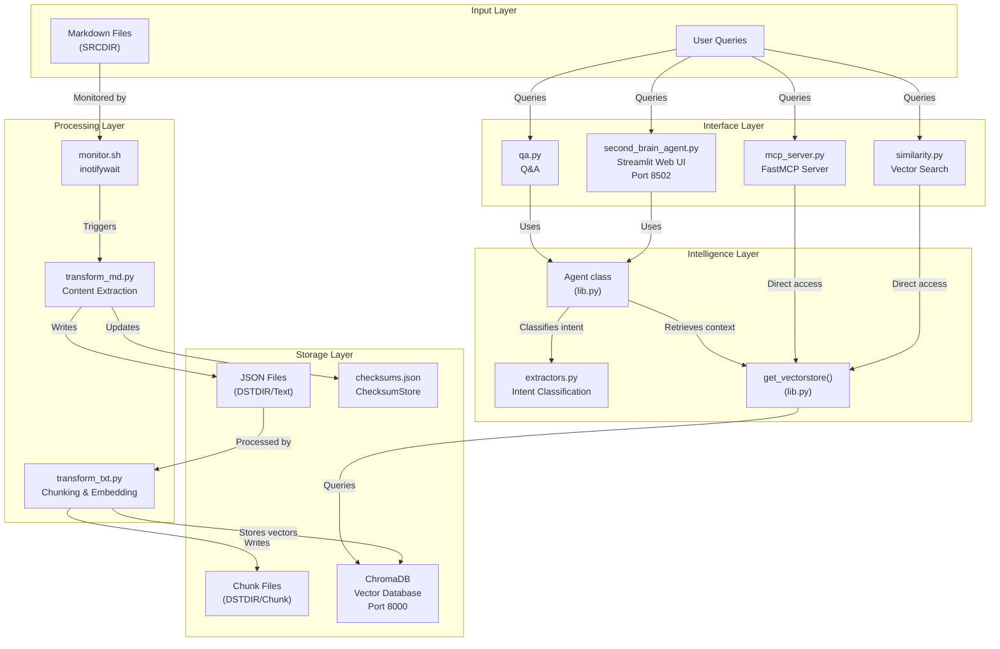

**Architecture Analysis**: The system separates data ingestion from query processing, with `ChromaDB` serving as the central knowledge repository. The `Agent` class in `lib.py` acts as the orchestrator for intelligent queries, while simpler tools can bypass it for direct vector database access.

Sources: [README.md:40-52](), Diagram 1 from context

## Data Flow Pipeline

The system implements a **two-stage pipeline** that decouples content extraction from vectorization:

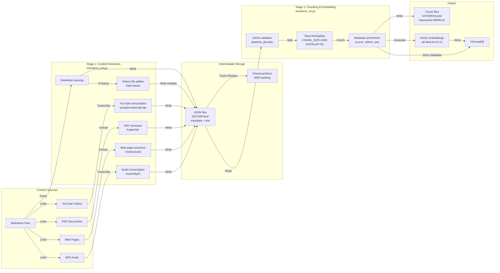

**Pipeline Design**: The two-stage design allows content extraction to be independent of vectorization. `ChecksumStore` provides incremental processing by tracking file changes via MD5 hashing, ensuring only modified content is reprocessed.

Sources: [README.md:40-52](), [README.md:47-49](), Diagram 2 from context

## Query Processing Architecture

The system implements **intent-based query routing** where different query types follow optimized processing paths:

### Query Types and Processing Chains

| Intent Type | Detection Method | Processing Chain | Key Functions |
|-------------|------------------|------------------|---------------|
| **Regular Question** | Default classification | Step-back prompting → Vector retrieval → LLM generation | `extractors.py:rephrase_sentence()`, `lib.py:Agent.question()` |
| **Activity Report** | Time period or domain keywords | Period extraction → Document filtering → Filtered retrieval → LLM | `extractors.py:get_period()`, `extractors.py:get_docs()` |
| **Summary Request** | "summarize" keyword | Retrieve all chunks → LLM summarization | `lib.py:Agent.question()` |
| **PDF/URL Lookup** | URL pattern detection | Direct document extraction | `extractors.py:get_url()` |

### Intent Classification Flow

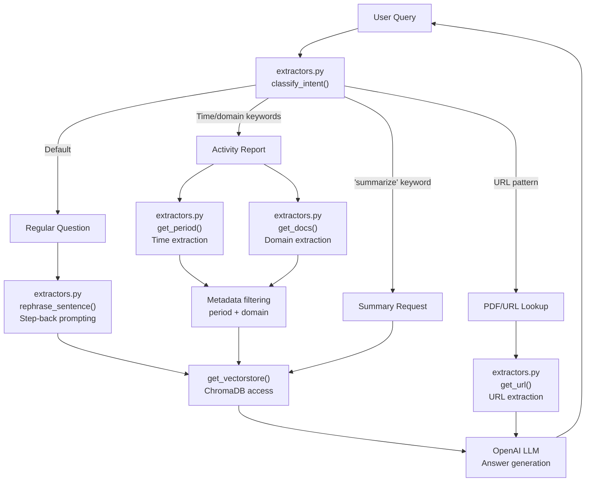

**Intent Routing**: The `Agent` class in `lib.py` delegates intent classification to `extractors.py`, which uses LLM-based parsing to extract time periods, domains, and query types. This enables specialized retrieval strategies for different question types.

Sources: [README.md:53-73](), Diagram 3 from context

## Key Features

### Multi-Source Content Ingestion

The system supports diverse content types through specialized extractors:

- **YouTube videos**: Transcript API with Whisper fallback ([transform_md.py]())
- **PDF documents**: PyMuPDF-based extraction ([transform_md.py]())
- **Web pages**: Unstructured library for HTML parsing ([transform_md.py]())
- **Audio files**: AssemblyAI transcription service ([transform_md.py]())
- **History files**: Date-based segmentation for journal entries ([transform_md.py]())

### Domain-Based Organization

The system implements a **domain metadata system** for document classification:

1. Domain extraction: Removes numbers and keywords (`At`, `Journal`, `Project`, `Notes`, `History`) from filenames
2. Example: `WorkoutHistory202412.md` → domain: `Workout`
3. Organization document: `SecondBrainOrganization.md` (configurable via `SBA_ORG_DOC`) maps domains to categories
4. Used for filtered retrieval in activity reports

Sources: [README.md:68-72]()

### MCP Protocol Server

The `mcp_server.py` implements a **FastMCP server** providing programmatic access:

| Tool | Function | Parameters |
|------|----------|------------|
| `search_documents` | Semantic search with metadata filtering | `query`, `filter_metadata`, `n_results` |
| `get_document_count` | Returns total document count | None |
| `get_domains` | Lists available domains | None |
| `get_recent_documents` | Retrieves recently accessed documents | `n_results` |

The MCP server enables integration with external applications without requiring the full Agent reasoning layer.

Sources: [README.md:74-124]()

## Technology Stack

### Core Dependencies

The system is built on the **LangChain framework** with specialized integrations:

| Category | Technology | Purpose |
|----------|------------|---------|
| **RAG Framework** | `langchain`, `langchain-core` | Orchestration and chain management |
| **Vector Database** | `chromadb` (v0.4+) | Embedding storage and similarity search |
| **LLM Provider** | `openai`, `langchain-openai` | GPT models for answer generation |
| **Embeddings** | `sentence-transformers`, `langchain-huggingface` | Text vectorization (all-MiniLM-L6-v2) |
| **Document Loaders** | `langchain-community`, `pymupdf`, `unstructured` | Multi-format content extraction |
| **Web UI** | `streamlit`, `altair` | Interactive query interface |
| **MCP Server** | `fastmcp`, `pydantic` | Programmatic API |
| **Audio/Video** | `youtube-transcript-api`, `yt-dlp`, `pydub`, `assemblyai` | Multimedia transcription |

### Dependency Management

The project uses **Poetry** for dependency management:
- Main dependencies: [pyproject.toml:17-46]()
- Test dependencies: [pyproject.toml:48-54]()
- Python version requirement: `>=3.10,<3.12`

Sources: [pyproject.toml:1-70](), [README.md:38-39](), Diagram 5 from context

## Runtime Infrastructure

The system runs as a set of coordinated services:

### Background Services (systemd)

| Service | Script | Purpose | Dependencies |
|---------|--------|---------|--------------|
| `sba-md.service` | `transform_md.py` via `monitor.sh` | Content extraction from markdown files | `inotify-tools` |
| `sba-txt.service` | `transform_txt.py` via `monitor.sh` | Chunking and embedding generation | `ChromaDB` container |

### Database Container

ChromaDB runs in a Docker container:
- Configuration: `compose.yaml`
- Port: 8000
- Persistent storage: Volumes defined in compose configuration
- Version: Synchronized with `poetry.lock` via `Makefile`

Sources: [README.md:159-172](), Diagram 4 from context

## System Requirements

### Installation Prerequisites

- **Python**: 3.10 or 3.11 (not 3.12)
- **Package Manager**: Poetry
- **System Tools**: `inotify-tools` for file monitoring
- **Container Runtime**: Docker or Podman (for ChromaDB)
- **Operating System**: Tested on Fedora Linux 42 and Ubuntu latest

### API Keys Required

The system requires API keys configured in `.env`:
- `OPENAI_API_KEY`: For GPT models
- `HUGGINGFACEHUB_API_TOKEN`: For embeddings
- `ASSEMBLYAI_API_KEY`: For audio transcription (optional)

For configuration details, see [Configuration Management](#5.3).

Sources: [README.md:126-157](), [pyproject.toml:18]()

## Getting Started

### Basic Usage Flow

1. **Setup**: Install dependencies, configure `.env`, start ChromaDB container
2. **Ingestion**: Point `SRCDIR` to markdown notes directory, start systemd services
3. **Query**: Use web UI (`streamlit run second_brain_agent.py`), CLI tools (`similarity.py`, `qa.py`), or MCP server

### Example Commands

```bash
# Similarity search
./similarity.py "What is LangChain?" type=notes

# Question answering
./qa.py "What did I work on last week?"

# Launch web UI
streamlit run second_brain_agent.py

# Start MCP server
poetry run python mcp_server.py
```

Sources: [README.md:174-198]()

---

# Page: Data Processing Pipeline

# Data Processing Pipeline

<details>
<summary>Relevant source files</summary>

The following files were used as context for generating this wiki page:

- [README.md](README.md)
- [transform_md.py](transform_md.py)
- [transform_txt.py](transform_txt.py)

</details>


The data processing pipeline transforms diverse document formats into vector embeddings stored in ChromaDB. This two-stage pipeline consists of content extraction ([transform_md.py]()), text chunking with vectorization ([transform_txt.py]()), orchestrated by a file system monitoring service ([monitor.sh]()). 

This page provides an architectural overview of the pipeline. For detailed implementation specifics, see:
- **Markdown and Content Extraction** ([#2.1]()) - Deep dive into [transform_md.py]()
- **Text Chunking and Vectorization** ([#2.2]()) - Deep dive into [transform_txt.py]()
- **File System Monitoring** ([#2.3]()) - Deep dive into [monitor.sh]()

For information about the storage layer and ChromaDB configuration, see **Vector Database Setup** ([#5.1]()). For details about the Agent system that queries this processed data, see **Agent and Intelligence Layer** ([#3]()).

## Architecture Overview

The pipeline implements a two-stage transformation process that converts markdown files and embedded content (YouTube videos, PDFs, web pages, audio) into searchable vector embeddings. The system uses `inotifywait` for real-time file monitoring, triggering incremental processing when source files change.

**Pipeline Architecture: File Flow and Processing Stages**

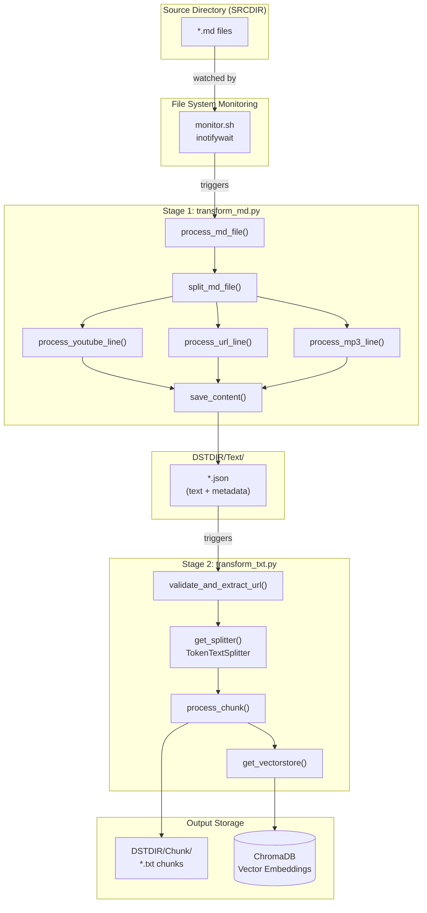

Sources: [transform_md.py:531-566](), [transform_txt.py:101-131](), [monitor.sh]()

## Pipeline Stages

The pipeline operates in two sequential stages, each implemented as a systemd service that can run continuously or be triggered manually:

| Stage | Script | Systemd Service | Input | Output | Primary Functions |
|-------|--------|----------------|-------|--------|-------------------|
| **Content Extraction** | `transform_md.py` | `sba-md.service` | `SRCDIR/*.md` | `DSTDIR/Text/*.json` | `process_md_file()`, `save_content()` |
| **Chunking & Vectorization** | `transform_txt.py` | `sba-txt.service` | `DSTDIR/Text/*.json` | `DSTDIR/Chunk/*.txt`, ChromaDB | `process_file()`, `get_vectorstore()` |

### Stage 1: Content Extraction (transform_md.py)

The first stage extracts text content from markdown files and embedded multimedia resources. The `process_md_file()` function serves as the entry point, delegating to specialized extraction functions based on content type.

**Content Extraction: Function Call Flow**

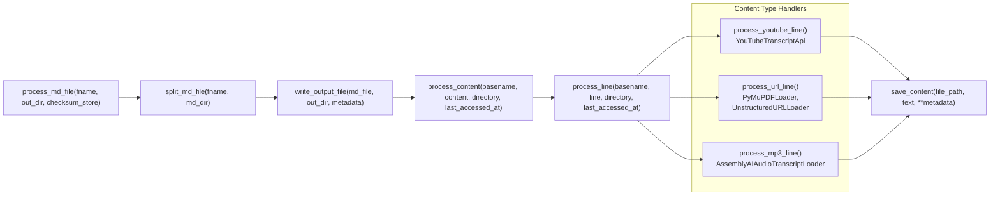

Sources: [transform_md.py:531-566](), [transform_md.py:185-213](), [transform_md.py:215-280](), [transform_md.py:282-330]()

**Key Features:**
- **History File Splitting**: Splits journal/history files by date using `split_md_file()` and regex patterns `DATE2_REGEXP`, `DATE3_REGEXP` ([transform_md.py:429-460]())
- **Content Deduplication**: Uses `ChecksumStore` to skip unchanged files ([transform_md.py:558]())
- **Fallback Mechanisms**: YouTube extraction falls back to Whisper if transcript API fails ([transform_md.py:150-182]())
- **Metadata Extraction**: Parses YAML frontmatter with `get_metadata()` ([transform_md.py:354-387]())

For detailed implementation, see **Markdown and Content Extraction** ([#2.1]()).

### Stage 2: Text Chunking and Vectorization (transform_txt.py)

The second stage processes JSON files into fixed-size text chunks and generates vector embeddings. The `TokenTextSplitter` from LangChain creates chunks with configurable size and overlap.

**Chunking Configuration and Data Flow**

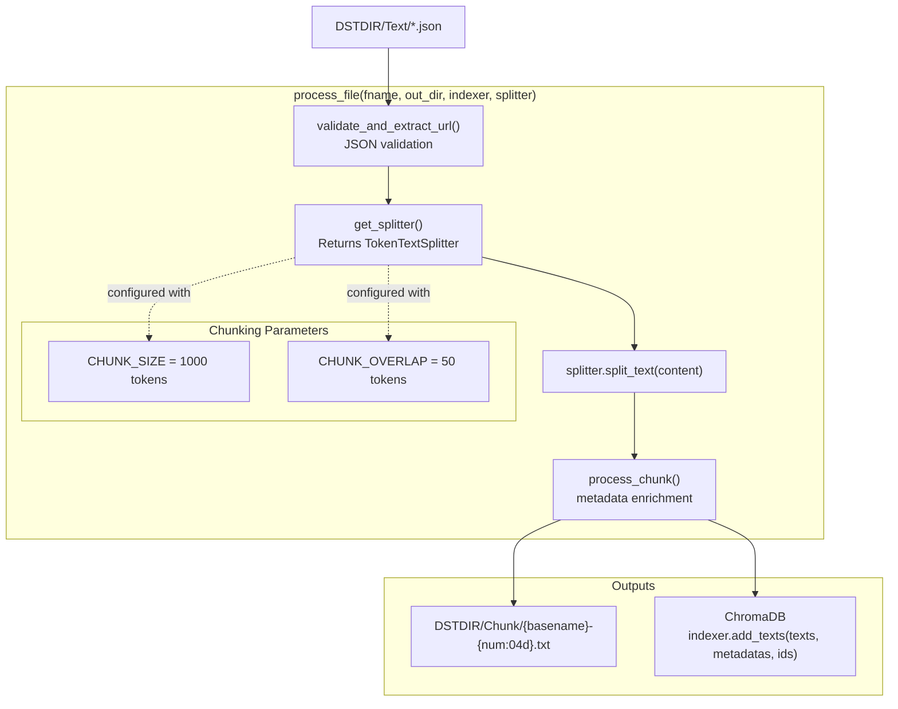

Sources: [transform_txt.py:18-21](), [transform_txt.py:24-29](), [transform_txt.py:101-131]()

**Key Features:**
- **Token-Based Chunking**: 1000 token chunks with 50 token overlap to preserve context across boundaries
- **Metadata Preservation**: Each chunk retains original metadata plus `part`, `source`, `main_source` fields ([transform_txt.py:36-43]())
- **Timestamp Synchronization**: Chunk files maintain source file modification times ([transform_txt.py:52-54]())
- **Cleanup on Deletion**: `remove_related_files()` deletes chunks when source files are removed ([transform_txt.py:85-98]())

For detailed implementation, see **Text Chunking and Vectorization** ([#2.2]()).

## File System Monitoring and Orchestration

The `monitor.sh` script orchestrates the pipeline by watching the source directory for changes and triggering the appropriate transformation scripts. It uses `inotifywait` from the `inotify-tools` package to detect file system events in real-time.

**File System Monitoring: Event Detection and Script Invocation**

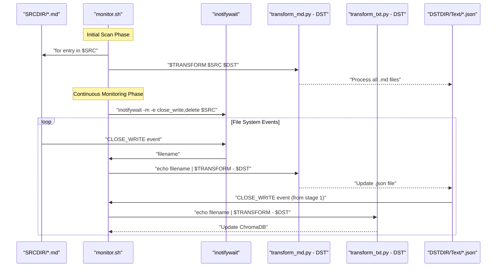

Sources: [monitor.sh]()

The monitoring script can be invoked directly or deployed as a systemd user service. When run as `sba-md.service` and `sba-txt.service`, it provides continuous background processing. See **File System Monitoring** ([#2.3]()) for implementation details and **System Services** ([#5.2]()) for deployment configuration.

## Data Flow and Transformations

The pipeline transforms raw markdown files into searchable vector embeddings through a series of data format conversions:

**Data Format Transformation Pipeline**

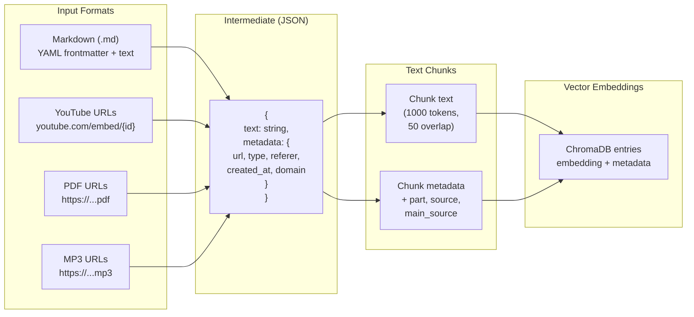

Sources: [transform_md.py:72-90](), [transform_txt.py:58-82](), [transform_txt.py:32-55]()

### Metadata Standardization

The pipeline extracts and standardizes metadata across all document types to ensure consistent querying:

| Metadata Field | Source | Description | Format |
|----------------|--------|-------------|--------|
| `url` | YAML frontmatter or computed | Source URL or file path | String |
| `type` | Content type or default | Document category | `notes`, `youtube`, `pdf`, `audio`, `web`, `history` |
| `referer` | Parent document | Embedding source document | Filename without extension |
| `created_at` | YAML `date` or file mtime | Document creation timestamp | Unix timestamp (float) |
| `last_accessed_at` | File mtime | Last modification timestamp | Unix timestamp (float) |
| `domain` | Computed from filename | Logical grouping | String (see `extract_domain()`) |

Sources: [transform_md.py:354-387](), [transform_md.py:414-426](), [transform_txt.py:78-81]()

The `domain` field is computed by `extract_domain()` which removes numbers and strings like `At`, `Journal`, `Project`, `Notes`, and `History` from the filename. For example, `WorkoutHistory202412.md` yields domain `Workout`. This domain metadata enables filtered retrieval for activity reports (see **Intent Classification and Extraction** [#3.2]()).

## Output Format and Storage Structure

The pipeline generates a hierarchical directory structure under `DSTDIR` with processed content organized by type:

```
DSTDIR/
├── Text/           # Extracted content as JSON
│   ├── {basename}.json
│   ├── {video_id}.json
│   └── {url_hash}.json
├── Chunk/          # Text chunks for vectorization
│   ├── {basename}-0001.txt
│   ├── {basename}-0002.txt
│   └── ...
├── Markdown/       # Split markdown files
│   └── history files
├── Orig/           # Original downloaded files
│   ├── audio files
│   └── PDF files
└── Db/            # ChromaDB vector storage
```

### JSON Document Format

Each processed document is stored as JSON with the following structure:

```json
{
  "text": "extracted content",
  "metadata": {
    "url": "source URL or file path",
    "type": "notes|youtube|pdf|audio|web",
    "referer": "parent document name",
    "last_accessed_at": 1234567890.0,
    "created_at": 1234567890.0,
    "domain": "extracted domain"
  }
}
```

Sources: [transform_md.py:39-41](), [transform_md.py:44-62](), [transform_txt.py:36-49]()

## Error Handling and Resilience

The pipeline includes comprehensive error handling to ensure robust operation:

- **Content Deduplication**: Files are only reprocessed when content changes using checksum comparison
- **Encoding Support**: Handles both UTF-8 and Latin-1 encodings
- **Missing File Cleanup**: Removes vector database entries when source files are deleted
- **API Failure Recovery**: Falls back to alternative extraction methods (e.g., Whisper for YouTube when transcripts are unavailable)

Sources: [transform_md.py:428-464](), [transform_md.py:416-423](), [transform_txt.py:79-93](), [transform_md.py:87-117]()

---

# Page: Markdown and Content Extraction

# Markdown and Content Extraction

<details>
<summary>Relevant source files</summary>

The following files were used as context for generating this wiki page:

- [lib.py](lib.py)
- [transform_md.py](transform_md.py)

</details>


This page documents the `transform_md.py` system, which is the primary content extraction and ingestion component of the Second Brain Agent data pipeline. It processes markdown files and their embedded references (YouTube, PDFs, web URLs, MP3s), extracting and normalizing content into structured JSON files for downstream chunking and vectorization.

For details on the next stage (chunking and embedding), see [2.2](). 

## System Role and Data Flow

The `transform_md.py` script implements the first stage of the ingestion pipeline:

- Reads markdown files from a source directory or from stdin.
- Extracts and processes embedded content: YouTube videos, PDFs, web URLs, and MP3 audio.
- Converts all content types to plain text using specialized loader classes.
- Outputs JSON files with extracted text and metadata to the `Text/` directory.
- Handles history/journal markdown files by splitting them into temporally organized sub-documents.

### Diagram: Content Extraction Pipeline and Code Entities

```mermaid
flowchart TB
    subgraph "Input"
        "MarkdownFiles[\".md files\"]"
        "StdinFilenames[\"stdin filenames\"]"
    end
    subgraph "Main Script"
        "transform_md.py[transform_md.py]"
    end
    subgraph "Core Functions"
        "process_md_file[process_md_file()]"
        "split_md_file[split_md_file()]"
        "write_output_file[write_output_file()]"
        "process_content[process_content()]"
        "process_line[process_line()]"
    end
    subgraph "Line Processors"
        "process_youtube_line[process_youtube_line()]"
        "process_url_line[process_url_line()]"
        "process_mp3_line[process_mp3_line()]"
    end
    subgraph "External Loaders"
        "YouTubeTranscriptApi[YouTubeTranscriptApi]"
        "OpenAIWhisperParser[OpenAIWhisperParser]"
        "PyMuPDFLoader[PyMuPDFLoader]"
        "UnstructuredURLLoader[UnstructuredURLLoader]"
        "AssemblyAIAudioTranscriptLoader[AssemblyAIAudioTranscriptLoader]"
    end
    subgraph "Output"
        "TextJSON[Text/*.json]"
        "OrigFiles[Orig/ (original downloads)]"
        "MarkdownSplit[Markdown/ (split .md)]"
    end

    "MarkdownFiles" --> "transform_md.py"
    "StdinFilenames" --> "transform_md.py"
    "transform_md.py" --> "process_md_file"
    "process_md_file" --> "split_md_file"
    "split_md_file" --> "write_output_file"
    "write_output_file" --> "process_content"
    "process_content" --> "process_line"
    "process_line" --> "process_youtube_line"
    "process_line" --> "process_url_line"
    "process_line" --> "process_mp3_line"
    "process_youtube_line" --> "YouTubeTranscriptApi"
    "process_youtube_line" --> "OpenAIWhisperParser"
    "process_url_line" --> "PyMuPDFLoader"
    "process_url_line" --> "UnstructuredURLLoader"
    "process_mp3_line" --> "AssemblyAIAudioTranscriptLoader"
    "write_output_file" --> "TextJSON"
    "process_url_line" --> "OrigFiles"
    "split_md_file" --> "MarkdownSplit"
```
Sources: [transform_md.py:531-581](), [transform_md.py:433-491](), [transform_md.py:493-529](), [transform_md.py:343-352](), [transform_md.py:333-341](), [transform_md.py:185-213](), [transform_md.py:215-280](), [transform_md.py:285-331]()


## Content Type Extraction and Routing

The system uses regular expressions and dedicated processor functions to extract and normalize content from different embedded resource types in markdown files.

| Content Type      | Regex Pattern      | Processor Function         | Loader/Service Used                |
|-------------------|-------------------|---------------------------|------------------------------------|
| YouTube Video     | `YOUTUBE_REGEX`   | `process_youtube_line()`  | `YouTubeTranscriptApi`, `OpenAIWhisperParser` |
| PDF Document      | `HTTP_REGEX` + `.pdf` | `process_url_line()`    | `PyMuPDFLoader`                    |
| Web URL           | `HTTP_REGEX`      | `process_url_line()`      | `UnstructuredURLLoader`            |
| MP3 Audio         | `MP3_REGEX`       | `process_mp3_line()`      | `AssemblyAIAudioTranscriptLoader`  |
| Markdown Text     | N/A               | `get_metadata()`          | Built-in parsing                   |

### Diagram: Content Type Routing to Code Entities

```mermaid
flowchart LR
    "YOUTUBE_REGEX[\"YOUTUBE_REGEX\"]" --> "process_youtube_line[process_youtube_line()]"
    "HTTP_REGEX[\"HTTP_REGEX\"]" --> "process_url_line[process_url_line()]"
    "MP3_REGEX[\"MP3_REGEX\"]" --> "process_mp3_line[process_mp3_line()]"
    "IGNORED_REGEX[\"IGNORED_REGEX\"]" -.-> "process_url_line[process_url_line()]"

    "process_youtube_line[process_youtube_line()]" --> "YouTubeTranscriptApi[YouTubeTranscriptApi]"
    "process_youtube_line[process_youtube_line()]" --> "OpenAIWhisperParser[OpenAIWhisperParser]"
    "process_url_line[process_url_line()]" --> "PyMuPDFLoader[PyMuPDFLoader]"
    "process_url_line[process_url_line()]" --> "UnstructuredURLLoader[UnstructuredURLLoader]"
    "process_mp3_line[process_mp3_line()]" --> "AssemblyAIAudioTranscriptLoader[AssemblyAIAudioTranscriptLoader]"
```
Sources: [transform_md.py:35-38](), [transform_md.py:185-213](), [transform_md.py:215-280](), [transform_md.py:285-331]()


## YouTube Video Extraction Logic

YouTube video references are processed using a two-stage fallback mechanism:

1. **Transcript Retrieval**: Attempt to fetch a transcript using `YouTubeTranscriptApi` (supports English and French).
2. **Audio Transcription Fallback**: If transcript is unavailable, download the audio and transcribe it using `OpenAIWhisperParser` via `YoutubeAudioLoader`.

Extracted text is saved as a JSON file with metadata (URL, referer, type, last_accessed_at).

### Diagram: YouTube Extraction Sequence

```mermaid
sequenceDiagram
    participant "process_youtube_line()" as PYL
    participant "YouTubeTranscriptApi" as YTA
    participant "YoutubeAudioLoader" as YAL
    participant "OpenAIWhisperParser" as OWP
    participant "save_content()" as SC

    Note over "process_youtube_line()": "Extract video_id from line"
    "process_youtube_line()"->>"YouTubeTranscriptApi": "fetch(video_id, [\"en\", \"fr\"])"
    alt "Transcript available"
        "YouTubeTranscriptApi"->>"process_youtube_line()": "Return transcript"
        "process_youtube_line()"->>"save_content()": "Save transcript"
    else "Transcript unavailable"
        Note over "process_youtube_line()": "Fallback to Whisper"
        "process_youtube_line()"->>"YoutubeAudioLoader": "Download audio"
        "YoutubeAudioLoader"->>"OpenAIWhisperParser": "Transcribe audio"
        "OpenAIWhisperParser"->>"process_youtube_line()": "Return transcription"
        "process_youtube_line()"->>"save_content()": "Save transcription"
    else "Download error"
        "process_youtube_line()"->>"process_youtube_line()": "Log error"
    end
```
Sources: [transform_md.py:185-213](), [transform_md.py:123-183](), [transform_md.py:72-91]()


## History File Splitting and Temporal Organization

Markdown files with history or journal content are automatically split into multiple files, each representing a dated entry. This enables fine-grained temporal retrieval.

- **History files**: Identified by filename or content, split using `DATE2_REGEXP` (`## DD MMM YYYY`).
- **Files with History sections**: Split using `DATE3_REGEXP` (`### DD MMM YYYY`).

The splitting is performed by `split_md_file()` and `generate_history_files()`. Each split file receives its own metadata and is written to the `Markdown/` directory.

### Diagram: History Splitting Logic and Code Entities

```mermaid
flowchart TD
    "InputFile[\".md file\"]" --> "is_history_filename[is_history_filename()]"
    "is_history_filename[is_history_filename()]" -- "True" --> "DATE2_REGEXP[DATE2_REGEXP]"
    "is_history_filename[is_history_filename()]" -- "False" --> "HasHistorySection[Contains '## History'?]"
    "HasHistorySection[Contains '## History'?]" -- "True" --> "DATE3_REGEXP[DATE3_REGEXP]"
    "HasHistorySection[Contains '## History'?]" -- "False" --> "NoSplit[No splitting]"
    "DATE2_REGEXP[DATE2_REGEXP]" --> "generate_history_files[generate_history_files()]"
    "DATE3_REGEXP[DATE3_REGEXP]" --> "generate_history_files[generate_history_files()]"
    "generate_history_files[generate_history_files()]" --> "SplitFiles[Markdown/*.md]"
```
Sources: [transform_md.py:433-491](), [transform_md.py:429-432](), [transform_md.py:414-427]()


## Metadata Extraction and JSON Serialization

Metadata is extracted from markdown headers and file properties, then combined with processing metadata to form a structured JSON record.

- `get_metadata()` parses YAML-style headers and infers fields such as `created_at`, `title`, and `domain`.
- `save_content()` writes the extracted text and metadata to a JSON file in the `Text/` directory.

Example output structure:

```json
{
  "text": "Extracted content text",
  "metadata": {
    "title": "Document title",
    "created_at": "2024-01-15T10:30:00",
    "last_accessed_at": "2024-01-15T10:30:00",
    "url": "file:///path/to/source.md",
    "type": "notes|history|pdf|web|youtube|audio",
    "referer": "source_document_basename",
    "domain": "extracted_domain_name"
  }
}
```

Output directories:
- `Text/`: JSON files with text and metadata.
- `Orig/`: Downloaded original files (PDFs, audio).
- `Markdown/`: Split markdown files for history/journal entries.

Sources: [transform_md.py:354-388](), [transform_md.py:72-91]()


## Error Handling and Optimization

The system implements several optimization and error handling strategies:

| Feature | Implementation | Purpose |
|---------|----------------|---------|
| Content Change Detection | `ChecksumStore` class | Skip processing unchanged files |
| Time-based Optimization | `is_same_time()` check | Skip files with no modification time changes |
| Encoding Fallback | UTF-8 → latin-1 | Handle files with different encodings |
| Private Network Filtering | IP address checks | Skip internal/private URLs |
| Domain Filtering | `IGNORED_REGEX` | Skip problematic domains |
| API Key Validation | Environment variable checks | Graceful degradation without API keys |

Sources: [transform_md.py:452-455](), [transform_md.py:130-140](), [transform_md.py:417-423](), [transform_md.py:196-202]()

---

# Page: Text Chunking and Vectorization

# Text Chunking and Vectorization

<details>
<summary>Relevant source files</summary>

The following files were used as context for generating this wiki page:

- [lib.py](lib.py)
- [transform_txt.py](transform_txt.py)

</details>


## Purpose and Scope

This document explains the text chunking and vectorization system implemented in `transform_txt.py`, which is the second stage of the data processing pipeline. This system takes JSON files containing extracted text content and transforms them into searchable vector embeddings stored in ChromaDB.

For information about the initial content extraction from various document formats, see [Markdown and Content Extraction](#2.1). For details about the vector database configuration and deployment, see [Vector Database Setup](#5.1).

## System Overview

The text chunking and vectorization system processes JSON files produced by the content extraction stage and converts them into a searchable vector database. The system handles the complete workflow from text splitting to vector storage, including file management and metadata preservation.

### Processing Pipeline Flow

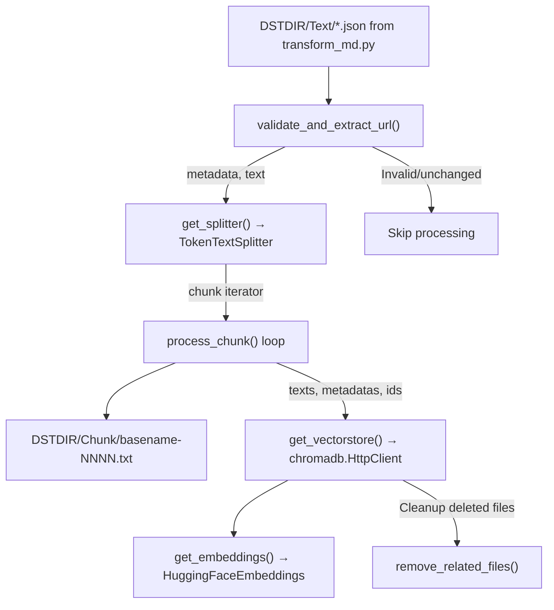

**Sources**: [transform_txt.py:101-131](), [lib.py:44-72]()

## Text Chunking Process

The system uses LangChain's `TokenTextSplitter` to divide text content into manageable chunks optimized for vector similarity search and LLM processing.

### Chunking Configuration

The chunking parameters are configured as constants to balance context preservation with token limits:

| Parameter | Value | Purpose |
|-----------|-------|---------|
| `CHUNK_SIZE` | 1000 tokens | Maximum size per chunk, optimized for 4096 token LLM limit |
| `CHUNK_OVERLAP` | 50 tokens | Overlap between chunks to preserve context |

**Sources**: [transform_txt.py:18-21]()

### Text Splitter Implementation

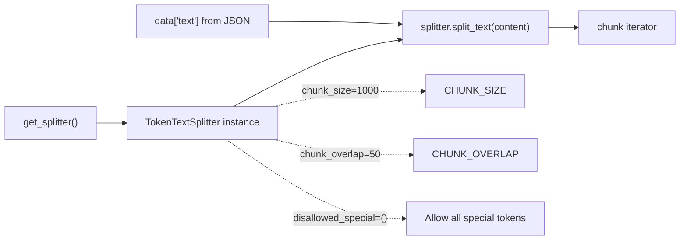

The `get_splitter()` function at [transform_txt.py:24-29]() creates a configured `TokenTextSplitter` instance from LangChain that handles token-based text division. The splitter uses tiktoken encoding to count tokens accurately, ensuring chunks stay within the specified token limits while preserving semantic boundaries where possible.

**Sources**: [transform_txt.py:24-29](), [transform_txt.py:116]()

## Chunk Processing and File Management

Each text chunk is processed individually to create both filesystem artifacts and database entries with comprehensive metadata.

### Chunk File Creation

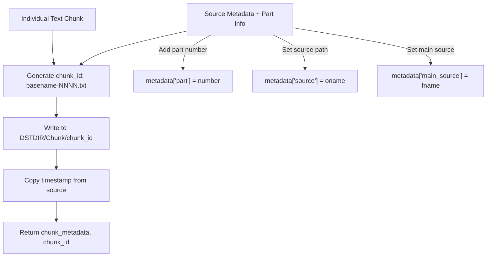

The `process_chunk()` function handles individual chunk processing, creating numbered chunk files with preserved metadata and timestamps.

**Sources**: [transform_txt.py:32-49]()

### Metadata Enhancement

The system enriches each chunk with processing metadata:

- `part`: Sequential chunk number within the document
- `source`: Path to the individual chunk file  
- `main_source`: Path to the original JSON file
- `referer`: Base filename for grouping related chunks

**Sources**: [transform_txt.py:38-43]()

## Vectorization and Database Storage

The system generates vector embeddings for all chunks and stores them in ChromaDB with associated metadata for retrieval operations. The vectorization uses HuggingFace's sentence transformers model accessed via LangChain integrations.

### Vector Storage Process

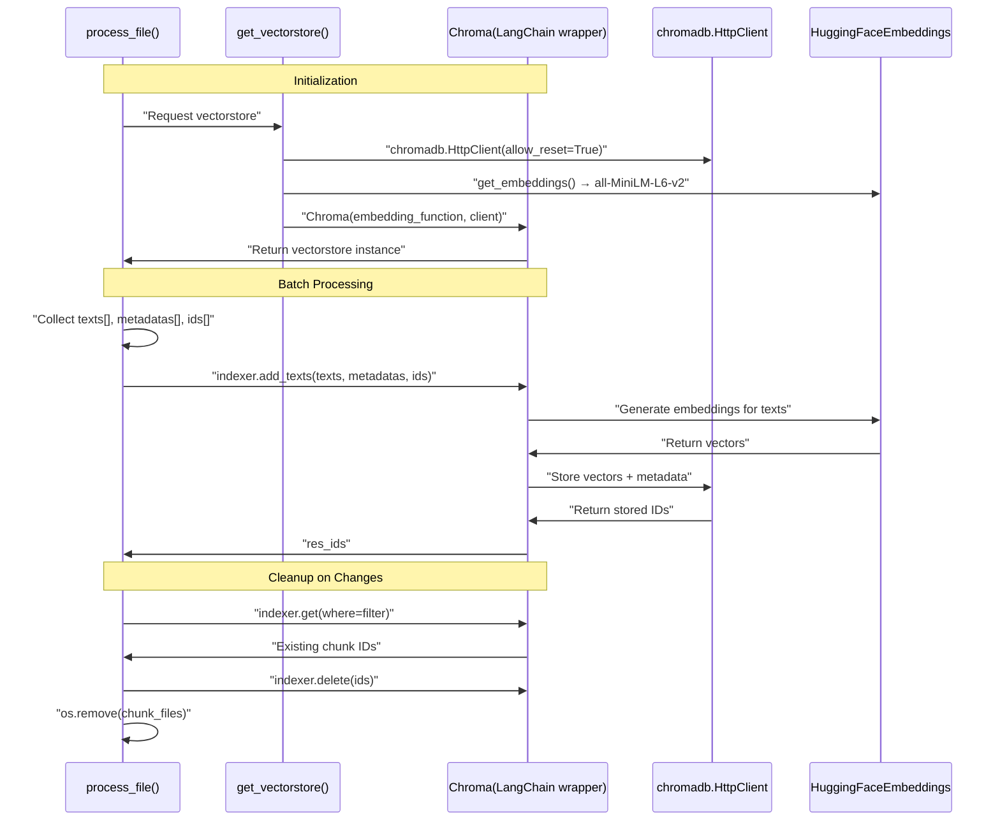

The vectorization process batches all chunks from a document for efficient storage. The `get_vectorstore()` function at [lib.py:49-72]() handles ChromaDB connection with retry logic (up to 12 attempts with 5-second delays) to ensure the database is available.

**Sources**: [transform_txt.py:129-130](), [lib.py:49-72](), [lib.py:44-46]()

### Embedding Model Configuration

The system uses HuggingFace's `all-MiniLM-L6-v2` sentence transformer model for generating vector embeddings:

| Component | Implementation | Details |
|-----------|---------------|---------|
| Model | `all-MiniLM-L6-v2` | Sentence transformer optimized for semantic similarity |
| Framework | `HuggingFaceEmbeddings` | LangChain wrapper for HuggingFace models |
| Vector Store | `Chroma` | LangChain wrapper for ChromaDB |
| Client | `chromadb.HttpClient` | HTTP client connecting to ChromaDB server on port 8000 |

The `get_embeddings()` function at [lib.py:44-46]() creates the embedding function instance that is passed to the ChromaDB vector store for consistent embedding generation across all operations.

**Sources**: [lib.py:44-46](), [lib.py:49-72]()

## File Validation and Processing Logic

The system includes robust validation to ensure data integrity and avoid unnecessary reprocessing.

### File Validation Pipeline

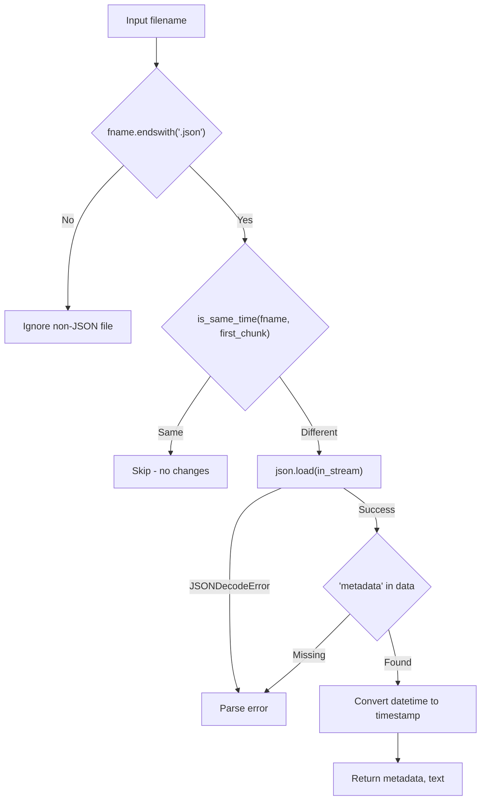

The `validate_and_extract_url()` function performs comprehensive validation including file format checks, timestamp comparison for change detection, JSON parsing, and metadata validation.

**Sources**: [transform_txt.py:52-76]()

### Datetime Handling

The system handles datetime objects at two stages: deserialization from JSON and conversion for ChromaDB storage.

**JSON Deserialization**: The `datetime_decoder()` function at [lib.py:331-342]() converts ISO format strings and timestamps to Python `datetime` objects when loading JSON files:

```python
# Detects keys ending in '_at' or containing 'date'
if key.endswith("_at") or key.find("date") != -1:
    dct[key] = datetime.datetime.fromisoformat(val)  # from ISO string
    dct[key] = datetime.datetime.fromtimestamp(val)  # from Unix timestamp
```

**ChromaDB Conversion**: Since ChromaDB does not support `datetime` objects in metadata, the system converts them to Unix timestamps at [transform_txt.py:78-81]():

```python
# Convert datetime to timestamp for ChromaDB compatibility
if isinstance(val, datetime.datetime):
    metadata[key] = val.timestamp()
```

This two-stage approach allows the system to work with standard datetime objects internally while ensuring compatibility with ChromaDB's metadata constraints.

**Sources**: [transform_txt.py:78-81](), [lib.py:331-342](), [transform_txt.py:68]()

## Entry Points and Integration

The system provides flexible entry points for integration with the monitoring pipeline and manual processing.

### Main Processing Modes

| Mode | Input Source | Use Case |
|------|-------------|----------|
| Directory scan | `in_dir` parameter | Manual batch processing |
| Stdin processing | `in_dir = "-"` | Pipeline integration with monitor.sh |

The `main()` function supports both directory scanning and stdin-based filename processing, enabling integration with file monitoring systems.

**Sources**: [transform_txt.py:127-141]()

### System Integration Points

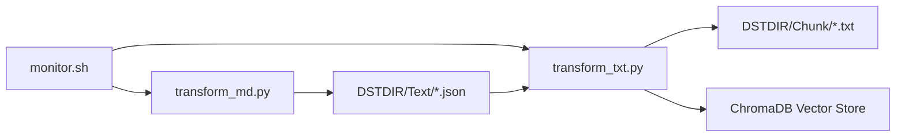

The text chunking and vectorization system serves as the critical bridge between extracted content and the queryable knowledge base, enabling the Agent system to perform semantic search and retrieval-augmented generation.

**Sources**: [transform_txt.py:1-148]()

---

# Page: File System Monitoring

# File System Monitoring

<details>
<summary>Relevant source files</summary>

The following files were used as context for generating this wiki page:

- [install-systemd-services.sh](install-systemd-services.sh)
- [monitor.sh](monitor.sh)
- [sba-md-service.sh](sba-md-service.sh)
- [sba-txt-service.sh](sba-txt-service.sh)

</details>


## Purpose and Scope

This document explains the file system monitoring infrastructure that enables continuous, automated document ingestion in the Second Brain Agent. The monitoring system uses `inotifywait` (from inotify-tools) to detect file changes in real-time and automatically triggers the appropriate transformation scripts.

The monitoring system consists of:
- **`monitor.sh`**: Core orchestration script that handles initial processing and continuous file watching
- **Service wrappers**: `sba-md-service.sh` and `sba-txt-service.sh` that configure and launch monitoring for specific pipeline stages
- **Systemd integration**: User services that ensure continuous background operation

For details on the transformation scripts invoked by the monitoring system, see [Markdown and Content Extraction](#2.1) and [Text Chunking and Vectorization](#2.2). For systemd service configuration, see [System Services](#5.2).

---

## Architecture Overview

The monitoring system implements a two-stage watch-and-process pattern. Each stage monitors a specific directory and invokes the corresponding transformation utility when files are created, modified, or deleted.

### Monitoring Architecture

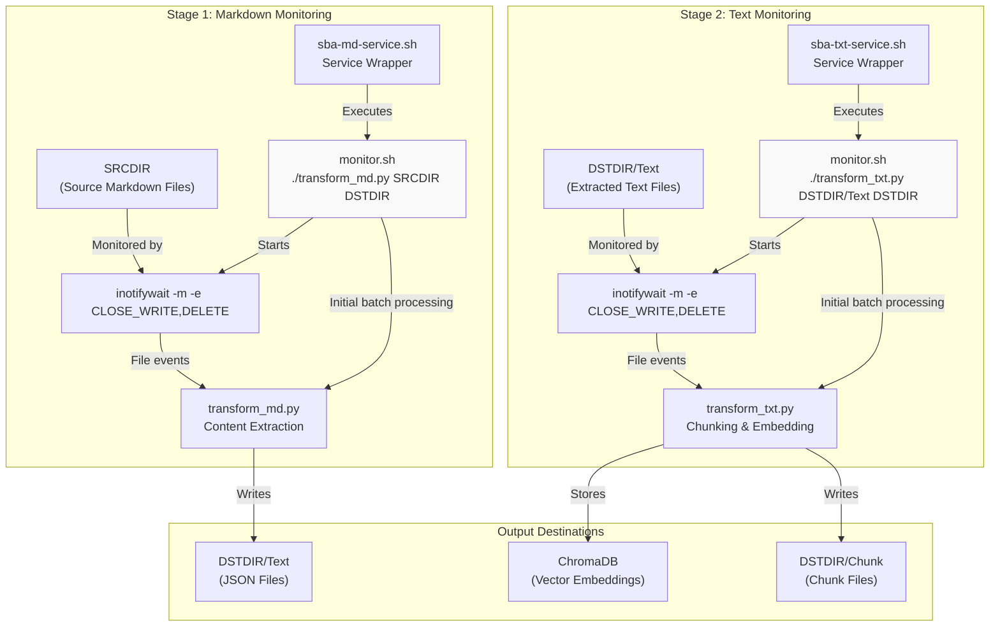

**Sources:** [monitor.sh:1-42](), [sba-md-service.sh:1-19](), [sba-txt-service.sh:1-42]()

---

## Core Monitoring Script

The `monitor.sh` script is the central orchestration component that implements the watch-and-process pattern. It accepts three arguments and performs two distinct phases: initial batch processing and continuous monitoring.

### Script Arguments and Validation

The script requires three positional arguments:

| Argument | Description | Example |
|----------|-------------|---------|
| `$1` | Transform utility path | `./transform_md.py` |
| `$2` | Source directory to monitor | `$SRCDIR` or `$DSTDIR/Text` |
| `$3` | Target directory for output | `$DSTDIR` |

Validation logic ensures all arguments are present and directories exist:

```
monitor.sh:3-20
- Argument count validation
- Directory existence checks
- Error reporting to stderr
```

**Sources:** [monitor.sh:3-20]()

### Virtual Environment Management

The script automatically creates or activates a Python virtual environment to ensure dependency isolation:

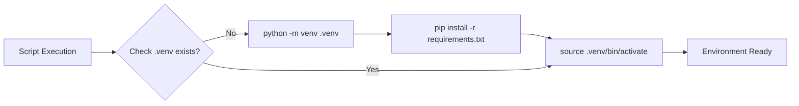

The environment setup occurs at [monitor.sh:24-30](), ensuring the transformation utilities have access to required Python packages.

**Sources:** [monitor.sh:22-30]()

### Two-Phase Processing Model

The monitoring system operates in two distinct phases:

#### Phase 1: Initial Batch Processing

Immediately upon script launch, the specified transform utility processes all existing files in the source directory:

```
monitor.sh:32-34
- Executes transform utility: "$TRANSFORM" "$SRC" "$DST"
- Processes entire directory in batch mode
- Outputs completion message
```

This ensures that any files present before monitoring began are processed, maintaining system consistency.

#### Phase 2: Continuous File Monitoring

After batch processing completes, `inotifywait` enters monitor mode and watches for file system events:

```
monitor.sh:36-39
Event Monitoring:
- inotifywait -m -e CLOSE_WRITE,DELETE "$SRC"
- Monitored events:
  * CLOSE_WRITE: File write completed and closed
  * DELETE: File removed from directory
- Output format: dir event fname
- Piped to transform utility with "-" as source
```

The `-m` flag enables **monitor mode**, which continuously watches for events rather than exiting after the first event. Each detected event generates a line with the directory, event type, and filename, which is piped to the transform utility.

**Sources:** [monitor.sh:32-39]()

### Event Stream Processing

```mermaid
sequenceDiagram
    participant inotifywait
    participant while_loop as "while read loop"
    participant stderr as "stderr (console)"
    participant stdout as "stdout (pipe)"
    participant transform as "transform_*.py"
    
    inotifywait->>while_loop: "dir event fname"
    while_loop->>stderr: "echo ${dir}${fname} $event"
    Note over stderr: Logged for debugging
    while_loop->>stdout: "echo ${dir}${fname}"
    Note over stdout: Clean file path only
    stdout->>transform: "file path via stdin"
    transform->>transform: "Process single file"
```

The while loop at [monitor.sh:36-39]() performs dual output:
1. **stderr output** (`${dir}${fname} $event`): Full event information for logging
2. **stdout output** (`${dir}${fname}`): Clean file path piped to transform utility

The transform utility receives file paths via stdin (indicated by the `"-"` argument) and processes them incrementally.

**Sources:** [monitor.sh:36-39]()

---

## Service Wrappers

The service wrappers configure environment-specific parameters and launch `monitor.sh` with appropriate arguments for each pipeline stage.

### Markdown Service Wrapper (sba-md-service.sh)

This wrapper handles the first stage of the pipeline: monitoring markdown source files and extracting content.

#### Configuration Loading

```
sba-md-service.sh:7-10
- Checks for .env file existence
- Sources environment variables
- Exits with error if configuration missing
```

#### Directory Initialization

The script ensures required output directories exist before launching the monitor:

```
sba-md-service.sh:14
Creates:
- $DSTDIR/Orig   (Original downloaded content)
- $DSTDIR/Text   (Extracted text as JSON)
- $DSTDIR/Markdown (Processed markdown files)
```

#### Monitor Launch

```
sba-md-service.sh:16
Invocation: ./monitor.sh ./transform_md.py "$SRCDIR" "$DSTDIR"
- Transform: transform_md.py
- Source: $SRCDIR (user's markdown files)
- Target: $DSTDIR (extraction output)
```

**Sources:** [sba-md-service.sh:1-19]()

### Text Service Wrapper (sba-txt-service.sh)

This wrapper handles the second stage: monitoring extracted text files and generating embeddings.

#### Environment Validation

```
sba-txt-service.sh:14-18
- Validates DSTDIR is configured
- Fails fast if configuration incomplete
```

#### ChromaDB Container Management

The text service manages the ChromaDB Docker container lifecycle:

```mermaid
graph TB
    START["Service Start"]
    DETECT["Detect compose tool<br/>podman-compose or docker-compose"]
    CHECK{"Container running?"}
    STOP["compose down<br/>Stop existing container"]
    START_CONTAINER["compose up -d<br/>Start container in background"]
    PS["compose ps<br/>Show status"]
    MONITOR["Launch monitor.sh"]
    
    START --> DETECT
    DETECT --> CHECK
    CHECK -->|"Yes"| STOP
    CHECK -->|"No"| START_CONTAINER
    STOP --> START_CONTAINER
    START_CONTAINER --> PS
    PS --> MONITOR
```

Container management logic at [sba-txt-service.sh:22-37]():

```
Tool detection: podman-compose or docker-compose
Container cleanup: Stop if already running
Container start: up -d (detached mode)
Status check: ps command output
```

#### Directory Initialization and Monitor Launch

```
sba-txt-service.sh:20
Creates:
- $DSTDIR/Chunk (Text chunks)
- $DSTDIR/Db    (ChromaDB persistent storage)

sba-txt-service.sh:39
Invocation: ./monitor.sh ./transform_txt.py "$DSTDIR/Text" "$DSTDIR"
- Transform: transform_txt.py
- Source: $DSTDIR/Text (JSON files from stage 1)
- Target: $DSTDIR (chunk and embedding output)
```

**Sources:** [sba-txt-service.sh:1-42]()

---

## Event Processing Flow

The following diagram traces a complete event lifecycle from file system change to vector storage:

### Complete Event Flow

```mermaid
sequenceDiagram
    participant User
    participant FileSystem as "File System"
    participant inotify as "inotifywait"
    participant monitor as "monitor.sh"
    participant transform as "transform_*.py"
    participant Output as "Output Directory"
    participant ChromaDB as "ChromaDB (Stage 2 only)"
    
    User->>FileSystem: "Create/modify file"
    FileSystem->>inotify: "CLOSE_WRITE event"
    inotify->>monitor: "dir CLOSE_WRITE filename"
    
    Note over monitor: "while read loop processes event"
    monitor->>monitor: "echo to stderr (log)"
    monitor->>transform: "echo filename to stdin"
    
    Note over transform: "Process single file"
    transform->>Output: "Write processed output"
    
    alt Stage 2 (transform_txt.py)
        transform->>ChromaDB: "Store embeddings"
    end
    
    Note over inotify,monitor: "Loop continues, waiting for next event"
```

**Sources:** [monitor.sh:36-39]()

### Event Types and Handling

The monitoring system responds to two specific inotify events:

| Event Type | Trigger Condition | Processing Behavior |
|------------|-------------------|---------------------|
| `CLOSE_WRITE` | File written and closed | Full processing of the file |
| `DELETE` | File removed | Cleanup or removal processing |

Both events are specified in [monitor.sh:36]() with the `-e CLOSE_WRITE,DELETE` flags.

**Key Behavior:** The `CLOSE_WRITE` event ensures files are only processed after write operations complete, preventing partial file processing that could occur with simpler events like `MODIFY`.

**Sources:** [monitor.sh:36]()

---

## Integration with Processing Pipeline

The monitoring system serves as the orchestration layer that connects file system changes to the data processing pipeline.

### Pipeline Integration Points

```mermaid
graph TB
    subgraph "User Actions"
        USER_CREATE["User creates/edits<br/>markdown file"]
        USER_DELETE["User deletes file"]
    end
    
    subgraph "Stage 1: monitor.sh + transform_md.py"
        WATCH_MD["inotifywait monitors SRCDIR"]
        EXTRACT["Extract content<br/>(YouTube, PDF, URLs)"]
        WRITE_JSON["Write JSON to<br/>DSTDIR/Text"]
    end
    
    subgraph "Stage 2: monitor.sh + transform_txt.py"
        WATCH_TXT["inotifywait monitors<br/>DSTDIR/Text"]
        CHUNK["Chunk text<br/>TokenTextSplitter"]
        EMBED["Generate embeddings"]
        STORE["Store in ChromaDB"]
    end
    
    subgraph "Query Layer"
        QUERY["User queries via<br/>Streamlit/MCP/CLI"]
        RESULTS["Retrieve results<br/>from ChromaDB"]
    end
    
    USER_CREATE --> WATCH_MD
    USER_DELETE --> WATCH_MD
    WATCH_MD --> EXTRACT
    EXTRACT --> WRITE_JSON
    WRITE_JSON --> WATCH_TXT
    WATCH_TXT --> CHUNK
    CHUNK --> EMBED
    EMBED --> STORE
    STORE --> RESULTS
    QUERY --> RESULTS
```

**Sources:** [monitor.sh:1-42](), [sba-md-service.sh:16](), [sba-txt-service.sh:39]()

### Cascading Pipeline Behavior

The two-stage monitoring creates a cascading effect:

1. **Stage 1 Trigger**: User modifies markdown file in `$SRCDIR`
   - `inotifywait` in `sba-md-service` detects event
   - `transform_md.py` processes file
   - JSON output written to `$DSTDIR/Text`

2. **Stage 2 Trigger**: JSON file created in `$DSTDIR/Text`
   - `inotifywait` in `sba-txt-service` detects event
   - `transform_txt.py` processes JSON
   - Chunks and embeddings stored in ChromaDB

This design decouples content extraction from vectorization, allowing each stage to be developed, tested, and monitored independently.

**Sources:** [sba-md-service.sh:16](), [sba-txt-service.sh:39]()

---

## Systemd Service Integration

The monitoring scripts run as continuous background processes managed by systemd user services. The installation and configuration is handled by `install-systemd-services.sh`.

### Service Installation Process

```mermaid
graph TB
    START["install-systemd-services.sh"]
    CHECK_MD{"sba-md.service<br/>already exists?"}
    CREATE_MD["Generate sba-md.service<br/>unit file"]
    ENABLE_MD["systemctl --user enable"]
    START_MD["systemctl --user start"]
    STATUS_MD["systemctl --user status"]
    
    CHECK_TXT{"sba-txt.service<br/>already exists?"}
    CREATE_TXT["Generate sba-txt.service<br/>unit file"]
    ENABLE_TXT["systemctl --user enable"]
    START_TXT["systemctl --user start"]
    STATUS_TXT["systemctl --user status"]
    
    START --> CHECK_MD
    CHECK_MD -->|"No"| CREATE_MD
    CREATE_MD --> ENABLE_MD
    ENABLE_MD --> START_MD
    START_MD --> STATUS_MD
    
    STATUS_MD --> CHECK_TXT
    CHECK_MD -->|"Yes"| CHECK_TXT
    CHECK_TXT -->|"No"| CREATE_TXT
    CREATE_TXT --> ENABLE_TXT
    ENABLE_TXT --> START_TXT
    START_TXT --> STATUS_TXT
```

**Sources:** [install-systemd-services.sh:1-50]()

### Service Configuration

Both services share a common structure defined in [install-systemd-services.sh:8-26]() and [install-systemd-services.sh:28-47]():

| Service Property | Value | Purpose |
|-----------------|-------|---------|
| `Type` | `simple` | Standard long-running process |
| `ExecStart` | `$PWD/sba-*-service.sh` | Absolute path to wrapper script |
| `TimeoutStartSec` | `0` | No startup timeout (continuous monitoring) |
| `RemainAfterExit` | `yes` | Service considered active after script exits |
| `After` | `network.target` | Start after network is available |
| `WantedBy` | `default.target` | Start automatically on user login |

The `RemainAfterExit=yes` setting is critical because the monitoring scripts run indefinitely; this setting ensures systemd treats them as active services.

**Sources:** [install-systemd-services.sh:8-26](), [install-systemd-services.sh:28-47]()

---

## Summary

The file system monitoring infrastructure provides automated, continuous document ingestion through:

1. **`monitor.sh`**: Core orchestration script implementing batch + watch pattern
2. **`inotifywait`**: Real-time file system event detection for `CLOSE_WRITE` and `DELETE` events
3. **Service wrappers**: Environment-specific configuration and process launching
4. **Systemd integration**: Reliable background execution and automatic startup

This architecture enables a fully automated pipeline where users simply create or modify markdown files, and the system automatically extracts content, generates embeddings, and stores them in ChromaDB without manual intervention.

**Key Design Principles:**
- **Decoupled stages**: Markdown extraction and text vectorization run independently
- **Batch + incremental**: Initial full processing followed by incremental updates
- **Event-driven**: File changes trigger processing immediately
- **Fault-tolerant**: Systemd ensures processes restart after failures
- **Dependency-isolated**: Virtual environment management prevents conflicts

For details on what happens during transformation, see [Markdown and Content Extraction](#2.1) and [Text Chunking and Vectorization](#2.2). For systemd service management commands, see [System Services](#5.2).

**Sources:** [monitor.sh:1-42](), [sba-md-service.sh:1-19](), [sba-txt-service.sh:1-42](), [install-systemd-services.sh:1-50]()

---

# Page: Agent and Intelligence Layer

# Agent and Intelligence Layer

<details>
<summary>Relevant source files</summary>

The following files were used as context for generating this wiki page:

- [extractors.py](extractors.py)
- [lib.py](lib.py)
- [qa.py](qa.py)

</details>


This document covers the core artificial intelligence components that power the Second Brain Agent system. The Agent and Intelligence Layer provides intelligent query processing, intent classification, retrieval-augmented generation (RAG), and natural language understanding capabilities.

For detailed implementation of the core `Agent` class, see [Core Agent System](#3.1). For specifics on intent classification algorithms, see [Intent Classification and Extraction](#3.2). For user-facing query interfaces, see [User Interfaces](#4).

## Architecture Overview

The Agent and Intelligence Layer consists of two primary components: the core `Agent` class that orchestrates LLM interactions and vector database queries, and the `extractors` module that provides intent classification and metadata extraction capabilities.

### Agent Intelligence Architecture

```mermaid
classDiagram
    class Agent {
        +vectorstore: Chroma
        +llm: OpenAI
        +chain: RetrievalQAWithSourcesChain
        +__init__()
        +question(user_question): str
        +html_question(user_question): str
        +get_documents_desc(): str
        -_get_response(user_question): dict
        -_regular_question(user_question): dict
        -_activity_report(user_question): dict
        -_get_sources(response): set
        -_build_filter(metadata): dict
    }
    
    class ExtractorSystem {
        +extract_intent(query, model): Intent
        +extract_period(query, today, day_of_week, model): Period
        +extract_documents(query, documents_desc, model): Documents
        +extract_step_back(query, model): str
    }
    
    class VectorStore {
        +get_vectorstore(): Chroma
        +get_embeddings(): HuggingFaceEmbeddings
        +get_indexer(): VectorStoreIndexWrapper
    }
    
    class PydanticModels {
        +Intent
        +Period
        +Documents
        +Sentence
    }
    
    Agent --> ExtractorSystem : "uses for intent analysis"
    Agent --> VectorStore : "queries for RAG context"
    ExtractorSystem --> PydanticModels : "returns structured data"
    VectorStore --> ChromaDB : "connects to vector database"
```

**Sources:** [lib.py:109-257](), [extractors.py:1-246]()

### Intelligence Processing Flow

```mermaid
sequenceDiagram
    participant User
    participant Agent
    participant ExtractorSystem
    participant VectorStore
    participant LLM as "OpenAI LLM"
    
    User->>Agent: "question(user_question)"
    Agent->>ExtractorSystem: "extract_intent(user_question)"
    ExtractorSystem->>LLM: "Intent classification prompt"
    LLM-->>ExtractorSystem: "Intent classification result"
    ExtractorSystem-->>Agent: "Intent object"
    
    alt Intent == "activity report request"
        Agent->>ExtractorSystem: "extract_period(user_question)"
        ExtractorSystem-->>Agent: "Period object"
        Agent->>ExtractorSystem: "extract_documents(user_question)"
        ExtractorSystem-->>Agent: "Documents object"
        Agent->>VectorStore: "filtered retrieval query"
        VectorStore-->>Agent: "relevant documents"
        Agent->>LLM: "RAG query with filtered context"
    else Intent == "regular question"
        Agent->>ExtractorSystem: "extract_step_back(user_question)"
        ExtractorSystem-->>Agent: "broader context question"
        Agent->>VectorStore: "similarity search"
        VectorStore-->>Agent: "relevant documents"
        Agent->>LLM: "RAG query with context"
    end
    
    LLM-->>Agent: "generated response with sources"
    Agent-->>User: "formatted answer with sources"
```

**Sources:** [lib.py:136-175](), [lib.py:177-228](), [lib.py:230-236]()

## Core Intelligence Components

### Agent Class Implementation

The `Agent` class in [lib.py:109-257]() serves as the primary orchestrator for all intelligent query processing. It integrates multiple AI services and provides a unified interface for natural language understanding and response generation.

| Component | Purpose | Implementation |
|-----------|---------|----------------|
| `vectorstore` | Vector database connection | ChromaDB with HTTP client |
| `llm` | Language model interface | OpenAI with temperature=0 |
| `chain` | RAG pipeline | RetrievalQAWithSourcesChain |

The agent initializes its core components in [lib.py:112-119]():

```python
def __init__(self):
    self.vectorstore = get_vectorstore()
    self.llm = OpenAI(temperature=0)
    self.chain = RetrievalQAWithSourcesChain.from_llm(
        llm=self.llm,
        retriever=self.vectorstore.as_retriever(),
    )
```

### Query Processing Methods

The Agent provides multiple query interfaces optimized for different output formats:

- `question(user_question)` - Returns plain text responses with source citations [lib.py:136-146]()
- `html_question(user_question)` - Returns HTML-formatted responses with clickable source links [lib.py:148-162]()

Both methods use the private `_get_response()` method [lib.py:168-175]() which implements intent-based routing to determine the appropriate processing strategy.

**Sources:** [lib.py:136-175]()

### Intent-Based Query Routing

```mermaid
flowchart TD
    UserQuery["User Query Input"] --> ExtractIntent["extract_intent(user_question, model=self.llm)"]
    
    ExtractIntent --> IntentCheck{"Intent Classification"}
    
    IntentCheck -->|"regular question"| RegularFlow["_regular_question()"]
    IntentCheck -->|"activity report request"| ActivityFlow["_activity_report()"]
    IntentCheck -->|"None/Unknown"| RegularFlow
    
    RegularFlow --> StepBack["extract_step_back()"]
    StepBack --> StandardRAG["RetrievalQAWithSourcesChain.invoke()"]
    
    ActivityFlow --> ExtractPeriod["extract_period()"]
    ActivityFlow --> ExtractDocs["extract_documents()"]
    ExtractPeriod --> BuildFilter["Build temporal filter"]
    ExtractDocs --> BuildFilter
    BuildFilter --> FilteredRAG["Filtered RetrievalQAWithSourcesChain.invoke()"]
    
    StandardRAG --> FormatResponse["Format response with sources"]
    FilteredRAG --> FormatResponse
    
    FormatResponse --> UserResponse["Return formatted answer"]
```

**Sources:** [lib.py:168-175](), [lib.py:177-228](), [lib.py:230-236]()

## Intent Classification System

The `extractors.py` module provides specialized functions for analyzing user queries and extracting structured information. Each extractor uses Pydantic models for type-safe output and LangChain prompt templates for consistent LLM interactions.

### Available Extractors

| Extractor Function | Return Type | Purpose |
|------------------|-------------|---------|
| `extract_intent()` | `Intent` | Classifies query type (regular vs activity report) |
| `extract_period()` | `Period` | Extracts date ranges from temporal queries |
| `extract_documents()` | `Documents` | Selects relevant document domains |
| `extract_step_back()` | `str` | Generates broader context questions |

### Intent Classification Implementation

The intent classifier uses a prompt template to distinguish between different query types [extractors.py:79-83]():

```python
_INTENT_PROMPT = PromptTemplate(
    template="Please analyze the following question to classify if this is an activity report request, a summary request, or a regular question.\n{format_instructions}\nQuestion: {query}\n",
    input_variables=["query"],
    partial_variables={"format_instructions": _INTENT_PARSER.get_format_instructions()},
)
```

### Temporal Query Processing

For activity report requests, the system extracts temporal constraints using the `extract_period()` function [extractors.py:40-63]() which handles various time expressions:

- Specific dates and ranges
- Relative time ("last week", "this month")  
- Current context awareness (today's date and day of week)

**Sources:** [extractors.py:24-63](), [extractors.py:71-101]()

## Vector Store Integration

The intelligence layer integrates tightly with ChromaDB for semantic search and retrieval-augmented generation.

### Vector Store Configuration

```mermaid
graph LR
    GetVectorstore["get_vectorstore()"] --> ChromaHttpClient["chromadb.HttpClient"]
    ChromaHttpClient --> RetryLoop["Connection retry loop (12 attempts)"]
    RetryLoop --> ChromaInstance["Chroma vectorstore instance"]
    
    GetEmbeddings["get_embeddings()"] --> HuggingFaceModel["HuggingFaceEmbeddings('all-MiniLM-L6-v2')"]
    HuggingFaceModel --> ChromaInstance
    
    GetIndexer["get_indexer()"] --> VectorStoreWrapper["VectorStoreIndexWrapper"]
    ChromaInstance --> VectorStoreWrapper
```

The vector store connection includes robust error handling with exponential backoff [lib.py:49-72]():

```python
def get_vectorstore():
    client = chromadb.HttpClient(settings=chromadb.config.Settings(allow_reset=True))
    tries = 0
    while tries < 12:
        tries += 1
        try:
            vectorstore = Chroma(
                embedding_function=get_embeddings(),
                client=client,
            )
            break
        except Exception as expt:
            print(f"Could not connect to the vector store, retrying in 5 seconds ({tries})")
            time.sleep(5)
```

### Metadata Filtering for Activity Reports

The Agent constructs complex metadata filters for activity report queries [lib.py:179-228](), combining temporal constraints with document domain filtering:

- **Temporal filtering**: Converts extracted dates to timestamps for `last_accessed_at` field
- **Domain filtering**: Uses document names from `extract_documents()` to filter by `domain` field  
- **Type filtering**: Restricts to history-type documents using `type` field

**Sources:** [lib.py:44-77](), [lib.py:179-228]()

## Utility Functions and Supporting Infrastructure

The intelligence layer includes several utility functions that support the core AI capabilities:

### Text Processing Utilities

- `cleanup_text()` [lib.py:28-41]() - Removes URLs, hashtags, and normalizes whitespace
- `local_link()` [lib.py:102-106]() - Converts file paths to local file:// URLs
- `is_history_filename()` [lib.py:93-99]() - Identifies document types for filtering

### Response Formatting

The Agent provides specialized methods for formatting responses with source citations:

- `_get_sources()` [lib.py:245-248]() - Extracts and deduplicates source URLs from responses
- `_filter_file()` [lib.py:164-166]() - Removes file:// prefixes from source paths for display

**Sources:** [lib.py:28-106](), [lib.py:164-166](), [lib.py:245-248]()

---

# Page: Core Agent System

# Core Agent System

<details>
<summary>Relevant source files</summary>

The following files were used as context for generating this wiki page:

- [example.env](example.env)
- [lib.py](lib.py)
- [test_lib.py](test_lib.py)

</details>


## Purpose and Scope

The Core Agent System serves as the intelligent orchestration layer of the Second Brain Agent, implemented primarily in the `Agent` class within [lib.py](). This system coordinates LLM interactions, vector database queries, and response generation to provide intelligent question-answering capabilities. The agent uses intent classification to route different types of queries and applies retrieval-augmented generation (RAG) patterns to deliver contextually relevant answers with source attribution.

For information about the intent classification subsystem that feeds into this agent, see [Intent Classification and Extraction](#3.2). For details about the vector database setup that the agent queries, see [Vector Database Setup](#5.1).

## Agent Architecture Overview

The `Agent` class integrates multiple AI components to create a cohesive question-answering system:

```mermaid
graph TD
    subgraph "Agent Initialization"
        AgentInit["Agent.__init__()"]
        GetVectorstore["get_vectorstore()"]
        GetEmbeddings["get_embeddings()"]
        OpenAILLM["OpenAI(temperature=0)"]
        RetrievalChain["RetrievalQAWithSourcesChain"]
    end
    
    subgraph "External Dependencies"
        ChromaDB["chromadb.HttpClient"]
        HuggingFace["HuggingFaceEmbeddings<br/>all-MiniLM-L6-v2"]
        OpenAIAPI["OpenAI API"]
        Extractors["extractors module"]
    end
    
    subgraph "Agent Components"
        Vectorstore["self.vectorstore"]
        LLM["self.llm"]  
        Chain["self.chain"]
    end
    
    AgentInit --> GetVectorstore
    AgentInit --> OpenAILLM
    GetVectorstore --> GetEmbeddings
    GetEmbeddings --> HuggingFace
    GetVectorstore --> ChromaDB
    OpenAILLM --> OpenAIAPI
    
    GetVectorstore --> Vectorstore
    OpenAILLM --> LLM
    RetrievalChain --> Chain
    
    Vectorstore --> RetrievalChain
    LLM --> RetrievalChain
    
    Chain -.-> Extractors
```

**Sources:** [lib.py:109-119](), [lib.py:44-46](), [lib.py:49-72]()

## Core Agent Class Structure

The `Agent` class provides the primary interface for intelligent document querying:

| Method | Purpose | Return Type |
|--------|---------|-------------|
| `__init__()` | Initialize vectorstore, LLM, and retrieval chain | None |
| `question(user_question)` | Process question and return text-formatted response | str |
| `html_question(user_question)` | Process question and return HTML-formatted response | str |
| `get_documents_desc()` | Retrieve domain organization documentation | str |
| `_get_response(user_question)` | Core response orchestration with intent routing | dict |
| `_activity_report(user_question)` | Handle activity/history report requests | dict |
| `_regular_question(user_question)` | Handle standard question-answering | dict |

**Sources:** [lib.py:109-257]()

## Question Processing Flow

The agent uses a sophisticated routing system based on intent classification to handle different types of queries:

```mermaid
sequenceDiagram
    participant User
    participant Agent["Agent.question()"]
    participant GetResponse["Agent._get_response()"]
    participant ExtractIntent["extract_intent()"]
    participant ActivityReport["Agent._activity_report()"]
    participant RegularQuestion["Agent._regular_question()"]
    participant VectorStore["ChromaDB"]
    participant LLMChain["RetrievalQAWithSourcesChain"]
    
    User->>Agent: "user_question"
    Agent->>GetResponse: user_question
    GetResponse->>ExtractIntent: user_question, model=self.llm
    
    alt Intent: "activity report request"
        ExtractIntent-->>GetResponse: intent="activity report request"
        GetResponse->>ActivityReport: user_question
        ActivityReport->>VectorStore: filtered query (dates, domains)
        VectorStore-->>ActivityReport: relevant documents
        ActivityReport->>LLMChain: invoke with subject + filter
        LLMChain-->>ActivityReport: response with sources
        ActivityReport-->>GetResponse: activity report response
    else Intent: "regular question" or None
        ExtractIntent-->>GetResponse: intent="regular question"
        GetResponse->>RegularQuestion: user_question  
        RegularQuestion->>LLMChain: invoke with question
        LLMChain->>VectorStore: similarity search
        VectorStore-->>LLMChain: relevant chunks
        LLMChain-->>RegularQuestion: response with sources
        RegularQuestion-->>GetResponse: regular response
    end
    
    GetResponse-->>Agent: response dict
    Agent->>Agent: format sources and answer
    Agent-->>User: formatted response
```

**Sources:** [lib.py:136-146](), [lib.py:168-175](), [lib.py:177-228](), [lib.py:230-236]()

## Intent-Based Query Routing

The agent employs intent classification to optimize retrieval strategies for different query types:

### Regular Questions
For standard information retrieval queries, the agent uses the base `RetrievalQAWithSourcesChain` without filters:

```python
# From _regular_question method
res_step_back = extract_step_back(user_question)
res = self.chain.invoke({"question": user_question})
```

**Sources:** [lib.py:230-236]()

### Activity Report Requests  
For activity-based queries, the agent constructs complex metadata filters:

```mermaid
graph TD
    ActivityQuery["Activity Report Request"]
    ExtractPeriod["extract_period()"]
    ExtractDocuments["extract_documents()"] 
    BuildFilter["Build Complex Filter"]
    FilteredRetrieval["Filtered Vector Search"]
    
    ActivityQuery --> ExtractPeriod
    ActivityQuery --> ExtractDocuments
    ExtractPeriod --> BuildFilter
    ExtractDocuments --> BuildFilter
    
    subgraph "Filter Construction"
        TypeFilter['"type": {"$eq": "history"}']
        DateFilter['"last_accessed_at": {"$gte": start, "$lte": end}']
        DomainFilter['"domain": {"$eq": document_name}']
        AndClause['"$and": [type, dates, domains]']
    end
    
    BuildFilter --> TypeFilter
    BuildFilter --> DateFilter  
    BuildFilter --> DomainFilter
    TypeFilter --> AndClause
    DateFilter --> AndClause
    DomainFilter --> AndClause
    
    AndClause --> FilteredRetrieval
```

**Sources:** [lib.py:177-228](), [lib.py:183-226]()

## Vector Database Integration

The agent interfaces with ChromaDB through the Langchain abstraction layer:

### Connection Management
The `get_vectorstore()` function implements retry logic for robust database connections:

```python
# Retry mechanism with exponential backoff
tries = 0
while tries < 12:
    tries += 1
    try:
        vectorstore = Chroma(
            embedding_function=get_embeddings(),
            client=client,
        )
        break
    except Exception as expt:
        time.sleep(5)
        continue
```

### Embedding Configuration
The system uses HuggingFace's `all-MiniLM-L6-v2` model for consistent text embeddings:

```python
def get_embeddings():
    return HuggingFaceEmbeddings(model_name="all-MiniLM-L6-v2")
```

**Sources:** [lib.py:49-72](), [lib.py:44-46]()

## Response Formatting and Source Attribution

The agent provides dual output formats with comprehensive source tracking:

### Text Format Response
The `question()` method strips file:// prefixes and formats sources as a bulleted list:

```python
if response["sources"] not in ("None.", "N/A", "I don't know.") and len(response["sources"]) > 0:
    sources = "- " + "\n- ".join(self._filter_file(self._get_sources(response)))
    return f"{response['answer']}\nSources:\n{sources}"
```

### HTML Format Response  
The `html_question()` method generates clickable file links using the `local_link()` function:

```python
sources = "- " + "\n- ".join([
    f'<a href="{local_link(src)}">{src}</a>' 
    for src in self._get_sources(response)
])
```

### Source URL Resolution
The agent resolves chunk-level sources back to original document URLs through metadata lookups:

```python
def _get_source(self, source):
    try:
        return self.vectorstore.get(where={"source": source})["metadatas"][0]["url"]
    except IndexError:
        return source
```

**Sources:** [lib.py:136-162](), [lib.py:238-248](), [lib.py:102-106]()

## Supporting Utilities

### Document Organization Integration
The agent reads domain descriptions from a configurable organization document:

```python
def get_documents_desc(self):
    with open(
        os.path.join(
            os.environ.get("SRCDIR"),
            os.environ.get("SBA_ORG_DOC", "SecondBrainOrganization.md"),
        ), "r", encoding="UTF-8"
    ) as desc_file:
        return desc_file.read()
```

### Text Cleanup Utilities
The `cleanup_text()` function standardizes text formatting by removing URLs, hashtags, and excess whitespace:

```python
def cleanup_text(text):
    text = re.sub(r"https?://\S+", "", text)
    text = text.replace("#", "")
    text = re.sub(r"^[ \t]+$", "", text, flags=re.M)
    text = re.sub(r"[ \t]{2,}", " ", text)
    text = re.sub(r"\n{3,}", "\n\n", text)
    return text
```

**Sources:** [lib.py:121-134](), [lib.py:28-41]()

---

# Page: Intent Classification and Extraction

# Intent Classification and Extraction

<details>
<summary>Relevant source files</summary>

The following files were used as context for generating this wiki page:

- [extractors.py](extractors.py)
- [lib.py](lib.py)
- [qa.py](qa.py)

</details>


## Purpose and Scope

This document explains the `extractors.py` module, which provides LLM-based query parsing capabilities for the Second Brain Agent. The module implements five specialized extractors that analyze user queries to extract structured information: intent classification, time periods, document names, step-back questions, and temporal-free sentence rephrasing. These extractors enable the Agent to route queries intelligently and construct appropriate retrieval strategies.

For information about how the Agent uses these extractors for RAG orchestration, see [Core Agent System](#3.1). For details on the query interfaces that provide user input to the Agent, see [User Interfaces](#4).

---

## Architecture Overview

The extraction pipeline uses a consistent pattern across all extractors: Pydantic models define output schemas, `PydanticOutputParser` handles structured parsing, and `PromptTemplate` objects encode extraction logic. Each extractor function invokes an LLM with a specialized prompt and returns typed results.

```mermaid
graph TB
    subgraph "User Query Flow"
        QUERY["User Query<br/>(Natural Language)"]
    end
    
    subgraph "extractors.py Module"
        INTENT["extract_intent()<br/>Intent Classifier"]
        PERIOD["extract_period()<br/>Time Period Extractor"]
        DOCS["extract_documents()<br/>Document Extractor"]
        STEPBACK["extract_step_back()<br/>Step-back Prompting"]
        SENTENCE["extract_sentence_no_time()<br/>Temporal Rephrasing"]
    end
    
    subgraph "Pydantic Models"
        INTENT_MODEL["Intent<br/>{intent: str}"]
        PERIOD_MODEL["Period<br/>{start_date, end_date}"]
        DOCS_MODEL["Documents<br/>{document_names: Sequence[str]}"]
        SENTENCE_MODEL["Sentence<br/>{sentence: str}"]
    end
    
    subgraph "Prompt Templates"
        INTENT_PROMPT["_INTENT_PROMPT<br/>PromptTemplate"]
        PERIOD_PROMPT["_PERIOD_PROMPT<br/>PromptTemplate"]
        DOC_PROMPT["_DOC_PROMPT<br/>PromptTemplate"]
        STEPBACK_PROMPT["_STEP_BACK_PROMPT<br/>ChatPromptTemplate"]
        SENTENCE_PROMPT["_SENTENCE_PROMPT<br/>PromptTemplate"]
    end
    
    subgraph "LLM Layer"
        OPENAI_LLM["OpenAI LLM<br/>(temperature=0)"]
    end
    
    subgraph "lib.py Agent"
        AGENT_GET_RESPONSE["Agent._get_response()"]
        AGENT_ACTIVITY["Agent._activity_report()"]
        AGENT_REGULAR["Agent._regular_question()"]
    end
    
    QUERY --> AGENT_GET_RESPONSE
    AGENT_GET_RESPONSE --> INTENT
    
    INTENT --> INTENT_PROMPT
    INTENT_PROMPT --> OPENAI_LLM
    OPENAI_LLM --> INTENT_MODEL
    
    INTENT_MODEL --> AGENT_ACTIVITY
    INTENT_MODEL --> AGENT_REGULAR
    
    AGENT_ACTIVITY --> PERIOD
    AGENT_ACTIVITY --> DOCS
    AGENT_REGULAR --> STEPBACK
    
    PERIOD --> PERIOD_PROMPT
    DOCS --> DOC_PROMPT
    STEPBACK --> STEPBACK_PROMPT
    
    PERIOD_PROMPT --> OPENAI_LLM
    DOC_PROMPT --> OPENAI_LLM
    STEPBACK_PROMPT --> OPENAI_LLM
    
    OPENAI_LLM --> PERIOD_MODEL
    OPENAI_LLM --> DOCS_MODEL
    OPENAI_LLM --> SENTENCE_MODEL
    
    style INTENT fill:#fff4e1
    style PERIOD fill:#fff4e1
    style DOCS fill:#fff4e1
    style STEPBACK fill:#fff4e1
```

**Query Processing Flow**: The `Agent._get_response()` method first calls `extract_intent()` to classify the query. Based on the classification, it routes to either `_activity_report()` (which calls `extract_period()` and `extract_documents()`) or `_regular_question()` (which calls `extract_step_back()`).

Sources: [extractors.py:1-246](), [lib.py:168-236]()

---

## Intent Classification

The `extract_intent()` function classifies user queries into three categories: "activity report request", "summary request", or "regular question". This classification determines the retrieval strategy used by the Agent.

### Intent Pydantic Model

```mermaid
classDiagram
    class Intent {
        +str intent
    }
    
    class _INTENT_PARSER {
        +PydanticOutputParser
        +pydantic_object: Intent
    }
    
    class _INTENT_PROMPT {
        +PromptTemplate
        +input_variables: ["query"]
        +partial_variables: format_instructions
    }
    
    Intent <-- _INTENT_PARSER
    _INTENT_PARSER <-- _INTENT_PROMPT
```

Sources: [extractors.py:71-83]()

### Implementation Details

| Component | Details |
|-----------|---------|
| Function | `extract_intent(query: str, model: BaseLLM = None) -> Optional[Intent]` |
| Input | Raw user query string |
| Output | `Intent` object with `intent` field, or `None` if parsing fails |
| Default Model | `OpenAI(temperature=0)` |
| Prompt Template | [extractors.py:79-83]() |

The prompt instructs the LLM to classify queries as:
- **Activity Report Request**: Queries asking for summaries of activities over time periods
- **Summary Request**: Queries requesting comprehensive summaries
- **Regular Question**: Standard factual questions

### Agent Integration

The Agent uses intent classification in `_get_response()` to route queries:

```mermaid
graph LR
    QUERY["User Query"]
    EXTRACT["extract_intent()"]
    INTENT["Intent Result"]
    
    ACTIVITY["_activity_report()"]
    REGULAR["_regular_question()"]
    
    QUERY --> EXTRACT
    EXTRACT --> INTENT
    
    INTENT -->|"activity report request"| ACTIVITY
    INTENT -->|"regular question"| REGULAR
    INTENT -->|None or other| REGULAR
```

Sources: [lib.py:168-176](), [extractors.py:86-101]()

**Code Example**: [lib.py:170-175]()
```python
res_intent = extract_intent(user_question, model=self.llm)
if res_intent is None or res_intent.intent.lower() == "regular question":
    return self._regular_question(user_question)
if res_intent.intent.lower() == "activity report request":
    return self._activity_report(user_question)
```

---

## Period Extraction

The `extract_period()` function parses temporal references in queries and returns structured date ranges. This enables the Agent to filter history entries by time when handling activity report requests.

### Period Pydantic Model

```mermaid
classDiagram
    class Period {
        +date start_date
        +date end_date
    }
    
    class _PERIOD_PARSER {
        +PydanticOutputParser
        +pydantic_object: Period
    }
    
    class _PERIOD_PROMPT {
        +PromptTemplate
        +input_variables: ["query", "today", "day_of_week"]
        +partial_variables: format_instructions
    }
    
    Period <-- _PERIOD_PARSER
    _PERIOD_PARSER <-- _PERIOD_PROMPT
```

Sources: [extractors.py:24-37]()

### Temporal Context Handling

The extractor incorporates contextual information to resolve relative time references:

| Parameter | Purpose | Default Value |
|-----------|---------|---------------|
| `today` | Current date reference | `date.today().strftime("%Y-%m-%d")` |
| `day_of_week` | Current day name | `date.today().strftime("%A")` |

The prompt template [extractors.py:33-37]() includes special instructions:
- **Month references**: Start on the 1st day, end on the last day
- **Week references**: Start on Monday, end on Sunday
- **Relative references**: Resolve using the provided `today` and `day_of_week` context

### Activity Report Integration

The Agent uses period extraction in `_activity_report()` to build ChromaDB filter clauses:

```mermaid
graph TB
    EXTRACT_PERIOD["extract_period()"]
    PERIOD_RESULT["Period Result<br/>{start_date, end_date}"]
    CONVERT_START["datetime.combine()<br/>start_date + min.time()"]
    CONVERT_END["datetime.combine()<br/>end_date + time(23,59,59)"]
    TIMESTAMP_START["start_date.timestamp()"]
    TIMESTAMP_END["end_date.timestamp()"]
    FILTER["and_clause.append()<br/>{last_accessed_at: {$gte, $lte}}"]
    
    EXTRACT_PERIOD --> PERIOD_RESULT
    PERIOD_RESULT --> CONVERT_START
    PERIOD_RESULT --> CONVERT_END
    CONVERT_START --> TIMESTAMP_START
    CONVERT_END --> TIMESTAMP_END
    TIMESTAMP_START --> FILTER
    TIMESTAMP_END --> FILTER
```

Sources: [lib.py:183-196](), [extractors.py:40-63]()

**Code Example**: [lib.py:188-196]()
```python
start_date = datetime.datetime.combine(
    res_dates.start_date, datetime.datetime.min.time()
).timestamp()
and_clause.append({"last_accessed_at": {"$gte": start_date}})

end_date = datetime.datetime.combine(
    res_dates.end_date, datetime.time(23, 59, 59)
).timestamp()
and_clause.append({"last_accessed_at": {"$lte": end_date}})
```

---

## Document Extraction

The `extract_documents()` function identifies relevant document domains from user queries by comparing the query against a document description file. This enables domain-filtered retrieval for activity reports.

### Documents Pydantic Model

```mermaid
classDiagram
    class Documents {
        +Sequence~str~ document_names
    }
    
    class _DOC_PARSER {
        +PydanticOutputParser
        +pydantic_object: Documents
    }
    
    class _DOC_PROMPT {
        +PromptTemplate
        +input_variables: ["query", "documents_desc"]
        +partial_variables: format_instructions
    }
    
    Documents <-- _DOC_PARSER
    _DOC_PARSER <-- _DOC_PROMPT
```

Sources: [extractors.py:109-121]()

### Document Description Integration

The extractor requires a `documents_desc` parameter that describes available document domains. The Agent retrieves this from the organization file:

| Component | Details |
|-----------|---------|
| Function | `extract_documents(query, documents_desc, model) -> Optional[Documents]` |
| Document Source | `Agent.get_documents_desc()` reads from `SRCDIR/SecondBrainOrganization.md` |
| Fallback | Returns empty string if organization file not found |
| Configuration | Set via `SBA_ORG_DOC` environment variable (default: `SecondBrainOrganization.md`) |

Sources: [lib.py:121-134](), [extractors.py:124-142]()

### Filter Construction for Multiple Documents

The Agent converts extracted document names into ChromaDB filter clauses using logical OR for multiple documents:

```mermaid
graph TB
    EXTRACT_DOCS["extract_documents()"]
    DOCS_RESULT["Documents Result<br/>{document_names: [...]}"]
    
    ITERATE["for doc in document_names"]
    BUILD_OR["or_clause.append()<br/>{domain: {$eq: doc}}"]
    
    CHECK_LENGTH{"len(or_clause)"}
    SINGLE["{domain: {$eq: doc}}"]
    MULTIPLE["{$or: [...]}"]
    APPEND["and_clause.append(or_clause)"]
    
    EXTRACT_DOCS --> DOCS_RESULT
    DOCS_RESULT --> ITERATE
    ITERATE --> BUILD_OR
    BUILD_OR --> CHECK_LENGTH
    
    CHECK_LENGTH -->|"== 1"| SINGLE
    CHECK_LENGTH -->|"> 1"| MULTIPLE
    SINGLE --> APPEND
    MULTIPLE --> APPEND
```

Sources: [lib.py:200-213]()

**Code Example**: [lib.py:204-213]()
```python
or_clause = []
for doc in res_doc.document_names:
    or_clause.append({"domain": {"$eq": doc}})
if len(or_clause) > 1:
    or_clause = {"$or": or_clause}
elif len(or_clause) == 1:
    or_clause = or_clause[0]
if or_clause != []:
    and_clause.append(or_clause)
```

---

## Step-back Prompting

The `extract_step_back()` function implements step-back prompting, a technique that rephrases specific questions into broader, more general questions to improve context retrieval.

### Few-Shot Prompt Architecture

Step-back prompting uses a `FewShotChatMessagePromptTemplate` with example transformations:

| Original Question | Step-back Question |
|------------------|-------------------|
| "Could the members of The Police perform lawful arrests?" | "what can the members of The Police do?" |
| "Jan Sindel's was born in what country?" | "what is Jan Sindel's personal history?" |

Sources: [extractors.py:191-212]()

### Prompt Template Structure

```mermaid
graph TB
    STEPBACK_PROMPT["_STEP_BACK_PROMPT<br/>ChatPromptTemplate"]
    
    SYSTEM["System Message<br/>'You are an expert at world knowledge...'"]
    FEWSHOT["_FEW_SHOT_PROMPT<br/>FewShotChatMessagePromptTemplate"]
    USER["User Message<br/>'{question}'"]
    
    EXAMPLE_PROMPT["_EXAMPLE_PROMPT<br/>ChatPromptTemplate"]
    EXAMPLES["_EXAMPLES<br/>[{input, output}, ...]"]
    
    STEPBACK_PROMPT --> SYSTEM
    STEPBACK_PROMPT --> FEWSHOT
    STEPBACK_PROMPT --> USER
    
    FEWSHOT --> EXAMPLE_PROMPT
    FEWSHOT --> EXAMPLES
    
    EXAMPLE_PROMPT --> HUMAN["('human', '{input}')"]
    EXAMPLE_PROMPT --> AI["('ai', '{output}')"]
```

Sources: [extractors.py:189-225]()

### Implementation Details

| Component | Details |
|-----------|---------|
| Function | `extract_step_back(query: str, model: BaseLLM = None) -> Optional[Sentence]` |
| Output | String containing the step-back question, or `None` if extraction fails |
| Prompt Type | `ChatPromptTemplate` (multi-message format) |
| Parsing | Manual extraction via `output.split("AI: ")[1].strip()` |

The function does not use a Pydantic parser; instead, it extracts the step-back question by splitting the LLM response on the "AI: " delimiter.

### Regular Question Integration

The Agent calls `extract_step_back()` in `_regular_question()` but currently only logs the result without modifying the query:

```mermaid
graph LR
    REGULAR["_regular_question()"]
    STEPBACK["extract_step_back()"]
    LOG["print('Step back ...')"]
    CHAIN["self.chain.invoke()"]
    
    REGULAR --> STEPBACK
    STEPBACK -->|"res_step_back != None"| LOG
    REGULAR --> CHAIN
```

Sources: [lib.py:230-236](), [extractors.py:228-243]()

**Code Example**: [lib.py:232-235]()
```python
res_step_back = extract_step_back(user_question)
if res_step_back is not None:
    print(f"Step back {res_step_back}", file=sys.stderr)
res = self.chain.invoke({"question": user_question})
```

---

## Sentence Rephrasing (Temporal Removal)

The `extract_sentence_no_time()` function rephrases sentences to remove temporal references. This extractor is currently defined but not actively used in the codebase.

### Sentence Pydantic Model

```mermaid
classDiagram
    class Sentence {
        +str sentence
    }
    
    class _SENTENCE_PARSER {
        +PydanticOutputParser
        +pydantic_object: Sentence
    }
    
    class _SENTENCE_PROMPT {
        +PromptTemplate
        +input_variables: ["query"]
        +partial_variables: format_instructions
    }
    
    Sentence <-- _SENTENCE_PARSER
    _SENTENCE_PARSER <-- _SENTENCE_PROMPT
```

Sources: [extractors.py:150-164]()

### Implementation Details

| Component | Details |
|-----------|---------|
| Function | `extract_sentence_no_time(query: str, model: BaseLLM = None) -> Optional[Sentence]` |
| Purpose | Remove temporal references from sentences |
| Prompt | "Please rephrase the following sentence to remove any notion of time." |
| Current Usage | Not actively called by Agent or CLI tools |

Sources: [extractors.py:167-182]()

---

## Common Patterns and Design

All extractors in the module follow a consistent architectural pattern:

### Shared Components

| Component | Type | Purpose |
|-----------|------|---------|
| Pydantic Model | `BaseModel` subclass | Defines structured output schema |
| Parser | `PydanticOutputParser` | Converts LLM text output to typed objects |
| Prompt Template | `PromptTemplate` or `ChatPromptTemplate` | Encodes extraction logic and format instructions |
| Extractor Function | Function returning `Optional[Model]` | Orchestrates LLM invocation and parsing |

### Error Handling

All extractors use try-except blocks to handle parsing failures gracefully:

```mermaid
graph TB
    INVOKE["model.invoke(prompt)"]
    PARSE["parser.parse(output)"]
    SUCCESS["Return Model Instance"]
    FAILURE["Return None"]
    
    INVOKE --> PARSE
    PARSE -->|"Success"| SUCCESS
    PARSE -->|"Exception"| FAILURE
```

Sources: [extractors.py:60-63](), [extractors.py:98-101](), [extractors.py:138-142](), [extractors.py:179-182](), [extractors.py:240-243]()

### Debug Mode

The module defines `_DEBUG = True` at the module level [extractors.py:17](), causing all extractors to print prompts and outputs to stderr for debugging purposes:

```python
if _DEBUG:
    print(f"Input: {_input.to_string()}", file=sys.stderr)
# ... LLM invocation ...
if _DEBUG:
    print(f"Output: {output}", file=sys.stderr)
```

---

## LLM Configuration

All extractors accept an optional `model` parameter with consistent defaults:

| Parameter | Type | Default Value | Purpose |
|-----------|------|---------------|---------|
| `model` | `BaseLLM` | `OpenAI(temperature=0)` | LLM instance for extraction |

The `temperature=0` setting ensures deterministic outputs for consistent extraction behavior. The Agent passes its own LLM instance [lib.py:115]() to extractors, ensuring shared configuration and reducing initialization overhead.

Sources: [extractors.py:56](), [extractors.py:94](), [extractors.py:133](), [extractors.py:174](), [extractors.py:235](), [lib.py:115]()

---

## Integration Summary

The extraction pipeline enables intent-based query routing in the Agent:

```mermaid
graph TB
    QUERY["User Query"]
    
    subgraph "Intent Classification"
        INTENT["extract_intent()"]
        INTENT_RESULT{"Intent Type?"}
    end
    
    subgraph "Activity Report Path"
        PERIOD["extract_period()"]
        DOCS["extract_documents()"]
        FILTER["Build ChromaDB Filter<br/>time + domain"]
        ACTIVITY["Filtered Retrieval"]
    end
    
    subgraph "Regular Question Path"
        STEPBACK["extract_step_back()"]
        REGULAR["Standard RAG"]
    end
    
    QUERY --> INTENT
    INTENT --> INTENT_RESULT
    
    INTENT_RESULT -->|"activity report request"| PERIOD
    INTENT_RESULT -->|"activity report request"| DOCS
    PERIOD --> FILTER
    DOCS --> FILTER
    FILTER --> ACTIVITY
    
    INTENT_RESULT -->|"regular question"| STEPBACK
    STEPBACK --> REGULAR
    
    INTENT_RESULT -->|"None or other"| REGULAR
```

This architecture enables the Second Brain Agent to dynamically adapt its retrieval strategy based on query characteristics, providing specialized handling for temporal activity reports while maintaining efficient standard question-answering.

Sources: [lib.py:168-236](), [extractors.py:1-246]()

---

# Page: User Interfaces

# User Interfaces

<details>
<summary>Relevant source files</summary>

The following files were used as context for generating this wiki page:

- [README.md](README.md)
- [mcp-server.sh](mcp-server.sh)
- [mcp_server.py](mcp_server.py)
- [second_brain_agent.py](second_brain_agent.py)

</details>


## Purpose and Scope

This document provides an overview of the various user interfaces available in the Second Brain Agent system for querying and interacting with the personal knowledge database. The system provides three primary interface types: a web-based chat interface, a programmatic MCP server, and command-line utilities.

For details on the core Agent system that powers these interfaces, see [Core Agent System](#3.1). For information about the underlying vector database storage, see [Vector Database Setup](#5.1).

## Interface Architecture Overview

The Second Brain Agent system exposes its knowledge base through multiple complementary interfaces, each designed for different use cases and user preferences. All interfaces ultimately interact with the same ChromaDB vector database and leverage the core `Agent` class for intelligent responses.

### Interface Types

| Interface Type | Primary Use Case | Implementation | Target Users |
|---|---|---|---|
| **Web Interface** | Interactive conversations and exploratory queries | Streamlit application | End users seeking conversational interaction |
| **MCP Server** | Programmatic integration with other tools | FastMCP protocol server | Developers and automated systems |
| **CLI Tools** | Quick searches and scripting | Python command-line utilities | Power users and system administrators |

## System Interface Architecture

```mermaid
graph TB
    subgraph "User Interfaces"
        WebUI["second_brain_agent.py<br/>Streamlit Web App"]
        MCPServer["mcp_server.py<br/>FastMCP Protocol Server"] 
        CLITools["CLI Tools<br/>similarity.py, qa.py"]
    end
    
    subgraph "Core Components"
        Agent["lib.Agent<br/>Intelligence Layer"]
        VectorStore["get_vectorstore()<br/>ChromaDB Interface"]
    end
    
    subgraph "External Systems"
        WebBrowser["Web Browser"]
        MCPClients["MCP-Compatible Tools<br/>Claude Desktop, etc."]
        Terminal["Terminal/Shell"]
    end
    
    subgraph "Data Layer"
        ChromaDB[("ChromaDB<br/>Vector Database")]
    end
    
    WebBrowser --> WebUI
    MCPClients --> MCPServer
    Terminal --> CLITools
    
    WebUI --> Agent
    MCPServer --> VectorStore
    CLITools --> VectorStore
    CLITools --> Agent
    
    Agent --> VectorStore
    VectorStore --> ChromaDB
    
    WebUI -.->|"handle_userinput()"| WebUI
    MCPServer -.->|"search_documents()"| MCPServer
    CLITools -.->|"similarity_search_with_relevance_scores()"| VectorStore
```

**Sources**: [second_brain_agent.py:1-73](), [mcp_server.py:1-244](), [similarity.py:1-41]()

## User Interaction Flow

```mermaid
sequenceDiagram
    participant User
    participant WebUI as "second_brain_agent.py"
    participant MCPClient as "MCP Client"
    participant MCPServer as "mcp_server.py" 
    participant CLI as "similarity.py"
    participant Agent as "lib.Agent"
    participant VectorStore as "get_vectorstore()"
    
    Note over User,VectorStore: Web Interface Flow
    User->>WebUI: Enter question in text_input
    WebUI->>Agent: html_question()
    Agent->>VectorStore: similarity_search()
    VectorStore-->>Agent: relevant documents
    Agent-->>WebUI: formatted HTML response
    WebUI-->>User: Display in chat interface
    
    Note over User,VectorStore: MCP Server Flow  
    MCPClient->>MCPServer: search_documents() tool call
    MCPServer->>VectorStore: asimilarity_search_with_relevance_scores()
    VectorStore-->>MCPServer: search results with scores
    MCPServer-->>MCPClient: JSON response with documents
    MCPClient-->>User: Integrated tool response
    
    Note over User,VectorStore: CLI Flow
    User->>CLI: python similarity.py "query" 
    CLI->>VectorStore: similarity_search_with_relevance_scores()
    VectorStore-->>CLI: results with metadata
    CLI-->>User: Print formatted results to stdout
```

**Sources**: [second_brain_agent.py:22-30](), [mcp_server.py:88-89](), [similarity.py:29]()

## Interface Capabilities Matrix

Each interface provides different capabilities suited to its intended use case:

| Capability | Web Interface | MCP Server | CLI Tools |
|---|---|---|---|
| **Natural Language Q&A** | ✅ Full conversational AI via `Agent.html_question()` | ❌ Raw document search only | ⚠️ Limited via `qa.py` |  
| **Similarity Search** | ✅ Integrated in responses | ✅ Primary function via `search_documents()` | ✅ Primary function |
| **Metadata Filtering** | ❌ Not exposed | ✅ Complex filters via `filter_metadata` | ✅ Simple key=value filters |
| **Document Statistics** | ❌ Not available | ✅ Via `get_document_count()` and `get_domains()` | ❌ Not available |
| **Real-time Interaction** | ✅ Interactive chat session | ✅ Tool-based integration | ❌ Single command execution |
| **Batch Processing** | ❌ One question at a time | ✅ Programmatic bulk queries | ✅ Scriptable commands |

## Interface Implementation Details

### Session Management
- **Web Interface**: Uses Streamlit's `st.session_state` to maintain `Agent` instance across requests [second_brain_agent.py:48-49]()
- **MCP Server**: Stateless tool-based architecture with per-request `get_vectorstore()` calls [mcp_server.py:80]()
- **CLI Tools**: Stateless single-execution commands with fresh database connections [similarity.py:25]()

### Input Processing
- **Web Interface**: Processes user input through `handle_userinput()` with email cleaning via `clean_email()` [second_brain_agent.py:17-30]()
- **MCP Server**: Validates and processes structured tool parameters including complex metadata filters [mcp_server.py:84-85]()
- **CLI Tools**: Parses command-line arguments with `split_filter()` for metadata filtering [similarity.py:14-21]()

### Output Formatting
- **Web Interface**: Renders HTML responses using `bot_template` and `user_template` from `htmlTemplates` [second_brain_agent.py:27-29]()
- **MCP Server**: Returns structured JSON with documents, metadata, and similarity scores [mcp_server.py:93-108]()
- **CLI Tools**: Outputs plain text with source paths, similarity scores, and metadata [similarity.py:31]()

**Sources**: [second_brain_agent.py:1-73](), [mcp_server.py:1-244](), [similarity.py:1-41](), [mcp-server.sh:1-16]()

---

# Page: Web Interface

# Web Interface

<details>
<summary>Relevant source files</summary>

The following files were used as context for generating this wiki page:

- [lib.py](lib.py)
- [second_brain_agent.py](second_brain_agent.py)

</details>


The Web Interface provides an interactive chat-based user interface for querying the Second Brain Agent system through a web browser. Built with Streamlit, it enables users to have conversational interactions with their knowledge base through a clean, responsive web application.

This document covers the Streamlit-based web interface implementation. For programmatic access to the knowledge base, see [MCP Protocol Server](#4.2). For command-line query tools, see [Command Line Tools](#4.3).

## Architecture Overview

The web interface is implemented as a single-page Streamlit application that orchestrates several key components to provide a conversational AI experience.

### Core Components Architecture

```mermaid
graph TB
    subgraph "second_brain_agent.py"
        main["main()<br/>lines 39-72"]
        handle_userinput["handle_userinput()<br/>lines 22-31"]
        clear_input_box["clear_input_box()<br/>lines 33-37"]
        clean_email["clean_email()<br/>lines 17-20"]
    end
    
    subgraph "st.session_state"
        agent_instance["agent: Agent"]
        question_input["question: str"]
    end
    
    subgraph "htmlTemplates.py"
        css_template["css<br/>lines 1-26"]
        user_template["user_template<br/>lines 28-35"]
        bot_template["bot_template<br/>lines 37-44"]
    end
    
    subgraph "lib.py"
        Agent["Agent class<br/>lines 109-257"]
        html_question["html_question()<br/>lines 148-162"]
        get_vectorstore["get_vectorstore()<br/>lines 49-72"]
    end
    
    main --> agent_instance
    main --> question_input
    handle_userinput --> agent_instance
    agent_instance --> html_question
    handle_userinput --> clean_email
    handle_userinput --> user_template
    handle_userinput --> bot_template
    clear_input_box --> handle_userinput
    html_question --> Agent
    Agent --> get_vectorstore
```

**Components Interaction Flow**
The Streamlit application in `second_brain_agent.py` maintains session state for the `Agent` instance and user input. The `handle_userinput` function calls `Agent.html_question()` for RAG-based responses, then formats output using HTML templates from `htmlTemplates.py`.

Sources: [second_brain_agent.py:39-72](), [second_brain_agent.py:22-31](), [lib.py:109-162](), [htmlTemplates.py:1-44]()

### User Interaction Flow

```mermaid
sequenceDiagram
    participant Browser
    participant main
    participant st_session_state
    participant clear_input_box
    participant handle_userinput
    participant clean_email
    participant Agent_html_question
    participant htmlTemplates
    
    Browser->>main: Load streamlit app
    main->>st_session_state: Check "agent" key
    alt agent not in session_state
        st_session_state->>Agent_html_question: Create Agent()
    end
    main->>Browser: Render st.text_input + focus script
    
    Browser->>main: Enter question + press enter
    main->>clear_input_box: on_change callback
    clear_input_box->>handle_userinput: Pass st.session_state["question"]
    handle_userinput->>Agent_html_question: Call html_question(user_question)
    Agent_html_question-->>handle_userinput: Return formatted response
    handle_userinput->>clean_email: Sanitize email addresses
    clean_email-->>handle_userinput: Return sanitized response
    handle_userinput->>htmlTemplates: Replace {{MSG}} in user_template
    handle_userinput->>htmlTemplates: Replace {{MSG}} in bot_template
    handle_userinput->>Browser: st.write() with unsafe_allow_html=True
    clear_input_box->>st_session_state: Set question = ""
```

**Request-Response Cycle**
User input triggers `clear_input_box()` which calls `handle_userinput()`. This function invokes `Agent.html_question()` from `lib.py`, sanitizes the response with `clean_email()`, formats it using `user_template` and `bot_template`, and displays the conversation using `st.write()` with HTML rendering enabled.

Sources: [second_brain_agent.py:33-37](), [second_brain_agent.py:22-31](), [second_brain_agent.py:17-20](), [lib.py:148-162]()

## Core Implementation

### Main Application Function

The `main()` function at [second_brain_agent.py:39-72]() initializes the Streamlit application:

| Step | Code | Purpose |
|------|------|---------|
| 1. Load environment | `load_dotenv()` | Load API keys and configuration from `.env` |
| 2. Configure page | `st.set_page_config()` | Set page title and brain icon |
| 3. Apply CSS | `st.write(css, unsafe_allow_html=True)` | Inject chat message styling |
| 4. Initialize Agent | `if "agent" not in st.session_state: st.session_state.agent = Agent()` | Create singleton Agent instance with OpenAI LLM and ChromaDB vectorstore |
| 5. Create input | `st.text_input(key="question", on_change=clear_input_box)` | Text input with callback trigger |
| 6. Focus script | `st.components.v1.html()` | JavaScript to auto-focus input field |

The application uses Streamlit's session state to maintain a persistent `Agent` instance (defined in `lib.py`) across user interactions. The `Agent` is initialized once per session with connections to the OpenAI LLM [lib.py:115]() and ChromaDB vectorstore [lib.py:114]().

Sources: [second_brain_agent.py:39-68](), [lib.py:112-119]()

### Question Processing Pipeline

The question handling follows a three-stage pipeline:

| Stage | Function | Lines | Purpose |
|-------|----------|-------|---------|
| 1. Input Trigger | `clear_input_box()` | [second_brain_agent.py:33-37]() | Invoked by `on_change` callback, calls `handle_userinput()` and clears input |
| 2. AI Processing | `handle_userinput()` | [second_brain_agent.py:22-31]() | Calls `Agent.html_question()`, sanitizes response, formats with templates |
| 3. Email Sanitization | `clean_email()` | [second_brain_agent.py:17-20]() | Converts `<email@domain>` to `&lt;email@domain&gt;` to prevent XSS |

**Agent Integration**

The `handle_userinput()` function calls `st.session_state.agent.html_question(user_question)` which triggers the full RAG pipeline:

1. **Intent Classification**: [lib.py:170]() calls `extract_intent()` to classify as regular question or activity report
2. **Query Routing**: [lib.py:171-175]() routes to `_regular_question()` or `_activity_report()` 
3. **Response Generation**: [lib.py:148-162]() formats answer with HTML-linked sources using `local_link()` helper
4. **Source Extraction**: [lib.py:245-248]() converts chunk sources to original URLs via ChromaDB metadata

The `html_question()` method differs from `question()` by wrapping sources in HTML `<a>` tags for clickable links in the web interface.

Sources: [second_brain_agent.py:22-31](), [second_brain_agent.py:33-37](), [lib.py:148-162](), [lib.py:168-175]()

## HTML Templating System

The web interface uses a custom HTML templating system defined in `htmlTemplates.py` to create a chat-like conversation display.

### Template Structure

```mermaid
graph TB
    subgraph "htmlTemplates.py"
        css["css variable<br/>lines 1-26"]
        user_template["user_template<br/>lines 28-35"]
        bot_template["bot_template<br/>lines 37-44"]
    end
    
    subgraph "CSS Classes"
        chat_message[".chat-message"]
        user_class[".chat-message.user<br/>background: #2b313e"]
        bot_class[".chat-message.bot<br/>background: #475063"]
        avatar_class[".avatar<br/>flex: 20%"]
        message_class[".message<br/>flex: 80%"]
    end
    
    subgraph "Template Placeholders"
        user_msg["{{MSG}} in user_template"]
        bot_msg["{{MSG}} in bot_template"]
    end
    
    subgraph "handle_userinput"
        replace_user["user_template.replace('{{MSG}}', user_question)"]
        replace_bot["bot_template.replace('{{MSG}}', response)"]
        st_write["st.write(..., unsafe_allow_html=True)"]
    end
    
    css --> chat_message
    chat_message --> user_class
    chat_message --> bot_class
    chat_message --> avatar_class
    chat_message --> message_class
    
    user_template --> user_msg
    bot_template --> bot_msg
    
    user_msg --> replace_user
    bot_msg --> replace_bot
    replace_user --> st_write
    replace_bot --> st_write
```

**Template Architecture**
The `css` variable defines styling, while `user_template` and `bot_template` provide HTML structures. The `handle_userinput()` function performs string replacement on `{{MSG}}` placeholders and renders with `unsafe_allow_html=True` to enable HTML links in bot responses.

Sources: [htmlTemplates.py:1-44](), [second_brain_agent.py:26-30]()

### Chat Message Styling

The CSS at [htmlTemplates.py:1-26]() defines distinct visual styles:

| Component | CSS Class | Styling Details |
|-----------|-----------|-----------------|
| User Message | `.chat-message.user` | Background: `#2b313e`, padding: `1.5rem`, border-radius: `0.5rem` |
| Bot Message | `.chat-message.bot` | Background: `#475063`, padding: `1.5rem`, border-radius: `0.5rem` |
| Avatar Container | `.avatar` | Flex: `20%`, contains `` tag |
| Message Content | `.message` | Flex: `80%`, padding: `0 1.5rem`, color: `#fff` |

**Template Placeholder Substitution**

Templates use simple string replacement via Python's `.replace()` method:
- `user_template` [htmlTemplates.py:28-35](): Contains user avatar and `{{MSG}}` placeholder
- `bot_template` [htmlTemplates.py:37-44](): Contains bot avatar and `{{MSG}}` placeholder
- Substitution occurs in [second_brain_agent.py:27-28](): `user_template.replace("{{MSG}}", user_question)` and `bot_template.replace("{{MSG}}", response)`

The bot template preserves HTML formatting in responses, enabling clickable source links generated by `Agent.html_question()`.

Sources: [htmlTemplates.py:1-44](), [second_brain_agent.py:26-30]()

## Browser Integration and Security

### Auto-Focus JavaScript

The application at [second_brain_agent.py:57-68]() injects JavaScript using `st.components.v1.html()` to automatically focus the input field:

```javascript
var input = window.parent.document.querySelectorAll("input[type=text]");
for (var i = 0; i < input.length; ++i) {
    input[i].focus();
}
```

The script targets `window.parent.document` because Streamlit runs components in iframes. The `querySelectorAll` loop handles multiple text inputs that may exist in the Streamlit interface. This provides immediate typing capability without manual clicking.

Sources: [second_brain_agent.py:57-68]()

### Email Sanitization

The `clean_email()` function at [second_brain_agent.py:17-20]() prevents XSS attacks when rendering HTML responses:

```python
def clean_email(response):
    return re.sub(r"<(.*@.*)>", r"&lt;\1&gt;", response)
```

**Sanitization Flow**:
1. Pattern `r"<(.*@.*)>"` matches email addresses in angle brackets
2. Replacement `r"&lt;\1&gt;"` converts `<` to `&lt;` and `>` to `&gt;`
3. Applied in [second_brain_agent.py:24]() before `st.write(..., unsafe_allow_html=True)`

This is critical because `unsafe_allow_html=True` enables HTML rendering for source links. Without sanitization, LLM-generated content containing `<script>` tags or malicious HTML could execute in the user's browser.

Sources: [second_brain_agent.py:17-20](), [second_brain_agent.py:24]()

## Configuration and Environment

The web interface loads configuration through environment variables using `load_dotenv()`. The underlying `Agent` class requires:

- **OpenAI API Key**: For language model interactions
- **Vector Database**: ChromaDB connection for document retrieval
- **Source/Destination Directories**: For file processing pipeline

The Streamlit application runs as a standard Python script and can be launched using:

```bash
streamlit run second_brain_agent.py
```

Sources: [second_brain_agent.py:41](), [second_brain_agent.py:71-73]()

---

# Page: MCP Protocol Server

# MCP Protocol Server

<details>
<summary>Relevant source files</summary>

The following files were used as context for generating this wiki page:

- [lib.py](lib.py)
- [mcp-server.sh](mcp-server.sh)
- [mcp_server.py](mcp_server.py)
- [test_mcp_server.py](test_mcp_server.py)

</details>


The MCP Protocol Server provides programmatic access to the Second Brain Agent's document database through the Model Context Protocol (MCP). This server exposes the vector database functionality as standardized tools that can be consumed by MCP-compatible clients, enabling external applications and agents to search, query, and retrieve documents from the personal knowledge base.

For information about the core Agent system that provides intelligent query processing, see [Core Agent System](#3.1). For details about the web-based user interface, see [Web Interface](#4.1).

## Architecture Overview

The MCP server (`mcp_server.py`) provides programmatic access to the ChromaDB vector database through the Model Context Protocol. It implements the FastMCP framework to expose four specialized tools: `search_documents`, `get_document_count`, `get_domains`, and `get_recent_documents`. Unlike the Agent system, the MCP server provides direct vector database access without LLM processing overhead.

```mermaid
graph TB
    subgraph "External_MCP_Clients"
        CLAUDE["Claude Desktop"]
        CLINE["Cline"]
        OTHER["Other MCP Clients"]
    end
    
    subgraph "mcp_server.py"
        SERVER_INIT["FastMCP('Second Brain')"]
        SEARCH["@server.tool()<br/>search_documents()"]
        COUNT["@server.tool()<br/>get_document_count()"]
        DOMAINS["@server.tool()<br/>get_domains()"]
        RECENT["@server.tool()<br/>get_recent_documents()"]
    end
    
    subgraph "lib.py"
        GET_VS["get_vectorstore()"]
        HTTP_CLIENT["chromadb.HttpClient"]
    end
    
    subgraph "chromadb_container"
        CHROMA_SERVER["ChromaDB Server<br/>Port 8000"]
    end
    
    CLAUDE --> SERVER_INIT
    CLINE --> SERVER_INIT
    OTHER --> SERVER_INIT
    
    SERVER_INIT --> SEARCH
    SERVER_INIT --> COUNT
    SERVER_INIT --> DOMAINS
    SERVER_INIT --> RECENT
    
    SEARCH --> GET_VS
    COUNT --> GET_VS
    DOMAINS --> GET_VS
    RECENT --> GET_VS
    
    GET_VS --> HTTP_CLIENT
    HTTP_CLIENT --> CHROMA_SERVER
```

**MCP Server Architecture with Code Entities**

The server initializes as `FastMCP(name="Second Brain", instructions="...")` at [mcp_server.py:25-29](). Each tool is decorated with `@server.tool()` and implements async operations for concurrent client access. The `get_vectorstore()` function from `lib.py` provides the connection to ChromaDB with automatic retry logic (up to 12 retries with 5-second intervals).

Sources: [mcp_server.py:1-29](), [lib.py:49-72]()

## MCP Tools Implementation

The server exposes four tools through the MCP protocol. Each tool is implemented as an async function decorated with `@server.tool()`.

### search_documents Tool

The `search_documents` tool implements semantic similarity search with metadata and content filtering:

```mermaid
sequenceDiagram
    participant CLIENT as "MCP Client"
    participant SEARCH as "search_documents()"
    participant VECTORSTORE as "vectorstore"
    participant CHROMA as "ChromaDB"
    
    CLIENT->>SEARCH: "text, limit, filter_metadata, filter_content"
    SEARCH->>SEARCH: "Build search_kwargs dict"
    SEARCH->>VECTORSTORE: "asimilarity_search_with_relevance_scores(text, **search_kwargs)"
    VECTORSTORE->>CHROMA: "Vector query + filters"
    CHROMA-->>VECTORSTORE: "(Document, score) tuples"
    VECTORSTORE-->>SEARCH: "List[(doc, score)]"
    SEARCH->>SEARCH: "Format response with metadata"
    SEARCH-->>CLIENT: "{'documents': [...], 'total_results': N, 'timestamp': ...}"
```

**Document Search Flow**

| Parameter | Type | Default | Description |
|-----------|------|---------|-------------|
| `text` | str | "" | Search query for semantic similarity (empty for metadata-only search) |
| `limit` | int | 10 | Maximum number of results |
| `filter_metadata` | Optional[Dict[str, Any]] | None | ChromaDB metadata filters (supports `$and`, `$or`, `$eq`, `$ne`, `$gt`, `$gte`, `$lt`, `$lte`, `$in`, `$nin`) |
| `filter_content` | Optional[Dict[str, Any]] | None | Document content filters (supports `$contains`, `$not_contains`, `$regex`) |

The tool builds `search_kwargs` at [mcp_server.py:373-377]() and invokes `vectorstore.asimilarity_search_with_relevance_scores()` at [mcp_server.py:380-382](). Results are formatted as dictionaries containing `content`, `metadata`, and `similarity_score` at [mcp_server.py:385-393]().

**Return Format:**
```python
{
    "documents": [
        {
            "content": "document text...",
            "metadata": {
                "created_at": 1685469900.0,
                "source": "~/.second-brain/Chunk/DciNotes20240406-0001.txt",
                "last_accessed_at": 1712397600.0,
                "part": 1,
                "referer": "DciNotes",
                "url": "file:///home/user/Wiki/DciNotes",
                "type": "history",
                "main_source": "~/.second-brain/Text/DciNotes20240406.json",
                "domain": "Work"
            },
            "similarity_score": 0.85
        }
    ],
    "total_results": 1,
    "timestamp": "2024-01-01T12:00:00Z"
}
```

Sources: [mcp_server.py:32-407]()

### get_document_count Tool

The `get_document_count` tool returns the total number of documents matching filter criteria:

```mermaid
graph LR
    CLIENT["MCP Client"] --> GET_COUNT["get_document_count(filter_metadata)"]
    GET_COUNT --> VECTORSTORE["vectorstore.get()"]
    VECTORSTORE --> EXTRACT["Extract ids from result"]
    EXTRACT --> COUNT["len(result['ids'])"]
    COUNT --> RESPONSE["{'document_count': N, 'timestamp': ...}"]
```

**Document Count Flow**

| Parameter | Type | Default | Description |
|-----------|------|---------|-------------|
| `filter_metadata` | Optional[Dict[str, Any]] | None | ChromaDB metadata filters (same syntax as `search_documents`) |

Implementation at [mcp_server.py:409-583]() calls `vectorstore.get(where=filter_metadata, include=[])` to retrieve document IDs without content, then returns `len(res)` as the count. The `include=[]` parameter optimizes performance by excluding document content and embeddings.

Sources: [mcp_server.py:409-583]()

### get_domains Tool

The `get_domains` tool extracts unique domain values from all documents:

```mermaid
graph TB
    CLIENT["MCP Client"] --> GET_DOMAINS["get_domains()"]
    GET_DOMAINS --> VECTORSTORE["vectorstore.get(include=['metadatas'])"]
    VECTORSTORE --> ITERATE["Iterate over metadatas"]
    ITERATE --> EXTRACT["Extract metadata.get('domain')"]
    EXTRACT --> SET["domains.add(domain)"]
    SET --> RESPONSE["{'domains': list(domains)}"]
    
    subgraph "Example_Return"
        WORK["'Work'"]
        HOME["'Home'"]
        PKM["'Pkm'"]
    end
    
    RESPONSE --> WORK
    RESPONSE --> HOME
    RESPONSE --> PKM
```

**Domain Discovery Process**

Implementation at [mcp_server.py:585-613]() uses `asyncio.to_thread()` to execute the synchronous `vectorstore.get()` operation at [mcp_server.py:596-599](). It iterates over all document metadata at [mcp_server.py:602-606]() to build a set of unique domain values, which is returned as a list.

**Return Format:**
```python
{
    "domains": ["Work", "Home", "Pkm", "Personal"]
}
```

Sources: [mcp_server.py:585-613]()

### get_recent_documents Tool

The `get_recent_documents` tool retrieves recently accessed documents:

```mermaid
sequenceDiagram
    participant CLIENT as "MCP Client"
    participant TOOL as "get_recent_documents()"
    participant VECTORSTORE as "vectorstore"
    
    CLIENT->>TOOL: "limit=10, days=7"
    TOOL->>TOOL: "Calculate cutoff_timestamp"
    TOOL->>VECTORSTORE: "aget_by_ids([])"
    VECTORSTORE-->>TOOL: "all documents + metadata"
    TOOL->>TOOL: "Filter by last_accessed_at >= cutoff_timestamp"
    TOOL->>TOOL: "Sort by last_accessed_at (descending)"
    TOOL->>TOOL: "Limit to top N results"
    TOOL-->>CLIENT: "{'recent_documents': [...], 'total_results': N}"
```

**Recent Documents Flow**

| Parameter | Type | Default | Description |
|-----------|------|---------|-------------|
| `limit` | int | 10 | Maximum results to return |
| `days` | int | 7 | Days to look back for recent access |

Implementation at [mcp_server.py:615-670]():
1. Calculates `cutoff_timestamp = (datetime.now() - timedelta(days=days)).timestamp()` at [mcp_server.py:632-633]()
2. Retrieves all documents using `vectorstore.aget_by_ids([])` at [mcp_server.py:636]()
3. Filters documents where `last_accessed_at >= cutoff_timestamp` at [mcp_server.py:639-652]()
4. Sorts by `last_accessed` in descending order at [mcp_server.py:655]()
5. Limits results at [mcp_server.py:656]()

**Return Format:**
```python
{
    "recent_documents": [
        {
            "content": "document text...",
            "metadata": {...},
            "last_accessed": 1712397600.0
        }
    ],
    "total_results": 5,
    "days_back": 7,
    "timestamp": "2024-01-01T12:00:00Z"
}
```

Sources: [mcp_server.py:615-670]()

## Filtering Capabilities

The MCP server supports two types of filtering: metadata filtering and content filtering.

### Metadata Filtering

Metadata filters use ChromaDB's query syntax with the following operators:

```mermaid
graph TB
    subgraph "Comparison_Operators"
        EQ["$eq: equals"]
        NE["$ne: not equals"]
        GT["$gt: greater than"]
        GTE["$gte: greater or equal"]
        LT["$lt: less than"]
        LTE["$lte: less or equal"]
    end
    
    subgraph "Array_Operators"
        IN["$in: in array"]
        NIN["$nin: not in array"]
    end
    
    subgraph "Logical_Operators"
        AND["$and: logical AND"]
        OR["$or: logical OR"]
    end
    
    subgraph "Shorthand"
        SHORT["{'key': 'value'} = {'key': {'$eq': 'value'}}"]
    end
```

**ChromaDB Metadata Filter Operators**

| Operator | Supported Types | Example |
|----------|----------------|---------|
| `$eq`, `$ne` | String, numeric | `{"type": {"$eq": "notes"}}` |
| `$gt`, `$gte`, `$lt`, `$lte` | Numeric only | `{"created_at": {"$gte": 1685469600.0}}` |
| `$in`, `$nin` | Arrays | `{"referer": {"$in": ["DciNotes", "WorkNotes"]}}` |
| `$and`, `$or` | Nested conditions | `{"$and": [{"type": "notes"}, {"domain": "work"}]}` |

**Important Limitations:**
- `$regex`, `$exists`, `$contains` operators are NOT supported for metadata filtering
- Multiple conditions require explicit `$and` operator
- Invalid: `{"type": "youtube", "domain": "work"}` 
- Valid: `{"$and": [{"type": {"$eq": "youtube"}}, {"domain": {"$eq": "work"}}]}`

Sources: [mcp_server.py:176-197]()

### Content Filtering

Content filters operate on document text using `where_document` parameter:

```mermaid
graph LR
    subgraph "Content_Filter_Operators"
        CONTAINS["$contains: text substring"]
        NOT_CONTAINS["$not_contains: text exclusion"]
        REGEX["$regex: pattern matching"]
    end
    
    subgraph "Logical_Combinations"
        AND_CONTENT["$and: combine conditions"]
        OR_CONTENT["$or: alternative conditions"]
    end
    
    CONTAINS --> AND_CONTENT
    NOT_CONTAINS --> AND_CONTENT
    REGEX --> OR_CONTENT
```

**Content Filter Operators**

Examples:
```python
# Find documents containing "github"
{"$contains": "github"}

# Find documents not containing "test"
{"$not_contains": "test"}

# Find documents matching regex
{"$regex": "(?i)python.*script"}

# Complex content filtering
{"$and": [{"$contains": "python"}, {"$not_contains": "test"}]}
```

Content filtering is specified via the `filter_content` parameter at [mcp_server.py:204-240]() and applied using `search_kwargs["where_document"] = filter_content` at [mcp_server.py:376-377]().

Sources: [mcp_server.py:204-240](), [mcp_server.py:376-377]()

## Document Metadata Schema

Documents returned by the MCP server include standardized metadata fields:

| Field | Type | Description | Example |
|-------|------|-------------|---------|
| `created_at` | float | Document creation timestamp | `1685469900.0` |
| `last_accessed_at` | float | Source markdown file modification time | `1712397600.0` |
| `source` | str | Path to chunk file | `~/.second-brain/Chunk/DciNotes20240406-0001.txt` |
| `main_source` | str | Path to JSON file before chunking | `~/.second-brain/Text/DciNotes20240406.json` |
| `referer` | str | Basename of source markdown file | `DciNotes` |
| `url` | str | Original document location | `file:///home/user/Wiki/DciNotes` or `https://youtube.com/watch?v=...` |
| `part` | int | Chunk number within document | `1`, `2`, `3`, etc. |
| `type` | str | Document classification | `notes`, `youtube`, `pdf`, `web`, `audio`, `history` |
| `domain` | str | Organizational category | `Work`, `Personal`, `Pkm` |

**Document Type Classification:**

```mermaid
graph TB
    subgraph "type_field_values"
        NOTES["'notes': markdown files"]
        YOUTUBE["'youtube': video transcripts"]
        PDF["'pdf': PDF documents"]
        WEB["'web': web page content"]
        AUDIO["'audio': audio transcripts"]
        HISTORY["'history': project notes"]
    end
```

**Document Types**

The `type` field is set during content extraction in `transform_md.py` and preserved through the chunking pipeline in `transform_txt.py`. The `domain` field comes from markdown headers or defaults based on file location.

Sources: [mcp_server.py:287-318]()

## Configuration and Deployment

### Environment Configuration

The MCP server loads configuration from environment variables:

```python
# mcp_server.py lines 17-22
load_dotenv()
SRCDIR = os.getenv("SRCDIR", ".")
DSTDIR = os.getenv("DSTDIR", ".")
SBA_ORG_DOC = os.getenv("SBA_ORG_DOC", "SecondBrainOrganization.md")
```

| Environment Variable | Purpose | Default | Used For |
|---------------------|---------|---------|----------|
| `SRCDIR` | Source directory for documents | `"."` | Organization document lookup |
| `DSTDIR` | Destination directory | `"."` | Future use |
| `SBA_ORG_DOC` | Organization document filename | `"SecondBrainOrganization.md"` | Domain descriptions |

The server initializes FastMCP at [mcp_server.py:25-29]():
```python
server = FastMCP(
    name="Second Brain",
    instructions="""This server provides tools for interacting with personal notes...""",
)
```

Sources: [mcp_server.py:17-29]()

### Deployment Script

The `mcp-server.sh` script provides the entry point for MCP clients:

```mermaid
graph TB
    START["mcp-server.sh"] --> CD["cd to script directory"]
    CD --> CHECK_VENV["Check if .venv/bin/activate exists"]
    CHECK_VENV -->|not readable| ERROR["Echo error + exit 1"]
    CHECK_VENV -->|readable| ACTIVATE["source .venv/bin/activate"]
    ACTIVATE --> EXEC["exec python mcp_server.py"]
```

**Deployment Script Flow**

Script implementation at [mcp-server.sh:1-16]():
1. Changes to script directory with `cd $(cd "$(dirname "$0")" && pwd)` at [mcp-server.sh:3]()
2. Validates Poetry virtual environment exists at [mcp-server.sh:6-9]()
3. Activates virtual environment at [mcp-server.sh:11]()
4. Executes server with `exec python mcp_server.py "$@"` at [mcp-server.sh:13]()

The script passes command-line arguments to the Python process and uses `exec` to replace the shell process with the Python process.

Sources: [mcp-server.sh:1-16]()

### Server Execution

When run directly, the server prints debugging information and starts the FastMCP server:

```python
# mcp_server.py lines 672-683
if __name__ == "__main__":
    print("Starting MCP server...", file=sys.stderr)
    print(f"Current working directory: {os.getcwd()}", file=sys.stderr)
    print(f"Environment variables: SRCDIR={os.getenv('SRCDIR', 'NOT SET')}, "
          f"DSTDIR={os.getenv('DSTDIR', 'NOT SET')}", file=sys.stderr)
    server.run()
```

The `server.run()` call at [mcp_server.py:683]() starts the FastMCP server, which listens for MCP protocol messages on stdio.

Sources: [mcp_server.py:672-684]()

## Integration with Vector Database

The MCP server integrates directly with the ChromaDB vector database through the `get_vectorstore()` function from the `lib` module. This integration provides:

- **Async Operations**: All database queries use async methods (`asimilarity_search_with_relevance_scores`, `aget_by_ids`)
- **Error Handling**: Comprehensive exception handling with structured error responses
- **Performance**: Direct vector database access without Agent system overhead
- **Consistency**: Uses the same vector database instance as other system components

The server maintains connection pooling and resource management through the shared vectorstore interface, ensuring efficient resource utilization across multiple concurrent MCP client connections.

Sources: [mcp_server.py:15](), [mcp_server.py:80-90](), [mcp_server.py:154-159]()

---

# Page: Command Line Tools

# Command Line Tools

<details>
<summary>Relevant source files</summary>

The following files were used as context for generating this wiki page:

- [extractors.py](extractors.py)
- [lib.py](lib.py)
- [qa.py](qa.py)
- [similarity.py](similarity.py)

</details>


The Second Brain Agent system provides several command-line utilities that offer different ways to interact with the knowledge base. These tools enable direct querying, similarity search, and analysis of document relationships without requiring the web interface or MCP server.

For interactive querying through a web browser, see [Web Interface](#4.1). For programmatic access via the Model Context Protocol, see [MCP Protocol Server](#4.2).

## Overview

The CLI tools provide three primary interaction patterns:

| Tool | Purpose | Interface Level |
|------|---------|----------------|
| `similarity.py` | Direct vector similarity search | Direct ChromaDB access |
| `qa.py` | Full agent-based question answering | Agent intelligence layer |
| `smart_connections.py` | Find similar documents without existing references | ChromaDB analysis |

These tools complement each other by offering different levels of sophistication and use cases, from simple similarity matching to full conversational AI.

## Command Line Tool Architecture

```mermaid
graph TB
    subgraph "CLI Tools"
        SIMILARITY["similarity.py"]
        QA["qa.py"]
        SMART["smart_connections.py"]
    end
    
    subgraph "Core System"
        VECTORSTORE["get_vectorstore()"]
        AGENT["lib.Agent"]
        COLLECTION["ChromaDB._collection"]
    end
    
    subgraph "Supporting Components"
        EXTRACTORS["extractors.py"]
        LIB["lib.py"]
        DOTENV[".env config"]
    end
    
    SIMILARITY --> VECTORSTORE
    QA --> AGENT
    SMART --> COLLECTION
    
    AGENT --> VECTORSTORE
    AGENT --> EXTRACTORS
    VECTORSTORE --> LIB
    
    SIMILARITY --> DOTENV
    QA --> DOTENV
    SMART --> DOTENV
    
    EXTRACTORS --> DOTENV
```

**CLI Tool Integration Flow**: Each CLI tool accesses the system at different abstraction levels, from direct ChromaDB queries to full agent intelligence.

Sources: [similarity.py:1-40](), [qa.py:1-15](), [smart_connections.py:1-98](), [lib.py]() (referenced)

## Similarity Search Tool

The `similarity.py` tool provides direct vector similarity search capabilities against the ChromaDB vector store. It accepts natural language queries and optional metadata filters to find relevant document chunks.

### Basic Usage

```bash
./similarity.py "machine learning concepts"
./similarity.py "project planning" type=notes
./similarity.py "debugging techniques" source=programming.md
```

### Filter System

The tool supports ChromaDB's metadata filtering through command-line arguments:

```mermaid
graph LR
    ARGS["Command Args"]
    SPLIT["split_filter()"]
    CHROMADB_FILTER["ChromaDB Filter"]
    
    ARGS --> SPLIT
    SPLIT --> CHROMADB_FILTER
    
    subgraph "Filter Examples"
        SINGLE["type=notes"]
        MULTI["type=notes source=file.md"]
        AND_QUERY["{$and: [{type: notes}, {source: file.md}]}"]
    end
    
    SINGLE --> SPLIT
    MULTI --> SPLIT
    SPLIT --> AND_QUERY
```

**Filter Processing**: The `split_filter()` function converts command-line arguments into ChromaDB-compatible filter objects.

The [split_filter function:14-20]() converts command-line filter arguments:
- Single filter: `type=notes` becomes `{"type": "notes"}`  
- Multiple filters: `type=notes source=file.md` becomes `{"$and": [{"type": "notes"}, {"source": "file.md"}]}`

### Search Results

Results are returned with relevance scores and full metadata:

```
document.md: 0.85 ({'source': 'document.md', 'type': 'notes', 'chunk': 1})
```

The [main function:23-32]() handles the search execution and result formatting, using `similarity_search_with_relevance_scores()` to provide both content and confidence metrics.

Sources: [similarity.py:14-38]()

## Question Answering Tool

The `qa.py` tool provides a simple command-line interface to the full Agent intelligence system. Unlike similarity search, this tool uses the complete RAG (Retrieval-Augmented Generation) pipeline with intent classification and LLM reasoning.

### Implementation

The tool is minimal by design:

```mermaid
graph LR
    CMDLINE["Command Line Query"]
    AGENT["lib.Agent()"]
    QUESTION["agent.question()"]
    RESPONSE["Generated Response"]
    
    CMDLINE --> AGENT
    AGENT --> QUESTION
    QUESTION --> RESPONSE
    
    subgraph "Agent Processing"
        INTENT["Intent Classification"]
        RETRIEVAL["Vector Retrieval"]
        LLM["LLM Generation"]
    end
    
    QUESTION --> INTENT
    INTENT --> RETRIEVAL  
    RETRIEVAL --> LLM
    LLM --> RESPONSE
```

**QA Tool Flow**: Simple CLI interface that leverages the full Agent intelligence pipeline for comprehensive question answering.

The [qa.py implementation:9-13]() demonstrates the tool's simplicity - it instantiates an `Agent` object and calls the `question()` method with the command-line argument.

### Usage Examples

```bash
./qa.py "What did I learn about Python testing last week?"
./qa.py "Summarize my recent project work"  
./qa.py "What are the key concepts in machine learning?"
```

This tool automatically benefits from all Agent capabilities including intent classification, period extraction, and document selection from the [extractors.py]() module.

Sources: [qa.py:1-15](), [extractors.py:1-246]()

## Smart Connections Tool

The `smart_connections.py` tool analyzes document relationships by finding similar documents that don't already explicitly reference each other. This helps discover implicit connections in the knowledge base.

### Connection Discovery Algorithm

```mermaid
graph TB
    START["Get all notes embeddings"]
    LOOP["For each document"]
    QUERY["Query similar documents"]
    FILTER["Filter by distance < 0.8"]
    CHECK["Check existing references"]
    OUTPUT["Output connections"]
    
    START --> LOOP
    LOOP --> QUERY
    QUERY --> FILTER
    FILTER --> CHECK
    CHECK --> OUTPUT
    OUTPUT --> LOOP
    
    subgraph "Reference Checking"
        HASREF["has_reference()"]
        BASENAME["basename()"]
        CONTENT["File content analysis"]
    end
    
    CHECK --> HASREF
    HASREF --> BASENAME
    BASENAME --> CONTENT
```

**Smart Connections Algorithm**: Systematic discovery of similar documents without existing cross-references.

### Key Functions

The [has_reference function:25-35]() checks if two files already reference each other by:
1. Reading both file contents
2. Extracting basenames (filename without extension)
3. Checking if either basename appears in the other file's content

The [find_similar_docs function:38-63]() processes similarity results:
- Filters documents by distance threshold (< 0.8)
- Excludes self-references and existing cross-references  
- Reports connection counts and document names

### Output Format

```
Found 3 similar documents for project-notes.md: optimization.md, algorithms.md, performance.md
Found 2 similar documents for python-tips.md: debugging.md, testing.md
```

The tool helps identify potential knowledge connections that could be made explicit through document linking.

Sources: [smart_connections.py:25-92]()

## Usage Patterns and Integration

### Development Workflow Integration

The CLI tools integrate into different development and research workflows:

```mermaid
graph TB
    subgraph "Research Workflow"
        EXPLORE["Explore topics"]
        SIMILARITY_SEARCH["similarity.py query"]
        DEEP_DIVE["Deep investigation"]
        QA_FOLLOW["qa.py followup"]
    end
    
    subgraph "Knowledge Maintenance"  
        ANALYZE["Analyze connections"]
        SMART_CONN["smart_connections.py"]
        LINK["Add explicit links"]
        ORGANIZE["Reorganize notes"]
    end
    
    subgraph "Integration Points"
        SCRIPTS["Shell scripts"]
        AUTOMATION["Automated workflows"]
        MONITORING["Content monitoring"]
    end
    
    EXPLORE --> SIMILARITY_SEARCH
    SIMILARITY_SEARCH --> DEEP_DIVE
    DEEP_DIVE --> QA_FOLLOW
    
    ANALYZE --> SMART_CONN
    SMART_CONN --> LINK
    LINK --> ORGANIZE
    
    SCRIPTS --> SIMILARITY_SEARCH
    SCRIPTS --> QA_FOLLOW
    AUTOMATION --> SMART_CONN
```

**CLI Tool Integration**: Different tools serve distinct phases of knowledge work and can be combined in automated workflows.

### Environment Configuration

All CLI tools use the same environment configuration through `dotenv.load_dotenv()`:

| Variable | Purpose | Used By |
|----------|---------|---------|
| `OPENAI_API_KEY` | LLM access | qa.py |
| `DSTDIR` | Vector database location | All tools |
| `HUGGINGFACE_API_KEY` | Alternative embeddings | All tools |

The [dotenv loading:35,11,95]() ensures consistent configuration across all CLI interfaces.

### Error Handling and Debugging

The tools include different error handling strategies:
- `similarity.py`: Removes empty filters to avoid ChromaDB errors
- `smart_connections.py`: Handles UnicodeDecodeError and FileNotFoundError gracefully  
- `qa.py`: Relies on Agent-level error handling

Debug output is available through stderr for troubleshooting query processing and results.

Sources: [similarity.py:26-28](), [smart_connections.py:33-57](), [qa.py:11]()

---

# Page: Infrastructure and Deployment

# Infrastructure and Deployment

<details>
<summary>Relevant source files</summary>

The following files were used as context for generating this wiki page:

- [README.md](README.md)
- [compose.yaml](compose.yaml)
- [install-systemd-services.sh](install-systemd-services.sh)
- [sba-md-service.sh](sba-md-service.sh)

</details>


This document covers the operational deployment aspects of the Second Brain Agent system, including vector database setup, system service configuration, and environment management. It focuses on the production deployment architecture and automated service management.

For development environment setup and dependencies, see [Development Environment](#6). For details on the data processing pipeline components, see [Data Processing Pipeline](#2).

## Deployment Architecture

The Second Brain Agent system follows a service-oriented deployment model with containerized storage and systemd-managed processing services. The deployment consists of three primary operational layers:

```mermaid
graph TB
    subgraph "Infrastructure Layer"
        ENV[".env Configuration"]
        COMPOSE["compose.yaml<br/>ChromaDB Container"]
        SYSTEMD["systemd User Services"]
    end
    
    subgraph "Processing Services"
        SBA_MD["sba-md.service<br/>Markdown Processing"]
        SBA_TXT["sba-txt.service<br/>Text Vectorization"]
        MD_SCRIPT["sba-md-service.sh"]
        TXT_SCRIPT["sba-txt-service.sh"]
    end
    
    subgraph "Storage Services"
        CHROMADB["chroma-server:8000<br/>Vector Database"]
        FILESYSTEM["DSTDIR File Structure<br/>/Db, /Text, /Chunk, /Orig"]
    end
    
    subgraph "Runtime Dependencies"
        SRCDIR["SRCDIR<br/>Source Documents"]
        DSTDIR["DSTDIR<br/>Processed Data"]
        APIS["External APIs<br/>OpenAI, HuggingFace, AssemblyAI"]
    end
    
    ENV --> SBA_MD
    ENV --> SBA_TXT  
    ENV --> COMPOSE
    
    SYSTEMD --> SBA_MD
    SYSTEMD --> SBA_TXT
    SBA_MD --> MD_SCRIPT
    SBA_TXT --> TXT_SCRIPT
    
    COMPOSE --> CHROMADB
    CHROMADB --> FILESYSTEM
    
    MD_SCRIPT --> SRCDIR
    MD_SCRIPT --> DSTDIR
    TXT_SCRIPT --> DSTDIR
    TXT_SCRIPT --> APIS
```

Sources: [compose.yaml:1-22](), [example.env:1-7](), [install-systemd-services.sh:1-49]()

## Vector Database Setup

The system uses ChromaDB as its vector database, deployed via Docker Compose for isolation and persistence management. The database configuration emphasizes data persistence and development flexibility.

### ChromaDB Container Configuration

```mermaid
graph LR
    subgraph "Host System"
        DSTDIR_DB["$DSTDIR/Db<br/>Host Volume"]
        COMPOSE_FILE["compose.yaml"]
        ENV_FILE[".env"]
    end
    
    subgraph "Docker Container"
        CHROMA_IMAGE["ghcr.io/chroma-core/chroma:1.0.20"]
        CHROMA_DATA["/data<br/>Container Volume"]
        CHROMA_PORT["8000:8000<br/>HTTP API"]
    end
    
    subgraph "Container Environment"
        IS_PERSISTENT["IS_PERSISTENT=TRUE"]
        ALLOW_RESET["ALLOW_RESET=TRUE"]
    end
    
    ENV_FILE --> COMPOSE_FILE
    COMPOSE_FILE --> CHROMA_IMAGE
    DSTDIR_DB --> CHROMA_DATA
    CHROMA_IMAGE --> CHROMA_PORT
    CHROMA_IMAGE --> IS_PERSISTENT
    CHROMA_IMAGE --> ALLOW_RESET
```

The ChromaDB service mounts the `$DSTDIR/Db` directory to `/data` inside the container with SELinux-compatible `z` flag for persistent storage. The service exposes the HTTP API on port 8000 for client connections.

### Database Deployment Commands

| Operation | Command |
|-----------|---------|
| Start ChromaDB | `docker-compose up -d` |
| View logs | `docker-compose logs -f server` |
| Stop database | `docker-compose down` |
| Reset data | `docker-compose down -v` |

Sources: [compose.yaml:8-20]()

## System Services Configuration

The system uses systemd user services to manage the continuous data processing pipeline. Two primary services handle different stages of the document processing workflow.

### Service Architecture

```mermaid
stateDiagram-v2
    [*] --> install_systemd_services.sh
    
    install_systemd_services.sh --> sba_md_service: "Creates & enables"
    install_systemd_services.sh --> sba_txt_service: "Creates & enables"
    
    state sba_md_service {
        [*] --> sba_md_service.sh
        sba_md_service.sh --> monitor_transform_md: "Executes"
        monitor_transform_md --> [*]
    }
    
    state sba_txt_service {
        [*] --> sba_txt_service.sh  
        sba_txt_service.sh --> monitor_transform_txt: "Executes"
        monitor_transform_txt --> [*]
    }
    
    sba_md_service --> SRCDIR: "Monitors"
    sba_txt_service --> DSTDIR: "Processes"
```

### Service Installation Process

The [install-systemd-services.sh:1-49]() script automatically creates and enables both services:

| Service | Purpose | Script |
|---------|---------|--------|
| `sba-md.service` | Transform documents to text | [sba-md-service.sh:1-19]() |
| `sba-txt.service` | Generate vectors and chunks | `sba-txt-service.sh` |

Each service runs as a simple systemd unit with `RemainAfterExit=yes` to maintain continuous monitoring. The services depend on network availability and start after the `network.target`.

### Service Management Commands

| Operation | Command |
|-----------|---------|
| Install services | `./install-systemd-services.sh` |
| Check status | `systemctl --user status sba-md.service` |
| View logs | `journalctl --user -u sba-md.service -f` |
| Restart service | `systemctl --user restart sba-md.service` |
| Stop services | `systemctl --user stop sba-md.service sba-txt.service` |

Sources: [install-systemd-services.sh:7-26](), [install-systemd-services.sh:28-47](), [sba-md-service.sh:1-19]()

## Configuration Management

The system uses environment-based configuration with a centralized `.env` file pattern. All services and components read configuration from environment variables loaded from the `.env` file.

### Environment Variable Architecture

```mermaid
graph TD
    subgraph "Configuration Sources"
        EXAMPLE_ENV["example.env<br/>Template"]
        USER_ENV[".env<br/>User Configuration"]
    end
    
    subgraph "Path Configuration"
        SRCDIR["SRCDIR<br/>Source Documents"]
        DSTDIR["DSTDIR<br/>Processing Output"]
        SBA_ORG_DOC["SBA_ORG_DOC<br/>Organization Document"]
    end
    
    subgraph "API Configuration"
        OPENAI_API_KEY["OPENAI_API_KEY<br/>OpenAI Access"]
        HUGGINGFACEHUB_API_TOKEN["HUGGINGFACEHUB_API_TOKEN<br/>HuggingFace Access"] 
        ASSEMBLYAI_API_KEY["ASSEMBLYAI_API_KEY<br/>Audio Transcription"]
    end
    
    subgraph "Service Consumers"
        SBA_MD_SVC["sba-md-service.sh"]
        SBA_TXT_SVC["sba-txt-service.sh"]
        DOCKER_COMPOSE["compose.yaml"]
        AGENT_SYSTEM["Agent & Web UI"]
    end
    
    EXAMPLE_ENV -.->|"Template"| USER_ENV
    USER_ENV --> SRCDIR
    USER_ENV --> DSTDIR
    USER_ENV --> SBA_ORG_DOC
    USER_ENV --> OPENAI_API_KEY
    USER_ENV --> HUGGINGFACEHUB_API_TOKEN
    USER_ENV --> ASSEMBLYAI_API_KEY
    
    SRCDIR --> SBA_MD_SVC
    DSTDIR --> SBA_MD_SVC
    DSTDIR --> SBA_TXT_SVC
    DSTDIR --> DOCKER_COMPOSE
    
    OPENAI_API_KEY --> AGENT_SYSTEM
    HUGGINGFACEHUB_API_TOKEN --> AGENT_SYSTEM
    ASSEMBLYAI_API_KEY --> AGENT_SYSTEM
    SBA_ORG_DOC --> AGENT_SYSTEM
```

### Required Environment Variables

| Variable | Purpose | Example |
|----------|---------|---------|
| `SRCDIR` | Source document directory | `/home/user/documents` |
| `DSTDIR` | Processing output directory | `/home/user/second-brain-data` |
| `OPENAI_API_KEY` | OpenAI API access token | `sk-...` |
| `HUGGINGFACEHUB_API_TOKEN` | HuggingFace Hub token | `hf_...` |
| `ASSEMBLYAI_API_KEY` | AssemblyAI transcription token | `...` |
| `SBA_ORG_DOC` | Organization document filename | `SecondBrainOrganization.md` |

### Directory Structure Creation

The [sba-md-service.sh:14-14]() script automatically creates the required directory structure within `$DSTDIR`:

```
$DSTDIR/
├── Orig/          # Original document backups
├── Text/          # Extracted text files  
├── Markdown/      # Processed markdown
├── Chunk/         # Text chunks (created by txt service)
└── Db/            # ChromaDB data (mounted in container)
```

Sources: [example.env:1-7](), [sba-md-service.sh:7-16](), [compose.yaml:12-12]()

## Deployment Verification

The system includes verification mechanisms to ensure proper deployment and service health.

### Service Health Checks

```mermaid
sequenceDiagram
    participant Admin as "Administrator"  
    participant Install as "install-systemd-services.sh"
    participant Systemctl as "systemctl"
    participant Services as "SBA Services"
    
    Admin->>Install: "./install-systemd-services.sh"
    Install->>Systemctl: "systemctl --user status sba-md.service"
    Systemctl-->>Install: "Service status check"
    
    alt Service not exists
        Install->>Install: "Create service file"
        Install->>Systemctl: "systemctl --user enable service"
        Install->>Systemctl: "systemctl --user start service"
        Install->>Systemctl: "systemctl --user status service"
        Systemctl->>Services: "Verify running"
    end
    
    Install->>Admin: "Service installation complete"
```

The installation script performs status checks before creating services, ensuring idempotent deployment. Each service creation includes immediate status verification to confirm successful startup.

Sources: [install-systemd-services.sh:7-7](), [install-systemd-services.sh:23-25](), [install-systemd-services.sh:44-46]()

---

# Page: Vector Database Setup

# Vector Database Setup

<details>
<summary>Relevant source files</summary>

The following files were used as context for generating this wiki page:

- [.github/workflows/pr.yml](.github/workflows/pr.yml)
- [Makefile](Makefile)
- [compose.yaml](compose.yaml)

</details>


## Purpose and Scope

This document covers the ChromaDB vector database deployment via `compose.yaml`, including Docker service configuration, persistent volume management, network setup, and automated version synchronization with `poetry.lock`. ChromaDB serves as the core storage layer for document embeddings. For document vectorization details, see [Text Chunking and Vectorization](#2.2). For database access patterns, see [User Interfaces](#4).

## Docker Compose Configuration

The system deploys ChromaDB as a containerized service using Docker Compose. The `compose.yaml` file defines a single service (`server`) that runs the official ChromaDB image with persistent storage and network isolation.

### Container Architecture

```mermaid
graph TB
    subgraph "Host System"
        COMPOSE_YAML["compose.yaml"]
        DSTDIR_DB["$DSTDIR/Db"]
        POETRY_LOCK["poetry.lock"]
        MAKEFILE["Makefile"]
    end
    
    subgraph "Docker Environment"
        NET["network: net<br/>(bridge driver)"]
        SERVER["service: server<br/>image: ghcr.io/chroma-core/chroma:1.0.20<br/>container_name: server"]
        VOLUME["/data<br/>(container path)"]
    end
    
    subgraph "Client Processes"
        TRANSFORM_TXT["transform_txt.py"]
        LIB_AGENT["lib.Agent"]
        MCP_SERVER["mcp_server.py"]
        SIMILARITY["similarity.py"]
    end
    
    MAKEFILE -->|"extracts version"| POETRY_LOCK
    MAKEFILE -->|"updates image tag"| COMPOSE_YAML
    COMPOSE_YAML -->|"defines"| SERVER
    COMPOSE_YAML -->|"creates"| NET
    DSTDIR_DB -->|"volume mount :z"| VOLUME
    VOLUME -->|"stores data"| SERVER
    SERVER -->|"exposes :8000"| NET
    TRANSFORM_TXT -->|"HTTP :8000"| SERVER
    LIB_AGENT -->|"HTTP :8000"| SERVER
    MCP_SERVER -->|"HTTP :8000"| SERVER
    SIMILARITY -->|"HTTP :8000"| SERVER
```

**compose.yaml Container Deployment Architecture**

Sources: [compose.yaml:1-22]()

### Service Configuration

The `server` service is defined in `compose.yaml` with the following configuration:

| Parameter | Value | Description |
|-----------|-------|-------------|
| `image` | `ghcr.io/chroma-core/chroma:1.0.20` | Official ChromaDB Docker image from GitHub Container Registry |
| `ports` | `8000:8000` | Exposes ChromaDB HTTP API on port 8000 |
| `volumes` | `$DSTDIR/Db:/data:z` | Mounts host directory for persistent storage (`:z` for SELinux compatibility) |
| `networks` | `net` | Connects to bridge network for isolation |
| `environment.IS_PERSISTENT` | `TRUE` | Enables data persistence across container restarts |
| `environment.ALLOW_RESET` | `TRUE` | Allows database reset operations for development/testing |

Sources: [compose.yaml:9-19]()

### Network Configuration

The `net` network provides container isolation using a bridge driver:

```mermaid
graph TB
    subgraph "compose.yaml: networks"
        NET_DEFINITION["net:<br/>driver: bridge"]
    end
    
    subgraph "compose.yaml: services.server"
        SERVER_NET["networks:<br/>- net"]
    end
    
    subgraph "Docker Runtime"
        BRIDGE["Bridge Network<br/>net"]
        CONTAINER["server container<br/>:8000"]
        HOST["Host Interface<br/>localhost:8000"]
    end
    
    NET_DEFINITION -->|"creates"| BRIDGE
    SERVER_NET -->|"joins"| BRIDGE
    BRIDGE -->|"contains"| CONTAINER
    CONTAINER -->|"port mapping"| HOST
```

**Network Configuration and Port Exposure**

Sources: [compose.yaml:5-16]()

## Version Synchronization

The system maintains version consistency between the Python ChromaDB client library and the Docker container image using an automated Makefile target.

### Makefile Version Extraction

```mermaid
graph LR
    subgraph "Source of Truth"
        PYPROJECT["pyproject.toml"]
        POETRY_LOCK["poetry.lock<br/>chromadb==1.0.20"]
    end
    
    subgraph "Makefile Build Process"
        VENV[".venv/bin/activate"]
        FREEZE["pip3 freeze"]
        GREP["grep chromadb=="]
        SED["sed 's/.*==//'"]
        VERSION["$$VER variable"]
        UPDATE["sed -i on compose.yaml"]
    end
    
    subgraph "Output"
        COMPOSE_UPDATED["compose.yaml<br/>image: ...chroma:$$VER"]
    end
    
    PYPROJECT -->|"poetry lock"| POETRY_LOCK
    POETRY_LOCK -->|"make compose.yaml"| VENV
    VENV --> FREEZE
    FREEZE --> GREP
    GREP --> SED
    SED --> VERSION
    VERSION --> UPDATE
    UPDATE --> COMPOSE_UPDATED
```

**Version Synchronization Flow via Makefile**

The Makefile target `compose.yaml` depends on `poetry.lock` and automatically updates the Docker image tag:

1. Activates the Poetry virtual environment at `.venv/bin/activate`
2. Runs `pip3 freeze` to list installed packages
3. Extracts the ChromaDB version using `grep chromadb==` and `sed "s/.*==//"`
4. Updates `compose.yaml` line 10 with the extracted version using `sed -i`

This ensures the Docker container version matches the Python client library version specified in `poetry.lock`.

Sources: [Makefile:1-16]()

## Data Storage and Persistence

### Volume Mounting Strategy

The `volumes` configuration mounts the host directory `$DSTDIR/Db` to the container path `/data` with the `:z` SELinux label:

```mermaid
graph TB
    subgraph "Host File System"
        DSTDIR["$DSTDIR<br/>(environment variable)"]
        DB_DIR["$DSTDIR/Db"]
        DB_FILES["ChromaDB files:<br/>chroma.sqlite3<br/>index metadata<br/>embeddings"]
    end
    
    subgraph "Container File System"
        DATA_PATH["/data"]
        CHROMA_INTERNAL["ChromaDB process<br/>writes to /data"]
    end
    
    DSTDIR --> DB_DIR
    DB_DIR -->|"volume mount<br/>:z (SELinux label)"| DATA_PATH
    DATA_PATH --> CHROMA_INTERNAL
    CHROMA_INTERNAL -->|"persists to"| DB_FILES
```

**Volume Mount and Persistence Architecture**

The `:z` flag indicates a shared SELinux label, allowing the container to read and write to the host directory with appropriate security context. This is required on SELinux-enabled systems (e.g., Fedora, RHEL, CentOS).

Sources: [compose.yaml:11-12]()

## Client Integration

### HTTP API Access

ChromaDB exposes an HTTP API on port 8000 that clients access via the Python `chromadb` library. The client connects to `localhost:8000` from the host system:

```mermaid
graph TB
    subgraph "Python Clients"
        TRANSFORM_TXT["transform_txt.py<br/>stores embeddings"]
        LIB_GET_VECTORSTORE["lib.get_vectorstore()<br/>returns Chroma instance"]
        SIMILARITY_PY["similarity.py<br/>direct queries"]
        MCP_SERVER_PY["mcp_server.py<br/>search operations"]
    end
    
    subgraph "ChromaDB Client Library"
        CHROMADB_CLIENT["chromadb.HttpClient<br/>host='localhost'<br/>port=8000"]
    end
    
    subgraph "Docker Container"
        CHROMADB_SERVER["ChromaDB Server<br/>:8000"]
        DATA_VOLUME["/data volume"]
    end
    
    TRANSFORM_TXT --> CHROMADB_CLIENT
    LIB_GET_VECTORSTORE --> CHROMADB_CLIENT
    SIMILARITY_PY --> CHROMADB_CLIENT
    MCP_SERVER_PY --> CHROMADB_CLIENT
    CHROMADB_CLIENT -->|"HTTP requests"| CHROMADB_SERVER
    CHROMADB_SERVER -->|"persists to"| DATA_VOLUME
```

**Client Access via HTTP API**

All clients use the `chromadb.HttpClient` to connect to the containerized ChromaDB server at `localhost:8000`. The bridge network exposes the container port to the host, enabling local connections without complex networking configuration.

Sources: [compose.yaml:13-16]()

## Administrative and Development Features

### Reset Capability

The `ALLOW_RESET=TRUE` environment variable enables administrative operations for development and maintenance workflows. This allows the database to be reset without container recreation, supporting:

- Development environment cleanup
- Testing pipeline resets  
- Database schema migrations
- Debugging and troubleshooting scenarios

### Persistence Configuration

The `IS_PERSISTENT=TRUE` setting ensures ChromaDB maintains data across container lifecycles, which is essential for production deployment where document vectors represent significant processing investment.

Sources: [compose.yaml:18-19]()

---

# Page: System Services

# System Services

<details>
<summary>Relevant source files</summary>

The following files were used as context for generating this wiki page:

- [install-systemd-services.sh](install-systemd-services.sh)
- [monitor.sh](monitor.sh)
- [sba-md-service.sh](sba-md-service.sh)
- [sba-txt-service.sh](sba-txt-service.sh)

</details>


This document covers the systemd services that automate the Second Brain Agent's data processing pipeline. These services provide continuous monitoring and processing of source documents, transforming them into a searchable vector database without manual intervention.

For information about the underlying data processing components, see [Data Processing Pipeline](#2). For vector database deployment details, see [Vector Database Setup](#5.1). For configuration management, see [Configuration Management](#5.3).

## Service Architecture Overview

The Second Brain Agent uses two systemd user services that work in tandem to provide automated document processing:

### Service Architecture Diagram

```mermaid
graph TB
    subgraph "systemd User Services"
        SBA_MD["sba-md.service"]
        SBA_TXT["sba-txt.service"]
    end
    
    subgraph "Service Scripts"
        MD_SCRIPT["sba-md-service.sh"]
        TXT_SCRIPT["sba-txt-service.sh"]
    end
    
    subgraph "Processing Components"
        MONITOR_MD["monitor.sh + transform_md.py"]
        MONITOR_TXT["monitor.sh + transform_txt.py"]
    end
    
    subgraph "Storage Layers"
        SRCDIR["SRCDIR<br/>(Source Files)"]
        DSTDIR_TEXT["DSTDIR/Text<br/>(Extracted Content)"]
        DSTDIR_CHUNK["DSTDIR/Chunk<br/>(Text Chunks)"]
        CHROMADB["ChromaDB Container"]
    end
    
    SBA_MD --> MD_SCRIPT
    SBA_TXT --> TXT_SCRIPT
    
    MD_SCRIPT --> MONITOR_MD
    TXT_SCRIPT --> MONITOR_TXT
    
    MONITOR_MD --> SRCDIR
    MONITOR_MD --> DSTDIR_TEXT
    
    MONITOR_TXT --> DSTDIR_TEXT
    MONITOR_TXT --> DSTDIR_CHUNK
    MONITOR_TXT --> CHROMADB
    
    DSTDIR_TEXT -.->|"File Creation Triggers"| MONITOR_TXT
```

Sources: [install-systemd-services.sh:8-48](), [sba-md-service.sh:1-18](), [sba-txt-service.sh:1-41]()

## Monitoring Mechanism

Both services rely on `monitor.sh` as the core orchestration component. This script provides continuous file system monitoring and processing through `inotifywait`.

### monitor.sh Architecture

```mermaid
flowchart TD
    START["monitor.sh invocation"]
    ARGS["Parse arguments:<br/>TRANSFORM, SRC, DST"]
    VALIDATE_SRC["Validate SRC directory exists"]
    VALIDATE_DST["Validate DST directory exists"]
    CD["cd to script directory"]
    VENV_CHECK{"Check .venv exists"}
    VENV_CREATE["python -m venv .venv<br/>pip install -r requirements.txt"]
    VENV_ACTIVATE["source .venv/bin/activate"]
    INITIAL["Execute TRANSFORM SRC DST<br/>(Initial full processing)"]
    INOTIFY["inotifywait -m -e CLOSE_WRITE,DELETE SRC"]
    PIPE["Pipe events to TRANSFORM - DST"]
    
    START --> ARGS
    ARGS --> VALIDATE_SRC
    VALIDATE_SRC --> VALIDATE_DST
    VALIDATE_DST --> CD
    CD --> VENV_CHECK
    VENV_CHECK -->|"No"| VENV_CREATE
    VENV_CHECK -->|"Yes"| VENV_ACTIVATE
    VENV_CREATE --> VENV_ACTIVATE
    VENV_ACTIVATE --> INITIAL
    INITIAL --> INOTIFY
    INOTIFY --> PIPE
    PIPE -->|"Continuous loop"| PIPE
```

The monitoring script operates in two phases:

**Phase 1: Initial Processing** [monitor.sh:32]()
- Executes the transform script once with source and destination directories
- Processes all existing files in the source directory
- Example: `./transform_md.py "$SRCDIR" "$DSTDIR"`

**Phase 2: Continuous Monitoring** [monitor.sh:36-39]()
- Uses `inotifywait -m` (monitor mode) to watch for file system events
- Monitors `CLOSE_WRITE` (file written and closed) and `DELETE` events
- Pipes detected file paths to the transform script with `-` as source argument
- Transform scripts handle `-` specially to read file paths from stdin

| Component | Configuration |
|-----------|---------------|
| File system monitor | `inotifywait` from inotify-tools |
| Events monitored | `CLOSE_WRITE`, `DELETE` |
| Output format | `"${dir}${fname}"` piped to transform script |
| Virtual environment | Created at `.venv` with `requirements.txt` dependencies |

Sources: [monitor.sh:1-42]()

## Service Components

### sba-md.service

The `sba-md.service` executes `sba-md-service.sh`, which handles the first stage of document processing.

| Property | Value |
|----------|--------|
| Description | Transform Markdown files, pdf and Youtube transcripts into text files |
| Type | simple |
| ExecStart | `$PWD/sba-md-service.sh` (absolute path) |
| Dependencies | network.target |
| DefaultDependencies | no |
| RemainAfterExit | yes |

**sba-md-service.sh Execution Flow:**

```mermaid
sequenceDiagram
    participant systemd
    participant sba_md_service_sh as "sba-md-service.sh"
    participant dot_env as ".env file"
    participant filesystem as "File System"
    participant monitor_sh as "monitor.sh"
    participant transform_md_py as "transform_md.py"
    
    systemd->>sba_md_service_sh: "ExecStart"
    sba_md_service_sh->>sba_md_service_sh: "cd $(dirname $0)"
    sba_md_service_sh->>dot_env: "Check [ ! -r .env ]"
    dot_env-->>sba_md_service_sh: "File exists"
    sba_md_service_sh->>dot_env: "source .env"
    dot_env-->>sba_md_service_sh: "SRCDIR, DSTDIR variables"
    sba_md_service_sh->>filesystem: "mkdir -p $DSTDIR/Orig"
    sba_md_service_sh->>filesystem: "mkdir -p $DSTDIR/Text"
    sba_md_service_sh->>filesystem: "mkdir -p $DSTDIR/Markdown"
    sba_md_service_sh->>monitor_sh: "./monitor.sh ./transform_md.py $SRCDIR $DSTDIR"
    
    monitor_sh->>transform_md_py: "Initial: transform_md.py $SRCDIR $DSTDIR"
    
    loop "Continuous monitoring"
        monitor_sh->>filesystem: "inotifywait -m -e CLOSE_WRITE,DELETE $SRCDIR"
        filesystem-->>monitor_sh: "File change event"
        monitor_sh->>transform_md_py: "echo ${dir}${fname} | transform_md.py - $DSTDIR"
    end
```

**Script Operations:**

1. **Environment Setup** [sba-md-service.sh:5-12]()
   - Changes to script directory
   - Validates `.env` file exists
   - Sources environment variables (`SRCDIR`, `DSTDIR`)

2. **Directory Creation** [sba-md-service.sh:14]()
   - Creates `$DSTDIR/Orig` for original file copies
   - Creates `$DSTDIR/Text` for extracted text content
   - Creates `$DSTDIR/Markdown` for processed markdown

3. **Monitor Launch** [sba-md-service.sh:16]()
   - Invokes `monitor.sh` with `transform_md.py` as processor
   - Passes `$SRCDIR` as source and `$DSTDIR` as destination
   - Runs indefinitely until service stopped

Sources: [sba-md-service.sh:1-18](), [install-systemd-services.sh:8-26]()

### sba-txt.service

The `sba-txt.service` executes `sba-txt-service.sh`, which manages ChromaDB container lifecycle and processes extracted text into vector embeddings.

| Property | Value |
|----------|--------|
| Description | Transform txt files into chunks and then into embeddings in a vector db |
| Type | simple |
| ExecStart | `$PWD/sba-txt-service.sh` (absolute path) |
| Dependencies | network.target |
| DefaultDependencies | no |
| RemainAfterExit | yes |

**sba-txt-service.sh Execution Flow:**

```mermaid
flowchart TD
    START["sba-txt-service.sh execution"]
    CD["cd $(dirname $0)"]
    ENV_CHECK{"Check [ ! -r .env ]"}
    ENV_ERROR["echo 'Create a .env from example.env'<br/>exit 1"]
    SOURCE_ENV["source .env"]
    DSTDIR_CHECK{"Check [ -z $DSTDIR ]"}
    DSTDIR_ERROR["echo 'Please set DSTDIR in .env'<br/>exit 1"]
    MKDIR["mkdir -p $DSTDIR/Chunk $DSTDIR/Db"]
    COMPOSE_TYPE{"type -p podman-compose"}
    SET_PODMAN["compose=podman-compose"]
    SET_DOCKER["compose=docker-compose"]
    SET_E["set -e"]
    PS_CHECK{"$compose ps | grep -q Up"}
    COMPOSE_DOWN["$compose down"]
    COMPOSE_UP["$compose up -d"]
    COMPOSE_PS["$compose ps"]
    MONITOR["./monitor.sh ./transform_txt.py $DSTDIR/Text $DSTDIR"]
    
    START --> CD
    CD --> ENV_CHECK
    ENV_CHECK -->|"Missing"| ENV_ERROR
    ENV_CHECK -->|"Exists"| SOURCE_ENV
    SOURCE_ENV --> DSTDIR_CHECK
    DSTDIR_CHECK -->|"Empty"| DSTDIR_ERROR
    DSTDIR_CHECK -->|"Set"| MKDIR
    MKDIR --> COMPOSE_TYPE
    COMPOSE_TYPE -->|"Found"| SET_PODMAN
    COMPOSE_TYPE -->|"Not found"| SET_DOCKER
    SET_PODMAN --> SET_E
    SET_DOCKER --> SET_E
    SET_E --> PS_CHECK
    PS_CHECK -->|"Running"| COMPOSE_DOWN
    PS_CHECK -->|"Not running"| COMPOSE_UP
    COMPOSE_DOWN --> COMPOSE_UP
    COMPOSE_UP --> COMPOSE_PS
    COMPOSE_PS --> MONITOR
    MONITOR -->|"Runs indefinitely"| MONITOR
```

**Script Operations:**

1. **Environment Validation** [sba-txt-service.sh:5-18]()
   - Changes to script directory
   - Validates `.env` file exists and is readable
   - Sources environment variables
   - Validates `$DSTDIR` is set (required for storage paths)

2. **Directory Creation** [sba-txt-service.sh:20]()
   - Creates `$DSTDIR/Chunk` for text chunk storage
   - Creates `$DSTDIR/Db` for ChromaDB persistent volume mount

3. **Container Runtime Detection** [sba-txt-service.sh:22-26]()
   - Checks for `podman-compose` availability using `type -p`
   - Falls back to `docker-compose` if podman not found
   - Sets `$compose` variable for subsequent commands

4. **Container Lifecycle Management** [sba-txt-service.sh:28-37]()
   - Checks if ChromaDB containers already running using `$compose ps`
   - Executes `$compose down` if containers detected (ensures clean state)
   - Executes `$compose up -d` to start ChromaDB container in detached mode
   - Executes `$compose ps` to display running container status

5. **Monitor Launch** [sba-txt-service.sh:39]()
   - Invokes `monitor.sh` with `transform_txt.py` as processor
   - Monitors `$DSTDIR/Text` (output from sba-md.service)
   - Passes `$DSTDIR` as destination for chunks and embeddings

Sources: [sba-txt-service.sh:1-41](), [install-systemd-services.sh:28-47]()

## Service Installation and Management

### Installation Process

The `install-systemd-services.sh` script automates service installation:

```mermaid
flowchart LR
    SCRIPT_START["install-systemd-services.sh"]
    CHECK_MD["Check sba-md.service status"]
    CREATE_MD["Generate sba-md.service file"]
    ENABLE_MD["systemctl --user enable sba-md.service"]
    START_MD["systemctl --user start sba-md.service"]
    
    CHECK_TXT["Check sba-txt.service status"]
    CREATE_TXT["Generate sba-txt.service file"]
    ENABLE_TXT["systemctl --user enable sba-txt.service"]
    START_TXT["systemctl --user start sba-txt.service"]
    
    SCRIPT_START --> CHECK_MD
    CHECK_MD -->|"Not installed"| CREATE_MD
    CREATE_MD --> ENABLE_MD
    ENABLE_MD --> START_MD
    START_MD --> CHECK_TXT
    CHECK_TXT -->|"Not installed"| CREATE_TXT
    CREATE_TXT --> ENABLE_TXT
    ENABLE_TXT --> START_TXT
```

The installation script:
- Checks if services are already installed [install-systemd-services.sh:7](), [install-systemd-services.sh:28]()
- Generates service unit files with absolute paths [install-systemd-services.sh:8-22](), [install-systemd-services.sh:29-43]()
- Enables and starts services using `systemctl --user` [install-systemd-services.sh:23-25](), [install-systemd-services.sh:44-46]()

Sources: [install-systemd-services.sh:1-49]()

## Service Management Commands

### Systemctl Operations

Both services are installed as systemd user services, requiring `--user` flag for all operations:

| Command | Purpose |
|---------|---------|
| `systemctl --user status sba-md.service` | Check sba-md.service status |
| `systemctl --user start sba-md.service` | Start markdown processing service |
| `systemctl --user stop sba-md.service` | Stop markdown processing service |
| `systemctl --user restart sba-md.service` | Restart markdown processing service |
| `systemctl --user status sba-txt.service` | Check sba-txt.service status |
| `systemctl --user start sba-txt.service` | Start text chunking/embedding service |
| `systemctl --user stop sba-txt.service` | Stop text chunking/embedding service |
| `systemctl --user restart sba-txt.service` | Restart text chunking/embedding service |
| `systemctl --user enable sba-md.service` | Enable sba-md.service at user login |
| `systemctl --user enable sba-txt.service` | Enable sba-txt.service at user login |

### Service Dependencies

| Component | Dependency | Purpose |
|-----------|------------|---------|
| `sba-md.service` | `.env` file | Environment configuration (SRCDIR, DSTDIR) |
| `sba-md.service` | `SRCDIR` directory | Source document location |
| `sba-md.service` | `transform_md.py` | Content extraction processor |
| `sba-md.service` | `monitor.sh` | File system monitoring orchestrator |
| `sba-md.service` | `inotify-tools` | File system event monitoring |
| `sba-txt.service` | `.env` file | Environment configuration (DSTDIR) |
| `sba-txt.service` | `DSTDIR` directory | Processed content location |
| `sba-txt.service` | Docker/Podman | ChromaDB container runtime |
| `sba-txt.service` | `compose.yaml` | ChromaDB container configuration |
| `sba-txt.service` | `transform_txt.py` | Vectorization processor |
| `sba-txt.service` | `monitor.sh` | File system monitoring orchestrator |
| `sba-txt.service` | `inotify-tools` | File system event monitoring |

### Service Interaction Flow

```mermaid
sequenceDiagram
    participant User as "User/System"
    participant sba_md as "sba-md.service"
    participant sba_txt as "sba-txt.service"
    participant filesystem as "File System"
    participant chromadb as "ChromaDB Container"
    
    Note over User,chromadb: Service Startup
    User->>sba_md: "systemctl --user start sba-md.service"
    User->>sba_txt: "systemctl --user start sba-txt.service"
    sba_txt->>chromadb: "docker-compose up -d"
    
    Note over User,chromadb: Document Processing Chain
    User->>filesystem: "Add document to SRCDIR"
    sba_md->>filesystem: "Detect file change (inotify)"
    sba_md->>filesystem: "Process and save to DSTDIR/Text/"
    sba_txt->>filesystem: "Detect new text file"
    sba_txt->>chromadb: "Generate embeddings and store vectors"
    sba_txt->>filesystem: "Save chunks to DSTDIR/Chunk/"
```

The services operate independently but form a processing pipeline where `sba-md.service` output becomes `sba-txt.service` input through the file system.

Sources: [sba-md-service.sh:16](), [sba-txt-service.sh:39](), [install-systemd-services.sh:8-47]()

---

# Page: Configuration Management

# Configuration Management

<details>
<summary>Relevant source files</summary>

The following files were used as context for generating this wiki page:

- [README.md](README.md)
- [example.env](example.env)
- [test_lib.py](test_lib.py)

</details>


## Purpose and Scope

This document explains the configuration system for the Second Brain AI Agent, including environment variable structure, API key requirements, and directory path configuration. The configuration system uses a `.env` file to manage all runtime settings, enabling the separation of code from deployment-specific parameters.

For information about the ChromaDB deployment configuration, see [Vector Database Setup](#5.1). For systemd service configuration, see [System Services](#5.2).

## Overview

The Second Brain Agent uses environment variables loaded from a `.env` file to configure API credentials, processing directories, and system behavior. The configuration system relies on `python-dotenv` to load these variables at runtime, making them accessible to all components of the system.

```mermaid
graph TB
    subgraph "Configuration Sources"
        EXAMPLE["example.env<br/>(Template)"]
        DOTENV[".env<br/>(User-specific)"]
        SYSTEMENV["System Environment<br/>Variables"]
    end
    
    subgraph "Configuration Loading"
        DOTENVLIB["python-dotenv<br/>load_dotenv()"]
        OSGETENV["os.getenv()<br/>Variable Access"]
    end
    
    subgraph "Configuration Consumers"
        TRANSFORM_MD["transform_md.py<br/>SRCDIR, DSTDIR<br/>ASSEMBLYAI_API_KEY"]
        TRANSFORM_TXT["transform_txt.py<br/>DSTDIR<br/>HUGGINGFACEHUB_API_TOKEN"]
        LIB["lib.py<br/>DSTDIR<br/>OPENAI_API_KEY<br/>HUGGINGFACEHUB_API_TOKEN<br/>SBA_ORG_DOC"]
        STREAMLIT["second_brain_agent.py<br/>All Agent Config"]
        MCP["mcp_server.py<br/>ChromaDB Config"]
    end
    
    subgraph "External Services"
        OPENAI["OpenAI API"]
        HUGGINGFACE["HuggingFace API"]
        ASSEMBLYAI["AssemblyAI API"]
    end
    
    EXAMPLE -.->|"Copy to"| DOTENV
    DOTENV -->|"Loads"| DOTENVLIB
    SYSTEMENV -->|"Overrides"| DOTENVLIB
    DOTENVLIB -->|"Populates"| OSGETENV
    
    OSGETENV -->|"Reads"| TRANSFORM_MD
    OSGETENV -->|"Reads"| TRANSFORM_TXT
    OSGETENV -->|"Reads"| LIB
    OSGETENV -->|"Reads"| STREAMLIT
    OSGETENV -->|"Reads"| MCP
    
    TRANSFORM_MD -->|"Uses"| ASSEMBLYAI
    TRANSFORM_TXT -->|"Uses"| HUGGINGFACE
    LIB -->|"Uses"| OPENAI
    LIB -->|"Uses"| HUGGINGFACE
```

**Sources:** [README.md:135-139](), [example.env:1-7]()

## Environment File Structure

The configuration file follows a simple key-value format with one environment variable per line. The system provides an `example.env` template that users copy to create their own `.env` file.

### Template File

The `example.env` file serves as a template showing all available configuration options:

| Variable | Purpose | Required |
|----------|---------|----------|
| `SRCDIR` | Source directory for markdown files | Yes |
| `DSTDIR` | Destination directory for processed data | Yes |
| `HUGGINGFACEHUB_API_TOKEN` | HuggingFace API credentials for embeddings | Yes |
| `OPENAI_API_KEY` | OpenAI API credentials for LLM | Yes |
| `ASSEMBLYAI_API_KEY` | AssemblyAI API credentials for audio transcription | Yes |
| `SBA_ORG_DOC` | Organization document for domain classification | No (default: SecondBrainOrganization.md) |

**Sources:** [example.env:1-7]()

### Setup Process

Users must copy the template and populate it with their specific values:

```bash
cp example.env .env
# Edit .env with actual values
```

The `.env` file is excluded from version control via `.gitignore` to prevent credential leakage.

**Sources:** [README.md:135-139]()

## API Key Configuration

The system integrates with three external AI/ML services, each requiring authentication via API keys.

```mermaid
graph LR
    subgraph "Configuration File"
        OPENAI_KEY["OPENAI_API_KEY"]
        HF_KEY["HUGGINGFACEHUB_API_TOKEN"]
        AAI_KEY["ASSEMBLYAI_API_KEY"]
    end
    
    subgraph "Code Components"
        LIB_OPENAI["lib.py<br/>ChatOpenAI initialization"]
        LIB_HF["lib.py<br/>HuggingFaceEmbeddings"]
        TRANSFORM_AAI["transform_md.py<br/>AssemblyAI transcription"]
    end
    
    subgraph "External APIs"
        OPENAI_API["OpenAI API<br/>GPT Models<br/>Answer Generation"]
        HF_API["HuggingFace<br/>all-MiniLM-L6-v2<br/>Embeddings"]
        AAI_API["AssemblyAI<br/>Audio → Text<br/>Transcription"]
    end
    
    OPENAI_KEY -->|"Used by"| LIB_OPENAI
    HF_KEY -->|"Used by"| LIB_HF
    AAI_KEY -->|"Used by"| TRANSFORM_AAI
    
    LIB_OPENAI -->|"Authenticates"| OPENAI_API
    LIB_HF -->|"Authenticates"| HF_API
    TRANSFORM_AAI -->|"Authenticates"| AAI_API
```

### OpenAI API Key

**Variable:** `OPENAI_API_KEY`

Used by the Agent class for language model operations. This key authenticates requests to OpenAI's GPT models for question answering, summarization, and intent classification.

**Obtaining the key:**
- Create an account at https://platform.openai.com
- Navigate to API keys section
- Generate a new secret key
- Copy the key to the `.env` file

**Sources:** [example.env:4](), [README.md:17]()

### HuggingFace API Token

**Variable:** `HUGGINGFACEHUB_API_TOKEN`

Used for generating vector embeddings via the Sentence Transformers library. The system uses the `all-MiniLM-L6-v2` model for text embeddings.

**Obtaining the token:**
- Create an account at https://huggingface.co
- Navigate to Settings → Access Tokens
- Generate a new token
- Copy the token to the `.env` file

**Sources:** [example.env:3]()

### AssemblyAI API Key

**Variable:** `ASSEMBLYAI_API_KEY`

Used for transcribing audio files (MP3s and other formats) during the content extraction phase.

**Obtaining the key:**
- Create an account at https://www.assemblyai.com
- Navigate to the dashboard
- Copy your API key
- Add it to the `.env` file

**Sources:** [example.env:5]()

## Directory Path Configuration

The system requires two directory paths that define where it reads source files and writes processed data.

```mermaid
graph TB
    subgraph "Directory Configuration"
        SRCDIR_VAR["SRCDIR<br/>Environment Variable"]
        DSTDIR_VAR["DSTDIR<br/>Environment Variable"]
    end
    
    subgraph "File System Structure"
        SRCDIR_PATH["Source Directory<br/>Markdown Files<br/>User's Note Directory"]
        DSTDIR_ROOT["Destination Directory Root"]
        DSTDIR_TEXT["DSTDIR/Text/<br/>JSON Files<br/>Extracted Content"]
        DSTDIR_CHUNK["DSTDIR/Chunk/<br/>Chunk Files<br/>Tokenized Text"]
        CHECKSUMS["DSTDIR/checksums.json<br/>Change Detection"]
    end
    
    subgraph "Processing Components"
        MONITOR["monitor.sh<br/>inotifywait"]
        TRANSFORM_MD_COMP["transform_md.py"]
        TRANSFORM_TXT_COMP["transform_txt.py"]
    end
    
    SRCDIR_VAR -->|"Points to"| SRCDIR_PATH
    DSTDIR_VAR -->|"Points to"| DSTDIR_ROOT
    
    DSTDIR_ROOT -->|"Contains"| DSTDIR_TEXT
    DSTDIR_ROOT -->|"Contains"| DSTDIR_CHUNK
    DSTDIR_ROOT -->|"Contains"| CHECKSUMS
    
    MONITOR -->|"Watches"| SRCDIR_PATH
    SRCDIR_PATH -->|"Reads"| TRANSFORM_MD_COMP
    TRANSFORM_MD_COMP -->|"Writes"| DSTDIR_TEXT
    DSTDIR_TEXT -->|"Reads"| TRANSFORM_TXT_COMP
    TRANSFORM_TXT_COMP -->|"Writes"| DSTDIR_CHUNK
```

### SRCDIR - Source Directory

**Variable:** `SRCDIR`

**Purpose:** Specifies the directory containing user's markdown notes and documents.

**Characteristics:**
- Must be a readable directory path
- Typically points to note-taking application directory (e.g., Obsidian vault)
- Monitored continuously by `monitor.sh` via `inotifywait`
- Contains markdown files with embedded links to PDFs, YouTube videos, web pages, and audio files

**Example values:**
```bash
SRCDIR=/home/user/Documents/Obsidian
SRCDIR=/home/user/SecondBrain
```

**Sources:** [example.env:1](), [README.md:40]()

### DSTDIR - Destination Directory

**Variable:** `DSTDIR`

**Purpose:** Root directory where the agent stores all processed data and intermediate files.

**Subdirectory structure:**
- `Text/` - JSON files with extracted content and metadata
- `Chunk/` - Text chunk files ready for embedding
- `checksums.json` - MD5 checksums for change detection

**Characteristics:**
- Must be a writable directory path
- Persists across system restarts
- Should have sufficient disk space for processed content
- Used by both processing stages (`transform_md.py` and `transform_txt.py`)

**Example values:**
```bash
DSTDIR=/home/user/.local/share/second-brain-agent
DSTDIR=/var/lib/sba-data
```

**Sources:** [example.env:2]()

## Optional Configuration

### SBA_ORG_DOC - Organization Document

**Variable:** `SBA_ORG_DOC`

**Purpose:** Specifies the document that describes domain mappings and organizational structure for document classification.

**Default value:** `SecondBrainOrganization.md`

**Usage:** The Agent uses this document to understand how to classify and filter documents by domain. This is particularly useful for activity report queries that need to filter by subject area.

**Domain classification:** The system derives domain metadata by removing numeric suffixes and specific keywords (`At`, `Journal`, `Project`, `Notes`, `History`) from filenames. For example, `WorkoutHistory202412.md` becomes domain `Workout`.

**Sources:** [example.env:6](), [README.md:72-73]()

## Configuration Loading Mechanism

The system loads configuration using the `python-dotenv` library, which reads the `.env` file and populates `os.environ` with the values.

```mermaid
graph TB
    subgraph "Application Startup"
        INIT["Application Initialization"]
    end
    
    subgraph "Configuration Loading"
        LOAD_DOTENV["load_dotenv()<br/>from dotenv"]
        READ_ENV[".env file<br/>on disk"]
        PARSE["Parse key=value pairs"]
        POPULATE["Populate os.environ"]
    end
    
    subgraph "Runtime Access"
        OS_GETENV["os.getenv('VAR')<br/>or os.environ['VAR']"]
        DEFAULT["Default values<br/>if not set"]
    end
    
    subgraph "Validation"
        CHECK_REQUIRED["Check required<br/>variables exist"]
        CHECK_PATHS["Validate directory<br/>paths exist"]
        CHECK_KEYS["Validate API keys<br/>format"]
    end
    
    INIT -->|"Calls"| LOAD_DOTENV
    LOAD_DOTENV -->|"Reads"| READ_ENV
    READ_ENV -->|"Processes"| PARSE
    PARSE -->|"Updates"| POPULATE
    
    POPULATE -->|"Accessed via"| OS_GETENV
    OS_GETENV -->|"Fallback to"| DEFAULT
    
    OS_GETENV -->|"Triggers"| CHECK_REQUIRED
    CHECK_REQUIRED -->|"Performs"| CHECK_PATHS
    CHECK_PATHS -->|"Performs"| CHECK_KEYS
```

### Loading Pattern

The typical pattern in Python modules:

```python
from dotenv import load_dotenv
import os

# Load environment variables from .env file
load_dotenv()

# Access configuration
src_dir = os.getenv('SRCDIR')
dst_dir = os.getenv('DSTDIR')
openai_key = os.getenv('OPENAI_API_KEY')
```

### Environment Variable Precedence

The configuration follows standard environment variable precedence:
1. System environment variables (highest priority)
2. `.env` file values
3. Default values in code (if provided)

This allows system administrators to override configuration without modifying the `.env` file.

**Sources:** [README.md:135-157]()

## Integration with System Components

Different components of the system use different subsets of the configuration:

| Component | Configuration Used |
|-----------|-------------------|
| `transform_md.py` | `SRCDIR`, `DSTDIR`, `ASSEMBLYAI_API_KEY` |
| `transform_txt.py` | `DSTDIR`, `HUGGINGFACEHUB_API_TOKEN` |
| `lib.py` (Agent) | `DSTDIR`, `OPENAI_API_KEY`, `HUGGINGFACEHUB_API_TOKEN`, `SBA_ORG_DOC` |
| `second_brain_agent.py` | All configuration via Agent |
| `similarity.py` | `DSTDIR`, `HUGGINGFACEHUB_API_TOKEN` |
| `qa.py` | All configuration via Agent |
| `mcp_server.py` | `DSTDIR`, `HUGGINGFACEHUB_API_TOKEN` |

```mermaid
graph TB
    subgraph "Configuration Variables"
        SRCDIR["SRCDIR"]
        DSTDIR["DSTDIR"]
        OPENAI["OPENAI_API_KEY"]
        HF["HUGGINGFACEHUB_API_TOKEN"]
        AAI["ASSEMBLYAI_API_KEY"]
        ORG["SBA_ORG_DOC"]
    end
    
    subgraph "Data Pipeline"
        MD["transform_md.py"]
        TXT["transform_txt.py"]
    end
    
    subgraph "Query Interfaces"
        AGENT["lib.py Agent"]
        CLI_SIM["similarity.py"]
        CLI_QA["qa.py"]
        WEB["second_brain_agent.py"]
        MCP_SRV["mcp_server.py"]
    end
    
    SRCDIR -->|"Input Dir"| MD
    DSTDIR -->|"Output Dir"| MD
    DSTDIR -->|"Input Dir"| TXT
    AAI -->|"API Auth"| MD
    
    DSTDIR -->|"Data Dir"| TXT
    HF -->|"Embeddings"| TXT
    
    DSTDIR -->|"Data Dir"| AGENT
    OPENAI -->|"LLM"| AGENT
    HF -->|"Embeddings"| AGENT
    ORG -->|"Domain Map"| AGENT
    
    DSTDIR -->|"Data Dir"| CLI_SIM
    HF -->|"Embeddings"| CLI_SIM
    
    AGENT -->|"Uses"| CLI_QA
    AGENT -->|"Uses"| WEB
    
    DSTDIR -->|"Data Dir"| MCP_SRV
    HF -->|"Embeddings"| MCP_SRV
```

**Sources:** Based on system architecture from diagrams

## Configuration Validation

The system performs implicit validation when components attempt to use configuration values:

### Missing Required Variables

If a required environment variable is not set, the component will typically fail with a clear error. For example, if `OPENAI_API_KEY` is missing, the OpenAI client initialization will raise an authentication error.

### Invalid Directory Paths

If `SRCDIR` or `DSTDIR` point to non-existent or inaccessible directories, file operations will fail with `FileNotFoundError` or permission errors.

### Invalid API Keys

Invalid API keys are detected when making the first API call to the respective service, resulting in HTTP 401 or 403 errors.

### Best Practices

1. **Verify configuration after setup:**
   ```bash
   # Check that directories exist
   ls -ld $SRCDIR
   ls -ld $DSTDIR
   ```

2. **Test API keys before full deployment:**
   - Run small test queries to verify each API key works
   - Check API quota and rate limits

3. **Use absolute paths:**
   - Always specify absolute paths for `SRCDIR` and `DSTDIR`
   - Relative paths may cause issues with systemd services

4. **Secure the `.env` file:**
   - Set appropriate file permissions: `chmod 600 .env`
   - Never commit `.env` to version control
   - Use different `.env` files for different environments

**Sources:** [README.md:135-157]()

## Example Configuration

Below is a complete example configuration with placeholder values:

```bash
# Source directory (where your markdown notes are stored)
SRCDIR=/home/user/Documents/Obsidian

# Destination directory (where processed data will be stored)
DSTDIR=/home/user/.local/share/second-brain-agent

# HuggingFace API token (for embeddings)
HUGGINGFACEHUB_API_TOKEN=hf_xxxxxxxxxxxxxxxxxxxxxxxxxxxxx

# OpenAI API key (for LLM)
OPENAI_API_KEY=sk-xxxxxxxxxxxxxxxxxxxxxxxxxxxxx

# AssemblyAI API key (for audio transcription)
ASSEMBLYAI_API_KEY=xxxxxxxxxxxxxxxxxxxxxxxxxxxxxxxx

# Organization document (optional, defaults to SecondBrainOrganization.md)
SBA_ORG_DOC=SecondBrainOrganization.md
```

**Sources:** [example.env:1-7]()

---

# Page: Development Environment

# Development Environment

<details>
<summary>Relevant source files</summary>

The following files were used as context for generating this wiki page:

- [.pre-commit-config.yaml](.pre-commit-config.yaml)
- [README.md](README.md)
- [pyproject.toml](pyproject.toml)

</details>


## Purpose and Scope

This page provides an overview of the development environment setup for the Second Brain AI Agent project. It covers the initial setup process, dependency management, development tools, and the overall development workflow. For detailed information about specific aspects of development:

- For dependency management and the technology stack, see [Project Dependencies](#6.1)
- For testing frameworks and code quality tools, see [Code Quality and Testing](#6.2)
- For continuous integration and deployment workflows, see [CI/CD Pipeline](#6.3)

## Overview

The Second Brain AI Agent uses a modern Python development stack centered around Poetry for dependency management, pre-commit hooks for code quality enforcement, and pytest for testing. The project requires Python 3.10 or 3.11 and uses a combination of automated tooling to ensure code quality before commits reach the repository.

The development environment is designed to provide:

- Reproducible dependency installation via `poetry.lock`
- Automated code quality checks via pre-commit hooks
- Separation of unit tests from integration tests
- Local testing capabilities without external services
- Full integration testing with ChromaDB and systemd services

Sources: [README.md:204-254](), [pyproject.toml:1-70]()

## Development Environment Architecture

```mermaid
graph TB
    subgraph "Developer Workstation"
        DEV["Developer"]
        EDITOR["Code Editor"]
        GIT["Git Repository"]
    end
    
    subgraph "Python Environment"
        POETRY["poetry<br/>Dependency Manager"]
        VENV["Virtual Environment<br/>.venv/"]
        PYPROJECT["pyproject.toml<br/>Dependencies & Config"]
        LOCK["poetry.lock<br/>Locked Versions"]
    end
    
    subgraph "Development Tools"
        PRECOMMIT[".pre-commit-config.yaml<br/>Hook Configuration"]
        BLACK["black<br/>Code Formatter"]
        ISORT["isort<br/>Import Sorter"]
        PYLINT["pylint<br/>Linter"]
        CODESPELL["codespell<br/>Spell Checker"]
        PYMARKDOWN["pymarkdown<br/>Markdown Linter"]
    end
    
    subgraph "Testing Infrastructure"
        PYTEST["pytest<br/>Test Runner"]
        UNIT["Unit Tests<br/>-m unit"]
        INTEGRATION["Integration Tests<br/>-m integration"]
        INTEGRATION_SCRIPT["integration-test.sh<br/>Full E2E Testing"]
    end
    
    subgraph "External Dependencies"
        PYTHON["Python 3.10-3.11"]
        INOTIFY["inotify-tools<br/>File Monitoring"]
        DOCKER["docker-compose<br/>ChromaDB Container"]
    end
    
    DEV -->|"Edits Code"| EDITOR
    EDITOR -->|"Commits"| GIT
    GIT -->|"Triggers"| PRECOMMIT
    
    POETRY -->|"Creates"| VENV
    POETRY -->|"Reads"| PYPROJECT
    POETRY -->|"Generates"| LOCK
    POETRY -->|"Installs to"| VENV
    
    PRECOMMIT -->|"Runs"| BLACK
    PRECOMMIT -->|"Runs"| ISORT
    PRECOMMIT -->|"Runs"| PYLINT
    PRECOMMIT -->|"Runs"| CODESPELL
    PRECOMMIT -->|"Runs"| PYMARKDOWN
    PRECOMMIT -->|"Runs"| PYTEST
    
    PYTEST -->|"Excludes"| INTEGRATION
    PYTEST -->|"Runs"| UNIT
    
    INTEGRATION_SCRIPT -->|"Starts"| DOCKER
    INTEGRATION_SCRIPT -->|"Runs"| INTEGRATION
    
    VENV -->|"Provides"| BLACK
    VENV -->|"Provides"| ISORT
    VENV -->|"Provides"| PYLINT
    VENV -->|"Provides"| PYTEST
    
    PYTHON -->|"Required by"| POETRY
    INOTIFY -->|"Required by"| INTEGRATION_SCRIPT
    DOCKER -->|"Required by"| INTEGRATION_SCRIPT
```

This diagram shows the complete development environment with actual tools and file names used in the project. The environment is structured around Poetry for dependency management, with pre-commit hooks enforcing code quality before commits.

Sources: [README.md:204-254](), [pyproject.toml:1-70](), [.pre-commit-config.yaml:1-90]()

## Python Version Requirements

The project requires Python 3.10 or 3.11, as specified in [pyproject.toml:18](). This constraint is enforced at multiple levels:

| Level | Enforcement | Configuration |
|-------|-------------|---------------|
| Poetry | Dependency resolution | `python = ">=3.10,<3.12"` |
| Virtual Environment | Runtime isolation | Created by Poetry |
| CI/CD | Build validation | GitHub Actions workflow |

Python 3.12 is explicitly excluded due to compatibility issues with some dependencies in the LangChain ecosystem.

Sources: [pyproject.toml:18]()

## Environment Configuration

The development environment requires configuration via a `.env` file, which stores API keys and directory paths. The project provides `example.env` as a template:

```
.env                  # Active configuration (git-ignored)
example.env           # Template with default values
```

Key configuration variables include:

- `OPENAI_API_KEY`: OpenAI API access
- `HUGGINGFACEHUB_API_TOKEN`: HuggingFace embeddings
- `ASSEMBLYAI_API_KEY`: Audio transcription
- `SRCDIR`: Source directory for markdown notes
- `DSTDIR`: Destination directory for processed files
- `SBA_ORG_DOC`: Organization document name (defaults to `SecondBrainOrganization.md`)

Sources: [README.md:135-139]()

## Development Workflow

```mermaid
graph LR
    subgraph "Local Development"
        CLONE["git clone"]
        INSTALL["poetry install"]
        SHELL["poetry shell"]
        DEVELOP["Code Changes"]
    end
    
    subgraph "Pre-commit Validation"
        FORMAT["black, isort<br/>Formatting"]
        LINT["pylint, codespell<br/>Static Analysis"]
        UNITTEST["pytest -m unit<br/>Fast Tests"]
    end
    
    subgraph "Manual Testing"
        INTTEST["./integration-test.sh<br/>Full E2E"]
        MANUAL["Manual Testing<br/>streamlit, similarity.py"]
    end
    
    subgraph "Commit & Push"
        COMMIT["git commit"]
        PUSH["git push"]
        PR["Pull Request"]
    end
    
    CLONE -->|"Step 1"| INSTALL
    INSTALL -->|"Step 2"| SHELL
    SHELL -->|"Step 3"| DEVELOP
    
    DEVELOP -->|"git commit triggers"| FORMAT
    FORMAT --> LINT
    LINT --> UNITTEST
    UNITTEST -->|"Pass"| COMMIT
    UNITTEST -->|"Fail"| DEVELOP
    
    DEVELOP -->|"Optional"| INTTEST
    DEVELOP -->|"Optional"| MANUAL
    
    COMMIT --> PUSH
    PUSH --> PR
```

The workflow emphasizes fast feedback through pre-commit hooks while allowing optional integration testing for complex changes. Unit tests run automatically on every commit, while integration tests are run manually or in CI.

Sources: [README.md:204-254](), [.pre-commit-config.yaml:1-90]()

## Quick Start

### Initial Setup

```bash
# Clone repository
git clone https://github.com/flepied/second-brain-agent.git
cd second-brain-agent

# Configure environment
cp example.env .env
# Edit .env with your API keys and paths

# Install dependencies
poetry install

# Workaround for torch/pypi issue
poetry run pip install torch

# Activate virtual environment
poetry shell
```

Sources: [README.md:129-157]()

### Development Setup

```bash
# Install development and test dependencies
poetry install --with test

# Install pre-commit hooks
poetry run pre-commit install

# Verify setup
poetry run pytest -m unit
```

Sources: [README.md:206-210](), [README.md:250-254]()

### Running Tests

```bash
# Unit tests only (fast, no external dependencies)
poetry run pytest -m unit

# Integration tests only (requires ChromaDB)
poetry run pytest -m integration

# All tests
poetry run pytest

# Full integration test suite
./integration-test.sh
```

The test markers are defined in [pyproject.toml:56-69]():

- `unit`: Tests that run without external services
- `integration`: Tests requiring ChromaDB and other external services

Pre-commit hooks automatically run unit tests but exclude integration tests to maintain fast feedback loops.

Sources: [README.md:213-246](), [pyproject.toml:56-69](), [.pre-commit-config.yaml:70-76]()

## Development Tools Summary

| Tool | Purpose | Configuration | When It Runs |
|------|---------|---------------|--------------|
| `poetry` | Dependency management | `pyproject.toml` | Manual, CI |
| `black` | Code formatting | `.pre-commit-config.yaml` | Pre-commit, CI |
| `isort` | Import sorting | `.pre-commit-config.yaml` | Pre-commit, CI |
| `pylint` | Static analysis | `.pre-commit-config.yaml` | Pre-commit, CI |
| `codespell` | Spell checking | `.pre-commit-config.yaml` | Pre-commit, CI |
| `pymarkdown` | Markdown linting | `.pre-commit-config.yaml` | Pre-commit, CI |
| `pytest` | Test execution | `pyproject.toml` | Pre-commit, Manual, CI |
| `pre-commit` | Hook orchestration | `.pre-commit-config.yaml` | Git commit |

Sources: [.pre-commit-config.yaml:1-90](), [pyproject.toml:48-69]()

## System Requirements

The development environment requires the following system-level dependencies:

- **Python 3.10 or 3.11**: Core runtime
- **inotify-tools**: File system monitoring for `monitor.sh`
- **docker-compose** or **podman-compose**: ChromaDB container management for integration tests
- **Git**: Version control and pre-commit hook support

The project has been tested on:
- Fedora Linux 42
- Ubuntu (latest, in CI workflows)

Sources: [README.md:127]()

## Related Documentation

For more detailed information about specific aspects of the development environment:

- **Dependency Management**: See [Project Dependencies](#6.1) for details on `pyproject.toml`, Poetry configuration, and the technology stack
- **Testing and Quality**: See [Code Quality and Testing](#6.2) for detailed information on pytest, pre-commit hooks, and test organization
- **CI/CD**: See [CI/CD Pipeline](#6.3) for GitHub Actions workflows, integration testing, and deployment automation

For runtime deployment configuration:
- **Vector Database**: See [Vector Database Setup](#5.1) for ChromaDB deployment
- **System Services**: See [System Services](#5.2) for systemd service configuration
- **Configuration**: See [Configuration Management](#5.3) for environment variables and API keys

Sources: [README.md:1-254]()

---

# Page: Project Dependencies

# Project Dependencies

<details>
<summary>Relevant source files</summary>

The following files were used as context for generating this wiki page:

- [poetry.lock](poetry.lock)
- [pyproject.toml](pyproject.toml)

</details>


This document explains the project's dependency management system using Poetry, the structure of `pyproject.toml`, the role of `poetry.lock`, and the complete technology stack that powers the Second Brain AI Agent. For information about the CI/CD pipeline that validates dependencies, see [CI/CD Pipeline](#6.3). For configuration of external service API keys, see [Configuration Management](#5.3).

## Overview

The Second Brain AI Agent uses [Poetry](https://python-poetry.org) for dependency management, providing deterministic builds through lock files and organized dependency groups. The project relies on a multi-layered technology stack spanning AI/ML services, document processing, vector databases, and web frameworks.

**Key Files:**
- [pyproject.toml:1-70]() - Project metadata and dependency specifications
- [poetry.lock:1-50000+]() - Locked dependency versions with hashes for reproducibility

## Poetry Dependency Management Architecture

```mermaid
graph TB
    subgraph "Developer Workflow"
        DEV[Developer]
        PYPROJECT[pyproject.toml<br/>Dependency Specifications]
        LOCK[poetry.lock<br/>Locked Versions]
        VENV[Virtual Environment<br/>Installed Packages]
    end
    
    subgraph "Dependency Groups"
        MAIN[main group<br/>Runtime Dependencies]
        TEST[test group<br/>Testing Tools]
        DEV_GROUP[dev group<br/>Code Quality Tools]
    end
    
    subgraph "Poetry Commands"
        INSTALL[poetry install]
        ADD[poetry add]
        UPDATE[poetry update]
        LOCK_CMD[poetry lock]
    end
    
    DEV -->|Edits| PYPROJECT
    DEV -->|Runs| ADD
    DEV -->|Runs| INSTALL
    
    ADD -->|Updates| PYPROJECT
    ADD -->|Regenerates| LOCK
    
    PYPROJECT -->|Defines| MAIN
    PYPROJECT -->|Defines| TEST
    PYPROJECT -->|Defines| DEV_GROUP
    
    LOCK_CMD -->|Reads| PYPROJECT
    LOCK_CMD -->|Generates| LOCK
    
    INSTALL -->|Reads| LOCK
    INSTALL -->|Creates/Updates| VENV
    
    UPDATE -->|Resolves Latest| PYPROJECT
    UPDATE -->|Regenerates| LOCK
    
    MAIN -->|Included in| LOCK
    TEST -->|Included in| LOCK
    DEV_GROUP -->|Included in| LOCK
    
    style PYPROJECT fill:#f9f9f9
    style LOCK fill:#f9f9f9
    style VENV fill:#f9f9f9
```

**Poetry Dependency Management Flow**

Poetry provides three-stage dependency management: specification in `pyproject.toml`, resolution and locking in `poetry.lock`, and installation to virtual environments. This ensures reproducible builds across development, CI/CD, and production environments.

**Sources:** [pyproject.toml:1-70](), [poetry.lock:1-50]()

## Dependency Groups Configuration

The project organizes dependencies into three groups defined in `pyproject.toml`:

### Main Dependencies (Runtime)

```toml
[tool.poetry.dependencies]
python = ">=3.10,<3.12"

# AI/ML Services
langchain = "*"
langchain-community = "*"
langchain-chroma = "^0.2.5"
langchain-openai = "*"
langchain-huggingface = "*"
openai = "*"
sentence-transformers = "*"

# Vector Database
chromadb = ">=0.4"

# Document Processing
bs4 = "*"
pymupdf = "*"
unstructured = "*"
youtube-transcript-api = "*"
yt-dlp = "*"
pydub = "*"
markdown = "*"
assemblyai = "^0.17.0"

# Web Framework
streamlit = "*"
altair = "<5"
protobuf = "~=3.19.0"

# MCP Server
fastmcp = "^2.11.0"
pydantic = ">=2.5.3"

# Utilities
python-dotenv = "*"
tiktoken = "*"
click = "=8"
huggingface_hub = "*"
```

**Sources:** [pyproject.toml:17-46]()

### Test Dependencies

```toml
[tool.poetry.group.test.dependencies]
pytest = "*"
pytest-asyncio = "*"
pylint = "*"
pre-commit = "*"
```

**Sources:** [pyproject.toml:48-54]()

### Development Dependencies

```toml
[tool.poetry.group.dev.dependencies]
pyproject-pre-commit = "^0.0.17"
```

**Sources:** [pyproject.toml:10-11]()

## Technology Stack Layers

```mermaid
graph TB
    subgraph "AI/ML Layer"
        OPENAI[openai<br/>GPT Models]
        LANGCHAIN_OPENAI[langchain-openai<br/>LLM Integration]
        HUGGINGFACE[langchain-huggingface<br/>Embeddings]
        SENTENCE_T[sentence-transformers<br/>all-MiniLM-L6-v2]
        ASSEMBLYAI[assemblyai 0.17.0<br/>Audio Transcription]
        TIKTOKEN[tiktoken<br/>Token Counting]
    end
    
    subgraph "LangChain Ecosystem"
        LANGCHAIN[langchain<br/>Core Framework]
        LC_COMMUNITY[langchain-community<br/>Document Loaders]
        LC_CHROMA[langchain-chroma ^0.2.5<br/>Vector Store Interface]
    end
    
    subgraph "Vector Database"
        CHROMADB[chromadb >=0.4<br/>Version 1.0.20 locked]
    end
    
    subgraph "Document Processing"
        PYMUPDF[pymupdf<br/>PDF Extraction]
        UNSTRUCTURED[unstructured<br/>General Documents]
        YT_TRANSCRIPT[youtube-transcript-api<br/>Transcript Retrieval]
        YT_DLP[yt-dlp<br/>Video Download]
        PYDUB[pydub<br/>Audio Processing]
        BS4[bs4<br/>HTML Parsing]
        MARKDOWN[markdown<br/>Markdown Processing]
    end
    
    subgraph "Web & API Layer"
        STREAMLIT[streamlit<br/>Web UI]
        ALTAIR[altair <5<br/>Visualization]
        FASTMCP[fastmcp ^2.11.0<br/>MCP Server]
        PYDANTIC[pydantic >=2.5.3<br/>Data Validation]
    end
    
    subgraph "Core Python"
        PYTHON[python >=3.10,<3.12]
        DOTENV[python-dotenv<br/>Config Management]
        CLICK[click =8<br/>CLI Framework]
        PROTOBUF[protobuf ~=3.19.0<br/>Serialization]
    end
    
    LANGCHAIN -->|Integrates| LANGCHAIN_OPENAI
    LANGCHAIN -->|Integrates| HUGGINGFACE
    LANGCHAIN -->|Integrates| LC_COMMUNITY
    LANGCHAIN -->|Integrates| LC_CHROMA
    
    LC_CHROMA -->|Connects to| CHROMADB
    LC_COMMUNITY -->|Loads with| PYMUPDF
    LC_COMMUNITY -->|Loads with| UNSTRUCTURED
    
    HUGGINGFACE -->|Uses| SENTENCE_T
    LANGCHAIN_OPENAI -->|Calls| OPENAI
    
    STREAMLIT -->|Visualizes with| ALTAIR
    STREAMLIT -->|Constrained by| PROTOBUF
    
    FASTMCP -->|Validates with| PYDANTIC
    
    PYTHON -->|Runs| LANGCHAIN
    PYTHON -->|Runs| STREAMLIT
    PYTHON -->|Runs| CHROMADB
    
    style CHROMADB fill:#f9f9f9
    style LANGCHAIN fill:#f9f9f9
    style STREAMLIT fill:#f9f9f9
```

**Technology Stack Organization**

The dependency tree is organized into six functional layers: AI/ML services for intelligent processing, the LangChain ecosystem for orchestration, ChromaDB for vector storage, document processing libraries for content extraction, web/API frameworks for user interfaces, and core Python utilities.

**Sources:** [pyproject.toml:17-46](), [poetry.lock:783-829]()

## Version Constraints and Pinning

The project uses different constraint strategies based on dependency stability:

| Constraint Type | Syntax | Example | Usage |
|----------------|--------|---------|-------|
| Wildcard | `"*"` | `langchain = "*"` | Flexible, poetry resolves latest compatible |
| Caret | `"^X.Y.Z"` | `langchain-chroma = "^0.2.5"` | Compatible with `>=0.2.5,<0.3.0` |
| Tilde | `"~=X.Y.Z"` | `protobuf = "~=3.19.0"` | Compatible with `>=3.19.0,<3.20.0` |
| Greater-than | `">=X.Y"` | `chromadb = ">=0.4"` | Minimum version constraint |
| Exact | `"=X"` | `click = "=8"` | Pin to major version `8.x.x` |
| Range | `">=X,<Y"` | `python = ">=3.10,<3.12"` | Between versions |
| Less-than | `"<X"` | `altair = "<5"` | Maximum version constraint |

**Sources:** [pyproject.toml:17-46]()

### Critical Version Constraints

```python
# Python version constraint
python = ">=3.10,<3.12"  # Excludes Python 3.12+ for compatibility

# Streamlit ecosystem constraints (workarounds)
altair = "<5"           # Streamlit incompatibility with Altair 5+
protobuf = "~=3.19.0"   # Streamlit requires protobuf 3.x
click = "=8"            # Pin to Click 8.x for stability

# FastMCP compatibility
pydantic = ">=2.5.3"    # Requires Pydantic 2.5.3+ for FastMCP
fastmcp = "^2.11.0"     # Lock to 2.11.x series

# ChromaDB minimum version
chromadb = ">=0.4"      # Minimum version for required features
```

**Sources:** [pyproject.toml:18,21,40-44]()

## Lock File Structure and Versioning

The `poetry.lock` file contains the complete dependency resolution with cryptographic hashes for verification:

```mermaid
graph LR
    subgraph "poetry.lock Structure"
        METADATA[Metadata<br/>Poetry version<br/>Lock version]
        PACKAGES[Package Entries]
        PACKAGE_A[Package: chromadb]
        PACKAGE_B[Package: langchain]
        PACKAGE_C[Package: openai]
    end
    
    subgraph "Package Entry Fields"
        NAME[name: chromadb]
        VERSION[version: 1.0.20]
        DESC[description]
        PYTHON[python-versions: >=3.9]
        GROUPS[groups: main]
        FILES[files: whl + tar.gz]
        DEPS[dependencies]
        EXTRAS[extras]
    end
    
    subgraph "File Entries"
        FILE1[file: chromadb-1.0.20-cp39-abi3-macosx_10_12_x86_64.whl]
        HASH1[hash: sha256:0955b9cbd...]
        FILE2[file: chromadb-1.0.20.tar.gz]
        HASH2[hash: sha256:9ca88516...]
    end
    
    METADATA --> PACKAGES
    PACKAGES --> PACKAGE_A
    PACKAGES --> PACKAGE_B
    PACKAGES --> PACKAGE_C
    
    PACKAGE_A --> NAME
    PACKAGE_A --> VERSION
    PACKAGE_A --> DESC
    PACKAGE_A --> PYTHON
    PACKAGE_A --> GROUPS
    PACKAGE_A --> FILES
    PACKAGE_A --> DEPS
    PACKAGE_A --> EXTRAS
    
    FILES --> FILE1
    FILES --> FILE2
    FILE1 --> HASH1
    FILE2 --> HASH2
    
    style METADATA fill:#f9f9f9
    style FILES fill:#f9f9f9
```

**Lock File Entry Structure**

Each package in `poetry.lock` includes name, version, description, Python version requirements, dependency groups, downloadable files with SHA256 hashes, transitive dependencies, and optional extras.

**Sources:** [poetry.lock:1-830]()

### ChromaDB Lock Example

```toml
[[package]]
name = "chromadb"
version = "1.0.20"
description = "Chroma."
optional = false
python-versions = ">=3.9"
groups = ["main"]
files = [
    {file = "chromadb-1.0.20-cp39-abi3-macosx_10_12_x86_64.whl", hash = "sha256:0955b9cbd..."},
    {file = "chromadb-1.0.20-cp39-abi3-macosx_11_0_arm64.whl", hash = "sha256:52819408a..."},
    {file = "chromadb-1.0.20-cp39-abi3-manylinux_2_17_aarch64.manylinux2014_aarch64.whl", hash = "sha256:68dbe15270..."},
    {file = "chromadb-1.0.20-cp39-abi3-manylinux_2_17_x86_64.manylinux2014_x86_64.whl", hash = "sha256:2044e1400..."},
    {file = "chromadb-1.0.20-cp39-abi3-win_amd64.whl", hash = "sha256:b81be370b7..."},
    {file = "chromadb-1.0.20.tar.gz", hash = "sha256:9ca88516f1..."},
]

[package.dependencies]
bcrypt = ">=4.0.1"
build = ">=1.0.3"
grpcio = ">=1.58.0"
httpx = ">=0.27.0"
# ... 20+ more dependencies
```

**Sources:** [poetry.lock:783-829]()

## Transitive Dependency Resolution

```mermaid
graph TB
    subgraph "Direct Dependencies"
        STREAMLIT[streamlit]
        CHROMADB_DIRECT[chromadb >=0.4]
        LANGCHAIN_DIRECT[langchain]
        FASTMCP_DIRECT[fastmcp ^2.11.0]
    end
    
    subgraph "Transitive Dependencies Layer 1"
        ALTAIR_T[altair<br/>from streamlit]
        CLICK_T[click<br/>from streamlit]
        PYDANTIC_T[pydantic<br/>from chromadb+fastmcp]
        HTTPX_T[httpx<br/>from chromadb+fastmcp]
        GRPCIO_T[grpcio<br/>from chromadb]
        OPENTELEMETRY_T[opentelemetry-api<br/>from chromadb]
    end
    
    subgraph "Transitive Dependencies Layer 2"
        NUMPY_T[numpy<br/>from altair+chromadb]
        CERTIFI_T[certifi<br/>from httpx]
        PROTOBUF_T[protobuf<br/>from grpcio]
        TYPING_EXT_T[typing-extensions<br/>from pydantic]
    end
    
    subgraph "Constraint Resolution"
        ALTAIR_CONSTRAINT[altair <5<br/>explicit constraint]
        PROTOBUF_CONSTRAINT[protobuf ~=3.19.0<br/>explicit constraint]
        CLICK_CONSTRAINT[click =8<br/>explicit constraint]
        PYDANTIC_CONSTRAINT[pydantic >=2.5.3<br/>explicit constraint]
    end
    
    STREAMLIT --> ALTAIR_T
    STREAMLIT --> CLICK_T
    
    CHROMADB_DIRECT --> PYDANTIC_T
    CHROMADB_DIRECT --> HTTPX_T
    CHROMADB_DIRECT --> GRPCIO_T
    CHROMADB_DIRECT --> OPENTELEMETRY_T
    
    FASTMCP_DIRECT --> PYDANTIC_T
    FASTMCP_DIRECT --> HTTPX_T
    
    LANGCHAIN_DIRECT --> PYDANTIC_T
    
    ALTAIR_T --> NUMPY_T
    CHROMADB_DIRECT --> NUMPY_T
    
    HTTPX_T --> CERTIFI_T
    GRPCIO_T --> PROTOBUF_T
    PYDANTIC_T --> TYPING_EXT_T
    
    ALTAIR_T -.->|constrained by| ALTAIR_CONSTRAINT
    PROTOBUF_T -.->|constrained by| PROTOBUF_CONSTRAINT
    CLICK_T -.->|constrained by| CLICK_CONSTRAINT
    PYDANTIC_T -.->|constrained by| PYDANTIC_CONSTRAINT
    
    style ALTAIR_CONSTRAINT fill:#f9f9f9
    style PROTOBUF_CONSTRAINT fill:#f9f9f9
    style CLICK_CONSTRAINT fill:#f9f9f9
    style PYDANTIC_CONSTRAINT fill:#f9f9f9
```

**Transitive Dependency Resolution**

Poetry resolves transitive dependencies from direct dependencies (e.g., `streamlit` requires `altair`, `chromadb` requires `pydantic`). Explicit constraints in `pyproject.toml` override transitive version requirements to ensure compatibility.

**Sources:** [pyproject.toml:17-46](), [poetry.lock:153-174,783-829]()

## Core Technology Stack Detail

### LangChain Integration Packages

The project uses five LangChain packages for different integration points:

```python
langchain = "*"                    # Core framework
langchain-community = "*"          # Document loaders (PyMuPDF, Unstructured)
langchain-chroma = "^0.2.5"       # ChromaDB vector store interface
langchain-openai = "*"            # OpenAI LLM integration
langchain-huggingface = "*"       # HuggingFace embeddings integration
```

**Package Responsibilities:**
- **langchain**: Core abstractions (chains, prompts, agents, memory)
- **langchain-community**: Third-party integrations (document loaders, utilities)
- **langchain-chroma**: `Chroma` vector store class, metadata filtering
- **langchain-openai**: `ChatOpenAI`, `OpenAI` LLM classes
- **langchain-huggingface**: `HuggingFaceEmbeddings` class

**Sources:** [pyproject.toml:23-27]()

### Document Processing Stack

```mermaid
graph LR
    subgraph "Input Formats"
        PDF[PDF Documents]
        HTML[Web Pages]
        YT[YouTube Videos]
        AUDIO[MP3 Audio]
        MD[Markdown Files]
    end
    
    subgraph "Processing Libraries"
        PYMUPDF_LIB[pymupdf<br/>PDF Extraction]
        UNSTRUCTURED_LIB[unstructured<br/>General Documents]
        BS4_LIB[bs4<br/>HTML Parsing]
        YT_TRANSCRIPT_LIB[youtube-transcript-api<br/>Transcript Fetching]
        YT_DLP_LIB[yt-dlp<br/>Video Download]
        PYDUB_LIB[pydub<br/>Audio Processing]
        ASSEMBLYAI_LIB[assemblyai ^0.17.0<br/>Audio Transcription]
        MARKDOWN_LIB[markdown<br/>MD Processing]
    end
    
    subgraph "LangChain Loaders"
        PYMUPDF_LOADER[PyMuPDFLoader]
        URL_LOADER[UnstructuredURLLoader]
    end
    
    PDF --> PYMUPDF_LIB
    HTML --> BS4_LIB
    HTML --> UNSTRUCTURED_LIB
    YT --> YT_TRANSCRIPT_LIB
    YT --> YT_DLP_LIB
    AUDIO --> PYDUB_LIB
    AUDIO --> ASSEMBLYAI_LIB
    MD --> MARKDOWN_LIB
    
    PYMUPDF_LIB --> PYMUPDF_LOADER
    UNSTRUCTURED_LIB --> URL_LOADER
    
    style PYMUPDF_LOADER fill:#f9f9f9
    style URL_LOADER fill:#f9f9f9
```

**Document Processing Pipeline**

Different file formats use specialized libraries: PyMuPDF for PDFs, Unstructured for general documents, BeautifulSoup for HTML, youtube-transcript-api for YouTube, yt-dlp for video downloads, pydub for audio manipulation, and AssemblyAI for transcription.

**Sources:** [pyproject.toml:29-38]()

### AI Service Dependencies

| Service | Package | Version | Purpose | API Key Required |
|---------|---------|---------|---------|------------------|
| OpenAI | `openai` | `*` | GPT models for answer generation | `OPENAI_API_KEY` |
| HuggingFace | `huggingface_hub` | `*` | Model downloads and API access | Optional |
| Sentence Transformers | `sentence-transformers` | `*` | Local embedding generation | No |
| AssemblyAI | `assemblyai` | `^0.17.0` | Audio transcription API | `ASSEMBLYAI_API_KEY` |

**Token Counting:**
- `tiktoken = "*"` - OpenAI's token counting library for GPT models

**Sources:** [pyproject.toml:22-28,45]()

## Build System and Metadata

```toml
[tool.poetry]
name = "second-brain-agent"
version = "0.7.0"
description = "Second Brain AI Agent"
authors = ["Frederic Lepied <flepied@gmail.com>"]
license = "GPL 3.0"
readme = "README.md"
repository = "https://www.github.com/flepied/second-brain-agent"

[build-system]
requires = ["poetry-core"]
build-backend = "poetry.core.masonry.api"
```

**Build Configuration:**
- **Build backend**: Poetry Core (modern PEP 517/518 builder)
- **Package metadata**: Name, version, description, author, license, repository
- **Version**: `0.7.0` (semantic versioning)

**Sources:** [pyproject.toml:1-15]()

## Test Configuration

```toml
[tool.pytest.ini_options]
markers = [
    "integration: marks tests as integration tests (requires external services like vector database)",
    "unit: marks tests as unit tests (can run without external services)",
]
addopts = [
    "-v",
    "--strict-markers",
    "--disable-warnings",
]
testpaths = ["."]
python_files = ["test_*.py", "*_test.py"]
python_classes = ["Test*"]
python_functions = ["test_*"]
```

**Test Markers:**
- `@pytest.mark.unit` - Fast tests without external dependencies
- `@pytest.mark.integration` - Tests requiring ChromaDB, API keys, etc.

**Sources:** [pyproject.toml:56-69]()

## Dependency Installation Workflows

```mermaid
graph TB
    subgraph "Fresh Installation"
        CLONE[git clone]
        POETRY_INSTALL[poetry install]
        VENV_FRESH[.venv created with<br/>all dependencies]
    end
    
    subgraph "Add New Dependency"
        POETRY_ADD[poetry add package]
        UPDATE_PYPROJECT[pyproject.toml updated]
        RESOLVE[Dependency resolution]
        UPDATE_LOCK[poetry.lock regenerated]
        INSTALL_NEW[Package installed to .venv]
    end
    
    subgraph "CI/CD Installation"
        CI_CHECKOUT[Checkout code]
        CI_INSTALL[poetry install --with test]
        CI_VENV[.venv with main + test deps]
    end
    
    subgraph "Update Dependencies"
        POETRY_UPDATE[poetry update]
        RESOLVE_LATEST[Resolve latest versions]
        REGEN_LOCK[Regenerate poetry.lock]
        INSTALL_UPDATED[Install updated packages]
    end
    
    CLONE --> POETRY_INSTALL
    POETRY_INSTALL --> VENV_FRESH
    
    POETRY_ADD --> UPDATE_PYPROJECT
    UPDATE_PYPROJECT --> RESOLVE
    RESOLVE --> UPDATE_LOCK
    UPDATE_LOCK --> INSTALL_NEW
    
    CI_CHECKOUT --> CI_INSTALL
    CI_INSTALL --> CI_VENV
    
    POETRY_UPDATE --> RESOLVE_LATEST
    RESOLVE_LATEST --> REGEN_LOCK
    REGEN_LOCK --> INSTALL_UPDATED
    
    style VENV_FRESH fill:#f9f9f9
    style CI_VENV fill:#f9f9f9
```

**Installation Workflows**

Four common workflows: fresh installation for new developers, adding dependencies for development, CI/CD installation with test dependencies, and updating dependencies to latest compatible versions.

**Sources:** [pyproject.toml:1-70]()

## Version Synchronization with Docker

The `Makefile` synchronizes ChromaDB version between `poetry.lock` and `compose.yaml`:

```makefile
# Extract ChromaDB version from poetry.lock
CHROMADB_VERSION := $(shell grep -A 2 'name = "chromadb"' poetry.lock | \
                            grep 'version = ' | \
                            cut -d '"' -f 2)

# Update compose.yaml with extracted version
update-compose:
    sed -i 's|chromadb/chroma:.*|chromadb/chroma:$(CHROMADB_VERSION)|' compose.yaml
```

This ensures the ChromaDB Docker container version matches the Python client library version.

**Sources:** Referenced in high-level diagrams, implementation in `Makefile`

## Dependency Vulnerabilities and Updates

Poetry provides commands for security and maintenance:

```bash
# Show outdated packages
poetry show --outdated

# Update specific package
poetry update chromadb

# Update all packages within constraints
poetry update

# Check lock file validity
poetry check

# Regenerate lock file without updating
poetry lock --no-update
```

**Best Practices:**
1. Run `poetry update` periodically to get security patches
2. Test thoroughly after updates, especially for `chromadb`, `streamlit`, `langchain`
3. Check GitHub Security Advisories for critical vulnerabilities
4. Pin versions that cause breaking changes (e.g., `altair = "<5"`)

**Sources:** Poetry documentation, [pyproject.toml:40-44]()

## Summary

The Second Brain AI Agent uses Poetry for reproducible dependency management with three organized groups (main, test, dev). The technology stack spans six layers: AI/ML services (OpenAI, HuggingFace, AssemblyAI), LangChain ecosystem, ChromaDB vector database, document processing libraries (PyMuPDF, Unstructured, yt-dlp), web/API frameworks (Streamlit, FastMCP), and core utilities. Version constraints use wildcard, caret, tilde, and exact pinning strategies, with explicit constraints resolving Streamlit compatibility issues. The `poetry.lock` file provides cryptographic verification of dependencies through SHA256 hashes, ensuring identical installations across environments.

**Sources:** [pyproject.toml:1-70](), [poetry.lock:1-830]()

---

# Page: Code Quality and Testing

# Code Quality and Testing

<details>
<summary>Relevant source files</summary>

The following files were used as context for generating this wiki page:

- [.pre-commit-config.yaml](.pre-commit-config.yaml)
- [example.env](example.env)
- [integration-test.sh](integration-test.sh)
- [test_lib.py](test_lib.py)

</details>


This document covers the automated code quality enforcement and comprehensive testing framework for the Second Brain Agent system. This includes pre-commit hooks, linting tools, unit testing, and integration testing strategies. For information about project dependencies and Poetry configuration, see [Project Dependencies](#6.1). For CI/CD pipeline automation, see [CI/CD Pipeline](#6.3).

## Code Quality Framework

The project enforces code quality through a comprehensive pre-commit hook configuration that runs automatically before each commit. This ensures consistent code style, validates configuration files, and runs fast unit tests.

### Pre-commit Hook Pipeline

```mermaid
graph TD
    subgraph "Pre-commit Pipeline"
        COMMIT["git commit"]
        SYNC["sync_with_poetry"]
        HOOKS["Standard Hooks"]
        BLACK["black formatter"]
        ISORT["isort import sorting"]
        SPELL["codespell"]
        MARKDOWN["pymarkdown"]
        POETRY_CHECK["poetry check"]
        COMPOSE_GEN["compose.yaml generation"]
        PYTEST["pytest unit tests"]
        PYLINT["pylint linting"]
        SUCCESS["Commit Success"]
        FAIL["Commit Blocked"]
    end
    
    COMMIT --> SYNC
    SYNC --> HOOKS
    HOOKS --> BLACK
    BLACK --> ISORT
    ISORT --> SPELL
    SPELL --> MARKDOWN
    MARKDOWN --> POETRY_CHECK
    POETRY_CHECK --> COMPOSE_GEN
    COMPOSE_GEN --> PYTEST
    PYTEST --> PYLINT
    PYLINT --> SUCCESS
    
    SYNC -.-> FAIL
    HOOKS -.-> FAIL
    BLACK -.-> FAIL
    ISORT -.-> FAIL
    SPELL -.-> FAIL
    MARKDOWN -.-> FAIL
    POETRY_CHECK -.-> FAIL
    COMPOSE_GEN -.-> FAIL
    PYTEST -.-> FAIL
    PYLINT -.-> FAIL
```

**Pre-commit Quality Gates**

Sources: [.pre-commit-config.yaml:1-87]()

The pre-commit configuration defines multiple quality gates that must pass before code can be committed:

| Hook | Purpose | Configuration |
|------|---------|---------------|
| `sync_with_poetry` | Keeps pre-commit dependencies synchronized with Poetry | [.pre-commit-config.yaml:8-12]() |
| `trailing-whitespace` | Removes trailing whitespace | [.pre-commit-config.yaml:17]() |
| `end-of-file-fixer` | Ensures files end with newline | [.pre-commit-config.yaml:18]() |
| `check-yaml` | Validates YAML syntax | [.pre-commit-config.yaml:19]() |
| `check-added-large-files` | Prevents committing large files | [.pre-commit-config.yaml:20]() |
| `black` | Code formatting with Black | [.pre-commit-config.yaml:22-25]() |
| `isort` | Import sorting with Black profile | [.pre-commit-config.yaml:27-33]() |
| `codespell` | Spell checking, excludes `poetry.lock` | [.pre-commit-config.yaml:35-40]() |
| `pymarkdown` | Markdown linting with disabled rules | [.pre-commit-config.yaml:42-46]() |

### Custom Quality Hooks

The project includes several custom hooks for project-specific quality checks:

**Poetry Configuration Validation**
```yaml
- id: poetry-check
  name: Poetry check
  description: run poetry check to validate config
  entry: poetry check
  language: python
  pass_filenames: false
  files: ^(.*)?pyproject.toml$
```

**ChromaDB Version Injection**
```yaml
- id: inject-chromadb-version
  name: inject chromadb version into compose.yaml
  entry: make compose.yaml
  language: python
  pass_filenames: false
  files: ^poetry.lock$
```

**Unit Test Execution**
```yaml
- id: pytest
  name: Pytest checks
  entry: poetry run pytest -m "not integration"
  language: python
  pass_filenames: false
  files: ".*\\.py$"
```

**Code Linting**
```yaml
- id: pylint
  name: Pylint checks
  entry: poetry run pylint --disable=C0301
  pass_filenames: true
  language: system
  files: ".*\\.py$"
  exclude: "htmlTemplates\\.py|test.*\\.py|extractors.py"
```

Sources: [.pre-commit-config.yaml:48-84]()

## Testing Strategy

The project implements a two-tier testing strategy separating fast unit tests from comprehensive integration tests.

### Test Classification

```mermaid
graph TD
    subgraph "Testing Hierarchy"
        TESTS["All Tests"]
        UNIT["Unit Tests"]
        INTEGRATION["Integration Tests"]
        
        subgraph "Unit Test Scope"
            FAST["Fast execution < 1s"]
            ISOLATED["No external dependencies"]
            PRECOMMIT["Run in pre-commit hooks"]
        end
        
        subgraph "Integration Test Scope"
            SLOW["Full system workflow"]
            EXTERNAL["ChromaDB + External APIs"]
            PIPELINE["CI/CD pipeline only"]
            LIFECYCLE["Document lifecycle testing"]
        end
        
        subgraph "Test Execution Contexts"
            PRECOMMIT_CTX["Pre-commit: pytest -m 'not integration'"]
            CI_CTX["CI Pipeline: pytest -m integration"]
            MANUAL_CTX["Manual: integration-test.sh"]
        end
    end
    
    TESTS --> UNIT
    TESTS --> INTEGRATION
    
    UNIT --> FAST
    UNIT --> ISOLATED
    UNIT --> PRECOMMIT
    
    INTEGRATION --> SLOW
    INTEGRATION --> EXTERNAL
    INTEGRATION --> PIPELINE
    INTEGRATION --> LIFECYCLE
    
    PRECOMMIT --> PRECOMMIT_CTX
    INTEGRATION --> CI_CTX
    INTEGRATION --> MANUAL_CTX
```

Sources: [.pre-commit-config.yaml:69-74](), [test_mcp_server.py:31-47]()

### Unit Testing Framework

Unit tests run during pre-commit hooks and focus on individual component functionality without external dependencies. The pytest configuration excludes integration tests using markers:

```bash
poetry run pytest -m "not integration"
```

### Integration Testing Framework

Integration tests validate the complete system workflow and are marked with the `@pytest.mark.integration` decorator. These tests require a running ChromaDB instance and external API access.

**Integration Test Markers**
```python
@pytest.mark.integration
@pytest.mark.asyncio
async def test_mcp_server():
    """Test the MCP server functions using the proper client pattern.
    
    This test requires a running vector database and is marked as an integration test.
    """
```

Sources: [test_mcp_server.py:31-48]()

## Integration Testing Pipeline

The comprehensive integration test script validates the entire document processing and querying workflow.

### Integration Test Workflow

```mermaid
sequenceDiagram
    participant SCRIPT as "integration-test.sh"
    participant ENV as "Test Environment"
    participant SYSTEMD as "systemd Services"
    participant CHROMADB as "ChromaDB Container"
    participant DOCS as "Test Documents"
    participant PYTEST as "pytest Integration"
    
    Note over SCRIPT,PYTEST: Environment Setup Phase
    SCRIPT->>ENV: Create temporary directories
    SCRIPT->>ENV: Generate .env configuration
    SCRIPT->>SYSTEMD: Install and start services
    SCRIPT->>CHROMADB: Start Docker container
    
    Note over SCRIPT,PYTEST: Document Processing Phase
    SCRIPT->>DOCS: Create test markdown document
    DOCS->>SYSTEMD: Trigger sba-md service
    SYSTEMD->>SYSTEMD: Process with transform_md.py
    SYSTEMD->>SYSTEMD: Process with transform_txt.py
    SYSTEMD->>CHROMADB: Store vector embeddings
    
    Note over SCRIPT,PYTEST: Functionality Testing Phase
    SCRIPT->>SCRIPT: Test similarity.py CLI
    SCRIPT->>SCRIPT: Test qa.py CLI
    SCRIPT->>PYTEST: Run MCP server integration tests
    
    Note over SCRIPT,PYTEST: Document Lifecycle Testing Phase
    SCRIPT->>DOCS: Test document modification
    SCRIPT->>DOCS: Test document deletion
    SCRIPT->>CHROMADB: Verify vector store cleanup
    
    Note over SCRIPT,PYTEST: Final Validation Phase
    SCRIPT->>PYTEST: Run final integration tests
```

Sources: [integration-test.sh:1-251]()

### Test Environment Setup

The integration test creates an isolated environment to avoid interfering with development data:

```bash
TOP=$(mktemp -d -p $HOME)
SRCDIR=$TOP/Notes
DSTDIR=$TOP/.second-brain
```

**Environment Configuration**
```bash
cat > .env <<EOF
SRCDIR=$SRCDIR
DSTDIR=$DSTDIR
EOF
```

**Service Installation and Startup**
```bash
bash -x ./install-systemd-services.sh
```

Sources: [integration-test.sh:19-33]()

### Document Processing Validation

The test validates that documents flow correctly through the processing pipeline by monitoring systemd service logs:

**Markdown Processing Validation**
```bash
journalctl --user -u sba-md | grep "processed '$SRCDIR/langchain.md'"
```

**Text Chunking and Vectorization Validation**
```bash
journalctl --user -u sba-txt | grep "Storing .* chunks to the db for metadata=.*'url': 'file://$SRCDIR/langchain.md'"|grep "'type': 'notes'"
```

Sources: [integration-test.sh:81-107]()

### Document Lifecycle Testing

The integration test validates the complete document lifecycle including creation, modification, and deletion:

| Test Phase | Validation | Log Pattern |
|------------|------------|-------------|
| Creation | Document processed | `processed '$SRCDIR/langchain.md'` |
| No-change touch | Content unchanged | `content is the same for ${DSTDIR}/Text/langchain.json` |
| Content modification | Selective reprocessing | Count of `content is the same for` messages |
| Deletion | File and vector cleanup | `removing $TOP/.second-brain/Text/langchain.json` |

Sources: [integration-test.sh:156-241]()

## MCP Server Testing

The Model Context Protocol (MCP) server has dedicated integration tests that validate programmatic access to the document database.

### MCP Test Architecture

```mermaid
graph TD
    subgraph "MCP Testing Framework"
        CLIENT["fastmcp.Client"]
        SERVER["mcp_server.server"]
        TOOLS["MCP Tools"]
        
        subgraph "Tested Functions"
            SEARCH["search_documents"]
            COUNT["get_document_count"]
            COUNT_FILTER["get_document_count + filter"]
            DOMAINS["get_domains"]
        end
        
        subgraph "Test Validation"
            PARSE["parse_tool_result"]
            ASSERT["Assertion checks"]
            JSON_VALIDATE["JSON response validation"]
        end
    end
    
    CLIENT --> SERVER
    SERVER --> TOOLS
    
    TOOLS --> SEARCH
    TOOLS --> COUNT
    TOOLS --> COUNT_FILTER
    TOOLS --> DOMAINS
    
    SEARCH --> PARSE
    COUNT --> PARSE
    COUNT_FILTER --> PARSE
    DOMAINS --> PARSE
    
    PARSE --> ASSERT
    PARSE --> JSON_VALIDATE
```

Sources: [test_mcp_server.py:1-98]()

### MCP Tool Testing

The MCP server test validates each tool function individually:

**Search Documents Tool**
```python
result = await client.call_tool("search_documents", {"text": "DCI", "limit": 3})
parsed_result = parse_tool_result(result)
assert "documents" in parsed_result
```

**Document Count Tool**
```python
result = await client.call_tool("get_document_count", {})
parsed_result = parse_tool_result(result)
assert "document_count" in parsed_result
```

**Filtered Document Count Tool**
```python
result = await client.call_tool(
    "get_document_count", {"filter_metadata": {"domain": "Work"}}
)
```

**Domain Enumeration Tool**
```python
result = await client.call_tool("get_domains", {})
parsed_result = parse_tool_result(result)
assert "domains" in parsed_result
```

Sources: [test_mcp_server.py:56-94]()

### Test Result Parsing

The MCP test includes a utility function to parse tool results from the MCP protocol format:

```python
def parse_tool_result(result):
    """Parse the result from call_tool which returns a list of TextContent objects"""
    if result.content and len(result.content) > 0:
        content_text = result.content[0].text
        return json.loads(content_text)
    pytest.fail("No content returned from tool")
```

Sources: [test_mcp_server.py:23-28]()

## Testing Infrastructure Requirements

The testing framework requires specific infrastructure components and system dependencies:

### System Dependencies

**Red Hat/Fedora Systems**
```bash
sudo dnf install -y inotify-tools podman-compose
```

**Debian/Ubuntu Systems**
```bash
sudo apt-get install inotify-tools docker-compose
```

### Container Management

The tests support both Docker Compose and Podman Compose for container orchestration:

```bash
if type -p podman-compose; then
    compose=podman-compose
else
    compose=docker-compose
fi
```

### Test Isolation

Tests ensure isolation by checking for the absence of local configuration:

```bash
# avoid losing my local env if testing locally :-)
test ! -f .env
```

Sources: [integration-test.sh:13-26]()

---

# Page: CI/CD Pipeline

# CI/CD Pipeline

<details>
<summary>Relevant source files</summary>

The following files were used as context for generating this wiki page:

- [.github/workflows/pr.yml](.github/workflows/pr.yml)
- [Makefile](Makefile)
- [integration-test.sh](integration-test.sh)

</details>


This document covers the continuous integration and continuous deployment (CI/CD) infrastructure for the Second Brain Agent system. The CI/CD pipeline automates code quality checks, testing, dependency management, and deployment processes through GitHub Actions workflows and build automation tools.

For information about the testing framework and code quality tools that are executed within this pipeline, see [Code Quality and Testing](#6.2). For details about project dependencies managed by this pipeline, see [Project Dependencies](#6.1).

## Pipeline Overview

The CI/CD system is built around GitHub Actions workflows that orchestrate automated testing, dependency checking, and deployment tasks. The pipeline integrates with Poetry for dependency management and pre-commit hooks for code quality enforcement. The core workflow is defined in `.github/workflows/pr.yml` and executes `integration-test.sh` for end-to-end validation.

### CI/CD Architecture

```mermaid
graph TD
    PR["Pull Request<br/>opened/synchronize/reopened"] --> TRIGGER[".github/workflows/pr.yml"]
    TRIGGER --> RUNTESTS["run-tests job"]
    TRIGGER --> CHECKDEPS["check-all-dependencies-are-merged job"]
    
    RUNTESTS --> CHECKOUT1["actions/checkout@master"]
    CHECKOUT1 --> EXTRACTDEPS["depends-on/depends-on-action@main"]
    EXTRACTDEPS --> INSTALLPOETRY["curl install-python-poetry.org"]
    INSTALLPOETRY --> INSTALLPYTHON["actions/setup-python@v4<br/>Python 3.11"]
    INSTALLPYTHON --> CACHEPRECOMMIT["actions/cache@v3<br/>~/.cache/pre-commit"]
    CACHEPRECOMMIT --> RUNPRECOMMIT["poetry run pre-commit run -a"]
    RUNPRECOMMIT --> RUNINTEGRATION["./integration-test.sh"]
    
    CHECKDEPS --> CHECKOUT2["actions/checkout@master"]
    CHECKOUT2 --> CHECKMERGED["depends-on-action<br/>check-unmerged-pr: true"]
    
    subgraph "Build Automation"
        MAKEFILE["Makefile"]
        VERSIONEXTRACT["pip3 freeze | grep chromadb=="]
        SEDUPDATE["sed update compose.yaml"]
    end
    
    subgraph "Dependency Chain"
        PYPROJECT["pyproject.toml"]
        POETRYLOCK["poetry.lock"]
        COMPOSEYAML["compose.yaml<br/>ChromaDB version"]
    end
    
    PYPROJECT --> POETRYLOCK
    POETRYLOCK --> MAKEFILE
    MAKEFILE --> VERSIONEXTRACT
    VERSIONEXTRACT --> SEDUPDATE
    SEDUPDATE --> COMPOSEYAML
```

Sources: [.github/workflows/pr.yml:1-70](), [Makefile:1-17]()

## Pull Request Workflow

The primary CI/CD workflow is defined in `.github/workflows/pr.yml` and executes on pull request events (`opened`, `synchronize`, `reopened`). The workflow consists of two parallel jobs that ensure code quality and dependency management.

### Job Configuration

| Job Name | Purpose | Key Steps | Environment Variables |
|----------|---------|-----------|----------------------|
| `run-tests` | Execute code quality checks and integration tests | Pre-commit hooks, integration testing | `HUGGINGFACEHUB_API_TOKEN`, `OPENAI_API_KEY` |
| `check-all-dependencies-are-merged` | Verify dependent PRs are merged | Dependency validation via `depends-on-action` | None |

Sources: [.github/workflows/pr.yml:7-69]()

### Test Execution Pipeline

```mermaid
sequenceDiagram
    participant GH as "GitHub Actions Runner"
    participant POETRY as "poetry"
    participant PRECOMMIT as "pre-commit"
    participant INTEGRATION as "integration-test.sh"
    participant CHROMADB as "ChromaDB Container"
    participant SBA_MD as "sba-md.service"
    participant SBA_TXT as "sba-txt.service"
    
    GH->>GH: "actions/checkout@master"
    GH->>GH: "depends-on/depends-on-action@main"
    GH->>POETRY: "curl https://install.python-poetry.org"
    GH->>GH: "actions/setup-python@v4 python-version: 3.11"
    GH->>GH: "actions/cache@v3<br/>path: ~/.cache/pre-commit"
    
    GH->>POETRY: "poetry install --with test"
    GH->>POETRY: "poetry run pip3 install torch"
    GH->>PRECOMMIT: "poetry run pre-commit run -a<br/>--show-diff-on-failure -v"
    Note over PRECOMMIT: "Runs black, isort, pylint,<br/>pytest -m unit, codespell"
    
    GH->>INTEGRATION: "./integration-test.sh"
    INTEGRATION->>INTEGRATION: "mktemp -d -p $HOME"
    INTEGRATION->>INTEGRATION: "Install inotify-tools, docker-compose"
    INTEGRATION->>INTEGRATION: "./install-systemd-services.sh"
    INTEGRATION->>CHROMADB: "docker-compose ps<br/>Wait for 'Up' status"
    INTEGRATION->>CHROMADB: "Wait for 'Connect to Chroma at:' log"
    INTEGRATION->>INTEGRATION: "Create $SRCDIR/langchain.md"
    INTEGRATION->>SBA_MD: "Wait for 'processed' log"
    INTEGRATION->>SBA_TXT: "Wait for 'Storing chunks' log"
    INTEGRATION->>INTEGRATION: "poetry run ./similarity.py"
    INTEGRATION->>INTEGRATION: "poetry run ./qa.py"
    INTEGRATION->>INTEGRATION: "poetry run pytest -m integration -v"
```

Sources: [.github/workflows/pr.yml:7-56](), [integration-test.sh:1-252]()

The `run-tests` job follows this execution sequence:

1. **Code Checkout** - Uses `actions/checkout@master` to retrieve the repository code [.github/workflows/pr.yml:13-14]()
2. **Dependency Extraction** - Leverages `depends-on/depends-on-action@main` to identify dependent pull requests [.github/workflows/pr.yml:16-19]()
3. **Poetry Installation** - Installs Poetry package manager via `curl -sSL https://install.python-poetry.org | python3 -` [.github/workflows/pr.yml:21-25]()
4. **Python Environment Setup** - Configures Python 3.11 with Poetry cache support using `actions/setup-python@v4` [.github/workflows/pr.yml:27-31]()
5. **Pre-commit Caching** - Caches `~/.cache/pre-commit` directory based on `.pre-commit-config.yaml` hash [.github/workflows/pr.yml:33-40]()
6. **Dependency Installation** - Executes `poetry install --with test` and `poetry run pip3 install torch` [.github/workflows/pr.yml:42-47]()
7. **Quality Checks** - Runs `poetry run pre-commit run -a --show-diff-on-failure -v` [.github/workflows/pr.yml:42-47]()
8. **Integration Testing** - Executes `./integration-test.sh` with `HUGGINGFACEHUB_API_TOKEN` and `OPENAI_API_KEY` environment variables [.github/workflows/pr.yml:49-55]()

Sources: [.github/workflows/pr.yml:7-56]()

## Build and Dependency Management

The build system uses a `Makefile` to automate dependency synchronization and ensure that the ChromaDB Docker container version matches the Python package version managed by Poetry.

### Automated Version Synchronization

```mermaid
graph LR
    PYPROJECT["pyproject.toml<br/>ChromaDB dependency"] --> POETRYLOCK["poetry lock<br/>poetry.lock"]
    POETRYLOCK --> MAKEFILE["make all<br/>Makefile"]
    MAKEFILE --> ACTIVATE[". .venv/bin/activate"]
    ACTIVATE --> PIPFREEZE["pip3 freeze"]
    PIPFREEZE --> GREP["grep chromadb=="]
    GREP --> SED["sed 's/.*==//'"]
    SED --> VERSION["$$VER variable"]
    VERSION --> SEDUPDATE["sed -i compose.yaml<br/>Update ghcr.io/chroma-core/chroma:$$VER"]
    SEDUPDATE --> COMPOSEYAML["compose.yaml<br/>Synchronized version"]
```

Sources: [Makefile:1-17]()

### Makefile Dependency Chain

The `Makefile` implements three targets with automatic dependency resolution:

| Target | Dependencies | Command | Purpose |
|--------|--------------|---------|---------|
| `all` | `compose.yaml` | N/A | Default target, ensures `compose.yaml` is up-to-date |
| `compose.yaml` | `poetry.lock` | Extract version from `pip3 freeze \| grep chromadb==` and update `compose.yaml` | Synchronize Docker image version |
| `poetry.lock` | `pyproject.toml` | `poetry lock` | Regenerate lock file when dependencies change |

### Version Extraction Process

The version synchronization process extracts the ChromaDB version from the Poetry-managed virtual environment:

```bash
. .venv/bin/activate
VER=$(pip3 freeze | grep chromadb== | sed "s/.*==//")
sed -i -e "s@ghcr.io/chroma-core/chroma:.*@ghcr.io/chroma-core/chroma:$$VER@" compose.yaml
```

This three-step process:
1. Activates the Poetry virtual environment at `.venv/bin/activate` [Makefile:7]()
2. Extracts the ChromaDB version using `pip3 freeze | grep chromadb== | sed "s/.*=//"` [Makefile:8]()
3. Updates `compose.yaml` with the extracted version via `sed -i` in-place editing [Makefile:12]()

The `touch poetry.lock` command ensures the timestamp is updated, preventing unnecessary re-runs [Makefile:16]().

Sources: [Makefile:1-17]()

## Integration Testing

The CI/CD pipeline executes comprehensive end-to-end testing via `integration-test.sh`, which validates the entire system lifecycle from document ingestion to query processing.

### Integration Test Architecture

```mermaid
graph TB
    START["integration-test.sh"] --> SETUP["Environment Setup"]
    SETUP --> INSTALL["Install Dependencies"]
    INSTALL --> TEMPDIR["mktemp -d -p $HOME"]
    TEMPDIR --> ENV["Create .env<br/>SRCDIR=$TOP/Notes<br/>DSTDIR=$TOP/.second-brain"]
    ENV --> SYSTEMD["./install-systemd-services.sh"]
    
    SYSTEMD --> WAITCHROMA["Wait for ChromaDB<br/>docker-compose ps | grep 'Up'<br/>Timeout: 30 retries"]
    WAITCHROMA --> WAITLOG["Wait for log<br/>'Connect to Chroma at:'<br/>Timeout: 24 retries"]
    
    WAITLOG --> CREATE["Create Test Document<br/>$SRCDIR/langchain.md"]
    CREATE --> WAITMD["Wait for sba-md log<br/>\"processed '$SRCDIR/langchain.md'\"<br/>Timeout: 30 retries"]
    WAITMD --> WAITTXT["Wait for sba-txt log<br/>\"Storing chunks to the db\"<br/>Timeout: 30 retries"]
    
    WAITTXT --> TESTSIM["poetry run ./similarity.py<br/>'What is langchain?'"]
    TESTSIM --> TESTQA["poetry run ./qa.py<br/>'What is langchain?'"]
    TESTQA --> PYTEST1["poetry run pytest -m integration -v"]
    
    PYTEST1 --> RESTART["docker-compose restart"]
    RESTART --> WAITRESTART["Wait for ChromaDB restart<br/>Timeout: 24 retries"]
    WAITRESTART --> TESTPERSIST["Test persistence<br/>similarity.py and qa.py"]
    
    TESTPERSIST --> TESTTOUCH["Test touch without change<br/>journalctl | grep 'content is the same'"]
    TESTTOUCH --> TESTMODIFY["Test document modification<br/>Verify partial reprocessing"]
    TESTMODIFY --> TESTDELETE["Test document deletion<br/>journalctl | grep 'removing'"]
    
    TESTDELETE --> PYTEST2["poetry run pytest -m integration -v"]
    PYTEST2 --> END["Test Complete"]
```

Sources: [integration-test.sh:1-252]()

### Test Phases

The integration test script executes seven distinct validation phases:

#### Phase 1: Environment Setup

| Step | Command | Purpose |
|------|---------|---------|
| Install system packages | `dnf install inotify-tools podman-compose` or `apt-get install inotify-tools docker-compose` | File monitoring and container orchestration |
| Create temporary directory | `mktemp -d -p $HOME` | Isolated test environment |
| Generate `.env` file | `SRCDIR=$TOP/Notes DSTDIR=$TOP/.second-brain` | Configuration for test services |
| Install systemd services | `./install-systemd-services.sh` | Background processing services |

Sources: [integration-test.sh:11-33]()

#### Phase 2: ChromaDB Startup Validation

```mermaid
sequenceDiagram
    participant SCRIPT as "integration-test.sh"
    participant COMPOSE as "docker-compose/podman-compose"
    participant CHROMADB as "ChromaDB Container"
    
    SCRIPT->>COMPOSE: "Start via install-systemd-services.sh"
    SCRIPT->>SCRIPT: "sleep 5"
    
    loop "Up to 30 retries, 1s interval"
        SCRIPT->>COMPOSE: "$compose ps"
        COMPOSE-->>SCRIPT: "Container status"
        alt "Container Up"
            SCRIPT->>SCRIPT: "break loop"
        else "Not Up"
            SCRIPT->>SCRIPT: "sleep 1"
        end
    end
    
    loop "Up to 24 retries, 5s interval"
        SCRIPT->>COMPOSE: "$compose logs"
        COMPOSE-->>CHROMADB: "Get logs"
        CHROMADB-->>SCRIPT: "Log output"
        alt "Found 'Connect to Chroma at:'"
            SCRIPT->>SCRIPT: "break loop"
        else "Not found"
            SCRIPT->>SCRIPT: "sleep 5"
        end
    end
```

The script waits for two indicators of successful ChromaDB startup:
1. Container status showing `Up` in `docker-compose ps` output [integration-test.sh:44-54]()
2. Log message `Connect to Chroma at:` indicating readiness [integration-test.sh:56-66]()

Sources: [integration-test.sh:36-66]()

#### Phase 3: Document Processing Validation

The test creates a markdown file with embedded URLs and monitors the processing pipeline:

```bash
cat > $SRCDIR/langchain.md <<EOF
## References
- https://docs.langchain.com/docs/
- https://blog.langchain.dev/conversational-retrieval-agents/
Plan-and-Solve Prompting: Improving Zero-Shot Chain-of-Thought Reasoning by Large Language Models
https://arxiv.org/pdf/2305.04091.pdf
EOF
```

Processing is validated through `journalctl` monitoring:
- **sba-md processing**: Waits for `processed '$SRCDIR/langchain.md'` log entry [integration-test.sh:80-92]()
- **sba-txt processing**: Waits for `Storing .* chunks to the db for metadata=.*'url': 'file://$SRCDIR/langchain.md'` with `'type': 'notes'` [integration-test.sh:94-107]()

Sources: [integration-test.sh:68-107]()

#### Phase 4: Query Interface Validation

| Tool | Command | Validation |
|------|---------|------------|
| `similarity.py` | `poetry run ./similarity.py "What is langchain?"` | Non-empty result required |
| `qa.py` | `poetry run ./qa.py "What is langchain?"` | Must not return "I don't know." |
| `pytest` | `poetry run pytest -m integration -v` | All integration tests pass |

Sources: [integration-test.sh:109-123]()

#### Phase 5: Persistence Validation

The script restarts ChromaDB via `docker-compose restart` and re-runs the same queries to verify data persistence across container restarts [integration-test.sh:125-150]().

#### Phase 6: Incremental Processing Validation

Tests the checksum-based change detection system:

**Test 6a: Touch without content change**
```bash
touch $SRCDIR/langchain.md
# Wait for log: "content is the same for ${DSTDIR}/Text/langchain.json"
```

**Test 6b: Partial content modification**
```bash
cat >> $SRCDIR/langchain.md <<EOF
## Links
- https://python.langchain.com/
EOF
# Verify that only the new URL is processed, not the existing PDFs
```

The test validates that exactly 2 entries show `content is the same` (the two existing URLs), confirming that embedded PDF content is not reprocessed [integration-test.sh:156-205]().

Sources: [integration-test.sh:152-205]()

#### Phase 7: Document Deletion Validation

```mermaid
sequenceDiagram
    participant SCRIPT as "integration-test.sh"
    participant FS as "File System"
    participant SBA_MD as "sba-md.service"
    participant SBA_TXT as "sba-txt.service"
    participant CHROMADB as "ChromaDB"
    
    SCRIPT->>SCRIPT: "sudo journalctl --rotate --vacuum-time=1s"
    SCRIPT->>FS: "rm $SRCDIR/langchain.md"
    FS-->>SBA_MD: "inotify event"
    
    SBA_MD->>SBA_MD: "Detect file deletion"
    SBA_MD->>FS: "rm $DSTDIR/Text/langchain.json"
    Note over SBA_MD: "Log: 'removing ... as ... do not exist anymore'"
    
    SBA_MD-->>SBA_TXT: "Notify via inotify"
    SBA_TXT->>SBA_TXT: "Detect JSON deletion"
    SBA_TXT->>FS: "Remove chunk files"
    SBA_TXT->>CHROMADB: "Remove embeddings"
    Note over SBA_TXT: "Log: 'Removing ... related files to ...'"
    
    SCRIPT->>SCRIPT: "poetry run ./similarity.py ''"
    SCRIPT->>SCRIPT: "Verify 0 results"
```

The deletion test validates the cleanup cascade:
1. Markdown file deletion triggers `sba-md.service` to remove the corresponding JSON file [integration-test.sh:217-229]()
2. JSON deletion triggers `sba-txt.service` to remove chunk files and ChromaDB entries [integration-test.sh:231-241]()
3. Verification that no documents remain in the vector database [integration-test.sh:243-245]()

Sources: [integration-test.sh:207-250]()

### Test Environment Configuration

| Environment Variable | Purpose | Source |
|---------------------|---------|---------|
| `HUGGINGFACEHUB_API_TOKEN` | HuggingFace API access for embeddings | GitHub Secrets |
| `OPENAI_API_KEY` | OpenAI API access for LLM operations | GitHub Secrets |
| `SRCDIR` | Source directory for markdown files | Generated in script: `$TOP/Notes` |
| `DSTDIR` | Destination directory for processed data | Generated in script: `$TOP/.second-brain` |

Sources: [.github/workflows/pr.yml:50-52](), [integration-test.sh:19-31]()

## Dependency Validation System

The CI/CD pipeline includes sophisticated dependency management through the `depends-on/depends-on-action` GitHub Action, which enables PRs to declare dependencies on other PRs using special comment syntax.

### Dependent PR Management

```mermaid
stateDiagram-v2
    [*] --> PREvent: "Pull request event<br/>opened/synchronize/reopened"
    PREvent --> RunTests: "run-tests job starts"
    PREvent --> CheckDeps: "check-all-dependencies-are-merged job starts"
    
    RunTests --> ExtractDeps: "depends-on-action@main<br/>Extract dependent PRs"
    ExtractDeps --> RunTests2: "Continue with tests<br/>regardless of dependencies"
    RunTests2 --> PreCommit: "pre-commit run -a"
    PreCommit --> Integration: "./integration-test.sh"
    Integration --> TestComplete: "Tests complete"
    
    CheckDeps --> CheckMerged: "depends-on-action@main<br/>check-unmerged-pr: true"
    CheckMerged --> AllMerged: "All dependencies merged"
    CheckMerged --> UnmergedFound: "Unmerged dependencies found"
    AllMerged --> DepsPass: "Job passes"
    UnmergedFound --> DepsFail: "Job fails"
    
    TestComplete --> [*]
    DepsPass --> [*]
    DepsFail --> [*]
```

Sources: [.github/workflows/pr.yml:7-69]()

### Two-Phase Dependency Validation

The system implements two independent jobs with different dependency validation behaviors:

#### Phase 1: Dependency Extraction (run-tests job)

```yaml
- name: Extract dependent Pull Requests
  uses: depends-on/depends-on-action@main
  with:
    token: ${{ secrets.GITHUB_TOKEN }}
```

This step extracts dependent PRs but allows the job to continue regardless of their merge status [.github/workflows/pr.yml:16-19](). This enables early testing and feedback even when dependencies are not yet merged.

#### Phase 2: Merge Validation (check-all-dependencies-are-merged job)

```yaml
- name: Check all dependent Pull Requests are merged
  uses: depends-on/depends-on-action@main
  with:
    token: ${{ secrets.GITHUB_TOKEN }}
    check-unmerged-pr: true
```

This step enforces that all dependent PRs are merged before allowing the current PR to be merged [.github/workflows/pr.yml:64-68](). The `check-unmerged-pr: true` parameter causes the action to fail if unmerged dependencies are detected.

This two-phase approach provides:
- **Early feedback**: Tests run immediately without waiting for dependencies
- **Merge safety**: PRs cannot be merged until all dependencies are merged
- **Parallel execution**: Both jobs run concurrently for faster CI completion

Sources: [.github/workflows/pr.yml:16-19](), [.github/workflows/pr.yml:64-68]()

## Workflow Triggers and Events

The CI/CD pipeline is configured to respond to specific GitHub events:

### Trigger Configuration

```yaml
on:
  pull_request:
    types: [opened, synchronize, reopened]
```

The pipeline activates on three pull request events:
- **opened** - New pull requests
- **synchronize** - Updates to existing pull requests  
- **reopened** - Previously closed pull requests that are reopened

This ensures comprehensive testing coverage throughout the pull request lifecycle.

Sources: [.github/workflows/pr.yml:4-6]()

---

# Page: Appendix

# Appendix

<details>
<summary>Relevant source files</summary>

The following files were used as context for generating this wiki page:

- [.gitignore](.gitignore)

</details>


This appendix provides additional reference information for the Second Brain Agent system, including licensing details, project structure overview, and miscellaneous files that support the main functionality. For information about core system components, see the main documentation sections [1](#1) through [6](#6).

## Licensing

The Second Brain Agent is distributed under the GNU General Public License version 3 (GPL-3.0). This is a copyleft license that ensures the software remains free and open source.

### License Summary

| Aspect | Details |
|--------|---------|
| License Type | GNU General Public License v3.0 |
| Permissions | Commercial use, modification, distribution, private use |
| Conditions | Source code must be disclosed, license and copyright notice must be included, state changes must be documented |
| Limitations | No warranty, no liability |

The full license text is available in the project root and establishes the legal framework for using, modifying, and distributing the software.

**Sources:** [LICENSE:1-675]()

## Project Structure Overview

The following diagram illustrates the high-level organization of files and directories in the Second Brain Agent codebase:

### Project File Organization

```mermaid
graph TB
    ROOT["/"]
    
    subgraph "Core Python Modules"
        LIB["lib.py"]
        EXTRACTORS["extractors.py"] 
        TMD["transform_md.py"]
        TTXT["transform_txt.py"]
        SBA["second_brain_agent.py"]
        MCP["mcp_server.py"]
    end
    
    subgraph "CLI Utilities"
        SIM["similarity.py"]
        QA["qa.py"]
        SC["smart_connections.py"]
    end
    
    subgraph "Infrastructure Scripts"
        MONITOR["monitor.sh"]
        INTEGRATION["integration-test.sh"]
        COMPOSE["compose.yaml"]
    end
    
    subgraph "Configuration Files"
        PYPROJECT["pyproject.toml"]
        GITIGNORE[".gitignore"]
        ENVFILE[".env"]
        LICENSE_FILE["LICENSE"]
    end
    
    subgraph "Service Definitions"
        SERVICES["*.service files"]
    end
    
    ROOT --> LIB
    ROOT --> EXTRACTORS
    ROOT --> TMD
    ROOT --> TTXT
    ROOT --> SBA
    ROOT --> MCP
    ROOT --> SIM
    ROOT --> QA
    ROOT --> SC
    ROOT --> MONITOR
    ROOT --> INTEGRATION
    ROOT --> COMPOSE
    ROOT --> PYPROJECT
    ROOT --> GITIGNORE
    ROOT --> ENVFILE
    ROOT --> LICENSE_FILE
    ROOT --> SERVICES
```

**Sources:** [.gitignore:1-5](), [LICENSE:1-675]()

## Configuration and Metadata Files

### Git Configuration

The project uses Git for version control with a standard `.gitignore` configuration that excludes:

| Pattern | Purpose |
|---------|---------|
| `__pycache__` | Python bytecode cache directories |
| `.venv` | Virtual environment directory |
| `.env` | Environment variables file containing secrets |
| `*.service` | Generated systemd service files |

### Dependency Management

The project uses Poetry for Python dependency management, with configuration specified in `pyproject.toml`. This includes:

- Project metadata and version information
- Python dependencies for core functionality
- Development dependencies for testing and code quality
- Build system configuration

**Sources:** [.gitignore:1-5]()

## System Entry Points and Utilities

The following diagram maps the various entry points and utilities to their specific code implementations:

### Code Entry Points Mapping

```mermaid
graph LR
    subgraph "Web Interface"
        STREAMLIT_CMD["streamlit run"] --> SBA_PY["second_brain_agent.py"]
        SBA_PY --> AGENT_CLASS["Agent class"]
    end
    
    subgraph "CLI Tools"
        PYTHON_SIM["python similarity.py"] --> SIM_PY["similarity.py"]
        PYTHON_QA["python qa.py"] --> QA_PY["qa.py"] 
        PYTHON_SC["python smart_connections.py"] --> SC_PY["smart_connections.py"]
    end
    
    subgraph "Server Processes"
        MCP_SERVER["mcp server"] --> MCP_PY["mcp_server.py"]
        MCP_PY --> MCP_HANDLERS["get_documents, search_documents"]
    end
    
    subgraph "Processing Scripts"
        BASH_MONITOR["./monitor.sh"] --> MONITOR_SH["monitor.sh"]
        PYTHON_TMD["python transform_md.py"] --> TMD_PY["transform_md.py"]
        PYTHON_TTXT["python transform_txt.py"] --> TTXT_PY["transform_txt.py"]
    end
    
    subgraph "Testing"
        PYTEST["pytest"] --> TEST_FILES["test_*.py"]
        BASH_INTEGRATION["./integration-test.sh"] --> INTEGRATION_SH["integration-test.sh"]
    end
    
    AGENT_CLASS --> LIB_AGENT["lib.Agent"]
    SIM_PY --> CHROMADB_DIRECT["ChromaDB direct access"]
    QA_PY --> LIB_AGENT
    SC_PY --> LIB_AGENT
    TMD_PY --> TRANSFORM_FUNCS["extract_text_from_*"]
    TTXT_PY --> CHUNK_FUNCS["chunk_text, store_embeddings"]
```

**Sources:** [.gitignore:4]()

## File Patterns and Exclusions

The project maintains clean version control through strategic file exclusions:

### Generated and Temporary Files

```mermaid
graph TB
    subgraph "Python Runtime"
        PYCACHE["__pycache__/"]
        PYFILES["*.pyc, *.pyo"]
    end
    
    subgraph "Environment"
        VENV[".venv/"]
        ENVFILE[".env"]
    end
    
    subgraph "System Services"
        SERVICES["*.service"]
        GENERATED["Generated from templates"]
    end
    
    subgraph "Version Control"
        GITIGNORE[".gitignore"]
        EXCLUSIONS["Excluded patterns"]
    end
    
    GITIGNORE --> PYCACHE
    GITIGNORE --> VENV
    GITIGNORE --> ENVFILE
    GITIGNORE --> SERVICES
    
    PYCACHE --> PYFILES
    SERVICES --> GENERATED
    GITIGNORE --> EXCLUSIONS
```

This ensures that sensitive configuration data, generated files, and environment-specific artifacts are not committed to version control.

**Sources:** [.gitignore:1-5]()

## Legal and Compliance Information

### GPL-3.0 License Compliance

The GNU General Public License v3.0 requires specific compliance measures:

| Requirement | Implementation |
|-------------|----------------|
| Source Code Availability | All source code is publicly available in the GitHub repository |
| License Notice | Full license text included in [LICENSE:1-675]() |
| Copyright Notice | Copyright notices preserved in all source files |
| Modification Documentation | Git history provides complete modification tracking |
| Distribution Terms | All redistributions must include license and source code |

### Third-Party Dependencies

The system integrates with various external services and libraries, each with their own licensing terms:

- OpenAI API (commercial terms)
- Hugging Face models (various open source licenses)
- AssemblyAI (commercial terms)
- ChromaDB (Apache 2.0 license)
- Python ecosystem packages (various open source licenses)

Users must ensure compliance with all applicable licenses when deploying the system.

**Sources:** [LICENSE:1-675]()