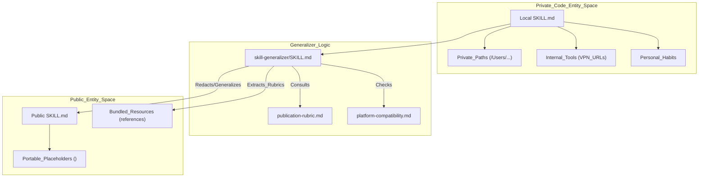
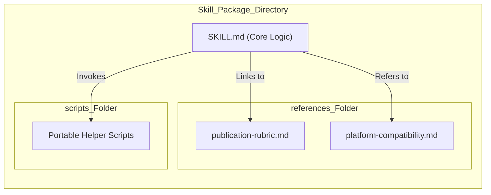

<!-- source: DeepWiki mcp.deepwiki.com · repo hqhq1025/skill-optimizer · page 4.1 skill-generalizer: SKILL.md & Workflow · fetched 2026-10-27 -->

# skill-generalizer: SKILL.md & Workflow

Relevant source files

The following files were used as context for generating this wiki page:

- [skills/skill-generalizer/SKILL.md](skills/skill-generalizer/SKILL.md)
- [skills/skill-generalizer/references/publication-rubric.md](skills/skill-generalizer/references/publication-rubric.md)

The `skill-generalizer` is the final stage in the skill lifecycle, responsible for transforming private, machine-specific workflows into portable, public-ready artifacts. While `skill-miner` discovers capabilities and `skill-personalizer` optimizes them for a specific user, the `skill-generalizer` ensures that skills can be shared across teams or marketplaces without leaking sensitive information or relying on brittle local configurations.

## Overview and Purpose

The primary objective of the generalizer is to strip away the "private context" of a skill—such as absolute file paths, internal hostnames, and personal habits—while preserving the underlying "reusable technique" [skills/skill-generalizer/SKILL.md:8-11](). 

### Trigger Conditions
The `skill-generalizer` is invoked when:
*   A user intends to publish or open-source a local skill [skills/skill-generalizer/SKILL.md:14-14]().
*   A skill contains references to private repositories, local paths, or team-specific conventions [skills/skill-generalizer/SKILL.md:15-15]().
*   The output must be usable by a third party without access to the author's specific environment [skills/skill-generalizer/SKILL.md:16-16]().

**Note:** If the goal is merely to tune a skill for one's own machine, the `skill-personalizer` should be used instead [skills/skill-generalizer/SKILL.md:18-18]().

Sources: [skills/skill-generalizer/SKILL.md:1-20]()

---

## The Nine-Step Generalization Workflow

The generalization process follows a structured pipeline to move a skill from "Private Code Entity Space" to "Public Natural Language/Instruction Space."

### Workflow Execution Logic
The agent follows these steps to ensure a clean transition:

1.  **Source Inspection:** Review the source skill and associated repository files [skills/skill-generalizer/SKILL.md:22-22]().
2.  **Quality Baseline:** If quality is questionable, perform an audit using `skill-personalizer` criteria first [skills/skill-generalizer/SKILL.md:23-23]().
3.  **Abstraction:** Separate the core reusable capability from specific implementation details [skills/skill-generalizer/SKILL.md:24-24]().
4.  **Redaction:** Remove private names, paths, credentials, and account IDs [skills/skill-generalizer/SKILL.md:25-25]().
5.  **Rewriting:** Focus the skill on general triggering conditions and portable workflows [skills/skill-generalizer/SKILL.md:26-26]().
6.  **De-cluttering:** Keep the core `SKILL.md` concise; move rubrics and scripts to bundled resources [skills/skill-generalizer/SKILL.md:27-27]().
7.  **Compatibility Check:** Verify target agent support (e.g., Codex vs. Claude Code) [skills/skill-generalizer/SKILL.md:28-28]().
8.  **Packaging:** Generate READMEs and promotion copy if requested [skills/skill-generalizer/SKILL.md:29-29]().
9.  **Verification:** Final check of frontmatter, file layout, and usage prompts [skills/skill-generalizer/SKILL.md:30-30]().

### Diagram: Generalization Data Flow
This diagram illustrates how the `skill-generalizer` transforms a local `SKILL.md` into a public artifact by filtering it through the `publication-rubric.md`.

**Skill Transformation Pipeline**

Sources: [skills/skill-generalizer/SKILL.md:20-30](), [skills/skill-generalizer/references/publication-rubric.md:1-20]()

---

## Content Classification and Redaction

The `publication-rubric.md` provides a deterministic mapping for how to handle different types of content during generalization.

### Classification Table
| Content Class | Keep? | Treatment |
| :--- | :--- | :--- |
| **Reusable workflow** | Yes | Tighten and clarify [skills/skill-generalizer/references/publication-rubric.md:13-13](). |
| **Tool-specific command** | Usually | Keep if portable; otherwise document setup [skills/skill-generalizer/references/publication-rubric.md:14-14](). |
| **Personal preference** | Maybe | Convert to a configurable option [skills/skill-generalizer/references/publication-rubric.md:15-15](). |
| **Private path/host** | No | Replace with placeholders like `<workspace>` [skills/skill-generalizer/references/publication-rubric.md:16-16](). |
| **Credentials/Tokens** | No | Remove entirely [skills/skill-generalizer/references/publication-rubric.md:17-17](). |
| **Transcript quotes** | Rarely | Summarize or sanitize [skills/skill-generalizer/references/publication-rubric.md:18-18](). |

### Public Safety Pass
The generalizer specifically targets and removes:
*   Absolute home paths (e.g., `/Users/<name>/...`) [skills/skill-generalizer/references/publication-rubric.md:35-35]().
*   Internal hostnames, SSH aliases, and VPN-only URLs [skills/skill-generalizer/references/publication-rubric.md:36-36]().
*   PII (Email, phone numbers, account IDs) [skills/skill-generalizer/references/publication-rubric.md:37-37]().
*   First-person language (e.g., "My internal tool") [skills/skill-generalizer/references/publication-rubric.md:39-39]().

Sources: [skills/skill-generalizer/references/publication-rubric.md:5-42]()

---

## Public Release Rules & Packaging

To maintain a consistent ecosystem, the `skill-generalizer` enforces specific formatting and architectural rules.

### SKILL.md Frontmatter & Format
*   **Description:** Must start with `Use when` and describe trigger conditions rather than summarizing the workflow [skills/skill-generalizer/SKILL.md:34-34](), [skills/skill-generalizer/references/publication-rubric.md:48-48]().
*   **Naming:** Use `lowercase-hyphen-case` [skills/skill-generalizer/references/publication-rubric.md:47-47]().
*   **Structure:** Keep the main file short for easy scanning; offload checklists and templates to the `references/` directory [skills/skill-generalizer/references/publication-rubric.md:49-50]().

### Portability and Configuration
If a personal detail is essential to the skill's function, it must be converted into a **configurable variable** with setup guidance rather than being hardcoded [skills/skill-generalizer/SKILL.md:38-38](). The generalizer prefers portable commands over private aliases [skills/skill-generalizer/SKILL.md:37-37]().

### Diagram: Packaging Architecture
This diagram shows the relationship between the public `SKILL.md` and its supporting resources.

**Public Skill Bundle Structure**

Sources: [skills/skill-generalizer/SKILL.md:32-45](), [skills/skill-generalizer/references/publication-rubric.md:43-52]()

---

## Validation and Platform Compatibility

Before final publication, the skill must be checked against `platform-compatibility.md` to ensure it functions across different agents like Codex, Claude Code, and Cursor [skills/skill-generalizer/SKILL.md:44-44]().

### Packaging Checklist
1.  `SKILL.md` exists in the `skills/<skill-name>/` directory [skills/skill-generalizer/references/publication-rubric.md:45-45]().
2.  Frontmatter contains only `name` and `description` [skills/skill-generalizer/references/publication-rubric.md:46-46]().
3.  Installation instructions in the README match the folder structure [skills/skill-generalizer/references/publication-rubric.md:51-51]().
4.  Promotion copy accurately reflects platform support and intentionally excluded features [skills/skill-generalizer/references/publication-rubric.md:56-65]().

Sources: [skills/skill-generalizer/SKILL.md:40-45](), [skills/skill-generalizer/references/publication-rubric.md:43-65]()

---

