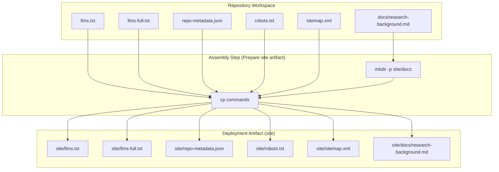
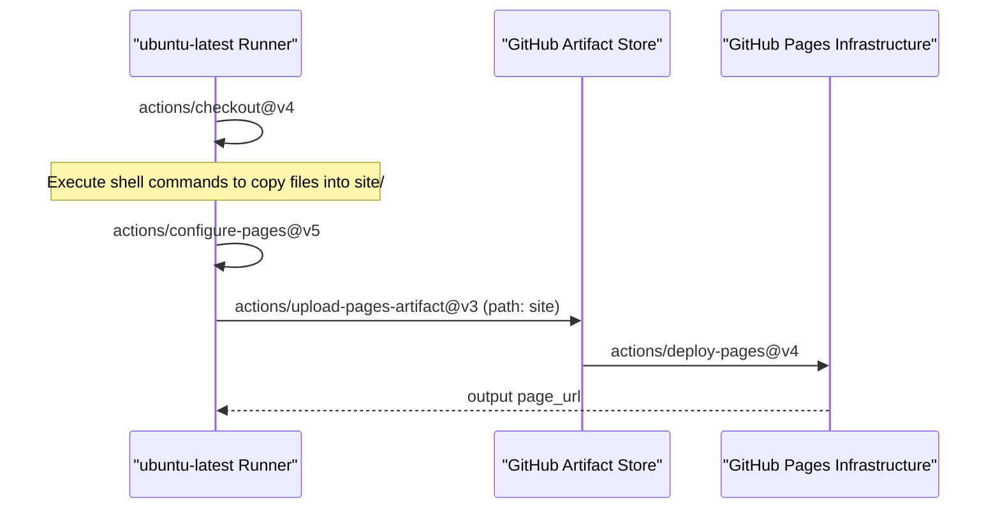

<!-- source: DeepWiki mcp.deepwiki.com · repo hqhq1025/skill-optimizer · page 6.1 GitHub Pages Deployment Pipeline · fetched 2026-10-27 -->

# GitHub Pages Deployment Pipeline

Relevant source files

The following files were used as context for generating this wiki page:

- [.github/workflows/pages.yml](.github/workflows/pages.yml)
- [site/favicon.svg](site/favicon.svg)
- [site/index.html](site/index.html)
- [site/styles.css](site/styles.css)

The GitHub Pages Deployment Pipeline is a continuous integration and continuous delivery (CI/CD) workflow that automates the assembly and publication of the Skill Optimizer web presence. It transforms repository metadata, documentation, and static assets into a hosted site accessible to both human users and AI agents.

### Workflow Triggers and Permissions

The workflow is defined in [.github/workflows/pages.yml:1-1]() and manages the lifecycle of the project's web presence. It utilizes OpenID Connect (OIDC) to securely interact with GitHub Pages without persistent secrets.

| Trigger | Description |
| :--- | :--- |
| `push` | Automatically fires when commits are merged into the `main` branch [[.github/workflows/pages.yml:4-5]](). |
| `workflow_dispatch` | Allows manual execution of the pipeline from the GitHub Actions UI [[.github/workflows/pages.yml:6-6]](). |

**Permissions and Concurrency:**
*   **Permissions**: The workflow requires `contents: read` to access files, and `pages: write` / `id-token: write` to authorize the deployment [[.github/workflows/pages.yml:8-11]]().
*   **Concurrency**: To prevent race conditions during rapid updates, the workflow uses a concurrency group named `pages` [[.github/workflows/pages.yml:13-14]](). If a new deployment starts while one is in progress, the older one is cancelled via `cancel-in-progress: true` [[.github/workflows/pages.yml:15-15]]().

**Sources:**
*   [.github/workflows/pages.yml:1-16]()

---

### Artifact Assembly and Data Flow

The pipeline executes a specific sequence to gather disparate files into a unified `site/` directory before deployment. This ensures that machine-readable files (for LLMs) and human-readable documentation are available at the site root.

**Pipeline Execution Flow**

**Assembly Logic:**
1.  **Machine-Readable Files**: The core LLM context files `llms.txt`, `llms-full.txt`, and `repo-metadata.json` are copied from the repository root into the `site/` directory [[.github/workflows/pages.yml:28-30]]().
2.  **SEO & Crawling**: `robots.txt` and `sitemap.xml` are moved to the site root [[.github/workflows/pages.yml:31-32]]().
3.  **Documentation**: The workflow creates a `site/docs/` directory and populates it with `research-background.md` [[.github/workflows/pages.yml:33-34]]().

**Sources:**
*   [.github/workflows/pages.yml:26-34]()

---

### Deployment Sequence

The deployment is handled by a single job named `deploy` running on `ubuntu-latest` [[.github/workflows/pages.yml:18-22]](). It utilizes standard GitHub Actions components to interface with the GitHub Pages infrastructure.

**GitHub Pages Action Integration**

**Key Actions:**
*   **`actions/configure-pages@v5`**: Initializes the environment for Pages deployment [[.github/workflows/pages.yml:35-36]]().
*   **`actions/upload-pages-artifact@v3`**: Packages the `site` directory (containing the assembled files, `index.html`, `styles.css`, and `favicon.svg`) into a tarball for deployment [[.github/workflows/pages.yml:37-40]]().
*   **`actions/deploy-pages@v4`**: Performs the actual release to the `github-pages` environment and outputs the final URL [[.github/workflows/pages.yml:41-43]]().

**Sources:**
*   [.github/workflows/pages.yml:35-43]()
*   [site/index.html:1-35]()
*   [site/styles.css:1-9]()

---

### Site Structure and Assets

The resulting site serves as both a landing page and a resource hub for AI agents.

| File | Role | Code Entity |
| :--- | :--- | :--- |
| `index.html` | Primary landing page providing installation commands and lifecycle overview [[site/index.html:36-126]](). | `SoftwareSourceCode` Metadata [[site/index.html:20-33]]() |
| `styles.css` | Design tokens including `--accent` (`#0b6b5f`) and `--accent-2` (`#c24b2d`) [[site/styles.css:1-9]](). | CSS Custom Properties |
| `favicon.svg` | Vector brand icon with the project's signature circle and stroke elements [[site/favicon.svg:1-5]](). | SVG Path/Circle |
| `llms.txt` | A compressed summary for LLM context windows [[site/index.html:16-16]](). | Link Relationship `alternate` |
| `repo-metadata.json` | Machine-readable repository structure [[site/index.html:17-17]](). | Link Relationship `alternate` |

**Sources:**
*   [site/index.html:1-136]()
*   [site/styles.css:1-107]()
*   [site/favicon.svg:1-6]()

---

