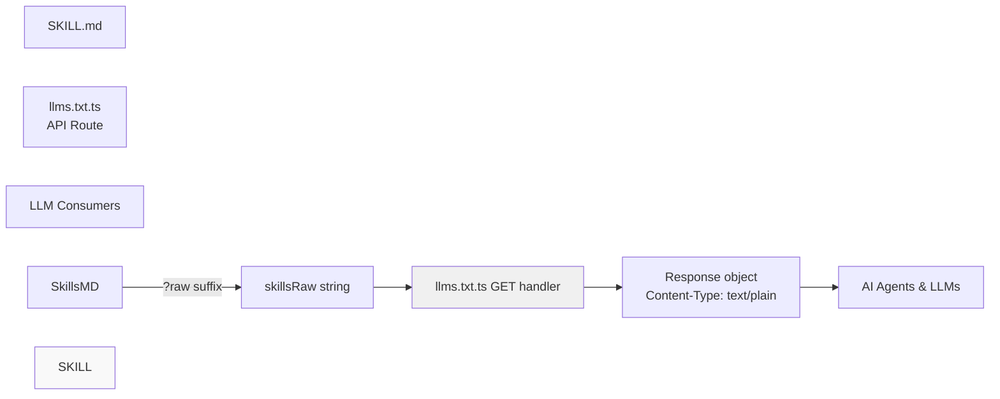
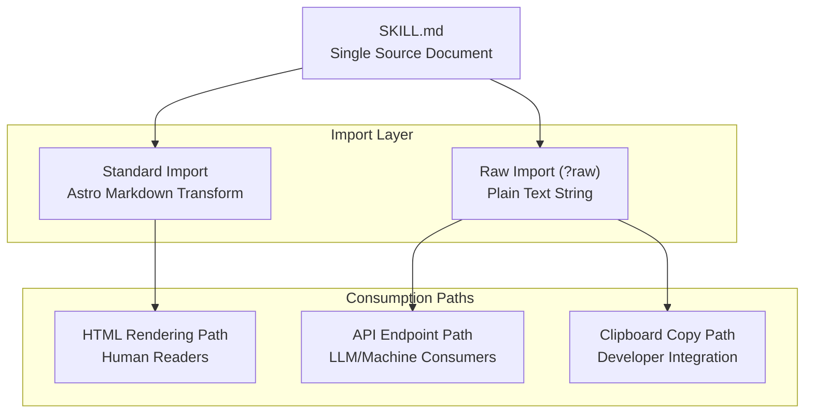
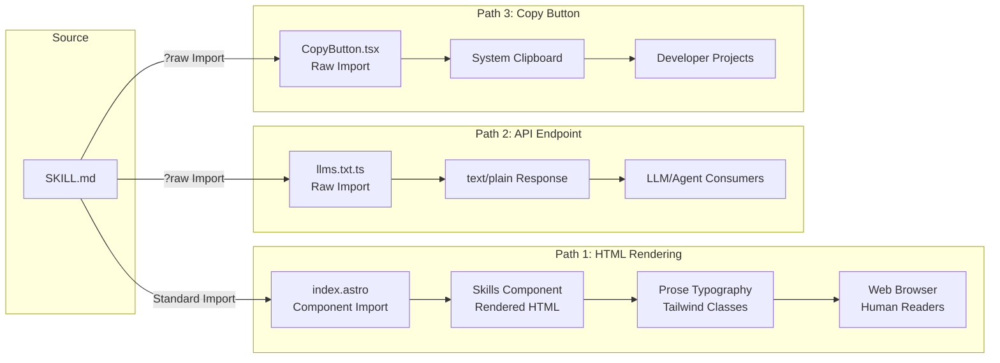
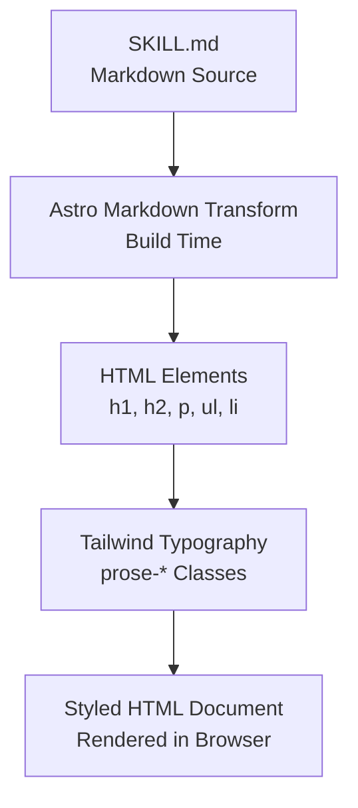
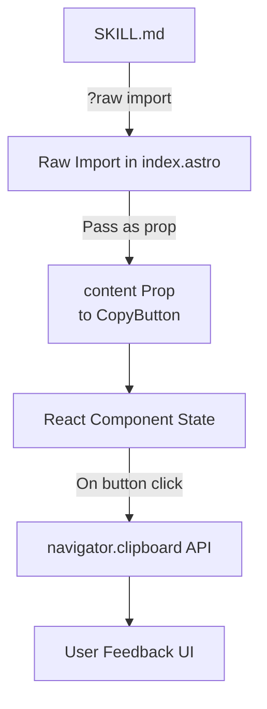
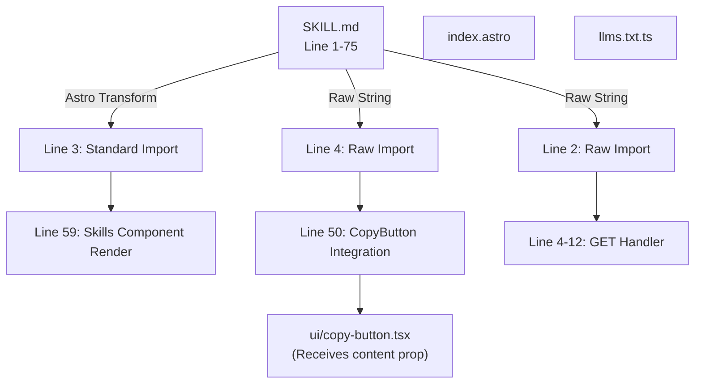

<!-- source: DeepWiki mcp.deepwiki.com · repo ibelick/ui-skills · page 2.2 Content Dual-Path Architecture · fetched 2026-10-27 -->

# Content Dual-Path Architecture

<details>
<summary>Relevant source files</summary>

The following files were used as context for generating this wiki page:

- [src/SKILL.md](src/SKILL.md)
- [src/pages/index.astro](src/pages/index.astro)
- [src/pages/llms.txt.ts](src/pages/llms.txt.ts)

</details>


This document describes how the `SKILL.md` content file is consumed through multiple rendering paths to serve different audiences and use cases. The system processes a single source of truth (SKILL.md) and exposes it through three distinct consumption paths: formatted HTML for human readers, raw text for clipboard operations, and a plain-text API endpoint for LLM consumption.

For information about the overall system architecture, see [Architecture](#2). For details on the LLMs.txt API endpoint implementation, see [LLMs.txt API Endpoint](#3.2). For the main page rendering, see [Main Index Page](#4.2).

## Purpose and Scope

This document explains the dual-path architecture for content consumption in the ui-skills repository. The same source content (SKILL.md) is processed and delivered through three distinct pathways to serve different consumers: rendered HTML for human readers, raw text for clipboard operations, and a plain text API endpoint for machine consumption. This architecture ensures that the UI constraints documented in SKILL.md are accessible to both human developers and AI agents without duplication or drift.

For details on the actual content structure of SKILL.md, see [SKILL.md Content Structure](#3.1). For deployment specifics, see [Build and Deployment Pipeline](#2.3).

## Content Source

The entire dual-path architecture originates from a single source of truth: `SKILL.md` located at [src/SKILL.md:1-75](). This Markdown file contains the complete set of opinionated constraints for building user interfaces with AI agents, organized into eight categories: Stack, Components, Interaction, Animation, Typography, Layout, Performance, and Design.

The file uses standard Markdown syntax with YAML frontmatter defining the `name` and `description` metadata. The content itself is structured as a series of constraint rules using uppercase modal verbs (MUST, SHOULD, NEVER, MAY NOT) following RFC 2119 convention to indicate requirement levels.

**Sources:** [src/SKILL.md:1-75]()

## Import Methods

The dual-path architecture is implemented through two distinct import mechanisms in Astro:

### Standard Import
Used for rendering formatted HTML content on the main page:
```typescript
import Skills from "../SKILL.md";
```
This import treats `SKILL.md` as an Astro component, automatically transforming the markdown into renderable HTML.

### Raw Import
Used for obtaining the unprocessed markdown text:
```typescript
import skillsRaw from "../SKILL.md?raw";
```

The `?raw` suffix is a Vite special import that returns the file contents as a plain string, bypassing any markdown processing. This raw content is then used in two distinct ways within the architecture.

**Sources:** [src/pages/index.astro:3-4](), [src/pages/llms.txt.ts:2]()

---

## Path 1: Human-Facing Rendered HTML

The human-facing path transforms SKILL.md into a formatted, styled HTML page suitable for browser consumption.

### Import and Processing

The main index page imports `SKILL.md` as a standard Astro component:

```markdown
import Skills from "../SKILL.md";
```

[src/pages/index.astro:3]()

When Astro encounters this import, it processes the Markdown file through its built-in Markdown renderer, converting it to an HTML component that can be embedded directly in the page.

### Rendering Path

The processed content is rendered within the index page as:

```astro
<Skills />
```

[src/pages/index.astro:59]()

The rendered content is wrapped in a container with Tailwind CSS prose classes that apply typography styling:

```
prose prose-neutral prose-sm prose-headings:text-balance prose-headings:font-medium ...
```

These styles transform the raw Markdown into a formatted, readable document with proper heading hierarchy, spacing, and typographic refinement. The content is rendered server-side during the build process and delivered as static HTML.

**Sources:** [src/pages/index.astro:1-89]()

## Machine-Facing Path: Plain Text API

The same `SKILL.md` content is simultaneously made available to LLMs and automated systems through a dedicated API endpoint.

### The /llms.txt Endpoint

The `/llms.txt` endpoint is implemented as an Astro API route in [src/pages/llms.txt.ts:1-12](). This endpoint:

1. **Imports SKILL.md as raw text**: Uses Vite's `?raw` import suffix to bypass markdown processing [src/pages/llms.txt.ts:2]()
2. **Serves plain text**: Returns the content with `text/plain; charset=utf-8` content type [src/pages/llms.txt.ts:8-10]()
3. **Adds trailing newline**: Ensures proper file termination with `.trim() + "\n"` [src/pages/llms.txt.ts:5]()
4. **No processing**: Content is served exactly as written in the source file

This endpoint implements the [llms.txt standard](https://llmstxt.org), which provides a convention for websites to expose machine-readable documentation that LLMs can consume directly.



Wait, let me reconsider. I need to write a comprehensive document about the Content Dual-Path Architecture. Looking at the provided diagrams and files, I can see:

1. SKILL.md is imported in multiple ways:
   - As a component in index.astro (line 3): `import Skills from "../SKILL.md"`
   - As raw text in index.astro (line 4): `import skillsRaw from "../SKILL.md?raw"`
   - As raw text in llms.txt.ts (line 2): `import skillsRaw from "../SKILL.md?raw"`

2. The content is consumed in three ways:
   - Rendered as HTML via `<Skills />` component in index.astro:59
   - Passed to CopyButton for clipboard functionality in index.astro:50
   - Served via /llms.txt endpoint in llms.txt.ts

This is the dual-path architecture - the same source content (SKILL.md) serves both human and machine consumers through different rendering paths.

Let me structure this document:

1. Purpose and Scope
2. Single Source of Truth (SKILL.md)
3. Import Mechanisms
4. Human-Facing Path (HTML rendering)
5. Machine-Facing Path (/llms.txt API)
6. Interactive Copy Path (CopyButton)
7. Technical Implementation Details

I should include:
- Diagram showing the import mechanism
- Diagram showing the three consumption paths
- Diagram showing file references and flow
- Tables where appropriate
- Code references with line numbers
</thinking>

# Content Dual-Path Architecture

## Purpose and Scope

This document explains how the ui-skills system serves content from a single source (`SKILL.md`) through multiple consumption paths to different audiences. The architecture enables both human developers and AI agents to access the same UI constraint documentation through interfaces optimized for their respective needs.

For details on the `SKILL.md` content itself, see [SKILL.md Content Structure](#3.1). For information on page rendering and visual presentation, see [Main Index Page](#4.2). For deployment specifics, see [Build and Deployment Pipeline](#2.3).

## System Overview

The content dual-path architecture is built on three core principles:

1. **Single Source of Truth**: All content originates from `SKILL.md`
2. **Multiple Import Mechanisms**: Vite's import system provides both transformed and raw content
3. **Optimized Delivery Paths**: Each consumer receives content in an appropriate format



**Sources**: [src/pages/index.astro:1-89](), [src/pages/llms.txt.ts:1-12]()

## Import Mechanisms

The system leverages Vite's import capabilities to process `SKILL.md` in two distinct ways:

| Import Type | Syntax | Result | Used By |
|------------|--------|--------|---------|
| **Standard Import** | `import Skills from "../SKILL.md"` | Astro component with transformed HTML | `index.astro` for rendering |
| **Raw Import** | `import skillsRaw from "../SKILL.md?raw"` | Plain text string | `llms.txt.ts` API and `CopyButton` |

### Standard Import Path

In [src/pages/index.astro:3](), the standard import transforms the Markdown file into an Astro component:

```typescript
import Skills from "../SKILL.md";
```

This import:
- Parses Markdown syntax into HTML elements
- Preserves frontmatter metadata (name, description)
- Outputs a renderable Astro component
- Enables direct use in JSX: `<Skills />`

### Raw Import Path

In [src/pages/index.astro:4]() and [src/pages/llms.txt.ts:2](), the raw import provides unprocessed content:

```typescript
import skillsRaw from "../SKILL.md?raw";
```

This import:
- Bypasses all Markdown transformations
- Returns the file as a plain JavaScript string
- Preserves exact formatting, including frontmatter
- Enables programmatic content manipulation

**Sources**: [src/pages/index.astro:3-4](), [src/pages/llms.txt.ts:2]()

## Three Consumption Paths



**Sources**: [src/pages/index.astro:1-89](), [src/pages/llms.txt.ts:1-12]()

## Path 1: Human-Facing HTML Rendering

The primary consumption path serves human developers through a rich, formatted web interface.

### Implementation

In [src/pages/index.astro:59](), the `Skills` component is rendered within a prose-styled container:

```astro
<div class="prose prose-neutral prose-sm ...">
  <Skills />
</div>
```

### Rendering Pipeline



### Typography Styling

The prose classes applied in [src/pages/index.astro:56-58]() provide extensive typographic control:

- `prose-headings:text-balance`: Balanced heading line breaks
- `prose-h1:mb-6`: Heading spacing hierarchy
- `prose-p:text-[15px]`: Consistent paragraph sizing
- `prose-li:marker:text-neutral-300`: Subdued list markers
- `font-mono`: JetBrains Mono monospace font (via Layout)

This styling transforms raw Markdown into a polished, readable documentation page optimized for comprehension by human developers.

**Sources**: [src/pages/index.astro:52-62]()

## Path 2: Machine-Facing API Endpoint

The `/llms.txt` endpoint implements the [llms.txt standard](https://llmstxt.org) for machine-readable website documentation.

### Implementation

The entire API route in [src/pages/llms.txt.ts:4-12]():

```typescript
export const GET: APIRoute = () => {
  const body = skillsRaw.trim() + "\n";

  return new Response(body, {
    headers: {
      "Content-Type": "text/plain; charset=utf-8",
    },
  });
};
```

### Key Characteristics

| Aspect | Implementation Detail |
|--------|----------------------|
| **Content** | Raw `SKILL.md` string with trailing newline |
| **Content-Type** | `text/plain; charset=utf-8` |
| **Processing** | Minimal - only `.trim()` and newline addition |
| **Purpose** | LLM/agent consumption without HTML artifacts |

### Design Rationale

The API endpoint provides:

1. **Zero Transformation**: LLMs receive exact content without HTML wrapping
2. **Markdown Preservation**: Structural markers (headers, lists) aid LLM parsing
3. **Standards Compliance**: Follows llms.txt convention for discoverability
4. **Lightweight Response**: Plain text minimizes transfer size and parsing overhead

Agents can fetch this endpoint to retrieve the complete UI Skills constraint set for use in code generation workflows.

**Sources**: [src/pages/llms.txt.ts:1-12]()

## Path 3: Interactive Copy Functionality

The `CopyButton` component provides clipboard access to the raw content for developers who want to integrate the constraints into their own projects.

### Integration

In [src/pages/index.astro:50](), the button receives the raw content:

```astro
<CopyButton content={skillsRaw} client:load />
```

### Hydration Strategy

The `client:load` directive indicates:
- Component hydrates immediately on page load
- Requires JavaScript for interactivity
- Provides instant clipboard functionality
- Only interactive element on an otherwise static page

### Data Flow



The `CopyButton` component (detailed in [CopyButton Component](#5.1)) handles:
- User interaction detection
- Clipboard API invocation
- Success/error state management
- Visual feedback (text morphing animation)

**Sources**: [src/pages/index.astro:4](), [src/pages/index.astro:50]()

## Technical Implementation Details

### File References and Dependencies



**Sources**: [src/SKILL.md:1-75](), [src/pages/index.astro:3-4](), [src/pages/llms.txt.ts:2]()

### Build-Time vs Runtime Processing

| Aspect | HTML Path | API Path | Copy Path |
|--------|-----------|----------|-----------|
| **Processing Time** | Build time | Runtime | Build time (prop passing) |
| **Transformation** | Markdown → HTML | None (trim only) | None |
| **Output Size** | ~15KB (estimated HTML) | ~2KB (raw text) | ~2KB (raw text) |
| **Caching** | Static file | Cloudflare edge cache | Client-side memory |

### Content Consistency Guarantees

All three paths derive from the same `SKILL.md` file at build time, ensuring:

1. **Version Synchronization**: HTML, API, and copy button always serve identical content versions
2. **Single Update Point**: Modifying `SKILL.md` updates all paths in the next build
3. **No Runtime Divergence**: No dynamic content modification can create inconsistency

This architecture guarantees that whether a developer reads the documentation in their browser, an LLM fetches it via API, or a user copies it to their clipboard, they all receive the exact same source material.

**Sources**: [src/SKILL.md:1-75](), [src/pages/index.astro:1-89](), [src/pages/llms.txt.ts:1-12]()

---

