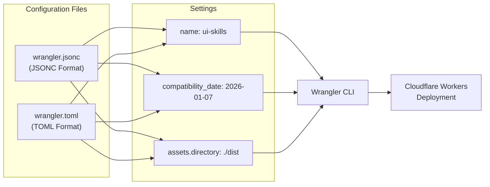
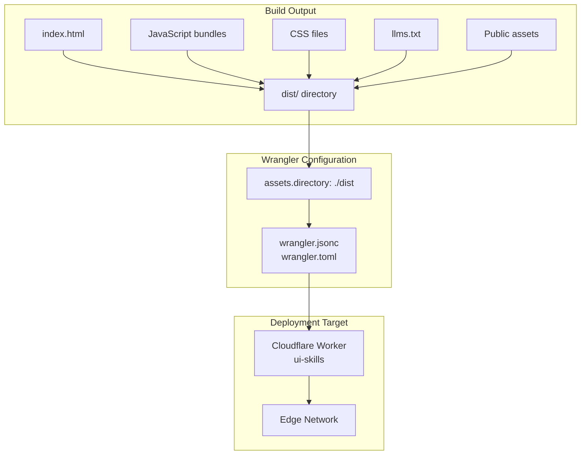
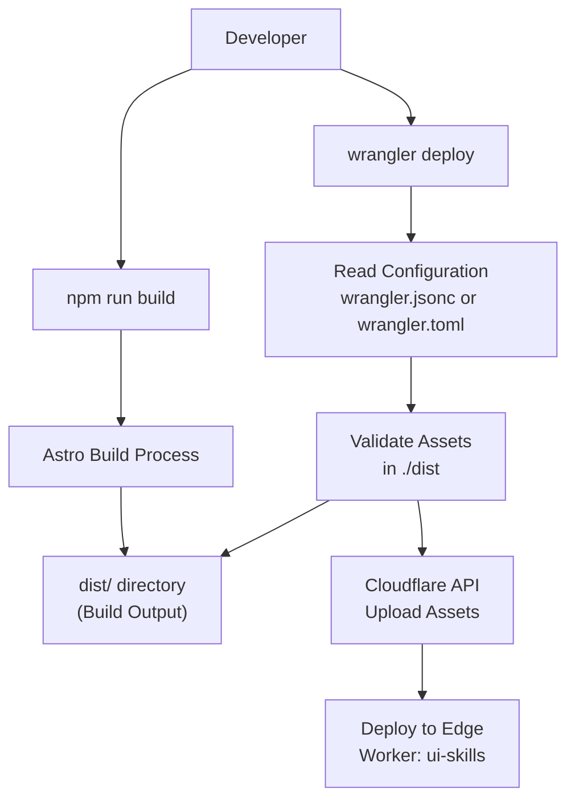
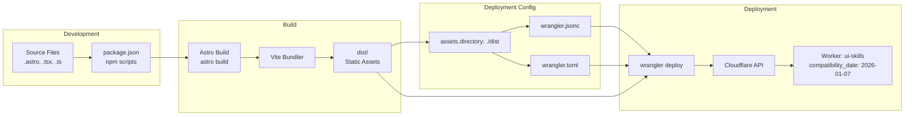

<!-- source: DeepWiki mcp.deepwiki.com · repo ibelick/ui-skills · page 6.2 Deployment Configuration · fetched 2026-10-27 -->

# Deployment Configuration

Relevant source files

The following files were used as context for generating this wiki page:

- [wrangler.jsonc](wrangler.jsonc)
- [wrangler.toml](wrangler.toml)

## Purpose and Scope

This document details the Cloudflare Workers deployment configuration for the ui-skills project, focusing on the Wrangler configuration files that control how the built application is deployed to Cloudflare's edge network. For information about the build process that precedes deployment, see [Build and Deployment Pipeline](#2.3). For project dependencies and build scripts, see [Project Configuration](#6.1).

## Configuration Files

The project maintains two identical Wrangler configuration files in different formats:

- [wrangler.jsonc:1-7]() - JSONC format (JSON with comments support)
- [wrangler.toml:1-5]() - TOML format

Both files contain the same configuration settings and serve as alternative formats for configuring Cloudflare Workers deployment. Wrangler supports both formats, allowing developers to choose their preferred syntax.

**Sources:** [wrangler.jsonc:1-7](), [wrangler.toml:1-5]()

## Configuration Settings

### Worker Name

The `name` setting identifies the Cloudflare Worker project:

| Format | Location | Value |
|--------|----------|-------|
| JSONC | [wrangler.jsonc:2]() | `"ui-skills"` |
| TOML | [wrangler.toml:1]() | `"ui-skills"` |

This name is used by Cloudflare to identify the worker in their dashboard and CLI operations. It determines the worker's URL pattern when deployed.

### Compatibility Date

The `compatibility_date` setting specifies which version of the Cloudflare Workers runtime to use:

| Format | Location | Value |
|--------|----------|-------|
| JSONC | [wrangler.jsonc:3]() | `"2026-01-07"` |
| TOML | [wrangler.toml:2]() | `"2026-01-07"` |

This date controls which Workers runtime features and behaviors are enabled. Cloudflare Workers uses compatibility dates instead of semantic versioning to manage breaking changes. The date `2026-01-07` ensures the worker uses runtime features and behaviors available as of January 7, 2026.

### Assets Directory

The `assets` configuration specifies the directory containing static files to deploy:

| Format | Location | Value |
|--------|----------|-------|
| JSONC | [wrangler.jsonc:4-6]() | `{ "directory": "./dist" }` |
| TOML | [wrangler.toml:4-5]() | `directory = "./dist"` |

The `./dist` directory contains all build output from the Astro build process, including:
- Static HTML files (e.g., `index.html`)
- JavaScript bundles
- CSS files
- Static assets from the `public/` directory
- Generated API routes (e.g., `llms.txt`)

**Sources:** [wrangler.jsonc:4-6](), [wrangler.toml:4-5]()

## Deployment Workflow

The deployment process follows this sequence:

**Sources:** [wrangler.jsonc:1-7](), [wrangler.toml:1-5]()

### Deployment Steps

1. **Build Phase**: The Astro build process generates static assets in the `dist/` directory
2. **Deploy Command**: Developer runs `wrangler deploy` (or equivalent Cloudflare deployment command)
3. **Configuration Loading**: Wrangler reads either `wrangler.jsonc` or `wrangler.toml`
4. **Asset Validation**: Wrangler verifies the `./dist` directory exists and contains deployable assets
5. **Upload**: Assets are uploaded to Cloudflare's infrastructure
6. **Edge Distribution**: The worker is deployed across Cloudflare's global edge network

### Worker Type

This configuration deploys a **Workers Assets** worker, which is optimized for serving static content from Cloudflare's edge network. The `assets` configuration block [wrangler.jsonc:4-6]() indicates this is not a traditional Workers script but rather a static site deployment. This type of worker:

- Serves static files directly from the edge
- Provides automatic caching headers
- Requires no custom JavaScript worker code
- Optimizes for fast global content delivery

## Configuration File Comparison

Both configuration formats provide identical functionality:

| Aspect | wrangler.jsonc | wrangler.toml |
|--------|----------------|---------------|
| **Format** | JSON with comments | TOML |
| **Location** | Root directory | Root directory |
| **Comments Support** | Yes (C-style ) | Yes (# prefix) |
| **Nesting** | Object notation `{ "assets": { "directory": "./dist" } }` | Section notation `[assets]` followed by `directory = "./dist"` |
| **Strings** | Always quoted | Quoted only for special chars |
| **Primary Use** | JavaScript ecosystem preference | Rust/system config preference |

Both files are maintained in the repository, allowing developers to use their preferred format. Wrangler will read whichever format it encounters first.

**Sources:** [wrangler.jsonc:1-7](), [wrangler.toml:1-5]()

## Relationship to Build Pipeline

The deployment configuration is the final stage in the build-to-deployment pipeline:

The `./dist` directory created by the Astro build process [wrangler.jsonc:5]() is the exact directory specified in the Wrangler configuration. This direct connection ensures that build output is automatically ready for deployment without requiring intermediate copying or restructuring.

**Sources:** [wrangler.jsonc:4-6](), [wrangler.toml:4-5]()

## Minimal Configuration

The configuration is intentionally minimal, containing only three required settings:

1. **Worker identifier**: `name = "ui-skills"` [wrangler.jsonc:2]()
2. **Runtime version**: `compatibility_date = "2026-01-07"` [wrangler.jsonc:3]()
3. **Content location**: `assets.directory = "./dist"` [wrangler.jsonc:5]()

This minimal approach is appropriate because:
- The project uses static site deployment (Workers Assets), not custom worker scripts
- Default Cloudflare settings are sufficient for static content delivery
- No custom routes, environment variables, or bindings are required
- No KV namespaces, R2 buckets, or other Cloudflare resources are used

**Sources:** [wrangler.jsonc:1-7](), [wrangler.toml:1-5]()

---

