# Page: Overview

# Overview

<details>
<summary>Relevant source files</summary>

The following files were used as context for generating this wiki page:

- [README.md](README.md)
- [package.json](package.json)
- [src/SKILL.md](src/SKILL.md)

</details>


## Purpose and Scope

This document provides an overview of the **ui-skills** repository, a documentation website that publishes opinionated constraints for guiding AI agents in building user interfaces. The repository serves as both a human-readable website and a machine-consumable API endpoint.

For detailed information about specific subsystems:
- Architecture and technology choices: see [Architecture](#2)
- UI Skills constraint content: see [UI Skills Documentation](#3)
- Page rendering and components: see [Page Structure and Rendering](#4)
- Interactive features: see [Interactive Components](#5)
- Setup and configuration: see [Configuration and Setup](#6)

**Sources:** [README.md:1-14](), [src/SKILL.md:1-75]()

## What UI Skills Is

UI Skills is a curated set of **opinionated, evolving constraints** designed to guide AI agents when building user interfaces. As stated in the README, "Every rule comes from things that bored me when using agents to build UI" [README.md:7]().

The constraint system is organized into eight categories:

| Category | Focus | Examples |
|----------|-------|----------|
| **Stack** | Technology choices | Tailwind CSS defaults, `motion/react` for animation, `cn` utility |
| **Components** | Accessible primitives | Base UI, React Aria, Radix; never rebuild keyboard behavior |
| **Interaction** | User experience patterns | AlertDialog for destructive actions, structural skeletons, `h-dvh` not `h-screen` |
| **Animation** | Performance-aware motion | Compositor props only, `ease-out` on entrance, respect `prefers-reduced-motion` |
| **Typography** | Text rendering | `text-balance` for headings, `tabular-nums` for data |
| **Layout** | Spatial organization | Fixed `z-index` scale, `size-x` for square elements |
| **Performance** | Optimization rules | No large `blur()` animations, no `useEffect` for render logic |
| **Design** | Visual constraints | No gradients unless requested, limit accent colors |

Each constraint is written with a severity level: `MUST` (mandatory), `SHOULD` (recommended), or `NEVER` (prohibited).

**Sources:** [src/SKILL.md:1-75](), [README.md:5-7]()

## Dual-Audience Architecture

The repository serves two distinct audiences from a single source of truth (`SKILL.md`):

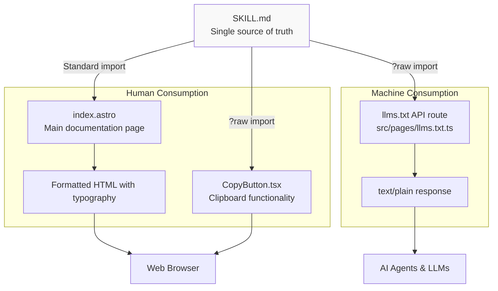

**Diagram: Dual-Path Content Distribution from SKILL.md**

The system implements three distinct consumption paths:

1. **Formatted HTML Rendering**: `index.astro` imports and renders `SKILL.md` as styled HTML with Tailwind CSS typography classes [src/pages/index.astro]()
2. **Plain Text API**: `src/pages/llms.txt.ts` serves the raw markdown content at the `/llms.txt` endpoint using Vite's `?raw` import modifier
3. **Clipboard Copy**: `CopyButton.tsx` embeds the raw markdown string for one-click copying [src/components/CopyButton.tsx]()

**Sources:** [src/pages/index.astro](), [src/pages/llms.txt.ts](), [src/components/CopyButton.tsx]()

## Repository Structure

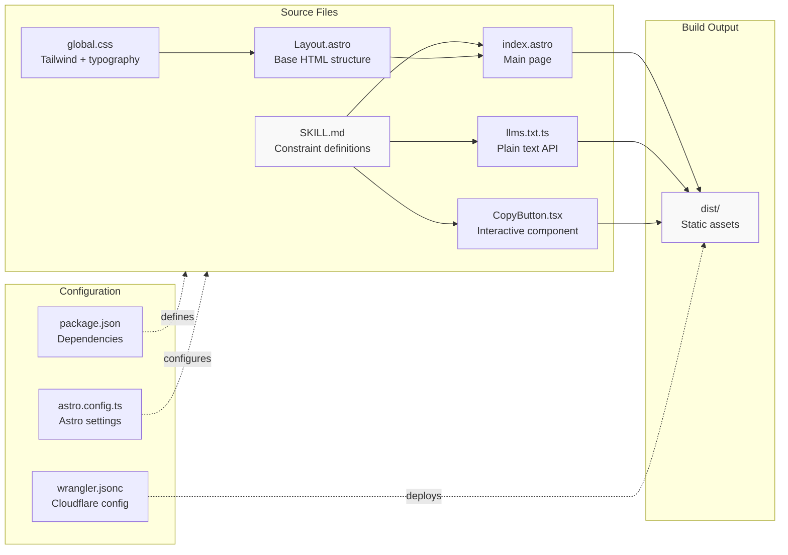

**Diagram: Repository File Organization**

**Sources:** [package.json:1-32](), [src/SKILL.md:1-4]()

## Technology Stack Summary

The repository uses a modern static site generation approach:

| Layer | Technology | Version | Purpose |
|-------|-----------|---------|---------|
| **Framework** | Astro | 5.16.7 | Static site generation with island architecture |
| **UI Library** | React | 19.2.3 | Interactive components (selective hydration) |
| **Styling** | Tailwind CSS | 4.1.18 | Utility-first CSS framework |
| **Typography** | @tailwindcss/typography | 0.5.19 | Prose styling for markdown content |
| **Animation** | motion/react | 12.24.12 | Declarative animations (formerly framer-motion) |
| **Deployment** | Cloudflare Workers | - | Edge computing platform |
| **Build Tool** | Vite | (via Astro) | Module bundling and dev server |

**Sources:** [package.json:14-31]()

## Key Features

### 1. Static Site with Selective Hydration

Astro's island architecture allows the site to be primarily static HTML with JavaScript only where needed. The `CopyButton` component uses `client:load` directive for interactivity while the rest remains static [src/pages/index.astro]().

### 2. LLMs.txt Standard Implementation

The repository implements the [llms.txt standard](https://github.com/llms-txt/llms-txt), providing a dedicated endpoint for machine-readable documentation at `/llms.txt` [src/pages/llms.txt.ts]().

### 3. Edge Deployment

Built assets deploy to Cloudflare Workers via Wrangler CLI, distributing content globally across Cloudflare's edge network for minimal latency [wrangler.jsonc]().

### 4. Performance-First Design

- No client-side JavaScript for content rendering
- Minimal CSS (Tailwind purges unused styles)
- Static HTML generation at build time
- CDN edge distribution

**Sources:** [package.json:1-32](), [README.md:1-14]()

## Build and Deployment Flow

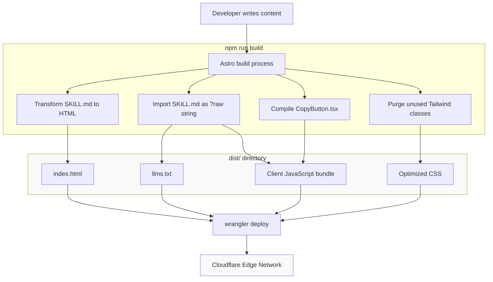

**Diagram: Build and Deployment Pipeline from Source to Edge**

The build process:
1. `npm run build` triggers Astro's build system [package.json:8]()
2. Astro processes `.astro` files, transforming markdown to HTML
3. Vite bundles React components and applies Tailwind CSS
4. Output goes to `dist/` directory
5. `wrangler deploy` publishes to Cloudflare Workers [wrangler.jsonc]()

**Sources:** [package.json:6-12](), [wrangler.jsonc]()

## Project Metadata

- **Name**: ui-skills
- **Version**: 0.0.1
- **License**: MIT [README.md:13]()
- **Type**: module (ESM)
- **Repository**: https://github.com/ibelick/ui-skills

**Sources:** [package.json:1-5](), [README.md:11-13]()

---

# Page: Architecture

# Architecture

<details>
<summary>Relevant source files</summary>

The following files were used as context for generating this wiki page:

- [README.md](README.md)
- [src/layouts/Layout.astro](src/layouts/Layout.astro)
- [src/pages/index.astro](src/pages/index.astro)
- [src/pages/llms.txt.ts](src/pages/llms.txt.ts)

</details>


## Purpose and Scope

This document describes the high-level architecture of the ui-skills repository, focusing on the system's structural design, component relationships, and content distribution strategy. It covers how the system serves dual audiences (humans and LLMs) from a single source of truth, the integration between Astro's static site generation and React's interactive components, and the overall data flow from content creation to consumption.

For detailed information about individual technologies and their integration, see [Technology Stack](#2.1). For specifics about content rendering paths, see [Content Dual-Path Architecture](#2.2). For deployment mechanics, see [Build and Deployment Pipeline](#2.3).

## System Overview

The ui-skills repository implements a documentation website with a single-source-of-truth architecture. The `SKILL.md` file contains all UI constraint documentation, which is consumed through three distinct paths:

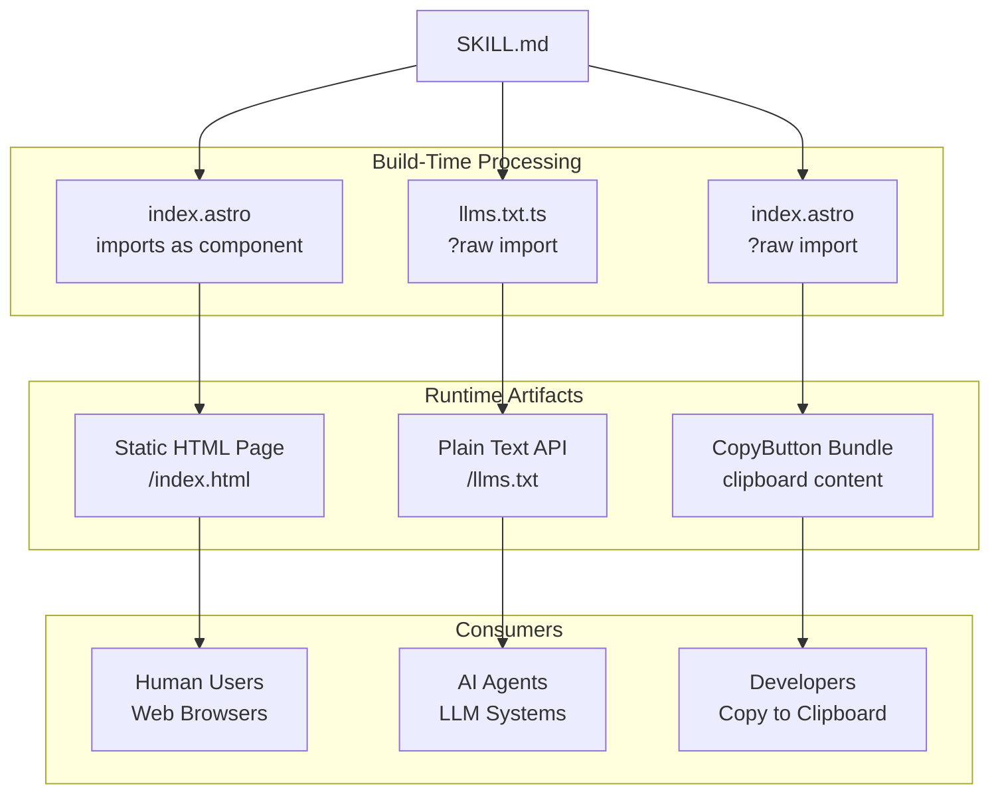

**Diagram: Single Source of Truth Distribution**

The architecture follows a static site generation pattern with selective hydration. Astro processes `.astro` files at build time, generating optimized HTML. React components marked with `client:load` directives are hydrated on the client for interactivity.

**Sources:** [src/pages/index.astro:1-89](), [src/pages/llms.txt.ts:1-12](), [src/layouts/Layout.astro:1-52]()

## Core Architectural Components

### Entry Points and Routing

The system defines two primary routes:

| Route | File | Purpose | Content-Type |
|-------|------|---------|--------------|
| `/` | `src/pages/index.astro` | Human-readable documentation | `text/html` |
| `/llms.txt` | `src/pages/llms.txt.ts` | Machine-readable API | `text/plain` |

The `index.astro` page imports SKILL.md in two ways:
- As a component: `import Skills from "../SKILL.md"` [src/pages/index.astro:3]()
- As raw text: `import skillsRaw from "../SKILL.md?raw"` [src/pages/index.astro:4]()

The `llms.txt.ts` route exports a `GET` function that returns raw SKILL.md content [src/pages/llms.txt.ts:4-12]().

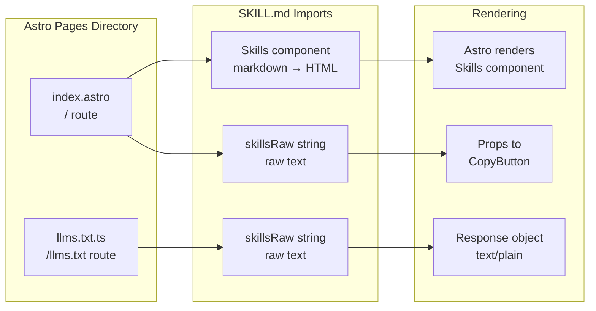

**Diagram: Route Processing and Import Strategies**

**Sources:** [src/pages/index.astro:3-4](), [src/pages/llms.txt.ts:1-12]()

### Layout Layer

The `Layout.astro` component [src/layouts/Layout.astro:1-52]() provides the base HTML structure for all pages. Key responsibilities:

- **Document Head Configuration**: SEO meta tags, Open Graph metadata, Twitter cards [src/layouts/Layout.astro:7-33]()
- **External Resources**: Google Fonts (`JetBrains Mono`), analytics script (`stonks.js`) [src/layouts/Layout.astro:11-34]()
- **Base Styling**: Global CSS import, inline styles for html/body reset [src/layouts/Layout.astro:2,41-51]()
- **Slot Pattern**: Uses Astro's `<slot />` for content injection [src/layouts/Layout.astro:37]()

The layout defines the page title as "UI Skills - Opinionated UI constraints for agents" [src/layouts/Layout.astro:16]() and includes a favicon reference [src/layouts/Layout.astro:10]().

**Sources:** [src/layouts/Layout.astro:1-52]()

### Content Rendering Layer

The `index.astro` page [src/pages/index.astro:1-89]() assembles the visual presentation:

1. **Layout Wrapper**: Wraps content in `<Layout>` [src/pages/index.astro:8]()
2. **Background SVG**: Nested grid pattern using inline SVG with `#small-grid` and `#grid` pattern definitions [src/pages/index.astro:16-47]()
3. **CopyButton Component**: React component with `client:load` directive, receives `skillsRaw` as content prop [src/pages/index.astro:50]()
4. **Content Container**: Styled div with responsive borders, shadows, and prose classes [src/pages/index.astro:52-62]()
5. **Skills Component**: Renders SKILL.md as HTML within prose styling [src/pages/index.astro:59]()
6. **Footer Navigation**: Links to GitHub, Claude Skills docs, and `/llms.txt` endpoint [src/pages/index.astro:64-86]()

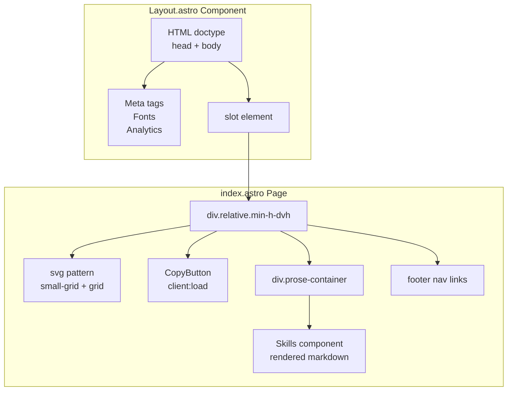

**Diagram: Page Assembly Hierarchy**

**Sources:** [src/pages/index.astro:1-89](), [src/layouts/Layout.astro:1-52]()

## Content Distribution Architecture

### Import Strategy

Astro's import system enables multiple consumption patterns from a single source file:

| Import Type | Syntax | Result | Use Case |
|-------------|--------|--------|----------|
| Component | `import Skills from "../SKILL.md"` | Astro component | Rendered HTML output |
| Raw String | `import skillsRaw from "../SKILL.md?raw"` | String content | API responses, clipboard |

The `?raw` suffix is a Vite import feature that bypasses transformation, returning file contents as a string [src/pages/index.astro:4](), [src/pages/llms.txt.ts:2]().

### API Endpoint Implementation

The `/llms.txt` endpoint implements the llms.txt standard for machine-readable documentation:

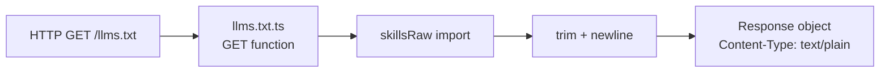

**Diagram: API Endpoint Data Flow**

The `GET` function [src/pages/llms.txt.ts:4-12]() performs minimal processing:
- Trims whitespace from raw content [src/pages/llms.txt.ts:5]()
- Adds trailing newline for POSIX compliance [src/pages/llms.txt.ts:5]()
- Returns with `text/plain; charset=utf-8` Content-Type header [src/pages/llms.txt.ts:9]()

**Sources:** [src/pages/llms.txt.ts:1-12]()

## Component Hydration Strategy

The architecture uses Astro's island architecture with selective hydration. By default, all components render as static HTML. The `client:load` directive enables client-side JavaScript:

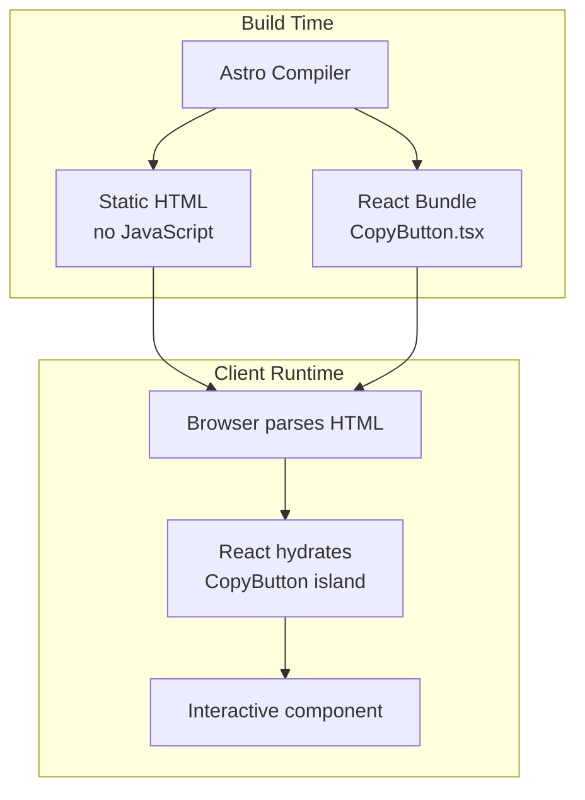

**Diagram: Island Hydration Pattern**

In the codebase, only `CopyButton` uses hydration [src/pages/index.astro:50](). The directive `client:load` instructs Astro to:
1. Generate static HTML placeholder during build
2. Bundle React component and dependencies
3. Load bundle on page load
4. Hydrate component with props (`content={skillsRaw}`)

All other content (layout, markdown rendering, SVG background, footer) remains static HTML without JavaScript overhead.

**Sources:** [src/pages/index.astro:50]()

## Styling Architecture

Styling follows a utility-first approach with Tailwind CSS:

- **Global Styles**: Imported in Layout [src/layouts/Layout.astro:2]()
- **Typography Plugin**: Prose classes for markdown styling [src/pages/index.astro:57-58]()
- **Responsive Design**: Breakpoint-aware classes (`sm:`, mobile-first) [src/pages/index.astro:10,53]()
- **Background Color**: `#fafaf5` defined in both inline styles and utility classes [src/layouts/Layout.astro:47](), [src/pages/index.astro:10]()

Prose configuration [src/pages/index.astro:57-58]() customizes typography:
- Base size: `prose-sm`
- Color: `prose-neutral`
- Heading styles: `prose-headings:text-balance`, `prose-headings:font-medium`, `prose-headings:text-[15px]`
- Paragraph styles: `prose-p:text-[15px]`, `prose-p:text-neutral-500`
- List styles: `prose-li:text-[15px]`, `prose-li:marker:text-neutral-300`

**Sources:** [src/pages/index.astro:57-58](), [src/layouts/Layout.astro:2,41-51]()

## Build Output Structure

The build process generates a static site structure:

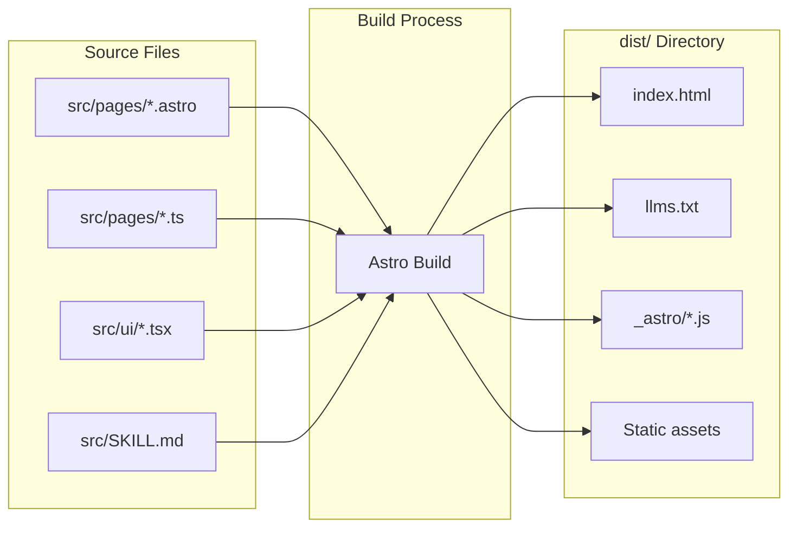

**Diagram: Build Output Generation**

The Astro build system:
- Compiles `.astro` files to HTML
- Bundles React components marked with client directives
- Executes TypeScript API routes to generate text responses
- Optimizes and fingerprints assets

**Sources:** Referenced in context from high-level diagrams

## Summary

The architecture achieves simplicity through strategic design choices:

| Design Choice | Implementation | Benefit |
|---------------|----------------|---------|
| Single source of truth | SKILL.md | Consistent content across all interfaces |
| Dual import strategy | Component + `?raw` imports | Multiple consumption patterns from one file |
| Selective hydration | `client:load` on CopyButton only | Minimal JavaScript, fast page loads |
| Static generation | Astro build process | No server-side rendering overhead |
| Plain text API | llms.txt endpoint | Machine-readable documentation standard |

This architecture enables the system to serve both human developers and AI agents efficiently from a single codebase while maintaining performance and simplicity.

**Sources:** [src/pages/index.astro:1-89](), [src/pages/llms.txt.ts:1-12](), [src/layouts/Layout.astro:1-52]()

---

# Page: Technology Stack

# Technology Stack

<details>
<summary>Relevant source files</summary>

The following files were used as context for generating this wiki page:

- [astro.config.mjs](astro.config.mjs)
- [package.json](package.json)
- [tsconfig.json](tsconfig.json)

</details>


## Purpose and Scope

This document details the technology choices and dependencies used in the ui-skills project, explaining how each technology integrates to create the static documentation website. This covers the framework layer, UI libraries, styling system, animation tools, and build tooling. For information about deployment configuration and Cloudflare Workers setup, see [Deployment Configuration](#6.2). For the build process workflow, see [Build and Deployment Pipeline](#2.3).

## Core Dependencies Overview

The ui-skills project uses a modern web technology stack optimized for static site generation with selective client-side interactivity. All dependencies are defined in [package.json:1-32]().

| Category | Technology | Version | Purpose |
|----------|-----------|---------|---------|
| Framework | Astro | 5.16.7 | Static site generator with island architecture |
| UI Library | React | 19.2.3 | Interactive component rendering |
| Integration | @astrojs/react | 4.4.2 | Bridges Astro and React |
| Styling | Tailwind CSS | 4.1.18 | Utility-first CSS framework |
| Styling Plugin | @tailwindcss/vite | 4.1.18 | Vite integration for Tailwind |
| Typography | @tailwindcss/typography | 0.5.19 | Prose styling for markdown content |
| Animation | motion | 12.24.12 | Declarative animation library |
| Build Tool | Vite | (via Astro) | Fast build tool and dev server |
| Type System | TypeScript | 5.6.3 | Static type checking |
| Code Formatting | Prettier | 3.3.3 | Code style enforcement |

**Sources:** [package.json:14-31]()

## Framework Layer: Astro

### Astro Static Site Generator

Astro 5.16.7 serves as the primary framework, orchestrating the entire build process. Astro's "island architecture" enables selective hydration where only interactive components (React) are sent to the client as JavaScript, while everything else renders as static HTML.

**Diagram: Astro Integration Architecture**

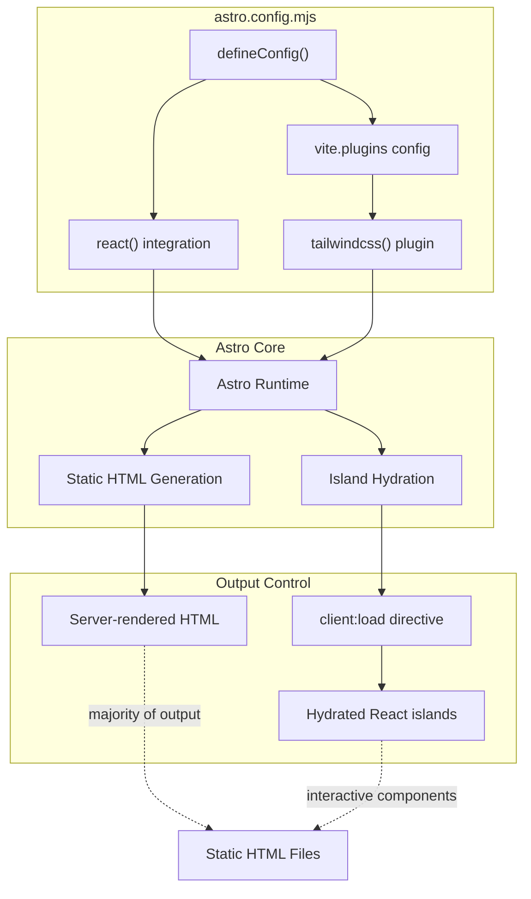

**Sources:** [astro.config.mjs:1-11](), [package.json:19]()

### Configuration

The Astro configuration file [astro.config.mjs:1-11]() specifies two key integrations:

1. **React Integration** [astro.config.mjs:7]() - Enables React component usage within Astro pages via `@astrojs/react`
2. **Vite Plugins** [astro.config.mjs:8-10]() - Configures Tailwind CSS processing through `@tailwindcss/vite`

**Sources:** [astro.config.mjs:1-11]()

## UI Library: React Integration

### React 19 with Astro

React 19.2.3 [package.json:21]() provides interactive component capabilities. The integration uses `@astrojs/react` 4.4.2 [package.json:15]() to bridge the two frameworks, allowing React components to be imported into `.astro` files.

**Diagram: React Component Hydration Flow**

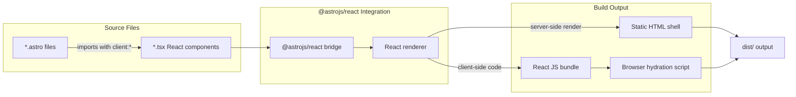

**Sources:** [package.json:15](), [package.json:21-22](), [astro.config.mjs:7]()

### TypeScript Configuration for React

The TypeScript configuration [tsconfig.json:1-14]() is specifically set up for React JSX support:

- **JSX Mode:** `"react-jsx"` [tsconfig.json:11]() enables the modern JSX transform
- **JSX Import Source:** `"react"` [tsconfig.json:12]() specifies React as the JSX runtime
- **Base Config:** Extends `"astro/tsconfigs/strict"` [tsconfig.json:2]() for Astro-specific type definitions

**Sources:** [tsconfig.json:10-13]()

## Styling System: Tailwind CSS

### Tailwind CSS 4 Integration

Tailwind CSS 4.1.18 [package.json:23]() provides utility-first styling. The integration uses `@tailwindcss/vite` 4.1.18 [package.json:16]() as a Vite plugin, configured in [astro.config.mjs:9]().

**Diagram: Tailwind CSS Processing Pipeline**

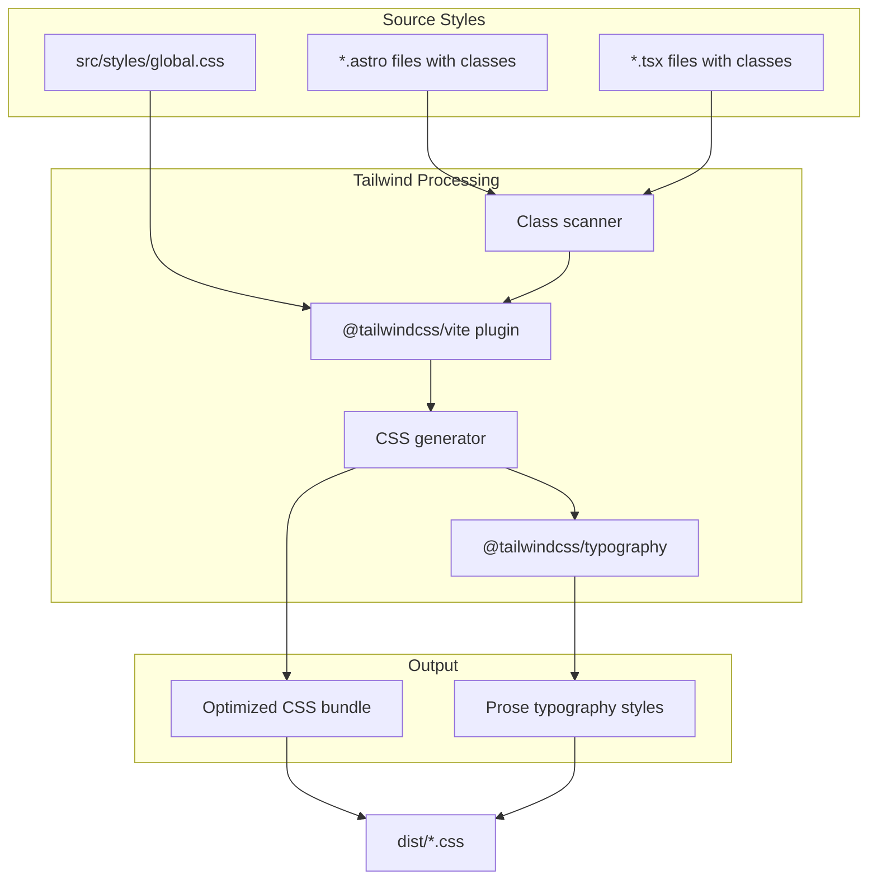

**Sources:** [package.json:16](), [package.json:23](), [astro.config.mjs:8-10]()

### Typography Plugin

The `@tailwindcss/typography` plugin 0.5.19 [package.json:26]() provides beautiful default styling for markdown-rendered prose content. This is applied to the rendered SKILL.md content using the `prose` class utilities. See [Styling System](#4.3) for more details on usage.

**Sources:** [package.json:26]()

## Animation Library: Motion

The `motion` package 12.24.12 [package.json:20]() (formerly Framer Motion) provides declarative animation capabilities for React components. This library enables the text morphing animations in interactive components. See [TextMorph Component](#5.2) for implementation details.

**Sources:** [package.json:20]()

## Build Tooling

### Vite Build System

Vite is integrated into Astro as its underlying build tool and development server. The Vite configuration is specified within [astro.config.mjs:8-10](), where plugins like `@tailwindcss/vite` are registered.

**Diagram: Build Tool Chain**

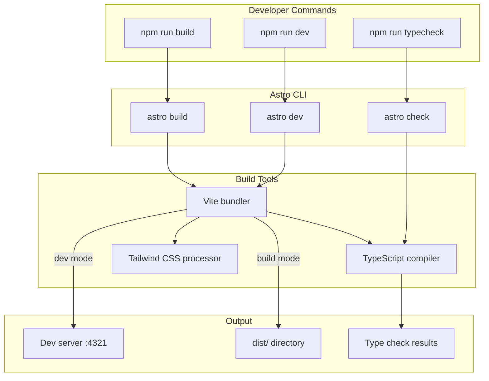

**Sources:** [package.json:6-12](), [astro.config.mjs:8-10]()

### TypeScript

TypeScript 5.6.3 [package.json:30]() provides static type checking. The configuration extends Astro's strict TypeScript preset and includes React type definitions [package.json:17-18]().

**Key TypeScript Settings:**

- **Config Base:** Extends `astro/tsconfigs/strict` for strict type checking [tsconfig.json:2]()
- **Include Paths:** Type definitions and all source files [tsconfig.json:3-5]()
- **Exclude Paths:** Build output directory [tsconfig.json:7-9]()
- **React Support:** Configured for React JSX [tsconfig.json:10-13]()

**Sources:** [tsconfig.json:1-14](), [package.json:30]()

## Development Tools

### Prettier Code Formatting

Prettier 3.3.3 [package.json:27]() enforces consistent code style across the project. The setup includes two Prettier plugins:

- **prettier-plugin-astro** 0.14.1 [package.json:28]() - Formats `.astro` files
- **prettier-plugin-tailwindcss** 0.6.8 [package.json:29]() - Sorts Tailwind CSS classes

The `npm run format` command [package.json:11]() runs Prettier across all files using the configuration from `.prettierrc.json`.

**Sources:** [package.json:11](), [package.json:27-29]()

## Technology Integration Summary

**Diagram: Complete Stack Integration**

```mermaid
graph TB
    subgraph "package.json Dependencies"
        Astro["astro@5.16.7"]
        React["react@19.2.3"]
        ReactDOM["react-dom@19.2.3"]
        AstroReact["@astrojs/react@4.4.2"]
        Tailwind["tailwindcss@4.1.18"]
        TailwindVite["@tailwindcss/vite@4.1.18"]
        TailwindTypography["@tailwindcss/typography@0.5.19"]
        Motion["motion@12.24.12"]
        TypeScript["typescript@5.6.3"]
        ReactTypes["@types/react@19.2.7"]
        ReactDOMTypes["@types/react-dom@19.2.3"]
    end
    
    subgraph "astro.config.mjs"
        ConfigFile["defineConfig()"]
        IntegrationsArray["integrations: [react()]"]
        VitePlugins["vite.plugins: [tailwindcss()]"]
    end
    
    subgraph "tsconfig.json"
        TSConfig["TypeScript Config"]
        JSXSettings["jsx: react-jsx"]
    end
    
    subgraph "Runtime Capabilities"
        StaticSiteGen["Static HTML generation"]
        SelectiveHydration["Selective React hydration"]
        UtilityCSS["Utility-first styling"]
        ProseFormatting["Prose typography"]
        Animations["Declarative animations"]
        TypeSafety["Static type checking"]
    end
    
    Astro --> ConfigFile
    AstroReact --> IntegrationsArray
    TailwindVite --> VitePlugins
    
    ConfigFile --> IntegrationsArray
    ConfigFile --> VitePlugins
    
    React --> AstroReact
    ReactDOM --> AstroReact
    ReactTypes --> TypeScript
    ReactDOMTypes --> TypeScript
    
    TypeScript --> TSConfig
    TSConfig --> JSXSettings
    
    Astro --> StaticSiteGen
    AstroReact --> SelectiveHydration
    Tailwind --> UtilityCSS
    TailwindTypography --> ProseFormatting
    Motion --> Animations
    TypeScript --> TypeSafety
    
    StaticSiteGen --> Output["Production Build"]
    SelectiveHydration --> Output
    UtilityCSS --> Output
    ProseFormatting --> Output
```

**Sources:** [package.json:14-31](), [astro.config.mjs:1-11](), [tsconfig.json:1-14]()

The technology stack is designed for optimal performance through static generation (Astro), selective interactivity (React islands), efficient styling (Tailwind CSS), and developer experience (TypeScript, Prettier). All technologies integrate through standard npm package management and configuration files, creating a cohesive build system that outputs optimized static assets for edge deployment.

---

# Page: Content Dual-Path Architecture

# Content Dual-Path Architecture

<details>
<summary>Relevant source files</summary>

The following files were used as context for generating this wiki page:

- [src/SKILL.md](src/SKILL.md)
- [src/pages/index.astro](src/pages/index.astro)
- [src/pages/llms.txt.ts](src/pages/llms.txt.ts)

</details>


This document describes how the `SKILL.md` content file is consumed through multiple rendering paths to serve different audiences and use cases. The system processes a single source of truth (SKILL.md) and exposes it through three distinct consumption paths: formatted HTML for human readers, raw text for clipboard operations, and a plain-text API endpoint for LLM consumption.

For information about the overall system architecture, see [Architecture](#2). For details on the LLMs.txt API endpoint implementation, see [LLMs.txt API Endpoint](#3.2). For the main page rendering, see [Main Index Page](#4.2).

## Purpose and Scope

This document explains the dual-path architecture for content consumption in the ui-skills repository. The same source content (SKILL.md) is processed and delivered through three distinct pathways to serve different consumers: rendered HTML for human readers, raw text for clipboard operations, and a plain text API endpoint for machine consumption. This architecture ensures that the UI constraints documented in SKILL.md are accessible to both human developers and AI agents without duplication or drift.

For details on the actual content structure of SKILL.md, see [SKILL.md Content Structure](#3.1). For deployment specifics, see [Build and Deployment Pipeline](#2.3).

## Content Source

The entire dual-path architecture originates from a single source of truth: `SKILL.md` located at [src/SKILL.md:1-75](). This Markdown file contains the complete set of opinionated constraints for building user interfaces with AI agents, organized into eight categories: Stack, Components, Interaction, Animation, Typography, Layout, Performance, and Design.

The file uses standard Markdown syntax with YAML frontmatter defining the `name` and `description` metadata. The content itself is structured as a series of constraint rules using uppercase modal verbs (MUST, SHOULD, NEVER, MAY NOT) following RFC 2119 convention to indicate requirement levels.

**Sources:** [src/SKILL.md:1-75]()

## Import Methods

The dual-path architecture is implemented through two distinct import mechanisms in Astro:

### Standard Import
Used for rendering formatted HTML content on the main page:
```typescript
import Skills from "../SKILL.md";
```
This import treats `SKILL.md` as an Astro component, automatically transforming the markdown into renderable HTML.

### Raw Import
Used for obtaining the unprocessed markdown text:
```typescript
import skillsRaw from "../SKILL.md?raw";
```

The `?raw` suffix is a Vite special import that returns the file contents as a plain string, bypassing any markdown processing. This raw content is then used in two distinct ways within the architecture.

**Sources:** [src/pages/index.astro:3-4](), [src/pages/llms.txt.ts:2]()

---

## Path 1: Human-Facing Rendered HTML

The human-facing path transforms SKILL.md into a formatted, styled HTML page suitable for browser consumption.

### Import and Processing

The main index page imports `SKILL.md` as a standard Astro component:

```markdown
import Skills from "../SKILL.md";
```

[src/pages/index.astro:3]()

When Astro encounters this import, it processes the Markdown file through its built-in Markdown renderer, converting it to an HTML component that can be embedded directly in the page.

### Rendering Path

The processed content is rendered within the index page as:

```astro
<Skills />
```

[src/pages/index.astro:59]()

The rendered content is wrapped in a container with Tailwind CSS prose classes that apply typography styling:

```
prose prose-neutral prose-sm prose-headings:text-balance prose-headings:font-medium ...
```

These styles transform the raw Markdown into a formatted, readable document with proper heading hierarchy, spacing, and typographic refinement. The content is rendered server-side during the build process and delivered as static HTML.

**Sources:** [src/pages/index.astro:1-89]()

## Machine-Facing Path: Plain Text API

The same `SKILL.md` content is simultaneously made available to LLMs and automated systems through a dedicated API endpoint.

### The /llms.txt Endpoint

The `/llms.txt` endpoint is implemented as an Astro API route in [src/pages/llms.txt.ts:1-12](). This endpoint:

1. **Imports SKILL.md as raw text**: Uses Vite's `?raw` import suffix to bypass markdown processing [src/pages/llms.txt.ts:2]()
2. **Serves plain text**: Returns the content with `text/plain; charset=utf-8` content type [src/pages/llms.txt.ts:8-10]()
3. **Adds trailing newline**: Ensures proper file termination with `.trim() + "\n"` [src/pages/llms.txt.ts:5]()
4. **No processing**: Content is served exactly as written in the source file

This endpoint implements the [llms.txt standard](https://llmstxt.org), which provides a convention for websites to expose machine-readable documentation that LLMs can consume directly.

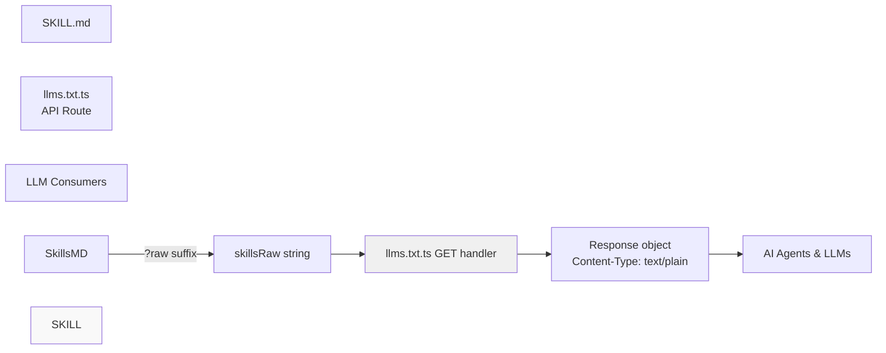

Wait, let me reconsider. I need to write a comprehensive document about the Content Dual-Path Architecture. Looking at the provided diagrams and files, I can see:

1. SKILL.md is imported in multiple ways:
   - As a component in index.astro (line 3): `import Skills from "../SKILL.md"`
   - As raw text in index.astro (line 4): `import skillsRaw from "../SKILL.md?raw"`
   - As raw text in llms.txt.ts (line 2): `import skillsRaw from "../SKILL.md?raw"`

2. The content is consumed in three ways:
   - Rendered as HTML via `<Skills />` component in index.astro:59
   - Passed to CopyButton for clipboard functionality in index.astro:50
   - Served via /llms.txt endpoint in llms.txt.ts

This is the dual-path architecture - the same source content (SKILL.md) serves both human and machine consumers through different rendering paths.

Let me structure this document:

1. Purpose and Scope
2. Single Source of Truth (SKILL.md)
3. Import Mechanisms
4. Human-Facing Path (HTML rendering)
5. Machine-Facing Path (/llms.txt API)
6. Interactive Copy Path (CopyButton)
7. Technical Implementation Details

I should include:
- Diagram showing the import mechanism
- Diagram showing the three consumption paths
- Diagram showing file references and flow
- Tables where appropriate
- Code references with line numbers
</thinking>

# Content Dual-Path Architecture

## Purpose and Scope

This document explains how the ui-skills system serves content from a single source (`SKILL.md`) through multiple consumption paths to different audiences. The architecture enables both human developers and AI agents to access the same UI constraint documentation through interfaces optimized for their respective needs.

For details on the `SKILL.md` content itself, see [SKILL.md Content Structure](#3.1). For information on page rendering and visual presentation, see [Main Index Page](#4.2). For deployment specifics, see [Build and Deployment Pipeline](#2.3).

## System Overview

The content dual-path architecture is built on three core principles:

1. **Single Source of Truth**: All content originates from `SKILL.md`
2. **Multiple Import Mechanisms**: Vite's import system provides both transformed and raw content
3. **Optimized Delivery Paths**: Each consumer receives content in an appropriate format

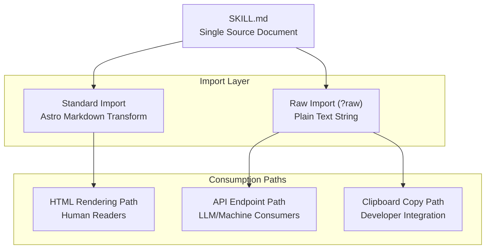

**Sources**: [src/pages/index.astro:1-89](), [src/pages/llms.txt.ts:1-12]()

## Import Mechanisms

The system leverages Vite's import capabilities to process `SKILL.md` in two distinct ways:

| Import Type | Syntax | Result | Used By |
|------------|--------|--------|---------|
| **Standard Import** | `import Skills from "../SKILL.md"` | Astro component with transformed HTML | `index.astro` for rendering |
| **Raw Import** | `import skillsRaw from "../SKILL.md?raw"` | Plain text string | `llms.txt.ts` API and `CopyButton` |

### Standard Import Path

In [src/pages/index.astro:3](), the standard import transforms the Markdown file into an Astro component:

```typescript
import Skills from "../SKILL.md";
```

This import:
- Parses Markdown syntax into HTML elements
- Preserves frontmatter metadata (name, description)
- Outputs a renderable Astro component
- Enables direct use in JSX: `<Skills />`

### Raw Import Path

In [src/pages/index.astro:4]() and [src/pages/llms.txt.ts:2](), the raw import provides unprocessed content:

```typescript
import skillsRaw from "../SKILL.md?raw";
```

This import:
- Bypasses all Markdown transformations
- Returns the file as a plain JavaScript string
- Preserves exact formatting, including frontmatter
- Enables programmatic content manipulation

**Sources**: [src/pages/index.astro:3-4](), [src/pages/llms.txt.ts:2]()

## Three Consumption Paths

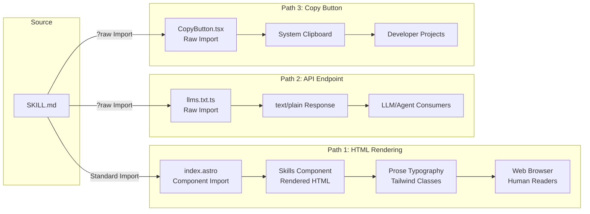

**Sources**: [src/pages/index.astro:1-89](), [src/pages/llms.txt.ts:1-12]()

## Path 1: Human-Facing HTML Rendering

The primary consumption path serves human developers through a rich, formatted web interface.

### Implementation

In [src/pages/index.astro:59](), the `Skills` component is rendered within a prose-styled container:

```astro
<div class="prose prose-neutral prose-sm ...">
  <Skills />
</div>
```

### Rendering Pipeline

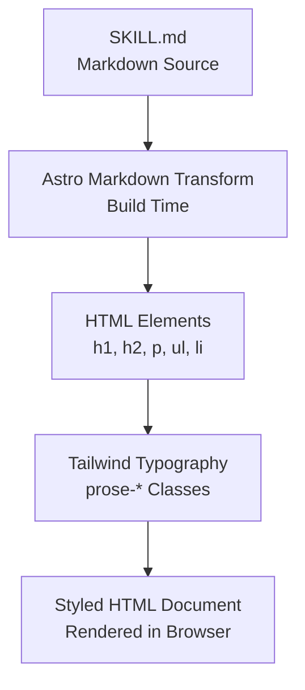

### Typography Styling

The prose classes applied in [src/pages/index.astro:56-58]() provide extensive typographic control:

- `prose-headings:text-balance`: Balanced heading line breaks
- `prose-h1:mb-6`: Heading spacing hierarchy
- `prose-p:text-[15px]`: Consistent paragraph sizing
- `prose-li:marker:text-neutral-300`: Subdued list markers
- `font-mono`: JetBrains Mono monospace font (via Layout)

This styling transforms raw Markdown into a polished, readable documentation page optimized for comprehension by human developers.

**Sources**: [src/pages/index.astro:52-62]()

## Path 2: Machine-Facing API Endpoint

The `/llms.txt` endpoint implements the [llms.txt standard](https://llmstxt.org) for machine-readable website documentation.

### Implementation

The entire API route in [src/pages/llms.txt.ts:4-12]():

```typescript
export const GET: APIRoute = () => {
  const body = skillsRaw.trim() + "\n";

  return new Response(body, {
    headers: {
      "Content-Type": "text/plain; charset=utf-8",
    },
  });
};
```

### Key Characteristics

| Aspect | Implementation Detail |
|--------|----------------------|
| **Content** | Raw `SKILL.md` string with trailing newline |
| **Content-Type** | `text/plain; charset=utf-8` |
| **Processing** | Minimal - only `.trim()` and newline addition |
| **Purpose** | LLM/agent consumption without HTML artifacts |

### Design Rationale

The API endpoint provides:

1. **Zero Transformation**: LLMs receive exact content without HTML wrapping
2. **Markdown Preservation**: Structural markers (headers, lists) aid LLM parsing
3. **Standards Compliance**: Follows llms.txt convention for discoverability
4. **Lightweight Response**: Plain text minimizes transfer size and parsing overhead

Agents can fetch this endpoint to retrieve the complete UI Skills constraint set for use in code generation workflows.

**Sources**: [src/pages/llms.txt.ts:1-12]()

## Path 3: Interactive Copy Functionality

The `CopyButton` component provides clipboard access to the raw content for developers who want to integrate the constraints into their own projects.

### Integration

In [src/pages/index.astro:50](), the button receives the raw content:

```astro
<CopyButton content={skillsRaw} client:load />
```

### Hydration Strategy

The `client:load` directive indicates:
- Component hydrates immediately on page load
- Requires JavaScript for interactivity
- Provides instant clipboard functionality
- Only interactive element on an otherwise static page

### Data Flow

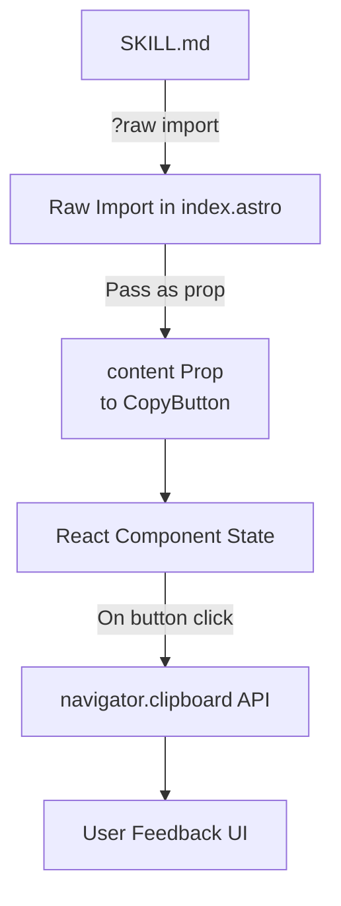

The `CopyButton` component (detailed in [CopyButton Component](#5.1)) handles:
- User interaction detection
- Clipboard API invocation
- Success/error state management
- Visual feedback (text morphing animation)

**Sources**: [src/pages/index.astro:4](), [src/pages/index.astro:50]()

## Technical Implementation Details

### File References and Dependencies

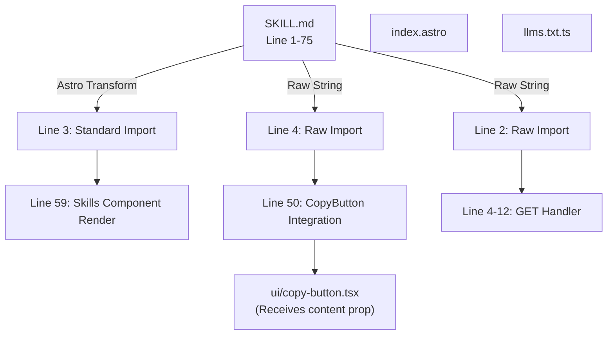

**Sources**: [src/SKILL.md:1-75](), [src/pages/index.astro:3-4](), [src/pages/llms.txt.ts:2]()

### Build-Time vs Runtime Processing

| Aspect | HTML Path | API Path | Copy Path |
|--------|-----------|----------|-----------|
| **Processing Time** | Build time | Runtime | Build time (prop passing) |
| **Transformation** | Markdown → HTML | None (trim only) | None |
| **Output Size** | ~15KB (estimated HTML) | ~2KB (raw text) | ~2KB (raw text) |
| **Caching** | Static file | Cloudflare edge cache | Client-side memory |

### Content Consistency Guarantees

All three paths derive from the same `SKILL.md` file at build time, ensuring:

1. **Version Synchronization**: HTML, API, and copy button always serve identical content versions
2. **Single Update Point**: Modifying `SKILL.md` updates all paths in the next build
3. **No Runtime Divergence**: No dynamic content modification can create inconsistency

This architecture guarantees that whether a developer reads the documentation in their browser, an LLM fetches it via API, or a user copies it to their clipboard, they all receive the exact same source material.

**Sources**: [src/SKILL.md:1-75](), [src/pages/index.astro:1-89](), [src/pages/llms.txt.ts:1-12]()

---

# Page: Build and Deployment Pipeline

# Build and Deployment Pipeline

<details>
<summary>Relevant source files</summary>

The following files were used as context for generating this wiki page:

- [astro.config.mjs](astro.config.mjs)
- [package.json](package.json)
- [wrangler.jsonc](wrangler.jsonc)
- [wrangler.toml](wrangler.toml)

</details>


## Purpose and Scope

This document describes the build and deployment pipeline for the ui-skills repository, covering the transformation of source code into production artifacts and their deployment to Cloudflare Workers. This includes the npm build scripts, Astro's build process, dependency management, and Wrangler configuration for edge deployment.

For information about the individual technologies used in the pipeline, see [Technology Stack](#2.1). For deployment-specific configuration details, see [Deployment Configuration](#6.2).

## Pipeline Overview

The build and deployment pipeline transforms source files (Astro pages, React components, TypeScript, CSS) into optimized static assets that are deployed to Cloudflare's edge network. The process involves multiple stages: dependency resolution, TypeScript compilation, Astro build orchestration, Vite bundling, and Cloudflare Workers deployment via Wrangler.

```mermaid
graph TD
    Dev["Developer"]
    Source["Source Files<br/>(*.astro, *.tsx, *.ts, *.css)"]
    NPM["npm scripts"]
    Build["npm run build"]
    Astro["Astro Build Process"]
    Vite["Vite Bundler"]
    TypeScript["TypeScript Compiler"]
    Tailwind["Tailwind CSS Processor"]
    Dist["dist/ directory"]
    Wrangler["wrangler deploy"]
    CF["Cloudflare Workers"]
    
    Dev --> Source
    Source --> NPM
    NPM --> Build
    Build --> Astro
    
    Astro --> Vite
    Astro --> TypeScript
    Vite --> Tailwind
    
    Vite --> Dist
    TypeScript --> Dist
    Tailwind --> Dist
    
    Dist --> Wrangler
    Wrangler --> CF
```

**Sources:** [package.json:1-32](), [astro.config.mjs:1-11](), [wrangler.jsonc:1-7]()

## NPM Scripts

The build pipeline is orchestrated through npm scripts defined in `package.json`. These scripts provide consistent entry points for development, building, and maintenance tasks.

| Script | Command | Purpose |
|--------|---------|---------|
| `dev` | `astro dev` | Starts development server with hot module replacement |
| `build` | `astro build` | Triggers production build process |
| `preview` | `astro preview` | Serves built application locally for testing |
| `typecheck` | `astro check` | Runs TypeScript type checking without building |
| `format` | `prettier --write .` | Formats all source files using Prettier |

The primary build script executes `astro build`, which initiates the entire build toolchain. This command reads the Astro configuration, processes all pages and components, and outputs optimized static files to the `dist/` directory.

**Sources:** [package.json:6-12]()

## Build Toolchain

The build process leverages multiple integrated tools that work together through Astro's orchestration layer.

```mermaid
graph TB
    AstroConfig["astro.config.mjs"]
    AstroBuild["Astro Build Engine"]
    ReactIntegration["@astrojs/react integration"]
    VitePlugin["@tailwindcss/vite plugin"]
    
    subgraph "Dependencies"
        Astro["astro@5.16.7"]
        React["react@19.2.3"]
        ReactDOM["react-dom@19.2.3"]
        Tailwind["tailwindcss@4.1.18"]
        Motion["motion@12.24.12"]
        Typography["@tailwindcss/typography@0.5.19"]
    end
    
    subgraph "Processing Steps"
        PageCompile["Page Compilation<br/>(*.astro files)"]
        ComponentHydration["Component Hydration<br/>(client:load directives)"]
        CSSProcessing["CSS Processing<br/>(Tailwind utilities)"]
        TypeScriptCheck["TypeScript Type Checking"]
        BundleOptimization["Bundle Optimization<br/>(code splitting, minification)"]
    end
    
    AstroConfig --> AstroBuild
    AstroConfig --> ReactIntegration
    AstroConfig --> VitePlugin
    
    AstroBuild --> Astro
    ReactIntegration --> React
    ReactIntegration --> ReactDOM
    VitePlugin --> Tailwind
    
    AstroBuild --> PageCompile
    PageCompile --> ComponentHydration
    PageCompile --> CSSProcessing
    PageCompile --> TypeScriptCheck
    ComponentHydration --> BundleOptimization
    CSSProcessing --> BundleOptimization
    
    React --> ComponentHydration
    Motion --> ComponentHydration
    Tailwind --> CSSProcessing
    Typography --> CSSProcessing
```

**Sources:** [astro.config.mjs:1-11](), [package.json:14-31]()

### Astro Configuration

The `astro.config.mjs` file defines the build configuration:

- **React Integration** ([astro.config.mjs:7]()): Enables React component support through `@astrojs/react`, allowing `.tsx` files to be used within Astro pages
- **Vite Plugins** ([astro.config.mjs:8-10]()): Integrates Tailwind CSS via `@tailwindcss/vite` plugin, enabling utility-first styling with JIT compilation

The configuration uses ES modules (`type: "module"` in [package.json:3]()) for modern JavaScript syntax and import/export statements.

**Sources:** [astro.config.mjs:1-11](), [package.json:3]()

### Dependency Resolution

Build dependencies are categorized in `package.json`:

**Runtime Dependencies** ([package.json:14-23]()):
- `astro@5.16.7`: Core static site generator
- `@astrojs/react@4.4.2`: React integration bridge
- `react@19.2.3` and `react-dom@19.2.3`: React runtime
- `tailwindcss@4.1.18` and `@tailwindcss/vite@4.1.18`: Styling framework
- `motion@12.24.12`: Animation library

**Development Dependencies** ([package.json:25-31]()):
- `@tailwindcss/typography@0.5.19`: Typography plugin for prose content
- `typescript@5.6.3`: Type checking and compilation
- `prettier@3.3.3`: Code formatting
- Prettier plugins for Astro and Tailwind

**Sources:** [package.json:14-31]()

## Build Output Structure

The build process generates static assets in the `dist/` directory, which serves as the deployment root. This directory contains:

- **HTML Files**: Pre-rendered static HTML pages, including `index.html` and API endpoints like `llms.txt`
- **JavaScript Bundles**: Optimized client-side code for interactive components (e.g., CopyButton)
- **CSS Assets**: Processed Tailwind stylesheets with only used utilities
- **Static Assets**: Files from `/public` directory (favicon, images)
- **Metadata Files**: Build artifacts and routing information

The output structure is optimized for edge deployment with minimal file sizes and efficient caching strategies.

**Sources:** [wrangler.jsonc:5](), [wrangler.toml:5]()

## Deployment Configuration

Deployment to Cloudflare Workers is configured through Wrangler configuration files. The repository includes both JSON and TOML formats with identical settings.

### Wrangler Configuration Files

**wrangler.jsonc** ([wrangler.jsonc:1-7]()):
```json
{
  "name": "ui-skills",
  "compatibility_date": "2026-01-07",
  "assets": {
    "directory": "./dist"
  }
}
```

**wrangler.toml** ([wrangler.toml:1-5]()):
```toml
name = "ui-skills"
compatibility_date = "2026-01-07"

[assets]
directory = "./dist"
```

| Field | Value | Purpose |
|-------|-------|---------|
| `name` | `"ui-skills"` | Worker name in Cloudflare dashboard |
| `compatibility_date` | `"2026-01-07"` | Cloudflare Workers runtime version |
| `assets.directory` | `"./dist"` | Path to static assets for deployment |

The `compatibility_date` ensures consistent runtime behavior and access to specific Cloudflare Workers API features. The `assets.directory` directive tells Wrangler to deploy all files from the `dist/` directory as static assets.

**Sources:** [wrangler.jsonc:1-7](), [wrangler.toml:1-5]()

## Deployment Process

Deployment to Cloudflare Workers follows a straightforward process using the Wrangler CLI:

```mermaid
graph LR
    Build["npm run build"]
    DistDir["dist/ directory<br/>(static assets)"]
    WranglerCmd["wrangler deploy"]
    WranglerConfig["wrangler.jsonc / wrangler.toml"]
    CFApi["Cloudflare API"]
    Upload["Asset Upload"]
    EdgeDeploy["Edge Network Deployment"]
    Live["Live at ui-skills.workers.dev"]
    
    Build --> DistDir
    DistDir --> WranglerCmd
    WranglerConfig --> WranglerCmd
    WranglerCmd --> CFApi
    CFApi --> Upload
    Upload --> EdgeDeploy
    EdgeDeploy --> Live
```

**Deployment Steps:**

1. **Build Generation**: Execute `npm run build` to create production assets in `dist/`
2. **Wrangler Invocation**: Run `wrangler deploy` with appropriate authentication
3. **Configuration Reading**: Wrangler reads `wrangler.jsonc` or `wrangler.toml` for deployment settings
4. **Asset Upload**: Wrangler uploads all files from `./dist` directory to Cloudflare
5. **Edge Distribution**: Cloudflare propagates assets to edge locations globally
6. **Service Activation**: The worker becomes live at the configured domain

The deployment leverages Cloudflare's Workers Assets feature, which serves static files directly from the edge network with optimal caching and minimal latency.

**Sources:** [wrangler.jsonc:1-7](), [wrangler.toml:1-5](), [package.json:8]()

## Build-to-Deployment Mapping

The following diagram maps source code entities to their deployment artifacts, bridging the natural language concepts with actual code symbols:

```mermaid
graph TD
    subgraph "Source Code"
        IndexAstro["src/pages/index.astro"]
        LayoutAstro["src/layouts/Layout.astro"]
        LLMsRoute["src/pages/llms.txt.ts"]
        CopyButtonTsx["src/components/CopyButton.tsx"]
        GlobalCSS["src/styles/global.css"]
        SkillMD["SKILL.md"]
        PublicAssets["public/*"]
    end
    
    subgraph "Build Process"
        AstroBuildCmd["astro build<br/>(package.json:8)"]
        ReactPlugin["@astrojs/react<br/>(astro.config.mjs:7)"]
        TailwindPlugin["@tailwindcss/vite<br/>(astro.config.mjs:9)"]
    end
    
    subgraph "dist/ Output"
        IndexHTML["dist/index.html"]
        LLMsTXT["dist/llms.txt"]
        ClientJS["dist/_astro/*.js<br/>(CopyButton bundle)"]
        StylesCSS["dist/_astro/*.css<br/>(Tailwind utilities)"]
        StaticFiles["dist/* (favicon, etc)"]
    end
    
    subgraph "Cloudflare Workers"
        AssetsDir["assets.directory: './dist'<br/>(wrangler.jsonc:5)"]
        EdgeServe["Edge Network Serving"]
    end
    
    IndexAstro --> AstroBuildCmd
    LayoutAstro --> AstroBuildCmd
    LLMsRoute --> AstroBuildCmd
    CopyButtonTsx --> AstroBuildCmd
    GlobalCSS --> AstroBuildCmd
    SkillMD --> AstroBuildCmd
    PublicAssets --> AstroBuildCmd
    
    AstroBuildCmd --> ReactPlugin
    AstroBuildCmd --> TailwindPlugin
    
    IndexAstro --> IndexHTML
    LLMsRoute --> LLMsTXT
    CopyButtonTsx --> ClientJS
    GlobalCSS --> StylesCSS
    PublicAssets --> StaticFiles
    
    IndexHTML --> AssetsDir
    LLMsTXT --> AssetsDir
    ClientJS --> AssetsDir
    StylesCSS --> AssetsDir
    StaticFiles --> AssetsDir
    
    AssetsDir --> EdgeServe
```

**Sources:** [package.json:8](), [astro.config.mjs:7-9](), [wrangler.jsonc:4-6]()

## Performance Optimizations

The build pipeline implements several optimizations for production deployment:

- **Static Site Generation**: All pages are pre-rendered at build time, eliminating server-side processing
- **Partial Hydration**: Only interactive components (marked with `client:load`) ship JavaScript to the browser
- **Code Splitting**: Vite automatically splits code into optimal chunks for parallel loading
- **CSS Purging**: Tailwind CSS only includes used utility classes in the final bundle
- **Minification**: All HTML, CSS, and JavaScript are minified for smaller file sizes
- **Edge Deployment**: Cloudflare Workers serve assets from geographically distributed edge nodes

These optimizations result in fast load times and minimal bandwidth usage, with most content served as static HTML requiring no JavaScript execution.

**Sources:** [astro.config.mjs:1-11](), [package.json:14-31]()

---

# Page: UI Skills Documentation

# UI Skills Documentation

<details>
<summary>Relevant source files</summary>

The following files were used as context for generating this wiki page:

- [README.md](README.md)
- [src/SKILL.md](src/SKILL.md)

</details>


This document describes the core content of the ui-skills system: the UI Skills constraints themselves. These are opinionated rules that guide AI agents when building user interfaces.

**Scope:** This page covers the purpose, structure, and content of the UI Skills constraints defined in `SKILL.md`. For implementation details of how this content is served to different consumers, see [SKILL.md Content Structure](#3.1) and [LLMs.txt API Endpoint](#3.2). For how this content is rendered on the main page, see [Main Index Page](#4.2).

## Purpose and Rationale

UI Skills is a set of **opinionated, evolving constraints** designed to guide agents when building interfaces. As stated in [README.md:5](), these constraints address specific pain points encountered when using agents to build UI - patterns that consistently produced poor results or unnecessary friction.

The constraints are intentionally opinionated rather than comprehensive. They emerge from practical experience rather than theoretical completeness, focusing on the most common failure modes and anti-patterns observed in agent-generated interfaces.

**Key Characteristics:**
- **Constraint-based:** Rules use imperative keywords (MUST, SHOULD, NEVER) to establish clear boundaries
- **Technology-specific:** References concrete tools and libraries rather than abstract concepts
- **Practical:** Each rule addresses a real problem observed in agent behavior
- **Evolving:** The constraint set updates as new patterns emerge

Sources: [README.md:5-7](), [src/SKILL.md:1-8]()

## Constraint Categories

The UI Skills constraints are organized into eight primary categories, each addressing a specific aspect of interface development:

| Category | Focus Area | Rule Count | Key Priorities |
|----------|-----------|------------|----------------|
| **Stack** | Technology choices and tooling | 4 | Tailwind CSS defaults, motion/react animation, utility functions |
| **Components** | UI primitives and accessibility | 6 | Accessible primitives, consistent primitive systems, keyboard/focus behavior |
| **Interaction** | User interaction patterns | 6 | Destructive action dialogs, loading states, viewport units, error placement |
| **Animation** | Motion design and performance | 9 | Compositor-only props, respect user preferences, tight timing constraints |
| **Typography** | Text rendering and layout | 4 | Text wrapping algorithms, tabular numbers, truncation strategies |
| **Layout** | Spatial organization | 2 | Fixed z-index scale, square element utilities |
| **Performance** | Runtime optimization | 3 | Avoid expensive effects, minimize useEffect, conditional will-change |
| **Design** | Visual aesthetics | 7 | Restrained color usage, shadow scales, empty state guidance |

Sources: [src/SKILL.md:10-75]()

## Content Structure

### Metadata and Frontmatter

The `SKILL.md` file includes YAML frontmatter that identifies the skill for agent consumption:

```yaml
---
name: ui-skills
description: Opinionated constraints for building better interfaces with agents.
---
```

This metadata allows agents and tools to programmatically identify and reference the skill set.

Sources: [src/SKILL.md:1-4]()

### Constraint Specification Format

Each constraint follows a consistent format:

**Structure:**
- **Imperative keyword** (MUST, SHOULD, NEVER) indicates priority level
- **Specific action or requirement** states what to do or avoid
- **Context or qualifier** provides conditions or alternatives when applicable

**Keyword Semantics:**
- `MUST`: Non-negotiable requirement; deviation produces incorrect or broken behavior
- `SHOULD`: Strong recommendation; deviation should have clear justification
- `NEVER`: Absolute prohibition; indicates a known anti-pattern

Sources: [src/SKILL.md:10-75]()

## Technology and Code Entity Mapping

### Constraint-to-Technology Mapping

```mermaid
graph TB
    subgraph "Stack Constraints"
        StackRules["Stack Category<br/>(SKILL.md:10-16)"]
        TailwindDefaults["MUST: Tailwind CSS defaults"]
        MotionLib["MUST: motion/react"]
        AnimateCSS["SHOULD: tw-animate-css"]
        CNUtil["MUST: cn utility"]
    end
    
    subgraph "Referenced Technologies"
        Tailwind["Tailwind CSS<br/>spacing, radius, shadows"]
        MotionReact["motion/react package<br/>(formerly framer-motion)"]
        TWAnimate["tw-animate-css library<br/>entrance/micro-animations"]
        CLSX["clsx package"]
        TMerge["tailwind-merge package"]
    end
    
    subgraph "Component Constraints"
        CompRules["Components Category<br/>(SKILL.md:17-25)"]
        PrimitiveReq["MUST: accessible primitives"]
        PriorityOrder["MUST: existing primitives first"]
        PreferBase["SHOULD: Base UI for new"]
    end
    
    subgraph "Component Libraries"
        BaseUI["Base UI<br/>base-ui.com"]
        ReactAria["React Aria"]
        Radix["Radix"]
    end
    
    StackRules --> TailwindDefaults
    StackRules --> MotionLib
    StackRules --> AnimateCSS
    StackRules --> CNUtil
    
    TailwindDefaults --> Tailwind
    MotionLib --> MotionReact
    AnimateCSS --> TWAnimate
    CNUtil --> CLSX
    CNUtil --> TMerge
    
    CompRules --> PrimitiveReq
    CompRules --> PriorityOrder
    CompRules --> PreferBase
    
    PrimitiveReq --> BaseUI
    PrimitiveReq --> ReactAria
    PrimitiveReq --> Radix
    PreferBase --> BaseUI
```

**Diagram: Technology Stack Constraints to Code Entities**

This diagram shows how abstract constraint categories in `SKILL.md` map to specific npm packages and libraries that agents should use. The Stack category mandates specific technologies, while the Components category establishes a hierarchy of acceptable primitive libraries.

Sources: [src/SKILL.md:10-25]()

### CSS and Animation Property Mapping

```mermaid
graph LR
    subgraph "Animation Constraints"
        AnimRules["Animation Category<br/>(SKILL.md:35-47)"]
        CompositorOnly["MUST: compositor props only"]
        NoLayout["NEVER: layout properties"]
        LimitedPaint["SHOULD avoid: paint properties"]
    end
    
    subgraph "Allowed CSS Properties"
        Transform["transform"]
        Opacity["opacity"]
    end
    
    subgraph "Prohibited CSS Properties"
        Width["width"]
        Height["height"]
        Top["top"]
        Left["left"]
        Margin["margin"]
        Padding["padding"]
        Background["background"]
        Color["color"]
    end
    
    subgraph "User Preferences"
        PrefersReduced["prefers-reduced-motion<br/>media query"]
    end
    
    subgraph "Timing Constraints"
        InteractionTiming["max 200ms<br/>interaction feedback"]
        EntranceEasing["ease-out<br/>entrance animations"]
    end
    
    AnimRules --> CompositorOnly
    AnimRules --> NoLayout
    AnimRules --> LimitedPaint
    
    CompositorOnly --> Transform
    CompositorOnly --> Opacity
    
    NoLayout --> Width
    NoLayout --> Height
    NoLayout --> Top
    NoLayout --> Left
    NoLayout --> Margin
    NoLayout --> Padding
    
    LimitedPaint --> Background
    LimitedPaint --> Color
    
    AnimRules --> PrefersReduced
    AnimRules --> InteractionTiming
    AnimRules --> EntranceEasing
```

**Diagram: Animation Constraints to CSS Property Space**

This diagram maps the Animation category constraints to specific CSS properties that agents should use or avoid. It shows the technical rationale: compositor properties (transform, opacity) don't trigger layout recalculation or repaint, while layout properties (width, height, positioning) and paint properties (background, color) cause expensive browser operations.

Sources: [src/SKILL.md:35-47]()

## Constraint Severity and Enforcement

### Rule Priority Matrix

| Keyword | Meaning | Violation Impact | Example Use Cases |
|---------|---------|------------------|-------------------|
| **MUST** | Mandatory requirement | Breaks functionality, accessibility, or performance | `MUST use accessible component primitives` [src/SKILL.md:19]() |
| **SHOULD** | Strong recommendation | Suboptimal but functional | `SHOULD use tw-animate-css for entrance animations` [src/SKILL.md:14]() |
| **NEVER** | Absolute prohibition | Introduces known anti-patterns | `NEVER animate layout properties` [src/SKILL.md:39]() |

Sources: [src/SKILL.md:10-75]()

### Category-Specific Patterns

Different categories emphasize different constraint types:

**Animation Category**: Heavy use of NEVER constraints to prevent performance issues
- `NEVER animate large blur() or backdrop-filter surfaces` [src/SKILL.md:62]()
- `NEVER apply will-change outside an active animation` [src/SKILL.md:63]()

**Components Category**: Heavy use of MUST constraints for accessibility requirements
- `MUST use accessible component primitives` [src/SKILL.md:19]()
- `MUST add an aria-label to icon-only buttons` [src/SKILL.md:23]()

**Design Category**: Heavy use of NEVER constraints to prevent common aesthetic mistakes
- `NEVER use gradients unless explicitly requested` [src/SKILL.md:68]()
- `NEVER use purple or multicolor gradients` [src/SKILL.md:69]()

Sources: [src/SKILL.md:35-75]()

## Constraint Application Flow

```mermaid
graph TD
    subgraph "Agent Receives Task"
        Task["User Request:<br/>Build UI Component"]
    end
    
    subgraph "Constraint Consultation"
        LoadSkills["Load SKILL.md<br/>or /llms.txt endpoint"]
        IdentifyCategory["Identify Relevant<br/>Constraint Categories"]
        ApplyMUST["Apply MUST rules<br/>(non-negotiable)"]
        ApplyNEVER["Check NEVER rules<br/>(prohibited patterns)"]
        ApplySHOULD["Consider SHOULD rules<br/>(recommendations)"]
    end
    
    subgraph "Code Generation"
        SelectStack["Select Technologies<br/>(Stack constraints)"]
        ChoosePrimitives["Choose Components<br/>(Components constraints)"]
        DesignInteraction["Design Interactions<br/>(Interaction constraints)"]
        ImplementAnimation["Add Animation<br/>(Animation constraints)"]
        StyleTypography["Style Text<br/>(Typography constraints)"]
        ArrangeLayout["Arrange Layout<br/>(Layout constraints)"]
        OptimizePerf["Optimize<br/>(Performance constraints)"]
        ApplyDesign["Apply Design<br/>(Design constraints)"]
    end
    
    subgraph "Output"
        GeneratedCode["Generated UI Code"]
    end
    
    Task --> LoadSkills
    LoadSkills --> IdentifyCategory
    
    IdentifyCategory --> ApplyMUST
    IdentifyCategory --> ApplyNEVER
    IdentifyCategory --> ApplySHOULD
    
    ApplyMUST --> SelectStack
    ApplyNEVER --> SelectStack
    ApplySHOULD --> SelectStack
    
    SelectStack --> ChoosePrimitives
    ChoosePrimitives --> DesignInteraction
    DesignInteraction --> ImplementAnimation
    ImplementAnimation --> StyleTypography
    StyleTypography --> ArrangeLayout
    ArrangeLayout --> OptimizePerf
    OptimizePerf --> ApplyDesign
    
    ApplyDesign --> GeneratedCode
```

**Diagram: Agent Constraint Application Workflow**

This diagram illustrates how an agent should apply UI Skills constraints when generating code. The agent first consults the constraints from either the rendered `SKILL.md` or the `/llms.txt` endpoint (see [LLMs.txt API Endpoint](#3.2)), identifies which categories apply to the task, then systematically applies rules in order of priority (MUST → NEVER → SHOULD) across all relevant constraint categories.

Sources: [src/SKILL.md:1-75](), [README.md:5-9]()

## Design Philosophy

### Constraint Selection Criteria

The constraints in `SKILL.md` follow specific selection criteria. Each rule exists because:

1. **Observed Agent Failure**: The pattern addressed by the constraint represents something that "bored" the author when using agents [README.md:7]()
2. **Frequency**: The issue appears repeatedly across different agent interactions
3. **Specificity**: The rule provides actionable, specific guidance rather than general principles
4. **Technology-Grounded**: The constraint references specific tools, libraries, or CSS properties

### Evolution and Maintenance

The constraint set is described as **evolving** [README.md:5](), indicating:
- New constraints may be added as new patterns emerge
- Existing constraints may be refined based on experience
- Technology references may be updated as tools evolve (e.g., "formerly `framer-motion`" note in [src/SKILL.md:13]())

Sources: [README.md:5-9]()

## Integration with Agent Skills Framework

UI Skills is positioned as an example of **Agent Skills**, a broader concept for guiding agent behavior. The README references Anthropic's Agent Skills documentation, suggesting that UI Skills follows patterns established in that framework.

**Relationship to Agent Skills:**
- UI Skills = Domain-specific skill set (UI/frontend development)
- Agent Skills = General framework for providing constraints to agents
- Connection: Learn more at [platform.claude.com/docs/en/agents-and-tools/agent-skills/overview](https://platform.claude.com/docs/en/agents-and-tools/agent-skills/overview) [README.md:9]()

Sources: [README.md:9]()

## Key Constraint Highlights

### Most Restrictive Constraints

Some constraints are particularly strict, using strong language to prevent common mistakes:

**Animation Domain:**
- `NEVER add animation unless it is explicitly requested` [src/SKILL.md:37]() - Default to no animation
- `NEVER animate layout properties` [src/SKILL.md:39]() - Prevents expensive reflows
- `NEVER exceed 200ms for interaction feedback` [src/SKILL.md:42]() - Ensures responsiveness

**Design Domain:**
- `NEVER use gradients unless explicitly requested` [src/SKILL.md:68]() - Avoids visual complexity
- `NEVER use purple or multicolor gradients` [src/SKILL.md:69]() - Specific aesthetic prohibition
- `NEVER use glow effects as primary affordances` [src/SKILL.md:70]() - Prevents reliance on decorative effects

**Components Domain:**
- `NEVER mix primitive systems within the same interaction surface` [src/SKILL.md:21]() - Maintains consistency
- `NEVER rebuild keyboard or focus behavior by hand` [src/SKILL.md:24]() - Prevents accessibility issues

Sources: [src/SKILL.md:21-75]()

### Technology-Specific Mandates

Some constraints establish a clear technology stack:

| Constraint | Required Technology | Purpose |
|------------|-------------------|---------|
| Animation library | `motion/react` | JavaScript animations [src/SKILL.md:13]() |
| CSS utility merging | `cn` utility (`clsx` + `tailwind-merge`) | Class name logic [src/SKILL.md:15]() |
| Component primitives | Base UI, React Aria, or Radix | Accessibility and keyboard behavior [src/SKILL.md:19]() |
| Preferred new primitives | Base UI | Consistency in new components [src/SKILL.md:22]() |

Sources: [src/SKILL.md:10-25]()

### Viewport and Spacing Specifics

Several constraints address common viewport and spacing mistakes:

- `NEVER use h-screen, use h-dvh` [src/SKILL.md:30]() - Accounts for mobile browser chrome
- `MUST respect safe-area-inset for fixed elements` [src/SKILL.md:31]() - Handles notches and home indicators
- `MUST use Tailwind CSS defaults (spacing, radius, shadows) before custom values` [src/SKILL.md:12]() - Maintains design system consistency

Sources: [src/SKILL.md:12-32]()

## Content Consumption Paths

The constraints in `SKILL.md` are consumed through multiple paths:

```mermaid
graph TB
    subgraph "Source"
        SKILL["SKILL.md<br/>src/SKILL.md"]
        Frontmatter["Frontmatter:<br/>name, description"]
        Categories["8 Constraint Categories:<br/>Stack, Components, Interaction,<br/>Animation, Typography, Layout,<br/>Performance, Design"]
    end
    
    subgraph "Build-Time Processing"
        StandardImport["Standard Markdown Import<br/>(index.astro)"]
        RawImport["?raw String Import<br/>(llms.txt, CopyButton)"]
    end
    
    subgraph "Runtime Artifacts"
        HTMLRendered["HTML Rendered View<br/>with prose styling"]
        PlainText["Plain Text API<br/>/llms.txt endpoint"]
        ClipboardData["Clipboard Copy<br/>via CopyButton"]
    end
    
    subgraph "Consumers"
        HumanDev["Human Developers<br/>(read in browser)"]
        AIAgent["AI Agents<br/>(fetch via /llms.txt)"]
        DevCopy["Developers<br/>(copy to projects)"]
    end
    
    SKILL --> Frontmatter
    SKILL --> Categories
    
    SKILL --> StandardImport
    SKILL --> RawImport
    
    StandardImport --> HTMLRendered
    RawImport --> PlainText
    RawImport --> ClipboardData
    
    HTMLRendered --> HumanDev
    PlainText --> AIAgent
    ClipboardData --> DevCopy
```

**Diagram: SKILL.md Content Distribution**

This diagram shows how the single source of truth (`SKILL.md`) is processed and distributed to three different consumer types. For details on HTML rendering, see [Main Index Page](#4.2). For details on the plain text API, see [LLMs.txt API Endpoint](#3.2). For details on the copy functionality, see [CopyButton Component](#5.1).

Sources: [src/SKILL.md:1-75]()

---

# Page: SKILL.md Content Structure

# SKILL.md Content Structure

<details>
<summary>Relevant source files</summary>

The following files were used as context for generating this wiki page:

- [src/SKILL.md](src/SKILL.md)

</details>


This document details the structure, organization, and content of the `SKILL.md` file, which serves as the single source of truth for UI Skills constraints. The file defines opinionated rules that guide AI agents in building user interfaces, organized into eight constraint categories with specific directive patterns.

For information about how this content is served via the plain-text API endpoint, see [LLMs.txt API Endpoint](#3.2). For details on how it is rendered in the main web interface, see [Main Index Page](#4.2).

## Purpose and Organization

The `SKILL.md` file is a Markdown document located at [src/SKILL.md:1-75]() that defines prescriptive constraints for building user interfaces with AI agents. The file uses a structured format with YAML frontmatter for metadata and organized sections for different constraint categories.

### File Structure Overview

```mermaid
graph TD
    SKILL["SKILL.md"]
    FM["Frontmatter (YAML)"]
    Title["Title: # UI Skills"]
    Desc["Description Paragraph"]
    
    Stack["## Stack<br/>Lines 10-16"]
    Components["## Components<br/>Lines 17-25"]
    Interaction["## Interaction<br/>Lines 26-34"]
    Animation["## Animation<br/>Lines 36-47"]
    Typography["## Typography<br/>Lines 48-54"]
    Layout["## Layout<br/>Lines 56-59"]
    Performance["## Performance<br/>Lines 61-65"]
    Design["## Design<br/>Lines 67-75"]
    
    SKILL --> FM
    SKILL --> Title
    SKILL --> Desc
    SKILL --> Stack
    SKILL --> Components
    SKILL --> Interaction
    SKILL --> Animation
    SKILL --> Typography
    SKILL --> Layout
    SKILL --> Performance
    SKILL --> Design
```

Sources: [src/SKILL.md:1-75]()

## Frontmatter Metadata

The file begins with YAML frontmatter that provides metadata for the skill set:

| Field | Value | Purpose |
|-------|-------|---------|
| `name` | `"ui-skills"` | Identifier for the skill set |
| `description` | `"Opinionated constraints for building better interfaces with agents."` | Human-readable description |

This metadata is defined at [src/SKILL.md:1-4]() and can be accessed programmatically when the Markdown file is imported into Astro components.

Sources: [src/SKILL.md:1-4]()

## Constraint Directive Patterns

The file uses three primary directive patterns to express the strictness of each constraint:

```mermaid
graph LR
    subgraph "Directive Hierarchy"
        MUST["MUST<br/>Required<br/>Non-negotiable"]
        SHOULD["SHOULD<br/>Recommended<br/>Strong preference"]
        NEVER["NEVER<br/>Prohibited<br/>Anti-pattern"]
    end
    
    MUST -->|"Strictest"| Implementation["Implementation Decision"]
    SHOULD -->|"Flexible"| Implementation
    NEVER -->|"Strictest"| Implementation
```

### Directive Usage Patterns

| Directive | Usage | Example |
|-----------|-------|---------|
| `MUST` | Mandatory requirements that define correct behavior | `MUST use Tailwind CSS defaults` |
| `SHOULD` | Strong recommendations with justified exceptions | `SHOULD use tw-animate-css for entrance animations` |
| `NEVER` | Absolute prohibitions identifying anti-patterns | `NEVER use h-screen, use h-dvh` |

Sources: [src/SKILL.md:12-75]()

## Constraint Categories

### Stack Constraints

The Stack section [src/SKILL.md:10-16]() defines technology and library requirements:

```mermaid
graph TD
    StackCat["Stack Category"]
    
    TW["MUST: Tailwind CSS defaults<br/>spacing, radius, shadows"]
    Motion["MUST: motion/react<br/>for JS animation"]
    Animate["SHOULD: tw-animate-css<br/>for entrance animations"]
    CN["MUST: cn utility<br/>clsx + tailwind-merge"]
    
    StackCat --> TW
    StackCat --> Motion
    StackCat --> Animate
    StackCat --> CN
```

| Line | Directive | Constraint |
|------|-----------|------------|
| 12 | `MUST` | Use Tailwind CSS defaults (spacing, radius, shadows) before custom values |
| 13 | `MUST` | Use `motion/react` (formerly `framer-motion`) for JavaScript animation |
| 14 | `SHOULD` | Use `tw-animate-css` for entrance and micro-animations in Tailwind CSS |
| 15 | `MUST` | Use `cn` utility (`clsx` + `tailwind-merge`) for class logic |

Sources: [src/SKILL.md:10-16]()

### Components Constraints

The Components section [src/SKILL.md:17-25]() focuses on accessible component primitives:

| Line | Directive | Constraint | Key Libraries Mentioned |
|------|-----------|------------|------------------------|
| 19 | `MUST` | Use accessible component primitives for keyboard/focus behavior | Base UI, React Aria, Radix |
| 20 | `MUST` | Use project's existing component primitives first | N/A |
| 21 | `NEVER` | Mix primitive systems within same interaction surface | N/A |
| 22 | `SHOULD` | Prefer Base UI for new primitives if stack-compatible | Base UI |
| 23 | `MUST` | Add `aria-label` to icon-only buttons | N/A |
| 24 | `NEVER` | Rebuild keyboard/focus behavior by hand unless requested | N/A |

Sources: [src/SKILL.md:17-25]()

### Interaction Constraints

The Interaction section [src/SKILL.md:26-34]() covers user interaction patterns:

```mermaid
graph TD
    InteractionCat["Interaction Category"]
    
    Dialog["MUST: AlertDialog<br/>for destructive actions"]
    Loading["SHOULD: Structural skeletons<br/>for loading states"]
    Height["NEVER: h-screen<br/>MUST: h-dvh"]
    SafeArea["MUST: safe-area-inset<br/>for fixed elements"]
    Errors["MUST: Show errors<br/>next to action"]
    Paste["NEVER: Block paste<br/>in inputs"]
    
    InteractionCat --> Dialog
    InteractionCat --> Loading
    InteractionCat --> Height
    InteractionCat --> SafeArea
    InteractionCat --> Errors
    InteractionCat --> Paste
```

Key constraints:
- **Line 28**: `AlertDialog` for destructive or irreversible actions
- **Line 30**: Use `h-dvh` instead of `h-screen` for viewport height
- **Line 31**: Respect `safe-area-inset` for fixed elements
- **Line 33**: Never block paste in `input` or `textarea` elements

Sources: [src/SKILL.md:26-34]()

### Animation Constraints

The Animation section [src/SKILL.md:36-47]() is the most detailed category, defining performance-critical animation rules:

| Line | Directive | Constraint | Technical Detail |
|------|-----------|------------|-----------------|
| 37 | `NEVER` | Add animation unless explicitly requested | Default: no animation |
| 38 | `MUST` | Animate only compositor props | `transform`, `opacity` |
| 39 | `NEVER` | Animate layout properties | `width`, `height`, `top`, `left`, `margin`, `padding` |
| 40 | `SHOULD` | Avoid animating paint properties | Exception: small, local UI (text, icons) |
| 41 | `SHOULD` | Use `ease-out` on entrance | Timing function |
| 42 | `NEVER` | Exceed `200ms` for interaction feedback | Performance threshold |
| 43 | `MUST` | Pause looping animations when off-screen | Resource management |
| 44 | `MUST` | Respect `prefers-reduced-motion` | Accessibility |
| 45 | `NEVER` | Introduce custom easing curves unless requested | Default easing only |
| 46 | `SHOULD` | Avoid animating large images or full-screen surfaces | Performance |

Sources: [src/SKILL.md:36-47]()

### Typography Constraints

The Typography section [src/SKILL.md:48-54]() defines text rendering rules:

```mermaid
graph LR
    TypoCat["Typography Category"]
    
    Balance["text-balance<br/>for headings"]
    Pretty["text-pretty<br/>for body/paragraphs"]
    Tabular["tabular-nums<br/>for data"]
    Truncate["truncate / line-clamp<br/>for dense UI"]
    NoTracking["NEVER modify letter-spacing<br/>unless requested"]
    
    TypoCat --> Balance
    TypoCat --> Pretty
    TypoCat --> Tabular
    TypoCat --> Truncate
    TypoCat --> NoTracking
```

All typography constraints map to specific Tailwind CSS utility classes:
- `text-balance` for headings
- `text-pretty` for body text and paragraphs
- `tabular-nums` for numerical data
- `truncate` or `line-clamp-x` for space-constrained interfaces

Sources: [src/SKILL.md:48-54]()

### Layout Constraints

The Layout section [src/SKILL.md:56-59]() provides structural organization rules:

| Line | Directive | Constraint | Implementation |
|------|-----------|------------|----------------|
| 57 | `MUST` | Use fixed `z-index` scale | No arbitrary `z-x` values |
| 58 | `SHOULD` | Use `size-x` for square elements | Instead of `w-x` + `h-x` |

The `size-x` utility is a Tailwind CSS shorthand that sets both width and height simultaneously, reducing class bloat for square elements.

Sources: [src/SKILL.md:56-59]()

### Performance Constraints

The Performance section [src/SKILL.md:61-65]() identifies critical performance anti-patterns:

```mermaid
graph TD
    PerfCat["Performance Category"]
    
    Blur["NEVER: Animate large blur()<br/>or backdrop-filter"]
    WillChange["NEVER: Apply will-change<br/>outside active animation"]
    UseEffect["NEVER: useEffect for<br/>render logic"]
    
    PerfCat --> Blur
    PerfCat --> WillChange
    PerfCat --> UseEffect
```

Each constraint addresses a specific performance pitfall:
- **Line 62**: Large `blur()` or `backdrop-filter` animations cause significant GPU load
- **Line 63**: `will-change` should only be applied during active animations to avoid memory pressure
- **Line 64**: `useEffect` is often misused for logic that should be expressed as direct render logic

Sources: [src/SKILL.md:61-65]()

### Design Constraints

The Design section [src/SKILL.md:67-75]() establishes visual design boundaries:

| Line | Directive | Constraint Category | Specific Rule |
|------|-----------|-------------------|---------------|
| 68 | `NEVER` | Gradients | Don't use unless explicitly requested |
| 69 | `NEVER` | Gradient Colors | No purple or multicolor gradients |
| 70 | `NEVER` | Glow Effects | Not for primary affordances |
| 71 | `SHOULD` | Shadows | Use Tailwind default shadow scale |
| 72 | `MUST` | Empty States | One clear next action |
| 73 | `SHOULD` | Accent Colors | Limit to one per view |
| 74 | `SHOULD` | Color Tokens | Use existing theme or Tailwind defaults |

The design constraints prevent visual complexity and maintain consistency by defaulting to framework-provided design tokens.

Sources: [src/SKILL.md:67-75]()

## Category Relationships and Dependencies

```mermaid
graph TD
    Stack["Stack<br/>Foundation Libraries"]
    Components["Components<br/>Accessible Primitives"]
    Interaction["Interaction<br/>User Patterns"]
    Animation["Animation<br/>Motion Rules"]
    Typography["Typography<br/>Text Rendering"]
    Layout["Layout<br/>Spatial Organization"]
    Performance["Performance<br/>Optimization Rules"]
    Design["Design<br/>Visual Constraints"]
    
    Stack -->|"defines tools for"| Components
    Stack -->|"defines tools for"| Animation
    Components -->|"implements"| Interaction
    Animation -->|"constrained by"| Performance
    Typography -->|"uses"| Stack
    Layout -->|"uses"| Stack
    Design -->|"uses"| Stack
    Interaction -->|"constrained by"| Performance
```

The categories have implicit dependencies:
- **Stack** provides foundational technology choices that other categories build upon
- **Components** and **Animation** both reference specific libraries from Stack
- **Performance** acts as a constraint layer over **Animation** and **Interaction**
- **Typography**, **Layout**, and **Design** all depend on Tailwind CSS conventions from Stack

Sources: [src/SKILL.md:10-75]()

## Constraint Distribution

The following table summarizes the distribution of directives across categories:

| Category | MUST Count | SHOULD Count | NEVER Count | Total Constraints |
|----------|------------|--------------|-------------|-------------------|
| Stack | 3 | 1 | 0 | 4 |
| Components | 3 | 1 | 2 | 6 |
| Interaction | 4 | 1 | 2 | 7 |
| Animation | 4 | 3 | 5 | 12 |
| Typography | 3 | 1 | 1 | 5 |
| Layout | 1 | 1 | 0 | 2 |
| Performance | 0 | 0 | 3 | 3 |
| Design | 1 | 3 | 3 | 7 |
| **Total** | **19** | **11** | **16** | **46** |

Animation has the highest constraint density (12 rules), reflecting its complexity and performance sensitivity. Performance uses only `NEVER` directives, acting purely as a negative constraint layer identifying anti-patterns.

Sources: [src/SKILL.md:10-75]()

---

# Page: LLMs.txt API Endpoint

# LLMs.txt API Endpoint

<details>
<summary>Relevant source files</summary>

The following files were used as context for generating this wiki page:

- [src/pages/llms.txt.ts](src/pages/llms.txt.ts)

</details>


## Purpose and Scope

This document describes the `/llms.txt` API endpoint, which serves the UI Skills documentation content as plain text for consumption by Large Language Models and automated systems. The endpoint implements a machine-readable interface to the same SKILL.md content that humans view through the rendered HTML interface.

For information about the content structure and constraints served by this endpoint, see [SKILL.md Content Structure](#3.1). For details on how this endpoint fits into the broader content delivery strategy, see [Content Dual-Path Architecture](#2.2).

## Endpoint Overview

The `/llms.txt` endpoint is an Astro API route that provides programmatic access to the UI Skills documentation. It returns the raw markdown content of SKILL.md as plain text with appropriate HTTP headers for machine consumption.

**Sources:** [src/pages/llms.txt.ts:1-12]()

### Key Characteristics

| Characteristic | Value |
|---------------|-------|
| HTTP Method | GET |
| Response Type | text/plain |
| Content Source | SKILL.md (raw) |
| Character Encoding | UTF-8 |
| Dynamic Processing | None (static import at build time) |

**Sources:** [src/pages/llms.txt.ts:7-10]()

## Implementation Architecture

The endpoint uses Astro's file-based routing system where a file at `src/pages/llms.txt.ts` automatically creates a route at `/llms.txt`.

```mermaid
graph TD
    Request["HTTP GET /llms.txt"]
    AstroRouter["Astro Router"]
    Handler["GET handler function"]
    RawImport["skillsRaw<br/>(raw string import)"]
    SKILL["../SKILL.md?raw"]
    Response["Response object<br/>text/plain"]
    Client["Client (LLM/Agent)"]
    
    Request --> AstroRouter
    AstroRouter --> Handler
    Handler --> RawImport
    SKILL --> RawImport
    RawImport --> Response
    Response --> Client
```

**Diagram: Request Flow Through llms.txt Endpoint**

**Sources:** [src/pages/llms.txt.ts:1-12]()

## Code Structure

The endpoint implementation consists of a single exported function that handles GET requests:

```mermaid
graph LR
    Import["import { APIRoute }"]
    SkillImport["import skillsRaw<br/>from '../SKILL.md?raw'"]
    Export["export const GET: APIRoute"]
    Function["Arrow function"]
    Body["body = skillsRaw.trim() + '\n'"]
    Response["new Response(body, headers)"]
    
    Import --> Export
    SkillImport --> Function
    Export --> Function
    Function --> Body
    Body --> Response
```

**Diagram: Code Entity Relationships in llms.txt.ts**

The implementation follows this structure:

1. **Import Statement**: [src/pages/llms.txt.ts:2]() imports the SKILL.md file using Vite's `?raw` suffix, which instructs the bundler to import the file content as a raw string rather than processing it
2. **Export Declaration**: [src/pages/llms.txt.ts:4]() exports a `GET` function conforming to Astro's `APIRoute` type
3. **Content Processing**: [src/pages/llms.txt.ts:5]() trims whitespace and appends a single newline character
4. **Response Construction**: [src/pages/llms.txt.ts:7-10]() creates a Response object with appropriate headers

**Sources:** [src/pages/llms.txt.ts:1-12]()

## Content Transformation

### Raw Import Mechanism

The endpoint uses Vite's special import syntax with the `?raw` suffix:

```
import skillsRaw from "../SKILL.md?raw";
```

This import directive has the following behavior:

| Aspect | Behavior |
|--------|----------|
| Processing | No markdown parsing or transformation |
| Type | String primitive |
| Timing | Build-time (static) |
| Content | Exact file contents as-is |

The `?raw` suffix instructs Vite to skip all markdown processing and return the file contents as a plain string. This ensures that LLMs receive the exact markdown syntax without HTML rendering.

**Sources:** [src/pages/llms.txt.ts:2]()

### Text Processing

The only transformation applied to the content is:

```mermaid
graph LR
    RawContent["skillsRaw<br/>(string from import)"]
    Trim["trim()<br/>Remove leading/trailing whitespace"]
    Newline["+ '\n'<br/>Append single newline"]
    Final["body<br/>(final string)"]
    
    RawContent --> Trim
    Trim --> Newline
    Newline --> Final
```

**Diagram: Content Processing Pipeline**

The `.trim()` method removes any extraneous whitespace from the beginning and end of the file, and a single newline character is appended to ensure proper formatting. This results in clean, normalized content without altering the actual documentation text.

**Sources:** [src/pages/llms.txt.ts:5]()

## Response Format

The Response object is constructed with specific headers optimized for machine consumption:

```mermaid
graph TD
    Response["Response constructor"]
    Body["body: string<br/>(processed content)"]
    Headers["headers object"]
    ContentType["Content-Type:<br/>text/plain; charset=utf-8"]
    
    Body --> Response
    Headers --> Response
    ContentType --> Headers
```

**Diagram: Response Object Structure**

### HTTP Headers

| Header | Value | Purpose |
|--------|-------|---------|
| Content-Type | text/plain | Indicates plain text format (not HTML) |
| charset | utf-8 | Specifies UTF-8 character encoding |

The `text/plain` MIME type signals to HTTP clients that the response contains unformatted text, preventing browsers from attempting to render it as HTML or other formats. The `utf-8` charset ensures proper handling of Unicode characters that may appear in the documentation.

**Sources:** [src/pages/llms.txt.ts:7-11]()

## Integration Points

The `/llms.txt` endpoint integrates with other system components as follows:

```mermaid
graph TB
    subgraph "Source"
        SKILL["SKILL.md<br/>(source file)"]
    end
    
    subgraph "Build Process"
        ViteRaw["Vite ?raw import"]
        AstroBuild["Astro build process"]
    end
    
    subgraph "Runtime Endpoints"
        LLMEndpoint["GET /llms.txt<br/>Handler function"]
        IndexPage["index.astro<br/>(human interface)"]
        CopyBtn["CopyButton.tsx<br/>(copy functionality)"]
    end
    
    subgraph "Consumers"
        LLM["LLMs/AI Agents"]
        Browser["Human browsers"]
        Clipboard["User clipboard"]
    end
    
    SKILL -->|?raw| ViteRaw
    SKILL -->|standard| AstroBuild
    ViteRaw --> LLMEndpoint
    ViteRaw --> CopyBtn
    AstroBuild --> IndexPage
    
    LLMEndpoint --> LLM
    IndexPage --> Browser
    CopyBtn --> Clipboard
```

**Diagram: System Integration - Multiple Consumption Paths from SKILL.md**

The endpoint shares the same source content (SKILL.md) with the main index page and the CopyButton component, but serves it through a different transformation pipeline optimized for programmatic access. This architecture ensures consistency across all consumption methods while providing format-appropriate interfaces.

**Sources:** [src/pages/llms.txt.ts:2]()

## Usage Pattern

The endpoint is designed to be accessed by automated systems following this pattern:

```mermaid
sequenceDiagram
    participant Agent as "AI Agent/LLM"
    participant HTTP as "HTTP Client"
    participant Route as "/llms.txt endpoint"
    participant Import as "skillsRaw import"
    
    Agent->>HTTP: Request documentation
    HTTP->>Route: GET /llms.txt
    Route->>Import: Access raw content
    Import-->>Route: Return string
    Route->>Route: trim() + "\n"
    Route-->>HTTP: Response (text/plain)
    HTTP-->>Agent: Plain text content
    Agent->>Agent: Parse and use constraints
```

**Diagram: Typical Access Sequence**

Consumers of this endpoint typically:
1. Make an HTTP GET request to `/llms.txt`
2. Receive the plain text response
3. Parse the markdown content directly
4. Extract and apply the UI constraints to their code generation process

**Sources:** [src/pages/llms.txt.ts:4-11]()

## Technical Constraints

### Build-Time Resolution

The import statement at [src/pages/llms.txt.ts:2]() resolves at build time, not runtime. This means:

- The content is embedded in the built JavaScript bundle
- Changes to SKILL.md require a rebuild to be reflected in the endpoint
- No file system access occurs during request handling
- Response time is minimal (no I/O operations)

### Static Content

The endpoint serves static content with no request-specific processing. Each request receives identical content regardless of:
- Request headers
- Query parameters  
- Client identity
- Time of request

**Sources:** [src/pages/llms.txt.ts:1-12]()

## Deployment Considerations

When deployed to Cloudflare Workers (as configured via wrangler.jsonc), the endpoint:

- Executes at edge locations globally
- Returns responses with minimal latency
- Incurs no database or file system overhead
- Scales automatically with request volume

The static nature of the content makes it ideal for edge deployment, as the entire response can be generated from in-memory data without external dependencies.

**Sources:** [src/pages/llms.txt.ts:1-12]()

---

# Page: Page Structure and Rendering

# Page Structure and Rendering

<details>
<summary>Relevant source files</summary>

The following files were used as context for generating this wiki page:

- [src/layouts/Layout.astro](src/layouts/Layout.astro)
- [src/pages/index.astro](src/pages/index.astro)

</details>


## Purpose and Scope

This document explains how pages are structured and rendered in the ui-skills application, covering the base HTML structure, content composition, and Astro's island architecture for selective hydration. For details on the Layout component itself, see [Layout Component](#4.1). For the main index page implementation, see [Main Index Page](#4.2). For styling specifics, see [Styling System](#4.3).

## Page Composition Architecture

The application uses a two-layer composition pattern where `Layout.astro` provides the foundational HTML structure and `index.astro` builds the page-specific content on top of it. This separation enables consistent document structure across pages while allowing flexible content implementations.

**Diagram: Page Composition Flow**

```mermaid
graph TD
    Layout["Layout.astro<br/>(Base HTML Structure)"]
    Index["index.astro<br/>(Page Content)"]
    Slot["&lt;slot /&gt;<br/>(Composition Point)"]
    HTML["Final HTML Document"]
    
    Layout -->|"contains"| Slot
    Index -->|"renders into"| Slot
    Layout -->|"wraps"| Index
    Index -->|"composed by"| Layout
    Layout --> HTML
    Index --> HTML
```

Sources: [src/layouts/Layout.astro:1-52](), [src/pages/index.astro:1-89]()

The composition mechanism works as follows:

| Component | Role | Key Elements |
|-----------|------|--------------|
| `Layout.astro` | Base HTML shell | `<head>` metadata, fonts, analytics, base styles |
| `<slot />` | Composition point | Receives content from child pages |
| `index.astro` | Page content | Background, content container, Skills rendering, CopyButton |

The index page declares its layout dependency at [src/pages/index.astro:2]() with `import Layout from "../layouts/Layout.astro"` and wraps its entire output with the `<Layout>` component at [src/pages/index.astro:8]().

Sources: [src/layouts/Layout.astro:37](), [src/pages/index.astro:8]()

## HTML Document Structure

The `Layout.astro` component generates a complete HTML5 document with all necessary metadata, external resources, and base styling. The structure follows standard HTML conventions with enhanced SEO and social sharing capabilities.

**Diagram: Layout.astro Document Structure**

```mermaid
graph TB
    DOCTYPE["&lt;!doctype html&gt;"]
    HTML["&lt;html lang='en'&gt;"]
    HEAD["&lt;head&gt;"]
    BODY["&lt;body&gt;"]
    
    subgraph "Head Elements"
        META_CHARSET["meta charset='UTF-8'"]
        META_VIEWPORT["meta viewport"]
        FAVICON["link favicon.svg"]
        FONTS["link Google Fonts<br/>JetBrains Mono"]
        TITLE["title: UI Skills"]
        META_DESC["meta description"]
        OG_TAGS["Open Graph meta tags"]
        TWITTER_TAGS["Twitter Card meta tags"]
        ANALYTICS["script stonks.js"]
        GLOBAL_CSS["import global.css"]
    end
    
    subgraph "Body Content"
        SLOT["&lt;slot /&gt;<br/>Page content injection"]
    end
    
    subgraph "Inline Styles"
        BASE_STYLES["html, body base styles<br/>margin, width, height, background"]
    end
    
    DOCTYPE --> HTML
    HTML --> HEAD
    HTML --> BODY
    
    HEAD --> META_CHARSET
    HEAD --> META_VIEWPORT
    HEAD --> FAVICON
    HEAD --> FONTS
    HEAD --> TITLE
    HEAD --> META_DESC
    HEAD --> OG_TAGS
    HEAD --> TWITTER_TAGS
    HEAD --> ANALYTICS
    HEAD --> GLOBAL_CSS
    
    BODY --> SLOT
    HTML --> BASE_STYLES
```

Sources: [src/layouts/Layout.astro:5-52]()

### Head Configuration

The `<head>` section at [src/layouts/Layout.astro:7-35]() includes:

- **Character encoding**: UTF-8 at line 8
- **Viewport**: Responsive viewport configuration at line 9
- **Favicon**: SVG icon at [src/layouts/Layout.astro:10]()
- **External fonts**: JetBrains Mono from Google Fonts at [src/layouts/Layout.astro:11-14]()
- **Page title**: "UI Skills - Opinionated UI constraints for agents" at line 16
- **Meta description**: SEO description at [src/layouts/Layout.astro:17-20]()
- **Open Graph tags**: Social sharing metadata at [src/layouts/Layout.astro:21-26]()
- **Twitter Card tags**: Twitter-specific metadata at [src/layouts/Layout.astro:27-33]()
- **Analytics**: External analytics script at line 34

The global CSS is imported at [src/layouts/Layout.astro:2]() via Astro's frontmatter, making Tailwind and custom styles available throughout the application.

Sources: [src/layouts/Layout.astro:7-35]()

### Body and Base Styles

The `<body>` element at [src/layouts/Layout.astro:36-38]() contains only the `<slot />` element, which serves as the injection point for page-specific content. Inline base styles are defined at [src/layouts/Layout.astro:41-51]() to establish document-wide defaults:

```
html, body {
  margin: 0;
  width: 100%;
  height: 100%;
  background-color: #fafaf5;
  -webkit-font-smoothing: antialiased;
  -moz-osx-font-smoothing: grayscale;
}
```

The background color `#fafaf5` (warm off-white) is set at the document level, with font smoothing enabled for improved text rendering on both WebKit and Gecko engines.

Sources: [src/layouts/Layout.astro:36-51]()

## Content Rendering Pipeline

The main index page orchestrates multiple rendering paths to transform the `SKILL.md` markdown content into HTML while also providing raw text for the copy functionality. This demonstrates Astro's flexible import system.

**Diagram: Content Import and Rendering Flow**

```mermaid
graph LR
    SKILL_MD["SKILL.md<br/>(Markdown Source)"]
    
    subgraph "Frontmatter Imports"
        IMPORT_DEFAULT["import Skills from '../SKILL.md'<br/>(Astro Component)"]
        IMPORT_RAW["import skillsRaw from '../SKILL.md?raw'<br/>(String)"]
    end
    
    subgraph "Rendered Output"
        SKILLS_COMPONENT["&lt;Skills /&gt;<br/>(HTML in prose container)"]
        COPY_BUTTON["&lt;CopyButton content={skillsRaw} /&gt;<br/>(Interactive React component)"]
    end
    
    SKILL_MD -->|"default import"| IMPORT_DEFAULT
    SKILL_MD -->|"?raw import"| IMPORT_RAW
    
    IMPORT_DEFAULT -->|"renders as"| SKILLS_COMPONENT
    IMPORT_RAW -->|"passed to"| COPY_BUTTON
```

Sources: [src/pages/index.astro:3-5](), [src/pages/index.astro:50](), [src/pages/index.astro:59]()

### Import Mechanisms

The frontmatter at [src/pages/index.astro:1-6]() demonstrates two import patterns:

1. **Default import** at line 3: `import Skills from "../SKILL.md"` transforms the markdown into an Astro component that can be rendered directly as JSX
2. **Raw import** at line 4: `import skillsRaw from "../SKILL.md?raw"` imports the file contents as a plain string without any transformation

### Markdown-to-HTML Transformation

The `Skills` component is rendered at [src/pages/index.astro:59]() within a styled prose container. The transformation occurs at build time, converting markdown syntax into semantic HTML elements. The rendered output is wrapped in a `<div>` with extensive Tailwind typography classes at [src/pages/index.astro:56-58]() that control the visual presentation of headings, paragraphs, lists, and other markdown elements.

Sources: [src/pages/index.astro:3-4](), [src/pages/index.astro:56-60]()

## Astro Island Architecture

The application uses Astro's island architecture to achieve optimal performance by rendering most content as static HTML while selectively hydrating only interactive components. This approach minimizes JavaScript bundle size and improves initial page load.

**Diagram: Static vs Hydrated Components**

```mermaid
graph TB
    subgraph "Static HTML (No JavaScript)"
        LAYOUT["Layout.astro<br/>(HTML shell)"]
        BACKGROUND["SVG Grid Pattern<br/>(Pure SVG)"]
        SKILLS_CONTENT["&lt;Skills /&gt; Component<br/>(Markdown → HTML)"]
        FOOTER["Footer Links<br/>(Static anchor tags)"]
    end
    
    subgraph "Hydrated Island (JavaScript)"
        COPY_BUTTON["CopyButton.tsx<br/>client:load directive"]
        REACT["React Runtime"]
        STATE["Component State"]
        HANDLERS["Event Handlers"]
    end
    
    LAYOUT -.->|"no hydration"| BACKGROUND
    LAYOUT -.->|"no hydration"| SKILLS_CONTENT
    LAYOUT -.->|"no hydration"| FOOTER
    
    LAYOUT -->|"selective hydration"| COPY_BUTTON
    COPY_BUTTON --> REACT
    COPY_BUTTON --> STATE
    COPY_BUTTON --> HANDLERS
```

Sources: [src/pages/index.astro:8-88]()

### Static Components

The following components are rendered as pure HTML with no client-side JavaScript:

- **SVG grid background** at [src/pages/index.astro:12-48](): Pure SVG pattern definitions and rendering
- **Skills content** at [src/pages/index.astro:52-62](): Transformed markdown rendered as static HTML
- **Footer links** at [src/pages/index.astro:64-87](): Static anchor tags with hover styles

These components exist only as HTML in the final output, requiring zero JavaScript for functionality.

Sources: [src/pages/index.astro:12-87]()

### Hydrated Island: CopyButton

The `CopyButton` component is the only interactive element requiring JavaScript. It uses the `client:load` directive at [src/pages/index.astro:50]():

```astro
<CopyButton content={skillsRaw} client:load />
```

The `client:load` directive instructs Astro to:
1. Include the React runtime and component JavaScript in the final bundle
2. Hydrate the component immediately on page load
3. Enable full client-side interactivity including state management and event handling

This selective hydration means the React library and component code are only loaded for this single button, while the rest of the page remains static HTML. The button receives the raw markdown content via the `content` prop, which is the string imported at [src/pages/index.astro:4]().

Sources: [src/pages/index.astro:4](), [src/pages/index.astro:50]()

### Hydration Strategy Comparison

| Directive | Timing | Use Case | Applied To |
|-----------|--------|----------|------------|
| `client:load` | Page load | Immediately visible interactive components | CopyButton |
| `client:idle` | Browser idle | Deferred non-critical components | (Not used) |
| `client:visible` | Enters viewport | Below-the-fold components | (Not used) |
| (No directive) | Never | Static content | Everything else |

The application uses only `client:load` because the CopyButton is visible above the fold and provides critical functionality.

Sources: [src/pages/index.astro:50]()

## Visual Layer

The index page implements a layered visual structure with background patterns, content containers, and responsive layout controls.

**Diagram: Visual Layer Stack**

```mermaid
graph TB
    ROOT["Root Container<br/>min-h-dvh flex column"]
    
    subgraph "Background Layer (z-index: auto)"
        BG_CONTAINER["Absolute Positioned Div<br/>inset-0, pointer-events-none"]
        SVG_GRID["SVG with Grid Patterns<br/>small-grid + grid"]
        MASK["Gradient Mask<br/>mask-b-from-80% mask-b-to-100%"]
    end
    
    subgraph "Content Layer (z-index: auto)"
        COPY_BTN["CopyButton<br/>(Fixed positioned)"]
        CONTENT_CARD["Content Container<br/>max-w-3xl rounded bg-white"]
        PROSE["Prose Typography<br/>max-w-2xl"]
        FOOTER["Footer<br/>(Flex positioned)"]
    end
    
    ROOT --> BG_CONTAINER
    ROOT --> COPY_BTN
    ROOT --> CONTENT_CARD
    ROOT --> FOOTER
    
    BG_CONTAINER --> MASK
    BG_CONTAINER --> SVG_GRID
    CONTENT_CARD --> PROSE
```

Sources: [src/pages/index.astro:9-87]()

### Background Grid Pattern

The background layer at [src/pages/index.astro:12-48]() creates a subtle grid pattern using nested SVG patterns:

1. **Small grid pattern** (`#small-grid`) at lines 18-30: 10×10px grid with thin strokes
2. **Large grid pattern** (`#grid`) at lines 31-44: 50×50px grid containing the small grid
3. **Gradient mask** at line 13: Fades the pattern at the bottom (80-100% height)

The container uses `absolute` positioning with `inset-0` and `pointer-events-none` at lines 12-13 to overlay the pattern without interfering with user interaction.

Sources: [src/pages/index.astro:12-48]()

### Content Container

The main content container at [src/pages/index.astro:52-62]() implements a card-like design with responsive behavior:

- **Width constraints**: `max-w-3xl` limits maximum width
- **Responsive rounding**: `rounded-none sm:rounded-[8px]` - square on mobile, rounded on desktop
- **Responsive borders**: `border-t border-b sm:border-none` - top/bottom borders on mobile, no borders on desktop
- **Elevation**: `shadow-2xs sm:ring-1 sm:ring-black/10` - subtle shadow with optional ring
- **Background**: `bg-white` creates contrast against the off-white page background
- **Spacing**: `px-6 py-12` provides internal padding

The prose content is further constrained to `max-w-2xl` at line 55 for optimal reading line length.

Sources: [src/pages/index.astro:52-62]()

### Responsive Layout

The root container at [src/pages/index.astro:9-11]() uses flexbox for vertical layout:

```
class="relative flex min-h-dvh flex-col items-center justify-end bg-[#fafaf5] px-0 sm:px-4"
```

- `min-h-dvh`: Minimum height of dynamic viewport height (accounts for mobile browser chrome)
- `flex-col`: Vertical stacking
- `justify-end`: Content pushed toward bottom
- `items-center`: Horizontal centering
- `px-0 sm:px-4`: No horizontal padding on mobile, 1rem padding on desktop

This layout ensures the content card floats above the grid background with proper spacing on all screen sizes.

Sources: [src/pages/index.astro:9-11]()

---

# Page: Layout Component

# Layout Component

<details>
<summary>Relevant source files</summary>

The following files were used as context for generating this wiki page:

- [src/layouts/Layout.astro](src/layouts/Layout.astro)

</details>


## Purpose and Scope

The `Layout.astro` component serves as the foundational HTML wrapper for all pages in the ui-skills application. It establishes the document structure, configures SEO metadata, loads external resources (fonts and analytics), and applies base styling. This component is implemented as an Astro layout component using the `.astro` file format.

For information about how this layout is used by specific pages, see [Main Index Page](#4.2). For details on the styling system imported by this layout, see [Styling System](#4.3).

## Component Architecture

The `Layout.astro` component is organized into four primary sections: document head configuration, external resource loading, body structure with content slot, and inline base styles.

```mermaid
graph TD
    LayoutAstro["Layout.astro<br/>(src/layouts/Layout.astro)"]
    
    subgraph "Document Head"
        MetaBasic["Basic Meta Tags<br/>charset, viewport, generator"]
        MetaSEO["SEO Meta Tags<br/>title, description"]
        MetaOG["Open Graph Tags<br/>og:title, og:description, og:image"]
        MetaTwitter["Twitter Card Tags<br/>twitter:card, twitter:title, etc"]
        Favicon["Favicon Link<br/>/favicon.svg"]
    end
    
    subgraph "External Resources"
        GoogleFonts["Google Fonts<br/>JetBrains Mono"]
        Analytics["stonks.js Analytics<br/>assets.onedollarstats.com"]
        GlobalCSS["global.css Import<br/>../styles/global.css"]
    end
    
    subgraph "Body Structure"
        BodyElement["body Element"]
        SlotMechanism["Astro Slot<br/>Content Injection Point"]
    end
    
    subgraph "Inline Styles"
        BaseStyles["Base HTML/Body Styles<br/>margin, background, font-smoothing"]
    end
    
    LayoutAstro --> MetaBasic
    LayoutAstro --> MetaSEO
    LayoutAstro --> MetaOG
    LayoutAstro --> MetaTwitter
    LayoutAstro --> Favicon
    LayoutAstro --> GoogleFonts
    LayoutAstro --> Analytics
    LayoutAstro --> GlobalCSS
    LayoutAstro --> BodyElement
    BodyElement --> SlotMechanism
    LayoutAstro --> BaseStyles
```

**Sources:** [src/layouts/Layout.astro:1-52]()

## HTML Document Structure

The component begins with standard HTML5 document declarations and frontmatter that imports the global stylesheet:

| Line Numbers | Element/Feature | Purpose |
|--------------|----------------|---------|
| [1-2]() | Frontmatter | Imports `../styles/global.css` for Tailwind and typography styles |
| [5]() | `<!doctype html>` | HTML5 document type declaration |
| [6]() | `<html lang="en">` | Root element with English language attribute |
| [7-35]() | `<head>` | Contains all metadata, links, and scripts |
| [36-38]() | `<body>` | Body element with Astro slot for content injection |
| [41-51]() | `<style>` | Inline scoped styles for base layout |

**Sources:** [src/layouts/Layout.astro:1-52]()

## Meta Tag Configuration

The layout implements comprehensive meta tag coverage for SEO, social sharing, and browser behavior:

```mermaid
graph LR
    subgraph "Basic Meta Tags"
        Charset["charset='UTF-8'<br/>line 8"]
        Viewport["viewport<br/>width=device-width<br/>line 9"]
        Generator["generator<br/>Astro.generator<br/>line 15"]
    end
    
    subgraph "SEO Tags"
        Title["title<br/>UI Skills - Opinionated UI constraints<br/>line 16"]
        Description["description<br/>A small set of opinionated...<br/>line 17-20"]
    end
    
    subgraph "Open Graph Protocol"
        OGTitle["og:title<br/>UI Skills<br/>line 21"]
        OGDesc["og:description<br/>line 22-25"]
        OGImage["og:image<br/>/cover.webp<br/>line 26"]
    end
    
    subgraph "Twitter Cards"
        TwitterCard["twitter:card<br/>summary_large_image<br/>line 27"]
        TwitterTitle["twitter:title<br/>line 28"]
        TwitterDesc["twitter:description<br/>line 29-32"]
        TwitterImage["twitter:image<br/>/cover.webp<br/>line 33"]
    end
    
    Charset --> SEO[SEO Optimization]
    Viewport --> SEO
    Generator --> SEO
    Title --> SEO
    Description --> SEO
    
    OGTitle --> SocialSharing[Social Media Sharing]
    OGDesc --> SocialSharing
    OGImage --> SocialSharing
    
    TwitterCard --> SocialSharing
    TwitterTitle --> SocialSharing
    TwitterDesc --> SocialSharing
    TwitterImage --> SocialSharing
```

### Meta Tag Details

| Category | Tag | Value | Line |
|----------|-----|-------|------|
| **Basic** | `charset` | `UTF-8` | [8]() |
| **Basic** | `viewport` | `width=device-width` | [9]() |
| **Basic** | `generator` | `{Astro.generator}` | [15]() |
| **SEO** | `title` | `UI Skills - Opinionated UI constraints for agents` | [16]() |
| **SEO** | `description` | `A small set of opinionated UI constraints to help agents ship better interfaces.` | [17-20]() |
| **Open Graph** | `og:title` | `UI Skills` | [21]() |
| **Open Graph** | `og:description` | Same as SEO description | [22-25]() |
| **Open Graph** | `og:image` | `/cover.webp` | [26]() |
| **Twitter** | `twitter:card` | `summary_large_image` | [27]() |
| **Twitter** | `twitter:title` | `UI Skills` | [28]() |
| **Twitter** | `twitter:description` | Same as SEO description | [29-32]() |
| **Twitter** | `twitter:image` | `/cover.webp` | [33]() |

The Open Graph and Twitter Card tags enable rich previews when the site is shared on social media platforms, displaying the title, description, and cover image.

**Sources:** [src/layouts/Layout.astro:8-33]()

## External Resource Loading

The layout loads three categories of external resources: favicon, web fonts, and analytics.

```mermaid
graph TD
    subgraph "Static Assets"
        FaviconLink["link rel='icon'<br/>type='image/svg+xml'<br/>href='/favicon.svg'<br/>line 10"]
        FaviconFile["/public/favicon.svg"]
    end
    
    subgraph "Web Fonts"
        FontLink["link rel='stylesheet'<br/>Google Fonts API<br/>line 11-14"]
        JetBrainsMono["JetBrains Mono<br/>weights: 400, 500<br/>display=swap"]
    end
    
    subgraph "Analytics"
        AnalyticsScript["script defer<br/>stonks.js<br/>line 34"]
        OneDollarStats["assets.onedollarstats.com"]
    end
    
    FaviconLink --> FaviconFile
    FontLink --> JetBrainsMono
    AnalyticsScript --> OneDollarStats
```

### Favicon

The favicon is loaded as an SVG image from the public directory:
- **Type:** `image/svg+xml`
- **Path:** `/favicon.svg`
- **Line:** [10]()

### Typography Font

The layout loads JetBrains Mono from Google Fonts:
- **Font Family:** JetBrains Mono
- **Weights:** 400 (regular), 500 (medium)
- **Loading Strategy:** `display=swap` (prevents invisible text during font load)
- **URL:** `https://fonts.googleapis.com/css2?family=JetBrains+Mono:wght@400;500&display=swap`
- **Lines:** [11-14]()

This monospace font is used throughout the application for code-like presentation of the UI constraints.

### Analytics Script

Analytics tracking is implemented via the stonks.js script:
- **Script Source:** `https://assets.onedollarstats.com/stonks.js`
- **Loading Strategy:** `defer` (loads after HTML parsing)
- **Service:** One Dollar Stats
- **Line:** [34]()

The `defer` attribute ensures the analytics script doesn't block page rendering.

**Sources:** [src/layouts/Layout.astro:10-14,34]()

## Global Styling Import

The layout imports the global stylesheet in its frontmatter:

```astro
---
import "../styles/global.css";
---
```

This import occurs at [line 2]() and loads the Tailwind CSS configuration, typography plugin styles, and custom CSS rules. The global stylesheet is processed at build time by Astro's Vite integration with the Tailwind plugin. For details on the contents of this stylesheet, see [Styling System](#4.3).

**Sources:** [src/layouts/Layout.astro:1-2]()

## Base Inline Styles

The layout defines minimal inline styles for the root HTML and body elements:

```css
html,
body {
  margin: 0;
  width: 100%;
  height: 100%;
  background-color: #fafaf5;
  -webkit-font-smoothing: antialiased;
  -moz-osx-font-smoothing: grayscale;
}
```

| Property | Value | Purpose |
|----------|-------|---------|
| `margin` | `0` | Removes default browser margins |
| `width`, `height` | `100%` | Ensures full viewport coverage |
| `background-color` | `#fafaf5` | Light beige/cream background |
| `-webkit-font-smoothing` | `antialiased` | Improves font rendering on WebKit browsers |
| `-moz-osx-font-smoothing` | `grayscale` | Improves font rendering on Firefox/macOS |

These styles are scoped to the component using Astro's built-in `<style>` tag behavior and establish the foundational visual appearance.

**Sources:** [src/layouts/Layout.astro:41-51]()

## Content Slot Mechanism

The layout uses Astro's slot mechanism to inject page-specific content:

```astro
<body>
  <slot />
</body>
```

The `<slot />` component at [line 37]() acts as a placeholder where child page content is inserted. When a page uses this layout, the page's content replaces the slot. For example, the main index page (see [Main Index Page](#4.2)) wraps its content with this layout:

```astro
---
import Layout from '../layouts/Layout.astro';
---

<Layout>
  <!-- Page content goes here and replaces <slot /> -->
</Layout>
```

This pattern follows Astro's standard layout composition model, enabling consistent document structure across all pages while allowing content variation.

**Sources:** [src/layouts/Layout.astro:36-38]()

## Usage Pattern

The following diagram illustrates how page components utilize the Layout component:

```mermaid
graph TD
    PageComponent["Page Component<br/>(e.g., index.astro)"]
    LayoutComponent["Layout.astro<br/>src/layouts/Layout.astro"]
    
    subgraph "Layout Provides"
        HTMLStructure["HTML Structure<br/>doctype, html, head, body"]
        MetaTags["Meta Tags"]
        ExternalResources["External Resources<br/>fonts, analytics"]
        BaseStyles["Base Styles"]
    end
    
    subgraph "Page Provides"
        PageContent["Page-Specific Content<br/>markup, components, data"]
    end
    
    PageComponent -->|"imports and wraps content"| LayoutComponent
    LayoutComponent --> HTMLStructure
    LayoutComponent --> MetaTags
    LayoutComponent --> ExternalResources
    LayoutComponent --> BaseStyles
    
    PageContent -->|"injected via slot"| LayoutComponent
    
    LayoutComponent --> RenderedPage["Complete Rendered Page"]
```

**Sources:** [src/layouts/Layout.astro:1-52]()

---

# Page: Main Index Page

# Main Index Page

<details>
<summary>Relevant source files</summary>

The following files were used as context for generating this wiki page:

- [src/SKILL.md](src/SKILL.md)
- [src/pages/index.astro](src/pages/index.astro)

</details>


This document describes the main entry point of the ui-skills website, implemented in `src/pages/index.astro`. This page is responsible for rendering the SKILL.md documentation with visual enhancements, background patterns, and interactive features. It serves as the primary human-facing interface for the UI Skills documentation.

For information about the base HTML structure and meta tags, see [Layout Component](#4.1). For styling details including Tailwind configuration and typography, see [Styling System](#4.3).

## Purpose and Scope

The index page (`index.astro`) is the main route (`/`) of the application. It coordinates the rendering of the SKILL.md content within a visually enhanced container, provides clipboard functionality through the CopyButton component, and displays a decorative SVG grid background. The page is entirely static except for the hydrated CopyButton component.

Sources: [src/pages/index.astro:1-89]()

## File Structure and Imports

The index page uses four key imports:

| Import | Type | Purpose |
|--------|------|---------|
| `Layout` | Astro Component | Base HTML structure from [Layout Component](#4.1) |
| `Skills` | Markdown Component | Transformed HTML from SKILL.md |
| `skillsRaw` | Raw String | Unprocessed SKILL.md text for clipboard |
| `CopyButton` | React Component | Interactive copy-to-clipboard functionality |

```mermaid
graph LR
    IndexAstro["index.astro"]
    
    LayoutImport["Layout.astro<br/>Base Structure"]
    SkillsImport["SKILL.md<br/>Rendered Component"]
    SkillsRawImport["SKILL.md?raw<br/>Raw String"]
    CopyButtonImport["CopyButton<br/>React Component"]
    
    IndexAstro -->|"import Layout"| LayoutImport
    IndexAstro -->|"import Skills"| SkillsImport
    IndexAstro -->|"import skillsRaw"| SkillsRawImport
    IndexAstro -->|"import { CopyButton }"| CopyButtonImport
    
    SkillsRawImport -->|"passed to"| CopyButtonImport
    SkillsImport -->|"rendered in"| ContentDiv["Content Container"]
```

The `?raw` import modifier [src/pages/index.astro:4]() tells Vite to import the file content as a plain string rather than processing it, enabling the same source file to be used both for rendering (transformed to HTML) and for clipboard functionality (raw text).

Sources: [src/pages/index.astro:2-5]()

## Page Structure Overview

The page consists of four main visual layers rendered within the Layout component:

```mermaid
graph TB
    Layout["Layout Component<br/>(wraps everything)"]
    
    OuterDiv["Outer Container<br/>min-h-dvh flex column"]
    BackgroundLayer["Background Layer<br/>SVG Grid Pattern"]
    CopyButtonLayer["CopyButton Component<br/>client:load hydration"]
    ContentLayer["Content Container<br/>white card with shadow"]
    FooterLayer["Footer<br/>navigation links"]
    
    Layout --> OuterDiv
    OuterDiv --> BackgroundLayer
    OuterDiv --> CopyButtonLayer
    OuterDiv --> ContentLayer
    OuterDiv --> FooterLayer
    
    ContentLayer --> SkillsDiv["Skills Rendered<br/>(SKILL.md as HTML)"]
```

The outer container [src/pages/index.astro:9-11]() uses `min-h-dvh` (dynamic viewport height) to ensure full-screen coverage on mobile devices with varying browser chrome heights, following the constraint from SKILL.md: "NEVER use `h-screen`, use `h-dvh`" [src/SKILL.md:30]().

Sources: [src/pages/index.astro:8-88]()

## Background Pattern Implementation

The background consists of a nested SVG pattern system creating a two-level grid:

| Pattern | Dimensions | Stroke | Purpose |
|---------|------------|--------|---------|
| `small-grid` | 10×10 | 0.5px, 10% opacity | Fine grid lines |
| `grid` | 50×50 | 1px, 20% opacity | Major grid lines |

The SVG pattern implementation [src/pages/index.astro:12-48]() creates a technical blueprint aesthetic:

```mermaid
graph TB
    AbsoluteDiv["Absolute Positioned Div<br/>pointer-events-none"]
    SVGElement["SVG Element<br/>100% width/height"]
    
    Defs["defs Element"]
    SmallGridPattern["Pattern: small-grid<br/>10x10 units"]
    LargeGridPattern["Pattern: grid<br/>50x50 units"]
    
    FillRect["rect Element<br/>fills viewport"]
    
    AbsoluteDiv --> SVGElement
    SVGElement --> Defs
    SVGElement --> FillRect
    
    Defs --> SmallGridPattern
    Defs --> LargeGridPattern
    
    LargeGridPattern -->|"references"| SmallGridPattern
    FillRect -->|"fill: url(#grid)"| LargeGridPattern
```

The container uses `mask-b-from-80% mask-b-to-100%` classes [src/pages/index.astro:13]() to create a gradient fade at the bottom 20% of the viewport, preventing the grid from competing visually with the footer content.

The `pointer-events-none` attribute [src/pages/index.astro:13]() ensures the background doesn't interfere with any interactive elements, and `aria-hidden="true"` [src/pages/index.astro:14]() marks it as decorative for screen readers.

Sources: [src/pages/index.astro:12-48]()

## Content Container

The content container [src/pages/index.astro:52-62]() is structured as a centered card with responsive styling:

```mermaid
graph TB
    RelativeDiv["Relative Container<br/>w-full max-w-3xl"]
    InnerDiv["Inner Wrapper<br/>max-w-2xl mx-auto"]
    ProseDiv["Prose Typography Container<br/>prose-* classes"]
    SkillsComponent["Skills Component<br/>(SKILL.md rendered)"]
    
    RelativeDiv --> InnerDiv
    InnerDiv --> ProseDiv
    ProseDiv --> SkillsComponent
```

### Responsive Border Treatment

The card uses a conditional border strategy based on viewport size:

| Viewport | Border Style | Purpose |
|----------|--------------|---------|
| Mobile (default) | `border-t border-b` only | Edge-to-edge horizontal |
| Desktop (`sm:`) | `sm:border-none` with `sm:ring-1` | Fully bordered card |

The mobile layout [src/pages/index.astro:53]() uses `rounded-none` and horizontal borders only, creating an edge-to-edge card that extends to screen edges. On larger viewports, `sm:rounded-[8px] sm:border-none sm:ring-1 sm:ring-black/10` creates a traditional floating card with subtle border via ring utilities.

### Prose Typography Configuration

The prose container [src/pages/index.astro:56-58]() uses extensive Tailwind Typography customization:

| Element | Customization | Value |
|---------|---------------|-------|
| All headings | `font-medium text-[15px]` | Consistent size, medium weight |
| H1 | `mb-6` | Extra bottom margin for title |
| H2 | `mt-10 mb-3` | Section spacing |
| Paragraphs | `my-4 text-[15px] text-neutral-500` | Consistent spacing and muted color |
| List items | `my-2 pl-0 text-[15px] marker:text-neutral-300` | Tight spacing, muted bullets |

The `max-w-none` class overrides the prose plugin's default max-width, allowing the parent's `max-w-2xl` to control line length instead. The `font-mono` class applies the monospace font (JetBrains Mono, loaded in Layout) to all content.

Sources: [src/pages/index.astro:52-62]()

## Copy Button Integration

The CopyButton component is integrated at the top level of the page structure:

```mermaid
graph LR
    SkillMD["SKILL.md"]
    
    RawImport["?raw Import<br/>Vite modifier"]
    SkillsRawVar["skillsRaw<br/>string variable"]
    
    CopyButtonComp["CopyButton Component<br/>client:load directive"]
    ContentProp["content prop<br/>receives raw string"]
    
    SkillMD -->|"import with"| RawImport
    RawImport --> SkillsRawVar
    SkillsRawVar -->|"passed as"| ContentProp
    ContentProp --> CopyButtonComp
```

The component is rendered with the `client:load` directive [src/pages/index.astro:50](), which tells Astro to hydrate this component immediately on page load. This is the only JavaScript-required element on the page, implementing Astro's partial hydration architecture.

The `content={skillsRaw}` prop passes the raw, unprocessed SKILL.md text, enabling users to copy the exact source content rather than the HTML-transformed version. For details on the CopyButton implementation, see [CopyButton Component](#5.1).

Sources: [src/pages/index.astro:4](), [src/pages/index.astro:50]()

## Footer Navigation

The footer [src/pages/index.astro:64-86]() provides three navigation links:

```mermaid
graph LR
    Footer["footer Element<br/>flex items-center gap-2"]
    
    GitHubLink["GitHub Link<br/>external repository"]
    Separator1["Separator<br/>· character"]
    ClaudeLink["Claude Skills Link<br/>documentation reference"]
    Separator2["Separator<br/>· character"]
    LLMsLink["llms.txt Link<br/>internal API route"]
    
    Footer --> GitHubLink
    Footer --> Separator1
    Footer --> ClaudeLink
    Footer --> Separator2
    Footer --> LLMsLink
```

Each link uses the `hover:text-neutral-900` class for subtle interaction feedback, transitioning from muted gray (`text-neutral-400`) to near-black on hover.

The links serve distinct purposes:

| Link | Destination | Purpose |
|------|-------------|---------|
| GitHub | `https://github.com/ibelick/ui-skills` | Source code repository |
| Claude Skills | Claude platform documentation | Context for UI Skills concept |
| llms.txt | `/llms.txt` | Machine-readable API endpoint (see [LLMs.txt API Endpoint](#3.2)) |

The separators use `text-neutral-300` [src/pages/index.astro:75]() for a lighter gray than the links, creating visual hierarchy.

Sources: [src/pages/index.astro:64-86]()

## Complete Rendering Flow

The following diagram shows how data flows from source files through transformations to the final rendered output:

```mermaid
graph TB
    SkillMDFile["SKILL.md<br/>Source File"]
    
    AstroBuild["Astro Build Process"]
    
    MarkdownTransform["Markdown → HTML<br/>Transform"]
    RawStringImport["Vite ?raw Import<br/>No Processing"]
    
    SkillsComponent["Skills Component<br/>HTML output"]
    SkillsRawString["skillsRaw String<br/>Plain text"]
    
    IndexAstro["index.astro<br/>Page Assembly"]
    
    LayoutWrapper["Layout Component<br/>HTML structure"]
    SVGBackground["SVG Grid Pattern<br/>Static markup"]
    ProseContainer["Prose Container<br/>Typography styles"]
    CopyButtonHydrated["CopyButton<br/>Hydrated React"]
    FooterStatic["Footer Links<br/>Static HTML"]
    
    FinalHTML["Final HTML Output<br/>Served to Browser"]
    
    SkillMDFile --> AstroBuild
    AstroBuild --> MarkdownTransform
    AstroBuild --> RawStringImport
    
    MarkdownTransform --> SkillsComponent
    RawStringImport --> SkillsRawString
    
    SkillsComponent --> IndexAstro
    SkillsRawString --> IndexAstro
    
    IndexAstro --> LayoutWrapper
    IndexAstro --> SVGBackground
    IndexAstro --> ProseContainer
    IndexAstro --> CopyButtonHydrated
    IndexAstro --> FooterStatic
    
    ProseContainer --> SkillsComponent
    CopyButtonHydrated --> SkillsRawString
    
    LayoutWrapper --> FinalHTML
    SVGBackground --> FinalHTML
    ProseContainer --> FinalHTML
    CopyButtonHydrated --> FinalHTML
    FooterStatic --> FinalHTML
```

Sources: [src/pages/index.astro:1-89](), [src/SKILL.md:1-75]()

## Visual Layout Structure

The page uses a vertical flex layout with strategic spacing:

```mermaid
graph TB
    OuterContainer["Outer Container<br/>min-h-dvh flex-col<br/>justify-end bg-[#fafaf5]"]
    
    TopSpacer["Top Spacer<br/>(flex grow from justify-end)"]
    CopyButton["CopyButton<br/>Fixed position overlay<br/>mt-32"]
    ContentCard["Content Card<br/>w-full max-w-3xl<br/>shadow-2xs ring-1"]
    Footer["Footer<br/>py-14 px-4"]
    
    OuterContainer --> TopSpacer
    OuterContainer --> CopyButton
    OuterContainer --> ContentCard
    OuterContainer --> Footer
    
    ContentCard --> PaddingY["py-12<br/>Vertical padding"]
    ContentCard --> PaddingX["px-6<br/>Horizontal padding"]
    ContentCard --> MaxWidth["max-w-2xl mx-auto<br/>Inner constraint"]
```

The `justify-end` on the flex container [src/pages/index.astro:10]() pushes content toward the bottom, with the `mt-32` margin on the content card [src/pages/index.astro:53]() creating breathing room from the top edge. This layout ensures the content is centered vertically when there's extra viewport height, while still allowing natural scrolling for shorter viewports.

The background color `bg-[#fafaf5]` [src/pages/index.astro:10]() is a warm off-white that matches the overall design system's neutral palette.

Sources: [src/pages/index.astro:9-88]()

---

# Page: Styling System

# Styling System

<details>
<summary>Relevant source files</summary>

The following files were used as context for generating this wiki page:

- [package.json](package.json)
- [src/layouts/Layout.astro](src/layouts/Layout.astro)
- [src/styles/global.css](src/styles/global.css)

</details>


## Purpose and Scope

This document describes the styling system used in the ui-skills project. It covers the Tailwind CSS 4 configuration, typography plugin integration, global CSS customizations, and base styling applied through the layout component. This system provides the visual presentation layer for the documentation content.

For information about the layout component structure that applies these styles, see [Layout Component](#4.1). For the main page that uses these styles, see [Main Index Page](#4.2).

## Overview

The styling system uses a utility-first approach with Tailwind CSS 4 as the foundation. It consists of three primary layers:

| Layer | Location | Purpose |
|-------|----------|---------|
| Tailwind Base | `@tailwindcss/vite` plugin | Core utility classes and CSS reset |
| Typography Plugin | `@tailwindcss/typography` | Prose styling for markdown content |
| Global Customizations | `src/styles/global.css` | Custom theme tokens and component overrides |
| Layout Base Styles | `src/layouts/Layout.astro` | Root-level HTML/body styling |

The system is integrated via the Vite build pipeline through the `@tailwindcss/vite` plugin, which processes utility classes at build time.

Sources: [package.json:14-31](), [src/styles/global.css:1-27](), [src/layouts/Layout.astro:1-52]()

## Tailwind CSS 4 Integration

### Vite Plugin Configuration

Tailwind CSS 4 is integrated through the `@tailwindcss/vite` plugin rather than a traditional PostCSS setup. The dependency is declared in `package.json`:

```
@tailwindcss/vite: ^4.1.18
tailwindcss: ^4.1.18
```

The integration happens automatically when Astro processes the global CSS file. No separate `tailwind.config.js` is required because Tailwind CSS 4 uses CSS-based configuration.

### CSS Import

The global CSS file imports Tailwind at [src/styles/global.css:1]():

```css
@import "tailwindcss";
```

This single import provides access to all Tailwind utility classes throughout the application. The Layout component then imports this file at [src/layouts/Layout.astro:2]():

```astro
import "../styles/global.css";
```

Sources: [package.json:16-23](), [src/styles/global.css:1](), [src/layouts/Layout.astro:2]()

## Typography System

### Typography Plugin

The `@tailwindcss/typography` plugin provides the `.prose` class for styling markdown-rendered content. It is declared as a dev dependency at [package.json:26]() and imported in the global CSS at [src/styles/global.css:2]():

```css
@plugin "@tailwindcss/typography";
```

The `.prose` class applies opinionated typography styles to HTML elements rendered from markdown, including headings, paragraphs, lists, links, and code blocks.

### Custom Font Configuration

The system uses JetBrains Mono as the monospace font family. This is configured in two places:

1. **CSS Theme Token** at [src/styles/global.css:4-7]():
```css
@theme {
  --font-mono: "JetBrains Mono", ui-monospace, SFMono-Regular, ...
}
```

2. **Font Loading** at [src/layouts/Layout.astro:11-14]():
```html
<link
  rel="stylesheet"
  href="https://fonts.googleapis.com/css2?family=JetBrains+Mono:wght@400;500&display=swap"
/>
```

The font weights 400 (regular) and 500 (medium) are loaded with `display=swap` for optimal loading performance.

Sources: [src/styles/global.css:4-7](), [src/layouts/Layout.astro:11-14](), [package.json:26]()

## Global CSS Customizations

### Code Block Styling

The global CSS file overrides the default typography plugin code styling at [src/styles/global.css:9-26]():

```css
.prose :where(code):not(:where([class~="not-prose"], [class~="not-prose"] *)) {
  background-color: #f4f4f5;
  font-weight: 500;
  padding: 0.1em 0.35em;
  border-radius: 0.25rem;
}
```

This targets inline `<code>` elements within `.prose` containers that are not excluded by the `not-prose` class. The styling provides:

- Light gray background (`#f4f4f5`)
- Medium font weight (500)
- Horizontal padding for readability
- Rounded corners (0.25rem)

### Pseudo-element Removal

The typography plugin adds backticks before and after code elements by default. These are removed at [src/styles/global.css:17-26]():

```css
.prose :where(code):not(:where([class~="not-prose"], [class~="not-prose"] *))::before,
.prose :where(code):not(:where([class~="not-prose"], [class~="not-prose"] *))::after {
  content: "";
}
```

This ensures inline code appears with the background styling only, without decorative backticks.

Sources: [src/styles/global.css:9-26]()

## Base Layout Styles

### Root Element Styling

The Layout component includes inline styles for the root HTML elements at [src/layouts/Layout.astro:41-51]():

```css
html, body {
  margin: 0;
  width: 100%;
  height: 100%;
  background-color: #fafaf5;
  -webkit-font-smoothing: antialiased;
  -moz-osx-font-smoothing: grayscale;
}
```

These styles establish:

| Property | Value | Purpose |
|----------|-------|---------|
| `margin` | `0` | Remove default browser margins |
| `width`, `height` | `100%` | Full viewport coverage |
| `background-color` | `#fafaf5` | Off-white background (warm tone) |
| `-webkit-font-smoothing` | `antialiased` | Smoother text rendering on WebKit |
| `-moz-osx-font-smoothing` | `grayscale` | Smoother text rendering on Firefox/macOS |

The `#fafaf5` background color is slightly warmer than pure white, providing a softer reading experience.

Sources: [src/layouts/Layout.astro:41-51]()

## Style Integration Flow

```mermaid
graph TD
    subgraph "Build Time"
        VitePlugin["@tailwindcss/vite Plugin"]
        TailwindCore["tailwindcss Package"]
        TypographyPlugin["@tailwindcss/typography"]
        GlobalCSS["src/styles/global.css"]
    end
    
    subgraph "CSS Processing"
        Import["@import tailwindcss"]
        Plugin["@plugin @tailwindcss/typography"]
        Theme["@theme custom tokens"]
        Overrides["Custom .prose overrides"]
    end
    
    subgraph "Layout Component"
        LayoutAstro["Layout.astro"]
        ImportGlobal["import global.css"]
        GoogleFonts["Google Fonts link"]
        InlineStyles["Inline style tag"]
    end
    
    subgraph "Runtime"
        HTMLDoc["HTML Document"]
        HeadStyles["Stylesheet in head"]
        BodyClasses["Utility classes applied"]
        ProseContent[".prose styled content"]
    end
    
    VitePlugin --> TailwindCore
    TailwindCore --> Import
    TypographyPlugin --> Plugin
    
    GlobalCSS --> Import
    GlobalCSS --> Plugin
    GlobalCSS --> Theme
    GlobalCSS --> Overrides
    
    Import --> VitePlugin
    Plugin --> VitePlugin
    Theme --> VitePlugin
    Overrides --> VitePlugin
    
    LayoutAstro --> ImportGlobal
    LayoutAstro --> GoogleFonts
    LayoutAstro --> InlineStyles
    
    ImportGlobal --> GlobalCSS
    
    VitePlugin --> HeadStyles
    GoogleFonts --> HeadStyles
    InlineStyles --> HeadStyles
    
    HTMLDoc --> HeadStyles
    HeadStyles --> BodyClasses
    HeadStyles --> ProseContent
```

**Style Integration Flow**

This diagram shows how styling flows from build-time configuration through CSS processing to runtime application. The `@tailwindcss/vite` plugin processes the global CSS file, which imports Tailwind core, loads the typography plugin, defines custom theme tokens, and applies component overrides. The Layout component imports this processed CSS and adds Google Fonts and inline base styles. At runtime, the HTML document receives all these styles in the head, enabling both utility classes and prose-styled content.

Sources: [package.json:16-26](), [src/styles/global.css:1-27](), [src/layouts/Layout.astro:2-51]()

## CSS Class Application Architecture

```mermaid
graph LR
    subgraph "Utility Classes"
        FlexClasses["flex items-center justify-between"]
        SpacingClasses["px-4 py-8 md:px-6"]
        TextClasses["text-base text-gray-900"]
        BackgroundClasses["bg-white border rounded-lg"]
    end
    
    subgraph "Typography Classes"
        ProseClass[".prose"]
        ProseConfig["prose-zinc prose-headings:font-medium"]
        ProseMaxWidth["max-w-none prose-sm md:prose-base"]
    end
    
    subgraph "Custom Styles"
        CodeStyle["code background and padding"]
        CodePseudo["code::before/::after removal"]
        FontMono["font-mono from --font-mono token"]
    end
    
    subgraph "Applied To"
        MarkdownContent["Rendered SKILL.md HTML"]
        CopyButton["CopyButton component"]
        LayoutElements["Container divs and sections"]
    end
    
    FlexClasses --> LayoutElements
    SpacingClasses --> LayoutElements
    TextClasses --> LayoutElements
    BackgroundClasses --> CopyButton
    
    ProseClass --> MarkdownContent
    ProseConfig --> MarkdownContent
    ProseMaxWidth --> MarkdownContent
    
    CodeStyle --> MarkdownContent
    CodePseudo --> MarkdownContent
    FontMono --> CopyButton
    FontMono --> MarkdownContent
```

**CSS Class Application Architecture**

This diagram illustrates how different categories of CSS classes are applied to components. Utility classes (flex, spacing, text, background) are applied directly to layout elements and interactive components. Typography classes (`.prose` and its modifiers) are specifically applied to the markdown-rendered content from SKILL.md. Custom styles override specific prose elements like inline code. The `font-mono` token defined in `@theme` is applied to both the CopyButton and code elements within markdown content, ensuring consistent monospace typography.

Sources: [src/styles/global.css:1-27](), [src/layouts/Layout.astro:41-51]()

## Font Loading Strategy

The system uses a hybrid font loading approach:

| Font Type | Family | Loading Method | Location |
|-----------|--------|----------------|----------|
| Monospace | JetBrains Mono | External (Google Fonts) | [Layout.astro:11-14]() |
| Monospace Fallbacks | ui-monospace, SFMono-Regular, etc. | System fonts | [global.css:5-6]() |

The font loading strategy prioritizes:

1. **External font** loaded via Google Fonts with `display=swap` parameter for non-blocking render
2. **System fallbacks** defined in CSS custom property with comprehensive fallback chain
3. **Font weights** limited to 400 and 500 to minimize HTTP requests and file size

The `display=swap` parameter at [src/layouts/Layout.astro:13]() ensures text remains visible during font loading, using fallback fonts until JetBrains Mono is available.

Sources: [src/layouts/Layout.astro:11-14](), [src/styles/global.css:4-7]()

## Styling System Summary

The styling system architecture can be summarized as follows:

```mermaid
graph TB
    subgraph "Configuration Layer"
        PackageJSON["package.json<br/>Declares dependencies"]
        GlobalCSS["global.css<br/>Imports and configures"]
    end
    
    subgraph "Processing Layer"
        TailwindVite["@tailwindcss/vite<br/>Build-time processor"]
        Typography["@tailwindcss/typography<br/>Prose styles"]
        CustomTokens["@theme directive<br/>--font-mono token"]
    end
    
    subgraph "Application Layer"
        LayoutImport["Layout.astro import<br/>Line 2"]
        GoogleFontsLink["Google Fonts link<br/>Lines 11-14"]
        InlineBaseStyles["Inline base styles<br/>Lines 41-51"]
    end
    
    subgraph "Output Layer"
        UtilityClasses["Tailwind utility classes<br/>Available globally"]
        ProseStyles[".prose typography<br/>Applied to markdown"]
        CustomCodeStyle["Custom code styling<br/>Overrides defaults"]
        BaseHTMLStyles["HTML/body base styles<br/>Background and fonts"]
    end
    
    PackageJSON --> TailwindVite
    PackageJSON --> Typography
    
    GlobalCSS --> TailwindVite
    GlobalCSS --> Typography
    GlobalCSS --> CustomTokens
    
    TailwindVite --> LayoutImport
    CustomTokens --> LayoutImport
    
    LayoutImport --> UtilityClasses
    LayoutImport --> ProseStyles
    LayoutImport --> CustomCodeStyle
    
    GoogleFontsLink --> BaseHTMLStyles
    InlineBaseStyles --> BaseHTMLStyles
    
    Typography --> ProseStyles
```

**Styling System Summary**

This comprehensive view shows the complete styling system flow. Configuration begins with package.json dependencies and global.css imports. These are processed by the Tailwind Vite plugin and typography plugin, along with custom theme tokens. The Layout component imports the processed styles and adds external font loading and inline base styles. The output provides four categories of styles: utility classes available globally, prose typography for markdown content, custom code overrides, and base HTML/body styles for the document foundation.

Sources: [package.json:14-31](), [src/styles/global.css:1-27](), [src/layouts/Layout.astro:1-51]()

---

# Page: Interactive Components

# Interactive Components

<details>
<summary>Relevant source files</summary>

The following files were used as context for generating this wiki page:

- [src/pages/index.astro](src/pages/index.astro)
- [src/ui/copy-button.tsx](src/ui/copy-button.tsx)
- [src/ui/text-morph.tsx](src/ui/text-morph.tsx)

</details>


This document describes the client-side React components that provide interactivity in the ui-skills website. These components leverage Astro's selective hydration approach, where only specific interactive elements are hydrated with JavaScript while the rest of the page remains static HTML. The codebase contains two interactive components: `CopyButton` and `TextMorph`, which work together to provide clipboard functionality with animated user feedback.

For information about the overall page structure and how these components fit into the layout, see [Page Structure and Rendering](#4). For details on the styling applied to these components, see [Styling System](#4.3).

## Component Architecture and Hydration Strategy

The interactive components in this codebase follow Astro's island architecture pattern, where React components are selectively hydrated on the client side using the `client:load` directive. This approach minimizes JavaScript bundle size and improves performance by only shipping interactive code where necessary.

**Diagram: Interactive Component Integration**

```mermaid
graph TD
    IndexPage["index.astro"]
    CopyButtonImport["import { CopyButton }"]
    SkillsRawImport["import skillsRaw from SKILL.md?raw"]
    
    CopyButtonUsage["<CopyButton content={skillsRaw} client:load />"]
    
    CopyButtonComponent["CopyButton.tsx"]
    TextMorphImport["import { TextMorph }"]
    TextMorphComponent["TextMorph.tsx"]
    
    StateManagement["useState hook<br/>text state: 'Copy' | 'Copied' | 'Error'"]
    ClipboardAPI["navigator.clipboard.writeText()"]
    
    MotionReact["motion/react library<br/>AnimatePresence, motion.span"]
    
    IndexPage --> CopyButtonImport
    IndexPage --> SkillsRawImport
    IndexPage --> CopyButtonUsage
    
    CopyButtonUsage --> CopyButtonComponent
    CopyButtonComponent --> TextMorphImport
    CopyButtonComponent --> StateManagement
    CopyButtonComponent --> ClipboardAPI
    
    TextMorphImport --> TextMorphComponent
    TextMorphComponent --> MotionReact
```

The integration follows this pattern:

| Component | Hydration Strategy | Purpose |
|-----------|-------------------|---------|
| `CopyButton` | `client:load` | Hydrates immediately on page load to enable clipboard interaction |
| `TextMorph` | Child of `CopyButton` | Rendered as part of the CopyButton component, shares the same hydration boundary |

Sources: [src/pages/index.astro:1-89](), [src/ui/copy-button.tsx:1-34]()

## CopyButton Component

The `CopyButton` component provides clipboard functionality, allowing users to copy the entire SKILL.md content to their clipboard with a single click. It manages internal state to provide visual feedback during the copy operation.

**Component Interface**

```typescript
type CopyButtonProps = {
  content: string;
};
```

The component accepts a single `content` prop containing the raw text to be copied. In the application, this is the raw SKILL.md content imported using Vite's `?raw` suffix [src/pages/index.astro:4]().

**Diagram: CopyButton State Machine and Event Flow**

```mermaid
stateDiagram-v2
    [*] --> Copy: Initial state (text = "Copy")
    
    Copy --> Copying: User clicks button
    Copying --> SuccessPath: navigator.clipboard.writeText succeeds
    Copying --> ErrorPath: navigator.clipboard.writeText fails
    
    SuccessPath --> Copied: setText("Copied")
    ErrorPath --> Error: setText("Error")
    
    Copied --> Copy: setTimeout 2000ms
    Error --> Copy: setTimeout 2000ms
    
    Copy --> [*]: Component unmounted
```

Sources: [src/ui/copy-button.tsx:8-20]()

### State Management

The component uses React's `useState` hook to track the button's text state [src/ui/copy-button.tsx:9]():

```
Initial: text = "Copy"
Success: text = "Copied"  (2 second timeout)
Error:   text = "Error"   (2 second timeout)
```

### Event Handling

The `handleCopy` async function [src/ui/copy-button.tsx:11-20]() orchestrates the clipboard operation:

1. Calls `navigator.clipboard.writeText(content)` to write to the system clipboard
2. On success: Updates state to "Copied" and schedules a reset after 2000ms
3. On error: Updates state to "Error" and schedules a reset after 2000ms
4. The try-catch block ensures graceful error handling if clipboard API is unavailable

### Component Structure

The rendered output consists of:

- **Container**: Sticky-positioned div at the top of the viewport [src/ui/copy-button.tsx:23]()
  - `sticky top-4 z-10` ensures the button remains visible during scrolling
  - Flexbox layout positions the button at the end of the container
  
- **Button Element**: [src/ui/copy-button.tsx:24-28]()
  - Fixed width of 80px to prevent layout shifts during text transitions
  - Rounded-full styling creates a pill-shaped button
  - Hover state changes text color from neutral-400 to neutral-900
  
- **TextMorph Child**: Animates text transitions between states [src/ui/copy-button.tsx:29]()

Sources: [src/ui/copy-button.tsx:1-34](), [src/pages/index.astro:50]()

## TextMorph Component

The `TextMorph` component provides smooth, character-level text animations using the motion/react library (formerly Framer Motion). It animates transitions between different text strings by individually animating each character, creating a morphing effect.

**Component Interface**

```typescript
export type TextMorphProps = {
  children: string;
  as?: React.ElementType;
  className?: string;
  style?: React.CSSProperties;
  variants?: Variants;
  transition?: Transition;
};
```

The component accepts a string as `children` and optional customization for the container element, styling, and animation parameters [src/ui/text-morph.tsx:9-16]().

### Character Mapping Algorithm

The component implements a character identification system to ensure smooth transitions. Each character is assigned a unique ID based on its position and frequency within the string [src/ui/text-morph.tsx:34-46]():

**Diagram: Character ID Generation Process**

```mermaid
graph LR
    InputString["Input string: 'Copy'"]
    SplitChars["Split into characters<br/>['C', 'o', 'p', 'y']"]
    
    CharCounts["Character frequency map<br/>{c: 1, o: 1, p: 1, y: 1}"]
    
    GenerateIDs["Generate unique IDs<br/>c1, o1, p1, y1"]
    
    CharacterObjects["Character objects:<br/>[{id: 'c1', label: 'C'}, ...]"]
    
    InputString --> SplitChars
    SplitChars --> CharCounts
    CharCounts --> GenerateIDs
    GenerateIDs --> CharacterObjects
```

The algorithm:

1. Splits the input string into individual characters
2. Maintains a `charCounts` map to track how many times each lowercase character has appeared
3. Generates a unique ID for each character: `${uniqueId}-${lowerChar}${count}`
4. Special handling: Spaces are converted to non-breaking spaces (`\u00A0`) for proper rendering

This ensures that when transitioning from "Copy" to "Copied", characters that exist in both strings (c, o, p) maintain their identity and animate smoothly to their new positions, while new characters (i, e, d) animate in and removed characters (y) animate out.

Sources: [src/ui/text-morph.tsx:34-46]()

### Animation Configuration

The component uses motion/react's animation primitives with configurable variants and transitions:

**Default Variants** [src/ui/text-morph.tsx:48-52]():
```
initial: { opacity: 0 }    // Characters fade in from transparent
animate: { opacity: 1 }    // Characters fully visible
exit: { opacity: 0 }       // Characters fade out to transparent
```

**Default Transition** [src/ui/text-morph.tsx:54-59]():
| Property | Value | Effect |
|----------|-------|--------|
| `type` | `"spring"` | Uses spring physics for natural motion |
| `stiffness` | `280` | Controls spring tension (higher = faster) |
| `damping` | `18` | Controls oscillation (higher = less bouncy) |
| `mass` | `0.3` | Controls perceived weight (lower = lighter feel) |

These defaults can be overridden via the `variants` and `transition` props.

### Rendering Strategy

The component uses motion/react's `AnimatePresence` with `mode="popLayout"` [src/ui/text-morph.tsx:63]() to coordinate the entry/exit animations:

1. Each character is wrapped in a `motion.span` with a unique `layoutId` [src/ui/text-morph.tsx:65-77]()
2. The `layoutId` enables shared element transitions - characters that exist in both states smoothly transition positions
3. `inline-block` display ensures characters can be individually transformed
4. Accessibility: The container has `aria-label` with the full text, and individual spans are `aria-hidden="true"` to prevent screen readers from reading each character separately

Sources: [src/ui/text-morph.tsx:1-83]()

## Component Integration Pattern

The `CopyButton` and `TextMorph` components form a tightly coupled integration where `TextMorph` provides the presentation layer for `CopyButton`'s state transitions.

**Diagram: Data Flow and Component Communication**

```mermaid
graph TB
    subgraph "index.astro (Server Side)"
        SkillsRaw["skillsRaw<br/>SKILL.md content as string"]
        CopyButtonJSX["<CopyButton content={skillsRaw} client:load />"]
    end
    
    subgraph "CopyButton Component (Client Side)"
        Props["props.content<br/>(SKILL.md text)"]
        TextState["text state<br/>useState hook"]
        HandleCopy["handleCopy()<br/>async function"]
        
        ButtonElement["<button onClick={handleCopy}>"]
        TextMorphJSX["<TextMorph>{text}</TextMorph>"]
    end
    
    subgraph "TextMorph Component (Client Side)"
        ChildrenProp["props.children<br/>(text string)"]
        CharactersMemo["characters array<br/>useMemo hook"]
        MotionSpans["motion.span elements<br/>AnimatePresence"]
    end
    
    subgraph "Browser APIs"
        ClipboardAPI["navigator.clipboard.writeText()"]
    end
    
    SkillsRaw --> CopyButtonJSX
    CopyButtonJSX --> Props
    Props --> HandleCopy
    
    TextState --> TextMorphJSX
    HandleCopy --> ClipboardAPI
    ClipboardAPI --> TextState
    
    TextMorphJSX --> ChildrenProp
    ChildrenProp --> CharactersMemo
    CharactersMemo --> MotionSpans
    
    ButtonElement --> HandleCopy
```

### Integration Details

| Aspect | Implementation |
|--------|----------------|
| **Data Source** | Raw SKILL.md content passed from index.astro [src/pages/index.astro:4,50]() |
| **Parent Component** | `CopyButton` manages state and clipboard interaction [src/ui/copy-button.tsx:8-33]() |
| **Child Component** | `TextMorph` receives current state text and animates transitions [src/ui/copy-button.tsx:29]() |
| **State Transitions** | CopyButton's text state changes trigger TextMorph re-renders with new children prop |
| **Animation Trigger** | React's reconciliation detects children prop change, causing TextMorph to compute new character array and animate |

The fixed-width button container (80px) prevents layout shifts during the animation as text length varies between "Copy", "Copied", and "Error". The animation completes within approximately 300-500ms based on the spring configuration, providing immediate feedback while the 2-second timeout ensures users have time to notice the state change before it resets.

Sources: [src/ui/copy-button.tsx:1-34](), [src/ui/text-morph.tsx:1-83](), [src/pages/index.astro:50]()

---

# Page: CopyButton Component

# CopyButton Component

<details>
<summary>Relevant source files</summary>

The following files were used as context for generating this wiki page:

- [src/ui/copy-button.tsx](src/ui/copy-button.tsx)

</details>


This document details the `CopyButton` React component that provides clipboard functionality for copying the UI Skills documentation content. The component manages user interaction, clipboard API operations, visual feedback states, and integrates with the TextMorph animation component for smooth text transitions.

For information about the TextMorph animation component used by CopyButton, see [TextMorph Component](#5.2). For information about how the component is integrated into the main page, see [Main Index Page](#4.2).

## Purpose and Functionality

The `CopyButton` component is the primary interactive element on the UI Skills documentation website. It enables users to copy the entire SKILL.md content to their clipboard with a single click, providing visual feedback through animated text state transitions.

The component is implemented as a client-side hydrated React component in Astro's island architecture, making it one of the few JavaScript-dependent elements on an otherwise static page.

**Sources:** [src/ui/copy-button.tsx:1-34]()

## Component Architecture

```mermaid
graph TB
    subgraph "CopyButton Component [src/ui/copy-button.tsx]"
        Props["CopyButtonProps<br/>{content: string}"]
        State["useState hook<br/>text: 'Copy' | 'Copied' | 'Error'"]
        Handler["handleCopy function<br/>async clipboard operation"]
        Render["JSX render<br/>sticky button container"]
    end
    
    subgraph "External Dependencies"
        React["react<br/>useState hook"]
        TextMorph["TextMorph Component<br/>[src/ui/text-morph.tsx]"]
        Navigator["navigator.clipboard API<br/>Browser Web API"]
    end
    
    subgraph "Parent Integration"
        IndexPage["index.astro<br/>client:load directive"]
        SkillMD["SKILL.md content<br/>?raw import"]
    end
    
    IndexPage -->|"passes content prop"| Props
    SkillMD -->|"raw string"| IndexPage
    
    Props --> Render
    State --> Render
    Handler --> State
    Render -->|"onClick event"| Handler
    
    React --> State
    TextMorph --> Render
    Handler --> Navigator
    
    Navigator -->|"success/error"| Handler
```

**Sources:** [src/ui/copy-button.tsx:1-34]()

## Props Interface

The component accepts a single prop via the `CopyButtonProps` type:

| Prop | Type | Required | Description |
|------|------|----------|-------------|
| `content` | `string` | Yes | The text content to be copied to clipboard when the button is clicked |

The `content` prop receives the raw contents of SKILL.md, imported as a string using Vite's `?raw` import syntax in the parent Astro page.

**Sources:** [src/ui/copy-button.tsx:4-6]()

## State Management

```mermaid
stateDiagram-v2
    [*] --> Copy: Component Mount
    Copy --> Copied: handleCopy success
    Copy --> Error: handleCopy failure
    Copied --> Copy: 2000ms timeout
    Error --> Copy: 2000ms timeout
    
    note right of Copy
        Initial state
        text = "Copy"
        line 9
    end note
    
    note right of Copied
        Success state
        text = "Copied"
        line 14
    end note
    
    note right of Error
        Failure state
        text = "Error"
        line 17
    end note
```

The component maintains a single piece of local state using React's `useState` hook:

- **State variable:** `text` (string)
- **State setter:** `setText` (function)
- **Initial value:** `"Copy"`
- **Possible values:** `"Copy"`, `"Copied"`, `"Error"`

State transitions are managed exclusively through the `handleCopy` function, which updates the text based on clipboard operation results and schedules automatic resets via `setTimeout`.

**Sources:** [src/ui/copy-button.tsx:9](), [src/ui/copy-button.tsx:14](), [src/ui/copy-button.tsx:17]()

## Clipboard Operation Flow

```mermaid
sequenceDiagram
    participant User
    participant Button as "button element<br/>[line 24-30]"
    participant Handler as "handleCopy<br/>[line 11-20]"
    participant State as "setState<br/>[line 9]"
    participant Clipboard as "navigator.clipboard<br/>[line 13]"
    participant Timer as "setTimeout"
    
    User->>Button: Click button
    Button->>Handler: onClick event
    Handler->>Clipboard: writeText(content)
    
    alt Clipboard write succeeds
        Clipboard-->>Handler: Promise resolves
        Handler->>State: setText("Copied")
        Handler->>Timer: Schedule reset (2000ms)
        Timer-->>State: setText("Copy")
    else Clipboard write fails
        Clipboard-->>Handler: Promise rejects
        Handler->>State: setText("Error")
        Handler->>Timer: Schedule reset (2000ms)
        Timer-->>State: setText("Copy")
    end
```

The clipboard operation follows this sequence:

1. **User Interaction:** User clicks the button element [src/ui/copy-button.tsx:24-30]()
2. **Event Handler Invocation:** `onClick` triggers `handleCopy` async function [src/ui/copy-button.tsx:11]()
3. **Try Block Execution:** Attempts `navigator.clipboard.writeText(content)` [src/ui/copy-button.tsx:13]()
4. **Success Path:** On success, sets text to "Copied" and schedules 2-second reset [src/ui/copy-button.tsx:14-15]()
5. **Error Path:** On failure, sets text to "Error" and schedules 2-second reset [src/ui/copy-button.tsx:17-18]()
6. **Automatic Reset:** After 2000ms, text reverts to "Copy" [src/ui/copy-button.tsx:15,18]()

**Sources:** [src/ui/copy-button.tsx:11-20]()

## Error Handling Strategy

The component implements defensive error handling for clipboard operations:

```mermaid
graph LR
    subgraph "Try Block [line 12-15]"
        Write["navigator.clipboard.writeText(content)"]
        Success["setText('Copied')"]
        SuccessTimer["setTimeout reset"]
    end
    
    subgraph "Catch Block [line 16-19]"
        Error["setText('Error')"]
        ErrorTimer["setTimeout reset"]
    end
    
    Write -->|"Promise resolves"| Success
    Write -->|"Promise rejects<br/>or throws"| Error
    Success --> SuccessTimer
    Error --> ErrorTimer
    SuccessTimer -->|"2000ms"| Reset["setText('Copy')"]
    ErrorTimer -->|"2000ms"| Reset
```

The error handling approach:

- **Catch-all handler:** Empty catch block catches any exception [src/ui/copy-button.tsx:16]()
- **No error propagation:** Errors are absorbed and converted to user feedback
- **Silent failures:** No console logging or error reporting
- **User notification:** "Error" state provides immediate visual feedback [src/ui/copy-button.tsx:17]()
- **Graceful recovery:** Automatic return to initial state after 2 seconds [src/ui/copy-button.tsx:18]()

Common failure scenarios handled include:
- Browser lacks clipboard API support
- User denied clipboard permissions
- Security context restrictions (non-HTTPS)
- Browser or OS clipboard access issues

**Sources:** [src/ui/copy-button.tsx:16-19]()

## Visual Feedback Integration

```mermaid
graph TB
    subgraph "CopyButton Render [line 22-33]"
        Container["div.sticky.top-4.z-10<br/>Sticky positioning container"]
        ButtonEl["button element<br/>Rounded full button"]
        TextMorphEl["TextMorph component<br/>{text} prop"]
    end
    
    subgraph "TextMorph Component [src/ui/text-morph.tsx]"
        Animation["motion.span<br/>Character-level animation"]
    end
    
    Container --> ButtonEl
    ButtonEl --> TextMorphEl
    TextMorphEl --> Animation
    
    State["text state<br/>'Copy' | 'Copied' | 'Error'"]
    State -->|"dynamic value"| TextMorphEl
    
    note right of Animation
        Provides smooth
        character transitions
        between states
    end note
```

The component uses the `TextMorph` component to animate text transitions:

- **Import:** `TextMorph` imported from `"./text-morph"` [src/ui/copy-button.tsx:2]()
- **Usage:** Wraps the dynamic `text` state value [src/ui/copy-button.tsx:29]()
- **Effect:** Provides smooth character-by-character morphing between "Copy" → "Copied" → "Error" → "Copy"
- **Purpose:** Enhances user experience with subtle, professional animations

The TextMorph component handles the low-level animation details, while CopyButton manages the state transitions that trigger those animations.

**Sources:** [src/ui/copy-button.tsx:2](), [src/ui/copy-button.tsx:29]()

## Styling and Layout

The component uses Tailwind CSS utility classes for styling:

| Element | Classes | Purpose |
|---------|---------|---------|
| Container `div` | `sticky top-4 z-10` | Fixed positioning 1rem from top, high z-index for overlay |
| Container `div` | `flex w-full items-center justify-end` | Flexbox layout, full width, right-aligned content |
| Container `div` | `px-4 sm:px-0` | Responsive padding: 1rem on mobile, none on desktop |
| Button | `flex h-8 w-[80px]` | Fixed dimensions: 2rem height, 80px width |
| Button | `items-center justify-center` | Centers content horizontally and vertically |
| Button | `rounded-full` | Fully rounded corners (pill shape) |
| Button | `text-sm font-medium` | Small text size, medium font weight |
| Button | `text-neutral-400` | Default neutral gray text color |
| Button | `hover:text-neutral-900` | Dark text on hover for contrast |
| Button | `transition-colors` | Smooth color transitions |

The sticky positioning ensures the button remains visible as users scroll through the documentation content, providing constant access to the copy functionality.

**Sources:** [src/ui/copy-button.tsx:23-30]()

## Component Integration Pattern

```mermaid
graph TB
    subgraph "Build Time [Astro]"
        SkillMD["SKILL.md"]
        RawImport["import content from<br/>'../../public/SKILL.md?raw'"]
        IndexAstro["index.astro"]
    end
    
    subgraph "Runtime [Browser]"
        StaticHTML["Static HTML content<br/>Rendered SKILL.md"]
        HydrationIsland["Hydration Island<br/>client:load directive"]
        CopyButtonInstance["CopyButton component<br/>Interactive JS"]
    end
    
    subgraph "User Interaction Flow"
        UserClick["User clicks button"]
        ClipboardWrite["Clipboard write"]
        Feedback["Visual feedback<br/>Copy → Copied/Error"]
    end
    
    SkillMD -->|"?raw import"| RawImport
    RawImport -->|"content prop"| IndexAstro
    IndexAstro -->|"builds to"| StaticHTML
    IndexAstro -->|"hydrates"| HydrationIsland
    HydrationIsland -->|"creates"| CopyButtonInstance
    
    CopyButtonInstance --> UserClick
    UserClick --> ClipboardWrite
    ClipboardWrite --> Feedback
```

The CopyButton integrates into the larger system as follows:

1. **Content Source:** SKILL.md imported as raw string in parent Astro component
2. **Hydration Directive:** Component uses `client:load` directive for immediate hydration
3. **Island Architecture:** Only the button requires JavaScript; surrounding content is static HTML
4. **Prop Passing:** Raw SKILL.md content passed as `content` prop from Astro to React
5. **Event Handling:** Browser-native clipboard API accessed only when button clicked
6. **Feedback Rendering:** TextMorph animations rendered via React's reconciliation

This integration pattern minimizes JavaScript bundle size by hydrating only necessary interactive components while keeping the majority of the page static.

**Sources:** [src/ui/copy-button.tsx:1-34]()

## API Surface and Exports

The component exports a single named export:

```typescript
export function CopyButton({ content }: CopyButtonProps)
```

**Export Details:**
- **Type:** Named function export [src/ui/copy-button.tsx:8]()
- **Name:** `CopyButton`
- **Parameters:** Destructured props object with `content` property
- **Return Type:** JSX.Element (implicit)
- **Usage Pattern:** Import and render with content prop in parent Astro/React components

**TypeScript Type Exports:**
- `CopyButtonProps` type is defined but not explicitly exported [src/ui/copy-button.tsx:4-6]()
- Type is available for type inference in consuming components

**Sources:** [src/ui/copy-button.tsx:4-8]()

---

# Page: TextMorph Component

# TextMorph Component

<details>
<summary>Relevant source files</summary>

The following files were used as context for generating this wiki page:

- [src/ui/text-morph.tsx](src/ui/text-morph.tsx)

</details>


## Purpose and Scope

The `TextMorph` component provides character-level text animation for smooth transitions between different text content. It splits text into individual characters and animates each character's entrance and exit using the motion/react library. This component is used within the CopyButton component (see [CopyButton Component](#5.1)) to provide visual feedback during state transitions.

Sources: [src/ui/text-morph.tsx:1-82]()

## Component Architecture

The following diagram shows the component's structure and its dependencies:

```mermaid
graph TB
    subgraph MotionReact["motion/react Library"]
        AnimatePresence["AnimatePresence"]
        motion["motion component"]
        Transition["Transition type"]
        Variants["Variants type"]
    end
    
    subgraph ReactCore["React Core"]
        useMemo["useMemo hook"]
        useId["useId hook"]
    end
    
    subgraph TextMorphComponent["TextMorph Component"]
        TextMorphFunc["TextMorph function"]
        PropsInterface["TextMorphProps interface"]
        CharacterMap["Character mapping logic"]
        UniqueIDGen["Unique ID generation"]
    end
    
    subgraph Output["Rendered Output"]
        WrapperTag["Wrapper HTML element"]
        MotionSpans["motion.span elements<br/>for each character"]
    end
    
    MotionReact --> TextMorphFunc
    ReactCore --> TextMorphFunc
    PropsInterface --> TextMorphFunc
    
    TextMorphFunc --> CharacterMap
    TextMorphFunc --> UniqueIDGen
    
    CharacterMap --> MotionSpans
    UniqueIDGen --> MotionSpans
    AnimatePresence --> MotionSpans
    
    TextMorphFunc --> WrapperTag
    MotionSpans --> WrapperTag
```

Sources: [src/ui/text-morph.tsx:1-82]()

## Component Props API

The `TextMorphProps` interface defines the configuration options for the component:

| Prop | Type | Default | Description |
|------|------|---------|-------------|
| `children` | `string` | Required | The text content to animate |
| `as` | `React.ElementType` | `"p"` | HTML element type for the wrapper |
| `className` | `string` | `undefined` | CSS class names for the wrapper |
| `style` | `React.CSSProperties` | `undefined` | Inline styles for the wrapper |
| `variants` | `Variants` | See default | Animation variants for character states |
| `transition` | `Transition` | See default | Spring physics configuration |

Sources: [src/ui/text-morph.tsx:9-16]()

## Character ID Generation

The component generates unique identifiers for each character occurrence to enable layout animations. This mechanism ensures that identical characters at different positions are tracked separately:

```mermaid
graph LR
    subgraph Input["Input Processing"]
        InputString["Input: children prop<br/>(string)"]
        Split["Split into characters"]
    end
    
    subgraph IDGeneration["ID Generation"]
        useIdHook["useId()<br/>generates unique prefix"]
        CharCounter["Character counter<br/>charCounts object"]
        Lowercase["Convert to lowercase<br/>for grouping"]
        IDConstruct["Construct ID:<br/>{uniqueId}-{char}{count}"]
    end
    
    subgraph CharacterData["Character Data"]
        CharacterObj["Character object:<br/>{id, label}"]
        LabelTransform["Transform spaces to<br/>non-breaking spaces"]
    end
    
    InputString --> Split
    Split --> Lowercase
    useIdHook --> IDConstruct
    Lowercase --> CharCounter
    CharCounter --> IDConstruct
    IDConstruct --> CharacterObj
    Split --> LabelTransform
    LabelTransform --> CharacterObj
```

The character tracking system works as follows:

1. **Unique Prefix**: `useId()` generates a component-scoped unique identifier [src/ui/text-morph.tsx:26]()
2. **Character Counting**: A `charCounts` object tracks occurrence numbers for each lowercase character [src/ui/text-morph.tsx:35-39]()
3. **ID Construction**: Each character gets an ID in the format `{uniqueId}-{lowerChar}{count}` [src/ui/text-morph.tsx:42]()
4. **Space Handling**: Regular spaces are converted to non-breaking spaces (`\u00A0`) for proper layout [src/ui/text-morph.tsx:43]()

This approach ensures that when text changes, motion can track character positions and animate them appropriately using layout animations.

Sources: [src/ui/text-morph.tsx:26-46]()

## Animation System

The component uses motion/react's animation system with three key elements:

### Animation Variants

```mermaid
graph TB
    subgraph VariantsConfig["Animation Variants"]
        Initial["initial state<br/>{opacity: 0}"]
        Animate["animate state<br/>{opacity: 1}"]
        Exit["exit state<br/>{opacity: 0}"]
    end
    
    subgraph CharacterLifecycle["Character Lifecycle"]
        Enter["Character enters"]
        Visible["Character visible"]
        Leave["Character exits"]
    end
    
    subgraph CustomOverride["Customization"]
        PropsVariants["variants prop<br/>(optional)"]
        DefaultVariants["defaultVariants<br/>(fallback)"]
    end
    
    Enter --> Initial
    Visible --> Animate
    Leave --> Exit
    
    PropsVariants -.overrides.-> DefaultVariants
    DefaultVariants --> Initial
    DefaultVariants --> Animate
    DefaultVariants --> Exit
```

The default variants configuration [src/ui/text-morph.tsx:48-52]():
- **initial**: Characters start with `opacity: 0` (invisible)
- **animate**: Characters transition to `opacity: 1` (visible)
- **exit**: Characters fade out to `opacity: 0` before removal

### Transition Configuration

The default spring physics configuration [src/ui/text-morph.tsx:54-59]():

| Property | Value | Effect |
|----------|-------|--------|
| `type` | `"spring"` | Uses spring-based physics |
| `stiffness` | `280` | Controls animation speed (higher = faster) |
| `damping` | `18` | Controls oscillation (higher = less bounce) |
| `mass` | `0.3` | Affects inertia (lower = lighter feel) |

### AnimatePresence Configuration

The component wraps characters in `AnimatePresence` with specific settings [src/ui/text-morph.tsx:63]():
- **mode**: `"popLayout"` - Enables layout animations where exiting elements pop out before entering elements animate in
- **initial**: `false` - Prevents initial animations on mount

Sources: [src/ui/text-morph.tsx:48-80]()

## Rendering Structure

The following diagram illustrates the DOM structure produced by the component:

```mermaid
graph TB
    subgraph WrapperElement["Wrapper Element (Tag)"]
        AriaLabel["aria-label attribute<br/>(full text content)"]
        InlineStyle["style prop<br/>(if provided)"]
    end
    
    subgraph AnimatePresenceWrapper["AnimatePresence"]
        Mode["mode='popLayout'"]
        Initial["initial={false}"]
    end
    
    subgraph CharacterSpans["motion.span elements"]
        Span1["motion.span<br/>key & layoutId: char-id-1<br/>className: 'inline-block'"]
        Span2["motion.span<br/>key & layoutId: char-id-2<br/>className: 'inline-block'"]
        SpanN["motion.span<br/>key & layoutId: char-id-N<br/>className: 'inline-block'"]
    end
    
    subgraph AnimationProps["Per-span Props"]
        LayoutId["layoutId: unique character ID"]
        AriaHidden["aria-hidden='true'"]
        MotionStates["initial='initial'<br/>animate='animate'<br/>exit='exit'"]
        TransitionProp["variants & transition"]
    end
    
    WrapperElement --> AnimatePresenceWrapper
    AnimatePresenceWrapper --> CharacterSpans
    CharacterSpans --> AnimationProps
```

Each `motion.span` element [src/ui/text-morph.tsx:65-77]():
- Uses `layoutId` for shared layout animations between text changes
- Has `className="inline-block"` for proper layout behavior
- Contains motion animation props (`initial`, `animate`, `exit`)
- Receives the character label (with spaces converted to non-breaking spaces)

Sources: [src/ui/text-morph.tsx:61-81]()

## Accessibility Implementation

The component implements accessibility features to ensure the animated text remains accessible:

| Feature | Implementation | Purpose |
|---------|---------------|---------|
| Wrapper `aria-label` | Set to full `children` text | Screen readers announce complete text |
| Individual span `aria-hidden` | Set to `"true"` | Hides individual character spans from screen readers |
| Non-breaking spaces | Spaces converted to `\u00A0` | Preserves spacing in visual layout |

This pattern ensures screen readers receive the complete text content via the wrapper's `aria-label`, while the animated character spans are hidden from the accessibility tree to prevent redundant character-by-character announcements [src/ui/text-morph.tsx:62-69]().

Sources: [src/ui/text-morph.tsx:29-44](), [src/ui/text-morph.tsx:62-77]()

## Component Usage Pattern

The following diagram shows how the TextMorph component is typically integrated:

```mermaid
graph LR
    subgraph ParentComponent["Parent Component (e.g. CopyButton)"]
        State["Component state"]
        StateText["Text derived from state"]
    end
    
    subgraph TextMorphIntegration["TextMorph Integration"]
        TextMorphInstance["<TextMorph>"]
        ChildrenProp["children={stateText}"]
        OptionalProps["Optional: as, className,<br/>variants, transition"]
    end
    
    subgraph Rendering["Rendered Output"]
        AnimatedText["Animated text display<br/>with character transitions"]
    end
    
    State --> StateText
    StateText --> ChildrenProp
    ChildrenProp --> TextMorphInstance
    OptionalProps --> TextMorphInstance
    TextMorphInstance --> AnimatedText
```

When the `children` prop changes, the component:
1. Computes new character IDs via `useMemo` [src/ui/text-morph.tsx:34-46]()
2. `AnimatePresence` detects removed and added characters
3. Characters with matching `layoutId` values animate their positions
4. New characters fade in, removed characters fade out
5. Spring physics govern the animation timing

Sources: [src/ui/text-morph.tsx:18-82]()

## Performance Considerations

The component uses React optimization patterns:

- **`useMemo`**: Character ID computation is memoized based on `children` and `uniqueId` dependencies [src/ui/text-morph.tsx:34-46]()
- **`useId`**: Generates stable, unique IDs across renders for consistent layout animations [src/ui/text-morph.tsx:26]()
- **Inline-block display**: Each span uses `inline-block` to minimize layout reflow [src/ui/text-morph.tsx:68]()

The memoization ensures character IDs are only recalculated when the text content changes, preventing unnecessary re-computations during parent component re-renders.

Sources: [src/ui/text-morph.tsx:26-46](), [src/ui/text-morph.tsx:65-77]()

---

# Page: Configuration and Setup

# Configuration and Setup

<details>
<summary>Relevant source files</summary>

The following files were used as context for generating this wiki page:

- [astro.config.mjs](astro.config.mjs)
- [package.json](package.json)
- [tsconfig.json](tsconfig.json)
- [wrangler.jsonc](wrangler.jsonc)
- [wrangler.toml](wrangler.toml)

</details>


This document describes all configuration files and setup requirements for the ui-skills repository. It covers project dependencies, framework configuration, TypeScript settings, and deployment configuration for Cloudflare Workers. For information about the actual build and deployment process, see [Build and Deployment Pipeline](#2.3). For details on development workflow and component development, see [Interactive Components](#5).

## Configuration Overview

The ui-skills project uses multiple configuration files that control different aspects of the build, development, and deployment pipeline. These files define dependencies, compiler options, framework integrations, and deployment targets.

### Configuration Files and Their Roles

```mermaid
graph TB
    subgraph "Package Management"
        pkg["package.json"]
    end
    
    subgraph "Framework Configuration"
        astro["astro.config.mjs"]
        ts["tsconfig.json"]
    end
    
    subgraph "Deployment Configuration"
        wranglerJsonc["wrangler.jsonc"]
        wranglerToml["wrangler.toml"]
    end
    
    subgraph "Build Tools"
        vite["Vite (via Astro)"]
        tsc["TypeScript Compiler"]
    end
    
    subgraph "Runtime Target"
        cf["Cloudflare Workers"]
    end
    
    pkg -->|"defines dependencies"| astro
    pkg -->|"defines scripts"| vite
    astro -->|"integrates React"| vite
    astro -->|"integrates Tailwind"| vite
    ts -->|"configures"| tsc
    wranglerJsonc -->|"deploys dist/"| cf
    wranglerToml -->|"alternate config"| cf
    vite -->|"builds to"| dist["dist/"]
    dist -->|"served by"| cf
```

**Sources:** [package.json:1-33](), [astro.config.mjs:1-12](), [tsconfig.json:1-14](), [wrangler.jsonc:1-7](), [wrangler.toml:1-5]()

## Project Dependencies

The [package.json:1-33]() file defines all project dependencies and scripts. The project uses npm as its package manager, as indicated by the `type: "module"` field that enables ES modules.

### Core Dependencies

| Package | Version | Purpose |
|---------|---------|---------|
| `astro` | ^5.16.7 | Static site generator framework |
| `@astrojs/react` | ^4.4.2 | Astro integration for React components |
| `react` | ^19.2.3 | UI library for interactive components |
| `react-dom` | ^19.2.3 | React DOM renderer |
| `tailwindcss` | ^4.1.18 | Utility-first CSS framework |
| `@tailwindcss/vite` | ^4.1.18 | Vite plugin for Tailwind CSS 4 |
| `motion` | ^12.24.12 | Animation library (formerly Framer Motion) |

**Sources:** [package.json:14-24]()

### Development Dependencies

| Package | Version | Purpose |
|---------|---------|---------|
| `@tailwindcss/typography` | ^0.5.19 | Typography plugin for prose content |
| `prettier` | ^3.3.3 | Code formatter |
| `prettier-plugin-astro` | ^0.14.1 | Prettier plugin for Astro files |
| `prettier-plugin-tailwindcss` | ^0.6.8 | Prettier plugin for Tailwind class sorting |
| `typescript` | ^5.6.3 | TypeScript compiler and type checker |
| `@types/react` | ^19.2.7 | TypeScript definitions for React |
| `@types/react-dom` | ^19.2.3 | TypeScript definitions for React DOM |

**Sources:** [package.json:25-31]()

### NPM Scripts

The [package.json:6-13]() file defines the following scripts:

| Script | Command | Purpose |
|--------|---------|---------|
| `dev` | `astro dev` | Start development server with hot reload |
| `build` | `astro build` | Build project for production |
| `preview` | `astro preview` | Preview production build locally |
| `astro` | `astro` | Direct access to Astro CLI |
| `format` | `prettier --write .` | Format all files with Prettier |
| `typecheck` | `astro check` | Type-check TypeScript files |

**Sources:** [package.json:6-13]()

## Framework Configuration

### Astro Configuration

The [astro.config.mjs:1-12]() file configures the Astro framework using the `defineConfig` function. The configuration is minimal and focused:

```mermaid
graph LR
    subgraph "astro.config.mjs"
        config["defineConfig"]
        integrations["integrations array"]
        viteConfig["vite config"]
    end
    
    subgraph "Integrations"
        reactIntegration["react()"]
    end
    
    subgraph "Vite Plugins"
        tailwindPlugin["tailwindcss()"]
    end
    
    config --> integrations
    config --> viteConfig
    integrations --> reactIntegration
    viteConfig --> tailwindPlugin
    
    reactIntegration -->|"enables"| reactComponents["React Components"]
    tailwindPlugin -->|"processes"| tailwindCSS["Tailwind CSS"]
```

**Configuration Details:**

- **React Integration** ([astro.config.mjs:7]()): The `@astrojs/react` integration is configured via `integrations: [react()]`, enabling React components to be used within Astro pages with client-side hydration directives.

- **Tailwind CSS Integration** ([astro.config.mjs:8-10]()): Tailwind CSS 4 is integrated through the Vite plugin system using `@tailwindcss/vite`. This plugin is added to `vite.plugins` array rather than using a dedicated Astro integration, following Tailwind CSS 4's new architecture.

**Sources:** [astro.config.mjs:1-12]()

### TypeScript Configuration

The [tsconfig.json:1-14]() file configures TypeScript compilation with strict settings optimized for Astro development:

| Setting | Value | Purpose |
|---------|-------|---------|
| `extends` | `"astro/tsconfigs/strict"` | Inherits strict TypeScript settings from Astro |
| `include` | `[".astro/types.d.ts", "**/*"]` | Includes Astro-generated types and all project files |
| `exclude` | `["dist"]` | Excludes build output directory |
| `compilerOptions.jsx` | `"react-jsx"` | Uses modern React JSX transform (no import React needed) |
| `compilerOptions.jsxImportSource` | `"react"` | Specifies React as JSX runtime source |

The `jsx: "react-jsx"` setting ([tsconfig.json:11]()) enables the modern JSX transform introduced in React 17, which eliminates the need to import React in files that contain JSX.

**Sources:** [tsconfig.json:1-14]()

## Deployment Configuration

### Cloudflare Workers Configuration

The project includes two equivalent Cloudflare Workers configuration files: `wrangler.jsonc` (JSON with comments) and `wrangler.toml` (TOML format). Both configure the same deployment settings.

#### wrangler.jsonc Configuration

```mermaid
graph TB
    subgraph "wrangler.jsonc"
        nameField["name: ui-skills"]
        compatDate["compatibility_date: 2026-01-07"]
        assetsConfig["assets config"]
        distDirectory["directory: ./dist"]
    end
    
    subgraph "Deployment"
        worker["Cloudflare Worker"]
        edge["Edge Network"]
    end
    
    nameField -->|"worker name"| worker
    compatDate -->|"API version"| worker
    assetsConfig --> distDirectory
    distDirectory -->|"static files"| worker
    worker -->|"deployed to"| edge
```

**Configuration Fields:**

- **name** ([wrangler.jsonc:2]()): `"ui-skills"` - The worker name used in Cloudflare's dashboard and deployment URLs
- **compatibility_date** ([wrangler.jsonc:3]()): `"2026-01-07"` - Specifies the Cloudflare Workers API compatibility version
- **assets.directory** ([wrangler.jsonc:5]()): `"./dist"` - Points to the directory containing static files to deploy

**Sources:** [wrangler.jsonc:1-7]()

#### wrangler.toml Configuration

The [wrangler.toml:1-5]() file contains identical configuration in TOML format:

```toml
name = "ui-skills"
compatibility_date = "2026-01-07"

[assets]
directory = "./dist"
```

This file serves as an alternative configuration format. Wrangler CLI will use either file.

**Sources:** [wrangler.toml:1-5]()

### Deployment Assets Structure

Both configuration files specify `./dist` as the assets directory. This directory is generated by the `astro build` command and contains:

- Static HTML files (including `index.html`)
- JavaScript bundles for client-side components
- CSS files processed by Tailwind
- Static assets from the `/public` directory
- The `/llms.txt` API route output

**Sources:** [wrangler.jsonc:4-6](), [wrangler.toml:4-5]()

## Development Environment Setup

### Required Setup Steps

```mermaid
graph TD
    install["npm install"]
    deps["Install dependencies from package.json"]
    astroTypes["Generate Astro type definitions"]
    
    install --> deps
    deps --> astroTypes
    astroTypes --> ready["Ready for Development"]
    
    subgraph "Development Commands"
        dev["npm run dev"]
        build["npm run build"]
        typecheck["npm run typecheck"]
        format["npm run format"]
    end
    
    ready --> dev
    ready --> build
    ready --> typecheck
    ready --> format
```

1. **Install Dependencies**: Run `npm install` to install all packages defined in [package.json:14-31]()
2. **Type Generation**: Astro automatically generates type definitions in `.astro/types.d.ts` (referenced in [tsconfig.json:4]())
3. **Development**: Run `npm run dev` to start the development server ([package.json:7]())

### Code Formatting

The project uses Prettier for code formatting with three plugins:

- **prettier-plugin-astro** ([package.json:28]()): Formats `.astro` files
- **prettier-plugin-tailwindcss** ([package.json:29]()): Automatically sorts Tailwind CSS classes
- **prettier** ([package.json:27]()): Base formatter for JavaScript, TypeScript, JSON, and Markdown

Run `npm run format` ([package.json:11]()) to format all files in the project.

**Sources:** [package.json:11](), [package.json:27-29]()

### Type Checking

TypeScript type checking is performed via the `astro check` command ([package.json:12]()), which:

1. Validates TypeScript files using [tsconfig.json:1-14]() settings
2. Checks `.astro` files for type errors
3. Verifies React component prop types
4. Validates JSX usage with the `react-jsx` transform

**Sources:** [package.json:12](), [tsconfig.json:1-14]()

## Configuration Dependencies Graph

```mermaid
graph TB
    subgraph "Development"
        dev["npm run dev"]
        fmt["npm run format"]
        tc["npm run typecheck"]
    end
    
    subgraph "Build"
        build["npm run build"]
    end
    
    subgraph "Deploy"
        wrangler["wrangler deploy"]
    end
    
    pkg["package.json"] -->|"defines scripts"| dev
    pkg -->|"defines scripts"| fmt
    pkg -->|"defines scripts"| tc
    pkg -->|"defines scripts"| build
    
    astroConfig["astro.config.mjs"] -->|"used by"| dev
    astroConfig -->|"used by"| build
    
    tsConfig["tsconfig.json"] -->|"used by"| tc
    tsConfig -->|"used by"| build
    
    build -->|"creates"| dist["dist/"]
    
    wranglerJsonc["wrangler.jsonc"] -->|"references"| dist
    wranglerToml["wrangler.toml"] -->|"references"| dist
    
    wranglerJsonc -->|"used by"| wrangler
    wranglerToml -->|"alternate for"| wrangler
    
    wrangler -->|"deploys to"| cf["Cloudflare Workers"]
```

**Sources:** [package.json:1-33](), [astro.config.mjs:1-12](), [tsconfig.json:1-14](), [wrangler.jsonc:1-7](), [wrangler.toml:1-5]()

---

# Page: Project Configuration

# Project Configuration

<details>
<summary>Relevant source files</summary>

The following files were used as context for generating this wiki page:

- [astro.config.mjs](astro.config.mjs)
- [package.json](package.json)
- [tsconfig.json](tsconfig.json)

</details>


This document details the core configuration files that define the ui-skills project structure, dependencies, build scripts, and tooling setup. It covers the package manifest, Astro framework configuration, and TypeScript compiler settings that establish the development and build environment.

For deployment-specific configuration including Cloudflare Workers setup, see [Deployment Configuration](#6.2). For development tooling like Prettier and VS Code settings, see [Development Tools](#6.3).

## Purpose and Scope

The project configuration encompasses three primary files:
- `package.json`: Defines dependencies, version constraints, and npm scripts
- `astro.config.mjs`: Configures the Astro framework, integrations, and Vite plugins
- `tsconfig.json`: Sets TypeScript compiler options and file inclusion rules

These files establish the foundational build toolchain that transforms source code into deployable static assets.

## Package Manifest

The [package.json:1-32]() file defines the project metadata, dependency graph, and executable scripts for the ui-skills project.

### Project Metadata

| Field | Value | Purpose |
|-------|-------|---------|
| `name` | `"ui-skills"` | Package identifier |
| `type` | `"module"` | Enables ES module syntax |
| `version` | `"0.0.1"` | Semantic version |
| `license` | `"MIT"` | Open source license |

The `"type": "module"` declaration [package.json:3]() ensures all `.js` files are treated as ES modules, enabling `import`/`export` syntax throughout the codebase.

### npm Scripts

The project defines six npm scripts for development and maintenance workflows:

```mermaid
graph LR
    dev["npm run dev"]
    build["npm run build"]
    preview["npm run preview"]
    astro["npm run astro"]
    format["npm run format"]
    typecheck["npm run typecheck"]
    
    dev -->|executes| astro_dev["astro dev"]
    build -->|executes| astro_build["astro build"]
    preview -->|executes| astro_preview["astro preview"]
    astro -->|executes| astro_cli["astro"]
    format -->|executes| prettier["prettier --write ."]
    typecheck -->|executes| astro_check["astro check"]
    
    astro_dev -->|starts| DevServer["Development Server<br/>Port 4321"]
    astro_build -->|generates| DistDir["dist/ directory"]
    astro_preview -->|serves| DistDir
    prettier -->|formats| SourceFiles["*.astro, *.tsx, *.ts files"]
    astro_check -->|validates| TypescriptFiles["TypeScript types"]
```

**Script Definitions**: [package.json:6-12]()

| Script | Command | Purpose |
|--------|---------|---------|
| `dev` | `astro dev` | Starts development server with hot module reloading |
| `build` | `astro build` | Produces optimized static assets in `dist/` |
| `preview` | `astro preview` | Serves the built `dist/` directory locally |
| `astro` | `astro` | Direct access to Astro CLI for advanced commands |
| `format` | `prettier --write .` | Auto-formats all files using Prettier |
| `typecheck` | `astro check` | Runs TypeScript type checking without building |

Sources: [package.json:6-12]()

### Dependency Graph

The project uses a two-tier dependency structure: production dependencies for runtime functionality and development dependencies for build-time tooling.

```mermaid
graph TD
    subgraph "Production Dependencies"
        astro["astro: ^5.16.7<br/>Static site generator"]
        react_int["@astrojs/react: ^4.4.2<br/>React integration"]
        react["react: ^19.2.3<br/>UI library"]
        react_dom["react-dom: ^19.2.3<br/>React DOM renderer"]
        react_types["@types/react: ^19.2.7<br/>React type definitions"]
        react_dom_types["@types/react-dom: ^19.2.3<br/>React DOM types"]
        tailwind_vite["@tailwindcss/vite: ^4.1.18<br/>Tailwind Vite plugin"]
        tailwind["tailwindcss: ^4.1.18<br/>Utility-first CSS"]
        motion["motion: ^12.24.12<br/>Animation library"]
    end
    
    subgraph "Development Dependencies"
        tailwind_typo["@tailwindcss/typography: ^0.5.19<br/>Prose styling plugin"]
        prettier["prettier: ^3.3.3<br/>Code formatter"]
        prettier_astro["prettier-plugin-astro: ^0.14.1<br/>Astro formatter"]
        prettier_tw["prettier-plugin-tailwindcss: ^0.6.8<br/>Tailwind class sorter"]
        typescript["typescript: ^5.6.3<br/>Type system"]
    end
    
    astro --> react_int
    react_int --> react
    react_int --> react_dom
    react --> react_types
    react_dom --> react_dom_types
    
    astro --> tailwind_vite
    tailwind_vite --> tailwind
    tailwind --> tailwind_typo
    
    react --> motion
    
    prettier --> prettier_astro
    prettier --> prettier_tw
```

**Production Dependencies**: [package.json:14-23]()

- **`astro`**: Framework orchestrating the build process, SSG capabilities, and island architecture
- **`@astrojs/react`**: Integration enabling React components within Astro pages
- **`react` / `react-dom`**: Core React library and DOM rendering engine
- **`@types/react` / `@types/react-dom`**: TypeScript type definitions for React APIs
- **`@tailwindcss/vite` / `tailwindcss`**: CSS framework integrated via Vite plugin
- **`motion`**: Animation library (formerly Framer Motion) for declarative animations

**Development Dependencies**: [package.json:25-31]()

- **`@tailwindcss/typography`**: Provides prose class utilities for rich text formatting
- **`prettier`**: Opinionated code formatter ensuring consistent style
- **`prettier-plugin-astro`**: Prettier integration for `.astro` file formatting
- **`prettier-plugin-tailwindcss`**: Automatically sorts Tailwind class names
- **`typescript`**: Type system compiler for static type checking

Sources: [package.json:14-31]()

## Astro Framework Configuration

The [astro.config.mjs:1-11]() file configures Astro's build behavior and integrations using ES module syntax.

### Configuration Structure

```mermaid
graph TD
    config["astro.config.mjs"]
    
    defineConfig["defineConfig()"]
    config --> defineConfig
    
    integrations["integrations: []"]
    vite["vite: {}"]
    
    defineConfig --> integrations
    defineConfig --> vite
    
    react_integration["react()<br/>from @astrojs/react"]
    integrations --> react_integration
    
    plugins["plugins: []"]
    vite --> plugins
    
    tailwindcss_plugin["tailwindcss()<br/>from @tailwindcss/vite"]
    plugins --> tailwindcss_plugin
    
    react_integration -->|enables| ReactComponents[".tsx components<br/>with client: directives"]
    tailwindcss_plugin -->|processes| TailwindClasses["Utility classes<br/>in .astro/.tsx files"]
```

### Integration Configuration

**React Integration**: [astro.config.mjs:7]()

The `react()` integration imported from `@astrojs/react` [astro.config.mjs:2]() enables React component usage within Astro pages. This integration:
- Allows `.tsx` files to be imported into `.astro` files
- Enables `client:*` directives for selective hydration (e.g., `client:load`)
- Provides React 19 compatibility with Astro's build system

**Vite Plugin Configuration**: [astro.config.mjs:8-10]()

The `vite.plugins` array contains the `tailwindcss()` plugin from `@tailwindcss/vite` [astro.config.mjs:3](). This plugin:
- Processes Tailwind utility classes during the Vite build
- Scans `.astro` and `.tsx` files for class names
- Generates optimized CSS containing only used utilities
- Integrates with Tailwind CSS 4's new Vite-native architecture

Sources: [astro.config.mjs:1-11]()

## TypeScript Configuration

The [tsconfig.json:1-14]() file configures the TypeScript compiler and type checking behavior for the project.

### Compiler Options Mapping

```mermaid
graph LR
    tsconfig["tsconfig.json"]
    
    extends["extends"]
    include["include"]
    exclude["exclude"]
    compilerOptions["compilerOptions"]
    
    tsconfig --> extends
    tsconfig --> include
    tsconfig --> exclude
    tsconfig --> compilerOptions
    
    extends -->|inherits from| astro_strict["astro/tsconfigs/strict"]
    
    include -->|scans| astro_types[".astro/types.d.ts"]
    include -->|scans| all_files["**/*"]
    
    exclude -->|ignores| dist_dir["dist"]
    
    compilerOptions -->|sets| jsx_option["jsx: react-jsx"]
    compilerOptions -->|sets| jsxImportSource["jsxImportSource: react"]
    
    jsx_option -->|enables| ReactJSX["JSX transformation<br/>without import React"]
    jsxImportSource -->|specifies| ReactLib["React as JSX factory"]
```

### Configuration Details

**Base Configuration**: [tsconfig.json:2]()

The `"extends": "astro/tsconfigs/strict"` declaration inherits Astro's strict TypeScript configuration, which includes:
- Strict type checking enabled
- No implicit any types
- Strict null checks
- Unused variable warnings

**File Inclusion**: [tsconfig.json:3-6]()

The `include` array specifies which files TypeScript should analyze:
- `".astro/types.d.ts"`: Auto-generated Astro type definitions
- `"**/*"`: All files in the project directory

**File Exclusion**: [tsconfig.json:7-9]()

The `exclude` array prevents TypeScript from analyzing the `"dist"` directory, which contains compiled output that doesn't require type checking.

**Compiler Options**: [tsconfig.json:10-13]()

| Option | Value | Purpose |
|--------|-------|---------|
| `jsx` | `"react-jsx"` | Uses React 17+ automatic JSX transform |
| `jsxImportSource` | `"react"` | Specifies React as the JSX factory library |

The `"jsx": "react-jsx"` setting [tsconfig.json:11]() enables the modern JSX transform that doesn't require `import React from 'react'` at the top of every file containing JSX. The `"jsxImportSource": "react"` option [tsconfig.json:12]() explicitly declares React as the JSX runtime.

Sources: [tsconfig.json:1-14]()

## Configuration Integration Flow

The following diagram shows how the three configuration files interact during the build process:

```mermaid
graph TD
    package_json["package.json"]
    astro_config["astro.config.mjs"]
    ts_config["tsconfig.json"]
    
    npm_build["npm run build"]
    
    npm_build -->|reads| package_json
    package_json -->|defines| astro_dep["astro: ^5.16.7"]
    package_json -->|defines| scripts["scripts.build: astro build"]
    
    scripts -->|executes| astro_cli["astro build command"]
    
    astro_cli -->|reads| astro_config
    astro_cli -->|reads| ts_config
    
    astro_config -->|loads| react_int2["@astrojs/react integration"]
    astro_config -->|loads| tailwind_plugin2["@tailwindcss/vite plugin"]
    
    ts_config -->|configures| type_checking["TypeScript type checker"]
    
    react_int2 -->|processes| tsx_files[".tsx components"]
    tailwind_plugin2 -->|processes| css_utilities["Tailwind classes"]
    type_checking -->|validates| tsx_files
    
    tsx_files -->|compiled to| js_output["JavaScript bundles"]
    css_utilities -->|compiled to| css_output["Optimized CSS"]
    
    js_output -->|written to| dist["dist/ directory"]
    css_output -->|written to| dist
```

During the build process:
1. `npm run build` reads the `build` script from [package.json:8]()
2. The script executes `astro build`, which reads [astro.config.mjs]() and [tsconfig.json]()
3. Astro loads the React integration and Tailwind Vite plugin from [astro.config.mjs:7,9]()
4. TypeScript validates types according to [tsconfig.json:10-13]()
5. React components are compiled and selectively hydrated
6. Tailwind utilities are processed and optimized
7. All output is written to the `dist/` directory

Sources: [package.json:1-32](), [astro.config.mjs:1-11](), [tsconfig.json:1-14]()

---

# Page: Deployment Configuration

# Deployment Configuration

<details>
<summary>Relevant source files</summary>

The following files were used as context for generating this wiki page:

- [wrangler.jsonc](wrangler.jsonc)
- [wrangler.toml](wrangler.toml)

</details>


## Purpose and Scope

This document details the Cloudflare Workers deployment configuration for the ui-skills project, focusing on the Wrangler configuration files that control how the built application is deployed to Cloudflare's edge network. For information about the build process that precedes deployment, see [Build and Deployment Pipeline](#2.3). For project dependencies and build scripts, see [Project Configuration](#6.1).

## Configuration Files

The project maintains two identical Wrangler configuration files in different formats:

- [wrangler.jsonc:1-7]() - JSONC format (JSON with comments support)
- [wrangler.toml:1-5]() - TOML format

Both files contain the same configuration settings and serve as alternative formats for configuring Cloudflare Workers deployment. Wrangler supports both formats, allowing developers to choose their preferred syntax.

```mermaid
graph LR
    subgraph "Configuration Files"
        JSONC["wrangler.jsonc<br/>(JSONC Format)"]
        TOML["wrangler.toml<br/>(TOML Format)"]
    end
    
    subgraph "Settings"
        Name["name: ui-skills"]
        Date["compatibility_date: 2026-01-07"]
        Assets["assets.directory: ./dist"]
    end
    
    JSONC --> Name
    JSONC --> Date
    JSONC --> Assets
    
    TOML --> Name
    TOML --> Date
    TOML --> Assets
    
    Name --> CLI["Wrangler CLI"]
    Date --> CLI
    Assets --> CLI
    
    CLI --> Deploy["Cloudflare Workers<br/>Deployment"]
```

**Sources:** [wrangler.jsonc:1-7](), [wrangler.toml:1-5]()

## Configuration Settings

### Worker Name

The `name` setting identifies the Cloudflare Worker project:

| Format | Location | Value |
|--------|----------|-------|
| JSONC | [wrangler.jsonc:2]() | `"ui-skills"` |
| TOML | [wrangler.toml:1]() | `"ui-skills"` |

This name is used by Cloudflare to identify the worker in their dashboard and CLI operations. It determines the worker's URL pattern when deployed.

### Compatibility Date

The `compatibility_date` setting specifies which version of the Cloudflare Workers runtime to use:

| Format | Location | Value |
|--------|----------|-------|
| JSONC | [wrangler.jsonc:3]() | `"2026-01-07"` |
| TOML | [wrangler.toml:2]() | `"2026-01-07"` |

This date controls which Workers runtime features and behaviors are enabled. Cloudflare Workers uses compatibility dates instead of semantic versioning to manage breaking changes. The date `2026-01-07` ensures the worker uses runtime features and behaviors available as of January 7, 2026.

### Assets Directory

The `assets` configuration specifies the directory containing static files to deploy:

| Format | Location | Value |
|--------|----------|-------|
| JSONC | [wrangler.jsonc:4-6]() | `{ "directory": "./dist" }` |
| TOML | [wrangler.toml:4-5]() | `directory = "./dist"` |

The `./dist` directory contains all build output from the Astro build process, including:
- Static HTML files (e.g., `index.html`)
- JavaScript bundles
- CSS files
- Static assets from the `public/` directory
- Generated API routes (e.g., `llms.txt`)

```mermaid
graph TB
    subgraph "Build Output"
        Dist["dist/ directory"]
        HTML["index.html"]
        JS["JavaScript bundles"]
        CSS["CSS files"]
        API["llms.txt"]
        Public["Public assets"]
    end
    
    subgraph "Wrangler Configuration"
        Config["wrangler.jsonc<br/>wrangler.toml"]
        AssetsDir["assets.directory: ./dist"]
    end
    
    subgraph "Deployment Target"
        Worker["Cloudflare Worker<br/>ui-skills"]
        Edge["Edge Network"]
    end
    
    HTML --> Dist
    JS --> Dist
    CSS --> Dist
    API --> Dist
    Public --> Dist
    
    Dist --> AssetsDir
    AssetsDir --> Config
    
    Config --> Worker
    Worker --> Edge
```

**Sources:** [wrangler.jsonc:4-6](), [wrangler.toml:4-5]()

## Deployment Workflow

The deployment process follows this sequence:

```mermaid
graph TD
    Dev["Developer"]
    Build["npm run build"]
    AstroBuild["Astro Build Process"]
    DistDir["dist/ directory<br/>(Build Output)"]
    WranglerCmd["wrangler deploy"]
    ReadConfig["Read Configuration<br/>wrangler.jsonc or wrangler.toml"]
    ValidateAssets["Validate Assets<br/>in ./dist"]
    UploadAPI["Cloudflare API<br/>Upload Assets"]
    Deploy["Deploy to Edge<br/>Worker: ui-skills"]
    
    Dev --> Build
    Build --> AstroBuild
    AstroBuild --> DistDir
    Dev --> WranglerCmd
    WranglerCmd --> ReadConfig
    ReadConfig --> ValidateAssets
    ValidateAssets --> DistDir
    ValidateAssets --> UploadAPI
    UploadAPI --> Deploy
```

**Sources:** [wrangler.jsonc:1-7](), [wrangler.toml:1-5]()

### Deployment Steps

1. **Build Phase**: The Astro build process generates static assets in the `dist/` directory
2. **Deploy Command**: Developer runs `wrangler deploy` (or equivalent Cloudflare deployment command)
3. **Configuration Loading**: Wrangler reads either `wrangler.jsonc` or `wrangler.toml`
4. **Asset Validation**: Wrangler verifies the `./dist` directory exists and contains deployable assets
5. **Upload**: Assets are uploaded to Cloudflare's infrastructure
6. **Edge Distribution**: The worker is deployed across Cloudflare's global edge network

### Worker Type

This configuration deploys a **Workers Assets** worker, which is optimized for serving static content from Cloudflare's edge network. The `assets` configuration block [wrangler.jsonc:4-6]() indicates this is not a traditional Workers script but rather a static site deployment. This type of worker:

- Serves static files directly from the edge
- Provides automatic caching headers
- Requires no custom JavaScript worker code
- Optimizes for fast global content delivery

## Configuration File Comparison

Both configuration formats provide identical functionality:

| Aspect | wrangler.jsonc | wrangler.toml |
|--------|----------------|---------------|
| **Format** | JSON with comments | TOML |
| **Location** | Root directory | Root directory |
| **Comments Support** | Yes (C-style ) | Yes (# prefix) |
| **Nesting** | Object notation `{ "assets": { "directory": "./dist" } }` | Section notation `[assets]` followed by `directory = "./dist"` |
| **Strings** | Always quoted | Quoted only for special chars |
| **Primary Use** | JavaScript ecosystem preference | Rust/system config preference |

Both files are maintained in the repository, allowing developers to use their preferred format. Wrangler will read whichever format it encounters first.

**Sources:** [wrangler.jsonc:1-7](), [wrangler.toml:1-5]()

## Relationship to Build Pipeline

The deployment configuration is the final stage in the build-to-deployment pipeline:

```mermaid
graph LR
    subgraph "Development"
        Source["Source Files<br/>.astro, .tsx, .ts"]
        Scripts["package.json<br/>npm scripts"]
    end
    
    subgraph "Build"
        AstroBuild["Astro Build<br/>astro build"]
        Vite["Vite Bundler"]
        Output["dist/<br/>Static Assets"]
    end
    
    subgraph "Deployment Config"
        WranglerJSON["wrangler.jsonc"]
        WranglerTOML["wrangler.toml"]
        AssetsConfig["assets.directory: ./dist"]
    end
    
    subgraph "Deployment"
        CLI["wrangler deploy"]
        CloudflareAPI["Cloudflare API"]
        EdgeWorker["Worker: ui-skills<br/>compatibility_date: 2026-01-07"]
    end
    
    Source --> Scripts
    Scripts --> AstroBuild
    AstroBuild --> Vite
    Vite --> Output
    
    Output --> AssetsConfig
    AssetsConfig --> WranglerJSON
    AssetsConfig --> WranglerTOML
    
    WranglerJSON --> CLI
    WranglerTOML --> CLI
    Output --> CLI
    
    CLI --> CloudflareAPI
    CloudflareAPI --> EdgeWorker
```

The `./dist` directory created by the Astro build process [wrangler.jsonc:5]() is the exact directory specified in the Wrangler configuration. This direct connection ensures that build output is automatically ready for deployment without requiring intermediate copying or restructuring.

**Sources:** [wrangler.jsonc:4-6](), [wrangler.toml:4-5]()

## Minimal Configuration

The configuration is intentionally minimal, containing only three required settings:

1. **Worker identifier**: `name = "ui-skills"` [wrangler.jsonc:2]()
2. **Runtime version**: `compatibility_date = "2026-01-07"` [wrangler.jsonc:3]()
3. **Content location**: `assets.directory = "./dist"` [wrangler.jsonc:5]()

This minimal approach is appropriate because:
- The project uses static site deployment (Workers Assets), not custom worker scripts
- Default Cloudflare settings are sufficient for static content delivery
- No custom routes, environment variables, or bindings are required
- No KV namespaces, R2 buckets, or other Cloudflare resources are used

**Sources:** [wrangler.jsonc:1-7](), [wrangler.toml:1-5]()

---

# Page: Development Tools

# Development Tools

<details>
<summary>Relevant source files</summary>

The following files were used as context for generating this wiki page:

- [.gitignore](.gitignore)
- [.prettierrc.json](.prettierrc.json)
- [.vscode/extensions.json](.vscode/extensions.json)
- [.vscode/launch.json](.vscode/launch.json)

</details>


This document describes the development environment setup for the ui-skills repository, including code formatting with Prettier, VS Code integration, and version control configuration. For project dependencies and build configuration, see [Project Configuration](#6.1). For deployment tooling, see [Deployment Configuration](#6.2).

## Code Formatting with Prettier

The repository uses Prettier for automated code formatting with two specialized plugins to handle Astro and Tailwind CSS syntax.

### Configuration

The Prettier configuration is defined in [.prettierrc.json:1-11](). The setup includes:

| Configuration Item | Value | Purpose |
|-------------------|-------|---------|
| `prettier-plugin-astro` | Plugin | Formats `.astro` files with proper syntax awareness |
| `prettier-plugin-tailwindcss` | Plugin | Automatically sorts Tailwind CSS class names |
| Parser override | `astro` | Applied to all `*.astro` files |

### Plugin Integration

```mermaid
graph TD
    subgraph "Formatting Pipeline"
        Source["Source Files"]
        Prettier["Prettier Core"]
        AstroPlugin["prettier-plugin-astro"]
        TailwindPlugin["prettier-plugin-tailwindcss"]
    end
    
    subgraph "File Types"
        AstroFiles["*.astro files"]
        TSXFiles["*.tsx, *.ts files"]
        CSSFiles["*.css files"]
    end
    
    Source --> Prettier
    Prettier --> AstroPlugin
    Prettier --> TailwindPlugin
    
    AstroPlugin --> AstroFiles
    TailwindPlugin --> TSXFiles
    TailwindPlugin --> CSSFiles
    TailwindPlugin --> AstroFiles
    
    AstroFiles --> Formatted["Formatted Output"]
    TSXFiles --> Formatted
    CSSFiles --> Formatted
```

**Diagram: Prettier plugin architecture and file processing flow**

The Prettier configuration uses a plugin-based architecture where specialized plugins extend Prettier's formatting capabilities. The `prettier-plugin-astro` plugin handles the unique syntax of Astro component files, while `prettier-plugin-tailwindcss` ensures consistent ordering of Tailwind utility classes across all file types that contain them.

**Sources:** [.prettierrc.json:1-11]()

### Parser Override Mechanism

The configuration includes an explicit parser override at [.prettierrc.json:3-9]():

```json
"overrides": [
  {
    "files": "*.astro",
    "options": {
      "parser": "astro"
    }
  }
]
```

This override ensures that any file with the `.astro` extension is processed using the Astro-specific parser provided by `prettier-plugin-astro`, enabling proper formatting of the mixed HTML, JavaScript, and component syntax used in Astro files.

**Sources:** [.prettierrc.json:3-9]()

## VS Code Integration

The repository includes VS Code-specific configuration to standardize the development environment across team members.

### Recommended Extensions

```mermaid
graph LR
    subgraph "VS Code Environment"
        VSCode["VS Code Editor"]
        ExtSystem["Extension System"]
    end
    
    subgraph "Installed Extensions"
        AstroExt["astro-build.astro-vscode"]
    end
    
    subgraph "Capabilities Provided"
        Syntax["Syntax Highlighting"]
        IntelliSense["IntelliSense"]
        Formatting["Format on Save"]
        Validation["Error Checking"]
    end
    
    VSCode --> ExtSystem
    ExtSystem --> AstroExt
    
    AstroExt --> Syntax
    AstroExt --> IntelliSense
    AstroExt --> Formatting
    AstroExt --> Validation
```

**Diagram: VS Code extension integration and provided capabilities**

The extensions configuration at [.vscode/extensions.json:1-4]() specifies:

| Field | Value | Purpose |
|-------|-------|---------|
| `recommendations` | `["astro-build.astro-vscode"]` | Prompts developers to install official Astro extension |
| `unwantedRecommendations` | `[]` | No extensions are explicitly excluded |

When a developer opens this repository in VS Code, the editor will prompt them to install the `astro-build.astro-vscode` extension if it's not already installed. This extension provides language support for `.astro` files including syntax highlighting, IntelliSense, and integration with the Astro language server.

**Sources:** [.vscode/extensions.json:1-4]()

### Debug and Launch Configuration

The launch configuration at [.vscode/launch.json:1-11]() defines a single debug target for running the development server:

```mermaid
graph TD
    subgraph "VS Code Debug System"
        DebugButton["Debug/Run Button"]
        LaunchConfig[".vscode/launch.json"]
    end
    
    subgraph "Configuration"
        ConfigDef["Configuration Definition"]
        Name["name: 'Development server'"]
        Type["type: 'node-terminal'"]
        Command["command: './node_modules/.bin/astro dev'"]
    end
    
    subgraph "Execution"
        Terminal["Integrated Terminal"]
        AstroCLI["astro dev command"]
        DevServer["Development Server<br/>localhost:4321"]
    end
    
    DebugButton --> LaunchConfig
    LaunchConfig --> ConfigDef
    ConfigDef --> Name
    ConfigDef --> Type
    ConfigDef --> Command
    
    Command --> Terminal
    Terminal --> AstroCLI
    AstroCLI --> DevServer
```

**Diagram: VS Code launch configuration execution flow**

The configuration parameters are:

| Parameter | Value | Purpose |
|-----------|-------|---------|
| `name` | `"Development server"` | Display name in VS Code's debug dropdown |
| `request` | `"launch"` | Launches a new process rather than attaching to existing |
| `type` | `"node-terminal"` | Runs command in VS Code's integrated terminal |
| `command` | `"./node_modules/.bin/astro dev"` | Executes local Astro CLI to start dev server |

This allows developers to start the development server directly from VS Code's Run and Debug panel (F5) or by clicking the "Development server" configuration in the debug dropdown. The `node-terminal` type ensures the command runs in an integrated terminal, providing full console output and the ability to interact with the process.

**Sources:** [.vscode/launch.json:1-11]()

## Version Control Configuration

The `.gitignore` file defines patterns for files and directories that should not be tracked by Git.

### Ignored Categories

```mermaid
graph TB
    subgraph "Source Control"
        Git["Git Repository"]
        Gitignore[".gitignore"]
    end
    
    subgraph "Excluded from Git"
        Build["Build Output<br/>dist/, .astro/"]
        Deps["Dependencies<br/>node_modules/"]
        Logs["Log Files<br/>*.log"]
        Env["Environment<br/>.env*"]
        System["System Files<br/>.DS_Store, .idea/"]
    end
    
    subgraph "Tracked in Git"
        Source["Source Code"]
        Config["Configuration"]
        Docs["Documentation"]
    end
    
    Git --> Gitignore
    Gitignore -.excludes.-> Build
    Gitignore -.excludes.-> Deps
    Gitignore -.excludes.-> Logs
    Gitignore -.excludes.-> Env
    Gitignore -.excludes.-> System
    
    Git --> Source
    Git --> Config
    Git --> Docs
```

**Diagram: Git repository structure with ignored paths**

The ignored patterns at [.gitignore:1-24]() are organized into categories:

| Category | Patterns | Rationale |
|----------|----------|-----------|
| Build Output | `dist/`, `.astro/` | Generated during build; reproducible from source |
| Dependencies | `node_modules/` | Installed via `package.json`; large and reproducible |
| Log Files | `*-debug.log*`, `pnpm-debug.log*` | Runtime artifacts; not part of source code |
| Environment Variables | `.env`, `.env.production` | May contain secrets; should not be committed |
| System Files | `.DS_Store`, `.idea/` | OS-specific or IDE-specific; not project files |

### Build Output Exclusions

The patterns at [.gitignore:1-5]() exclude:

- `dist/` - The compiled output directory created by Astro's build process
- `.astro/` - Generated TypeScript types and development cache files

These directories are created during development (`astro dev`) and production builds (`astro build`) and should be regenerated from source rather than committed to version control.

**Sources:** [.gitignore:1-5]()

### Dependency Exclusions

The `node_modules/` directory at [.gitignore:7-8]() contains all installed npm packages. This directory is:

- Typically very large (hundreds of MB)
- Fully reproducible via `npm install` using `package.json` and `package-lock.json`
- Platform-specific in some cases (native modules compiled for specific OS/architecture)

Excluding it from version control keeps the repository lightweight and ensures each developer installs dependencies appropriate for their platform.

**Sources:** [.gitignore:7-8]()

### Log File Exclusions

Debug and error logs at [.gitignore:10-14]() are excluded because:

- They are generated at runtime and development time
- They contain session-specific information not useful to other developers
- They can grow large over time
- They are not part of the application's source code

**Sources:** [.gitignore:10-14]()

### Environment and System Files

Sensitive and system-specific files at [.gitignore:16-24]() include:

- `.env`, `.env.production` - May contain API keys, secrets, or environment-specific configuration
- `.DS_Store` - macOS Finder metadata files
- `.idea/` - JetBrains IDE (WebStorm, IntelliJ) configuration directory

These files are either security-sensitive or specific to individual development environments and should not be shared via version control.

**Sources:** [.gitignore:16-24]()

## Development Workflow

The development tools integrate to provide a cohesive workflow:

```mermaid
graph LR
    subgraph "Developer Actions"
        Edit["Edit Source Files"]
        Save["Save File"]
        Debug["Run/Debug"]
        Commit["Git Commit"]
    end
    
    subgraph "Tool Execution"
        Prettier["Prettier<br/>Auto-format"]
        AstroLS["Astro Language Server<br/>Validation"]
        Launch["Launch Config<br/>Start Dev Server"]
        GitIgnore[".gitignore<br/>Filter Files"]
    end
    
    subgraph "Outcomes"
        Formatted["Consistently Formatted Code"]
        Errors["Inline Errors/Warnings"]
        Running["Running Dev Server"]
        CleanRepo["Clean Repository"]
    end
    
    Edit --> Save
    Save --> Prettier
    Save --> AstroLS
    Prettier --> Formatted
    AstroLS --> Errors
    
    Debug --> Launch
    Launch --> Running
    
    Commit --> GitIgnore
    GitIgnore --> CleanRepo
```

**Diagram: Integrated development tool workflow**

The tools work together to provide:

1. **Automatic Formatting** - Prettier formats code on save (when configured in VS Code)
2. **Real-time Validation** - Astro extension provides immediate feedback on syntax errors
3. **One-Click Server Start** - Launch configuration starts development server without manual commands
4. **Clean Version Control** - `.gitignore` ensures only source files are committed

**Sources:** [.prettierrc.json:1-11](), [.vscode/extensions.json:1-4](), [.vscode/launch.json:1-11](), [.gitignore:1-24]()

---

# Page: Static Assets

# Static Assets

<details>
<summary>Relevant source files</summary>

The following files were used as context for generating this wiki page:

- [LICENSE](LICENSE)
- [public/cover.webp](public/cover.webp)
- [public/favicon.svg](public/favicon.svg)

</details>


This document describes the static assets in the ui-skills repository, including their locations, formats, purposes, and how they are processed during the build and deployment pipeline. Static assets are files that are served directly to clients without modification, such as images, icons, and license files.

For information about styling assets like CSS files, see [Styling System](#4.3). For build configuration details, see [Project Configuration](#6.1).

## Overview

The ui-skills project maintains a minimal set of static assets in the `/public` directory. These assets are automatically copied to the output directory during the build process and served directly by Cloudflare Workers at the edge. The project follows Astro's convention where files in the `public/` directory are served at the root path.

**Sources:** [public/favicon.svg:1-3](), [public/cover.webp:1]()

## Asset Directory Structure

```mermaid
graph TB
    subgraph "Source Directory"
        Public["public/"]
        Favicon["favicon.svg<br/>Site Icon"]
        Cover["cover.webp<br/>Open Graph Image"]
        
        Public --> Favicon
        Public --> Cover
    end
    
    subgraph "Build Process"
        AstroBuild["Astro Build<br/>Static Asset Copy"]
    end
    
    subgraph "Output Directory"
        Dist["dist/"]
        DistFavicon["favicon.svg"]
        DistCover["cover.webp"]
        
        Dist --> DistFavicon
        Dist --> DistCover
    end
    
    subgraph "Deployment"
        CloudflareWorkers["Cloudflare Workers<br/>Edge Network"]
        EdgeFavicon["GET /favicon.svg"]
        EdgeCover["GET /cover.webp"]
        
        CloudflareWorkers --> EdgeFavicon
        CloudflareWorkers --> EdgeCover
    end
    
    Favicon -.copied by.-> AstroBuild
    Cover -.copied by.-> AstroBuild
    
    AstroBuild --> DistFavicon
    AstroBuild --> DistCover
    
    DistFavicon -.deployed to.-> EdgeFavicon
    DistCover -.deployed to.-> EdgeCover
```

**Asset Processing Pipeline**

**Sources:** Architecture diagrams, [public/favicon.svg:1-3](), [public/cover.webp:1]()

## Static Assets Catalog

### Favicon (favicon.svg)

The site icon is implemented as an SVG file, providing scalability and small file size.

**Specifications:**
- **File Path:** `public/favicon.svg`
- **Format:** SVG (Scalable Vector Graphics)
- **Dimensions:** 20×20 pixels viewBox
- **Design:** Simple rounded rectangle with light background
- **Color:** `#FAFAF6` (off-white/cream)
- **Border Radius:** 2px

**Technical Details:**

The favicon is a minimal SVG consisting of a single rounded rectangle element:

```svg
<svg width="20" height="20" viewBox="0 0 20 20" fill="none" xmlns="http://www.w3.org/2000/svg">
<rect width="20" height="20" rx="2" fill="#FAFAF6"/>
</svg>
```

This design choice provides:
- **Scalability:** Vector format ensures crisp rendering at any size
- **Minimal file size:** Only 124 bytes
- **Fast loading:** Instant rendering without HTTP request overhead when inlined
- **Accessibility:** Solid color provides clear visual distinction

**Sources:** [public/favicon.svg:1-3]()

### Cover Image (cover.webp)

The cover image serves as the Open Graph preview image when the site is shared on social media platforms.

**Specifications:**
- **File Path:** `public/cover.webp`
- **Format:** WebP (modern image format)
- **Purpose:** Social media preview/Open Graph image
- **File Size:** Approximately 11KB (compressed binary data)
- **Optimization:** WebP format chosen for superior compression

**Usage Context:**

The cover image is referenced in the Layout component's Open Graph meta tags, enabling rich previews when the site URL is shared on platforms like Twitter, LinkedIn, Discord, and Slack.

**Sources:** [public/cover.webp:1]()

## Asset References in Code

```mermaid
graph LR
    subgraph "Layout Component"
        LayoutAstro["Layout.astro<br/>Head Section"]
        FaviconLink["link rel='icon'"]
        OGImageMeta["meta property='og:image'"]
    end
    
    subgraph "Public Assets"
        FaviconSVG["favicon.svg"]
        CoverWebP["cover.webp"]
    end
    
    subgraph "Deployed URLs"
        FaviconURL["/favicon.svg"]
        CoverURL["/cover.webp"]
    end
    
    LayoutAstro --> FaviconLink
    LayoutAstro --> OGImageMeta
    
    FaviconLink -.href.-> FaviconURL
    OGImageMeta -.content.-> CoverURL
    
    FaviconSVG -.serves.-> FaviconURL
    CoverWebP -.serves.-> CoverURL
```

**Asset Reference Architecture**

**Sources:** [src/layouts/Layout.astro]() (referenced from architecture), [public/favicon.svg:1-3](), [public/cover.webp:1]()

## Asset Processing During Build

The static asset processing follows Astro's standard build pipeline:

| Build Phase | Action | Result |
|-------------|--------|--------|
| **Pre-build** | Assets exist in `public/` directory | Source files ready |
| **Build** | Astro copies files verbatim to `dist/` | No transformation |
| **Post-build** | `dist/` directory contains all assets | Ready for deployment |
| **Deploy** | Wrangler uploads to Cloudflare Workers | Assets served at edge |

**Key Characteristics:**
- **No processing:** Assets are copied as-is without minification or optimization
- **Root-level serving:** Files in `public/` are served from the root URL path
- **Cache-friendly:** Static assets benefit from Cloudflare's edge caching
- **Fast access:** Global CDN distribution ensures low-latency delivery

**Sources:** Architecture diagrams, [wrangler.jsonc]() (referenced)

## Asset Integration with Meta Tags

The favicon and cover image are integrated into the HTML document through the Layout component's `<head>` section:

```mermaid
graph TD
    subgraph "HTML Head"
        Head["head element"]
        LinkIcon["link rel='icon' type='image/svg+xml'<br/>href='/favicon.svg'"]
        MetaOGImage["meta property='og:image'<br/>content='/cover.webp'"]
        MetaTwitter["meta name='twitter:image'<br/>content='/cover.webp'"]
    end
    
    subgraph "Browser Behavior"
        BrowserTab["Browser Tab Icon"]
        SocialPreview["Social Media Preview"]
    end
    
    Head --> LinkIcon
    Head --> MetaOGImage
    Head --> MetaTwitter
    
    LinkIcon --> BrowserTab
    MetaOGImage --> SocialPreview
    MetaTwitter --> SocialPreview
```

**Meta Tag Integration Flow**

**Expected Meta Tag Implementation:**
- Favicon linked via `<link rel="icon" type="image/svg+xml" href="/favicon.svg">`
- Open Graph image via `<meta property="og:image" content="/cover.webp">`
- Twitter Card image via `<meta name="twitter:image" content="/cover.webp">`

**Sources:** Architecture diagrams describing Layout.astro

## License File

The repository includes a standard MIT License file at the root level.

**Specifications:**
- **File Path:** `LICENSE`
- **License Type:** MIT License
- **Copyright:** 2026 Julien Thibeaut
- **Purpose:** Defines usage rights and distribution terms

**Key Permissions:**
- Use, copy, modify, merge, publish, distribute
- Sublicense and sell copies
- Commercial use allowed
- Attribution required

The license applies to all source code and associated documentation files in the repository, but not necessarily to the content of `SKILL.md` which may be considered documentation under different terms.

**Sources:** [LICENSE:1-21]()

## Asset Deployment Flow

```mermaid
sequenceDiagram
    participant Dev as "Developer"
    participant Public as "public/ Directory"
    participant Build as "Astro Build Process"
    participant Dist as "dist/ Directory"
    participant Wrangler as "Wrangler CLI"
    participant CF as "Cloudflare Workers"
    participant User as "End User"
    
    Dev->>Public: Place assets
    Note over Public: favicon.svg<br/>cover.webp
    
    Dev->>Build: npm run build
    Build->>Public: Read assets
    Build->>Dist: Copy assets verbatim
    Note over Dist: Assets at root level
    
    Dev->>Wrangler: wrangler deploy
    Wrangler->>Dist: Read dist contents
    Wrangler->>CF: Upload assets
    Note over CF: Global edge distribution
    
    User->>CF: GET /favicon.svg
    CF->>User: Return SVG (cached)
    
    User->>CF: GET /cover.webp
    CF->>User: Return WebP (cached)
```

**Static Asset Deployment Sequence**

**Sources:** Architecture diagrams, [wrangler.jsonc]() (referenced), [package.json]() (referenced)

## Performance Characteristics

The static assets in this project are optimized for performance:

| Asset | Size | Format | Caching | Load Time |
|-------|------|--------|---------|-----------|
| `favicon.svg` | ~124 bytes | SVG (text) | Aggressive edge caching | <5ms |
| `cover.webp` | ~11KB | WebP (binary) | Aggressive edge caching | <50ms |

**Optimization Strategies:**
1. **Format Selection:** SVG for favicon (scalable, tiny), WebP for cover (superior compression)
2. **Edge Caching:** Cloudflare Workers cache assets globally
3. **No Build Processing:** Direct copy avoids build-time overhead
4. **CDN Distribution:** Assets served from nearest edge location

**Sources:** [public/favicon.svg:1-3](), [public/cover.webp:1](), Architecture diagrams

## Asset Conventions

The project follows these conventions for static assets:

**File Location:**
- All static assets reside in `public/` directory
- No nested subdirectories currently used
- Assets served from root URL path (e.g., `/favicon.svg`)

**Naming:**
- Lowercase filenames
- Descriptive names indicating purpose
- Standard file extensions

**Format Choices:**
- **SVG:** For scalable icons and graphics (favicon)
- **WebP:** For photographic/complex images (cover)
- Preference for modern, efficient formats

**Versioning:**
- No hash-based versioning currently implemented
- Assets updated through repository commits
- Cache invalidation via Cloudflare deployment

**Sources:** [public/favicon.svg:1-3](), [public/cover.webp:1]()