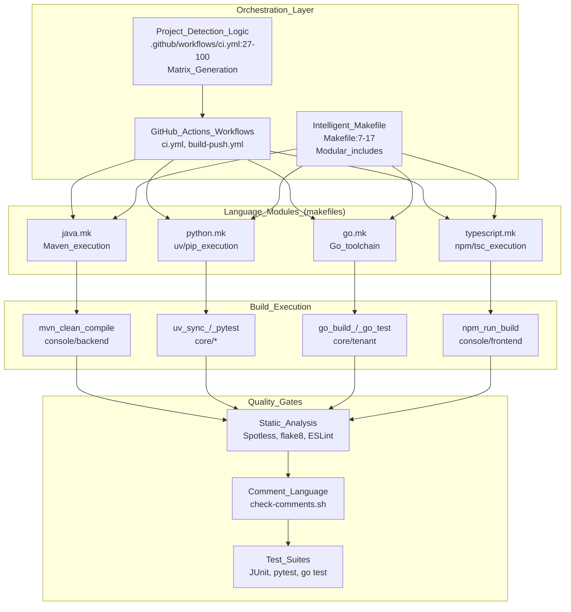
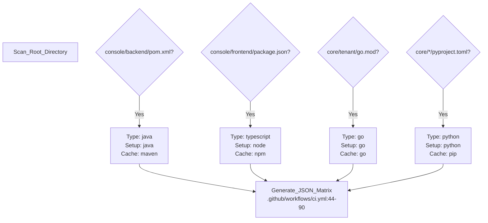
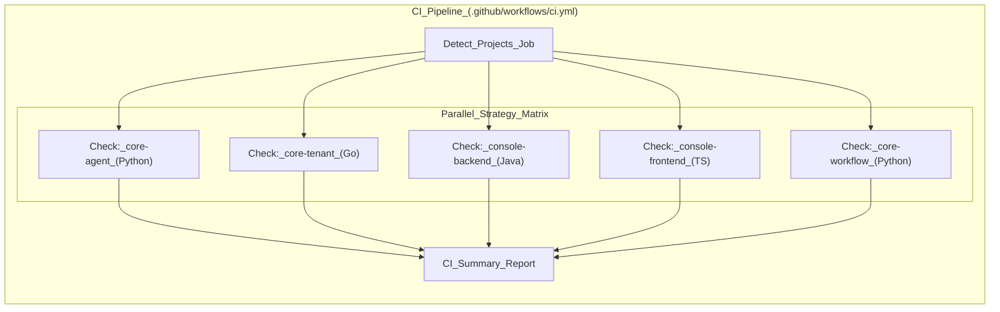

<!-- source: DeepWiki mcp.deepwiki.com · repo iflytek/astron-agent · page 12.2 Multi-Language Build System · fetched 2026-10-27 -->

# Multi-Language Build System

Relevant source files

The following files were used as context for generating this wiki page:

- [.github/ISSUE_TEMPLATE/bug_report.yml](.github/ISSUE_TEMPLATE/bug_report.yml)
- [.github/ISSUE_TEMPLATE/config.yml](.github/ISSUE_TEMPLATE/config.yml)
- [.github/ISSUE_TEMPLATE/feature_request.yml](.github/ISSUE_TEMPLATE/feature_request.yml)
- [.github/ISSUE_TEMPLATE/general_issue.yml](.github/ISSUE_TEMPLATE/general_issue.yml)
- [.github/workflows/build-push.yml](.github/workflows/build-push.yml)
- [.github/workflows/ci.yml](.github/workflows/ci.yml)
- [.github/workflows/release.yml](.github/workflows/release.yml)
- [.gitignore](.gitignore)
- [.pre-commit-config.yaml](.pre-commit-config.yaml)
- [Makefile](Makefile)
- [core/memory/database/Dockerfile](core/memory/database/Dockerfile)
- [core/workflow/extensions/middleware/utils.py](core/workflow/extensions/middleware/utils.py)
- [docker/astronAgent/config/database/config.env](docker/astronAgent/config/database/config.env)
- [docs/DEPLOYMENT_FAQ_zh.md](docs/DEPLOYMENT_FAQ_zh.md)
- [docs/imgs/WeCom_Group.png](docs/imgs/WeCom_Group.png)
- [makefiles/check-comments.sh](makefiles/check-comments.sh)
- [makefiles/comment-check.mk](makefiles/comment-check.mk)
- [makefiles/common.mk](makefiles/common.mk)
- [makefiles/core/workflows.mk](makefiles/core/workflows.mk)
- [makefiles/git.mk](makefiles/git.mk)
- [makefiles/go.mk](makefiles/go.mk)
- [makefiles/java.mk](makefiles/java.mk)
- [makefiles/python.mk](makefiles/python.mk)
- [makefiles/typescript.mk](makefiles/typescript.mk)

The Astron Agent platform implements a polyglot build system supporting four programming languages: Java (Maven), Python (uv/pip), Go (modules), and TypeScript (npm). This system provides automated project detection, language-specific compilation, quality checks, and multi-architecture Docker image builds across all core services and console components.

## Purpose and Scope

This document describes the build system architecture, automated project detection matrix, language-specific build configurations, and the integration between local development tools (Makefiles) and CI/CD pipelines (GitHub Actions). The system is designed for high parallelism and strict quality gates, ensuring consistent artifact generation across the microservices landscape.

---

## Build System Architecture

The build system operates through a tiered orchestration model. GitHub Actions handle the global CI/CD lifecycle, while a modular Makefile system provides a standardized interface for local development across all supported languages.

**Title: Build System Data Flow and Component Interaction**

**Sources:** [.github/workflows/ci.yml:27-100](), [Makefile:7-17](), [makefiles/java.mk:61-86](), [makefiles/python.mk:65-102](), [makefiles/go.mk:66-108](), [makefiles/typescript.mk:61-87]()

---

## Project Detection System

The system uses a dynamic detection matrix to identify active projects and their required environments. This prevents unnecessary job execution in CI and allows the `Makefile` to be "intelligent" about which commands to run based on the current directory context.

### Detection Matrix Logic

The detection logic scans for specific file markers to populate a JSON matrix used by GitHub Actions strategy blocks.

**Title: Project Detection Logic Flow**

**Project Detection Markers:**

| Language | Path Pattern | Primary Marker | Makefile Module |
| :--- | :--- | :--- | :--- |
| **Java** | `console/backend` | `pom.xml` | `makefiles/java.mk` |
| **TypeScript** | `console/frontend` | `package.json` | `makefiles/typescript.mk` |
| **Go** | `core/tenant` | `go.mod` | `makefiles/go.mk` |
| **Python** | `core/agent`, `core/workflow`, etc. | `pyproject.toml` | `makefiles/python.mk` |

**Sources:** [.github/workflows/ci.yml:38-100](), [Makefile:11-14](), [makefiles/java.mk:7-12](), [makefiles/python.mk:14-19](), [makefiles/go.mk:15-20](), [makefiles/typescript.mk:12-17]()

---

## Language-Specific Build Processes

### Python: `uv` and `pip` Integration
The Python build system prioritizes `uv` for high-performance dependency management but maintains backward compatibility with `pip`.

*   **Tools:** `black`, `isort`, `flake8`, `mypy`, `pylint`, `pytest`. [[makefiles/python.mk:6-11]()]
*   **Execution:** The `build-python` target checks for `uv.lock` before falling back to `requirements.txt`. [[makefiles/python.mk:132-158]()]
*   **Quality Gate:** `check-python` executes a 5-step pipeline: style check, import order, formatting, type checking, and code analysis. [[makefiles/python.mk:65-102]()]
*   **Test Execution:** Tests are run via `pytest` in the `tests/` directory of each service. [[makefiles/python.mk:104-130]()]

### Java: Maven and Spring Boot
The Java build process is centered around the `console-backend` project.

*   **Tools:** `Spotless` (formatting), `Checkstyle` (style), `SpotBugs` (bugs), `PMD` (quality). [[makefiles/java.mk:38-48]()]
*   **Command:** `mvn clean package -DskipTests` is used for artifact generation. [[makefiles/java.mk:105-121]()]
*   **Formatting:** `mvn spotless:apply` is integrated into the `fmt-java` target. [[makefiles/java.mk:123-140]()]

### Go: Toolchain and Linting
Go builds are primarily used for the `core-tenant` service.

*   **Tools:** `goimports`, `gofumpt`, `golines`, `gocyclo`, `staticcheck`, `golangci-lint`. [[makefiles/go.mk:6-11]()]
*   **Complexity:** `gocyclo` enforces a cyclomatic complexity limit of 10. [[makefiles/go.mk:87-88]()]
*   **Build:** Output is directed to a `bin/` directory within the project path. [[makefiles/go.mk:127-145]()]

### TypeScript: Node and Vite
Frontend builds use the standard npm ecosystem.

*   **Tools:** `prettier`, `eslint`, `tsc`. [[makefiles/typescript.mk:6-9]()]
*   **Process:** `npm ci --prefer-offline` is used for reproducible dependency installation. [[makefiles/typescript.mk:115-141]()]
*   **Formatting Check:** Uses `npx prettier --list-different` to detect unformatted files without modifying them. [[makefiles/typescript.mk:70-75]()]

---

## Parallel Job Execution

The CI pipeline leverages the detected project matrix to execute jobs in parallel across different runner instances.

**Title: Parallel CI Execution Matrix**

**Matrix Configuration:**
The `check` job uses `strategy.matrix: ${{ fromJson(needs.detect-projects.outputs.matrix) }}` and `fail-fast: false` to ensure that a failure in one service (e.g., a Python lint error) does not stop the testing of other services (e.g., Go unit tests). [[.github/workflows/ci.yml:104-112]()]

**Docker Image Builds:**
Docker images are built in parallel using the `build-push.yml` workflow. It supports multi-architecture builds (`linux/amd64`, `linux/arm64`) using `docker/setup-buildx-action`. [[.github/workflows/build-push.yml:74-99]()]

**Sources:** [.github/workflows/ci.yml:104-112](), [.github/workflows/ci.yml:152-184](), [.github/workflows/build-push.yml:73-132]()

---

## Intelligent Makefile System

The project provides a "Tier 1" command set through a root `Makefile` that intelligently delegates to language-specific modules based on the `ACTIVE_PROJECTS` variable.

| Command | Implementation | Description |
| :--- | :--- | :--- |
| `make setup` | `smart_setup` | Installs tools for all detected languages and configures Git hooks. |
| `make check` | `smart_check` | Runs quality checks for all active projects sequentially. |
| `make test` | `smart_test` | Executes test suites for all detected projects. |
| `make build` | `smart_build` | Compiles/packages all active services. |
| `make ci` | `smart_ci` | Complete local pipeline: check -> test -> build. |

**Sources:** [Makefile:25-70](), [makefiles/common.mk:32-55]()

---

## Comment Language Enforcement

A unique component of the build system is the `check-comments.sh` script, which enforces English-only comments across all supported languages to maintain internationalization standards.

*   **Mechanism:** Uses Python-based regex extraction to isolate comments from code (ignoring strings/literals). [[makefiles/check-comments.sh:32-197]()]
*   **Detection:** Checks for Unicode ranges `[\u4e00-\u9fff]` to identify Chinese characters in extracted comments. [[makefiles/check-comments.sh:199-216]()]
*   **Integration:** Integrated into the `smart_check` workflow via the `check-comments` target. [[makefiles/comment-check.mk:12-34]()]

**Sources:** [makefiles/check-comments.sh:1-216](), [makefiles/comment-check.mk:1-159]()

---

