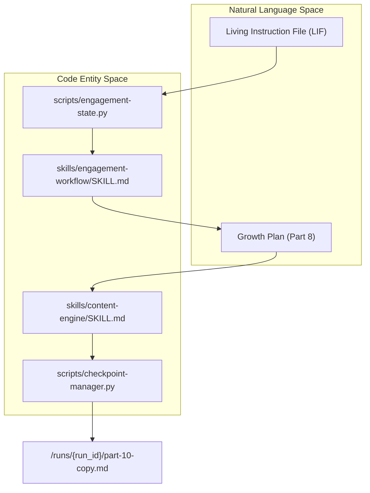
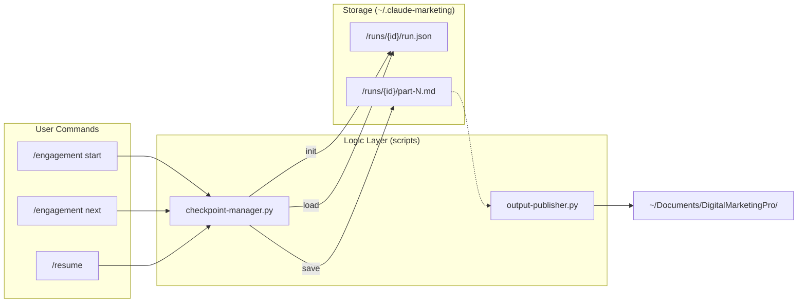

<!-- source: DeepWiki mcp.deepwiki.com · repo indranilbanerjee/digital-marketing-pro · page 3.3 Execution, Growth Plan & Continuous Improvement (Parts 7–12) · fetched 2026-10-27 -->

# Execution, Growth Plan & Continuous Improvement (Parts 7–12)

Relevant source files

The following files were used as context for generating this wiki page:

- [commands/engagement.md](commands/engagement.md)
- [commands/output-folder.md](commands/output-folder.md)
- [commands/resume.md](commands/resume.md)
- [scripts/checkpoint-manager.py](scripts/checkpoint-manager.py)
- [skills/analytics-insights/clv-analysis.md](skills/analytics-insights/clv-analysis.md)
- [skills/analytics-insights/dashboard-design.md](skills/analytics-insights/dashboard-design.md)
- [skills/audience-intelligence/customer-research-methods.md](skills/audience-intelligence/customer-research-methods.md)
- [skills/campaign-orchestrator/sales-enablement.md](skills/campaign-orchestrator/sales-enablement.md)
- [skills/client-validation-document/SKILL.md](skills/client-validation-document/SKILL.md)
- [skills/content-engine/SKILL.md](skills/content-engine/SKILL.md)
- [skills/content-engine/case-studies.md](skills/content-engine/case-studies.md)
- [skills/continuous-improvement-loop/SKILL.md](skills/continuous-improvement-loop/SKILL.md)
- [skills/engagement-workflow/SKILL.md](skills/engagement-workflow/SKILL.md)
- [skills/four-core-documents/SKILL.md](skills/four-core-documents/SKILL.md)
- [skills/growth-plan/SKILL.md](skills/growth-plan/SKILL.md)
- [skills/seo-plan/SKILL.md](skills/seo-plan/SKILL.md)

This page details the latter half of the 12-Part Engagement Methodology, focusing on the transition from strategy to execution, the generation of flagship deliverables, and the perpetual improvement loop. It explains how the system manages state during long-running workflows and the technical implementation of the checkpointing protocol.

## Execution Fan-out & Preparation (Part 7)

Part 7 serves as the bridge between the validated strategy (Part 6) and active market execution. It involves the production of "Preparation Documents" that define the operational infrastructure.

### Key Deliverables
*   **Campaign Architecture:** Naming conventions and structural hierarchy for ad accounts and content repositories [skills/engagement-workflow/SKILL.md:68-70]().
*   **KPI Tree:** A hierarchical map of metrics from primary business goals down to channel-specific leading indicators [skills/growth-plan/SKILL.md:48-48]().
*   **Content Pillars & Asset Inventory:** Mapping brand messaging to specific content formats and auditing existing materials [skills/growth-plan/SKILL.md:34-34]().

### Technical Implementation: State Management
The system uses `engagement-state.py` to maintain the "Living Project Instruction File" (LIF), ensuring that Part 7 preparation is informed by the latest strategic facts [skills/engagement-workflow/SKILL.md:37-41]().

**Sources:** [skills/engagement-workflow/SKILL.md:68-70](), [skills/growth-plan/SKILL.md:34-48](), [commands/engagement.md:51-53]()

---

## Growth Plan & Yearly Planner (Part 8)

Part 8 produces the flagship client-facing deliverable: the **Growth Plan**. This is a synthesis of all previous research and strategy into a single narrative [skills/growth-plan/SKILL.md:17-19]().

### Growth Plan Structure (11 Sections)
The `growth-plan` skill [skills/growth-plan/SKILL.md:1-15]() generates a 20–30 page document based on the following schema:

| # | Section | Source Data |
|---|---------|-------------|
| 1 | Executive Summary | Synthesis of all parts |
| 2 | Business Context | Core Doc 3.1 + Market Research |
| 3 | Target Audience | Core Doc 3.2 (Actionable Personas) |
| 4 | Strategic Positioning | Core Doc 3.3 (Positioning Statement) |
| 5 | Channel Strategy | Core Doc 3.4 + Part 9 Channel Docs |
| 6 | Budget & Media Plan | DMFlow Step 5 & 9 |
| 7 | KPI Framework | Part 7 KPI Tree |
| 8 | Implementation Timeline | 30/60/90 Framework |
| 9 | Team & Resource Plan | Engagement Context |
| 10| Risk & Contingency | Core Doc 3.1 Step 16 |
| 11| Expected Outcomes | Three-Scenario Forecasting |

### Operational Companion: The Yearly Planner
While the Growth Plan is strategic, the **Yearly Planner** provides the month-by-month operational calendar for execution [commands/engagement.md:80-83]().

**Sources:** [skills/growth-plan/SKILL.md:17-54](), [commands/engagement.md:80-83]()

---

## Channel Strategies & Campaign Orchestration (Parts 9–11)

These parts handle the high-volume generation of execution artifacts.

*   **Part 9 (Channel Fan-out):** Produces up to 17 specific channel strategy documents (e.g., SEO Plan, Paid Ads Strategy) [scripts/checkpoint-manager.py:72-72]().
*   **Part 10 (Execution Artifacts):** Generates ad copy, social posts, headlines, and CTAs using the `content-engine` [skills/content-engine/SKILL.md:1-26]().
*   **Part 11 (AI Creative):** Focuses on AI-native asset generation, including image/video prompts and C2PA provenance embedding [scripts/checkpoint-manager.py:74-74]().

### Diagram: Execution Data Flow
This diagram illustrates how strategic "Stone Facts" flow through the orchestrator into specific execution scripts.

**Sources:** [skills/content-engine/SKILL.md:1-26](), [scripts/checkpoint-manager.py:72-74](), [skills/engagement-workflow/SKILL.md:37-41]()

---

## Continuous Improvement Loop (Part 12)

Part 12 is a perpetual feedback loop that aggregates four signal sources to prevent strategy stagnation [skills/continuous-improvement-loop/SKILL.md:17-19]().

### The 4 Signal Sources
1.  **Quarterly Business Reviews (QBR):** KPI performance vs. targets [skills/continuous-improvement-loop/SKILL.md:41-47]().
2.  **Customer Feedback Themes:** Aggregated sentiment from support tickets and sales calls [skills/continuous-improvement-loop/SKILL.md:49-58]().
3.  **Competitive Intelligence:** Shifts in competitor pricing or positioning [skills/continuous-improvement-loop/SKILL.md:60-68]().
4.  **Team-Discovered Patterns:** Tactical insights from execution teams [skills/continuous-improvement-loop/SKILL.md:70-77]().

### Update-Back Rule
If Part 12 signals indicate a fundamental shift, the system triggers an `update-back` command to version-bump the Four Core Documents [commands/engagement.md:51-58]().

**Sources:** [skills/continuous-improvement-loop/SKILL.md:17-77](), [commands/engagement.md:51-58]()

---

## Checkpoint Management & Resumption

Because the 12-Part workflow produces 50-60 files and can span multiple sessions, the system implements a deterministic checkpointing protocol via `scripts/checkpoint-manager.py` [scripts/checkpoint-manager.py:1-46]().

### Checkpoint Protocol
1.  **Init:** Start a run and generate a unique `run_id` [scripts/checkpoint-manager.py:143-165]().
2.  **Save:** After each part, the orchestrator writes the deliverable to the `runs/` directory [skills/engagement-workflow/SKILL.md:62-70]().
3.  **Check:** A quality gate (`/digital-marketing-pro:check`) must pass before Part 5 and Part 8 can be checkpointed [skills/engagement-workflow/SKILL.md:72-79]().
4.  **Finalize:** Once Part 12 is reached, the run is finalized and published [skills/engagement-workflow/SKILL.md:81-89]().

### The `/resume` Command
If a session is interrupted, the user runs `/digital-marketing-pro:resume`. The system:
1.  Identifies the latest `in_progress` run [commands/resume.md:23-25]().
2.  Reloads all saved artifacts into the AI context [commands/resume.md:45-53]().
3.  Positions the agent at the `next_step` identified in `run.json` [commands/resume.md:57-59]().

### Diagram: Checkpoint Lifecycle
Linking user commands to the underlying script execution and filesystem state.

**Sources:** [scripts/checkpoint-manager.py:1-186](), [commands/resume.md:1-95](), [skills/engagement-workflow/SKILL.md:45-93](), [commands/output-folder.md:15-23]()

---

