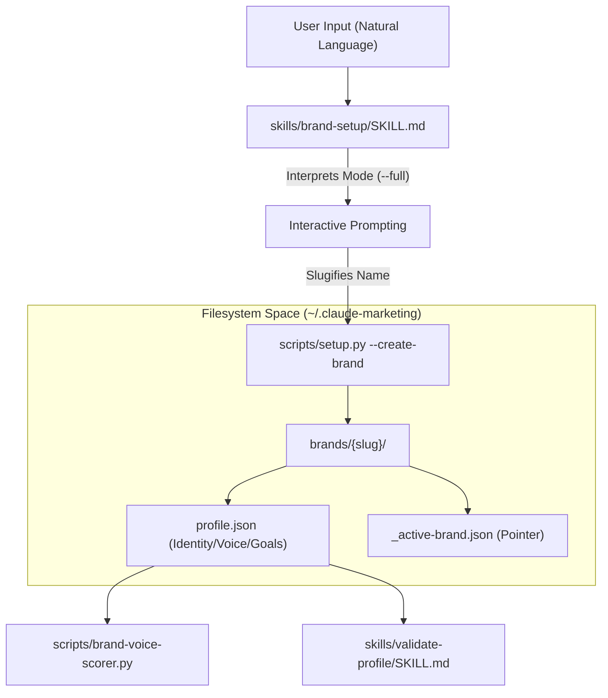
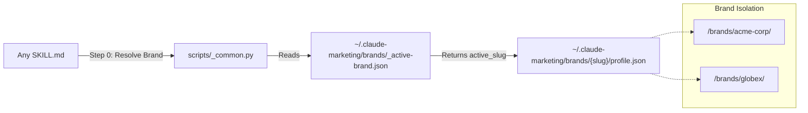

<!-- source: DeepWiki mcp.deepwiki.com · repo indranilbanerjee/digital-marketing-pro · page 4.1 Brand Profile Schema & Setup · fetched 2026-10-27 -->

# Brand Profile Schema & Setup

Relevant source files

The following files were used as context for generating this wiki page:

- [commands/brand-setup.md](commands/brand-setup.md)
- [commands/email-sequence.md](commands/email-sequence.md)
- [commands/performance-report.md](commands/performance-report.md)
- [scripts/setup.py](scripts/setup.py)
- [skills/attribution-model/SKILL.md](skills/attribution-model/SKILL.md)
- [skills/brand-setup/SKILL.md](skills/brand-setup/SKILL.md)
- [skills/client-onboarding/SKILL.md](skills/client-onboarding/SKILL.md)
- [skills/content-engine/video-scripting.md](skills/content-engine/video-scripting.md)
- [skills/launch-campaign/SKILL.md](skills/launch-campaign/SKILL.md)
- [skills/validate-profile/SKILL.md](skills/validate-profile/SKILL.md)

The **Brand Profile** is the central intelligence core of Digital Marketing Pro. It serves as the "single source of truth" for every AI-driven marketing task, ensuring that content generation, campaign planning, and performance audits are grounded in specific brand identity, voice, and compliance requirements.

## Overview

Brand management is handled via the `brand-setup` skill and the `scripts/setup.py` utility. Profiles are stored as structured JSON files within the `~/.claude-marketing/` filesystem, allowing for complete isolation between client brands in agency workflows.

### Key Capabilities
*   **Contextual Continuity**: Automatically injects brand identity into all subsequent skills (SEO, Content, Ads).
*   **Voice Quantization**: Converts qualitative descriptors (e.g., "witty but professional") into quantitative floats (1-10) for consistent scoring.
*   **Compliance Mapping**: Links target markets to specific regulatory rules (e.g., GDPR, DPDPA) defined in the context engine.
*   **Multi-Brand Isolation**: Manages active brand state via a pointer file, preventing cross-contamination of data.

---

## The `profile.json` Schema

The `profile.json` file is the primary data entity. It is located at `~/.claude-marketing/brands/{slug}/profile.json`.

### Schema Structure

| Section | Key Fields | Purpose |
|:---|:---|:---|
| **Identity** | `brand_name`, `elevator_pitch`, `usp` | Core definition of the business. |
| **Business Model** | `type`, `revenue_model`, `sales_cycle_length` | Influences funnel strategy and attribution lookback windows. |
| **Brand Voice** | `formality`, `energy`, `humor`, `authority` | 1-10 floats used by `brand-voice-scorer.py`. |
| **Audience** | `primary_persona`, `buying_triggers` | Defines targeting and messaging hooks. |
| **Market/Compliance**| `target_markets`, `industry`, `regulated` | Triggers jurisdiction-specific guardrails. |
| **Competitors** | `name`, `url`, `strengths` | Used for competitive benchmarking and gap analysis. |

**Sources:** [scripts/setup.py:124-168](), [commands/brand-setup.md:51-77](), [skills/brand-setup/SKILL.md:41-96]()

---

## Brand Setup Workflow

The system provides two modes for creating a profile: **Quick** and **Full**.

### 1. Setup Modes
*   **Quick Setup (5 Questions)**: Captures the bare essentials (Name, Pitch, Audience, Voice words, Channel). The system then infers industry defaults and maps voice words to scales (e.g., "professional" maps to `formality: 8`).
*   **Full Setup (17 Questions)**: A comprehensive deep-dive covering mission values, revenue models, secondary personas, messaging pillars, and detailed competitor SWOT analysis.

### 2. Implementation Logic
The `brand-setup` skill coordinates the interaction, while `scripts/setup.py` handles the filesystem operations.

#### Natural Language to Code Entity Mapping
The following diagram illustrates how user inputs are transformed into persistent code entities.

**Diagram: Setup Data Flow**

**Sources:** [skills/brand-setup/SKILL.md:19-103](), [scripts/setup.py:74-96](), [commands/brand-setup.md:39-84]()

---

## Profile Validation & Health Checks

Once a profile is created, the `validate-profile` skill acts as a production gate. It ensures that the profile is not only complete but also technically viable (e.g., connectors are reachable).

### Validation Dimensions
The `validate-profile` skill checks several critical dimensions:
1.  **Blockers**: Missing `brand_name`, `industry`, or `target_jurisdictions`.
2.  **Voice Integrity**: Ensures `voice.formality`, `energy`, etc., are populated before content tasks.
3.  **Compliance Cross-Check**: Confirms that every `target_jurisdiction` in the profile has a corresponding entry in `skills/context-engine/compliance-rules.md`.
4.  **Connector Readiness**: Runs `scripts/connector-status.py --probe-only` to verify that environment variables or `.mcp.json` entries exist for all configured integrations (CRM, Analytics, etc.).

**Sources:** [skills/validate-profile/SKILL.md:32-47](), [skills/validate-profile/SKILL.md:72-88]()

---

## Multi-Brand Operations

For agency environments, the system supports switching between isolated brand contexts.

### State Management
*   **Active Brand**: Managed via `~/.claude-marketing/brands/_active-brand.json`. This file contains the `active_slug`.
*   **Switching**: The command `/digital-marketing-pro:switch-brand <slug>` updates this pointer.
*   **Isolation**: Every skill first calls `_common.brands_root()` to resolve the path for the currently active brand, ensuring no data leakage between clients.

**Diagram: Multi-Brand Resolution Logic**

**Sources:** [scripts/setup.py:23-27](), [scripts/setup.py:74-96](), [skills/validate-profile/SKILL.md:51-64](), [skills/brand-setup/SKILL.md:105-112]()

---

## Technical Setup & Dependencies

The `scripts/setup.py` script manages the environment initialization.

### Initialization Steps
1.  **Directory Creation**: Creates the `~/.claude-marketing/` root and subdirectories for `brands`, `templates`, `industry-data`, and `sops`.
2.  **Settings Init**: Generates a global `settings.json` with default scoring and compliance flags.
3.  **Dependency Modes**:
    *   `LITE_DEPS`: Installs `nltk` and `textstat` for basic voice analysis.
    *   `FULL_DEPS`: Adds `beautifulsoup4` (competitor scraping), `qrcode` (UTM generation), and provider SDKs (`openai`, `anthropic`).

**Sources:** [scripts/setup.py:29-71]()

---

