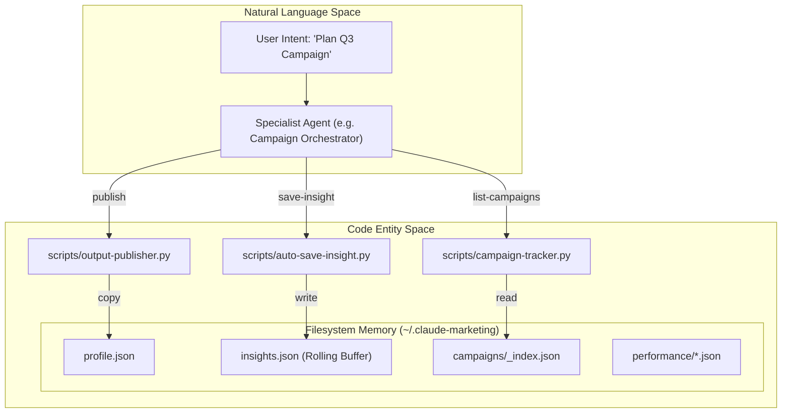
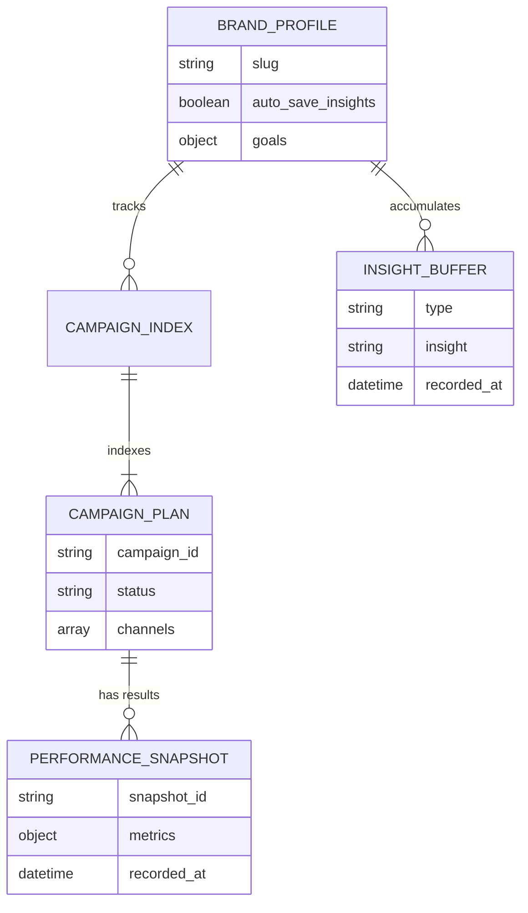

<!-- source: DeepWiki mcp.deepwiki.com · repo indranilbanerjee/digital-marketing-pro · page 4.3 Persistent Memory & Historical Data · fetched 2026-10-27 -->

# Persistent Memory & Historical Data

Relevant source files

The following files were used as context for generating this wiki page:

- [docs/competitor-intelligence.md](docs/competitor-intelligence.md)
- [docs/cross-channel-sync.md](docs/cross-channel-sync.md)
- [docs/data-and-insights.md](docs/data-and-insights.md)
- [docs/historical-data.md](docs/historical-data.md)
- [docs/strategy-and-kpis.md](docs/strategy-and-kpis.md)
- [scripts/auto-save-insight.py](scripts/auto-save-insight.py)
- [scripts/campaign-tracker.py](scripts/campaign-tracker.py)
- [scripts/guidelines-manager.py](scripts/guidelines-manager.py)
- [scripts/output-publisher.py](scripts/output-publisher.py)

Persistent memory in Digital Marketing Pro is the "compounding intelligence" layer that ensures the system learns from every session. Rather than starting from scratch, agents reference historical campaign performance, strategic insights, and previous brand interactions to refine future recommendations [docs/historical-data.md:3-5]().

## The Intelligence Loop

Data flows from external sources (via MCP) into session analysis, where it is distilled into actionable insights and saved to the local filesystem. These files serve as the system's long-term memory [docs/data-and-insights.md:24-45]().

### Data Flow Architecture
This diagram illustrates how natural language intents translate into persistent data entities managed by the Python layer.

**Sources:** [docs/data-and-insights.md:28-45](), [scripts/campaign-tracker.py:12-20](), [scripts/auto-save-insight.py:25-33]()

---

## Core Persistence Components

### 1. Campaign Tracking (`campaign-tracker.py`)
This script is the primary interface for managing historical campaign data. It handles three main data types:
*   **Campaign Plans:** Saved as individual JSON files in `brands/{slug}/campaigns/` with a fast-lookup `_index.json` [scripts/campaign-tracker.py:42-84]().
*   **Performance Snapshots:** Timestamped records (e.g., `bf-2025-20251201-143022.json`) that allow for chronological trend analysis [docs/historical-data.md:55-57]().
*   **Insights Buffer:** A rolling 200-entry array in `insights.json` containing session learnings and performance discoveries [scripts/campaign-tracker.py:152-179]().

### 2. Insight Accumulation (`auto-save-insight.py`)
The system captures learnings (e.g., "Instagram Stories outperformed static carousels 2:1") via an opt-in mechanism [docs/historical-data.md:71-76]().
*   **Opt-in Logic:** The script checks the `auto_save_insights` boolean in `profile.json`. If `false` or missing, it no-ops to maintain multi-plugin hygiene [scripts/auto-save-insight.py:118-132]().
*   **Manual Override:** The `--force` flag allows users to explicitly save an insight regardless of the global brand setting [scripts/auto-save-insight.py:34-37]().

### 3. Output Mirroring (`output-publisher.py`)
To prevent the "hidden data" problem where files in `~/.claude-marketing/` feel unsaved, this script mirrors outputs to a user-visible directory [scripts/output-publisher.py:19-22]().

| Location Type | Path | Purpose |
| :--- | :--- | :--- |
| **Internal Tracking** | `~/.claude-marketing/{brand}/output/` | System-of-record for status and audit history [scripts/output-publisher.py:10-12]() |
| **User-Visible** | `~/Documents/DigitalMarketingPro/{brand}/` | Visible in OS file managers (Finder/Explorer) [scripts/output-publisher.py:13-17]() |

**Sources:** [scripts/campaign-tracker.py:5-20](), [scripts/auto-save-insight.py:5-20](), [scripts/output-publisher.py:3-17]()

---

## Data Lifecycle & Cross-Session Learning

The "Intelligence Layer" follows a deterministic five-step framework to apply history to new tasks:
1.  **Load Brand Context:** Pull voice, goals, and industry from `profile.json` [docs/historical-data.md:126]().
2.  **Check History:** Run `campaign-tracker.py --action list-campaigns` [docs/historical-data.md:84]().
3.  **Identify Patterns:** Compare performance snapshots to find what worked [docs/historical-data.md:55-57]().
4.  **Extract Insights:** Filter `insights.json` for relevant tags (e.g., `session_learning`) [docs/historical-data.md:63-69]().
5.  **Synthesize:** Generate new plans that incorporate past learnings [docs/historical-data.md:109-118]().

### Entity-Relationship Diagram (Memory Layer)

**Sources:** [docs/data-and-insights.md:47-55](), [docs/historical-data.md:26-78](), [scripts/campaign-tracker.py:166-173]()

---

## Syncing & Management Commands

Users can manage persistent memory through natural language commands that map to script executions:

*   **`/sync-memory`**: Manually flushes session learnings to `insights.json` via `campaign-tracker.py --action save-insight` [docs/data-and-insights.md:196-200]().
*   **`/status`**: Queries `output-publisher.py where` to locate published files and `campaign-tracker.py list-campaigns` to show project progress [scripts/output-publisher.py:171-185]().
*   **`guidelines-manager.py`**: Manages the `guidelines/` and `templates/` subdirectories, providing structured storage for brand-specific restrictions and SOPs [scripts/guidelines-manager.py:7-15]().

**Sources:** [docs/data-and-insights.md:192-200](), [scripts/output-publisher.py:171-185](), [scripts/guidelines-manager.py:1-27]()

---

