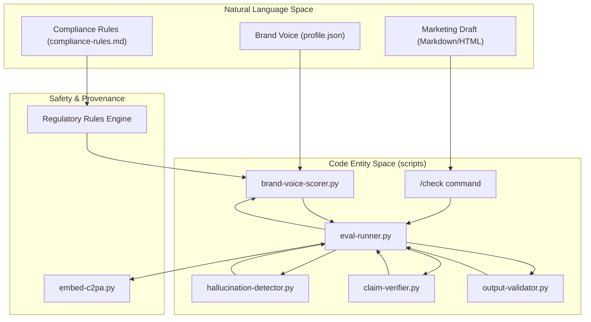
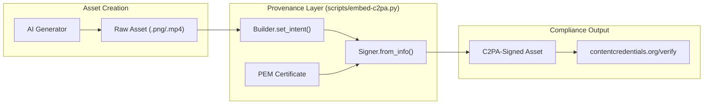

<!-- source: DeepWiki mcp.deepwiki.com · repo indranilbanerjee/digital-marketing-pro · page 7 Quality, Compliance & Safety · fetched 2026-10-27 -->

# Quality, Compliance & Safety

Relevant source files

The following files were used as context for generating this wiki page:

- [.mcp.json.connectors-reference](.mcp.json.connectors-reference)
- [CONNECTORS.md](CONNECTORS.md)
- [SUBMISSION.md](SUBMISSION.md)
- [agents/execution-coordinator.md](agents/execution-coordinator.md)
- [commands/competitor-analysis.md](commands/competitor-analysis.md)
- [commands/seo-audit.md](commands/seo-audit.md)
- [hooks/hooks-reference.example.json](hooks/hooks-reference.example.json)
- [hooks/hooks.json](hooks/hooks.json)
- [scripts/embed-c2pa.py](scripts/embed-c2pa.py)
- [scripts/hallucination-detector.py](scripts/hallucination-detector.py)
- [skills/c2pa-metadata/SKILL.md](skills/c2pa-metadata/SKILL.md)
- [skills/campaign-audit/SKILL.md](skills/campaign-audit/SKILL.md)
- [skills/check/SKILL.md](skills/check/SKILL.md)
- [skills/eval-config/SKILL.md](skills/eval-config/SKILL.md)
- [skills/eval-suite/SKILL.md](skills/eval-suite/SKILL.md)
- [skills/status/SKILL.md](skills/status/SKILL.md)

Digital Marketing Pro employs a multi-layer system to ensure that AI-generated marketing content is accurate, brand-aligned, and legally compliant. This system transitions from the "Natural Language Space" of brand guidelines and regulatory rules into the "Code Entity Space" of deterministic Python scoring scripts and cryptographic content provenance.

The system is anchored by the `/digital-marketing-pro:check` quality gate, which orchestrates hallucination detection, brand voice scoring, and compliance verification before any content is published.

## Quality Architecture

The quality system is designed to be intentional and opt-in. While earlier versions (v2.x) used global `PreToolUse` hooks to intercept every write operation, v3.1+ moved this logic into an explicit, user-invocable gate [hooks/hooks.json:1-4](). This ensures high-performance execution without interfering with non-marketing tasks.

### System Integration Diagram
The following diagram illustrates how the natural language requirements (Brand Voice, Compliance Rules) are mapped to specific code entities within the evaluation pipeline.

**Quality & Compliance Flow**

**Sources:** [skills/check/SKILL.md:33-45](), [scripts/embed-c2pa.py:1-10](), [hooks/hooks-reference.example.json:15-25]()

---

## Evaluation & Quality Gate System (#7.1)

The evaluation system provides a composite quality score for every piece of marketing collateral. It uses a "Sentence Windowing" approach to detect hallucinations and a "Float-based Voice Dimension" model to ensure brand consistency.

*   **Hallucination Detection**: `hallucination-detector.py` scans for unattributed statistics, placeholder URLs (e.g., `example.com`), and unsubstantiated superlatives like "best-in-class" [skills/check/SKILL.md:37-40]().
*   **Brand Voice Scoring**: `brand-voice-scorer.py` compares the draft against the 0.0–1.0 floats defined in the brand's `profile.json` (Formality, Energy, Humor, Authority) [skills/check/SKILL.md:41-41]().
*   **Approval Workflow**: The `execution-coordinator` agent manages the final "PASS/WARN/BLOCKED" decision, preventing the publication of content that fails critical safety checks [agents/execution-coordinator.md]().

For details on scoring algorithms and severity levels, see **[Evaluation & Quality Gate System](#7.1)**.

---

## C2PA Content Provenance & EU AI Act (#7.2)

To meet emerging global regulations, the system includes a dedicated provenance layer. This is critical for brands operating in the EU or New York, where AI disclosure is a legal requirement.

*   **EU AI Act Article 50**: Requires machine-readable marking of AI-generated content starting August 2, 2026 [skills/c2pa-metadata/SKILL.md:12-14]().
*   **C2PA Implementation**: The `embed-c2pa.py` script uses the `c2pa-python` library to inject a `c2pa.ai-disclosure` assertion into images, videos, and PDFs [scripts/embed-c2pa.py:25-27]().
*   **Cryptographic Signing**: Supports self-signed dev certificates for testing and production-grade PEM keys for official brand assets [skills/c2pa-metadata/SKILL.md:100-109]().

**Provenance Logic Diagram**

**Sources:** [scripts/embed-c2pa.py:42-44](), [skills/c2pa-metadata/SKILL.md:19-27]()

For details on C2PA manifest structures and certificate management, see **[C2PA Content Provenance & EU AI Act Compliance](#7.2)**.

---

## Regulatory Compliance Rules (#7.3)

The system maintains a reference database of 16 privacy jurisdictions and industry-specific guardrails.

*   **Jurisdictional Awareness**: The system checks content against specific laws based on the `jurisdiction` set in `profile.json` (e.g., GDPR, CCPA, DPDPA) [SUBMISSION.md:24-26]().
*   **Industry Guardrails**: Specialized rules for regulated sectors such as BFSI (finance), Healthcare (HIPAA), and Pharma [SUBMISSION.md:36-37]().
*   **Brand Guardian**: The `brand-guardian` agent is responsible for enforcing these rules during the content generation phase, acting as a pre-filter before the `/check` gate [agents/brand-guardian.md]().

For the full list of supported jurisdictions and rule definitions, see **[Regulatory Compliance Rules](#7.3)**.

---

## Safety & Execution Gates

Digital Marketing Pro implements safety gates at the tool execution level to prevent unauthorized external actions.

| Gate Type | Entity | Purpose |
| :--- | :--- | :--- |
| **Write Gate** | `connector_executor.py` | Requires explicit `--confirm` flag or user prompt for any MCP tool that modifies external data (e.g., posting to LinkedIn) [CONNECTORS.md:69-72](). |
| **Audit Trail** | `executions/` directory | Logs every MCP tool call, including parameters and response, for post-action review [skills/campaign-audit/SKILL.md:15-17](). |
| **Dependency Gate** | `setup.py` | Verifies Python environment safety and package integrity before running scoring scripts [skills/status/SKILL.md:37-37](). |

**Sources:** [CONNECTORS.md:63-73](), [skills/status/SKILL.md:19-19](), [hooks/hooks-reference.example.json:27-32]()

---

