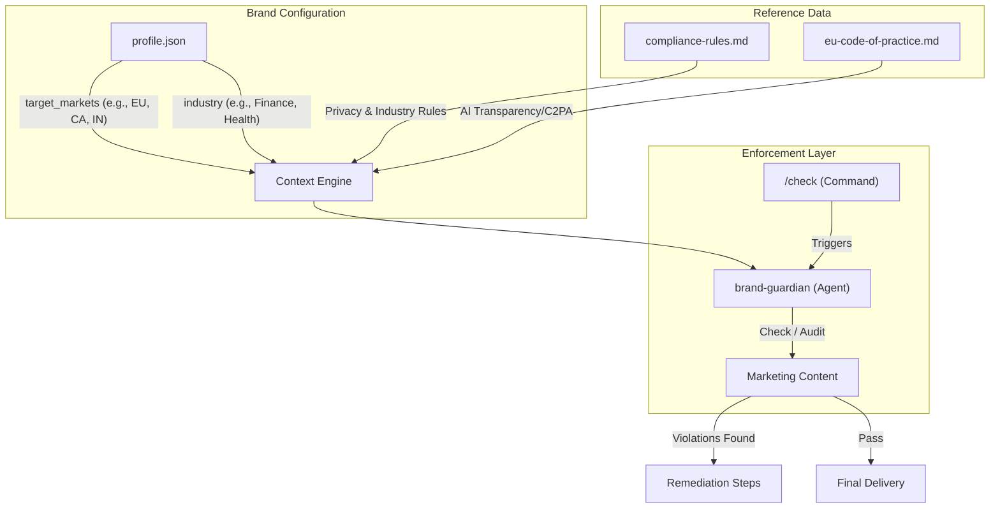
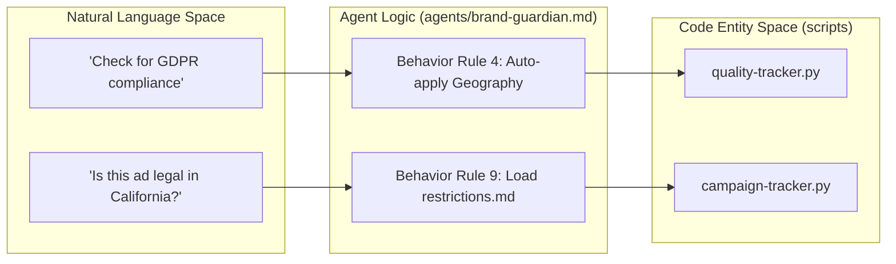

<!-- source: DeepWiki mcp.deepwiki.com · repo indranilbanerjee/digital-marketing-pro · page 7.3 Regulatory Compliance Rules · fetched 2026-10-27 -->

# Regulatory Compliance Rules

Relevant source files

The following files were used as context for generating this wiki page:

- [agents/brand-guardian.md](agents/brand-guardian.md)
- [agents/competitive-intel.md](agents/competitive-intel.md)
- [agents/cro-specialist.md](agents/cro-specialist.md)
- [agents/growth-engineer.md](agents/growth-engineer.md)
- [agents/influencer-manager.md](agents/influencer-manager.md)
- [scripts/geo-tracker.py](scripts/geo-tracker.py)
- [skills/aeo-audit/SKILL.md](skills/aeo-audit/SKILL.md)
- [skills/aeo-geo/SKILL.md](skills/aeo-geo/SKILL.md)
- [skills/analytics-insights/SKILL.md](skills/analytics-insights/SKILL.md)
- [skills/context-engine/compliance-rules.md](skills/context-engine/compliance-rules.md)
- [skills/context-engine/eu-code-of-practice.md](skills/context-engine/eu-code-of-practice.md)
- [skills/geo-monitor/SKILL.md](skills/geo-monitor/SKILL.md)
- [skills/gsc-ai-performance/SKILL.md](skills/gsc-ai-performance/SKILL.md)
- [skills/paid-advertising/SKILL.md](skills/paid-advertising/SKILL.md)
- [skills/paid-advertising/google-ads.md](skills/paid-advertising/google-ads.md)

The **Regulatory Compliance Rules** system provides a deterministic framework for enforcing legal and industry-specific constraints across all marketing outputs. Unlike general-purpose LLMs that may hallucinate legal requirements, Digital Marketing Pro utilizes a canonical reference dataset and a dedicated specialist agent, the `brand-guardian`, to ensure every asset complies with the privacy laws of 16 jurisdictions and specific industry regulations.

## 1. Compliance Architecture

Compliance enforcement is a multi-stage process that bridges brand-specific configuration with global regulatory data.

### 1.1 Implementation Data Flow
The system resolves compliance requirements by intersecting the brand's `profile.json` with the `compliance-rules.md` reference file.

**Sources:** [skills/context-engine/compliance-rules.md:1-5](), [agents/brand-guardian.md:1-10](), [skills/aeo-audit/SKILL.md:33-33]()

### 1.2 Key Components
*   **Reference Data (`compliance-rules.md`)**: The single source of truth for 16 privacy jurisdictions (GDPR, CCPA, DPDPA, LGPD, etc.) and vertical-specific rules (HIPAA, FTC, Alcohol, Cannabis) [skills/context-engine/compliance-rules.md:7-47]().
*   **Enforcement Agent (`brand-guardian.md`)**: A specialist persona that acts as the final quality gate. It is programmed to "never approve content with unresolved critical issues" [agents/brand-guardian.md:10-10]().
*   **Provenance Layer**: Handles EU AI Act Article 50 requirements via C2PA metadata embedding [skills/context-engine/compliance-rules.md:22-33]().

## 2. Jurisdiction & Industry Enforcement

Compliance is automatically applied based on the `target_markets` and `industry` fields defined during brand setup.

### 2.1 Geographic Privacy Laws
The system supports 16 jurisdictions. The `brand-guardian` automatically loads rules for the brand's target regions [agents/brand-guardian.md:28-28]().

| Jurisdiction | Key Law | Core Requirement |
| :--- | :--- | :--- |
| **EU/EEA** | GDPR | Opt-in consent, Right to Erasure, Data Processing Agreements [skills/context-engine/compliance-rules.md:9-20]() |
| **California** | CCPA/CPRA | "Do Not Sell" links, opt-out rights, specific privacy notices [agents/brand-guardian.md:15-15]() |
| **India** | DPDPA | Consent managers, legitimate uses, significant penalties [skills/context-engine/compliance-rules.md:2-3]() |
| **USA** | CAN-SPAM / FTC | Unsubscribe links, physical addresses, disclosure of material connections [agents/brand-guardian.md:15-15]() |

### 2.2 Industry-Specific Guardrails
The `brand-guardian` applies vertical-specific logic based on the `industry` field in `profile.json`:
*   **Finance**: Enforces fair lending disclosures and prohibits unsubstantiated financial projections [agents/brand-guardian.md:15-15]().
*   **Healthcare**: Checks for HIPAA compliance and flags off-label claims [agents/brand-guardian.md:15-15]().
*   **Alcohol/Cannabis**: Enforces age-gating requirements and state-by-state advertising restrictions [agents/brand-guardian.md:15-15]().

**Sources:** [skills/context-engine/compliance-rules.md:7-47](), [agents/brand-guardian.md:14-18]()

## 3. Generative AI & Transparency (Article 50)

As of August 2026, marketing content distributed in the EU must comply with **AI Act Article 50**. The system automates this via two primary mechanisms.

### 3.1 Machine-Readable Provenance (C2PA)
The system uses the `c2pa.ai-disclosure` assertion (Spec 2.4) to embed metadata into generated assets.
*   **Trigger**: The `/check` command or `brand-guardian` identifies an asset destined for an EU market [skills/context-engine/compliance-rules.md:33-33]().
*   **Action**: Invokes the C2PA metadata skill to embed a manifest in images, videos, or PDFs [skills/context-engine/compliance-rules.md:33-33]().

### 3.2 Deepfake & Text Disclosure
The `brand-guardian` enforces visible disclosure for:
1.  **Deepfakes**: Any synthetic media resembling real persons/places requires a visible label or audio cue [skills/context-engine/compliance-rules.md:30-30]().
2.  **Public Interest Text**: AI-generated text on health or finance requires an "AI-assisted" byline unless a human editor assumes full responsibility [skills/context-engine/compliance-rules.md:30-30](), [skills/context-engine/eu-code-of-practice.md:50-54]().

**Sources:** [skills/context-engine/compliance-rules.md:22-47](), [skills/context-engine/eu-code-of-practice.md:1-26]()

## 4. Technical Implementation: brand-guardian

The `brand-guardian` agent utilizes specific tools and scripts to perform its audits.

### 4.1 System-Code Mapping

**Sources:** [agents/brand-guardian.md:28-35](), [scripts/geo-tracker.py:1-27]()

### 4.2 Violation Severity Scoring
The agent categorizes all findings into a structured output format:

*   **CRITICAL**: Legal risks, regulatory violations, or accessibility failures that block access. **Blocks publication.** [agents/brand-guardian.md:24-24]().
*   **WARNING**: Best practice violations or minor accessibility gaps. **Requires manual override.** [agents/brand-guardian.md:25-25]().
*   **INFO**: Style suggestions or minor voice optimizations [agents/brand-guardian.md:26-26]().

### 4.3 Script Integration
The `brand-guardian` does not re-run evaluations but consumes logged data:
*   **`quality-tracker.py`**: Reads previously logged hallucination and quality scores [agents/brand-guardian.md:44-46]().
*   **`campaign-tracker.py`**: Queries past violations to identify recurring patterns [agents/brand-guardian.md:35-35]().

**Sources:** [agents/brand-guardian.md:23-47]()

---

