# Page: Overview

# Overview

<details>
<summary>Relevant source files</summary>

The following files were used as context for generating this wiki page:

- [.claude-plugin/plugin.json](.claude-plugin/plugin.json)
- [.codex-plugin/plugin.json](.codex-plugin/plugin.json)
- [.cursor-plugin/plugin.json](.cursor-plugin/plugin.json)
- [CHANGELOG.md](CHANGELOG.md)
- [README.md](README.md)

</details>


Digital Marketing Pro is an open-source AI marketing plugin designed for agencies and in-house teams managing large portfolios of brands (50–200+). It provides a standardized, auditable framework for marketing strategy and execution, ensuring consistency across different brands and compliance with global regulations like the **EU AI Act Article 50** [README.md:1-7]().

The system is built on the **Agent Skills** open standard, allowing it to run natively across multiple AI agent harnesses including Claude Code, Cursor, GitHub Copilot CLI, and more [.claude-plugin/plugin.json:4]().

### System Architecture Overview

Digital Marketing Pro operates using a three-pillar structure: **Skills**, **Agents**, and **Scripts**. This design separates high-level AI reasoning from deterministic execution.

#### High-Level Entity Relationship
The following diagram illustrates how user intent flows through the system's core components.

**Logic Flow: Intent to Execution**
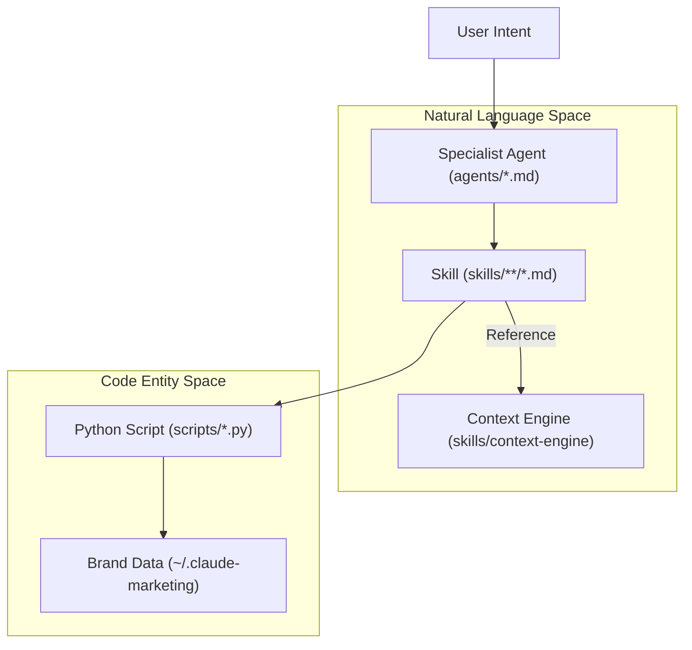
**Sources:** [README.md:51-53](), [CHANGELOG.md:13-15](), [.cursor-plugin/plugin.json:35-37]()

---

### Core Components

#### 1. The 12-Part Engagement Methodology
The centerpiece of the system is a 61-step strategy flow that produces the **Four Core Documents**: Business Analysis, Segmentation, Positioning, and DMFlow [README.md:5-7](). This methodology ensures that every brand engagement follows a rigorous, repeatable process.
*   For details, see [12-Part Engagement Methodology](#3).

#### 2. Specialist Agents & Skills
The system features **24 specialist agents** (e.g., `brand-guardian`, `seo-specialist`) and **158 skills** [README.md:51-52](). Agents use these skills to perform tasks ranging from keyword research to C2PA-compliant content generation.
*   For details, see [Specialist Agents](#2.2) and [Marketing Skills Reference](#6).

#### 3. Python Execution Layer
A library of **89 Python scripts** handles the "heavy lifting," such as data processing, API interactions via MCP connectors, and quality evaluations [CHANGELOG.md:13-18]().
*   For details, see [Python Scripts Layer](#2.3).

#### 4. Compliance & Safety
Digital Marketing Pro is "Article 50 ready," incorporating machine-readable AI disclosures and C2PA content provenance to meet EU AI Act requirements [CHANGELOG.md:15](). It also includes a `hallucination-detector.py` and `brand-voice-scorer.py` to maintain output quality [CHANGELOG.md:24]().
*   For details, see [Quality, Compliance & Safety](#7).

---

### Platform Support

The plugin registers itself via platform-specific manifests (e.g., `plugin.json`, `plugin.yaml`). It supports 8 native platforms and over 35 Agent Skills-compatible harnesses [README.md:16]().

| Platform | Manifest File |
| :--- | :--- |
| **Claude Code** | [.claude-plugin/plugin.json:1-75]() |
| **OpenAI Codex** | [.codex-plugin/plugin.json:1-47]() |
| **Cursor** | [.cursor-plugin/plugin.json:1-38]() |
| **Hermes / OpenClaw** | [plugin.yaml:1-50]() (referenced in [CHANGELOG.md:25]()) |

**Sources:** [README.md:59](), [CHANGELOG.md:25-27]()

---

### Data & State Management

The system maintains a persistent state for each brand, typically stored in the user's home directory.

**File System Mapping**
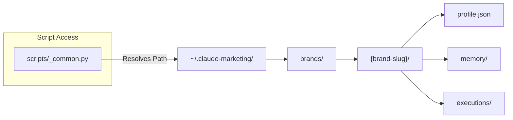
**Sources:** [CHANGELOG.md:13](), [README.md:38]()

---

### Wiki Organization

This wiki is organized to guide you from initial setup to advanced marketing automation:

*   **[Getting Started](#1.1)**: Installation and your first brand setup.
*   **[Plugin Manifests & Platform Support](#1.2)**: Deep dive into how the plugin integrates with different AI tools.
*   **[Core Architecture](#2)**: Technical breakdown of the WAT (Workflows, Agents, Tools) model.
*   **[12-Part Engagement Methodology](#3)**: The strategic heart of the system.
*   **[Brand & Data Management](#4)**: How multi-brand agency workflows function.
*   **[MCP Connectors & Execution Layer](#5)**: Connecting AI to real-world marketing tools (HubSpot, Google Ads, etc.).
*   **[Marketing Skills Reference](#6)**: A catalog of all 158 available skills.
*   **[Quality, Compliance & Safety](#7)**: Details on the evaluation engine and legal compliance.
*   **[Model Curator & AI Infrastructure](#8)**: How the system handles different LLM providers and model drift.
*   **[Testing & Release Management](#9)**: Information for contributors and developers.
*   **[Roadmap & Advanced Topics](#10)**: Future plans and complex configurations.
*   **[Glossary](#11)**: Key terms and code pointers.

---

# Page: Getting Started

# Getting Started

<details>
<summary>Relevant source files</summary>

The following files were used as context for generating this wiki page:

- [README.md](README.md)
- [TESTING-GUIDE.md](TESTING-GUIDE.md)
- [docs/architecture.md](docs/architecture.md)
- [docs/claude-interfaces.md](docs/claude-interfaces.md)
- [docs/engagement-methodology.md](docs/engagement-methodology.md)
- [docs/getting-started.md](docs/getting-started.md)
- [docs/integrations-guide.md](docs/integrations-guide.md)
- [docs/multi-brand-guide.md](docs/multi-brand-guide.md)
- [skills/help/SKILL.md](skills/help/SKILL.md)

</details>


This page provides a technical step-by-step guide for onboarding new users to **Digital Marketing Pro v3.15.0**. It covers prerequisites, installation across supported platforms, initial brand configuration, and the execution of the first marketing task using the 12-Part Engagement Methodology.

## 1. Prerequisites

To use Digital Marketing Pro, you must have one of the following agent harnesses installed:

*   **Claude Code**: CLI-based agent for terminal and IDE use [docs/getting-started.md:30-30]().
*   **Claude Cowork**: Agentic desktop assistant (macOS/Windows) [docs/getting-started.md:31-31]().
*   **Other Supported Platforms**: GitHub Copilot CLI, Cursor 2.5+, Google Antigravity 2.0, Hermes, or OpenClaw [README.md:7-7]().

### Optional Enhancements
*   **Python 3.8+**: Unlocks advanced scoring (readability, brand voice analysis) via the `scripts/` layer [docs/getting-started.md:37-37]().
*   **MCP Connectors**: Optional real-time data access (GA4, HubSpot, etc.). The plugin ships with an empty `.mcp.json` by default to ensure "honestly opt-in" connectivity [README.md:20-20](), [docs/integrations-guide.md:53-53]().

**Sources:** [README.md:7-20](), [docs/getting-started.md:26-40](), [docs/integrations-guide.md:51-56]()

---

## 2. Installation

### Option A: Claude Code (Local/Registry)
Run the following commands in your terminal to install from the local directory or the marketplace:

```bash
# Install from local directory
claude plugin add /path/to/digital-marketing-pro

# Install from marketplace
/plugin marketplace add indranilbanerjee/neels-plugins
/plugin install digital-marketing-pro@neels-plugins
```
[README.md:24-28](), [docs/getting-started.md:48-68]()

### Option B: Claude Cowork
1. Compress the `digital-marketing-pro/` folder into a `.zip` file [docs/getting-started.md:74-74]().
2. In Claude Desktop, navigate to **Plugin** -> **+** -> **Upload** [docs/getting-started.md:76-78]().
3. **Note**: Cowork runs in a sandbox. To persist brand data to your host machine, run `/digital-marketing-pro:cowork-setup` to route state through a Google Drive MCP [README.md:38-38](), [docs/claude-interfaces.md:125-125]().

### Verification
Upon successful installation, the system registers:
*   **158 Skills**: Defined in `skills/*/SKILL.md` [README.md:7-7]().
*   **24 Specialist Agents**: Defined in `agents/*.md` [docs/architecture.md:22-46]().
*   **18 Top-level Commands**: Prefixed with `/digital-marketing-pro:` [docs/claude-interfaces.md:11-11]().

**Sources:** [README.md:24-28](), [docs/getting-started.md:44-102](), [docs/claude-interfaces.md:11-13](), [docs/architecture.md:11-46]()

---

## 3. System Initialization & Data Flow

When a session starts, the system attempts to load the **Active Brand**.

### Brand Initialization Diagram
This diagram shows how the system transitions from the `Natural Language Space` (user intent) to the `Code Entity Space` (scripts and filesystem).

Title: Brand Context Loading Flow
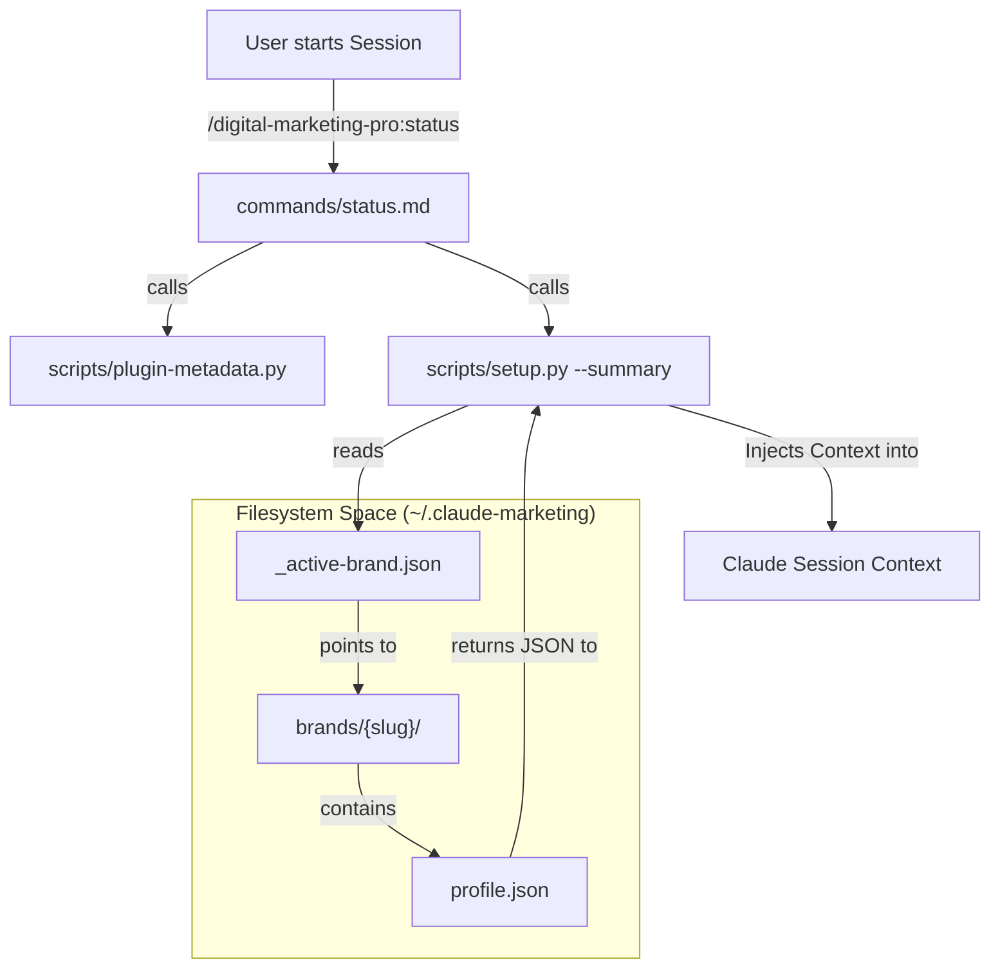
**Sources:** [docs/getting-started.md:114-153](), [docs/architecture.md:48-48](), [docs/multi-brand-guide.md:80-91](), [skills/help/SKILL.md:23-25]()

---

## 4. First Brand Setup

A brand profile is mandatory to ground AI outputs in specific voice, industry, and compliance constraints [docs/multi-brand-guide.md:91-91]().

1.  **Run Command**: `/digital-marketing-pro:brand-setup` [docs/getting-started.md:100-100]().
2.  **Mode Selection**:
    *   **Quick**: 5 questions for immediate tasks [docs/engagement-methodology.md:120-120]().
    *   **Full**: 17 questions for deep strategic engagements [docs/getting-started.md:123-123]().
3.  **Output**: The system creates a directory at `~/.claude-marketing/brands/{slug}/` containing `profile.json`, `audiences.json`, and `competitors.json` [docs/multi-brand-guide.md:20-28]().

### Brand Profile Schema (Key Fields)
| Field | Purpose | Code Reference |
| :--- | :--- | :--- |
| `voice` | 1-10 floats for Formality, Energy, Humor, Authority | [docs/multi-brand-guide.md:69-73]() |
| `industry` | Maps to compliance rules (e.g., GDPR, FTC) | [docs/multi-brand-guide.md:68-68]() |
| `slug` | Unique filesystem identifier (e.g., `acme-corp`) | [docs/multi-brand-guide.md:20-20]() |

**Sources:** [docs/getting-started.md:116-132](), [docs/multi-brand-guide.md:18-79]()

---

## 5. Running Your First Marketing Task

Digital Marketing Pro supports two execution paths: **One-off Tasks** and **Full Engagements** [docs/engagement-methodology.md:68-69]().

### Path A: One-off Task (The 5-Minute Start)
For immediate deliverables, use specific command modules:
*   **SEO Audit**: `/digital-marketing-pro:seo-audit <url>` [TESTING-GUIDE.md:142-142]().
*   **Content**: `/digital-marketing-pro:content-engine` [TESTING-GUIDE.md:155-155]().
*   **Ad Copy**: "Write a LinkedIn ad for our new product" (triggers `content-creator.md` agent) [TESTING-GUIDE.md:157-157]().

### Path B: The 12-Part Engagement (Technical Workflow)
This is the recommended path for comprehensive strategy. It orchestrates multiple agents and scripts in a stateful sequence.

Title: 12-Part Methodology Execution Flow
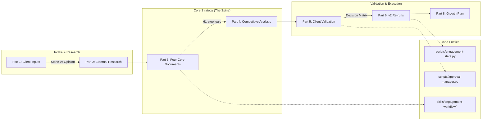
**Sources:** [docs/engagement-methodology.md:47-64](), [docs/architecture.md:83-84](), [docs/architecture.md:111-111]()

### Execution Commands
*   **Start**: `/digital-marketing-pro:engagement start <brand-slug> <engagement-id>` [docs/engagement-methodology.md:93-93]().
*   **Resume**: If a session times out, use `/digital-marketing-pro:resume` to pick up from the last checkpoint stored in `_engagement.json` [docs/engagement-methodology.md:126-126]().
*   **Quality Gate**: Run `/digital-marketing-pro:check` before publishing to trigger `hallucination-detector.py` and `brand-voice-scorer.py` [docs/engagement-methodology.md:5-5](), [docs/architecture.md:105-105]().

**Sources:** [docs/engagement-methodology.md:5-126](), [TESTING-GUIDE.md:116-199](), [docs/architecture.md:83-105]()

---

# Page: Plugin Manifests & Platform Support

# Plugin Manifests & Platform Support

<details>
<summary>Relevant source files</summary>

The following files were used as context for generating this wiki page:

- [.claude-plugin/plugin.json](.claude-plugin/plugin.json)
- [.codex-plugin/plugin.json](.codex-plugin/plugin.json)
- [.cursor-plugin/plugin.json](.cursor-plugin/plugin.json)
- [.github/plugin/plugin.json](.github/plugin/plugin.json)
- [AGENTS.md](AGENTS.md)
- [CHANGELOG.md](CHANGELOG.md)
- [__init__.py](__init__.py)
- [gemini-extension.json](gemini-extension.json)
- [openclaw.plugin.json](openclaw.plugin.json)
- [package.json](package.json)
- [plugin.yaml](plugin.yaml)
- [tests/test_release_consistency.py](tests/test_release_consistency.py)

</details>


Digital Marketing Pro is designed as a "write-once, run-anywhere" plugin that adheres to the **Agent Skills** open standard. This allows the same 158 marketing skills and 24 specialist agents to operate across a wide range of AI agent harnesses including Claude Code, OpenAI Codex, Cursor, and Hermes Agent. The system uses platform-specific manifest files to register its capabilities while maintaining a single source of truth for logic and assets.

## Manifest Architecture & Registration

The plugin uses a multi-manifest strategy where each supported platform has a dedicated configuration file. These files point the respective agent harness to the core `skills/`, `agents/`, and `commands/` directories.

### Supported Platform Manifests

| Platform | Manifest File | Role |
| :--- | :--- | :--- |
| **Claude Code / Cowork** | [.claude-plugin/plugin.json:1-75]() | Primary manifest; defines metadata, keywords, and versioning. |
| **OpenAI Codex** | [.codex-plugin/plugin.json:1-47]() | Defines UI display names, default prompts, and Read/Write capabilities. |
| **Cursor** | [.cursor-plugin/plugin.json:1-38]() | Registers skills, agents, and commands for the Cursor IDE agent. |
| **Hermes Agent** | [plugin.yaml:1-41]() | Native YAML manifest for Nous Research Hermes. |
| **OpenClaw** | [openclaw.plugin.json:1-15]() | Native JSON manifest for the OpenClaw runtime. |
| **Gemini Antigravity** | [gemini-extension.json:1-7]() | Maps the extension context to `AGENTS.md`. |
| **GitHub Copilot CLI** | [.github/plugin/plugin.json:1-35]() | Standardized registration for GitHub's agent environment. |

### Registration Data Flow

The following diagram illustrates how different agent harnesses consume these manifests to expose the `skills/` library to the user.

**Agent Registration Pipeline**
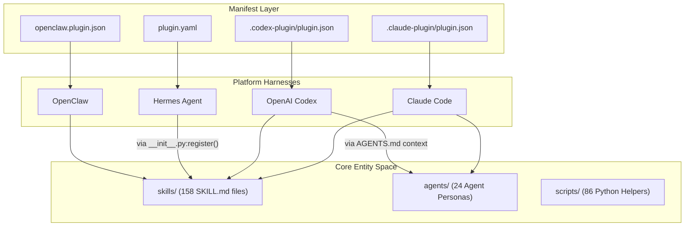
**Sources:** [.claude-plugin/plugin.json:26-37](), [plugin.yaml:14-17](), [AGENTS.md:40-45](), [__init__.py:107-154]()

## Hermes Agent Native Integration

Unlike other platforms that purely read static JSON, **Hermes Agent** utilizes a Python-based adapter ([__init__.py]()) to dynamically register skills. 

### Implementation Details
1. **Discovery**: The `_walk_skills()` function [__init__.py:81-104]() iterates through the `skills/` directory to find every `SKILL.md`.
2. **Parsing**: It extracts `name` and `description` from the YAML frontmatter using `_parse_skill_frontmatter()` [__init__.py:51-78]().
3. **Registration**: The `register(ctx)` function [__init__.py:107-154]() calls `ctx.register_skill()` for each discovered skill, making them natively available in Hermes Desktop.

**Sources:** [__init__.py:12-17](), [plugin.yaml:14-16]()

## Version Synchronization & Consistency

To prevent "manifest rot," the project employs a strict version lockstep policy. The version defined in [.claude-plugin/plugin.json:3]() is considered the **Canonical Version**.

### Automated Consistency Checks
The test suite in `tests/test_release_consistency.py` ensures that all manifests remain in sync. Key tests include:
* **`test_all_json_manifests_match_canonical_version`**: Validates all 7 JSON manifests [tests/test_release_consistency.py:59-68]().
* **`test_hermes_plugin_yaml_matches_canonical_version`**: Checks the YAML manifest [tests/test_release_consistency.py:70-73]().
* **`test_hermes_adapter_PLUGIN_VERSION_matches_canonical`**: Ensures the `PLUGIN_VERSION` constant in `__init__.py` is updated [tests/test_release_consistency.py:75-80]().
* **`test_readme_version_badge_matches_canonical`**: Syncs the version badge in the project README [tests/test_release_consistency.py:82-87]().

### Cross-Manifest Relationship
The following diagram maps how the versioning metadata flows from the canonical source to the various platform entities.

**Version Synchronization Map**
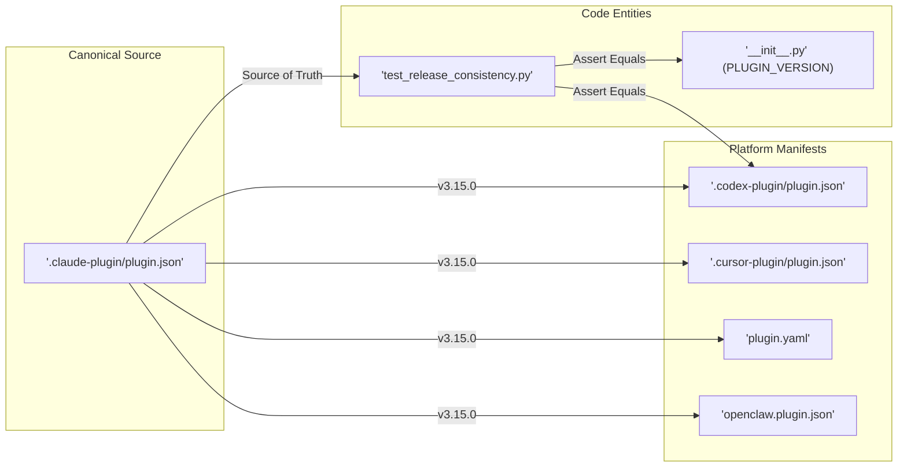
**Sources:** [tests/test_release_consistency.py:36-40](), [CHANGELOG.md:7-9](), [__init__.py:48]()

## Agent Skills Open Standard

Digital Marketing Pro implements the **Agent Skills** open standard, which ensures that skill definitions (`SKILL.md`) are byte-portable. 

### Skill Contract Validation
To ensure that the natural language instructions in `SKILL.md` files correctly map to the underlying Python execution layer, the plugin uses a specialized linter:
* **File**: `scripts/check_skill_contracts.py` [CHANGELOG.md:14-14]()
* **Function**: Validates that the flags and actions described in the markdown fences of a skill match the real `argparse` configuration of the corresponding script [CHANGELOG.md:14-14]().

**Sources:** [AGENTS.md:83-85](), [CHANGELOG.md:14-14]()

---

# Page: Core Architecture

# Core Architecture

<details>
<summary>Relevant source files</summary>

The following files were used as context for generating this wiki page:

- [.github/plugin/plugin.json](.github/plugin/plugin.json)
- [AGENTS.md](AGENTS.md)
- [README.md](README.md)
- [docs/architecture.md](docs/architecture.md)
- [docs/claude-interfaces.md](docs/claude-interfaces.md)
- [docs/getting-started.md](docs/getting-started.md)
- [gemini-extension.json](gemini-extension.json)
- [skills/help/SKILL.md](skills/help/SKILL.md)

</details>


The Digital Marketing Pro architecture is built on the **WAT (Workflows, Agents, Tools)** framework, a multi-layered design that separates probabilistic AI reasoning from deterministic code execution. This structure ensures that while agents can creatively solve marketing problems, the underlying data processing, compliance checking, and API interactions remain consistent and auditable [docs/architecture.md:5-7]().

The system is organized into three primary pillars that coordinate to deliver 158 marketing skills through 24 specialist agents, supported by a library of 89 Python scripts [README.md:7-10]().

## The Three-Pillar Structure

The codebase is strictly partitioned into three directories, each serving a distinct role in the agentic loop.

### 1. Skills System (`skills/`)
The **Skills** layer represents the "Surface Area" of the plugin. It consists of 158 `SKILL.md` files that define the capabilities available to the user and the agent [AGENTS.md:40-40](). Each skill uses YAML frontmatter to declare its name and description, allowing any supported agent harness (Claude Code, Codex, etc.) to discover and match user intent to the correct skill [AGENTS.md:15-16]().
*   **For details, see [Skills System (#2.1)](#)**

### 2. Specialist Agents (`agents/`)
The **Agents** layer contains 24 specialist personas defined in Markdown files. These agents act as the "Reasoning Engine," coordinating complex tasks like brand guardianship, SEO strategy, and multi-channel execution [docs/architecture.md:22-46](). They operate under specific interaction contracts, such as the `PENDING_APPROVAL` pattern for high-stakes execution [README.md:20-20]().
*   **For details, see [Specialist Agents (#2.2)](#)**

### 3. Python Scripts Layer (`scripts/`)
The **Scripts** layer provides the "Deterministic Execution" backbone. These 89 scripts handle data persistence, scoring, and external integrations [docs/architecture.md:47-110](). By offloading heavy lifting (like ROI calculation or C2PA signing) to Python, the system avoids LLM math errors and ensures regulatory compliance [AGENTS.md:17-20]().
*   **For details, see [Python Scripts Layer (#2.3)](#)**

---

## Architectural Workflow: Natural Language to Code Execution

The following diagram illustrates how a user's natural language request traverses the WAT architecture to trigger specific code entities.

**Diagram: Request Resolution Pipeline**
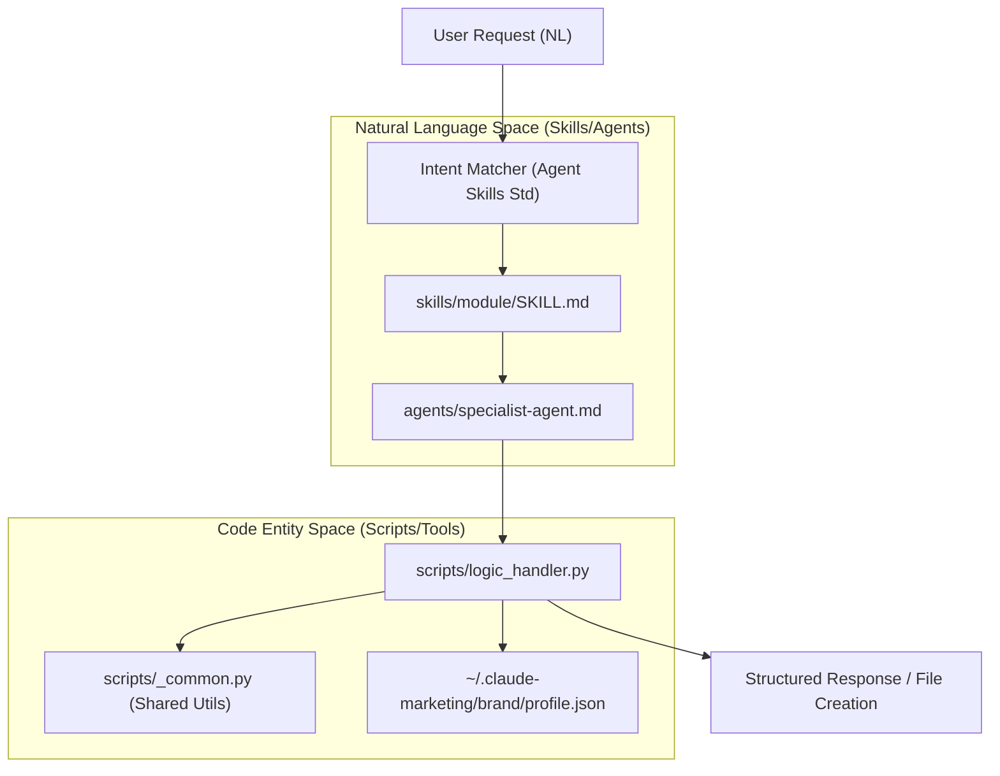
**Sources:** [AGENTS.md:15-17](), [docs/architecture.md:11-47](), [skills/help/SKILL.md:23-25]()

---

## System Components & Interaction

The architecture relies on a "Context-First" approach. Every skill execution begins by loading the brand context to ground the AI's probabilistic reasoning in the brand's specific deterministic constraints (voice, jurisdiction, and goals) [docs/getting-started.md:114-115]().

### Component Association Map

| Architecture Layer | Code Entity Location | Responsibility |
| :--- | :--- | :--- |
| **Workflows** | `skills/engagement-workflow/` | Orchestrates the 12-Part Strategy Flow [docs/architecture.md:7-8]() |
| **Agents** | `agents/*.md` | Persona-based reasoning and tool selection [AGENTS.md:52-79]() |
| **Tools (Scripts)** | `scripts/*.py` | Deterministic logic, scoring, and I/O [docs/architecture.md:47-110]() |
| **Context Engine** | `skills/context-engine/` | Shared intelligence and compliance rules [README.md:18-18]() |
| **Persistence** | `~/.claude-marketing/` | Local state, brand profiles, and insights [docs/claude-interfaces.md:28-28]() |

### Data Flow and State Management

The system maintains state across sessions using a structured filesystem. While the AI provides the reasoning, the `scripts/setup.py` and `scripts/memory-manager.py` entities ensure that brand data remains consistent [docs/architecture.md:48-86]().

**Diagram: State & Context Integration**
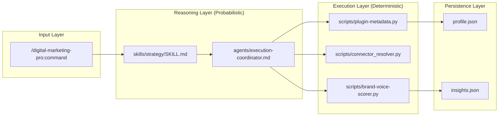
**Sources:** [docs/architecture.md:50-52](), [docs/architecture.md:83-87](), [skills/help/SKILL.md:23-27]()

---

## Related Documentation

*   **[Skills System (#2.1)](#)**: Detailed breakdown of the `SKILL.md` anatomy and the intent-matching discovery mechanism.
*   **[Specialist Agents (#2.2)](#)**: Examination of the 24 agent personas and the `execution-coordinator` approval workflow.
*   **[Python Scripts Layer (#2.3)](#)**: Technical overview of the script library, JSON I/O contracts, and the `_common.py` utility.
*   **[Context Engine & Reference Data (#2.4)](#)**: Deep dive into the reference knowledge files that provide the industry intelligence for all skills.

**Sources:** [README.md:7-10](), [docs/architecture.md:11-13](), [AGENTS.md:38-51]()

---

# Page: Skills System

# Skills System

<details>
<summary>Relevant source files</summary>

The following files were used as context for generating this wiki page:

- [.github/ISSUE_TEMPLATE/bug_report.md](.github/ISSUE_TEMPLATE/bug_report.md)
- [.github/ISSUE_TEMPLATE/feature_request.md](.github/ISSUE_TEMPLATE/feature_request.md)
- [.github/ISSUE_TEMPLATE/industry_update.md](.github/ISSUE_TEMPLATE/industry_update.md)
- [CONTRIBUTING.md](CONTRIBUTING.md)
- [__init__.py](__init__.py)
- [docs/architecture.md](docs/architecture.md)
- [docs/claude-interfaces.md](docs/claude-interfaces.md)
- [docs/getting-started.md](docs/getting-started.md)
- [openclaw.plugin.json](openclaw.plugin.json)
- [plugin.yaml](plugin.yaml)
- [skills/agency-dashboard/SKILL.md](skills/agency-dashboard/SKILL.md)
- [skills/context-engine/execution-workflows.md](skills/context-engine/execution-workflows.md)
- [skills/context-engine/india-market-context.md](skills/context-engine/india-market-context.md)
- [skills/creative-testing-framework/SKILL.md](skills/creative-testing-framework/SKILL.md)
- [skills/emerging-channels/conversational-commerce.md](skills/emerging-channels/conversational-commerce.md)
- [skills/help/SKILL.md](skills/help/SKILL.md)

</details>


The Skills System is the intelligence engine of Digital Marketing Pro, comprising **158 specialized skills** [docs/architecture.md:93]() that transform a general-purpose LLM into a domain-expert marketing operative. Each skill is a self-contained unit of work defined in a `SKILL.md` file, providing the agent with specific procedures, brand context requirements, and tool access constraints.

## 1. Skill Anatomy (`SKILL.md`)

Every skill is defined within its own directory under `skills/` and follows a strict markdown structure. This structure serves as the "contract" between the plugin and the agent runtime.

### YAML Frontmatter
The frontmatter defines the skill's identity and metadata for the discovery engine.
*   **`name`**: The unique identifier used in slash commands (e.g., `/digital-marketing-pro:seo-audit`).
*   **`triggers`**: A list of natural language phrases that help the agent match user intent to this specific skill [CONTRIBUTING.md:39-43]().
*   **`allowed-tools`**: Restricted list of filesystem and shell tools the agent may use during execution [CONTRIBUTING.md:44]().
*   **`engagement-part`**: (Optional) For skills participating in the 12-Part Methodology, defines the phase (1–12) it belongs to [CONTRIBUTING.md:69]().

### Brand Context Block
All skills must implement a standard brand loading sequence as their first step. This ensures that outputs are grounded in the active brand's voice, industry, and compliance requirements [CONTRIBUTING.md:111-115]().

### Process Steps
The core of the skill is a numbered list of instructions. These are deterministic steps that guide the probabilistic reasoning of the LLM.
1.  **Context Loading**: Reading `~/.claude-marketing/brands/{slug}/profile.json` [CONTRIBUTING.md:100]().
2.  **Execution**: Calling Python scripts in `scripts/` or utilizing MCP connectors [docs/claude-interfaces.md:27-28]().
3.  **Validation**: Scoring output using scripts like `content-scorer.py` or `brand-voice-scorer.py` [docs/architecture.md:51-52]().

**Sources:** [CONTRIBUTING.md:30-62](), [docs/architecture.md:91-110](), [skills/help/SKILL.md:1-5]()

---

## 2. Discovery & Intent Matching

The system uses a decentralized discovery mechanism. Rather than a hardcoded list, the plugin walks the `skills/` directory at runtime to register capabilities.

### Registration Flow
The `__init__.py` script (used primarily by the Hermes adapter) and the platform-specific manifests (like `.claude-plugin/plugin.json`) use the following logic to expose skills:

1.  **Directory Walk**: The system scans `skills/` for subdirectories containing a `SKILL.md` [__init__.py:91-96]().
2.  **Frontmatter Parsing**: It extracts the `name` and `description` to populate the agent's toolbelt [__init__.py:51-78]().
3.  **Namespace Mapping**: Every skill is prefixed with the plugin namespace (e.g., `digital-marketing-pro:skill-name`) [__init__.py:151-152]().

### Natural Language Space to Code Entity Space
The following diagram illustrates how a user's request is routed through the architectural layers to a specific skill and its supporting code.

**Intent Resolution & Execution Pipeline**
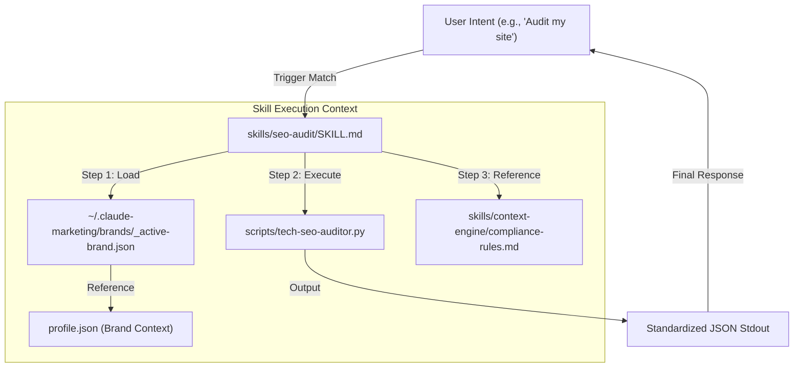
**Sources:** [__init__.py:81-104](), [CONTRIBUTING.md:30-44](), [docs/architecture.md:73](), [skills/help/SKILL.md:19-36]()

---

## 3. Skill Contract Validation

To maintain consistency across 158 files, the system employs a "contract" pattern enforced by a linter (often run via `test_release_consistency.py`).

### The Validation Rules
| Component | Requirement | Code Reference |
| :--- | :--- | :--- |
| **Naming** | Must use kebab-case for directories and skill names. | [CONTRIBUTING.md:36]() |
| **Brand Loading** | Step 1 must always be "Load brand context". | [CONTRIBUTING.md:114]() |
| **Tool Safety** | `allowed-tools` must be explicitly defined in frontmatter. | [CONTRIBUTING.md:44]() |
| **Python I/O** | Scripts called by skills must return JSON to `stdout`. | [CONTRIBUTING.md:151]() |
| **Graceful Failure** | Skills must handle missing Python dependencies without crashing. | [CONTRIBUTING.md:159-169]() |

**Sources:** [CONTRIBUTING.md:146-169](), [docs/architecture.md:105-110](), [skills/help/SKILL.md:11-16]()

---

## 4. Data Flow: From Intent to Execution

When a skill is invoked, data flows from the static reference files to the dynamic Python execution layer.

**Data Flow Architecture**
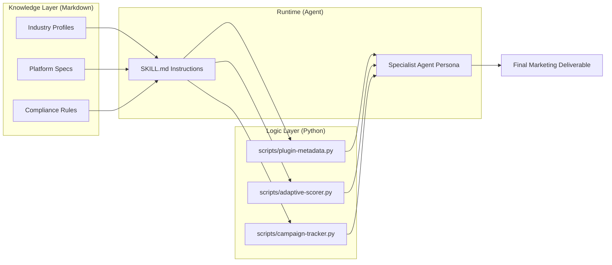

### Key Functions in Data Flow
*   **`_parse_skill_frontmatter`**: Extracts the metadata required for the agent to understand when to use the skill [__init__.py:51-78]().
*   **`plugin-metadata.py`**: A critical script called by the `help` skill to fetch live counts of agents, skills, and connectors from the filesystem [skills/help/SKILL.md:24-31]().
*   **`_walk_skills`**: The discovery function that ensures new `SKILL.md` files are automatically registered without manual manifest updates [__init__.py:81-104]().

**Sources:** [__init__.py:51-104](), [skills/help/SKILL.md:19-36](), [docs/architecture.md:50-52]()

---

# Page: Specialist Agents

# Specialist Agents

<details>
<summary>Relevant source files</summary>

The following files were used as context for generating this wiki page:

- [agents/agency-operations.md](agents/agency-operations.md)
- [agents/analytics-analyst.md](agents/analytics-analyst.md)
- [agents/brand-guardian.md](agents/brand-guardian.md)
- [agents/competitive-intel.md](agents/competitive-intel.md)
- [agents/content-creator.md](agents/content-creator.md)
- [agents/crm-manager.md](agents/crm-manager.md)
- [agents/cro-specialist.md](agents/cro-specialist.md)
- [agents/email-specialist.md](agents/email-specialist.md)
- [agents/growth-engineer.md](agents/growth-engineer.md)
- [agents/influencer-manager.md](agents/influencer-manager.md)
- [agents/intelligence-curator.md](agents/intelligence-curator.md)
- [agents/journey-orchestrator.md](agents/journey-orchestrator.md)
- [agents/localization-specialist.md](agents/localization-specialist.md)
- [agents/market-intelligence.md](agents/market-intelligence.md)
- [agents/marketing-scientist.md](agents/marketing-scientist.md)
- [agents/marketing-strategist.md](agents/marketing-strategist.md)
- [agents/media-buyer.md](agents/media-buyer.md)
- [agents/memory-manager.md](agents/memory-manager.md)
- [agents/performance-monitor-agent.md](agents/performance-monitor-agent.md)
- [agents/pr-outreach.md](agents/pr-outreach.md)
- [agents/quality-assurance.md](agents/quality-assurance.md)
- [agents/seo-specialist.md](agents/seo-specialist.md)
- [agents/social-media-manager.md](agents/social-media-manager.md)
- [skills/anomaly-scan/SKILL.md](skills/anomaly-scan/SKILL.md)
- [skills/context-engine/custom-mcp-guide.md](skills/context-engine/custom-mcp-guide.md)

</details>


Specialist Agents are the domain-specific intelligence layer of the Digital Marketing Pro system. The codebase defines 24 distinct specialist personas [agents/*.md]() that function as **subagents**. These agents operate under a strict interaction contract, meaning they do not communicate with the end-user directly; instead, they provide structured outputs to an orchestrator [agents/content-creator.md:12-14]().

## Interaction Contract & Coordination

Every specialist agent follows a "subagent-only" pattern. They are prohibited from asking the user for clarification. If a task requires more data or a human decision, the agent must exit with a specific JSON structure.

### The NEEDS_INPUT / PENDING_APPROVAL Pattern
When an agent encounters a blocker (e.g., missing brand assets or a failed hallucination check), it returns a structured block:
*   **`NEEDS_INPUT`**: Used when required context is missing [agents/content-creator.md:14]().
*   **`PENDING_APPROVAL`**: Used when a draft is ready but requires a human gate before execution [agents/social-media-manager.md:14]().

### Multi-Agent Handoffs
Agents coordinate by consuming each other's logged outputs rather than calling each other recursively. This is primarily managed through the `quality-tracker.py` script [agents/quality-assurance.md:11]().

1.  **Creation**: `content-creator` or `social-media-manager` drafts content.
2.  **Validation**: The agent runs a mandatory internal check using `hallucination-detector.py` [agents/content-creator.md:39-44]().
3.  **Authoritative Scoring**: The content is handed to `quality-assurance`, which runs the full `eval-runner.py` suite [agents/quality-assurance.md:15]().
4.  **Consumption**: Downstream agents like `brand-guardian` or `execution-coordinator` read the score from `quality-tracker.py --action get-summary` [agents/brand-guardian.md:31]().

**Agent Coordination Flow**
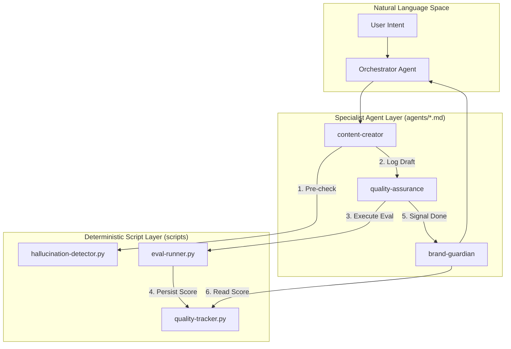
Sources: [agents/content-creator.md:39-49](), [agents/quality-assurance.md:11-22](), [agents/brand-guardian.md:31-36]()

---

## Core Specialist Personas

### 1. Content Creator
Responsible for all marketing copy (blogs, ads, email). It is **SEO-aware by default** and must load brand voice dimensions (formality, energy, humor, authority) before generating any text [agents/content-creator.md:18-28]().
*   **Key Tool**: `hallucination-detector.py` (Mandatory pre-delivery check) [agents/content-creator.md:45-48]().

### 2. Brand Guardian
Acts as the final quality gate. It enforces regulatory compliance (GDPR, CCPA, FTC) and accessibility standards (WCAG 2.2) [agents/brand-guardian.md:10-16]().
*   **Logic**: It does *not* re-run quality scores; it consumes the `quality-assurance` log and layers compliance judgment on top [agents/brand-guardian.md:31]().

### 3. SEO Specialist
Optimizes for three distinct surfaces: Traditional SEO, Answer Engine Optimization (AEO), and Generative Engine Optimization (GEO) [agents/seo-specialist.md:10-25]().
*   **Key Tool**: `keyword-clusterer.py` and `schema-generator.py` [agents/seo-specialist.md:41-47]().

### 4. Quality Assurance (QA)
The **single owner** of the evaluation pipeline. It orchestrates `eval-runner.py` across six dimensions: quality, voice, hallucination, claims, structure, and readability [agents/quality-assurance.md:11-15]().

### 5. Analytics Analyst
Bridges raw data to strategic decisions. It uses `roi-calculator.py` and `clv-calculator.py` to interpret performance [agents/analytics-analyst.md:10-15]().

---

## Technical Implementation: Agent-to-Script Mapping

The following diagram maps high-level agent roles to the underlying Python execution layer and the data entities they manipulate.

**Agent-to-Code Entity Mapping**
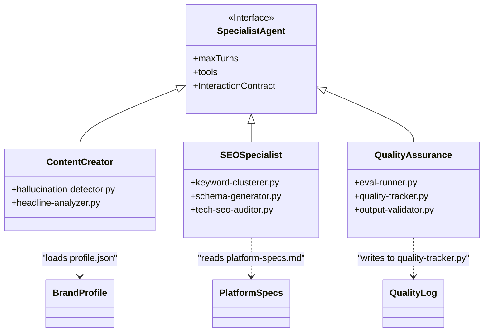
Sources: [agents/content-creator.md:1-6](), [agents/seo-specialist.md:1-6](), [agents/quality-assurance.md:1-7](), [agents/brand-guardian.md:22-31]()

---

## Agent Capabilities Matrix

| Agent | Primary Tools / Scripts | Interaction Contract Constraint | Key Responsibility |
| :--- | :--- | :--- | :--- |
| **Content Creator** | `hallucination-detector.py`, `readability-analyzer.py` | Must return `NEEDS_INPUT` if brand context is missing. | Multi-format copy generation. |
| **SEO Specialist** | `keyword-clusterer.py`, `ai-visibility-checker.py` | Must distinguish between SEO, AEO, and GEO. | Search & AI visibility. |
| **Quality Assurance** | `eval-runner.py`, `quality-tracker.py` | Single authoritative owner of the eval suite. | Scoring & Hallucination detection. |
| **Brand Guardian** | `guidelines-manager.py`, `quality-tracker.py` | Cannot approve if critical flags exist. | Compliance & Brand Safety. |
| **Email Specialist** | `email-preview.py`, `content-scorer.py` | Prioritizes deliverability over creative. | Lifecycle & Automation. |
| **Social Media Mgr** | `social-post-formatter.py`, `campaign-tracker.py` | Must optimize for platform-native signals. | Community & Engagement. |

Sources: [agents/content-creator.md:55-65](), [agents/seo-specialist.md:39-71](), [agents/quality-assurance.md:42-75](), [agents/brand-guardian.md:42-46](), [agents/email-specialist.md:30-36](), [agents/social-media-manager.md:30-40]()

## Behavior Rules & Guardrails

### 1. The "Brand-First" Rule
Every agent must load the brand profile (`profile.json`) and guidelines (`guidelines/_manifest.json`) as its first action [agents/content-creator.md:28](), [agents/marketing-strategist.md:26]().

### 2. Hallucination Thresholds (v3.2+)
Agents are required to enforce specific severity thresholds for content delivery:
*   **High Severity**: (e.g., fabricated stats) → Block delivery; return `NEEDS_INPUT` [agents/content-creator.md:40]().
*   **Medium Severity**: (e.g., unverified claims) → Deliver with inline warnings [agents/content-creator.md:41]().
*   **PR Exception**: For `pr-outreach`, medium severity is also blocking [agents/pr-outreach.md:41]().

### 3. Language Awareness
Agents check `profile.json` for `language.primary_language`. If set to a non-English locale, agents default to that language for all content creation [agents/content-creator.md:38](), [agents/localization-specialist.md:71-73]().

Sources: [agents/content-creator.md:28-44](), [agents/pr-outreach.md:38-46](), [agents/localization-specialist.md:1-23]()

---

# Page: Python Scripts Layer

# Python Scripts Layer

<details>
<summary>Relevant source files</summary>

The following files were used as context for generating this wiki page:

- [scripts/approval-manager.py](scripts/approval-manager.py)
- [scripts/audience-simulator.py](scripts/audience-simulator.py)
- [scripts/campaign-health-monitor.py](scripts/campaign-health-monitor.py)
- [scripts/churn-predictor.py](scripts/churn-predictor.py)
- [scripts/competitor-scraper.py](scripts/competitor-scraper.py)
- [scripts/competitor-tracker.py](scripts/competitor-tracker.py)
- [scripts/connector-status.py](scripts/connector-status.py)
- [scripts/crm-sync.py](scripts/crm-sync.py)
- [scripts/execution-tracker.py](scripts/execution-tracker.py)
- [scripts/intelligence-graph.py](scripts/intelligence-graph.py)
- [scripts/journey-engine.py](scripts/journey-engine.py)
- [scripts/macro-signal-tracker.py](scripts/macro-signal-tracker.py)
- [scripts/memory-manager.py](scripts/memory-manager.py)
- [scripts/performance-monitor.py](scripts/performance-monitor.py)
- [scripts/readability-analyzer.py](scripts/readability-analyzer.py)
- [scripts/report-generator.py](scripts/report-generator.py)
- [scripts/requirements.txt](scripts/requirements.txt)
- [scripts/seo-executor.py](scripts/seo-executor.py)
- [scripts/setup.py](scripts/setup.py)
- [scripts/team-manager.py](scripts/team-manager.py)
- [skills/attribution-model/SKILL.md](skills/attribution-model/SKILL.md)
- [skills/client-onboarding/SKILL.md](skills/client-onboarding/SKILL.md)
- [skills/content-engine/video-scripting.md](skills/content-engine/video-scripting.md)

</details>


The **Python Scripts Layer** consists of 89 deterministic scripts located in the `scripts/` directory. These scripts serve as the "hands" of the Digital Marketing Pro system, providing a reliable execution layer that separates probabilistic AI reasoning from structured data manipulation and system operations.

## Design Philosophy

The scripting layer follows a strict architectural contract to ensure stability across different agent harnesses (Claude Code, Cursor, etc.):

*   **Stdlib-First:** Scripts prioritize the Python Standard Library to minimize dependency overhead. External libraries like `textstat`, `beautifulsoup4`, or `requests` are treated as optional or "lite" dependencies [scripts/setup.py:29-45]().
*   **JSON I/O Contract:** All scripts are designed to be called via CLI and return structured JSON to `stdout`. This allows agents to parse results programmatically without dealing with "chatty" console output [scripts/readability-analyzer.py:28-35]().
*   **Graceful Degradation:** If a dependency is missing, scripts return a "fallback" JSON object explaining the requirement rather than crashing [scripts/competitor-scraper.py:19-25]().
*   **Stateless Execution:** Scripts generally rely on the brand's filesystem structure for state, rather than long-running processes [scripts/seo-executor.py:11-12]().

### Shared Utility: `_common.py`
Most scripts import `_common.py` to handle environment-agnostic path resolution and atomic file operations. Key functions include:
*   `_common.brands_root()`: Resolves the persistent storage location at `~/.claude-marketing/brands/` [scripts/seo-executor.py:34]().
*   `_common.get_brand_dir(slug)`: Normalizes brand names into filesystem-safe slugs [scripts/seo-executor.py:42-46]().
*   `_common.atomic_write_json()`: Ensures data integrity by writing to a temporary file before replacing the target [scripts/execution-tracker.py:76]().

## Script Categories & Data Flow

### 1. State & Execution Management
These scripts maintain the "Audit Trail" of the system, ensuring that every AI-driven action is recorded for compliance and historical reference.

| Script | Purpose | Key Functionality |
| :--- | :--- | :--- |
| `setup.py` | Environment Init | Creates `~/.claude-marketing/` and installs deps [scripts/setup.py:48-71](). |
| `execution-tracker.py` | Audit Logging | Records all publishes, sends, and syncs [scripts/execution-tracker.py:79-138](). |
| `approval-manager.py` | Human-in-the-loop | Manages the `PENDING_APPROVAL` state for high-stakes actions. |

### 2. SEO & Performance Execution
Deterministic tools for technical marketing tasks that require precision.

| Script | Purpose | Implementation Detail |
| :--- | :--- | :--- |
| `seo-executor.py` | SEO Implementation | Tracks meta updates, schema deployments, and redirects [scripts/seo-executor.py:5-9](). |
| `performance-monitor.py` | Anomaly Detection | Uses Z-scores to flag metrics deviating from the 30-day baseline [scripts/performance-monitor.py:163-222](). |
| `readability-analyzer.py` | Content Quality | Computes Flesch-Kincaid and Gunning Fog scores [scripts/readability-analyzer.py:142-200](). |

### 3. Integration & Sync
Manages the local state for external MCP (Model Context Protocol) connectors.

| Script | Purpose | Key Functionality |
| :--- | :--- | :--- |
| `connector-status.py` | Registry Check | Reports which MCP servers are active/available [scripts/connector-status.py:46-100](). |
| `crm-sync.py` | Data Prep | Maps local contact data to HubSpot/Salesforce schemas [scripts/crm-sync.py:86-119](). |

## Technical Implementation Diagrams

### Logic Flow: Performance Anomaly Detection
This diagram illustrates how `performance-monitor.py` bridges the gap between raw data and the AI's "Performance Specialist" agent.

Title: Performance Monitoring Data Flow
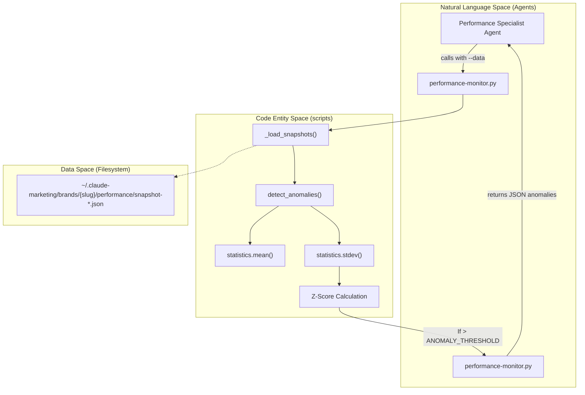
Sources: [scripts/performance-monitor.py:35](), [scripts/performance-monitor.py:45-56](), [scripts/performance-monitor.py:163-222]()

### SEO Execution & Audit Trail
This diagram shows the relationship between the `seo-executor.py` logic and the persistent storage of brand changes.

Title: SEO Execution and State Persistence
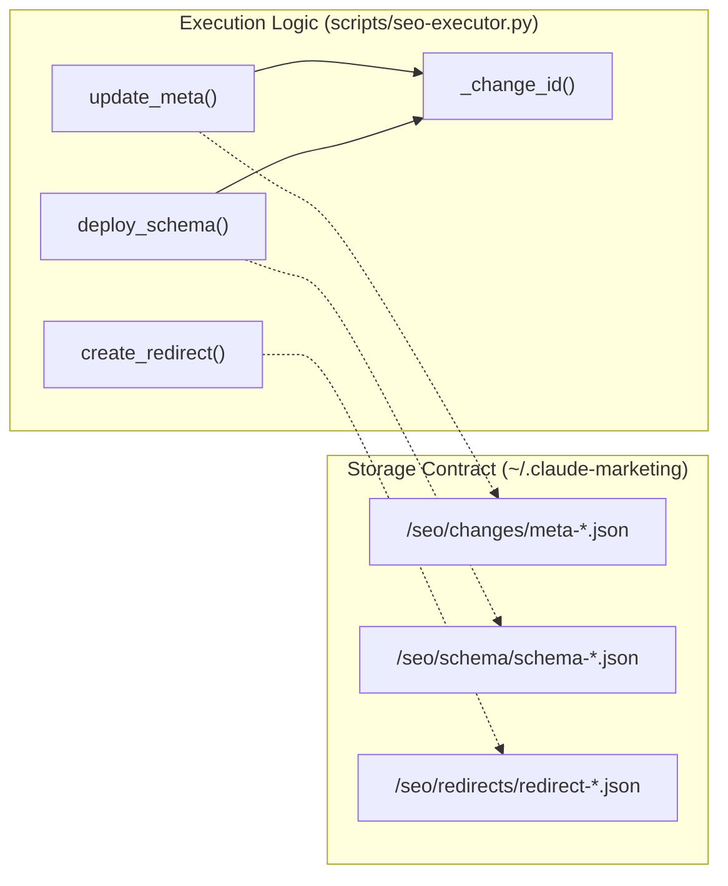
Sources: [scripts/seo-executor.py:49-53](), [scripts/seo-executor.py:81-82](), [scripts/seo-executor.py:145-146](), [scripts/seo-executor.py:179-180]()

## Key Implementation Details

### JSON-LD Schema Deployment
The `seo-executor.py` script validates schema types against a whitelist (`Organization`, `Product`, `FAQ`, etc.) before recording them [scripts/seo-executor.py:36-39](). It ensures that the AI does not generate invalid schema types that would fail search engine validation [scripts/seo-executor.py:137-138]().

### CRM Data Normalization
The `crm-sync.py` script acts as a transformation layer. It takes a generic "contact" object and maps it to specific fields required by different CRM platforms [scripts/crm-sync.py:86-119]():
*   **HubSpot:** Maps `first_name` to `firstname`.
*   **Salesforce:** Maps `first_name` to `FirstName`.
*   **Pipedrive:** Aggregates `name` and wraps email in a list structure.

### Execution Indexing
To prevent the audit trail from becoming unreadable as it grows, `execution-tracker.py` maintains an `_index.json` file. If this index is corrupted or deleted, the script includes a self-healing `_rebuild_index_from_files()` function that rescans all individual execution logs to restore the summary [scripts/execution-tracker.py:40-58]().

Sources:
*   [scripts/seo-executor.py:1-222]()
*   [scripts/connector-status.py:1-167]()
*   [scripts/execution-tracker.py:1-177]()
*   [scripts/crm-sync.py:1-204]()
*   [scripts/performance-monitor.py:1-222]()
*   [scripts/setup.py:1-173]()
*   [scripts/readability-analyzer.py:1-200]()
*   [scripts/competitor-scraper.py:1-152]()

---

# Page: Context Engine & Reference Data

# Context Engine & Reference Data

<details>
<summary>Relevant source files</summary>

The following files were used as context for generating this wiki page:

- [docs/architecture.md](docs/architecture.md)
- [docs/claude-interfaces.md](docs/claude-interfaces.md)
- [docs/getting-started.md](docs/getting-started.md)
- [scripts/geo-tracker.py](scripts/geo-tracker.py)
- [skills/agency-dashboard/SKILL.md](skills/agency-dashboard/SKILL.md)
- [skills/context-engine/agency-operations-guide.md](skills/context-engine/agency-operations-guide.md)
- [skills/context-engine/compliance-rules.md](skills/context-engine/compliance-rules.md)
- [skills/context-engine/crm-integration-guide.md](skills/context-engine/crm-integration-guide.md)
- [skills/context-engine/execution-workflows.md](skills/context-engine/execution-workflows.md)
- [skills/context-engine/india-market-context.md](skills/context-engine/india-market-context.md)
- [skills/context-engine/memory-architecture.md](skills/context-engine/memory-architecture.md)
- [skills/creative-testing-framework/SKILL.md](skills/creative-testing-framework/SKILL.md)
- [skills/emerging-channels/conversational-commerce.md](skills/emerging-channels/conversational-commerce.md)
- [skills/geo-monitor/SKILL.md](skills/geo-monitor/SKILL.md)
- [skills/help/SKILL.md](skills/help/SKILL.md)

</details>


The **Context Engine** is the shared intelligence layer of Digital Marketing Pro. It consists of 57 reference files and specialized skills that ground every agent action in industry-specific knowledge, regulatory compliance, and brand-specific parameters. All 158 skills in the system are architected to load brand context as their primary step, ensuring that probabilistic AI generation is constrained by deterministic brand and regulatory data [docs/architecture.md:5-7]().

## 1. Shared Intelligence Architecture

The Context Engine operates as a "Strategic Spine" for the plugin. It separates static reference data (like the EU AI Act or India's DPDP Act) from dynamic brand data (stored in `~/.claude-marketing/`) [docs/architecture.md:28-29]().

### Context Loading Data Flow
The following diagram illustrates how the `context-engine` skills and `scripts/setup.py` hydrate the session context before any marketing task is executed.

**Diagram: Context Hydration Pipeline**
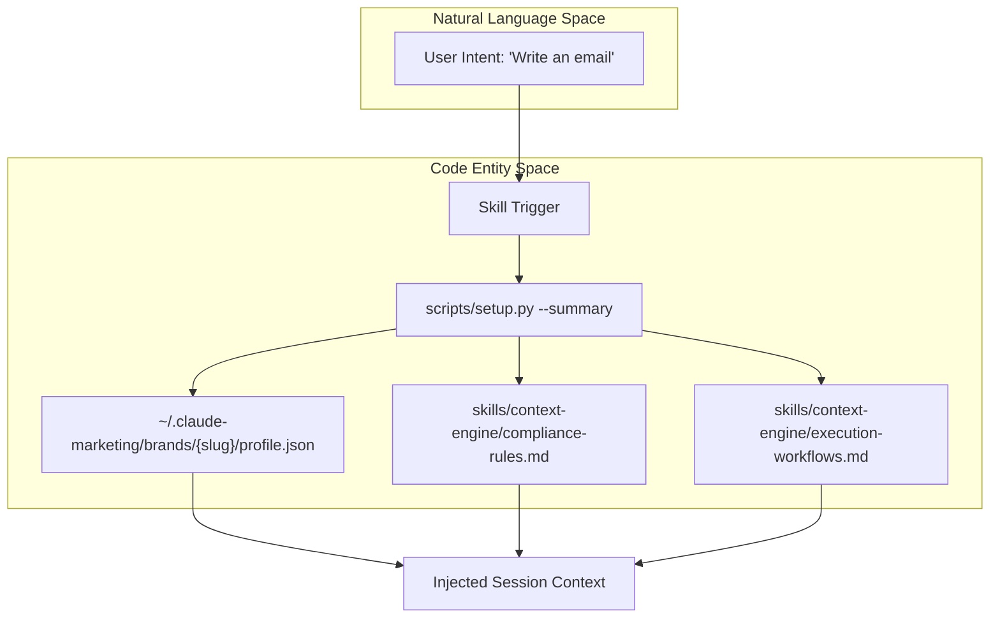
**Sources:** [docs/getting-started.md:110-118](), [skills/context-engine/execution-workflows.md:1-3](), [docs/architecture.md:48-50]()

## 2. Core Reference Components

### 2.1. Compliance Rules & Jurisdictions
The system maintains a canonical ruleset in `skills/context-engine/compliance-rules.md`. This file is structured for programmatic consumption, allowing the `Brand Guardian` agent to verify outputs against specific regional laws [skills/context-engine/compliance-rules.md:1-3]().

| Jurisdiction | Key Law | Marketing Impact |
| :--- | :--- | :--- |
| **EU/EEA** | GDPR & AI Act Art. 50 | Mandatory C2PA metadata for AI content; opt-in consent [skills/context-engine/compliance-rules.md:9-33]() |
| **India** | DPDP Act (2023) | Specific consent; 72-hour breach notification; vernacular focus [skills/context-engine/india-market-context.md:9-20]() |
| **Global** | C2PA Standards | Machine-readable provenance for AI-generated assets [skills/context-engine/compliance-rules.md:30]() |

### 2.2. Standard Operating Procedures (SOPs)
Execution is governed by `skills/context-engine/execution-workflows.md`. These are deterministic step-by-step procedures that agents must follow.
*   **Blog Publishing:** Includes 16 steps covering format checks, word count (800-1500 words), and SEO placement [skills/context-engine/execution-workflows.md:7-45]().
*   **Email Campaigns:** Mandates spam score checks (Target < 5.0) and mobile-first tap targets (44x44 px) [skills/context-engine/execution-workflows.md:49-87]().
*   **Ad Platforms:** Includes May 2026 updates for Google PMax and Meta Advantage+ [skills/context-engine/execution-workflows.md:91-99]().

**Sources:** [skills/context-engine/compliance-rules.md:1-47](), [skills/context-engine/execution-workflows.md:1-99]()

## 3. Market & Platform Intelligence

### 3.1. Regional Context Modules
The engine includes deep-dive references for specific markets. For example, `skills/context-engine/india-market-context.md` provides intelligence on:
*   **Mobile-First Reality:** 75-80% of traffic is mobile; focus on mid-range Android optimization [skills/context-engine/india-market-context.md:43-48]().
*   **Seasonality:** Detailed patterns for Diwali (Sept-Nov) and IPL (Mar-May) [skills/context-engine/india-market-context.md:67-76]().
*   **Payment Rails:** UPI dominance and the necessity of Cash on Delivery (COD) [skills/context-engine/india-market-context.md:78-83]().

### 3.2. GEO/AEO Visibility Tracking
The `scripts/geo-tracker.py` script manages the brand's presence across 6 AI surfaces (ChatGPT, Perplexity, Gemini, Copilot, Google AI Mode, and AI Overviews) [scripts/geo-tracker.py:5-14]().

**Diagram: GEO/AEO Intelligence Mapping**
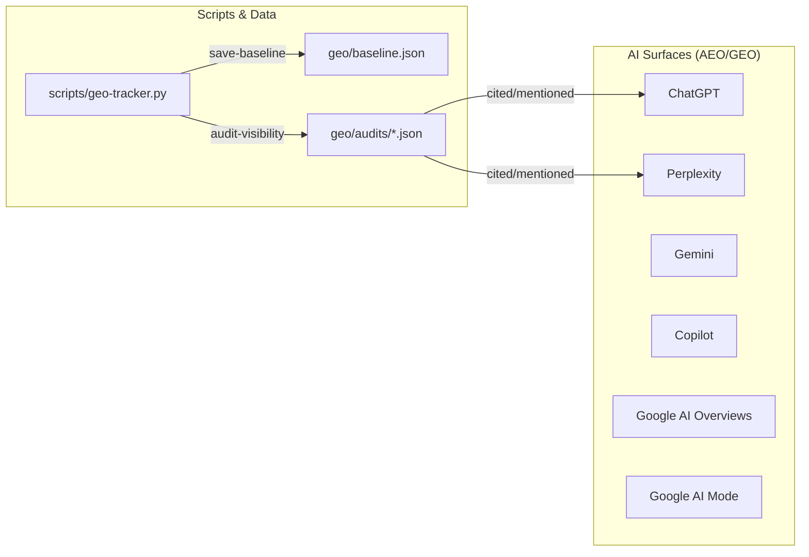
**Sources:** [scripts/geo-tracker.py:1-65](), [skills/context-engine/india-market-context.md:1-101]()

## 4. Agency & Multi-Client Logic

The Context Engine enables agency-scale operations via the `agency-dashboard` skill and the `Agency Operations Guide`.

*   **Client Health Scoring:** A composite 0-100 score based on Campaign Activity (25%), Budget Pacing (25%), KPI Attainment (25%), Content Pipeline (15%), and Engagement (10%) [skills/context-engine/agency-operations-guide.md:38-49]().
*   **Portfolio Aggregation:** The `agency-dashboard` skill iterates through all brand directories in `~/.claude-marketing/brands/` to generate a cross-client health report [skills/agency-dashboard/SKILL.md:38-46]().
*   **CRM Preparation:** `skills/context-engine/crm-integration-guide.md` defines how `crm-sync.py` prepares data for write-operations via MCP connectors [skills/context-engine/crm-integration-guide.md:25-27]().

**Sources:** [skills/agency-dashboard/SKILL.md:16-62](), [skills/context-engine/agency-operations-guide.md:1-58](), [skills/context-engine/crm-integration-guide.md:1-27]()

---

# Page: 12-Part Engagement Methodology

# 12-Part Engagement Methodology

<details>
<summary>Relevant source files</summary>

The following files were used as context for generating this wiki page:

- [TESTING-GUIDE.md](TESTING-GUIDE.md)
- [docs/architecture.md](docs/architecture.md)
- [docs/claude-interfaces.md](docs/claude-interfaces.md)
- [docs/engagement-methodology.md](docs/engagement-methodology.md)
- [docs/getting-started.md](docs/getting-started.md)
- [docs/integrations-guide.md](docs/integrations-guide.md)
- [docs/multi-brand-guide.md](docs/multi-brand-guide.md)
- [skills/client-validation-document/SKILL.md](skills/client-validation-document/SKILL.md)
- [skills/continuous-improvement-loop/SKILL.md](skills/continuous-improvement-loop/SKILL.md)
- [skills/engagement-workflow/SKILL.md](skills/engagement-workflow/SKILL.md)
- [skills/four-core-documents/SKILL.md](skills/four-core-documents/SKILL.md)
- [skills/growth-plan/SKILL.md](skills/growth-plan/SKILL.md)
- [skills/help/SKILL.md](skills/help/SKILL.md)

</details>


The **12-Part Engagement Methodology** (introduced in v3.0) is a stateful, sequential workflow designed to transform the plugin from a collection of one-off tools into a comprehensive marketing command center. While the system still supports atomic tasks (e.g., generating a single ad), the methodology provides a canonical structure for high-stakes strategic engagements, producing ~50–60 traceable files across a project lifecycle.

## Overview: The Stateful Workflow

Unlike one-off tasks, the 12-Part Methodology maintains shared state via an `_engagement.json` file and a structured directory tree under `~/.claude-marketing/brands/{brand-slug}/engagements/{engagement-id}/`. This ensures that every strategic decision—from channel selection to creative briefs—is grounded in validated research and client-approved positioning.

### When to Use
*   **Path A: One-off Tasks:** Use for quick deliverables like a single email or SEO audit when speed is the priority.
*   **Path B: Full Engagement:** Use for quarterly/annual planning, new client onboarding, or major brand repositioning where rigor, traceability, and compounding value are required.

### Core Workflow Diagram

This diagram shows how the methodology orchestrates the flow from initial data intake to continuous market monitoring.

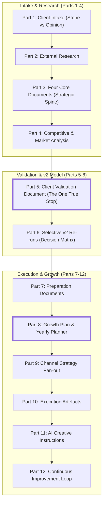
**Sources:** [docs/engagement-methodology.md:47-64](), [skills/engagement-workflow/SKILL.md:21-21]()

---

## Technical Orchestration

The methodology is managed by the `engagement-workflow` skill, which interfaces with specialized Python scripts to maintain state, handle checkpoints, and publish outputs.

### Code Entity Space: Orchestration Layer

The following diagram bridges the methodology phases to the specific code entities that handle state and execution.

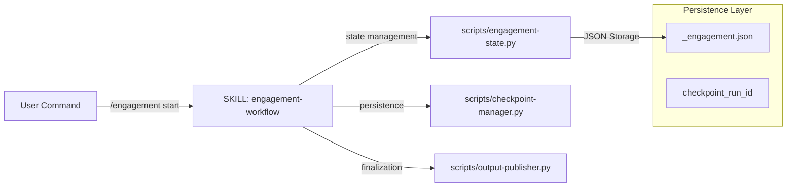
**Sources:** [skills/engagement-workflow/SKILL.md:35-58](), [docs/architecture.md:83-88]()

---

## Phases of the Engagement

The 12 parts are grouped into three major phases, each covered in detail on their respective child pages.

### 1. Intake, Research & The Strategic Spine (Parts 1–4)
This phase focuses on the **v1 Unbiased View**. It begins with Part 1, separating "Stone" facts (verified data) from "Opinion" (client hypotheses). It culminates in the **Four Core Documents** (3.1 Business Analysis, 3.2 Segmentation, 3.3 Positioning, 3.4 DMFlow), which comprise 61 explicit strategic steps.
*   **For details, see [Intake, Research & Four Core Documents (Parts 1–4)](#3.1).**

### 2. Client Validation & The Two-Views Model (Parts 5–6)
This phase introduces the **One True Stop**. Part 5 presents the v1 findings to the client for `ACCEPT/REJECT/EDIT` decisions. Part 6 uses a **Decision Matrix** to trigger selective **v2 Re-runs** of the strategic spine based on client feedback. This maintains a clean separation between market reality and client preference.
*   **For details, see [Client Validation & Two-Views Model (Parts 5–6)](#3.2).**

### 3. Execution, Growth Plan & Continuous Improvement (Parts 7–12)
The final phase moves from strategy to execution. Part 8 produces the flagship **Growth Plan** and **Yearly Planner**. Parts 9–11 handle the channel fan-out and creative production, while Part 12 establishes a **Continuous Improvement Loop** to feed market signals back into the strategy.
*   **For details, see [Execution, Growth Plan & Continuous Improvement (Parts 7–12)](#3.3).**

---

## Key Methodology Protocols

To ensure rigor across the 12 parts, the system enforces several technical protocols:

| Protocol | Purpose | Implementation |
| :--- | :--- | :--- |
| **Checkpointing** | Allows resuming interrupted sessions. | `checkpoint-manager.py` [skills/engagement-workflow/SKILL.md:45-58]() |
| **Update-Back Rule** | Ensures changes in execution (v2.x) flow back to source docs. | `update-back-rule.md` [skills/engagement-workflow/SKILL.md:32-32]() |
| **Quality Gates** | Blocking checks before finalizing Parts 5 and 8. | `/digital-marketing-pro:check --full` [skills/engagement-workflow/SKILL.md:72-79]() |
| **Two-Views Model** | Keeps v1 (unbiased) and v2 (client-validated) separate. | `two-views-model.md` [docs/engagement-methodology.md:20-20]() |

**Sources:** [docs/engagement-methodology.md:31-41](), [skills/engagement-workflow/SKILL.md:45-91]()

---

# Page: Intake, Research & Four Core Documents (Parts 1–4)

# Intake, Research & Four Core Documents (Parts 1–4)

<details>
<summary>Relevant source files</summary>

The following files were used as context for generating this wiki page:

- [TESTING-GUIDE.md](TESTING-GUIDE.md)
- [docs/competitor-intelligence.md](docs/competitor-intelligence.md)
- [docs/cross-channel-sync.md](docs/cross-channel-sync.md)
- [docs/data-and-insights.md](docs/data-and-insights.md)
- [docs/engagement-methodology.md](docs/engagement-methodology.md)
- [docs/historical-data.md](docs/historical-data.md)
- [docs/integrations-guide.md](docs/integrations-guide.md)
- [docs/multi-brand-guide.md](docs/multi-brand-guide.md)
- [docs/strategy-and-kpis.md](docs/strategy-and-kpis.md)
- [skills/client-validation-document/SKILL.md](skills/client-validation-document/SKILL.md)
- [skills/continuous-improvement-loop/SKILL.md](skills/continuous-improvement-loop/SKILL.md)
- [skills/engagement-workflow/SKILL.md](skills/engagement-workflow/SKILL.md)
- [skills/four-core-documents/SKILL.md](skills/four-core-documents/SKILL.md)
- [skills/growth-plan/SKILL.md](skills/growth-plan/SKILL.md)

</details>


This page details the first phase of the 12-Part Engagement Methodology (v3.0). This phase transitions a brand from initial setup into a structured strategic engine. It covers the capture of client knowledge (Part 1), unbiased market discovery (Part 2), the creation of the strategic "spine" via the Four Core Documents (Part 3), and deep-dive competitive/market analysis (Part 4).

## 1. Part 1: Stone vs. Opinion Intake

The engagement begins with a rigorous intake process that separates "Stone" facts (verified data) from "Opinion" (client beliefs/assumptions). This distinction is critical for the **Two-Views Model**, ensuring the AI can distinguish between objective constraints and subjective preferences.

### Implementation & Data Flow
The `engagement-workflow` skill orchestrates this by invoking `engagement-state.py` to initialize the directory structure and then prompts the user for five batches of questions.

| Category | Data Points Captured |
| :--- | :--- |
| **Company Basics** | Founded year, headcount, HQ, geography. |
| **Business Model** | Revenue streams, pricing, product categories. |
| **Current Marketing** | Active channels, monthly spend, current KPIs. |
| **Tech Stack** | CRM, ESP, Analytics, Ad accounts. |
| **Customer Scale** | Customer count, AOV, key named accounts. |

For every fact, the system captures the **Source** and a **Confidence Score (1–10)**.

**Sources:**
- `skills/engagement-workflow/SKILL.md:115-135`
- `skills/engagement-workflow/SKILL.md:37-43`
- `docs/engagement-methodology.md:51-51`

---

## 2. Part 2: External Research (Unbiased View)

Part 2 generates an "unbiased" view of the market, independent of client opinions. This research is conducted by the `competitive-intel` agent and the `seo-specialist` agent.

### Research Deliverables
The system produces three primary documents:
1. **Industry Scan:** Macro trends and regulatory environment.
2. **Customer Demand Signals:** Search volume, social sentiment, and intent data.
3. **Ecosystem Scan:** Partnerships, influencers, and platform shifts.

**Sources:**
- `docs/engagement-methodology.md:52-52`
- `docs/competitor-intelligence.md:104-113`

---

## 3. Part 3: The Four Core Documents (The Strategic Spine)

The Four Core Documents represent the most critical technical output of the strategy phase. They consist of 61 explicit steps that define the brand's operating logic.

### 3.1 Document Architecture
| Document | Code Identifier | Purpose |
| :--- | :--- | :--- |
| **Business Analysis** | `3.1-business-analysis.md` | SBU separation, unit economics, and growth levers. |
| **Segmentation** | `3.2-segmentation.md` | Persona priority and decision-making units (DMU). |
| **Positioning** | `3.3-positioning.md` | Messaging pillars, brand promise, and tone-of-voice. |
| **DMFlow** | `3.4-dmflow.md` | The Digital Marketing Flow: channel selection and budget. |

### 3.2 Technical Execution Flow
The `four-core-documents` skill manages the generation of these files. It leverages the `context-engine` reference data to ensure compliance with frameworks like `unit-economics-framework.md` and `in-market-out-market.md`.

**Sources:**
- `docs/engagement-methodology.md:53-53`
- `skills/growth-plan/SKILL.md:60-69`
- `skills/four-core-documents/SKILL.md` (Referenced)

---

## 4. Part 4: Competitive & Market Analysis

Part 4 expands the unbiased research into four specialized deep-dives. This phase utilizes the `competitor-scraper.py` script and MCP connectors (SEMrush/Ahrefs) if available.

### Part 4 Deliverables
- **4.1 Competitor Ad Analysis:** Creative strategies and spend estimates.
- **4.2 Competitor Positioning:** The "Three-Question" output (What they do well/poorly/not at all).
- **4.3 Customer Analysis:** Behavioral patterns and friction points.
- **4.4 Market Analysis:** Sizing and addressable market (TAM/SAM/SOM).

**Sources:**
- `docs/engagement-methodology.md:54-54`
- `docs/competitor-intelligence.md:104-113`

---

## 5. System Architecture Diagrams

### 5.1 Intake & Research Data Flow
This diagram bridges the Natural Language intake to the persistent state managed by Python scripts.

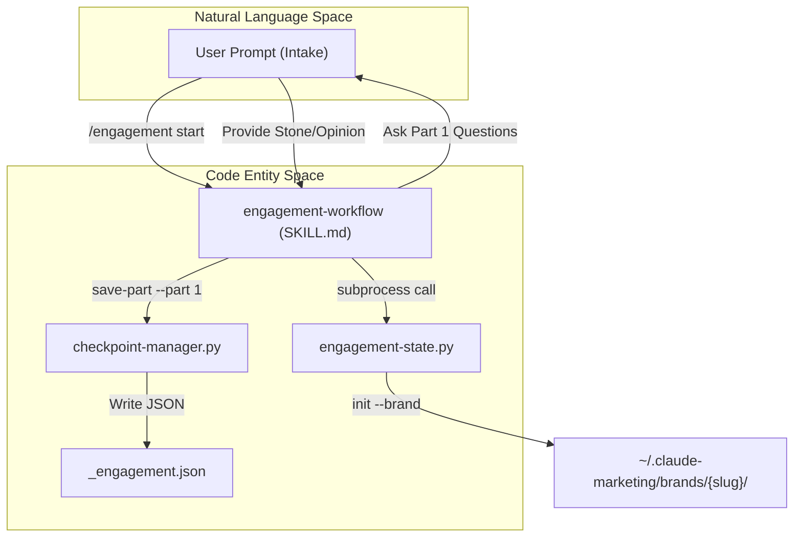
**Sources:**
- `skills/engagement-workflow/SKILL.md:37-58`
- `docs/data-and-insights.md:28-46`

### 5.2 Strategy Generation Logic
This diagram shows how the Four Core Documents are synthesized using specialist agents and reference data.

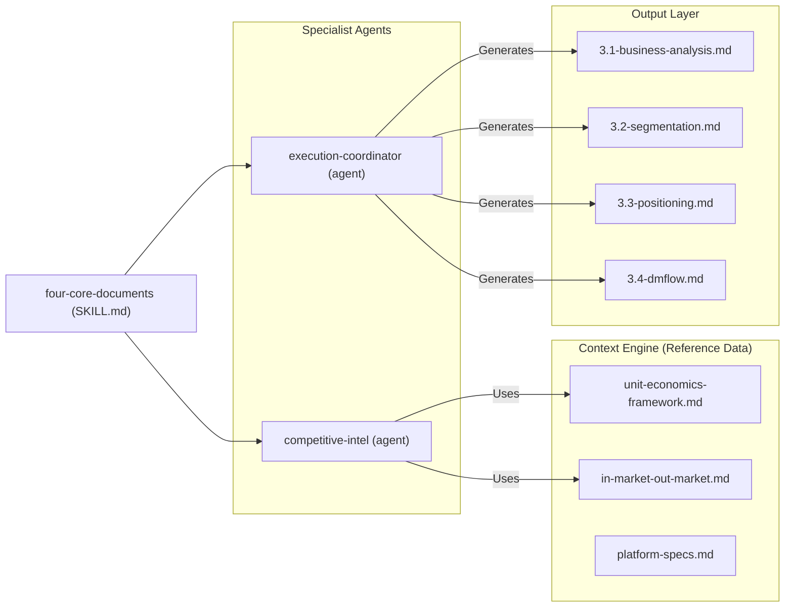
**Sources:**
- `skills/growth-plan/SKILL.md:21-25`
- `skills/growth-plan/SKILL.md:58-69`
- `docs/strategy-and-kpis.md:38-46`

---

## 6. Key Functions and State Management

### State Validation
Before advancing from Part 4 to Part 5 (Client Validation), the system executes `validate-part` via `engagement-state.py`.

```bash
python scripts/engagement-state.py validate-part --brand "{brand}" --id "{id}" --part 4
```
This function diffs the files in the `engagements/{id}/` directory against the `PART_DEFINITIONS` manifest to ensure no strategic gaps exist before the "One True Stop" in Part 5.

### Checkpointing
The `checkpoint-manager.py` script is used after each part to ensure the engagement is resumable. This prevents loss of work during long-running strategic sessions.

**Sources:**
- `skills/engagement-workflow/SKILL.md:45-68`
- `skills/engagement-workflow/SKILL.md:97-102`
- `docs/historical-data.md:39-41`

---

# Page: Client Validation & Two-Views Model (Parts 5–6)

# Client Validation & Two-Views Model (Parts 5–6)

<details>
<summary>Relevant source files</summary>

The following files were used as context for generating this wiki page:

- [TESTING-GUIDE.md](TESTING-GUIDE.md)
- [docs/architecture.md](docs/architecture.md)
- [docs/claude-interfaces.md](docs/claude-interfaces.md)
- [docs/engagement-methodology.md](docs/engagement-methodology.md)
- [docs/getting-started.md](docs/getting-started.md)
- [docs/integrations-guide.md](docs/integrations-guide.md)
- [docs/multi-brand-guide.md](docs/multi-brand-guide.md)
- [skills/client-validation-document/SKILL.md](skills/client-validation-document/SKILL.md)
- [skills/continuous-improvement-loop/SKILL.md](skills/continuous-improvement-loop/SKILL.md)
- [skills/engagement-workflow/SKILL.md](skills/engagement-workflow/SKILL.md)
- [skills/four-core-documents/SKILL.md](skills/four-core-documents/SKILL.md)
- [skills/growth-plan/SKILL.md](skills/growth-plan/SKILL.md)
- [skills/help/SKILL.md](skills/help/SKILL.md)

</details>


This page explains the transition from the unbiased research phase to the client-validated strategy phase (Parts 5 and 6 of the 12-Part Engagement Methodology). It covers the **One True Stop** (Part 5), the **Decision Matrix** for selective v2 re-runs, and the **Two-Views Model** which maintains both v1 (unbiased) and v2 (client-validated) perspectives.

## 1. Overview of the Two-Views Model

The Two-Views Model is a core architectural principle of the v3.0 methodology. It ensures that the system preserves the "unbiased market view" (v1) while incorporating the "client reality" (v2).

*   **v1 (Unbiased View):** Produced in Parts 2, 3, and 4. Grounded in Stone facts and external market research. It represents what the data says without client internal bias.
*   **v2 (Client-Validated View):** Produced in Part 6. This is the v1 strategy modified by the client's explicit ACCEPT/REJECT/EDIT decisions from Part 5.

The system maintains both views to allow for "Update-Back" and to ensure that strategic decisions can always be traced back to their original unbiased source.

**Sources:** [docs/engagement-methodology.md:31-42](), [skills/client-validation-document/SKILL.md:14-15]()

---

## 2. Part 5: The One True Stop (Client Validation)

Part 5 is the formal checkpoint where the client reviews the findings from the first four parts. No work in Parts 6–12 proceeds until this document is signed off.

### The Client Validation Document (CVD)
The CVD organizes findings into categories (Business, Audience, Positioning, etc.) and requires the client to make a formal decision on each.

| Component | Description |
| :--- | :--- |
| **Finding Block** | Contains the finding, evidence/sources, and proposed implication. |
| **Decision Framework** | Every finding must be marked as **ACCEPT**, **REJECT**, **EDIT**, or **DEFER**. |
| **Materiality** | Findings are rated **High**, **Medium**, or **Low** based on their strategic impact. |

### CVD Generation Logic
The `client-validation-document` skill pulls from the Four Core Documents (3.1–3.4) and Part 4 research to build these blocks.

**Sources:** [skills/client-validation-document/SKILL.md:17-45](), [skills/client-validation-document/SKILL.md:107-152]()

---

## 3. Part 6: Selective v2 Re-runs & The Decision Matrix

Part 6 uses the **Decision Matrix** to determine which v1 documents need to be regenerated as v2 based on the client's feedback in Part 5.

### The Decision Matrix
The system does not re-run everything. It uses a trigger-based logic to target specific documents for updates.

| Trigger Event | Documents Targeted for v2 Re-run |
| :--- | :--- |
| `competitors_changed` | 4.1, 4.2, 3.3, 3.4 |
| `audiences_changed` | 3.2, 3.3, 3.4, 4.3 |
| `positioning_changed` | 3.3, 3.4 |
| `budget_or_scope_changed` | 3.4, 3.1 |
| `minor_corrections_only` | No re-runs (Update-Back only) |

### Implementation in Code
The `engagement-workflow` skill orchestrates this by calling `engagement-state.py` to evaluate the matrix and then invoking `four-core-documents` with the `--view v2` flag.

**Sources:** [skills/engagement-workflow/SKILL.md:10-11](), [skills/client-validation-document/SKILL.md:153-166](), [skills/four-core-documents/SKILL.md:60-66]()

---

## 4. Technical Data Flow: Validation to Re-run

The following diagram illustrates how natural language client feedback is transformed into structured v2 documents.

**Diagram: Validation Data Flow**
```mermaid
graph TD
    subgraph "Natural Language Space (Client Feedback)"
        A["Client Review of Part 5 CVD"] -- "REJECT/EDIT Finding" --> B["Client Rationale & Corrections"]
    end

    subgraph "Code Entity Space (System Logic)"
        B --> C["engagement-state.py"]
        C -- "Apply Decision Matrix" --> D["_engagement.json (Update Triggers)"]
        D --> E["four-core-documents skill"]
        
        E -- "invoke with --view v2" --> F["scripts/setup.py (Context Loading)"]
        F --> G["v2/3.1-business-analysis.md"]
        F --> H["v2/3.2-segmentation.md"]
    end

    subgraph "Filesystem (Persistence)"
        G --> I["~/.claude-marketing/brands/{slug}/engagements/{id}/v2/"]
        H --> I
    end
```
**Sources:** [skills/engagement-workflow/SKILL.md:35-43](), [skills/four-core-documents/SKILL.md:121-124](), [docs/architecture.md:11-46]()

---

## 5. The Update-Back Rule & LIF

To maintain consistency across the engagement, the system uses two mechanisms to synchronize data: the **Update-Back Rule** and the **Living Project Instruction File (LIF)**.

### The Update-Back Rule
When a finding is corrected in Part 5, that correction must "update back" to the source document (e.g., a correction to a competitor must be reflected in the v2 version of the 4.1 Competitor Analysis). This ensures that Part 8 (Growth Plan) is built on a consistent foundation.

### The Living Project Instruction File (LIF)
The LIF is a JSON/Markdown file that acts as the "active memory" for the engagement. It stores the current validated strategic facts.

*   **Role:** The `growth-plan` skill reads the LIF as its first step to ensure it uses the latest validated data.
*   **Maintenance:** Updated by the `engagement-workflow` skill whenever a part is marked complete or a v2 re-run is finalized.

**Sources:** [skills/engagement-workflow/SKILL.md:32-33](), [skills/growth-plan/SKILL.md:27-36](), [docs/engagement-methodology.md:21-23]()

---

## 6. System Interaction Diagram

This diagram shows the relationship between the specialist agents and the methodology scripts during the validation phase.

**Diagram: Methodology Orchestration**
```mermaid
sequenceDiagram
    participant U as User (Client)
    participant EC as execution-coordinator.md
    participant ES as engagement-state.py
    participant CV as client-validation-document (Skill)
    participant CD as four-core-documents (Skill)

    U->>CV: /digital-marketing-pro:engagement start_part 5
    CV->>ES: validate-part --part 4
    ES-->>CV: OK
    CV->>U: Delivers CVD (Part 5)
    U->>EC: Provides ACCEPT/REJECT feedback
    EC->>ES: update-state --triggers [decision_matrix]
    EC->>CD: /digital-marketing-pro:four-core-documents --view v2
    CD->>ES: set-checkpoint-run --step 6
    ES-->>CD: Checkpoint Saved
```
**Sources:** [agents/execution-coordinator.md:36](), [skills/engagement-workflow/SKILL.md:45-58](), [skills/client-validation-document/SKILL.md:153-166](), [scripts/engagement-state.py:1-100]()

---

# Page: Execution, Growth Plan & Continuous Improvement (Parts 7–12)

# Execution, Growth Plan & Continuous Improvement (Parts 7–12)

<details>
<summary>Relevant source files</summary>

The following files were used as context for generating this wiki page:

- [commands/engagement.md](commands/engagement.md)
- [commands/output-folder.md](commands/output-folder.md)
- [commands/resume.md](commands/resume.md)
- [scripts/checkpoint-manager.py](scripts/checkpoint-manager.py)
- [skills/analytics-insights/clv-analysis.md](skills/analytics-insights/clv-analysis.md)
- [skills/analytics-insights/dashboard-design.md](skills/analytics-insights/dashboard-design.md)
- [skills/audience-intelligence/customer-research-methods.md](skills/audience-intelligence/customer-research-methods.md)
- [skills/campaign-orchestrator/sales-enablement.md](skills/campaign-orchestrator/sales-enablement.md)
- [skills/client-validation-document/SKILL.md](skills/client-validation-document/SKILL.md)
- [skills/content-engine/SKILL.md](skills/content-engine/SKILL.md)
- [skills/content-engine/case-studies.md](skills/content-engine/case-studies.md)
- [skills/continuous-improvement-loop/SKILL.md](skills/continuous-improvement-loop/SKILL.md)
- [skills/engagement-workflow/SKILL.md](skills/engagement-workflow/SKILL.md)
- [skills/four-core-documents/SKILL.md](skills/four-core-documents/SKILL.md)
- [skills/growth-plan/SKILL.md](skills/growth-plan/SKILL.md)
- [skills/seo-plan/SKILL.md](skills/seo-plan/SKILL.md)

</details>


This page details the latter half of the 12-Part Engagement Methodology, focusing on the transition from strategy to execution, the generation of flagship deliverables, and the perpetual improvement loop. It explains how the system manages state during long-running workflows and the technical implementation of the checkpointing protocol.

## Execution Fan-out & Preparation (Part 7)

Part 7 serves as the bridge between the validated strategy (Part 6) and active market execution. It involves the production of "Preparation Documents" that define the operational infrastructure.

### Key Deliverables
*   **Campaign Architecture:** Naming conventions and structural hierarchy for ad accounts and content repositories [skills/engagement-workflow/SKILL.md:68-70]().
*   **KPI Tree:** A hierarchical map of metrics from primary business goals down to channel-specific leading indicators [skills/growth-plan/SKILL.md:48-48]().
*   **Content Pillars & Asset Inventory:** Mapping brand messaging to specific content formats and auditing existing materials [skills/growth-plan/SKILL.md:34-34]().

### Technical Implementation: State Management
The system uses `engagement-state.py` to maintain the "Living Project Instruction File" (LIF), ensuring that Part 7 preparation is informed by the latest strategic facts [skills/engagement-workflow/SKILL.md:37-41]().

**Sources:** [skills/engagement-workflow/SKILL.md:68-70](), [skills/growth-plan/SKILL.md:34-48](), [commands/engagement.md:51-53]()

---

## Growth Plan & Yearly Planner (Part 8)

Part 8 produces the flagship client-facing deliverable: the **Growth Plan**. This is a synthesis of all previous research and strategy into a single narrative [skills/growth-plan/SKILL.md:17-19]().

### Growth Plan Structure (11 Sections)
The `growth-plan` skill [skills/growth-plan/SKILL.md:1-15]() generates a 20–30 page document based on the following schema:

| # | Section | Source Data |
|---|---------|-------------|
| 1 | Executive Summary | Synthesis of all parts |
| 2 | Business Context | Core Doc 3.1 + Market Research |
| 3 | Target Audience | Core Doc 3.2 (Actionable Personas) |
| 4 | Strategic Positioning | Core Doc 3.3 (Positioning Statement) |
| 5 | Channel Strategy | Core Doc 3.4 + Part 9 Channel Docs |
| 6 | Budget & Media Plan | DMFlow Step 5 & 9 |
| 7 | KPI Framework | Part 7 KPI Tree |
| 8 | Implementation Timeline | 30/60/90 Framework |
| 9 | Team & Resource Plan | Engagement Context |
| 10| Risk & Contingency | Core Doc 3.1 Step 16 |
| 11| Expected Outcomes | Three-Scenario Forecasting |

### Operational Companion: The Yearly Planner
While the Growth Plan is strategic, the **Yearly Planner** provides the month-by-month operational calendar for execution [commands/engagement.md:80-83]().

**Sources:** [skills/growth-plan/SKILL.md:17-54](), [commands/engagement.md:80-83]()

---

## Channel Strategies & Campaign Orchestration (Parts 9–11)

These parts handle the high-volume generation of execution artifacts.

*   **Part 9 (Channel Fan-out):** Produces up to 17 specific channel strategy documents (e.g., SEO Plan, Paid Ads Strategy) [scripts/checkpoint-manager.py:72-72]().
*   **Part 10 (Execution Artifacts):** Generates ad copy, social posts, headlines, and CTAs using the `content-engine` [skills/content-engine/SKILL.md:1-26]().
*   **Part 11 (AI Creative):** Focuses on AI-native asset generation, including image/video prompts and C2PA provenance embedding [scripts/checkpoint-manager.py:74-74]().

### Diagram: Execution Data Flow
This diagram illustrates how strategic "Stone Facts" flow through the orchestrator into specific execution scripts.

```mermaid
graph TD
    subgraph "Natural Language Space"
        LIF["Living Instruction File (LIF)"]
        GP["Growth Plan (Part 8)"]
    end

    subgraph "Code Entity Space"
        SK_ENG["skills/engagement-workflow/SKILL.md"]
        SK_CE["skills/content-engine/SKILL.md"]
        SCR_ES["scripts/engagement-state.py"]
        SCR_CP["scripts/checkpoint-manager.py"]
    end

    LIF --> SCR_ES
    SCR_ES --> SK_ENG
    SK_ENG --> GP
    GP --> SK_CE
    SK_CE --> SCR_CP
    SCR_CP --> OUT["/runs/{run_id}/part-10-copy.md"]
```

**Sources:** [skills/content-engine/SKILL.md:1-26](), [scripts/checkpoint-manager.py:72-74](), [skills/engagement-workflow/SKILL.md:37-41]()

---

## Continuous Improvement Loop (Part 12)

Part 12 is a perpetual feedback loop that aggregates four signal sources to prevent strategy stagnation [skills/continuous-improvement-loop/SKILL.md:17-19]().

### The 4 Signal Sources
1.  **Quarterly Business Reviews (QBR):** KPI performance vs. targets [skills/continuous-improvement-loop/SKILL.md:41-47]().
2.  **Customer Feedback Themes:** Aggregated sentiment from support tickets and sales calls [skills/continuous-improvement-loop/SKILL.md:49-58]().
3.  **Competitive Intelligence:** Shifts in competitor pricing or positioning [skills/continuous-improvement-loop/SKILL.md:60-68]().
4.  **Team-Discovered Patterns:** Tactical insights from execution teams [skills/continuous-improvement-loop/SKILL.md:70-77]().

### Update-Back Rule
If Part 12 signals indicate a fundamental shift, the system triggers an `update-back` command to version-bump the Four Core Documents [commands/engagement.md:51-58]().

**Sources:** [skills/continuous-improvement-loop/SKILL.md:17-77](), [commands/engagement.md:51-58]()

---

## Checkpoint Management & Resumption

Because the 12-Part workflow produces 50-60 files and can span multiple sessions, the system implements a deterministic checkpointing protocol via `scripts/checkpoint-manager.py` [scripts/checkpoint-manager.py:1-46]().

### Checkpoint Protocol
1.  **Init:** Start a run and generate a unique `run_id` [scripts/checkpoint-manager.py:143-165]().
2.  **Save:** After each part, the orchestrator writes the deliverable to the `runs/` directory [skills/engagement-workflow/SKILL.md:62-70]().
3.  **Check:** A quality gate (`/digital-marketing-pro:check`) must pass before Part 5 and Part 8 can be checkpointed [skills/engagement-workflow/SKILL.md:72-79]().
4.  **Finalize:** Once Part 12 is reached, the run is finalized and published [skills/engagement-workflow/SKILL.md:81-89]().

### The `/resume` Command
If a session is interrupted, the user runs `/digital-marketing-pro:resume`. The system:
1.  Identifies the latest `in_progress` run [commands/resume.md:23-25]().
2.  Reloads all saved artifacts into the AI context [commands/resume.md:45-53]().
3.  Positions the agent at the `next_step` identified in `run.json` [commands/resume.md:57-59]().

### Diagram: Checkpoint Lifecycle
Linking user commands to the underlying script execution and filesystem state.

```mermaid
graph LR
    subgraph "User Commands"
        CMD_START["/engagement start"]
        CMD_RESUME["/resume"]
        CMD_NEXT["/engagement next"]
    end

    subgraph "Logic Layer (scripts)"
        CH_MGR["checkpoint-manager.py"]
        OUT_PUB["output-publisher.py"]
    end

    subgraph "Storage (~/.claude-marketing)"
        RUN_JSON["/runs/{id}/run.json"]
        ARTIFACTS["/runs/{id}/part-N.md"]
    end

    CMD_START --> CH_MGR
    CH_MGR -- "init" --> RUN_JSON
    CMD_NEXT --> CH_MGR
    CH_MGR -- "save" --> ARTIFACTS
    CMD_RESUME --> CH_MGR
    CH_MGR -- "load" --> RUN_JSON
    ARTIFACTS -.-> OUT_PUB
    OUT_PUB --> USER_DOCS["~/Documents/DigitalMarketingPro/"]
```

**Sources:** [scripts/checkpoint-manager.py:1-186](), [commands/resume.md:1-95](), [skills/engagement-workflow/SKILL.md:45-93](), [commands/output-folder.md:15-23]()

---

# Page: Brand & Data Management

# Brand & Data Management

<details>
<summary>Relevant source files</summary>

The following files were used as context for generating this wiki page:

- [TESTING-GUIDE.md](TESTING-GUIDE.md)
- [docs/competitor-intelligence.md](docs/competitor-intelligence.md)
- [docs/cross-channel-sync.md](docs/cross-channel-sync.md)
- [docs/data-and-insights.md](docs/data-and-insights.md)
- [docs/engagement-methodology.md](docs/engagement-methodology.md)
- [docs/historical-data.md](docs/historical-data.md)
- [docs/integrations-guide.md](docs/integrations-guide.md)
- [docs/multi-brand-guide.md](docs/multi-brand-guide.md)
- [docs/strategy-and-kpis.md](docs/strategy-and-kpis.md)
- [skills/brand-setup/SKILL.md](skills/brand-setup/SKILL.md)

</details>


Digital Marketing Pro is designed as a stateful system that remembers brand identity, historical performance, and strategic learnings across sessions. This persistence is managed through a localized filesystem architecture that ensures data isolation between different clients or internal brands while allowing intelligence to compound over time.

## Brand Profile System

The core of the system's intelligence is the Brand Profile. Every marketing task—from generating a LinkedIn post to running a technical SEO audit—references this profile to ensure outputs are aligned with the brand's voice, business model, and compliance requirements.

Profiles are stored in a dedicated directory at `~/.claude-marketing/brands/{slug}/` [docs/multi-brand-guide.md:18-20](). Each brand is identified by a "slug" (a lowercase, hyphenated version of the brand name).

### The profile.json Schema
The primary configuration file is `profile.json`, which stores:
*   **Identity:** Mission, values, and USP [docs/multi-brand-guide.md:66-67]().
*   **Voice Settings:** Four numeric floats (Formality, Energy, Humor, Authority) on a 1-10 scale [docs/multi-brand-guide.md:69-74]().
*   **Business Model:** Type (B2B SaaS, DTC, etc.) and revenue model [docs/multi-brand-guide.md:67-68]().
*   **Compliance:** Target jurisdictions and industry regulations [docs/multi-brand-guide.md:78-78]().

For details on the setup process and full schema, see [Brand Profile Schema & Setup](#4.1).

**Sources:** [docs/multi-brand-guide.md:18-78](), [skills/brand-setup/SKILL.md:41-96]()

---

## Data Architecture & Persistence

The system uses a "Local-First" data strategy. Instead of a centralized database, it utilizes a structured filesystem under `~/.claude-marketing/` to maintain state.

### Filesystem Structure
The following diagram illustrates how the "Natural Language Space" (User Intent) maps to the "Code Entity Space" (Files and Scripts).

**Title: Brand Data Mapping (NL Space to Code Entity Space)**
```mermaid
graph TD
    subgraph "Natural Language Space (User Intent)"
        A["'Set up my brand'"]
        B["'Plan a campaign'"]
        C["'Analyze performance'"]
    end

    subgraph "Code Entity Space (System Files)"
        A -->|executes| S1["scripts/setup.py"]
        S1 -->|writes| F1["profile.json"]
        
        B -->|invokes| S2["campaign-tracker.py"]
        S2 -->|writes| F2["campaigns/_index.json"]
        
        C -->|executes| S3["scripts/performance-report.py"]
        S3 -->|writes| F3["performance/snapshot.json"]
    end

    F1 -.->|provides context to| S2
    F2 -.->|referenced by| S3
```
**Sources:** [docs/data-and-insights.md:47-56](), [docs/historical-data.md:22-59]()

---

## Multi-Brand & Agency Operations

For agencies and multi-brand corporations, the system provides strict isolation. Only one brand is "active" at a time, tracked by `~/.claude-marketing/brands/_active-brand.json` [docs/multi-brand-guide.md:80-91]().

### Isolation and Switching
*   **Zero Leakage:** Insights learned for Brand A never influence the strategies for Brand B [docs/multi-brand-guide.md:93-102]().
*   **Switching:** The `/switch-brand` command updates the `active_slug` in the global config, immediately pivoting all specialist agents to the new context [docs/multi-brand-guide.md:80-91]().
*   **Agency Workflow:** Agencies can use the `{client-name}-{project}` naming convention for slugs to organize large rosters [docs/multi-brand-guide.md:148-150]().

For details on managing multiple clients and rotating credentials, see [Multi-Brand & Agency Operations](#4.2).

**Sources:** [docs/multi-brand-guide.md:80-102](), [TESTING-GUIDE.md:213-213]()

---

## Compounding Intelligence Layer

The system features a "Rolling Memory" that captures learnings from every session. This prevents the AI from repeating mistakes and allows it to double down on proven tactics.

### Historical Data Flow
The `campaign-tracker.py` script manages the lifecycle of marketing data, from initial planning to post-mortem analysis [docs/data-and-insights.md:38-41]().

**Title: Intelligence Compounding Loop**
```mermaid
graph LR
    subgraph "Execution Phase"
        T1["scripts/connector_executor.py"]
    end

    subgraph "Intelligence Layer"
        S1["scripts/auto-save-insight.py"]
        S2["scripts/campaign-tracker.py"]
        F1["insights.json"]
    end

    T1 -->|provides outcome| S1
    S1 -->|distills learning| F1
    F1 -->|context for next run| S2
    S2 -->|informs| P1["New Campaign Plan"]
```

### Key Persistence Files
| File | Purpose | Capacity |
| :--- | :--- | :--- |
| `insights.json` | Stores patterns, anomalies, and strategy adjustments [docs/historical-data.md:59-61](). | Rolling 200-entry buffer [docs/data-and-insights.md:53-53](). |
| `campaigns/` | Individual JSON files for every plan created [docs/data-and-insights.md:51-51](). | Indefinite [docs/historical-data.md:41-41](). |
| `performance/` | Timestamped snapshots of channel metrics [docs/data-and-insights.md:52-52](). | Indefinite [docs/historical-data.md:57-57](). |

For details on how memory is synced and historical data is queried, see [Persistent Memory & Historical Data](#4.3).

**Sources:** [docs/data-and-insights.md:24-56](), [docs/historical-data.md:59-80](), [docs/strategy-and-kpis.md:44-48]()

---

# Page: Brand Profile Schema & Setup

# Brand Profile Schema & Setup

<details>
<summary>Relevant source files</summary>

The following files were used as context for generating this wiki page:

- [commands/brand-setup.md](commands/brand-setup.md)
- [commands/email-sequence.md](commands/email-sequence.md)
- [commands/performance-report.md](commands/performance-report.md)
- [scripts/setup.py](scripts/setup.py)
- [skills/attribution-model/SKILL.md](skills/attribution-model/SKILL.md)
- [skills/brand-setup/SKILL.md](skills/brand-setup/SKILL.md)
- [skills/client-onboarding/SKILL.md](skills/client-onboarding/SKILL.md)
- [skills/content-engine/video-scripting.md](skills/content-engine/video-scripting.md)
- [skills/launch-campaign/SKILL.md](skills/launch-campaign/SKILL.md)
- [skills/validate-profile/SKILL.md](skills/validate-profile/SKILL.md)

</details>


The **Brand Profile** is the central intelligence core of Digital Marketing Pro. It serves as the "single source of truth" for every AI-driven marketing task, ensuring that content generation, campaign planning, and performance audits are grounded in specific brand identity, voice, and compliance requirements.

## Overview

Brand management is handled via the `brand-setup` skill and the `scripts/setup.py` utility. Profiles are stored as structured JSON files within the `~/.claude-marketing/` filesystem, allowing for complete isolation between client brands in agency workflows.

### Key Capabilities
*   **Contextual Continuity**: Automatically injects brand identity into all subsequent skills (SEO, Content, Ads).
*   **Voice Quantization**: Converts qualitative descriptors (e.g., "witty but professional") into quantitative floats (1-10) for consistent scoring.
*   **Compliance Mapping**: Links target markets to specific regulatory rules (e.g., GDPR, DPDPA) defined in the context engine.
*   **Multi-Brand Isolation**: Manages active brand state via a pointer file, preventing cross-contamination of data.

---

## The `profile.json` Schema

The `profile.json` file is the primary data entity. It is located at `~/.claude-marketing/brands/{slug}/profile.json`.

### Schema Structure

| Section | Key Fields | Purpose |
|:---|:---|:---|
| **Identity** | `brand_name`, `elevator_pitch`, `usp` | Core definition of the business. |
| **Business Model** | `type`, `revenue_model`, `sales_cycle_length` | Influences funnel strategy and attribution lookback windows. |
| **Brand Voice** | `formality`, `energy`, `humor`, `authority` | 1-10 floats used by `brand-voice-scorer.py`. |
| **Audience** | `primary_persona`, `buying_triggers` | Defines targeting and messaging hooks. |
| **Market/Compliance**| `target_markets`, `industry`, `regulated` | Triggers jurisdiction-specific guardrails. |
| **Competitors** | `name`, `url`, `strengths` | Used for competitive benchmarking and gap analysis. |

**Sources:** [scripts/setup.py:124-168](), [commands/brand-setup.md:51-77](), [skills/brand-setup/SKILL.md:41-96]()

---

## Brand Setup Workflow

The system provides two modes for creating a profile: **Quick** and **Full**.

### 1. Setup Modes
*   **Quick Setup (5 Questions)**: Captures the bare essentials (Name, Pitch, Audience, Voice words, Channel). The system then infers industry defaults and maps voice words to scales (e.g., "professional" maps to `formality: 8`).
*   **Full Setup (17 Questions)**: A comprehensive deep-dive covering mission values, revenue models, secondary personas, messaging pillars, and detailed competitor SWOT analysis.

### 2. Implementation Logic
The `brand-setup` skill coordinates the interaction, while `scripts/setup.py` handles the filesystem operations.

#### Natural Language to Code Entity Mapping
The following diagram illustrates how user inputs are transformed into persistent code entities.

**Diagram: Setup Data Flow**
```mermaid
graph TD
    User["User Input (Natural Language)"] --> Skill["skills/brand-setup/SKILL.md"]
    Skill -- "Interprets Mode (--full)" --> Logic["Interactive Prompting"]
    Logic -- "Slugifies Name" --> SetupPy["scripts/setup.py --create-brand"]
    
    subgraph "Filesystem Space (~/.claude-marketing)"
        SetupPy --> Dir["brands/{slug}/"]
        Dir --> Prof["profile.json (Identity/Voice/Goals)"]
        Dir --> Active["_active-brand.json (Pointer)"]
    end
    
    Prof --> Scorer["scripts/brand-voice-scorer.py"]
    Prof --> Validator["skills/validate-profile/SKILL.md"]
```
**Sources:** [skills/brand-setup/SKILL.md:19-103](), [scripts/setup.py:74-96](), [commands/brand-setup.md:39-84]()

---

## Profile Validation & Health Checks

Once a profile is created, the `validate-profile` skill acts as a production gate. It ensures that the profile is not only complete but also technically viable (e.g., connectors are reachable).

### Validation Dimensions
The `validate-profile` skill checks several critical dimensions:
1.  **Blockers**: Missing `brand_name`, `industry`, or `target_jurisdictions`.
2.  **Voice Integrity**: Ensures `voice.formality`, `energy`, etc., are populated before content tasks.
3.  **Compliance Cross-Check**: Confirms that every `target_jurisdiction` in the profile has a corresponding entry in `skills/context-engine/compliance-rules.md`.
4.  **Connector Readiness**: Runs `scripts/connector-status.py --probe-only` to verify that environment variables or `.mcp.json` entries exist for all configured integrations (CRM, Analytics, etc.).

**Sources:** [skills/validate-profile/SKILL.md:32-47](), [skills/validate-profile/SKILL.md:72-88]()

---

## Multi-Brand Operations

For agency environments, the system supports switching between isolated brand contexts.

### State Management
*   **Active Brand**: Managed via `~/.claude-marketing/brands/_active-brand.json`. This file contains the `active_slug`.
*   **Switching**: The command `/digital-marketing-pro:switch-brand <slug>` updates this pointer.
*   **Isolation**: Every skill first calls `_common.brands_root()` to resolve the path for the currently active brand, ensuring no data leakage between clients.

**Diagram: Multi-Brand Resolution Logic**
```mermaid
flowchart LR
    Skill["Any SKILL.md"] -- "Step 0: Resolve Brand" --> Common["scripts/_common.py"]
    Common -- "Reads" --> ActiveJSON["~/.claude-marketing/brands/_active-brand.json"]
    ActiveJSON -- "Returns active_slug" --> ProfilePath["~/.claude-marketing/brands/{slug}/profile.json"]
    
    subgraph "Brand Isolation"
        B1["/brands/acme-corp/"]
        B2["/brands/globex/"]
    end
    
    ProfilePath -.-> B1
    ProfilePath -.-> B2
```
**Sources:** [scripts/setup.py:23-27](), [scripts/setup.py:74-96](), [skills/validate-profile/SKILL.md:51-64](), [skills/brand-setup/SKILL.md:105-112]()

---

## Technical Setup & Dependencies

The `scripts/setup.py` script manages the environment initialization.

### Initialization Steps
1.  **Directory Creation**: Creates the `~/.claude-marketing/` root and subdirectories for `brands`, `templates`, `industry-data`, and `sops`.
2.  **Settings Init**: Generates a global `settings.json` with default scoring and compliance flags.
3.  **Dependency Modes**:
    *   `LITE_DEPS`: Installs `nltk` and `textstat` for basic voice analysis.
    *   `FULL_DEPS`: Adds `beautifulsoup4` (competitor scraping), `qrcode` (UTM generation), and provider SDKs (`openai`, `anthropic`).

**Sources:** [scripts/setup.py:29-71]()

---

# Page: Multi-Brand & Agency Operations

# Multi-Brand & Agency Operations

<details>
<summary>Relevant source files</summary>

The following files were used as context for generating this wiki page:

- [TESTING-GUIDE.md](TESTING-GUIDE.md)
- [docs/engagement-methodology.md](docs/engagement-methodology.md)
- [docs/integrations-guide.md](docs/integrations-guide.md)
- [docs/multi-brand-guide.md](docs/multi-brand-guide.md)
- [scripts/drive-sync-state.py](scripts/drive-sync-state.py)
- [skills/ab-test-plan/SKILL.md](skills/ab-test-plan/SKILL.md)
- [skills/budget-optimizer/SKILL.md](skills/budget-optimizer/SKILL.md)
- [skills/context-engine/SKILL.md](skills/context-engine/SKILL.md)
- [skills/context-engine/agency-operations-guide.md](skills/context-engine/agency-operations-guide.md)
- [skills/context-engine/crm-integration-guide.md](skills/context-engine/crm-integration-guide.md)
- [skills/cowork-setup/SKILL.md](skills/cowork-setup/SKILL.md)
- [skills/credential-switch/SKILL.md](skills/credential-switch/SKILL.md)
- [skills/crm-sync/SKILL.md](skills/crm-sync/SKILL.md)
- [skills/keyword-research/SKILL.md](skills/keyword-research/SKILL.md)
- [skills/roi-calculator/SKILL.md](skills/roi-calculator/SKILL.md)
- [skills/switch-brand/SKILL.md](skills/switch-brand/SKILL.md)

</details>


This page details the technical implementation and operational workflows for managing multiple client brands within a single Digital Marketing Pro installation. It covers brand isolation, credential rotation, agency-specific management tools, and the persistence solution for team-based Cowork environments.

## Brand Isolation & Slugs

The system enforces strict data isolation between brands using a slug-based directory structure. Every brand created via `/brand-setup` is assigned a unique, lowercase, hyphenated identifier (the "slug") derived from its name [docs/multi-brand-guide.md:20-20]().

### Brand Directory Structure
All brand-specific data is stored in isolated subdirectories within the global plugin data root:

| Path Component | Description |
| :--- | :--- |
| `~/.claude-marketing/brands/{slug}/profile.json` | Core identity, voice settings, and business model [docs/multi-brand-guide.md:26-26](). |
| `~/.claude-marketing/brands/{slug}/audiences.json` | Segmented buyer personas [docs/multi-brand-guide.md:27-27](). |
| `~/.claude-marketing/brands/{slug}/insights.json` | Rolling buffer of the last 200 marketing learnings [docs/multi-brand-guide.md:29-29](). |
| `~/.claude-marketing/brands/{slug}/engagements/` | v3.0 methodology state and deliverables [docs/multi-brand-guide.md:34-34](). |

### The Active Brand Mechanism
The system maintains a singleton state file, `~/.claude-marketing/brands/_active-brand.json`, which tracks the `active_slug` for the current session [docs/multi-brand-guide.md:82-88](). Every skill and script reads this file to pivot its context, ensuring that insights or campaign data from Brand A never "bleed" into Brand B [docs/multi-brand-guide.md:91-102]().

**Sources:** [docs/multi-brand-guide.md:18-102]()

## Switching Contexts

Agencies manage multiple clients by rotating the active brand and its associated API credentials.

### switch-brand Command
The `/switch-brand` command updates the `_active-brand.json` file. Upon execution, the context engine reloads the brand's voice dimensions (`formality`, `energy`, `humor`, `authority`), industry benchmarks, and compliance rules [TESTING-GUIDE.md:213-213](), [docs/multi-brand-guide.md:64-74]().

### credential-switch for API Rotation
Agencies must isolate client API tokens (e.g., for GA4, HubSpot, or Google Ads). The `/credential-switch` command manages profiles stored at `~/.claude-marketing/credentials/{slug}.json` [skills/context-engine/agency-operations-guide.md:14-14](). 
* **Implementation:** Credentials are never hardcoded; they are injected as environment variables (e.g., `${GA_PROPERTY_ID}`) into the Model Context Protocol (MCP) server definitions at runtime [docs/integrations-guide.md:64-68]().

### Multi-Brand Context Resolution
```mermaid
graph TD
    User["User Prompt"] -- "/switch-brand acme-corp" --> Cmd["switch-brand Command"]
    Cmd -- "Write active_slug" --> ActiveFile["~/.claude-marketing/brands/_active-brand.json"]
    
    subgraph "Context Resolution"
        ActiveFile -- "Read Slug" --> CommonPy["scripts/_common.py"]
        CommonPy -- "Locate Path" --> BrandDir["~/.claude-marketing/brands/acme-corp/"]
        BrandDir --> Profile["profile.json (Voice/Goals)"]
        BrandDir --> Creds["credentials/acme-corp.json"]
    end
    
    Profile --> Agent["Specialist Agent (e.g. seo-specialist)"]
    Creds --> MCP["MCP Connector (Real Data)"]
```
**Sources:** [docs/multi-brand-guide.md:80-91](), [skills/context-engine/agency-operations-guide.md:14-14](), [docs/integrations-guide.md:64-68](), [scripts/_common.py:72-72]()

## Agency Management Tools

### Agency Dashboard & Portfolio Health
The system provides a framework for tracking client health across the agency's portfolio. The **Client Health Score (0-100)** is a weighted composite of five dimensions [skills/context-engine/agency-operations-guide.md:38-49]():

| Dimension | Weight | Metric |
| :--- | :--- | :--- |
| **Campaign Activity** | 25% | Active campaigns vs. plan |
| **Budget Pacing** | 25% | Spend vs. plan + ROAS/CPA trends |
| **KPI Attainment** | 25% | Actual vs. target performance |
| **Content Pipeline** | 15% | Calendar coverage for next 30 days |
| **Engagement Health** | 10% | Social response times and engagement rates |

### Multi-CRM Operations
Agencies often connect different brands to different CRM platforms. The `crm-sync.py` script acts as a local preparation layer that validates and maps fields before the agent executes the actual write via a specific CRM MCP (e.g., `mcp-salesforce` or `@anthropic/mcp-hubspot`) [skills/context-engine/crm-integration-guide.md:11-25]().

**Sources:** [skills/context-engine/agency-operations-guide.md:38-75](), [skills/context-engine/crm-integration-guide.md:9-25]()

## Cowork Team Persistence (Google Drive)

In Anthropic Cowork environments, the local filesystem (`~/.claude-marketing/`) is ephemeral and vanishes at the end of a session [skills/cowork-setup/SKILL.md:14-16](). To support agency teams, the plugin implements a "Cowork+Drive" routing solution.

### Persistence Architecture
The `/cowork-setup` command wires the plugin to a Google Drive MCP. This creates a canonical folder structure in the team's shared Drive to store brand state persistently [skills/cowork-setup/SKILL.md:73-89]().

### State Synchronization Flow
The `scripts/drive-sync-state.py` script manages the local bookkeeping ledger (`_drive-sync.json`) that tells the agent which local files need to be uploaded to or downloaded from Drive [scripts/drive-sync-state.py:7-14]().

```mermaid
graph LR
    subgraph "Ephemeral Sandbox (Cowork)"
        Local["~/.claude-marketing/"]
        SyncScript["scripts/drive-sync-state.py"]
    end

    subgraph "Persistent Storage (Google Drive)"
        DriveRoot["DigitalMarketingPro/"]
        DriveBrands["_brands/ (Profiles)"]
        DriveRuns["_runs/ (Checkpoints)"]
    end

    Agent["Claude Agent"] -- "Check State" --> SyncScript
    SyncScript -- "Needs Sync" --> Agent
    Agent -- "mcp__drive__upload" --> DriveRoot
    DriveRoot -- "mcp__drive__download" --> Local
```

### Key Synchronization Actions
* **`profile-needs-upload`**: Compares local `profile.json` hash against the last recorded Drive hash [scripts/drive-sync-state.py:114-135]().
* **`add-pending-upload`**: Marks campaign plans or audit reports generated during a session as "pending" for Drive upload [scripts/drive-sync-state.py:47-48]().
* **Multi-Team Isolation**: Teams are isolated by their `drive_root_folder_name` defined in `_cowork-config.json` [skills/cowork-setup/SKILL.md:91-108]().

**Sources:** [skills/cowork-setup/SKILL.md:10-108](), [scripts/drive-sync-state.py:1-180]()

---

# Page: Persistent Memory & Historical Data

# Persistent Memory & Historical Data

<details>
<summary>Relevant source files</summary>

The following files were used as context for generating this wiki page:

- [docs/competitor-intelligence.md](docs/competitor-intelligence.md)
- [docs/cross-channel-sync.md](docs/cross-channel-sync.md)
- [docs/data-and-insights.md](docs/data-and-insights.md)
- [docs/historical-data.md](docs/historical-data.md)
- [docs/strategy-and-kpis.md](docs/strategy-and-kpis.md)
- [scripts/auto-save-insight.py](scripts/auto-save-insight.py)
- [scripts/campaign-tracker.py](scripts/campaign-tracker.py)
- [scripts/guidelines-manager.py](scripts/guidelines-manager.py)
- [scripts/output-publisher.py](scripts/output-publisher.py)

</details>


Persistent memory in Digital Marketing Pro is the "compounding intelligence" layer that ensures the system learns from every session. Rather than starting from scratch, agents reference historical campaign performance, strategic insights, and previous brand interactions to refine future recommendations [docs/historical-data.md:3-5]().

## The Intelligence Loop

Data flows from external sources (via MCP) into session analysis, where it is distilled into actionable insights and saved to the local filesystem. These files serve as the system's long-term memory [docs/data-and-insights.md:24-45]().

### Data Flow Architecture
This diagram illustrates how natural language intents translate into persistent data entities managed by the Python layer.

```mermaid
graph TD
    subgraph "Natural Language Space"
        User["User Intent: 'Plan Q3 Campaign'"]
        Agent["Specialist Agent (e.g. Campaign Orchestrator)"]
    end

    subgraph "Code Entity Space"
        CT["scripts/campaign-tracker.py"]
        ASI["scripts/auto-save-insight.py"]
        OP["scripts/output-publisher.py"]
        
        subgraph "Filesystem Memory (~/.claude-marketing)"
            Profile["profile.json"]
            Insights["insights.json (Rolling Buffer)"]
            Campaigns["campaigns/_index.json"]
            Perf["performance/*.json"]
        end
    end

    User --> Agent
    Agent -- "list-campaigns" --> CT
    CT -- "read" --> Campaigns
    Agent -- "save-insight" --> ASI
    ASI -- "write" --> Insights
    Agent -- "publish" --> OP
    OP -- "copy" --> Profile
```
**Sources:** [docs/data-and-insights.md:28-45](), [scripts/campaign-tracker.py:12-20](), [scripts/auto-save-insight.py:25-33]()

---

## Core Persistence Components

### 1. Campaign Tracking (`campaign-tracker.py`)
This script is the primary interface for managing historical campaign data. It handles three main data types:
*   **Campaign Plans:** Saved as individual JSON files in `brands/{slug}/campaigns/` with a fast-lookup `_index.json` [scripts/campaign-tracker.py:42-84]().
*   **Performance Snapshots:** Timestamped records (e.g., `bf-2025-20251201-143022.json`) that allow for chronological trend analysis [docs/historical-data.md:55-57]().
*   **Insights Buffer:** A rolling 200-entry array in `insights.json` containing session learnings and performance discoveries [scripts/campaign-tracker.py:152-179]().

### 2. Insight Accumulation (`auto-save-insight.py`)
The system captures learnings (e.g., "Instagram Stories outperformed static carousels 2:1") via an opt-in mechanism [docs/historical-data.md:71-76]().
*   **Opt-in Logic:** The script checks the `auto_save_insights` boolean in `profile.json`. If `false` or missing, it no-ops to maintain multi-plugin hygiene [scripts/auto-save-insight.py:118-132]().
*   **Manual Override:** The `--force` flag allows users to explicitly save an insight regardless of the global brand setting [scripts/auto-save-insight.py:34-37]().

### 3. Output Mirroring (`output-publisher.py`)
To prevent the "hidden data" problem where files in `~/.claude-marketing/` feel unsaved, this script mirrors outputs to a user-visible directory [scripts/output-publisher.py:19-22]().

| Location Type | Path | Purpose |
| :--- | :--- | :--- |
| **Internal Tracking** | `~/.claude-marketing/{brand}/output/` | System-of-record for status and audit history [scripts/output-publisher.py:10-12]() |
| **User-Visible** | `~/Documents/DigitalMarketingPro/{brand}/` | Visible in OS file managers (Finder/Explorer) [scripts/output-publisher.py:13-17]() |

**Sources:** [scripts/campaign-tracker.py:5-20](), [scripts/auto-save-insight.py:5-20](), [scripts/output-publisher.py:3-17]()

---

## Data Lifecycle & Cross-Session Learning

The "Intelligence Layer" follows a deterministic five-step framework to apply history to new tasks:
1.  **Load Brand Context:** Pull voice, goals, and industry from `profile.json` [docs/historical-data.md:126]().
2.  **Check History:** Run `campaign-tracker.py --action list-campaigns` [docs/historical-data.md:84]().
3.  **Identify Patterns:** Compare performance snapshots to find what worked [docs/historical-data.md:55-57]().
4.  **Extract Insights:** Filter `insights.json` for relevant tags (e.g., `session_learning`) [docs/historical-data.md:63-69]().
5.  **Synthesize:** Generate new plans that incorporate past learnings [docs/historical-data.md:109-118]().

### Entity-Relationship Diagram (Memory Layer)

```mermaid
erDiagram
    BRAND_PROFILE ||--o{ CAMPAIGN_INDEX : "tracks"
    CAMPAIGN_INDEX ||--|{ CAMPAIGN_PLAN : "indexes"
    CAMPAIGN_PLAN ||--o{ PERFORMANCE_SNAPSHOT : "has results"
    BRAND_PROFILE ||--o{ INSIGHT_BUFFER : "accumulates"
    
    BRAND_PROFILE {
        string slug
        boolean auto_save_insights
        object goals
    }
    CAMPAIGN_PLAN {
        string campaign_id
        string status
        array channels
    }
    INSIGHT_BUFFER {
        string type
        string insight
        datetime recorded_at
    }
    PERFORMANCE_SNAPSHOT {
        string snapshot_id
        object metrics
        datetime recorded_at
    }
```
**Sources:** [docs/data-and-insights.md:47-55](), [docs/historical-data.md:26-78](), [scripts/campaign-tracker.py:166-173]()

---

## Syncing & Management Commands

Users can manage persistent memory through natural language commands that map to script executions:

*   **`/sync-memory`**: Manually flushes session learnings to `insights.json` via `campaign-tracker.py --action save-insight` [docs/data-and-insights.md:196-200]().
*   **`/status`**: Queries `output-publisher.py where` to locate published files and `campaign-tracker.py list-campaigns` to show project progress [scripts/output-publisher.py:171-185]().
*   **`guidelines-manager.py`**: Manages the `guidelines/` and `templates/` subdirectories, providing structured storage for brand-specific restrictions and SOPs [scripts/guidelines-manager.py:7-15]().

**Sources:** [docs/data-and-insights.md:192-200](), [scripts/output-publisher.py:171-185](), [scripts/guidelines-manager.py:1-27]()

---

# Page: MCP Connectors & Execution Layer

# MCP Connectors & Execution Layer

<details>
<summary>Relevant source files</summary>

The following files were used as context for generating this wiki page:

- [.mcp.json.connectors-reference](.mcp.json.connectors-reference)
- [CONNECTORS.md](CONNECTORS.md)
- [SUBMISSION.md](SUBMISSION.md)
- [commands/competitor-analysis.md](commands/competitor-analysis.md)
- [commands/doctor.md](commands/doctor.md)
- [commands/execute-action.md](commands/execute-action.md)
- [commands/seo-audit.md](commands/seo-audit.md)
- [scripts/_connector_registry.py](scripts/_connector_registry.py)
- [scripts/action-doctor.py](scripts/action-doctor.py)
- [scripts/connector-status.py](scripts/connector-status.py)
- [scripts/connector_executor.py](scripts/connector_executor.py)
- [scripts/connector_resolver.py](scripts/connector_resolver.py)
- [scripts/crm-sync.py](scripts/crm-sync.py)
- [scripts/embed-c2pa.py](scripts/embed-c2pa.py)
- [scripts/execution-tracker.py](scripts/execution-tracker.py)
- [scripts/performance-monitor.py](scripts/performance-monitor.py)
- [scripts/seo-executor.py](scripts/seo-executor.py)
- [skills/c2pa-metadata/SKILL.md](skills/c2pa-metadata/SKILL.md)

</details>


The **Model Context Protocol (MCP)** integration in Digital Marketing Pro serves as the bridge between high-level marketing strategy and deterministic technical execution. This layer allows the system to remain tool-agnostic while providing deep integration with over 68 marketing platforms, CRMs, and analytics suites.

The architecture is designed with a "security-first, opt-in" philosophy. The system ships with no active connectors by default to prevent unauthorized data access or accidental execution. Users must explicitly activate connectors via the [Connector Catalog & Setup](#5.1) and pass through [Action Execution & Safety Gates](#5.2) for any "write" operations.

## Architecture Overview: Natural Language to Code Execution

The following diagram illustrates how a natural language request from a user is resolved into a specific code entity and eventually executed via an MCP server.

**Action Resolution & Execution Flow**
```mermaid
graph TD
    User["User Request (e.g., 'Audit SEO')"] -- "Invokes Skill" --> Skill["SKILL.md (e.g., seo-audit.md)"]
    Skill -- "Calls Script" --> Script["seo-executor.py"]
    Script -- "Requests Resolution" --> Resolver["connector_resolver.py"]
    
    subgraph "Code Entity Space"
        Resolver -- "Look up" --> Registry["_connector_registry.py"]
        Registry -- "Check Config" --> Config[".mcp.json"]
    end

    Resolver -- "Mode: real" --> LocalExec["Local Python Execution"]
    Resolver -- "Mode: manifest_ready" --> Manifest["HTTP Request Manifest"]
    Resolver -- "Mode: stub_unconfigured" --> SetupHint["Setup Instructions"]

    Manifest -- "Safety Gate" --> Executor["connector_executor.py"]
    Executor -- "Tool Call" --> MCPServer["External MCP Server (HubSpot, Ahrefs, etc.)"]
```
**Sources:** [scripts/connector_resolver.py:1-35](), [scripts/seo-executor.py:1-22](), [CONNECTORS.md:1-24]()

## Resolution Modes

Every action in the system is processed by `connector_resolver.py` and resolved into one of three distinct execution modes. This ensures that the agent knows exactly whether it can perform a task, needs a manifest to show the user, or needs to guide the user through setup.

| Mode | Description | Code Behavior |
| :--- | :--- | :--- |
| **`real`** | Connector is configured and the call is safe for local execution. | Runs the Python function directly in the script. |
| **`manifest_ready`** | Connector is configured but involves a "write" or "launch" operation. | Returns a JSON manifest (URL, headers, body template) for the agent to execute. |
| **`stub_unconfigured`** | No matching connector is found in `.mcp.json`. | Returns the original stub plus copy-paste instructions for the user. |

**Sources:** [scripts/connector_resolver.py:8-26](), [scripts/connector_resolver.py:58-73]()

## System Component Mapping

This diagram bridges the functional names used in the methodology with the specific Python classes and files that handle the MCP logic.

**Component Association Map**
```mermaid
graph LR
    subgraph "Methodology Concepts"
        A["Connector Catalog"]
        B["Action Resolution"]
        C["Execution Safety Gate"]
        D["Audit Trail"]
    end

    subgraph "Code Entities"
        A1[".mcp.json.connectors-reference"]
        B1["scripts/connector_resolver.py"]
        C1["scripts/connector_executor.py"]
        D1["scripts/execution-tracker.py"]
    end

    A --> A1
    B --> B1
    C --> C1
    D --> D1
```
**Sources:** [scripts/connector_resolver.py:28-35](), [scripts/execution-tracker.py:1-17](), [scripts/action-doctor.py:1-23]()

## Connector Catalog & Setup (#5.1)

The system maintains a reference of 68+ servers categorized by marketing function (CRM, SEO, Ads, etc.). Users can activate these by moving entries from `.mcp.json.connectors-reference` into their active `.mcp.json` file.

*   **Transport Types:** Supports both `http` (Cowork/Cloud compatible) and `npx` (Claude Code/Local only) transports.
*   **Unified Ads MCPs:** Supports specialized aggregators like `synter-media-ai` and `ryze-ai` to manage multiple ad platforms through a single interface.
*   **Discovery:** The `/digital-marketing-pro:integrations` command provides a real-time dashboard of connected vs. available tools.

For setup instructions and the full list of supported vendors, see [Connector Catalog & Setup](#5.1).

**Sources:** [CONNECTORS.md:1-62](), [scripts/connector-status.py:46-100]()

## Action Execution & Safety Gates (#5.2)

Execution is never silent for operations that affect external state (e.g., posting to Slack, launching Google Ads).

*   **Manifest Building:** `connector_resolver.py` uses `ACTION_SPECS` to map internal IDs (like `launch-ads`) to specific API shapes for platforms like HubSpot or LinkedIn.
*   **Safety Gate:** The `connector_executor.py` script acts as a final gate, requiring explicit user confirmation before sending payloads to an MCP server.
*   **Audit Logging:** Every successful or failed execution is logged by `execution-tracker.py` into the brand's `executions/` directory, creating a permanent record for agency reporting.

For details on the execution pipeline and safety protocols, see [Action Execution & Safety Gates](#5.2).

**Sources:** [scripts/connector_resolver.py:133-170](), [scripts/execution-tracker.py:79-138](), [scripts/connector_executor.py:1-15]()

---

# Page: Connector Catalog & Setup

# Connector Catalog & Setup

<details>
<summary>Relevant source files</summary>

The following files were used as context for generating this wiki page:

- [.mcp.json.connectors-reference](.mcp.json.connectors-reference)
- [.mcp.json.example](.mcp.json.example)
- [CONNECTORS.md](CONNECTORS.md)
- [SUBMISSION.md](SUBMISSION.md)
- [commands/competitor-analysis.md](commands/competitor-analysis.md)
- [commands/doctor.md](commands/doctor.md)
- [commands/execute-action.md](commands/execute-action.md)
- [commands/seo-audit.md](commands/seo-audit.md)
- [scripts/_connector_registry.py](scripts/_connector_registry.py)
- [scripts/action-doctor.py](scripts/action-doctor.py)
- [scripts/connector_executor.py](scripts/connector_executor.py)
- [scripts/connector_resolver.py](scripts/connector_resolver.py)
- [scripts/embed-c2pa.py](scripts/embed-c2pa.py)
- [skills/add-integration/SKILL.md](skills/add-integration/SKILL.md)
- [skills/c2pa-metadata/SKILL.md](skills/c2pa-metadata/SKILL.md)
- [skills/connect/SKILL.md](skills/connect/SKILL.md)
- [skills/integrations/SKILL.md](skills/integrations/SKILL.md)
- [skills/simulate/SKILL.md](skills/simulate/SKILL.md)

</details>


The Digital Marketing Pro plugin utilizes the **Model Context Protocol (MCP)** to bridge the gap between AI strategic reasoning and deterministic marketing execution. The system features a catalog of 68 MCP servers categorized by marketing function (CRM, SEO, Ads, etc.). Connectors are **opt-in and tool-agnostic**, allowing users to map generic placeholders like `~~CRM` to specific providers such as HubSpot or Salesforce `[CONNECTORS.md:5-7]()`.

## Connector Architecture & Transport Types

The plugin supports two primary transport types for MCP servers, catering to different execution environments (Claude Code CLI vs. Anthropic Cowork).

### 1. HTTP Connectors (Preferred)
These are hosted MCP servers that use Server-Sent Events (SSE) or HTTP POST. They are required for **Cowork** compatibility and are recommended for Claude Code to avoid local dependency management `[CONNECTORS.md:2-4]()`.
*   **Source:** `.mcp.json.connectors-reference` `[CONNECTORS.md:7-7]()`.
*   **Auth:** Typically OAuth on first connect or API keys in headers `[.mcp.json.connectors-reference:9-33]()`.

### 2. stdio/npx Connectors (Claude Code Only)
These run locally via `npx` or `command` execution. They are not supported in Cowork sessions `[CONNECTORS.md:39-41]()`.
*   **Source:** `.mcp.json.example` `[CONNECTORS.md:39-39]()`.
*   **Note:** Users must verify npx packages manually as many are conceptual or require local environment variables `[.mcp.json.example:3-3]()`.

### Connector Categories
| Category | Placeholder | Examples |
| :--- | :--- | :--- |
| **CRM** | `~~CRM` | HubSpot, Salesforce, Zoho `[CONNECTORS.md:15-15]()` |
| **SEO** | `~~SEO` | Ahrefs, Similarweb, Semrush `[CONNECTORS.md:18-18]()` |
| **Ads** | `~~Ads` | Google Ads, Meta, LinkedIn (via Unified Ads MCPs) `[CONNECTORS.md:44-44]()` |
| **Email** | `~~email marketing` | Klaviyo, Mailchimp, Brevo `[CONNECTORS.md:19-19]()` |
| **Social** | `~~chat` / `~~social` | Slack, Buffer, Hootsuite `[CONNECTORS.md:13-13]()`, `[CONNECTORS.md:46-46]()` |

**Sources:** `[CONNECTORS.md:1-50]()`, `[.mcp.json.connectors-reference:1-125]()`, `[.mcp.json.example:1-187]()`.

---

## Action Resolution Logic

The `connector_resolver.py` script acts as the intelligence layer that determines how a requested marketing action (e.g., `launch-ads`) is handled based on the current configuration `[scripts/connector_resolver.py:3-6]()`.

### Resolution Modes
1.  **`real`**: The action is executed locally via Python (e.g., `slack-incoming-webhook`) `[scripts/connector_resolver.py:10-13]()`.
2.  **`manifest_ready`**: The connector is configured, but the operation (Write/Launch) requires user approval. The resolver returns an HTTP request manifest for the agent to execute `[scripts/connector_resolver.py:15-20]()`.
3.  **`stub_unconfigured`**: No connector is found. The system returns setup instructions and the `.mcp.json` snippet needed to unlock the action `[scripts/connector_resolver.py:22-26]()`.

### Natural Language to Code Entity Mapping: Resolution
This diagram illustrates how a user's intent to audit a campaign flows from a command to the underlying resolution logic.

```mermaid
graph TD
    subgraph "Natural Language Space"
        UserIntent["'Audit my Google Ads'"]
        Cmd["/digital-marketing-pro:seo-audit"]
    end

    subgraph "Code Entity Space"
        Cmd --> Resolver["scripts/connector_resolver.py"]
        Resolver --> Specs["ACTION_SPECS (Table)"]
        Specs --> ChannelMap["CHANNEL_TO_AD_CONNECTOR"]
        ChannelMap --> Registry["_connector_registry.py"]
        Registry --> MCPJson[".mcp.json"]
    end

    Resolver -- "mode: manifest_ready" --> Manifest["HTTP Request Manifest"]
    Resolver -- "mode: stub_unconfigured" --> SetupHint["Setup Instructions"]
```
**Sources:** `[scripts/connector_resolver.py:8-35]()`, `[scripts/connector_resolver.py:58-86]()`, `[commands/seo-audit.md:10-14]()`.

---

## Activation & Setup

### Manual Activation
To activate a connector, copy the desired block from `.mcp.json.connectors-reference` into the root `.mcp.json` file under the `mcpServers` key `[CONNECTORS.md:7-7]()`.

### Guided Activation (Skills)
The plugin provides several skills to manage integrations interactively:
*   **`/digital-marketing-pro:integrations`**: Displays a status dashboard of what is connected and what skills are unlocked `[CONNECTORS.md:69-69]()`.
*   **`/digital-marketing-pro:connect <name>`**: Provides step-by-step instructions for a specific service `[CONNECTORS.md:70-70]()`.
*   **`/digital-marketing-pro:add-integration`**: Allows adding custom MCP servers not in the reference catalog `[CONNECTORS.md:71-71]()`.

### Unified Ads MCPs (v3.4+)
For agencies managing multiple platforms, the system supports unified aggregators to avoid duplicate tool surfaces `[CONNECTORS.md:51-53]()`:
*   **synter-media-ai**: Covers 7 platforms (Google, Meta, LinkedIn, etc.) `[CONNECTORS.md:57-57]()`.
*   **ryze-ai-google-ads**: Vendor-managed OAuth connector for Google/Meta `[CONNECTORS.md:58-58]()`.
*   **northbeam-mcp-selfhosted**: For organizations requiring self-hosted OAuth/API keys `[CONNECTORS.md:59-59]()`.

**Sources:** `[CONNECTORS.md:63-73]()`, `[CONNECTORS.md:51-61]()`.

---

## Readiness & Diagnostics (`/doctor`)

The `/digital-marketing-pro:doctor` command (powered by `scripts/action-doctor.py`) performs a pre-flight check of the environment `[commands/doctor.md:7-10]()`.

### Diagnostic Checks
1.  **Action Mapping**: Scans `ACTION_SPECS` to report which of the 14 core actions are `manifest_ready` `[scripts/action-doctor.py:7-11]()`.
2.  **Environment Probe**: Detects if the plugin is running in `cowork-sandbox`, `claude-code-mac`, `linux`, or `windows` `[scripts/action-doctor.py:79-98]()`.
3.  **Model Curator Freshness**: Checks the age of `model_registry.json`. If >60 days, it issues a `warn`; if >120 days, it issues an `urgent` error and provides the `refresh_models.py` command `[scripts/action-doctor.py:101-153]()`.
4.  **Cowork Persistence**: In Cowork, it verifies if `/digital-marketing-pro:cowork-setup` has been run to ensure brand data persists via Google Drive `[scripts/action-doctor.py:156-184]()`.

### Execution Pipeline: Doctor to Action
This diagram shows the relationship between diagnostic checks and the final execution gate.

```mermaid
graph LR
    subgraph "Diagnostic Phase"
        Doctor["action-doctor.py"]
        Doctor --> EnvProbe["_probe_environment()"]
        Doctor --> RegistryCheck["_model_curator_status()"]
    end

    subgraph "Execution Phase"
        ExecCmd["/digital-marketing-pro:execute-action"]
        ExecCmd --> Executor["scripts/connector_executor.py"]
        Executor --> SafetyGate["--confirm flag check"]
        SafetyGate --> RealAPI["urllib.request (Real API)"]
    end

    Doctor -. "Identifies Readiness" .-> ExecCmd
```
**Sources:** `[scripts/action-doctor.py:7-23]()`, `[commands/execute-action.md:8-18]()`, `[scripts/connector_executor.py:1-50]()`.

---

## Execution Safety Gates

The `execute-action` command and `connector_executor.py` enforce strict safety protocols for real API calls `[commands/execute-action.md:8-10]()`.

*   **Read Ops**: Require the `--execute` flag to fire `[commands/execute-action.md:17-17]()`.
*   **Write Ops**: Require both `--execute` and `--confirm` flags. Without confirmation, the action is blocked `[commands/execute-action.md:18-18]()`.
*   **OAuth Restriction**: Connectors requiring OAuth (like Google Ads or LinkedIn) cannot be fired directly via Python; they return a `manifest_ready` status, signaling that they must be executed through the Claude/MCP tool path `[commands/execute-action.md:35-41]()`.
*   **Audit Trail**: Every successful execution is logged to `~/.claude-marketing/brands/{brand}/executions/` `[commands/execute-action.md:72-72]()`.

**Sources:** `[commands/execute-action.md:12-72]()`, `[scripts/connector_resolver.py:15-26]()`.

---

# Page: Action Execution & Safety Gates

# Action Execution & Safety Gates

<details>
<summary>Relevant source files</summary>

The following files were used as context for generating this wiki page:

- [commands/doctor.md](commands/doctor.md)
- [commands/execute-action.md](commands/execute-action.md)
- [scripts/_connector_registry.py](scripts/_connector_registry.py)
- [scripts/action-doctor.py](scripts/action-doctor.py)
- [scripts/connector-status.py](scripts/connector-status.py)
- [scripts/connector_executor.py](scripts/connector_executor.py)
- [scripts/connector_resolver.py](scripts/connector_resolver.py)
- [scripts/crm-sync.py](scripts/crm-sync.py)
- [scripts/execution-tracker.py](scripts/execution-tracker.py)
- [scripts/performance-monitor.py](scripts/performance-monitor.py)
- [scripts/seo-executor.py](scripts/seo-executor.py)
- [skills/launch-campaign/SKILL.md](skills/launch-campaign/SKILL.md)
- [skills/launch-plan/SKILL.md](skills/launch-plan/SKILL.md)
- [skills/validate-profile/SKILL.md](skills/validate-profile/SKILL.md)

</details>


This section details the **Action Execution Pipeline**, the deterministic bridge between an agent's strategic intent and the live execution of marketing operations. The system uses a multi-layered resolution and execution strategy to ensure that "write" operations (launches, sends, posts) are governed by explicit safety gates, audit trails, and platform-specific authentication constraints.

## Execution Pipeline Overview

The transition from a natural language request (e.g., "Launch the Q1 campaign") to a successful API call follows a structured path through three primary components:

1.  **Resolution (`connector_resolver.py`)**: Determines if the required connector is configured and maps the action to a specific execution mode [scripts/connector_resolver.py:1-35]().
2.  **Validation & Diagnostic (`action-doctor.py`)**: A pre-flight check that reports readiness, missing credentials, and environment-specific constraints [scripts/action-doctor.py:7-15]().
3.  **Execution (`connector_executor.py`)**: Performs the final HTTP request using a standard-library-only implementation, enforcing safety flags for write operations [scripts/connector_executor.py:9-21]().

### Action Execution Data Flow

The following diagram illustrates the flow from an agent skill to the final API execution.

Title: Action Resolution and Execution Flow
```mermaid
graph TD
    subgraph "Agent Skill Layer"
        SKILL["skills/launch-campaign/SKILL.md"]
    end

    subgraph "Resolution Layer (connector_resolver.py)"
        RESOLVE["resolve_action()"]
        SPECS["ACTION_SPECS Table"]
        REGISTRY["_connector_registry.py"]
    end

    subgraph "Safety & Execution Layer"
        DOCTOR["action-doctor.py (Diagnostic)"]
        EXEC["connector_executor.py (Executor)"]
        GATES{"Safety Gates Check"}
        URLLIB["urllib.request (Final Call)"]
    end

    subgraph "Persistence Layer"
        AUDIT["execution-tracker.py"]
        LOGS["executions/exec-*.json"]
    end

    SKILL --> RESOLVE
    RESOLVE --> SPECS
    SPECS --> REGISTRY
    RESOLVE -- "Returns Manifest" --> DOCTOR
    RESOLVE -- "Returns Manifest" --> EXEC
    EXEC --> GATES
    GATES -- "--confirm flag" --> URLLIB
    URLLIB -- "Success/Fail" --> AUDIT
    AUDIT --> LOGS
```
Sources: [scripts/connector_resolver.py:5-35](), [scripts/connector_executor.py:9-21](), [scripts/execution-tracker.py:5-10](), [commands/execute-action.md:12-18]()

---

## Action Resolution Modes

Every action defined in the `ACTION_SPECS` table [scripts/connector_resolver.py:62-73]() resolves to one of three operational modes. This resolution is based on the contents of the local `.mcp.json` file and environment variables.

| Mode | Technical Description | Implementation Detail |
| :--- | :--- | :--- |
| `real` | Connector is configured and safe to execute locally via Python stdlib. | Used for Slack notifications or local config writes [scripts/connector_resolver.py:10-13](). |
| `manifest_ready` | Connector is configured, but the operation requires an MCP-mediated tool call or user approval. | Returns an HTTP manifest (Method, URL, Headers, Body Template) [scripts/connector_resolver.py:15-20](). |
| `stub_unconfigured` | No matching connector found in `.mcp.json` or environment. | Returns a structured stub with a `setup_hint` for the user [scripts/connector_resolver.py:22-26](). |

Sources: [scripts/connector_resolver.py:8-27](), [commands/doctor.md:11-16]()

---

## Safety Gates and Write Restrictions

To prevent accidental spends or unauthorized data modifications, the `connector_executor.py` script enforces strict safety gates.

### The --confirm Flag
For any operation classified as a "write" (e.g., `create-campaign`, `schedule-posts`, `send-email`), the executor requires two explicit flags:
*   `--execute`: Initiates the request logic.
*   `--confirm`: Required for write operations. Without this flag, the executor returns an `execute_blocked_reason` [commands/execute-action.md:14-18](), [scripts/connector_executor.py:11-13]().

### OAuth-Only Restrictions
The system distinguishes between "Private Key/Token" auth and "OAuth" flows. Because the Python execution layer is designed to be dependency-free (stdlib only), it cannot perform complex OAuth handshakes.
*   **Direct Execution**: Supported for HubSpot (Private App), Slack (Bot Token), Klaviyo, SendGrid, Brevo, and Mailchimp [commands/execute-action.md:22-33]().
*   **MCP-Only (Blocked)**: Google Ads, Meta, LinkedIn, and Salesforce are flagged as `auth_required_oauth`. These return a manifest that the agent must execute through its native MCP tool interface [scripts/connector_executor.py:15-17](), [commands/execute-action.md:35-41]().

Title: Execution Logic Gate (connector_executor.py)
```mermaid
flowchart TD
    START["execute_action(action_id)"] --> RESOLVE["resolve_action()"]
    RESOLVE --> MODE{"Check Mode"}
    
    MODE -- "stub_unconfigured" --> EXIT["Return Setup Hint"]
    MODE -- "real / manifest_ready" --> AUTH{"OAuth Required?"}
    
    AUTH -- "Yes" --> BLOCKED["Return auth_required_oauth"]
    AUTH -- "No" --> OP_TYPE{"Operation Type?"}
    
    OP_TYPE -- "Read" --> EXEC_READ["Check --execute flag"]
    OP_TYPE -- "Write" --> EXEC_WRITE["Check --execute AND --confirm"]
    
    EXEC_WRITE -- "Missing --confirm" --> REJECT["Return execute_blocked_reason"]
    EXEC_WRITE -- "Confirmed" --> FIRE["urllib.request.urlopen()"]
    EXEC_READ -- "Present" --> FIRE
```
Sources: [scripts/connector_executor.py:63-151](), [commands/execute-action.md:64-72]()

---

## Audit Trail and Tracking

Every action that reaches the execution stage is logged by `execution-tracker.py`. This creates a persistent history in the brand's local directory: `~/.claude-marketing/brands/{slug}/executions/` [scripts/execution-tracker.py:10]().

### Execution Log Anatomy
Each log entry is saved as a unique JSON file (`exec-{platform}-{timestamp}.json`) and indexed in `_index.json` [scripts/execution-tracker.py:101-131]().

| Field | Description |
| :--- | :--- |
| `execution_id` | Unique identifier (e.g., `exec-hubspot-20260213-143000`) [scripts/execution-tracker.py:103](). |
| `action_type` | The ID of the action performed (e.g., `create-campaign`). |
| `result` | `success` or `failure` [scripts/execution-tracker.py:95](). |
| `details` | The raw API response (with secrets redacted) [scripts/execution-tracker.py:112](). |
| `approval_id` | Links the execution to a specific agent approval workflow [scripts/execution-tracker.py:113](). |

Sources: [scripts/execution-tracker.py:79-137]()

---

## Readiness Diagnostics (The /doctor Command)

The `action-doctor.py` script serves as the primary diagnostic tool for developers and users to verify their execution environment.

### Key Checks performed by action-doctor.py:
1.  **Connector Mapping**: Identifies which connectors (e.g., `google-ads`, `hubspot`) are needed to unlock specific actions [scripts/action-doctor.py:7-11]().
2.  **Model Curator Freshness**: Checks the age of the `model_registry.json`. If older than 60 days, it issues a warning; if older than 120 days, it marks it as `urgent` [scripts/action-doctor.py:126-144]().
3.  **Environment Probe**: Detects if the system is running in `claude-code` (Mac/Windows/Linux) or a `cowork-sandbox` [scripts/action-doctor.py:79-98]().
4.  **Cowork Persistence**: In sandbox environments, it verifies that Google Drive routing is active so that brand state persists across sessions [scripts/action-doctor.py:156-185]().

Sources: [scripts/action-doctor.py:1-23](), [commands/doctor.md:33-40]()

---

# Page: Marketing Skills Reference

# Marketing Skills Reference

<details>
<summary>Relevant source files</summary>

The following files were used as context for generating this wiki page:

- [skills/ad-creative/SKILL.md](skills/ad-creative/SKILL.md)
- [skills/aeo-audit/SKILL.md](skills/aeo-audit/SKILL.md)
- [skills/aeo-geo/SKILL.md](skills/aeo-geo/SKILL.md)
- [skills/analytics-insights/SKILL.md](skills/analytics-insights/SKILL.md)
- [skills/audience-profile/SKILL.md](skills/audience-profile/SKILL.md)
- [skills/campaign-plan/SKILL.md](skills/campaign-plan/SKILL.md)
- [skills/competitor-analysis/SKILL.md](skills/competitor-analysis/SKILL.md)
- [skills/content-brief/SKILL.md](skills/content-brief/SKILL.md)
- [skills/content-calendar/SKILL.md](skills/content-calendar/SKILL.md)
- [skills/content-engine/SKILL.md](skills/content-engine/SKILL.md)
- [skills/context-engine/eu-code-of-practice.md](skills/context-engine/eu-code-of-practice.md)
- [skills/crisis-response/SKILL.md](skills/crisis-response/SKILL.md)
- [skills/funnel-audit/SKILL.md](skills/funnel-audit/SKILL.md)
- [skills/gsc-ai-performance/SKILL.md](skills/gsc-ai-performance/SKILL.md)
- [skills/influencer-brief/SKILL.md](skills/influencer-brief/SKILL.md)
- [skills/paid-advertising/SKILL.md](skills/paid-advertising/SKILL.md)
- [skills/paid-advertising/google-ads.md](skills/paid-advertising/google-ads.md)
- [skills/seo-audit/SKILL.md](skills/seo-audit/SKILL.md)
- [skills/seo-plan/SKILL.md](skills/seo-plan/SKILL.md)
- [skills/tech-seo-audit/SKILL.md](skills/tech-seo-audit/SKILL.md)

</details>


The **Digital Marketing Pro** skills library consists of 158 specialized `SKILL.md` files that provide the execution logic for the system's agents. These skills are organized into four primary domains: SEO/AEO, Content & Creative, Paid Advertising, and Analytics. Each skill follows a standardized contract, including YAML frontmatter for discovery, brand context loading, and a multi-step process for deterministic output generation [skills/aeo-audit/SKILL.md:1-5]().

## Skill Domain Architecture

The skills are designed to work together in a "chain" pattern where the output of one skill (e.g., an audit) becomes the input for another (e.g., a strategy or implementation plan). All skills automatically load the active brand's profile, voice settings, and compliance rules before execution [skills/aeo-audit/SKILL.md:33-33]().

### Marketing Skills Hierarchy

```mermaid
graph TD
    subgraph "SEO & AEO Space"
        SEO["SEO/AEO Skills"]
        SEO_AUDIT["seo-audit"]
        AEO_AUDIT["aeo-audit"]
        TECH_SEO["tech-seo-audit"]
        GSC_AI["gsc-ai-performance"]
    end

    subgraph "Content & Creative Space"
        CONTENT["Content Skills"]
        BRIEF["content-brief"]
        CREATIVE["ad-creative"]
        INFLUENCER["influencer-brief"]
    end

    subgraph "Paid & Campaign Space"
        PAID["Paid Skills"]
        GADS["google-ads"]
        CAMPAIGN["campaign-plan"]
    end

    subgraph "Intelligence Space"
        ANALYTICS["Analytics Skills"]
        INSIGHTS["analytics-insights"]
    end

    SEO_AUDIT --> BRIEF
    AEO_AUDIT --> GSC_AI
    BRIEF --> CREATIVE
    CREATIVE --> GADS
    GADS --> INSIGHTS
    GSC_AI --> INSIGHTS
```
Sources: [skills/aeo-audit/SKILL.md:73-75](), [skills/seo-audit/SKILL.md:96-103](), [skills/gsc-ai-performance/SKILL.md:69-76]()

---

## 6.1 SEO & AEO/GEO Skills
This domain covers traditional search engine optimization and the emerging field of **Answer Engine Optimization (AEO)** and **Generative Engine Optimization (GEO)**. 

As of May 2026, the system treats **Google AI Mode** as a distinct surface from standard AI Overviews, requiring independent auditing due to divergent citation patterns [skills/aeo-audit/SKILL.md:13-13](). Key capabilities include technical audits for Core Web Vitals, E-E-A-T evaluation, and tracking visibility across 6 canonical AI platforms: ChatGPT, Perplexity, Google AI Mode, Google AI Overviews, Gemini, and Microsoft Copilot [skills/aeo-audit/SKILL.md:90-90]().

For details, see [SEO & AEO/GEO Skills](#6.1).

Sources: [skills/aeo-audit/SKILL.md:11-15](), [skills/aeo-geo/SKILL.md:12-22](), [skills/tech-seo-audit/SKILL.md:13-22]()

---

## 6.2 Content & Creative Skills
The content domain facilitates the creation of production-ready briefs, ad copy, and influencer strategies. It utilizes a "Visual/Media Spec" framework to recommend specific AI models for asset generation, such as **Google Nano Banana Pro** for high-fidelity stills and **Gemini Veo 3.1** for social video [skills/ad-creative/SKILL.md:52-53]().

A critical component of this domain is compliance with **EU AI Act Article 50**, ensuring all AI-generated content carries necessary C2PA metadata and deepfake disclosures where required [skills/context-engine/eu-code-of-practice.md:16-25]().

For details, see [Content & Creative Skills](#6.2).

Sources: [skills/content-brief/SKILL.md:48-55](), [skills/ad-creative/SKILL.md:46-55](), [skills/influencer-brief/SKILL.md:51-57]()

---

## 6.3 Paid Advertising & Campaign Skills
This domain manages the full lifecycle of paid media, with deep integration for **Google Ads API v24.2** (June 2026). It supports advanced campaign types like **Performance Max** and the **AI Max** rollout, including specific `ADOPT_AI_MAX` experiment types to measure lift [skills/paid-advertising/google-ads.md:23-23]().

The system provides bidding strategy decision trees and modern account structure principles that favor consolidation and smart bidding over granular manual management [skills/paid-advertising/google-ads.md:61-81]().

For details, see [Paid Advertising & Campaign Skills](#6.3).

Sources: [skills/paid-advertising/SKILL.md:8-18](), [skills/paid-advertising/google-ads.md:1-39]()

---

## 6.4 Analytics, Reporting & Intelligence Skills
The analytics domain focuses on the **GA4 "AI Assistant" channel group** (added May 2026) to attribute traffic from LLMs [skills/analytics-insights/SKILL.md:8-15](). It reconciles synthetic probe data from `aeo-audit` with actual impression data from the **GSC AI Performance Report** [skills/gsc-ai-performance/SKILL.md:11-25]().

Skills in this category generate KPI trees tailored to business models (SaaS, E-commerce, Lead Gen) and provide structured frameworks for anomaly detection and root cause diagnosis [skills/analytics-insights/SKILL.md:81-83]().

For details, see [Analytics, Reporting & Intelligence Skills](#6.4).

Sources: [skills/analytics-insights/SKILL.md:8-28](), [skills/gsc-ai-performance/SKILL.md:11-27]()

---

### Code Entity Mapping: Skills to Execution

The following diagram bridges the high-level marketing skills to the underlying Python scripts and data structures used for execution.

```mermaid
graph LR
    subgraph "Skill Layer (SKILL.md)"
        S_AEO["aeo-audit"]
        S_GSC["gsc-ai-performance"]
        S_SEO["seo-audit"]
    end

    subgraph "Logic Layer (scripts)"
        PY_GEO["geo-tracker.py"]
        PY_GSC["gsc-ai-performance.py"]
        PY_LINK["link-profile-analyzer.py"]
        PY_CAMP["campaign-tracker.py"]
    end

    subgraph "Data Layer (.claude-marketing)"
        PROF["profile.json"]
        COMP["compliance-rules.md"]
        REPORTS["seo/aeo-audit/{date}/"]
    end

    S_AEO -- "calls" --> PY_GEO
    S_GSC -- "calls" --> PY_GSC
    S_SEO -- "calls" --> PY_LINK
    
    PY_GEO -- "reads" --> PROF
    PY_GEO -- "enforces" --> COMP
    PY_GSC -- "writes" --> REPORTS
```
Sources: [skills/aeo-audit/SKILL.md:33-33](), [skills/aeo-audit/SKILL.md:90-90](), [skills/gsc-ai-performance/SKILL.md:83-89](), [skills/seo-audit/SKILL.md:43-47]()

---

# Page: SEO & AEO/GEO Skills

# SEO & AEO/GEO Skills

<details>
<summary>Relevant source files</summary>

The following files were used as context for generating this wiki page:

- [commands/backlink-gap.md](commands/backlink-gap.md)
- [commands/keyword-cluster.md](commands/keyword-cluster.md)
- [commands/seo-drift.md](commands/seo-drift.md)
- [scripts/backlink_gap.py](scripts/backlink_gap.py)
- [scripts/gsc-ai-performance.py](scripts/gsc-ai-performance.py)
- [scripts/keyword_cluster.py](scripts/keyword_cluster.py)
- [scripts/seo_drift.py](scripts/seo_drift.py)
- [skills/ad-creative/SKILL.md](skills/ad-creative/SKILL.md)
- [skills/aeo-audit/SKILL.md](skills/aeo-audit/SKILL.md)
- [skills/aeo-geo/SKILL.md](skills/aeo-geo/SKILL.md)
- [skills/aeo-geo/ai-visibility-audit.md](skills/aeo-geo/ai-visibility-audit.md)
- [skills/analytics-insights/SKILL.md](skills/analytics-insights/SKILL.md)
- [skills/backlink-gap/SKILL.md](skills/backlink-gap/SKILL.md)
- [skills/content-brief/SKILL.md](skills/content-brief/SKILL.md)
- [skills/context-engine/eu-code-of-practice.md](skills/context-engine/eu-code-of-practice.md)
- [skills/gsc-ai-performance/SKILL.md](skills/gsc-ai-performance/SKILL.md)
- [skills/influencer-brief/SKILL.md](skills/influencer-brief/SKILL.md)
- [skills/keyword-cluster/SKILL.md](skills/keyword-cluster/SKILL.md)
- [skills/local-seo/SKILL.md](skills/local-seo/SKILL.md)
- [skills/page-seo-analysis/SKILL.md](skills/page-seo-analysis/SKILL.md)
- [skills/paid-advertising/SKILL.md](skills/paid-advertising/SKILL.md)
- [skills/paid-advertising/google-ads.md](skills/paid-advertising/google-ads.md)
- [skills/seo-audit/SKILL.md](skills/seo-audit/SKILL.md)
- [skills/seo-drift/SKILL.md](skills/seo-drift/SKILL.md)
- [skills/share-of-voice/SKILL.md](skills/share-of-voice/SKILL.md)
- [skills/share-of-voice/x-twitter-source-evidence.md](skills/share-of-voice/x-twitter-source-evidence.md)
- [skills/sitemap-manager/SKILL.md](skills/sitemap-manager/SKILL.md)
- [skills/tech-seo-audit/SKILL.md](skills/tech-seo-audit/SKILL.md)
- [skills/technical-seo/SKILL.md](skills/technical-seo/SKILL.md)

</details>


The SEO & AEO/GEO skill suite provides a comprehensive framework for managing search visibility in both traditional "Classic Search" (Google, Bing) and the emerging "AI-Native Search" landscape (ChatGPT, Perplexity, Google AI Mode). This system transitions from keyword-centric optimization to entity-centric visibility, incorporating the latest 2026 platform updates such as Google's AI Mode and the GSC AI Performance Report.

## 1. Traditional SEO Skills

The codebase implements a deterministic pipeline for traditional SEO tasks, utilizing Python scripts to process data from Search Console, rank trackers, and backlink providers.

### 1.1 SEO Auditing and Drift Analysis
The system performs deep audits and temporal comparisons to detect "drift"—volatility caused by algorithm updates or competitor activity.

*   **`seo-audit`**: Evaluates on-page, technical, and authority signals [skills/seo-audit/SKILL.md:1-5]().
*   **`seo-drift`**: Compares two snapshots (Baseline vs. Current) to classify keyword movement into categories: `growth`, `decline`, `reshuffle`, `stable`, `new`, or `lost` [commands/seo-drift.md:1-4]().
*   **Implementation**: The `scripts/seo_drift.py` script calculates deltas and applies a noise threshold (default 5%) to filter out SERP volatility [commands/seo-drift.md:25-33]().

### 1.2 Keyword Intelligence and Clustering
Instead of flat keyword lists, the system uses SERP-overlap clustering to build pillar-and-spoke architectures.

*   **`keyword-cluster`**: Uses `scripts/keyword_cluster.py` to group keywords based on URL overlap in the top 10 search results [commands/keyword-cluster.md:33-34]().
*   **Internal Link Mapping**: Automatically generates a map of internal links to reinforce the pillar/spoke hierarchy [commands/keyword-cluster.md:37-38]().

### 1.3 Local SEO and Agentic Booking
Updated for the "I/O 2026" expansion, the local SEO module focuses on **Agentic Booking** for verticals like home repair, beauty, and pet care [skills/local-seo/SKILL.md:14-23](). It prioritizes:
1.  **AvailabilityFeed** structured data for AI agent reasoning [skills/local-seo/SKILL.md:25-27]().
2.  **Pricing transparency** in service catalogs to prevent agents from skipping the business [skills/local-seo/SKILL.md:27-28]().

**Sources:** [skills/seo-audit/SKILL.md](), [commands/seo-drift.md](), [scripts/seo_drift.py](), [commands/keyword-cluster.md](), [skills/local-seo/SKILL.md]()

---

## 2. AEO/GEO: AI-Native Visibility

Answer Engine Optimization (AEO) and Generative Engine Optimization (GEO) represent the "AI-first" branch of the system. This module audits and optimizes how brands are cited across 6 canonical AI surfaces.

### 2.1 The 6 Canonical Platforms
The system tracks visibility across a standardized set of platforms defined in `scripts/geo-tracker.py` [skills/aeo-audit/SKILL.md:90-91]():
1.  **Google AI Mode**: The conversational default (Gemini 3.5 Flash) [skills/aeo-audit/SKILL.md:11-13]().
2.  **Google AI Overviews**: The summary block atop classic SERPs.
3.  **ChatGPT**: OpenAI's primary interface.
4.  **Perplexity**: AI-native search engine.
5.  **Gemini**: Google's standalone AI.
6.  **Microsoft Copilot**: Bing-integrated AI.

### 2.2 Data Flow: Synthetic Probes vs. GSC Actuals
The system reconciles "Synthetic Probes" (what AI *could* say) with "GSC Actuals" (what AI *did* say).

| Source | File / Skill | Data Type | Purpose |
| :--- | :--- | :--- | :--- |
| **Synthetic Probe** | `aeo-audit` | JSON Probe Results | Simulates user queries to see if the brand is cited [skills/aeo-audit/SKILL.md:62](). |
| **GSC AI Report** | `gsc-ai-performance` | CSV Export | Actual impressions from Google AI Overviews/Mode [skills/gsc-ai-performance/SKILL.md:11-15](). |
| **GA4 Attribution** | `analytics-insights` | `ai-assistant` Medium | Actual click-through traffic from AI engines [skills/analytics-insights/SKILL.md:10-15](). |

**Sources:** [skills/aeo-audit/SKILL.md](), [skills/aeo-geo/SKILL.md](), [skills/gsc-ai-performance/SKILL.md](), [skills/analytics-insights/SKILL.md]()

---

## 3. Technical Architecture & Data Flow

The following diagram bridges the high-level SEO/AEO concepts to the specific code entities that execute them.

### SEO/AEO Execution Pipeline
This diagram shows how user commands interact with Python scripts and local storage.

```mermaid
graph TD
    User["User Command"] -- "/aeo-audit" --> SkillAEO["skills/aeo-audit/SKILL.md"]
    User -- "/seo-drift" --> CmdDrift["commands/seo-drift.md"]
    
    SkillAEO --> ScriptGeo["scripts/geo-tracker.py"]
    CmdDrift --> ScriptDrift["scripts/seo_drift.py"]
    
    ScriptGeo --> DataAEO["~/.claude-marketing/brands/{slug}/seo/aeo-audit/"]
    ScriptDrift --> DataDrift["~/.claude-marketing/brands/{slug}/seo/seo-drift/"]
    
    subgraph "Storage Layer"
        DataAEO
        DataDrift
    end
    
    subgraph "External Sources"
        GSC["GSC AI Performance CSV"] -- "Input to" --> ScriptDrift
        GA4["GA4 AI Assistant Channel"] -- "Reconciled in" --> SkillAEO
    end
```
**Sources:** [skills/aeo-audit/SKILL.md:57-71](), [commands/seo-drift.md:38-49](), [skills/gsc-ai-performance/SKILL.md:81-89](), [skills/analytics-insights/SKILL.md:22-28]()

---

## 4. Share of Voice (SOV) & Competitive Intelligence

The `share-of-voice` skill aggregates data across organic, paid, social, and AI dimensions to calculate a brand's market presence relative to competitors.

### 4.1 SOV Calculation Logic
The system uses a weighted model to determine visibility [skills/share-of-voice/SKILL.md:25-27]():
*   **Organic SOV**: Keywords are weighted by Monthly Search Volume (MSV) and Position CTR (Pos 1 = 100%, Pos 2 = 65%, etc.).
*   **Social SOV**: Combines Mention Volume with Sentiment Weighting (Positive = 1.5x, Negative = 0.5x).
*   **AI SOV**: Uses the 1-10 visibility scorecard across the 6 canonical platforms.

### 4.2 X/Twitter Evidence Packets
When social listening connectors are incomplete, the system uses `skills/share-of-voice/x-twitter-source-evidence.md` to normalize manual data exports [skills/share-of-voice/x-twitter-source-evidence.md:23-38]().

| Field | Description |
| :--- | :--- |
| `entity` | Brand or competitor being measured |
| `public_metrics` | Reply, repost, like, and view counts |
| `dedupe_key` | URL or deterministic hash for duplicate removal |

**Sources:** [skills/share-of-voice/SKILL.md](), [skills/share-of-voice/x-twitter-source-evidence.md]()

---

## 5. System Entity Mapping

This diagram maps the logical marketing domains to the specific code files and data structures used by the Digital Marketing Pro system.

```mermaid
graph LR
    subgraph "Natural Language Space"
        IntentA["'How do I look in ChatGPT?'"]
        IntentB["'What changed since the update?'"]
        IntentC["'Map our local presence'"]
    end

    subgraph "Code Entity Space"
        SkillAEO["skills/aeo-audit/SKILL.md"]
        SkillDrift["skills/seo-drift/SKILL.md"]
        SkillLocal["skills/local-seo/SKILL.md"]
        
        ScriptDrift["scripts/seo_drift.py"]
        ScriptGSC["scripts/gsc-ai-performance.py"]
        
        BrandProfile["profile.json"]
        GSC_CSV["02-export.csv"]
    end

    IntentA --> SkillAEO
    IntentB --> SkillDrift
    IntentC --> SkillLocal
    
    SkillDrift --> ScriptDrift
    SkillAEO --> ScriptGSC
    
    ScriptDrift --> GSC_CSV
    SkillLocal --> BrandProfile
```
**Sources:** [skills/aeo-audit/SKILL.md:33](), [commands/seo-drift.md:14-20](), [skills/local-seo/SKILL.md:31-48](), [skills/gsc-ai-performance/SKILL.md:81-89]()

## 6. Compliance and Transparency (EU AI Act)

For any SEO or AEO output targeting EU markets, the system enforces compliance with **Article 50 of the EU AI Act** [skills/aeo-geo/SKILL.md:42]().
*   **Machine-Readable Marking**: Embeds C2PA manifests with the `c2pa.ai-disclosure` assertion [skills/context-engine/eu-code-of-practice.md:72]().
*   **Visible Disclosure**: Required for "Deepfakes" or AI-generated text published on matters of public interest [skills/context-engine/eu-code-of-practice.md:50-51]().

**Sources:** [skills/aeo-geo/SKILL.md](), [skills/context-engine/eu-code-of-practice.md]()

---

# Page: Content & Creative Skills

# Content & Creative Skills

<details>
<summary>Relevant source files</summary>

The following files were used as context for generating this wiki page:

- [.github/workflows/skill-review.yml](.github/workflows/skill-review.yml)
- [skills/ad-creative/SKILL.md](skills/ad-creative/SKILL.md)
- [skills/audience-profile/SKILL.md](skills/audience-profile/SKILL.md)
- [skills/campaign-plan/SKILL.md](skills/campaign-plan/SKILL.md)
- [skills/case-study-plan/SKILL.md](skills/case-study-plan/SKILL.md)
- [skills/competitor-analysis/SKILL.md](skills/competitor-analysis/SKILL.md)
- [skills/content-brief/SKILL.md](skills/content-brief/SKILL.md)
- [skills/content-calendar/SKILL.md](skills/content-calendar/SKILL.md)
- [skills/content-decay-scan/SKILL.md](skills/content-decay-scan/SKILL.md)
- [skills/content-engine/SKILL.md](skills/content-engine/SKILL.md)
- [skills/crisis-response/SKILL.md](skills/crisis-response/SKILL.md)
- [skills/eval-content/SKILL.md](skills/eval-content/SKILL.md)
- [skills/funnel-audit/SKILL.md](skills/funnel-audit/SKILL.md)
- [skills/influencer-brief/SKILL.md](skills/influencer-brief/SKILL.md)
- [skills/intelligence-report/SKILL.md](skills/intelligence-report/SKILL.md)
- [skills/localize-campaign/SKILL.md](skills/localize-campaign/SKILL.md)
- [skills/media-plan/SKILL.md](skills/media-plan/SKILL.md)
- [skills/performance-check/SKILL.md](skills/performance-check/SKILL.md)
- [skills/seo-audit/SKILL.md](skills/seo-audit/SKILL.md)
- [skills/seo-plan/SKILL.md](skills/seo-plan/SKILL.md)
- [skills/tech-seo-audit/SKILL.md](skills/tech-seo-audit/SKILL.md)
- [skills/translate-content/SKILL.md](skills/translate-content/SKILL.md)
- [skills/verify-claims/SKILL.md](skills/verify-claims/SKILL.md)
- [skills/video-script/SKILL.md](skills/video-script/SKILL.md)

</details>


The Content & Creative Skills module provides a high-fidelity engine for generating, optimizing, and repurposing marketing assets. It bridges strategic intent with production-ready output, covering the full lifecycle from content decay detection and brief creation to multi-platform ad creative and video scripting.

## Overview & Lifecycle

The content engine operates on a data-driven lifecycle where performance data informs creation, and existing assets are continuously scanned for decay to trigger refreshes or repurposing.

### The Content Repurposing Lifecycle
1.  **Detection**: `content-decay-scan` identifies falling traffic or stale data [skills/content-decay-scan/SKILL.md:18-21]().
2.  **Strategy**: `content-brief` or `seo-plan` defines the new angle and keyword targets [skills/content-brief/SKILL.md:9-11]().
3.  **Creation**: `content-engine` or `ad-creative` generates platform-specific variants [skills/content-engine/SKILL.md:1-5]().
4.  **Distribution**: `media-plan` and `content-calendar` schedule the assets across channels [skills/media-plan/SKILL.md:9-11]().

## Technical Implementation: Content Engine

The `content-engine` is the primary orchestrator for creative tasks. It is designed to be "brand-aware" by default, automatically loading context before execution.

### Data Flow: Natural Language to Code Entity
The following diagram illustrates how a user request (Natural Language Space) is resolved into specific scripts and reference data (Code Entity Space).

**Diagram: Content Engine Resolution**
```mermaid
graph TD
    User["User Request: 'Write a blog post'"] --> Intent["Skill: content-engine"]
    
    subgraph "Code Entity Space"
        Intent --> Loader["brand_context_loader"]
        Loader --> Profile["~/.claude-marketing/brands/{slug}/profile.json"]
        Loader --> Rules["skills/context-engine/compliance-rules.md"]
        
        Intent --> Script["scripts/campaign-tracker.py --action list-campaigns"]
        
        Intent --> Specialist["Agent: content-creator"]
        Specialist --> Brief["skills/content-brief/SKILL.md"]
        Specialist --> Scorer["scripts/content-scorer.py"]
    end
    
    Profile -.-> |"Voice Settings"| Specialist
    Rules -.-> |"Restrictions"| Specialist
    Script -.-> |"History"| Specialist
```
**Sources:** [skills/content-engine/SKILL.md:28-40](), [skills/content-brief/SKILL.md:57-61](), [skills/content-decay-scan/SKILL.md:32-34]()

## Specialist Skills

### 1. Content Decay & Refresh
The `content-decay-scan` skill uses the `creative-fatigue-predictor.py` script to identify "invisible revenue loss" [skills/content-decay-scan/SKILL.md:18-21](). It calculates a **Business Impact Score** by multiplying current traffic by conversion rate and revenue per conversion [skills/content-decay-scan/SKILL.md:43-44]().

**Key Functionality:**
*   **Decay Thresholds**: Defaults to 15% traffic decline over 3 months or 10+ position drop in keywords [skills/content-decay-scan/SKILL.md:28-30]().
*   **Automation**: Invokes `creative-fatigue-predictor.py --action decay-scan` [skills/content-decay-scan/SKILL.md:38-41]().

### 2. Ad Creative & AI Guidance
The `ad-creative` skill generates copy for Google RSA, Meta, LinkedIn, and TikTok [skills/ad-creative/SKILL.md:1-5](). As of May 2026, it includes specific guidance for AI asset generation.

| Asset Type | Recommended Model | Compliance Requirement |
| :--- | :--- | :--- |
| Product Stills | **Nano Banana Pro** | C2PA signing via `/c2pa-metadata` |
| Short Video | **Gemini Veo 3.1** | EU Article 50 Deepfake disclosure |
| Long-form | **Gemini Omni** | SynthID + C2PA provenance |

**Sources:** [skills/ad-creative/SKILL.md:50-55](), [skills/content-brief/SKILL.md:48-55]()

### 3. Video Scripting
The `video-script` skill produces a "production-ready" package including hook variants, timestamps, and visual/audio direction columns [skills/video-script/SKILL.md:9-11]().

**Script Structure Options:**
*   **AIDA**: Attention, Interest, Desire, Action.
*   **PAS**: Problem, Agitate, Solution.
*   **Storytelling Arc**: Setup, Tension, Resolution.

**Sources:** [skills/video-script/SKILL.md:32-33](), [skills/video-script/SKILL.md:45-50]()

## Multi-Format Derivative Matrix

The system is designed to turn a single core asset (e.g., a Case Study or Pillar Page) into a suite of derivative content.

**Diagram: Derivative Generation Flow**
```mermaid
graph LR
    Pillar["Pillar Content (PLAN.md)"] --> Brief["content-brief"]
    
    subgraph "Derivatives"
        Brief --> Ads["ad-creative (RSA/Social)"]
        Brief --> Email["content-engine (Nurture Sequence)"]
        Brief --> Video["video-script (TikTok/Reels)"]
        Brief --> Social["content-calendar (Organic Posts)"]
    end
    
    subgraph "Execution Scripts"
        Ads --> T1["scripts/creative-fatigue-predictor.py"]
        Email --> T2["scripts/campaign-tracker.py"]
    end
```
**Sources:** [skills/seo-plan/SKILL.md:86-101](), [skills/content-engine/SKILL.md:63-74](), [skills/media-plan/SKILL.md:44-53]()

## Technical Controls & Quality Gates

The Content Engine enforces quality via the `content-scorer.py` and specialist agent reviews.

*   **Pillar Scoring**: The `seo-plan` skill scores the brand across four pillars: Technical, Content, Topical, and AI Search [skills/seo-plan/SKILL.md:55-66]().
*   **Lead Theme**: The lowest-scoring pillar automatically becomes the "Lead Theme" for the next quarter's content roadmap [skills/seo-plan/SKILL.md:66-67]().
*   **EU Compliance Gate**: The `/check` command (integrated into `brand-guardian`) blocks any AI-generated assets for EU-targeted campaigns if they lack C2PA metadata [skills/ad-creative/SKILL.md:61]().

**Sources:** [skills/seo-plan/SKILL.md:55-84](), [skills/ad-creative/SKILL.md:57-61](), [skills/performance-check/SKILL.md:59-60]()

---

# Page: Paid Advertising & Campaign Skills

# Paid Advertising & Campaign Skills

<details>
<summary>Relevant source files</summary>

The following files were used as context for generating this wiki page:

- [commands/campaign-plan.md](commands/campaign-plan.md)
- [commands/check.md](commands/check.md)
- [commands/content-engine.md](commands/content-engine.md)
- [skills/aeo-audit/SKILL.md](skills/aeo-audit/SKILL.md)
- [skills/aeo-geo/SKILL.md](skills/aeo-geo/SKILL.md)
- [skills/analytics-insights/SKILL.md](skills/analytics-insights/SKILL.md)
- [skills/audience-profile/SKILL.md](skills/audience-profile/SKILL.md)
- [skills/campaign-audit/SKILL.md](skills/campaign-audit/SKILL.md)
- [skills/campaign-plan/SKILL.md](skills/campaign-plan/SKILL.md)
- [skills/check/SKILL.md](skills/check/SKILL.md)
- [skills/competitor-analysis/SKILL.md](skills/competitor-analysis/SKILL.md)
- [skills/content-calendar/SKILL.md](skills/content-calendar/SKILL.md)
- [skills/context-engine/eu-code-of-practice.md](skills/context-engine/eu-code-of-practice.md)
- [skills/crisis-response/SKILL.md](skills/crisis-response/SKILL.md)
- [skills/funnel-audit/SKILL.md](skills/funnel-audit/SKILL.md)
- [skills/gsc-ai-performance/SKILL.md](skills/gsc-ai-performance/SKILL.md)
- [skills/launch-campaign/SKILL.md](skills/launch-campaign/SKILL.md)
- [skills/paid-advertising/SKILL.md](skills/paid-advertising/SKILL.md)
- [skills/paid-advertising/google-ads.md](skills/paid-advertising/google-ads.md)
- [skills/paid-advertising/media-planning.md](skills/paid-advertising/media-planning.md)
- [skills/status/SKILL.md](skills/status/SKILL.md)
- [skills/validate-profile/SKILL.md](skills/validate-profile/SKILL.md)

</details>


This section details the technical implementation and orchestration of paid advertising and multi-channel campaigns within the Digital Marketing Pro system. It covers the integration with modern ad platforms (Google Ads v24.2), AI-driven search surfaces (AEO/GEO), and the deterministic execution pipeline for launching and auditing complex marketing initiatives.

## Overview of Paid Advertising Architecture

The system treats paid advertising as a data-driven execution layer that sits atop the strategic brand context. It leverages a "Modern Simplified Structure" that prioritizes feeding data to automated bidding algorithms (Smart Bidding) over granular manual controls [skills/paid-advertising/google-ads.md:61-81]().

### Core Components
*   **Google Ads v24.2 Integration**: Support for the latest API features including Local Services Ads (LSA), Demand Gen, and AI Max experiments [skills/paid-advertising/google-ads.md:3-16]().
*   **AEO/GEO Engine**: A specialized audit and optimization suite for AI-native search surfaces like ChatGPT, Perplexity, and Google AI Mode [skills/aeo-audit/SKILL.md:9-13]().
*   **Campaign Orchestrator**: A stateful execution engine that manages dependencies across 14 distinct launch actions [skills/launch-campaign/SKILL.md:67-84]().

## Natural Language to Code Entity Mapping

The following diagram bridges user-facing marketing concepts to the underlying technical scripts and skill definitions.

**Diagram: Advertising & Campaign Entity Map**
```mermaid
graph TD
    subgraph "Natural Language Space"
        A["'Audit my ads'"]
        B["'Launch Q2 Campaign'"]
        C["'Check AI visibility'"]
        D["'Optimize budget'"]
    end

    subgraph "Code Entity Space (scripts/ & skills)"
        A --> S1["skills/campaign-audit/SKILL.md"]
        S1 --> P1["scripts/performance-monitor.py"]
        
        B --> S2["skills/launch-campaign/SKILL.md"]
        S2 --> P2["scripts/connector-executor.py"]
        
        C --> S3["skills/aeo-audit/SKILL.md"]
        S3 --> P3["scripts/geo-tracker.py"]
        
        D --> S4["skills/budget-optimizer/SKILL.md"]
    end

    subgraph "Data & State"
        P1 --> D1["~/.claude-marketing/brands/{slug}/campaigns/"]
        P3 --> D2["02-probe-results.json"]
    end
```
Sources: [skills/campaign-audit/SKILL.md:76-88](), [skills/launch-campaign/SKILL.md:15-17](), [skills/aeo-audit/SKILL.md:86-91]().

## Campaign Orchestration & Parallel Dispatch

The `launch-campaign` skill acts as a central coordinator. It enforces a strict dependency order to ensure that tracking and compliance (especially EU AI Act Article 50) are verified before any spend occurs [skills/launch-campaign/SKILL.md:92-102]().

### The Launch Pipeline
1.  **Validation Gate**: Runs `/digital-marketing-pro:validate-profile` and checks `plan.json` for `approved` status [skills/launch-campaign/SKILL.md:37-44]().
2.  **Asset Readiness**: Verifies all creative assets and C2PA signatures for AI-generated content [skills/launch-campaign/SKILL.md:47-49]().
3.  **Sequential Execution**:
    *   **CRM Setup**: Creates campaign objects in HubSpot/Salesforce first to provide IDs for attribution [skills/launch-campaign/SKILL.md:98-99]().
    *   **Channel Activation**: Parallel dispatch to Google Ads, Meta, and Email platforms via `connector-executor.py`.
    *   **Monitoring**: Activates `performance-check` watchdogs for Day-1 telemetry [skills/launch-campaign/SKILL.md:81-81]().

**Diagram: Campaign Launch Dependency Flow**
```mermaid
graph TD
    START["/launch-campaign"] --> VAL["validate-profile"]
    VAL --> PLAN["Read plan.json"]
    PLAN --> GATE{Status == 'approved'?}
    
    GATE -- YES --> CRM["scripts/performance-monitor.py --action create-campaign"]
    GATE -- NO --> EXIT["Abort Launch"]
    
    CRM --> EMAIL["Enable Email Automations"]
    EMAIL --> LP["Verify Landing Page (200 OK)"]
    
    LP --> ADS["Launch Ad Campaigns (Google/Meta/LinkedIn)"]
    ADS --> TRACK["scripts/performance-monitor.py --action diagnostic"]
    
    TRACK --> DONE["Write launch-record.json"]
```
Sources: [skills/launch-campaign/SKILL.md:57-90](), [skills/launch-campaign/SKILL.md:92-102]().

## AEO/GEO: AI Search Optimization

As of May 2026, the system distinguishes between **Google AI Overviews** (SERP summaries) and **Google AI Mode** (conversational Gemini 3.5 Flash interface) [skills/aeo-audit/SKILL.md:13-15]().

### Audit Methodology
The `aeo-audit` skill performs synthetic probing across 6 canonical platforms: Google AI Mode, Google AI Overviews, ChatGPT, Perplexity, Gemini, and Microsoft Copilot [skills/aeo-audit/SKILL.md:90-91]().

| Output File | Content |
| :--- | :--- |
| `02-probe-results.json` | Raw data layer from `scripts/geo-tracker.py` [skills/aeo-audit/SKILL.md:62-62]() |
| `03-platform-scorecard.md` | 1-10 visibility score per platform [skills/aeo-audit/SKILL.md:63-63]() |
| `04-citation-accuracy.md` | Fact-check of AI descriptions vs Brand Profile [skills/aeo-audit/SKILL.md:64-64]() |

Sources: [skills/aeo-audit/SKILL.md:57-71](), [skills/aeo-geo/SKILL.md:22-29]().

## Paid Advertising Technical Standards

### Google Ads API (v24.2)
The system targets `v24.2` (released June 2026) for all programmatic interactions. Key technical requirements include:
*   **Mandatory Fields**: `videos`, `logo_images`, and `business_name` are required for Responsive Ads [skills/paid-advertising/google-ads.md:30-33]().
*   **AI Max Migration**: Utilization of the `ADOPT_AI_MAX` experiment type for measuring lift during AI transitions [skills/paid-advertising/google-ads.md:23-23]().
*   **Bidding**: Automatic selection between `tCPA` (30+ conversions) and `tROAS` (50+ conversions) based on business model [skills/paid-advertising/google-ads.md:108-115]().

### Quality & Compliance Gates
Before any ad copy is published, the `/digital-marketing-pro:check` command executes the `eval-runner.py` suite:
1.  **Hallucination Detection**: Flags unattributed statistics and placeholder URLs [skills/check/SKILL.md:39-39]().
2.  **C2PA Verification**: Mandatory for AI assets targeting EU markets (Article 50 compliance) [skills/check/SKILL.md:43-43]().
3.  **Brand Voice Scoring**: Uses `brand-voice-scorer.py` to ensure ad copy matches the 4-dimension voice profile (Formality, Energy, Humor, Authority) [skills/check/SKILL.md:41-41]().

Sources: [skills/paid-advertising/google-ads.md:5-17](), [skills/check/SKILL.md:35-45](), [skills/validate-profile/SKILL.md:34-46]().

---

# Page: Analytics, Reporting & Intelligence Skills

# Analytics, Reporting & Intelligence Skills

<details>
<summary>Relevant source files</summary>

The following files were used as context for generating this wiki page:

- [.github/workflows/skill-review.yml](.github/workflows/skill-review.yml)
- [docs/competitor-intelligence.md](docs/competitor-intelligence.md)
- [docs/cross-channel-sync.md](docs/cross-channel-sync.md)
- [docs/data-and-insights.md](docs/data-and-insights.md)
- [docs/historical-data.md](docs/historical-data.md)
- [docs/strategy-and-kpis.md](docs/strategy-and-kpis.md)
- [skills/aeo-audit/SKILL.md](skills/aeo-audit/SKILL.md)
- [skills/aeo-geo/SKILL.md](skills/aeo-geo/SKILL.md)
- [skills/analytics-insights/SKILL.md](skills/analytics-insights/SKILL.md)
- [skills/attribution-report/SKILL.md](skills/attribution-report/SKILL.md)
- [skills/campaign-audit/SKILL.md](skills/campaign-audit/SKILL.md)
- [skills/check/SKILL.md](skills/check/SKILL.md)
- [skills/content-decay-scan/SKILL.md](skills/content-decay-scan/SKILL.md)
- [skills/context-engine/eu-code-of-practice.md](skills/context-engine/eu-code-of-practice.md)
- [skills/executive-dashboard/SKILL.md](skills/executive-dashboard/SKILL.md)
- [skills/gsc-ai-performance/SKILL.md](skills/gsc-ai-performance/SKILL.md)
- [skills/intelligence-report/SKILL.md](skills/intelligence-report/SKILL.md)
- [skills/paid-advertising/SKILL.md](skills/paid-advertising/SKILL.md)
- [skills/paid-advertising/google-ads.md](skills/paid-advertising/google-ads.md)
- [skills/performance-check/SKILL.md](skills/performance-check/SKILL.md)
- [skills/share-of-voice/SKILL.md](skills/share-of-voice/SKILL.md)
- [skills/share-of-voice/x-twitter-source-evidence.md](skills/share-of-voice/x-twitter-source-evidence.md)
- [skills/status/SKILL.md](skills/status/SKILL.md)

</details>


The Analytics, Reporting & Intelligence suite provides the deterministic measurement layer of the Digital Marketing Pro system. It bridges high-level business objectives to granular channel performance through a hierarchical KPI tree, adaptive scoring, and AI-native visibility tracking. This module handles everything from raw data extraction via MCP connectors to executive-level intelligence synthesis and anomaly detection.

## 1. Intelligence Architecture & Data Flow

The system operates on a "Compound Intelligence" loop where data flows from external sources, through specialist agents for analysis, and into persistent local storage to inform future strategic cycles [docs/data-and-insights.md:24-45]().

### Data Flow Diagram: Natural Language to Code Entities

The following diagram illustrates how a user's natural language request for a performance report triggers specific Python scripts and updates persistent JSON storage.

"Data Flow: Analysis to Persistence"
```mermaid
graph TD
    User["User Request: /performance-report"] --> Skill["skills/performance-report/SKILL.md"]
    Skill --> Monitor["scripts/performance-monitor.py"]
    
    subgraph "External Data Space (MCP)"
        GA4["GA4 Connector"]
        GAds["Google Ads Connector"]
        GSC["GSC Connector"]
    end
    
    Monitor --> GA4
    Monitor --> GAds
    Monitor --> GSC
    
    Monitor --> Tracker["scripts/campaign-tracker.py"]
    
    subgraph "Code Entity Space (Persistence)"
        Profile["brand/slug/profile.json"]
        Insights["brand/slug/insights.json"]
        Snapshots["brand/slug/performance/*.json"]
        Index["brand/slug/campaigns/_index.json"]
    end
    
    Tracker --> Snapshots
    Tracker --> Index
    Monitor -.-> Insights
    Skill --> Profile
```
**Sources:** [docs/data-and-insights.md:28-45](), [skills/campaign-audit/SKILL.md:73-96](), [skills/status/SKILL.md:93-98]()

## 2. KPI Tree & Adaptive Scoring

The system rejects flat metric lists in favor of a four-level **KPI Tree** hierarchy [docs/strategy-and-kpis.md:96-103](). This structure ensures that tactical metrics (e.g., CTR) are always mapped to business outcomes (e.g., ARR).

| Level | Definition | Example |
| :--- | :--- | :--- |
| **North Star** | The single most important business outcome. | 90-Day Repeat Purchase Rate |
| **Primary Metrics** | Leading indicators of the North Star. | Customer LTV, Email Revenue % |
| **Secondary Metrics** | Channel-specific performance drivers. | Open Rate, CAC, Conversion Rate |
| **Tactical Metrics** | Granular execution data. | CPM, CPC, Ad Frequency |

**Adaptive Scoring** uses these weights to calculate a composite health score. If a North Star metric underperforms, the system triggers a "Decision Matrix" for selective re-runs of marketing strategy [docs/strategy-and-kpis.md:40-48]().

**Sources:** [docs/strategy-and-kpis.md:96-115](), [docs/data-and-insights.md:7-20]()

## 3. AI Visibility & AEO/GEO Intelligence

A unique capability of the platform is the **AEO/GEO (Answer/Generative Engine Optimization)** audit system. It treats AI surfaces as distinct search channels with their own citation patterns [skills/aeo-audit/SKILL.md:11-19]().

### Canonical AI Surfaces
The system tracks visibility across 6 canonical platforms defined in `scripts/geo-tracker.py` [skills/aeo-audit/SKILL.md:90-91]():
1. **Google AI Mode**: The conversational search default (Gemini 3.5 Flash) [skills/aeo-geo/SKILL.md:22-29]().
2. **Google AI Overviews**: The summary block in classic SERPs.
3. **ChatGPT**: OpenAI's conversational search.
4. **Perplexity**: Real-time answer engine.
5. **Gemini**: Google's standalone assistant.
6. **Microsoft Copilot**: Bing-integrated AI.

### GSC AI Performance Integration
Launched in June 2026, the `gsc-ai-performance` skill reconciles synthetic probe results (what AI *could* surface) with actual Google Search Console impressions (what it *actually* surfaced) [skills/aeo-audit/SKILL.md:15-17]().

**Sources:** [skills/aeo-audit/SKILL.md:11-20](), [skills/aeo-geo/SKILL.md:22-40]()

## 4. Share of Voice (SOV) & Competitive Intelligence

The `share-of-voice` skill aggregates visibility data across four dimensions to produce a market dominance percentage [skills/share-of-voice/SKILL.md:10-11]().

"SOV Dimension Mapping"
```mermaid
graph LR
    subgraph "skills/share-of-voice/SKILL.md"
        Organic["Organic SOV"] -- "Search Vol * CTR Model" --> Aggregator["Overall SOV %"]
        Paid["Paid SOV"] -- "Impression Share * Auction Insights" --> Aggregator
        Social["Social SOV"] -- "Mention Vol * Sentiment Weight" --> Aggregator
        AI["AI SOV"] -- "Citation Rate * Recommendation Share" --> Aggregator
    end
    
    subgraph "Data Inputs"
        SEMrush["MCP: SEMrush/Ahrefs"] --> Organic
        GAds["MCP: Google Ads"] --> Paid
        XEvid["x-twitter-source-evidence.md"] --> Social
        AEOSkill["aeo-audit"] --> AI
    end
```
**Sources:** [skills/share-of-voice/SKILL.md:25-28](), [skills/share-of-voice/x-twitter-source-evidence.md:21-39]()

### Social Evidence Normalization
When connectors lack traceable coverage for X/Twitter, the system uses `x-twitter-source-evidence.md` to normalize public posts into "Evidence Packets" [skills/share-of-voice/x-twitter-source-evidence.md:21-25](). These packets include fields like `dedupe_key`, `sentiment_weighting`, and `confidence` (high/medium/low) to ensure auditable SOV reporting [skills/share-of-voice/x-twitter-source-evidence.md:37-38]().

## 5. Reporting & Executive Dashboards

The suite provides three levels of reporting depth:

1.  **Performance Check (`/performance-check`)**: A rapid scan for anomalies and budget leaks [skills/performance-check/SKILL.md]().
2.  **Executive Dashboard (`/executive-dashboard`)**: A high-level summary for stakeholders focusing on North Star metrics and LTV [skills/executive-dashboard/SKILL.md]().
3.  **Intelligence Report (`/intelligence-report`)**: A deep-dive document that synthesizes performance data with competitive moves and market trends [skills/intelligence-report/SKILL.md]().

### Unified Status Snapshot
The `status` skill (`/digital-marketing-pro:status`) provides a technical overview of the current brand state, including active engagements, recent insights, and Python dependency health [skills/status/SKILL.md:27-38]().

**Sources:** [skills/status/SKILL.md:17-38](), [skills/campaign-audit/SKILL.md:37-53]()

## 6. Technical Implementation Details

### Data Storage & Retention
*   **Insights**: Stored in `insights.json` as a rolling 200-entry array [docs/data-and-insights.md:53]().
*   **Performance Snapshots**: Saved as timestamped JSON in `brand/slug/performance/` [docs/data-and-insights.md:52]().
*   **Campaign Index**: A lightweight `_index.json` allows fast lookup of historical campaign metadata without loading full plan files [docs/data-and-insights.md:103-112]().

### Python Script Interfaces
*   `performance-monitor.py`: Handles raw data extraction from MCP connectors with a `--read-only` flag for audits [skills/campaign-audit/SKILL.md:73-89]().
*   `campaign-tracker.py`: Manages the lifecycle of campaign state and insight persistence [docs/data-and-insights.md:38-41]().
*   `dm-status.py`: Orchestrates the unified status view across brand, engagement, and system dimensions [skills/status/SKILL.md:93-95]().

**Sources:** [docs/data-and-insights.md:49-56](), [skills/status/SKILL.md:89-101](), [skills/campaign-audit/SKILL.md:54-70]()

---

# Page: Quality, Compliance & Safety

# Quality, Compliance & Safety

<details>
<summary>Relevant source files</summary>

The following files were used as context for generating this wiki page:

- [.mcp.json.connectors-reference](.mcp.json.connectors-reference)
- [CONNECTORS.md](CONNECTORS.md)
- [SUBMISSION.md](SUBMISSION.md)
- [agents/execution-coordinator.md](agents/execution-coordinator.md)
- [commands/competitor-analysis.md](commands/competitor-analysis.md)
- [commands/seo-audit.md](commands/seo-audit.md)
- [hooks/hooks-reference.example.json](hooks/hooks-reference.example.json)
- [hooks/hooks.json](hooks/hooks.json)
- [scripts/embed-c2pa.py](scripts/embed-c2pa.py)
- [scripts/hallucination-detector.py](scripts/hallucination-detector.py)
- [skills/c2pa-metadata/SKILL.md](skills/c2pa-metadata/SKILL.md)
- [skills/campaign-audit/SKILL.md](skills/campaign-audit/SKILL.md)
- [skills/check/SKILL.md](skills/check/SKILL.md)
- [skills/eval-config/SKILL.md](skills/eval-config/SKILL.md)
- [skills/eval-suite/SKILL.md](skills/eval-suite/SKILL.md)
- [skills/status/SKILL.md](skills/status/SKILL.md)

</details>


Digital Marketing Pro employs a multi-layer system to ensure that AI-generated marketing content is accurate, brand-aligned, and legally compliant. This system transitions from the "Natural Language Space" of brand guidelines and regulatory rules into the "Code Entity Space" of deterministic Python scoring scripts and cryptographic content provenance.

The system is anchored by the `/digital-marketing-pro:check` quality gate, which orchestrates hallucination detection, brand voice scoring, and compliance verification before any content is published.

## Quality Architecture

The quality system is designed to be intentional and opt-in. While earlier versions (v2.x) used global `PreToolUse` hooks to intercept every write operation, v3.1+ moved this logic into an explicit, user-invocable gate [hooks/hooks.json:1-4](). This ensures high-performance execution without interfering with non-marketing tasks.

### System Integration Diagram
The following diagram illustrates how the natural language requirements (Brand Voice, Compliance Rules) are mapped to specific code entities within the evaluation pipeline.

**Quality & Compliance Flow**
```mermaid
graph TD
    subgraph "Natural Language Space"
        A["Brand Voice (profile.json)"]
        B["Compliance Rules (compliance-rules.md)"]
        C["Marketing Draft (Markdown/HTML)"]
    end

    subgraph "Code Entity Space (scripts)"
        D["/check command"] --> E["eval-runner.py"]
        E --> F["hallucination-detector.py"]
        E --> G["brand-voice-scorer.py"]
        E --> H["claim-verifier.py"]
        E --> I["output-validator.py"]
    end

    subgraph "Safety & Provenance"
        J["embed-c2pa.py"]
        K["Regulatory Rules Engine"]
    end

    C --> D
    A --> G
    B --> K
    F --> E
    G --> E
    H --> E
    I --> E
    E --> J
    K --> G
```
**Sources:** [skills/check/SKILL.md:33-45](), [scripts/embed-c2pa.py:1-10](), [hooks/hooks-reference.example.json:15-25]()

---

## Evaluation & Quality Gate System (#7.1)

The evaluation system provides a composite quality score for every piece of marketing collateral. It uses a "Sentence Windowing" approach to detect hallucinations and a "Float-based Voice Dimension" model to ensure brand consistency.

*   **Hallucination Detection**: `hallucination-detector.py` scans for unattributed statistics, placeholder URLs (e.g., `example.com`), and unsubstantiated superlatives like "best-in-class" [skills/check/SKILL.md:37-40]().
*   **Brand Voice Scoring**: `brand-voice-scorer.py` compares the draft against the 0.0–1.0 floats defined in the brand's `profile.json` (Formality, Energy, Humor, Authority) [skills/check/SKILL.md:41-41]().
*   **Approval Workflow**: The `execution-coordinator` agent manages the final "PASS/WARN/BLOCKED" decision, preventing the publication of content that fails critical safety checks [agents/execution-coordinator.md]().

For details on scoring algorithms and severity levels, see **[Evaluation & Quality Gate System](#7.1)**.

---

## C2PA Content Provenance & EU AI Act (#7.2)

To meet emerging global regulations, the system includes a dedicated provenance layer. This is critical for brands operating in the EU or New York, where AI disclosure is a legal requirement.

*   **EU AI Act Article 50**: Requires machine-readable marking of AI-generated content starting August 2, 2026 [skills/c2pa-metadata/SKILL.md:12-14]().
*   **C2PA Implementation**: The `embed-c2pa.py` script uses the `c2pa-python` library to inject a `c2pa.ai-disclosure` assertion into images, videos, and PDFs [scripts/embed-c2pa.py:25-27]().
*   **Cryptographic Signing**: Supports self-signed dev certificates for testing and production-grade PEM keys for official brand assets [skills/c2pa-metadata/SKILL.md:100-109]().

**Provenance Logic Diagram**
```mermaid
graph LR
    subgraph "Asset Creation"
        Gen["AI Generator"] --> Raw["Raw Asset (.png/.mp4)"]
    end

    subgraph "Provenance Layer (scripts/embed-c2pa.py)"
        Raw --> Builder["Builder.set_intent()"]
        Builder --> Signer["Signer.from_info()"]
        Cert["PEM Certificate"] --> Signer
    end

    subgraph "Compliance Output"
        Signer --> Final["C2PA-Signed Asset"]
        Final --> Verify["contentcredentials.org/verify"]
    end
```
**Sources:** [scripts/embed-c2pa.py:42-44](), [skills/c2pa-metadata/SKILL.md:19-27]()

For details on C2PA manifest structures and certificate management, see **[C2PA Content Provenance & EU AI Act Compliance](#7.2)**.

---

## Regulatory Compliance Rules (#7.3)

The system maintains a reference database of 16 privacy jurisdictions and industry-specific guardrails.

*   **Jurisdictional Awareness**: The system checks content against specific laws based on the `jurisdiction` set in `profile.json` (e.g., GDPR, CCPA, DPDPA) [SUBMISSION.md:24-26]().
*   **Industry Guardrails**: Specialized rules for regulated sectors such as BFSI (finance), Healthcare (HIPAA), and Pharma [SUBMISSION.md:36-37]().
*   **Brand Guardian**: The `brand-guardian` agent is responsible for enforcing these rules during the content generation phase, acting as a pre-filter before the `/check` gate [agents/brand-guardian.md]().

For the full list of supported jurisdictions and rule definitions, see **[Regulatory Compliance Rules](#7.3)**.

---

## Safety & Execution Gates

Digital Marketing Pro implements safety gates at the tool execution level to prevent unauthorized external actions.

| Gate Type | Entity | Purpose |
| :--- | :--- | :--- |
| **Write Gate** | `connector_executor.py` | Requires explicit `--confirm` flag or user prompt for any MCP tool that modifies external data (e.g., posting to LinkedIn) [CONNECTORS.md:69-72](). |
| **Audit Trail** | `executions/` directory | Logs every MCP tool call, including parameters and response, for post-action review [skills/campaign-audit/SKILL.md:15-17](). |
| **Dependency Gate** | `setup.py` | Verifies Python environment safety and package integrity before running scoring scripts [skills/status/SKILL.md:37-37](). |

**Sources:** [CONNECTORS.md:63-73](), [skills/status/SKILL.md:19-19](), [hooks/hooks-reference.example.json:27-32]()

---

# Page: Evaluation & Quality Gate System

# Evaluation & Quality Gate System

<details>
<summary>Relevant source files</summary>

The following files were used as context for generating this wiki page:

- [agents/execution-coordinator.md](agents/execution-coordinator.md)
- [docs/architecture.md](docs/architecture.md)
- [docs/claude-interfaces.md](docs/claude-interfaces.md)
- [docs/getting-started.md](docs/getting-started.md)
- [hooks/hooks-reference.example.json](hooks/hooks-reference.example.json)
- [hooks/hooks.json](hooks/hooks.json)
- [scripts/eval-config-manager.py](scripts/eval-config-manager.py)
- [scripts/hallucination-detector.py](scripts/hallucination-detector.py)
- [scripts/prompt-ab-tester.py](scripts/prompt-ab-tester.py)
- [scripts/quality-tracker.py](scripts/quality-tracker.py)
- [skills/campaign-audit/SKILL.md](skills/campaign-audit/SKILL.md)
- [skills/check/SKILL.md](skills/check/SKILL.md)
- [skills/eval-config/SKILL.md](skills/eval-config/SKILL.md)
- [skills/eval-suite/SKILL.md](skills/eval-suite/SKILL.md)
- [skills/help/SKILL.md](skills/help/SKILL.md)
- [skills/status/SKILL.md](skills/status/SKILL.md)

</details>


The Evaluation & Quality Gate System is a multi-layered verification framework designed to ensure all marketing output meets brand standards, regulatory requirements, and factual accuracy before publication. It transitions the system from probabilistic generation to deterministic quality enforcement through a suite of specialized scorers and an automated approval workflow.

## 1. System Overview

The evaluation system operates as a "Quality Gate" that content must pass before the `execution-coordinator` agent allows any external write operations [agents/execution-coordinator.md:40-52](). It replaces previous global hooks with an explicit, user-invoked `/digital-marketing-pro:check` command [skills/check/SKILL.md:28-31]().

### Core Components
*   **Master Orchestrator**: `scripts/eval-runner.py` coordinates the execution of specialized scorers [skills/check/SKILL.md:35-46]().
*   **Specialized Scorers**: Independent Python scripts targeting specific dimensions like hallucinations, brand voice, and readability [docs/architecture.md:105-108]().
*   **Config Manager**: `scripts/eval-config-manager.py` maintains per-brand thresholds and weights [scripts/eval-config-manager.py:5-10]().
*   **Quality Tracker**: `scripts/quality-tracker.py` persists evaluation results for regression testing and A/B analysis [docs/architecture.md:109-110]().

### Evaluation Pipeline Flow

The following diagram illustrates the flow from content generation to the final execution gate, mapping Natural Language requirements to the underlying Code Entities.

**Content Evaluation & Approval Pipeline**
```mermaid
graph TD
    subgraph "Natural Language Space"
        UserRequest["'Check this email draft'"]
        Decision["'Approve for Send'"]
    end

    subgraph "Code Entity Space: Evaluation"
        CheckSkill["/digital-marketing-pro:check (SKILL.md)"]
        EvalRunner["eval-runner.py"]
        
        HD["hallucination-detector.py"]
        BVS["brand-voice-scorer.py"]
        CS["content-scorer.py"]
        AS["adaptive-scorer.py"]
        
        CheckSkill --> EvalRunner
        EvalRunner --> HD
        EvalRunner --> BVS
        EvalRunner --> CS
        EvalRunner --> AS
    end

    subgraph "Code Entity Space: Quality Gate"
        Tracker["quality-tracker.py"]
        Config["eval-config-manager.py"]
        ExecCoord["execution-coordinator.md"]
        ApprovMan["approval-manager.py"]
        
        EvalRunner --> Tracker
        Tracker -.-> ExecCoord
        Config -.-> ExecCoord
        ExecCoord --> ApprovMan
    end

    UserRequest --> CheckSkill
    ApprovMan --> Decision
```
**Sources:** [skills/check/SKILL.md:17-46](), [agents/execution-coordinator.md:50-52](), [scripts/eval-config-manager.py:5-10]()

---

## 2. Specialized Evaluation Scripts

### 2.1 Hallucination Detector (`hallucination-detector.py`)
This script uses sentence windowing and pattern matching to identify potential AI fabrications. It scans for:
*   **Unattributed Statistics**: Percentages or figures lacking a source citation [skills/check/SKILL.md:39]().
*   **Placeholder URLs**: Generic domains like `example.com` or `your-site.com` [skills/check/SKILL.md:39]().
*   **Unsupported Superlatives**: Terms like "best," "#1," or "leading" without substantiation [skills/check/SKILL.md:39]().
*   **Fabricated Citations**: Patterns indicating non-existent studies or sources [skills/check/SKILL.md:39]().

### 2.2 Brand Voice Scorer (`brand-voice-scorer.py`)
Analyzes content against the `profile.json` of the active brand. It calculates scores for four primary dimensions:
1.  **Formality** (1-10)
2.  **Energy** (1-10)
3.  **Humor** (1-10)
4.  **Authority** (1-10)
It also checks against "Prefer" and "Avoid" word lists defined in the brand profile [skills/check/SKILL.md:110-117]().

### 2.3 Adaptive Scorer (`adaptive-scorer.py`)
Adjusts scoring weights based on the content type and brand context. For example, it places higher weight on `hallucination` scores for ad copy than for internal content briefs [docs/architecture.md:50](), [scripts/eval-config-manager.py:81-86]().

**Sources:** [docs/architecture.md:50-52](), [skills/check/SKILL.md:33-46](), [scripts/eval-config-manager.py:43-50]()

---

## 3. Configuration & Thresholds

The `eval-config-manager.py` script manages the `_config.json` file located at `~/.claude-marketing/brands/{slug}/quality/_config.json` [scripts/eval-config-manager.py:5-10]().

### Default Thresholds & Weights
The system applies a `default` scoring rubric, with specific overrides for high-stakes content types:

| Content Type | Quality Min | Voice Min | Hallucination Min | Weight (Quality/Voice/Halluc) |
| :--- | :--- | :--- | :--- | :--- |
| **Default** | 50 | 50 | 60 | 0.25 / 0.20 / 0.20 |
| **Ad Copy** | 70 | 70 | 80 | 0.30 / 0.25 / 0.25 |
| **Press Release** | 70 | 60 | 80 | (Varies by Config) |

**Sources:** [scripts/eval-config-manager.py:62-110]()

---

## 4. Execution Coordinator & Approval Workflow

The `execution-coordinator` agent acts as the final gatekeeper. It is a subagent that cannot interact directly with the user; instead, it returns a `PENDING_APPROVAL` status [agents/execution-coordinator.md:12-28]().

### Approval Steps
1.  **Gate Consumption**: It reads the latest evaluation result from `quality-tracker.py` rather than re-running the scorers [agents/execution-coordinator.md:50]().
2.  **Auto-Reject**: If the composite score is below the `auto_reject_threshold` (default: 40), execution is blocked [agents/execution-coordinator.md:51](), [scripts/eval-config-manager.py:67]().
3.  **Record Creation**: It calls `approval-manager.py` to create a formal record including risk levels and rollback instructions [agents/execution-coordinator.md:43-49]().

**Approval State Machine**
```mermaid
stateDiagram-v2
    [*] --> CheckQuality: Request Execution
    CheckQuality --> Blocked: Composite < Threshold
    CheckQuality --> CreateApproval: Composite >= Threshold
    
    state CreateApproval {
        direction LR
        RunCompliance --> BuildPayload
        BuildPayload --> LogApprovalManager
    }
    
    CreateApproval --> PENDING_APPROVAL: Return JSON to Orchestrator
    PENDING_APPROVAL --> Execute: User Approves (Manual)
    Execute --> LogExecution: execution-tracker.py
    LogExecution --> [*]
```
**Sources:** [agents/execution-coordinator.md:18-28](), [agents/execution-coordinator.md:40-52](), [scripts/approval-manager.py:59-60]()

---

## 5. A/B Testing and Regression

The system includes a `prompt-ab-tester.py` script to compare different prompt strategies or content variants [scripts/prompt-ab-tester.py:5-10]().

### Key Functions
*   `create-test`: Initializes a named test (e.g., `email-subject-q1`) [scripts/prompt-ab-tester.py:98-126]().
*   `log-variant`: Records evaluation scores for Variant A vs. Variant B [scripts/prompt-ab-tester.py:129-178]().
*   `get-results`: Calculates average composite scores and determines a statistical winner [scripts/prompt-ab-tester.py:181-210]().

**Sources:** [scripts/prompt-ab-tester.py:13-26]()

---

# Page: C2PA Content Provenance & EU AI Act Compliance

# C2PA Content Provenance & EU AI Act Compliance

<details>
<summary>Relevant source files</summary>

The following files were used as context for generating this wiki page:

- [.claude-plugin/plugin.json](.claude-plugin/plugin.json)
- [.mcp.json.connectors-reference](.mcp.json.connectors-reference)
- [CHANGELOG.md](CHANGELOG.md)
- [CONNECTORS.md](CONNECTORS.md)
- [SUBMISSION.md](SUBMISSION.md)
- [commands/competitor-analysis.md](commands/competitor-analysis.md)
- [commands/seo-audit.md](commands/seo-audit.md)
- [docs/brand-guidelines.md](docs/brand-guidelines.md)
- [docs/c2pa-production-cert-guide.md](docs/c2pa-production-cert-guide.md)
- [scripts/embed-c2pa.py](scripts/embed-c2pa.py)
- [skills/aeo-audit/SKILL.md](skills/aeo-audit/SKILL.md)
- [skills/aeo-geo/SKILL.md](skills/aeo-geo/SKILL.md)
- [skills/analytics-insights/SKILL.md](skills/analytics-insights/SKILL.md)
- [skills/c2pa-metadata/SKILL.md](skills/c2pa-metadata/SKILL.md)
- [skills/context-engine/eu-code-of-practice.md](skills/context-engine/eu-code-of-practice.md)
- [skills/gsc-ai-performance/SKILL.md](skills/gsc-ai-performance/SKILL.md)
- [skills/paid-advertising/SKILL.md](skills/paid-advertising/SKILL.md)
- [skills/paid-advertising/google-ads.md](skills/paid-advertising/google-ads.md)

</details>


This page details the Digital Marketing Pro compliance subsystem designed to meet the transparency requirements of the **EU AI Act Article 50** (applicable 2 August 2026). The system provides a technical framework for embedding machine-readable provenance manifests and visible AI disclosures into marketing assets using the **C2PA (Coalition for Content Provenance and Authenticity)** open standard.

Sources: [.claude-plugin/plugin.json:49-55](), [skills/context-engine/eu-code-of-practice.md:3-8](), [skills/c2pa-metadata/SKILL.md:6-18]()

## Subsystem Architecture & Data Flow

The compliance subsystem consists of a high-level skill interface (`/digital-marketing-pro:c2pa-metadata`) and a core Python execution script (`embed-c2pa.py`). It bridges the gap between AI-generated creative outputs and regulatory transparency mandates.

### Compliance Data Flow

The diagram below illustrates how an AI-generated asset moves through the provenance embedding pipeline to reach compliance.

**Title: Provenance Embedding Pipeline**
```mermaid
graph TD
    subgraph "Input Space"
        A["AI-Generated Asset (.png, .mp4, .pdf)"]
        B["Brand Profile (profile.json)"]
        C["Signing Certs (.pem)"]
    end

    subgraph "Code Entity Space"
        D["/digital-marketing-pro:c2pa-metadata (SKILL.md)"]
        E["scripts/embed-c2pa.py"]
        F["scripts/_common.py"]
    end

    subgraph "Output Space"
        G["Signed Asset with C2PA Manifest"]
        H["3-Year Editorial Log Entry"]
    end

    A --> D
    B --> D
    D --> E
    C --> E
    E --> F
    E --> G
    E --> H
```
Sources: [skills/c2pa-metadata/SKILL.md:29-35](), [scripts/_common.py:13-13](), [docs/c2pa-production-cert-guide.md:58-66]()

## EU AI Act Article 50 Requirements

The subsystem is specifically architected to address the two distinct obligations defined in Article 50:

1.  **Machine-Readable Marking:** Generative AI outputs must be marked in a machine-readable format. The system uses **C2PA Spec 2.4** assertions to satisfy this.
2.  **Deployer Disclosure:** Marketing teams (deployers) must disclose AI generation for **deepfakes** (resembling real persons/places) and **public interest text** (unless human editorial responsibility is assumed).

| Requirement | Technical Implementation | File Reference |
| :--- | :--- | :--- |
| Machine-Readable Mark | C2PA Manifest + `c2pa.ai-disclosure` assertion | [skills/c2pa-metadata/SKILL.md:21-27]() |
| Deepfake Disclosure | Visible IPTC `algorithmicMedia` claim | [skills/c2pa-metadata/SKILL.md:86-92]() |
| Human Review Record | `reviewer` field in manifest + Editorial Log | [skills/c2pa-metadata/SKILL.md:48-55]() |
| Interoperability | IPTC digital-source-type vocabulary | [skills/c2pa-metadata/SKILL.md:94-95]() |

Sources: [skills/context-engine/eu-code-of-practice.md:16-25](), [skills/c2pa-metadata/SKILL.md:9-18]()

## Implementation: embed-c2pa.py

The `scripts/embed-c2pa.py` script is the primary worker. It supports embedding manifests into images, video, audio, and PDF documents.

### Key Assertions & Claims
The script maps user-provided claims to the standardized IPTC vocabulary to ensure interoperability with regulatory enforcement tools:

*   **`ai-generated-content`**: Maps to `algorithmicMedia`. Used for assets fully generated by AI.
*   **`ai-assisted-edits`**: Maps to `compositeWithTrainedAlgorithmicMedia`. Used for human-created assets with AI modifications (e.g., Generative Fill).
*   **`ai-no-substantive-changes`**: Maps to `minorHumanEdits`. Used for AI upscaling or noise reduction where semantic meaning is unchanged.

### AI-Disclosure Assertion (C2PA 2.4)
The script implements the `--ai-disclosure` flag [CHANGELOG.md:15-15](), which embeds the `c2pa.ai-disclosure` assertion. This is the specific machine-readable pathway identified in the EU Code of Practice for Article 50 compliance.

Sources: [skills/c2pa-metadata/SKILL.md:86-95](), [CHANGELOG.md:15-15](), [skills/context-engine/eu-code-of-practice.md:71-73]()

## Certificate Management: Dev vs. Production

Digital Marketing Pro provides a dual-pathway for digital signatures to support both development and enterprise deployment.

**Title: C2PA Signing Logic**
```mermaid
flowchart LR
    Start["Invoke embed-c2pa.py"] --> CheckCert{"--signing-cert provided?"}
    
    CheckCert -- "No" --> DevMode["Generate 90-day self-signed cert"]
    DevMode --> SignDev["Sign with Dev Cert"]
    SignDev --> ResultDev["'Signer not in trust list' warning"]
    
    CheckCert -- "Yes" --> ProdMode["Load PEM cert and key"]
    ProdMode --> SignProd["Sign with Production CA Cert"]
    SignProd --> ResultProd["Verified 'Content Credentials' status"]
```

### Production Requirements
For assets bound for EU markets, self-signed certificates are insufficient for legal compliance. Production certificates must be obtained from a **CAI-recognized signing authority** such as Adobe, Truepic, or Microsoft Azure Confidential Ledger.

*   **Format:** PEM-encoded ECDSA P-256 keys.
*   **Security:** Keys should never be committed to the repository and must be passed via runtime flags or environment variables.

Sources: [docs/c2pa-production-cert-guide.md:6-10](), [docs/c2pa-production-cert-guide.md:12-23](), [skills/c2pa-metadata/SKILL.md:100-108]()

## Editorial Log Retention

To satisfy the accountability requirements of the EU AI Act, the system maintains a record of AI generation and human review.

*   **3-Year Requirement:** The plugin advises brands to maintain editorial logs for a minimum of 3 years to document human oversight.
*   **Human Review Exception:** Article 50 allows for non-disclosure of AI-generated text if a human assumes "editorial responsibility." The system tracks the `reviewer` name within the C2PA manifest to provide a technical audit trail for this exception.

Sources: [docs/c2pa-production-cert-guide.md:105-105](), [skills/c2pa-metadata/SKILL.md:48-55](), [skills/context-engine/eu-code-of-practice.md:50-52]()

## AEO/GEO Visibility Auditing

Compliance is linked to visibility. The `aeo-audit` skill evaluates how AI answer engines (Google AI Mode, ChatGPT, Perplexity) cite the brand.

*   **Citation Accuracy:** The audit fact-checks AI descriptions against the brand's `profile.json` [skills/aeo-audit:35-36]().
*   **Source Authority:** Analyzes which pages drive AI mentions, allowing brands to prioritize which content requires C2PA signing first [skills/aeo-audit:38-38]().

Sources: [skills/aeo-audit/SKILL.md:9-15](), [skills/aeo-audit/SKILL.md:31-41](), [skills/aeo-geo/SKILL.md:12-18]()

---

# Page: Regulatory Compliance Rules

# Regulatory Compliance Rules

<details>
<summary>Relevant source files</summary>

The following files were used as context for generating this wiki page:

- [agents/brand-guardian.md](agents/brand-guardian.md)
- [agents/competitive-intel.md](agents/competitive-intel.md)
- [agents/cro-specialist.md](agents/cro-specialist.md)
- [agents/growth-engineer.md](agents/growth-engineer.md)
- [agents/influencer-manager.md](agents/influencer-manager.md)
- [scripts/geo-tracker.py](scripts/geo-tracker.py)
- [skills/aeo-audit/SKILL.md](skills/aeo-audit/SKILL.md)
- [skills/aeo-geo/SKILL.md](skills/aeo-geo/SKILL.md)
- [skills/analytics-insights/SKILL.md](skills/analytics-insights/SKILL.md)
- [skills/context-engine/compliance-rules.md](skills/context-engine/compliance-rules.md)
- [skills/context-engine/eu-code-of-practice.md](skills/context-engine/eu-code-of-practice.md)
- [skills/geo-monitor/SKILL.md](skills/geo-monitor/SKILL.md)
- [skills/gsc-ai-performance/SKILL.md](skills/gsc-ai-performance/SKILL.md)
- [skills/paid-advertising/SKILL.md](skills/paid-advertising/SKILL.md)
- [skills/paid-advertising/google-ads.md](skills/paid-advertising/google-ads.md)

</details>


The **Regulatory Compliance Rules** system provides a deterministic framework for enforcing legal and industry-specific constraints across all marketing outputs. Unlike general-purpose LLMs that may hallucinate legal requirements, Digital Marketing Pro utilizes a canonical reference dataset and a dedicated specialist agent, the `brand-guardian`, to ensure every asset complies with the privacy laws of 16 jurisdictions and specific industry regulations.

## 1. Compliance Architecture

Compliance enforcement is a multi-stage process that bridges brand-specific configuration with global regulatory data.

### 1.1 Implementation Data Flow
The system resolves compliance requirements by intersecting the brand's `profile.json` with the `compliance-rules.md` reference file.

```mermaid
graph TD
    subgraph "Brand Configuration"
        A["profile.json"] -- "target_markets (e.g., EU, CA, IN)" --> C["Context Engine"]
        A -- "industry (e.g., Finance, Health)" --> C
    end

    subgraph "Reference Data"
        B["compliance-rules.md"] -- "Privacy & Industry Rules" --> C
        D["eu-code-of-practice.md"] -- "AI Transparency/C2PA" --> C
    end

    subgraph "Enforcement Layer"
        C --> E["brand-guardian (Agent)"]
        E -- "Check / Audit" --> F["Marketing Content"]
        G["/check (Command)"] -- "Triggers" --> E
    end

    F -- "Violations Found" --> H["Remediation Steps"]
    F -- "Pass" --> I["Final Delivery"]
```
**Sources:** [skills/context-engine/compliance-rules.md:1-5](), [agents/brand-guardian.md:1-10](), [skills/aeo-audit/SKILL.md:33-33]()

### 1.2 Key Components
*   **Reference Data (`compliance-rules.md`)**: The single source of truth for 16 privacy jurisdictions (GDPR, CCPA, DPDPA, LGPD, etc.) and vertical-specific rules (HIPAA, FTC, Alcohol, Cannabis) [skills/context-engine/compliance-rules.md:7-47]().
*   **Enforcement Agent (`brand-guardian.md`)**: A specialist persona that acts as the final quality gate. It is programmed to "never approve content with unresolved critical issues" [agents/brand-guardian.md:10-10]().
*   **Provenance Layer**: Handles EU AI Act Article 50 requirements via C2PA metadata embedding [skills/context-engine/compliance-rules.md:22-33]().

## 2. Jurisdiction & Industry Enforcement

Compliance is automatically applied based on the `target_markets` and `industry` fields defined during brand setup.

### 2.1 Geographic Privacy Laws
The system supports 16 jurisdictions. The `brand-guardian` automatically loads rules for the brand's target regions [agents/brand-guardian.md:28-28]().

| Jurisdiction | Key Law | Core Requirement |
| :--- | :--- | :--- |
| **EU/EEA** | GDPR | Opt-in consent, Right to Erasure, Data Processing Agreements [skills/context-engine/compliance-rules.md:9-20]() |
| **California** | CCPA/CPRA | "Do Not Sell" links, opt-out rights, specific privacy notices [agents/brand-guardian.md:15-15]() |
| **India** | DPDPA | Consent managers, legitimate uses, significant penalties [skills/context-engine/compliance-rules.md:2-3]() |
| **USA** | CAN-SPAM / FTC | Unsubscribe links, physical addresses, disclosure of material connections [agents/brand-guardian.md:15-15]() |

### 2.2 Industry-Specific Guardrails
The `brand-guardian` applies vertical-specific logic based on the `industry` field in `profile.json`:
*   **Finance**: Enforces fair lending disclosures and prohibits unsubstantiated financial projections [agents/brand-guardian.md:15-15]().
*   **Healthcare**: Checks for HIPAA compliance and flags off-label claims [agents/brand-guardian.md:15-15]().
*   **Alcohol/Cannabis**: Enforces age-gating requirements and state-by-state advertising restrictions [agents/brand-guardian.md:15-15]().

**Sources:** [skills/context-engine/compliance-rules.md:7-47](), [agents/brand-guardian.md:14-18]()

## 3. Generative AI & Transparency (Article 50)

As of August 2026, marketing content distributed in the EU must comply with **AI Act Article 50**. The system automates this via two primary mechanisms.

### 3.1 Machine-Readable Provenance (C2PA)
The system uses the `c2pa.ai-disclosure` assertion (Spec 2.4) to embed metadata into generated assets.
*   **Trigger**: The `/check` command or `brand-guardian` identifies an asset destined for an EU market [skills/context-engine/compliance-rules.md:33-33]().
*   **Action**: Invokes the C2PA metadata skill to embed a manifest in images, videos, or PDFs [skills/context-engine/compliance-rules.md:33-33]().

### 3.2 Deepfake & Text Disclosure
The `brand-guardian` enforces visible disclosure for:
1.  **Deepfakes**: Any synthetic media resembling real persons/places requires a visible label or audio cue [skills/context-engine/compliance-rules.md:30-30]().
2.  **Public Interest Text**: AI-generated text on health or finance requires an "AI-assisted" byline unless a human editor assumes full responsibility [skills/context-engine/compliance-rules.md:30-30](), [skills/context-engine/eu-code-of-practice.md:50-54]().

**Sources:** [skills/context-engine/compliance-rules.md:22-47](), [skills/context-engine/eu-code-of-practice.md:1-26]()

## 4. Technical Implementation: brand-guardian

The `brand-guardian` agent utilizes specific tools and scripts to perform its audits.

### 4.1 System-Code Mapping

```mermaid
graph LR
    subgraph "Natural Language Space"
        NL1["'Check for GDPR compliance'"]
        NL2["'Is this ad legal in California?'"]
    end

    subgraph "Code Entity Space (scripts)"
        S1["quality-tracker.py"]
        S2["campaign-tracker.py"]
    end

    subgraph "Agent Logic (agents/brand-guardian.md)"
        B1["Behavior Rule 4: Auto-apply Geography"]
        B2["Behavior Rule 9: Load restrictions.md"]
    end

    NL1 --> B1
    B1 --> S1
    NL2 --> B2
    B2 --> S2
```
**Sources:** [agents/brand-guardian.md:28-35](), [scripts/geo-tracker.py:1-27]()

### 4.2 Violation Severity Scoring
The agent categorizes all findings into a structured output format:

*   **CRITICAL**: Legal risks, regulatory violations, or accessibility failures that block access. **Blocks publication.** [agents/brand-guardian.md:24-24]().
*   **WARNING**: Best practice violations or minor accessibility gaps. **Requires manual override.** [agents/brand-guardian.md:25-25]().
*   **INFO**: Style suggestions or minor voice optimizations [agents/brand-guardian.md:26-26]().

### 4.3 Script Integration
The `brand-guardian` does not re-run evaluations but consumes logged data:
*   **`quality-tracker.py`**: Reads previously logged hallucination and quality scores [agents/brand-guardian.md:44-46]().
*   **`campaign-tracker.py`**: Queries past violations to identify recurring patterns [agents/brand-guardian.md:35-35]().

**Sources:** [agents/brand-guardian.md:23-47]()

---

# Page: Model Curator & AI Infrastructure

# Model Curator & AI Infrastructure

<details>
<summary>Relevant source files</summary>

The following files were used as context for generating this wiki page:

- [docs/MODEL-CURATOR.md](docs/MODEL-CURATOR.md)
- [scripts/model_registry.json](scripts/model_registry.json)
- [scripts/refresh_models.py](scripts/refresh_models.py)
- [scripts/resolve_model.py](scripts/resolve_model.py)
- [settings.json.example](settings.json.example)
- [tests/test_resolve_model.py](tests/test_resolve_model.py)

</details>


The Model Curator is the centralized intelligence layer responsible for abstracting AI model identifiers from the functional logic of the plugin. By utilizing a single source of truth for model metadata, the system prevents hardcoded string rot and provides a robust fail-forward mechanism when providers deprecate or retire specific model versions.

### System Purpose and Design Philosophy
The infrastructure is built to solve the "grep-and-replace" problem inherent in multi-agent systems using dozens of specialized scripts [docs/MODEL-CURATOR.md:13-17](). Instead of scripts requesting specific versions like `claude-sonnet-4-5-20250929`, they request high-level aliases such as `latest-balanced-anthropic` [docs/MODEL-CURATOR.md:3-7](). This allows the platform to stay current with the frontier model landscape—which shifts roughly every 6 weeks—without modifying the core execution logic [scripts/model_registry.json:7-7]().

### Natural Language to Code Entity Mapping: Resolution Flow
The following diagram illustrates how a human-readable request for a "fast model" is translated into a concrete API identifier by the curator.

**Diagram: Model Alias Resolution Pipeline**
```mermaid
graph TD
    User["User/Agent Intent: 'Use a fast model'"] -- "calls" --> S["Script (e.g., ai-visibility-checker.py)"]
    S -- "resolve('latest-fast-anthropic')" --> RM["scripts/resolve_model.py"]
    RM -- "reads" --> MRJ["scripts/model_registry.json"]
    
    subgraph Registry_Logic ["Registry & Resolution Logic"]
        MRJ -- "defines aliases" --> AL["'latest-fast-anthropic': 'claude-haiku-4-5-20251001'"]
        MRJ -- "defines models" --> MD["ID: 'claude-haiku-4-5-20251001', Status: 'current'"]
    end
    
    RM -- "returns ID" --> S
    S -- "API Request with ID" --> Provider["Anthropic API"]
```
Sources: [docs/MODEL-CURATOR.md:3-7](), [scripts/resolve_model.py:95-133](), [scripts/model_registry.json:139-150]()

---

## Core Components

### Model Registry (`model_registry.json`)
The `model_registry.json` file is the canonical source of truth for all AI model metadata [scripts/model_registry.json:2-2](). It categorizes models into tiers (Frontier, Balanced, Fast, Multimodal) and tracks their lifecycle status [scripts/model_registry.json:11-20]().
- **For details on the schema and vendor families, see [Model Registry & Alias Resolution](#8.1).**

### Model Resolver (`resolve_model.py`)
This utility provides the functional interface for the registry. It handles three primary tasks:
1.  **Alias Resolution**: Mapping semantic names to concrete IDs [scripts/resolve_model.py:108-109]().
2.  **Fall-Forward Substitution**: If a script requests a `deprecated` or `retired` ID, the resolver automatically substitutes it with the `replacement_id` defined in the registry [scripts/resolve_model.py:114-128]().
3.  **Param Compatibility Checks**: Scanning for parameters like `temperature` that are rejected by newer models such as Claude Opus 4.7+ [scripts/resolve_model.py:196-203]().

### 3-Model Resilience Chain
For high-availability environments, the infrastructure supports a fallback chain. Users can configure a `fallbackModel` array in their `settings.json` [settings.json.example:5-9](). If the primary model returns a non-retryable error or is overloaded, the system attempts up to two additional models from different vendors to mitigate single-provider outages [settings.json.example:4-4]().

**Diagram: Resilience & Fall-Forward Logic**
```mermaid
graph LR
    subgraph "resolve_model.py Logic"
        Input["Model ID or Alias"] --> Type{Is Alias?}
        Type -- "Yes" --> AliasMap["Map to ID via 'aliases' block"]
        Type -- "No" --> StatusCheck{Check 'status'}
        
        AliasMap --> StatusCheck
        
        StatusCheck -- "retired" --> ForceRewrite["Rewrite to replacement_id (Required)"]
        StatusCheck -- "deprecated" --> DepRewrite["Rewrite to replacement_id (Default)"]
        StatusCheck -- "current" --> PassThrough["Use ID as-is"]
    end

    subgraph "Claude Code Host Logic"
        PassThrough --> Primary["Primary Model"]
        Primary -- "429 / 500" --> FB1["Fallback 1 (e.g. GPT-5)"]
        FB1 -- "Error" --> FB2["Fallback 2 (e.g. Gemini)"]
    end
```
Sources: [scripts/resolve_model.py:95-133](), [settings.json.example:4-9]()

---

## Maintenance & Drift Detection

The AI landscape moves faster than manual documentation can track. The infrastructure includes dedicated tooling to detect when the registry has drifted from the actual models served by providers.

### Drift Detection Workflow (`refresh_models.py`)
The `refresh_models.py` script polls the live API endpoints of Anthropic, OpenAI, Google, and Evolink [scripts/refresh_models.py:16-20](). It generates a report highlighting:
- **NEW**: Models found in the provider API but missing from the registry [scripts/refresh_models.py:173-176]().
- **STALE**: Models marked as `current` in the registry that are no longer returned by the provider [scripts/refresh_models.py:178-181]().

**Note**: Curation is a human-in-the-loop process. The script identifies drift but never automatically overwrites the registry [scripts/refresh_models.py:13-14]().

- **For details on the refresh workflow and param rejection notes, see [Model Drift Detection & Maintenance](#8.2).**

### Key Maintenance Commands
| Command | Purpose |
| :--- | :--- |
| `python scripts/resolve_model.py --list` | Lists all curated models and their statuses [scripts/resolve_model.py:13-15](). |
| `python scripts/resolve_model.py --registry-age` | Shows days since the last manual curation pass [scripts/resolve_model.py:17-17](). |
| `python scripts/refresh_models.py` | Polls providers and reports drift [scripts/refresh_models.py:23-23](). |
| `python scripts/refresh_models.py --bump-timestamp` | Updates the `last_updated` field after a review [scripts/refresh_models.py:155-160](). |

Sources: [scripts/resolve_model.py:10-18](), [scripts/refresh_models.py:116-125]()

---

# Page: Model Registry & Alias Resolution

# Model Registry & Alias Resolution

<details>
<summary>Relevant source files</summary>

The following files were used as context for generating this wiki page:

- [docs/MODEL-CURATOR.md](docs/MODEL-CURATOR.md)
- [scripts/model_registry.json](scripts/model_registry.json)
- [scripts/refresh_models.py](scripts/refresh_models.py)
- [scripts/requirements.txt](scripts/requirements.txt)
- [scripts/resolve_model.py](scripts/resolve_model.py)
- [settings.json.example](settings.json.example)
- [tests/test_resolve_model.py](tests/test_resolve_model.py)

</details>


The **Model Curator** system provides a centralized abstraction layer for AI model management. It ensures that Python scripts and agentic workflows do not hardcode specific model strings (e.g., `claude-3-5-sonnet-20241022`), which are prone to silent failures upon provider deprecation. Instead, the system uses a registry-backed resolver to map human-readable aliases to concrete, validated model IDs.

## Model Registry Schema (`model_registry.json`)

The `scripts/model_registry.json` file serves as the single source of truth for the entire suite [scripts/resolve_model.py:5-9](). It contains metadata for model families, tiers, and lifecycle statuses.

### Model Statuses
The registry tracks the lifecycle of every model via the `status` field [scripts/model_registry.json:29]():
*   **`current`**: The active, recommended version of a model.
*   **`deprecated`**: The model is still functional but a newer version is available. The resolver will issue a warning and substitute the `replacement_id` [docs/MODEL-CURATOR.md:24-25]().
*   **`retired`**: The model has been shut down by the provider. The resolver **must** substitute the `replacement_id` regardless of flags, as the original ID will return a 404 [scripts/resolve_model.py:101-104]().
*   **`unknown`**: The ID is not present in the registry. The system passes it through but issues a warning [docs/MODEL-CURATOR.md:25]().

### Performance Tiers
Models are categorized into tiers to allow scripts to request a specific capability level without knowing the provider's current lineup [scripts/model_registry.json:11-20]():
*   **`frontier`**: Best-in-class reasoning (e.g., Claude Opus, GPT-5).
*   **`balanced`**: Optimal trade-off between speed and intelligence (e.g., Claude Sonnet).
*   **`fast`**: Low-latency, high-volume tasks (e.g., Claude Haiku, GPT-mini).
*   **`multimodal`**: Native handling of text, image, and video.

### Vendor Families
The system supports multiple providers and gateways [docs/MODEL-CURATOR.md:48-71]():
*   **Anthropic**: Claude family (Opus, Sonnet, Haiku).
*   **OpenAI**: GPT family.
*   **Google**: Gemini and Veo families.
*   **Evolink**: A multi-provider API gateway (`evolink-auto` router and DeepSeek/Doubao models) [docs/MODEL-CURATOR.md:90-93]().
*   **WaveSpeed / Higgsfield**: Specialized video and character generation.

Sources: [scripts/model_registry.json:1-30](), [docs/MODEL-CURATOR.md:1-15](), [scripts/resolve_model.py:101-143]().

---

## Alias-to-ID Resolution Logic

The `resolve_model.py` script implements the logic for converting an alias or a potentially stale ID into a valid API target.

### Resolution Data Flow
The following diagram illustrates how a script's request for a model is processed by `resolve_model.py`.

**Model Resolution Pipeline**
```mermaid
graph TD
    subgraph "Natural Language Space"
        A["User/Agent Request"] -- "e.g. 'latest-fast-anthropic'" --> B["Alias Name"]
    end

    subgraph "Code Entity Space (scripts/resolve_model.py)"
        B --> C["resolve(alias_or_id)"]
        C --> D{"Is it an Alias?"}
        D -- "Yes" --> E["Lookup in reg['aliases']"]
        D -- "No" --> F{"Is it a Model ID?"}
        
        E --> G["Concrete ID (e.g. 'claude-haiku-4-5')"]
        F -- "Yes" --> H["Check status in reg['models']"]
        F -- "No" --> I["Return as 'unknown' ID"]
        
        H -- "current" --> G
        H -- "deprecated" --> J{"allow_deprecated?"}
        J -- "True" --> G
        J -- "False" --> K["Substitute replacement_id"]
        H -- "retired" --> K
        K --> G
    end

    G --> L["Provider SDK Call"]
```
Sources: [scripts/resolve_model.py:95-133](), [docs/MODEL-CURATOR.md:21-27]().

### Fall-Forward Substitution
"Fall-forward" is the mechanism where the resolver automatically upgrades a request to a newer model if the requested one is retired or deprecated.
*   **Retired Substitution**: If `status == "retired"`, the resolver unconditionally returns `replacement_id` [scripts/resolve_model.py:114-120]().
*   **Deprecated Substitution**: If `status == "deprecated"`, it returns `replacement_id` unless the `--allow-deprecated` flag is explicitly passed [scripts/resolve_model.py:121-125]().

---

## Implementation Details

### Key Functions
| Function | File | Description |
| :--- | :--- | :--- |
| `resolve()` | `resolve_model.py` | Primary entry point for mapping aliases/IDs to current targets [scripts/resolve_model.py:95](). |
| `check()` | `resolve_model.py` | Returns the `(status, replacement_id)` tuple for a given ID [scripts/resolve_model.py:136](). |
| `list_models()` | `resolve_model.py` | Filters the registry by vendor, tier, or modality [scripts/resolve_model.py:146](). |
| `get_registry()` | `resolve_model.py` | Loads and caches `model_registry.json` [scripts/resolve_model.py:77](). |

### Model Registry Maintenance
The registry is kept fresh via `scripts/refresh_models.py`, which polls provider endpoints to detect "drift" (new models released or old models removed from the API) [scripts/refresh_models.py:3-14]().

**Drift Detection Workflow**
```mermaid
graph LR
    subgraph "External Providers"
        Anthropic["Anthropic /v1/models"]
        OpenAI["OpenAI /v1/models"]
        Gemini["Google /v1beta/models"]
    end

    subgraph "scripts/refresh_models.py"
        Fetcher["fetcher()"]
        Diff["diff(registry, live)"]
    end

    subgraph "scripts/model_registry.json"
        Reg["Current Registry"]
    end

    Anthropic & OpenAI & Gemini --> Fetcher
    Fetcher --> Diff
    Reg --> Diff
    Diff --> Report["Drift Report (NEW/STALE)"]
    Report --> Human["Human Curator (Manual Update)"]
```
Sources: [scripts/refresh_models.py:52-112](), [docs/MODEL-CURATOR.md:109-129]().

### Parameter Compatibility Safety Gate
Newer models like **Claude Opus 4.7+** reject legacy parameters (`temperature`, `top_p`, `top_k`) with an HTTP 400 error [scripts/model_registry.json:8-10]().
The resolver provides a safety gate:
*   `_cmd_check_params()`: Scans Python scripts for unsafe parameter usage when targeting these models [scripts/resolve_model.py:196-205]().
*   `resolve_model.py --check-params <file>`: CLI command to validate script compatibility [docs/MODEL-CURATOR.md:82]().

Sources: [scripts/model_registry.json:8-10](), [docs/MODEL-CURATOR.md:76-84](), [scripts/resolve_model.py:196-205]().

---

# Page: Model Drift Detection & Maintenance

# Model Drift Detection & Maintenance

<details>
<summary>Relevant source files</summary>

The following files were used as context for generating this wiki page:

- [.github/workflows/skill-review.yml](.github/workflows/skill-review.yml)
- [commands/doctor.md](commands/doctor.md)
- [commands/execute-action.md](commands/execute-action.md)
- [docs/MODEL-CURATOR.md](docs/MODEL-CURATOR.md)
- [scripts/_connector_registry.py](scripts/_connector_registry.py)
- [scripts/action-doctor.py](scripts/action-doctor.py)
- [scripts/connector_executor.py](scripts/connector_executor.py)
- [scripts/connector_resolver.py](scripts/connector_resolver.py)
- [scripts/model_registry.json](scripts/model_registry.json)
- [scripts/refresh_models.py](scripts/refresh_models.py)
- [settings.json.example](settings.json.example)
- [skills/content-decay-scan/SKILL.md](skills/content-decay-scan/SKILL.md)
- [skills/intelligence-report/SKILL.md](skills/intelligence-report/SKILL.md)
- [skills/performance-check/SKILL.md](skills/performance-check/SKILL.md)
- [tests/test_resolve_model.py](tests/test_resolve_model.py)

</details>


The Model Curator system provides a centralized abstraction layer to manage the rapid evolution of frontier AI models. Since the AI landscape shifts approximately every 6 weeks, the system uses a drift detection workflow to ensure that scripts do not fail due to model deprecations or 404 errors. This maintenance cycle is managed primarily through `scripts/refresh_models.py` and monitored via the `/doctor` command.

## Drift Detection Workflow

The maintenance workflow follows a "Report-Only" philosophy by default. The system polls provider APIs to identify discrepancies between the live catalog and the local `scripts/model_registry.json` [scripts/refresh_models.py:3-14]().

### Provider-Specific Fetchers
`refresh_models.py` implements specialized fetchers for major AI providers using only Python standard libraries (`urllib.request`) to minimize dependencies [scripts/refresh_models.py:43-50]().

| Provider | Endpoint | Requirement |
| :--- | :--- | :--- |
| **Anthropic** | `https://api.anthropic.com/v1/models` | `ANTHROPIC_API_KEY` |
| **OpenAI** | `https://api.openai.com/v1/models` | `OPENAI_API_KEY` |
| **Google** | `https://generativelanguage.googleapis.com/v1beta/models` | `GEMINI_API_KEY` |
| **Evolink** | `https://direct.evolink.ai/v1/models` | `EVOLINK_API_KEY` |

Sources: [scripts/refresh_models.py:52-105]()

### Drift Report Categories
The `diff()` function compares `registry_ids` against `live_ids` to generate a report with two primary categories [scripts/refresh_models.py:108-112]():

1.  **NEW**: Model IDs listed by the provider that are missing from the registry. These are candidates for future triage and inclusion [scripts/refresh_models.py:173-176]().
2.  **STALE**: Model IDs marked as `current` in the registry that are no longer returned by the provider's live list [scripts/refresh_models.py:177-180]().

### The Maintenance Loop (Natural Language to Code)

This diagram illustrates how a maintainer moves from a natural language intent to the specific code entities that manage model health.

Title: Model Maintenance Lifecycle
```mermaid
graph TD
    subgraph "Natural Language Space"
        Intent["'Check if my models are outdated'"]
        Update["'I've updated the JSON, mark it as fresh'"]
    end

    subgraph "Code Entity Space"
        Doctor["/digital-marketing-pro:doctor"]
        RefreshScript["scripts/refresh_models.py"]
        RegistryFile["scripts/model_registry.json"]
        ResolveModule["scripts/resolve_model.py"]
    end

    Intent --> Doctor
    Doctor -- calls --> ResolveModule
    ResolveModule -- reads --> RegistryFile
    
    Update --> RefreshScript
    RefreshScript -- flag --> Bump["--bump-timestamp"]
    Bump -- updates --> RegistryFile
```
Sources: [scripts/action-doctor.py:101-154](), [scripts/refresh_models.py:115-125](), [docs/MODEL-CURATOR.md:109-124]()

## Registry Maintenance Commands

Maintenance is performed using CLI flags to either report status or update the registry metadata.

*   **Drift Check**: `python scripts/refresh_models.py` polls all providers where an API key is present and prints the diff [scripts/refresh_models.py:23-26]().
*   **Timestamp Update**: `python scripts/refresh_models.py --bump-timestamp` updates the `last_updated` field in `model_registry.json` to the current date [scripts/refresh_models.py:155-160](). This is used after a manual curation pass to reset the "staleness" clock.
*   **Registry Age**: `python scripts/resolve_model.py --registry-age` returns the days elapsed since the last update [docs/MODEL-CURATOR.md:113-116]().

Sources: [scripts/refresh_models.py:116-125](), [docs/MODEL-CURATOR.md:109-124]()

## Parameter Compatibility: Claude Opus 4.7+

A critical maintenance requirement for the `anthropic` family involves breaking changes in the Opus 4.7 and 4.8 models.

### Temperature Rejection
Unlike previous versions, Claude Opus 4.7+ rejects `temperature`, `top_p`, and `top_k` parameters with an **HTTP 400 error** if they are set to non-default values [docs/MODEL-CURATOR.md:76-80]().

*   **Registry Enforcement**: The `model_registry.json` contains `param_compatibility_notes` specifically for these models [scripts/model_registry.json:8-10]().
*   **Validation**: Maintainers can run `python scripts/resolve_model.py --check-params <script_path>` to scan for unsafe parameter usage before deployment [docs/MODEL-CURATOR.md:82-83]().

Sources: [docs/MODEL-CURATOR.md:76-84](), [scripts/model_registry.json:35-52]()

## Health Monitoring via `/doctor`

The `/doctor` command (implemented in `scripts/action-doctor.py`) serves as the primary diagnostic for model health in the production environment.

### Registry Freshness Logic
The `_model_curator_status()` function evaluates the registry's age and assigns a severity level [scripts/action-doctor.py:101-154]():

| Age (Days) | Severity | Status |
| :--- | :--- | :--- |
| < 60 | `ok` | Within the safe refresh window. |
| 60 - 119 | `warn` | Registry is stale; drift check recommended. |
| ≥ 120 | `urgent` | Critical staleness; 404 risks are high. |

### Diagnostic Execution Flow

Title: Action Doctor Freshness Check
```mermaid
sequenceDiagram
    participant User
    participant Doctor as scripts/action-doctor.py
    participant Resolver as scripts/resolve_model.py
    participant Registry as scripts/model_registry.json

    User->>Doctor: /digital-marketing-pro:doctor
    Doctor->>Resolver: registry_age_days()
    Resolver->>Registry: read "last_updated"
    Registry-->>Resolver: "2026-06-28"
    Resolver-->>Doctor: age (e.g. 125 days)
    Note over Doctor: Evaluate REGISTRY_STALE_ERROR_DAYS
    Doctor-->>User: "URGENT: Model registry is 125 days old"
```
Sources: [scripts/action-doctor.py:75-77](), [scripts/action-doctor.py:101-154](), [commands/doctor.md:38-39]()

## Maintenance Summary Table

| Task | Code Entity | Frequency |
| :--- | :--- | :--- |
| **Check for Drift** | `refresh_models.py` | Monthly |
| **Update Aliases** | `model_registry.json` | As needed (on new releases) |
| **Verify Params** | `resolve_model.py --check-params` | During CI/CD or PR Review |
| **Reset Health Clock** | `refresh_models.py --bump-timestamp` | After every manual update |

Sources: [docs/MODEL-CURATOR.md:109-124](), [scripts/model_registry.json:1-7]()

---

# Page: Testing & Release Management

# Testing & Release Management

<details>
<summary>Relevant source files</summary>

The following files were used as context for generating this wiki page:

- [.github/ISSUE_TEMPLATE/bug_report.md](.github/ISSUE_TEMPLATE/bug_report.md)
- [.github/ISSUE_TEMPLATE/feature_request.md](.github/ISSUE_TEMPLATE/feature_request.md)
- [.github/ISSUE_TEMPLATE/industry_update.md](.github/ISSUE_TEMPLATE/industry_update.md)
- [CONTRIBUTING.md](CONTRIBUTING.md)
- [TESTING-GUIDE.md](TESTING-GUIDE.md)
- [docs/engagement-methodology.md](docs/engagement-methodology.md)
- [docs/integrations-guide.md](docs/integrations-guide.md)
- [docs/multi-brand-guide.md](docs/multi-brand-guide.md)
- [package.json](package.json)
- [tests/test_release_consistency.py](tests/test_release_consistency.py)

</details>


Digital Marketing Pro maintains a rigorous testing and release infrastructure to ensure that its 158 skills, 24 agents, and 89 scripts operate consistently across 7 different platform manifests. The system prioritizes "Version Lockstep," ensuring that a release never ships with mismatched versions between the Python runtime, the platform manifests (e.g., Claude Code, Hermes, OpenClaw), and the documentation.

## Testing Infrastructure

The testing suite is designed to catch cross-manifest drift and functional regressions before they reach production. It employs a mix of deterministic script tests and consistency checks that validate the integrity of the entire plugin bundle.

### Release Consistency Enforcement
The primary safeguard against release errors is `test_release_consistency.py`. This test suite enforces that the "Canonical Version" defined in the primary manifest is mirrored across all other manifests, badges, and documentation callouts.

**Version Lockstep Diagram**
```mermaid
graph TD
    subgraph "Natural Language Space (Docs)"
        README["README.md Version Badge"]
        CHANGELOG["CHANGELOG.md Latest Entry"]
        SUPPORTED["Supported Surfaces Heading"]
    end

    subgraph "Code Entity Space (Manifests)"
        CANONICAL[".claude-plugin/plugin.json"]
        PKG["package.json"]
        CLAW["openclaw.plugin.json"]
        HERMES_Y["plugin.yaml"]
        HERMES_I["__init__.py: PLUGIN_VERSION"]
    end

    CANONICAL -- "defines" --> V["Canonical Version"]
    V -- "must match" --> PKG
    V -- "must match" --> CLAW
    V -- "must match" --> HERMES_Y
    V -- "must match" --> HERMES_I
    V -- "must match" --> README
    V -- "must match" --> CHANGELOG
    V -- "must match" --> SUPPORTED
```
Sources: [tests/test_release_consistency.py:36-40](), [tests/test_release_consistency.py:59-68](), [tests/test_release_consistency.py:82-87]()

### Test Suite Overview
The `tests/` directory contains several specialized test files managed by a central runner:
*   **Release Consistency**: Validates version sync, description mirroring, and anchor integrity [tests/test_release_consistency.py:1-11]().
*   **Model Resolution**: Tests the `resolve_model.py` logic for handling model aliases and fallbacks.
*   **Adapter Integrity**: Ensures platform-specific adapters like `test_hermes_adapter.py` and `test_openclaw_manifest.py` correctly translate plugin intent to host environments.
*   **Functional Logic**: Validates the `connector_resolver.py` and other core execution scripts.

For details, see [Test Suite](#9.1).

## Release Management

The release process is governed by strict synchronization requirements. Because the plugin supports multiple agent harnesses simultaneously, a single version bump requires updates to seven different JSON/YAML manifests to prevent "Host key verification" or "Plugin mismatch" errors in environments like Claude Cowork or Cursor.

### Canonical Versioning
The `_canonical_version()` is extracted from `.claude-plugin/plugin.json` [tests/test_release_consistency.py:36-40](). This version must be reflected in:
1.  **Platform Manifests**: `.codex-plugin/plugin.json`, `.cursor-plugin/plugin.json`, `gemini-extension.json`, etc [tests/test_release_consistency.py:23-31]().
2.  **Package Metadata**: `package.json` [package.json:3-3]().
3.  **Documentation**: The "Just shipped" callout and the versioned "Supported surfaces" heading in the README [tests/test_release_consistency.py:89-95](), [tests/test_release_consistency.py:103-116]().

### Contribution Standards
Contributions must adhere to specific coding patterns to maintain the "deterministic execution" pillar of the WAT architecture:
*   **Argparse CLI**: All scripts must use `argparse` for arguments [CONTRIBUTING.md:150-150]().
*   **JSON I/O**: Scripts must print structured JSON to `stdout` for agent consumption [CONTRIBUTING.md:151-151]().
*   **Graceful Degradation**: Scripts must handle missing optional dependencies (like `nltk`) by returning a JSON fallback instead of crashing [CONTRIBUTING.md:152-152]().

**Contribution Workflow to Code Mapping**
```mermaid
graph LR
    subgraph "Contribution Steps"
        DIR["Create Skill Directory"]
        FRONT["Add YAML Frontmatter"]
        PY["Write Python Script"]
        VAL["Run Consistency Tests"]
    end

    subgraph "Code Entities"
        SKILL_MD["SKILL.md"]
        COMMON_PY["scripts/_common.py"]
        CONSISTENCY["tests/test_release_consistency.py"]
    end

    DIR --> SKILL_MD
    FRONT -- "requires" --> SKILL_MD
    PY -- "imports" --> COMMON_PY
    VAL -- "executes" --> CONSISTENCY
```
Sources: [CONTRIBUTING.md:30-44](), [CONTRIBUTING.md:146-155](), [tests/test_release_consistency.py:1-11]()

For details, see [Contributing & Release Process](#9.2).

## Quality Gates

Beyond unit tests, the system employs "Quality Gates" during execution. The `/digital-marketing-pro:check` command acts as a pre-publish gate for deliverables [docs/engagement-methodology.md:5-5](). This command triggers scripts like `hallucination-detector.py` and `brand-voice-scorer.py` to ensure that generated content meets the standards defined in the brand's `profile.json` [docs/multi-brand-guide.md:64-79]().

Sources: [docs/engagement-methodology.md:5-5](), [TESTING-GUIDE.md:210-213](), [CONTRIBUTING.md:184-185]()

---

# Page: Test Suite

# Test Suite

<details>
<summary>Relevant source files</summary>

The following files were used as context for generating this wiki page:

- [package.json](package.json)
- [tests/__init__.py](tests/__init__.py)
- [tests/_helpers.py](tests/_helpers.py)
- [tests/run_all.py](tests/run_all.py)
- [tests/test_connector_resolver.py](tests/test_connector_resolver.py)
- [tests/test_drive_sync_state.py](tests/test_drive_sync_state.py)
- [tests/test_hermes_adapter.py](tests/test_hermes_adapter.py)
- [tests/test_hermes_edge_cases.py](tests/test_hermes_edge_cases.py)
- [tests/test_openclaw_manifest.py](tests/test_openclaw_manifest.py)
- [tests/test_plugin_metadata.py](tests/test_plugin_metadata.py)
- [tests/test_release_consistency.py](tests/test_release_consistency.py)
- [tests/test_skill_line_check.py](tests/test_skill_line_check.py)

</details>


The **Test Suite** is a critical infrastructure component designed to ensure cross-platform consistency, manifest synchronization, and functional integrity across the 158 skills and 24 agents. Given that Digital Marketing Pro supports seven distinct agent harnesses (Claude Code, Codex, Cursor, Hermes, OpenClaw, etc.), the test suite focuses heavily on preventing "manifest drift" where version numbers or descriptions become desynchronized.

The suite is built using the Python standard library (`unittest`) to maintain a zero-dependency footprint, ensuring tests can run in restricted environments without installing third-party packages like `pytest`.

### Test Runner and Execution

The central entry point for the suite is `tests/run_all.py`. It utilizes `unittest.TestLoader` to discover and execute all files matching the `test_*.py` pattern within the `tests/` directory.

| Component | File Path | Role |
| :--- | :--- | :--- |
| **Runner** | `tests/run_all.py` | Discovers and runs all tests; returns non-zero exit code on failure. |
| **Helpers** | `tests/_helpers.py` | Provides `run_script` and `run_json` for subprocess testing of scripts. |
| **Consistency** | `tests/test_release_consistency.py` | Enforces version lockstep across all manifests and README. |
| **Platform Specific** | `tests/test_hermes_adapter.py` | Validates the Hermes-specific `__init__.py` and `plugin.yaml`. |
| **Platform Specific** | `tests/test_openclaw_manifest.py` | Validates the OpenClaw JSON schema and skill paths. |

**Code Entity Space to Natural Language Space: Execution Flow**

This diagram illustrates how the `run_all.py` script orchestrates the various specialized test modules to validate the system state.

"Test Suite Execution Flow"
```mermaid
graph TD
    subgraph "Execution Layer"
        RUNNER["tests/run_all.py"]
    end

    subgraph "Test Modules (Code Entity Space)"
        TRC["test_release_consistency.py"]
        THA["test_hermes_adapter.py"]
        TOM["test_openclaw_manifest.py"]
        TCR["test_connector_resolver.py"]
    end

    subgraph "Validation Targets (System Space)"
        MAN["7x Platform Manifests"]
        SKILLS["158 SKILL.md Files"]
        ADAPTER["Hermes __init__.py"]
        CONN["MCP Connector Catalog"]
    end

    RUNNER --> TRC
    RUNNER --> THA
    RUNNER --> TOM
    RUNNER --> TCR

    TRC -->|"Version Check"| MAN
    THA -->|"Audit Skills"| ADAPTER
    TOM -->|"Schema Check"| MAN
    TCR -->|"Resolve Actions"| CONN
```
Sources: [tests/run_all.py:15-27](), [tests/test_release_consistency.py:23-31](), [tests/test_hermes_adapter.py:95-102]()

---

### Release Consistency Enforcement

The `test_release_consistency.py` module is the most critical check in the suite. It defines a "Canonical Version" sourced from `.claude-plugin/plugin.json` and ensures that every other manifest and documentation element matches it exactly.

#### Key Functions and Checks:
*   **`_canonical_version()`**: Reads the source of truth from `.claude-plugin/plugin.json` [tests/test_release_consistency.py:36-40]().
*   **Version Lockstep**: Validates 7 JSON manifests, `plugin.yaml`, and `__init__.py` [tests/test_release_consistency.py:59-81]().
*   **Badge Integrity**: Scans `README.md` for version badges and "Just shipped" callouts to ensure documentation never lags behind code [tests/test_release_consistency.py:82-95]().
*   **Anchor Integrity**: Uses slugification logic (e.g., `v3.14.1` → `supported-surfaces-v3141`) to verify that internal README links point to valid headings [tests/test_release_consistency.py:117-135]().

Sources: [tests/test_release_consistency.py:1-11](), [tests/test_release_consistency.py:52-116]()

---

### Platform-Specific Adapters

#### Hermes Adapter (`test_hermes_adapter.py` & `test_hermes_edge_cases.py`)
The Hermes integration relies on a root `__init__.py` and `plugin.yaml`. The tests ensure that:
1.  **`audit()`**: Correctly discovers all 158 skills [tests/test_hermes_adapter.py:95-102]().
2.  **`register(ctx)`**: Successfully registers skills against a mock context without crashing [tests/test_hermes_adapter.py:103-113]().
3.  **Graceful Degradation**: The adapter handles missing `skills/` directories, malformed YAML frontmatter, and API drift in the Hermes `ctx` object without raising exceptions [tests/test_hermes_edge_cases.py:57-126]().

#### OpenClaw Manifest (`test_openclaw_manifest.py`)
Validates the `openclaw.plugin.json` against the OpenClaw specification:
*   **Config Schema**: Ensures `additionalProperties: false` is set to lock down the configuration surface [tests/test_openclaw_manifest.py:28-36]().
*   **Skill Paths**: Verifies that the `skills` array points to relative paths that exist on disk and contain the expected number of skills [tests/test_openclaw_manifest.py:37-48]().

Sources: [tests/test_hermes_adapter.py:78-130](), [tests/test_openclaw_manifest.py:15-80]()

---

### Script and Logic Validation

The suite includes tests for the Python logic layer, often using the `_helpers.py` module to run scripts in isolated environments.

**Data Flow: Script Testing via Subprocess**

This diagram shows how `_helpers.py` isolates tests by redirecting `CLAUDE_MARKETING_HOME` to a temporary directory.

"Script Isolation and Validation"
```mermaid
sequenceDiagram
    participant T as Test (test_drive_sync_state.py)
    participant H as Helper (run_script)
    participant S as Target Script (drive-sync-state.py)
    participant FS as Temp Filesystem

    T->>H: run_script("drive-sync-state.py", marketing_home="/tmp/test")
    H->>FS: Set ENV[CLAUDE_MARKETING_HOME]
    H->>S: subprocess.run()
    S->>FS: Read/Write profile.json
    S-->>H: JSON Stdout
    H-->>T: (Parsed Data, ReturnCode)
    T->>T: assert(data["status"] == "written")
```
Sources: [tests/_helpers.py:15-31](), [tests/test_drive_sync_state.py:16-26]()

#### Specific Logic Checks:
*   **`test_connector_resolver.py`**: Verifies that the `ACTION_SPECS` catalog contains required fields (`operation`, `purpose`, `script`) and that the resolver correctly identifies "real" vs "stub" modes for MCP connectors [tests/test_connector_resolver.py:14-50]().
*   **`test_skill_line_check.py`**: Enforces a strict 500-line limit for `SKILL.md` files to comply with LLM context window guidelines [tests/test_skill_line_check.py:27-36]().
*   **`test_plugin_metadata.py`**: Probes the `plugin-metadata.py` script to ensure it correctly reports asset counts (skills, agents, scripts) and identifies the host environment [tests/test_plugin_metadata.py:14-42]().

Sources: [tests/test_connector_resolver.py:1-12](), [tests/test_skill_line_check.py:1-13](), [tests/test_plugin_metadata.py:1-13]()

---

# Page: Contributing & Release Process

# Contributing & Release Process

<details>
<summary>Relevant source files</summary>

The following files were used as context for generating this wiki page:

- [.github/ISSUE_TEMPLATE/bug_report.md](.github/ISSUE_TEMPLATE/bug_report.md)
- [.github/ISSUE_TEMPLATE/feature_request.md](.github/ISSUE_TEMPLATE/feature_request.md)
- [.github/ISSUE_TEMPLATE/industry_update.md](.github/ISSUE_TEMPLATE/industry_update.md)
- [.github/PULL_REQUEST_TEMPLATE.md](.github/PULL_REQUEST_TEMPLATE.md)
- [CODE_OF_CONDUCT.md](CODE_OF_CONDUCT.md)
- [CONTRIBUTING.md](CONTRIBUTING.md)
- [SECURITY.md](SECURITY.md)
- [package.json](package.json)
- [scripts/plugin-metadata.py](scripts/plugin-metadata.py)
- [scripts/skill-line-check.py](scripts/skill-line-check.py)
- [tests/test_release_consistency.py](tests/test_release_consistency.py)

</details>


This page details the technical standards, contribution workflows, and release synchronization requirements for the Digital Marketing Pro codebase. Maintaining consistency across 158 skills and 7 platform manifests requires strict adherence to these conventions to prevent architectural drift.

## Contribution Workflow

The project follows a standard fork-and-pull-request model. Contributors must use the provided issue and PR templates to ensure all necessary metadata is captured.

### Reporting Issues
Issues should be categorized using the appropriate template:
*   **Bug Reports**: For script crashes, incorrect output, or broken features [CONTRIBUTING.md:10-10]().
*   **Feature Requests**: For new modules, commands, or agent capabilities [CONTRIBUTING.md:11-11]().
*   **Industry/Platform Updates**: For updating outdated benchmarks, platform specs, or compliance rules [CONTRIBUTING.md:10-11]().

### Pull Request Requirements
All PRs must include:
1.  **Version Bump**: If the change constitutes a release, the version must be updated in `.claude-plugin/plugin.json` [package.json:3-3]().
2.  **README Updates**: Synchronization of the version badge and "What's new" section [tests/test_release_consistency.py:82-95]().
3.  **Smoke Testing**: Modified scripts must be verified (e.g., `python3 scripts/<script>.py --help` exits 0) [.github/PULL_REQUEST_TEMPLATE.md:27-27]().

**Sources:** [CONTRIBUTING.md:7-26](), [.github/PULL_REQUEST_TEMPLATE.md:1-48](), [tests/test_release_consistency.py:1-11]()

---

## Coding Standards

### Skill Conventions (SKILL.md)
Every skill must reside in its own directory containing a `SKILL.md` file with specific YAML frontmatter [CONTRIBUTING.md:30-32]().

| Field | Requirement |
| :--- | :--- |
| `name` | Unique identifier for the skill [CONTRIBUTING.md:36-36](). |
| `description` | Single sentence describing the trigger context [CONTRIBUTING.md:37-37](). |
| `triggers` | 6-8 natural language phrases for intent matching [CONTRIBUTING.md:39-42](). |
| `engagement-part` | Required for v3.0 methodology skills (1-12) [CONTRIBUTING.md:68-69](). |
| `view-preference` | Controls document loading (e.g., `v2-primary`) [CONTRIBUTING.md:70-79](). |

**Critical Rule**: Every skill and agent MUST load brand context as its first step [CONTRIBUTING.md:55-55](). Command skills must explicitly read `~/.claude-marketing/brands/_active-brand.json` [CONTRIBUTING.md:114-114]().

### Python Script Standards
Scripts in the `scripts/` directory act as the deterministic execution layer. They must adhere to the following:
1.  **Argparse CLI**: Mandatory use of `argparse` for all inputs [CONTRIBUTING.md:150-150]().
2.  **JSON stdout**: All programmatic output must be structured JSON [CONTRIBUTING.md:151-151]().
3.  **Graceful Degradation**: If an optional dependency (like `nltk`) is missing, scripts must output a JSON object with `"fallback": true` and `sys.exit(0)` instead of crashing [CONTRIBUTING.md:152-169]().
4.  **Path Handling**: Use `pathlib.Path.home() / ".claude-marketing"` for data persistence; never hardcode paths [CONTRIBUTING.md:154-154]().

**Sources:** [CONTRIBUTING.md:30-115](), [CONTRIBUTING.md:146-170](), [scripts/skill-line-check.py:1-26]()

---

## Release Consistency & Synchronization

The project supports 7 distinct platforms, each requiring its own manifest. The `tests/test_release_consistency.py` suite acts as a CI guard to ensure these files never drift.

### The Canonical Version
The version defined in `.claude-plugin/plugin.json` is the "One True Version" [tests/test_release_consistency.py:36-39](). All other files must match this string exactly.

### Cross-Manifest Synchronization Logic
The release process requires updating the following files in lockstep:

| File Type | Path | Version Field |
| :--- | :--- | :--- |
| **JSON Manifests** | `.claude-plugin/plugin.json`, `package.json`, `gemini-extension.json`, etc. | `"version"` [tests/test_release_consistency.py:23-31]() |
| **YAML Manifest** | `plugin.yaml` | `version:` [tests/test_release_consistency.py:71-74]() |
| **Python Adapter** | `__init__.py` | `PLUGIN_VERSION = "..."` [tests/test_release_consistency.py:75-80]() |
| **Documentation** | `README.md`, `CHANGELOG.md` | Badges, headings, and anchors [tests/test_release_consistency.py:82-116]() |

### Automated Guardrails
The `scripts/skill-line-check.py` tool enforces the "500-line limit" for `SKILL.md` files [scripts/skill-line-check.py:3-9](). This prevents skills from exceeding the 5,000-token context window during auto-compaction [scripts/skill-line-check.py:21-25]().

#### Release Consistency Data Flow
The following diagram illustrates how the `TestVersionConsistency` class validates the codebase before a release.

```mermaid
graph TD
    subgraph "Source of Truth"
        Canonical[".claude-plugin/plugin.json"]
    end

    subgraph "Validation Engine"
        TRC["tests/test_release_consistency.py"]
        TVC["TestVersionConsistency class"]
    end

    subgraph "Downstream Manifests"
        M1["package.json"]
        M2["gemini-extension.json"]
        M3["openclaw.plugin.json"]
        M4["plugin.yaml (Hermes)"]
    end

    subgraph "Code & Docs"
        Init["__init__.py (PLUGIN_VERSION)"]
        RM["README.md (Badges & Anchors)"]
        CL["CHANGELOG.md (Latest Entry)"]
    end

    Canonical -- "provides version" --> TVC
    TVC -- "test_all_json_manifests_match" --> M1
    TVC -- "test_all_json_manifests_match" --> M2
    TVC -- "test_all_json_manifests_match" --> M3
    TVC -- "test_hermes_plugin_yaml_matches" --> M4
    TVC -- "test_hermes_adapter_PLUGIN_VERSION_matches" --> Init
    TVC -- "test_readme_version_badge_matches" --> RM
    TVC -- "test_changelog_latest_entry_matches" --> CL
```
**Sources:** [tests/test_release_consistency.py:19-116](), [package.json:1-43](), [scripts/plugin-metadata.py:43-58]()

---

## Technical Metadata & Health Checks

The codebase includes self-diagnostic tools to assist contributors and maintainers in verifying the state of the installation.

### Metadata Resolution
The `scripts/plugin-metadata.py` script serves as the live source of truth for the plugin's internal state [scripts/plugin-metadata.py:5-7](). It is used by the `/status` and `/doctor` commands to report:
*   **Asset Counts**: Total agents, skills, and scripts [scripts/plugin-metadata.py:60-67]().
*   **Connector Status**: Available vs. active MCP connectors [scripts/plugin-metadata.py:70-113]().
*   **Environment Detection**: Identifying if the plugin is running in a local CLI or a Cowork sandbox [scripts/plugin-metadata.py:152-201]().

#### Code Entity Mapping: Metadata Discovery
This diagram bridges the natural language "Health Check" concept to the specific Python functions and filesystem entities involved.

```mermaid
graph LR
    subgraph "Natural Language Intent"
        Check["'Run a health check'"]
        Doctor["/digital-marketing-pro:doctor"]
    end

    subgraph "Code Entity Space (scripts/plugin-metadata.py)"
        PM["plugin-metadata.py"]
        PV["probe_version()"]
        PA["probe_assets()"]
        PC["probe_connectors()"]
        PE["probe_environment()"]
    end

    subgraph "Filesystem Entities"
        F1[".claude-plugin/plugin.json"]
        F2["skills/ (directory)"]
        F3["scripts/ (directory)"]
        F4[".mcp.json"]
    end

    Check --> Doctor
    Doctor --> PM
    PM --> PV
    PM --> PA
    PM --> PC
    PM --> PE

    PV -.-> F1
    PA -.-> F2
    PA -.-> F3
    PC -.-> F4
```
**Sources:** [scripts/plugin-metadata.py:1-201](), [scripts/skill-line-check.py:44-64]()

---

# Page: Roadmap & Advanced Topics

# Roadmap & Advanced Topics

<details>
<summary>Relevant source files</summary>

The following files were used as context for generating this wiki page:

- [agents/execution-coordinator.md](agents/execution-coordinator.md)
- [docs/roadmap-multiagent-sessions-api.md](docs/roadmap-multiagent-sessions-api.md)
- [docs/v3.2-opt-ins.md](docs/v3.2-opt-ins.md)
- [hooks/hooks-reference.example.json](hooks/hooks-reference.example.json)
- [hooks/hooks.json](hooks/hooks.json)
- [scripts/hallucination-detector.py](scripts/hallucination-detector.py)
- [skills/add-integration/SKILL.md](skills/add-integration/SKILL.md)
- [skills/eval-config/SKILL.md](skills/eval-config/SKILL.md)
- [skills/eval-suite/SKILL.md](skills/eval-suite/SKILL.md)
- [skills/simulate/SKILL.md](skills/simulate/SKILL.md)

</details>


This section covers the future evolution of the Digital Marketing Pro (DMP) platform and advanced configuration topics for power users and developers. It details the transition from global hooks to a more precise agent-led model, provides a look at the upcoming Multi-agent Sessions API, and introduces advanced modeling skills for scenario simulation.

## Hooks Architecture

The hooks architecture in Digital Marketing Pro has undergone a significant migration from a global, "always-on" model to a scoped, agent-led model. In versions prior to v3.1, DMP utilized global hooks that fired on every operation within the environment, regardless of whether the user was performing marketing tasks.

Due to the lack of project-level scoping in the underlying agent harness, these global hooks (such as `SessionStart` and `PreToolUse`) often intercepted unrelated work [hooks/hooks.json:2-3](). Consequently, DMP v3.15.0 ships with an empty `hooks.json` by default [hooks/hooks.json:3-4](). The logic previously handled by hooks—such as brand compliance, hallucination detection, and dependency checks—has been migrated into the instructions of specialist agents and manual setup scripts [hooks/hooks-reference.example.json:2-3]().

### Hook Migration Overview

| Former Hook | Current Implementation |
| :--- | :--- |
| `SessionStart` | Replaced by manual `scripts/setup.py --check-deps` and the `/status` command [docs/v3.2-opt-ins.md:35](). |
| `PreToolUse Write\|Edit` | Embedded in content-producer agents and the `/check` command [docs/v3.2-opt-ins.md:36](). |
| `PreToolUse mcp_.*` | Handled by `execution-coordinator` agent approval flows [agents/execution-coordinator.md:12-16](). |
| `SessionEnd` | Replaced by `auto-save-insight.py` and the `auto_save_insights` brand flag [docs/v3.2-opt-ins.md:38](). |

For details on re-enabling specific hooks at the project level, see **[Hooks Architecture](#10.1)**.

---

## v3.2 Opt-Ins & Future Roadmap

The v3.2 release introduced several opt-in features to restore the convenience of global hooks without the invasive side effects. This includes "Ambient Insight Capture," which allows agents to save session learnings to `insights.json` automatically if the `auto_save_insights: true` flag is set in the brand's `profile.json` [docs/v3.2-opt-ins.md:123-132]().

### Multi-Agent Sessions API (v3.5 / v4.0)
The roadmap for v3.5 and beyond focuses on adopting the Anthropic **Managed Agents** and **Memory APIs** [docs/roadmap-multiagent-sessions-api.md:3-4](). This will move brand state from local JSON files to managed session memory, allowing for shared context between subagents without reloading the "Living Instruction File" (LIF) at every step [docs/roadmap-multiagent-sessions-api.md:19-23]().

### Advanced Modeling Skills
DMP includes advanced skills for high-stakes decision-making:
*   **Simulate**: Uses `revenue-simulator.py` to run Monte Carlo simulations (default 10,000 iterations) to predict revenue outcomes and channel mix impact [skills/simulate/SKILL.md:10-20]().
*   **What-If**: Models specific scenario shifts to identify sensitivity and risk [skills/simulate/SKILL.md:30-31]().

For details on these features and the long-term architectural plan, see **[v3.2 Opt-Ins & Future Roadmap](#10.2)**.

---

## Technical Architecture Diagrams

The following diagrams illustrate the relationship between high-level roadmap concepts and the underlying code entities.

### Entity Relationship: Lifecycle Management
This diagram shows how lifecycle events (formerly global hooks) are now mapped to specific scripts and agent instructions.

```mermaid
graph TD
    subgraph "Natural Language Space"
        A["Session Start Event"]
        B["Content Creation"]
        C["External Tool Use"]
        D["Session End Event"]
    end

    subgraph "Code Entity Space"
        A -->|Manual Check| S1["scripts/setup.py --check-deps"]
        B -->|Validation| S2["scripts/hallucination-detector.py"]
        C -->|Gatekeeper| AG1["agents/execution-coordinator.md"]
        AG1 -->|Approval| S3["scripts/approval-manager.py"]
        D -->|Opt-in| S4["scripts/auto-save-insight.py"]
    end
    
    style A stroke-dasharray: 5 5
    style D stroke-dasharray: 5 5
```
**Sources:** [hooks/hooks-reference.example.json:1-49](), [agents/execution-coordinator.md:59-60](), [docs/v3.2-opt-ins.md:123-127]().

### Data Flow: Multi-Agent Memory Roadmap
This diagram bridges current local file persistence with the planned Managed Agents API integration.

```mermaid
graph LR
    subgraph "Local Storage (Current)"
        L1["~/.claude-marketing/brands/slug/profile.json"]
        L2["~/.claude-marketing/brands/slug/insights.json"]
    end

    subgraph "Logic Layer"
        P1["scripts/engagement-state.py"]
        AG2["agents/execution-coordinator.md"]
    end

    subgraph "Managed Session (Roadmap v3.5+)"
        M1["managed-agents-2026-04-01 API"]
        M2["Persistent Session Memory"]
    end

    P1 -->|Dual-Write Phase A| L1
    P1 -->|Dual-Write Phase A| M2
    AG2 -->|Read Context| M2
```
**Sources:** [docs/roadmap-multiagent-sessions-api.md:27-32](), [docs/roadmap-multiagent-sessions-api.md:62-64]().

---

## Sub-Pages
*   **[Hooks Architecture](#10.1)** — Technical deep dive into the transition from global to local hooks and the `hooks-reference.example.json` schema.
*   **[v3.2 Opt-Ins & Future Roadmap](#10.2)** — Details on the `auto_save_insights` mechanism, Monte Carlo simulation via `revenue-simulator.py`, and the v4.0 Managed Agents transition.

**Sources:**
* [hooks/hooks.json:1-5]()
* [hooks/hooks-reference.example.json:1-50]()
* [docs/roadmap-multiagent-sessions-api.md:1-76]()
* [docs/v3.2-opt-ins.md:1-150]()
* [skills/simulate/SKILL.md:1-46]()
* [agents/execution-coordinator.md:1-60]()

---

# Page: Hooks Architecture

# Hooks Architecture

<details>
<summary>Relevant source files</summary>

The following files were used as context for generating this wiki page:

- [agents/execution-coordinator.md](agents/execution-coordinator.md)
- [docs/architecture.md](docs/architecture.md)
- [docs/claude-interfaces.md](docs/claude-interfaces.md)
- [docs/getting-started.md](docs/getting-started.md)
- [hooks/hooks-reference.example.json](hooks/hooks-reference.example.json)
- [hooks/hooks.json](hooks/hooks.json)
- [scripts/hallucination-detector.py](scripts/hallucination-detector.py)
- [skills/eval-config/SKILL.md](skills/eval-config/SKILL.md)
- [skills/eval-suite/SKILL.md](skills/eval-suite/SKILL.md)
- [skills/help/SKILL.md](skills/help/SKILL.md)

</details>


The **Hooks Architecture** in Digital Marketing Pro defines how the system automates lifecycle events such as session initialization, brand context injection, and real-time compliance gating. As of version 3.1.0, the architecture has shifted from a "global-automation" model to an "agent-led" model to ensure clean coexistence with other plugins and projects.

## 1. Evolution of the Hooks System

The hooks system has transitioned through two major architectural phases. This evolution was driven by the need to prevent "hook pollution," where marketing-specific logic would fire during non-marketing technical work.

### 1.1 The Global Hooks Model (v2.x – v3.0)
In earlier versions, the plugin utilized four primary global hooks defined in the Claude Code plugin specification. These hooks intercepted every operation within the environment:

| Hook Type | Original Purpose | Trigger |
| :--- | :--- | :--- |
| `SessionStart` | Automated dependency checks and brand summary injection. | Every time `claude` was launched. |
| `PreToolUse` (Write/Edit) | Real-time hallucination and brand voice scanning. | Every file write/edit operation. |
| `PreToolUse` (mcp_.*) | Security and compliance gating for external API writes. | Every MCP tool execution. |
| `SessionEnd` | Automated insight extraction and campaign tracking. | Every session termination. |

### 1.2 The Zero-Global-Hooks Model (v3.1+)
Current versions ship with an **empty `hooks.json`** file by default [hooks/hooks.json:1-5](). This design choice ensures that Digital Marketing Pro does not interfere with a user's other coding projects or plugins. The logic previously handled by hooks has been migrated into two distinct areas:
1.  **Agent-Led Logic**: Specialist agents like the `execution-coordinator` now handle compliance and approval workflows internally [agents/execution-coordinator.md:12-28]().
2.  **Manual Invocation**: Lifecycle tasks (like brand setup or dependency checks) are now triggered via explicit slash commands such as `/digital-marketing-pro:status` [docs/getting-started.md:112-115]().

**Hooks Transition Logic**
```mermaid
graph TD
    subgraph "Legacy (v3.0)"
        H1["SessionStart Hook"] --> S1["setup.py --summary"]
        H2["PreToolUse Hook"] --> S2["hallucination-detector.py"]
        H3["mcp_.* Hook"] --> S3["approval-manager.py"]
    end

    subgraph "Current (v3.1+)"
        A1["/digital-marketing-pro:status"] --> S1
        A2["quality-assurance Agent"] --> S2
        A3["execution-coordinator Agent"] --> S3
    end

    S1["Brand Context Injection"]
    S2["Compliance/Hallucination Check"]
    S3["Write-Gate Approval"]
```
Sources: [hooks/hooks.json:1-5](), [hooks/hooks-reference.example.json:1-10](), [docs/architecture.md:17-20]()

## 2. Implementation Details

The hooks system relies on the interaction between the `hooks/` directory and the core Python scripts.

### 2.1 The hooks.json File
This is the active manifest read by the agent harness (Claude Code or Cowork). It remains empty to prevent global interference [hooks/hooks.json:3](). 

### 2.2 The Reference Configuration
Because some power users prefer automated injection, the plugin ships with `hooks-reference.example.json`. This file contains the "Gold Standard" hook definitions that were used in previous versions [hooks/hooks-reference.example.json:1-3]().

### 2.3 Hook to Script Mapping
When a hook is re-enabled by a user, it typically maps to a specific Python script or a prompt-based evaluator:

| Hook Event | Entity Mapping | Logic Location |
| :--- | :--- | :--- |
| `SessionStart` | `scripts/setup.py` | Performs `--check-deps` and `--summary` [hooks/hooks-reference.example.json:10](). |
| `PreToolUse` | `scripts/hallucination-detector.py` | Scans for fabricated stats and placeholder URLs [scripts/hallucination-detector.py:1-12](). |
| `PreToolUse` | `scripts/approval-manager.py` | Validates `approval_id` before allowing MCP writes [agents/execution-coordinator.md:59-60](). |
| `SessionEnd` | `scripts/campaign-tracker.py` | Persists `session_learning` to the brand profile [hooks/hooks-reference.example.json:43](). |

**Code Entity Mapping: Hooks to Execution Scripts**
```mermaid
graph LR
    subgraph "Natural Language / Event Space"
        E1["'On Session Start'"]
        E2["'Before Writing File'"]
        E3["'Before External API Write'"]
        E4["'On Session End'"]
    end

    subgraph "Code Entity Space (Scripts & Tools)"
        T1["setup.py --summary"]
        T2["hallucination-detector.py"]
        T3["approval-manager.py"]
        T4["campaign-tracker.py"]
    end

    E1 -.-> T1
    E2 -.-> T2
    E3 -.-> T3
    E4 -.-> T4

    style T1 stroke-width:2px
    style T2 stroke-width:2px
    style T3 stroke-width:2px
    style T4 stroke-width:2px
```
Sources: [hooks/hooks-reference.example.json:4-48](), [scripts/hallucination-detector.py:1-34](), [agents/execution-coordinator.md:57-60]()

## 3. Migrated Lifecycle Logic

The functionality of the hooks has been redistributed into the **WAT (Workflows, Agents, Tools)** architecture.

### 3.1 Session Start & Context Injection
Instead of `SessionStart` firing automatically, the system now relies on the first tool call or status command to trigger `scripts/setup.py`. This script reads the active brand from `~/.claude-marketing/brands/_active-brand.json` and injects the 15-line brand summary into the session context [docs/getting-started.md:118-154]().

### 3.2 Write Interception & Quality Gates
The `PreToolUse` logic for file writes has been replaced by the `quality-assurance` agent. This agent is the sole owner of the evaluation suite, running `scripts/eval-runner.py` and logging results via `scripts/quality-tracker.py` [agents/execution-coordinator.md:50-51]().

### 3.3 External Write Gating (MCP)
The `mcp_.*` hook was the most invasive, gating every MCP tool call from any plugin [hooks/hooks-reference.example.json:27-28](). This is now handled by the `execution-coordinator` agent, which enforces a `PENDING_APPROVAL` state. It requires a valid `approval_id` generated by `scripts/approval-manager.py` before any external write is authorized [agents/execution-coordinator.md:12-28]().

**Data Flow: Agent-Led Execution (Replacing mcp_.* Hook)**
```mermaid
sequenceDiagram
    participant O as Orchestrator Agent
    participant EC as execution-coordinator.md
    participant AM as approval-manager.py
    participant ET as execution-tracker.py
    participant MCP as MCP Connector

    O->>EC: Request External Write
    EC->>AM: create-approval (Draft Content)
    AM-->>EC: Return approval_id
    EC-->>O: Status: PENDING_APPROVAL (approval_id)
    Note over O: User provides explicit approval
    O->>EC: Re-invoke with approved approval_id
    EC->>MCP: Execute Write Operation
    MCP-->>EC: Success/Failure
    EC->>ET: log-execution (Audit Trail)
```
Sources: [agents/execution-coordinator.md:12-28, 53-60](), [docs/architecture.md:83-84]()

## 4. Re-enabling Hooks

Users who wish to restore v2.x-style automation can manually edit `hooks/hooks.json`.

1.  Open `hooks/hooks-reference.example.json`.
2.  Identify the desired hook (e.g., `SessionStart` for automatic brand loading).
3.  Copy the JSON object into the `hooks` array in `hooks/hooks.json` [hooks/hooks.json:2]().
4.  Restart the Claude session.

> **Warning**: Re-enabling the `mcp_.*` matcher will cause the plugin to intercept tool calls from **all** other installed plugins, which may result in unexpected compliance prompts during non-marketing tasks [hooks/hooks-reference.example.json:27-28]().

Sources: [hooks/hooks.json:1-5](), [hooks/hooks-reference.example.json:1-49]()

---

# Page: v3.2 Opt-Ins & Future Roadmap

# v3.2 Opt-Ins & Future Roadmap

<details>
<summary>Relevant source files</summary>

The following files were used as context for generating this wiki page:

- [docs/roadmap-multiagent-sessions-api.md](docs/roadmap-multiagent-sessions-api.md)
- [docs/v3.2-opt-ins.md](docs/v3.2-opt-ins.md)
- [skills/add-integration/SKILL.md](skills/add-integration/SKILL.md)
- [skills/simulate/SKILL.md](skills/simulate/SKILL.md)

</details>


This page documents the transition from global, invasive hooks to a precision opt-in model introduced in v3.2. It also outlines the architectural roadmap for integrating Anthropic's Managed Agents and Memory APIs, alongside advanced simulation skills for marketing scenario modeling.

## 1. v3.2 Opt-In Architecture

In versions prior to v3.1, the system relied on four global hooks that fired on every `claude` command regardless of project context [docs/v3.2-opt-ins.md:5-10](). To improve multi-plugin coexistence and prevent invasive tool interception (specifically the `mcp_.*` matcher), v3.1 removed these global hooks [docs/v3.2-opt-ins.md:12-14]().

v3.2 introduces a precision opt-in model where users can re-enable these features at the user or project level without affecting the global environment.

### What Was Lost vs. What Now Compensates

| Hook Removed | Original Function | v3.2 Compensation |
| :--- | :--- | :--- |
| `SessionStart` | Brand summary banner | `/digital-marketing-pro:status` command [docs/v3.2-opt-ins.md:35]() |
| `PreToolUse Write\|Edit` | Hallucination/Compliance gate | `/digital-marketing-pro:check` or project-level opt-in [docs/v3.2-opt-ins.md:36]() |
| `PreToolUse mcp_.*` | MCP write gate | Per-agent decision flows [docs/v3.2-opt-ins.md:37]() |
| `SessionEnd` | Insight saving prompt | `auto_save_insights` flag in `profile.json` [docs/v3.2-opt-ins.md:38]() |

### Manual Re-enablement Pattern
Users can re-enable hooks by copying configurations from `hooks/hooks-reference.example.json` into their local settings [docs/v3.2-opt-ins.md:42-44]().

*   **User-level:** `~/.claude/settings.json` (fires for all sessions) [docs/v3.2-opt-ins.md:57-58]().
*   **Project-level:** `.claude/settings.local.json` (fires only in the project directory) [docs/v3.2-opt-ins.md:82-84]().

### Ambient Insight Capture
A new flag, `auto_save_insights`, allows agents to call `scripts/auto-save-insight.py` at checkpoints without a session-end prompt [docs/v3.2-opt-ins.md:123-127]().

**Sources:** [docs/v3.2-opt-ins.md:1-150](), [hooks/hooks-reference.example.json:1-100]()

## 2. New Commands: Status & Check

v3.2 introduces two primary on-demand replacements for the removed global hooks.

### /digital-marketing-pro:status
Replaces the `SessionStart` banner. It provides a real-time summary of the active brand, including:
*   Active brand slug and profile completeness.
*   Recent campaign performance and pending tasks.
*   MCP connector status and credential readiness.

### /digital-marketing-pro:check
Replaces the `PreToolUse` compliance gate. It triggers a manual quality audit of the current workspace or a specific file, running the `hallucination-detector.py` and `brand-voice-scorer.py` scripts on demand [docs/v3.2-opt-ins.md:36]().

**Sources:** [docs/v3.2-opt-ins.md:25-38](), [scripts/setup.py:68-70]()

## 3. Future Roadmap: Multiagent Sessions & Memory API

DMP v3.5 and v4.0 target integration with Anthropic’s `managed-agents-2026-04-01` beta features [docs/roadmap-multiagent-sessions-api.md:3-4]().

### Phase A: Dual-Write Integration (v3.5)
*   Add `use_managed_agents_beta: true` to the brand profile schema [docs/roadmap-multiagent-sessions-api.md:29]().
*   `engagement-state.py` will dual-write to local JSON and Anthropic Managed Memory [docs/roadmap-multiagent-sessions-api.md:30]().
*   Refactor dispatch sites in `skills/engagement-workflow/SKILL.md` to use managed subagent primitives [docs/roadmap-multiagent-sessions-api.md:31]().

### Phase B: Managed-Agents by Default (v4.0)
*   Managed agents become the default orchestration method [docs/roadmap-multiagent-sessions-api.md:36]().
*   `engagement-state.py` becomes a thin wrapper over the Memory API [docs/roadmap-multiagent-sessions-api.md:37]().

### Data Flow: Managed Sessions vs. Local Persistence

Title: Transition from Local Files to Managed Sessions API
```mermaid
graph TD
    subgraph "Current v3.2 Architecture (Local-First)"
        A["User Input"] --> B["scripts/engagement-state.py"]
        B --> C[("~/.claude-marketing/brands/")]
        C --> D["skills/engagement-workflow/SKILL.md"]
    end

    subgraph "Future v4.0 Architecture (Managed-First)"
        E["User Input"] --> F["Anthropic Managed Session"]
        F --> G["Managed Memory API"]
        G --> H["Managed Subagents"]
        H --> I["Outcome Tracking API"]
    end

    B -.->|"Phase A Dual-Write"| G
```
**Sources:** [docs/roadmap-multiagent-sessions-api.md:1-46](), [scripts/engagement-state.py:1-40]()

## 4. Scenario Modeling: Simulate & What-If

The roadmap includes advanced scenario modeling via the `simulate` skill, utilizing Monte Carlo methods to predict revenue impact.

### Implementation Logic
1.  **Context Loading:** Loads `profile.json` and historical ROI data [skills/simulate/SKILL.md:25]().
2.  **Parameter Definition:** Calibrates ROI mean and standard deviation per channel [skills/simulate/SKILL.md:26]().
3.  **Execution:** Runs `revenue-simulator.py` (10,000+ iterations) [skills/simulate/SKILL.md:27]().
4.  **Sensitivity Analysis:** Generates tornado charts to identify variables driving the most variance [skills/simulate/SKILL.md:30]().

### Simulation Agent Mapping

Title: Simulation Logic to Code Entity Mapping
```mermaid
graph LR
    subgraph "Natural Language Space"
        Direction["'What if we shift 30% budget to TikTok?'"]
        Goal["'Probability of hitting $2M'"]
    end

    subgraph "Code Entity Space"
        Skill["skills/simulate/SKILL.md"]
        Script["scripts/revenue-simulator.py"]
        Agent["marketing-scientist"]
        Context["skills/context-engine/channel-families.md"]
    end

    Direction --> Skill
    Skill --> Agent
    Agent --> Script
    Script --> Context
    Goal --> Script
```

### Integration Features
The `add-integration` skill enables users to connect new MCP servers (e.g., Ahrefs, Stripe) to provide real-time data for these simulations [skills/add-integration/SKILL.md:11-12](). It uses the `execution-coordinator` agent to validate `.mcp.json` entries and test connectivity [skills/add-integration/SKILL.md:45]().

**Sources:** [skills/simulate/SKILL.md:1-46](), [skills/add-integration/SKILL.md:1-46]()

---

# Page: Glossary

# Glossary

<details>
<summary>Relevant source files</summary>

The following files were used as context for generating this wiki page:

- [.claude-plugin/plugin.json](.claude-plugin/plugin.json)
- [.mcp.json.connectors-reference](.mcp.json.connectors-reference)
- [CHANGELOG.md](CHANGELOG.md)
- [CONNECTORS.md](CONNECTORS.md)
- [README.md](README.md)
- [SUBMISSION.md](SUBMISSION.md)
- [TESTING-GUIDE.md](TESTING-GUIDE.md)
- [agents/brand-guardian.md](agents/brand-guardian.md)
- [agents/competitive-intel.md](agents/competitive-intel.md)
- [agents/content-creator.md](agents/content-creator.md)
- [agents/cro-specialist.md](agents/cro-specialist.md)
- [agents/email-specialist.md](agents/email-specialist.md)
- [agents/execution-coordinator.md](agents/execution-coordinator.md)
- [agents/growth-engineer.md](agents/growth-engineer.md)
- [agents/influencer-manager.md](agents/influencer-manager.md)
- [agents/pr-outreach.md](agents/pr-outreach.md)
- [agents/social-media-manager.md](agents/social-media-manager.md)
- [commands/competitor-analysis.md](commands/competitor-analysis.md)
- [commands/doctor.md](commands/doctor.md)
- [commands/execute-action.md](commands/execute-action.md)
- [commands/seo-audit.md](commands/seo-audit.md)
- [docs/MODEL-CURATOR.md](docs/MODEL-CURATOR.md)
- [docs/architecture.md](docs/architecture.md)
- [docs/claude-interfaces.md](docs/claude-interfaces.md)
- [docs/engagement-methodology.md](docs/engagement-methodology.md)
- [docs/getting-started.md](docs/getting-started.md)
- [docs/integrations-guide.md](docs/integrations-guide.md)
- [docs/multi-brand-guide.md](docs/multi-brand-guide.md)
- [hooks/hooks-reference.example.json](hooks/hooks-reference.example.json)
- [hooks/hooks.json](hooks/hooks.json)
- [scripts/_connector_registry.py](scripts/_connector_registry.py)
- [scripts/action-doctor.py](scripts/action-doctor.py)
- [scripts/connector_executor.py](scripts/connector_executor.py)
- [scripts/connector_resolver.py](scripts/connector_resolver.py)
- [scripts/embed-c2pa.py](scripts/embed-c2pa.py)
- [scripts/hallucination-detector.py](scripts/hallucination-detector.py)
- [scripts/model_registry.json](scripts/model_registry.json)
- [scripts/refresh_models.py](scripts/refresh_models.py)
- [settings.json.example](settings.json.example)
- [skills/aeo-audit/SKILL.md](skills/aeo-audit/SKILL.md)
- [skills/aeo-geo/SKILL.md](skills/aeo-geo/SKILL.md)
- [skills/analytics-insights/SKILL.md](skills/analytics-insights/SKILL.md)
- [skills/c2pa-metadata/SKILL.md](skills/c2pa-metadata/SKILL.md)
- [skills/client-validation-document/SKILL.md](skills/client-validation-document/SKILL.md)
- [skills/context-engine/eu-code-of-practice.md](skills/context-engine/eu-code-of-practice.md)
- [skills/continuous-improvement-loop/SKILL.md](skills/continuous-improvement-loop/SKILL.md)
- [skills/engagement-workflow/SKILL.md](skills/engagement-workflow/SKILL.md)
- [skills/eval-config/SKILL.md](skills/eval-config/SKILL.md)
- [skills/eval-suite/SKILL.md](skills/eval-suite/SKILL.md)
- [skills/four-core-documents/SKILL.md](skills/four-core-documents/SKILL.md)
- [skills/growth-plan/SKILL.md](skills/growth-plan/SKILL.md)
- [skills/gsc-ai-performance/SKILL.md](skills/gsc-ai-performance/SKILL.md)
- [skills/help/SKILL.md](skills/help/SKILL.md)
- [skills/paid-advertising/SKILL.md](skills/paid-advertising/SKILL.md)
- [skills/paid-advertising/google-ads.md](skills/paid-advertising/google-ads.md)
- [tests/test_resolve_model.py](tests/test_resolve_model.py)

</details>


This page provides definitions for codebase-specific terms, acronyms, and domain jargon used within the Digital Marketing Pro plugin. It serves as a technical reference for onboarding engineers and marketers to understand how conceptual methodology maps to concrete code entities.

## Core System Terms

### WAT Architecture
The structural framework of the plugin, consisting of **W**orkflows (Skills), **A**gents, and **T**ools (Scripts/MCP).
*   **Implementation**: This is reflected in the top-level directory structure: `skills/`, `agents/`, and `scripts/`.
*   **Data Flow**: Agents [agents/:1-46]() interpret user intent, select a Workflow (Skill) [skills/:1-158](), and execute deterministic Tools (Scripts) [scripts/:1-110]() to produce outputs.

### Skill (Workflow)
A markdown-based definition of a specific marketing capability (e.g., `seo-audit`, `content-engine`).
*   **Code Entity**: Defined in `SKILL.md` files within `skills/` subdirectories.
*   **Key Function**: Uses YAML frontmatter to register commands and provide context to the agent runtime.
*   **Sources**: [docs/claude-interfaces.md:24-24](), [TESTING-GUIDE.md:202-205]()

### Specialist Agent
A persona-driven LLM configuration designed for specific marketing domains.
*   **Code Entity**: Defined in `agents/*.md`.
*   **Implementation**: There are 24 specialist agents, such as `execution-coordinator.md` and `brand-guardian.md`.
*   **Sources**: [docs/architecture.md:22-46](), [docs/claude-interfaces.md:25-25]()

### Model Curator
The abstraction layer that maps human-readable aliases to specific LLM model IDs, handling deprecations and vendor-specific parameter logic.
*   **Code Entity**: `scripts/resolve_model.py` and `scripts/model_registry.json`.
*   **Logic**: `resolve_model.resolve()` [scripts/resolve_model.py:12-45]() translates aliases like `latest-balanced-anthropic` to IDs like `claude-sonnet-4-6`.
*   **Sources**: [docs/MODEL-CURATOR.md:1-9](), [scripts/model_registry.json:1-10]()

---

## Methodology & State Terms

### 12-Part Engagement Flow
The v3.0 stateful methodology that orchestrates 61 steps from intake to continuous improvement.
*   **Code Entity**: `skills/engagement-workflow/SKILL.md`.
*   **Implementation**: Managed via the `engagement-state` script (referenced in [docs/architecture.md:7-7]()).
*   **Sources**: [README.md:5-5](), [docs/architecture.md:7-7]()

### Two-Views Model
A strategic concept where **v1** represents the AI's unbiased, research-backed view, and **v2** represents the client-validated view after the "Update-Back Rule" is applied.
*   **Context**: Part of the Client Validation phase (Part 5).
*   **Sources**: [docs/architecture.md:7-7](), [CHANGELOG.md:22-22]()

### Living Project Instruction File (LIF)
A persistent document that tracks the current state, decisions, and instructions for a specific brand engagement to ensure continuity across sessions.
*   **Sources**: [docs/architecture.md:7-7]()

---

## Technical & Execution Terms

### MCP (Model Context Protocol)
A protocol used to connect the plugin to external data sources and tools (CRMs, Ad platforms, etc.).
*   **Code Entity**: `.mcp.json` (active config) and `.mcp.json.connectors-reference` (catalog).
*   **Status**: Shipped empty by default for safety [hooks/hooks.json:2-2]().
*   **Sources**: [CONNECTORS.md:3-8](), [docs/architecture.md:17-18]()

### Execution Gate
A safety mechanism requiring explicit user approval before the plugin performs a "write" operation or external API call.
*   **Implementation**: Found in 18 execution-focused skills using the `disable-model-invocation: false` flag and `approval-manager.py`.
*   **Sources**: [CHANGELOG.md:17-17](), [docs/architecture.md:83-84]()

### C2PA (Article 50 Ready)
Refers to the Coalition for Content Provenance and Authenticity standards for AI disclosure, meeting EU AI Act requirements.
*   **Code Entity**: `scripts/embed-c2pa.py`.
*   **Function**: Injects machine-readable metadata (`c2pa.ai-disclosure`) into creative outputs.
*   **Sources**: [CHANGELOG.md:15-15](), [README.md:43-43]()

---

## System Mapping Diagrams

### From User Intent to Code Execution
The following diagram illustrates how a natural language request (e.g., "Audit my SEO") traverses the system entities.

**Diagram: Intent-to-Entity Resolution**
```mermaid
graph TD
    User["User: '/seo-audit'"] --> Router["Agent Runtime"]
    Router --> Agent["Agent: 'seo-specialist.md'"]
    Agent --> Skill["Skill: 'skills/seo-audit/SKILL.md'"]
    Skill --> Script["Script: 'scripts/tech-seo-auditor.py'"]
    Script --> Registry["Registry: 'model_registry.json'"]
    Registry --> Provider["Anthropic/OpenAI API"]
    
    subgraph "Natural Language Space"
    User
    end
    
    subgraph "Code Entity Space"
    Agent
    Skill
    Script
    Registry
    end
```
**Sources**: [docs/architecture.md:21-47](), [docs/claude-interfaces.md:24-26](), [TESTING-GUIDE.md:142-154]()

### Model Resolution Pipeline
How the system handles model IDs and deprecations through the Model Curator.

**Diagram: Model Resolver Logic Flow**
```mermaid
graph LR
    Call["Script Call: '--model latest-fast-anthropic'"] --> Resolve["resolve_model.py: resolve()"]
    Resolve --> JSON["model_registry.json"]
    JSON --> Match{"ID Status?"}
    Match -- "Current" --> Return["Return ID (e.g. 'claude-haiku-4-5')"]
    Match -- "Deprecated" --> Warn["Stderr Warning"]
    Warn --> ReturnRepl["Return 'replacement_id'"]
    Match -- "Retired" --> Force["Forced Rewrite"]
    Force --> ReturnRepl
    
    subgraph "Logic Entities"
    Resolve
    JSON
    Match
    end
```
**Sources**: [docs/MODEL-CURATOR.md:3-9](), [scripts/resolve_model.py:12-85](), [tests/test_resolve_model.py:47-86]()

---

## Technical Terms Table

| Term | Definition | Code Pointer |
| :--- | :--- | :--- |
| **Brand Profile** | JSON object containing voice, goals, and industry data for a specific brand. | `~/.claude-marketing/brands/{slug}/profile.json` |
| **Slugify** | The process of turning a brand name into a filesystem-safe directory name. | `scripts/_common.py:slugify_brand` |
| **Adaptive Scorer** | Script that adjusts quality weights based on brand-specific context. | `scripts/adaptive-scorer.py` |
| **Connector Resolver** | Logic that matches a generic tool category (e.g., `~~CRM`) to a specific active MCP server. | `scripts/connector_resolver.py` |
| **Article 50 Assertion** | Machine-readable metadata indicating content was AI-generated. | `scripts/embed-c2pa.py --ai-disclosure` |
| **Skill Contract** | The agreement between a `SKILL.md` file's examples and the underlying script's `argparse` flags. | `scripts/check_skill_contracts.py` |

**Sources**: [CHANGELOG.md:13-18](), [docs/architecture.md:48-52](), [CONNECTORS.md:3-7](), [docs/MODEL-CURATOR.md:1-9]()