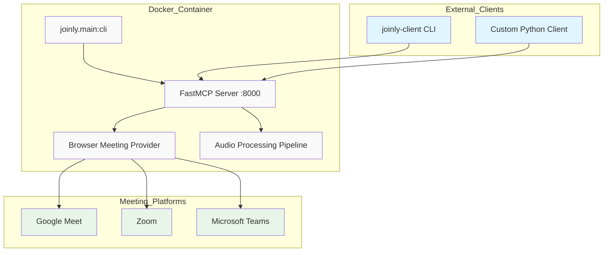
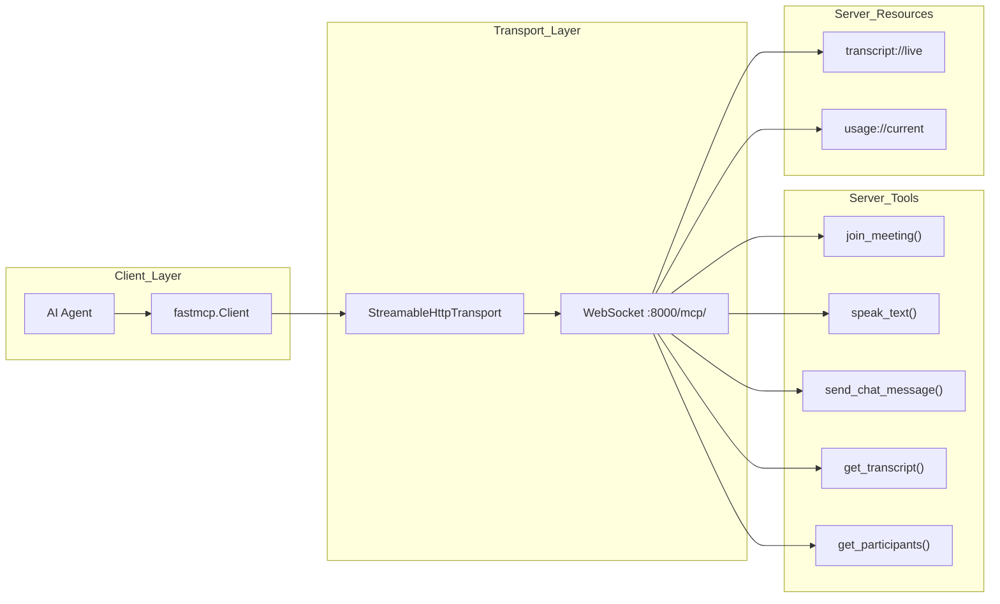
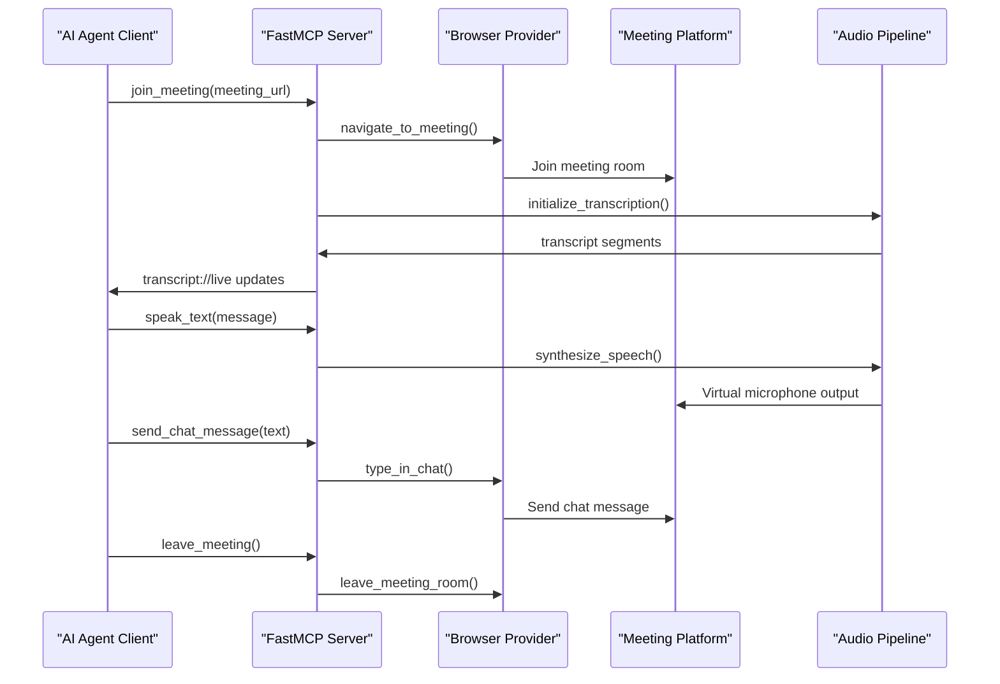

<!-- source: DeepWiki mcp.deepwiki.com · repo joinly-ai/joinly · page 2.2 Quick Start Guide · fetched 2026-10-27 -->

# Quick Start Guide

<details>
<summary>Relevant source files</summary>

The following files were used as context for generating this wiki page:

- [.env.example](.env.example)
- [README.md](README.md)
- [client/README.md](client/README.md)
- [client/joinly_client/__init__.py](client/joinly_client/__init__.py)
- [joinly/main.py](joinly/main.py)
- [joinly/services/tts/resemble.py](joinly/services/tts/resemble.py)

</details>


This guide provides step-by-step instructions for running joinly and connecting AI agents to video meetings. It covers the basic Docker deployment, client connection, and MCP server integration patterns.

For detailed configuration options, see [Configuration and Settings](#2.3). For architecture details, see [Architecture](#3). For building custom agents, see [Building Custom Agents](#8.2).

## Prerequisites and Setup

Before starting, ensure you have [Docker installed](https://docs.docker.com/engine/install) on your system. Joinly runs as a containerized application that provides an MCP server for AI agent integration.

### Environment Configuration

Create a `.env` file in your working directory with the required API keys for your LLM provider:

```bash
# For OpenAI
JOINLY_LLM_MODEL=gpt-4o
JOINLY_LLM_PROVIDER=openai
OPENAI_API_KEY=your-openai-api-key

# For Anthropic
JOINLY_LLM_MODEL=claude-3-5-haiku-latest
JOINLY_LLM_PROVIDER=anthropic
ANTHROPIC_API_KEY=your-anthropic-api-key
```

The complete configuration options are available in [.env.example:1-40]().

Sources: [README.md:51-69](), [.env.example:1-40]()

## Basic Deployment

### Pull Docker Image

```bash
docker pull ghcr.io/joinly-ai/joinly:latest
```

The Docker image (~2.3GB) includes the browser runtime, AI models, and all dependencies. For GPU-accelerated transcription, use the CUDA variant:

```bash
docker pull ghcr.io/joinly-ai/joinly:latest-cuda
```

Sources: [README.md:72-75](), [README.md:197-210]()

### Direct Client Mode

For immediate testing, run joinly in direct client mode with a meeting URL:

```bash
docker run --env-file .env ghcr.io/joinly-ai/joinly:latest --client <MeetingURL>
```

This bypasses the MCP server and runs a basic conversational agent directly in the container.

Sources: [README.md:77-80]()

## MCP Server Deployment

### Start Server Mode

Run joinly as an MCP server for external client connections:

```bash
docker run -p 8000:8000 --env-file .env ghcr.io/joinly-ai/joinly:latest
```

The server exposes the FastMCP protocol on port 8000 and provides meeting tools and resources to connected clients.

### Quick Start Architecture



Sources: [pyproject.toml:28](), [README.md:89-92]()

## External Client Connection

### Using joinly-client

Install and run the external client to connect to the MCP server:

```bash
uvx joinly-client --env-file .env <MeetingUrl>
```

The `joinly-client` package provides a Python SDK for building AI agents that connect to joinly servers.

### MCP Tools and Resources Flow



Sources: [examples/client_example.py:24-25](), [examples/client_example.py:142-144](), [README.md:218-229](), [README.md:230-233]()

## Multi-MCP Server Integration

### Configuration File

Create a JSON configuration file to connect additional MCP servers:

```json
{
    "mcpServers": {
        "tavily": {
            "command": "npx",
            "args": ["-y", "tavily-mcp@0.2.2"]
        },
        "notion": {
            "command": "npx", 
            "args": ["-y", "@notionhq/notion-mcp-server"],
            "env": {
                "OPENAPI_MCP_HEADERS": "{\"Authorization\": \"Bearer ntn_****\"}"
            }
        }
    }
}
```

### Run with Multiple Servers

```bash
uvx joinly-client --env-file .env --mcp-config config.json <MeetingUrl>
```

This configuration connects both joinly meeting tools and external MCP servers (web search, Notion, etc.) to the same AI agent.

Sources: [README.md:99-121](), [examples/config_tavily.json:1-8](), [examples/config_notion.json:1-11]()

## Meeting Session Lifecycle

### Session Management Flow



Sources: [examples/client_example.py:188-189](), [examples/client_example.py:108-118]()

## Common Configuration Options

### Basic Settings

| Parameter | Description | Example |
|-----------|-------------|---------|
| `--name` | Participant name in meeting | `"AI Assistant"` |
| `--lang` | TTS/STT language | `en`, `de`, `fr` |
| `--host` | MCP server host | `0.0.0.0` |
| `--port` | MCP server port | `8000` |

### Provider Settings

| Service | Configuration | Environment Variable |
|---------|---------------|---------------------|
| OpenAI TTS | `--tts openai` | `OPENAI_API_KEY` |
| ElevenLabs TTS | `--tts elevenlabs` | `ELEVENLABS_API_KEY` |
| Deepgram STT | `--stt deepgram` | `DEEPGRAM_API_KEY` |
| Whisper STT | `--stt whisper` | (local, no key needed) |

### Debug Options

```bash
# Enable VNC for browser debugging
docker run -p 5900:5900 --env-file .env ghcr.io/joinly-ai/joinly:latest --vnc-server

# Verbose logging
docker run --env-file .env ghcr.io/joinly-ai/joinly:latest -vv --client <MeetingURL>
```

Sources: [README.md:125-193]()

## Next Steps

After completing this quick start:

1. **Custom Agent Development**: See [Building Custom Agents](#8.2) for creating sophisticated conversational agents
2. **Advanced Configuration**: Review [Configuration and Settings](#2.3) for detailed provider options
3. **MCP Integration**: Explore [Examples and Usage Patterns](#8) for integration with external services
4. **Production Deployment**: See [Docker Deployment](#10.1) for production considerations

Sources: [README.md:212-215]()

---

