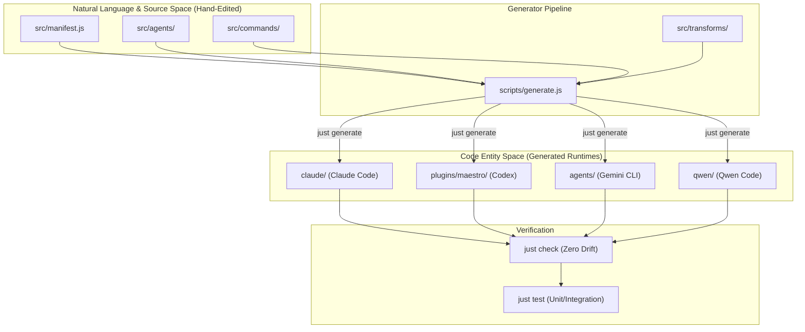
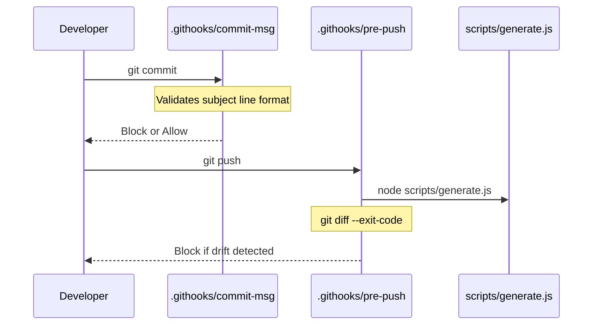

<!-- source: DeepWiki mcp.deepwiki.com · repo josstei/maestro-orchestrate · page 8 Contributing Guide · fetched 2026-10-27 -->

# Contributing Guide

Relevant source files

The following files were used as context for generating this wiki page:

- [.githooks/commit-msg](.githooks/commit-msg)
- [.githooks/pre-push](.githooks/pre-push)
- [.github/ISSUE_TEMPLATE/bug_report.md](.github/ISSUE_TEMPLATE/bug_report.md)
- [.github/ISSUE_TEMPLATE/config.yml](.github/ISSUE_TEMPLATE/config.yml)
- [.github/ISSUE_TEMPLATE/feature_request.md](.github/ISSUE_TEMPLATE/feature_request.md)
- [.github/PULL_REQUEST_TEMPLATE.md](.github/PULL_REQUEST_TEMPLATE.md)
- [.github/workflows/commit-message-check.yml](.github/workflows/commit-message-check.yml)
- [CODE_OF_CONDUCT.md](CODE_OF_CONDUCT.md)
- [CONTRIBUTING.md](CONTRIBUTING.md)
- [LICENSE](LICENSE)
- [SECURITY.md](SECURITY.md)
- [scripts/install-git-hooks.js](scripts/install-git-hooks.js)

This guide outlines the development workflow and community standards for contributing to Maestro. Maestro uses a **source-first, generated-runtime** architecture. All contributions must adhere to the canonical-source rule: hand-edit only the files in `src/` and use the build pipeline to project those changes into the various supported runtimes.

## Development Workflow

Maestro requires Node.js 20+ and at least one supported runtime (Gemini CLI, Claude Code, Codex, or Qwen Code) for local verification [CONTRIBUTING.md:5-8]().

### Setup and Tooling
1. **Clone and Install**: Run `npm install` to fetch dependencies [CONTRIBUTING.md:13-17]().
2. **Activate Hooks**: Run `npm run install-hooks` (or `node scripts/install-git-hooks.js`) to enable repo-local git hooks [CONTRIBUTING.md:19-23](). This configures `git config core.hooksPath .githooks` [scripts/install-git-hooks.js:42]().
3. **Command Runner**: The project uses `just` as a command runner, though `npm` scripts are also provided [CONTRIBUTING.md:31-45]().

### The Canonical Source Rule
The repository is structured such that `src/` contains the "truth" [CONTRIBUTING.md:49](). The generator pipeline (`scripts/generate.js`) reads `src/manifest.js` and applies transforms to produce output for Gemini, Claude, Codex, and Qwen [CONTRIBUTING.md:53-60]().

**Warning**: Never hand-edit files in `claude/`, `plugins/maestro/`, `qwen/`, or the root `agents/`/`commands/` directories. They are overwritten during regeneration [CONTRIBUTING.md:51]().

### Development Cycle Diagram: Source to Runtime
This diagram illustrates how a developer interacts with the "Natural Language Space" (definitions in `src/`) and the "Code Entity Space" (generated artifacts).

Title: Maestro Development Lifecycle

Sources: [CONTRIBUTING.md:47-60](), [CONTRIBUTING.md:71-84]()

## Semantic Git Conventions

Maestro enforces strict naming and formatting rules to maintain a clean history and enable automated versioning.

### Branch Naming
Branches must follow the format `<type>/<slug>` or `<namespace>/<type>/<slug>` [CONTRIBUTING.md:94-98]().
- **Types**: `feat`, `fix`, `chore`, `docs`, `test`, `refactor`, `perf`, `style`, `build`, `ci`, `revert`.
- **Example**: `feat/mcp-session-cache` or `codex/chore/enforce-git-conventions` [CONTRIBUTING.md:103-106]().

### Commit Messages
Maestro follows [Conventional Commits 1.0](https://www.conventionalcommits.org/en/v1.0.0) [CONTRIBUTING.md:111]().
- **Format**: `<type>(<scope>)<!>: <description>` [CONTRIBUTING.md:114]().
- **Validation**: The `commit-msg` hook and `Commit Message Check` CI workflow enforce these rules on both commits and PR titles [.githooks/commit-msg:20](), [.github/workflows/commit-message-check.yml:14-25]().

### Git Hook Interaction
The local hooks provide immediate feedback before code reaches CI.

Title: Git Hook Validation Flow

Sources: [.githooks/commit-msg:1-22](), [.githooks/pre-push:38-57]()

## PR Process and Community Standards

### Pull Request Steps
1. **Branch**: Create a semantic branch from `main` [CONTRIBUTING.md:64-67]().
2. **Change**: Modify files in `src/` [CONTRIBUTING.md:69]().
3. **Regenerate**: Run `just generate` [CONTRIBUTING.md:73]().
4. **Verify**: Run `just check` (ensures no drift) and `just test` [CONTRIBUTING.md:78-83]().
5. **Changelog**: Add an entry to `CHANGELOG.md` under `[Unreleased]` for user-facing changes [CONTRIBUTING.md:158]().
6. **Submit**: Fill out the [pull request template](.github/PULL_REQUEST_TEMPLATE.md) and link related issues [CONTRIBUTING.md:162-164]().

### Community Standards
- **Code of Conduct**: All contributors are expected to follow the [Contributor Covenant Code of Conduct](CODE_OF_CONDUCT.md).
- **Security**: Report vulnerabilities privately via [GitHub Security Advisories](https://github.com/josstei/maestro-orchestrate/security/advisories/new) rather than public issues [SECURITY.md:12-14]().
- **Licensing**: All contributions are licensed under the [Apache License 2.0](LICENSE) [CONTRIBUTING.md:181-183]().

## Specialized Contribution Topics

For detailed technical instructions on specific areas of the codebase, see the following child pages:

### Adding Agents & Entry Points
Detailed guide on expanding Maestro's capabilities. Covers adding new specialist agents (defining frontmatter, capability tiers, and tool access) and creating new entry-point commands in the registry.
For details, see [Adding Agents & Entry Points](#8.1).

### Version Management & Release Artifacts
Technical overview of the release pipeline. Covers how `scripts/update-versions.js` synchronizes version numbers across all runtime manifests and how the extension artifacts are bundled for distribution.
For details, see [Version Management & Release Artifacts](#8.2).

Sources: [CONTRIBUTING.md:1-183](), [.github/PULL_REQUEST_TEMPLATE.md:1-39](), [SECURITY.md:1-48]()

---

