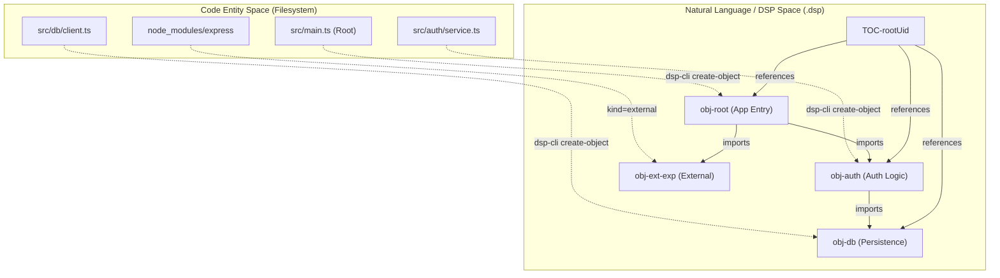
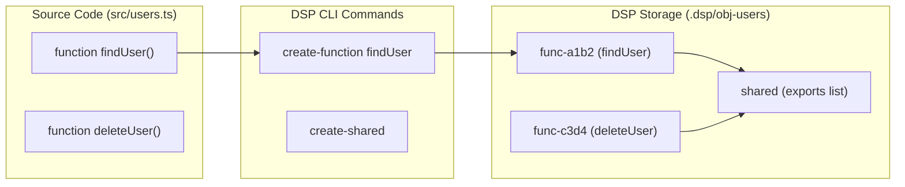

<!-- source: DeepWiki mcp.deepwiki.com · repo k-kolomeitsev/data-structure-protocol · page 4 Bootstrap Procedure · fetched 2026-10-27 -->

# Bootstrap Procedure

Relevant source files

The following files were used as context for generating this wiki page:

- [docs/workflows/brownfield.md](docs/workflows/brownfield.md)
- [docs/workflows/greenfield.md](docs/workflows/greenfield.md)
- [skills/data-structure-protocol/references/bootstrap.md](skills/data-structure-protocol/references/bootstrap.md)

The bootstrap procedure is the process of building the initial Data Structure Protocol (DSP) graph for a project. It involves a systematic traversal of the codebase to identify entities (files and functions), document their purposes, and map their interdependencies within the `.dsp/` directory.

Whether applying DSP to a mature codebase (Brownfield) or starting a fresh project (Greenfield), the goal is to create a persistent structural memory that AI agents can use for navigation and impact analysis.

## Core Bootstrap Algorithm

The foundational mechanism for bootstrapping is a **Depth-First Search (DFS)** traversal starting from the project's root entrypoints [skills/data-structure-protocol/references/bootstrap.md:13-15]().

### The DFS Process
1.  **Identify Roots**: Locate the primary entrypoints (e.g., `main.ts`, `app.py`, `index.js`) [skills/data-structure-protocol/references/bootstrap.md:17-21]().
2.  **Document Entity**: Create an object for the current file using `dsp-cli create-object` [skills/data-structure-protocol/references/bootstrap.md:23-26]().
3.  **Verify & Add Imports**: For every import in the file, verify it is actually used in the code body. If used, register the dependency with a `why` description explaining the specific usage [skills/data-structure-protocol/references/bootstrap.md:35-55]().
4.  **Recursive Descent**: Move to the first non-external imported file and repeat the process [skills/data-structure-protocol/references/bootstrap.md:57-60]().
5.  **Backtrack**: When a leaf node (no further local imports) is reached, backtrack to the previous level to process the next import [skills/data-structure-protocol/references/bootstrap.md:61-66]().

### Visualizing the Traversal
The following diagram illustrates how the bootstrap procedure bridges the gap between the filesystem (Code Space) and the DSP Graph (Memory Space).

**System Mapping: Codebase to DSP Graph**

Sources: [skills/data-structure-protocol/references/bootstrap.md:71-85](), [docs/workflows/brownfield.md:104-122]()

---

## Workflow Variants

The bootstrap procedure adapts based on the current state of your project.

### Brownfield Workflow
The Brownfield workflow is designed for existing codebases where the primary challenge is capturing complex, pre-existing relationships. This is typically performed by an AI agent (like Claude Code or Cursor) guided by the DSP skill.

*   **Entrypoint Detection**: Automatic detection of roots via `package.json`, `main.py`, or framework-specific patterns [docs/workflows/brownfield.md:41-53]().
*   **External Handling**: Libraries are marked as `kind=external`. The agent records the dependency but does not descend into `node_modules` or vendor directories [skills/data-structure-protocol/references/bootstrap.md:89-89]().
*   **Incremental Mapping**: Projects can be mapped in stages, starting with critical paths and expanding to secondary modules [docs/workflows/brownfield.md:161-167]().

For detailed steps on mapping an existing project, see [Brownfield Workflow](#4.1).

### Greenfield Workflow
The Greenfield workflow focuses on "growing" the graph alongside the code. It emphasizes immediate registration to prevent "documentation debt."

*   **Boilerplate Start**: Using `dsp-boilerplate` provides a pre-initialized environment with dual roots (frontend/backend) [docs/workflows/greenfield.md:5-15]().
*   **Just-In-Time Registration**: Entities and public functions are registered as soon as the files are created [docs/workflows/greenfield.md:122-125]().
*   **Early Enforcement**: Git hooks and CI checks are enabled from day one to ensure every new file is accounted for in the graph [docs/workflows/greenfield.md:177-206]().

For detailed steps on starting a new project with DSP, see [Greenfield Workflow](#4.2).

---

## Key Rules for Bootstrapping

| Rule | Description | Source |
| :--- | :--- | :--- |
| **Import Verification** | Never register an import unless the symbol is used in the file body. | [bootstrap.md:93]() |
| **Contextual 'Why'** | The `why` field must describe the usage in *this* file, not the target's purpose. | [bootstrap.md:43]() |
| **External Boundaries** | Never analyze the internals of external dependencies or standard libraries. | [bootstrap.md:89]() |
| **Source Markers** | Place `@dsp <uid>` markers in source code to maintain the link to `.dsp/`. | [bootstrap.md:92]() |

**Relationship Mapping: Symbols to UIDs**

Sources: [docs/workflows/brownfield.md:130-148](), [docs/workflows/greenfield.md:142-153]()

Sources:
- [skills/data-structure-protocol/references/bootstrap.md:1-94]()
- [docs/workflows/brownfield.md:1-167]()
- [docs/workflows/greenfield.md:1-206]()

---

