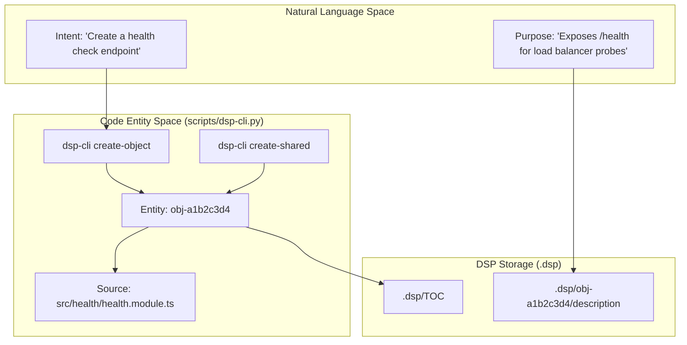
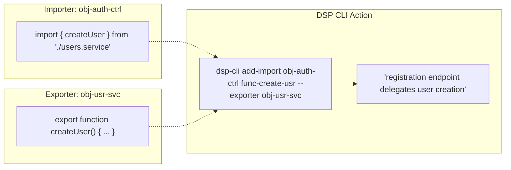

<!-- source: DeepWiki mcp.deepwiki.com · repo k-kolomeitsev/data-structure-protocol · page 4.2 Greenfield Workflow · fetched 2026-10-27 -->

# Greenfield Workflow

<details>
<summary>Relevant source files</summary>

The following files were used as context for generating this wiki page:

- [docs/workflows/greenfield.md](docs/workflows/greenfield.md)
- [skills/data-structure-protocol/SKILL.md](skills/data-structure-protocol/SKILL.md)
- [skills/data-structure-protocol/references/bootstrap.md](skills/data-structure-protocol/references/bootstrap.md)

</details>


The Greenfield Workflow describes the process of integrating the Data Structure Protocol (DSP) into a new project from its inception. Unlike the brownfield approach, which requires a recursive bootstrap of an existing codebase, the greenfield workflow focuses on **incremental registration**. By creating DSP entities as code files are written, the structural graph grows organically alongside the implementation, ensuring the AI agent maintains a perfect mental model of the system from day one [docs/workflows/greenfield.md:1-4]().

## The `dsp-boilerplate` Reference
For the fastest start, the `dsp-boilerplate` repository serves as a production-ready reference implementation using NestJS, React, and Vite [docs/workflows/greenfield.md:7-13](). It demonstrates a pre-initialized DSP environment including:
*   **Multi-root configuration**: Separate TOC files for backend and frontend [docs/workflows/greenfield.md:15-15]().
*   **Integrated Hooks**: Pre-configured Git hooks and CI workflows for consistency [docs/workflows/greenfield.md:15-15]().
*   **Agent Rules**: Ready-to-use `.mdc` files for Cursor and lifecycle hooks for Claude Code [docs/workflows/greenfield.md:15-15]().

**Sources:** [docs/workflows/greenfield.md:1-17]()

---

## Initializing a New Project

The workflow begins immediately after project scaffolding. Once the basic directory structure is created, the DSP environment must be initialized to create the `.dsp/` storage directory [docs/workflows/greenfield.md:43-55]().

### Initialization Sequence
1.  **Install the DSP Skill**: Run the platform-specific installer (e.g., `install.sh` for macOS/Linux) to provide the agent with the `dsp-cli` and required rules [docs/workflows/greenfield.md:24-36]().
2.  **Initialize Storage**: Execute `dsp-cli init` in the project root [docs/workflows/greenfield.md:53-55]().
3.  **Define the Root**: Register the primary entry point (e.g., `app.module.ts` or `main.py`) as the first Object [docs/workflows/greenfield.md:64-67]().

### From Natural Language Intent to Code Entity
The following diagram illustrates how a developer's intent to create a "Health Check" feature translates into specific `dsp-cli` operations and filesystem entities.

**Diagram: Intent to Entity Mapping**

**Sources:** [docs/workflows/greenfield.md:69-73](), [skills/data-structure-protocol/SKILL.md:11-16](), [skills/data-structure-protocol/SKILL.md:34-53]()

---

## Incremental Registration Pattern

The core principle of the greenfield workflow is **Register-as-you-Code**. Every time a new file is created or a public API is exposed, the agent should update the graph [docs/workflows/greenfield.md:122-124]().

### 1. Registering Modules (Objects)
When a new file is created, use `create-object`. This assigns a permanent UID to the file path [skills/data-structure-protocol/SKILL.md:101-103]().
```bash
dsp-cli create-object "src/users/users.service.ts" "Users service — CRUD operations and validation"
```

### 2. Registering Public APIs (Functions & Shared)
If the module exports specific functions, they are registered as child entities using the `--owner` flag and then "shared" to make them visible in the module's public API index [skills/data-structure-protocol/SKILL.md:104-105]().
```bash
dsp-cli create-function "src/users/users.service.ts#createUser" "Creates a new user" --owner obj-usr-svc
dsp-cli create-shared obj-usr-svc func-create-usr
```

### 3. Wiring Dependencies (Imports)
Every import must be registered with a `why` field. This field explains the **specific reason** for the dependency within the importer's context, rather than just repeating the target's description [skills/data-structure-protocol/references/bootstrap.md:35-53]().

**Diagram: Dependency Registration Flow**

**Sources:** [docs/workflows/greenfield.md:155-162](), [skills/data-structure-protocol/references/bootstrap.md:43-53]()

---

## Best Practices for "Why" and "Purpose"

In a greenfield project, the quality of the `purpose` and `why` fields determines the utility of the graph for the AI agent.

| Field | Requirement | Example (Good) | Example (Bad) |
| :--- | :--- | :--- | :--- |
| **Purpose** | High-level "reason for existence" [skills/data-structure-protocol/SKILL.md:15-16]() | "Exposes /health endpoint for load balancer probes" [docs/workflows/greenfield.md:71]() | "Health module" |
| **Why** | Impact of removal on the *importer* [skills/data-structure-protocol/references/bootstrap.md:43-44]() | "App module registers health module for uptime monitoring" [docs/workflows/greenfield.md:75-76]() | "Uses health module" |

### Verification Rule
Before calling `add-import`, the agent must verify that the imported symbol is **actually used** in the file body. If the symbol is only in the `import` statement but not the code, it is a "phantom dependency" and should not be registered [skills/data-structure-protocol/references/bootstrap.md:35-41]().

**Sources:** [skills/data-structure-protocol/references/bootstrap.md:35-55](), [docs/workflows/greenfield.md:218-230]()

---

## Multi-Root and Monorepo Setup

For monorepos or projects with distinct entry points (e.g., a Backend and a Frontend), DSP supports multiple roots. Each root maintains its own Table of Contents (TOC) file [skills/data-structure-protocol/references/bootstrap.md:17-21]().

*   **TOC Isolation**: Use the `--toc <ROOT_UID>` flag during creation to associate an entity with a specific tree [skills/data-structure-protocol/SKILL.md:37-38]().
*   **Shared Entities**: Entities can exist in multiple TOCs if they are shared across boundaries (e.g., shared types in a TypeScript monorepo) [skills/data-structure-protocol/SKILL.md:73-73]().

**Sources:** [skills/data-structure-protocol/references/bootstrap.md:17-21](), [skills/data-structure-protocol/SKILL.md:37-51]()

---

