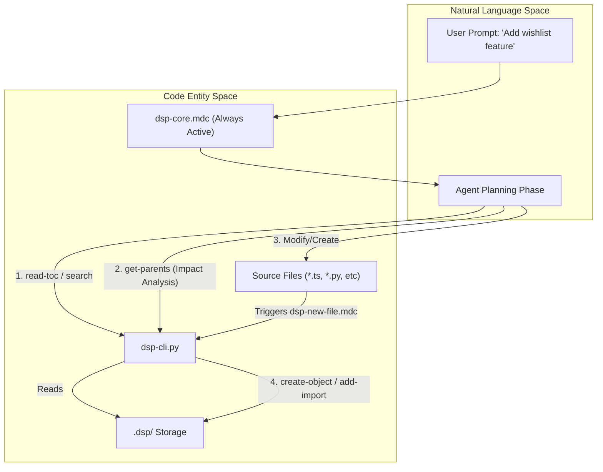
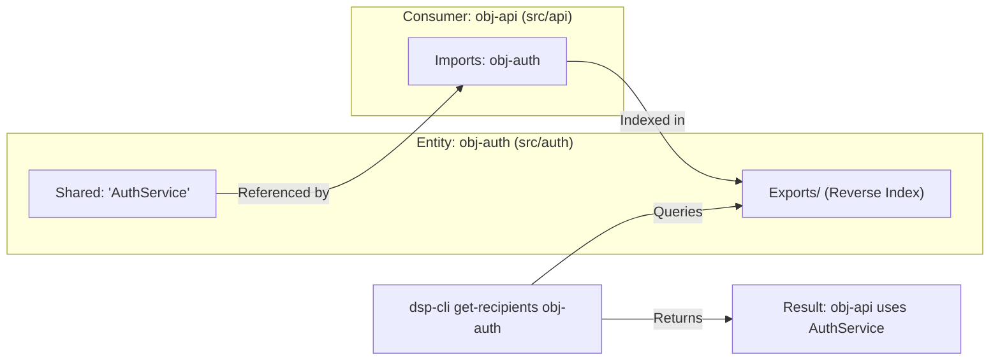

<!-- source: DeepWiki mcp.deepwiki.com · repo k-kolomeitsev/data-structure-protocol · page 5.1 Cursor Integration · fetched 2026-10-27 -->

# Cursor Integration

<details>
<summary>Relevant source files</summary>

The following files were used as context for generating this wiki page:

- [integrations/cursor/.cursor/rules/dsp-brownfield.mdc](integrations/cursor/.cursor/rules/dsp-brownfield.mdc)
- [integrations/cursor/.cursor/rules/dsp-core.mdc](integrations/cursor/.cursor/rules/dsp-core.mdc)
- [integrations/cursor/.cursor/rules/dsp-new-file.mdc](integrations/cursor/.cursor/rules/dsp-new-file.mdc)
- [integrations/cursor/.cursor/rules/dsp-public-api-changes.mdc](integrations/cursor/.cursor/rules/dsp-public-api-changes.mdc)
- [integrations/cursor/.cursor/rules/dsp-refactor-safety.mdc](integrations/cursor/.cursor/rules/dsp-refactor-safety.mdc)
- [integrations/cursor/.cursor/rules/dsp-when-not-to-update.mdc](integrations/cursor/.cursor/rules/dsp-when-not-to-update.mdc)
- [integrations/cursor/AGENTS.md](integrations/cursor/AGENTS.md)
- [integrations/cursor/README.md](integrations/cursor/README.md)
- [integrations/cursor/examples/brownfield-workflow.md](integrations/cursor/examples/brownfield-workflow.md)
- [integrations/cursor/examples/greenfield-workflow.md](integrations/cursor/examples/greenfield-workflow.md)

</details>


The Cursor Integration pack connects the Data Structure Protocol (DSP) with the Cursor AI editor. It utilizes Cursor's **Rules** (.mdc files) to provide the AI agent with contextual awareness of the structural memory stored in `.dsp/`. This integration ensures the agent follows a "read-before-modify" and "update-after-change" discipline, maintaining graph integrity throughout the development lifecycle.

## Integration Architecture

The integration relies on three layers of agent guidance:
1.  **Rules (.mdc)**: Files that define when the agent should trigger specific DSP behaviors based on file patterns or manual context.
2.  **CLI (dsp-cli.py)**: The underlying engine the agent calls to query or update the graph.
3.  **Third-Party Hooks**: An optional layer that allows Cursor to reuse Claude Code lifecycle hooks for session-based tracking.

### Data Flow and Agent Logic

The following diagram illustrates how a Cursor agent interacts with the DSP ecosystem during a typical coding task.

**Cursor Agent DSP Interaction Flow**



**Sources:** [integrations/cursor/README.md:71-80](), [integrations/cursor/examples/brownfield-workflow.md:15-121]()

---

## Rule Configuration and Trigger Modes

The Cursor integration includes six specialized `.mdc` files located in `.cursor/rules/`. These rules instruct the agent on how to handle different scenarios.

| Rule File | Trigger Mode | Purpose |
| :--- | :--- | :--- |
| `dsp-core.mdc` | **Always** | Mandates reading DSP before modifications and updating after changes. |
| `dsp-when-not-to-update.mdc` | **Always** | Defines "noise" changes (formatting, comments) that should skip DSP updates. |
| `dsp-new-file.mdc` | **Auto** | Triggers on file extensions (e.g., `.ts`, `.py`, `.go`) to prompt registration. |
| `dsp-brownfield.mdc` | **Manual** | Provides a step-by-step guide for bootstrapping DSP into existing code. |
| `dsp-refactor-safety.mdc` | **Manual** | Instructions for impact analysis using `get-parents` and `get-recipients`. |
| `dsp-public-api-changes.mdc` | **Manual** | Guidance for updating `shared/` and `exports/` when public interfaces change. |

**Sources:** [integrations/cursor/README.md:7-14](), [integrations/cursor/.cursor/rules/dsp-new-file.mdc:1-5]()

---

## Implementation Detail: Core Workflows

### 1. The "Read-Before-Modify" Cycle
Before any code change, `dsp-core.mdc` requires the agent to perform discovery to prevent breaking dependencies.

*   **Discovery**: `dsp-cli read-toc` or `dsp-cli find-by-source <path>` [integrations/cursor/.cursor/rules/dsp-core.mdc:11-14]()
*   **Context**: `dsp-cli get-entity <uid>` to understand the entity's purpose and existing imports [integrations/cursor/.cursor/rules/dsp-core.mdc:15]()
*   **Impact Analysis**: `dsp-cli get-parents <uid>` to identify which other modules depend on the file being changed [integrations/cursor/.cursor/rules/dsp-core.mdc:16]()

### 2. New File Registration
When `dsp-new-file.mdc` detects a new source file, it directs the agent to:
1.  Determine if it's a module (`create-object`) or a standalone function (`create-function`). [integrations/cursor/.cursor/rules/dsp-new-file.mdc:11-21]()
2.  Find the owner UID using `dsp-cli find-by-source <parent-path>`. [integrations/cursor/.cursor/rules/dsp-new-file.mdc:23-27]()
3.  Record the dependency reason using `add-import --why "<reason>"`. [integrations/cursor/.cursor/rules/dsp-new-file.mdc:31-35]()

### 3. Refactor Safety and API Changes
When refactoring, the agent uses `dsp-refactor-safety.mdc` to check `get-recipients <uid>`. This identifies consumers of specific public exports stored in the `shared/` file of an entity.

**Refactor Impact Mapping**



**Sources:** [integrations/cursor/.cursor/rules/dsp-refactor-safety.mdc:17-32](), [integrations/cursor/.cursor/rules/dsp-public-api-changes.mdc:21-29]()

---

## Installation

### Standard Rule Installation
To install the rules, copy the `.cursor/rules/` directory from the DSP repository to your project root.

```bash
# From the DSP repository root
cp -r integrations/cursor/.cursor/rules/ /path/to/your-project/.cursor/rules/
```
[integrations/cursor/README.md:20-27]()

### Third-Party Hook Integration
Cursor supports the "Third-party hooks" feature, which allows it to execute scripts compatible with Claude Code's lifecycle. This enables features like `dsp-track-write` and `dsp-session-start`.

1.  Enable **Third-party hooks** in Cursor Settings -> Features. [integrations/cursor/README.md:58-60]()
2.  Copy the `.claude/` configuration and hooks from the Claude integration pack. [integrations/cursor/README.md:61-67]()
3.  Ensure `dsp-cli.py` is in the system `PATH`. [integrations/cursor/README.md:81-86]()

---

## Filtering Logic: When NOT to Update
To minimize graph churn and token usage, `dsp-when-not-to-update.mdc` defines specific scenarios where the agent must **not** invoke `dsp-cli`.

*   **Formatting**: Whitespace, indentation, or linting fixes. [integrations/cursor/.cursor/rules/dsp-when-not-to-update.mdc:13]()
*   **Documentation**: Changes limited to comments or docstrings. [integrations/cursor/.cursor/rules/dsp-when-not-to-update.mdc:14]()
*   **Internal Logic**: Refactoring a private function body without changing its signature or purpose. [integrations/cursor/.cursor/rules/dsp-when-not-to-update.mdc:15]()
*   **Config/Meta**: Changes to `.env`, `package.json` versions, or CI pipelines. [integrations/cursor/.cursor/rules/dsp-when-not-to-update.mdc:16-17]()

**Sources:** [integrations/cursor/.cursor/rules/dsp-when-not-to-update.mdc:7-21](), [integrations/cursor/AGENTS.md:54-62]()

---

