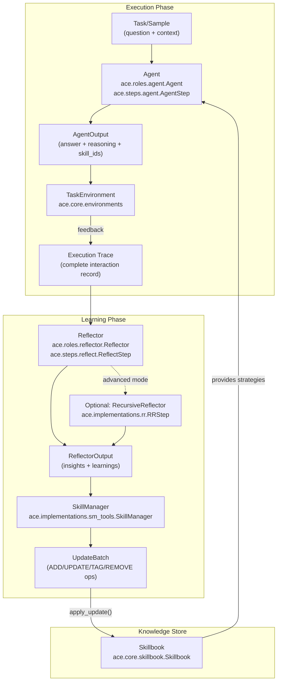
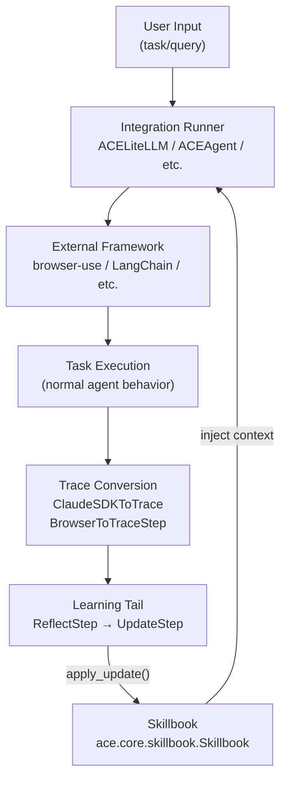
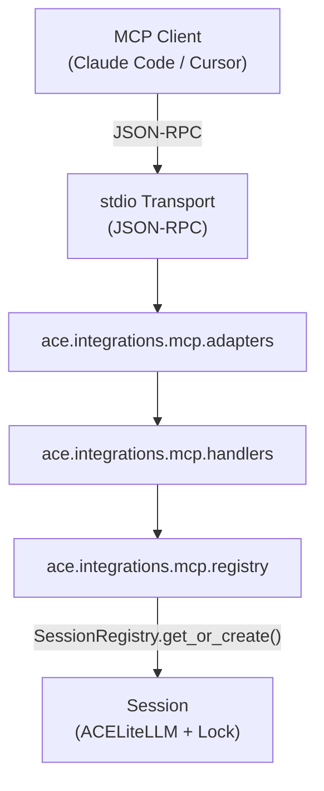

<!-- source: DeepWiki mcp.deepwiki.com · repo kayba-ai/agentic-context-engine · page 1.2 Key Features and Capabilities · fetched 2026-10-27 -->

# Key Features and Capabilities

Relevant source files

The following files were used as context for generating this wiki page:

- [CHANGELOG.md](CHANGELOG.md)
- [CLAUDE.md](CLAUDE.md)
- [README.md](README.md)
- [ace/runners/litellm.py](ace/runners/litellm.py)
- [assets/kayba-banner.png](assets/kayba-banner.png)
- [docs/integrations/index.md](docs/integrations/index.md)
- [docs/integrations/mcp-client-setup.md](docs/integrations/mcp-client-setup.md)
- [docs/integrations/mcp.md](docs/integrations/mcp.md)
- [examples/ace/ace_demo.py](examples/ace/ace_demo.py)
- [mkdocs.yml](mkdocs.yml)
- [pyproject.toml](pyproject.toml)
- [specs/002-ace-mcp-server/contracts/tool-schemas.md](specs/002-ace-mcp-server/contracts/tool-schemas.md)
- [specs/002-ace-mcp-server/spec.md](specs/002-ace-mcp-server/spec.md)
- [tests/test_ace_mcp_compatibility.py](tests/test_ace_mcp_compatibility.py)
- [uv.lock](uv.lock)

This document catalogs the major features and capabilities of the ACE Framework, including the self-learning loop, LLM provider support, integration ecosystem, Recursive Reflector, and Model Context Protocol server. For installation instructions and getting started, see [Installation](#5.1). For architectural details, see [Architecture](#3).

---

## Core Feature Set

ACE provides seven primary capabilities that enable self-improving AI agents:

| Feature | Description | Key Components |
|---------|-------------|----------------|
| **Self-Learning Loop** | Execute → Evaluate → Reflect → Update cycle that enables autonomous improvement | `Agent`, `Reflector`, `SkillManager`, `Skillbook` |
| **Universal LLM Support** | 100+ LLM providers via PydanticAI and LiteLLM | `resolve_model`, `MeteredModel` |
| **Recursive Reflector** | Sandboxed code execution for programmatic trace analysis | `RRStep`, `TraceSandbox`, `RecursiveAgent` |
| **Integration Wrappers** | Add learning to existing frameworks without rewrites | `ACELiteLLM`, `ACEAgent`, `ACELangChain`, `ACEClaudeCode` |
| **MCP Server** | Optional Model Context Protocol tool provider | `ace-mcp` CLI, six MCP tools |
| **Modular Pipeline Engine** | Generic pipeline framework with async boundaries | `Pipeline`, `StepProtocol`, `ACEStepContext` |
| **RecursiveAgent Abstraction** | Reusable base for agents requiring depth-bounded recursion | `RecursiveAgent` |

**Sources:** [README.md:1-218](), [pyproject.toml:1-191](), [CHANGELOG.md:58-64]()

---

## Self-Learning Architecture

The core ACE learning loop involves three specialized roles that operate on a shared Skillbook. The system has transitioned to a v2 architecture where roles like the `SkillManager` are implemented as tool-calling agents.

**Sources:** [README.md:160-182](), [CHANGELOG.md:58-64](), [ace/core/skillbook.py:1-100](), [ace/core/recursive_agent.py:1-50]()

---

## LLM Provider Support

ACE supports 100+ LLM providers through [PydanticAI](https://ai.pydantic.dev) and LiteLLM. The framework includes a `MeteredModel` wrapper to track token usage and costs across complex recursive calls.

| Provider Category | Examples | Implementation |
|-------------------|----------|----------------|
| **OpenAI-compatible** | OpenAI, Azure OpenAI, OpenRouter | Standard `model` parameter |
| **Anthropic** | Claude 3.5 Sonnet, Haiku | Native prompt caching support |
| **AWS Bedrock** | Claude via Bedrock | `boto3` integration |
| **Google** | Gemini | Standard PydanticAI integration |
| **Local/Open-Source** | Ollama, VLLM | LiteLLM gateway |

### Usage Metering
The `MeteredModel` fires a `usage_callback` for every request, including orchestrator turns and sub-agent runs.

**Sources:** [pyproject.toml:41-45](), [CHANGELOG.md:87-93](), [README.md:42-68]()

---

## Integration Ecosystem

ACE provides high-level integration runners that follow a consistent **Inject → Execute → Learn** pattern.

| Integration | Class | Use Case |
|-------------|-------|----------|
| **LiteLLM** | `ACELiteLLM` | Simple Q&A agents with learning |
| **browser-use** | `ACEAgent` | Web automation with learning |
| **LangChain** | `ACELangChain` | Wrap LangChain chains/agents |
| **Claude Code** | `ACEClaudeCode` | Coding assistant with learning |
| **MCP Server** | `ace-mcp` CLI | Tool provider for MCP clients |

### Integration Data Flow

**Sources:** [docs/integrations/index.md:1-87](), [pyproject.toml:51-116](), [ace/runners/litellm.py:1-50]()

---

## Recursive Reflector (RR) System

The Recursive Reflector is a specialized agent built on the `RecursiveAgent` abstraction. It uses a sandboxed REPL to programmatically analyze traces.

### Architecture Components
- **`RRStep`**: The primary pipeline step for recursive analysis [CHANGELOG.md:68-69]().
- **`TraceSandbox`**: A secure environment that blocks dangerous builtins like `eval`, `exec`, and `__import__` [ace/rr/sandbox.py]().
- **`RecursiveAgent`**: A core abstraction providing two-tier compaction, budget management, and depth-aware sub-agent registration [CHANGELOG.md:58-59]().

### Six-Phase Analysis Strategy
RR follows a structured prompt strategy:
1. **Discover**: Initial trace exploration.
2. **Adapt**: Refine code based on trace structure.
3. **Survey**: High-level pattern identification.
4. **Categorize**: Grouping related execution failures.
5. **Deep-dive**: Root cause isolation via code.
6. **Synthesize**: Final insight generation.

**Sources:** [CHANGELOG.md:58-83](), [README.md:88-99]()

---

## Model Context Protocol (MCP) Server

The optional MCP server exposes ACE capabilities as tools, allowing IDEs like Cursor or Claude Code to use ACE's learning loop.

### Tool Catalog
- `ace.ask`: Query the agent using the current skillbook.
- `ace.learn.sample`: Batch learn from provided samples.
- `ace.learn.feedback`: Learn from specific answer feedback.
- `ace.skillbook.get`: Retrieve active skills and statistics.
- `ace.skillbook.save` / `ace.skillbook.load`: Disk persistence.

### MCP Architecture

**Sources:** [docs/integrations/mcp.md:1-150](), [specs/002-ace-mcp-server/spec.md:1-100](), [ace/integrations/mcp/registry.py:1-96]()

---

## Skillbook v2 System

The Skillbook has evolved into a sophisticated knowledge store with the following features:
- **Section-grouped Storage**: Skills are organized by topics.
- **BM25 Retrieval**: High-performance keyword-based search via `rank-bm25` [pyproject.toml:46]().
- **Richer Provenance**: `InsightSource` tracks the origin of every skill [CHANGELOG.md:59-60]().
- **Generalization Gate**: A four-criterion check (frequency, domain diversity, slotting, and verifiability) that constrains when the `SkillManager` can broaden skills [CHANGELOG.md:13-17]().

**Sources:** [CHANGELOG.md:10-54](), [ace/core/skillbook.py:1-100]()

---

## Command-Line Interfaces

ACE provides multiple CLI tools for different workflows:

| Command | Purpose | Location |
|---------|---------|----------|
| `ace` | Interactive setup and configuration | [pyproject.toml:119]() |
| `kayba` | Hosted API interaction and trace management | [pyproject.toml:120]() |
| `ace-mcp` | Start the MCP tool server | [pyproject.toml:121]() |

**Sources:** [pyproject.toml:118-121](), [README.md:34-52]()

---

