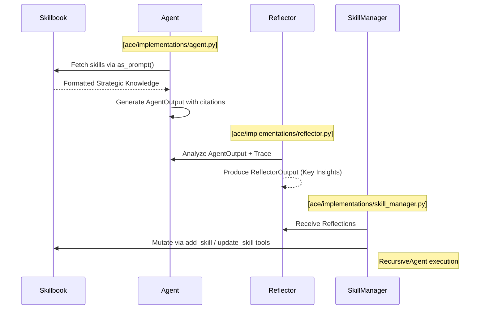

<!-- source: DeepWiki mcp.deepwiki.com · repo kayba-ai/agentic-context-engine · page 3.1 Core Library (ace) · fetched 2026-10-27 -->

# Core Library (ace)

<details>
<summary>Relevant source files</summary>

The following files were used as context for generating this wiki page:

- [ace/__init__.py](ace/__init__.py)
- [ace/core/context.py](ace/core/context.py)
- [ace/implementations/prompts.py](ace/implementations/prompts.py)
- [ace/implementations/reflector.py](ace/implementations/reflector.py)
- [ace/implementations/skill_manager.py](ace/implementations/skill_manager.py)
- [ace/steps/reflect.py](ace/steps/reflect.py)
- [tests/test_pipeline_exports.py](tests/test_pipeline_exports.py)

</details>


## Purpose and Scope

The `ace/` directory contains the core implementation of the Agentic Context Engine. It provides the primary roles (Agent, Reflector, SkillManager), the skillbook data structures, and the runners that orchestrate the self-improvement loop. 

This library is designed to be highly modular, supporting over 100 LLM providers via **PydanticAI** and offering various integration points for external agentic frameworks like LangChain and Browser-use.

**Sources:** [ace/__init__.py:1-60](), [ace/core/context.py:1-132]()

---

## High-Level Architecture

The core library is organized into specialized modules for data structures, role logic, and orchestration runners.

```mermaid
graph TB
    subgraph ace_core["ace/ (Core Library)"]
        subgraph core_data["Core Data Structures"]
            sb["skillbook.py<br/>Skillbook, Skill"]
            ctx["context.py<br/>ACEStepContext, SkillbookView"]
            out["outputs.py<br/>AgentOutput, ReflectorOutput"]
        end
        
        subgraph implementations["implementations/"]
            agent["agent.py<br/>Agent Role"]
            reflector["reflector.py<br/>Reflector Role"]
            sm["skill_manager.py<br/>SkillManager Role"]
            prompts["prompts.py<br/>v2.1 Templates"]
        end
        
        subgraph runners["runners/"]
            ace_runner["ace_runner.py<br/>ACE, ACERunner"]
            trace_analyser["trace_analyser.py<br/>TraceAnalyser"]
            integrations["Integrations<br/>BrowserUse, LangChain, ClaudeCode"]
        end

        subgraph steps["steps/"]
            agent_step["AgentStep"]
            reflect_step["ReflectStep"]
            update_step["UpdateStep"]
            rr_step["RRStep (Recursive Reflector)"]
        end
    end
    
    runners --> steps
    steps --> implementations
    implementations --> core_data
    steps --> core_data
```



**Sources:** [ace/__init__.py:62-121](), [ace/core/context.py:95-132]()

---

## The Three-Role Architecture

ACE operates through three distinct roles that collaborate to execute tasks and learn from them.

### Role Mapping: Code to Logic

| Role | Code Entity | Primary Responsibility |
| :--- | :--- | :--- |
| **Agent** | `ace.Agent` | Executes the task using strategies from the `Skillbook`. |
| **Reflector** | `ace.Reflector` | Analyzes execution traces to extract insights and identify errors. |
| **SkillManager** | `ace.SkillManager` | Mutates the `Skillbook` based on Reflector insights. |

### Role Interaction Flow



**Sources:** [ace/implementations/agent.py:1-50](), [ace/implementations/reflector.py:25-58](), [ace/implementations/skill_manager.py:58-93]()

---

## Core Data Structures

### ACEStepContext
The `ACEStepContext` is an immutable data carrier that flows through the pipeline. It holds the `trace`, `skillbook` view, and outputs from each role.

- **Trace**: A raw execution record (e.g., Browser-use history, LangChain dict).
- **SkillbookView**: A read-only projection of the `Skillbook` to prevent unauthorized mutations during execution or reflection.

### Skillbook and Skills
The `Skillbook` stores learned strategies. Each `Skill` contains:
- **Content**: The strategic guidance.
- **Success Metrics**: `helpful_count` and `harmful_count` derived from feedback.
- **Provenance**: `InsightSource` tracking where the skill originated.

**Sources:** [ace/core/context.py:45-132](), [ace/core/skillbook.py:1-50]()

---

## Adaptation and Runners

Runners are high-level entry points that configure and execute the ACE pipeline.

### Adaptation Modes
1. **Online Adaptation**: Real-time learning where the agent executes a task and immediately learns from it. Handled by the `ACE` runner.
2. **Offline Adaptation**: Learning from a batch of pre-existing traces without re-executing the agent. Handled by the `TraceAnalyser` runner.

### Runner Implementation
Runners use the `build_steps()` pattern to compose a sequence of `StepProtocol` objects (e.g., `AgentStep`, `ReflectStep`, `UpdateStep`).

```python
# Example from ace/runners/ace_runner.py
steps = ACE.build_steps(
    agent=agent,
    reflector=reflector,
    skill_manager=skill_manager
)
pipeline = Pipeline(steps)
```

For details on orchestration, see [Adaptation Loops (OfflineACE/OnlineACE)](#3.1.2).

**Sources:** [ace/runners/ace_runner.py:1-100](), [tests/test_pipeline_exports.py:155-231]()

---

## Observability and Tracing

ACE includes built-in observability for tracking role performance and cost.

- **PydanticAI Integration**: All roles use `resolve_model` to integrate with PydanticAI's instrumentation.
- **Kayba Tracing**: Use `configure_tracing` to enable detailed span logging for every step in the pipeline.
- **Async Learning**: The `async_boundary` flag in steps like `ReflectStep` allows the learning loop to run in the background, minimizing latency for the end-user.

For details on background execution, see [Async Learning Pipeline](#3.1.3).

**Sources:** [ace/steps/reflect.py:33-35](), [ace/tracing/__init__.py:1-50](), [ace/providers/pydantic_ai.py:1-100]()

---

## Child Pages

- [Role Implementation](#3.1.1) — Detailed implementation of Agent, Reflector, and SkillManager using PydanticAI and specialized prompts.
- [Adaptation Loops (OfflineACE/OnlineACE)](#3.1.2) — How runners orchestrate the Execute-Evaluate-Reflect-Update cycle.
- [Async Learning Pipeline](#3.1.3) — Technical details of the background reflection architecture and thread management.

---

