# Page: ACE Framework Overview

# ACE Framework Overview

<details>
<summary>Relevant source files</summary>

The following files were used as context for generating this wiki page:

- [CHANGELOG.md](CHANGELOG.md)
- [CLAUDE.md](CLAUDE.md)
- [README.md](README.md)
- [ace/__init__.py](ace/__init__.py)
- [ace/runners/litellm.py](ace/runners/litellm.py)
- [assets/kayba-banner.png](assets/kayba-banner.png)
- [examples/ace/ace_demo.py](examples/ace/ace_demo.py)
- [pyproject.toml](pyproject.toml)
- [tests/test_pipeline_exports.py](tests/test_pipeline_exports.py)
- [uv.lock](uv.lock)

</details>


## Purpose and Scope

This page provides a high-level introduction to the ACE Framework: its purpose, architecture, and main components. For detailed explanations of core concepts like the learning loop and skillbook, see [Core Concepts](#2). For installation and setup, see [Getting Started](#5). For architecture details, see [Architecture](#3).

**Sources:** [README.md:3-22](), [pyproject.toml:5-11]()

---

## What is ACE?

ACE (Agentic Context Engine) is a framework that enables AI agents to **learn from experience** and continuously improve. Instead of requiring fine-tuning or manual prompt engineering, ACE adds a persistent learning loop to agents. The framework maintains a **Skillbook** — a dynamic collection of strategies that evolves with each task [README.md:16-17](), [README.md:78-80]().

The core insight: AI agents repeat mistakes because they lack memory of what worked and what failed. ACE bridges this gap by maintaining a persistent context that is updated through reflection on execution traces [README.md:16-22]().

**Key metrics from production use:**
- **2x consistency**: Doubles pass rates on benchmarks like Tau2 [README.md:28]().
- **49% token reduction**: Browser automation costs cut nearly in half via learned shortcuts [README.md:29]().
- **Zero build errors**: Demonstrated in complex tasks like 14k line code translations [README.md:30]().

**Sources:** [README.md:16-31](), [README.md:78-89]()

---

## Repository Architecture

The ACE repository is organized into three primary functional areas: the core learning library, a generic pipeline engine, and observability SDKs.

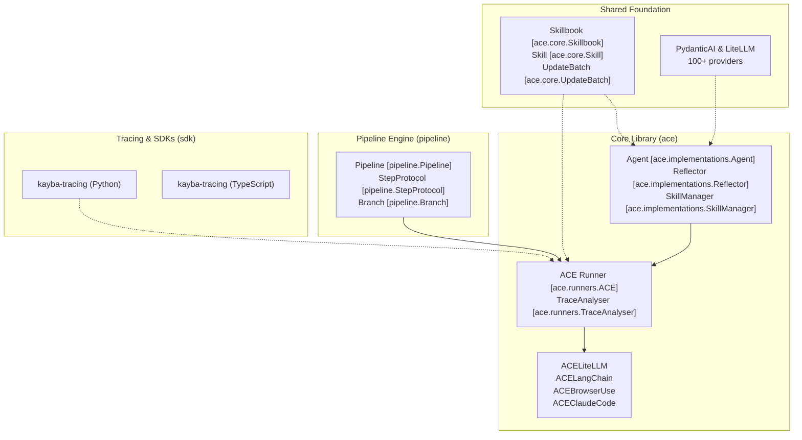

### Core Library (`ace/`)
The primary package containing the implementation of the three-role architecture. It includes `Agent`, `Reflector`, and `SkillManager` [ace/__init__.py:84-86](). It also provides high-level runners like `ACE` for live execution and `TraceAnalyser` for learning from logs [ace/__init__.py:97-103]().

### Pipeline Engine (`pipeline/`)
A generic, immutable execution engine that ACE uses to compose its learning loops. It defines the `StepProtocol` and the `Pipeline` class used to sequence operations [pipeline/pipeline.py:1-50]().

### Tracing SDK (`sdk/`)
Contains the `kayba-tracing` packages used for instrumenting agents to collect the traces that ACE needs for reflection [pyproject.toml:72-74]().

**Sources:** [ace/__init__.py:1-121](), [CLAUDE.md:45-56](), [pyproject.toml:155-156]()

---

## The Learning Loop

ACE implements a closed-loop learning system where specialized roles collaborate to update the Skillbook.

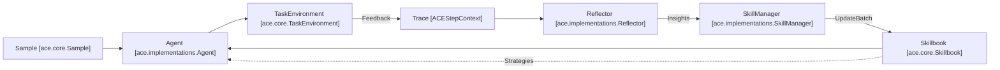

### The Three Specialized Roles
1.  **Agent**: Executes the task. It is enhanced with strategies retrieved from the `Skillbook` [README.md:84]().
2.  **Reflector**: Analyzes the execution trace. It identifies what went wrong and what worked [README.md:85](). The **Recursive Reflector** (`RRStep`) is a key innovation that uses a sandboxed REPL to programmatically analyze traces [README.md:88-89]().
3.  **SkillManager**: Curates the `Skillbook`. It applies updates, deduplicates skills, and ensures strategies are generalized across different tasks [README.md:86](), [CHANGELOG.md:13-20]().

**Sources:** [README.md:78-99](), [CHANGELOG.md:58-65](), [ace/__init__.py:83-86]()

---

## Key Capabilities

### Recursive Reflector (RR)
Instead of a single-pass summary, the RR uses a `RecursiveAgent` to write and execute Python code in a `TraceSandbox` [CHANGELOG.md:58](), [ace/__init__.py:117-118](). It can iterate, use sub-agents, and perform deep-dive analysis of large traces [CHANGELOG.md:68-70]().

### Skillbook System (v2)
The `Skillbook` stores strategies using a schema that supports section-grouped storage and BM25-backed retrieval for high-relevance strategy injection [CHANGELOG.md:59](), [ace/__init__.py:75]().

### Multi-Framework Integrations
ACE provides ready-to-use runners for major agent frameworks:
- **`ACELiteLLM`**: For simple PydanticAI-powered conversational agents [ace/runners/litellm.py:35-55]().
- **`BrowserUse`**: For self-improving web automation [ace/__init__.py:100]().
- **`LangChain`**: For adding learning to LangChain chains and LangGraph [ace/__init__.py:102]().
- **`ClaudeCode`**: For self-improving coding loops [ace/__init__.py:101]().
- **`MCP Server`**: Exposes ACE tools (ask, learn, skillbook) via the Model Context Protocol [ace/integrations/mcp/server.py:1-50]().

### Observability
ACE integrates with **Logfire** for enterprise-grade tracing and uses the **Kayba Tracing SDK** to track performance metrics, token usage, and costs across the learning loop [CHANGELOG.md:63](), [pyproject.toml:69-74]().

**Sources:** [CHANGELOG.md:55-74](), [ace/__init__.py:96-103](), [README.md:101-105]()

---

## Next Steps

- [Repository Structure](#1.1) — Detailed breakdown of directories and modules.
- [Key Features and Capabilities](#1.2) — Summary of the self-learning loop and integrations.
- [Core Concepts](#2) — Deep dive into the learning loop and Skillbook.
- [Architecture](#3) — Technical details of the pipeline engine and core library.
- [Installation](#5.1) — Getting started with `pip install ace-framework`.

**Sources:** [Wiki Table of Contents]()

---

# Page: Repository Structure

# Repository Structure

<details>
<summary>Relevant source files</summary>

The following files were used as context for generating this wiki page:

- [.gitignore](.gitignore)
- [CLAUDE.md](CLAUDE.md)
- [README.md](README.md)
- [ace/runners/litellm.py](ace/runners/litellm.py)
- [assets/kayba-banner.png](assets/kayba-banner.png)
- [benchmarks/tasks/tau_bench/Tau2Benchmark Result Haiku4.5.png](benchmarks/tasks/tau_bench/Tau2Benchmark Result Haiku4.5.png)
- [examples/ace/ace_demo.py](examples/ace/ace_demo.py)
- [examples/pipeline_ex/pipeline_demo.ipynb](examples/pipeline_ex/pipeline_demo.ipynb)
- [mlflow.db](mlflow.db)
- [pipeline/branch.py](pipeline/branch.py)
- [pipeline/context.py](pipeline/context.py)
- [pipeline/pipeline.py](pipeline/pipeline.py)
- [sdk/python/pyproject.toml](sdk/python/pyproject.toml)
- [sdk/python/src/kayba_tracing/__init__.py](sdk/python/src/kayba_tracing/__init__.py)
- [sdk/python/src/kayba_tracing/_wrapper.py](sdk/python/src/kayba_tracing/_wrapper.py)
- [sdk/typescript/.gitignore](sdk/typescript/.gitignore)
- [sdk/typescript/package-lock.json](sdk/typescript/package-lock.json)
- [sdk/typescript/package.json](sdk/typescript/package.json)
- [sdk/typescript/src/index.ts](sdk/typescript/src/index.ts)
- [tests/pipeline_engine/__init__.py](tests/pipeline_engine/__init__.py)

</details>


## Purpose and Scope

This document describes the physical organization of the Agentic Context Engine (ACE) repository. It covers the three main directories: `ace/` (the core library), `pipeline/` (the generic execution engine), and `sdk/` (the tracing SDKs). It also details the supporting directories for tests, examples, and documentation.

---

## High-Level Directory Layout

The repository is organized into three main codebases that implement a layered architecture, plus supporting directories for cross-language SDKs and tooling.

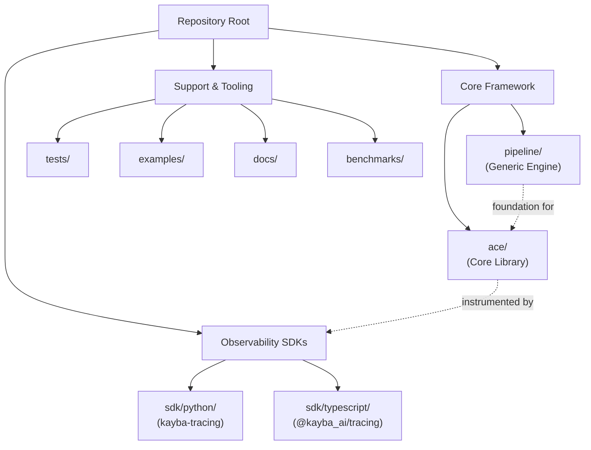

**Directory Purpose Summary:**

| Directory | Purpose | Primary Language |
|-----------|---------|------------------|
| `ace/` | Core library: roles, skillbook, steps, and runners | Python |
| `pipeline/` | Generic pipeline engine: StepProtocol, Pipeline, and Branch | Python |
| `sdk/` | Multi-language tracing SDKs for Kayba observability | Python / TS |
| `tests/` | Unit and integration tests (pytest) | Python |
| `examples/` | Runnable demonstrations and integration samples | Python |
| `docs/` | User guides, API reference, and design documents | Markdown |
| `benchmarks/` | Research and evaluation tooling (e.g., Tau-bench) | Python |

Sources: [CLAUDE.md:46-57](), [README.md:80-101]()

---

## Core Directories

### pipeline/ — Generic Pipeline Engine

The foundational layer providing composable execution primitives. This directory contains no ACE-specific logic (e.g., no mention of "Skillbooks" or "Agents") and serves as a standalone engine for building complex LLM workflows.

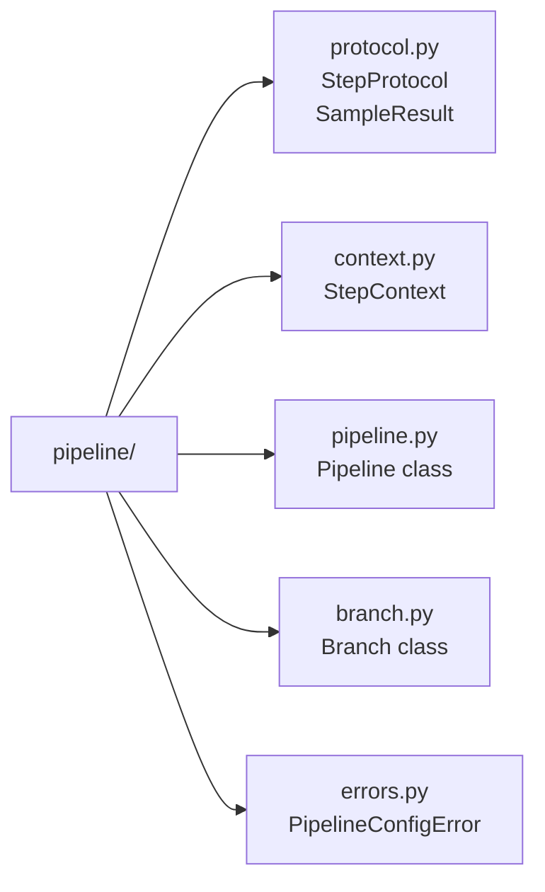

**Key Architectural Components:**

*   **`StepProtocol`**: A structural protocol that all pipeline steps must implement, defining `requires` and `provides` fields for contract validation [pipeline/protocol.py:1-53]().
*   **`Pipeline`**: An ordered sequence of steps. It manages sequential execution and supports `async_boundary` for non-blocking background tasks [pipeline/pipeline.py:53-73]().
*   **`Branch`**: A parallel fork/join primitive that runs multiple pipelines concurrently and merges their `StepContext` using a `MergeStrategy` [pipeline/branch.py:114-127]().
*   **`StepContext`**: A frozen, immutable data carrier passed between steps. Users subclass this to add domain-specific fields [pipeline/context.py:11-25]().

Sources: [CLAUDE.md:7-23](), [pipeline/pipeline.py:1-73]()

---

### ace/ — Core Library

The primary implementation of the Agentic Context Engine. It builds upon the `pipeline/` engine to implement the self-improving learning loop.

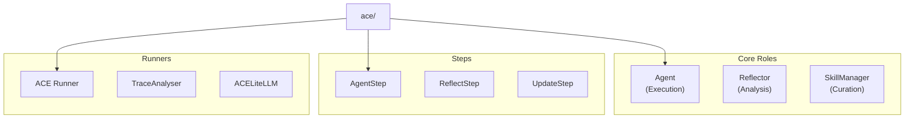

**Implementation Details:**

*   **Roles**: Implemented as PydanticAI-backed agents. The `Agent` [ace/roles.py] executes tasks, the `Reflector` [ace/roles.py] analyzes traces, and the `SkillManager` [ace/roles.py] updates the `Skillbook` [ace/skillbook.py].
*   **Recursive Reflector (RR)**: Located in `ace/rr/`, this system uses a `RecursiveAgent` to perform iterative code-based analysis of traces within a `TraceSandbox` [README.md:88]().
*   **Runners**: High-level entry points. `ACE` provides the full Execute-Evaluate-Reflect loop [examples/ace/ace_demo.py:61-73](), while `TraceAnalyser` enables learning from pre-recorded logs [examples/ace/ace_demo.py:62]().

Sources: [CLAUDE.md:80-87](), [README.md:80-101](), [examples/ace/ace_demo.py:59-74]()

---

### sdk/ — Tracing SDKs

The SDKs provide instrumentation for AI agents to send traces to the Kayba platform or local MLflow instances.

#### Python SDK (`sdk/python/`)
*   **Package Name**: `kayba-tracing` [sdk/python/pyproject.toml:6]().
*   **Core**: Provides a `@trace` decorator and `start_span` context managers to instrument functions [sdk/python/src/kayba_tracing/__init__.py]().

#### TypeScript SDK (`sdk/typescript/`)
*   **Package Name**: `@kayba_ai/tracing` [sdk/typescript/package.json:2]().
*   **Implementation**: A thin wrapper around `mlflow-tracing` that configures authentication and injects Kayba-specific folder tags [sdk/typescript/src/index.ts:1-23]().
*   **Key Functions**: `configure()`, `trace()`, `startSpan()`, and `setFolder()` [sdk/typescript/src/index.ts:124-236]().

Sources: [sdk/python/pyproject.toml:1-10](), [sdk/typescript/package.json:1-10](), [sdk/typescript/src/index.ts:1-155]()

---

## Tooling and Supporting Directories

### tests/ — Test Suite
The repository uses `pytest` for testing, categorized by markers:
*   **Unit**: Fast tests for core logic (`pytest -m unit`) [CLAUDE.md:61]().
*   **Integration**: Tests requiring LLM API access or framework integrations (`pytest -m integration`) [CLAUDE.md:61]().
*   **Slow**: Long-running benchmarks or multi-epoch training tests (`pytest -m slow`) [CLAUDE.md:61]().

### examples/ — Runnable Demos
Demonstrations of ACE integrations:
*   `examples/ace/`: Basic ACE usage and `TraceAnalyser` [examples/ace/ace_demo.py]().
*   `examples/browser-use/`: Self-improving browser automation [CLAUDE.md:94]().
*   `examples/langchain/`: Wrapping LangChain agents with learning capabilities [CLAUDE.md:93]().

### Configuration Files
*   **`pyproject.toml`**: Defines project dependencies, including optional extras like `mcp`, `browser-use`, and `deduplication` [CLAUDE.md:59]().
*   **`CLAUDE.md`**: Provides mandatory "Pipeline-First" development guidelines for contributors [CLAUDE.md:7-23]().
*   **`.gitignore`**: Excludes environment files (`.env`), virtual environments (`.venv`), and generated Skillbook JSON files [ .gitignore:54-91]().

Sources: [CLAUDE.md:42-57](), [ .gitignore:1-123]()

---

# Page: Key Features and Capabilities

# Key Features and Capabilities

<details>
<summary>Relevant source files</summary>

The following files were used as context for generating this wiki page:

- [CHANGELOG.md](CHANGELOG.md)
- [CLAUDE.md](CLAUDE.md)
- [README.md](README.md)
- [ace/runners/litellm.py](ace/runners/litellm.py)
- [assets/kayba-banner.png](assets/kayba-banner.png)
- [docs/integrations/index.md](docs/integrations/index.md)
- [docs/integrations/mcp-client-setup.md](docs/integrations/mcp-client-setup.md)
- [docs/integrations/mcp.md](docs/integrations/mcp.md)
- [examples/ace/ace_demo.py](examples/ace/ace_demo.py)
- [mkdocs.yml](mkdocs.yml)
- [pyproject.toml](pyproject.toml)
- [specs/002-ace-mcp-server/contracts/tool-schemas.md](specs/002-ace-mcp-server/contracts/tool-schemas.md)
- [specs/002-ace-mcp-server/spec.md](specs/002-ace-mcp-server/spec.md)
- [tests/test_ace_mcp_compatibility.py](tests/test_ace_mcp_compatibility.py)
- [uv.lock](uv.lock)

</details>


This document catalogs the major features and capabilities of the ACE Framework, including the self-learning loop, LLM provider support, integration ecosystem, Recursive Reflector, and Model Context Protocol server. For installation instructions and getting started, see [Installation](#5.1). For architectural details, see [Architecture](#3).

---

## Core Feature Set

ACE provides seven primary capabilities that enable self-improving AI agents:

| Feature | Description | Key Components |
|---------|-------------|----------------|
| **Self-Learning Loop** | Execute → Evaluate → Reflect → Update cycle that enables autonomous improvement | `Agent`, `Reflector`, `SkillManager`, `Skillbook` |
| **Universal LLM Support** | 100+ LLM providers via PydanticAI and LiteLLM | `resolve_model`, `MeteredModel` |
| **Recursive Reflector** | Sandboxed code execution for programmatic trace analysis | `RRStep`, `TraceSandbox`, `RecursiveAgent` |
| **Integration Wrappers** | Add learning to existing frameworks without rewrites | `ACELiteLLM`, `ACEAgent`, `ACELangChain`, `ACEClaudeCode` |
| **MCP Server** | Optional Model Context Protocol tool provider | `ace-mcp` CLI, six MCP tools |
| **Modular Pipeline Engine** | Generic pipeline framework with async boundaries | `Pipeline`, `StepProtocol`, `ACEStepContext` |
| **RecursiveAgent Abstraction** | Reusable base for agents requiring depth-bounded recursion | `RecursiveAgent` |

**Sources:** [README.md:1-218](), [pyproject.toml:1-191](), [CHANGELOG.md:58-64]()

---

## Self-Learning Architecture

The core ACE learning loop involves three specialized roles that operate on a shared Skillbook. The system has transitioned to a v2 architecture where roles like the `SkillManager` are implemented as tool-calling agents.

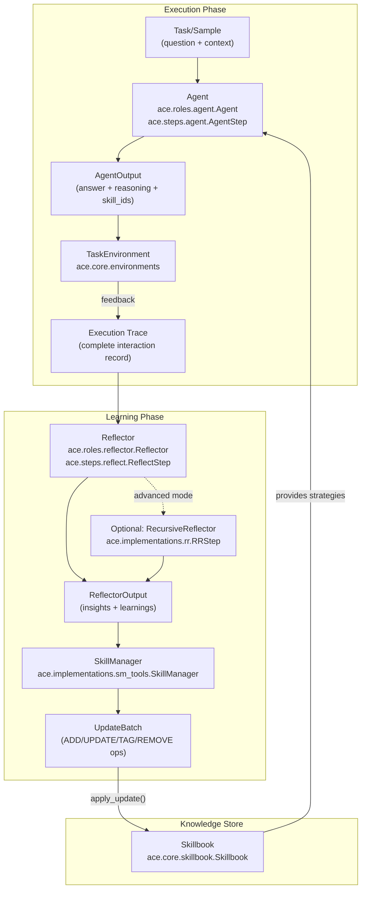

**Sources:** [README.md:160-182](), [CHANGELOG.md:58-64](), [ace/core/skillbook.py:1-100](), [ace/core/recursive_agent.py:1-50]()

---

## LLM Provider Support

ACE supports 100+ LLM providers through [PydanticAI](https://ai.pydantic.dev) and LiteLLM. The framework includes a `MeteredModel` wrapper to track token usage and costs across complex recursive calls.

| Provider Category | Examples | Implementation |
|-------------------|----------|----------------|
| **OpenAI-compatible** | OpenAI, Azure OpenAI, OpenRouter | Standard `model` parameter |
| **Anthropic** | Claude 3.5 Sonnet, Haiku | Native prompt caching support |
| **AWS Bedrock** | Claude via Bedrock | `boto3` integration |
| **Google** | Gemini | Standard PydanticAI integration |
| **Local/Open-Source** | Ollama, VLLM | LiteLLM gateway |

### Usage Metering
The `MeteredModel` fires a `usage_callback` for every request, including orchestrator turns and sub-agent runs.

**Sources:** [pyproject.toml:41-45](), [CHANGELOG.md:87-93](), [README.md:42-68]()

---

## Integration Ecosystem

ACE provides high-level integration runners that follow a consistent **Inject → Execute → Learn** pattern.

| Integration | Class | Use Case |
|-------------|-------|----------|
| **LiteLLM** | `ACELiteLLM` | Simple Q&A agents with learning |
| **browser-use** | `ACEAgent` | Web automation with learning |
| **LangChain** | `ACELangChain` | Wrap LangChain chains/agents |
| **Claude Code** | `ACEClaudeCode` | Coding assistant with learning |
| **MCP Server** | `ace-mcp` CLI | Tool provider for MCP clients |

### Integration Data Flow

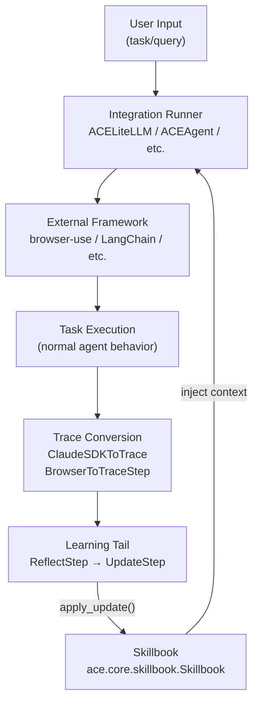

**Sources:** [docs/integrations/index.md:1-87](), [pyproject.toml:51-116](), [ace/runners/litellm.py:1-50]()

---

## Recursive Reflector (RR) System

The Recursive Reflector is a specialized agent built on the `RecursiveAgent` abstraction. It uses a sandboxed REPL to programmatically analyze traces.

### Architecture Components
- **`RRStep`**: The primary pipeline step for recursive analysis [CHANGELOG.md:68-69]().
- **`TraceSandbox`**: A secure environment that blocks dangerous builtins like `eval`, `exec`, and `__import__` [ace/rr/sandbox.py]().
- **`RecursiveAgent`**: A core abstraction providing two-tier compaction, budget management, and depth-aware sub-agent registration [CHANGELOG.md:58-59]().

### Six-Phase Analysis Strategy
RR follows a structured prompt strategy:
1. **Discover**: Initial trace exploration.
2. **Adapt**: Refine code based on trace structure.
3. **Survey**: High-level pattern identification.
4. **Categorize**: Grouping related execution failures.
5. **Deep-dive**: Root cause isolation via code.
6. **Synthesize**: Final insight generation.

**Sources:** [CHANGELOG.md:58-83](), [README.md:88-99]()

---

## Model Context Protocol (MCP) Server

The optional MCP server exposes ACE capabilities as tools, allowing IDEs like Cursor or Claude Code to use ACE's learning loop.

### Tool Catalog
- `ace.ask`: Query the agent using the current skillbook.
- `ace.learn.sample`: Batch learn from provided samples.
- `ace.learn.feedback`: Learn from specific answer feedback.
- `ace.skillbook.get`: Retrieve active skills and statistics.
- `ace.skillbook.save` / `ace.skillbook.load`: Disk persistence.

### MCP Architecture

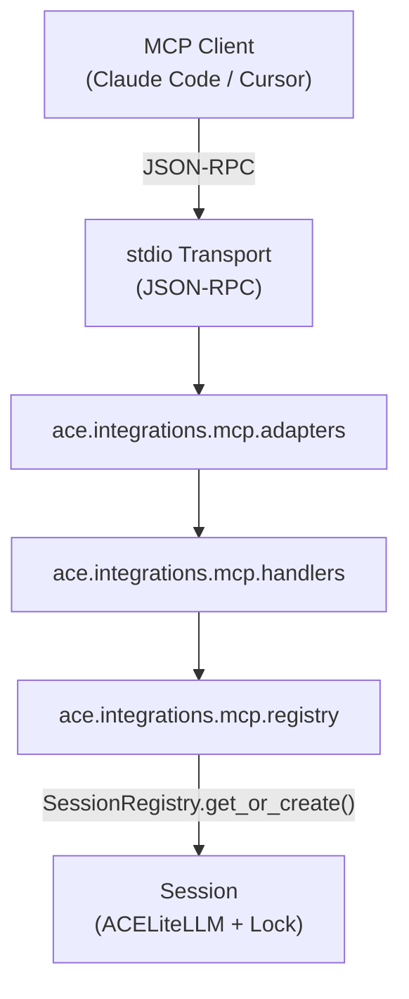

**Sources:** [docs/integrations/mcp.md:1-150](), [specs/002-ace-mcp-server/spec.md:1-100](), [ace/integrations/mcp/registry.py:1-96]()

---

## Skillbook v2 System

The Skillbook has evolved into a sophisticated knowledge store with the following features:
- **Section-grouped Storage**: Skills are organized by topics.
- **BM25 Retrieval**: High-performance keyword-based search via `rank-bm25` [pyproject.toml:46]().
- **Richer Provenance**: `InsightSource` tracks the origin of every skill [CHANGELOG.md:59-60]().
- **Generalization Gate**: A four-criterion check (frequency, domain diversity, slotting, and verifiability) that constrains when the `SkillManager` can broaden skills [CHANGELOG.md:13-17]().

**Sources:** [CHANGELOG.md:10-54](), [ace/core/skillbook.py:1-100]()

---

## Command-Line Interfaces

ACE provides multiple CLI tools for different workflows:

| Command | Purpose | Location |
|---------|---------|----------|
| `ace` | Interactive setup and configuration | [pyproject.toml:119]() |
| `kayba` | Hosted API interaction and trace management | [pyproject.toml:120]() |
| `ace-mcp` | Start the MCP tool server | [pyproject.toml:121]() |

**Sources:** [pyproject.toml:118-121](), [README.md:34-52]()

---

# Page: Core Concepts

# Core Concepts

<details>
<summary>Relevant source files</summary>

The following files were used as context for generating this wiki page:

- [CLAUDE.md](CLAUDE.md)
- [README.md](README.md)
- [ace/core/skillbook.py](ace/core/skillbook.py)
- [ace/runners/litellm.py](ace/runners/litellm.py)
- [assets/kayba-banner.png](assets/kayba-banner.png)
- [docs/api/index.md](docs/api/index.md)
- [docs/concepts/skillbook.md](docs/concepts/skillbook.md)
- [docs/concepts/updates.md](docs/concepts/updates.md)
- [docs/design/SKILLBOOK_V2_PLAN.md](docs/design/SKILLBOOK_V2_PLAN.md)
- [docs/guides/composing-pipelines.md](docs/guides/composing-pipelines.md)
- [docs/guides/prompts.md](docs/guides/prompts.md)
- [examples/ace/ace_demo.py](examples/ace/ace_demo.py)
- [tests/test_ace_core.py](tests/test_ace_core.py)

</details>


This page covers the fundamental concepts of the Agentic Context Engine (ACE). ACE adds a persistent learning loop to AI agents, enabling them to improve through experience without fine-tuning.

**Scope**: This page focuses on the high-level conceptual model: the learning loop, the Skillbook, the three-role architecture, and adaptation strategies.

---

## The ACE Learning Loop

ACE implements a closed-loop system where agents learn from their own execution traces. This cycle is typically orchestrated by a `Pipeline` [pipeline/pipeline.py:15-104]() consisting of specialized steps.

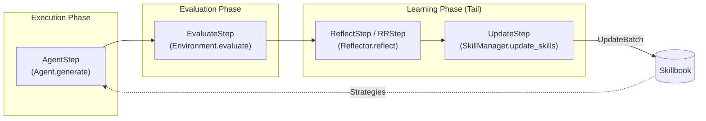

1.  **Execute**: The `Agent` performs a task, optionally using strategies from the `Skillbook`.
2.  **Evaluate**: A `TaskEnvironment` [ace/core/environments.py:46-59]() assesses the outcome (Micro or Meso feedback).
3.  **Reflect**: The `Reflector` (or `RRStep` [ace/rr/step.py:23-55]()) analyzes the trace to find root causes and insights.
4.  **Update**: The `SkillManager` [ace/implementations.py:141-213]() issues commands to modify the `Skillbook`.

For details, see [The ACE Learning Loop](#2.1).

**Sources**: [README.md:80-99](), [docs/guides/composing-pipelines.md:18-29]()

---

## Skillbook: The Knowledge Repository

The `Skillbook` [ace/core/skillbook.py:270-320]() is the central store for learned strategies. Unlike a vector database, it is a curated collection of "skills" that are injected into the agent's prompt.

### Skill Structure
Each `Skill` [ace/core/skillbook.py:323-380]() follows the **v2 schema**, containing:
*   **Issue**: The problem or pattern identified.
*   **Insight**: The actionable strategy to resolve it.
*   **Keywords**: Structured labels for retrieval and organization.
*   **Metadata**: Effectiveness scores (`helpful_count`, `harmful_count`) and provenance (`occurrences`).

### Sections
Skills are organized into two primary sections [ace/core/skillbook.py:22-23]():
*   `context`: Strategies for the agent to apply during task execution.
*   `harness`: Learnings about the environment or runtime (e.g., rate limits).

For details, see [Skillbook System](#2.2).

**Sources**: [docs/concepts/skillbook.md:1-35](), [ace/core/skillbook.py:323-380]()

---

## Three-Role Architecture

ACE uses a separation of concerns across three specialized roles, typically backed by [PydanticAI](https://ai.pydantic.dev) agents.

| Role | Key Class | Responsibility |
| :--- | :--- | :--- |
| **Agent** | `Agent` | Executes tasks; cites `skill_ids` it uses. |
| **Reflector** | `Reflector` | Analyzes traces; tags skills as helpful/harmful. |
| **SkillManager** | `SkillManager` | Manages Skillbook evolution via `UpdateOperation`. |

### Recursive Reflector (RR)
The **Recursive Reflector** [ace/rr/step.py:23-55]() is a high-power alternative to the standard Reflector. It uses a `RecursiveAgent` [ace/core/recursive_agent.py:45-102]() to write and execute Python code in a `TraceSandbox` [ace/rr/sandbox.py:24-60]() to programmatically analyze complex execution traces.

For details, see [Three-Role Architecture](#2.3).

**Sources**: [CLAUDE.md:80-87](), [README.md:80-89]()

---

## Adaptation Strategies

ACE supports different modes of learning depending on the availability of data and the deployment scenario.

*   **Online Learning**: The agent learns in real-time from live interactions. This is often done via an `async_boundary` [pipeline/step.py:33-40]() to prevent learning latency from blocking the agent's response.
*   **Offline Learning**: The agent is trained on a batch of `Sample` [ace/core/environments.py:16-24]() objects to build a baseline Skillbook.
*   **Trace Analysis**: The `TraceAnalyser` [ace/runners/trace_analyser.py:21-50]() runner allows learning from pre-recorded execution logs without re-executing the task.

For details, see [Adaptation Strategies](#2.4).

**Sources**: [ace/runners/litellm.py:51-54](), [docs/api/index.md:22-27]()

---

## Insight Levels

ACE learning triggers on two distinct levels of observation:

1.  **Micro (Ground Truth)**: Learning from direct success/failure signals (e.g., "The answer was 4, but the agent said 5").
2.  **Meso (Pattern Observation)**: Learning from the *process* of execution, even without a known correct answer (e.g., "The agent got stuck in a loop when clicking this button").

For details, see [Insight Levels](#2.5).

**Sources**: [ace/core/outputs.py:55-85](), [docs/concepts/skillbook.md:135-152]()

---

## System Mapping: Code to Concepts

This diagram bridges Natural Language concepts to the core classes in the codebase.

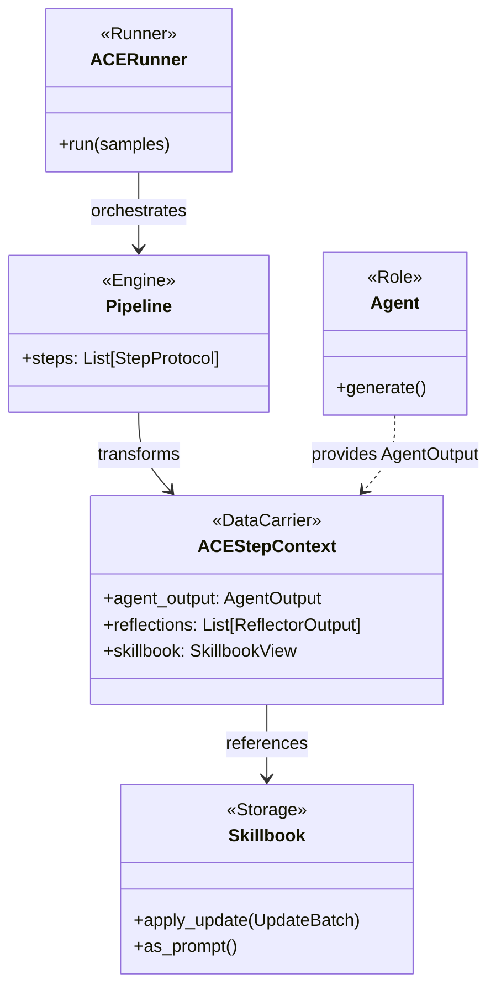

**Sources**: [pipeline/pipeline.py:15-104](), [ace/core/context.py:68-105](), [ace/core/skillbook.py:270-320]()

---

# Page: The ACE Learning Loop

# The ACE Learning Loop

<details>
<summary>Relevant source files</summary>

The following files were used as context for generating this wiki page:

- [CLAUDE.md](CLAUDE.md)
- [README.md](README.md)
- [ace/__init__.py](ace/__init__.py)
- [ace/runners/litellm.py](ace/runners/litellm.py)
- [assets/kayba-banner.png](assets/kayba-banner.png)
- [docs/guides/full-pipeline.md](docs/guides/full-pipeline.md)
- [docs/index.md](docs/index.md)
- [docs/integrations/litellm.md](docs/integrations/litellm.md)
- [docs/integrations/opik.md](docs/integrations/opik.md)
- [docs/pipeline/index.md](docs/pipeline/index.md)
- [examples/ace/ace_demo.py](examples/ace/ace_demo.py)
- [examples/pipeline_composition/compose_custom_pipeline.py](examples/pipeline_composition/compose_custom_pipeline.py)
- [tests/test_pipeline_exports.py](tests/test_pipeline_exports.py)

</details>


## Purpose and Scope

This document describes the core learning loop that enables ACE agents to self-improve through execution feedback. The loop implements a continuous cycle of **Execute → Evaluate → Reflect → Update** that transforms task experiences into refined strategies stored in the skillbook.

The ACE framework implements this loop using a **Pipeline Engine**, where each phase of the loop is encapsulated in a discrete, composable `Step`. This architecture ensures that data flow is immutable and that learning can occur either synchronously or in the background.

For details on the skillbook data structure, see [Skillbook System (2.2)](). For deep dives into the individual roles, see [Three-Role Architecture (2.3)](). For information about the underlying pipeline primitives, see [Pipeline Primitives (3.2.1)]().

---

## Loop Architecture Overview

The ACE learning loop is composed of several specialized steps orchestrated by a `Pipeline`. In the standard configuration, these steps are: `AgentStep` → `EvaluateStep` → `ReflectStep` → `UpdateStep`.

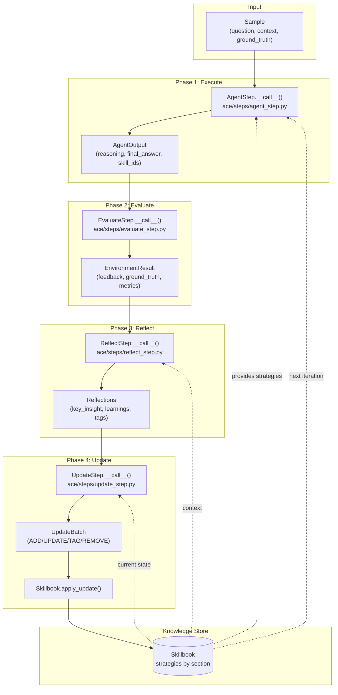

**Diagram: ACE Learning Loop with Code Entity Mapping**

Sources: [ace/runners/ace.py:86-118](), [ace/steps/__init__.py:1-25](), [docs/index.md:9-17]()

---

## Phase 1: Execute (Agent Generation)

The `AgentStep` consumes the current `Skillbook` and generates a reasoned answer to the task question.

### Key Components

| Component | Type | Location | Purpose |
|-----------|------|----------|---------|
| `Agent` | Class | [ace/implementations/agent.py]() | Logic for task execution using PydanticAI |
| `AgentStep` | Step | [ace/steps/agent_step.py]() | Pipeline wrapper for the Agent role |
| `AgentOutput` | Dataclass | [ace/core/outputs.py:14-17]() | Contains reasoning and final_answer |

### Execution Flow

The `Agent` uses a `SkillbookView` to retrieve relevant strategies. It injects these into its system prompt to guide its reasoning.

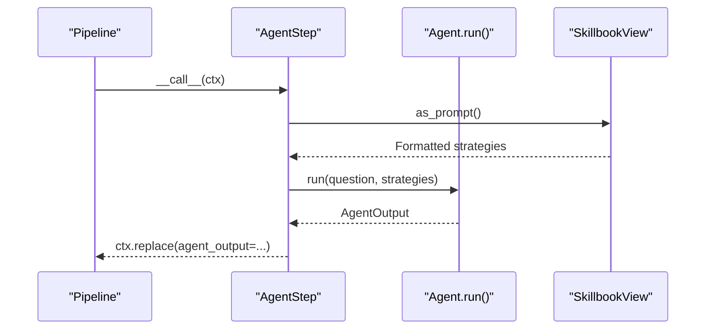

**Diagram: Agent Execution Sequence**

The agent extracts which strategies were cited in its reasoning trace. These citations (e.g., `[section-001]`) allow the system to track which skills are effectively contributing to performance.

Sources: [ace/steps/agent_step.py:1-30](), [ace/implementations/agent.py:1-50](), [examples/pipeline_composition/compose_custom_pipeline.py:67-67]()

---

## Phase 2: Evaluate (Environment Feedback)

The `EvaluateStep` uses a `TaskEnvironment` to score the agent's output and provide feedback.

### Key Components

| Component | Type | Location | Purpose |
|-----------|------|----------|---------|
| `TaskEnvironment` | Protocol | [ace/core/environment.py]() | Interface for evaluation logic |
| `EvaluateStep` | Step | [ace/steps/evaluate_step.py]() | Pipeline wrapper for evaluation |
| `SimpleEnvironment` | Class | [ace/core/environment.py]() | Substring matching evaluator |

### Evaluation Contract

The environment receives the `Sample` and `AgentOutput` and returns an `EnvironmentResult`:

- **feedback**: Text describing the correctness (e.g., "Correct!" or "Incorrect. Expected: Paris").
- **ground_truth**: The reference answer used for reflection.
- **metrics**: Numerical scores (e.g., `{"accuracy": 1.0}`).

```python
# Example of custom environment usage
class ExactMatchEnvironment(TaskEnvironment):
    def evaluate(self, sample, agent_output):
        correct = sample.ground_truth.lower() == agent_output.final_answer.lower()
        return EnvironmentResult(
            feedback="Correct!" if correct else "Wrong",
            metrics={"accuracy": 1.0 if correct else 0.0}
        )
```

Sources: [ace/steps/evaluate_step.py:1-20](), [ace/core/environment.py:1-50](), [examples/ace/ace_demo.py:170-184]()

---

## Phase 3: Reflect (Trace Analysis)

The `ReflectStep` (or the advanced `RRStep`) analyzes the execution trace to extract actionable insights.

### Key Components

| Component | Type | Location | Purpose |
|-----------|------|----------|---------|
| `Reflector` | Class | [ace/implementations/reflector.py]() | Standard single-pass analyzer |
| `RRStep` | Step | [ace/steps/rr_step.py]() | **Recursive Reflector**: Iterative code-based analysis |
| `ReflectorOutput` | Dataclass | [ace/core/outputs.py:15-16]() | Key insights and extracted learnings |

### Reflection Modes

1.  **Standard Reflection**: A single LLM call that looks at the `AgentOutput` and `EnvironmentResult` to find the root cause of errors.
2.  **Recursive Reflector (RR)**: The system's most advanced analysis mode. It writes and executes Python code in a `TraceSandbox` to programmatically inspect the trace, test hypotheses, and synthesize multi-step strategies.

The `ReflectStep` identifies which skills were "helpful" or "harmful" based on the evaluation result, which is used to update skill metadata.

Sources: [ace/steps/reflect_step.py:1-25](), [ace/steps/rr_step.py:1-50](), [ace/implementations/reflector.py:1-40]()

---

## Phase 4: Update (Skillbook Curation)

The `UpdateStep` invokes the `SkillManager` to translate reflections into concrete `Skillbook` modifications.

### Key Components

| Component | Type | Location | Purpose |
|-----------|------|----------|---------|
| `SkillManager` | Class | [ace/implementations/skill_manager.py]() | Curates the skillbook state |
| `UpdateStep` | Step | [ace/steps/update_step.py]() | Pipeline wrapper for updates |
| `UpdateBatch` | Dataclass | [ace/core/skillbook.py:27-28]() | List of `UpdateOperation` objects |

### Update Operations

The `SkillManager` generates an `UpdateBatch` containing operations like:
- **ADD**: Create a new strategy.
- **UPDATE**: Refine an existing strategy.
- **TAG**: Mark a skill as helpful/harmful based on the current trace.
- **REMOVE**: Prune redundant or ineffective strategies.

These operations are applied to the `Skillbook` at the end of the step, making the new knowledge available for the next `Sample` or epoch.

Sources: [ace/steps/update_step.py:1-25](), [ace/implementations/skill_manager.py:1-50](), [ace/core/skillbook.py:77-78]()

---

## The Learning Tail (Async Learning)

A critical architectural pattern in ACE is the `learning_tail`. This is a factory function that creates the "learning" portion of the pipeline (Reflect → Update).

```python
# From ace/steps/__init__.py
def learning_tail(reflector, skill_manager, skillbook):
    return [
        ReflectStep(reflector),
        UpdateStep(skill_manager, skillbook)
    ]
```

### Async Boundaries

To prevent the slow learning process (Reflection/Update) from blocking the fast Agent execution, ACE uses the `async_boundary` feature of the Pipeline Engine.


When `async_boundary` is set to `True` on the `ReflectStep`, the pipeline returns the agent's answer immediately after evaluation. The reflection and skillbook update continue in background threads. This allows for high-throughput execution while maintaining a continuous background learning loop.

Sources: [ace/steps/__init__.py:115-115](), [docs/pipeline/index.md:112-129](), [examples/pipeline_composition/compose_custom_pipeline.py:70-70]()

---

## Complete Pipeline Composition

The `ACE` runner automates the construction of this loop. Users can also manually compose it for full control over the steps.

```python
from ace import Pipeline, AgentStep, EvaluateStep, learning_tail

# Manual composition
pipe = Pipeline([
    AgentStep(agent, skillbook),
    EvaluateStep(environment),
    # Custom step can be injected here
    *learning_tail(reflector, skill_manager, skillbook)
])

# Or using the runner preset
runner = ACE.from_roles(agent, reflector, skill_manager, environment)
results = runner.run(samples, epochs=3)
```

The loop iterates over the provided `samples` for the specified number of `epochs`. Each epoch allows the agent to revisit tasks with a more mature `Skillbook`, leading to progressive performance improvement.

Sources: [ace/runners/ace.py:102-115](), [examples/pipeline_composition/compose_custom_pipeline.py:65-72](), [docs/guides/full-pipeline.md:71-84]()

---

# Page: Skillbook System

# Skillbook System

<details>
<summary>Relevant source files</summary>

The following files were used as context for generating this wiki page:

- [ace/core/__init__.py](ace/core/__init__.py)
- [ace/core/insight_source.py](ace/core/insight_source.py)
- [ace/core/skillbook.py](ace/core/skillbook.py)
- [docs/api/index.md](docs/api/index.md)
- [docs/concepts/skillbook.md](docs/concepts/skillbook.md)
- [docs/concepts/updates.md](docs/concepts/updates.md)
- [docs/design/SKILLBOOK_V2_PLAN.md](docs/design/SKILLBOOK_V2_PLAN.md)
- [docs/guides/composing-pipelines.md](docs/guides/composing-pipelines.md)
- [docs/guides/prompts.md](docs/guides/prompts.md)
- [tests/test_ace_core.py](tests/test_ace_core.py)

</details>


## Purpose and Scope

The **Skillbook** is the central knowledge store for the ACE Framework, maintaining a structured collection of learned strategies called **Skills**. This page details the Skill data structure (v2 schema), the Skillbook class interface, the `InsightSource` provenance system, and the hybrid BM25 retrieval and persistence mechanisms.

For the three-phase learning cycle that populates the Skillbook, see [The ACE Learning Loop](2.1). For details on the mutation instructions, see [Update Operations](9.1).

---

## Overview

The Skillbook acts as the agent's "long-term memory," evolving from a blank slate into a repository of domain-specific expertise. Unlike static system prompts, the Skillbook is dynamically curated by the `SkillManager` based on execution traces and environment feedback.

**Key characteristics:**
- **V2 Schema**: Organized by binary sections (`context` vs `harness`) with structured `keywords`.
- **Provenance**: Every skill tracks its origin via `InsightSource` records linked to specific traces.
- **Hybrid Retrieval**: Supports BM25 and dense embedding-based search for relevant strategies.
- **Persistence**: Saved as human-readable JSON with a binary `.npz` sidecar for embeddings.

Sources: [ace/core/skillbook.py:1-23](), [docs/concepts/skillbook.md:1-5](), [docs/design/SKILLBOOK_V2_PLAN.md:1-15]()

---

## Architecture and Data Flow

The following diagram bridges the natural language strategies learned by the agent to the specific code entities in `ace/core/`.

### Skillbook Data Flow
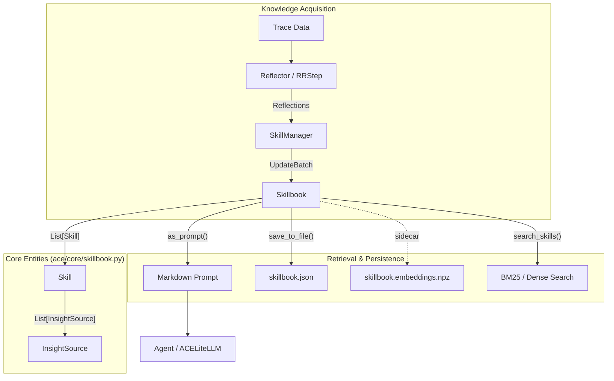
Sources: [ace/core/skillbook.py:207-220](), [ace/core/context.py:12-15](), [docs/guides/composing-pipelines.md:18-29]()

---

## Skill Structure (v2 Schema)

ACE uses a standardized schema (Version 2) to ensure skills are both human-readable and machine-parsable.

### The `Skill` Class
Defined in `ace/core/skillbook.py`, a Skill represents a single learned entry.

| Field | Type | Description |
|-------|------|-------------|
| `id` | `str` | Unique identifier (e.g., `context-00001`). |
| `section` | `Literal` | Either `context` (agent guidance) or `harness` (environment/runtime). |
| `keywords` | `list[str]` | Normalized topic labels (e.g., `["math", "api_limit"]`). |
| `issue` | `str` | Prose description of the problem and its scope. |
| `insight` | `str | None` | Imperative action (Required for `context` section). |
| `occurrences` | `list[InsightSource]` | Audit chain linking the skill to supporting traces. |
| `active` | `bool` | Soft-delete flag; `False` excludes skill from prompts. |
| `helpful_count` | `int` | Counter for successful applications. |
| `harmful_count` | `int` | Counter for applications leading to failure. |

Sources: [ace/core/skillbook.py:254-282](), [docs/concepts/skillbook.md:7-35](), [docs/design/SKILLBOOK_V2_PLAN.md:21-37]()

---

## InsightSource Provenance

The `InsightSource` class provides the "paper trail" for learned knowledge. Each time a skill is created or updated, a source record is appended to its `occurrences` list.

### Provenance Tracking
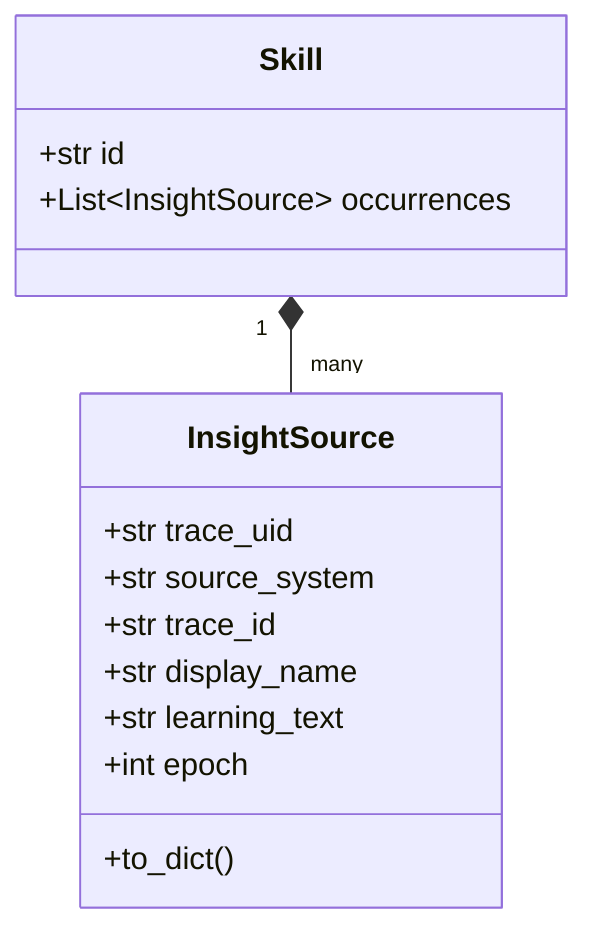
Sources: [ace/core/insight_source.py:108-121](), [docs/concepts/skillbook.md:135-152]()

---

## Retrieval and Skillbook Operations

The `Skillbook` class manages the lifecycle of these entries through several key methods.

### Key Functions
- **`add_skill`**: Validates the section (must be `context` or `harness`) and enforces that `context` skills have insights. [ace/core/skillbook.py:657-670]()
- **`apply_update`**: Processes an `UpdateBatch` containing `ADD`, `UPDATE`, `TAG`, or `REMOVE` operations. [ace/core/skillbook.py:906-915]()
- **`as_prompt`**: Renders the active skills into a Markdown format optimized for LLM consumption, grouped by section. [ace/core/skillbook.py:843-855]()
- **`search_skills`**: Performs retrieval using BM25 (text-based) or hybrid search if embeddings are present. [ace/core/skillbook.py:1120-1135]()

### Scoring and Effectiveness
Effectiveness is tracked via `helpful_count`, `harmful_count`, and `neutral_count`. These are updated by the `Reflector` using `TAG` operations with a `delta` of `1`, `-1`, or `0`.
Sources: [ace/core/skillbook.py:273-276](), [docs/concepts/updates.md:100-109]()

---

## Persistence and Storage

Skillbooks are stored using a dual-file approach to keep the primary data human-editable and version-control friendly.

### File Formats
1.  **`skillbook.json`**: Contains all Skill metadata, prose, and provenance. It uses `SCHEMA_VERSION = "2"`. [ace/core/skillbook.py:21]()
2.  **`skillbook.embeddings.npz`**: A binary sidecar file storing float32 embeddings keyed by `skill_id`. This file is treated as a cache and can be recomputed. [ace/core/skillbook.py:86-91]()

### Save/Load Logic
- **`save_to_file(path)`**: Writes the JSON and automatically exports the `.npz` sidecar if embeddings exist. [ace/core/skillbook.py:1081-1100]()
- **`load_from_file(path)`**: Loads the JSON and attempts to find a matching `.npz` file in the same directory. [ace/core/skillbook.py:1034-1055]()

Sources: [docs/design/SKILLBOOK_V2_PLAN.md:51-58](), [docs/concepts/skillbook.md:91-100]()

---

## Summary Table: Skillbook Sections

| Section | Purpose | Invariants |
| :--- | :--- | :--- |
| `context` | Strategies for the agent to follow during task execution. | `insight` is **Required**. |
| `harness` | Observations about the runtime, environment, or tools. | `insight` is **Optional**. |

Sources: [ace/core/skillbook.py:22-23](), [docs/design/SKILLBOOK_V2_PLAN.md:41-47]()

---

# Page: Three-Role Architecture

# Three-Role Architecture

<details>
<summary>Relevant source files</summary>

The following files were used as context for generating this wiki page:

- [ace.toml](ace.toml)
- [ace/__init__.py](ace/__init__.py)
- [ace/implementations/prompts.py](ace/implementations/prompts.py)
- [ace/implementations/skill_manager.py](ace/implementations/skill_manager.py)
- [docs/concepts/overview.md](docs/concepts/overview.md)
- [docs/concepts/roles.md](docs/concepts/roles.md)
- [docs/getting-started/quick-start.md](docs/getting-started/quick-start.md)
- [docs/getting-started/setup.md](docs/getting-started/setup.md)
- [tests/test_pipeline_exports.py](tests/test_pipeline_exports.py)

</details>


## Purpose and Scope

This page documents the three core roles that power ACE's learning loop: **Agent**, **Reflector**, and **SkillManager**. These roles form the foundation of ACE's self-improvement mechanism, where the Agent executes tasks, the Reflector analyzes outcomes, and the SkillManager updates the skillbook based on learnings.

For information about how these roles are orchestrated in learning loops, see [Adaptation Strategies](#2.4). For the skillbook data structure they operate on, see [Skillbook System](#2.2). For details on the complete learning cycle, see [The ACE Learning Loop](#2.1).

## Role Overview

ACE's architecture separates concerns into three specialized roles, each with a distinct responsibility in the learning process:

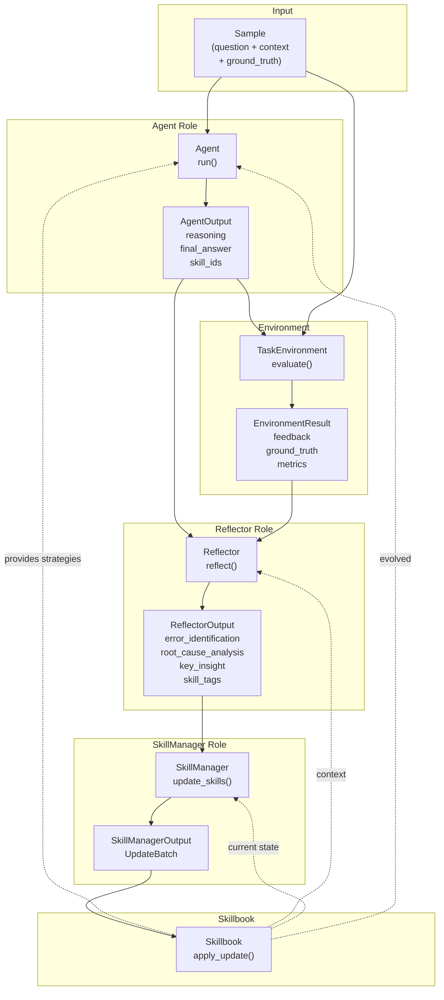

**Sources:** [ace/implementations/skill_manager.py:58-93](), [docs/concepts/roles.py:1-11]()

| Role | Input | Output | Responsibility |
|------|-------|--------|----------------|
| **Agent** | Question, Context, Skillbook | Reasoning, Answer, Cited Skills | Execute task using accumulated strategies |
| **Reflector** | Agent Output, Feedback, Skillbook | Error Analysis, Insights, Skill Tags | Diagnose what went right/wrong and why |
| **SkillManager** | Reflection, Skillbook, Progress | Update Operations (Audit Log) | Decide how to evolve the skillbook |

## Agent Role

The Agent executes tasks by applying strategies from the skillbook. It is responsible for producing reasoned answers and citing which skills it applied.

### Core Responsibilities

1. **Strategy Selection** - Scan skillbook for relevant skills [ace/implementations/prompts.py:104-110]()
2. **Problem Decomposition** - Break complex problems into sub-problems [ace/implementations/prompts.py:112-115]()
3. **Strategy Application** - Execute selected strategies with skill ID citations [ace/implementations/prompts.py:117-122]()
4. **Solution Execution** - Show complete reasoning chain and produce final answer [ace/implementations/prompts.py:124-129]()

### Implementation Details

The `Agent` implementation (referenced in `ace/__init__.py`) wraps an LLM and uses the `AGENT_PROMPT` template. The agent prompt instructs the LLM to:

- Review skillbook strategies and cite specific skill IDs inline in reasoning [ace/implementations/prompts.py:167]()
- Show numbered reasoning steps with intermediate calculations [ace/implementations/prompts.py:141-145]()
- Avoid meta-commentary like "I will now..." [ace/implementations/prompts.py:153]()
- Return JSON with `reasoning`, `final_answer`, and `answer_confidence` [ace/implementations/prompts.py:164-176]()

**Sources:** [ace/implementations/prompts.py:68-177](), [ace/__init__.py:84-84]()

### Skill Citation Mechanism

The framework provides instructions for external agents to follow the same citation pattern, ensuring consistency even when the ACE Agent is replaced by an external framework like LangChain or Browser-Use [ace/implementations/prompts.py:31-60]().

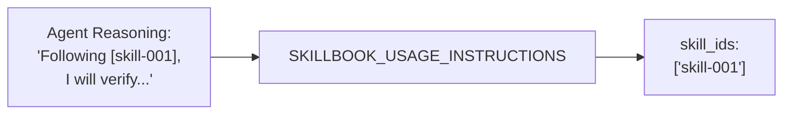

**Sources:** [ace/implementations/prompts.py:15-28]()

## Reflector Role

The Reflector analyzes execution traces to understand what went right or wrong. It produces diagnostic insights and classifies skill effectiveness.

### Core Responsibilities

1. **Error Identification** - Pinpoint exact mistakes in reasoning [docs/concepts/roles.md:66-66]()
2. **Root Cause Analysis** - Explain why errors occurred [docs/concepts/roles.md:67-67]()
3. **Learning Extraction** - Extract key insights from the outcome [docs/concepts/roles.md:69-69]()
4. **Skill Tagging** - Classify skills as helpful, harmful, or neutral [docs/concepts/roles.md:70-70]()

### Reflection Modes

The Reflector supports two primary operational modes [docs/concepts/roles.md:72-78]():

| Mode | Description | Implementation |
|------|-------------|----------------|
| `SIMPLE` | Single-pass analysis (default) | Standard LLM prompt-response |
| `RECURSIVE` | Multi-pass with code execution in a REPL loop | `RRStep` / `Recursive Reflector` |

**Sources:** [docs/concepts/roles.md:72-78](), [ace/__init__.py:117-118]()

## SkillManager Role

The SkillManager transforms reflections into actionable skillbook updates. Unlike a staging-based system, the `SkillManager` in ACE v2.1+ often acts as a `RecursiveAgent` that mutates the skillbook directly via tools.

### Core Responsibilities

1. **Direct Mutation** - Apply `add_skill`, `update_skill`, or `remove_skill` directly [ace/implementations/skill_manager.py:3-6]()
2. **Audit Logging** - Record the sequence of operations for transparency [ace/implementations/skill_manager.py:8-13]()
3. **Search & Inspect** - Use `search_skills` and `read_skill` to prevent duplicates [ace/implementations/skill_manager.py:121-124]()
4. **Budget Management** - Manage request and token limits via `RecursiveAgent` base [ace/implementations/skill_manager.py:115-120]()

### SkillManager Interface

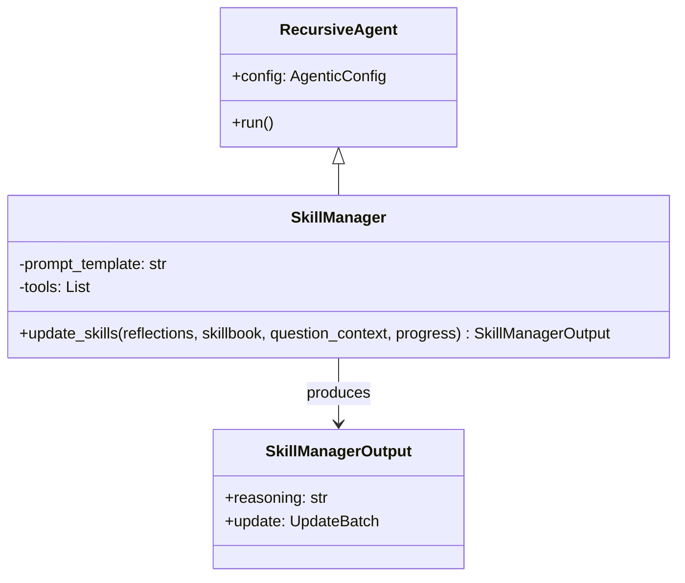

**Sources:** [ace/implementations/skill_manager.py:58-93](), [ace/implementations/skill_manager.py:136-169]()

### Implementation Details

The `SkillManager` is initialized with a suite of mutation tools [ace/implementations/skill_manager.py:121-128]():
- `register_sm_search_skills`: Read-only inspection
- `register_add_skill`: Atomic mutation
- `register_update_skill`: Modification of existing skills
- `register_tag_skill`: Metadata updates (helpful/harmful scoring)

When `update_skills` is called, it processes a tuple of reflections and applies changes directly to the provided `Skillbook` instance [ace/implementations/skill_manager.py:147-155]().

**Sources:** [ace/implementations/skill_manager.py:31-39](), [ace/implementations/skill_manager.py:136-188]()

## Role Interaction Flow

The interaction is typically orchestrated by an `ACERunner` or a `Pipeline` [ace/__init__.py:97-103]().

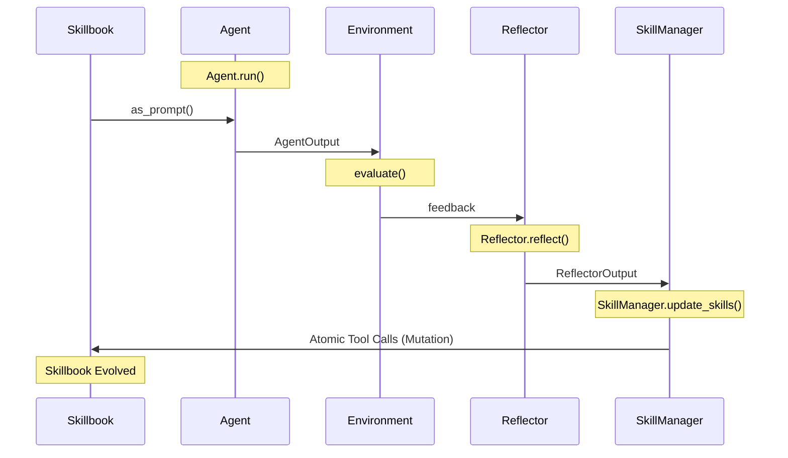

**Sources:** [ace/implementations/skill_manager.py:1-14](), [docs/concepts/overview.md:12-20]()

## Implementation Mapping

Concrete classes and their code locations:

| Role | Class | Implementation Path | Base Class |
|------|-------|---------------------|------------|
| Agent | `Agent` | `ace/implementations/agent.py` | (LLM Wrapper) |
| Reflector | `Reflector` | `ace/implementations/reflector.py` | (LLM Wrapper) |
| Skill Manager | `SkillManager` | [ace/implementations/skill_manager.py:58-93]() | `RecursiveAgent` |
| Recursive Reflector | `RRStep` | `ace/steps/rr_step.py` | `StepProtocol` |

**Sources:** [ace/__init__.py:83-86](), [ace/implementations/skill_manager.py:58-68]()

---

# Page: Adaptation Strategies

# Adaptation Strategies

<details>
<summary>Relevant source files</summary>

The following files were used as context for generating this wiki page:

- [CLAUDE.md](CLAUDE.md)
- [README.md](README.md)
- [ace/runners/ace.py](ace/runners/ace.py)
- [ace/runners/litellm.py](ace/runners/litellm.py)
- [ace/runners/trace_analyser.py](ace/runners/trace_analyser.py)
- [assets/kayba-banner.png](assets/kayba-banner.png)
- [docs/guides/full-pipeline.md](docs/guides/full-pipeline.md)
- [docs/index.md](docs/index.md)
- [docs/integrations/litellm.md](docs/integrations/litellm.md)
- [docs/integrations/opik.md](docs/integrations/opik.md)
- [docs/pipeline/index.md](docs/pipeline/index.md)
- [examples/ace/ace_demo.py](examples/ace/ace_demo.py)
- [examples/pipeline_composition/compose_custom_pipeline.py](examples/pipeline_composition/compose_custom_pipeline.py)

</details>


## Purpose and Scope

This document explains the primary adaptation strategies in the ACE Framework: **Batch Training**, **Real-time Adaptation**, and **Trace Analysis**. Each strategy orchestrates the Execute → Evaluate → Reflect → Update cycle differently based on the data source and operational context.

- **Batch Training**: Multi-epoch training over a fixed dataset using the `ACE` runner.
- **Real-time Adaptation**: Single-pass streaming learning using the `ACE` runner or `ACELiteLLM`.
- **Trace Analysis**: Learning from pre-recorded execution logs without re-execution using the `TraceAnalyser` runner.

These strategies are implemented as high-level orchestrators over the [Pipeline Engine](3.2. Pipeline Engine (pipeline)).

---

## Overview

Adaptation strategies are implemented through specialized `ACERunner` subclasses in `ace/runners/`. These runners compose individual [Pipeline Steps](3.2.2. Step System) into cohesive learning workflows.

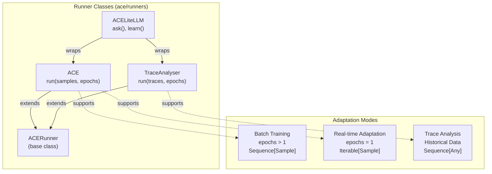

**Diagram: ACE Runner Architecture and Adaptation Modes**

Sources: [ace/runners/base.py:23-24](), [ace/runners/ace.py:27-38](), [ace/runners/trace_analyser.py:26-41](), [ace/runners/litellm.py:3-10]()

---

## Batch Training Mode

Batch training is used to build a robust `Skillbook` from a fixed set of `Sample` objects. By running multiple **epochs**, the agent revisits the same questions, allowing the `Reflector` and `SkillManager` to refine strategies over time.

### Pipeline Composition

The `ACE` runner composes a full loop including execution and evaluation.

```mermaid
graph LR
    Sample["Sample<br/>(question, context)"]
    
    subgraph "ACE Pipeline (ace/runners/ace.py)"
        AgentStep["AgentStep<br/>(ace/steps/agent.py)"]
        EvaluateStep["EvaluateStep<br/>(ace/steps/evaluate.py)"]
        
        subgraph "learning_tail (ace/steps/__init__.py)"
            ReflectStep["ReflectStep<br/>(ace/steps/reflect.py)"]
            UpdateStep["UpdateStep<br/>(ace/steps/update.py)"]
        end
    end
    
    Result["SampleResult"]
    
    Sample --> AgentStep
    AgentStep --> EvaluateStep
    EvaluateStep --> ReflectStep
    ReflectStep --> UpdateStep
    UpdateStep --> Result
```

**Diagram: Batch Training Pipeline Flow**

### Implementation Details
- **Multi-Epoch Logic**: The `ACERunner._run` method iterates over epochs. If `epochs > 1`, the input must be a `Sequence` to allow repeated passes [ace/runners/ace.py:154-166]().
- **Context Mapping**: `ACE._build_context` maps a `Sample` to an `ACEStepContext`, attaching the current `SkillbookView` [ace/runners/ace.py:179-195]().
- **Checkpointing**: The pipeline can include a `CheckpointStep` to save the `Skillbook` to disk at defined intervals (e.g., every 10 samples) [ace/runners/ace.py:88-89]().

Sources: [ace/runners/ace.py:78-94](), [ace/runners/base.py:155-187](), [docs/guides/full-pipeline.md:125-144]()

---

## Real-time Adaptation

Real-time adaptation allows an agent to learn from interactions as they happen. This is typically a single-pass (`epochs=1`) operation where the learning occurs in the background.

### Async Learning Architecture

To prevent the learning process (Reflection and Skill Management) from blocking the agent's response, ACE uses an **Async Boundary**.

```mermaid
sequenceDiagram
    participant App as "Application"
    participant ACE as "ACE Runner"
    participant Agent as "AgentStep"
    participant Eval as "EvaluateStep"
    participant Pool as "Thread Pool (async_boundary)"
    participant Learn as "learning_tail (Reflect + Update)"

    App->>ACE: run(sample, wait=False)
    ACE->>Agent: execute()
    Agent-->>ACE: AgentOutput
    ACE->>Eval: evaluate()
    Eval-->>ACE: feedback
    
    Note over ACE: async_boundary reached
    ACE-->>App: Return SampleResult (Immediate)
    
    ACE->>Pool: Submit Learning Task
    Pool->>Learn: reflect()
    Pool->>Learn: update_skillbook()
    Note over Learn: Skillbook mutated in background
```

**Diagram: Real-time Async Adaptation Flow**

### Key Features
- **Non-blocking Execution**: By setting `wait=False` in `run()`, the caller receives the agent's answer immediately after evaluation, while reflection continues in background threads [ace/runners/ace.py:149-158]().
- **Eventually Consistent Skillbook**: Subsequent agent calls will automatically pick up the new strategies once the background `UpdateStep` completes.
- **ACELiteLLM Integration**: The `learn_from_feedback` method provides a simplified interface for this mode, wrapping a single interaction into a learning pass [ace/runners/litellm.py:61-68]().

Sources: [ace/runners/ace.py:144-167](), [pipeline/index.md:112-129](), [docs/guides/full-pipeline.md:208-224]()

---

## Trace Analysis

Trace analysis is a "learning-only" strategy. It is used when you have pre-recorded execution logs (traces) from an external system (e.g., LangChain, Browser-use, or production logs) and want to extract strategies without re-running the agent.

### The TraceAnalyser Runner

The `TraceAnalyser` runner omits the `AgentStep` and `EvaluateStep`. It places the raw trace directly into the `ACEStepContext` for the `Reflector` to interpret.

```mermaid
graph LR
    RawTrace["Raw Trace Object<br/>(External Log)"]
    
    subgraph "TraceAnalyser Pipeline (ace/runners/trace_analyser.py)"
        ReflectStep["ReflectStep<br/>(ace/steps/reflect.py)"]
        UpdateStep["UpdateStep<br/>(ace/steps/update.py)"]
        DeduplicateStep["DeduplicateStep<br/>(ace/steps/deduplicate.py)"]
    end
    
    Skillbook["Updated Skillbook"]
    
    RawTrace --> ReflectStep
    ReflectStep --> UpdateStep
    UpdateStep --> DeduplicateStep
    DeduplicateStep --> Skillbook
```

**Diagram: Trace Analysis Pipeline**

### Implementation Details
- **Input Flexibility**: `TraceAnalyser.run` accepts a sequence of `Any` objects. The `_build_context` method preserves the raw trace structure [ace/runners/trace_analyser.py:155-187]().
- **Trace Identity**: It uses `infer_trace_identity` to extract metadata (like source system) from the raw logs to provide provenance for learned insights [ace/runners/trace_analyser.py:175-181]().
- **Offline Refinement**: This mode is ideal for "Expert Iteration" where a human reviews traces and then runs the analyser to codify the successful patterns into the `Skillbook`.

Sources: [ace/runners/trace_analyser.py:26-41](), [ace/runners/trace_analyser.py:78-89](), [ace/runners/trace_analyser.py:169-187]()

---

## Strategy Comparison

| Feature | Batch Training | Real-time Adaptation | Trace Analysis |
| :--- | :--- | :--- | :--- |
| **Runner Class** | `ACE` | `ACE` / `ACELiteLLM` | `TraceAnalyser` |
| **Primary Goal** | Optimization / Convergence | Continuous Improvement | Post-hoc Learning |
| **Agent Execution** | Yes (Re-runs every epoch) | Yes (Live interaction) | No |
| **Input Type** | `Sequence[Sample]` | `Iterable[Sample]` | `Sequence[Any]` (Traces) |
| **Epochs** | Typically > 1 | Typically 1 | 1 or more |
| **Backgrounding** | Usually Synchronous | Asynchronous | Usually Synchronous |

Sources: [ace/runners/ace.py:27-38](), [ace/runners/trace_analyser.py:26-41](), [docs/guides/full-pipeline.md:120-123]()

---

# Page: Insight Levels

# Insight Levels

<details>
<summary>Relevant source files</summary>

The following files were used as context for generating this wiki page:

- [docs/concepts/insight-levels.md](docs/concepts/insight-levels.md)
- [docs/guides/async-learning.md](docs/guides/async-learning.md)
- [docs/integrations/index.md](docs/integrations/index.md)
- [docs/integrations/mcp-client-setup.md](docs/integrations/mcp-client-setup.md)
- [docs/integrations/mcp.md](docs/integrations/mcp.md)
- [mkdocs.yml](mkdocs.yml)
- [specs/002-ace-mcp-server/contracts/tool-schemas.md](specs/002-ace-mcp-server/contracts/tool-schemas.md)
- [specs/002-ace-mcp-server/spec.md](specs/002-ace-mcp-server/spec.md)
- [tests/test_ace_mcp_compatibility.py](tests/test_ace_mcp_compatibility.py)

</details>


## Purpose and Scope

This document explains the three insight levels in the ACE Framework: micro, meso, and macro. Insight levels determine the scope and depth of analysis performed by the Reflector when extracting learnings from agent executions. Each level provides different types of knowledge extraction depending on what information is available and what learning objectives are prioritized.

For information about how these insights feed into the overall learning loop, see [The ACE Learning Loop](2.1). For details on which adaptation mode uses which insight level, see [Adaptation Strategies](2.4). For the role that performs this analysis, see [Three-Role Architecture](2.3).

## Overview

The ACE Framework operates at three insight levels based on what scope the Reflector analyzes:

| Level | Reflector Scope | What's Analyzed | Learning Source | Implementation |
|-------|-----------------|-----------------|-----------------|----------------|
| **Micro** | Single interaction | Request → response → evaluation | Ground truth and correctness feedback | `ACE` runner with `TaskEnvironment` |
| **Meso** | Full agent execution trace | Thoughts → tool calls → observations → answer | Execution patterns and reasoning chains | Integration runners (`BrowserUse`, `LangChain`, `ClaudeCode`) |
| **Macro** | Cross-run analysis | Patterns across multiple executions | Systemic trends and meta-learning | Future enhancement |

**Sources:** [docs/integrations/index.md:7-21](), [docs/concepts/insight-levels.md:7-11]()

---

## Micro-Level Insights

### What Are Micro-Level Insights?

Micro-level insights are generated from single task executions evaluated against ground truth or environment feedback. The Reflector analyzes the task provided, the agent's response, the evaluation result (correct/incorrect), and optional feedback from the environment.

This is the foundational insight level used when you have labeled data or an evaluation function that can determine correctness. It is the primary mode for the `ACELiteLLM` and `MCP Server` integrations.

### Implementation

Micro-level learning is implemented in the core `ACE` runner through the full three-role pipeline with a `TaskEnvironment`.

#### Code Entity Mapping: Micro-Level Learning
The following diagram bridges the natural language concept of "Micro-Level" to the specific code entities in the `ace/` library and `pipeline/` engine.

```mermaid
graph TD
    subgraph "Natural Language Space"
        ML["Micro-Level Learning"]
        GT["Ground Truth Evaluation"]
    end

    subgraph "Code Entity Space"
        Runner["ace.runners.ACE"]
        Sample["ace.Sample"]
        Env["ace.environment.TaskEnvironment"]
        Result["ace.environment.EnvironmentResult"]
        Step["pipeline.steps.EvaluateStep"]
    end

    ML --> Runner
    GT --> Env
    Sample --> Runner
    Runner -- "calls" --> Step
    Step -- "invokes" --> Env
    Env -- "returns" --> Result
```
**Sources:** [docs/concepts/insight-levels.md:13-23](), [docs/integrations/mcp.md:62-64]()

### Code Implementation References

**ACE Runner with TaskEnvironment:**
The `ACE` runner implements micro-level learning by evaluating each sample against the environment. This is often used in Q&A scenarios.

[docs/concepts/insight-levels.md:27-41]() - Example of micro-level setup using `ACE.from_roles` and `SimpleEnvironment`.

**MCP Server (ace.learn.sample):**
The MCP server exposes micro-level learning as a tool. It takes samples (question + ground_truth) and runs them through the pipeline.

[docs/integrations/mcp.md:62-73]() - Definition of the `ace.learn.sample` tool which accepts `ground_truth` for micro-level analysis.

**Sources:** [docs/integrations/mcp.md](), [docs/concepts/insight-levels.md]()

---

## Meso-Level Insights

### What Are Meso-Level Insights?

Meso-level insights are generated from full agent execution traces without requiring ground truth. The Reflector analyzes the agent's step-by-step reasoning process, tool calls, results, and intermediate observations.

This insight level learns from execution patterns rather than correctness evaluation, making it valuable when ground truth is unavailable or when process matters as much as outcome. It is the default for complex integrations like `BrowserUse`, `LangChain`, and `ClaudeCode`.

### Implementation

Meso-level learning is implemented in integration runners. These runners capture the external agent's full execution trace and pass it to the Reflector.

#### Code Entity Mapping: Meso-Level Trace Analysis
This diagram shows how execution traces from external frameworks are mapped into the ACE `Reflector` for meso-level analysis.

```mermaid
graph LR
    subgraph "External Frameworks"
        LC["LangChain AgentExecutor"]
        BU["Browser-Use Agent"]
        CC["Claude Code CLI"]
    end

    subgraph "ACE Meso-Level Logic"
        LCRunner["ace.integrations.LangChain"]
        BURunner["ace.integrations.BrowserUse"]
        Trace["ace.tracing.Trace"]
        RefStep["pipeline.steps.ReflectStep"]
    end

    LC -- "extracts steps" --> LCRunner
    BU -- "extracts actions" --> BURunner
    LCRunner --> Trace
    BURunner --> Trace
    Trace --> RefStep
```
**Sources:** [docs/integrations/index.md:9-16](), [docs/concepts/insight-levels.md:43-51]()

### Code Implementation References

**Integration Base Pattern:**
All meso-level integrations follow a three-step pattern: Inject, Execute, and Learn.

[docs/integrations/index.md:25-31]() - The "Inject-Execute-Learn" pattern used by all integration runners.

**BrowserUse Integration:**
Captures rich traces of browser actions (clicks, navigation) for analysis.

[docs/integrations/index.md:38-41]() - Factory for creating a meso-level `BrowserUse` runner.

**Claude SDK Step-based Composition:**
For custom pipelines, developers can compose steps like `ClaudeSDKToTrace` to enable meso-level learning without a full runner.

[docs/integrations/index.md:50-61]() - Example of manual pipeline composition for meso-level trace analysis.

**Sources:** [docs/integrations/index.md](), [docs/concepts/insight-levels.md]()

---

## Macro-Level Insights

### What Are Macro-Level Insights?

Macro-level insights (currently a future enhancement) analyze patterns across multiple agent executions to identify systemic improvements and meta-patterns. Rather than learning from individual task outcomes or single-run traces, macro-level analysis compares strategies across different task types and domains.

**Sources:** [docs/concepts/insight-levels.md:73-75]()

---

## Comparison: Micro vs Meso Learning

| Aspect | Micro-Level | Meso-Level |
|--------|-------------|------------|
| **Input Required** | Ground truth or evaluation function | Full execution trace |
| **Learns From** | Correctness (right/wrong) | Execution patterns (how it reasoned) |
| **Implementation** | `ACE` runner, `ACELiteLLM`, `MCP Server` | `BrowserUse`, `LangChain`, `ClaudeCode`, `Claude SDK` |
| **Best For** | Labeled datasets, Q&A tasks, MCP tools | Complex agents, browser automation, multi-step coding |

### Async Meso-Level Data Flow

When running meso-level learning asynchronously, the execution trace is processed in the background to avoid blocking the main agent loop.

```mermaid
graph TD
    Task["Task Input"] --> Agent["Agent (Foreground)"]
    Agent -- "1. Execute" --> Trace["Execution Trace"]
    Trace -- "2. background=True" --> Async["Async Boundary"]
    
    subgraph "Background Learning"
        Async --> Reflector["Reflector (Analyze Trace)"]
        Reflector --> SM["SkillManager (Update Skills)"]
        SM --> SB["Skillbook"]
    end
    
    SB -. "3. Next Run Injection" .-> Agent
```

**Sources:** [docs/guides/async-learning.md:7-21](), [docs/integrations/index.md:66-72]()

### Summary Table: Integration Level Mapping

| Integration | Insight Level | Input Type | Primary Source |
|-------------|---------------|------------|----------------|
| `ACELiteLLM` | Micro | Questions | [docs/integrations/index.md:11]() |
| `MCP Server` | Micro | Tool calls | [docs/integrations/index.md:17]() |
| `LangChain` | Meso | Chain inputs | [docs/integrations/index.md:12]() |
| `BrowserUse` | Meso | Task strings | [docs/integrations/index.md:13]() |
| `ClaudeCode` | Meso | Task strings | [docs/integrations/index.md:14]() |

**Sources:** [docs/integrations/index.md:9-17]()

---

# Page: Architecture

# Architecture

<details>
<summary>Relevant source files</summary>

The following files were used as context for generating this wiki page:

- [CLAUDE.md](CLAUDE.md)
- [README.md](README.md)
- [ace/__init__.py](ace/__init__.py)
- [ace/runners/litellm.py](ace/runners/litellm.py)
- [assets/kayba-banner.png](assets/kayba-banner.png)
- [docs/design/ACE_ARCHITECTURE.md](docs/design/ACE_ARCHITECTURE.md)
- [docs/design/ACE_DECISIONS.md](docs/design/ACE_DECISIONS.md)
- [docs/design/ACE_REFERENCE.md](docs/design/ACE_REFERENCE.md)
- [docs/design/RR_DESIGN.md](docs/design/RR_DESIGN.md)
- [examples/ace/ace_demo.py](examples/ace/ace_demo.py)
- [tests/test_pipeline_exports.py](tests/test_pipeline_exports.py)

</details>


## Purpose and Scope

This page provides a technical overview of the ACE Framework's architecture, covering the core implementation in `ace/`, the generic pipeline engine, and the key subsystems that enable self-improving AI agents.

For detailed information about specific subsystems:
- **Core Library (ace)**: [Core Library (ace)](#3.1) — Roles, adapters, and async learning orchestration.
- **Pipeline Engine (pipeline)**: [Pipeline Engine (pipeline)](#3.2) — The foundation of `StepProtocol`, `Pipeline`, and `Branch` primitives.
- **Recursive Reflector System**: [Recursive Reflector System](#3.3) — Iterative code-based trace analysis in sandboxed REPL environments.
- **RecursiveAgent Abstraction**: [RecursiveAgent Abstraction](#3.4) — The base class for budget management and depth-based recursion.
- **Prompt Engineering System**: [Prompt Engineering System](#3.5) — Versioning, atomicity, and domain-specific variants.
- **Deduplication System**: [Deduplication System](#3.6) — Hybrid retrieval and skill consolidation strategies.

## High-Level Component Map

The ACE architecture is built on a "Roles and Steps" pattern. Roles implement the business logic (LLM interactions), while Steps adapt that logic into the pipeline engine's context-based data flow.

```mermaid
graph TB
    subgraph "pipeline/ (Generic Engine)"
        StepProtocol["StepProtocol<br/>(pipeline/protocol.py)"]
        Pipeline["Pipeline<br/>(pipeline/pipeline.py)"]
        Branch["Branch<br/>(pipeline/branch.py)"]
        StepContext["StepContext<br/>(pipeline/context.py)"]
    end
    
    subgraph "ace/core"
        ACEStepContext["ACEStepContext<br/>(ace/core/context.py)"]
        SkillbookView["SkillbookView<br/>(ace/core/context.py)"]
        Skillbook["Skillbook<br/>(ace/core/skillbook.py)"]
    end
    
    subgraph "ace/steps"
        AgentStep["AgentStep"]
        EvaluateStep["EvaluateStep"]
        ReflectStep["ReflectStep"]
        UpdateStep["UpdateStep"]
        learning_tail["learning_tail()<br/>(ace/steps/__init__.py)"]
    end
    
    subgraph "ace/runners"
        ACERunner["ACERunner<br/>(ace/runners/base.py)"]
        ACE["ACE<br/>(ace/runners/ace.py)"]
        TraceAnalyser["TraceAnalyser<br/>(ace/runners/trace_analyser.py)"]
    end
    
    subgraph "ace/implementations"
        Agent_Impl["Agent<br/>(ace/implementations/agent.py)"]
        Reflector_Impl["Reflector<br/>(ace/implementations/reflector.py)"]
        SkillManager_Impl["SkillManager<br/>(ace/implementations/skill_manager.py)"]
    end
    
    subgraph "ace/rr"
        RRStep["RRStep<br/>(ace/steps/rr_step.py)"]
        TraceSandbox["TraceSandbox<br/>(ace/steps/rr_step.py)"]
    end
    
    StepContext --> ACEStepContext
    ACEStepContext --> SkillbookView
    StepProtocol --> AgentStep
    StepProtocol --> ReflectStep
    StepProtocol --> UpdateStep
    Pipeline --> ACERunner
    ACERunner --> ACE
    ACERunner --> TraceAnalyser
    AgentStep --> Agent_Impl
    ReflectStep --> Reflector_Impl
    ReflectStep --> RRStep
    UpdateStep --> SkillManager_Impl
    learning_tail --> ReflectStep
    learning_tail --> UpdateStep
    RRStep --> TraceSandbox
```

**Key characteristics:**
- **Composable steps:** Each step does one focused task, validated by `requires`/`provides` contracts [CLAUDE.md:11-13]().
- **Configurable boundaries:** `async_boundary` declared on steps enables background learning [docs/ACE_ARCHITECTURE.md:71-72]().
- **Protocol-based roles:** Steps depend on `AgentLike`, `ReflectorLike` protocols, not concrete classes [docs/ACE_ARCHITECTURE.md:54-56]().
- **Pluggable reflectors:** `Reflector` or `RRStep` (Recursive Reflector) are drop-in replacements [docs/RR_DESIGN.md:108-120]().

**Sources:** [docs/ACE_ARCHITECTURE.md:43-58](), [docs/PIPELINE_DESIGN.md:1-114](), [ace/__init__.py:62-121]().

## Pipeline Engine Foundation

The `pipeline/` module provides a generic execution engine that ACE is built on. It manages typed step contracts, concurrent execution, and structured error handling [docs/ACE_ARCHITECTURE.md:15-16]().

### Core Primitives

| Primitive | Description | Implementation |
|-----------|-------------|----------------|
| **Step** | Smallest unit of work; receives context, returns context | `StepProtocol` [ace/__init__.py:67]() |
| **Pipeline** | Sequential step list; runs one input through N steps | `Pipeline` [ace/__init__.py:64]() |
| **Branch** | Parallel fork-join; runs N sub-pipelines on same input | `Branch` [ace/__init__.py:65]() |

**Composability:** All primitives satisfy `StepProtocol`, so they nest arbitrarily. A `Pipeline` can contain `Branch` steps, and a `SubRunner` (like the one powering `RRStep`) can be placed in any pipeline as a black-box step [docs/RR_DESIGN.md:13-14]().

**Sources:** [docs/PIPELINE_DESIGN.md:6-263](), [ace/__init__.py:62-68]().

### Context and Immutability

ACE uses an immutable context pattern to ensure thread safety and explicit data flow [docs/ACE_ARCHITECTURE.md:93-95]().

```mermaid
graph LR
    StepContext_Base["StepContext<br/>(pipeline/context.py)<br/>frozen=True"]
    ACEStepContext_Sub["ACEStepContext<br/>(ace/core/context.py)<br/>frozen=True<br/>sample: ACESample<br/>skillbook: SkillbookView<br/>agent_output: AgentOutput | None<br/>reflections: tuple[ReflectorOutput, ...]"]
    
    StepContext_Base --> ACEStepContext_Sub
    ACEStepContext_Sub -.immutable updates via.-> replace["ctx.replace(field=value)"]
```

**SkillbookView:** To prevent accidental mutation of the `Skillbook` during concurrent execution, the context carries a `SkillbookView`—a read-only projection. Steps that need to write to the skillbook receive the real `Skillbook` via constructor injection [docs/ACE_ARCHITECTURE.md:80-91]().

**Sources:** [docs/ACE_ARCHITECTURE.md:93-128](), [docs/ACE_REFERENCE.md:112-134](), [ace/core/context.py:1-164]().

## Core Abstractions

### Protocols vs Implementations

The architecture separates interface contracts from business logic. Roles are backed by **PydanticAI** agents for structured LLM interactions [docs/ACE_ARCHITECTURE.md:16-17]().

```mermaid
graph TB
    subgraph "Protocols (ace/protocols)"
        AgentLike["AgentLike<br/>generate(...)"]
        ReflectorLike["ReflectorLike<br/>reflect(...)"]
        SkillManagerLike["SkillManagerLike<br/>update_skills(...)"]
    end
    
    subgraph "Implementations (ace/implementations)"
        Agent_Concrete["Agent<br/>(ace/implementations/agent.py)"]
        Reflector_Concrete["Reflector<br/>(ace/implementations/reflector.py)"]
        RRStep_Concrete["RRStep<br/>(ace/steps/rr_step.py)"]
        SkillManager_Concrete["SkillManager<br/>(ace/implementations/skill_manager.py)"]
    end
    
    AgentLike -.satisfied by.-> Agent_Concrete
    ReflectorLike -.satisfied by.-> Reflector_Concrete
    ReflectorLike -.satisfied by.-> RRStep_Concrete
    SkillManagerLike -.satisfied by.-> SkillManager_Concrete
```

**Sources:** [docs/ACE_ARCHITECTURE.md:43-58](), [docs/ACE_REFERENCE.md:143-159](), [ace/protocols/]()

## Data Flow Patterns

### ACE Pipeline (Full Execution)

The `ACE` runner orchestrates the full closed-loop pipeline: **Agent → Evaluate → Reflect → Update → Apply** [examples/ace/ace_demo.py:121-124]().

```mermaid
graph LR
    Sample["Sample"]
    AgentStep["AgentStep<br/>(ace/steps/agent_step.py)"]
    EvaluateStep["EvaluateStep<br/>(ace/steps/evaluate_step.py)"]
    ReflectStep["ReflectStep<br/>(ace/steps/reflect_step.py)"]
    UpdateStep["UpdateStep<br/>(ace/steps/update_step.py)"]
    
    Sample --> AgentStep
    AgentStep --> EvaluateStep
    EvaluateStep -.async_boundary.-> ReflectStep
    ReflectStep --> UpdateStep
```

**Async Boundary:** The `ReflectStep` typically marks an `async_boundary`, allowing the foreground execution to return results to the user while learning happens in the background [docs/ACE_REFERENCE.md:225-230]().

**Sources:** [docs/ACE_ARCHITECTURE.md:105-111](), [docs/ACE_REFERENCE.md:165-240](), [ace/runners/ace.py]().

## Runner Architecture

Runners are the primary entry points for the framework. They compose steps into pipelines and manage the iteration over input samples [docs/ACE_ARCHITECTURE.md:54-55]().

| Runner | Purpose | Key Method |
|--------|---------|------------|
| `ACE` | Live execution + feedback loop | `run(samples, epochs)` [ace/runners/ace.py]() |
| `TraceAnalyser` | Learn from pre-recorded traces | `run(traces, epochs)` [ace/runners/trace_analyser.py]() |
| `ACELiteLLM` | Simple conversational interface | `ask(question)`, `learn()` [ace/runners/litellm.py:50-54]() |

**Sources:** [docs/ACE_ARCHITECTURE.md:32-40](), [ace/runners/]()

## Summary

The ACE Framework architecture leverages a generic pipeline engine to compose PydanticAI-backed roles into adaptive learning loops. By enforcing immutability and protocol-based decoupling, the system achieves high concurrency and pluggable intelligence (e.g., swapping a standard `Reflector` for a `Recursive Reflector`).

For deeper technical details, proceed to the specific architecture child pages.

**Sources:** [README.md:78-100](), [docs/ACE_ARCHITECTURE.md:1-30](), [CLAUDE.md:45-57]().

---

# Page: Core Library (ace)

# Core Library (ace)

<details>
<summary>Relevant source files</summary>

The following files were used as context for generating this wiki page:

- [ace/__init__.py](ace/__init__.py)
- [ace/core/context.py](ace/core/context.py)
- [ace/implementations/prompts.py](ace/implementations/prompts.py)
- [ace/implementations/reflector.py](ace/implementations/reflector.py)
- [ace/implementations/skill_manager.py](ace/implementations/skill_manager.py)
- [ace/steps/reflect.py](ace/steps/reflect.py)
- [tests/test_pipeline_exports.py](tests/test_pipeline_exports.py)

</details>


## Purpose and Scope

The `ace/` directory contains the core implementation of the Agentic Context Engine. It provides the primary roles (Agent, Reflector, SkillManager), the skillbook data structures, and the runners that orchestrate the self-improvement loop. 

This library is designed to be highly modular, supporting over 100 LLM providers via **PydanticAI** and offering various integration points for external agentic frameworks like LangChain and Browser-use.

**Sources:** [ace/__init__.py:1-60](), [ace/core/context.py:1-132]()

---

## High-Level Architecture

The core library is organized into specialized modules for data structures, role logic, and orchestration runners.

```mermaid
graph TB
    subgraph ace_core["ace/ (Core Library)"]
        subgraph core_data["Core Data Structures"]
            sb["skillbook.py<br/>Skillbook, Skill"]
            ctx["context.py<br/>ACEStepContext, SkillbookView"]
            out["outputs.py<br/>AgentOutput, ReflectorOutput"]
        end
        
        subgraph implementations["implementations/"]
            agent["agent.py<br/>Agent Role"]
            reflector["reflector.py<br/>Reflector Role"]
            sm["skill_manager.py<br/>SkillManager Role"]
            prompts["prompts.py<br/>v2.1 Templates"]
        end
        
        subgraph runners["runners/"]
            ace_runner["ace_runner.py<br/>ACE, ACERunner"]
            trace_analyser["trace_analyser.py<br/>TraceAnalyser"]
            integrations["Integrations<br/>BrowserUse, LangChain, ClaudeCode"]
        end

        subgraph steps["steps/"]
            agent_step["AgentStep"]
            reflect_step["ReflectStep"]
            update_step["UpdateStep"]
            rr_step["RRStep (Recursive Reflector)"]
        end
    end
    
    runners --> steps
    steps --> implementations
    implementations --> core_data
    steps --> core_data
```

**Sources:** [ace/__init__.py:62-121](), [ace/core/context.py:95-132]()

---

## The Three-Role Architecture

ACE operates through three distinct roles that collaborate to execute tasks and learn from them.

### Role Mapping: Code to Logic

| Role | Code Entity | Primary Responsibility |
| :--- | :--- | :--- |
| **Agent** | `ace.Agent` | Executes the task using strategies from the `Skillbook`. |
| **Reflector** | `ace.Reflector` | Analyzes execution traces to extract insights and identify errors. |
| **SkillManager** | `ace.SkillManager` | Mutates the `Skillbook` based on Reflector insights. |

### Role Interaction Flow

```mermaid
sequenceDiagram
    participant SB as Skillbook
    participant A as Agent
    participant R as Reflector
    participant SM as SkillManager

    Note over A: [ace/implementations/agent.py]
    A->>SB: Fetch skills via as_prompt()
    SB-->>A: Formatted Strategic Knowledge
    A->>A: Generate AgentOutput with citations

    Note over R: [ace/implementations/reflector.py]
    R->>A: Analyze AgentOutput + Trace
    R-->>R: Produce ReflectorOutput (Key Insights)

    Note over SM: [ace/implementations/skill_manager.py]
    SM->>R: Receive Reflections
    SM->>SB: Mutate via add_skill / update_skill tools
    Note right of SM: RecursiveAgent execution
```

**Sources:** [ace/implementations/agent.py:1-50](), [ace/implementations/reflector.py:25-58](), [ace/implementations/skill_manager.py:58-93]()

---

## Core Data Structures

### ACEStepContext
The `ACEStepContext` is an immutable data carrier that flows through the pipeline. It holds the `trace`, `skillbook` view, and outputs from each role.

- **Trace**: A raw execution record (e.g., Browser-use history, LangChain dict).
- **SkillbookView**: A read-only projection of the `Skillbook` to prevent unauthorized mutations during execution or reflection.

### Skillbook and Skills
The `Skillbook` stores learned strategies. Each `Skill` contains:
- **Content**: The strategic guidance.
- **Success Metrics**: `helpful_count` and `harmful_count` derived from feedback.
- **Provenance**: `InsightSource` tracking where the skill originated.

**Sources:** [ace/core/context.py:45-132](), [ace/core/skillbook.py:1-50]()

---

## Adaptation and Runners

Runners are high-level entry points that configure and execute the ACE pipeline.

### Adaptation Modes
1. **Online Adaptation**: Real-time learning where the agent executes a task and immediately learns from it. Handled by the `ACE` runner.
2. **Offline Adaptation**: Learning from a batch of pre-existing traces without re-executing the agent. Handled by the `TraceAnalyser` runner.

### Runner Implementation
Runners use the `build_steps()` pattern to compose a sequence of `StepProtocol` objects (e.g., `AgentStep`, `ReflectStep`, `UpdateStep`).

```python
# Example from ace/runners/ace_runner.py
steps = ACE.build_steps(
    agent=agent,
    reflector=reflector,
    skill_manager=skill_manager
)
pipeline = Pipeline(steps)
```

For details on orchestration, see [Adaptation Loops (OfflineACE/OnlineACE)](#3.1.2).

**Sources:** [ace/runners/ace_runner.py:1-100](), [tests/test_pipeline_exports.py:155-231]()

---

## Observability and Tracing

ACE includes built-in observability for tracking role performance and cost.

- **PydanticAI Integration**: All roles use `resolve_model` to integrate with PydanticAI's instrumentation.
- **Kayba Tracing**: Use `configure_tracing` to enable detailed span logging for every step in the pipeline.
- **Async Learning**: The `async_boundary` flag in steps like `ReflectStep` allows the learning loop to run in the background, minimizing latency for the end-user.

For details on background execution, see [Async Learning Pipeline](#3.1.3).

**Sources:** [ace/steps/reflect.py:33-35](), [ace/tracing/__init__.py:1-50](), [ace/providers/pydantic_ai.py:1-100]()

---

## Child Pages

- [Role Implementation](#3.1.1) — Detailed implementation of Agent, Reflector, and SkillManager using PydanticAI and specialized prompts.
- [Adaptation Loops (OfflineACE/OnlineACE)](#3.1.2) — How runners orchestrate the Execute-Evaluate-Reflect-Update cycle.
- [Async Learning Pipeline](#3.1.3) — Technical details of the background reflection architecture and thread management.

---

# Page: Role Implementation

# Role Implementation

<details>
<summary>Relevant source files</summary>

The following files were used as context for generating this wiki page:

- [ace/core/context.py](ace/core/context.py)
- [ace/deduplication/__init__.py](ace/deduplication/__init__.py)
- [ace/deduplication/manager.py](ace/deduplication/manager.py)
- [ace/implementations/agent.py](ace/implementations/agent.py)
- [ace/implementations/prompts.py](ace/implementations/prompts.py)
- [ace/implementations/reflector.py](ace/implementations/reflector.py)
- [ace/implementations/skill_manager.py](ace/implementations/skill_manager.py)
- [ace/providers/registry.py](ace/providers/registry.py)
- [ace/steps/reflect.py](ace/steps/reflect.py)

</details>


This page documents the implementation of the three core ACE roles (`Agent`, `Reflector`, `SkillManager`) in the `ace/` directory. It covers class structures, prompt management, PydanticAI interaction patterns, and structured output handling.

## Overview

In the ACE architecture, roles are implemented as classes that communicate through structured data models. Each role utilizes PydanticAI for model interaction and structured output validation.

**Key Components:**
- **Role Classes**: `Agent` [ace/implementations/agent.py:25](), `Reflector` [ace/implementations/reflector.py:25](), and `SkillManager` [ace/implementations/skill_manager.py:58]().
- **Recursive Foundation**: `SkillManager` inherits from `RecursiveAgent` [ace/implementations/skill_manager.py:58](), enabling multi-turn tool use and budget management.
- **Prompt Templates**: Versioned templates (v2.1) defining identity and operational protocols [ace/implementations/prompts.py:1]().
- **Context Flow**: Roles consume `SkillbookView` for read-only access [ace/core/context.py:45]() and produce structured outputs like `AgentOutput` or `ReflectorOutput`.

Sources: [ace/implementations/agent.py:1-25](), [ace/implementations/reflector.py:1-25](), [ace/implementations/skill_manager.py:1-58](), [ace/core/context.py:45-55]()

## Role Class Architecture

The following diagram maps the Natural Language roles to their respective Code Entities and data structures.

```mermaid
graph TB
    subgraph "Natural Language Space"
        Executor["Executor Role"]
        Analyst["Analyst Role"]
        Curator["Curator Role"]
    end

    subgraph "Code Entity Space (ace/implementations)"
        Agent["Agent Class<br/>agent.py"]
        Reflector["Reflector Class<br/>reflector.py"]
        SkillManager["SkillManager Class<br/>skill_manager.py"]
    end

    subgraph "Data Models (ace/core/outputs.py)"
        AgentOutput["AgentOutput<br/>reasoning, final_answer"]
        ReflectorOutput["ReflectorOutput<br/>key_insight, correct_approach"]
        SMOutput["SkillManagerOutput<br/>audit log of mutations"]
    end

    subgraph "Prompts (ace/implementations/prompts.py)"
        AGENT_PROMPT["AGENT_PROMPT v2.1"]
        REFLECTOR_PROMPT["REFLECTOR_PROMPT"]
        SM_PROMPT["SKILL_MANAGER_PROMPT"]
    end

    Executor --> Agent
    Analyst --> Reflector
    Curator --> SkillManager

    Agent -.uses.-> AGENT_PROMPT
    Reflector -.uses.-> REFLECTOR_PROMPT
    SkillManager -.uses.-> SM_PROMPT

    Agent --> AgentOutput
    Reflector --> ReflectorOutput
    SkillManager --> SMOutput
```

Sources: [ace/implementations/agent.py:25](), [ace/implementations/reflector.py:25](), [ace/implementations/skill_manager.py:58](), [ace/implementations/prompts.py:68](), [ace/core/outputs.py:10-27]()

## Agent Implementation

The `Agent` class generates answers by applying strategic knowledge from a `Skillbook`. It is designed to be a single-pass executor that follows a strict "Skillbook Application Protocol" defined in its prompt.

### Implementation Details
- **Model Interaction**: Uses `PydanticAgent` from PydanticAI to enforce `AgentOutput` structure [ace/implementations/agent.py:63-69]().
- **Skill Injection**: Injects skills into the prompt using `skillbook.as_prompt()` [ace/implementations/agent.py:96]().
- **Usage Tracking**: Extracts token usage metadata from `result.usage()` via `_extract_usage` [ace/implementations/agent.py:108-117]().

### Agent Generate Flow
1. **Prompt Formatting**: Merges the `AGENT_PROMPT` template with the current `skillbook`, `question`, `context`, and any previous `reflection` [ace/implementations/agent.py:95-100]().
2. **Execution**: Calls `self._agent.run_sync(prompt)` [ace/implementations/agent.py:102]().
3. **Validation**: PydanticAI validates the LLM response against the `AgentOutput` schema, which requires `reasoning`, `final_answer`, and `answer_confidence` [ace/implementations/prompts.py:166-176]().

Sources: [ace/implementations/agent.py:25-118](), [ace/implementations/prompts.py:68-176]()

## Reflector Implementation

The `Reflector` analyzes the `AgentOutput` and environment `feedback` to extract lessons. It classifies strategy effectiveness and identifies root causes for failures.

### Key Characteristics
- **Mode Support**: This implementation handles **SIMPLE** mode (single-pass reflection). Recursive mode is delegated to the `RRStep` [ace/implementations/reflector.py:32-33]().
- **Evidence-Based**: Uses `make_skillbook_excerpt` to focus the LLM's attention only on the skills that were actually injected during the execution trace [ace/implementations/reflector.py:105-111]().
- **Structured Output**: Produces `ReflectorOutput` containing `reasoning`, `error_identification`, `root_cause_analysis`, `correct_approach`, and `key_insight` [ace/implementations/reflector.py:122-131]().

Sources: [ace/implementations/reflector.py:25-131](), [ace/steps/reflect.py:60-74]()

## SkillManager Implementation

The `SkillManager` is an agentic role that mutates the `Skillbook` directly via atomic tool calls. Unlike the other roles, it inherits from `RecursiveAgent` [ace/implementations/skill_manager.py:58]().

### Atomic Mutation Tools
The `SkillManager` does not return a list of proposed changes. Instead, it uses tools to modify the live `Skillbook` instance during its reasoning process:
- `add_skill`, `update_skill`, `remove_skill`, `tag_skill` [ace/implementations/skill_manager.py:31-39]().
- `search_skills`, `read_skill` for inspection [ace/implementations/skill_manager.py:35-36]().

### Data Flow and Recursion
```mermaid
sequenceDiagram
    participant SM as SkillManager (RecursiveAgent)
    participant LLM as LLM (PydanticAI)
    participant Tools as Mutation Tools
    participant SB as Skillbook (Real Instance)

    SM->>LLM: Provide Reflections + Skillbook Stats
    LLM-->>SM: Call Tool: update_skill(id, content)
    SM->>Tools: Execute update_skill
    Tools->>SB: Mutate Skillbook directly
    Tools-->>SM: Tool Result (Success/Audit Log)
    SM->>LLM: Provide Tool Result
    LLM-->>SM: Final Reasoning
    SM-->>SM: Return SkillManagerOutput (Audit Log)
```

### Deduplication Integration
If a `DeduplicationManager` is provided, the `SkillManager` generates a similarity report before running [ace/deduplication/manager.py:47-55](). This report is injected into the prompt, allowing the agent to use `MERGE` or `CONSOLIDATE` operations [ace/deduplication/manager.py:81-144]().

Sources: [ace/implementations/skill_manager.py:1-134](), [ace/deduplication/manager.py:27-166]()

## Prompt Engineering System

The prompts in `ace/implementations/prompts.py` are versioned (v2.1) and designed for "Strategic Problem Solving with Skillbook Application" [ace/implementations/prompts.py:68-76]().

### Skillbook Usage Instructions
All prompts that consume the skillbook include a standardized set of instructions [ace/implementations/prompts.py:15-28]():
- **Citation Requirement**: Agents must cite skill IDs in reasoning (e.g., `Following [content_extraction-00001]...`) [ace/implementations/prompts.py:18]().
- **Prioritization**: High success rates (helpful > harmful) should be prioritized [ace/implementations/prompts.py:22]().
- **Adaptation**: Strategies are learned patterns, not rigid rules [ace/implementations/prompts.py:27]().

### External Agent Injection
For third-party agents (e.g., LangChain or Browser-use), the `wrap_skillbook_for_external_agent` function provides a canonical way to format the strategic knowledge into a system message [ace/implementations/prompts.py:31-59]().

Sources: [ace/implementations/prompts.py:1-60]()

---

# Page: Adaptation Loops (OfflineACE/OnlineACE)

# Adaptation Loops (OfflineACE/OnlineACE)

<details>
<summary>Relevant source files</summary>

The following files were used as context for generating this wiki page:

- [ace/runners/ace.py](ace/runners/ace.py)
- [ace/runners/base.py](ace/runners/base.py)
- [ace/runners/trace_analyser.py](ace/runners/trace_analyser.py)
- [ace/steps/agent.py](ace/steps/agent.py)
- [agent-guides/plan-sm-rewrite-v3.md](agent-guides/plan-sm-rewrite-v3.md)

</details>


## Purpose and Scope

This document describes the adaptation orchestration system in the ACE framework. It covers the transition from the legacy `ace/adaptation.py` adapters to the next-generation pipeline-based runners found in `ace/runners/`. These components coordinate the multi-role learning loop: **Execute → Evaluate → Reflect → Update**.

The system supports two primary operational modes:
1.  **Offline/Batch Learning**: Training a skillbook on a fixed dataset over multiple epochs (e.g., `TraceAnalyser`, `OfflineACE`).
2.  **Online/Real-time Learning**: Continuous adaptation during live execution (e.g., `ACE`, `OnlineACE`).

**Sources:** [ace/runners/ace.py:1-38](), [ace/runners/trace_analyser.py:1-41]()

---

## Architecture Overview

The modern adaptation system is built on a "Runner" architecture. Unlike the legacy inheritance-based adapters, modern runners compose a `Pipeline` of atomic `Step` objects.

### Class Hierarchy (Modern Runners)

```mermaid
graph TB
    ACERunner["ACERunner<br/>(base.py)"]
    ACE["ACE<br/>(ace.py)"]
    TraceAnalyser["TraceAnalyser<br/>(trace_analyser.py)"]
    
    ACERunner --> ACE
    ACERunner --> TraceAnalyser
    
    subgraph "Pipeline Components"
        Pipeline["Pipeline<br/>(pipeline engine)"]
        AgentStep["AgentStep"]
        EvaluateStep["EvaluateStep"]
        ReflectStep["ReflectStep"]
        UpdateStep["UpdateStep"]
    end
    
    ACE o-- Pipeline
    TraceAnalyser o-- Pipeline
    Pipeline *-- AgentStep
    Pipeline *-- EvaluateStep
    Pipeline *-- ReflectStep
    Pipeline *-- UpdateStep
```

**Sources:** [ace/runners/base.py:19-43](), [ace/runners/ace.py:27-38](), [ace/runners/trace_analyser.py:26-41]()

### Runner Comparison

| Feature | `ACE` Runner | `TraceAnalyser` Runner |
| :--- | :--- | :--- |
| **Primary Use Case** | End-to-end live learning | Learning from pre-recorded logs |
| **Input Type** | `Sequence[Sample]` | `Sequence[Any]` (Raw traces) |
| **Pipeline Steps** | Agent → Eval → Reflect → Update | Reflect → Update |
| **Skillbook Mutation** | Real-time during execution | Batch analysis of history |
| **Async Support** | Background learning tail | Optional blocking/non-blocking |

**Sources:** [ace/runners/ace.py:27-38](), [ace/runners/trace_analyser.py:26-41]()

---

## Core Adaptation Flow

The adaptation loop is orchestrated by composing a "Learning Tail". This tail consists of steps that analyze execution results and update the skillbook.

### The Learning Tail Composition

The `learning_tail` factory function creates the standard sequence of steps required for adaptation.

```mermaid
graph LR
    subgraph "learning_tail (ace/steps/__init__.py)"
        Reflect["ReflectStep<br/>(Reflector)"] --> Update["UpdateStep<br/>(SkillManager)"]
        Update --> Dedup["DeduplicateStep<br/>(Optional)"]
        Dedup --> Checkpoint["CheckpointStep<br/>(Optional)"]
    end
```

**Sources:** [ace/runners/ace.py:82-90](), [ace/runners/trace_analyser.py:78-86]()

### Step Implementation Details

1.  **AgentStep**: Executes the `Agent` role. It marks skills as "used" in the skillbook before generation to establish ground-truth attribution [ace/steps/agent.py:11-43]().
2.  **EvaluateStep**: Interfaces with a `TaskEnvironment` to produce feedback and metrics based on the agent's output [ace/runners/ace.py:81]().
3.  **ReflectStep**: Triggers the `Reflector` (or `RecursiveReflector`) to analyze the trace and extract insights [ace/runners/ace.py:82]().
4.  **UpdateStep**: Triggers the `SkillManager`. In the current architecture, the `SkillManager` uses tools to **directly mutate** the `Skillbook` [agent-guides/plan-sm-rewrite-v3.md:49-71]().

**Sources:** [ace/steps/agent.py:11-43](), [agent-guides/plan-sm-rewrite-v3.md:49-71]()

---

## Online Adaptation (ACE Runner)

The `ACE` runner implements the full closed-loop system where an agent improves in real-time.

### Data Flow: Natural Language to Code Entities

This diagram bridges the conceptual "Learning Loop" to the specific code classes and data structures used in the `ace/runners/ace.py` implementation.

```mermaid
graph TD
    S["Sample<br/>(Question/Context)"] --> AS["AgentStep<br/>(ace/steps/agent.py)"]
    AS -- "calls" --> AG["Agent.generate()"]
    AG -- "returns" --> AO["AgentOutput"]
    
    AO --> ES["EvaluateStep<br/>(ace/steps/evaluate.py)"]
    ES -- "uses" --> TE["TaskEnvironment"]
    TE -- "returns" --> ER["EnvironmentResult"]
    
    ER & AO --> RS["ReflectStep<br/>(ace/steps/reflect.py)"]
    RS -- "calls" --> RF["Reflector.reflect()"]
    
    RF -- "updates" --> SM["UpdateStep<br/>(ace/steps/update.py)"]
    SM -- "calls" --> SMAN["SkillManager.update_skills()"]
    SMAN -- "mutates" --> SB["Skillbook<br/>(ace/core/skillbook.py)"]
```

**Sources:** [ace/runners/ace.py:79-91](), [ace/steps/agent.py:31-35](), [agent-guides/plan-sm-rewrite-v3.md:49-60]()

### Execution Logic

The `ACE.run()` method manages the epoch loop and delegates per-sample execution to the underlying pipeline.

*   **Context Building**: `_build_context` maps a `Sample` to an `ACEStepContext`, injecting the `SkillbookView` [ace/runners/ace.py:169-187]().
*   **Epoch Loop**: Handled by the base `_run` method, which supports multi-pass training if the input is a `Sequence` [ace/runners/base.py:86-145]().
*   **Concurrency**: Uses the pipeline's background learning capabilities to allow the Agent to continue to the next sample while Reflection/Update happens in parallel [ace/runners/base.py:65-73]().

**Sources:** [ace/runners/ace.py:144-167](), [ace/runners/base.py:86-145]()

---

## Offline Adaptation (TraceAnalyser Runner)

The `TraceAnalyser` is used for batch learning from existing data (e.g., logs from Browser-use, LangChain, or Claude Code).

### Trace-to-Skill Mapping

This diagram shows how raw external logs are transformed into skillbook updates via the `TraceAnalyser`.

```mermaid
graph TD
    RT["Raw Trace<br/>(e.g. BrowserHistory)"] --> TA["TraceAnalyser.run()<br/>(ace/runners/trace_analyser.py)"]
    TA -- "wraps in" --> CTX["ACEStepContext.trace"]
    
    CTX --> RS["ReflectStep"]
    RS -- "passes trace to" --> RR["RecursiveReflector"]
    
    RR -- "generates" --> INS["Insights"]
    INS --> US["UpdateStep"]
    US -- "executes" --> SM["SkillManager"]
    SM -- "Apply Mutation" --> SK["Skillbook.add_skill()"]
```

**Sources:** [ace/runners/trace_analyser.py:26-41](), [ace/runners/trace_analyser.py:155-187]()

### Key Implementation Details

*   **Trace Handling**: Unlike the standard `ACE` runner, `TraceAnalyser` places raw trace objects directly onto `ctx.trace`. The Reflector is responsible for interpreting the specific format [ace/runners/trace_analyser.py:169-173]().
*   **Identity Inference**: It uses `infer_trace_identity` to extract metadata and source system information from the raw logs [ace/runners/trace_analyser.py:176-180]().
*   **Minimal Pipeline**: It excludes `AgentStep` and `EvaluateStep`, focusing purely on the learning tail [ace/runners/trace_analyser.py:29-32]().

**Sources:** [ace/runners/trace_analyser.py:26-41](), [ace/runners/trace_analyser.py:155-187]()

---

## Ground-Truth Attribution and Mutation

A critical aspect of the adaptation loop is how it tracks which skills contributed to an outcome.

### Injection-Based Attribution

Instead of relying on LLM self-citation, the loop uses **Injection Ground Truth**:
1.  **AgentStep** records every skill ID currently in the skillbook into `ctx.injected_skill_ids` [ace/steps/agent.py:29-30]().
2.  It increments the `used_count` for these skills in the `Skillbook` [ace/steps/agent.py:37]().
3.  **SkillManager** later reads these IDs and the environment feedback to determine if those skills were `helpful` or `harmful` [agent-guides/plan-sm-rewrite-v3.md:75-79]().

### Direct Mutation

In the modern loop, the `SkillManager` does not return a plan to be applied later. It uses tools to mutate the `Skillbook` immediately:
*   `add_skill()`: Creates a new entry [agent-guides/plan-sm-rewrite-v3.md:54]().
*   `tag_skill(id, delta)`: Updates the helpful/harmful counters [agent-guides/plan-sm-rewrite-v3.md:57]().
*   `remove_skill()`: Deletes skills that have high `harmful_count` [agent-guides/plan-sm-rewrite-v3.md:78-79]().

**Sources:** [ace/steps/agent.py:28-42](), [agent-guides/plan-sm-rewrite-v3.md:49-80]()

---

# Page: Async Learning Pipeline

# Async Learning Pipeline

<details>
<summary>Relevant source files</summary>

The following files were used as context for generating this wiki page:

- [ace/runners/base.py](ace/runners/base.py)
- [ace/steps/agent.py](ace/steps/agent.py)
- [agent-guides/plan-sm-rewrite-v3.md](agent-guides/plan-sm-rewrite-v3.md)
- [docs/concepts/insight-levels.md](docs/concepts/insight-levels.md)
- [docs/guides/async-learning.md](docs/guides/async-learning.md)
- [examples/pipeline_ex/pipeline_demo.py](examples/pipeline_ex/pipeline_demo.py)
- [tests/pipeline_engine/conftest.py](tests/pipeline_engine/conftest.py)
- [tests/pipeline_engine/test_branch.py](tests/pipeline_engine/test_branch.py)
- [tests/pipeline_engine/test_context.py](tests/pipeline_engine/test_context.py)
- [tests/pipeline_engine/test_pipeline.py](tests/pipeline_engine/test_pipeline.py)
- [tests/pipeline_engine/test_pipeline_e2e.py](tests/pipeline_engine/test_pipeline_e2e.py)
- [tests/pipeline_engine/test_protocol.py](tests/pipeline_engine/test_protocol.py)

</details>


## Purpose and Scope

The Async Learning Pipeline provides a background learning architecture that enables non-blocking adaptation. By using an `async_boundary` and thread-safe processing, the system allows the primary agent execution to return results immediately while the computationally expensive Reflector and SkillManager phases proceed in the background. This architecture is fundamental to maintaining low latency in production environments while enabling continuous self-improvement.

This page covers the implementation details of background execution, the `async_boundary` primitive, thread pool management, and data flow between foreground and background steps.

---

## System Architecture

The pipeline engine decouples execution into two distinct phases: **Foreground** (blocking) and **Background** (non-blocking). The transition is marked by a step with the `async_boundary = True` attribute.

### Background Learning Flow

The diagram below illustrates how data transitions from Natural Language space (Agent responses) into Code Entity space (Pipeline steps and context) via the async boundary.

```mermaid
graph TB
    subgraph "Foreground (Blocking)"
        A["AgentStep"]
        E["EvaluateStep"]
    end
    
    subgraph "Async Boundary"
        B["async_boundary = True"]
    end
    
    subgraph "Background (Non-blocking)"
        R["ReflectStep"]
        U["UpdateStep (max_workers=1)"]
    end

    A --> E
    E --> B
    B -. "Fire and Forget" .-> R
    R --> U

    style B stroke-dasharray: 5 5
```

**Implementation Details:**
- **StepProtocol**: Every step must implement the `StepProtocol`, requiring `requires`, `provides`, and a `__call__` method. [pipeline/protocol.py:1-20]()
- **Pipeline.run()**: Orchestrates the execution of samples. If a step has `async_boundary = True`, the pipeline submits subsequent steps to a thread pool and returns the current `StepContext` to the caller. [pipeline/pipeline.py:180-210]()
- **Thread Safety**: The `StepContext` is an immutable dataclass using `MappingProxyType` for metadata to ensure safe sharing across threads. [pipeline/context.py:20-50]()

**Sources:** [pipeline/pipeline.py:180-210](), [pipeline/protocol.py:1-20](), [pipeline/context.py:20-50]()

---

## Core Components

### Async Boundary Mechanism

The `async_boundary` is a boolean flag on a step class that signals the `Pipeline` runner to split execution.

| Attribute | Type | Description |
|-----------|------|-------------|
| `async_boundary` | `bool` | If `True`, this step and all subsequent steps run in the background. |
| `max_workers` | `int` | Defines the concurrency level for that specific step. |

In the ACE implementation, `ReflectStep` (or `RRStep`) typically serves as the boundary because reflection involves high-latency LLM calls that do not need to block the user response. [tests/pipeline_engine/test_pipeline_e2e.py:73-80]()

### Step Concurrency Control

The pipeline engine manages concurrency at the step level using `ThreadPoolExecutor`.

- **Parallel Reflection**: `ReflectStep` usually has `max_workers > 1` (e.g., 3 or 5) to allow multiple samples to be analyzed concurrently. [tests/pipeline_engine/test_pipeline_e2e.py:79]()
- **Serialized Updates**: `UpdateStep` (which invokes the `SkillManager`) is configured with `max_workers = 1`. This ensures that skillbook mutations are serialized, preventing race conditions during deduplication and persistence. [tests/pipeline_engine/test_pipeline_e2e.py:96]()

**Sources:** [pipeline/pipeline.py:250-280](), [tests/pipeline_engine/test_pipeline_e2e.py:73-98]()

---

## Data Flow and Context Management

The `StepContext` acts as the data carrier throughout the async pipeline. Because it is immutable, each step returns a new instance using `.replace()`.

### Transitioning from Natural Language to Code Entities

The following diagram shows how execution results are packaged into code objects for background processing.

```mermaid
sequenceDiagram
    participant AG as "Agent (Natural Language)"
    participant CTX as "ACEStepContext (Code Object)"
    participant PIPE as "Pipeline Runner"
    participant BG as "Background Workers"

    AG->>CTX: Result string + metadata
    PIPE->>PIPE: Detect async_boundary
    PIPE->>BG: Submit CTX.replace()
    Note over PIPE, BG: Foreground returns CTX to User
    BG->>BG: ReflectStep(CTX)
    BG->>BG: UpdateStep(CTX)
```

**Key Implementation Points:**
- **Immutability**: `StepContext` uses `frozen=True`. [pipeline/context.py:23]()
- **Metadata Coercion**: Metadata is stored in a `MappingProxyType` to prevent in-place mutation. [pipeline/context.py:42-45]()
- **Result Handling**: The `Pipeline.run()` method returns a list of `SampleResult` objects. In async mode, these results contain the context state *at the moment of the boundary*. [pipeline/pipeline.py:205-215]()

**Sources:** [pipeline/context.py:20-50](), [pipeline/pipeline.py:180-220]()

---

## Pipeline Lifecycle Management

### Waiting for Background Completion

Since background tasks run independently, the `Pipeline` class provides a synchronization mechanism to ensure all learning is persisted before the process exits.

```python
# From ace/runners/base.py
def wait_for_background(self, timeout: float | None = None) -> None:
    """Block until all background learning tasks complete."""
    self.pipeline.wait_for_background(timeout)
```

**Implementation:**
- **`wait_for_background`**: Uses a `threading.Event` or joins the internal `ThreadPoolExecutor` to block until the background queues are empty. [pipeline/pipeline.py:310-330]()
- **`background_stats`**: Returns a dictionary containing `active` and `completed` task counts. [pipeline/pipeline.py:340-355]()

**Sources:** [ace/runners/base.py:65-72](), [pipeline/pipeline.py:310-355]()

---

## Error Handling in Async Mode

Errors occurring in the background do not crash the main thread. Instead, they are captured within the `SampleResult` object or logged via the internal pipeline monitor.

1. **Isolation**: If a `ReflectStep` fails for Sample A, Sample B continues processing. [pipeline/pipeline.py:280-300]()
2. **Capture**: Exceptions are caught and stored in `SampleResult.error`. [pipeline/protocol.py:97-120]()
3. **Traceback**: The `failed_at` field in `SampleResult` identifies exactly which background step triggered the exception. [pipeline/protocol.py:101]()

**Sources:** [pipeline/pipeline.py:280-300](), [pipeline/protocol.py:97-136]()

---

## Performance Considerations

| Component | Concurrency | Bottleneck Type |
|-----------|-------------|-----------------|
| **AgentStep** | N (via `Pipeline.run`) | LLM API Latency |
| **EvaluateStep** | N (via `Pipeline.run`) | Environment I/O |
| **ReflectStep** | `max_workers` (e.g., 3) | LLM API Latency |
| **UpdateStep** | 1 (Serialized) | Skillbook Disk I/O / Embedding Latency |

By setting `UpdateStep.max_workers = 1`, the engine guarantees that the `SkillManager` (the `RecursiveAgent` implementation) has a consistent view of the `Skillbook` while it performs complex deduplication and consolidation. [tests/pipeline_engine/test_pipeline_e2e.py:96](), [tests/pipeline_engine/test_pipeline_e2e.py:204-208]()

**Sources:** [tests/pipeline_engine/test_pipeline_e2e.py:73-106](), [pipeline/pipeline.py:250-280]()

---

# Page: Pipeline Engine (pipeline)

# Pipeline Engine (pipeline)

<details>
<summary>Relevant source files</summary>

The following files were used as context for generating this wiki page:

- [examples/pipeline_ex/pipeline_demo.ipynb](examples/pipeline_ex/pipeline_demo.ipynb)
- [examples/pipeline_ex/pipeline_demo.py](examples/pipeline_ex/pipeline_demo.py)
- [pipeline/__init__.py](pipeline/__init__.py)
- [pipeline/branch.py](pipeline/branch.py)
- [pipeline/context.py](pipeline/context.py)
- [pipeline/errors.py](pipeline/errors.py)
- [pipeline/pipeline.py](pipeline/pipeline.py)
- [pipeline/protocol.py](pipeline/protocol.py)
- [tests/pipeline_engine/__init__.py](tests/pipeline_engine/__init__.py)
- [tests/pipeline_engine/conftest.py](tests/pipeline_engine/conftest.py)
- [tests/pipeline_engine/test_branch.py](tests/pipeline_engine/test_branch.py)
- [tests/pipeline_engine/test_context.py](tests/pipeline_engine/test_context.py)
- [tests/pipeline_engine/test_pipeline.py](tests/pipeline_engine/test_pipeline.py)
- [tests/pipeline_engine/test_pipeline_e2e.py](tests/pipeline_engine/test_pipeline_e2e.py)
- [tests/pipeline_engine/test_protocol.py](tests/pipeline_engine/test_protocol.py)
- [tests/test_pipeline_hooks.py](tests/test_pipeline_hooks.py)

</details>


## Purpose and Scope

The `pipeline/` module provides a generic, framework-agnostic engine for building and executing complex AI workflows. It is built on the principles of **structural typing**, **immutability**, and **declarative concurrency**. While it serves as the foundation for the `ace_next/` architecture, it contains no domain-specific knowledge of ACE, agents, or reflectors.

This is a **PARENT** page providing a high-level overview of the engine's primitives and composition patterns. For technical details, see the child pages:
- [Pipeline Primitives](#3.2.1) — `StepProtocol`, `Pipeline`, `Branch`, and `StepContext`.
- [Step System](#3.2.2) — Implementation of functional units and contract validation.
- [Runner System](#3.2.3) — Orchestration layers like `ACERunner` and integration-specific runners.
- [Context and Data Flow](#3.2.4) — Immutable data propagation via `StepContext`.
- [Async Boundaries and Concurrency](#3.2.5) — Background execution and thread-pool management.

**Sources:** [pipeline/__init__.py:1-20](), [pipeline/pipeline.py:49-74]()

---

## Core Primitives

The engine is built around four primary entities that define how data moves and how logic is executed.

### 1. StepContext
The single object that flows through every step. It is a **frozen dataclass**, meaning it cannot be mutated. Steps must return a new instance using the `.replace()` method.
- **`sample`**: The input data for the current execution (e.g., a task description or query).
- **`metadata`**: A `MappingProxyType` (read-only dict) for auxiliary data and inter-step communication.

**Sources:** [pipeline/context.py:11-38](), [tests/pipeline_engine/test_context.py:58-77]()

### 2. StepProtocol
A structural protocol (interface) that any functional unit must satisfy. A step is simply any object that defines:
- **`requires`**: A `frozenset` of field names it expects to find in the context.
- **`provides`**: A `frozenset` of field names it promises to populate.
- **`__call__`**: The execution logic that transforms one `StepContext` into another.

**Sources:** [pipeline/protocol.py:33-48](), [tests/pipeline_engine/test_protocol.py:14-20]()

### 3. Pipeline
An ordered sequence of steps. It validates that the `provides` of earlier steps satisfy the `requires` of later steps at construction time. It supports both synchronous execution via `__call__` and parallel execution across multiple samples via `.run()`.

**Sources:** [pipeline/pipeline.py:53-84](), [pipeline/pipeline.py:137-152]()

### 4. Branch
A primitive for parallel fork/join operations. It runs multiple sub-pipelines in parallel and merges their resulting contexts based on a `MergeStrategy` (e.g., `RAISE_ON_CONFLICT`, `LAST_WRITE_WINS`, or `NAMESPACED`).

**Sources:** [pipeline/branch.py:114-133](), [pipeline/branch.py:16-22]()

---

## System Architecture Diagrams

### From Natural Language to Code Entities: Execution Flow
This diagram maps the conceptual "Pipeline Execution" to the specific code entities in the `pipeline/` module.

```mermaid
graph TD
    subgraph "Natural Language Space"
        Input["Task / Sample"]
        Step["Functional Step"]
        Logic["Workflow Logic"]
        Result["Final Outcome"]
    end

    subgraph "Code Entity Space (pipeline)"
        Context["StepContext (context.py)"]
        Protocol["StepProtocol (protocol.py)"]
        Pipe["Pipeline (pipeline.py)"]
        SResult["SampleResult (protocol.py)"]
    end

    Input -->|"initialized as"| Context
    Step -->|"implements"| Protocol
    Logic -->|"composed into"| Pipe
    Pipe -->|"returns"| SResult
    
    Context -.->|"passed to"| Protocol
    Protocol -.->|"returns new"| Context
```
**Sources:** [pipeline/context.py:12-29](), [pipeline/protocol.py:33-48](), [pipeline/pipeline.py:53-74](), [pipeline/protocol.py:50-72]()

### Data Flow and Contract Validation
This diagram illustrates how the `Pipeline` ensures data integrity between steps using the `requires` and `provides` attributes.

```mermaid
graph LR
    subgraph "Step A (StepProtocol)"
        A_Req["requires: {}"]
        A_Prov["provides: {'agent_output'}"]
    end

    subgraph "Step B (StepProtocol)"
        B_Req["requires: {'agent_output'}"]
        B_Prov["provides: {'trace'}"]
    end

    subgraph "Pipeline Engine Validation"
        OrderCheck["Pipeline._validate_steps()"]
        Infer["Pipeline._infer_contracts()"]
    end

    A_Prov -->|"Satisfies"| B_Req
    OrderCheck -->|"Detects"| PipelineOrderError["PipelineOrderError (errors.py)"]
    Infer -->|"Calculates"| Pipe_Contracts["Pipe.requires / Pipe.provides"]
```
**Sources:** [pipeline/pipeline.py:116-131](), [pipeline/pipeline.py:137-152](), [pipeline/errors.py:9-10]()

---

## Composition Patterns

The engine supports advanced composition patterns to handle complex AI agent requirements:

| Pattern | Code Entity | Purpose |
| :--- | :--- | :--- |
| **Sequential** | `Pipeline.then()` | Fluent API for chaining steps linearly. |
| **Parallel Fork** | `Branch` | Executing multiple analysis paths (e.g., different Reflectors) simultaneously. |
| **Async Hand-off** | `async_boundary` | Splitting a pipeline into "Foreground" (user-facing) and "Background" (learning/optimization) segments. |
| **Resource Limits** | `max_workers` | Controlling concurrency per step class (e.g., serializing database writes). |
| **Nesting** | `Pipeline` | A `Pipeline` satisfies `StepProtocol`, allowing it to be used as a single step inside another `Pipeline`. |

**Sources:** [pipeline/pipeline.py:56-73](), [pipeline/branch.py:114-127](), [pipeline/pipeline.py:176-184](), [pipeline/pipeline.py:27-45]()

---

## Error Handling and Observability

The engine provides robust error tracking to ensure no sample is lost during execution.
- **`SampleResult`**: Every sample processed by `Pipeline.run()` returns a `SampleResult` containing the final `output` (context) or the `error` and `failed_at` step name. [pipeline/protocol.py:50-72]()
- **`PipelineHook`**: An observation-only interface that allows users to attach logging, tracing, or telemetry (like Logfire) to the pipeline without modifying step logic. [pipeline/protocol.py:14-26]()
- **`CancellationToken`**: A thread-safe primitive to stop long-running pipelines across all active threads/tasks. [pipeline/errors.py:46-68]()

**Sources:** [pipeline/protocol.py:50-72](), [pipeline/protocol.py:14-26](), [pipeline/errors.py:46-68]()

---

# Page: Pipeline Primitives

# Pipeline Primitives

<details>
<summary>Relevant source files</summary>

The following files were used as context for generating this wiki page:

- [examples/pipeline_ex/pipeline_demo.ipynb](examples/pipeline_ex/pipeline_demo.ipynb)
- [examples/pipeline_ex/pipeline_demo.py](examples/pipeline_ex/pipeline_demo.py)
- [pipeline/__init__.py](pipeline/__init__.py)
- [pipeline/branch.py](pipeline/branch.py)
- [pipeline/context.py](pipeline/context.py)
- [pipeline/errors.py](pipeline/errors.py)
- [pipeline/pipeline.py](pipeline/pipeline.py)
- [pipeline/protocol.py](pipeline/protocol.py)
- [tests/pipeline_engine/__init__.py](tests/pipeline_engine/__init__.py)
- [tests/pipeline_engine/conftest.py](tests/pipeline_engine/conftest.py)
- [tests/pipeline_engine/test_branch.py](tests/pipeline_engine/test_branch.py)
- [tests/pipeline_engine/test_context.py](tests/pipeline_engine/test_context.py)
- [tests/pipeline_engine/test_pipeline.py](tests/pipeline_engine/test_pipeline.py)
- [tests/pipeline_engine/test_pipeline_e2e.py](tests/pipeline_engine/test_pipeline_e2e.py)
- [tests/pipeline_engine/test_protocol.py](tests/pipeline_engine/test_protocol.py)
- [tests/test_pipeline_hooks.py](tests/test_pipeline_hooks.py)

</details>


## Purpose and Scope

The Pipeline Engine is a generic, composable task execution framework that forms the foundation of the ACE Framework's architecture. It provides primitives for building sequential and parallel processing pipelines with declarative dependency validation, flexible concurrency models, and robust error isolation.

This page documents the **generic engine primitives**: `StepProtocol`, `Pipeline`, `Branch`, `MergeStrategy`, and `StepContext`. These building blocks allow for the construction of complex agentic workflows while maintaining strict data flow guarantees.

**Sources:** [pipeline/__init__.py:1-20](), [pipeline/pipeline.py:53-73]()

---

## Core Architecture

### Design Philosophy

The pipeline engine is domain-agnostic. It knows nothing about agents, reflectors, or skillbooks—only about steps that consume and produce data via an immutable context. Domain logic lives in concrete step implementations; the engine provides the plumbing.

### System Mapping: Natural Language to Code Entities

The following diagram maps high-level pipeline concepts to their specific implementations within the `pipeline/` directory.

```mermaid
graph TD
    subgraph "Natural Language Concepts"
        Data["'The Context'"]
        Step["'A Task'"]
        Seq["'The Sequence'"]
        Fork["'Parallel Work'"]
    end

    subgraph "Code Entity Space (pipeline)"
        Context["StepContext [context.py]"]
        Protocol["StepProtocol [protocol.py]"]
        Pipe["Pipeline [pipeline.py]"]
        Br["Branch [branch.py]"]
    end

    Data --> Context
    Step --> Protocol
    Seq --> Pipe
    Fork --> Br

    Context -. "flows through" .-> Protocol
    Protocol -. "composed by" .-> Pipe
    Pipe -. "can contain" .-> Br
```

**Sources:** [pipeline/context.py:12-25](), [pipeline/protocol.py:33-47](), [pipeline/pipeline.py:53-73](), [pipeline/branch.py:114-127]()

---

## StepContext — Immutable Data Carrier

The `StepContext` is a frozen dataclass that flows from step to step. To ensure data integrity, steps never mutate the context; they return a new instance using the `.replace()` method.

### Implementation Detail

```python
@dataclass(frozen=True)
class StepContext:
    sample: Any = None
    metadata: MappingProxyType = field(default_factory=lambda: MappingProxyType({}))

    def __post_init__(self) -> None:
        if not isinstance(self.metadata, MappingProxyType):
            object.__setattr__(self, "metadata", MappingProxyType(self.metadata))

    def replace(self, **changes: Any) -> Self:
        return dataclasses.replace(self, **changes)
```

| Feature | Implementation | Purpose |
| :--- | :--- | :--- |
| **Immutability** | `frozen=True` | Prevents accidental in-place modification of fields [pipeline/context.py:11](). |
| **Metadata Protection** | `MappingProxyType` | Wraps dictionaries to prevent item assignment/deletion [pipeline/context.py:31-33](). |
| **Evolution** | `.replace()` | Uses `dataclasses.replace` to create a shallow copy with updated fields [pipeline/context.py:35-37](). |

**Sources:** [pipeline/context.py:11-38](), [tests/pipeline_engine/test_context.py:58-77]()

---

## StepProtocol

All functional units in the pipeline must satisfy the `StepProtocol`. This structural protocol ensures that the pipeline can validate data dependencies before execution begins.

```python
@runtime_checkable
class StepProtocol(Protocol[Ctx]):
    requires: frozenset[str]
    provides: frozenset[str]

    def __call__(self, ctx: Ctx) -> Ctx: ...
```

- **`requires`**: A set of keys that must exist in the context (either in named fields or metadata) before the step runs [pipeline/protocol.py:44]().
- **`provides`**: A set of keys that the step guarantees it will add or update in the context [pipeline/protocol.py:45]().
- **`__call__`**: The execution logic. It can be synchronous or asynchronous [pipeline/protocol.py:47]().

**Sources:** [pipeline/protocol.py:33-47](), [tests/pipeline_engine/test_protocol.py:65-90]()

---

## Pipeline — Sequential Composition

The `Pipeline` class manages an ordered sequence of steps. It automatically infers its own `requires` and `provides` contracts by analyzing the chain of internal steps.

### Contract Inference and Validation

The pipeline performs "wiring" validation at construction time:
1. **Order Check**: If Step B requires field `X`, but Step A (which provides `X`) is placed after Step B, the pipeline raises a `PipelineOrderError` [pipeline/pipeline.py:167-171]().
2. **Contract Aggregation**: The pipeline's total `requires` are those fields needed by steps that are not provided by any *prior* step in the chain [pipeline/pipeline.py:125-131]().

### Execution Flow

```mermaid
sequenceDiagram
    participant P as Pipeline
    participant H as PipelineHook
    participant S as Step (StepProtocol)

    P->>H: before_step(step_name, ctx)
    P->>S: __call__(ctx)
    S-->>P: new_ctx
    P->>H: after_step(step_name, ctx)
```

**Sources:** [pipeline/pipeline.py:93-131](), [pipeline/pipeline.py:161-182](), [tests/pipeline_engine/test_pipeline.py:41-72]()

---

## Branch — Parallel Execution

The `Branch` primitive allows multiple pipelines to run in parallel on the same input context.

### Concurrency Implementation
- **Synchronous**: Uses a `ThreadPoolExecutor` to run child pipelines across multiple threads [pipeline/branch.py:164-173]().
- **Asynchronous**: Uses `asyncio.gather` with `return_exceptions=True` to ensure all branches finish even if one fails [pipeline/branch.py:183-200]().

### Merge Strategies
Because branches fork the context, their results must be merged back into a single `StepContext`.

| Strategy | Logic |
| :--- | :--- |
| `RAISE_ON_CONFLICT` | Default. Raises `ValueError` if two branches wrote different values to the same named field [pipeline/branch.py:29-58](). |
| `LAST_WRITE_WINS` | The value from the last pipeline in the branch list overwrites others [pipeline/branch.py:61-88](). |
| `NAMESPACED` | Moves each branch's entire output context into `metadata["branch_N"]` [pipeline/branch.py:90-99](). |

**Sources:** [pipeline/branch.py:16-21](), [pipeline/branch.py:114-177](), [tests/pipeline_engine/test_branch.py:184-219]()

---

## Data Flow and Concurrency Control

### Async Boundaries
A step can mark itself with `async_boundary = True`. When the `Pipeline` encounters such a step during `run()`, it hands off execution of that step and all subsequent steps to a background thread pool [pipeline/pipeline.py:176-182](). This allows the main execution thread to return results for the "foreground" part of the pipeline immediately.

### Per-Step Class Executors
The engine maintains a registry of `ThreadPoolExecutor` instances mapped to step classes. This allows fine-grained control over concurrency (e.g., limiting database update steps to `max_workers=1` to prevent race conditions) [pipeline/pipeline.py:27-45]().

```python
def _get_class_executor(step_cls: type) -> ThreadPoolExecutor:
    # ... lazily creates executor based on step_cls.max_workers
```

**Sources:** [pipeline/pipeline.py:27-45](), [tests/pipeline_engine/test_pipeline_e2e.py:176-210]()

---

# Page: Step System

# Step System

<details>
<summary>Relevant source files</summary>

The following files were used as context for generating this wiki page:

- [ace/implementations/helpers.py](ace/implementations/helpers.py)
- [ace/implementations/sm_tools.py](ace/implementations/sm_tools.py)
- [ace/steps/__init__.py](ace/steps/__init__.py)
- [ace/steps/evaluate.py](ace/steps/evaluate.py)
- [ace/steps/export_markdown.py](ace/steps/export_markdown.py)
- [ace/steps/update.py](ace/steps/update.py)
- [tests/test_ace_steps.py](tests/test_ace_steps.py)

</details>


## Purpose and Scope

This document covers the concrete step implementations in the ACE pipeline architecture. Steps are the fundamental building blocks that compose into pipelines. Each step performs a single focused operation on an `ACEStepContext` and returns an updated context.

The system is designed around a "Learning Tail" pattern: execution steps generate data (traces), which are then processed by a sequence of learning steps (Reflect, Update, Deduplicate, Persist) to improve the skillbook.

**Sources:** [ace/steps/__init__.py:1-40](), [ace/steps/update.py:1-23]()

---

## Step Protocol and Design Principles

### Protocol Contract

Every step satisfies `StepProtocol[ACEStepContext]` from the pipeline engine. The protocol requires class attributes for dependency validation and a call method for execution:

```python
class StepProtocol(Protocol[ACEStepContext]):
    requires: frozenset[str]    # Context fields the step reads
    provides: frozenset[str]    # Context fields the step writes
    def __call__(self, ctx: ACEStepContext) -> ACEStepContext: ...
```

**Stateless Design:** Steps are functions of their constructor arguments and the incoming context. For example, `UpdateStep` requires `reflections` and `skillbook` to be present on the context before it can execute [ace/steps/update.py:25-26]().

### Immutable Context Flow

Steps never mutate the incoming context. They use the `ctx.replace(**changes)` pattern to return a new context instance. This ensures that the data flow remains traceable and compatible with the pipeline's branching and merging logic.

**Sources:** [ace/steps/evaluate.py:46-46](), [ace/steps/update.py:80-80]()

---

## Core Step Implementations

### AgentStep
**Purpose:** Executes the agent logic to generate a response.
- **Requires:** `sample`, `skillbook`
- **Provides:** `agent_output`
- **Implementation:** Invokes the primary agent role, injecting the current skillbook context to guide its reasoning.

**Sources:** [ace/steps/__init__.py:29-29]()

### EvaluateStep
**Purpose:** Bridges execution to learning by bundling output into a trace and optionally scoring it.
- **Requires:** `sample`, `agent_output` [ace/steps/evaluate.py:20-20]()
- **Provides:** `trace` [ace/steps/evaluate.py:21-21]()
- **Behavior:** Constructs a `trace` dictionary containing the question, context, ground truth, reasoning, and cited `skill_ids` [ace/steps/evaluate.py:32-39](). If a `TaskEnvironment` is provided, it calls `environment.evaluate()` to append feedback to the trace [ace/steps/evaluate.py:40-45]().

**Sources:** [ace/steps/evaluate.py:9-47]()

### ReflectStep
**Purpose:** Analyzes a trace to extract insights.
- **Requires:** `trace`, `skillbook` [tests/test_ace_steps.py:169-170]()
- **Provides:** `reflections` [tests/test_ace_steps.py:171-171]()
- **Behavior:** Extracts structured data from the trace (question, answer, feedback) and passes it to a `Reflector` [tests/test_ace_steps.py:100-121](). It supports an `async_boundary` to allow the foreground execution to continue while reflection happens in the background [tests/test_ace_steps.py:172-172]().

**Sources:** [ace/steps/reflect.py:1-26](), [tests/test_ace_steps.py:94-174]()

### UpdateStep
**Purpose:** Mutates the skillbook based on reflections.
- **Requires:** `reflections`, `skillbook` [ace/steps/update.py:25-25]()
- **Provides:** `skill_manager_output` [ace/steps/update.py:26-26]()
- **Behavior:** Converts the reflection and trace into an `InsightSource` [ace/steps/update.py:61-70](). It then calls `skill_manager.update_skills()`, which uses tools to mutate the `Skillbook` directly [ace/steps/update.py:72-79]().
- **Concurrency:** `max_workers` is set to `1` to prevent race conditions during skillbook mutation [ace/steps/update.py:28-28]().

**Sources:** [ace/steps/update.py:11-81]()

### DeduplicateStep
**Purpose:** Consolidates similar skills to prevent redundancy.
- **Behavior:** Invokes a `DeduplicationManager` at a defined `interval` [ace/steps/__init__.py:82-82](). It uses embedding-based similarity to identify skills that should be merged or removed.

**Sources:** [ace/steps/deduplicate.py:1-19]()

### PersistStep / CheckpointStep
**Purpose:** Ensures the learned knowledge is saved to permanent storage.
- **Behavior:** Periodically writes the `Skillbook` state to a specified directory [ace/steps/__init__.py:83-86]().

**Sources:** [ace/steps/persist.py:1-24](), [ace/steps/checkpoint.py:1-18]()

---

## The learning_tail Composition

The `learning_tail` is a factory function that returns the standard sequence of learning steps. It is designed to be appended to any custom execution step.

**Composition Logic:**
1. **Reflect:** Adds a `ReflectStep` (or the reflector itself if it implements the protocol) [ace/steps/__init__.py:78-78]().
2. **Update:** Adds an `UpdateStep` to process reflections into skillbook changes [ace/steps/__init__.py:79-79]().
3. **Deduplicate (Optional):** Appends `DeduplicateStep` if a manager is provided [ace/steps/__init__.py:81-82]().
4. **Checkpoint (Optional):** Appends `CheckpointStep` for periodic disk persistence [ace/steps/__init__.py:83-86]().

**Sources:** [ace/steps/__init__.py:50-87]()

---

## Natural Language Space to Code Entity Space

### Learning Loop Data Flow
This diagram maps the conceptual "Learn" phase to the specific classes and methods that handle the data.

```mermaid
graph TD
    subgraph "Natural Language Space"
        Insight["'The agent failed because it missed the edge case...'"]
        Action["'Add a new skill for edge case handling'"]
    end

    subgraph "Code Entity Space"
        Reflect["ReflectStep"]
        Reflector["ReflectorLike.reflect()"]
        Update["UpdateStep"]
        SM["SkillManagerLike.update_skills()"]
        Tools["SM Mutation Tools (add_skill, update_skill)"]
        SB["Skillbook (Mutable)"]

        Reflect --> Reflector
        Reflector -- "ReflectorOutput" --> Update
        Update --> SM
        SM -- "calls" --> Tools
        Tools -- "mutates" --> SB
    end

    Insight -.-> Reflector
    Action -.-> Tools
```
**Sources:** [ace/steps/update.py:72-79](), [ace/implementations/sm_tools.py:84-169](), [tests/test_ace_steps.py:39-58]()

### Step Execution and Skillbook Interaction
This diagram illustrates how steps interact with the `Skillbook` vs `SkillbookView`.

```mermaid
graph LR
    subgraph "Read-Only Access (ACEStepContext)"
        AgentStep["AgentStep"]
        ReflectStep["ReflectStep"]
        View["SkillbookView"]
    end

    subgraph "Write Access (Direct Injection)"
        UpdateStep["UpdateStep"]
        DeduplicateStep["DeduplicateStep"]
        RealSB["Skillbook"]
    end

    View -- "wraps" --> RealSB
    AgentStep -- "reads" --> View
    ReflectStep -- "reads" --> View
    UpdateStep -- "mutates" --> RealSB
    DeduplicateStep -- "mutates" --> RealSB
```
**Sources:** [ace/steps/update.py:30-32](), [ace/steps/evaluate.py:23-25](), [ace/steps/__init__.py:77-80]()

---

## Skill Manager Mutation Tools

The `UpdateStep` triggers the `SkillManager`, which operates on the `Skillbook` via specific mutation tools defined in `ace.implementations.sm_tools`.

| Tool | Code Entity | Purpose |
| :--- | :--- | :--- |
| **Add** | `register_add_skill` | Creates a new skill in a section with keywords and insights [ace/implementations/sm_tools.py:84-123](). |
| **Update** | `register_update_skill` | Modifies an existing skill's issue description or insight [ace/implementations/sm_tools.py:126-169](). |
| **Remove** | `register_remove_skill` | Deletes a skill from the skillbook [ace/implementations/sm_tools.py:172-203](). |
| **Tag** | `register_tag_skill` | Increments helpful/harmful counters for a skill [ace/implementations/sm_tools.py:206-214](). |

Every mutation performed by these tools appends an `UpdateOperation` to the dependency container, providing a post-hoc audit trail of what the step accomplished [ace/implementations/sm_tools.py:112-122]().

**Sources:** [ace/implementations/sm_tools.py:1-214](), [ace/steps/update.py:12-18]()

---

# Page: Runner System

# Runner System

<details>
<summary>Relevant source files</summary>

The following files were used as context for generating this wiki page:

- [ace/integrations/browser_use.py](ace/integrations/browser_use.py)
- [ace/integrations/langchain.py](ace/integrations/langchain.py)
- [ace/runners/ace.py](ace/runners/ace.py)
- [ace/runners/base.py](ace/runners/base.py)
- [ace/runners/trace_analyser.py](ace/runners/trace_analyser.py)
- [ace/steps/agent.py](ace/steps/agent.py)
- [agent-guides/plan-sm-rewrite-v3.md](agent-guides/plan-sm-rewrite-v3.md)

</details>


## Purpose and Scope

The runner system provides the orchestration layer that composes pipeline steps into complete learning workflows. Runners manage the epoch loop, sample iteration, and delegate to `Pipeline.run()` for per-sample execution. This page covers the `ACERunner` base class and its concrete implementations: `ACE`, `TraceAnalyser`, and integration runners (`BrowserUse`, `LangChain`).

Following the SkillManager rewrite [agent-guides/plan-sm-rewrite-v3.md:49-71](), the runner system now supports a streamlined learning tail where the `SkillManager` mutates the `Skillbook` directly via tools, removing the need for a separate `ApplyStep`.

---

## Runner Class Hierarchy

```mermaid
graph TB
    ACERunner["ACERunner<br/>(abstract base)"]
    TraceAnalyser["TraceAnalyser<br/>learning_tail only"]
    ACE["ACE<br/>Agent → Evaluate → learning_tail"]
    BrowserUse["BrowserUse<br/>BrowserExecute → BrowserToTrace → learning_tail"]
    LangChain["LangChain<br/>LangChainExecute → LangChainToTrace → learning_tail"]
    
    ACERunner --> TraceAnalyser
    ACERunner --> ACE
    ACERunner --> BrowserUse
    ACERunner --> LangChain
    
    subgraph "Core Runners"
        TraceAnalyser
        ACE
    end
    
    subgraph "Integration Runners"
        BrowserUse
        LangChain
    end
    
    Pipeline["Pipeline<br/>(composed by runner)"]
    ACERunner -.delegates to.-> Pipeline
```

**Sources:** [ace/runners/base.py:19-43](), [ace/runners/ace.py:27-38](), [ace/runners/trace_analyser.py:26-41](), [ace/integrations/browser_use.py:53-61](), [ace/integrations/langchain.py:73-83]()

All runners extend `ACERunner` and compose a `Pipeline` internally. The runner's only job is the epoch loop and input mapping. Per-sample iteration, error handling, and background execution are delegated to `Pipeline.run()`.

---

## ACERunner Base Class

### Responsibilities

| Concern | Owner |
|---------|-------|
| Epoch loop + `Iterable` validation | `ACERunner._run()` |
| Per-sample iteration + error isolation | `Pipeline.run()` |
| Foreground/background split | `Pipeline.run()` (via `async_boundary`) |
| Concurrent workers | `Pipeline.run(workers=N)` |
| Background drain | `ACERunner.wait_for_background()` |
| Skillbook I/O | `ACERunner.save()`, `ACERunner.load()` |

**Sources:** [ace/runners/base.py:19-167]()

### Key Methods

```mermaid
graph LR
    subgraph "ACERunner Public API"
        run["run(items, epochs, wait)"]
        save["save(path)"]
        load["load(path) @classmethod"]
        wait_bg["wait_for_background(timeout)"]
        stats["learning_stats @property"]
    end
    
    subgraph "Abstract Methods"
        build_ctx["_build_context(item, **kwargs)<br/>→ ACEStepContext"]
    end
    
    subgraph "Internal"
        _run["_run(items, epochs, wait)<br/>generic loop"]
    end
    
    run --> _run
    _run --> build_ctx
    wait_bg -.delegates to.-> Pipeline
    stats -.delegates to.-> Pipeline
    save -.delegates to.-> Skillbook
    load -.delegates to.-> Skillbook
```

**Sources:** [ace/runners/base.py:45-167]()

The runner provides a clean separation: public methods for orchestration and skillbook management, abstract `_build_context()` for subclass-specific input mapping, and delegation to `Pipeline` and `Skillbook` for actual work.

### Generic Run Loop

The `_run()` method implements the epoch loop shared by all runners:

**Sources:** [ace/runners/base.py:86-145]()

**Key behaviors:**

1. **Iterable validation** — If `epochs > 1` and `items` is not a `Sequence`, it raises `ValueError` because a consumed iterable cannot be replayed [ace/runners/base.py:108-111]().
2. **Context materialization** — Builds `ACEStepContext` objects for all items using `_build_context()` before calling `Pipeline.run()` [ace/runners/base.py:125-138]().
3. **Epoch bookkeeping** — Sets `epoch`, `total_epochs`, `index`, `total`, and `global_sample_index` on each context [ace/runners/base.py:128-134]().
4. **Background control** — When `wait=True` (default), blocks until background learning completes [ace/runners/base.py:142-143]().

---

## TraceAnalyser

Analyzes pre-recorded traces to build a skillbook. It runs the **learning tail** only: `ReflectStep` and `UpdateStep`.

### Pipeline Composition

```mermaid
graph LR
    Input["traces: Sequence[Any]"]
    
    subgraph "Pipeline"
        Reflect["ReflectStep<br/>(Analysis)"]
        Update["UpdateStep<br/>(Direct Mutation)"]
        Dedup["DeduplicateStep<br/>(optional)"]
        Checkpoint["CheckpointStep<br/>(optional)"]
    end
    
    Input --> Reflect
    Reflect --> Update
    Update --> Dedup
    Dedup --> Checkpoint
    
    Skillbook["Skillbook<br/>(mutated by UpdateStep)"]
    Update -.tools.-> Skillbook
    Dedup -.writes.-> Skillbook
```

**Sources:** [ace/runners/trace_analyser.py:44-89](), [agent-guides/plan-sm-rewrite-v3.md:69-70]()

Following the direct mutation pattern, `UpdateStep` uses tools to modify the `Skillbook` directly [agent-guides/plan-sm-rewrite-v3.md:53-58](). No `AgentStep` or `EvaluateStep` is included as the trace is already recorded [ace/runners/trace_analyser.py:29-30]().

### Context Building

```python
def _build_context(self, raw_trace, ...) -> ACEStepContext:
    return ACEStepContext(
        skillbook=SkillbookView(self.skillbook),
        trace=raw_trace,
        metadata={TRACE_IDENTITY_METADATA_KEY: ...},
        # ... bookkeeping fields
    )
```

**Sources:** [ace/runners/trace_analyser.py:155-187]()

The raw trace is placed directly on `ctx.trace` with no conversion [ace/runners/trace_analyser.py:171-173](). The `Reflector` receives it as-is and is responsible for interpreting it.

---

## ACE Runner

The full live adaptive pipeline: `AgentStep → EvaluateStep → ReflectStep → UpdateStep`.

### Pipeline Composition

```mermaid
graph LR
    Input["samples: Sequence[Sample]"]
    
    subgraph "Execute Head"
        Agent["AgentStep"]
        Evaluate["EvaluateStep"]
    end
    
    subgraph "Learning Tail"
        Reflect["ReflectStep"]
        Update["UpdateStep"]
    end
    
    Input --> Agent
    Agent --> Evaluate
    Evaluate --> Reflect
    Reflect --> Update
    
    Skillbook["Skillbook"]
    Agent -.reads.-> Skillbook
    Update -.mutates.-> Skillbook
```

**Sources:** [ace/runners/ace.py:78-91](), [ace/steps/agent.py:11-19]()

The `AgentStep` executes the agent role, reading from the `Skillbook` and recording `injected_skill_ids` onto the context [ace/steps/agent.py:28-42](). `EvaluateStep` provides feedback from the `TaskEnvironment` [ace/runners/ace.py:81]().

### Attribution and Counters

During execution, `AgentStep` marks skills as used:
1. It renders the `Skillbook` into the agent prompt.
2. It records `injected_skill_ids` on the context [ace/steps/agent.py:39-42]().
3. It increments the `used_count` for those skills in the `Skillbook` [ace/steps/agent.py:37]().

Downstream, the `SkillManager` uses these IDs and the outcome to decide whether to increment `helpful_count` or `harmful_count` [agent-guides/plan-sm-rewrite-v3.md:77-78]().

---

## Integration Runners

Integration runners provide specific `ExecuteStep` implementations for external frameworks.

### BrowserUse Integration

Wraps the `browser-use` framework.

| Class | Role |
|-------|------|
| `BrowserExecuteStep` | Injects skillbook context into task and runs `browser_use.Agent` [ace/integrations/browser_use.py:53-61]() |
| `BrowserResult` | Dataclass containing task success, output, and chronological steps [ace/integrations/browser_use.py:29-45]() |

**Sources:** [ace/integrations/browser_use.py:53-103]()

### LangChain Integration

Wraps LangChain `Runnable` objects.

| Class | Role |
|-------|------|
| `LangChainExecuteStep` | Injects context into inputs and invokes LangChain chains or agents [ace/integrations/langchain.py:73-83]() |
| `LangChainResult` | Captures output, intermediate steps, and messages [ace/integrations/langchain.py:44-65]() |

**Sources:** [ace/integrations/langchain.py:73-143]()

---

## Factory Methods

### from_roles()

Constructs a runner from pre-built role instances. This is the primary way to configure specific LLMs for different roles.

```python
# ACE construction
runner = ACE.from_roles(
    agent=my_agent,
    reflector=my_reflector,
    skill_manager=my_sm,
    skillbook=sb
)
```

**Sources:** [ace/runners/ace.py:97-142](), [ace/runners/trace_analyser.py:92-130]()

### build_steps()

A class method that returns the list of `StepProtocol` objects the runner would compose. This allows for manual pipeline modification before runner instantiation.

```python
steps = ACE.build_steps(agent=a, reflector=r, skill_manager=sm)
steps.append(MyCustomStep())
runner = ACERunner(pipeline=Pipeline(steps), skillbook=sb)
```

**Sources:** [ace/runners/ace.py:41-94](), [ace/runners/trace_analyser.py:44-89]()

---

## Background Learning and Stats

Runners delegate background execution management to the underlying `Pipeline`.

- **`wait_for_background()`**: Blocks until all async learning tasks (usually reflection and updates) are complete [ace/runners/base.py:65-72]().
- **`learning_stats`**: Returns a dictionary of background progress (active vs. completed tasks) [ace/runners/base.py:74-80]().

**Sources:** [ace/runners/base.py:65-80]()

---

# Page: Context and Data Flow

# Context and Data Flow

<details>
<summary>Relevant source files</summary>

The following files were used as context for generating this wiki page:

- [ace/core/context.py](ace/core/context.py)
- [ace/core/outputs.py](ace/core/outputs.py)
- [ace/implementations/reflector.py](ace/implementations/reflector.py)
- [ace/steps/observability.py](ace/steps/observability.py)
- [ace/steps/reflect.py](ace/steps/reflect.py)
- [examples/pipeline_ex/pipeline_demo.py](examples/pipeline_ex/pipeline_demo.py)
- [tests/pipeline_engine/conftest.py](tests/pipeline_engine/conftest.py)
- [tests/pipeline_engine/test_branch.py](tests/pipeline_engine/test_branch.py)
- [tests/pipeline_engine/test_context.py](tests/pipeline_engine/test_context.py)
- [tests/pipeline_engine/test_pipeline.py](tests/pipeline_engine/test_pipeline.py)
- [tests/pipeline_engine/test_pipeline_e2e.py](tests/pipeline_engine/test_pipeline_e2e.py)
- [tests/pipeline_engine/test_protocol.py](tests/pipeline_engine/test_protocol.py)

</details>


This document describes how data flows through the ACE pipeline via the `ACEStepContext` immutable carrier, the `SkillbookView` read-only projection, and the requires/provides validation system. For the generic pipeline engine's context system, see [Pipeline Engine (3.2.1)](). For how async boundaries affect context flow, see [Async Boundaries and Concurrency (3.2.5)]().

---

## ACEStepContext: The Immutable Data Carrier

`ACEStepContext` is a frozen dataclass that carries all step-to-step data through the ACE pipeline. It extends the generic `StepContext` from the pipeline engine with ACE-specific fields.

### Structure

Title: ACE Context Inheritance
```mermaid
classDiagram
    class StepContext {
        +sample: Any
        +metadata: MappingProxyType
        +replace(**changes) StepContext
    }
    
    class ACEStepContext {
        +mode: Literal["online", "offline"]
        +skillbook: SkillbookView | None
        +trace: object | None
        +agent_output: AgentOutput | None
        +reflections: tuple[ReflectorOutput, ...]
        +skill_manager_output: UpdateBatch | None
        +injected_skill_ids: tuple[str, ...]
        +epoch: int
        +total_epochs: int
        +step_index: int
        +total_steps: int | None
        +global_sample_index: int
    }
    
    StepContext <|-- ACEStepContext
```

**Sources:** [ace/core/context.py:95-132](), [pipeline/context.py:1-50]()

### Field Categories

| Category | Fields | Populated By | Read By |
|----------|--------|--------------|---------|
| **Input** | `sample`, `skillbook` | Runner (`_build_context`) | `AgentStep` |
| **Execution** | `agent_output`, `trace` | `AgentStep`, `EvaluateStep` | `ReflectStep` |
| **Learning** | `reflections`, `skill_manager_output` | `ReflectStep`, `UpdateStep` | `ObservabilityStep`, `ApplyStep` |
| **Progress** | `epoch`, `step_index`, `global_sample_index` | Runner (`_build_context`) | `CheckpointStep`, `DeduplicateStep` |

**Sources:** [ace/core/context.py:114-132](), [ace/steps/reflect.py:57-87](), [ace/steps/observability.py:23-35]()

### Immutability Contract

`ACEStepContext` is declared with `frozen=True` [ace/core/context.py:95](). Steps never mutate the incoming context — they return a new one via `.replace()` [pipeline/context.py:103-108]():

```python
# ✓ Correct — returns new context
def __call__(self, ctx: ACEStepContext) -> ACEStepContext:
    return ctx.replace(agent_output=result)

# ✗ Wrong — mutation raises FrozenInstanceError
def __call__(self, ctx: ACEStepContext) -> ACEStepContext:
    ctx.agent_output = result  # raises!
    return ctx
```

This makes context flow safe for concurrent execution — `Branch` can pass the same context to multiple pipelines without deep copying [tests/pipeline_engine/test_branch.py:11-15](), and background steps can read from the context while foreground steps write to new instances.

**Sources:** [ace/core/context.py:95-132](), [pipeline/context.py:57-130](), [tests/pipeline_engine/test_context.py:58-77]()

---

## SkillbookView: Read-Only Projection

The `Skillbook` is mutable — steps add, tag, and remove skills. Placing it directly on a `frozen=True` context would allow mutation through the reference. `SkillbookView` solves this by exposing only read methods.

### Design

Title: Skillbook Access Control
```mermaid
graph LR
    Skillbook["Skillbook<br/>(mutable)"]
    SkillbookView["SkillbookView<br/>(read-only wrapper)"]
    ACEStepContext["ACEStepContext<br/>(frozen=True)"]
    
    Skillbook -->|"wraps"| SkillbookView
    SkillbookView -->|"on context"| ACEStepContext
    
    AgentStep["AgentStep"]
    ReflectStep["ReflectStep"]
    SkillManager["SkillManager"]
    
    ACEStepContext -->|"ctx.skillbook"| AgentStep
    ACEStepContext -->|"ctx.skillbook"| ReflectStep
    Skillbook -->|"self.skillbook"| SkillManager
```

**Sources:** [ace/core/context.py:45-89](), [ace/implementations/reflector.py:77-104]()

### Interface

`SkillbookView` exposes only query methods [ace/core/context.py:64-81]():

| Method | Returns | Purpose |
|--------|---------|---------|
| `as_prompt()` | `str` | Formatted skillbook for LLM prompts |
| `get_skill(skill_id)` | `Skill \| None` | Single skill lookup |
| `skills(include_invalid)` | `list[Skill]` | All skills (filter by validity) |
| `stats()` | `dict[str, object]` | Skillbook statistics |
| `__len__()` | `int` | Skill count |
| `__iter__()` | `Iterator[Skill]` | Iteration support |

Write methods are absent — calling them raises `AttributeError` at runtime and type errors at check time [ace/core/context.py:48-50]().

**Sources:** [ace/core/context.py:45-89]()

---

## Data Flow Through Steps

Context flows through a pipeline as an immutable chain of transformations. Each step receives a context, performs work, and returns a new context with additional fields populated.

### Full ACE Pipeline Flow

Title: ACE Standard Pipeline Data Flow
```mermaid
graph TB
    subgraph "Runner Initialisation"
        Initial["ACEStepContext<br/>sample ✓<br/>skillbook ✓<br/>epoch ✓"]
    end
    
    subgraph "AgentStep"
        Agent["agent.generate()<br/>reads: sample, skillbook"]
        AgentOut["ctx.replace(<br/>agent_output=...)"]
    end
    
    subgraph "EvaluateStep"
        Evaluate["environment.evaluate()<br/>reads: sample, agent_output"]
        TraceOut["ctx.replace(<br/>trace=...)"]
    end
    
    subgraph "ReflectStep (async_boundary)"
        Reflect["reflector.reflect()<br/>reads: trace, skillbook"]
        ReflectOut["ctx.replace(<br/>reflections=...)"]
    end
    
    subgraph "UpdateStep"
        Update["skill_manager.update_skills()<br/>reads: reflections, skillbook"]
        UpdateOut["ctx.replace(<br/>skill_manager_output=...)"]
    end
    
    subgraph "ApplyStep"
        Apply["skillbook.apply_update()<br/>reads: skill_manager_output"]
        ApplyOut["returns ctx"]
    end
    
    Initial --> Agent
    Agent --> AgentOut
    AgentOut --> Evaluate
    Evaluate --> TraceOut
    TraceOut --> Reflect
    Reflect --> ReflectOut
    ReflectOut --> Update
    Update --> UpdateOut
    UpdateOut --> Apply
    Apply --> ApplyOut
```

**Sources:** [tests/pipeline_engine/test_pipeline_e2e.py:47-105](), [ace/steps/reflect.py:57-87](), [ace/core/context.py:114-132]()

---

## Requires/Provides Contract

The pipeline engine validates data flow at construction time using `requires` and `provides` declarations on each step [pipeline/protocol.py:13-29]().

### Example: ReflectStep

```python
class ReflectStep:
    requires = frozenset({"trace", "skillbook"})
    provides = frozenset({"reflections"})
    
    async_boundary = True
    max_workers = 3

    def __call__(self, ctx: ACEStepContext) -> ACEStepContext:
        # ... logic to call reflector ...
        return ctx.replace(reflections=(reflection,))
```

**Sources:** [ace/steps/reflect.py:30-87]()

### Validation Rules

The pipeline constructor validates that [pipeline/pipeline.py:1-100]():

1. **Chain validity:** Each step's `requires` is a subset of fields available from previous steps' `provides` plus the initial context [tests/pipeline_engine/test_pipeline.py:64-72]().
2. **Order Check:** If a step needs a field that a *later* step provides, a `PipelineOrderError` is raised [tests/pipeline_engine/test_pipeline.py:93-99]().
3. **External Inputs:** Fields not provided by any step are treated as external requirements [tests/pipeline_engine/test_pipeline.py:101-106]().

**Sources:** [tests/pipeline_engine/test_pipeline.py:40-157](), [pipeline/pipeline.py:1-100]()

---

## Trace as Universal Learning Input

The learning tail's entry point (`ReflectStep`) requires only `trace` and `skillbook` from the context. This design makes the learning pipeline agnostic to trace format [ace/steps/reflect.py:14-28]().

### Structured vs Raw Traces

| Trace Type | Source | Format | Reflector Behaviour |
|------------|--------|--------|---------------------|
| **Structured** | `EvaluateStep` | `dict` with known keys | Extracts `reasoning`, `answer`, `feedback` [ace/steps/reflect.py:62-74]() |
| **Raw** | `TraceAnalyser`, integrations | Any object | Passes as-is via `trace=` kwarg [ace/steps/reflect.py:78-85]() |

**Sources:** [ace/steps/reflect.py:40-87](), [ace/core/context.py:106-111]()

---

## Summary

| Component | Purpose | Mutability | Lifetime |
|-----------|---------|------------|----------|
| `ACEStepContext` | Immutable data carrier through pipeline | Frozen | Per-sample |
| `SkillbookView` | Read-only skillbook projection | Read-only wrapper | Per-sample |
| `requires`/`provides` | Data flow validation contract | Static | Construction-time |
| `trace` | Universal learning input | Any type | Per-sample |

**Sources:** [ace/core/context.py:1-132](), [pipeline/protocol.py:1-50](), [tests/pipeline_engine/test_context.py:1-200]()

---

# Page: Async Boundaries and Concurrency

# Async Boundaries and Concurrency

<details>
<summary>Relevant source files</summary>

The following files were used as context for generating this wiki page:

- [examples/pipeline_ex/pipeline_demo.ipynb](examples/pipeline_ex/pipeline_demo.ipynb)
- [examples/pipeline_ex/pipeline_demo.py](examples/pipeline_ex/pipeline_demo.py)
- [pipeline/branch.py](pipeline/branch.py)
- [pipeline/context.py](pipeline/context.py)
- [pipeline/pipeline.py](pipeline/pipeline.py)
- [tests/pipeline_engine/__init__.py](tests/pipeline_engine/__init__.py)
- [tests/pipeline_engine/conftest.py](tests/pipeline_engine/conftest.py)
- [tests/pipeline_engine/test_branch.py](tests/pipeline_engine/test_branch.py)
- [tests/pipeline_engine/test_context.py](tests/pipeline_engine/test_context.py)
- [tests/pipeline_engine/test_pipeline.py](tests/pipeline_engine/test_pipeline.py)
- [tests/pipeline_engine/test_pipeline_e2e.py](tests/pipeline_engine/test_pipeline_e2e.py)
- [tests/pipeline_engine/test_protocol.py](tests/pipeline_engine/test_protocol.py)

</details>


This document describes the concurrency model in the `pipeline/` architecture. It covers how the `async_boundary` marker enables background learning, how thread pools are managed per step class, and how multiple samples flow through the pipeline concurrently.

---

## Purpose and Scope

The ACE framework processes multiple samples through a multi-step learning pipeline. Reflection and skill management (LLM calls) are slow compared to agent execution. Without concurrency, the pipeline would wait for each sample to fully complete before starting the next, resulting in poor throughput.

The `async_boundary` mechanism solves this by splitting the pipeline into foreground (fast) and background (slow) stages. Samples move through foreground steps immediately, then hand off to background threads for learning. This allows the pipeline to process multiple samples concurrently at different stages.

**Sources:** [pipeline/pipeline.py:53-73](), [pipeline/pipeline.py:148-152]()

---

## Three Types of Async Behavior

The framework distinguishes three types of concurrency, each solving a different problem:

| Type | Level | Problem Solved | Mechanism |
|------|-------|----------------|-----------|
| **Async Steps** | Single step | Don't block thread during I/O | `async def __call__` coroutines |
| **Async Boundary** | Across samples | Start next sample before current finishes | `async_boundary = True` on step class |
| **Branch Parallelism** | Within one sample | Run independent work simultaneously | `Branch` primitive with `asyncio.gather` |

**Sources:** [pipeline/pipeline.py:255-265](), [pipeline/branch.py:114-127](), [tests/pipeline_engine/conftest.py:91-102]()

---

## Async Steps: Non-blocking I/O

Individual steps can be defined as coroutines to avoid blocking the thread during network calls. The pipeline detects this automatically using `asyncio.iscoroutinefunction` and handles both transparently.

Sync steps are executed in a thread pool via `asyncio.to_thread()` to keep the event loop responsive when running in an async context [pipeline/pipeline.py:255-265]().

**Sources:** [pipeline/pipeline.py:255-265](), [tests/pipeline_engine/test_branch.py:148-177]()

---

## Async Boundary: Background Learning

### The Solution

A step declares `async_boundary = True`. Everything from that step onwards runs in a background thread pool. The main pipeline loop does not wait — it moves immediately to the next sample.

```python
class ReflectStep:
    async_boundary = True   # hand off to background from here
    max_workers = 3         # up to 3 reflections running in parallel

class UpdateStep:
    max_workers = 1         # must serialize — writes to shared skillbook
```

**Sources:** [pipeline/pipeline.py:62-64](), [tests/pipeline_engine/conftest.py:120-126](), [tests/pipeline_engine/test_pipeline_e2e.py:73-80]()

### Execution Flow Diagram

```mermaid
graph TB
    subgraph "Foreground Execution (Pipeline.run workers=N)"
        S1F["Sample 1<br/>AgentStep → EvaluateStep"]
        S2F["Sample 2<br/>AgentStep → EvaluateStep"]
        S3F["Sample 3<br/>AgentStep → EvaluateStep"]
    end
    
    subgraph "Background Thread Pools (per Step Class)"
        subgraph "ReflectStep Pool (max_workers=3)"
            R1["Sample 1<br/>ReflectStep"]
            R2["Sample 2<br/>ReflectStep"]
            R3["Sample 3<br/>ReflectStep"]
        end
        
        subgraph "UpdateStep Pool (max_workers=1)"
            U1["Sample 1<br/>UpdateStep"]
            U2["Sample 2<br/>UpdateStep"]
            U3["Sample 3<br/>UpdateStep"]
        end
    end
    
    S1F -->|"async_boundary"| R1
    S2F -->|"async_boundary"| R2
    S3F -->|"async_boundary"| R3
    
    R1 --> U1
    R2 --> U2
    R3 --> U3
```

**Sources:** [pipeline/pipeline.py:270-285](), [tests/pipeline_engine/test_pipeline_e2e.py:176-215]()

---

## Boundary Rules and Constraints

### Single Boundary Per Pipeline
Only the **first** step with `async_boundary = True` is honored. If multiple steps declare it, the pipeline raises `PipelineConfigError` at construction time [pipeline/pipeline.py:176-182]().

### Boundaries in Branch Children
`async_boundary = True` inside a `Branch` child pipeline raises `PipelineConfigError` [pipeline/pipeline.py:183-185]().

### Boundaries in Nested Pipelines
`async_boundary` inside a `Pipeline`-as-`Step` emits a **warning** at construction time [pipeline/pipeline.py:186-189](). When a pipeline is used as a step inside another pipeline, the boundary is ignored and it runs fully synchronously [pipeline/pipeline.py:236-240]().

**Sources:** [pipeline/pipeline.py:137-190](), [tests/pipeline_engine/test_pipeline.py:107-142]()

---

## Thread Pool Architecture

### Per-Step-Class Pools
Each step **class** has a single shared `ThreadPoolExecutor`. `ReflectStep.max_workers = 3` means one pool of 3 threads for **all** `ReflectStep` instances, regardless of how many pipelines are running [pipeline/pipeline.py:27-45]().

### Pool Lifecycle
The `ThreadPoolExecutor` for each step class is created lazily at first use and stored on the class itself [pipeline/pipeline.py:34-45]().

### Thread Pool Diagram

```mermaid
graph TB
    subgraph "Global Step Class Definitions"
        subgraph "ReflectStep Class"
            RE["_executor: ThreadPoolExecutor<br/>max_workers=3"]
        end
        
        subgraph "UpdateStep Class"
            UE["_executor: ThreadPoolExecutor<br/>max_workers=1"]
        end
    end
    
    subgraph "Pipeline Instance A"
        P1R["ReflectStep instance"]
        P1U["UpdateStep instance"]
    end
    
    subgraph "Pipeline Instance B"
        P2R["ReflectStep instance"]
        P2U["UpdateStep instance"]
    end
    
    P1R -.shares.-> RE
    P2R -.shares.-> RE
    P1U -.shares.-> UE
    P2U -.shares.-> UE
```

**Sources:** [pipeline/pipeline.py:27-45](), [tests/pipeline_engine/test_pipeline_e2e.py:204-215]()

---

## Workers vs Max Workers

Two independent thread pools control concurrency at different levels:

| Knob | Pool | Controls |
|------|------|----------|
| `pipeline.run(contexts, workers=N)` | Foreground pool | How many samples run through pre-boundary steps simultaneously |
| `StepClass.max_workers = K` | Background pool per step class | How many instances of that step run in background simultaneously |

**Sources:** [pipeline/pipeline.py:27-45](), [pipeline/pipeline.py:325-340]()

---

## Background Learning Control

### Draining Background Work
Call `wait_for_background()` to block until all background tasks complete for a specific pipeline instance. This is essential before persisting results or shutting down [pipeline/pipeline.py:302-315]().

### Monitoring Background Progress
The `bg_threads_count` property returns the number of currently active background threads for a pipeline instance [pipeline/pipeline.py:298-300]().

**Sources:** [pipeline/pipeline.py:298-315](), [tests/pipeline_engine/test_pipeline_e2e.py:195-202]()

---

## Error Handling

### Foreground Failures
Steps **before** the boundary: the runner catches exceptions per sample and records them in a `SampleResult`. The pipeline then moves to the next sample [pipeline/pipeline.py:350-365]().

### Background Failures
Steps **after** the boundary: exceptions are captured within the background thread and attached to the `SampleResult`. The `failed_at` field identifies which step class caused the failure [pipeline/pipeline.py:270-285]().

### Branch Failures
When a `Branch` step fails, `error` is a `BranchError` containing all exceptions from child pipelines. `Branch` ensures all branches complete even if one fails [pipeline/branch.py:125-127](), [pipeline/branch.py:174-175]().

**Sources:** [pipeline/pipeline.py:345-370](), [pipeline/branch.py:125-127](), [pipeline/protocol.py:31-52]()

---

## Branch Parallelism (Within-Sample Concurrency)

Branch parallelism runs multiple independent pipelines on the **same sample** simultaneously, then merges their outputs.

In sync contexts, `Branch` uses a `ThreadPoolExecutor` [pipeline/branch.py:158-173](). In async contexts, it uses `asyncio.gather` [pipeline/branch.py:183-205]().

**Sources:** [pipeline/branch.py:114-127](), [pipeline/branch.py:158-205](), [tests/pipeline_engine/test_branch.py:184-220]()

---

## Summary Table

| Concept | Unit | Purpose | Configuration |
|---------|------|---------|---------------|
| **Async Steps** | Single step I/O | Don't block thread during network calls | `async def __call__` |
| **Async Boundary** | Across samples | Process next sample while current is learning | `async_boundary = True` |
| **`max_workers`** | Per step class | Background concurrency for that step | Class attribute `max_workers` |
| **`workers`** | Foreground pool | Pre-boundary sample parallelism | `Pipeline.run(workers=N)` |
| **`Branch`** | Within one sample | Run independent work simultaneously | `Pipeline.branch(...)` |

**Sources:** [pipeline/pipeline.py:41-43](), [pipeline/pipeline.py:176-182](), [pipeline/branch.py:114-127]()

---

# Page: Recursive Reflector System

# Recursive Reflector System

<details>
<summary>Relevant source files</summary>

The following files were used as context for generating this wiki page:

- [ace/core/recursive_agent.py](ace/core/recursive_agent.py)
- [ace/implementations/rr/__init__.py](ace/implementations/rr/__init__.py)
- [ace/implementations/rr/config.py](ace/implementations/rr/config.py)
- [ace/implementations/rr/prompts.py](ace/implementations/rr/prompts.py)
- [ace/implementations/rr/tools.py](ace/implementations/rr/tools.py)
- [ace/steps/rr_step.py](ace/steps/rr_step.py)
- [docs/design/ACE_ARCHITECTURE.md](docs/design/ACE_ARCHITECTURE.md)
- [docs/design/ACE_DECISIONS.md](docs/design/ACE_DECISIONS.md)
- [docs/design/ACE_REFERENCE.md](docs/design/ACE_REFERENCE.md)
- [docs/design/RR_DESIGN.md](docs/design/RR_DESIGN.md)
- [examples/ace/rr_benchmark.py](examples/ace/rr_benchmark.py)
- [examples/agentic-system-prompting/recursive_agentic_system_prompting.py](examples/agentic-system-prompting/recursive_agentic_system_prompting.py)
- [test_rr_live.py](test_rr_live.py)
- [tests/test_rr_pipeline/test_rr_stress.py](tests/test_rr_pipeline/test_rr_stress.py)
- [tests/test_rr_pipeline/test_runner.py](tests/test_rr_pipeline/test_runner.py)

</details>


## Overview

The Recursive Reflector (RR) is ACE's key innovation for deep trace analysis, built on the `RecursiveAgent` [ace/core/recursive_agent.py:16-25]() abstraction. Instead of a single-pass LLM analysis, RR writes and executes Python code in a sandboxed REPL environment to programmatically explore agent execution traces. This enables multi-iteration pattern discovery, evidence-based analysis, and delegation to sub-agents for specialized queries.

**Key Capabilities:**
- **Iterative Code Execution** - LLM writes Python, sees output, and refines analysis over multiple iterations [ace/steps/rr_step.py:167-212]().
- **Sandboxed Environment** - Restricted builtins, timeout enforcement, and read-only trace access via `TraceSandbox` [ace/core/sandbox.py:22-50]().
- **Sub-Agent Delegation** - `recurse` tool for delegating analysis to isolated sub-sessions [ace/core/recursive_agent.py:143-174]().
- **Six-Phase Strategy** - Discover → Adapt → Survey → Categorize → Deep-dive → Synthesize [ace/implementations/rr/prompts.py:86-100]().
- **Evidence-Based Guards** - Rejects premature `ReflectorOutput` calls until data exploration occurs [ace/implementations/rr/tools.py:52-64]().

**Architecture:** RR is implemented as `RRStep`, a subclass of `RecursiveAgent` that satisfies both `StepProtocol` (for pipeline composition) and `ReflectorLike` (for drop-in replacement of standard `Reflector`) [ace/steps/rr_step.py:51-58]().

---

## RRStep Architecture

`RRStep` encapsulates an iterative REPL loop, managing budget, compaction, and recursion depth.

**Diagram: RRStep Component Structure**

```mermaid
graph TB
    subgraph "RRStep (RecursiveAgent)"
        RRStep["RRStep<br/>ace/steps/rr_step.py"]
        RecursiveAgent["RecursiveAgent<br/>ace/core/recursive_agent.py"]
        Run["run()<br/>Iterative REPL loop"]
        Compaction["Compaction Logic<br/>Two-tier (Micro/Full)"]
    end
    
    subgraph "Tools (PydanticAI)"
        ExecuteCode["execute_code<br/>ace/core/recursive_agent.py"]
        Recurse["recurse<br/>ace/core/recursive_agent.py"]
        Think["think<br/>ace/implementations/rr/tools.py"]
        ReadSkill["read_skill<br/>ace/implementations/rr/tools.py"]
        SearchSB["search_skillbook<br/>ace/implementations/rr/tools.py"]
        Validator["output_validator<br/>ace/implementations/rr/tools.py"]
    end
    
    subgraph "Mutable State"
        TraceSandbox["TraceSandbox<br/>ace/core/sandbox.py"]
        UsageLimits["UsageLimits<br/>pydantic_ai.usage"]
    end
    
    subgraph "Data Context"
        ACEStepContext["ACEStepContext<br/>ace/core/context.py"]
        RRDeps["RRDeps<br/>ace/implementations/rr/tools.py"]
        TraceData["trace_data: dict"]
        SkillbookView["skillbook: SkillbookView"]
    end
    
    RRStep --|> RecursiveAgent
    RRStep --> Run
    Run --> ExecuteCode
    Run --> Recurse
    Run --> Validator
    
    ExecuteCode --> TraceSandbox
    Recurse --> RRStep
    
    ACEStepContext --> RRDeps
    RRDeps --> TraceData
    RRDeps --> SkillbookView
    RRDeps --> TraceSandbox
```

**Sources:** [ace/steps/rr_step.py:51-120](), [ace/core/recursive_agent.py:1-25](), [ace/implementations/rr/tools.py:29-45]()

### Dual Protocol Implementation

`RRStep` satisfies two protocols for maximum flexibility:

**StepProtocol** - Pipeline composition [ace/steps/rr_step.py:167-172]():
```python
# RRStep as a pipeline step
from ace.steps.rr_step import RRStep, RRConfig
from pipeline import Pipeline

rr = RRStep("claude-3-5-sonnet", config=RRConfig(max_requests=30))
pipe = Pipeline([
    rr,  # ← StepProtocol: requires trace+skillbook, provides reflections
    UpdateStep(skill_manager),
])
```

**ReflectorLike** - Drop-in replacement [ace/steps/rr_step.py:214-232]():
```python
# RRStep as reflector replacement
from ace.steps.rr_step import RRStep

rr = RRStep("claude-3-5-sonnet")
reflection = rr.reflect(
    question="What is 2+2?",
    agent_output=agent_output,
    skillbook=skillbook,
    ground_truth="4"
)  # ← ReflectorLike protocol
```

**Sources:** [ace/steps/rr_step.py:71-72](), [ace/steps/rr_step.py:167-212](), [tests/test_rr_pipeline/test_runner.py:199-204]()

---

## Inner Pipeline and REPL Loop

RR operates through a tool-calling loop where each turn allows the model to gather evidence before producing a final structured `ReflectorOutput` [ace/implementations/rr/prompts.py:55-62]().

**Diagram: Recursive Agent Loop Flow**

```mermaid
sequenceDiagram
    participant RR as RRStep
    participant PAI as PydanticAI Agent
    participant SB as TraceSandbox
    participant LLM as LLM Provider
    
    RR->>PAI: run(prompt, deps)
    loop Tool Iterations
        PAI->>LLM: Request (Messages + Tools)
        LLM-->>PAI: ToolCall (execute_code)
        PAI->>SB: execute(code)
        SB-->>PAI: stdout / stderr
        Note over PAI: Iteration counter ++
    end
    
    PAI->>LLM: Final Request
    LLM-->>PAI: Structured Output (ReflectorOutput)
    PAI->>RR: validate_output()
    alt iteration < 1
        RR-->>PAI: ModelRetry (Explore first!)
    else OK
        RR-->>PAI: Success
    end
    PAI-->>RR: Final Result
```

**Sources:** [ace/core/recursive_agent.py:214-260](), [ace/implementations/rr/tools.py:52-64](), [ace/implementations/rr/prompts.py:86-100]()

### Key Tools

- **`execute_code`**: Primary evidence-gathering tool. Variables persist across calls. Prints should be compact and factual [ace/core/recursive_agent.py:82-106]().
- **`think`**: Prose channel for mid-run narration. Keeps reasoning out of the Python workbench [ace/implementations/rr/tools.py:97-123]().
- **`recurse`**: Decomposes sub-problems into isolated child sessions with their own context windows [ace/core/recursive_agent.py:143-174]().
- **`search_skillbook` / `read_skill`**: Programmatic inspection of existing strategies [ace/implementations/rr/tools.py:66-95](), [ace/implementations/rr/tools.py:140-176]().

**Sources:** [ace/implementations/rr/prompts.py:46-54](), [ace/core/recursive_agent.py:82-174]()

---

## TraceSandbox Environment

`TraceSandbox` provides a persistent, restricted Python execution environment [ace/core/sandbox.py:22-50]().

**Diagram: Sandbox Namespace and Data Association**

```mermaid
graph TB
    subgraph "TraceSandbox (ace/core/sandbox.py)"
        Namespace["Execution Namespace"]
        Execute["execute(code, timeout)"]
    end
    
    subgraph "Code Entity Space (Injected)"
        TracesVar["'traces' (dict)"]
        SkillbookVar["'skillbook' (str)"]
        TracesData["Trace Content<br/>question, steps, ground_truth"]
        SkillbookContent["Skillbook Content<br/>as_prompt() output"]
    end
    
    subgraph "Pre-loaded Modules"
        JSON["json"]
        RE["re"]
        Collections["collections"]
        Datetime["datetime"]
    end
    
    Namespace --> Execute
    Namespace --> TracesVar
    Namespace --> SkillbookVar
    Namespace --> JSON
    Namespace --> RE
    
    TracesVar --> TracesData
    SkillbookVar --> SkillbookContent
```

**Sources:** [ace/core/sandbox.py:52-110](), [ace/steps/rr_step.py:169-185](), [ace/core/recursive_agent.py:93-95]()

### Sandbox Safety and Persistence

- **Persistence**: Variables defined in one `execute_code` call are available in subsequent calls [tests/test_rr_pipeline/test_rr_stress.py:194-199]().
- **Safety**: Uses a restricted `SAFE_BUILTINS` set and blocks dunder attribute access [ace/core/sandbox.py:74-170]().
- **Timeouts**: Enforced via `signal.alarm` on Unix or `multiprocessing` on Windows [ace/core/sandbox.py:259-315]().

**Sources:** [ace/core/sandbox.py:52-110](), [ace/core/sandbox.py:259-315]()

---

## Sub-agent System (`recurse`)

The `recurse` tool allows RR to fan-out analysis tasks. Children inherit a copy of the parent's sandbox values and any helpers registered via `register_helper` [ace/core/recursive_agent.py:151-174]().

- **Depth-Bounded**: Recursion is limited by `max_depth` (default 2) to prevent infinite loops [ace/core/recursive_agent.py:211-213]().
- **Parallel Dispatch**: Multiple `recurse` calls in a single assistant turn are executed in parallel [ace/implementations/rr/prompts.py:62-62]().
- **Budget Management**: Children share the overall token and request budget of the root agent [ace/implementations/rr/prompts.py:51-51]().

**Sources:** [ace/core/recursive_agent.py:143-213](), [ace/implementations/rr/prompts.py:15-23]()

---

## Compaction and Budgeting

RR handles large traces and long conversations through a two-tier compaction system managed by `RecursiveAgent` [ace/core/recursive_agent.py:262-310]().

- **Microcompaction**: Clears tool outputs from history while keeping sandbox state intact [ace/core/recursive_agent.py:284-288]().
- **Full Summarization**: Summarizes the entire conversation into a single block when the context window is nearly full [ace/core/recursive_agent.py:291-310]().
- **Usage Limits**: PydanticAI `UsageLimits` enforce `max_tokens` and `max_requests` [ace/core/recursive_agent.py:214-232]().

**Sources:** [ace/core/recursive_agent.py:262-310](), [ace/implementations/rr/config.py:10-20]()

---

## Child Pages

For more technical depth, see the following child pages:
- **[RR Architecture and Pipeline](#3.3.1)** — Detailed implementation of the tool-calling loop and PydanticAI integration.
- **[Sandbox Environment](#3.3.2)** — Deep dive into `TraceSandbox` security, persistence, and injected helpers.
- **[Six-Phase Analysis Strategy](#3.3.3)** — Explanation of the recommended prompt strategy for trace analysis.
- **[Sub-agent System](#3.3.4)** — How `recurse` enables parallel task decomposition and budget sharing.
- **[RR Configuration](#3.3.5)** — Comprehensive reference for `RRConfig` and `AgenticConfig` options.

---

# Page: RR Architecture and Pipeline

# RR Architecture and Pipeline

<details>
<summary>Relevant source files</summary>

The following files were used as context for generating this wiki page:

- [ace/core/recursive_agent.py](ace/core/recursive_agent.py)
- [ace/implementations/rr/__init__.py](ace/implementations/rr/__init__.py)
- [ace/implementations/rr/config.py](ace/implementations/rr/config.py)
- [ace/implementations/rr/prompts.py](ace/implementations/rr/prompts.py)
- [ace/implementations/rr/tools.py](ace/implementations/rr/tools.py)
- [ace/steps/rr_step.py](ace/steps/rr_step.py)
- [examples/ace/rr_benchmark.py](examples/ace/rr_benchmark.py)
- [examples/agentic-system-prompting/recursive_agentic_system_prompting.py](examples/agentic-system-prompting/recursive_agentic_system_prompting.py)
- [test_rr_live.py](test_rr_live.py)
- [tests/test_rr_pipeline/test_rr_stress.py](tests/test_rr_pipeline/test_rr_stress.py)
- [tests/test_rr_pipeline/test_runner.py](tests/test_rr_pipeline/test_runner.py)

</details>


## Purpose and Scope

This document describes the architecture and pipeline implementation of the Recursive Reflector (RR) system. It covers how `RRStep` implements the `RecursiveAgent` pattern to create an iterative REPL loop for trace analysis, the inner execution flow (LLMCall → ExtractCode → SandboxExec → CheckResult), and how the system integrates with the broader ACE pipeline.

The RR system transitions from simple prompt-based reflection to an **agentic code-based analysis** environment where an LLM uses a Python sandbox to verify hypotheses about agent performance.

---

## RR Architecture Overview

The RR system is built upon the `RecursiveAgent` base class, which provides shared infrastructure for multi-turn reasoning, budget management, and recursion.

### Core Class Hierarchy

```mermaid
graph TD
    subgraph "Base Layer"
        RA["RecursiveAgent<br/>(ace.core.recursive_agent)"]
        AC["AgenticConfig<br/>(ace.core.recursive_agent)"]
    end
    
    subgraph "RR Implementation"
        RRStep["RRStep<br/>(ace.steps.rr_step)"]
        RRConfig["RRConfig<br/>(ace.implementations.rr.config)"]
    end
    
    subgraph "Protocols"
        SP["StepProtocol<br/>requires: {trace, skillbook}<br/>provides: {reflections}"]
        RL["ReflectorLike<br/>reflect() method"]
    end
    
    RA <|-- RRStep
    AC <|-- RRConfig
    RRStep -.implements.-> SP
    RRStep -.implements.-> RL
    
    style RRStep fill:#f9f9f9
    style RA fill:#ffffff
```

**Sources:** [ace/steps/rr_step.py:51-72](), [ace/core/recursive_agent.py:16-25](), [ace/implementations/rr/config.py:9-15]()

### Protocol Satisfaction
`RRStep` satisfies two primary interfaces:
1.  **StepProtocol**: Allows it to be used as a node in a `pipeline.Pipeline`. It requires a `trace` and `skillbook` and provides `reflections` [ace/steps/rr_step.py:71-72]().
2.  **ReflectorLike**: Provides a `reflect()` method, allowing it to act as a drop-in replacement for standard reflectors [ace/steps/rr_step.py:201-223]().

---

## The RR Pipeline (Inner Loop)

The RR system operates as a REPL (Read-Eval-Print Loop). Unlike standard agents that output text, the RR agent primarily outputs Python code to be executed against the trace data.

### Iteration Data Flow

```mermaid
graph LR
    subgraph "Natural Language Space"
        Prompt["System Prompt<br/>(REFLECTOR_RECURSIVE_SYSTEM)"]
        User["User Message<br/>(Trace Metadata + Task)"]
    end

    subgraph "Code Entity Space"
        LLM["PydanticAI Agent<br/>(RRStep._create_agent)"]
        Tools["Toolbox<br/>(execute_code, recurse, think)"]
        Sandbox["TraceSandbox<br/>(ace.core.sandbox)"]
    end

    Prompt --> LLM
    User --> LLM
    LLM -- "Calls" --> Tools
    Tools -- "Executes" --> Sandbox
    Sandbox -- "Stdout/Result" --> LLM
    LLM -- "FINAL()" --> Result["ReflectorOutput"]

    style Sandbox stroke-dasharray: 5 5
```

**Sources:** [ace/steps/rr_step.py:96-120](), [ace/implementations/rr/prompts.py:9-23](), [ace/core/recursive_agent.py:82-140]()

### Inner Pipeline Steps

| Step | Implementation | Role |
| :--- | :--- | :--- |
| **LLM Call** | `PydanticAgent.run` | Generates the next reasoning step and tool calls [ace/core/recursive_agent.py:241-245](). |
| **Extract Code** | `execute_code` tool | Receives Python strings from the LLM for execution [ace/core/recursive_agent.py:89-106](). |
| **Sandbox Exec** | `TraceSandbox.execute` | Runs code in an isolated environment with access to `traces` and `skillbook` variables [ace/core/sandbox.py:65-80](). |
| **Check Result** | `validate_output` | Ensures the agent has performed at least one iteration of data exploration before allowing a final answer [ace/implementations/rr/tools.py:52-63](). |

---

## Recursive Reflector Components

### 1. RRStep Implementation
The `RRStep` class orchestrates the lifecycle of a reflection task. It initializes the `TraceSandbox`, injects the `trace` data into the sandbox namespace as the `traces` variable, and manages the transition from raw trace data to a structured `ReflectorOutput` [ace/steps/rr_step.py:167-195]().

### 2. The Toolset
The RR agent is equipped with specific tools defined in `ace.implementations.rr.tools`:
*   `execute_code`: The primary evidence-gathering tool. It allows the agent to slice, filter, and analyze the trace [ace/core/recursive_agent.py:82-106]().
*   `think`: A prose-only channel for internal monologue, keeping the sandbox `stdout` clean for data [ace/implementations/rr/tools.py:97-137]().
*   `search_skillbook` / `read_skill`: Tools to inspect the existing skillbook for context [ace/implementations/rr/tools.py:66-94](), [ace/implementations/rr/tools.py:140-176]().
*   `recurse`: Spawns a sub-agent to handle complex sub-tasks (e.g., "Analyze these 100 turns in parallel") [ace/core/recursive_agent.py:143-174]().

### 3. Iteration Loop and Budgeting
The loop continues until the LLM provides a structured `ReflectorOutput` or the `BudgetExhausted` exception is raised [ace/steps/rr_step.py:21-23](). Budgeting is managed via `UsageLimits`, capping both total tokens and the number of LLM requests [ace/implementations/rr/config.py:146-158]().

---

## Data Normalization and Adaptation

To allow the RR to analyze various trace formats, an adapter pattern is often used.

### Trace Normalization Diagram

```mermaid
graph TD
    Raw["Raw Trace<br/>(.json, .md, .toon)"]
    Adapter["RRTraceStep<br/>(Adapter)"]
    Ctx["ACEStepContext<br/>trace['steps']"]
    RR["RRStep<br/>(Recursive Reflector)"]
    Sandbox["Sandbox Namespace<br/>'traces' variable"]

    Raw --> Adapter
    Adapter --> Ctx
    Ctx --> RR
    RR -- "Injects" --> Sandbox
```

**Sources:** [examples/agentic-system-prompting/recursive_agentic_system_prompting.py:67-93](), [ace/steps/rr_step.py:167-175]()

In the `RRTraceStep` adapter, incoming traces are wrapped into a standard dictionary format where the sandbox can access them via `traces["steps"]` [examples/agentic-system-prompting/recursive_agentic_system_prompting.py:81-93]().

---

## Configuration and Tuning

The `RRConfig` class (extending `AgenticConfig`) controls the intensity of the analysis:

| Parameter | Default | Description |
| :--- | :--- | :--- |
| `max_requests` | 20 | Maximum number of LLM calls per reflection [ace/core/recursive_agent.py:20](). |
| `max_output_chars` | 50,000 | Maximum size of `stdout` captured from the sandbox [ace/implementations/rr/config.py:17](). |
| `timeout` | 30.0 | Seconds allowed for a single Python execution [ace/core/recursive_agent.py:112-115](). |
| `temperature` | 0.0 | Set to 0.0 by default for deterministic analysis [ace/steps/rr_step.py:88](). |

**Sources:** [ace/implementations/rr/config.py:9-20](), [ace/steps/rr_step.py:83-92]()

---

**Sources:**
- `ace/steps/rr_step.py` [1-270]()
- `ace/core/recursive_agent.py` [1-200]()
- `ace/implementations/rr/tools.py` [1-176]()
- `ace/implementations/rr/prompts.py` [1-85]()
- `examples/agentic-system-prompting/recursive_agentic_system_prompting.py` [67-130]()

---

# Page: Sandbox Environment

# Sandbox Environment

<details>
<summary>Relevant source files</summary>

The following files were used as context for generating this wiki page:

- [ace/core/recursive_agent.py](ace/core/recursive_agent.py)
- [ace/core/sandbox.py](ace/core/sandbox.py)
- [ace/implementations/rr/__init__.py](ace/implementations/rr/__init__.py)
- [ace/implementations/rr/config.py](ace/implementations/rr/config.py)
- [ace/implementations/rr/prompts.py](ace/implementations/rr/prompts.py)
- [ace/implementations/rr/tools.py](ace/implementations/rr/tools.py)
- [ace/steps/rr_step.py](ace/steps/rr_step.py)
- [examples/ace/rr_benchmark.py](examples/ace/rr_benchmark.py)
- [examples/agentic-system-prompting/recursive_agentic_system_prompting.py](examples/agentic-system-prompting/recursive_agentic_system_prompting.py)
- [test_rr_live.py](test_rr_live.py)
- [tests/test_rr_pipeline/test_rr_stress.py](tests/test_rr_pipeline/test_rr_stress.py)
- [tests/test_rr_pipeline/test_runner.py](tests/test_rr_pipeline/test_runner.py)

</details>


The Sandbox Environment is the restricted Python execution context where the Recursive Reflector's LLM-generated code runs. It provides a REPL-like environment with safe builtins, persistent variables across iterations, and specific guardrails to prevent file I/O and code injection while allowing the LLM to explore trace data programmatically via the `execute_code` tool.

## Overview

The `TraceSandbox` class implements a lightweight execution sandbox using Python's `exec()` with a restricted `__builtins__` dictionary. It is designed to be an evidence-gathering workbench where variables persist across tool calls, mimicking a stateful notebook or REPL.

**Key characteristics:**
- **Restricted Builtins**: Blocks `open()`, `__import__()`, `eval()`, `exec()`, and `input()`. [ace/core/sandbox.py:161-170]()
- **REPL Semantics**: Variables set in one `execute_code` call persist for the next. [tests/test_rr_pipeline/test_rr_stress.py:194-200]()
- **Injected Context**: Pre-loaded with `traces` and `skillbook` data. [ace/implementations/rr/prompts.py:35-40]()
- **Pre-loaded Modules**: Safe modules like `json`, `re`, `collections`, and `datetime` are available without imports. [ace/core/sandbox.py:93-101]()
- **Timeout Enforcement**: Configurable per-execution timeout (Unix only). [ace/core/sandbox.py:64-65]()

Sources: [ace/core/sandbox.py:53-72](), [ace/implementations/rr/prompts.py:9-23]()

## Sandbox Architecture

The following diagram bridges the Natural Language "Sandbox" concept to the `TraceSandbox` code entity and its internal namespace.

### Sandbox Entity Space

```mermaid
graph TB
    subgraph "TraceSandbox Namespace [ace/core/sandbox.py]"
        Builtins["__builtins__<br/>(Restricted dict)"]
        
        subgraph "Injected Analysis Data"
            Traces["traces: dict<br/>(Full trace data)"]
            Skillbook["skillbook: str<br/>(Strategy text)"]
        end
        
        subgraph "Control & Helper Functions"
            RegisterHelper["register_helper(name, source)<br/>(Persistent function registration)"]
            HelperRegistry["helper_registry: dict<br/>(Storage for registered helpers)"]
        end
        
        subgraph "Pre-loaded Standard Modules"
            JSON["json"]
            RE["re"]
            Collections["collections"]
            DateTime["datetime"]
        end
    end
    
    subgraph "Execution Interface [ace/core/recursive_agent.py]"
        ExecTool["execute_code(code)<br/>(Agent Tool)"]
        RunContext["RunContext[AgenticDeps]"]
        SandboxExec["sandbox.execute(code)"]
    end
    
    ExecTool --> RunContext
    RunContext --> SandboxExec
    SandboxExec --> Builtins
    SandboxExec --> Traces
    SandboxExec --> JSON
    
    subgraph "Output [ace/core/sandbox.py]"
        Result["ExecutionResult<br/>(stdout, stderr, exception)"]
    end
    
    SandboxExec --> Result
```

Sources: [ace/core/sandbox.py:173-220](), [ace/core/recursive_agent.py:82-115](), [ace/implementations/rr/prompts.py:35-53]()

## Safe Builtins and Security

The sandbox replaces Python's standard `__builtins__` with a curated set (`SAFE_BUILTINS`) to prevent unauthorized system access.

### Allowed Operations
The sandbox includes core types (`int`, `str`, `list`, `dict`), iteration helpers (`enumerate`, `zip`, `range`), math functions (`min`, `max`, `sum`), and object inspection (`dir`, `vars`, `id`). [ace/core/sandbox.py:75-130]()

### Blocked Operations
Security is enforced by setting sensitive builtins to `None`, which causes a `TypeError` if the LLM attempts to call them:
*   **File Access**: `open` is blocked. [ace/core/sandbox.py:161]()
*   **Dynamic Execution**: `eval`, `exec`, and `compile` are blocked. [ace/core/sandbox.py:163-165]()
*   **Module Loading**: `__import__` is replaced by a safe version that only allows pre-defined modules. [ace/core/sandbox.py:162]()

### Safe Attribute Access
To prevent dunder-style escapes (e.g., `obj.__class__.__base__`), the sandbox implements a `safe_getattr` that blocks any attribute starting with an underscore. [ace/core/sandbox.py:125-126]()

Sources: [ace/core/sandbox.py:75-171]()

## The execute_code Tool

The primary interface for the Recursive Reflector (RR) to interact with the sandbox is the `execute_code` tool. Unlike standard LLM code execution tools, this is specialized for evidence gathering.

### Tool Specialization
In `RRStep`, the generic `execute_code` tool description is overridden to emphasize its role as an "evidence workbench." [ace/steps/rr_step.py:129-148]()

*   **Data vs. Narration**: LLMs are instructed to use `execute_code` only for data extraction and printing compact structured artifacts (dicts, counts). [ace/implementations/rr/prompts.py:58-62]()
*   **Narration Routing**: Running commentary and observations are routed through the `think` tool to keep the sandbox output clean. [ace/implementations/rr/tools.py:100-107]()
*   **Final Output**: Conclusions must be returned in the structured `ReflectorOutput`, not merely printed in the sandbox. [ace/implementations/rr/prompts.py:19-20]()

Sources: [ace/steps/rr_step.py:129-161](), [ace/implementations/rr/prompts.py:46-62]()

## Data Flow and Persistence

The sandbox namespace is maintained throughout the life of a `RecursiveAgent` session. This allows the RR to perform multi-step analysis where data processed in iteration 1 is available in iteration 5.

### Variable Persistence Diagram

```mermaid
sequenceDiagram
    participant LLM as RecursiveAgent
    participant Tool as execute_code tool
    participant SB as TraceSandbox Namespace
    
    Note over LLM, SB: Iteration 1: Discovery
    LLM->>Tool: execute_code("error_steps = [s for s in traces['steps'] if s['error']]")
    Tool->>SB: exec() updates namespace
    SB-->>Tool: " (no output) "
    Tool-->>LLM: Success
    
    Note over LLM, SB: Iteration 2: Deep Dive
    LLM->>Tool: execute_code("print(error_steps[0]['reasoning'])")
    Tool->>SB: exec() reads 'error_steps' from namespace
    SB-->>Tool: "Agent failed because..."
    Tool-->>LLM: stdout captured
```

Sources: [ace/core/sandbox.py:194-200](), [ace/core/recursive_agent.py:107-115](), [tests/test_rr_pipeline/test_rr_stress.py:194-200]()

## Final Submission

In the RR implementation, the sandbox does not use a `FINAL()` function to exit. Instead, the `RecursiveAgent` continues iterating until the LLM provides a response that matches the `ReflectorOutput` Pydantic model. [ace/steps/rr_step.py:98-102]()

To ensure the agent actually uses the sandbox, an `output_validator` is registered. This validator raises a `ModelRetry` if the agent attempts to provide a final `ReflectorOutput` before calling `execute_code` at least once. [ace/implementations/rr/tools.py:55-63]()

Sources: [ace/implementations/rr/tools.py:52-63](), [ace/steps/rr_step.py:98-102]()

## Timeout Handling

The `TraceSandbox.execute` method accepts a `timeout` parameter. On Unix systems, this is enforced using `signal.SIGALRM`. [ace/core/sandbox.py:64-65]()

1.  **Signal Setup**: An alarm is set for the specified duration.
2.  **Execution**: `exec()` runs the LLM code.
3.  **Timeout**: If the code runs too long, the signal handler raises an `ExecutionTimeoutError`.
4.  **Capture**: The exception is caught, and the `ExecutionResult` is returned with the error message in `stderr`. [ace/core/sandbox.py:43-45]()

Sources: [ace/core/sandbox.py:25-50](), [ace/core/sandbox.py:112-115]()

---

# Page: Six-Phase Analysis Strategy

# Six-Phase Analysis Strategy

<details>
<summary>Relevant source files</summary>

The following files were used as context for generating this wiki page:

- [ace/core/recursive_agent.py](ace/core/recursive_agent.py)
- [ace/implementations/rr/__init__.py](ace/implementations/rr/__init__.py)
- [ace/implementations/rr/config.py](ace/implementations/rr/config.py)
- [ace/implementations/rr/prompts.py](ace/implementations/rr/prompts.py)
- [ace/implementations/rr/tools.py](ace/implementations/rr/tools.py)
- [ace/steps/rr_step.py](ace/steps/rr_step.py)
- [docs/design/ACE_ARCHITECTURE.md](docs/design/ACE_ARCHITECTURE.md)
- [docs/design/ACE_DECISIONS.md](docs/design/ACE_DECISIONS.md)
- [docs/design/ACE_REFERENCE.md](docs/design/ACE_REFERENCE.md)
- [docs/design/RR_DESIGN.md](docs/design/RR_DESIGN.md)

</details>


## Purpose and Scope

The **Six-Phase Analysis Strategy** is the core cognitive framework used by the **Recursive Reflector (RR)** to transform raw agent execution traces into structured strategies for the **Skillbook**. Unlike simple one-shot analysis, this strategy leverages the RR's ability to execute Python code in a sandboxed environment and spawn recursive sub-agents to explore data programmatically.

The strategy follows a structured workflow: **Discover → Adapt → Survey → Categorize → Deep-dive → Synthesize**. This ensures the agent balances broad coverage of all traces with high-fidelity verification of specific failures.

---

## Strategy Overview

The strategy is implemented primarily through the `REFLECTOR_RECURSIVE_PROMPT` [ace/implementations/rr/prompts.py:26-84]() and the `RecursiveAgent` base class [ace/core/recursive_agent.py:16-25](). It coordinates three primary tools: `execute_code`, `think`, and `recurse`.

### Natural Language Space to Code Entity Space

The following diagram maps the conceptual phases to the specific code entities and tools used within the `RRStep` [ace/steps/rr_step.py:51-72]().

```mermaid
graph TD
    subgraph "Natural Language Strategy"
        P1["Phase 1: Discover"]
        P2["Phase 2: Survey"]
        P3["Phase 3: Categorize"]
        P4["Phase 4: Deep-dive"]
        P5["Phase 5: Synthesize"]
    end

    subgraph "Code Entity Space (ace)"
        Tool1["execute_code()"]
        Tool2["recurse()"]
        Tool3["think()"]
        Tool4["search_skillbook()"]
        Output["ReflectorOutput"]
        Sandbox["TraceSandbox"]
    end

    P1 --> Tool1
    P1 --> Sandbox
    P2 --> Tool2
    P3 --> Tool3
    P4 --> Tool1
    P4 --> Tool2
    P5 --> Output

    style Tool1 stroke-dasharray: 5 5
    style Tool2 stroke-dasharray: 5 5
```

**Sources:** [ace/implementations/rr/prompts.py:9-23](), [ace/steps/rr_step.py:51-120](), [ace/core/recursive_agent.py:82-106]()

---

## Phase 1: Discover

### Purpose
The agent uses `execute_code` to understand the schema of the provided `traces` variable [ace/implementations/rr/prompts.py:39](). The goal is to identify the structure (e.g., list of steps, nested tool calls, or raw logs) without performing deep analysis.

### Implementation Detail
- **Tool**: `execute_code(code)` [ace/core/recursive_agent.py:90-106]().
- **Action**: The agent typically prints `traces.keys()` or slices the first few elements to determine where "reasoning" and "actions" are stored.
- **Rule**: Minimize turns by batching schema discovery in a single `execute_code` call [ace/implementations/rr/prompts.py:20]().

**Sources:** [ace/implementations/rr/prompts.py:19-23](), [ace/core/recursive_agent.py:115-133]()

---

## Phase 2: Adapt (The "Criteria" Phase)

### Purpose
Based on the discovery, the agent determines how to evaluate the current trace. If the trace contains code, it adapts its strategy to look for syntax errors or logic bugs. If it is a conversational trace, it looks for tone or instruction following.

### Implementation Detail
- **Tool**: `think(thought)` [ace/implementations/rr/tools.py:110-114]().
- **Action**: The agent narrates its intended evaluation criteria before proceeding to the survey.
- **Context**: It checks the `skillbook` string [ace/implementations/rr/prompts.py:40]() to see if existing strategies already cover this domain.

**Sources:** [ace/implementations/rr/tools.py:115-137](), [ace/implementations/rr/prompts.py:87-89]()

---

## Phase 3: Survey

### Purpose
The agent performs a "breadth-first" scan of the trace data. For large traces, it uses the `recurse` tool to fan-out analysis of different segments to child agents [ace/implementations/rr/prompts.py:62]().

### Data Flow
The `TraceSandbox` [ace/core/sandbox.py:24]() facilitates this by allowing the agent to assign variables (e.g., `chunk1 = traces[:100]`) which are then inherited by children spawned via `recurse` [ace/core/recursive_agent.py:184-189]().

```mermaid
sequenceDiagram
    participant Parent as RRStep (Parent)
    participant Sandbox as TraceSandbox
    participant Child as RecursiveAgent (Child)

    Parent->>Sandbox: execute_code("sub_trace = traces[0:10]")
    Parent->>Child: recurse(prompt="Analyze sub_trace")
    Note over Child: Inherits Sandbox Variables
    Child->>Child: execute_code("print(sub_trace)")
    Child-->>Parent: Returns Summary String
```

**Sources:** [ace/core/recursive_agent.py:151-174](), [ace/core/recursive_agent.py:182-189](), [ace/implementations/rr/prompts.py:21-22]()

---

## Phase 4: Categorize

### Purpose
The agent groups findings into "Helpful Patterns" or "Failure Modes." It uses `search_skillbook` [ace/implementations/rr/tools.py:149-152]() to see if these patterns are new or duplicates of existing skills.

### Key Function
- `register_search_skillbook`: Injects the ability to query the skillbook via embedding similarity [ace/implementations/rr/tools.py:140-146]().

**Sources:** [ace/implementations/rr/tools.py:149-176](), [ace/implementations/rr/prompts.py:52-53]()

---

## Phase 5: Deep-dive

### Purpose
The agent selects the most impactful failures or successes for "pinpoint" analysis. It uses `execute_code` to extract specific evidence (e.g., a specific tool output that misled the agent) [ace/implementations/rr/prompts.py:72-82]().

### Implementation Detail
- **Verification**: The `register_output_validator` ensures the agent does not jump to conclusions without at least one `execute_code` call [ace/implementations/rr/tools.py:52-63]().
- **Refinement**: If a child `recurse` call is used here, it is given a very specific `context_code` to focus on a single message index [ace/core/recursive_agent.py:154]().

**Sources:** [ace/implementations/rr/tools.py:55-63](), [ace/implementations/rr/prompts.py:58-60]()

---

## Phase 6: Synthesize

### Purpose
The final phase where all evidence gathered in the `TraceSandbox` and all child summaries from `recurse` are combined into a single `ReflectorOutput` [ace/core/outputs.py:19]().

### Data Consolidation
The agent must stop using tools and return the structured object. The `RRStep` specialized the `execute_code` description to remind the agent that final conclusions belong only in this output [ace/steps/rr_step.py:137-147]().

| Output Field | Source Phase | Description |
| :--- | :--- | :--- |
| `reasoning` | Categorize / Deep-dive | The "Why" behind the agent's behavior. |
| `key_insight` | Deep-dive | The single most important takeaway. |
| `extracted_learnings` | Synthesize | A list of new strategies to add to the Skillbook. |

**Sources:** [ace/steps/rr_step.py:137-161](), [ace/implementations/rr/prompts.py:58-62](), [ace/implementations/rr/tools.py:100-106]()

---

# Page: Sub-agent System

# Sub-agent System

<details>
<summary>Relevant source files</summary>

The following files were used as context for generating this wiki page:

- [ace/core/__init__.py](ace/core/__init__.py)
- [ace/core/insight_source.py](ace/core/insight_source.py)
- [ace/core/recursive_agent.py](ace/core/recursive_agent.py)
- [ace/implementations/rr/__init__.py](ace/implementations/rr/__init__.py)
- [ace/implementations/rr/config.py](ace/implementations/rr/config.py)
- [ace/implementations/rr/prompts.py](ace/implementations/rr/prompts.py)
- [ace/implementations/rr/tools.py](ace/implementations/rr/tools.py)
- [ace/steps/rr_step.py](ace/steps/rr_step.py)

</details>


## Purpose and Scope

The sub-agent system enables recursive decomposition of complex analysis tasks. In the ACE Framework, particularly within the Recursive Reflector (RR), a parent agent can delegate sub-problems to child agents via the `recurse` tool [ace/core/recursive_agent.py:150-174](). This fan-out pattern allows for depth-bounded delegation, parallel processing of independent sub-tasks, and efficient management of large context windows by isolating data-heavy investigations into separate sessions [ace/implementations/rr/prompts.py:15-23]().

This page covers the recursive implementation, the `recurse` tool mechanics, budget management across the agent tree, and the shared sandbox environment.

---

## System Architecture

The sub-agent system is built on the `RecursiveAgent` base class, which provides the core infrastructure for recursion, compaction, and budget tracking [ace/core/recursive_agent.py:1-25]().

**Diagram: Recursive Delegation Flow**

```mermaid
graph TD
    subgraph "Parent Session (Depth N)"
        Parent["RecursiveAgent.run()"]
        Tool["recurse(prompt, context_code)"]
        SandboxP["TraceSandbox (Parent)"]
        RegistryP["helper_registry"]
    end
    
    subgraph "Child Session (Depth N+1)"
        Child["RecursiveAgent.run()"]
        SandboxC["TraceSandbox (Child)"]
        RegistryC["helper_registry"]
    end

    Parent -->|"calls tool"| Tool
    Tool -->|"creates"| SandboxC
    SandboxP -->|"injects non-callable variables"| SandboxC
    RegistryP -->|"injects registered helpers"| RegistryC
    Tool -->|"executes context_code"| SandboxC
    Tool -->|"invokes"| Child
    Child -->|"returns text summary"| Tool
    Tool -->|"returns to"| Parent
```

Sources: [ace/core/recursive_agent.py:150-205](), [ace/steps/rr_step.py:51-68]()

---

## Core Components

### RecursiveAgent
The `RecursiveAgent` class wraps a `PydanticAI` agent with recursion capabilities. It manages the lifecycle of an agentic run, including the initialization of the `recurse` tool if the current depth is below the configured `max_depth` [ace/core/recursive_agent.py:143-174]().

### recurse Tool
The `recurse` tool is the primary mechanism for fanning out tasks. When called, it:
1.  **Creates a Child Sandbox**: A new `TraceSandbox` is initialized. It inherits all non-callable variables and registered helpers from the parent's namespace [ace/core/recursive_agent.py:182-205]().
2.  **Executes Context Code**: Optional Python code provided in the `context_code` argument is executed in the child sandbox before the child agent starts. This is typically used to slice data (e.g., `chunk = traces[5:10]`) [ace/core/recursive_agent.py:154-170]().
3.  **Spawns Child Agent**: A new instance of the agent is created with an incremented `depth`. If multiple `recurse` calls are made in one turn, they are dispatched in parallel using `asyncio.gather` [ace/core/recursive_agent.py:163-164]().

Sources: [ace/core/recursive_agent.py:150-205](), [ace/implementations/rr/prompts.py:15-23]()

### Helper Registry
To avoid re-pasting complex logic into every child, agents use `register_helper(name, source, description)`. This tool (available within `execute_code`) defines a function that persists in the current sandbox and is automatically injected into the sandbox of any future children [ace/implementations/rr/prompts.py:13]().

---

## Call Budget and Depth Management

The system uses `AgenticConfig` to control the scope of recursion and resource consumption.

**Table: Recursion Control Fields**

| Field | Description | Source |
|-------|-------------|--------|
| `max_depth` | Maximum number of recursive levels (default: 2). | [ace/core/recursive_agent.py:255]() |
| `max_requests` | Total LLM requests allowed for the entire tree. | [ace/core/recursive_agent.py:20]() |
| `timeout` | Execution timeout for sandbox operations. | [ace/core/recursive_agent.py:112]() |

### Shared Budget
Child agents share the overall budget of the root agent. This is enforced by passing the same dependency container or budget tracker down the recursion tree, ensuring that a fan-out of sub-agents cannot exceed the global token or request limits [ace/implementations/rr/prompts.py:51]().

### Parallelism
The system is designed for high-concurrency analysis. When an agent identifies multiple independent sub-problems (e.g., analyzing 10 different traces), it is instructed to dispatch 10 parallel `recurse` calls in a single turn [ace/implementations/rr/prompts.py:22-23]().

---

## Data Flow and Channel Routing

The Sub-agent system follows a strict "Three Channels" routing strategy to maintain clean context windows and structured outputs.

**Diagram: Channel Routing in Recursive Analysis**

```mermaid
graph LR
    subgraph "RecursiveAgent Tools"
        EC["execute_code"]
        TH["think"]
        RC["recurse"]
    end

    subgraph "Data & State"
        SBX["TraceSandbox Variables"]
        MSG["Message History"]
    end

    EC -->|"Reads/Writes Data"| SBX
    TH -->|"Narrates State"| MSG
    RC -->|"Isolates Sub-problem"| SBX
    
    subgraph "Output Sinks"
        RO["ReflectorOutput (Root)"]
        TEXT["Free-form Text (Child)"]
    end

    RC -->|"Aggregates"| TEXT
    TEXT -->|"Feeds into"| RO
```

**Channel Responsibilities:**
- **`execute_code`**: Carries **DATA**. It handles parsing, filtering, and computing evidence. Results are printed as compact structured artifacts (dicts, counts) [ace/implementations/rr/prompts.py:58]().
- **`think`**: Carries **NARRATION**. It is used for mid-run prose and working notes, keeping the Python stdout clean for data [ace/implementations/rr/prompts.py:59]().
- **`ReflectorOutput`**: Carries **CONCLUSIONS**. This is the final structured result of the root session. Child sessions return free-form text answering their specific sub-prompt, which the parent then integrates [ace/implementations/rr/prompts.py:60]().

Sources: [ace/implementations/rr/prompts.py:55-63](), [ace/implementations/rr/tools.py:97-107]()

---

## RR-Specific Specialization

While `RecursiveAgent` is generic, the `RRStep` (Recursive Reflector Step) specializes the `execute_code` tool description to emphasize its role as an "evidence workbench" [ace/steps/rr_step.py:128-147](). It also registers RR-specific tools like `search_skillbook` and `read_skill` which are made available to sub-agents via the standard tool registration mechanism [ace/steps/rr_step.py:102-107]().

Sources: [ace/steps/rr_step.py:128-147](), [ace/implementations/rr/tools.py:66-175]()

---

# Page: RR Configuration

# RR Configuration

<details>
<summary>Relevant source files</summary>

The following files were used as context for generating this wiki page:

- [ace/core/recursive_agent.py](ace/core/recursive_agent.py)
- [ace/implementations/rr/__init__.py](ace/implementations/rr/__init__.py)
- [ace/implementations/rr/config.py](ace/implementations/rr/config.py)
- [ace/implementations/rr/prompts.py](ace/implementations/rr/prompts.py)
- [ace/implementations/rr/tools.py](ace/implementations/rr/tools.py)
- [ace/steps/rr_step.py](ace/steps/rr_step.py)
- [examples/ace/rr_benchmark.py](examples/ace/rr_benchmark.py)
- [examples/agentic-system-prompting/recursive_agentic_system_prompting.py](examples/agentic-system-prompting/recursive_agentic_system_prompting.py)
- [test_rr_live.py](test_rr_live.py)
- [tests/test_rr_pipeline/test_rr_stress.py](tests/test_rr_pipeline/test_rr_stress.py)
- [tests/test_rr_pipeline/test_runner.py](tests/test_rr_pipeline/test_runner.py)

</details>


The Recursive Reflector (RR) configuration system governs the behavior of iterative, code-based trace analysis. Configuration is primarily handled through the `RecursiveConfig` class (aliased as `RRConfig` in the pipeline), which extends base agentic settings to control sandboxed execution, recursion depth, and resource budgets.

## Overview

The configuration layer bridges the high-level analysis strategy with the low-level execution constraints of the `RecursiveAgent`. It defines limits for the REPL loop where the LLM writes Python code to inspect traces, spawns sub-agents for parallel analysis, and synthesizes final insights.

Key configuration areas include:
- **Execution Limits**: Iteration counts and sandbox timeouts.
- **Budget Management**: Token and request limits shared across recursive calls.
- **Sub-agent Control**: Settings for children spawned via the `recurse` tool.
- **Context Hygiene**: Two-tier compaction and output truncation.

**Sources:** [ace/implementations/rr/config.py:1-20](), [ace/steps/rr_step.py:51-120]()

## Configuration Entity Space

The following diagram maps configuration classes to the code entities that consume them during the RR lifecycle.

```mermaid
graph TD
    subgraph "Config Space"
        RC["RecursiveConfig (ace.implementations.rr.config)"]
        AC["AgenticConfig (ace.core.recursive_agent)"]
        MS["ModelSettings (pydantic_ai.settings)"]
    end

    subgraph "Execution Space"
        RRStep["RRStep (ace.steps.rr_step)"]
        RA["RecursiveAgent (ace.core.recursive_agent)"]
        TS["TraceSandbox (ace.core.sandbox)"]
        MM["MeteredModel (ace.core.metered_model)"]
    end

    RC -- "inherits" --> AC
    RRStep -- "uses" --> RC
    RRStep -- "subclasses" --> RA
    RA -- "initializes" --> TS
    RA -- "wraps model with" --> MM
    RC -- "builds" --> UL["UsageLimits"]
    UL -- "enforced by" --> MM
```

**Sources:** [ace/implementations/rr/config.py:9-10](), [ace/steps/rr_step.py:51-73](), [ace/core/recursive_agent.py:16-25]()

## Core Configuration Parameters

### RecursiveConfig (RRConfig)
The `RecursiveConfig` class provides specific overrides for the Reflector's workbench environment.

| Parameter | Type | Default | Description |
| :--- | :--- | :--- | :--- |
| `max_requests` | `int` | 20 | Max LLM turns in the REPL loop. |
| `max_tokens` | `int` | 100,000 | Total token budget for the entire analysis. |
| `timeout` | `float` | 30.0 | Max seconds for a single `execute_code` call. |
| `max_output_chars`| `int` | 50,000 | Max stdout length returned to LLM from sandbox. |
| `cache_prompts` | `bool` | True | Enables prompt caching (e.g., Anthropic headers). |

**Sources:** [ace/implementations/rr/config.py:9-20](), [ace/core/recursive_agent.py:82-141]()

### Model Settings
`RRStep` defaults to optimized settings for high-reasoning models (like Claude 3.5 Sonnet) to support the complex tool-use required for trace analysis.

- **Temperature**: Defaulted to `0.0` for deterministic analysis [ace/steps/rr_step.py:88]().
- **Caching**: `bedrock_cache_messages` and `bedrock_cache_tool_definitions` are enabled by default to reduce latency across iterations [ace/steps/rr_step.py:89-91]().

## Iteration and Budget Flow

The RR system uses a shared budget managed by `RecursiveAgent`. When a sub-agent is spawned via `recurse`, it inherits the remaining budget from the parent.

```mermaid
graph TB
    subgraph "Parent RRStep"
        P_Limit["RecursiveConfig.max_requests"]
        P_Loop["REPL Loop Iteration"]
        P_Tool["recurse(prompt, context_code)"]
    end

    subgraph "Child RecursiveAgent"
        C_Limit["Inherited Remaining Budget"]
        C_Sandbox["Child TraceSandbox"]
        C_Exec["execute_code"]
    end

    P_Limit --> P_Loop
    P_Loop --> P_Tool
    P_Tool -- "passes remaining tokens/requests" --> C_Limit
    C_Limit --> C_Exec
    C_Exec -- "updates usage" --> MM["MeteredModel"]
    MM -- "exhaustion throws" --> BE["BudgetExhausted"]
```

**Sources:** [ace/core/recursive_agent.py:150-205](), [ace/core/recursive_agent.py:214-230]()

### Budget Exhaustion & Fallbacks
If the LLM call limit (`max_requests`) or token limit is reached before the agent calls `FINAL`, the system triggers a fallback mechanism:
1. **BudgetExhausted Exception**: Caught by `RRStep` [ace/steps/rr_step.py:21]().
2. **Safe Output Generation**: The system produces a `ReflectorOutput` with a reasoning field indicating a "budget limit" or "timeout" occurred [ace/steps/rr_step.py:194-210]().
3. **Ground Truth Check**: If `ground_truth` is available in the trace, the fallback logic performs a simple string comparison to determine if the original agent was correct despite the reflector timing out [tests/test_rr_pipeline/test_runner.py:167-182]().

## Context Management: Two-Tier Compaction

To prevent context window overflow during long analyses, the configuration supports two types of compaction:

1.  **Micro-compaction**: Replaces bulky tool outputs (like raw trace dumps) with placeholders once they are stored in the sandbox variables [ace/steps/rr_step.py:115-118]().
2.  **Full Summarization**: When the message history exceeds the limit, the `RecursiveAgent` uses a `compaction_summary_prompt` to condense the conversation into a single summary message while preserving the Python sandbox state [ace/steps/rr_step.py:109-114]().

**Sources:** [ace/core/recursive_agent.py:270-310](), [ace/steps/rr_step.py:108-120]()

## Sub-agent Settings (Recurse Tool)

The `recurse` tool is configured to allow the reflector to "fan out" analysis.
- **Parallelism**: Multiple `recurse` calls in a single LLM turn are dispatched in parallel using `asyncio.gather` [ace/implementations/rr/prompts.py:62]().
- **Variable Inheritance**: Children inherit a copy of the parent's sandbox variables (lists, dicts, strings) but not the full conversation history [ace/core/recursive_agent.py:184-189]().
- **Helper Injection**: Functions registered via `register_helper` in the parent sandbox are automatically injected into child sandboxes [ace/core/recursive_agent.py:190-205]().

**Sources:** [ace/core/recursive_agent.py:143-205](), [ace/implementations/rr/prompts.py:15]()

## Sandbox Instrumentation

For debugging, the `TraceSandbox` can be instrumented to log every code execution and output. This is used in the `test_rr_live.py` utility to provide visibility into the RR's thought process.

```python
# Example of instrumented execution monitoring
def _instrumented_execute(self, code: str, timeout: float = 30.0):
    print(f"EXECUTE_CODE: {code}")
    result = original_execute(self, code, timeout)
    print(f"STDOUT: {result.stdout}")
    return result
```

**Sources:** [test_rr_live.py:58-96](), [ace/core/sandbox.py:22-25]()

---

# Page: RecursiveAgent Abstraction

# RecursiveAgent Abstraction

<details>
<summary>Relevant source files</summary>

The following files were used as context for generating this wiki page:

- [ace/core/recursive_agent.py](ace/core/recursive_agent.py)
- [ace/implementations/prompts.py](ace/implementations/prompts.py)
- [ace/implementations/rr/__init__.py](ace/implementations/rr/__init__.py)
- [ace/implementations/rr/config.py](ace/implementations/rr/config.py)
- [ace/implementations/rr/prompts.py](ace/implementations/rr/prompts.py)
- [ace/implementations/rr/tools.py](ace/implementations/rr/tools.py)
- [ace/implementations/skill_manager.py](ace/implementations/skill_manager.py)
- [ace/providers/pydantic_ai.py](ace/providers/pydantic_ai.py)
- [ace/steps/rr_step.py](ace/steps/rr_step.py)

</details>


## Purpose and Scope

The `RecursiveAgent` is a foundational base class in the ACE framework that provides a unified interface for complex, multi-step agentic behaviors. It is specifically designed to handle tasks that require iterative reasoning, tool use, and hierarchical decomposition. Both the **Recursive Reflector (RR)** and the **SkillManager** roles inherit from this abstraction to leverage its built-in capabilities for budget management, two-tier compaction, and depth-based recursion.

By wrapping a `PydanticAI` agent, `RecursiveAgent` provides a robust execution environment where agents can "recurse" into sub-problems, maintain long-running state via a sandboxed Python environment, and automatically summarize their own history when context limits are approached.

**Sources:** [ace/core/recursive_agent.py:1-25](), [ace/implementations/skill_manager.py:58-93](), [ace/steps/rr_step.py:51-69]()

## Architecture and Class Hierarchy

The `RecursiveAgent` acts as a bridge between high-level ACE roles and the underlying `PydanticAI` execution engine. It manages a `PydanticAgent` instance and injects a set of standardized tools and dependency containers.

### Class Relationship Diagram

```mermaid
graph TD
    subgraph "Core Abstraction"
        RA["RecursiveAgent<br/>(ace/core/recursive_agent.py)"]
    end

    subgraph "Implementations"
        RRStep["RRStep<br/>(ace/steps/rr_step.py)"]
        SkillManager["SkillManager<br/>(ace/implementations/skill_manager.py)"]
    end

    subgraph "External Libraries"
        PAI["PydanticAI Agent"]
        MM["MeteredModel<br/>(ace/core/metered_model.py)"]
    end

    RA --> PAI
    RA --> MM
    RRStep -- "inherits" --> RA
    SkillManager -- "inherits" --> RA

    RA --> AgenticDeps["AgenticDeps<br/>(Dependency Container)"]
    RA --> AgenticConfig["AgenticConfig<br/>(Configuration)"]
```

**Sources:** [ace/core/recursive_agent.py:16-25](), [ace/steps/rr_step.py:51-69](), [ace/implementations/skill_manager.py:58-69]()

## Key Features

### 1. Two-Tier Compaction
To handle long-running analysis traces that exceed LLM context windows, `RecursiveAgent` implements a dual-layer compaction strategy:
*   **Micro-compaction:** Truncates tool outputs (like large trace slices) and replaces them with placeholders (e.g., `[cleared — data still in sandbox variables]`) while keeping the reasoning chain intact.
*   **Full Summarization:** When context usage is still too high, the agent uses a `compaction_summary_prompt` to generate a concise summary of the conversation so far, which then becomes the new starting point for the next turn.

**Sources:** [ace/core/recursive_agent.py:4-5](), [ace/steps/rr_step.py:109-118]()

### 2. Depth-Based Recursion
The `recurse` tool allows an agent to spawn a child `RecursiveAgent` to investigate a specific sub-problem. 
*   **Isolation:** Children have their own context window, preventing the parent's window from bloating.
*   **Inheritance:** Children inherit a copy of the parent's sandbox namespace (variables) and registered helpers.
*   **Budget Gating:** Recursion is limited by `max_depth` to prevent infinite loops and runaway costs.

**Sources:** [ace/core/recursive_agent.py:143-174](), [ace/core/recursive_agent.py:184-203]()

### 3. Budget and Usage Management
`RecursiveAgent` uses `MeteredModel` and `UsageLimits` to strictly control execution:
*   **Request Limits:** `max_requests` prevents infinite tool-calling loops.
*   **Token Limits:** Global token budgets are enforced across parent and child sessions.
*   **Timeouts:** Per-call and per-sandbox execution timeouts are managed via `AgenticConfig`.

**Sources:** [ace/core/recursive_agent.py:6-6](), [ace/core/recursive_agent.py:68-70](), [ace/implementations/rr/config.py:9-20]()

## Implementation Detail: Data Flow

The data flow within a `RecursiveAgent` execution cycle involves the interaction between the `AgenticDeps` container, the `TraceSandbox`, and the `PydanticAI` run context.

### Execution Flow Diagram

```mermaid
sequenceDiagram
    participant App as "RRStep / SkillManager"
    participant RA as "RecursiveAgent"
    participant PAI as "PydanticAI Agent"
    participant Sandbox as "TraceSandbox"
    participant Tool as "execute_code / recurse"

    App->>RA: run(prompt, deps)
    RA->>PAI: run(prompt, deps=AgenticDeps)
    
    loop Tool Interaction
        PAI->>Tool: call(code/prompt)
        alt is execute_code
            Tool->>Sandbox: execute(code)
            Sandbox-->>Tool: stdout / result
        else is recurse
            Tool->>RA: spawn child agent
            RA-->>Tool: summary of child result
        end
        Tool-->>PAI: ToolReturnPart
    end

    PAI-->>RA: Final Structured Output
    RA-->>App: (Result, Metadata)
```

**Sources:** [ace/core/recursive_agent.py:82-140](), [ace/core/recursive_agent.py:150-174](), [ace/steps/rr_step.py:167-180]()

## Core Tools and Dependencies

The `RecursiveAgent` provides standard tools that are automatically registered to the underlying `PydanticAI` agent.

### Standard Tools

| Tool | Function | Description |
| :--- | :--- | :--- |
| `execute_code` | `register_execute_code` | Executes Python in a persistent `TraceSandbox`. Supports `register_helper` for cross-session logic. |
| `recurse` | `register_recurse` | Spawns a child session. Inherits sandbox values but has an isolated context window. |

**Sources:** [ace/core/recursive_agent.py:82-106](), [ace/core/recursive_agent.py:143-174]()

### Dependency Container (`AgenticDeps`)
The `AgenticDeps` class is the primary carrier for runtime state:
*   `sandbox`: The `TraceSandbox` instance for code execution.
*   `config`: `AgenticConfig` instance containing limits and timeouts.
*   `iteration`: Counter for tool calls (used for output validation).
*   `run_session_fn`: A callback allowing the agent to spawn recursive instances of itself.

**Sources:** [ace/core/recursive_agent.py:85-87](), [ace/implementations/rr/tools.py:29-45]()

## Usage in SkillManager and RR

The `RecursiveAgent` is specialized by its subclasses through different tools and prompt strategies.

### SkillManager Specialization
The `SkillManager` uses `RecursiveAgent` to mutate the `Skillbook` directly. It replaces the generic analysis tools with atomic mutation tools:
*   `add_skill`, `update_skill`, `remove_skill`, `tag_skill`.
*   It operates with `max_requests=1` by default to simulate a one-shot update or higher for iterative refinement.

**Sources:** [ace/implementations/skill_manager.py:1-14](), [ace/implementations/skill_manager.py:121-134]()

### Recursive Reflector (RR) Specialization
The `RRStep` specializes the `execute_code` tool description to emphasize its role as an "evidence workbench." It also adds:
*   `register_think`: A prose channel to keep narration out of the Python stdout.
*   `register_output_validator`: Ensures the agent actually calls `execute_code` before submitting a final conclusion.

**Sources:** [ace/steps/rr_step.py:128-162](), [ace/implementations/rr/tools.py:52-63](), [ace/implementations/rr/tools.py:97-107]()

## Configuration (`AgenticConfig`)

| Field | Default | Description |
| :--- | :--- | :--- |
| `max_requests` | `10` | Maximum number of LLM turns allowed in a single session. |
| `max_depth` | `2` | Maximum depth of recursion for the `recurse` tool. |
| `timeout` | `30.0` | Timeout in seconds for a single `execute_code` call. |
| `max_output_chars` | `10,000` | Truncation limit for tool output returned to the LLM. |

**Sources:** [ace/core/recursive_agent.py:20](), [ace/implementations/rr/config.py:9-20]()

---

# Page: Prompt Engineering System

# Prompt Engineering System

<details>
<summary>Relevant source files</summary>

The following files were used as context for generating this wiki page:

- [ace/implementations/prompts.py](ace/implementations/prompts.py)
- [ace/implementations/skill_manager.py](ace/implementations/skill_manager.py)
- [docs/api/index.md](docs/api/index.md)
- [docs/concepts/skillbook.md](docs/concepts/skillbook.md)
- [docs/concepts/updates.md](docs/concepts/updates.md)
- [docs/design/SKILLBOOK_V2_PLAN.md](docs/design/SKILLBOOK_V2_PLAN.md)
- [docs/guides/composing-pipelines.md](docs/guides/composing-pipelines.md)
- [docs/guides/prompts.md](docs/guides/prompts.md)

</details>


## Purpose and Scope

The Prompt Engineering System in ACE manages the specialized prompt templates used by the three core roles: **Agent**, **Reflector**, and **SkillManager**. It provides versioning, domain-specific variants (e.g., math, code), and structured logic for skill application and extraction. The system ensures that learned strategies from the **Skillbook** are effectively utilized by agents and accurately refined by managers.

The current production standard is **v2.1**, which introduces rigorous atomicity scoring and specific usage instructions for external agents.

---

## System Overview

ACE utilizes structured Markdown templates to define role behaviors. These templates are designed to be "self-documenting" to the LLM, containing identity headers, mission statements, and explicit execution protocols.

### Version History

| Version | Status | Key Features |
| :--- | :--- | :--- |
| **v1.0** | Legacy | Basic instruction set, minimal structure. |
| **v2.0** | Deprecated | Introduced identity headers and Good/Bad examples. |
| **v2.1** | **Current** | Atomic strategy scoring, explicit citation requirements, and domain variants. |

**Sources:** [ace/implementations/prompts.py:1-5]()

---

## Role-Specific Prompts (v2.1)

### 1. Agent Prompt (`AGENT_PROMPT`)
The Agent prompt focuses on **Skillbook Application**. It mandates a 4-step protocol to ensure the agent doesn't just "guess" but applies learned strategic knowledge.

*   **Step 1: Analyze Strategies** - Scan the `{skillbook}` for relevant IDs.
*   **Step 2: Consider Recent Reflection** - Integrate `{reflection}` from previous failures.
*   **Step 3: Process the Question** - Analyze `{question}` and `{context}`.
*   **Step 4: Generate Solution** - Execute with mandatory citations.

**Key Requirement:** The Agent **MUST** cite skill IDs (e.g., `Following [skill-001], I will...`) to enable precise tracking of strategy effectiveness.

**Sources:** [ace/implementations/prompts.py:68-176]()

### 2. Reflector Prompt
The Reflector analyzes execution traces to identify root causes of failure or patterns of success. It is responsible for producing the `extracted_learnings` that the SkillManager later processes.

### 3. SkillManager Prompt (`SKILL_MANAGER_SYSTEM`)
The SkillManager prompt defines the taxonomy for the Skillbook. It enforces the **Atomic Strategy Principle**, requiring that every new skill addresses a single, specific issue rather than a compound problem.

**Sources:** [ace/implementations/skill_manager.py:30-30](), [docs/design/SKILLBOOK_V2_PLAN.md:131-137]()

---

## Architecture: Prompt Flow and Integration

The following diagram illustrates how natural language prompt templates are associated with code entities and how data flows into the LLM context.

### Diagram: Natural Language to Code Entity Space

```mermaid
graph TD
    subgraph "Natural Language Space (Templates)"
        AP["AGENT_PROMPT<br/>v2.1 Identity & Mission"]
        SMP["SKILL_MANAGER_SYSTEM<br/>Taxonomy & Atomicity Rules"]
        SKU["SKILLBOOK_USAGE_INSTRUCTIONS<br/>Citation Rules"]
    end

    subgraph "Code Entity Space (ace/implementations)"
        Agent["Agent Class<br/>(agent.py)"]
        SM["SkillManager Class<br/>(skill_manager.py)"]
        SBook["Skillbook Class<br/>(core/skillbook.py)"]
        WrapFn["wrap_skillbook_for_external_agent<br/>(prompts.py)"]
    end

    subgraph "Execution Context"
        Ctx["ACEStepContext<br/>(pipeline/context.py)"]
        LLM["PydanticAI Model<br/>(resolve_model)"]
    end

    AP -.-> Agent
    SMP -.-> SM
    SKU -.-> WrapFn
    
    Agent -->|generate| Ctx
    SM -->|update_skills| Ctx
    WrapFn -->|as_prompt| SBook
    
    Ctx --> LLM
    SBook -->|rendered text| LLM
```

**Sources:** [ace/implementations/prompts.py:15-28](), [ace/implementations/skill_manager.py:58-93](), [docs/api/index.md:124-138]()

---

## Skillbook Context Injection

For external agents (e.g., Browser-use, LangChain), ACE provides a canonical way to format the Skillbook for prompt injection.

### `wrap_skillbook_for_external_agent`
This function transforms the structured `Skillbook` object into a Markdown-formatted string with clear instructions for the external LLM.

```python
def wrap_skillbook_for_external_agent(skillbook) -> str:
    # 1. Extracts active skills
    # 2. Formats using skillbook.as_prompt()
    # 3. Appends SKILLBOOK_USAGE_INSTRUCTIONS
```

**Sources:** [ace/implementations/prompts.py:31-60]()

### Instruction Set for Agents
When a skillbook is injected, the system appends specific usage rules to the prompt:
*   **Citation:** "When applying a strategy, cite its ID in your reasoning."
*   **Prioritization:** "Prioritize strategies with high success rates (helpful > harmful)."
*   **Judgment:** "These are learned patterns, not rigid rules. Use judgment."

**Sources:** [ace/implementations/prompts.py:15-28]()

---

## Domain-Specific Variants

The Prompt Engineering System supports variants for specialized tasks. While the core logic remains the same, the "Identity" and "Constraints" sections are swapped.

| Variant | Purpose | Key Constraints |
| :--- | :--- | :--- |
| **General** | Standard problem solving | JSON output, citation of skill IDs. |
| **Math** | Quantitative reasoning | Show every arithmetic step, verify twice. |
| **Code** | Software engineering | Type hints, docstrings, error handling. |

**Sources:** [docs/guides/prompts.md:1-22](), [ace/implementations/prompts.py:63-66]()

---

## Prompt Evolution and Atomicity

A critical feature of the v2.1 system is the **Atomicity Scoring** handled by the SkillManager. The prompt instructs the manager to evaluate insights on a scale of 0-100%.

### Atomicity Scoring Logic in Prompts

```mermaid
graph LR
    subgraph "SkillManager Evaluation"
        Input["Raw Reflection"]
        Score{"Atomicity Score"}
        Excellent["95-100%:<br/>Single Concept"]
        Fair["70-85%:<br/>Acceptable"]
        Rejected["<40%:<br/>Too Compound"]
    end

    Input --> Score
    Score --> Excellent -->|ADD| Skillbook["Skillbook (v2 Schema)"]
    Score --> Fair -->|REWRITE| Skillbook
    Score --> Rejected -->|DISCARD| Log["Audit Log"]
```

**Sources:** [docs/design/SKILLBOOK_V2_PLAN.md:131-137](), [ace/implementations/skill_manager.py:44-51]()

---

## Implementation Details

### Prompt Template Variables
Templates use standard Python format strings. The following variables are dynamically injected by the `Agent`, `Reflector`, and `SkillManager` classes:

| Role | Variables |
| :--- | :--- |
| **Agent** | `{skillbook}`, `{reflection}`, `{question}`, `{context}` |
| **Reflector** | `{skillbook}`, `{question}`, `{agent_output}`, `{ground_truth}`, `{feedback}` |
| **SkillManager** | `{skillbook}`, `{reflection}`, `{question_context}`, `{progress}` |

**Sources:** [docs/guides/prompts.md:26-53]()

### Overriding Prompts
Users can override the default v2.1 prompts by passing a `prompt_template` string to the role constructor.

```python
from ace import Agent

custom_prompt = "You are a specialized agent. Context: {skillbook}. Task: {question}"
agent = Agent("gpt-4o", prompt_template=custom_prompt)
```

**Sources:** [docs/guides/prompts.md:12-22](), [ace/implementations/skill_manager.py:95-103]()

---

# Page: Deduplication System

# Deduplication System

<details>
<summary>Relevant source files</summary>

The following files were used as context for generating this wiki page:

- [ace/deduplication/__init__.py](ace/deduplication/__init__.py)
- [ace/deduplication/detector.py](ace/deduplication/detector.py)
- [ace/deduplication/manager.py](ace/deduplication/manager.py)
- [ace/deduplication/operations.py](ace/deduplication/operations.py)
- [ace/deduplication/prompts.py](ace/deduplication/prompts.py)
- [ace/implementations/agent.py](ace/implementations/agent.py)
- [ace/implementations/skill_rendering.py](ace/implementations/skill_rendering.py)
- [ace/integrations/mcp/handlers.py](ace/integrations/mcp/handlers.py)
- [ace/providers/registry.py](ace/providers/registry.py)
- [tests/test_ace_mcp_handlers.py](tests/test_ace_mcp_handlers.py)
- [tests/test_ace_runners.py](tests/test_ace_runners.py)
- [tests/test_openclaw.py](tests/test_openclaw.py)
- [tests/test_pydantic_ai_integration.py](tests/test_pydantic_ai_integration.py)

</details>


## Purpose and Scope

The Deduplication System prevents redundant skills from accumulating in the Skillbook by detecting and consolidating semantically similar strategies. This system uses embedding-based similarity detection and BM25 lexical ranking to identify duplicate or overlapping skills, providing structured consolidation operations that the `SkillManager` applies to maintain a clean, efficient knowledge base.

This page covers the deduplication architecture, similarity detection mechanisms, hybrid retrieval, and consolidation strategies.

**Sources:** [ace/deduplication/manager.py:27-37](), [ace/deduplication/detector.py:28-35](), [ace/implementations/skill_rendering.py:129-138]()

---

## System Overview

The deduplication system coordinates similarity detection and feeds information to the `SkillManager`. It analyzes skills against existing ones to detect semantic overlap that could lead to redundancy.

### Key Capabilities

| Capability | Description |
|------------|-------------|
| **Similarity Detection** | Uses cosine similarity on embeddings to compute semantic similarity between skill pairs [ace/deduplication/detector.py:142-162]() |
| **Hybrid Retrieval** | Combines BM25 lexical ranking with dense embedding fusion (RRF) for relevant skill discovery [ace/implementations/skill_rendering.py:163-182]() |
| **Consolidation Operations** | Supports `MERGE`, `DELETE`, `KEEP`, and `UPDATE` operations [ace/deduplication/operations.py:17-24]() |
| **Provider Flexibility** | Supports LiteLLM and Sentence-Transformers for embedding generation [ace/deduplication/detector.py:40-52]() |

**Sources:** [ace/deduplication/manager.py:27-37](), [ace/deduplication/detector.py:28-52](), [ace/implementations/skill_rendering.py:129-182]()

---

## Architecture and Components

### Component Diagram: Natural Language to Code Entity Space

```mermaid
graph TB
    subgraph "Decision Space (Natural Language)"
        LLM["SkillManager LLM"]
        Decision["Consolidation Decision<br/>(Merge/Delete/Keep/Update)"]
    end

    subgraph "Logic Space (Code Entities)"
        SM["SkillManager (ace/implementations/skill_manager.py)"]
        DDM["DeduplicationManager (ace/deduplication/manager.py)"]
        SD["SimilarityDetector (ace/deduplication/detector.py)"]
        Ops["apply_consolidation_operations (ace/deduplication/operations.py)"]
    end

    subgraph "Data Space (Storage)"
        SB["Skillbook (ace/core/skillbook.py)"]
        Skills["Skill Objects"]
    end

    LLM -->|"Returns JSON"| SM
    SM -->|"parse_consolidation_operations()"| DDM
    DDM -->|"detect_similar_pairs()"| SD
    SD -->|"get_skill()"| SB
    DDM -->|"apply_operations()"| Ops
    Ops -->|"remove_skill() / set_similarity_decision()"| SB
```

**Sources:** [ace/deduplication/manager.py:81-144](), [ace/deduplication/detector.py:190-205](), [ace/deduplication/operations.py:78-94]()

### Core Components

#### DeduplicationManager
Coordinates similarity detection and parsing. It generates the `similarity_report` used in `SkillManager` prompts and applies the resulting operations back to the `Skillbook`.
[ace/deduplication/manager.py:27-37]()

#### SimilarityDetector
The engine for computing embeddings and similarities. It supports lazy-loading of local `sentence-transformers` models or remote calls via `litellm`.
[ace/deduplication/detector.py:28-35]()

#### Consolidation Operations
Concrete data structures representing the LLM's decisions:
- **MergeOp**: Combines skills and soft-deletes the redundant ones. [ace/deduplication/operations.py:27-38]()
- **DeleteOp**: Soft-deletes a skill as redundant. [ace/deduplication/operations.py:41-48]()
- **KeepOp**: Stores a `SimilarityDecision` in the skillbook to prevent future reporting of this pair. [ace/deduplication/operations.py:51-58]()
- **UpdateOp**: Modifies content to clarify distinctions. [ace/deduplication/operations.py:61-68]()

**Sources:** [ace/deduplication/manager.py:27-37](), [ace/deduplication/detector.py:28-35](), [ace/deduplication/operations.py:27-68]()

---

## Similarity Detection and Retrieval

### Hybrid Retrieval (RRF Fusion)
ACE uses Reciprocal Rank Fusion (RRF) to combine lexical (BM25) and dense (Embedding) search results when retrieving skills for the agent.

```mermaid
graph LR
    Query["Retrieval Query"] --> BM25["BM25 Lexical Ranking<br/>(_lexical_ranking)"]
    Query --> Dense["Dense Embedding Ranking<br/>(_dense_ranking)"]
    
    BM25 --> RRF["RRF Fusion (K=60)<br/>(retrieve_top_k)"]
    Dense --> RRF
    
    RRF --> Keywords["Keyword Overlap Boost"]
    Keywords --> Result["Top-K Skills"]
```

**Sources:** [ace/implementations/skill_rendering.py:129-182](), [ace/implementations/skill_rendering.py:17-21]()

### Embedding Providers
The `SimilarityDetector` supports multiple backends for generating the vectors required for cosine similarity:
- **LiteLLM**: Remote API calls (e.g., OpenAI, Bedrock). [ace/deduplication/detector.py:58-74]()
- **Sentence-Transformers**: Local execution using models like `all-MiniLM-L6-v2`. [ace/deduplication/detector.py:96-120]()

**Sources:** [ace/deduplication/detector.py:40-52](), [ace/deduplication/detector.py:128-136]()

---

## Consolidation Flow

The consolidation process happens during the `SkillManager` update cycle.

### Decision and Application Flow

```mermaid
sequenceDiagram
    participant SB as Skillbook
    participant DDM as DeduplicationManager
    participant SM as SkillManager
    
    Note over DDM: compute_embeddings_batch()
    DDM->>SB: ensure_embeddings()
    DDM->>DDM: detect_similar_pairs(threshold)
    DDM->>SM: generate_similarity_report()
    
    Note over SM: LLM makes decisions
    
    SM->>DDM: apply_operations_from_response(json_data)
    DDM->>DDM: parse_consolidation_operations()
    
    alt MERGE
        DDM->>SB: remove_skill(source, soft=True)
        DDM->>SB: update_skill(keep_id, merged_content)
    else KEEP
        DDM->>SB: set_similarity_decision(id_a, id_b, "KEEP")
    end
```

**Sources:** [ace/deduplication/manager.py:47-75](), [ace/deduplication/manager.py:157-165](), [ace/deduplication/operations.py:96-149]()

### Consolidation Operations Format
The `SkillManager` is prompted to return operations in a specific JSON format. For example, a `MERGE` operation:
```json
{
  "type": "MERGE",
  "source_ids": ["skill-id-1", "skill-id-2"],
  "keep_id": "skill-id-1",
  "merged_content": "Improved combined strategy text",
  "reasoning": "Why merging improves the skillbook"
}
```

**Sources:** [ace/deduplication/prompts.py:68-75](), [ace/deduplication/operations.py:27-38]()

---

## Configuration

The system is configured via `DeduplicationConfig`, which defines thresholds and models.

| Setting | Default | Description |
|---------|---------|-------------|
| `enabled` | `True` | Global toggle for deduplication features. |
| `similarity_threshold` | `0.85` | Minimum cosine similarity to report a pair as "similar". |
| `embedding_provider` | `"sentence-transformers"` | Backend for vector generation. |
| `min_pairs_to_report` | `1` | Minimum number of similar pairs found before generating a report. |

**Sources:** [ace/protocols/deduplication.py](), [ace/deduplication/detector.py:31-32](), [ace/deduplication/manager.py:56-62]()

### Integration with SkillManager
The `SkillManager` uses the `DeduplicationManager` during its update implementation:
1. It calls `get_similarity_report` to augment the prompt. [ace/deduplication/manager.py:47-55]()
2. It calls `apply_operations_from_response` to process the LLM's decisions. [ace/deduplication/manager.py:157-165]()

**Sources:** [ace/deduplication/manager.py:47-165]()

---

# Page: LLM Provider Integration

# LLM Provider Integration

<details>
<summary>Relevant source files</summary>

The following files were used as context for generating this wiki page:

- [CHANGELOG.md](CHANGELOG.md)
- [ace/providers/config.py](ace/providers/config.py)
- [ace/providers/pydantic_ai.py](ace/providers/pydantic_ai.py)
- [pyproject.toml](pyproject.toml)
- [uv.lock](uv.lock)

</details>


## Overview

The ACE Framework supports 100+ LLM providers through a unified integration layer built on **PydanticAI** and **LiteLLM**. This architecture allows the Agent, Reflector, and SkillManager roles to remain model-agnostic while benefiting from provider-specific optimizations like prompt caching and cost-equivalent token accounting.

ACE handles model resolution through `resolve_model` [ace/providers/pydantic_ai.py:107-179](), which converts LiteLLM-style identifiers into PydanticAI-compatible model objects or strings. Configuration is managed via `ModelConfig` [ace/providers/config.py:33-56](), allowing per-role model selection (e.g., using a high-reasoning model for Reflection and a faster model for execution).

**Child Pages:**
- [PydanticAI Model Layer](#4.1) — Core LLM integration, `resolve_model`, and parameter resolution.
- [Provider-Specific Features](#4.2) — Handling Anthropic prompt caching, Bedrock endpoints, and cost tracking.
- [LangChain Client Integration](#4.3) — Integrating with LangChain ecosystems.
- [Testing and Mock Clients](#4.4) — Mock LLM implementations and `MeteredModel` for usage tracking.

---

## Architecture

### LLM Integration Architecture

The diagram below shows how ACE bridges the gap between high-level Role requirements and low-level Provider SDKs using PydanticAI as the primary orchestrator.

```mermaid
graph TB
    subgraph "ACE Roles (ace/core)"
        Agent["Agent"]
        Reflector["Reflector"]
        SkillManager["SkillManager"]
        RecAgent["RecursiveAgent<br/>ace/core/recursive_agent.py"]
    end
    
    subgraph "Model Resolution (ace/providers)"
        ModelConfig["ModelConfig<br/>ace/providers/config.py"]
        ResolveModel["resolve_model()<br/>ace/providers/pydantic_ai.py"]
        MeteredModel["MeteredModel<br/>ace/core/metered_model.py"]
    end
    
    subgraph "PydanticAI Layer"
        PAI_Agent["pydantic_ai.Agent"]
        PAI_Model["pydantic_ai.models.Model"]
    end
    
    subgraph "Providers"
        LiteLLM["LiteLLM Proxy<br/>(litellm:prefix)"]
        Native["Native SDKs<br/>(anthropic:, openai:, bedrock:)"]
    end

    Agent & Reflector & SkillManager --> RecAgent
    RecAgent --> ModelConfig
    ModelConfig --> ResolveModel
    ResolveModel --> PAI_Model
    PAI_Model --> MeteredModel
    MeteredModel --> PAI_Agent
    PAI_Agent --> LiteLLM & Native
```
**Sources:** [ace/providers/pydantic_ai.py:107-179](), [ace/providers/config.py:33-56](), [ace/core/recursive_agent.py:15-100](), [CHANGELOG.md:58-64]()

### Component Responsibilities

| Component | File | Responsibility |
|-----------|------|----------------|
| `resolve_model` | [ace/providers/pydantic_ai.py:107-179]() | Converts ACE/LiteLLM strings (e.g., `bedrock/model`) to PydanticAI native prefixes (`bedrock:model`). |
| `ModelConfig` | [ace/providers/config.py:33-56]() | Secrets-free dataclass for model ID, temperature, and max tokens. |
| `ACEModelConfig` | [ace/providers/config.py:64-102]() | Maps specific models to ACE roles (`agent`, `reflector`, `skill_manager`). |
| `RecursiveAgent` | [ace/core/recursive_agent.py:15-100]() | Base class that wraps PydanticAI agents with depth-aware recursion and usage metering. |
| `MeteredModel` | [ace/core/metered_model.py:10-50]() | A `WrapperModel` that captures `RequestUsage` and fires callbacks for cost/token tracking. |

**Sources:** [ace/providers/pydantic_ai.py](), [ace/providers/config.py](), [ace/core/recursive_agent.py](), [CHANGELOG.md:87-90]()

---

## Model Resolution and Configuration

### resolve_model Logic
ACE follows a multi-path resolution strategy to ensure compatibility between LiteLLM naming conventions and PydanticAI requirements [ace/providers/pydantic_ai.py:6-18]():
1. **PydanticAI-native**: If a prefix like `openai:` is present, it is passed through [ace/providers/pydantic_ai.py:151-154]().
2. **Bedrock Auth**: If `AWS_BEARER_TOKEN_BEDROCK` is set, it creates a `BedrockModel` with bearer token auth [ace/providers/pydantic_ai.py:157-162]().
3. **LiteLLM Mapping**: Common LiteLLM prefixes (e.g., `vertex_ai/`) are rewritten to native PydanticAI equivalents (`google-vertex:`) [ace/providers/pydantic_ai.py:165-175]().
4. **Fallback**: All other models are prefixed with `litellm:` to use the LiteLLM proxy provider [ace/providers/pydantic_ai.py:178]().

### Configuration Persistence
Model settings are stored in `ace.toml` [ace/providers/config.py:23](), which is intended to be committed to version control. API keys and secrets are loaded from `.env` files [ace/providers/config.py:24]().

```toml
# Example ace.toml
[default]
model = "openai:gpt-4o-mini"
temperature = 0.0

[reflector]
model = "anthropic:claude-3-5-sonnet-latest"
extra_params = { cache_control = "ephemeral" }
```
**Sources:** [ace/providers/config.py:110-127](), [ace/providers/pydantic_ai.py:107-179]()

---

## Provider Support

ACE supports a vast array of models by leveraging PydanticAI's native providers and LiteLLM's proxy capabilities.

| Provider | Prefix Example | Required Extra |
|----------|----------------|----------------|
| **Anthropic** | `anthropic:claude-3-5-sonnet` | `pydantic-ai-slim[anthropic]` |
| **OpenAI** | `openai:gpt-4o` | `pydantic-ai-slim[openai]` |
| **AWS Bedrock** | `bedrock:anthropic.claude-v2` | `pydantic-ai-slim[bedrock]` |
| **Google** | `google-vertex:gemini-1.5-pro` | `pydantic-ai-slim[google]` |
| **Other** | `litellm:ollama/llama3` | `pydantic-ai-slim[litellm]` |

**Sources:** [ace/providers/pydantic_ai.py:29-42](), [pyproject.toml:41-49](), [pyproject.toml:75-77]()

---

## Usage and Metering

All LLM interactions in the next-gen architecture go through `MeteredModel` [CHANGELOG.md:87-90](). This allows ACE to track:
- **Token Usage**: Prompt, completion, and total tokens.
- **Prompt Caching**: Specifically for Anthropic, tracking `cache_read_tokens` and `cache_write_tokens` [CHANGELOG.md:30-31]().
- **Cost Attribution**: Associating costs with specific roles (e.g., how much the Reflector spent versus the Agent).

For details on how usage is tracked and reported, see [Testing and Mock Clients](#4.4).

**Sources:** [CHANGELOG.md:87-90](), [CHANGELOG.md:30-31]()

---

# Page: PydanticAI Model Layer

# PydanticAI Model Layer

<details>
<summary>Relevant source files</summary>

The following files were used as context for generating this wiki page:

- [ace/providers/config.py](ace/providers/config.py)
- [ace/providers/pydantic_ai.py](ace/providers/pydantic_ai.py)

</details>


## Purpose and Scope

The PydanticAI Model Layer serves as the core LLM integration engine for the ACE Framework. It abstracts the complexities of supporting over 100 LLM providers by leveraging PydanticAI's robust model resolution system. This layer is responsible for converting ACE/LiteLLM model identifiers into PydanticAI-compatible strings or provider objects, managing per-role model configurations, and ensuring seamless API interaction across diverse backends including OpenAI, Anthropic, Bedrock, and Google Gemini.

---

## Implementation and Architecture

The model layer centers around `resolve_model`, which handles the mapping between ACE's preferred LiteLLM-style naming conventions and PydanticAI's native provider requirements.

### Model Resolution Data Flow

```mermaid
graph TD
    subgraph "ACE Configuration"
        ACEConfig["ACEModelConfig<br/>(ace.toml)"]
        EnvVars[".env / Shell Vars"]
    end

    subgraph "Resolution Logic (ace/providers/pydantic_ai.py)"
        Input["Model String<br/>(e.g., 'bedrock/claude-3')"]
        Resolve["resolve_model()"]
        
        Path1["Path 1: Native Prefix<br/>'openai:gpt-4o'"]
        Path2["Path 2: Bedrock + API Key<br/>AWS_BEARER_TOKEN_BEDROCK"]
        Path3["Path 3: LiteLLM to Native<br/>'anthropic/...' -> 'anthropic:...'"]
        Path4["Path 4: Fallback<br/>'litellm:...'"]
    end

    subgraph "Code Entities"
        PydanticAI["PydanticAI Agent/Model"]
        BedrockModel["BedrockConverseModel"]
    end

    ACEConfig --> Input
    EnvVars --> Resolve
    Input --> Resolve
    
    Resolve --> Path1 --> PydanticAI
    Resolve --> Path2 --> BedrockModel
    Resolve --> Path3 --> PydanticAI
    Resolve --> Path4 --> PydanticAI
```

**Sources:** [ace/providers/pydantic_ai.py:6-18](), [ace/providers/pydantic_ai.py:107-179]()

### Key Functions and Classes

| Entity | Location | Responsibility |
| :--- | :--- | :--- |
| `resolve_model` | [ace/providers/pydantic_ai.py:107-179]() | Primary entry point for converting LiteLLM strings to PydanticAI model identifiers or objects. |
| `ModelConfig` | [ace/providers/config.py:33-56]() | Dataclass holding secrets-free configuration (model, temperature, max_tokens) for a single role. |
| `ACEModelConfig` | [ace/providers/config.py:64-103]() | Orchestrates `ModelConfig` instances for `agent`, `reflector`, and `skill_manager` roles. |
| `_create_bedrock_model` | [ace/providers/pydantic_ai.py:181-195]() | Factory function for creating `BedrockConverseModel` instances when bearer token auth is detected. |

---

## Model Configuration and Parameter Resolution

ACE uses a hierarchical configuration system stored in `ace.toml`. This allows users to define different models and parameters for each role in the learning loop.

### Role-Based Resolution

The `ACEModelConfig.for_role()` method ensures that if a specific model is not defined for a role (e.g., `reflector`), it gracefully falls back to the `default` configuration [ace/providers/config.py:72-78]().

```mermaid
graph LR
    subgraph "Natural Language Space"
        User["User specifies 'agent' model"]
    end

    subgraph "Code Entity Space"
        RoleReq["for_role('agent')"]
        CheckExplicit{"Has explicit<br/>agent config?"}
        ReturnExplicit["Return agent ModelConfig"]
        ReturnDefault["Return default ModelConfig"]
    end

    User --> RoleReq
    RoleReq --> CheckExplicit
    CheckExplicit -- "Yes" --> ReturnExplicit
    CheckExplicit -- "No" --> ReturnDefault
```

**Sources:** [ace/providers/config.py:72-78](), [ace/providers/config.py:110-127]()

### Resolution Paths

1.  **PydanticAI-native prefix**: If the string already contains a colon and a known provider (e.g., `openai:gpt-4o`), it is passed through unchanged [ace/providers/pydantic_ai.py:151-154]().
2.  **Bedrock with API key**: If `AWS_BEARER_TOKEN_BEDROCK` is set, ACE bypasses standard `boto3` SigV4 auth and constructs a `BedrockConverseModel` using the bearer token [ace/providers/pydantic_ai.py:157-162]().
3.  **LiteLLM to Native Rewrite**: Common LiteLLM prefixes (e.g., `anthropic/`, `vertex_ai/`) are rewritten to PydanticAI native prefixes (e.g., `anthropic:`, `google-vertex:`) to utilize native SDKs instead of the LiteLLM HTTP proxy [ace/providers/pydantic_ai.py:165-175]().
4.  **Generic Fallback**: Any unrecognized string is prefixed with `litellm:` to route through the PydanticAI LiteLLM provider [ace/providers/pydantic_ai.py:178]().

---

## Provider Compatibility and SDK Requirements

While ACE installs `pydantic-ai-slim[litellm]` by default, native provider support requires additional extras to avoid the overhead of the LiteLLM proxy.

| Provider | Prefix Rewrite | Extra Requirement | Env Var |
| :--- | :--- | :--- | :--- |
| **Anthropic** | `anthropic/` -> `anthropic:` | `pydantic-ai-slim[anthropic]` | `ANTHROPIC_API_KEY` |
| **OpenAI** | `openai/` -> `openai:` | `pydantic-ai-slim[openai]` | `OPENAI_API_KEY` |
| **Google Vertex** | `vertex_ai/` -> `google-vertex:` | `pydantic-ai-slim[google]` | `GEMINI_API_KEY` |
| **Azure** | `azure_ai/` -> `azure:` | `pydantic-ai-slim[azure]` | Azure Credentials |

**Sources:** [ace/providers/pydantic_ai.py:20-43](), [ace/providers/pydantic_ai.py:91-104]()

---

## Configuration Persistence

Model settings are persisted in `ace.toml`, while secrets are strictly maintained in `.env` files or system environment variables.

*   **`ace.toml`**: Contains `ModelConfig` data including `model`, `temperature`, and `extra_params` [ace/providers/config.py:23]().
*   **`load_config`**: Scans the current directory for the configuration file [ace/providers/config.py:151-164]().
*   **`find_config`**: Recursively walks up the directory tree to find an `ace.toml` file, supporting monorepo or nested project structures [ace/providers/config.py:167-174]().

**Sources:** [ace/providers/config.py:1-11](), [ace/providers/config.py:143-174]()

---

# Page: Provider-Specific Features

# Provider-Specific Features

<details>
<summary>Relevant source files</summary>

The following files were used as context for generating this wiki page:

- [CHANGELOG.md](CHANGELOG.md)
- [ace/providers/pydantic_ai.py](ace/providers/pydantic_ai.py)
- [pyproject.toml](pyproject.toml)
- [uv.lock](uv.lock)

</details>


This page describes how the ACE Framework handles provider-specific quirks, custom configurations, and advanced features. ACE leverages a dual-layer approach: **PydanticAI** for native provider interactions (Anthropic, Bedrock, OpenAI) and **LiteLLM** as a fallback/proxy for the remaining 100+ providers.

**Scope**: This page focuses on the technical implementation of provider-specific handling, including Anthropic prompt caching, Bedrock authentication, and cost-equivalent token accounting.

---

## Model Resolution Strategy

The `resolve_model` function in `ace/providers/pydantic_ai.py` acts as the primary dispatcher. It converts ACE model identifiers (which follow LiteLLM conventions) into PydanticAI model strings or provider objects.

### Resolution Paths

| Path | Condition | Result |
| :--- | :--- | :--- |
| **PydanticAI-Native** | Starts with `<provider>:` (e.g., `openai:gpt-4o`) | Passed through unchanged [ace/providers/pydantic_ai.py:151-154](). |
| **Bedrock Bearer** | Starts with `bedrock/` and `AWS_BEARER_TOKEN_BEDROCK` is set | Returns a `BedrockModel` with bearer auth [ace/providers/pydantic_ai.py:157-162](). |
| **Native Rewrite** | LiteLLM prefix has a native equivalent (e.g., `anthropic/`) | Rewrites `/` to `:` (e.g., `anthropic:claude-3-5-sonnet`) [ace/providers/pydantic_ai.py:165-175](). |
| **Fallback** | No recognized prefix | Prepends `litellm:` for the LiteLLM proxy [ace/providers/pydantic_ai.py:178](). |

```mermaid
graph TD
    Input["Model String (e.g. 'anthropic/claude-3')"] --> CheckColon{"Contains ':'?"}
    CheckColon -- "Yes" --> IsNative{"Is Native Prefix?"}
    IsNative -- "Yes" --> ReturnNative["Return Unchanged"]
    
    CheckColon -- "No" --> CheckBedrock{"Is 'bedrock/' + Bearer Token?"}
    CheckBedrock -- "Yes" --> CreateBedrock["_create_bedrock_model()"]
    
    CheckBedrock -- "No" --> CheckPrefix{"Matches Native Prefix List?"}
    CheckPrefix -- "Yes" --> Rewrite["Rewrite '/' to ':'"]
    CheckPrefix -- "No" --> LiteLLM["Prepend 'litellm:'"]

    subgraph "Native Prefixes"
        P1["anthropic"]
        P2["azure"]
        P3["bedrock"]
        P4["openai"]
    end
```
Sources: [ace/providers/pydantic_ai.py:107-178]()

---

## Anthropic-Specific Features

### Prompt Caching
ACE enables Anthropic prompt caching by default for recursive agents (Recursive Reflector and SkillManager) to reduce latency and costs during iterative analysis [CHANGELOG.md:62-62]().

- **Implementation**: Uses `CachePoint(ttl="5m")` in the SkillManager and RR prompts [CHANGELOG.md:30-31]().
- **Accounting**: `cache_read_tokens` and `cache_write_tokens` are extracted from metadata and forwarded to the usage accounting system [CHANGELOG.md:62-62]().

### Parameter Conflict Resolution
Anthropic APIs prohibit specifying both `temperature` and `top_p`. The framework handles this via `_resolve_sampling_params` which prioritizes parameters based on `sampling_priority` (defaulting to `"temperature"`) [ace/llm_providers/litellm_client.py:289-390]().

---

## AWS Bedrock Integration

ACE supports multiple authentication methods for AWS Bedrock, including standard IAM/SigV4 and specialized bearer tokens.

### Bedrock Bearer Token Auth
When the environment variable `AWS_BEARER_TOKEN_BEDROCK` is detected, ACE bypasses standard `boto3` SigV4 logic and configures a `BedrockConverseModel` with the provided key [ace/providers/pydantic_ai.py:181-196]().

```mermaid
graph LR
    subgraph "Code Entity Space"
        RM["resolve_model()"]
        CBM["_create_bedrock_model()"]
        BCM["BedrockConverseModel"]
    end

    subgraph "Natural Language Space"
        Env["'AWS_BEARER_TOKEN_BEDROCK' Env Var"]
        ModelID["'bedrock/anthropic.claude-v3'"]
    end

    ModelID --> RM
    Env -- "Detected" --> RM
    RM --> CBM
    CBM --> BCM
```
Sources: [ace/providers/pydantic_ai.py:157-162](), [ace/providers/pydantic_ai.py:181-196]()

---

## Usage Metering and Accounting

The `MeteredModel` class (subclass of `pydantic_ai.models.wrapper.WrapperModel`) provides a centralized hook for usage tracking across all providers [CHANGELOG.md:87-87]().

### Metering Logic
1. **Hook**: `RecursiveConfig.usage_callback` fires after every request (orchestrator turns, sub-agent runs, or tool-call follow-ups) [CHANGELOG.md:87-87]().
2. **Data**: It captures `RequestUsage` objects containing prompt, completion, and cached token counts [CHANGELOG.md:87-87]().
3. **Safety**: Callback exceptions are caught and logged to ensure metering logic never crashes the primary agent loop [CHANGELOG.md:87-87]().

### Cost-Equivalent Accounting
For providers that support caching (like Anthropic), ACE tracks specific cache metrics:
- `cache_read_tokens`: Tokens retrieved from the provider's cache.
- `cache_write_tokens`: Tokens written to the provider's cache.

These are surfaced in the run metadata for precise cost calculation [CHANGELOG.md:30-31]().

---

## Router and Fallback System

ACE utilizes the LiteLLM `Router` for advanced reliability patterns when using the `litellm:` provider prefix.

### Failover and Redundancy
When `fallbacks` are defined in the configuration, the `LiteLLMClient` initializes a `litellm.Router` [ace/llm_providers/litellm_client.py:196-198]().

- **Model List**: The router is initialized with a `model_list` containing the primary model and all fallback candidates [ace/llm_providers/litellm_client.py:203-244]().
- **Strategy**: It automatically attempts fallbacks in order upon primary model failure (e.g., rate limits, downtime) [ace/llm_providers/litellm_client.py:203-244]().

### Custom Parameters
The `extra_params` field in `LiteLLMConfig` allows passing provider-specific parameters like `reasoning_effort` (for OpenAI o1) or `budget_tokens` without requiring framework-level changes [ace/llm_providers/litellm_client.py:71-72]().

| Parameter Source | Priority | Handling |
| :--- | :--- | :--- |
| **Standard Params** | High | `temperature`, `max_tokens` are normalized [ace/llm_providers/litellm_client.py:392-488](). |
| **Extra Params** | Medium | Merged directly into the call payload [ace/llm_providers/litellm_client.py:460-486](). |
| **ACE Internal** | Filtered | `refinement_round` and others are stripped before sending to provider [ace/llm_providers/litellm_client.py:465-469](). |

Sources: [ace/llm_providers/litellm_client.py:392-488](), [ace/llm_providers/litellm_client.py:460-486]()

---

# Page: LangChain Client Integration

# LangChain Client Integration

<details>
<summary>Relevant source files</summary>

The following files were used as context for generating this wiki page:

- [ace/integrations/browser_use.py](ace/integrations/browser_use.py)
- [ace/integrations/langchain.py](ace/integrations/langchain.py)
- [docs/getting-started/installation.md](docs/getting-started/installation.md)
- [docs/integrations/browser-use.md](docs/integrations/browser-use.md)
- [docs/integrations/claude-code.md](docs/integrations/claude-code.md)
- [docs/integrations/langchain.md](docs/integrations/langchain.md)

</details>


This page documents the `LangChainLiteLLMClient` class and the broader LangChain integration features within the ACE Framework. These components allow ACE to leverage the LangChain ecosystem—including chains, `AgentExecutor`, and LangGraph—while maintaining the framework's core self-learning capabilities.

## Purpose and Scope

The LangChain integration provides two primary capabilities:
1. **`LangChainLiteLLMClient`**: A specialized LLM client that enables ACE roles (Agent, Reflector, SkillManager) to run on top of LangChain's `ChatLiteLLM` and `ChatLiteLLMRouter`.
2. **`LangChainExecuteStep`**: A pipeline integration step that allows ACE to execute existing LangChain `Runnable` objects (chains or agents), inject skillbook strategies into them, and extract execution traces for learning.

This integration is optional and requires the `langchain-core` and `langchain-litellm` packages.

**Sources:** [ace/integrations/langchain.py:1-37](), [docs/integrations/langchain.md:1-11]()

---

## Architecture Overview

The integration bridges ACE's learning loop with LangChain's execution model. It follows the standard ACE integration pattern: **INJECT → EXECUTE → EXTRACT → LEARN**.

### LangChain Integration Data Flow

```mermaid
graph TD
    subgraph "ACE Pipeline"
        StepContext["ACEStepContext<br/>(sample, skillbook)"]
        ExecStep["LangChainExecuteStep"]
        TraceResult["LangChainResult"]
    end

    subgraph "LangChain Space"
        Runnable["LangChain Runnable<br/>(Chain / AgentExecutor / LangGraph)"]
        Inject["_inject_context()"]
        Invoke["runnable.invoke()"]
    end

    subgraph "Learning Space"
        Reflector["ReflectorRole"]
        SkillManager["SkillManagerRole"]
    end

    StepContext --> ExecStep
    ExecStep --> Inject
    Inject --> Runnable
    Runnable --> Invoke
    Invoke --> TraceResult
    TraceResult --> Reflector
    Reflector --> SkillManager
    SkillManager -->|Update| StepContext
```

**Key Components:**
- **`LangChainExecuteStep`**: Orchestrates the execution. It detects the type of Runnable (Simple, Agent, or LangGraph) and handles context injection accordingly [ace/integrations/langchain.py:73-143]().
- **`LangChainResult`**: A data carrier for LangChain-specific execution data, including intermediate steps and message history [ace/integrations/langchain.py:44-66]().

**Sources:** [ace/integrations/langchain.py:39-143](), [docs/integrations/langchain.md:58-65]()

---

## The Execution Step (`LangChainExecuteStep`)

The `LangChainExecuteStep` is responsible for running the LangChain component within an ACE pipeline. It automatically handles different LangChain variants.

### Supported Runnable Variants

| Variant | Detection Logic | Data Extracted |
| :--- | :--- | :--- |
| **Simple Chain** | Default fallback | Final output string |
| **AgentExecutor** | `_is_agent_executor()` | `intermediate_steps` (thoughts/actions) |
| **LangGraph** | `_is_langgraph()` | Full `messages` history |

### Context Injection Logic

ACE injects skillbook strategies into LangChain by modifying the input object before `invoke()` is called. The injection method adapts to the input type:

- **String**: Appends strategies to the end of the string [ace/integrations/langchain.py:157-158]().
- **Message List**: Prepends strategies to the content of the first message [ace/integrations/langchain.py:160-169]().
- **Dict (`input` key)**: Appends to the value of the `input` key [ace/integrations/langchain.py:172-175]().
- **Dict (General)**: Adds a new `skillbook_context` key to the dictionary [ace/integrations/langchain.py:177-180]().

**Sources:** [ace/integrations/langchain.py:149-182](), [docs/integrations/langchain.md:67-80]()

---

## LangChain Client Implementation

The `LangChainLiteLLMClient` allows ACE core roles to use LangChain's routing and load-balancing features.

### Client Architecture

```mermaid
graph TB
    subgraph "ACE Internal Roles"
        Agent["AgentRole"]
        Reflector["ReflectorRole"]
    end

    subgraph "LangChainLiteLLMClient"
        LCCLient["LangChainLiteLLMClient"]
        Filter["_filter_kwargs()"]
    end

    subgraph "LangChain Providers"
        ChatLiteLLM["ChatLiteLLM"]
        ChatRouter["ChatLiteLLMRouter"]
    end

    Agent --> LCCLient
    Reflector --> LCCLient
    LCCLient --> Filter
    Filter --> ChatLiteLLM
    Filter --> ChatRouter
```

**Key Design Decisions:**
1. **Parameter Filtering**: ACE-specific parameters (like `refinement_round`) are stripped before calling LangChain to prevent validation errors [ace/llm_providers/langchain_client.py:99-102]().
2. **Metadata Mapping**: LangChain's `usage_metadata` and `response_metadata` are mapped back to ACE's `LLMResponse` format, preserving token counts and finish reasons [ace/llm_providers/langchain_client.py:118-142]().

**Sources:** [ace/llm_providers/langchain_client.py:25-146]()

---

## Usage and Configuration

### The LangChain Runner

The `LangChain` runner class (defined in the pipeline engine) provides the highest-level interface for using LangChain with ACE.

```python
from ace import LangChain
from langchain.chains import LLMChain

# 1. Initialize the runner with your existing LangChain runnable
runner = LangChain.from_model(your_chain, ace_model="gpt-4o-mini")

# 2. Run with learning enabled
results = runner.run([
    {"input": "Summarize this document"},
    {"input": "Extract key entities"},
])

# 3. Save the learned strategies
runner.save("chain_expert.json")
```

### Installation
To use these features, install the LangChain extra:
```bash
uv add 'ace-framework[langchain]'
```

**Sources:** [docs/getting-started/installation.md:16](), [docs/integrations/langchain.md:12-24]()

---

## Technical Reference

### LangChainResult Schema
The `LangChainResult` object captures the following fields during execution:
- `task`: The original input string or dict [ace/integrations/langchain.py:58]().
- `output`: The parsed final response [ace/integrations/langchain.py:59]().
- `result_type`: One of `"simple"`, `"agent"`, `"langgraph"`, or `"error"` [ace/integrations/langchain.py:60]().
- `intermediate_steps`: List of `(AgentAction, Observation)` tuples (for `AgentExecutor`) [ace/integrations/langchain.py:63]().
- `messages`: List of message objects (for LangGraph) [ace/integrations/langchain.py:64]().

### Method Reference: `LangChainExecuteStep.__call__`
1. **Extract Task**: Converts the `ctx.sample` into a searchable string [ace/integrations/langchain.py:102]().
2. **Inject**: Calls `_inject_context` to merge skillbook strategies into the input [ace/integrations/langchain.py:105]().
3. **Execute**: Calls `self.runnable.invoke()`. If it's an `AgentExecutor`, it temporarily forces `return_intermediate_steps=True` to capture the trace [ace/integrations/langchain.py:112-119]().
4. **Build Result**: Converts the raw LangChain output into a `LangChainResult` and attaches it to the context [ace/integrations/langchain.py:136-143]().

**Sources:** [ace/integrations/langchain.py:44-66](), [ace/integrations/langchain.py:101-143]()

---

# Page: Testing and Mock Clients

# Testing and Mock Clients

<details>
<summary>Relevant source files</summary>

The following files were used as context for generating this wiki page:

- [.github/workflows/test.yml](.github/workflows/test.yml)
- [ace/deduplication/prompts.py](ace/deduplication/prompts.py)
- [ace/integrations/mcp/handlers.py](ace/integrations/mcp/handlers.py)
- [tests/conftest.py](tests/conftest.py)
- [tests/test_ace_mcp_handlers.py](tests/test_ace_mcp_handlers.py)
- [tests/test_ace_runners.py](tests/test_ace_runners.py)
- [tests/test_openclaw.py](tests/test_openclaw.py)
- [tests/test_pydantic_ai_integration.py](tests/test_pydantic_ai_integration.py)

</details>


## Purpose and Scope

This page documents the testing patterns, mock implementations, and usage tracking strategies used in the ACE Framework. It covers how to test ACE components without making real API calls using mock roles, the `MeteredModel` for tracking token usage and costs, and the integration testing suite that validates real provider interactions.

For information about the actual LLM client implementations, see [PydanticAI Model Layer](4.1). For broader testing infrastructure and test execution, see [Testing](11.3).

## Testing Architecture Overview

The ACE Framework employs a multi-layered testing strategy that transitions from unit tests with zero external dependencies to full integration tests requiring API credentials.

```mermaid
graph TB
    subgraph "Unit Testing (Offline)"
        MockRoles["MockAgent / MockReflector<br/>MockSkillManager"]
        LocalPipeline["Pipeline / Runner<br/>Execution"]
    end
    
    subgraph "Usage Tracking"
        MeteredModel["MeteredModel Wrapper"]
        UsageCallback["Usage Callbacks<br/>(Token/Cost Tracking)"]
    end
    
    subgraph "Integration Testing (Online)"
        RealAPI["Real Provider APIs<br/>(Bedrock, OpenAI, etc.)"]
        StructuredTests["Structured Output<br/>Validation"]
    end
    
    MockRoles --> LocalPipeline
    MeteredModel --> UsageCallback
    LocalPipeline -.-> MeteredModel
    RealAPI --> StructuredTests
```

**Sources:** [tests/test_ace_runners.py:26-91](), [tests/test_pydantic_ai_integration.py:36-110]()

## Mock Role Implementations

To test runners and pipelines without LLM dependency, ACE uses minimal mock classes that satisfy the role protocols (`AgentLike`, `ReflectorLike`, `SkillManagerLike`). These mocks simulate structured outputs and state mutations.

### Mock Role Interaction Flow

```mermaid
graph LR
    subgraph "Natural Language Space"
        Question["User Question"]
        Context["Task Context"]
    end

    subgraph "Code Entity Space"
        MA["MockAgent"]
        MR["MockReflector"]
        MSM["MockSkillManager"]
        SB["Skillbook"]
    end

    Question --> MA
    Context --> MA
    MA -- "AgentOutput" --> MR
    MR -- "ReflectorOutput" --> MSM
    MSM -- "apply_update()" --> SB
```

**Implementation Details:**

*   **MockAgent**: Implements `generate()` to return a static `AgentOutput` with reasoning and a final answer [tests/test_ace_runners.py:26-38]().
*   **MockReflector**: Implements `reflect()` to return a static `ReflectorOutput` containing a key insight and correct approach [tests/test_ace_runners.py:41-58]().
*   **MockSkillManager**: Implements `update_skills()`. Critically, it simulates the real SkillManager by calling `skillbook.add_skill()` directly to mutate the state before returning a `SkillManagerOutput` [tests/test_ace_runners.py:61-91]().

**Sources:** [tests/test_ace_runners.py:26-91]()

## MeteredModel and Usage Tracking

The `MeteredModel` (shared via `RecursiveAgent`) provides a way to track LLM usage across complex recursive operations. It integrates with PydanticAI to capture token counts and calculate costs.

### Data Flow for Usage Tracking

```mermaid
graph TD
    subgraph "LLM Call"
        Model["PydanticAI Model"]
        Result["RunResult"]
    end

    subgraph "MeteredModel Logic"
        MM["MeteredModel"]
        Tracker["Usage Tracker"]
    end

    Model --> Result
    Result -- "usage" --> MM
    MM -- "update_usage()" --> Tracker
    Tracker -- "on_usage callback" --> External["Observability/Logs"]
```

**Key Features:**
*   **Cost Calculation**: Translates token counts into monetary costs based on provider-specific rates.
*   **Recursive Aggregation**: When used in `RecursiveAgent` or `RecursiveReflector`, it aggregates usage across all sub-agent calls [ace/core/recursive_agent.py:34-50]().
*   **Callbacks**: Supports `on_usage` hooks for real-time monitoring of agent spend.

**Sources:** [ace/core/recursive_agent.py:34-50](), [tests/test_pydantic_ai_integration.py:54-59]()

## Integration Testing Suite

Integration tests validate that the framework's roles correctly interact with real LLM providers and produce valid structured data according to Pydantic schemas.

### Test Structure

Integration tests are marked with `@pytest.mark.requires_api` and are typically skipped in standard CI unless specific environment variables (e.g., `OPENAI_API_KEY`) are present [tests/test_pydantic_ai_integration.py:16-21]().

| Role | Test Case | Validation Logic |
| :--- | :--- | :--- |
| **Agent** | `test_basic_question` | Asserts `AgentOutput` reasoning is non-empty and `final_answer` contains expected keywords [tests/test_pydantic_ai_integration.py:39-60](). |
| **Reflector** | `test_wrong_answer_reflection` | Verifies `error_identification` and `root_cause_analysis` are populated [tests/test_pydantic_ai_integration.py:140-163](). |
| **SkillManager** | `test_add_new_skill` | Ensures `UpdateBatch` contains valid operations and reasoning [tests/test_pydantic_ai_integration.py:168-196](). |

### Integration with External Frameworks

Tests also verify the conversion logic for external trace formats, such as OpenClaw session logs.

*   **OpenClawToTraceStep**: Validates the conversion of raw JSONL events into the ACE `trace` dictionary format [tests/test_openclaw.py:164-214]().
*   **End-to-End Pipelines**: Tests the composition of `LoadTracesStep` → `OpenClawToTraceStep` → `learning_tail` to ensure skills are successfully extracted from external logs [tests/test_openclaw.py:221-230]().

**Sources:** [tests/test_pydantic_ai_integration.py:1-196](), [tests/test_openclaw.py:164-230]()

## CI/CD and Test Execution

The framework uses `uv` and `pytest` for test orchestration. The CI pipeline executes tests across multiple OS environments.

### CI Configuration (`.github/workflows/test.yml`)

*   **Python Version**: 3.12 [ .github/workflows/test.yml:16]().
*   **Dependencies**: Installed with `uv sync --extra mcp --extra tracing` [ .github/workflows/test.yml:30]().
*   **Execution**: Runs all tests except those requiring API keys: `uv run pytest -m "not requires_api"` [ .github/workflows/test.yml:34]().
*   **Type Checking**: Runs `mypy` on the `ace/` directory [ .github/workflows/test.yml:44-47]().

**Sources:** [ .github/workflows/test.yml:1-47](), [tests/conftest.py:1-31]()

---

# Page: Getting Started

# Getting Started

<details>
<summary>Relevant source files</summary>

The following files were used as context for generating this wiki page:

- [.env.example](.env.example)
- [ace.toml](ace.toml)
- [docs/concepts/overview.md](docs/concepts/overview.md)
- [docs/concepts/roles.md](docs/concepts/roles.md)
- [docs/getting-started/installation.md](docs/getting-started/installation.md)
- [docs/getting-started/quick-start.md](docs/getting-started/quick-start.md)
- [docs/getting-started/setup.md](docs/getting-started/setup.md)
- [docs/integrations/browser-use.md](docs/integrations/browser-use.md)
- [docs/integrations/claude-code.md](docs/integrations/claude-code.md)
- [docs/integrations/langchain.md](docs/integrations/langchain.md)

</details>


This page provides an overview of how to install ACE Framework and run your first self-learning agent. It covers the basic entry points and patterns for getting started quickly.

**Scope:** This page introduces the installation process, core usage patterns, and basic configuration. For detailed installation options see [Installation](#5.1), for configuration details see [Configuration](#5.2), and for complete working examples see [Quick Start Example](#5.3).

---

## Overview

ACE Framework enables AI agents to learn from their own execution feedback by evolving a **skillbook** of strategies [docs/concepts/overview.md:1-5](). It provides multiple entry points depending on your use case, wrapping existing agents with learning capabilities while maintaining their native interfaces.

### Entry Points by Use Case

| Use Case | Integration Class | When to Use |
|----------|------------------|-------------|
| Simple conversational agent | `ACELiteLLM` | Quick prototyping, question-answering [docs/getting-started/quick-start.md:32-42]() |
| Browser automation | `BrowserUse` | Web scraping, form filling, automation tasks [docs/integrations/browser-use.md:1-24]() |
| LangChain workflows | `LangChain` | Existing LangChain chains, agents, or graphs [docs/integrations/langchain.md:1-24]() |
| Autonomous coding | `ClaudeCode` | Code generation, refactoring, testing [docs/integrations/claude-code.md:1-14]() |
| Custom agent integration | `ACE` | Building a new adaptive agent from scratch [docs/concepts/overview.md:58-68]() |

**Sources:** [docs/getting-started/quick-start.md:30-83](), [docs/concepts/overview.md:41-95]()

---

## System Architecture from User Perspective

The following diagram shows how user tasks flow through different entry points to the core ACE learning system:

```mermaid
graph TB
    subgraph "User Entry Points"
        User["User/Developer"]
        Task["Task or Question"]
    end
    
    subgraph "Integration Layer"
        ACELiteLLM["ACELiteLLM<br/>ace/integrations/litellm.py"]
        BrowserUse["BrowserUse<br/>ace/integrations/browser_use.py"]
        LangChain["LangChain<br/>ace/integrations/langchain.py"]
        ClaudeCode["ClaudeCode<br/>ace/integrations/claude_code.py"]
    end
    
    subgraph "Core ACE System"
        Agent["Agent<br/>ace/roles/agent.py"]
        Reflector["Reflector<br/>ace/roles/reflector.py"]
        SkillManager["SkillManager<br/>ace/roles/skill_manager.py"]
        Skillbook["Skillbook<br/>ace/skillbook/skillbook.py"]
    end
    
    subgraph "LLM Infrastructure"
        LiteLLM["PydanticAI/LiteLLM<br/>ace/llm_providers/"]
    end
    
    User -->|"submits"| Task
    Task -->|"ask()"| ACELiteLLM
    Task -->|"run()"| BrowserUse
    Task -->|"run()"| LangChain
    Task -->|"run()"| ClaudeCode
    
    ACELiteLLM --> Agent
    BrowserUse --> Reflector
    LangChain --> SkillManager
    ClaudeCode --> Agent
    
    Agent -->|"reads strategies"| Skillbook
    Reflector -->|"analyzes execution"| Skillbook
    SkillManager -->|"updates"| Skillbook
    
    Agent -->|"call"| LiteLLM
    Reflector -->|"call"| LiteLLM
    SkillManager -->|"call"| LiteLLM
    
    Skillbook -->|"save()"| File["skillbook.json"]
```

**Sources:** [docs/concepts/overview.md:8-39](), [docs/concepts/roles.md:5-11](), [docs/getting-started/quick-start.md:30-83]()

---

## Installation Overview

### Basic Installation

The recommended way to install ACE is using `uv` for high-performance dependency management [docs/getting-started/installation.md:5-9]():

```bash
uv add ace-framework
```

### Optional Dependencies

Install additional integrations using extras [docs/getting-started/installation.md:11-23]():

```bash
# Browser automation support
uv add 'ace-framework[browser-use]'

# LangChain integration
uv add 'ace-framework[langchain]'

# Production monitoring and cost tracking
uv add 'ace-framework[observability]'

# All optional features
uv add 'ace-framework[all]'
```

**For complete installation instructions including development setup, see [Installation](#5.1).**

**Sources:** [docs/getting-started/installation.md:1-42]()

---

## First Agent Patterns

### Pattern 1: Simple Conversational Agent

The fastest way to get started is with `ACELiteLLM`, which uses `ace.toml` and `.env` configuration [docs/getting-started/quick-start.md:9-22]():

```mermaid
sequenceDiagram
    participant User
    participant ACELiteLLM
    participant Agent
    participant Skillbook
    participant LLM
    
    User->>ACELiteLLM: "agent = ACELiteLLM.from_setup()"
    ACELiteLLM->>Skillbook: "load/init skillbook"
    
    User->>ACELiteLLM: "agent.ask('Hello!')"
    ACELiteLLM->>Agent: "generate(question, skillbook)"
    Agent->>LLM: "API Request"
    LLM-->>Agent: "Response"
    Agent-->>ACELiteLLM: "AgentOutput"
    ACELiteLLM->>ACELiteLLM: "Learning Loop (Reflect/Update)"
    ACELiteLLM->>Skillbook: "persist new skills"
    ACELiteLLM-->>User: "Answer"
```

**Code example:**

```python
from ace import ACELiteLLM

# Create agent using interactive setup config
agent = ACELiteLLM.from_setup()

# Ask questions - learns automatically across them
answer = agent.ask("If all cats are animals, is Felix (a cat) an animal?")
print(f"Learned {len(agent.skillbook.skills())} strategies")

# Save learned knowledge
agent.save("my_agent.json")
```

**Sources:** [docs/getting-started/quick-start.md:9-28](), [docs/getting-started/installation.md:74-88]()

### Pattern 2: Integration Pattern (Existing Agents)

Use this when wrapping an existing agent like `BrowserUse` or `LangChain`. ACE learns from the execution traces without replacing the external framework [docs/concepts/overview.md:70-83]().

```python
from ace import BrowserUse
from langchain_openai import ChatOpenAI

runner = BrowserUse.from_model(
    browser_llm=ChatOpenAI(model="gpt-4o"),
    ace_model="gpt-4o-mini",
)

# INJECT skillbook -> EXECUTE task -> LEARN from trace
results = runner.run("Find the top post on Hacker News")
runner.save("browser_expert.json")
```

**Sources:** [docs/integrations/browser-use.md:11-24](), [docs/concepts/overview.md:85-95]()

---

## Configuration Requirements

### Interactive Setup

The `ace setup` command is the recommended way to configure API keys and model selections [docs/getting-started/setup.md:5-11](). It validates connections and saves configuration to:
- `.env`: API keys (gitignored) [docs/getting-started/setup.md:52-54]()
- `ace.toml`: Model assignments for Agent, Reflector, and SkillManager [docs/getting-started/setup.md:52-55]()

### Manual API Keys

Set environment variables directly if preferred [docs/getting-started/setup.md:68-85]():

```bash
export OPENAI_API_KEY="sk-..."
export ANTHROPIC_API_KEY="sk-ant-..."
```

**For complete configuration options including model discovery and role-specific settings, see [Configuration](#5.2).**

**Sources:** [docs/getting-started/setup.md:1-104](), [.env.example:1-48]()

---

## Code Entity Mapping

The following diagram maps high-level concepts to specific code entities:

```mermaid
graph LR
    subgraph "Concepts"
        Learning["Learning Loop"]
        Knowledge["Skillbook Storage"]
        Execution["Task Runner"]
    end
    
    subgraph "Core Classes"
        Agent_cls["Agent<br/>ace/roles/agent.py"]
        Reflector_cls["Reflector<br/>ace/roles/reflector.py"]
        SkillManager_cls["SkillManager<br/>ace/roles/skill_manager.py"]
        
        Skillbook_cls["Skillbook<br/>ace/skillbook/skillbook.py"]
        
        ACE_cls["ACE<br/>pipeline/runners/ace.py"]
        Trace_cls["TraceAnalyser<br/>pipeline/runners/trace_analyser.py"]
    end
    
    subgraph "Integration Classes"
        ACELiteLLM_cls["ACELiteLLM<br/>ace/integrations/litellm.py"]
        BrowserUse_cls["BrowserUse<br/>ace/integrations/browser_use.py"]
        LangChain_cls["LangChain<br/>ace/integrations/langchain.py"]
    end
    
    Learning --> Agent_cls
    Learning --> Reflector_cls
    Learning --> SkillManager_cls
    
    Knowledge --> Skillbook_cls
    
    Execution --> ACE_cls
    Execution --> Trace_cls
    
    ACELiteLLM_cls --> Agent_cls
    BrowserUse_cls --> Reflector_cls
    LangChain_cls --> SkillManager_cls
```

**Sources:** [docs/concepts/roles.md:31-35](), [docs/concepts/overview.md:31-35](), [docs/getting-started/quick-start.md:30-83]()

---

## Next Steps

1. **Installation**: Follow the detailed guide to install the framework and its extras [Installation](#5.1).
2. **Configuration**: Use `ace setup` to configure your LLM providers [Configuration](#5.2).
3. **Quick Start**: Build your first self-learning agent using the hands-on examples [Quick Start Example](#5.3).
4. **Concepts**: Understand the underlying [Three-Role Architecture](#2.3) and the [The ACE Learning Loop](#2.1).

**Sources:** [docs/getting-started/installation.md:105-110](), [docs/getting-started/setup.md:222-226]()

---

# Page: Installation

# Installation

<details>
<summary>Relevant source files</summary>

The following files were used as context for generating this wiki page:

- [CHANGELOG.md](CHANGELOG.md)
- [docs/getting-started/installation.md](docs/getting-started/installation.md)
- [docs/integrations/browser-use.md](docs/integrations/browser-use.md)
- [docs/integrations/claude-code.md](docs/integrations/claude-code.md)
- [docs/integrations/langchain.md](docs/integrations/langchain.md)
- [pyproject.toml](pyproject.toml)
- [uv.lock](uv.lock)

</details>


This document covers installing the `ace-framework` package and its optional dependencies. For API key setup and configuration, see [Configuration](5.2). For a working example after installation, see [Quick Start Example](5.3).

---

## Prerequisites

**Python Version**: ACE Framework requires Python 3.12 or higher. [pyproject.toml:10]()

Check your Python version:
```bash
python --version  # Should display 3.12.x or higher
```

**Package Manager**: The framework can be installed using either `pip` (standard) or `uv` (recommended for development). [pyproject.toml:207-210]()

---

## Basic Installation

Install the core ACE Framework package from PyPI:

```bash
pip install ace-framework
```

This installs the minimum dependencies required for core functionality:
- `litellm>=1.83.0` - LLM provider integration [pyproject.toml:43]()
- `pydantic>=2.0.0` - Data validation [pyproject.toml:44]()
- `pydantic-ai-slim[litellm]>=0.0.36` - Core agent framework [pyproject.toml:45]()
- `rank-bm25>=0.2.2` - Skill retrieval [pyproject.toml:46]()
- `tenacity>=9.1.4` - Retry logic [pyproject.toml:48]()

The core package includes:
- Core Library (`ace/` module) [pyproject.toml:156]()
- Pipeline Engine (`pipeline/` module) [pyproject.toml:156]()
- Recursive Reflector System (`ace/core/recursive_agent.py`) [CHANGELOG.md:58]()
- Skillbook v2 management [CHANGELOG.md:59]()

Sources: [pyproject.toml:6-7, 41-49](), [CHANGELOG.md:58-60]()

---

## Installation Flow Diagram

This diagram maps the installation process from user request to the resulting code entities in the environment.

```mermaid
graph TD
    User["User Shell"]
    PyPI["PyPI Registry"]
    ACEPkg["ace-framework<br/>(Core Library)"]
    
    User -->|"pip install ace-framework"| PyPI
    PyPI --> ACEPkg
    
    subgraph "Code Entity Space (Core)"
        ACEPkg --> PydanticAI["pydantic_ai.Agent"]
        ACEPkg --> BM25["rank_bm25.BM25Okapi"]
        ACEPkg --> LiteLLM["litellm.completion"]
    end
    
    User -->|"pip install ace-framework[extra]"| ExtraPkg["Optional Dependencies"]
    
    subgraph "Code Entity Space (Extras)"
        ExtraPkg --> BrowserUse["browser_use.Agent"]
        ExtraPkg --> LangChain["langchain.schema.runnable.Runnable"]
        ExtraPkg --> Logfire["logfire.instrument_pydantic"]
    end
```

Sources: [pyproject.toml:41-49, 51-116](), [uv.lock:35-46]()

---

## Optional Dependencies

ACE Framework provides modular optional dependencies for specific use cases. Install them using the `[extra]` syntax: [pyproject.toml:51]()

```bash
# All optional features
pip install 'ace-framework[all]'

# Specific features
pip install 'ace-framework[browser-use,tracing]'
```

### Available Extras

| Extra | Packages | Use Case |
|-------|----------|----------|
| `claude-code` | `python-dotenv`, `tenacity` | Claude Code CLI integration [pyproject.toml:55-58]() |
| `instructor` | `instructor` | Structured outputs [pyproject.toml:59-61]() |
| `deduplication` | `numpy`, `sentence-transformers` | Vector-based skill deduplication [pyproject.toml:62-65]() |
| `browser-use` | `browser-use` | Web automation [pyproject.toml:66-68]() |
| `logfire` | `logfire[pydantic-ai]` | Enterprise-grade tracing [pyproject.toml:69-71]() |
| `tracing` | `kayba-tracing` | Kayba-native tracing SDK [pyproject.toml:72-74]() |
| `bedrock` | `boto3` | AWS Bedrock support [pyproject.toml:75-77]() |
| `langchain` | `langchain-openai`, `langgraph` | LangChain/LangGraph integration [pyproject.toml:78-83]() |
| `cloud` | `requests`, `questionary` | Kayba Hosted API CLI [pyproject.toml:108-111]() |
| `mcp` | `mcp`, `pydantic-settings` | Model Context Protocol server [pyproject.toml:112-116]() |

Sources: [pyproject.toml:51-116](), [uv.lock:48-122]()

---

## Development Installation

For contributors, use `uv` for dependency management. [pyproject.toml:129-141]()

```bash
git clone https://github.com/kayba-ai/agentic-context-engine
cd agentic-context-engine

# Install all dependencies including dev tools
uv sync
```

### Development Dependency Groups
- **dev**: `pytest`, `mypy`, `black`, `pre-commit` [pyproject.toml:130-136]()
- **demos**: `playwright`, `datasets`, `rich`, `pandas` [pyproject.toml:145-153]()
- **tau-bench**: `tau2` (benchmarking suite) [pyproject.toml:142-144]()

Sources: [pyproject.toml:129-153](), [uv.lock:124-145]()

---

## CLI Tools

ACE Framework installs several CLI entrypoints: [pyproject.toml:118-121]()

| Command | Entrypoint | Purpose |
|---------|------------|---------|
| `ace` | `ace.cli.setup:main` | Interactive configuration wizard |
| `kayba` | `ace.cli:main` | Cloud CLI for traces, insights, and prompts |
| `ace-mcp` | `ace.integrations.mcp.server:main` | Starts the MCP server |

Sources: [pyproject.toml:118-121](), [docs/getting-started/installation.md:53-56]()

---

## Package Architecture and Import Map

This diagram associates system components with their corresponding Python modules and classes.

```mermaid
graph TB
    subgraph "ace-framework"
        subgraph "ace/ (Core Library)"
            RecursiveAgent["core.recursive_agent.RecursiveAgent"]
            Skillbook["core.skillbook.Skillbook"]
            MeteredModel["core.metered_model.MeteredModel"]
            SMTools["implementations.sm_tools.SkillManager"]
        end
        
        subgraph "pipeline/ (Engine)"
            Pipeline["base.Pipeline"]
            StepProtocol["base.StepProtocol"]
            ACEStepContext["base.ACEStepContext"]
        end
        
        subgraph "sdk/ (Observability)"
            KaybaTracing["kayba-tracing SDK"]
        end
    end

    subgraph "Entrypoints"
        ACE_CLI["ace (ace.cli.setup)"]
        KAYBA_CLI["kayba (ace.cli)"]
        MCP_CLI["ace-mcp (ace.integrations.mcp)"]
    end

    ACE_CLI -.-> Skillbook
    KAYBA_CLI -.-> KaybaTracing
    MCP_CLI -.-> Pipeline
```

Sources: [pyproject.toml:118-121, 156](), [CHANGELOG.md:58-61](), [uv.lock:209-210]()

---

## Verifying Installation

Verify the installation and versioning:

```python
import ace
from ace import ACELiteLLM
from ace.core.skillbook import Skillbook

# Check version (should match 0.12.0)
print(f"ACE Version: {ace.__version__}")

# Verify core entities
sb = Skillbook()
print("✅ Skillbook v2 initialized")

agent = ACELiteLLM.from_model("gpt-4o-mini")
print("✅ LiteLLM agent initialized")
```

Sources: [pyproject.toml:7](), [docs/getting-started/installation.md:74-87](), [CHANGELOG.md:59]()

---

# Page: Configuration

# Configuration

<details>
<summary>Relevant source files</summary>

The following files were used as context for generating this wiki page:

- [.env.example](.env.example)
- [ace.toml](ace.toml)
- [ace/cli/setup.py](ace/cli/setup.py)
- [docs/concepts/overview.md](docs/concepts/overview.md)
- [docs/concepts/roles.md](docs/concepts/roles.md)
- [docs/getting-started/quick-start.md](docs/getting-started/quick-start.md)
- [docs/getting-started/setup.md](docs/getting-started/setup.md)

</details>


This page documents the configuration system for the ACE Framework. ACE supports over 100 LLM providers via LiteLLM and PydanticAI, offering both interactive CLI setup and manual configuration through environment variables and configuration files.

## Guided Setup (Recommended)

The `ace setup` command provides an interactive wizard to configure the framework. It validates connections in real-time and only prompts for credentials if they are missing from the environment.

```bash
ace setup
```

The wizard performs the following steps:
1. **Model Selection**: Choose a default model string (e.g., `gpt-4o-mini`, `claude-3-5-sonnet-20241022`). [ace/cli/setup.py:16-34]()
2. **Connection Validation**: Attempts a tiny test call (3 tokens) to verify the key, model, and network. [docs/getting-started/setup.md:158-162]()
3. **Role Assignment**: Optionally assign different models to the **Agent**, **Reflector**, and **Skill Manager** roles. [docs/getting-started/setup.md:106-115]()
4. **Persistence**: Saves API keys to `.env` and model assignments to `ace.toml`. [docs/getting-started/setup.md:50-56]()

**Sources:** [ace/cli/setup.py:1-8](), [docs/getting-started/setup.md:5-46]()

## Configuration Files

ACE utilizes two primary files for persistence.

### `ace.toml`
This file stores non-sensitive model configurations and role assignments. It should be committed to version control.

```toml
[default]
model = "gpt-4o-mini"

[agent]
model = "claude-3-5-sonnet-20241022"
max_tokens = 4096

[reflector]
model = "gpt-4o-mini"
```
**Sources:** [docs/getting-started/setup.md:116-130](), [ace.toml:1-3]()

### `.env`
Used for sensitive API keys. This file should be added to `.gitignore`.

```bash
OPENAI_API_KEY=sk-...
ANTHROPIC_API_KEY=sk-ant-...
AWS_ACCESS_KEY_ID=...
AWS_SECRET_ACCESS_KEY=...
AWS_REGION_NAME=us-east-1
```
**Sources:** [.env.example:1-43](), [docs/getting-started/setup.md:79-85]()

## Environment Variables

### API Keys and Provider Resolution
ACE uses `LiteLLM` for model access. The framework automatically maps model prefixes to the required environment variables.

| Provider | Model Prefix Example | Environment Variable |
|----------|----------------------|----------------------|
| OpenAI | `gpt-4o` | `OPENAI_API_KEY` |
| Anthropic | `claude-3-5-sonnet` | `ANTHROPIC_API_KEY` |
| AWS Bedrock | `us.anthropic...` | `AWS_ACCESS_KEY_ID`, `AWS_SECRET_ACCESS_KEY` |
| Google | `gemini/gemini-2.0` | `GOOGLE_API_KEY` |
| DeepSeek | `deepseek/deepseek-chat` | `DEEPSEEK_API_KEY` |
| Azure | `azure/gpt-4` | `AZURE_API_KEY`, `AZURE_API_BASE` |

**Sources:** [docs/getting-started/setup.md:168-179](), [.env.example:1-43]()

### Observability and Benchmarking
| Variable | Purpose |
|----------|---------|
| `TRACK_COSTS` | Enable/disable token cost tracking (default: `true`). |
| `MAX_BUDGET` | Set a hard dollar limit for LLM calls. |
| `OPIK_ENABLED` | Toggle Opik tracing (default: `false`). |
| `APPWORLD_ROOT` | Path to data for AppWorld benchmarks. |

**Sources:** [.env.example:49-66]()

## Per-Role Configuration

ACE architecture relies on three specialized roles. You can optimize cost and performance by assigning different models to each role via `ACEModelConfig`.

| Role | Responsibility | Requirement |
|------|----------------|-------------|
| **Agent** | Executes tasks and produces answers. | High reasoning (e.g., Claude 3.5 Sonnet). |
| **Reflector** | Analyzes traces and identifies errors. | Good analysis, lower cost (e.g., GPT-4o-mini). |
| **Skill Manager** | Updates the skillbook strategies. | Reliable structured output. |

**Sources:** [docs/getting-started/setup.md:106-115](), [docs/concepts/roles.md:1-11]()

### Configuration Data Flow

The following diagram illustrates how configuration is resolved from files and environment variables into the runtime `ACEModelConfig` object used by the `ACELiteLLM` integration.

**Configuration Resolution Diagram**
```mermaid
graph TD
    ENV[".env / Shell Env"]
    TOML["ace.toml"]
    SETUP["ace setup CLI"]
    
    subgraph "Config Discovery"
        F_CONF["find_config()"]
        L_DOT["load_dotenv()"]
    end
    
    subgraph "Code Entities ace/providers/config.py"
        AMC["ACEModelConfig"]
        MC["ModelConfig"]
    end
    
    subgraph "Integrations"
        LITE["ACELiteLLM.from_setup()"]
    end

    SETUP --> TOML
    SETUP --> ENV
    TOML --> F_CONF
    ENV --> L_DOT
    F_CONF --> AMC
    L_DOT --> AMC
    AMC --> MC
    MC --> LITE
```
**Sources:** [ace/cli/setup.py:17-34](), [docs/getting-started/setup.md:97-104](), [docs/getting-started/setup.md:57-64]()

## Programmatic Configuration

For developers, configuration can be passed directly to the `ACELiteLLM` or `ACE.from_roles` constructors.

### Using `ACELiteLLM`
```python
from ace import ACELiteLLM, ACEModelConfig, ModelConfig

# Option 1: Load from ace.toml and .env
ace = ACELiteLLM.from_setup()

# Option 2: Explicit per-role config
ace = ACELiteLLM.from_config(ACEModelConfig(
    default=ModelConfig(model="gpt-4o-mini"),
    agent=ModelConfig(model="claude-3-5-sonnet-20241022", max_tokens=4096)
))
```
**Sources:** [docs/getting-started/setup.md:96-104](), [docs/getting-started/quick-start.md:7-12]()

### Using Core Roles
When building a custom pipeline, roles are initialized with model strings directly.

```python
from ace import Agent, Reflector, SkillManager, ACE

agent = Agent("gpt-4o-mini")
reflector = Reflector("gpt-4o-mini")
skill_manager = SkillManager("gpt-4o-mini")

runner = ACE.from_roles(
    agent=agent,
    reflector=reflector,
    skill_manager=skill_manager,
    environment=SimpleEnvironment()
)
```
**Sources:** [docs/getting-started/quick-start.md:86-105](), [docs/concepts/roles.md:108-118]()

## Model Discovery and Validation

The ACE CLI provides tools to explore the 100+ supported models and verify credentials without running a full pipeline.

### Searching Models
The `ace models` command searches the LiteLLM catalog. It displays pricing and whether your local environment has the required API key configured.
```bash
ace models claude
ace models gpt 4o --provider openai
```
**Sources:** [docs/getting-started/setup.md:132-154]()

### Validating Connections
Use `ace validate` to perform a smoke test on a specific model string.
```bash
ace validate gpt-4o-mini
```
**Sources:** [docs/getting-started/setup.md:158-162]()

### Runtime Model Resolution
The diagram below shows how a model string is processed by the internal registry to identify the provider and validate credentials.

**Model Validation Flow**
```mermaid
graph LR
    STR["Model String<br/>'ollama/llama3'"]
    REG["ace/providers/registry.py"]
    VAL["validate_connection()"]
    LLM["LiteLLM / PydanticAI"]
    
    STR --> VAL
    VAL --> REG
    REG -->|get_provider| LLM
    REG -->|get_missing_keys| ENV_CHECK["Check os.environ"]
    ENV_CHECK -->|Missing| PROMPT["_prompt_secret()"]
```
**Sources:** [ace/cli/setup.py:116-145](), [docs/getting-started/setup.md:198-208]()

---

# Page: Quick Start Example

# Quick Start Example

<details>
<summary>Relevant source files</summary>

The following files were used as context for generating this wiki page:

- [CLAUDE.md](CLAUDE.md)
- [README.md](README.md)
- [ace.toml](ace.toml)
- [ace/runners/litellm.py](ace/runners/litellm.py)
- [assets/kayba-banner.png](assets/kayba-banner.png)
- [docs/concepts/overview.md](docs/concepts/overview.md)
- [docs/concepts/roles.md](docs/concepts/roles.md)
- [docs/getting-started/quick-start.md](docs/getting-started/quick-start.md)
- [docs/getting-started/setup.md](docs/getting-started/setup.md)
- [examples/ace/ace_demo.py](examples/ace/ace_demo.py)

</details>


## Purpose and Scope

This page provides a minimal working example to get ACE Framework running immediately. After completing this example, you will have executed your first self-learning agent and understood the basic interaction pattern using `ACELiteLLM`.

For installation instructions, see [Installation](#5.1). For API key setup and configuration, see [Configuration](#5.2).

---

## Prerequisites

Before running this example, ensure you have:
- Installed ACE Framework (see [Installation](#5.1))
- Set an API key for your LLM provider in your environment (e.g., `OPENAI_API_KEY` or `ANTHROPIC_API_KEY`)

Verify installation:
```bash
python -c "from ace import ACELiteLLM; print('ACE installed')"
```

---

## Minimal Working Example

The simplest way to use ACE is through the `ACELiteLLM` integration, which bundles the core roles into a single conversational interface.

### Basic Usage Pattern

[README.md:54-70]() demonstrates the minimal example:

```python
from ace import ACELiteLLM

# Initialize with a model string
agent = ACELiteLLM(model="gpt-4o-mini")

# First attempt — the agent may hallucinate or fail
answer = agent.ask("Is there a seahorse emoji?")

# Feed a correction — ACE extracts a strategy and updates the Skillbook
agent.learn_from_feedback("There is no seahorse emoji in Unicode.")

# Subsequent calls benefit from the learned strategy
answer = agent.ask("Is there a seahorse emoji?")

# Inspect what the agent has learned
print(agent.get_strategies())
```

**Sources:** [README.md:54-70](), [ace/runners/litellm.py:35-55]()

### Complete Example with Setup Config

If you have run `ace setup` to create an `ace.toml` file, you can load your configuration automatically [docs/getting-started/quick-start.md:7-22]():

```python
from ace import ACELiteLLM

# Load from ace.toml and .env automatically
agent = ACELiteLLM.from_setup()

# Ask related questions — the agent learns patterns across them
answer1 = agent.ask("If all cats are animals, is Felix (a cat) an animal?")
answer2 = agent.ask("If all birds fly, can penguins (birds) fly?")

print(f"Learned {len(agent.skillbook.skills())} strategies")

# Save for reuse
agent.save("my_agent.json")
```

**Sources:** [docs/getting-started/quick-start.md:7-22](), [ace/runners/litellm.py:131-178]()

---

## Code Structure

### ACELiteLLM Component Architecture

The `ACELiteLLM` class acts as a high-level orchestrator for the core ACE roles and the persistent `Skillbook`.

```mermaid
graph TB
    subgraph "User_Space"
        UserCode["User Code"]
    end
    
    subgraph "ace_runners_litellm_py"
        ACELiteLLM["ACELiteLLM<br/>ask(), learn_from_feedback(), save()"]
        Skillbook["Skillbook<br/>stores learned strategies"]
    end
    
    subgraph "ace_implementations"
        Agent["Agent<br/>generate()"]
        Reflector["Reflector<br/>reflect()"]
        SkillManager["SkillManager<br/>update_skills()"]
    end
    
    subgraph "ace_providers_pydantic_ai"
        PydanticAI["resolve_model()<br/>API Client Wrapper"]
    end
    
    UserCode -->|"ask()"| ACELiteLLM
    ACELiteLLM --> Skillbook
    ACELiteLLM --> Agent
    ACELiteLLM --> Reflector
    ACELiteLLM --> SkillManager
    Agent --> PydanticAI
    Reflector --> PydanticAI
    SkillManager --> PydanticAI
    PydanticAI -->|"API calls"| LLMProviders["OpenAI, Anthropic,<br/>100+ providers"]
```

**Diagram: ACELiteLLM Component Structure**

**Sources:** [ace/runners/litellm.py:84-91](), [ace/runners/litellm.py:181-205](), [ace/providers/pydantic_ai.py:27-27](), [docs/concepts/roles.md:5-11]()

---

## Execution Flow

### Interaction and Learning Loop

When `agent.ask()` is called, the system executes a simplified version of the ACE learning loop.

```mermaid
sequenceDiagram
    participant User
    participant ACELiteLLM
    participant Agent
    participant Skillbook
    participant Reflector
    participant SkillManager
    
    User->>ACELiteLLM: ask("Question")
    
    ACELiteLLM->>Skillbook: get_strategies()
    Skillbook-->>ACELiteLLM: list of skills
    
    ACELiteLLM->>Agent: generate(question, skills)
    Agent-->>ACELiteLLM: AgentOutput (answer + reasoning)
    
    Note over ACELiteLLM, SkillManager: Learning happens in background or via learn_from_feedback()
    
    ACELiteLLM->>Reflector: reflect(question, output)
    Reflector-->>ACELiteLLM: ReflectorOutput (insights)
    
    ACELiteLLM->>SkillManager: update_skills(reflection)
    SkillManager-->>ACELiteLLM: UpdateBatch
    
    ACELiteLLM->>Skillbook: apply_update(UpdateBatch)
    
    ACELiteLLM-->>User: answer
```

**Diagram: ACELiteLLM Interaction Sequence**

**Sources:** [ace/runners/litellm.py:35-55](), [docs/concepts/overview.md:12-20](), [docs/concepts/roles.md:5-11]()

---

## What Happens Under the Hood

### Agent Generation
When `agent.ask(question)` is called, the `Agent` implementation [ace/implementations/__init__.py]() uses the `Skillbook` to inject relevant strategies into the prompt. The `AgentOutput` includes the final answer and the reasoning used [docs/concepts/roles.md:32-40]().

### Reflection and Analysis
The `Reflector` analyzes the execution. It can operate in `SIMPLE` mode (single-pass) or `RECURSIVE` mode (multi-pass with code execution in a sandbox) to isolate errors and find root causes [docs/concepts/roles.md:72-78]().

### Skill Management
The `SkillManager` receives the `ReflectorOutput` and generates an `UpdateBatch`. This batch contains operations like `ADD`, `UPDATE`, or `REMOVE` to evolve the `Skillbook` [docs/concepts/roles.md:101-106]().

**Sources:** [docs/concepts/roles.md:13-106](), [ace/runners/litellm.py:84-91]()

---

## Key Classes and Methods

| Class | Location | Key Methods | Purpose |
|-------|----------|-------------|---------|
| `ACELiteLLM` | [ace/runners/litellm.py:35]() | `ask()`, `learn()`, `save()` | High-level batteries-included agent |
| `Agent` | [ace/implementations/__init__.py]() | `generate()` | Executes tasks with strategies |
| `Reflector` | [ace/implementations/__init__.py]() | `reflect()` | Analyzes execution traces |
| `SkillManager` | [ace/implementations/__init__.py]() | `update_skills()` | Manages skillbook evolution |
| `Skillbook` | [ace/core/skillbook.py]() | `apply_update()`, `skills()` | Persistent storage for strategies |

**Sources:** [ace/runners/litellm.py:35-125](), [examples/ace/ace_demo.py:58-74]()

---

## Next Steps

After completing this quick start, you can explore more advanced configurations:

1. **Per-Role Models**: Use a strong model for the `Agent` and a cheaper one for `Reflector` (see [Configuration](#5.2)).
2. **Custom Environments**: Implement `TaskEnvironment` to provide automated ground-truth feedback (see [Creating Custom Task Environments](#6.2)).
3. **Recursive Reflection**: Enable the `RECURSIVE` mode for deeper trace analysis (see [Recursive Reflector System](#3.3)).
4. **Framework Integrations**: Wrap existing LangChain or Browser-Use agents (see [Integration Guide](#7)).

**Sources:** [docs/getting-started/setup.md:106-128](), [examples/ace/ace_demo.py:164-187]()

---

# Page: User Guide

# User Guide

<details>
<summary>Relevant source files</summary>

The following files were used as context for generating this wiki page:

- [docs/api/index.md](docs/api/index.md)
- [docs/concepts/skillbook.md](docs/concepts/skillbook.md)
- [docs/concepts/updates.md](docs/concepts/updates.md)
- [docs/design/SKILLBOOK_V2_PLAN.md](docs/design/SKILLBOOK_V2_PLAN.md)
- [docs/guides/composing-pipelines.md](docs/guides/composing-pipelines.md)
- [docs/guides/full-pipeline.md](docs/guides/full-pipeline.md)
- [docs/guides/prompts.md](docs/guides/prompts.md)
- [docs/index.md](docs/index.md)
- [docs/integrations/litellm.md](docs/integrations/litellm.md)
- [docs/integrations/opik.md](docs/integrations/opik.md)
- [docs/pipeline/index.md](docs/pipeline/index.md)
- [examples/pipeline_composition/compose_custom_pipeline.py](examples/pipeline_composition/compose_custom_pipeline.py)

</details>


Practical guides for using ACE in various scenarios and configurations. This guide focuses on hands-on usage patterns for existing ACE components.

**Scope:** This page provides a high-level overview of common workflows. For conceptual background, see [Core Concepts](#2). For installation instructions, see [Installation](#5.1). For detailed API documentation, see [API Reference](#12).

**Sub-topics:**
- [Working with Skillbooks](#6.1) — Creating, saving, loading, and managing skillbooks; understanding skill structure and metadata.
- [Creating Custom Task Environments](#6.2) — Implementing `TaskEnvironment` for custom evaluation logic and feedback generation.
- [Offline Training](#6.3) — Using ACE runner in offline mode for batch training on sample datasets.
- [Online Adaptation](#6.4) — Using ACE runner in online mode for real-time learning from individual tasks.
- [Trace Analysis](#6.5) — Using `TraceAnalyser` runner to learn from pre-recorded execution logs.
- [Prompt Version Management](#6.6) — Selecting prompt versions and using `PromptManager`.

---

## Core Usage Workflow

The typical ACE usage follows a three-phase pattern: component setup, execution with learning (via the pipeline engine), and knowledge persistence.

### Component Relationship Diagram
This diagram bridges the Natural Language Space (Roles) to the Code Entity Space (Classes).

```mermaid
graph TB
    subgraph "Phase 1: Component Setup"
        A1["LiteLLMClient<br/>(ace/llm_providers/litellm_client.py)"]
        A2["Agent<br/>(ace/roles.py)"]
        A3["Reflector<br/>(ace/roles.py)"]
        A4["SkillManager<br/>(ace/roles.py)"]
        A5["Skillbook<br/>(ace/skillbook.py)"]
        A6["TaskEnvironment<br/>(ace/adaptation.py)"]
        
        A1 --> A2
        A1 --> A3
        A1 --> A4
    end
    
    subgraph "Phase 2: Orchestration (Runners)"
        B1["ACE (Runner)<br/>(ace/adaptation.py)"]
        B2["TraceAnalyser<br/>(ace/adaptation.py)"]
        B3["ACELiteLLM<br/>(ace/integrations/litellm.py)"]
        
        A2 & A3 & A4 & A5 & A6 --> B1
        A3 & A4 & A5 --> B2
        A5 --> B3
    end
    
    subgraph "Phase 3: Persistence"
        C1["skillbook.save_to_file()"]
        C2["Skillbook.load_from_file()"]
        C3["skillbook.stats()"]
    end
    
    B1 & B2 & B3 --> C1
    C1 --> C2
    C2 --> B1
```
Sources: [ace/roles.py:122-200](), [ace/skillbook.py:204-219](), [ace/adaptation.py:32-45](), [docs/api/index.md:32-48]()

---

## Basic Initialization

### Creating the Three Roles
Each role requires a model identifier (LiteLLM-compatible) and manages a specific part of the learning loop.

```python
from ace import Agent, Reflector, SkillManager

# Roles take a model string directly
agent = Agent("gpt-4o")
reflector = Reflector("gpt-4o-mini") # Use cheaper models for analysis
skill_manager = SkillManager("gpt-4o-mini")
```
Sources: [docs/guides/full-pipeline.md:14-33](), [ace/roles.py:129-131]()

### Initializing a Skillbook
The `Skillbook` is the persistent knowledge store. It uses a v2 schema where skills are categorized into `context` (agent-facing) or `harness` (pipeline-facing) sections.

```python
from ace import Skillbook

skillbook = Skillbook()
# Add a manual skill to bootstrap the agent
skillbook.add_skill(
    section="context",
    issue="Complex math requires decomposition.",
    keywords=["math", "logic"],
    insight="Break the problem into smaller steps."
)
```
Sources: [docs/concepts/skillbook.md:70-90](), [ace/skillbook.py:212-212]()

---

## Adaptation Modes

### Offline Training (Batch)
`ACE.run()` (or `OfflineACE`) is used for batch training over multiple epochs. It iterates through a list of `Sample` objects, evaluating performance via a `TaskEnvironment`.

```python
from ace import ACE, Sample, SimpleEnvironment

runner = ACE.from_roles(
    agent=agent,
    reflector=reflector,
    skill_manager=skill_manager,
    environment=SimpleEnvironment()
)

samples = [Sample(question="2+2?", ground_truth="4")]
results = runner.run(samples, epochs=3)
```
For details, see [Offline Training](#6.3).
Sources: [docs/guides/full-pipeline.md:71-84](), [ace/adaptation.py:52-52]()

### Online Adaptation (Real-time)
Used in production environments where the agent should learn from every interaction. `ACELiteLLM` is the recommended high-level wrapper for this mode.

```python
from ace import ACELiteLLM

agent = ACELiteLLM.from_model("gpt-4o-mini")
answer = agent.ask("How do I solve X?")
# Learning happens in the background via async_boundary
```
For details, see [Online Adaptation](#6.4).
Sources: [docs/integrations/litellm.md:7-17](), [docs/pipeline/index.md:112-129]()

---

## Custom Pipelines and Integrations

ACE is built on a composable pipeline engine. Every runner is a sequence of steps (e.g., `AgentStep`, `EvaluateStep`, `ReflectStep`).

### Pipeline Data Flow Diagram
This diagram shows how data flows between code entities in the `pipeline/` engine.

```mermaid
graph LR
    subgraph "ACEStepContext (Immutable)"
        SC["sample<br/>agent_output<br/>trace<br/>reflections<br/>skill_manager_output"]
    end

    Step1["AgentStep<br/>(ace/pipeline/steps.py)"] -->|provides: agent_output| Step2["EvaluateStep<br/>(ace/pipeline/steps.py)"]
    Step2 -->|provides: trace| Step3["ReflectStep<br/>(ace/pipeline/steps.py)"]
    Step3 -->|provides: reflections| Step4["UpdateStep<br/>(ace/pipeline/steps.py)"]
    Step4 -->|mutates: Skillbook| SK["Skillbook<br/>(ace/skillbook.py)"]

    SC -.-> Step1
    SC -.-> Step2
    SC -.-> Step3
    SC -.-> Step4
```
Sources: [docs/guides/composing-pipelines.md:18-33](), [docs/pipeline/index.md:52-99]()

### Integration Examples
ACE provides ready-made runners for popular frameworks:
- **LangChain:** Wrap chains with `LangChain.from_model(my_chain)`.
- **Browser-Use:** Automate browsers with `BrowserUse.from_model()`.
- **Claude Code:** Enhance coding tasks with `ClaudeCode.from_model()`.

For details on composing custom steps, see [Creating Custom Task Environments](#6.2).
Sources: [docs/api/index.md:59-96](), [docs/guides/composing-pipelines.md:134-154]()

---

## Observability

ACE integrates with **Opik** for tracing and cost tracking. This is enabled via the `OpikStep` or by passing `opik=True` to high-level runners.

```python
ace = ACELiteLLM.from_model("gpt-4o-mini", opik=True, opik_project="my-project")
```
Sources: [docs/integrations/opik.md:1-23](), [docs/integrations/litellm.md:143-156]()

---

# Page: Working with Skillbooks

# Working with Skillbooks

<details>
<summary>Relevant source files</summary>

The following files were used as context for generating this wiki page:

- [ace/core/__init__.py](ace/core/__init__.py)
- [ace/core/insight_source.py](ace/core/insight_source.py)
- [ace/core/skillbook.py](ace/core/skillbook.py)
- [docs/api/index.md](docs/api/index.md)
- [docs/concepts/skillbook.md](docs/concepts/skillbook.md)
- [docs/concepts/updates.md](docs/concepts/updates.md)
- [docs/design/SKILLBOOK_V2_PLAN.md](docs/design/SKILLBOOK_V2_PLAN.md)
- [docs/guides/composing-pipelines.md](docs/guides/composing-pipelines.md)
- [docs/guides/prompts.md](docs/guides/prompts.md)
- [tests/test_ace_core.py](tests/test_ace_core.py)

</details>


This page provides practical guidance for creating, managing, and persisting Skillbooks in the ACE Framework. It covers the core operations needed to work with ACE's central knowledge store: creating skillbooks, adding skills, loading/saving to disk, and inspecting contents.

For conceptual understanding of how Skillbooks fit into ACE's architecture, see [Skillbook System](#2.2). For details on how skills are modified through update operations, see [Update Operations](#9.1). For skill metadata and tagging behavior, see [Skill Tagging and Metadata](#9.2).

---

## Skillbook Architecture

The `Skillbook` class serves as ACE's central knowledge repository. As of the v2 schema, it organizes knowledge into two primary sections: `context` (agent-facing instructions) and `harness` (runtime/environment observations).

### Core Components

"Natural Language Space to Code Entity Space"

```mermaid
graph TB
    subgraph "Natural Language Space"
        Issue["'Prose Problem Description'"]
        Insight["'Imperative Action'"]
        Keywords["'Domain Labels (e.g. math, api)'"]
    end

    subgraph "ace.core.skillbook.Skill [Code Entity]"
        SkillID["id: str"]
        Section["section: Literal['context', 'harness']"]
        SkillIssue["issue: str"]
        SkillInsight["insight: str | None"]
        SkillKeywords["keywords: list[str]"]
        Counters["helpful_count / harmful_count"]
        Occurrences["occurrences: list[InsightSource]"]
    end

    subgraph "ace.core.skillbook.Skillbook [Code Entity]"
        SkillsDict["_skills: dict[str, Skill]"]
        AsPrompt["as_prompt()"]
        ApplyUpdate["apply_update(UpdateBatch)"]
        SaveLoad["save_to_file() / load_from_file()"]
        AddSkill["add_skill()"]
    end

    Issue -.-> SkillIssue
    Insight -.-> SkillInsight
    Keywords -.-> SkillKeywords
    SkillIssue --> Skill
    SkillInsight --> Skill
    SkillKeywords --> Skill
    Skill --> SkillsDict
```

**Sources:** [ace/core/skillbook.py:15-130](), [docs/design/SKILLBOOK_V2_PLAN.md:18-48](), [docs/concepts/skillbook.md:1-35]()

---

## Creating Skillbooks

### Empty Skillbook

The simplest way to start is with an empty `Skillbook`. By default, it initializes with a `schema_version` of "2".

```python
from ace import Skillbook

# Create empty skillbook
skillbook = Skillbook()

print(f"Skills: {len(skillbook.skills())}")  # 0
stats = skillbook.stats()
print(f"Active Skills: {stats['active_skills']}")
```

### Loading Existing Skillbook

Load previously saved knowledge from a JSON file. If an embeddings sidecar (`.npz`) exists, it is loaded automatically.

```python
from ace import Skillbook

# Load from file
skillbook = Skillbook.load_from_file("strategies.json")

print(f"Loaded {len(skillbook.skills())} skills")
```

**Sources:** [ace/core/skillbook.py:534-555](), [ace/core/skillbook.py:612-632](), [docs/api/index.md:202-221]()

---

## Adding Skills Manually

While skills are typically added via `SkillManager`, manual addition is useful for seeding initial knowledge. In v2, `issue` is always required. `insight` is required for the `context` section.

### Basic Skill Addition

```python
from ace import Skillbook

skillbook = Skillbook()

# Add a context skill
skill = skillbook.add_skill(
    section="context",
    issue="Complex arithmetic is error-prone when done in one step.",
    keywords=["math", "decomposition"],
    insight="Break the problem into smaller steps before computing."
)

print(f"Created skill: {skill.id}") # e.g., context-00001
```

### Skill ID Format

Skills are assigned unique IDs based on their section. The counter increments globally within the skillbook instance.

| Section | ID Format | Example |
|--------------|-----------|---------|
| `context` | `context-XXXXX` | `context-00001` |
| `harness` | `harness-XXXXX` | `harness-00005` |

**Sources:** [ace/core/skillbook.py:346-410](), [tests/test_ace_core.py:28-42](), [docs/concepts/skillbook.md:70-89]()

---

## Retrieving and Inspecting Skills

### Get Specific Skill

```python
# Retrieve by ID
skill = skillbook.get_skill("context-00001")

if skill:
    print(f"Issue: {skill.issue}")
    print(f"Score: +{skill.helpful_count}/-{skill.harmful_count}")
```

### List All Skills

The `.skills()` method returns only active skills by default.

```python
# Get all active skills
active_skills = skillbook.skills()

# Get everything including soft-removed
all_skills = skillbook.skills(include_invalid=True)
```

### Statistics

```python
stats = skillbook.stats()

print(f"Total active: {stats['active_skills']}")
print(f"By section: {stats['by_section']}") # {'context': 1, 'harness': 0}
```

**Sources:** [ace/core/skillbook.py:440-465](), [ace/core/skillbook.py:504-518](), [tests/test_ace_core.py:74-79]()

---

## Saving and Loading

### Save to File

Saving produces two files: the human-readable JSON and a binary `.embeddings.npz` sidecar for fast vector retrieval.

```python
# Save skillbook
skillbook.save_to_file("my_agent.json")
# Creates: my_agent.json AND my_agent.embeddings.npz
```

### Provenance Tracking

Every skill tracks its origin via `occurrences`. When a `SkillManager` updates a skillbook, it attaches an `InsightSource` containing trace IDs and metadata.

```python
skill = skillbook.get_skill("context-00001")
for occurrence in skill.occurrences:
    print(f"Learned from trace: {occurrence.trace_id} (System: {occurrence.source_system})")
```

**Sources:** [ace/core/skillbook.py:586-608](), [ace/core/insight_source.py:108-160](), [docs/concepts/skillbook.md:135-177]()

---

## Prompt Rendering

The `as_prompt()` method converts the skillbook into a Markdown format optimized for LLM consumption. It groups skills by section and includes IDs, keywords, issues, and insights.

### Rendered Format

```markdown
## context
- [context-00001]
  Keywords: math, decomposition
  Issue: Complex arithmetic is error-prone when done in one step.
  Insight: Break the problem into smaller steps before computing.
```

**Sources:** [ace/core/skillbook.py:646-675](), [docs/concepts/skillbook.md:47-66]()

---

## Integration with ACE Roles

"Role Interaction Flow"

```mermaid
sequenceDiagram
    participant Agent as "ace.Agent"
    participant SB as "ace.Skillbook"
    participant Reflector as "ace.Reflector"
    participant SM as "ace.SkillManager"

    Note over Agent, SM: Execution Phase
    Agent->>SB: as_prompt()
    SB-->>Agent: Markdown Strategies
    Agent->>Agent: generate(question, skillbook)
    Note right of Agent: Cites [context-00001]

    Note over Agent, SM: Learning Phase
    Reflector->>Reflector: reflect(agent_output, skillbook)
    Note right of Reflector: Tags [context-00001] as helpful
    Reflector-->>SM: ReflectorOutput (with skill_tags)
    
    SM->>SM: update_skills(reflections, skillbook)
    SM-->>SB: apply_update(UpdateBatch)
    Note right of SB: Mutation: ADD/UPDATE/TAG/REMOVE
```

### Agent Usage

```python
from ace import Agent, Skillbook

agent = Agent("gpt-4o-mini")
output = agent.generate(
    question="Solve 123 * 456",
    skillbook=skillbook
)
print(f"Citations: {output.skill_ids}")
```

### SkillManager Usage

The `SkillManager` returns an `UpdateBatch` containing `UpdateOperation` objects.

```python
from ace import SkillManager

sm = SkillManager("gpt-4o-mini")
sm_output = sm.update_skills(
    reflections=[reflection],
    skillbook=skillbook,
    source=insight_source # Provenance
)
# Note: SkillManager usually mutates the skillbook via tools, 
# but also returns the batch for tracking.
```

**Sources:** [docs/api/index.md:124-198](), [ace/core/skillbook.py:135-210](), [docs/guides/prompts.md:24-53]()

---

## Deduplication

As skillbooks grow, the `DeduplicationManager` uses embedding similarity to find redundant skills and consolidate them.

```python
from ace import DeduplicationConfig, DeduplicationManager

config = DeduplicationConfig(enabled=True, similarity_threshold=0.85)
manager = DeduplicationManager(config)

# Run deduplication
# manager.deduplicate(skillbook)
```

**Sources:** [docs/concepts/skillbook.md:109-123](), [docs/api/index.md:213-217]()

---

## Best Practices

| Category | Recommendation |
|----------|----------------|
| **Sections** | Use `context` for agent behavior and `harness` for environment issues. |
| **Keywords** | Provide 1-5 stable labels (e.g., `api`, `error-handling`) to aid retrieval. |
| **Persistence** | Always use `save_to_file` to ensure the `.npz` sidecar is updated. |
| **IDs** | Never manually modify skill IDs; let the `Skillbook` generate them. |

**Sources:** [docs/design/SKILLBOOK_V2_PLAN.md:131-140](), [docs/concepts/skillbook.md:68-89]()

---

# Page: Creating Custom Task Environments

# Creating Custom Task Environments

<details>
<summary>Relevant source files</summary>

The following files were used as context for generating this wiki page:

- [CLAUDE.md](CLAUDE.md)
- [README.md](README.md)
- [ace/runners/litellm.py](ace/runners/litellm.py)
- [ace/steps/evaluate.py](ace/steps/evaluate.py)
- [assets/kayba-banner.png](assets/kayba-banner.png)
- [examples/ace/ace_demo.py](examples/ace/ace_demo.py)

</details>


This page explains how to implement custom `TaskEnvironment` classes to evaluate agent outputs and provide feedback for ACE learning. Task environments define how your specific use case measures success and generates the feedback that drives skill acquisition.

For information about the overall learning loop, see [The ACE Learning Loop](2.1). For integration examples using pre-built environments, see [Integration Guide](7).

---

## Overview

The `TaskEnvironment` abstract class defines a single method that evaluates an agent's output and returns structured feedback. This feedback is consumed by the `EvaluateStep` to populate the execution trace, which is then analyzed by the `Reflector` to identify what worked and what didn't.

**Key Concept**: Environments translate domain-specific success criteria into feedback that ACE can learn from. They are the bridge between your task domain and the ACE learning system.

Sources: [ace/core/environments.py:53-70](), [ace/steps/evaluate.py:9-18]()

---

## TaskEnvironment Interface

### Class Definition and Data Flow

The environment interaction occurs within the `EvaluateStep` of the ACE pipeline.

Title: Task Environment Data Flow
```mermaid
flowchart TD
    subgraph "Natural Language Space"
        Sample["Sample Class [ace/core/environments.py]"]
        Feedback["feedback (str)"]
    end

    subgraph "Code Entity Space"
        AgentOutput["AgentOutput Class [ace/core/outputs.py]"]
        EnvResult["EnvironmentResult Class [ace/core/environments.py]"]
        TaskEnv["TaskEnvironment Abstract Class [ace/core/environments.py]"]
        EvalStep["EvaluateStep Class [ace/steps/evaluate.py]"]
    end

    Sample --> EvalStep
    AgentOutput --> EvalStep
    EvalStep -- "evaluate(sample, agent_output)" --> TaskEnv
    TaskEnv -- "returns" --> EnvResult
    EnvResult -- "populates" --> Feedback
```

**Required Method**:
- `evaluate(sample: Sample, agent_output: AgentOutput) -> EnvironmentResult` [ace/core/environments.py:69-70]()

The method must:
1. Receive the input `Sample` (question, context, ground truth) [ace/core/environments.py:33-41]()
2. Receive the `AgentOutput` (reasoning, final answer, skill IDs used) [ace/core/outputs.py:11-23]()
3. Determine if the output is correct/acceptable.
4. Return an `EnvironmentResult` containing a feedback string and optional metrics [ace/core/environments.py:44-51]().

Sources: [ace/core/environments.py:33-70](), [ace/core/outputs.py:11-23](), [ace/steps/evaluate.py:40-45]()

---

## EnvironmentResult Structure

The `EnvironmentResult` class contains the following fields:

| Field | Type | Purpose | Required |
|-------|------|---------|----------|
| `feedback` | `str` | Human-readable feedback describing what happened | Yes |
| `ground_truth` | `Optional[str]` | The correct answer for comparison | No |
| `metrics` | `Dict[str, float]` | Numeric metrics (accuracy, timing, etc.) | No |

**Feedback Guidelines**:
- Be specific about what was correct or incorrect.
- Include details that help the `Reflector` understand the outcome.
- For failures, explain what went wrong (not just "incorrect").
- For successes, mention why it worked.

Sources: [ace/core/environments.py:44-51](), [ace/steps/evaluate.py:32-46]()

---

## Built-in SimpleEnvironment

ACE provides `SimpleEnvironment` as a minimal working example:

```python
class SimpleEnvironment(TaskEnvironment):
    """Checks if ground truth appears in the answer (case-insensitive)."""
    
    def evaluate(self, sample: Sample, agent_output: AgentOutput) -> EnvironmentResult:
        if not sample.ground_truth:
            return EnvironmentResult(
                feedback="No ground truth provided",
                ground_truth=None,
                metrics={"correct": 0.0}
            )
        
        answer = agent_output.final_answer.lower()
        truth = sample.ground_truth.lower()
        is_correct = truth in answer
        
        return EnvironmentResult(
            feedback="Correct!" if is_correct else f"Incorrect. Expected: {sample.ground_truth}",
            ground_truth=sample.ground_truth,
            metrics={"correct": 1.0 if is_correct else 0.0}
        )
```

**When to use**: Quick testing, demos, or tasks where substring matching is sufficient.

Sources: [ace/core/environments.py:73-108]()

---

## Custom Environment Patterns

### Pattern 1: Exact Match Environment
For tasks requiring precise answers, typically used in structured data or math tasks.

```python
class ExactMatchEnvironment(TaskEnvironment):
    """Strict evaluation: answer must exactly match ground truth."""

    def evaluate(self, sample: Sample, agent_output: AgentOutput) -> EnvironmentResult:
        expected = (sample.ground_truth or "").strip().lower()
        predicted = agent_output.final_answer.strip().lower()
        correct = expected == predicted

        return EnvironmentResult(
            feedback=(
                "Correct!" if correct else f"Wrong. Expected: {sample.ground_truth}"
            ),
            ground_truth=sample.ground_truth,
            metrics={"accuracy": 1.0 if correct else 0.0},
        )
```
Sources: [examples/ace/ace_demo.py:170-184]()

### Pattern 2: Code Execution Environment
For programming tasks where the agent's output is code that must pass test cases.

```python
class CodeEnvironment(TaskEnvironment):
    """Executes code and validates against test cases."""
    
    def evaluate(self, sample: Sample, agent_output: AgentOutput) -> EnvironmentResult:
        code = agent_output.final_answer
        # Logic to execute code in a sandbox (similar to TraceSandbox)
        # and compare against sample.metadata['test_cases']
        ...
```

---

## Environment Integration in ACE Loop

The environment is utilized by the `EvaluateStep` class. This step bridges the execution phase (Agent) to the learning phase (Reflector).

Title: Evaluation in the Pipeline
```mermaid
graph TB
    subgraph "Execute Phase"
        Agent["Agent Class [ace/implementations/agent.py]"]
    end

    subgraph "Evaluate Phase"
        EvalStep["EvaluateStep [ace/steps/evaluate.py]"]
        CustomEnv["Custom TaskEnvironment"]
    end

    subgraph "Learning Phase"
        ReflectStep["ReflectStep [ace/steps/reflect.py]"]
    end

    Agent -- "provides agent_output" --> EvalStep
    EvalStep -- "calls" --> CustomEnv
    CustomEnv -- "returns EnvironmentResult" --> EvalStep
    EvalStep -- "provides trace" --> ReflectStep
```

**Execution Flow**:
1. **Agent Execution**: The `Agent` generates an `AgentOutput` [ace/implementations/agent.py:14-40]().
2. **Evaluation**: `EvaluateStep` calls `TaskEnvironment.evaluate()`. It bundles the `AgentOutput` and `Sample` into a `trace` dictionary [ace/steps/evaluate.py:32-46]().
3. **Reflection**: The `ReflectStep` (or `RRStep` in next-gen ACE) uses this `trace` to generate insights [ace/steps/reflect.py:10-30]().

Sources: [ace/steps/evaluate.py:9-46](), [ace/core/context.py:34-55]()

---

## Integration with Runners

### ACELiteLLM Usage
`ACELiteLLM` allows passing an environment during initialization for a "batteries-included" experience.

```python
from ace import ACELiteLLM, SimpleEnvironment

agent = ACELiteLLM(
    model="gpt-4o",
    environment=SimpleEnvironment()
)
# The environment will be used during agent.learn() calls
```
Sources: [ace/runners/litellm.py:57-93]()

### ACE Runner Usage
The `ACE` runner (next-gen pipeline) uses the environment to build the `EvaluateStep`.

```python
from ace import ACE, Agent, Reflector, SkillManager

ace = ACE.from_roles(
    agent=Agent(MODEL),
    reflector=Reflector(MODEL),
    skill_manager=SkillManager(MODEL),
    environment=MyCustomEnvironment(),
    skillbook=skillbook,
)
```
Sources: [examples/ace/ace_demo.py:137-143](), [ace/runners/ace.py:65-95]()

---

## Best Practices

### 1. Informative Feedback
The `Reflector` relies on the feedback string to understand failure modes.
- **Poor**: `feedback="Incorrect"`
- **Good**: `feedback="Incorrect. The agent calculated 42 but the expected value was 45. The error likely occurred during the integration step."`

### 2. Metric Consistency
While ACE is flexible, using consistent keys in the `metrics` dictionary (e.g., `accuracy`, `success`, `cost`) helps when analyzing the performance of the learning loop over multiple epochs.

### 3. Graceful No-Op
If no environment is provided to `EvaluateStep`, it still produces a `trace` containing the agent's answer and reasoning, but without the `feedback` field. This allows the `Reflector` to perform "unsupervised" or ground-truth-only reflection.

Sources: [ace/steps/evaluate.py:40-46](), [examples/ace/ace_demo.py:212-226]()

---

# Page: Offline Training

# Offline Training

<details>
<summary>Relevant source files</summary>

The following files were used as context for generating this wiki page:

- [docs/guides/full-pipeline.md](docs/guides/full-pipeline.md)
- [docs/index.md](docs/index.md)
- [docs/integrations/litellm.md](docs/integrations/litellm.md)
- [docs/integrations/opik.md](docs/integrations/opik.md)
- [docs/pipeline/index.md](docs/pipeline/index.md)
- [examples/pipeline_composition/compose_custom_pipeline.py](examples/pipeline_composition/compose_custom_pipeline.py)

</details>


## Purpose and Scope

This page describes how to use the ACE runner in offline mode for batch training. Offline training processes a fixed dataset of samples over multiple epochs to build a robust initial skillbook before deployment. This approach is ideal for establishing foundational knowledge from historical data or curated training sets.

In the next-gen architecture, offline training is orchestrated by the `ACE` runner (and its underlying `Pipeline` engine) which executes a sequence of steps including execution, evaluation, and the learning tail.

**Sources:** [docs/guides/full-pipeline.md:1-13](), [docs/pipeline/index.md:1-9]()

---

## What is Offline Training

Offline training uses the `ACE` runner to process a batch of `Sample` instances over multiple epochs. Each pass through the loop allows the `Reflector` and `SkillManager` to refine strategies through repeated exposure to the same examples.

**Key characteristics:**
- **Batch Processing**: A fixed training set is processed multiple times.
- **Epochs**: Controls the number of times the runner iterates over the entire sample set [docs/guides/full-pipeline.md:83-83]().
- **Checkpointing**: Automatic saving of the skillbook during long runs [docs/guides/full-pipeline.md:125-138]().
- **Async Learning**: Background processing of the learning tail to speed up execution [docs/pipeline/index.md:112-129]().

**When to use offline training:**
- Building an initial skillbook from curated datasets.
- Training from historical execution logs (see `TraceAnalyser`).
- Establishing domain-specific expertise before production use.

**Sources:** [docs/guides/full-pipeline.md:71-91](), [docs/index.md:88-97]()

---

## Architecture and Data Flow

Offline training is powered by the `Pipeline` engine. When using `ACE.from_roles()`, a standard pipeline is composed of `AgentStep`, `EvaluateStep`, and the `learning_tail`.

### Offline Training Pipeline Structure

```mermaid
graph TB
    subgraph "Input Layer"
        Samples["Sample[]<br/>question, context,<br/>ground_truth"]
        Env["TaskEnvironment<br/>evaluate()"]
    end
    
    subgraph "ACE Runner (Pipeline Engine)"
        direction TB
        AS["AgentStep<br/>ace/pipeline/steps.py"]
        ES["EvaluateStep<br/>ace/pipeline/steps.py"]
        LT["learning_tail<br/>(Reflect + Update + Persist)"]
    end
    
    subgraph "Knowledge Store"
        SB["Skillbook<br/>(v2 schema)"]
        CP["Checkpoints<br/>ace_latest.json"]
    end
    
    subgraph "External Roles"
        Agent["Agent Role"]
        Reflector["Reflector Role"]
        SkillManager["SkillManager Role"]
    end

    Samples --> AS
    AS -->|AgentOutput| ES
    ES -->|EnvironmentResult| LT
    
    AS -.->|Uses| SB
    LT -.->|Updates| SB
    LT -.->|Saves| CP
    
    AS --- Agent
    LT --- Reflector
    LT --- SkillManager
```

**Diagram: Offline Training Pipeline Flow**

The pipeline processes samples sequentially (or in parallel depending on configuration). The `AgentStep` uses the current `Skillbook` to generate an answer. The `EvaluateStep` uses the `TaskEnvironment` to score the answer. Finally, the `learning_tail` triggers reflection and skill updates.

**Sources:** [docs/guides/full-pipeline.md:106-112](), [docs/pipeline/index.md:11-34](), [examples/pipeline_composition/compose_custom_pipeline.py:65-72]()

---

## Core Components

### 1. Samples
The `Sample` class is the fundamental unit of training data.
- `question`: The task or query [docs/guides/full-pipeline.md:65-65]().
- `context`: Optional background information [docs/guides/full-pipeline.md:65-65]().
- `ground_truth`: The expected answer used for evaluation [docs/guides/full-pipeline.md:65-65]().

### 2. Task Environment
The environment evaluates agent outputs. You can use the built-in `SimpleEnvironment` for basic matching or extend `TaskEnvironment` for custom logic.

```python
# Custom Math Environment
class MathEnvironment(TaskEnvironment):
    def evaluate(self, sample, agent_output):
        correct = str(sample.ground_truth) in str(agent_output.final_answer)
        return EnvironmentResult(
            feedback="Correct!" if correct else f"Expected {sample.ground_truth}",
            metrics={"accuracy": 1.0 if correct else 0.0}
        )
```
**Sources:** [docs/guides/full-pipeline.md:36-57]()

### 3. Roles
Three roles must be initialized, typically using a model string (e.g., `"gpt-4o-mini"`) which is resolved via the `LiteLLMClient`.
- **Agent**: Executes the task.
- **Reflector**: Analyzes the trace and feedback.
- **SkillManager**: Updates the skillbook based on insights.

**Sources:** [docs/guides/full-pipeline.md:14-32](), [examples/pipeline_composition/compose_custom_pipeline.py:60-63]()

---

## Implementation Example

The `ACE` runner provides a high-level API to execute offline training.

```python
from ace import ACE, Agent, Reflector, SkillManager, Sample, SimpleEnvironment

# 1. Setup Roles
agent = Agent("gpt-4o")
reflector = Reflector("gpt-4o-mini") # Use cheaper model for learning
skill_manager = SkillManager("gpt-4o-mini")

# 2. Initialize Runner
runner = ACE.from_roles(
    agent=agent,
    reflector=reflector,
    skill_manager=skill_manager,
    environment=SimpleEnvironment(),
    checkpoint_dir="./training_checkpoints",
    checkpoint_interval=5 # Save every 5 samples
)

# 3. Define Training Data
samples = [
    Sample(question="What is 15 * 12?", ground_truth="180"),
    Sample(question="Square root of 144?", ground_truth="12"),
]

# 4. Run Training
results = runner.run(samples, epochs=3)

# 5. Final Persist
runner.save("final_math_skills.json")
```

**Sources:** [docs/guides/full-pipeline.md:101-123](), [docs/guides/full-pipeline.md:127-138]()

---

## Advanced Training Features

### Checkpoint System
Checkpoints ensure that progress is not lost during long training sessions. The runner saves the `Skillbook` state to the `checkpoint_dir` at every `checkpoint_interval`.
- `ace_checkpoint_N.json`: Snapshot after N samples.
- `ace_latest.json`: The most recent state for easy resumption.

**Sources:** [docs/guides/full-pipeline.md:125-144]()

### Skill Deduplication
To prevent the skillbook from becoming bloated with redundant strategies, a `DeduplicationManager` can be integrated into the runner. This uses embeddings to find and merge similar skills.

```python
from ace import DeduplicationConfig, DeduplicationManager

dedup = DeduplicationManager(DeduplicationConfig(
    enabled=True,
    embedding_model="text-embedding-3-small",
    similarity_threshold=0.85
))

runner = ACE.from_roles(
    ...,
    dedup_manager=dedup,
    dedup_interval=10 # Run dedup every 10 samples
)
```
**Sources:** [docs/guides/full-pipeline.md:147-163]()

### Observability with Opik
Training can be monitored in real-time by adding an `OpikStep`. This logs traces, costs, and feedback to the Opik dashboard.

```mermaid
graph LR
    subgraph "Natural Language Space"
        Q["'What is 2+2?'"]
        FB["'Correct!'"]
    end

    subgraph "Code Entity Space"
        Step["OpikStep<br/>ace/pipeline/steps.py"]
        Ctx["ACEStepContext<br/>ace/pipeline/context.py"]
        LLM["LiteLLMClient<br/>ace/llm/client.py"]
    end

    Q --> Ctx
    FB --> Ctx
    Ctx --> Step
    Step -->|Logs Trace| Opik["Opik Dashboard"]
    LLM -->|Callback| Opik
```

**Sources:** [docs/integrations/opik.md:32-40](), [docs/integrations/opik.md:90-102]()

---

## Pipeline Composition Pattern

For full control over the training process, you can manually compose the `Pipeline`. This allows injecting custom steps, such as logging or data transformation, between the execution and learning phases.

```python
from ace import Pipeline, AgentStep, EvaluateStep, learning_tail

# Custom step to log output
class LogStep:
    requires = frozenset({"agent_output"})
    provides = frozenset()
    def __call__(self, ctx):
        print(f"Agent Answered: {ctx.agent_output.final_answer}")
        return ctx

# Manual Composition
pipe = Pipeline([
    AgentStep(agent, skillbook),
    EvaluateStep(environment),
    LogStep(), # Injected custom step
    *learning_tail(reflector, skill_manager, skillbook),
])
```

**Sources:** [docs/guides/full-pipeline.md:208-224](), [examples/pipeline_composition/compose_custom_pipeline.py:45-72]()

---

# Page: Online Adaptation

# Online Adaptation

<details>
<summary>Relevant source files</summary>

The following files were used as context for generating this wiki page:

- [docs/concepts/insight-levels.md](docs/concepts/insight-levels.md)
- [docs/guides/async-learning.md](docs/guides/async-learning.md)

</details>


**Purpose:** This page describes how to use `OnlineACE` for real-time continuous learning in production environments, where the agent processes samples one at a time and updates its skillbook immediately after each interaction.

**Scope:** For batch training over multiple epochs, see [Offline Training](6.3). For integration with existing agentic frameworks, see the Integration Patterns section of the [User Guide](8).

---

## Overview

`OnlineACE` orchestrates continuous learning by processing samples sequentially as they arrive, updating the skillbook after each one. This enables agents to adapt to new patterns and correct mistakes in real-time during deployment.

**Key Characteristics:**
- Processes each sample exactly once (no epochs).
- Updates skillbook immediately after each interaction.
- Supports streaming/infinite sample sources.
- Ideal for production deployment with continuous improvement.
- Can operate in async mode for low-latency requirements.

Sources: [ace/adaptation.py:789-850]()

---

## OnlineACE vs OfflineACE

The two adaptation modes serve different phases of the agent lifecycle:

| Aspect | OfflineACE | OnlineACE |
|--------|-----------|-----------|
| **Use Case** | Initial training before deployment | Production deployment with live learning |
| **Sample Processing** | Multiple passes (epochs) over fixed dataset | Single pass over streaming samples |
| **Learning Goal** | Build comprehensive initial skillbook | Adapt to emerging patterns in production |
| **Sample Source** | Fixed training set (`Sequence[Sample]`) | Stream or iterable (`Iterable[Sample]`) |
| **Execution Mode** | Batch processing | Sequential, potentially infinite |
| **Checkpoint Strategy** | Periodic saves during training | Save on demand or by sample count |

**Architecture Comparison:**

```mermaid
graph TB
    subgraph "OfflineACE: Batch Training"
        TrainSet["Fixed Training Set<br/>(List[Sample])"]
        E1["Epoch 1"]
        E2["Epoch 2"]
        E3["Epoch 3"]
        FinalSB1["Trained Skillbook"]
        
        TrainSet --> E1
        E1 --> E2
        E2 --> E3
        E3 --> FinalSB1
    end
    
    subgraph "OnlineACE: Streaming"
        Stream["Sample Stream<br/>(Iterable[Sample])"]
        S1["Sample 1"]
        S2["Sample 2"]
        S3["Sample 3"]
        S4["..."]
        EvolvingSB["Continuously<br/>Evolving Skillbook"]
        
        Stream --> S1
        S1 --> S2
        S2 --> S3
        S3 --> S4
        S1 -.update.-> EvolvingSB
        S2 -.update.-> EvolvingSB
        S3 -.update.-> EvolvingSB
        S4 -.update.-> EvolvingSB
    end
```

Sources: [ace/adaptation.py:600-786](), [ace/adaptation.py:789-850]()

---

## Basic Usage

### Initialization

Create an `OnlineACE` instance with the three core ACE roles and an optional pre-trained skillbook:

```python
from ace import OnlineACE, Agent, Reflector, SkillManager
from ace.llm_providers import LiteLLMClient

# Initialize LLM client
client = LiteLLMClient(model="gpt-4o-mini")

# Create ACE components
agent = Agent(client)
reflector = Reflector(client)
skill_manager = SkillManager(client)

# Option 1: Start with empty skillbook
online_ace = OnlineACE(
    agent=agent,
    reflector=reflector,
    skill_manager=skill_manager
)

# Option 2: Start with pre-trained skillbook
from ace import Skillbook
pretrained = Skillbook.load_from_file("pretrained.json")

online_ace = OnlineACE(
    skillbook=pretrained,
    agent=agent,
    reflector=reflector,
    skill_manager=skill_manager
)
```

**Constructor Parameters:**

| Parameter | Type | Default | Description |
|-----------|------|---------|-------------|
| `skillbook` | `Optional[Skillbook]` | `None` | Initial skillbook (creates empty if None) |
| `agent` | `Agent` | Required | Agent instance for task execution |
| `reflector` | `Reflector` | Required | Reflector instance for analysis |
| `skill_manager` | `SkillManager` | Required | SkillManager for skillbook updates |
| `max_refinement_rounds` | `int` | `1` | Max reflection refinement attempts |
| `reflection_window` | `int` | `3` | Number of recent reflections to maintain |
| `async_learning` | `bool` | `False` | Enable async learning pipeline |
| `max_reflector_workers` | `int` | `3` | Parallel Reflector threads (if async) |
| `dedup_config` | `Optional[DeduplicationConfig]` | `None` | Skill deduplication configuration |

Sources: [ace/adaptation.py:789-850](), [ace/adaptation.py:168-220]()

---

## Online Learning Flow

The following diagram bridges the "Natural Language Space" of user tasks to the "Code Entity Space" by mapping the execution flow to specific classes and methods.

```mermaid
sequenceDiagram
    participant User
    participant OnlineACE["OnlineACE (adaptation.py)"]
    participant Agent["Agent (roles.py)"]
    participant TaskEnvironment["TaskEnvironment (environment.py)"]
    participant Reflector["Reflector (roles.py)"]
    participant SkillManager["SkillManager (roles.py)"]
    participant Skillbook["Skillbook (skillbook.py)"]
    
    User->>OnlineACE: run(samples, environment)
    
    loop "For each sample in Iterable"
        OnlineACE->>OnlineACE: "_process_sample()"
        
        Note over OnlineACE,Agent: "Phase 1: Execute"
        OnlineACE->>Agent: "generate(question, context, skillbook)"
        Agent->>Skillbook: "Read strategies (BM25)"
        Skillbook-->>Agent: "Relevant skills"
        Agent-->>OnlineACE: "AgentOutput"
        
        OnlineACE->>TaskEnvironment: "evaluate(sample, agent_output)"
        TaskEnvironment-->>OnlineACE: "EnvironmentResult"
        
        Note over OnlineACE,SkillManager: "Phase 2: Learn"
        OnlineACE->>Reflector: "reflect(question, agent_output, skillbook)"
        Reflector-->>OnlineACE: "ReflectorOutput"
        
        OnlineACE->>OnlineACE: "_apply_skill_tags(reflection)"
        OnlineACE->>SkillManager: "update_skills(reflection, skillbook)"
        SkillManager-->>OnlineACE: "SkillManagerOutput (UpdateBatch)"
        
        OnlineACE->>Skillbook: "apply_update(operations)"
        Note over Skillbook: "Skillbook evolved"
        
        OnlineACE->>OnlineACE: "_track_observability_data()"
    end
    
    OnlineACE-->>User: "List[ACEStepResult]"
```

**Key Methods:**

- `OnlineACE.run()`: Main orchestration loop [ace/adaptation.py:852-891]().
- `ACEBase._process_sample()`: Process single sample synchronously [ace/adaptation.py:461-540]().
- `ACEBase._apply_skill_tags()`: Apply helpful/harmful tags based on environment feedback [ace/adaptation.py:395-400]().
- `ACEBase._update_recent_reflections()`: Maintain reflection window for context [ace/adaptation.py:387-393]().
- `Skillbook.apply_update()`: Apply an `UpdateBatch` (ADD, UPDATE, REMOVE) to the skillbook.

Sources: [ace/adaptation.py:461-540](), [ace/adaptation.py:852-891](), [ace/roles.py:212-264](), [ace/roles.py:604-689](), [ace/roles.py:836-933]()

---

## Async Learning Mode

For production systems with strict latency requirements, `OnlineACE` supports async learning where the Agent returns immediately while learning happens in the background.

### Architecture

This diagram illustrates how the `AsyncLearningPipeline` decouples execution from reflection using thread pools and queues.

```mermaid
graph TB
    subgraph "Foreground (Low Latency)"
        AsyncSample["Sample"]
        AsyncAgent["Agent.generate()"]
        AsyncEnv["Environment.evaluate()"]
        AsyncReturn["Return Result<br/>(immediate)"]
        
        AsyncSample --> AsyncAgent
        AsyncAgent --> AsyncEnv
        AsyncEnv --> AsyncReturn
    end
    
    subgraph "Background (AsyncLearningPipeline)"
        ReflectorPool["ThreadPoolExecutor<br/>(max_reflector_workers=3)"]
        ReflectorQueue["Reflector Queue"]
        SMQueue["SkillManager Queue<br/>(Sequential)"]
        
        ReflectorQueue --> ReflectorPool
        ReflectorPool --> SMQueue
        SMQueue --> AsyncSB["Skillbook.apply_update()"]
    end
    
    AsyncEnv -. "submit task" .-> ReflectorQueue
```

**Why This Architecture:**

| Component | Parallelization | Reason |
|-----------|-----------------|--------|
| `Agent` | Sequential | Uses current skillbook state (eventual consistency). |
| `Environment` | Sequential | Usually fast, returns immediately after evaluation. |
| `Reflector` | **Parallel** | Read-only analysis of traces, safe to parallelize. |
| `SkillManager` | **Sequential** | Writes to skillbook; must handle deduplication and consistency. |

Sources: [ace/adaptation.py:168-220](), [ace/adaptation.py:300-343](), [docs/guides/async-learning.md:7-25]()

---

## Enabling Async Learning

### Basic Configuration

```python
from ace import OnlineACE

online_ace = OnlineACE(
    skillbook=skillbook,
    agent=agent,
    reflector=reflector,
    skill_manager=skill_manager,
    async_learning=True,           # Enable async mode
    max_reflector_workers=3,       # Parallel Reflector threads
)

# Run with automatic wait for learning completion
results = online_ace.run(samples, environment, wait_for_learning=True)
```

### Fire-and-Forget Mode

For maximum throughput, return results immediately without waiting for learning:

```python
# Process samples without waiting for learning
results = online_ace.run(
    samples, 
    environment, 
    wait_for_learning=False  # Don't wait
)

# Check learning progress via statistics
print(online_ace.learning_stats)

# Wait when needed (e.g., before saving skillbook)
online_ace.wait_for_learning(timeout=60.0)
online_ace.skillbook.save_to_file("production_learned.json")
```

**Control Methods:**

| Method | Return Type | Description |
|--------|-------------|-------------|
| `start_async_learning()` | `None` | Start the async pipeline (called automatically). |
| `stop_async_learning(wait, timeout)` | `int` | Stop pipeline, return remaining tasks. |
| `wait_for_learning(timeout)` | `bool` | Block until queue empty, return success. |
| `learning_stats` | `Dict[str, Any]` | Get queue sizes and completion counts. |

Sources: [ace/adaptation.py:317-381](), [docs/guides/async-learning.md:27-58]()

---

## Insight Levels in Online Adaptation

The precision of learning in `OnlineACE` depends on the `Insight Level` provided to the `Reflector`.

| Level | Reflector Scope | Feedback Source | Implementation |
|-------|-----------------|----------------|----------------|
| **Micro** | Single interaction | Environment (ground truth) | `OnlineACE` with `TaskEnvironment` |
| **Meso** | Full agent run | Execution trace (no ground truth) | Integration runners (`BrowserUse`, `LangChain`) |

### Micro-Level Learning
In Micro-level adaptation, the `Reflector` receives the agent's output **and** environment feedback (ground truth). This is the most precise learning signal.

```mermaid
graph LR
    Q["Question (Sample.question)"] --> R["Reflector.reflect()"]
    A["Agent Answer (AgentOutput)"] --> R
    GT["Ground Truth (Sample.ground_truth)"] --> R
    F["Feedback (EnvironmentResult.feedback)"] --> R
```

Sources: [docs/concepts/insight-levels.md:13-23]()

---

## Observability and Monitoring

`OnlineACE` automatically tracks metrics when observability is enabled. This can be monitored via the `learning_stats` property.

```python
# Access observability data
stats = online_ace.learning_stats
print(f"Tasks submitted: {stats['tasks_submitted']}")
print(f"Reflections completed: {stats['reflections_completed']}")
print(f"Skill updates completed: {stats['skill_updates_completed']}")
```

**Tracked Metrics:**
- Performance score per sample.
- Skill count evolution.
- Token usage and costs (if using `MeteredModel`).
- Successful vs failed predictions.

Sources: [ace/adaptation.py:225-296](), [ace/adaptation.py:359-376]()

---

## Related Pages

- [Offline Training](6.3) - Batch training with multiple epochs.
- [Working with Skillbooks](6.1) - Managing skillbook persistence.
- [Creating Custom Task Environments](6.2) - Implementing evaluation logic.
- [ACELiteLLM Integration](7.2) - Simple conversational agents.
- [ACELangChain Integration](7.4) - Complex workflows with LangChain.

---

# Page: Trace Analysis

# Trace Analysis

<details>
<summary>Relevant source files</summary>

The following files were used as context for generating this wiki page:

- [ace/runners/ace.py](ace/runners/ace.py)
- [ace/runners/trace_analyser.py](ace/runners/trace_analyser.py)
- [tests/test_load_traces_step.py](tests/test_load_traces_step.py)

</details>


## Purpose

This page covers the `TraceAnalyser` runner, which learns from pre-recorded execution logs without re-executing tasks. Trace analysis builds or refines a skillbook by analyzing historical data from external systems (e.g., browser-use logs, LangChain intermediate steps, OpenClaw sessions, or Claude Code transcripts).

For live learning during task execution, see [Offline Training](6.3) and [Online Adaptation](6.4).

---

## What is Trace Analysis?

Trace analysis is a **post-hoc learning mode** where ACE extracts patterns and strategies from execution logs recorded by another system. Unlike the full ACE pipeline which executes an agent and then learns from the result, trace analysis skips the execution and evaluation phases entirely.

**Key characteristics:**

| Aspect | Trace Analysis | Live Learning (ACE) |
|--------|----------------|---------------------|
| **Execution** | No agent execution — reads logs | Executes agent on each sample |
| **Input** | Pre-recorded traces (any format) | Sample objects (question + context) |
| **Pipeline** | Learning tail only (`Reflect` → `Update`) | Full pipeline (`Agent` → `Evaluate` → `Reflect` → `Update`) |
| **Use case** | Historical data, external systems | Real-time learning, new tasks |

**Sources:** [ace/runners/trace_analyser.py:26-41](), [ace/runners/ace.py:27-38]()

---

## The TraceAnalyser Runner

### Core Class

The `TraceAnalyser` class is a specialized `ACERunner` that accepts raw trace objects of any type. These objects are placed directly on `ctx.trace` for the `Reflector` to interpret.

**Trace Analysis Data Flow**

```mermaid
graph TB
    Input["Raw traces<br/>(Sequence[Any])"]
    TA["TraceAnalyser"]
    CTX["ACEStepContext<br/>.trace = raw_trace<br/>.skillbook = SkillbookView"]
    Reflect["ReflectStep"]
    Update["UpdateStep"]
    SB["Skillbook<br/>(Mutated directly)"]
    
    Input --> TA
    TA --> CTX
    CTX --> Reflect
    Reflect --> Update
    Update --> SB
    
    TA -.optional.-> Dedupe["DeduplicateStep"]
    TA -.optional.-> Checkpoint["CheckpointStep"]
```

**Sources:** [ace/runners/trace_analyser.py:26-41](), [ace/runners/trace_analyser.py:171-187]()

### Construction

Two factory methods exist for building a `TraceAnalyser`:

**1. `from_roles()` — construct from pre-built role instances:**

```python
from ace.runners.trace_analyser import TraceAnalyser
from ace.core.skillbook import Skillbook

analyser = TraceAnalyser.from_roles(
    reflector=my_reflector,
    skill_manager=my_skill_manager,
    skillbook=Skillbook(),  # optional
)
```

**2. `build_steps()` — inspect or modify steps before construction:**

```python
steps = TraceAnalyser.build_steps(
    reflector=r, 
    skill_manager=sm, 
    skillbook=sb
)
# Insert custom steps if needed
steps.append(MyCustomStep())
pipe = Pipeline(steps)
runner = ACERunner(pipeline=pipe, skillbook=sb)
```

**Sources:** [ace/runners/trace_analyser.py:44-89](), [ace/runners/trace_analyser.py:92-130]()

### Execution

The `run()` method processes a sequence of traces through the pipeline. It supports multi-epoch passes over the same data.

```python
results = analyser.run(
    traces=my_trace_list, 
    epochs=1, 
    wait=True
)
```

| Parameter | Type | Description |
|-----------|------|-------------|
| `traces` | `Sequence[Any]` | Raw trace objects (any type) |
| `epochs` | `int` | Number of passes over all traces (default: 1) |
| `wait` | `bool` | Block until background learning completes |
| `cancel_token` | `CancellationToken` | Optional signal to stop execution |

**Sources:** [ace/runners/trace_analyser.py:132-153]()

---

## Pipeline Architecture

### Step Composition

The `TraceAnalyser` pipeline is composed of the **learning tail only**. It omits `AgentStep` and `EvaluateStep` because the execution and evaluation have already occurred externally.

**System Mapping: Pipeline Primitives to Code Entities**

```mermaid
graph LR
    subgraph "ACE Full Pipeline"
        A1["AgentStep [ace/steps/agent.py]"]
        A2["EvaluateStep [ace/steps/evaluate.py]"]
        A3["ReflectStep [ace/steps/reflect.py]"]
        A4["UpdateStep [ace/steps/update.py]"]
        A1 --> A2
        A2 --> A3
        A3 --> A4
    end
    
    subgraph "TraceAnalyser Pipeline"
        T1["ReflectStep [ace/steps/reflect.py]"]
        T2["UpdateStep [ace/steps/update.py]"]
        T1 --> T2
    end
```

**Sources:** [ace/runners/trace_analyser.py:26-32](), [ace/runners/ace.py:79-91](), [ace/runners/trace_analyser.py:78-86]()

### The learning_tail Factory

Both `ACE` and `TraceAnalyser` use the `learning_tail()` factory to generate standard learning steps. This function encapsulates the reflection and update logic, along with optional maintenance steps like deduplication and checkpointing.

**Sources:** [ace/steps/__init__.py:22](), [ace/runners/trace_analyser.py:78-86]()

### Context Flow

The `_build_context()` method in `TraceAnalyser` maps raw traces to the `ACEStepContext`. It uses `infer_trace_identity` to extract metadata about the trace source.

```python
def _build_context(self, raw_trace: Any, **kwargs) -> ACEStepContext:
    return ACEStepContext(
        skillbook=SkillbookView(self.skillbook),
        trace=raw_trace, # Placed directly
        metadata=MappingProxyType({
            TRACE_IDENTITY_METADATA_KEY: infer_trace_identity(
                trace=raw_trace,
                default_source_system="trace",
            ).to_dict()
        }),
        # ... indices and epochs
    )
```

**Sources:** [ace/runners/trace_analyser.py:155-187]()

---

## Loading Traces from Files

### LoadTracesStep

The `LoadTracesStep` is a utility for reading JSONL files where each line represents a trace event. This is commonly used when analyzing session transcripts from tools like OpenClaw.

**Implementation Details:**
- **Requirements:** Expects `ctx.sample` to be a file path string.
- **Output:** Provides a list of parsed JSON objects in `ctx.trace`.
- **Robustness:** Skips unparseable lines and preserves full event data (no truncation).

**Sources:** [tests/test_load_traces_step.py:46-48](), [tests/test_load_traces_step.py:77-85](), [tests/test_load_traces_step.py:94-113]()

### Integration Example: OpenClaw Sessions

When analyzing OpenClaw sessions, the pipeline typically starts with a file loader and follows with a conversion step to prepare the data for the `Reflector`.

**Trace Loading Workflow**

```mermaid
graph LR
    File["session.jsonl [File System]"]
    LTS["LoadTracesStep [ace/steps/load_traces.py]"]
    OCT["OpenClawToTrace [External Step]"]
    RS["ReflectStep [ace/steps/reflect.py]"]
    
    File -- "path" --> LTS
    LTS -- "list[dict]" --> OCT
    OCT -- "ACE Trace Format" --> RS
```

**Sources:** [tests/test_load_traces_step.py:50-59](), [tests/test_load_traces_step.py:134-149]()

---

## Trace Identity and Metadata

To maintain provenance, every trace analyzed by the `TraceAnalyser` is tagged with a trace identity. This identity is inferred using `infer_trace_identity` and stored in the context metadata under the `TRACE_IDENTITY_METADATA_KEY`.

This allows the `Reflector` and `SkillManager` to know exactly which historical execution a specific insight or skill update was derived from.

**Sources:** [ace/runners/trace_analyser.py:15](), [ace/runners/trace_analyser.py:176-180]()

---

# Page: Prompt Version Management

# Prompt Version Management

<details>
<summary>Relevant source files</summary>

The following files were used as context for generating this wiki page:

- [ace/implementations/prompts.py](ace/implementations/prompts.py)
- [ace/implementations/skill_manager.py](ace/implementations/skill_manager.py)
- [docs/api/index.md](docs/api/index.md)
- [docs/concepts/skillbook.md](docs/concepts/skillbook.md)
- [docs/concepts/updates.md](docs/concepts/updates.md)
- [docs/design/SKILLBOOK_V2_PLAN.md](docs/design/SKILLBOOK_V2_PLAN.md)
- [docs/guides/composing-pipelines.md](docs/guides/composing-pipelines.md)
- [docs/guides/prompts.md](docs/guides/prompts.md)

</details>


## Purpose and Scope

This document covers the prompt management system in the ACE framework, centered around default v2.1 templates and the `PromptManager`. It explains how prompt versions are selected, how `Skillbook` context is injected into various roles, and the technical implementation of domain-specific variants.

The framework currently defaults to **v2.1 prompts**, which are optimized for high compliance, strategic reasoning, and structured citation of learned skills.

Sources: [ace/implementations/prompts.py:1-5](), [ace/implementations/prompts.py:68-74]()

## The Prompt Management Architecture

ACE uses a role-based prompting architecture where each core component—`Agent`, `Reflector`, and `SkillManager`—receives a specialized template. These templates are designed to interact with the `Skillbook` to facilitate the Execute → Evaluate → Reflect → Update cycle.

### Data Flow: From Code to Prompt

The following diagram illustrates how code entities and data structures are transformed into the final strings sent to the LLM.

**Natural Language Space to Code Entity Space Mapping**

```mermaid
graph TD
    subgraph "Code Entity Space"
        SB["Skillbook (ace/core/skillbook.py)"]
        AGT["Agent (ace/implementations/agent.py)"]
        REF["Reflector (ace/implementations/reflector.py)"]
        SM["SkillManager (ace/implementations/skill_manager.py)"]
        PRM["prompts.py (ace/implementations/prompts.py)"]
    end

    subgraph "Natural Language Space (Prompts)"
        AP["AGENT_PROMPT"]
        RP["REFLECTOR_PROMPT"]
        SMP["SKILL_MANAGER_PROMPT"]
        SMS["SKILL_MANAGER_SYSTEM"]
    end

    SB -- "as_prompt()" --> PRM
    PRM -- "Template Strings" --> AGT
    PRM -- "Template Strings" --> REF
    PRM -- "Template Strings" --> SM

    AGT -- "format(skillbook, question)" --> AP
    REF -- "format(skillbook, agent_output)" --> RP
    SM -- "format(progress, reflections)" --> SMP
```

Sources: [ace/implementations/prompts.py:48-59](), [ace/implementations/prompts.py:91-101](), [ace/implementations/skill_manager.py:181-189]()

## Core Prompt Templates (v2.1)

The v2.1 prompts prioritize **Strategy Application Protocols** and **Critical Requirements** to ensure the agent doesn't just solve the problem, but uses the learned knowledge store effectively.

### Agent Prompt (`AGENT_PROMPT`)
The Agent prompt [ace/implementations/prompts.py:68-176]() defines the identity of "ACE Agent v2.1". Key features include:
*   **Skillbook Application Protocol**: A 4-step process (Analyze → Consider → Process → Generate) [ace/implementations/prompts.py:88-101]().
*   **Specificity Constraints**: Rules preventing the agent from over-specifying tools unless the skill explicitly recommends them [ace/implementations/prompts.py:133-139]().
*   **Output Format**: A strict JSON schema requiring `reasoning`, `step_validations`, `final_answer`, and `quality_check` [ace/implementations/prompts.py:164-176]().

### SkillManager Prompt (`SKILL_MANAGER_PROMPT`)
The SkillManager uses a two-tier prompting system:
1.  **System Prompt (`SKILL_MANAGER_SYSTEM`)**: Defines the "Skillbook Architect" persona and the taxonomy of `context` vs `harness` sections [ace/implementations/skill_manager.py:30-30]().
2.  **User Prompt (`SKILL_MANAGER_PROMPT`)**: Provides the current skillbook statistics, progress, and the reflections to be processed [ace/implementations/skill_manager.py:181-189]().

Sources: [ace/implementations/prompts.py:68-176](), [ace/implementations/skill_manager.py:30-30]()

## Version Selection and Customization

While ACE provides robust defaults, developers can override templates at the role level.

### Using Custom Templates
Each role constructor accepts a `prompt_template` argument. If not provided, it defaults to the v2.1 constants in `ace/implementations/prompts.py`.

```python
from ace import Agent
from my_app.prompts import CUSTOM_PROMPT

# Overriding the default v2.1 prompt
agent = Agent(
    model="gpt-4o",
    prompt_template=CUSTOM_PROMPT
)
```

Sources: [ace/implementations/skill_manager.py:95-104](), [docs/guides/prompts.md:12-22]()

### Template Variables
Templates must include specific placeholders that the roles fill at runtime:

| Role | Required Variables | File Reference |
| :--- | :--- | :--- |
| **Agent** | `{skillbook}`, `{question}`, `{context}`, `{reflection}` | [ace/implementations/prompts.py:91-99]() |
| **Reflector** | `{skillbook}`, `{question}`, `{agent_output}`, `{ground_truth}`, `{feedback}` | [docs/guides/prompts.md:38-44]() |
| **SkillManager** | `{progress}`, `{stats}`, `{injected_skill_ids}`, `{reflections}`, `{question_context}` | [ace/implementations/skill_manager.py:181-188]() |

## Skillbook Injection Patterns

A critical part of prompt management is how the `Skillbook` is rendered for consumption by different agents, especially external ones (e.g., Browser-Use, LangChain).

### External Agent Injection
The `wrap_skillbook_for_external_agent` function is the canonical way to format strategies for non-ACE agents. It adds:
1.  **Usage Instructions**: Guidelines on how to cite skill IDs (e.g., `Following [content_extraction-00001]...`) [ace/implementations/prompts.py:15-28]().
2.  **Success Metrics**: It displays helpful/harmful counts so the agent can prioritize effective strategies [ace/implementations/prompts.py:53-55]().

**Diagram: Skillbook Context Injection**

```mermaid
graph LR
    subgraph "ACE Internal"
        SB["Skillbook Object<br/>(ace/core/skillbook.py)"]
        ASP["Skillbook.as_prompt()"]
    end

    subgraph "Injection Logic"
        WRAP["wrap_skillbook_for_external_agent<br/>(ace/implementations/prompts.py)"]
        INST["SKILLBOOK_USAGE_INSTRUCTIONS"]
    end

    subgraph "Target Systems"
        BU["BrowserUse Runner"]
        LC["LangChain Runner"]
        CC["ClaudeCode Runner"]
    end

    SB --> ASP
    ASP --> WRAP
    INST --> WRAP
    WRAP --> BU
    WRAP --> LC
    WRAP --> CC
```

Sources: [ace/implementations/prompts.py:31-60](), [docs/api/index.md:59-96]()

## Domain-Specific Variants

ACE supports specialized prompts for different domains (e.g., math, code) through the `PromptManager` or by manual template selection.

### Section Taxonomy
Skills are categorized into two primary sections that prompts must respect:
*   **`context`**: Strategies the agent applies during task execution. **Insights are mandatory** for this section [docs/concepts/skillbook.md:72-73](), [docs/design/SKILLBOOK_V2_PLAN.md:118-119]().
*   **`harness`**: Learnings about the environment or runtime (e.g., rate limits). Insights are optional here [docs/concepts/skillbook.md:74-75]().

### Atomicity and Precision
Prompts in v2.1 emphasize **Atomicity Scoring**. The `SkillManager` is instructed to ensure that each added skill addresses a single, focused issue rather than a compound problem [docs/design/SKILLBOOK_V2_PLAN.md:9-10](). This is enforced via the `SkillManagerReport` which requires the agent to provide reasoning for its mutations [ace/implementations/skill_manager.py:44-57]().

Sources: [docs/concepts/skillbook.md:70-75](), [docs/design/SKILLBOOK_V2_PLAN.md:9-15](), [ace/implementations/skill_manager.py:44-57]()

---

# Page: Integration Guide

# Integration Guide

<details>
<summary>Relevant source files</summary>

The following files were used as context for generating this wiki page:

- [ace/integrations/__init__.py](ace/integrations/__init__.py)
- [ace/integrations/claude_sdk.py](ace/integrations/claude_sdk.py)
- [docs/guides/integration.md](docs/guides/integration.md)
- [docs/integrations/claude-sdk.md](docs/integrations/claude-sdk.md)
- [docs/integrations/index.md](docs/integrations/index.md)
- [docs/integrations/mcp-client-setup.md](docs/integrations/mcp-client-setup.md)
- [docs/integrations/mcp.md](docs/integrations/mcp.md)
- [mkdocs.yml](mkdocs.yml)
- [specs/002-ace-mcp-server/contracts/tool-schemas.md](specs/002-ace-mcp-server/contracts/tool-schemas.md)
- [specs/002-ace-mcp-server/spec.md](specs/002-ace-mcp-server/spec.md)
- [tests/test_ace_mcp_compatibility.py](tests/test_ace_mcp_compatibility.py)

</details>


This page describes how to integrate ACE with external agentic systems. ACE provides built-in runners and composable pipeline steps for popular frameworks. All integrations follow a standardized three-phase pattern: **INJECT** skillbook context → **EXECUTE** with external agent → **LEARN** from results [docs/integrations/index.md:23-31]().

For specific implementation details, see the following child pages:
- [Integration Pattern Overview](#7.1) — The core INJECT/EXECUTE/LEARN design.
- [ACELiteLLM Integration](#7.2) — Direct LLM conversational agents with micro-level learning.
- [Browser Automation with ACEAgent](#7.3) — Integrating with `browser-use`.
- [LangChain Integration](#7.4) — Wrapping LangChain Runnables and Agents.
- [Claude Code Integration](#7.5) — Self-improving coding via Claude Code CLI.
- [OpenClaw Integration](#7.6) — Learning from gateway session transcripts.
- [MCP Server Integration](#7.7) — Exposing ACE as a tool provider via Model Context Protocol.
- [Kayba Hosted API](#7.8) — Using the cloud pipeline and CLI.
- [Claude SDK Integration](#7.9) — Direct Anthropic Python SDK steps.

## The Three-Phase Integration Pattern

Every integration runner follows a consistent lifecycle to enable self-improvement without modifying the external agent's internal logic [docs/guides/integration.md:10-18]().

### Sequence of Operations

```mermaid
sequenceDiagram
    participant App as "Host Application"
    participant Runner as "ACE Runner (e.g. BrowserUse)"
    participant SB as "Skillbook"
    participant Ext as "External Agent (e.g. Playwright/LangChain)"
    participant Tail as "learning_tail (Reflector + SkillManager)"
    
    App->>Runner: run(task)
    
    rect rgb(240, 240, 240)
    Note over Runner, SB: PHASE 1: INJECT
    Runner->>SB: get_skills()
    SB-->>Runner: skills
    Runner->>Runner: wrap_skillbook_context(skills)
    end
    
    rect rgb(240, 240, 240)
    Note over Runner, Ext: PHASE 2: EXECUTE
    Runner->>Ext: execute(task + skills)
    Ext-->>Runner: raw_result
    end
    
    rect rgb(240, 240, 240)
    Note over Runner, Tail: PHASE 3: LEARN
    Runner->>Runner: ToTrace(raw_result)
    Runner->>Tail: process(trace)
    Tail->>SB: apply_update(new_skills)
    end
    
    Runner-->>App: task_result
```

**Title:** Standard ACE Integration Lifecycle

**Sources:** [docs/integrations/index.md:23-31](), [docs/guides/integration.md:10-18](), [ace/integrations/__init__.py:1-21]()

## Integration Architecture

ACE provides two ways to integrate: high-level **Runners** for quick setup and low-level **Steps** for custom pipeline composition [docs/integrations/index.md:3-5]().

### High-Level Runners
Every runner offers a `from_model()` factory that automatically builds the necessary ACE roles (Agent, Reflector, SkillManager) and initializes a `Skillbook` [docs/integrations/index.md:33-49]().

```python
from ace import BrowserUse, LangChain, ClaudeCode

# Quick construction pattern
runner = BrowserUse.from_model(browser_llm=my_llm, ace_model="gpt-4o-mini")
```

### Composable Pipeline Steps
For frameworks not covered by a runner, or for more granular control, you can use integration-specific steps directly in a `Pipeline` [ace/integrations/__init__.py:1-21]().

```mermaid
graph LR
    subgraph "Custom Pipeline"
        Step1["ExecuteStep<br/>(e.g. ClaudeSDKExecuteStep)"]
        Step2["ToTraceStep<br/>(e.g. ClaudeSDKToTrace)"]
        Step3["learning_tail<br/>(Reflect + Update)"]
    end

    Step1 -->|Result Object| Step2
    Step2 -->|Standard Trace| Step3
    Step3 -.->|Updates| SB[("Skillbook")]
```

**Title:** Pipeline Composition for Integrations

**Sources:** [ace/integrations/__init__.py:1-21](), [docs/integrations/index.md:50-61]()

## Integration Comparison

| Runner / Step | Framework | Insight Level | Primary Use Case |
| :--- | :--- | :--- | :--- |
| `ACELiteLLM` | LiteLLM | Micro | Simple Q&A and reasoning agents [docs/integrations/index.md:11]() |
| `LangChain` | LangChain | Meso | Existing chains and tool-using agents [docs/integrations/index.md:12]() |
| `BrowserUse` | browser-use | Meso | Web automation and scraping [docs/integrations/index.md:13]() |
| `ClaudeCode` | Claude Code | Meso | Coding tasks via CLI [docs/integrations/index.md:14]() |
| `Claude SDK` | Anthropic SDK | Meso | Direct Messages API usage [docs/integrations/index.md:15]() |
| `OpenClaw` | OpenClaw | Meso | Learning from gateway transcripts [docs/integrations/index.md:16]() |
| `MCP Server` | MCP | Micro | Exposing ACE as a tool provider [docs/integrations/index.md:17]() |

**Sources:** [docs/integrations/index.md:9-21]()

## Common Features & Configuration

All integration runners share a common set of capabilities and parameters to ensure consistent behavior across different frameworks [docs/integrations/index.md:64-72]().

### Shared Parameters
| Parameter | Description |
| :--- | :--- |
| `skillbook_path` | Persistence path for saving/loading learned strategies [docs/guides/integration.md:115]() |
| `checkpoint_dir` | Directory for automatic intermediate saves during long runs [docs/guides/integration.md:119]() |
| `dedup_config` | Configuration for preventing duplicate skills in the skillbook [docs/guides/integration.md:117]() |
| `wait` | If `False`, learning happens asynchronously in the background [docs/integrations/index.md:71]() |

### Utility Functions
The `ace.integrations` module provides `wrap_skillbook_context(skillbook)` which uses the internal `wrap_skillbook_for_external_agent` to format learned strategies for injection into any external agent's system prompt [ace/integrations/__init__.py:39-45]().

**Sources:** [docs/integrations/index.md:64-72](), [docs/guides/integration.md:109-121](), [ace/integrations/__init__.py:39-70]()

## What to Read Next

- [Integration Pattern Overview](#7.1) — Deep dive into the INJECT/EXECUTE/LEARN cycle.
- [Building Custom Steps](../pipeline/custom-steps.md) — How to implement the `Step` protocol for new frameworks.
- [Async Learning](../guides/async-learning.md) — Details on non-blocking background learning.

---

# Page: Integration Pattern Overview

# Integration Pattern Overview

<details>
<summary>Relevant source files</summary>

The following files were used as context for generating this wiki page:

- [ace/integrations/__init__.py](ace/integrations/__init__.py)
- [ace/integrations/claude_sdk.py](ace/integrations/claude_sdk.py)
- [docs/guides/integration.md](docs/guides/integration.md)
- [docs/integrations/claude-sdk.md](docs/integrations/claude-sdk.md)
- [docs/integrations/index.md](docs/integrations/index.md)
- [docs/integrations/mcp-client-setup.md](docs/integrations/mcp-client-setup.md)
- [docs/integrations/mcp.md](docs/integrations/mcp.md)
- [mkdocs.yml](mkdocs.yml)
- [specs/002-ace-mcp-server/contracts/tool-schemas.md](specs/002-ace-mcp-server/contracts/tool-schemas.md)
- [specs/002-ace-mcp-server/spec.md](specs/002-ace-mcp-server/spec.md)
- [tests/test_ace_mcp_compatibility.py](tests/test_ace_mcp_compatibility.py)

</details>


This page describes the universal pattern for integrating ACE with external agent frameworks and tools. All ACE integrations—whether wrapping browser automation, LangChain chains, Claude Code, or custom agents—follow the same three-phase execution model.

For specific integration implementations, see:
- Simple Q&A agents: [ACELiteLLM Integration](#7.2)
- Browser automation: [Browser Automation with ACEAgent](#7.3)
- LangChain chains/agents: [LangChain Integration](#7.4)
- Coding agents: [Claude Code Integration](#7.5)
- AI gateway logs: [OpenClaw Integration](#7.6)
- Tool provider protocol: [MCP Server Integration](#7.7)
- Building your own: [Kayba Hosted API](#7.8)

## The Universal Pattern

All ACE integrations implement the same three-phase pattern, regardless of the underlying framework:

```mermaid
graph LR
    subgraph "Phase 1: INJECT"
        Skillbook["Skillbook<br/>(learned strategies)"]
        Inject["wrap_skillbook_context()"]
        Enhanced["Enhanced Input<br/>(with strategies)"]
    end
    
    subgraph "Phase 2: EXECUTE"
        Framework["External Framework<br/>(browser-use, LangChain, etc.)"]
        Result["Execution Result<br/>(output + trace)"]
    end
    
    subgraph "Phase 3: LEARN"
        Convert["Convert to Trace"]
        Reflector["ReflectStep"]
        SkillManager["SkillManager / UpdateStep"]
        Update["Skillbook.apply_update()"]
    end
    
    Skillbook --> Inject
    Inject --> Enhanced
    Enhanced --> Framework
    Framework --> Result
    Result --> Convert
    Convert --> Reflector
    Reflector --> SkillManager
    SkillManager --> Update
    Update -.feedback.-> Skillbook
```

**Sources:** [docs/integrations/index.md:23-31](), [docs/guides/integration.md:10-18](), [ace/integrations/__init__.py:1-21]()

## Three-Phase Execution Breakdown

### Phase 1: INJECT Context

The skillbook's learned strategies are injected into the agent's input or system prompt. This happens *before* the external framework executes.

| Component | Purpose | Code Entity |
|-----------|---------|-------------|
| Context Wrapper | Formats skillbook for agent consumption | `wrap_skillbook_context()` |
| Injection Point | Where strategies are added | System prompt, Task string, or Dict input |
| Formatting Logic | Canonical strategy string generation | `wrap_skillbook_for_external_agent()` |

**Key Implementation:**

The utility `wrap_skillbook_context` formats learned strategies for injection into external agents. [ace/integrations/__init__.py:39-45](). It calls the underlying prompt implementation to ensure consistency. [ace/integrations/__init__.py:25-25]().

**Sources:** [ace/integrations/__init__.py:39-45](), [ace/integrations/claude_sdk.py:30-30](), [docs/guides/integration.md:15-15]()

### Phase 2: EXECUTE with External Framework

The external framework (browser-use, LangChain, Claude SDK, etc.) executes the task normally. **ACE does not interfere with execution**—the agent runs exactly as it would without ACE, except it now has access to learned strategies in its context.

```mermaid
graph TB
    subgraph "External Framework Execution"
        Input["Enhanced Input<br/>(with strategies)"]
        Agent["External Agent<br/>(browser-use, LangChain, etc.)"]
        Trace["Execution Result<br/>(e.g. ClaudeSDKResult)"]
        Output["Final Output"]
    end
    
    Input --> Agent
    Agent --> Trace
    Agent --> Output
    
    Note["Note: ACE observes but does not control execution"]
```

**What ACE Captures:**
Integrations capture framework-specific outputs like `ClaudeSDKResult` [ace/integrations/claude_sdk.py:116-162]() or `ClaudeCodeResult`. These models include:
- Final output/answer
- Success/failure status
- Token usage (input/output/total) [ace/integrations/claude_sdk.py:138-143]()
- Latency (wall-clock time) [ace/integrations/claude_sdk.py:145-147]()
- Tool calls made by the model [ace/integrations/claude_sdk.py:149-151]()

**Sources:** [ace/integrations/claude_sdk.py:116-162](), [ace/integrations/__init__.py:1-9](), [docs/integrations/index.md:29-29]()

### Phase 3: LEARN from Results

After execution, the integration-specific result is converted into a standardized trace format for the learning tail.

```mermaid
graph TD
    Result["Integration Result<br/>(e.g. ClaudeSDKResult)"] --> Convert["ToTrace Step<br/>(e.g. ClaudeSDKToTrace)"]
    Convert --> StandardTrace["Standardized Trace Dict"]
    
    StandardTrace --> Reflect["ReflectStep<br/>(Reflector)"]
    Reflect --> Reflection["Reflection Data"]
    
    Reflection --> Update["UpdateStep<br/>(SkillManager)"]
    Update --> Apply["Skillbook.apply_update()"]
    Apply --> Updated["Updated Skillbook"]
```

**Sources:** [ace/integrations/__init__.py:1-21](), [docs/integrations/claude-sdk.md:40-45](), [docs/integrations/index.md:30-31]()

## Insight Levels: Micro vs Meso

ACE integrations operate at different insight levels depending on whether they learn from simple input/output or complex execution traces:

| Level | Evaluation | Use Cases | Example Integrations |
|-------|------------|-----------|---------------------|
| **Micro** | Ground truth available | Q&A, classification, tool calls | `ACELiteLLM`, MCP Server |
| **Meso** | Execution trace only | Browser automation, chains, workflows, coding | `BrowserUse`, `LangChain`, `ClaudeCode`, `Claude SDK` |

**Sources:** [docs/integrations/index.md:9-17](), [specs/002-ace-mcp-server/spec.md:69-69]()

## Construction Patterns

All integration runners offer two primary construction paths to facilitate easy adoption:

### `from_model()` — Quick Setup
Builds ACE roles (Reflector, SkillManager) automatically from a model identifier.
```python
from ace import BrowserUse
# Builds roles using gpt-4o-mini
runner = BrowserUse.from_model(browser_llm=my_llm, ace_model="gpt-4o-mini")
```
**Sources:** [docs/integrations/index.md:33-48](), [docs/guides/integration.md:80-90]()

### `from_roles()` — Full Control
Allows providing pre-built role instances for custom configuration.
```python
from ace import BrowserUse, Reflector, SkillManager
runner = BrowserUse.from_roles(
    browser_llm=my_llm,
    reflector=Reflector("gpt-4o-mini"),
    skill_manager=SkillManager("gpt-4o-mini")
)
```
**Sources:** [docs/guides/integration.md:92-107]()

## Shared Integration Features

All runners and integration steps share a common set of capabilities:

| Feature | Description | Code/Config Reference |
|---------|-------------|-----------------------|
| **Persistence** | Save/load via `skillbook_path` | `runner.save("path.json")` |
| **Checkpointing** | Periodic saves during long runs | `checkpoint_interval` |
| **Deduplication** | Prevent redundant skills | `dedup_config` |
| **Background Learning** | Async learning tail | `wait=False` or `wait_for_background()` |
| **Stats Tracking** | Progress monitoring | `runner.learning_stats` |

**Sources:** [docs/integrations/index.md:65-72](), [docs/guides/integration.md:109-132]()

## Direct SDK Composition

For advanced users, ACE provides discrete steps that can be composed into a `Pipeline`. This is common for the Anthropic SDK integration.

```python
from ace import Pipeline, learning_tail
from ace.integrations import ClaudeSDKExecuteStep, ClaudeSDKToTrace

steps = [
    ClaudeSDKExecuteStep(model="claude-sonnet-4-20250514"), # Phase 1 & 2
    ClaudeSDKToTrace(),                                     # Phase 3 (Start)
    *learning_tail(reflector, skill_manager, skillbook),    # Phase 3 (End)
]
pipe = Pipeline(steps)
```

**Sources:** [ace/integrations/claude_sdk.py:192-199](), [docs/integrations/claude-sdk.md:10-20](), [ace/integrations/__init__.py:10-20]()

## MCP Server Integration

The ACE MCP Server follows a variation of the pattern where it exposes ACE as a tool provider. It uses a thin async layer over `ACELiteLLM` and isolates state by `session_id`.

```mermaid
graph TD
    Client["MCP Client (Cursor, Windsurf, Claude Code)"]
    Server["ace-mcp Server"]
    Registry["SessionRegistry"]
    Runner["ACELiteLLM Runner"]
    
    Client -- "ace.ask / ace.learn" --> Server
    Server --> Registry
    Registry -- "Get/Create Session" --> Runner
    Runner -- "Execute ACE Pipeline" --> Server
    Server -- "JSON-RPC Response" --> Client
```

**Key MCP Tools:**
- `ace.ask`: Inference using skillbook context. [specs/002-ace-mcp-server/contracts/tool-schemas.md:42-85]()
- `ace.learn.sample`: Batch learning from Q&A pairs. [specs/002-ace-mcp-server/contracts/tool-schemas.md:89-149]()
- `ace.learn.feedback`: Learning from specific interaction feedback. [specs/002-ace-mcp-server/contracts/tool-schemas.md:153-200]()

**Sources:** [docs/integrations/mcp.md:141-150](), [specs/002-ace-mcp-server/spec.md:128-136](), [tests/test_ace_mcp_compatibility.py:154-171]()

---

# Page: ACELiteLLM Integration

# ACELiteLLM Integration

<details>
<summary>Relevant source files</summary>

The following files were used as context for generating this wiki page:

- [CLAUDE.md](CLAUDE.md)
- [README.md](README.md)
- [ace/runners/litellm.py](ace/runners/litellm.py)
- [assets/kayba-banner.png](assets/kayba-banner.png)
- [examples/ace/ace_demo.py](examples/ace/ace_demo.py)

</details>


**Purpose**: `ACELiteLLM` is a high-level, "batteries-included" integration that bundles ACE's core learning roles (`Agent`, `Reflector`, `SkillManager`) and the `Skillbook` knowledge store into a single conversational interface. It simplifies the implementation of self-improving agents for simple Q&A, classification, and reasoning tasks.

**Scope**: This page covers the `ACELiteLLM` class located in `ace/runners/litellm.py`. It details the high-level API for interactive learning (`ask`, `learn_from_feedback`) and batch learning (`learn`). For browser automation, see [Browser Automation with ACEAgent](#7.3). For LangChain workflows, see [LangChain Integration](#7.4).

---

## Architecture Overview

`ACELiteLLM` acts as a facade over the `ACE` and `TraceAnalyser` runners. It manages the lifecycle of the three core roles and provides a unified interface for both execution and adaptation.

### Component Relationship Diagram

```mermaid
graph TB
    subgraph "ACELiteLLM [ace/runners/litellm.py]"
        Ask["ask(question)"]
        Learn["learn(samples, environment)"]
        LearnFeedback["learn_from_feedback(feedback)"]
    end
    
    subgraph "Core Roles [ace/implementations/]"
        Agent["Agent [agent.py]"]
        Reflector["Reflector [reflector.py]"]
        SkillManager["SkillManager [skill_manager.py]"]
    end

    subgraph "Persistence & Context"
        Skillbook["Skillbook [ace/core/skillbook.py]"]
        ACEStepContext["ACEStepContext [ace/core/context.py]"]
    end
    
    subgraph "Runners [ace/runners/]"
        ACERunner["ACE [ace.py]"]
        TraceAnalyser["TraceAnalyser [trace_analyser.py]"]
    end
    
    Ask -->|Calls| Agent
    Agent -->|Retrieves Skills| Skillbook
    
    Learn -->|Delegates to| ACERunner
    ACERunner -->|Uses| Agent
    ACERunner -->|Uses| Reflector
    ACERunner -->|Uses| SkillManager
    
    LearnFeedback -->|Delegates to| TraceAnalyser
    TraceAnalyser -->|Uses| Reflector
    TraceAnalyser -->|Uses| SkillManager
    
    SkillManager -->|Updates| Skillbook
```

**Sources**: [ace/runners/litellm.py:35-126](), [ace/runners/litellm.py:270-334](), [ace/runners/litellm.py:382-446]()

---

## Core Components

### Initialization and Construction

`ACELiteLLM` can be initialized directly with a model string or via specialized factory methods that load configuration from the environment or `ace.toml` files.

| Method | Source | Description |
|--------|--------|-------------|
| `__init__` | [ace/runners/litellm.py:57-126]() | Basic constructor. Resolves model settings and initializes roles. |
| `from_setup` | [ace/runners/litellm.py:131-178]() | Builds from `ace.toml` + `.env` (created by `ace setup`). |
| `from_config` | [ace/runners/litellm.py:180-219]() | Builds from an `ACEModelConfig` allowing different models per role. |

**Sources**: [ace/runners/litellm.py:57-219]()

### Shared Role Configuration

By default, `ACELiteLLM` initializes the three roles using the same model string and `ModelSettings`.

*   **Agent**: Executes tasks using strategies from the `Skillbook`. [ace/runners/litellm.py:85]()
*   **Reflector**: Analyzes traces to extract insights. [ace/runners/litellm.py:86-88]()
*   **SkillManager**: Curates the `Skillbook` based on reflections. [ace/runners/litellm.py:89-91]()

---

## Key Functional Methods

### ask(question, context)

Executes a single interaction. Unlike the base `Agent.generate()` method, `ask()` is designed for high-level conversational use, returning only the final answer while caching the execution trace internally for potential future learning.

**Data Flow**:
1.  Retrieves current strategies from the `Skillbook`.
2.  Calls `Agent.generate(question, context, skillbook_view)`. [ace/runners/litellm.py:254-256]()
3.  Caches the `AgentOutput` in `_last_interaction`. [ace/runners/litellm.py:265]()
4.  Returns the `final_answer` string. [ace/runners/litellm.py:267]()

**Sources**: [ace/runners/litellm.py:227-268]()

### learn(samples, environment, epochs)

Performs batch learning using the `ACE` runner. This is the primary method for "training" an agent on a specific dataset.

**Execution Logic**:
-   Initializes an `ACE` runner from the current roles. [ace/runners/litellm.py:308-315]()
-   Configures deduplication and checkpointing if provided. [ace/runners/litellm.py:317-322]()
-   Executes the full learning pipeline: `Agent` → `Evaluate` → `Reflect` → `Update`. [ace/runners/litellm.py:328-330]()

**Sources**: [ace/runners/litellm.py:270-334]()

### learn_from_feedback(feedback, ground_truth)

Enables "Human-in-the-loop" learning. It takes the trace from the most recent `ask()` call and processes it through the `Reflector` and `SkillManager`.

**Sequence Diagram**:

```mermaid
sequenceDiagram
    participant User
    participant ACELiteLLM
    participant TraceAnalyser [ace/runners/trace_analyser.py]
    participant Reflector
    participant SkillManager
    participant Skillbook
    
    User->>ACELiteLLM: ask("Who is the CEO?")
    ACELiteLLM-->>User: "John Doe"
    
    User->>ACELiteLLM: learn_from_feedback("Incorrect, it is Jane Smith")
    
    Note over ACELiteLLM: Retrieve cached AgentOutput
    
    ACELiteLLM->>TraceAnalyser: run([Sample(question, ground_truth)])
    TraceAnalyser->>Reflector: reflect(trace, feedback)
    Reflector-->>TraceAnalyser: Reflection
    TraceAnalyser->>SkillManager: update_skills(Reflection)
    SkillManager->>Skillbook: Apply Updates
    
    ACELiteLLM-->>User: Success
```

**Sources**: [ace/runners/litellm.py:382-446]()

---

## Usage Examples

### Pattern 1: Interactive Learning Loop

```python
from ace import ACELiteLLM

# Initialize
agent = ACELiteLLM(model="gpt-4o-mini")

# Interaction 1
print(agent.ask("Is there a seahorse emoji?"))

# Learn from user feedback
agent.learn_from_feedback("There is no seahorse emoji in Unicode.")

# Interaction 2 (Now uses the learned strategy)
print(agent.ask("Is there a seahorse emoji?"))
```

**Sources**: [README.md:54-70](), [ace/runners/litellm.py:50-55]()

### Pattern 2: Batch Learning from Samples

```python
from ace import ACELiteLLM, Sample, SimpleEnvironment

agent = ACELiteLLM(model="gpt-4o-mini")
samples = [
    Sample(question="What is 2+2?", ground_truth="4"),
    Sample(question="Capital of France?", ground_truth="Paris")
]

# Run batch learning
agent.learn(samples, environment=SimpleEnvironment(), epochs=2)

# Save the updated skillbook
agent.save("my_skills.json")
```

**Sources**: [examples/ace/ace_demo.py:107-145](), [ace/runners/litellm.py:336-340]()

---

## Configuration and Observability

### Persistence
`ACELiteLLM` provides convenience wrappers for `Skillbook` persistence.
-   `save(path)`: Serializes the current skillbook to a JSON file. [ace/runners/litellm.py:336-340]()
-   `get_strategies()`: Returns the current skills formatted as a system prompt block. [ace/runners/litellm.py:342-346]()

### Observability with Logfire
If initialized with `logfire=True`, the class automatically configures `Logfire` for tracing LLM calls and pipeline steps. This requires the `logfire` extra to be installed.

**Sources**: [ace/runners/litellm.py:111-118]()

### Checkpointing and Deduplication
For long-running batch learning, `ACELiteLLM` supports:
-   **Checkpointing**: Periodically saving the skillbook to a directory. [ace/runners/litellm.py:107-108]()
-   **Deduplication**: Automatically merging similar skills during the learning process using a `DeduplicationManager`. [ace/runners/litellm.py:97-104]()

---

## Summary of File Sources
| File | Role |
|------|------|
| `ace/runners/litellm.py` | Main implementation of the `ACELiteLLM` class. |
| `ace/runners/ace.py` | Implementation of the batch learning runner used by `.learn()`. |
| `ace/runners/trace_analyser.py` | Implementation of the trace learning runner used by `.learn_from_feedback()`. |
| `ace/core/skillbook.py` | Logic for storing and retrieving learned strategies. |
| `ace/core/context.py` | Definition of `ACEStepContext` used for data flow between roles. |

**Sources**: [ace/runners/litellm.py:1-539]()

---

# Page: Browser Automation with ACEAgent

# Browser Automation with ACEAgent

<details>
<summary>Relevant source files</summary>

The following files were used as context for generating this wiki page:

- [ace/integrations/browser_use.py](ace/integrations/browser_use.py)
- [ace/integrations/langchain.py](ace/integrations/langchain.py)
- [docs/getting-started/installation.md](docs/getting-started/installation.md)
- [docs/integrations/browser-use.md](docs/integrations/browser-use.md)
- [docs/integrations/claude-code.md](docs/integrations/claude-code.md)
- [docs/integrations/langchain.md](docs/integrations/langchain.md)

</details>


## Purpose and Scope

This page documents the integration for browser automation using the [browser-use](https://github.com/browser-use/browser-use) framework. This integration enables agents to automate web tasks while self-improving through a learning loop that extracts strategies from execution traces.

**Related pages:**
- For simple conversational agents with learning, see [ACELiteLLM Integration](#7.2)
- For LangChain chains/agents with learning, see [LangChain Integration](#7.4)
- For general integration patterns, see [Integration Pattern Overview](#7.1)

---

## Overview

The browser automation integration follows the **INJECT → EXECUTE → LEARN** pattern. It wraps the `browser_use.Agent` to inject skillbook context into the task, executes the automation, extracts a detailed chronological trace, and then triggers the ACE learning pipeline.

### Key Characteristics

- **Insight Level**: Meso (execution pattern observation) [ace/integrations/browser_use.py:53-61]()
- **Framework**: Built on `browser-use` [ace/integrations/browser_use.py:14-21]()
- **Learning Mode**: Post-execution via Reflector + SkillManager [ace/integrations/browser_use.py:282-310]()
- **Skillbook Role**: Injected as strategic context into the browser task [ace/integrations/browser_use.py:109-117]()

Sources: [ace/integrations/browser_use.py:1-61](), [docs/integrations/browser-use.md:59-72]()

---

## Architecture

### Data Flow and System Mapping

The following diagram bridges the Natural Language Space (Tasks/Strategies) to the Code Entity Space (`BrowserExecuteStep`, `BrowserResult`, etc.).

**Title: Browser Automation Learning Loop**
```mermaid
graph TB
    subgraph "Natural Language Space"
        Task["User Task String"]
        Strategies["Learned Strategies (Skillbook)"]
    end

    subgraph "Code Entity Space: ace.integrations.browser_use"
        Step["BrowserExecuteStep"]
        Inject["_inject()"]
        Result["BrowserResult"]
        Build["_build_result()"]
    end

    subgraph "External: browser-use"
        BUAgent["browser_use.Agent"]
        History["AgentHistoryList"]
    end

    Task --> Step
    Strategies --> Inject
    Inject --> Step
    Step -- "task + context" --> BUAgent
    BUAgent -- "execution" --> History
    History --> Build
    Build --> Result
    Result -- "trace" --> LearningPipeline["ACE Learning Pipeline"]
```

Sources: [ace/integrations/browser_use.py:53-104](), [ace/integrations/browser_use.py:109-117]()

### Component Interaction

ACE uses a standardized `BrowserExecuteStep` within its pipeline to manage the interaction with the browser.

**Title: Browser Automation Component Architecture**
```mermaid
graph LR
    subgraph "Pipeline Orchestration"
        Context["ACEStepContext"]
        ExecStep["BrowserExecuteStep"]
    end

    subgraph "Integration Layer"
        BR["BrowserResult"]
        Converter["BrowserToTrace"]
    end

    subgraph "ACE Core"
        Reflector["Reflector"]
        SkillManager["SkillManager"]
    end

    Context -- "sample + skillbook" --> ExecStep
    ExecStep -- "run()" --> BR
    BR -- "convert" --> Converter
    Converter -- "Trace Dict" --> Reflector
    Reflector -- "Insights" --> SkillManager
```

Sources: [ace/integrations/browser_use.py:53-65](), [ace/integrations/browser_use.py:304-320]()

---

## Core Components

### BrowserExecuteStep

The `BrowserExecuteStep` is the primary execution unit. It is an **async** step because `browser-use` is an asynchronous framework [ace/integrations/browser_use.py:53-61]().

- **Requires**: `sample` (the task), `skillbook` [ace/integrations/browser_use.py:63-63]()
- **Provides**: `trace` [ace/integrations/browser_use.py:64-64]()

The step performs two critical actions:
1. **Injection**: It calls `_inject` to wrap the skillbook strategies and append them to the task string [ace/integrations/browser_use.py:81-81]().
2. **Execution**: It initializes and runs the `browser_use.Agent` with the provided `browser_llm` [ace/integrations/browser_use.py:84-97]().

Sources: [ace/integrations/browser_use.py:53-104]()

### BrowserResult and Trace Extraction

After execution, the raw `browser-use` history is converted into a `BrowserResult` [ace/integrations/browser_use.py:30-46](). This object stores:
- **chronological_steps**: A list of dictionaries containing thoughts, actions, and results for every step [ace/integrations/browser_use.py:151-184]().
- **cited_skill_ids**: IDs of skills the agent claimed to use during the run [ace/integrations/browser_use.py:188-202]().
- **metadata**: Success status, step count, and duration [ace/integrations/browser_use.py:38-42]().

The `_build_result` helper extracts rich data from the `AgentHistoryList`, including:
- **Thinking**: The agent's internal reasoning, evaluations, and next goals [ace/integrations/browser_use.py:158-163]().
- **Actions**: The specific browser actions taken (clicks, typing, etc.) [ace/integrations/browser_use.py:164-168]().
- **Results**: The outcome of those actions (success/failure, extracted content) [ace/integrations/browser_use.py:170-179]().

Sources: [ace/integrations/browser_use.py:30-46](), [ace/integrations/browser_use.py:119-212]()

---

## Skillbook Context Injection

Strategies are injected using `wrap_skillbook_for_external_agent`, which formats the skillbook into a readable string for the LLM [ace/integrations/browser_use.py:113-113]().

| Feature | Description |
|:---|:---|
| **Contextualization** | Strategies are appended to the task prompt: `f"{task}\n\n{context}"` [ace/integrations/browser_use.py:116-116](). |
| **Citation Tracking** | ACE extracts cited IDs by looking for patterns in the agent's thinking text using `extract_cited_skill_ids` [ace/integrations/browser_use.py:198-200](). |

Sources: [ace/integrations/browser_use.py:109-117](), [ace/integrations/browser_use.py:188-202]()

---

## Implementation Example

### Quick Start with BrowserUse Runner

The `BrowserUse` runner provides a high-level API to initialize the pipeline and run tasks with learning.

```python
from ace import BrowserUse
from langchain_openai import ChatOpenAI

# 1. Initialize with execution LLM and ACE learning model
runner = BrowserUse.from_model(
    browser_llm=ChatOpenAI(model="gpt-4o"),
    ace_model="gpt-4o-mini"
)

# 2. Run task (Injects -> Executes -> Extracts Trace -> Learns)
results = runner.run("Find the top post on Hacker News")

# 3. Persist learned knowledge
runner.save("browser_expert.json")
```

Sources: [docs/integrations/browser-use.md:13-24]()

### Installation

To use this integration, install the `browser-use` extra:

```bash
uv add 'ace-framework[browser-use]'
```

Sources: [docs/getting-started/installation.md:17-17]()

---

## Configuration

The `BrowserUse.from_model` and `from_roles` methods allow for extensive configuration:

| Parameter | Type | Description |
|:---|:---|:---|
| `browser_llm` | `Any` | The LLM used by `browser-use` for the actual automation [docs/integrations/browser-use.md:32-32](). |
| `ace_model` | `str` | The model used for the Reflector and SkillManager roles [docs/integrations/browser-use.md:33-33](). |
| `browser` | `Browser` | Optional existing `browser-use` Browser instance [docs/integrations/browser-use.md:45-45](). |
| `agent_kwargs` | `dict` | Extra arguments passed to the `browser_use.Agent` constructor [docs/integrations/browser-use.md:46-46](). |

Sources: [docs/integrations/browser-use.md:28-49]()

---

# Page: LangChain Integration

# LangChain Integration

<details>
<summary>Relevant source files</summary>

The following files were used as context for generating this wiki page:

- [ace/integrations/browser_use.py](ace/integrations/browser_use.py)
- [ace/integrations/langchain.py](ace/integrations/langchain.py)
- [docs/getting-started/installation.md](docs/getting-started/installation.md)
- [docs/integrations/browser-use.md](docs/integrations/browser-use.md)
- [docs/integrations/claude-code.md](docs/integrations/claude-code.md)
- [docs/integrations/langchain.md](docs/integrations/langchain.md)

</details>


The LangChain integration provides a high-level wrapper and pipeline steps for adding ACE self-improvement capabilities to any LangChain `Runnable`, including simple chains, `AgentExecutor`, and LangGraph `CompiledStateGraph`.

## Overview

The integration centers around the `LangChainExecuteStep` and the `LangChain` runner. It follows the core ACE pattern:
1.  **INJECT**: Skillbook strategies are injected into the LangChain input (string, dict, or messages) [ace/integrations/langchain.py:105]().
2.  **EXECUTE**: The LangChain `Runnable` is executed via `.invoke()` [ace/integrations/langchain.py:119]().
3.  **LEARN**: The execution results (including intermediate steps or message history) are captured into a `LangChainResult` [ace/integrations/langchain.py:136-141]() and converted into an ACE trace for the `Reflector`.

**Sources**: [ace/integrations/langchain.py:1-83](), [docs/integrations/langchain.md:1-65]()

## Architecture and Data Flow

The integration bridges LangChain's `Runnable` interface with ACE's pipeline `Step` architecture.

### LangChain Execution Pipeline

```mermaid
graph TD
    subgraph "Natural Language Space"
        Task["User Task/Input"]
        Strategies["Learned Strategies<br/>(from Skillbook)"]
    end

    subgraph "Code Entity Space: ace/integrations/langchain.py"
        Step["LangChainExecuteStep<br/>(__call__)"]
        Inject["_inject_context()"]
        Result["LangChainResult"]
        Parser["_default_output_parser()"]
    end

    subgraph "Code Entity Space: LangChain Ecosystem"
        Runnable["langchain_core.runnables.Runnable"]
        AgentExec["langchain.agents.AgentExecutor"]
        LGraph["langgraph.graph.state.CompiledStateGraph"]
    end

    Task --> Step
    Strategies --> Inject
    Inject --> Step
    Step -->|invoke| Runnable
    Step -->|invoke| AgentExec
    Step -->|invoke| LGraph
    
    Runnable --> Result
    AgentExec --> Result
    LGraph --> Result
    Result --> Parser
    Parser --> Output["Final String Output"]
```

**Diagram**: Data flow from natural language input through the `LangChainExecuteStep`, interacting with various LangChain code entities to produce a structured `LangChainResult`.

**Sources**: [ace/integrations/langchain.py:73-143](), [ace/integrations/langchain.py:149-182](), [ace/integrations/langchain.py:44-66]()

### Implementation Details

| Component | Code Entity | Responsibility |
| :--- | :--- | :--- |
| **Step** | `LangChainExecuteStep` | Orchestrates injection and execution within an ACE pipeline [ace/integrations/langchain.py:73](). |
| **Result Carrier** | `LangChainResult` | Data class holding task, output, success status, and raw trace data [ace/integrations/langchain.py:45-66](). |
| **Injection Logic** | `_inject_context` | Appends skillbook context to strings, dicts, or `HumanMessage` lists [ace/integrations/langchain.py:150-182](). |
| **Trace Converter** | `LangChainToTrace` | Converts integration-specific results into the standard ACE trace format for reflection [ace/integrations/langchain.py:228](). |

**Sources**: [ace/integrations/langchain.py:45-249]()

## Trace Extraction and Meso-Level Learning

ACE supports "Meso-level" learning by extracting internal reasoning from complex LangChain objects.

### Supported Runnable Variants

```mermaid
graph TB
    subgraph "Execution Trace Extraction"
        direction LR
        AE["AgentExecutor"] -->|intermediate_steps| ATR["Action/Observation Trace"]
        LG["CompiledStateGraph"] -->|messages| MTR["Message History Trace"]
        SC["Simple Chain"] -->|output| BTR["Basic Output Trace"]
    end

    subgraph "ACE Code Entities"
        BSR["_build_simple_result()"]
        BAR["_build_agent_result()"]
        BGR["_build_langgraph_result()"]
        LTT["LangChainToTrace"]
    end

    ATR --> BAR
    MTR --> BGR
    BTR --> BSR
    BAR --> LTT
    BGR --> LTT
    BSR --> LTT
```

**Diagram**: How different LangChain object types map to specific result builders and eventually the standard `LangChainToTrace` converter.

**Sources**: [ace/integrations/langchain.py:108-110](), [ace/integrations/langchain.py:188-226](), [ace/integrations/langchain.py:228-249]()

### Meso Learning Mechanisms
*   **AgentExecutor**: The step automatically sets `return_intermediate_steps = True` [ace/integrations/langchain.py:116](). It captures `AgentAction` (thoughts/tools) and observations [ace/integrations/langchain.py:200-203]().
*   **LangGraph**: Extracts the full `messages` list from the graph state [ace/integrations/langchain.py:211-213]().
*   **Simple Chains**: Captures only the final output via the `output_parser` [ace/integrations/langchain.py:191]().

**Sources**: [ace/integrations/langchain.py:108-141](), [docs/integrations/langchain.md:58-65]()

## The LangChain Runner

The `LangChain` runner (available in the `ace` package) provides a simplified interface for managing the full learning loop.

### Initialization Patterns

Users can initialize the runner using `from_model` (convenience) or `from_roles` (full control).

```python
from ace import LangChain
from langchain_openai import ChatOpenAI

# 1. Simple setup
runner = LangChain.from_model(my_runnable, ace_model="gpt-4o-mini")

# 2. Run with learning
results = runner.run("Find the weather in London")

# 3. Persist learned strategies
runner.save("weather_skills.json")
```

**Sources**: [docs/integrations/langchain.md:13-24](), [docs/integrations/langchain.md:51-56]()

### Runner Parameters

| Parameter | Type | Description |
| :--- | :--- | :--- |
| `runnable` | `Any` | The LangChain object to wrap [docs/integrations/langchain.md:32](). |
| `ace_model` | `str` | Model used by Reflector and SkillManager [docs/integrations/langchain.md:33](). |
| `output_parser` | `Callable` | Optional function to extract strings from complex outputs [docs/integrations/langchain.md:45](). |
| `skillbook_path` | `str` | Path to load/save learned skills [docs/integrations/langchain.md:44](). |

**Sources**: [docs/integrations/langchain.md:28-48]()

## Context Injection Strategies

The `_inject_context` method adapts to the input format of the `Runnable`:

1.  **String**: Appends strategies to the end of the string [ace/integrations/langchain.py:157-158]().
2.  **Message List**: Injects strategies into the content of the *first* message in the list [ace/integrations/langchain.py:160-165]().
3.  **Input Dict**: If an `"input"` key exists, it appends strategies to that specific field [ace/integrations/langchain.py:172-175]().
4.  **Generic Dict**: Adds a new key `"skillbook_context"` to the dictionary [ace/integrations/langchain.py:177-180]().

**Sources**: [ace/integrations/langchain.py:150-182](), [docs/integrations/langchain.md:67-80]()

---

# Page: Claude Code Integration

# Claude Code Integration

<details>
<summary>Relevant source files</summary>

The following files were used as context for generating this wiki page:

- [ace/integrations/claude_code.py](ace/integrations/claude_code.py)
- [docs/getting-started/installation.md](docs/getting-started/installation.md)
- [docs/integrations/browser-use.md](docs/integrations/browser-use.md)
- [docs/integrations/claude-code.md](docs/integrations/claude-code.md)
- [docs/integrations/langchain.md](docs/integrations/langchain.md)

</details>


The `ClaudeCode` runner wraps the [Claude Code CLI](https://docs.anthropic.com/en/docs/claude-code) with ACE learning. The agent runs coding tasks in your project directory and learns strategies from each execution — improving code generation, debugging, and project-specific patterns over time.

## Overview

The integration provides a high-level `ClaudeCode` runner that orchestrates Claude Code CLI sessions with automatic learning between iterations. This is particularly effective for autonomous coding tasks where the agent benefits from learning what strategies work (e.g., project-specific test patterns, module structures) and what patterns to avoid.

**Sources**: [docs/integrations/claude-code.md:1-5](), [ace/integrations/claude_code.py:1-12]()

---

## Architecture

### System Components and Data Flow

The following diagram illustrates how the `ClaudeCodeExecuteStep` bridges the "Natural Language Space" of tasks and skillbooks with the "Code Entity Space" of CLI execution and transcript parsing.

```mermaid
graph TB
    subgraph "ACE Integration Layer"
        Runner["ClaudeCode Runner"]
        ExecuteStep["ClaudeCodeExecuteStep"]
        ToTrace["ClaudeCodeToTrace"]
        Result["ClaudeCodeResult"]
    end
    
    subgraph "CLI Execution Space"
        CLI["claude CLI"]
        Workspace["Project Directory<br/>(working_dir)"]
        Transcript["stream-json<br/>stdout"]
    end

    subgraph "Learning System"
        Reflector["Reflector"]
        SkillManager["SkillManager"]
        Skillbook["Skillbook"]
    end

    Skillbook -->|"_inject()"| ExecuteStep
    Runner -->|"__call__"| ExecuteStep
    ExecuteStep -->|"subprocess.run()"| CLI
    CLI -->|"Read/Write/Bash"| Workspace
    CLI -->|"Capture"| Transcript
    Transcript -->|"_parse_stream_json()"| ExecuteStep
    ExecuteStep -->|"produces"| Result
    Result -->|"convert"| ToTrace
    ToTrace -->|"reflect"| Reflector
    Reflector --> SkillManager
    SkillManager --> Skillbook
```

**Sources**: [ace/integrations/claude_code.py:48-136](), [docs/integrations/claude-code.md:61-67]()

### Execution Sequence

The `ClaudeCode` integration follows the standard ACE **INJECT → EXECUTE → LEARN** pattern.

```mermaid
sequenceDiagram
    participant R as ClaudeCode Runner
    participant S as ClaudeCodeExecuteStep
    participant CLI as Claude Code CLI
    participant P as _parse_stream_json
    participant L as Learning Pipeline

    R->>S: __call__(ctx)
    Note over S: PHASE 1: INJECT
    S->>S: _inject(task, skillbook)
    Note right of S: Appends strategies to task prompt

    Note over S, CLI: PHASE 2: EXECUTE
    S->>CLI: subprocess.run(["claude", "--output-format=stream-json", ...])
    CLI-->>S: stdout (JSON stream)

    Note over S, P: PHASE 3: PARSE
    S->>P: _parse_stream_json(stdout)
    P-->>S: (execution_trace, summary)
    S-->>R: ClaudeCodeResult

    Note over R, L: PHASE 4: LEARN
    R->>L: Run Reflector & SkillManager
    L-->>R: Updated Skillbook
```

**Sources**: [ace/integrations/claude_code.py:74-136](), [docs/integrations/claude-code.md:61-67]()

---

## Implementation Details

### ClaudeCodeExecuteStep

The `ClaudeCodeExecuteStep` is the core component that manages the CLI interaction. It requires `sample` (the task) and `skillbook` in the `ACEStepContext` and provides a `trace` [ace/integrations/claude_code.py:55-56]().

*   **Injection**: The `_inject` method uses `wrap_skillbook_for_external_agent` to format learned strategies into a prompt that is appended to the user's task [ace/integrations/claude_code.py:89-96]().
*   **CLI Execution**: It invokes the `claude` command with `--output-format=stream-json` to allow for structured parsing of the agent's actions [ace/integrations/claude_code.py:103-109]().
*   **Parsing**: The `_parse_stream_json` method iterates through the JSON events, extracting "assistant" messages, tool uses (Read, Write, Bash, etc.), and reasoning blocks to build a chronological `execution_trace` [ace/integrations/claude_code.py:157-200]().

### ClaudeCodeResult

The output of the execution step is a `ClaudeCodeResult` object containing the following:

| Field | Type | Description |
|-------|------|-------------|
| `task` | `str` | The original task prompt |
| `success` | `bool` | True if returncode is 0 |
| `output` | `str` | Final text summary from Claude |
| `execution_trace` | `str` | Chronological log of steps and reasoning |
| `returncode` | `int` | Process exit code |
| `error` | `Optional[str]` | Stderr content if failed |

**Sources**: [ace/integrations/claude_code.py:28-40]()

---

## Usage

### Installation

To use this integration, install the `claude-code` extra:

```bash
uv add 'ace-framework[claude-code]'
```

**Sources**: [docs/getting-started/installation.md:18](), [docs/integrations/claude-code.md:19]()

### Basic Integration

```python
from ace import ClaudeCode

# Initialize the runner
runner = ClaudeCode.from_model(working_dir="./my_project")

# Run a task; ACE will inject skills, run Claude, and learn from the result
results = runner.run("Add unit tests for utils.py")

# Persist the learned strategies
runner.save("coding_expert.json")
```

**Sources**: [docs/integrations/claude-code.md:7-14]()

### Parameters

The `from_model()` and `from_roles()` methods allow for detailed configuration:

| Parameter | Type | Default | Description |
|-----------|------|---------|-------------|
| `working_dir` | `str` | `None` | Path to the project directory |
| `timeout` | `int` | `600` | Execution timeout in seconds |
| `model` | `str` | `None` | Claude model override (e.g., `claude-3-5-sonnet-latest`) |
| `allowed_tools` | `list[str]` | `None` | Specific Claude Code tools to allow |
| `ace_model` | `str` | `"gpt-4o-mini"` | Model used for the ACE Reflector and SkillManager |

**Sources**: [docs/integrations/claude-code.md:29-50](), [ace/integrations/claude_code.py:60-72]()

---

## The kayba-pipeline Skill

The `kayba-pipeline` is a specialized skill that can be installed directly into the Claude Code environment. It provides a 7-stage evaluation and improvement pipeline triggered via chat.

1.  **Analyze traces**: Extract patterns from transcripts.
2.  **Compute metrics**: Score traces against quality dimensions.
3.  **Build rubric**: Generate a structured evaluation rubric.
4.  **Plan fixes**: Propose concrete improvements.
5.  **HITL review**: Human-in-the-loop approval gate.
6.  **Apply fixes**: Execute approved changes.
7.  **Verify**: Confirm fixes pass the rubric.

Install it with:
```bash
kayba setup
```

**Sources**: [docs/integrations/claude-code.md:75-93](), [docs/getting-started/installation.md:97-103]()

---

# Page: OpenClaw Integration

# OpenClaw Integration

<details>
<summary>Relevant source files</summary>

The following files were used as context for generating this wiki page:

- [.claude/settings.json](.claude/settings.json)
- [ace/integrations/openclaw/to_trace.py](ace/integrations/openclaw/to_trace.py)
- [docs/integrations/openclaw.md](docs/integrations/openclaw.md)
- [examples/openclaw/AGENTS.md.snippet](examples/openclaw/AGENTS.md.snippet)
- [examples/openclaw/Dockerfile.ace](examples/openclaw/Dockerfile.ace)
- [examples/openclaw/README.md](examples/openclaw/README.md)
- [examples/openclaw/ace-learn.sh](examples/openclaw/ace-learn.sh)
- [examples/openclaw/kayba-ace/SKILL.md](examples/openclaw/kayba-ace/SKILL.md)
- [examples/openclaw/kayba-ace/learn_from_traces.py](examples/openclaw/kayba-ace/learn_from_traces.py)
- [examples/openclaw/setup.py](examples/openclaw/setup.py)
- [examples/openclaw/trace_examples/b3db607f-7ae8-4089-b806-44800e961672.jsonl](examples/openclaw/trace_examples/b3db607f-7ae8-4089-b806-44800e961672.jsonl)
- [specs/001-openclaw-integration/spec.md](specs/001-openclaw-integration/spec.md)

</details>


## Purpose and Scope

This page documents the integration between ACE Framework and [OpenClaw](https://github.com/openclaw/openclaw), an open-source AI assistant gateway. The integration enables learning from OpenClaw session transcripts by extracting strategies into a skillbook that the agent loads at runtime.

This integration follows the standard ACE pattern: **INJECT → EXECUTE → LEARN**. Unlike other integrations that wrap the execution phase, the OpenClaw integration operates post-hoc on recorded transcripts. 

**Sources:** [docs/integrations/openclaw.md:1-18](), [examples/openclaw/README.md:1-7]()

---

## What is OpenClaw?

OpenClaw is a self-hosted AI assistant gateway that connects LLM providers (Claude, GPT, etc.) to messaging platforms (Telegram, WhatsApp, Discord). It stores all data as files under `~/.openclaw/`, including session transcripts in JSONL format at `~/.openclaw/agents/<agent_id>/sessions/*.jsonl`.

ACE reads these transcripts, analyzes conversation patterns via the `TraceAnalyser`, and extracts reusable strategies into a skillbook. The agent loads this skillbook at session start, applying learned strategies to improve future interactions.

**Sources:** [docs/integrations/openclaw.md:7-11]()

---

## Integration Architecture

### High-Level Flow

```mermaid
graph TB
    OpenClaw["OpenClaw Gateway<br/>(Node.js)"]
    Sessions["Session Transcripts<br/>~/.openclaw/agents/main/sessions/*.jsonl"]
    Script["learn_from_traces.py"]
    Load["LoadTracesStep"]
    Convert["OpenClawToTraceStep"]
    Analyser["TraceAnalyser"]
    SB_JSON["ace_skillbook.json<br/>(machine-readable)"]
    SB_MD["ace_skillbook.md<br/>(human-readable)"]
    AGENTS["AGENTS.md<br/>(agent instructions)"]
    Agent["OpenClaw Agent"]
    
    OpenClaw --> Sessions
    Sessions --> Script
    Script --> Load
    Load --> Convert
    Convert --> Analyser
    Analyser --> SB_JSON
    Analyser --> SB_MD
    AGENTS -.tells agent to read.-> SB_MD
    SB_MD --> Agent
    Agent -.next session.-> OpenClaw
```

**Learning Trigger Modes:**

| Mode | Trigger | Use Case |
|------|---------|----------|
| Docker (recommended) | Agent calls `ace-learn` at session start | Fully automatic, zero manual intervention |
| Host + Cron | Scheduled task runs `learn_from_traces.py` | No Docker customization needed |
| Host + Manual | User runs `learn_from_traces.py` | On-demand learning, development |

**Sources:** [docs/integrations/openclaw.md:15-36](), [examples/openclaw/README.md:67-91]()

### Pipeline Execution Flow

```mermaid
graph TB
    subgraph "File System"
        JSONL["f967d602.jsonl<br/>(raw events)"]
        Processed["ace_processed.txt<br/>(tracking log)"]
        JSON_OUT["ace_skillbook.json"]
        MD_OUT["ace_skillbook.md"]
    end
    
    subgraph "Session Discovery"
        Discovery["Session Discovery<br/>glob *.jsonl"]
        Filter["Filter Processed<br/>load_processed()"]
    end
    
    subgraph "Trace Conversion Pipeline"
        Load["LoadTracesStep"]
        ToTrace["OpenClawToTraceStep"]
        CTX1["ACEStepContext<br/>sample: filepath"]
        CTX2["ACEStepContext<br/>trace: events[]"]
        CTX3["ACEStepContext<br/>trace: dict"]
    end
    
    subgraph "Learning Pipeline"
        Reflect["ReflectStep"]
        Tag["TagStep"]
        Update["UpdateStep"]
        Apply["ApplyStep"]
        Export["ExportSkillbookMarkdownStep"]
    end
    
    subgraph "Core Components"
        Skillbook["Skillbook"]
        Reflector["Reflector"]
        SM["SkillManager"]
    end
    
    JSONL --> Discovery
    Discovery --> Filter
    Processed --> Filter
    Filter --> Load
    
    Load --> CTX1
    CTX1 --> ToTrace
    ToTrace --> CTX2
    CTX2 -.enriched.-> CTX3
    
    CTX3 --> Reflect
    Skillbook --> Reflect
    Reflect --> Tag
    Tag --> Update
    Update --> Apply
    Apply --> Export
    
    Reflector -.used by.-> Reflect
    SM -.used by.-> Update
    
    Export --> MD_OUT
    Apply --> Skillbook
    Skillbook --> JSON_OUT
    
    Filter -.updates.-> Processed
```

**Sources:** [examples/openclaw/kayba-ace/learn_from_traces.py:1-307](), [ace/integrations/openclaw/to_trace.py:10-40]()

---

## Trace Conversion Process

### JSONL Event Format

OpenClaw writes session events as line-delimited JSON. Each line represents an event (message, tool call, thinking, etc.). The `OpenClawToTraceStep` processes these events to reconstruct the conversation and reasoning.

**Sources:** [examples/openclaw/trace_examples/b3db607f-7ae8-4089-b806-44800e961672.jsonl:1-20](), [ace/integrations/openclaw/to_trace.py:42-131]()

### Conversion Pipeline

```mermaid
graph LR
    subgraph "LoadTracesStep"
        Read["Read JSONL File"]
        Parse["Parse Lines"]
        Events["List[Dict]<br/>(raw events)"]
    end
    
    subgraph "OpenClawToTraceStep"
        Filter["Filter Messages<br/>type='message'"]
        Extract["Extract Content<br/>user/assistant/tool"]
        Build["Build Trace Dict"]
    end
    
    subgraph "Output"
        Trace["Trace Dict<br/>{question, reasoning,<br/>answer, skill_ids,<br/>feedback}"]
    end
    
    Read --> Parse
    Parse --> Events
    Events --> Filter
    Filter --> Extract
    Extract --> Build
    Build --> Trace
```

**LoadTracesStep** reads the JSONL file and parses each line into a list of raw events.

**OpenClawToTraceStep** ([ace/integrations/openclaw/to_trace.py:10-40]()) converts raw events to a structured trace dictionary:

| Trace Field | Source / Logic |
|-------------|----------------|
| `question` | Concatenated text from all `user` role messages. |
| `reasoning` | Combined blocks of `thinking`, `toolCall`, and `toolResult`. |
| `answer` | The content of the very last `assistant` message. |
| `skill_ids` | Initialized as an empty list `[]`. |
| `feedback` | Summary string including message counts, model ID, and token usage. |

**Sources:** [ace/integrations/openclaw/to_trace.py:42-131](), [examples/openclaw/kayba-ace/learn_from_traces.py:92-111]()

---

## Setup Methods

### Docker Setup (Recommended)

Extends the OpenClaw Docker image with Python 3.12 and ACE pre-installed. The agent calls `ace-learn` at session start automatically.

**Build Process:**

```bash
# 1. Build the base OpenClaw image
docker build -t openclaw:base .
# 2. Extend with ACE
docker build -t openclaw:local -f Dockerfile.ace .
```

The `Dockerfile.ace` ([examples/openclaw/Dockerfile.ace:1-74]()):
1. Installs `uv` for Python management ([examples/openclaw/Dockerfile.ace:34]()).
2. Clones the ACE repository and syncs dependencies ([examples/openclaw/Dockerfile.ace:45-50]()).
3. Inlines a wrapper script at `/usr/local/bin/ace-learn` ([examples/openclaw/Dockerfile.ace:54-63]()).

**Sources:** [examples/openclaw/Dockerfile.ace:1-74](), [docs/integrations/openclaw.md:179-267]()

### Host Setup

Runs ACE on the host machine. Useful for development or environments where Docker modification is restricted.

**Execution:**
```bash
uv run python examples/openclaw/kayba-ace/learn_from_traces.py
```

The script derives `OPENCLAW_HOME` from its location or environment variables to locate the sessions directory ([examples/openclaw/kayba-ace/learn_from_traces.py:31-33]()).

**Sources:** [examples/openclaw/kayba-ace/learn_from_traces.py:25-43](), [examples/openclaw/README.md:47-65]()

---

## Skill Installation

The `setup.py` script ([examples/openclaw/setup.py:1-160]()) automates the installation of the ACE skill into an OpenClaw workspace.

**Key Actions:**
- **Finds OpenClaw Home:** Resolves `~/.openclaw` or custom path ([examples/openclaw/setup.py:28-47]()).
- **Copies Skill Folder:** Transfers `kayba-ace/` contents to the workspace, ensuring generated files like `ace_skillbook.json` are not overwritten ([examples/openclaw/setup.py:50-69]()).
- **Patches AGENTS.md:** Appends a snippet ([examples/openclaw/AGENTS.md.snippet:1-72]()) that instructs the agent to run `ace-learn` and load the resulting markdown skillbook ([examples/openclaw/setup.py:72-107]()).

**Sources:** [examples/openclaw/setup.py:1-160](), [docs/integrations/openclaw.md:109-167]()

---

## Output Files

The learning process generates three primary files in the skill directory:

| File | Purpose |
|------|---------|
| `ace_skillbook.json` | The persistent, machine-readable skillbook containing all learned strategies. |
| `ace_skillbook.md` | A human-readable version of the skillbook that the agent reads into its context. |
| `ace_processed.txt` | A log of session filenames already analyzed to prevent redundant processing. |

**Tracking Implementation:**
The `load_processed` and `save_processed` functions manage the tracking log ([examples/openclaw/kayba-ace/learn_from_traces.py:75-86]()).

**Sources:** [examples/openclaw/kayba-ace/learn_from_traces.py:161-163](), [examples/openclaw/README.md:139-146]()

---

## CLI Reference

### learn_from_traces.py

**Synopsis:**
```bash
python learn_from_traces.py [OPTIONS] [FILES...]
```

**Key Arguments:**
- `--dry-run`: Parses sessions but skips LLM-based learning ([examples/openclaw/kayba-ace/learn_from_traces.py:127-130]()).
- `--reprocess`: Ignores `ace_processed.txt` to re-analyze all sessions ([examples/openclaw/kayba-ace/learn_from_traces.py:132-135]()).
- `--agent`: Specifies the OpenClaw agent ID (defaults to `main`) ([examples/openclaw/kayba-ace/learn_from_traces.py:137-140]()).

**Sources:** [examples/openclaw/kayba-ace/learn_from_traces.py:122-158](), [examples/openclaw/kayba-ace/SKILL.md:17-26]()

---

## Implementation Details

### Main Execution Flow

```mermaid
graph TB
    Main["main()"]
    Discovery["Session Discovery<br/>glob *.jsonl"]
    Parse["Parse Session<br/>parse_session()"]
    TraceObj["Trace Dictionary"]
    Analyser["TraceAnalyser"]
    Run["analyser.run()"]
    Persist["Save Skillbook & Log"]
    
    Main --> Discovery
    Discovery --> Parse
    Parse --> TraceObj
    TraceObj --> Analyser
    Analyser --> Run
    Run --> Persist
```

The `parse_session` function uses `LoadTracesStep` and `OpenClawToTraceStep` to convert JSONL files into the format required by the ACE learning pipeline ([examples/openclaw/kayba-ace/learn_from_traces.py:96-111]()).

### Integration with OpenClaw Agent

The agent is instructed via `AGENTS.md` to:
1. Run `ace-learn` at the start of every session ([examples/openclaw/AGENTS.md.snippet:19-25]()).
2. Report the number of new sessions and strategies to the user ([examples/openclaw/AGENTS.md.snippet:26-30]()).
3. Read `skills/kayba-ace/ace_skillbook.md` to load learned strategies ([examples/openclaw/AGENTS.md.snippet:59-65]()).
4. Cite strategy IDs when they influence a response ([examples/openclaw/AGENTS.md.snippet:67-72]()).

**Sources:** [examples/openclaw/AGENTS.md.snippet:1-72](), [docs/integrations/openclaw.md:152-164]()

---

# Page: MCP Server Integration

# MCP Server Integration

<details>
<summary>Relevant source files</summary>

The following files were used as context for generating this wiki page:

- [ace/integrations/mcp/registry.py](ace/integrations/mcp/registry.py)
- [ace/integrations/mcp/server.py](ace/integrations/mcp/server.py)
- [docs/integrations/index.md](docs/integrations/index.md)
- [docs/integrations/mcp-client-setup.md](docs/integrations/mcp-client-setup.md)
- [docs/integrations/mcp.md](docs/integrations/mcp.md)
- [mkdocs.yml](mkdocs.yml)
- [specs/002-ace-mcp-server/contracts/tool-schemas.md](specs/002-ace-mcp-server/contracts/tool-schemas.md)
- [specs/002-ace-mcp-server/spec.md](specs/002-ace-mcp-server/spec.md)
- [tests/test_ace_mcp_compatibility.py](tests/test_ace_mcp_compatibility.py)

</details>


This page documents the ACE MCP Server, an optional integration that exposes ACE capabilities as tools over the [Model Context Protocol (MCP)](https://modelcontextprotocol.io). The server enables external MCP clients—IDEs like Cursor, Windsurf, and Claude Code, as well as AI assistants and orchestration frameworks—to call ACE for inference and learning through a standardized tool provider interface.

For general integration patterns with ACE, see [Integration Pattern Overview](). For using ACE programmatically without MCP, see [ACELiteLLM Integration]().

---

## Overview

The MCP server is fully opt-in and isolated in `ace/integrations/mcp/`. Installing `ace-framework` without the `mcp` extra does not pull in the MCP SDK. The server:

- Communicates over `stdio` transport (JSON-RPC) [docs/integrations/mcp.md:23]().
- Exposes six tools: `ace.ask`, `ace.learn.sample`, `ace.learn.feedback`, `ace.skillbook.get`, `ace.skillbook.save`, `ace.skillbook.load` [specs/002-ace-mcp-server/spec.md:68-69]().
- Maintains session-isolated state with per-session `ACELiteLLM` runners [ace/integrations/mcp/registry.py:42-44]().
- Validates all requests/responses with Pydantic schemas [specs/002-ace-mcp-server/spec.md:70]().
- Enforces safety controls: safe mode, request limits, and path validation [specs/002-ace-mcp-server/spec.md:73-75]().

**Sources:** [docs/integrations/mcp.md:1-6](), [specs/002-ace-mcp-server/spec.md:1-16](), [ace/integrations/mcp/server.py:13-16]()

---

## Installation and Setup

Install the `mcp` extra to enable the server:

```bash
pip install "ace-framework[mcp]"
# or with uv:
uv add "ace-framework[mcp]"
```

Start the server using the `ace-mcp` CLI entrypoint:

```bash
ace-mcp
```

The server reads configuration from environment variables prefixed with `ACE_MCP_`. Example:

```bash
ACE_MCP_DEFAULT_MODEL=bedrock/us.anthropic.claude-haiku-4-5-20251001-v1:0 ace-mcp
```

**Sources:** [docs/integrations/mcp.md:9-29](), [specs/002-ace-mcp-server/spec.md:125-126]()

---

## Architecture

### Component Structure

The following diagram maps the Natural Language concept of "MCP Integration" to the specific code entities in the `ace/integrations/mcp/` module.

```mermaid
graph TB
    subgraph "MCP Client Layer"
        IDE["IDE (Cursor/Windsurf)"]
        ClaudeCode["Claude Code CLI"]
    end
    
    subgraph "ace/integrations/mcp/"
        Server["server.py<br/>run_server()<br/>create_server()"]
        Adapters["adapters.py<br/>register_tools()<br/>_mcp_schema()"]
        Handlers["handlers.py<br/>MCPHandlers"]
        Registry["registry.py<br/>SessionRegistry<br/>Session"]
        Config["config.py<br/>MCPServerConfig"]
        Models["models.py<br/>AskRequest<br/>LearnSampleRequest"]
        Errors["errors.py<br/>map_error_to_mcp()"]
    end
    
    subgraph "ace/ Core"
        ACELiteLLM["ACELiteLLM<br/>runner"]
        Skillbook["Skillbook"]
    end
    
    IDE -->|"stdio"| Server
    ClaudeCode -->|"stdio"| Server
    Server -->|"init"| Adapters
    Adapters -->|"dispatch"| Handlers
    Handlers -->|"get session"| Registry
    Handlers -->|"read"| Config
    Handlers -->|"catch/map"| Errors
    Registry -->|"instantiate"| ACELiteLLM
    ACELiteLLM -->|"manage"| Skillbook
```

**Key Components:**

| Module | Responsibility |
|--------|---------------|
| `server.py` | Server bootstrap, `stdio` transport, and CLI entrypoint via `main()` [ace/integrations/mcp/server.py:79-81](). |
| `adapters.py` | MCP SDK glue: tool registration and schema inlining for compatibility [ace/integrations/mcp/adapters.py:33-56](). |
| `handlers.py` | Tool implementation logic, validation, and session delegation [specs/002-ace-mcp-server/spec.md:102](). |
| `registry.py` | Session lifecycle: creation, TTL expiry, and per-session `asyncio.Lock` [ace/integrations/mcp/registry.py:20-29](). |
| `models.py` | Pydantic request/response schemas for all six tools [specs/002-ace-mcp-server/spec.md:101](). |
| `config.py` | Environment-based configuration with `MCPServerConfig` [ace/integrations/mcp/config.py:4-20](). |
| `errors.py` | Domain-specific exception hierarchy and MCP error code mapping [ace/integrations/mcp/errors.py:38-49](). |

**Sources:** [specs/002-ace-mcp-server/spec.md:90-103](), [ace/integrations/mcp/server.py:40-61](), [ace/integrations/mcp/registry.py:14-20]()

---

### Request Flow and Session Management

All state is isolated by `session_id`. Each session holds its own `ACELiteLLM` runner with an independent skillbook.

```mermaid
sequenceDiagram
    participant Client as "MCP Client"
    participant Adapters as "adapters.py"
    participant Handlers as "handlers.py"
    participant Registry as "SessionRegistry"
    participant Runner as "ACELiteLLM"
    
    Client->>Adapters: CallToolRequest(ace.ask, args)
    Adapters->>Handlers: handle_ask(AskRequest)
    Handlers->>Registry: get_or_create(session_id)
    Registry-->>Handlers: Session(runner, lock)
    Handlers->>Handlers: async with session.lock
    Handlers->>Runner: runner.ask(question)
    Runner-->>Handlers: answer
    Handlers->>Adapters: AskResponse
    Adapters->>Client: CallToolResult(JSON)
```

**Session Lifecycle:**
1. **Creation:** `SessionRegistry.get_or_create()` lazily creates sessions using `ACELiteLLM.from_model()` [ace/integrations/mcp/registry.py:29-43]().
2. **TTL Expiry:** Sessions are garbage-collected after `ACE_MCP_SESSION_TTL_SECONDS` (default 3600) of inactivity [docs/integrations/mcp.md:42]().
3. **Concurrency:** Per-session locks ensure concurrent requests to the same `session_id` are serialized [docs/integrations/mcp.md:137]().
4. **Cleanup:** `_drain_sessions()` waits for any in-progress background learning before removal [ace/integrations/mcp/registry.py:92-95]().

**Sources:** [ace/integrations/mcp/registry.py:14-95](), [docs/integrations/mcp.md:133-140](), [specs/002-ace-mcp-server/spec.md:137-143]()

---

## Tool Catalog

### `ace.ask`
Queries the agent using the session's current skillbook. This is a read-only operation and does not mutate the skillbook [docs/integrations/mcp.md:49-51]().

- **Request:** `session_id`, `question`, `context` (optional), `session_config` (optional) [specs/002-ace-mcp-server/contracts/tool-schemas.md:42-70]().
- **Returns:** `answer`, `skill_count` [specs/002-ace-mcp-server/contracts/tool-schemas.md:72-85]().

### `ace.learn.sample`
Batch learning from sample question/answer pairs. Runs the full ACE pipeline (Agent, Evaluate, Reflect, Update, Apply) [docs/integrations/mcp.md:62-64]().

- **Request:** `session_id`, `samples` (list of question/context/ground_truth), `epochs` [specs/002-ace-mcp-server/contracts/tool-schemas.md:89-131]().
- **Limits:** Max 25 samples per call by default [docs/integrations/mcp.md:40]().
- **Blocked by:** `ACE_MCP_SAFE_MODE=true` [docs/integrations/mcp.md:75]().

### `ace.learn.feedback`
Learns from explicit feedback on a specific answer. If a prior `ace.ask` exists in the session, it learns from that interaction; otherwise, it builds a synthetic trace [docs/integrations/mcp.md:77-79]().

- **Request:** `session_id`, `question`, `answer`, `feedback`, `ground_truth` (optional) [specs/002-ace-mcp-server/contracts/tool-schemas.md:153-183]().
- **Blocked by:** `ACE_MCP_SAFE_MODE=true` [docs/integrations/mcp.md:93]().

### `ace.skillbook.get`
Retrieves the list of learned skills and statistics (helpful/harmful scores) for the session [docs/integrations/mcp.md:95-97]().

- **Request:** `session_id`, `limit` (max 200), `include_invalid` [specs/002-ace-mcp-server/contracts/tool-schemas.md:204-219]().

### `ace.skillbook.save` / `ace.skillbook.load`
Persists or restores a skillbook from a local file path [docs/integrations/mcp.md:107-131]().

- **Path Security:** Paths are resolved to canonical absolute paths. If `ACE_MCP_SKILLBOOK_ROOT` is set, paths outside this root are rejected [docs/integrations/mcp.md:118]().
- **Blocked by:** `ACE_MCP_SAFE_MODE=true` or `ACE_MCP_ALLOW_SAVE_LOAD=false` [docs/integrations/mcp.md:118]().

**Sources:** [docs/integrations/mcp.md:47-131](), [specs/002-ace-mcp-server/contracts/tool-schemas.md:42-319]()

---

## Configuration and Safety

The server behavior is controlled via environment variables:

| Variable | Default | Description |
|----------|---------|-------------|
| `ACE_MCP_DEFAULT_MODEL` | `gpt-4o-mini` | Model used for new sessions [docs/integrations/mcp.md:37](). |
| `ACE_MCP_SAFE_MODE` | `false` | If `true`, blocks all mutating tools (`learn.*`, `save`, `load`) [docs/integrations/mcp.md:38](). |
| `ACE_MCP_ALLOW_SAVE_LOAD` | `true` | Specifically enables/disables disk I/O tools [docs/integrations/mcp.md:39](). |
| `ACE_MCP_MAX_PROMPT_CHARS` | `100000` | Limits total characters in question + context to prevent runaway costs [docs/integrations/mcp.md:41](). |
| `ACE_MCP_SKILLBOOK_ROOT` | unset | Restricts `save`/`load` to a specific directory subtree [docs/integrations/mcp.md:44](). |

**Error Mapping:**
The server maps internal exceptions (e.g., `SessionNotFoundError`, `ForbiddenInSafeModeError`) to stable MCP error codes like `ACE_MCP_SESSION_NOT_FOUND` or `ACE_MCP_FORBIDDEN_IN_SAFE_MODE` [specs/002-ace-mcp-server/spec.md:170-177]().

**Sources:** [docs/integrations/mcp.md:31-46](), [specs/002-ace-mcp-server/spec.md:144-183](), [ace/integrations/mcp/errors.py:38-49]()

---

## Client Integration Guide

The ACE MCP server communicates over `stdio`, making it compatible with any client that can launch a local process.

### Claude Code Setup
Add ACE as a user-scoped server:
```bash
claude mcp add-json -s user ace '{
  "type": "stdio",
  "command": "ace-mcp",
  "env": {
    "ACE_MCP_DEFAULT_MODEL": "gpt-4o-mini",
    "OPENAI_API_KEY": "sk-..."
  }
}'
```
**Sources:** [docs/integrations/mcp-client-setup.md:35-49]()

### Cursor and Windsurf Setup
Add a `stdio` server in the settings UI with the following configuration:
- **Command:** `ace-mcp`
- **Environment Variables:** `ACE_MCP_DEFAULT_MODEL`, `OPENAI_API_KEY`, etc.

**Sources:** [docs/integrations/mcp-client-setup.md:63-104]()

### Verification
Use the MCP Inspector to smoke test the server:
```bash
npx @modelcontextprotocol/inspector ace-mcp
```
**Sources:** [docs/integrations/mcp-client-setup.md:106-113]()

---

# Page: Kayba Hosted API

# Kayba Hosted API

<details>
<summary>Relevant source files</summary>

The following files were used as context for generating this wiki page:

- [ace/cli/__init__.py](ace/cli/__init__.py)
- [ace/cli/client.py](ace/cli/client.py)
- [ace/cli/cloud.py](ace/cli/cloud.py)
- [ace/cli/commands/__init__.py](ace/cli/commands/__init__.py)
- [ace/cli/commands/kayba-agent-instructions.md](ace/cli/commands/kayba-agent-instructions.md)
- [ace/integrations/__init__.py](ace/integrations/__init__.py)
- [ace/integrations/claude_sdk.py](ace/integrations/claude_sdk.py)
- [docs/guides/integration.md](docs/guides/integration.md)
- [docs/integrations/claude-sdk.md](docs/integrations/claude-sdk.md)
- [docs/integrations/hosted-api.md](docs/integrations/hosted-api.md)
- [tests/test_kayba_cli.py](tests/test_kayba_cli.py)

</details>


## Purpose and Scope

The Kayba Hosted API provides a cloud-based service for offloading ACE Framework operations. Instead of running heavy reflection and skill management roles locally, users can upload execution traces to the Kayba cloud, run optimization pipelines remotely, and pull optimized prompts (skillbooks) back into their local agents.

The service is primarily interacted with via the `kayba` CLI, which wraps the REST API endpoints. This enables a "thin client" architecture where local agents (like Claude Code or custom LangChain implementations) focus on execution, while the Kayba cloud handles the computationally intensive task of learning and strategy extraction.

**Sources:** [docs/integrations/hosted-api.md:1-13](), [ace/cli/cloud.py:1-2]()

---

## Architecture and Data Flow

The Kayba cloud integration consists of a local CLI client, a structured HTTP client, and the remote Kayba API. The data flow typically moves from local agent transcripts to the cloud for analysis, then back to the local environment as optimized instructions.

### System Components and Data Flow

```mermaid
graph TD
    subgraph "Local Environment"
        Agent["External Agent<br/>(Claude Code, Cursor, etc.)"]
        Logs["Local Logs<br/>(~/.claude/projects/*.jsonl)"]
        CLI["kayba CLI<br/>(ace.cli.cloud)"]
        Client["KaybaClient<br/>(ace.cli.client)"]
        PromptFile["Instruction File<br/>(CLAUDE.md, .cursorrules)"]
    end

    subgraph "Kayba Cloud (use.kayba.ai)"
        API["Kayba API Gateway"]
        TraceStore["Trace Storage<br/>(DynamoDB/S3)"]
        JobRunner["Pipeline Runner<br/>(Remote ACE Pipeline)"]
        InsightStore["Insight Store"]
    end

    Agent -->|Writes| Logs
    Logs -->|Read by| CLI
    CLI -->|Calls| Client
    Client -->|POST /traces| API
    API -->|Persists| TraceStore
    TraceStore -->|Analyzed by| JobRunner
    JobRunner -->|Generates| InsightStore
    CLI -->|kayba prompts pull| Client
    Client -->|GET /prompts| API
    API -->|Retrieves| InsightStore
    CLI -->|kayba prompts install| PromptFile
```

**Sources:** [docs/integrations/hosted-api.md:34-56](), [ace/cli/cloud.py:75-98](), [ace/cli/client.py:57-110]()

### Implementation Detail: The KaybaClient

The `KaybaClient` class in `ace/cli/client.py` handles the low-level HTTP communication. It manages authentication via the `KAYBA_API_KEY` and implements automatic request chunking to stay within API payload limits.

- **Authentication:** Uses a Bearer token in the `Authorization` header [ace/cli/client.py:91]().
- **Chunking:** The `_chunk_trace_uploads` function splits large batches of traces into multiple requests if the total size exceeds `MAX_TRACE_UPLOAD_BODY_BYTES` (900KB) [ace/cli/client.py:22-54]().
- **Error Handling:** Maps HTTP status codes to `KaybaAPIError` with specific codes like `PAYLOAD_TOO_LARGE` or `AUTH_MISSING` [ace/cli/client.py:115-156]().

**Sources:** [ace/cli/client.py:57-160](), [ace/cli/client.py:22-54]()

---

## Trace Management

Kayba does not automatically ingest local agent transcripts. Traces must be explicitly uploaded. The CLI supports multiple formats and directory recursion.

### Trace Upload Logic

```mermaid
flowchart TD
    Start["kayba traces upload [PATHS]"] --> DirCheck{"Is Directory?"}
    DirCheck -->|Yes| Walk["Recursive Walk (rglob *)"]
    DirCheck -->|No| FileCheck{"Is File?"}
    Walk --> FileCheck
    FileCheck --> SizeCheck{"Size > 350k chars?"}
    SizeCheck -->|Yes| Skip["Skip + Warning"]
    SizeCheck -->|No| Detect["Detect Type<br/>(md, json, txt)"]
    Detect --> Batch["Add to Upload Batch"]
    Batch --> Send["KaybaClient.upload_traces()"]
    Send --> Result["Display IDs and Filenames"]
```

**Sources:** [ace/cli/cloud.py:100-111](), [ace/cli/cloud.py:114-147](), [docs/integrations/hosted-api.md:84-88]()

### Supported Sources

| Agent | Log Location | Type |
|-------|--------------|------|
| **Claude Code** | `~/.claude/projects/<slug>/*.jsonl` | JSONL |
| **Codex** | `~/.codex/sessions/YYYY/MM/DD/*.jsonl` | JSONL |
| **OpenClaw** | Session transcripts | JSONL |
| **Generic** | `.md`, `.markdown`, `.txt` | Markdown/Text |

**Sources:** [docs/integrations/hosted-api.md:40-52](), [ace/cli/cloud.py:50-56]()

---

## Remote Pipeline Execution

The `kayba run` command triggers the ACE pipeline on the Kayba servers. This pipeline executes the Reflector and SkillManager roles against the selected traces.

### Execution Options

The remote runner supports several configuration parameters passed via the CLI:

- **`--model`**: Specifies the LLM to use for analysis (e.g., `claude-sonnet-4-6`) [docs/integrations/hosted-api.md:120]().
- **`--epochs`**: Number of analysis iterations [docs/integrations/hosted-api.md:121]().
- **`--reflector-mode`**: Choose between `recursive` (Recursive Reflector) or `standard` [docs/integrations/hosted-api.md:122]().
- **`--wait`**: Polls the job status until completion instead of returning immediately [docs/integrations/hosted-api.md:124]().

**Sources:** [docs/integrations/hosted-api.md:91-126](), [ace/cli/commands/kayba-agent-instructions.md:15-18]()

---

## Insights and Prompt Installation

Once the pipeline completes, it generates "Insights" (learned strategies). These must be triaged before they are compiled into a final prompt.

### Triage and Generation Workflow

1.  **List Insights**: `kayba insights list` shows pending strategies [docs/integrations/hosted-api.md:143-150]().
2.  **Triage**: `kayba insights triage --accept-all` moves insights to the "accepted" state [docs/integrations/hosted-api.md:152-160]().
3.  **Generate**: `kayba prompts generate` compiles accepted insights into a structured prompt block [docs/integrations/hosted-api.md:165-170]().
4.  **Install**: `kayba prompts install --target <agent>` writes the prompt into local configuration files [docs/integrations/hosted-api.md:183-188]().

### Prompt Installation Targets

The `kayba prompts install` command recognizes specific agent files to ensure prompts are placed correctly without duplication, using `<!-- KAYBA:PROMPT:START -->` markers.

| Target | File | Description |
|--------|------|-------------|
| `claude-code` | `CLAUDE.md` | Anthropic Claude Code instructions |
| `cursor` | `.cursorrules` | Cursor IDE rules |
| `universal` | `AGENTS.md` | Standard markdown instructions |
| `windsurf` | `AGENTS.md` | Windsurf agent instructions |

**Sources:** [ace/cli/cloud.py:33-39](), [ace/cli/cloud.py:31-32](), [tests/test_kayba_cli.py:89-114]()

---

## External Integrations

The Hosted API can connect directly to external observability platforms to pull traces automatically.

- **MLflow**: Requires tracking URI, auth type, and experiment name [docs/integrations/hosted-api.md:214]().
- **LangSmith**: Requires API URL, API key, and project name [docs/integrations/hosted-api.md:215]().

These integrations are configured via `kayba integrations configure <name>` and stored securely in the Kayba cloud (DynamoDB) [docs/integrations/hosted-api.md:204-217]().

**Sources:** [docs/integrations/hosted-api.md:194-217](), [ace/cli/commands/kayba-agent-instructions.md:45-47]()

---

# Page: Claude SDK Integration

# Claude SDK Integration

<details>
<summary>Relevant source files</summary>

The following files were used as context for generating this wiki page:

- [ace/integrations/__init__.py](ace/integrations/__init__.py)
- [ace/integrations/claude_sdk.py](ace/integrations/claude_sdk.py)
- [docs/guides/integration.md](docs/guides/integration.md)
- [docs/integrations/claude-sdk.md](docs/integrations/claude-sdk.md)
- [tests/test_claude_sdk_live.py](tests/test_claude_sdk_live.py)
- [tests/test_claude_sdk_step.py](tests/test_claude_sdk_step.py)

</details>


The Claude SDK integration provides a specialized `ClaudeSDKExecuteStep` for direct interaction with the Anthropic Python SDK within the ACE pipeline framework. This integration is designed for developers who require fine-grained control over the Messages API, including tool use, specific model parameters, and validated result schemas, while still benefiting from the ACE self-learning loop.

Unlike high-level runners (e.g., `BrowserUse` or `LangChain`), this integration is step-based, allowing it to be composed into custom pipelines using the standard `Pipeline` primitives [docs/guides/integration.md:58-62]().

## Core Components

The integration consists of three primary entities that manage the execution and data transformation lifecycle:

1.  **`ClaudeSDKExecuteStep`**: The execution engine that handles skillbook injection and API interaction [ace/integrations/claude_sdk.py:176-177]().
2.  **`ClaudeSDKResult`**: A validated Pydantic model capturing the rich output of the Anthropic API, including observability metrics [ace/integrations/claude_sdk.py:116-123]().
3.  **`ClaudeSDKToTrace`**: A transformation step that converts the SDK-specific result into a standardized ACE trace format for the learning tail [ace/integrations/claude_sdk.py:14-15]().

### Data Flow and Pipeline Composition

The integration follows the standard ACE integration pattern: **INJECT → EXECUTE → LEARN** [docs/guides/integration.md:12-18]().

#### SDK Pipeline Data Flow
Title: Claude SDK Integration Data Flow
```mermaid
graph TD
    subgraph "Natural Language Space"
        Task["Task/Sample String"]
        Strategies["Skillbook Strategies"]
    end

    subgraph "Code Entity Space"
        Step1["ClaudeSDKExecuteStep"]
        Result["ClaudeSDKResult"]
        Step2["ClaudeSDKToTrace"]
        StandardTrace["Standardized Trace (dict)"]
        Tail["learning_tail()"]
    end

    Task --> Step1
    Strategies -- "wrap_skillbook_context" --> Step1
    Step1 -- "anthropic.messages.create()" --> Result
    Result --> Step2
    Step2 --> StandardTrace
    StandardTrace --> Tail
```
Sources: [ace/integrations/claude_sdk.py:176-202](), [ace/integrations/__init__.py:39-45](), [docs/guides/integration.md:12-18]()

## ClaudeSDKExecuteStep

The `ClaudeSDKExecuteStep` implements the `StepProtocol`. It requires a `sample` (the task) and a `skillbook` from the `ACEStepContext`, and provides a `trace` [ace/integrations/claude_sdk.py:201-202]().

### Implementation Details
- **Skillbook Injection**: If `inject_skillbook` is enabled (default), it uses `wrap_skillbook_for_external_agent` to format learned strategies into the system prompt [ace/integrations/claude_sdk.py:30-31]().
- **Tool Support**: Supports Anthropic-style tool definitions passed via the `tools` parameter [ace/integrations/claude_sdk.py:110]().
- **Observability**: Automatically tracks latency using wall-clock time and token usage from the API response [ace/integrations/claude_sdk.py:138-147]().

### Configuration Parameters
| Parameter | Type | Default | Description |
| :--- | :--- | :--- | :--- |
| `model` | `str` | `claude-sonnet-4-20250514` | The Anthropic model ID [ace/integrations/claude_sdk.py:106](). |
| `system_prompt` | `Optional[str]` | `None` | Base instructions for the model [ace/integrations/claude_sdk.py:107](). |
| `max_tokens` | `int` | `4096` | Maximum completion tokens [ace/integrations/claude_sdk.py:108](). |
| `temperature` | `float` | `0.0` | Sampling temperature [ace/integrations/claude_sdk.py:109](). |
| `tools` | `Optional[List[Dict]]` | `None` | Anthropic tool definitions [ace/integrations/claude_sdk.py:110](). |
| `inject_skillbook` | `bool` | `True` | Whether to prepend skills to the system prompt [ace/integrations/claude_sdk.py:113](). |

Sources: [ace/integrations/claude_sdk.py:101-114](), [docs/integrations/claude-sdk.md:52-65]()

## Observability and Logging

The integration features deep integration with **Logfire** for enterprise-grade tracing. When `ace.observability.is_configured()` is true, the step emits:

1.  **Step Spans**: A `logfire.span` wrapping the entire execution [ace/integrations/claude_sdk.py:50-63]().
2.  **Auto-Instrumentation**: If a client is not provided, the step can instrument the internal Anthropic client to capture sub-spans for every API request [docs/integrations/claude-sdk.md:68-74]().
3.  **Structured Attributes**: Metrics such as `input_tokens`, `output_tokens`, `latency_seconds`, and `stop_reason` are attached to the trace metadata [ace/integrations/claude_sdk.py:124-155]().

## Usage Example

The following example demonstrates how to compose a direct SDK integration with the standard ACE learning tail.

```python
from ace import Pipeline, Reflector, SkillManager, Skillbook, learning_tail
from ace.integrations import ClaudeSDKExecuteStep, ClaudeSDKToTrace

skillbook = Skillbook()
reflector = Reflector("gpt-4o-mini")
skill_manager = SkillManager("gpt-4o-mini")

# Compose the pipeline
steps = [
    ClaudeSDKExecuteStep(
        model="claude-3-5-sonnet-20240620",
        system_prompt="You are a specialized research assistant.",
        temperature=0.2
    ),
    ClaudeSDKToTrace(),
    *learning_tail(reflector, skill_manager, skillbook),
]

pipeline = Pipeline(steps)
```
Sources: [ace/integrations/claude_sdk.py:7-18](), [docs/guides/integration.md:64-74]()

## Class Relationships

Title: Claude SDK Integration Class Diagram
```mermaid
classDiagram
    class ClaudeSDKExecuteStep {
        +requires: frozenset
        +provides: frozenset
        +__call__(ctx: ACEStepContext)
    }
    class ClaudeSDKResult {
        +task: str
        +success: bool
        +output: str
        +input_tokens: int
        +output_tokens: int
        +tool_calls: List~ToolCall~
        +raw_response: Any
    }
    class ToolCall {
        +id: str
        +name: str
        +input: Dict
    }
    class ClaudeSDKToTrace {
        +__call__(ctx: ACEStepContext)
    }

    ClaudeSDKExecuteStep ..> ClaudeSDKResult : produces
    ClaudeSDKResult "1" *-- "many" ToolCall : contains
    ClaudeSDKToTrace ..> ClaudeSDKResult : consumes
```
Sources: [ace/integrations/claude_sdk.py:89-168](), [ace/integrations/claude_sdk.py:176-202]()

---

# Page: Examples and Use Cases

# Examples and Use Cases

<details>
<summary>Relevant source files</summary>

The following files were used as context for generating this wiki page:

- [CLAUDE.md](CLAUDE.md)
- [README.md](README.md)
- [ace/runners/litellm.py](ace/runners/litellm.py)
- [assets/kayba-banner.png](assets/kayba-banner.png)
- [examples/README.md](examples/README.md)
- [examples/ace/ace_demo.py](examples/ace/ace_demo.py)

</details>


This page demonstrates the ACE Framework in action through practical examples ranging from simple conversational agents to complex browser automation and offline trace analysis. ACE is designed to add a persistent learning loop to any agentic system, allowing it to improve over time without manual prompt engineering.

## Overview

The `examples/` directory contains runnable demonstrations organized by integration type and use case. These examples serve as both benchmarks for the framework's performance and templates for building your own self-improving agents.

| Example Type | Description | Key Components |
|:---|:---|:---|
| **Quick Start** | Minimal implementations for immediate testing | `ACELiteLLM`, `SimpleEnvironment` |
| **Browser Automation** | Web interaction agents that learn from success/failure | `ACEAgent`, `BrowserUse` runner |
| **Framework Integrations** | Adding learning to existing LangChain or Claude Code setups | `ACELangChain`, `ACEClaudeCode` |
| **Trace Analysis** | Offline learning from historical execution logs | `TraceAnalyser`, `ReplayAgent` |

Sources: [examples/README.md:5-64](), [README.md:54-70]()

## Core Example Architecture

Most examples follow a "closed-loop" pattern where an agent's execution is evaluated, reflected upon, and used to update a persistent `Skillbook`.

```mermaid
graph TD
    subgraph "Natural Language Space"
        Task["User Task/Sample"]
        Feedback["Environment Feedback"]
        Strategy["Learned Strategy (Text)"]
    end

    subgraph "Code Entity Space"
        Runner["ACERunner (e.g., ACE, ACELiteLLM)"]
        Agent["ace.implementations.Agent"]
        Env["ace.core.environments.TaskEnvironment"]
        Reflector["ace.implementations.Reflector"]
        Manager["ace.implementations.SkillManager"]
        SB["ace.core.skillbook.Skillbook"]
    end

    Task --> Runner
    Runner --> Agent
    Agent --> Env
    Env -- "EnvironmentResult" --> Feedback
    Feedback --> Reflector
    Reflector -- "Reflection" --> Manager
    Manager -- "UpdateBatch" --> SB
    SB -- "SkillbookView" --> Strategy
    Strategy --> Agent
```

Sources: [ace/runners/litellm.py:35-55](), [examples/ace/ace_demo.py:119-126](), [README.md:90-99]()

## Browser Automation Examples

These examples demonstrate how ACE can reduce token usage and increase success rates in web-based tasks by learning the specific layout and quirks of websites. For details, see [Browser Automation Examples](#8.1).

*   **Domain Checker:** Learns to navigate registrar sites efficiently, reducing steps by up to 80%.
*   **Online Shopping:** Learns product search patterns on e-commerce sites like Migros.
*   **Form Filler:** Learns field mapping and validation rules for complex web forms.

Sources: [examples/README.md:17-25](), [README.md:28-30]()

## Agentic System Prompting

This use case focuses on "offline" learning. Instead of running a live agent, you provide a directory of pre-recorded traces (e.g., from production logs). The `TraceAnalyser` runner processes these to extract a high-quality system prompt or `Skillbook`. For details, see [Agentic System Prompting](#8.2).

*   **Pattern:** Uses `ReplayAgent` to simulate execution from logs.
*   **Output:** Generates a `skills.md` file containing optimized strategies and a ready-to-inject prompt string.

Sources: [examples/README.md:47-55](), [examples/ace/ace_demo.py:15-16]()

## Claude Code Loop

ACE integrates directly with the Claude Code CLI. This example shows a continuous improvement loop where Claude executes a coding task, ACE reflects on the build/test results, and the next session starts with improved coding strategies. For details, see [Claude Code Loop](#8.3).

*   **Integration:** `ACEClaudeCode` runner.
*   **Metric:** Demonstrated translating 14k lines of code with zero build errors by learning from initial compilation failures.

Sources: [README.md:30-30](), [CLAUDE.md:95-95]()

## OpenClaw Session Learning

This use case demonstrates processing session transcripts from the OpenClaw AI assistant gateway. By using the `ace-learn` command, developers can turn one-off assistant interactions into reusable organizational knowledge. For details, see [OpenClaw Session Learning](#8.4).

Sources: [README.md:103-103]()

## Summary of Results

Real-world benchmarks across these examples show significant improvements:

| Use Case | Result | Source |
|:---|:---|:---|
| **Consistency** | 2x pass rate on Tau2 airline benchmark | [README.md:28-28]() |
| **Efficiency** | 49% token reduction in browser automation | [README.md:29-29]() |
| **Cost** | ~$1.50 for complex 14k line code translation | [README.md:30-30]() |

## Interactive Demo

The framework includes a comprehensive interactive demo in `examples/ace/ace_demo.py` that walks through:
1. Building roles manually [examples/ace/ace_demo.py:91-101]()
2. Defining custom `TaskEnvironment` evaluators [examples/ace/ace_demo.py:164-187]()
3. Running multi-epoch training loops [examples/ace/ace_demo.py:233-252]()
4. Inspecting `Skillbook` evolution [examples/ace/ace_demo.py:158-161]()

Sources: [examples/ace/ace_demo.py:1-16]()

---

# Page: Browser Automation Examples

# Browser Automation Examples

<details>
<summary>Relevant source files</summary>

The following files were used as context for generating this wiki page:

- [ace/integrations/browser_use.py](ace/integrations/browser_use.py)
- [ace/integrations/langchain.py](ace/integrations/langchain.py)
- [examples/README.md](examples/README.md)

</details>


## Purpose and Scope

This document covers browser automation examples demonstrating ACE's integration with the [browser-use](https://github.com/browser-use/browser-use) library. These examples show how ACE enables browser automation agents to learn from execution feedback and improve over time without requiring fine-tuning or additional training data.

The examples demonstrate real-world use cases: domain availability checking, online grocery shopping, and form filling. Each example includes both an ACE-enabled version (with learning) and a baseline version (without learning) for performance comparison.

**Sources:** [examples/README.md:17-25](), [ace/integrations/browser_use.py:1-12]()

## Integration Architecture

ACE integrates with browser-use through the `BrowserExecuteStep` and specialized runners. This integration follows the INJECT-EXECUTE-LEARN pattern, allowing ACE to enhance browser automation without modifying the core behavior of the external library.

### ACE Browser Automation Data Flow

The following diagram maps the natural language "Execution Loop" to specific code entities within the `ace/integrations/browser_use.py` and the pipeline engine.

```mermaid
graph TB
    subgraph "Natural Language Space"
        Task["User Task (e.g. 'Find cheap milk')"]
        Strategies["Learned Strategies"]
        Trace["Execution History"]
    end

    subgraph "Code Entity Space"
        StepContext["ACEStepContext (ctx)"]
        ExecStep["BrowserExecuteStep"]
        BResult["BrowserResult"]
        BToTrace["BrowserToTrace"]
        BLLM["browser_llm (ChatOpenAI/Anthropic)"]
        BUAgent["browser_use.Agent"]
    end

    Task -->|"ctx.sample"| StepContext
    Strategies -->|"ctx.skillbook"| ExecStep
    ExecStep -->|"_inject()"| BUAgent
    BUAgent -->|"run()"| BLLM
    BLLM -->|"history"| BResult
    BResult -->|"_build_result()"| BToTrace
    BToTrace -->|"ctx.trace"| StepContext

    style ExecStep fill:#fff,stroke:#333,stroke-width:2px
    style BUAgent fill:#fff,stroke:#333,stroke-width:2px
```

**Implementation Details:**
- **INJECT**: The `BrowserExecuteStep._inject` method [ace/integrations/browser_use.py:109-116]() uses `wrap_skillbook_for_external_agent` [ace/integrations/browser_use.py:113-113]() to append learned strategies to the user's task string.
- **EXECUTE**: The `BrowserExecuteStep.__call__` method [ace/integrations/browser_use.py:77-103]() initializes a `browser_use.Agent` and executes the task asynchronously.
- **CONVERT**: `_build_result` [ace/integrations/browser_use.py:119-215]() transforms the raw `browser_use` history into a structured `BrowserResult` object, capturing thoughts, actions, and errors.

**Sources:** [ace/integrations/browser_use.py:53-215](), [ace/integrations/browser_use.py:29-46]()

## Core Components for Browser Automation

| Component | Code Entity | Role |
|-----------|-------------|------|
| **Executor** | `BrowserExecuteStep` | Orchestrates the browser-use `Agent.run()` call and handles context injection [ace/integrations/browser_use.py:53-53](). |
| **Result Wrapper** | `BrowserResult` | A dataclass that standardizes output from browser actions, including `steps_count` and `cited_skill_ids` [ace/integrations/browser_use.py:29-46](). |
| **Context Injector** | `wrap_skillbook_for_external_agent` | Formats Skillbook content into a prompt-friendly string for external agents [ace/integrations/browser_use.py:10-10](). |
| **Trace Converter** | `BrowserToTrace` | (Conceptual) Logic that maps `BrowserResult` into the standard ACE trace format for the Reflector. |

**Sources:** [ace/integrations/browser_use.py:29-103]()

## Example Use Cases

### 1. Domain Availability Checker
The domain checker demonstrates ACE learning efficient browser navigation patterns. The agent learns to check domain availability using third-party websites (e.g., namecheap.com) rather than attempting direct navigation.

**Key Learning:** ACE discovers an efficient pattern: navigate to checker → search domain → extract result, eliminating redundant navigation and search attempts.

**Sources:** [examples/README.md:21-21]()

### 2. Online Shopping Automation
The online shopping example demonstrates ACE learning complex multi-step workflows. The agent shops for grocery items, learning to navigate Single Page Applications (SPAs) and find the cheapest options.

**Performance Results:**
- **Token Reduction**: ACE typically achieves ~40-50% reduction in tokens after learning the site structure.
- **Step Reduction**: Significant reduction in "back-and-forth" navigation as the agent learns where the search bar and filters are located.

**Sources:** [examples/README.md:23-23]()

### 3. Form Filling
The form filling examples demonstrate ACE learning form interaction patterns. These examples show how ACE can optimize web form completion strategies by remembering field mappings and validation rules.

**Sources:** [examples/README.md:22-22]()

## Implementation Example: ACEAgent Wrapper

The `ACEAgent` (found in integration examples) simplifies the setup by combining the `browser_use.Agent` with the ACE learning pipeline.

```mermaid
graph LR
    subgraph "ACE System"
        Skillbook[("Skillbook (JSON/SQLite)")]
        Reflector["Reflector (ace.roles.Reflector)"]
        Manager["SkillManager (ace.roles.SkillManager)"]
    end

    subgraph "Browser Interaction"
        Agent["BrowserExecuteStep"]
        Browser[("Playwright / Browser")]
    end

    Skillbook -->|"1. Retrieve Skills"| Agent
    Agent -->|"2. Execute Task"| Browser
    Browser -->|"3. Result Trace"| Reflector
    Reflector -->|"4. Insights"| Manager
    Manager -->|"5. Update Skills"| Skillbook
```

**Key Code Pointers:**
- The integration uses `extract_cited_skill_ids` [ace/integrations/browser_use.py:198-198]() to determine which learned skills were actually used by the agent during the browser session.
- `BrowserResult` captures `chronological_steps` [ace/integrations/browser_use.py:44-44](), which include the agent's `thinking`, `evaluation`, and `next_goal` [ace/integrations/browser_use.py:158-163](). This rich metadata is critical for the `Reflector` to provide high-quality feedback.

**Sources:** [ace/integrations/browser_use.py:150-184](), [ace/integrations/browser_use.py:188-202]()

## Running the Examples

### Installation
To run the browser automation examples, the `browser-use` extra is required:
```bash
pip install ace-framework[browser-use]
```

### Quick Start Template
The framework provides a template for creating new browser agents that learn:
1. Initialize a `Skillbook`.
2. Define a `BrowserExecuteStep` with your LLM choice.
3. Run the task through an `ACERunner`.

**Sources:** [examples/README.md:89-91](), [ace/integrations/browser_use.py:66-75]()

---

# Page: Agentic System Prompting

# Agentic System Prompting

<details>
<summary>Relevant source files</summary>

The following files were used as context for generating this wiki page:

- [.claude/commands/checkout-branch.md](.claude/commands/checkout-branch.md)
- [.claude/commands/create-branch.md](.claude/commands/create-branch.md)
- [.claude/commands/list-branches.md](.claude/commands/list-branches.md)
- [.claude/commands/remove-branch.md](.claude/commands/remove-branch.md)
- [CONTRIBUTING.md](CONTRIBUTING.md)
- [LICENSE](LICENSE)
- [examples/ace/rr_benchmark.py](examples/ace/rr_benchmark.py)
- [examples/agentic-system-prompting/README.md](examples/agentic-system-prompting/README.md)
- [examples/agentic-system-prompting/recursive_agentic_system_prompting.py](examples/agentic-system-prompting/recursive_agentic_system_prompting.py)
- [examples/agentic-system-prompting/skillbook_20260318_145249.json](examples/agentic-system-prompting/skillbook_20260318_145249.json)
- [examples/agentic-system-prompting/skills_20260318_144601.md](examples/agentic-system-prompting/skills_20260318_144601.md)
- [examples/agentic-system-prompting/skills_20260318_144659.md](examples/agentic-system-prompting/skills_20260318_144659.md)
- [examples/agentic-system-prompting/skills_20260318_144917.md](examples/agentic-system-prompting/skills_20260318_144917.md)
- [examples/agentic-system-prompting/skills_20260318_145205.md](examples/agentic-system-prompting/skills_20260318_145205.md)
- [examples/agentic-system-prompting/skills_20260318_145249.md](examples/agentic-system-prompting/skills_20260318_145249.md)
- [test_rr_live.py](test_rr_live.py)
- [tests/test_rr_pipeline/test_rr_stress.py](tests/test_rr_pipeline/test_rr_stress.py)
- [tests/test_rr_pipeline/test_runner.py](tests/test_rr_pipeline/test_runner.py)

</details>


**Purpose**: This page describes how to use the ACE Framework's offline trace analysis capabilities to extract reusable strategies from pre-recorded agent conversations, building skillbooks that serve as dynamic system prompts for external agents.

Agentic System Prompting treats the skillbook as a learned system prompt that evolves by analyzing successful and unsuccessful agent interactions. Unlike online learning which adapts during execution, or offline training which trains on sample datasets with evaluation, this approach analyzes completed conversation logs to extract transferable patterns.

## Overview

Agentic System Prompting is a post-hoc learning approach where:
1. Pre-recorded agent conversation traces are loaded from files.
2. `TraceAnalyser` processes traces as a single batch or sequence.
3. `RRStep` (Recursive Reflector) analyzes conversation patterns in a sandboxed REPL.
4. Learned strategies are consolidated into a skillbook.
5. The skillbook is exported for injection into external agents.

This workflow enables building reusable knowledge bases from historical agent interactions without re-executing tasks or requiring ground truth evaluations.

### Data Flow Diagram

The following diagram illustrates the flow from raw trace files to an optimized system prompt.

Title: Agentic Prompt Optimization Pipeline
```mermaid
graph TB
    subgraph "Input_Space"
        TraceFiles["Trace Files<br/>(.json, .md, .toon)"]
    end
    
    subgraph "Loading_Logic"
        Loader["load_traces()"]
        BatchTrace["Batch Trace Dict<br/>{question, steps[]}"]
    end
    
    subgraph "Code_Entity_Pipeline"
        RRTraceStep["RRTraceStep<br/>(Adapter)"]
        RRStep["RRStep<br/>(RecursiveReflector)"]
        UpdateStep["UpdateStep<br/>(SkillManager)"]
        DeduplicateStep["DeduplicateStep<br/>(DeduplicationManager)"]
    end
    
    subgraph "Output_Space"
        SkillbookJSON["skillbook_*.json"]
        SkillsMD["skills_*.md"]
        InjectionTXT["external_agent_injection_*.txt"]
    end
    
    TraceFiles --> Loader
    Loader --> BatchTrace
    BatchTrace --> RRTraceStep
    RRTraceStep --> RRStep
    RRStep --> UpdateStep
    UpdateStep --> DeduplicateStep
    DeduplicateStep --> SkillbookJSON
    DeduplicateStep --> SkillsMD
    DeduplicateStep --> InjectionTXT
```
Sources: [examples/agentic-system-prompting/recursive_agentic_system_prompting.py:1-28](), [examples/agentic-system-prompting/recursive_agentic_system_prompting.py:198-237]()

## Trace Handling and Normalization

### File Formats
The analysis system loads traces from multiple file types, converting them into a unified format that the `TraceSandbox` can process.

| Format | Extension | Structure | Use Case |
|--------|-----------|-----------|----------|
| JSON | `.json` | Structured trace dict | API logs, structured data |
| Markdown | `.md` | Plain text conversation | Chat logs, human-readable traces |
| Toon | `.toon` | Plain text format | Custom serialization format |

Sources: [examples/agentic-system-prompting/recursive_agentic_system_prompting.py:95-130]()

### RRTraceStep Adapter
The `RRTraceStep` class acts as a bridge between `TraceAnalyser` and `RRStep`. It ensures that the raw trace data is normalized into the dictionary format that the `TraceSandbox` expects, specifically looking for a `steps` key.

Title: Trace Normalization to Code Entities
```mermaid
graph LR
    subgraph "Natural_Language_Input"
        MD["Markdown Log"]
        JSON["JSON Trace"]
    end
    
    subgraph "Code_Entity_Normalization"
        Step["RRTraceStep.__call__"]
        Ctx["ACEStepContext"]
    end
    
    subgraph "Sandbox_Execution"
        Sandbox["TraceSandbox"]
        Injected["traces variable"]
    end
    
    MD --> Step
    JSON --> Step
    Step --> Ctx
    Ctx --> Sandbox
    Sandbox --> Injected
```
Sources: [examples/agentic-system-prompting/recursive_agentic_system_prompting.py:67-93](), [ace/steps/rr_step.py:15-16](), [ace/core/sandbox.py:22-23]()

## Analysis Architecture

### Component Configuration
The system uses a multi-role configuration to analyze traces. The `RRStep` manages the recursive analysis, while the `SkillManager` handles the actual mutation of the `Skillbook`.

*   **RRStep**: Uses a `RecursiveConfig` to manage the REPL iteration budget. It executes code against the traces in a `TraceSandbox` [ace/steps/rr_step.py:15-16]().
*   **SkillManager**: Analyzes the `ReflectorOutput` to generate `UpdateBatch` operations (ADD, UPDATE, etc.) [examples/agentic-system-prompting/recursive_agentic_system_prompting.py:189-189]().
*   **DeduplicationManager**: Uses embeddings (e.g., `text-embedding-3-small`) to merge semantically similar insights [examples/agentic-system-prompting/recursive_agentic_system_prompting.py:190-196]().

### Budget Management
Analysis is governed by `RRConfig` (or `RecursiveConfig`), which limits the number of LLM requests and iterations to prevent runaway costs.
*   `max_requests`: Total LLM calls allowed per analysis [tests/test_rr_pipeline/test_rr_stress.py:137-142]().
*   `max_tokens`: Total token budget for the analysis session [tests/test_rr_pipeline/test_rr_stress.py:146-151]().

Sources: [examples/agentic-system-prompting/recursive_agentic_system_prompting.py:182-196](), [ace/implementations/rr/config.py:10-10]()

## Implementation Example

The `recursive_agentic_system_prompting.py` example demonstrates a full offline pipeline. It loads all traces from a directory into a single "batch" trace. This allows the agentic reflector to see patterns across multiple conversations simultaneously.

### Pipeline Assembly
```python
# Build pipeline: RRTraceStep → Update → Dedup
rr = RRStep(args.model, config=RRConfig(max_requests=60))
skill_manager = SkillManager(args.model)
dedup = DeduplicationManager(DeduplicationConfig(enabled=True, similarity_threshold=args.threshold))

pipeline = Pipeline([
    RRTraceStep(rr),
    UpdateStep(skill_manager),
    DeduplicateStep(dedup)
])
```
Sources: [examples/agentic-system-prompting/recursive_agentic_system_prompting.py:182-237]()

### Execution Loop
The `TraceAnalyser` runner is used in offline mode to drive the pipeline. It can run for multiple `epochs` to refine the skillbook.

```python
analyser = TraceAnalyser(
    model=args.model,
    pipeline=pipeline,
    skillbook=skillbook
)

# Run analysis on the batch trace
results = analyser.run([batch_trace], epochs=args.epochs)
```
Sources: [examples/agentic-system-prompting/recursive_agentic_system_prompting.py:239-254]()

## Outputs and Exports

After analysis, the system generates three primary artifacts:
1.  **Skillbook JSON**: The raw persistent state of the learned knowledge [examples/agentic-system-prompting/recursive_agentic_system_prompting.py:261-268]().
2.  **Human-Readable Markdown**: A formatted summary of skills, justifications, and evidence [examples/agentic-system-prompting/recursive_agentic_system_prompting.py:271-284]().
3.  **Prompt Injection Text**: A clean text block ready to be pasted into an external agent's system prompt [examples/agentic-system-prompting/recursive_agentic_system_prompting.py:294-299]().

The `wrap_skillbook_for_external_agent` function is used to convert the internal `Skillbook` structure into a format suitable for external LLMs [examples/agentic-system-prompting/recursive_agentic_system_prompting.py:59-59]().

Sources: [examples/agentic-system-prompting/recursive_agentic_system_prompting.py:256-304]()

---

# Page: Claude Code Loop

# Claude Code Loop

<details>
<summary>Relevant source files</summary>

The following files were used as context for generating this wiki page:

- [ace/integrations/claude_code.py](ace/integrations/claude_code.py)
- [docs/getting-started/installation.md](docs/getting-started/installation.md)
- [docs/integrations/browser-use.md](docs/integrations/browser-use.md)
- [docs/integrations/claude-code.md](docs/integrations/claude-code.md)
- [docs/integrations/langchain.md](docs/integrations/langchain.md)

</details>


## Purpose and Scope

This page documents the Claude Code Loop example, a continuous learning system for autonomous code development. The loop orchestrates the [Claude Code CLI](https://docs.anthropic.com/en/docs/claude-code) in iterative sessions, with ACE learning from each execution to improve subsequent iterations. This enables long-running autonomous coding tasks that improve through experience by capturing project-specific patterns, debugging approaches, and architectural conventions.

For the underlying `ClaudeCode` integration class, see [Claude Code Integration](7.5). For general online learning strategies, see [Online Adaptation](6.4).

**Sources:** [docs/integrations/claude-code.md:1-4](), [docs/integrations/claude-code.md:61-64]()

---

## System Architecture

The Claude Code Loop is a self-contained example that wraps the `ClaudeCode` runner in an orchestration loop with stall detection and progress tracking.

### Component Architecture

```mermaid
graph TB
    subgraph "Configuration Layer"
        EnvACE[".env.ace<br/>(ANTHROPIC_API_KEY,<br/>ACE_MODEL, AUTO_MODE)"]
        PromptMD["prompt.md<br/>(Task definition)"]
        WorkspaceTemplate["workspace_template/<br/>(Initial codebase)"]
    end
    
    subgraph "Orchestration (ace_loop.py)"
        MainFunc["main()"]
        LoadPrompt["load_prompt()"]
        GetCommitCount["get_commit_count()"]
        CheckCodeChanges["are_recent_commits_code_changes()"]
    end
    
    subgraph "ACE Integration"
        ClaudeCodeRunner["ClaudeCode Runner<br/>(ace.integrations.claude_code)"]
        SkillbookInstance["Skillbook instance"]
        RunMethod["run(task)"]
    end
    
    subgraph "Execution Environment"
        WorkspaceDir["workspace/<br/>(Git repo)"]
        ClaudeCodeCLI["Claude Code CLI<br/>(external process)"]
        AgentDir["workspace/.agent/<br/>(scratchpad)"]
    end
    
    subgraph "Persistence"
        SkillbookJSON[".data/skillbooks/<br/>skillbook.json"]
        LogsDir["logs/<br/>(archived runs)"]
    end
    
    EnvACE -->|"Loaded by load_dotenv()"| MainFunc
    PromptMD -->|"Read by"| LoadPrompt
    WorkspaceTemplate -->|"Copied to"| WorkspaceDir
    
    MainFunc -->|"Instantiates"| ClaudeCodeRunner
    MainFunc -->|"Calls repeatedly"| RunMethod
    MainFunc -->|"Tracks progress"| GetCommitCount
    MainFunc -->|"Stall detection"| CheckCodeChanges
    
    ClaudeCodeRunner -->|"Manages"| SkillbookInstance
    ClaudeCodeRunner -->|"Spawns"| ClaudeCodeCLI
    
    RunMethod -->|"Executes in"| WorkspaceDir
    ClaudeCodeCLI -->|"Uses"| AgentDir
    WorkspaceDir -->|"Commits tracked"| GetCommitCount
    
    SkillbookInstance -->|"save()"| SkillbookJSON
    MainFunc -->|"Archives"| LogsDir
```

**Sources:** [docs/integrations/claude-code.md:7-14](), [docs/integrations/claude-code.md:61-67](), [ace/integrations/claude_code.py:48-56]()

---

## Loop Execution Flow

The main loop follows a pattern: execute Claude Code, track commits, detect stalls, learn, and repeat. The `ClaudeCode` runner handles the extraction of the CLI transcript via `--output-format=stream-json` and converts it into an ACE trace for the Reflector.

### Iteration Sequence

```mermaid
sequenceDiagram
    participant User
    participant main as "main()"
    participant ClaudeCode as "ClaudeCode Runner"
    participant workspace as "workspace/ (Git)"
    participant skillbook as "skillbook.json"
    
    User->>main: "python ace_loop.py"
    
    Note over main: "Load .env.ace config"
    main->>ClaudeCode: "from_model(working_dir, ace_model)"
    ClaudeCode-->>main: "runner instance"
    
    loop "Each session (until stall)"
        main->>workspace: "git rev-list --count HEAD"
        workspace-->>main: "initial_commits"
        
        main->>ClaudeCode: "run(task)"
        Note over ClaudeCode: "INJECT: Skillbook context added to prompt"
        Note over ClaudeCode: "EXECUTE: Spawn Claude CLI"
        Note over ClaudeCode: "EXTRACT: Parse stream-json to Trace"
        Note over ClaudeCode: "LEARN: Reflector & SkillManager update"
        ClaudeCode-->>main: "ClaudeCodeResult"
        
        main->>workspace: "git rev-list --count HEAD"
        workspace-->>main: "final_commits"
        
        main->>ClaudeCode: "save(path)"
        ClaudeCode->>skillbook: "write JSON"
        
        alt "commits_made == 0 or No code changes"
            Note over main: "Increment stall_count"
            alt "stall_count >= 4"
                Note over main: "Break loop"
            end
        end
    end
    
    main-->>User: "DONE"
```

**Sources:** [docs/integrations/claude-code.md:52-67](), [ace/integrations/claude_code.py:74-83](), [ace/integrations/claude_code.py:102-136]()

---

## Integration Details

### ClaudeCodeExecuteStep

The core of the loop is the `ClaudeCodeExecuteStep`. It implements the standard ACE `INJECT` and `EXECUTE` phases for the Claude Code CLI.

| Phase | Method | Logic |
| :--- | :--- | :--- |
| **INJECT** | `_inject` | Uses `wrap_skillbook_for_external_agent` to format skillbook strategies into a text block appended to the task prompt. |
| **EXECUTE** | `_execute` | Spawns `claude` CLI with flags: `--print`, `--output-format=stream-json`, and `--dangerously-skip-permissions`. |
| **EXTRACT** | `_parse_stream_json` | Parses the JSON stream from stdout, extracting assistant reasoning, tool calls (Read, Write, Bash, etc.), and final text. |

**Sources:** [ace/integrations/claude_code.py:48-56](), [ace/integrations/claude_code.py:89-96](), [ace/integrations/claude_code.py:102-114](), [ace/integrations/claude_code.py:157-181]()

### Data Flow: CLI to Trace

The loop bridges the "Code Entity Space" of CLI output to the "Natural Language Space" of ACE strategies using the `ClaudeCodeResult` and the stream parser.

```mermaid
graph LR
    subgraph "Code Entity Space (CLI)"
        Stdout["CLI Stdout<br/>(JSON Stream)"]
        ToolUse["type: tool_use<br/>(Bash, Write, Read)"]
        Assistant["type: assistant<br/>(text)"]
    end

    subgraph "ACE Pipeline"
        Parser["_parse_stream_json()"]
        Result["ClaudeCodeResult"]
        Trace["ACEStepContext.trace"]
    end

    subgraph "Natural Language Space (Learning)"
        Reflector["Reflector.reflect()"]
        Strategy["Skillbook Strategy"]
    end

    Stdout --> Parser
    ToolUse --> Parser
    Assistant --> Parser
    Parser --> Result
    Result --> Trace
    Trace --> Reflector
    Reflector --> Strategy
```

**Sources:** [ace/integrations/claude_code.py:28-40](), [ace/integrations/claude_code.py:157-203]()

---

## Stall Detection Mechanism

Stall detection prevents infinite loops when Claude Code stops making productive progress. Progress is defined by Git commits that modify source code files.

*   **Code Extensions:** `.ts`, `.tsx`, `.js`, `.py`.
*   **Excluded Files:** `README.md`, `CHANGELOG.md`, `CONTRIBUTING.md`, `LICENSE`.
*   **Stall Threshold:** 4 consecutive sessions without code-modifying commits triggers an automatic halt.

**Sources:** [docs/integrations/claude-code.md:81-89](), [ace/integrations/claude_code.py:187-197]()

---

## Installation and Setup

To use the Claude Code Loop, ensure the CLI is installed and the ACE framework has the necessary extras.

```bash
# Install ACE with Claude Code support
uv add 'ace-framework[claude-code]'

# Install the Kayba pipeline skill into Claude Code
# This adds a 7-stage evaluation pipeline to the CLI
kayba setup
```

The `kayba setup` command installs a specialized skill into `.claude/skills/kayba-pipeline/` which allows triggering ACE-style evaluations directly from within a Claude Code chat session using the command "run the pipeline".

**Sources:** [docs/getting-started/installation.md:18-18](), [docs/getting-started/installation.md:97-103](), [docs/integrations/claude-code.md:75-81]()

---

# Page: OpenClaw Session Learning

# OpenClaw Session Learning

<details>
<summary>Relevant source files</summary>

The following files were used as context for generating this wiki page:

- [.claude/settings.json](.claude/settings.json)
- [docs/integrations/openclaw.md](docs/integrations/openclaw.md)
- [examples/openclaw/Dockerfile.ace](examples/openclaw/Dockerfile.ace)
- [examples/openclaw/README.md](examples/openclaw/README.md)
- [examples/openclaw/ace-learn.sh](examples/openclaw/ace-learn.sh)
- [examples/openclaw/kayba-ace/SKILL.md](examples/openclaw/kayba-ace/SKILL.md)
- [examples/openclaw/kayba-ace/learn_from_traces.py](examples/openclaw/kayba-ace/learn_from_traces.py)
- [examples/openclaw/setup.py](examples/openclaw/setup.py)
- [examples/openclaw/trace_examples/b3db607f-7ae8-4089-b806-44800e961672.jsonl](examples/openclaw/trace_examples/b3db607f-7ae8-4089-b806-44800e961672.jsonl)
- [examples/openclaw/trace_examples/f967d602-325a-4a45-8d54-ee17484cfd96.jsonl](examples/openclaw/trace_examples/f967d602-325a-4a45-8d54-ee17484cfd96.jsonl)

</details>


## Purpose and Scope

This document describes how ACE learns from OpenClaw session transcripts to build a self-improving skillbook. OpenClaw is an AI assistant gateway that saves conversation logs as JSONL files; ACE processes these logs through the `TraceAnalyser` pipeline to extract reusable strategies. The agent reads the resulting skillbook at session start, enabling it to learn from past interactions without requiring manual curation.

For information about the TraceAnalyser pipeline architecture, see [Pipeline Engine (pipeline)](3.2). For details about skillbook structure and persistence, see [Skillbook System](2.2). For general integration patterns, see [Integration Pattern Overview](7.1).

---

## Architecture Overview

The OpenClaw integration implements the standard ACE pattern: **INJECT → EXECUTE → LEARN**, where the INJECT phase occurs at session start (agent reads `ace_skillbook.md`), EXECUTE is handled by OpenClaw itself, and LEARN runs post-hoc by processing completed session transcripts.

**High-Level Flow**

```mermaid
graph TB
    subgraph "OpenClaw Runtime"
        Session["OpenClaw Session<br/>(user ↔ agent conversation)"]
        JSONL["Session Transcript<br/>~/.openclaw/agents/main/sessions/*.jsonl"]
    end
    
    subgraph "ACE Learning (ace-learn)"
        Discover["LoadTracesStep<br/>Read JSONL files"]
        Convert["OpenClawToTraceStep<br/>Events → Trace dict"]
        Learn["TraceAnalyser<br/>Reflect → Tag → Update → Apply"]
    end
    
    subgraph "Skillbook Outputs"
        JSON["ace_skillbook.json<br/>Machine-readable persistence"]
        MD["ace_skillbook.md<br/>Human-readable, agent-loaded"]
        Log["ace_processed.txt<br/>Tracks processed sessions"]
    end
    
    subgraph "Next Session"
        Startup["Session Startup<br/>(AGENTS.md directive)"]
        ReadMD["Agent reads ace_skillbook.md<br/>Loads strategies into context"]
        Apply["Agent cites strategy IDs<br/>when applying them"]
    end
    
    Session --> JSONL
    JSONL --> Discover
    Discover --> Convert
    Convert --> Learn
    Learn --> JSON
    Learn --> MD
    Learn --> Log
    
    MD --> Startup
    Startup --> ReadMD
    ReadMD --> Apply
    Apply -.feedback loop.-> Session
```

**Sources:** [docs/integrations/openclaw.md:17-36](), [examples/openclaw/README.md:67-91]()

---

## Session Transcript Format

OpenClaw writes each session as a JSONL file where each line is a JSON object representing an event. The `OpenClawToTraceStep` class parses these events and converts them into the standard ACE trace format.

**Event Types**

| Event Type | Description | Fields |
|------------|-------------|--------|
| `session` | Session metadata | `id`, `timestamp`, `cwd` |
| `message` | User or assistant message | `role`, `content`, `usage`, `model` |
| `thinking_level_change` | Thinking mode change | `thinkingLevel` |
| `toolResult` | Tool execution result | `toolCallId`, `toolName`, `content` |
| `custom` | Custom metadata | `customType`, `data` |

**Example Session Structure**

```mermaid
graph LR
    Start["session event<br/>metadata"]
    Msg1["message (user)<br/>'Hello world'"]
    Msg2["message (assistant)<br/>thinking + response"]
    Msg3["message (user)<br/>'Give me a poem'"]
    Msg4["message (assistant)<br/>thinking + poem"]
    
    Start --> Msg1
    Msg1 --> Msg2
    Msg2 --> Msg3
    Msg3 --> Msg4
```

**Sources:** [examples/openclaw/trace_examples/b3db607f-7ae8-4089-b806-44800e961672.jsonl:1-20](), [docs/integrations/openclaw.md:456-466]()

---

## Parsing Pipeline

The learning script uses a two-step pipeline to convert JSONL transcripts into structured traces.

**Pipeline Architecture**

```mermaid
graph TB
    Input["JSONL File<br/>~/.openclaw/agents/main/sessions/xyz.jsonl"]
    
    subgraph "LoadTracesStep [ace.steps.load_traces]"
        Read["Read file line-by-line"]
        Parse["JSON.parse each line"]
        EventList["List[Dict] of events"]
    end
    
    subgraph "OpenClawToTraceStep [ace.integrations.openclaw]"
        Filter["Filter message events<br/>(skip session, thinking_level_change)"]
        Extract["Extract user messages<br/>Extract assistant messages"]
        Build["Build trace dict"]
    end
    
    Output["Trace Dict<br/>{question, reasoning, answer,<br/>skill_ids, feedback, ground_truth}"]
    
    Input --> Read
    Read --> Parse
    Parse --> EventList
    EventList --> Filter
    Filter --> Extract
    Extract --> Build
    Build --> Output
```

**Implementation Details**

The `LoadTracesStep` class reads the JSONL file and parses each line as JSON. It is initialized in the `learn_from_traces.py` script to handle raw file ingestion.

[examples/openclaw/kayba-ace/learn_from_traces.py:92-92]()

The `OpenClawToTraceStep` class converts the raw events into the trace format expected by the `Reflector`. It concatenates user messages into the `question` field, assistant reasoning and tool calls into `reasoning`, and the final assistant response into `answer`.

[examples/openclaw/kayba-ace/learn_from_traces.py:93-93]()

**Trace Structure**

```python
{
    "question": "User: Hello world\n\nUser: Give me a poem of 2 paragraphs",
    "reasoning": "[thinking] User wants a poem...\n[response] Here you go:\n...",
    "answer": "Final assistant response text",
    "skill_ids": [],  # Cited skills (empty for OpenClaw)
    "feedback": "OpenClaw session: 3 user messages, 1 assistant responses, model: claude-sonnet-4-5, 14605 tokens",
    "ground_truth": None
}
```

**Sources:** [examples/openclaw/kayba-ace/learn_from_traces.py:92-110](), [docs/integrations/openclaw.md:452-466]()

---

## Learning Workflow

Once traces are parsed, they're fed to the `TraceAnalyser` runner which executes the standard learning tail: Reflect → Tag → Update → Apply.

**TraceAnalyser Pipeline**

```mermaid
graph TB
    Traces["Parsed Traces<br/>List[Dict]"]
    
    subgraph "TraceAnalyser.run() [ace.core.runners.trace_analyser]"
        ReflectStep["ReflectStep<br/>LLM analyzes trace<br/>Produces ReflectorOutput"]
        TagStep["TagStep<br/>Score cited skills<br/>(helpful/harmful/neutral)"]
        UpdateStep["UpdateStep<br/>LLM decides skillbook mutations<br/>Produces UpdateBatch"]
        ApplyStep["ApplyStep<br/>Commit to Skillbook<br/>apply_update()"]
        ExportMD["ExportSkillbookMarkdownStep<br/>Write ace_skillbook.md"]
    end
    
    Output["Updated Skillbook<br/>ace_skillbook.json"]
    
    Traces --> ReflectStep
    ReflectStep --> TagStep
    TagStep --> UpdateStep
    UpdateStep --> ApplyStep
    ApplyStep --> ExportMD
    ExportMD --> Output
```

**Code Flow in learn_from_traces.py**

```mermaid
graph TB
    Main["main() [examples.openclaw.kayba_ace.learn_from_traces]"]
    
    subgraph "Session Discovery"
        Discover["Find *.jsonl in<br/>~/.openclaw/agents/{agent}/sessions/"]
        Filter["Filter out processed<br/>(check ace_processed.txt)"]
        NewSessions["new_sessions: List[Path]"]
    end
    
    subgraph "Parsing"
        ParseLoop["for session_file in new_sessions"]
        ParseFunc["parse_session(path)<br/>LoadTracesStep → OpenClawToTraceStep"]
        TraceList["traces: List[Dict]"]
    end
    
    subgraph "Learning"
        LoadSkillbook["Skillbook.load_from_file() [ace.core.skillbook]"]
        CreateAnalyser["TraceAnalyser.from_roles()"]
        Run["analyser.run(traces, epochs=1, wait=True)"]
        Results["Results with updated skillbook"]
    end
    
    subgraph "Persistence"
        SaveJSON["skillbook.save_to_file()"]
        SaveMD["ExportSkillbookMarkdownStep [ace.steps.export_markdown]"]
        UpdateLog["Update ace_processed.txt"]
    end
    
    Main --> Discover
    Discover --> Filter
    Filter --> NewSessions
    NewSessions --> ParseLoop
    ParseLoop --> ParseFunc
    ParseFunc --> TraceList
    TraceList --> LoadSkillbook
    LoadSkillbook --> CreateAnalyser
    CreateAnalyser --> Run
    Run --> Results
    Results --> SaveJSON
    Results --> SaveMD
    Results --> UpdateLog
```

**Key Classes and Functions**

- `TraceAnalyser.from_roles()`: Factory method to create analyser with `Reflector` and `SkillManager` roles. [examples/openclaw/kayba-ace/learn_from_traces.py:264-269]()
- `analyser.run(traces, epochs=1, wait=True)`: Execute learning pipeline synchronously. [examples/openclaw/kayba-ace/learn_from_traces.py:271-271]()
- `Skillbook.load_from_file()`: Load existing skillbook from JSON. [examples/openclaw/kayba-ace/learn_from_traces.py:222-222]()
- `skillbook.save_to_file()`: Persist updated skillbook. [examples/openclaw/kayba-ace/learn_from_traces.py:292-292]()

**Sources:** [examples/openclaw/kayba-ace/learn_from_traces.py:117-303](), [docs/integrations/openclaw.md:467-474]()

---

## Output Files

The learning script produces three files in the output directory (default: `~/.openclaw/workspace/skills/kayba-ace/`).

**File Structure**

| File | Format | Purpose | When Updated |
|------|--------|---------|--------------|
| `ace_skillbook.json` | JSON | Full skillbook persistence, used by ACE internally | Every learning run |
| `ace_skillbook.md` | Markdown | Human-readable skillbook, loaded by agent | Every learning run |
| `ace_processed.txt` | Text | Tracks processed session filenames (one per line) | After successful learning |

**ace_skillbook.json Structure**

```json
{
  "skills": [
    {
      "id": "conversation_style-00003",
      "content": "Maintain brief, natural responses without performative language",
      "justification": "Establishes consistent conversational tone across interaction types",
      "evidence": "Maintained direct, helpful tone across greeting, creative request, modification, and casual follow-up",
      "section": "conversation_style",
      "helpful": 5,
      "harmful": 0,
      "neutral": 0,
      "metadata": {}
    }
  ]
}
```

**ace_skillbook.md Format**

The markdown export groups skills by section with readable formatting, generated via `ExportSkillbookMarkdownStep`.

[examples/openclaw/kayba-ace/learn_from_traces.py:61-61]()

**ace_processed.txt Format**

Simple newline-delimited list of processed filenames:

```
b3db607f-7ae8-4089-b806-44800e961672.jsonl
f967d602.jsonl
a1b2c3d4.jsonl
```

**Sources:** [docs/integrations/openclaw.md:373-386](), [examples/openclaw/README.md:139-145](), [examples/openclaw/kayba-ace/learn_from_traces.py:289-300]()

---

## Agent Integration

The agent loads the skillbook at session start via an explicit instruction in `AGENTS.md`. This pattern is required because OpenClaw does not automatically inline file references.

**Session Startup Flow**

```mermaid
graph TB
    NewSession["New session started<br/>(user sends message)"]
    
    subgraph "Agent Startup Sequence (AGENTS.md)"
        RunLearn["Step 1: Execute ace-learn<br/>(processes new sessions)"]
        CheckOutput["Check command output<br/>Reports: X new strategies learned"]
        ReadFile["Step 2: Read skills/kayba-ace/ace_skillbook.md<br/>(use file-reading tool)"]
        LoadContext["Load strategies into context window"]
    end
    
    subgraph "Agent Response"
        Reason["Reason about user message"]
        ApplySkills["Apply relevant strategies<br/>(cite IDs when used)"]
        Respond["Generate response"]
    end
    
    NewSession --> RunLearn
    RunLearn --> CheckOutput
    CheckOutput --> ReadFile
    ReadFile --> LoadContext
    LoadContext --> Reason
    Reason --> ApplySkills
    ApplySkills --> Respond
```

**AGENTS.md Snippet**

The setup script appends this directive to `AGENTS.md`. The `setup.py` script checks for the `AGENTS_MARKER` ("## Auto-Learning") to ensure it doesn't duplicate instructions.

[examples/openclaw/setup.py:25-25]()
[examples/openclaw/setup.py:72-107]()

The key requirements:
1. Run `ace-learn` at session start (Docker setup only)
2. Report learning results to user
3. Read `skills/kayba-ace/ace_skillbook.md` into context
4. Cite strategy IDs when applying learned strategies (e.g., `conversation_style-00003`)

**Sources:** [docs/integrations/openclaw.md:152-164](), [examples/openclaw/setup.py:72-107]()

---

## Setup Modes

The integration supports two deployment models: Docker (bakes ACE into the OpenClaw image) and Host (runs ACE externally).

**Comparison Matrix**

| Feature | Docker | Host |
|---------|--------|------|
| **Installation** | Rebuild OpenClaw image with `Dockerfile.ace` | `uv sync` in ACE repo |
| **Learning trigger** | Agent calls `ace-learn` at session start | Cron job or manual invocation |
| **Automation** | Fully automatic | Requires external scheduler |
| **Customization** | Requires image rebuild | Edit script directly |
| **Use case** | Production deployment | Development, testing |

**Docker Setup Components**

```mermaid
graph TB
    subgraph "Docker Image Build"
        Base["openclaw:base<br/>(standard OpenClaw)"]
        Extend["Dockerfile.ace<br/>+ Python 3.12<br/>+ uv package manager<br/>+ ACE repo clone<br/>+ ace-learn wrapper"]
        Extended["openclaw:local<br/>(OpenClaw + ACE)"]
    end
    
    subgraph "Runtime Environment"
        Compose["docker-compose.yml<br/>environment:<br/>  AWS_BEARER_TOKEN_BEDROCK<br/>  ACE_MODEL"]
        Volume["Volume mount<br/>~/.openclaw:/home/node/.openclaw"]
        Wrapper["ace-learn script<br/>(calls learn_from_traces.py<br/>with --output to workspace)"]
    end
    
    subgraph "Agent Execution"
        AgentCall["Agent executes:<br/>ace-learn"]
        WrapperExec["Wrapper invokes:<br/>.venv/bin/python<br/>learn_from_traces.py"]
        Output["Writes to:<br/>~/.openclaw/workspace/skills/kayba-ace/"]
    end
    
    Base --> Extend
    Extend --> Extended
    Extended --> Compose
    Compose --> Volume
    Volume --> Wrapper
    Wrapper --> AgentCall
    AgentCall --> WrapperExec
    WrapperExec --> Output
```

**Dockerfile.ace Key Sections**

[examples/openclaw/Dockerfile.ace:1-74]()

- Lines 34-39: Install `uv` and Python 3.12
- Lines 45-50: Clone ACE repo, install dependencies with `--extra claude-code`, and make `node:node` owner.
- Lines 54-63: Create `ace-learn` wrapper script that sets `OPENCLAW_HOME` and output directory.

**ace-learn Wrapper**

[examples/openclaw/ace-learn.sh:1-21]()

The wrapper ensures:
- `OPENCLAW_HOME` is set (needed for session discovery).
- Output files go to workspace volume (persisted across container restarts).
- Python script runs in ACE virtual environment.

**Sources:** [docs/integrations/openclaw.md:169-370](), [examples/openclaw/Dockerfile.ace:1-74](), [examples/openclaw/ace-learn.sh:1-21]()

---

## CLI Usage

The learning script is invoked either through the `ace-learn` wrapper (Docker) or directly via `uv run` (host).

**Command Syntax**

```bash
# Docker
ace-learn [OPTIONS] [FILES...]

# Host
uv run python examples/openclaw/kayba-ace/learn_from_traces.py [OPTIONS] [FILES...]
```

**Options**

| Option | Type | Default | Description |
|--------|------|---------|-------------|
| `--dry-run` | Flag | False | Parse sessions without LLM calls |
| `--reprocess` | Flag | False | Ignore `ace_processed.txt`, reprocess all sessions |
| `--agent ID` | String | `$OPENCLAW_AGENT_ID` or `"main"` | Agent ID for session discovery |
| `--output DIR` | Path | Script directory | Output directory for skillbook files |
| `--opik` | Flag | False | Enable Opik observability logging |
| `FILES...` | Paths | None | Specific JSONL files to process (skips discovery) |

**Execution Modes**

```mermaid
graph TB
    Entry["ace-learn invoked"]
    
    subgraph "Mode Selection"
        CheckArgs{"FILES<br/>provided?"}
        Direct["Direct file mode<br/>Process specified files"]
        Discover["Discovery mode<br/>Find *.jsonl in sessions dir"]
    end
    
    subgraph "Discovery Mode"
        LoadLog["Load ace_processed.txt"]
        CheckReprocess{"--reprocess<br/>flag?"}
        Filter["Filter: new_sessions = all - processed"]
        UseAll["new_sessions = all"]
    end
    
    subgraph "Execution"
        Parse["Parse sessions → traces"]
        CheckDryRun{"--dry-run<br/>flag?"}
        Stop["Print parsed count, exit"]
        Learn["Run TraceAnalyser"]
        Save["Save skillbooks + update log"]
    end
    
    Entry --> CheckArgs
    CheckArgs -->|Yes| Direct
    CheckArgs -->|No| Discover
    Discover --> LoadLog
    LoadLog --> CheckReprocess
    CheckReprocess -->|No| Filter
    CheckReprocess -->|Yes| UseAll
    Direct --> Parse
    Filter --> Parse
    UseAll --> Parse
    Parse --> CheckDryRun
    CheckDryRun -->|Yes| Stop
    CheckDryRun -->|No| Learn
    Learn --> Save
```

**Sources:** [examples/openclaw/kayba-ace/learn_from_traces.py:122-158](), [docs/integrations/openclaw.md:435-449](), [examples/openclaw/kayba-ace/SKILL.md:17-100]()

---

## Configuration

**Environment Variables**

The script reads configuration from environment variables, with fallback to `.env` files in `$OPENCLAW_HOME/.env` and `~/.env`.

[examples/openclaw/kayba-ace/learn_from_traces.py:44-47]()

| Variable | Default | Purpose |
|----------|---------|---------|
| `ACE_MODEL` | `bedrock/us.anthropic.claude-sonnet-4-20250514-v1:0` | LLM model for `Reflector` and `SkillManager` |
| `OPENCLAW_AGENT_ID` | `"main"` | Agent ID for session discovery (overridden by `--agent`) |
| `OPENCLAW_HOME` | Three dirs up from script location | OpenClaw installation directory |
| `AWS_BEARER_TOKEN_BEDROCK` | — | AWS Bedrock authentication token |
| `ANTHROPIC_API_KEY` | — | Anthropic API key |
| `OPENROUTER_API_KEY` | — | OpenRouter API key |
| `LITELLM_API_KEY` | — | Generic LiteLLM API key |
| `SPH_LITELLM_KEY` | — | Alternative LiteLLM key variable |

**API Key Priority**

The script selects the first available API key in this order:

[examples/openclaw/kayba-ace/learn_from_traces.py:240-246]()

**Docker Configuration**

For Docker setups, pass environment variables through `docker-compose.yml`. Important: Do NOT set `OPENCLAW_HOME` in `docker-compose.yml`. The base OpenClaw image derives it from `$HOME/.openclaw`, and setting it explicitly causes double-nesting.

[examples/openclaw/Dockerfile.ace:65-66]()

**Path Resolution**

The script derives all paths from its location. It uses `SCRIPT_DIR.parents[2]` to infer `OPENCLAW_HOME` if not provided.

[examples/openclaw/kayba-ace/learn_from_traces.py:29-33]()

**Sources:** [examples/openclaw/kayba-ace/learn_from_traces.py:29-67](), [docs/integrations/openclaw.md:422-434](), [examples/openclaw/Dockerfile.ace:65-66]()

---

## Processed Session Tracking

The script maintains a log of processed sessions to avoid redundant LLM calls. This implements incremental learning where only new sessions are analyzed each run.

**Tracking Implementation**

```mermaid
graph TB
    subgraph "Discovery Phase"
        FindAll["Find all *.jsonl<br/>in sessions directory"]
        LoadLog["load_processed(path) [examples.openclaw.kayba_ace.learn_from_traces]"]
        Subtract["new_sessions =<br/>all_sessions - processed"]
    end
    
    subgraph "Learning Phase"
        Parse["parse_session(path)"]
        Learn["Run TraceAnalyser"]
        Results["Learning results"]
    end
    
    subgraph "Update Phase"
        AddToSet["processed.update(<br/>new session filenames)"]
        WriteLog["save_processed(path, processed)"]
    end
    
    FindAll --> LoadLog
    LoadLog --> Subtract
    Subtract --> Parse
    Parse --> Learn
    Learn --> Results
    Results --> AddToSet
    AddToSet --> WriteLog
```

**Code Functions**

[examples/openclaw/kayba-ace/learn_from_traces.py:75-86]()

**Bypass Modes**

- `--reprocess` flag: Skips loading the log, processes all sessions. [examples/openclaw/kayba-ace/learn_from_traces.py:180-180]()
- Direct file mode: When `FILES...` are provided, the log is not updated. [examples/openclaw/kayba-ace/learn_from_traces.py:297-300]()

**Sources:** [examples/openclaw/kayba-ace/learn_from_traces.py:70-86](), [examples/openclaw/kayba-ace/learn_from_traces.py:165-192](), [examples/openclaw/kayba-ace/learn_from_traces.py:297-300]()

---

## Error Handling

The script implements defensive error handling at multiple stages to ensure partial failures don't block learning.

**Error Recovery Points**

| Stage | Failure Scenario | Recovery Action |
|-------|------------------|-----------------|
| **Skillbook load** | `ace_skillbook.json` corrupted | Start with empty skillbook. [examples/openclaw/kayba-ace/learn_from_traces.py:227-230]() |
| **Session parsing** | JSONL syntax error or empty file | Skip session, log warning. [examples/openclaw/kayba-ace/learn_from_traces.py:199-204]() |
| **Learning** | LLM call timeout or error | Mark result with error, continue with other traces. [examples/openclaw/kayba-ace/learn_from_traces.py:273-276]() |
| **File discovery** | Sessions directory missing | Exit with error message. [examples/openclaw/kayba-ace/learn_from_traces.py:175-178]() |

**Partial Success Handling**

Even if some traces fail, the script continues processing remaining traces and saves the successfully learned strategies.

[examples/openclaw/kayba-ace/learn_from_traces.py:273-281]()

**Sources:** [examples/openclaw/kayba-ace/learn_from_traces.py:175-178](), [examples/openclaw/kayba-ace/learn_from_traces.py:199-230](), [examples/openclaw/kayba-ace/learn_from_traces.py:273-281]()

---

# Page: Advanced Topics

# Advanced Topics

<details>
<summary>Relevant source files</summary>

The following files were used as context for generating this wiki page:

- [docs/api/index.md](docs/api/index.md)
- [docs/concepts/skillbook.md](docs/concepts/skillbook.md)
- [docs/concepts/updates.md](docs/concepts/updates.md)
- [docs/design/ACE_ARCHITECTURE.md](docs/design/ACE_ARCHITECTURE.md)
- [docs/design/ACE_DECISIONS.md](docs/design/ACE_DECISIONS.md)
- [docs/design/ACE_REFERENCE.md](docs/design/ACE_REFERENCE.md)
- [docs/design/RR_DESIGN.md](docs/design/RR_DESIGN.md)
- [docs/design/SKILLBOOK_V2_PLAN.md](docs/design/SKILLBOOK_V2_PLAN.md)
- [docs/guides/composing-pipelines.md](docs/guides/composing-pipelines.md)
- [docs/guides/prompts.md](docs/guides/prompts.md)

</details>


## Purpose and Scope

This section covers advanced technical topics for users who need to:
- Customize skillbook update behavior beyond defaults.
- Implement custom pipeline compositions or integration patterns.
- Configure production deployments with LLM routing, deduplication, or session management.
- Understand internal mechanisms for debugging or extending the framework.

For basic usage patterns, see [Getting Started](#5) and [User Guide](#6). For integration examples, see [Integration Guide](#7).

---

## Quick Reference: When to Consult These Topics

| Topic | When You Need It | Page |
|-------|-----------------|------|
| **Update Operations** | Understanding or customizing how skillbook modifications work | [Update Operations](#9.1) |
| **Skill Tagging** | Implementing custom evaluation metrics or understanding helpful/harmful scoring | [Skill Tagging and Metadata](#9.2) |
| **Domain Prompts** | Specializing ACE for math, code, or other specific domains | [Domain-Specific Prompts](#9.3) |
| **Deduplication** | Managing skillbook growth or preventing redundant skills | [Deduplication and Consolidation](#9.4) |
| **Router & Fallbacks** | Setting up model redundancy or load balancing | [Router and Fallbacks](#9.5) |
| **Pipeline Composition** | Building custom runners or complex multi-stage workflows | [Pipeline Composition Patterns](#9.6) |
| **Session Management** | Deploying MCP server with concurrent users | [Session Management (MCP)](#9.7) |
| **Safety & Security** | Securing sandboxed execution or MCP endpoints | [Safety and Security](#9.8) |
| **Cross-Trace Generalization** | Understanding how skills broaden across domains | [Cross-Trace Generalization](#9.9) |

---

## Update Operation Architecture

The skillbook update system implements a command pattern where the `SkillManager` produces `UpdateBatch` objects containing typed operations. This architecture ensures that mutations to the `Skillbook` are structured, validated, and traceable.

### Update Operation Flow

```mermaid
graph TB
    subgraph "Reflection Phase"
        RO["ReflectorOutput"]
        EL["extracted_learnings[]"]
        ST["skill_tags[]"]
    end
    
    subgraph "SkillManager Decision"
        SM["SkillManager.update_skills()"]
        Prompt["SM Prompt Template"]
        LLM["PydanticAI Agent"]
        SMO["SkillManagerOutput"]
    end
    
    subgraph "UpdateBatch Structure"
        UB["UpdateBatch"]
        Ops["operations: list[UpdateOperation]"]
        
        ADD["ADD: section, issue, keywords, insight"]
        UPDATE["UPDATE: skill_id, issue, keywords, insight"]
        TAG["TAG: skill_id, metadata.delta"]
        REMOVE["REMOVE: skill_id, reason"]
    end
    
    subgraph "Application"
        SB["Skillbook.apply_update()"]
        Validate["Internal Validation"]
        Execute["_add_skill() | _update_skill() | tag_skill() | _remove_skill()"]
    end
    
    RO --> EL
    RO --> ST
    EL --> SM
    ST --> SM
    SM --> Prompt
    Prompt --> LLM
    LLM --> SMO
    SMO --> UB
    UB --> Ops
    Ops --> ADD
    Ops --> UPDATE
    Ops --> TAG
    Ops --> REMOVE
    
    UB --> SB
    SB --> Validate
    Validate --> Execute
```

**Sources:** [docs/api/index.md:178-198](), [docs/concepts/updates.md:1-124](), [docs/design/SKILLBOOK_V2_PLAN.md:61-77]()

### Operation Types and Semantics

Each `UpdateOperation` follows the `v2` schema requirements. `context` skills must include an `insight`, while `harness` skills may omit it.

| Type | Description | Required Fields |
|------|-------------|----------------|
| `ADD` | Create a new skill | `section`, `issue`, `keywords` (`insight` if context) |
| `UPDATE` | Modify an existing skill | `skill_id`, `issue` |
| `TAG` | Record effectiveness delta | `skill_id`, `metadata.delta` |
| `REMOVE` | Soft-remove a skill | `skill_id` |

For details on operation fields and atomic semantics, see [Update Operations](#9.1).

**Sources:** [docs/concepts/updates.md:5-13](), [docs/design/SKILLBOOK_V2_PLAN.md:61-72]()

---

## Skill Metadata and Scoring System

Skills carry metadata for tracking effectiveness and provenance. The `v2` schema prioritizes `issue` prose as the primary object and uses `keywords` for categorization.

### Skill Data Model

```mermaid
graph TB
    subgraph "Skill Entity (v2 Schema)"
        ID["id: str (section-NNNNN)"]
        Section["section: context | harness"]
        Issue["issue: prose description"]
        Insight["insight: imperative action"]
        Keywords["keywords: list[str]"]
        
        subgraph "Performance Metrics"
            Helpful["helpful_count: int"]
            Harmful["harmful_count: int"]
            Neutral["neutral_count: int"]
            Used["used_count: int"]
        end
        
        subgraph "Provenance"
            Occurrences["occurrences: list[InsightSource]"]
            Active["active: bool"]
            Timestamps["created_at / updated_at"]
        end
    end
    
    ID --> Section
    Section --> Issue
    Issue --> Insight
    Insight --> Keywords
    Keywords --> Helpful
    Helpful --> Occurrences
```

**Sources:** [docs/concepts/skillbook.md:7-35](), [docs/design/SKILLBOOK_V2_PLAN.md:18-37]()

### Tagging and Scoring

Effectiveness is recorded via `TAG` operations with a `delta` value:
- `1` → Increments `helpful_count`.
- `-1` → Increments `harmful_count`.
- `0` → Increments `neutral_count`.

For details on metadata structure and scoring logic, see [Skill Tagging and Metadata](#9.2).

**Sources:** [docs/concepts/updates.md:100-109](), [docs/design/SKILLBOOK_V2_PLAN.md:68-68]()

---

## Prompt Engineering System

ACE uses specialized prompt templates for each role. The `PromptManager` handles versioning and domain-specific overrides.

### Domain-Specific Variants

v2.1 prompts include variants optimized for specific task types, such as `math` and `code`. These are selected via the `PromptManager` to provide specialized instructions for arithmetic verification or syntax validation.

For details on template variables and domain selection, see [Domain-Specific Prompts](#9.3).

**Sources:** [docs/guides/prompts.md:1-54](), [docs/design/ACE_ARCHITECTURE.md:23-28]()

---

## Deduplication System

As skillbooks grow, the `DeduplicationManager` detects and consolidates similar entries using hybrid retrieval (BM25 + Dense embeddings).

### Consolidation Logic

The system identifies pairs above a `similarity_threshold` (default `0.82`) and presents them to the `SkillManager`. The manager can then issue `UPDATE` operations to merge content or `REMOVE` operations to prune redundancy.

For details on embedding formulas and consolidation strategies, see [Deduplication and Consolidation](#9.4).

**Sources:** [docs/concepts/skillbook.md:109-133](), [docs/design/SKILLBOOK_V2_PLAN.md:95-106]()

---

## Pipeline Composition Patterns

Advanced users can compose custom pipelines using `StepProtocol` primitives. The `learning_tail()` helper provides a standard sequence of `ReflectStep`, `UpdateStep`, `DeduplicateStep`, and `CheckpointStep`.

### Pipeline Anatomy

```mermaid
graph LR
    subgraph "Execution Head"
        Exec["IntegrationExecuteStep<br/>(Browser, LangChain, etc)"]
        ToTrace["ToTraceStep"]
    end
    
    subgraph "Learning Tail"
        Reflect["ReflectStep / RRStep"]
        Update["UpdateStep"]
        Dedup["DeduplicateStep"]
        Persist["PersistStep / Checkpoint"]
    end
    
    Exec --> ToTrace
    ToTrace --> Reflect
    Reflect --> Update
    Update --> Dedup
    Dedup --> Persist
```

For details on nesting, branching, and custom steps, see [Pipeline Composition Patterns](#9.6).

**Sources:** [docs/guides/composing-pipelines.md:18-81](), [docs/design/ACE_REFERENCE.md:163-235]()

---

## Recursive Reflector (RR) Architecture

The `RRStep` is a sophisticated replacement for the single-pass `Reflector`. It uses a tool-calling agent that can execute Python code in a sandbox to verify traces.

### RR Iteration Loop

```mermaid
graph TB
    subgraph "RRStep (RecursiveAgent)"
        Agent["PydanticAI Agent"]
        Sandbox["TraceSandbox"]
        
        subgraph "Tools"
            Exec["execute_code"]
            Recurse["recurse"]
            Think["think"]
        end
        
        Output["ReflectorOutput"]
    end
    
    Agent --> Exec
    Exec --> Sandbox
    Sandbox --> Agent
    Agent --> Recurse
    Recurse --> Agent
    Agent --> Output
```

For details on sandbox security, recursion depth, and budget management, see [Recursive Reflector System](#3.3).

**Sources:** [docs/design/RR_DESIGN.md:1-100](), [docs/guides/composing-pipelines.md:208-239]()

---

## Session and Security Management

Production deployments, particularly via the **MCP Server**, require robust session lifecycle management and security sandboxing.

- **Session Management**: TTL-based cleanup and per-session `Skillbook` isolation. For details, see [Session Management (MCP)](#9.7).
- **Safety**: Path enforcement and sandbox restrictions for code execution. For details, see [Safety and Security](#9.8).

**Sources:** [docs/design/RR_DESIGN.md:130-135](), [docs/design/ACE_ARCHITECTURE.md:18-21]()

---

# Page: Update Operations

# Update Operations

<details>
<summary>Relevant source files</summary>

The following files were used as context for generating this wiki page:

- [ace/implementations/prompts.py](ace/implementations/prompts.py)
- [ace/implementations/skill_manager.py](ace/implementations/skill_manager.py)
- [docs/api/index.md](docs/api/index.md)
- [docs/concepts/skillbook.md](docs/concepts/skillbook.md)
- [docs/concepts/updates.md](docs/concepts/updates.md)
- [docs/design/SKILLBOOK_V2_PLAN.md](docs/design/SKILLBOOK_V2_PLAN.md)
- [docs/guides/composing-pipelines.md](docs/guides/composing-pipelines.md)
- [docs/guides/prompts.md](docs/guides/prompts.md)

</details>


## Purpose and Scope

This page explains **UpdateBatch** operations, the incremental modification primitives that ACE uses to evolve Skillbooks without context collapse. Update operations enable precise, granular changes to the Skillbook's skill collection through five primary operation types: ADD, UPDATE, TAG, REMOVE, and CONSOLIDATE.

In the ACE v2 architecture, the **SkillManager** functions as a `RecursiveAgent` that mutates the skillbook directly via atomic tool calls. The resulting `SkillManagerOutput` serves as a post-hoc audit log of these operations.

**Sources:** [ace/implementations/skill_manager.py:1-14](), [docs/concepts/updates.py:1-13]()

---

## The Brevity Bias Problem

A critical insight from the ACE framework design: **LLMs exhibit brevity bias when asked to rewrite context.** When prompted to regenerate or revise large text blocks, language models tend to compress information, losing crucial details and nuance.

ACE solves this through **incremental update operations**—discrete modifications that never ask the LLM to regenerate entire contexts. Instead of regenerating the skillbook, the `SkillManager` uses atomic tools to target specific skills:

```python
# Atomic mutation tools used by SkillManager
register_add_skill,
register_update_skill,
register_remove_skill,
register_tag_skill
```

This preserves the exact wording and structure of existing skills while allowing targeted modifications and maintaining a structured audit trail in `skill.occurrences`.

**Sources:** [ace/implementations/skill_manager.py:31-39](), [docs/design/SKILLBOOK_V2_PLAN.md:8-15]()

---

## Operation Types

### Overview Table

ACE provides five operation types for modifying Skillbooks:

| Type | Description | Required Fields |
|------|-------------|----------------|
| `ADD` | Create a new skill | `section`, `issue`, `keywords` (`insight` required for `context`) |
| `UPDATE` | Modify an existing skill | `skill_id`, `issue` |
| `TAG` | Record helpful, harmful, or neutral feedback | `skill_id`, `metadata.delta` |
| `REMOVE` | Soft-remove a skill (sets `active=False`) | `skill_id` |
| `CONSOLIDATE`| Merge or deduplicate similar skills | `skill_ids`, `target_id` |

**Sources:** [docs/concepts/updates.md:7-12](), [docs/design/SKILLBOOK_V2_PLAN.md:63-72]()

---

### ADD Operation
Adds a new strategy learned from experience. In the v2 schema, `issue` is always required. `insight` (the imperative action) is mandatory for the `context` section but optional for the `harness` section.

**Example:**
```json
{
  "type": "ADD",
  "section": "context",
  "keywords": ["math", "decomposition"],
  "issue": "Complex arithmetic questions are easier to solve when the work is decomposed.",
  "insight": "Break complex problems into smaller steps before computing."
}
```
**Sources:** [docs/concepts/updates.md:16-28](), [docs/design/SKILLBOOK_V2_PLAN.md:42-47]()

---

### UPDATE Operation
Refines an existing strategy. This operation is used when the `SkillManager` widens the scope of an issue or clarifies an insight based on new evidence. Any mutation to `issue`, `insight`, or `keywords` invalidates the skill's embedding.

**Sources:** [docs/concepts/updates.md:30-43](), [docs/design/SKILLBOOK_V2_PLAN.md:47-47]()

---

### TAG Operation
Records skill effectiveness. The `Reflector` analyzes the outcome and the `SkillManager` (or `ACE` runner) applies a `delta` to the skill's counters:
* `1` → increment `helpful_count`
* `-1` → increment `harmful_count`
* `0` → increment `neutral_count`

**Sources:** [docs/concepts/updates.md:45-56](), [docs/concepts/updates.md:100-108]()

---

### REMOVE Operation
Performs a **soft-remove** by setting `active=False`. This prunes the strategy from the active prompt context while preserving the historical audit chain and occurrences for future analysis.

**Sources:** [docs/concepts/updates.md:58-69](), [docs/design/SKILLBOOK_V2_PLAN.md:69-69]()

---

## Update Logic and Data Flow

### From Reflection to Mutation
The `SkillManager` receives a tuple of reflections and uses them to drive tool calls. Unlike legacy versions, the v2 `SkillManager` mutates the `Skillbook` instance **immediately** as tools fire.

**SkillManager Tool Execution Flow**

```mermaid
graph TB
    subgraph "Natural Language Space"
        R["Reflections (Analyses)"]
        QC["Question Context"]
    end

    subgraph "Code Entity Space (ace/implementations/skill_manager.py)"
        SM["SkillManager.update_skills()"]
        RA["RecursiveAgent.run()"]
        T1["register_add_skill"]
        T2["register_update_skill"]
        T3["register_tag_skill"]
    end

    subgraph "Data Store (ace/core/skillbook.py)"
        SB["Skillbook Instance"]
        SK["Skill Object"]
    end

    R --> SM
    QC --> SM
    SM --> RA
    RA -->|"Invokes Tools"| T1 & T2 & T3
    T1 & T2 & T3 -->|"Mutates Directly"| SB
    SB -->|"Updates"| SK
```

**Sources:** [ace/implementations/skill_manager.py:58-93](), [ace/implementations/skill_manager.py:147-169]()

---

### Update Batches and Audit Logs
The `UpdateBatch` returned by `SkillManager.update_skills` is a post-hoc **audit log**. In the pipeline engine, the `UpdateStep` is the sole invocation point; there is no downstream "ApplyStep" because the mutation has already occurred.

**Pipeline Update Sequence**

```mermaid
sequenceDiagram
    participant P as Pipeline
    participant US as UpdateStep
    participant SM as SkillManager (RecursiveAgent)
    participant T as SM Tools (sm_tools.py)
    participant SB as Skillbook (core/skillbook.py)

    P->>US: __call__(ctx)
    US->>SM: update_skills(reflections, skillbook)
    loop Tool Loop (max_requests)
        SM->>T: call tool (e.g., add_skill)
        T->>SB: mutate skillbook state
        T-->>SM: tool result
    end
    SM-->>US: SkillManagerOutput (Audit Log)
    US-->>P: updated ACEStepContext
```

**Sources:** [ace/implementations/skill_manager.py:1-14](), [docs/guides/composing-pipelines.md:20-29]()

---

## Provenance and Insight Sources

Every mutation (ADD, UPDATE, TAG) auto-appends an `InsightSource` to the skill's `occurrences` list. This ensures that every update operation can be traced back to the specific execution trace and reflection that triggered it.

**InsightSource Fields:**
* `trace_uid`: Stable identity of the trace.
* `learning_text`: The specific lesson extracted (e.g., "Check for a next-page token").
* `trace_refs`: Best-effort anchors (JSON paths, step indices) into the original trace.

**Sources:** [docs/concepts/skillbook.md:135-171](), [docs/design/SKILLBOOK_V2_PLAN.md:80-91]()

---

## Key Implementation Classes

| Class | File Path | Role |
|-------|-----------|------|
| `UpdateOperation` | [ace/core/skillbook.py]() | Represents a single atomic change (ADD, UPDATE, etc.) |
| `UpdateBatch` | [ace/core/skillbook.py]() | A collection of operations representing one learning cycle. |
| `SkillManager` | [ace/implementations/skill_manager.py:58-93]() | The agentic role that decides and executes operations. |
| `SMDeps` | [ace/implementations/sm_tools.py]() | Dependency container for SkillManager tools, holding the active `Skillbook`. |

**Sources:** [ace/implementations/skill_manager.py:31-39](), [ace/core/outputs.py]()

---

# Page: Skill Tagging and Metadata

# Skill Tagging and Metadata

<details>
<summary>Relevant source files</summary>

The following files were used as context for generating this wiki page:

- [ace/core/skillbook.py](ace/core/skillbook.py)
- [ace/implementations/prompts.py](ace/implementations/prompts.py)
- [ace/implementations/skill_manager.py](ace/implementations/skill_manager.py)
- [tests/test_ace_core.py](tests/test_ace_core.py)

</details>


## Purpose and Scope

This document explains the skill tagging and metadata system in the ACE framework. Skill tagging is a core feedback mechanism where the **Reflector** (and its recursive variants) classifies skillbook strategies as `helpful`, `harmful`, or `neutral` based on actual execution outcomes. These classifications accumulate as statistical evidence that guides the **Agent's** strategy selection and the **SkillManager's** skillbook refinement decisions.

Metadata in ACE encompasses not only these success counters but also provenance data (InsightSource), atomicity scores, and temporal markers. This system transforms the skillbook from a simple list of tips into a statistically-weighted knowledge base.

---

## Tag Types and Semantics

ACE uses three mutually exclusive tag types to classify skill effectiveness within the `Skill` object. These are managed primarily through the `tag_skill` tool and internal methods.

| Tag Type | Semantic Meaning | When Applied | Agent Impact |
|----------|-----------------|--------------|--------------|
| `helpful` | Strategy directly contributed to correct answer | Answer correct AND strategy was determinative | Increases selection probability |
| `harmful` | Strategy caused or contributed to incorrect answer | Answer incorrect AND strategy led to error | Decreases selection probability; triggers avoidance |
| `neutral` | Strategy referenced but not determinative | Strategy present but outcome ambiguous | Minimal impact on selection |

### Tag Assignment Criteria

The Reflector applies these tags using evidence-based criteria defined in its prompt templates.

**Helpful Tag** - Applied when:
- Strategy directly led to correct answer.
- Approach improved reasoning quality.
- Method proved reusable across similar problems.

**Harmful Tag** - Applied when:
- Strategy caused incorrect answer.
- Approach created confusion or errors.
- Specific tool/service/option choice consistently problematic.

**Sources**: [ace/implementations/prompts.py:15-28](), [ace/core/skillbook.py:19-20]()

---

## Skill Metadata Structure

Each skill maintains cumulative tag counters and timestamps. In the V2 schema, these are serialized as part of the skill's dictionary representation.

```mermaid
classDiagram
    class Skill {
        +string id
        +string section
        +string issue
        +string insight
        +int helpful
        +int harmful
        +int neutral
        +bool active
        +list occurrences
        +string created_at
        +string updated_at
    }
    
    class InsightSource {
        +string trace_uid
        +string source_system
        +string trace_id
        +string sample_question
        +int epoch
    }
    
    class UpdateOperation {
        +OperationType type
        +string skill_id
        +dict metadata
    }
    
    Skill "1" *-- "many" InsightSource : "occurrences"
    UpdateOperation ..> Skill : "modifies via TAG"
```

### Skill Class Fields

The `Skill` dataclass stores metadata for each strategy:

- **`helpful: int`**: Count of times strategy led to correct outcome.
- **`harmful: int`**: Count of times strategy caused incorrect outcome.
- **`neutral: int`**: Count of times strategy was inconclusive.
- **`occurrences: List[InsightSource]`**: A list of provenance records showing which traces contributed to or cited this skill.
- **`active: bool`**: Whether the skill is currently enabled for retrieval.
- **`created_at / updated_at`**: ISO 8601 timestamps.

**Sources**: [ace/core/skillbook.py:214-239](), [ace/core/insight_source.py:13-35]()

---

## Tagging and Update Workflow

The **SkillManager** is the primary entity responsible for mutating metadata in the V2 architecture. It uses specialized tools to interact with the `Skillbook`.

```mermaid
sequenceDiagram
    participant Agent as Agent (ace_next)
    participant Ref as Reflector / RR
    participant SM as SkillManager
    participant SB as Skillbook

    Note over Agent,SB: 1. Execution & Analysis
    Agent->>SB: Reads skills (including helpful/harmful counts)
    Ref->>Ref: Analyzes Trace
    Ref-->>SM: Provides Reflection (helpful/harmful evidence)

    Note over SM,SB: 2. Metadata Mutation
    SM->>SM: Decides to tag skill based on reflection
    SM->>SB: call register_tag_skill(skill_id, tag)
    SB->>SB: skill.tag(tag, increment=1)
    SB->>SB: Update updated_at timestamp

    Note over SM,SB: 3. Persistence
    SM-->>SM: Finishes recursion
    SB->>SB: save_to_file()
```

### SkillManager Tagging Tools
The `SkillManager` uses `register_tag_skill` to expose the tagging capability to the LLM. This tool directly calls `skillbook.tag_skill`.

**Sources**: [ace/implementations/skill_manager.py:31-39](), [ace/implementations/sm_tools.py:126-150]()

---

## Statistical Evidence and Prioritization

The Agent uses accumulated tag statistics to prioritize strategy selection. This is enforced via the `AGENT_PROMPT`.

### Success Rate in Prompts
When the `Skillbook` is rendered as a prompt (using `as_prompt()` or `wrap_skillbook_for_external_agent`), the metadata is included so the Agent can see the success rates.

**Example Rendering**:
```text
[content_extraction-00001] Extract the title using the <h1> tag. helpful=12 harmful=1 neutral=0
```

### Agent Selection Logic
The `AGENT_PROMPT` instructs the agent to:
1. **Analyze Available Strategies**: Examine `helpful/harmful` ratios.
2. **Prioritize**: "Prioritize strategies with high success rates (helpful > harmful)".
3. **Cite**: "ALWAYS cite specific skill IDs before applying them".

**Sources**: [ace/implementations/prompts.py:15-28](), [ace/implementations/prompts.py:104-110]()

---

## Atomicity and Evidence-Only Tagging

### Atomicity Scoring
While not a stored database field in `Skill` V2, **Atomicity** is a quality constraint enforced during the `Reflector` and `SkillManager` phases. The prompts define an atomic skill as one that addresses a single, specific problem-solving step.

### Evidence-Only Tagging (Provenance)
ACE tracks the "evidence" for a skill via the `InsightSource` (occurrences). Every time a skill is updated or tagged as a result of a new trace, that trace's identity is appended to the skill's `occurrences`.

- **`trace_uid`**: Unique identifier for the execution log.
- **`sample_question`**: The task context where the insight was validated.
- **`epoch`**: The training iteration.

**Sources**: [ace/core/skillbook.py:165-188](), [ace/core/insight_source.py:13-35]()

---

## Tag Management via UpdateBatch

Updates to metadata can be batched using `UpdateBatch` and `UpdateOperation`. This is used when learning from multiple traces simultaneously (Offline mode).

### The TAG Operation
An `UpdateOperation` with type `TAG` allows the system to increment metadata counters without modifying the text of the `issue` or `insight`.

```python
# Example of a TAG operation in an UpdateBatch
op = UpdateOperation(
    type="TAG",
    skill_id="context-00042",
    section="context",
    metadata={"helpful": 1}
)
```

**Sources**: [ace/core/skillbook.py:136-151](), [ace/core/skillbook.py:461-468]()

---

## Summary of Metadata Logic

| Feature | Implementation | Purpose |
|---------|----------------|---------|
| **Success Counters** | `helpful`, `harmful`, `neutral` ints | Quantitative measure of strategy reliability. |
| **Provenance** | `occurrences: List[InsightSource]` | Links skills back to the original traces/data. |
| **Lifecycle** | `active: bool`, `created_at`, `updated_at` | Manages soft-deletion and versioning. |
| **Mutation** | `tag_skill` tool in `SkillManager` | Allows LLM to record feedback after analysis. |
| **Injection** | `as_prompt()` in `Skillbook` | Surfaced to Agent to guide decision making. |

**Sources**: [ace/core/skillbook.py:214-239](), [ace/implementations/sm_tools.py:126-150](), [ace/implementations/prompts.py:31-59]()

---

# Page: Domain-Specific Prompts

# Domain-Specific Prompts

<details>
<summary>Relevant source files</summary>

The following files were used as context for generating this wiki page:

- [ace/implementations/prompts.py](ace/implementations/prompts.py)
- [ace/implementations/skill_manager.py](ace/implementations/skill_manager.py)
- [docs/api/index.md](docs/api/index.md)
- [docs/concepts/skillbook.md](docs/concepts/skillbook.md)
- [docs/concepts/updates.md](docs/concepts/updates.md)
- [docs/design/SKILLBOOK_V2_PLAN.md](docs/design/SKILLBOOK_V2_PLAN.md)
- [docs/guides/composing-pipelines.md](docs/guides/composing-pipelines.md)
- [docs/guides/prompts.md](docs/guides/prompts.md)

</details>


This page documents the domain-specific variants of ACE role prompts, focusing on how the framework optimizes instructions for specialized tasks like mathematical reasoning and software development. In the ACE Framework, domain specialization primarily occurs at the **Agent** (formerly Generator) level, while the **Reflector** and **SkillManager** maintain a generalized analysis posture to ensure learning consistency across domains.

## Overview

Domain-specific prompts are specialized variants of the core role templates. They extend the base instructions with additional protocols, requirements, and output schemas tailored to a specific field's unique constraints. The ACE framework provides built-in support for general, mathematical, and coding domains.

| Domain | Prompt Template | Purpose |
|--------|-----------------|---------|
| **General** | `AGENT_PROMPT` | Standard problem-solving with skillbook application |
| **Math** | Specialized Variant | Rigorous mathematical problem-solving with verification protocols |
| **Code** | Specialized Variant | Production-quality code generation with testing and complexity analysis |

**Sources:** [ace/implementations/prompts.py:68-176](), [ace/implementations/prompts.py:180-202]()

## Prompt Selection and Data Flow

The `PromptManager` (and internal role logic) selects templates based on the version and domain parameters. The following diagram illustrates how a domain-specific request flows from the `PromptManager` to the `Agent` role.

### Domain Prompt Selection Flow

```mermaid
graph TD
    subgraph "Prompt Selection Layer"
        PM["PromptManager"]
        V["Version Selection<br/>(e.g., v2.1)"]
        D["Domain Selection<br/>(Math, Code, General)"]
    end
    
    subgraph "ace/implementations/prompts.py"
        AP["AGENT_PROMPT<br/>(General)"]
        MP["AGENT_MATH_PROMPT<br/>(Proof/Calculation)"]
        CP["AGENT_CODE_PROMPT<br/>(Implementation/Test)"]
    end
    
    subgraph "Core Agent Execution"
        A["Agent.generate()"]
        SB["Skillbook.as_prompt()"]
    end
    
    PM --> V
    PM --> D
    
    V -- "v2.1" --> AP
    D -- "math" --> MP
    D -- "code" --> CP
    
    AP --> A
    MP --> A
    CP --> A
    SB --> A
```

**Sources:** [ace/implementations/prompts.py:68-75](), [docs/guides/prompts.py:12-22]()

## Mathematics Domain Prompt

The mathematics-specific prompt variant adds rigorous calculation and verification protocols. It is designed to minimize "hallucinated" arithmetic by forcing the model to show every intermediate step.

### Key Mathematical Enhancements
*   **Verification Phase:** Mandatory step to check the final answer against the original question (e.g., by substitution).
*   **Calculation Transparency:** Requirement to show ALL intermediate calculations rather than just the final result.
*   **Variable Tracking:** Explicit definition of variables and their units.

### Mathematical Output Schema
The math-specific prompt often requires an extended JSON structure to capture the proof process:

| Field | Description |
|-------|-------------|
| `calculations` | List of discrete arithmetic steps taken |
| `verification` | Description of how the answer was validated |
| `method_selected` | The mathematical approach used (e.g., "Quadratic Formula") |

**Sources:** [ace/implementations/prompts.py:164-176](), [ace/implementations/prompts.py:187-202]()

## Code Domain Prompt

The code-specific prompt variant incorporates software engineering best practices, including type safety, error handling, and complexity analysis.

### Key Code Enhancements
*   **Implementation Workflow:** Forces a "Design → Implement → Test" sequence.
*   **Quality Standards:** Requirements for type hints (Python/TypeScript), docstrings, and specific exception handling.
*   **Complexity Analysis:** Mandatory O(n) time/space complexity evaluation.

### Code Output Schema
When using the code domain, the `Agent` output includes implementation-specific metadata:

```mermaid
graph LR
    subgraph "AgentOutput (Code Domain)"
        Code["code: 'def solution()...'"]
        Rationale["design_rationale: '...'"]
        Complexity["complexity_analysis: {time, space}"]
        Tests["test_cases: [...]"]
    end
    
    Agent["Agent Role"] -- "Generates" --> Code
    Agent -- "Generates" --> Rationale
    Agent -- "Generates" --> Complexity
    Agent -- "Generates" --> Tests
```

**Sources:** [ace/implementations/prompts.py:164-176](), [docs/api/index.md:140-148]()

## Role-Specific Prompt Variables

Regardless of the domain, each ACE role requires specific template variables to be present in the prompt string. If you provide a custom domain prompt, you must include these placeholders.

### Template Variable Requirements

| Role | Required Variables | File Reference |
|------|--------------------|----------------|
| **Agent** | `{skillbook}`, `{question}`, `{context}`, `{reflection}` | [ace/implementations/prompts.py:91-98]() |
| **Reflector** | `{skillbook}`, `{question}`, `{agent_output}`, `{ground_truth}`, `{feedback}` | [docs/guides/prompts.md:37-43]() |
| **SkillManager** | `{skillbook}`, `{reflection}`, `{question_context}`, `{progress}` | [ace/implementations/skill_manager.py:181-188]() |

**Sources:** [ace/implementations/prompts.py:91-98](), [ace/implementations/skill_manager.py:181-188](), [docs/guides/prompts.md:27-53]()

## Overriding Prompts for Custom Domains

Users can inject domain-specific instructions by passing a `prompt_template` to the role constructors. This is the standard way to specialize ACE for a new industry or technical field.

```python
from ace import Agent

# Custom domain prompt for Medical Diagnosis
medical_prompt = """
# Identity
You are a Medical Diagnostic Agent. 
...
## Skillbook Application
{skillbook}

## Patient Data
{question}
{context}

## Previous Analysis
{reflection}

Return JSON with "reasoning", "final_answer", and "skill_ids".
"""

agent = Agent("gpt-4o", prompt_template=medical_prompt)
```

**Sources:** [docs/guides/prompts.md:12-22](), [docs/guides/prompts.md:58-71]()

## Skillbook Injection in Domain Prompts

A critical component of all domain prompts is the `skillbook` variable. The `wrap_skillbook_for_external_agent` function is the canonical way to format learned strategies for consumption by the agent, ensuring that citations are used correctly regardless of the domain.

### Skillbook Formatting Logic

```mermaid
graph TD
    SB["Skillbook Object"]
    ST["skillbook.as_prompt()"]
    UI["SKILLBOOK_USAGE_INSTRUCTIONS"]
    
    subgraph "wrap_skillbook_for_external_agent()"
        F["Formatted Markdown Text"]
    end
    
    SB --> ST
    ST --> F
    UI --> F
    F --> AgentPrompt["{skillbook} variable in Agent Prompt"]
```

**Sources:** [ace/implementations/prompts.py:15-28](), [ace/implementations/prompts.py:31-59]()

## Implementation Details

### SkillManager Domain Context
The `SkillManager` receives a `question_context` string (e.g., "Mathematics", "Python Web Backend") via its `update_skills` method. It uses this to determine if a new skill is domain-specific or a general strategy.

### Recursive Reflector (RR) Domain Adaptation
The `RRStep` (Recursive Reflector) adapts to domains by providing a `TraceSandbox` where code can be executed to verify traces. In the "Code" domain, the RR can run generated code snippets to identify root causes of failures.

**Sources:** [ace/implementations/skill_manager.py:141-144](), [docs/guides/composing-pipelines.md:208-235]()

---

# Page: Deduplication and Consolidation

# Deduplication and Consolidation

<details>
<summary>Relevant source files</summary>

The following files were used as context for generating this wiki page:

- [ace/deduplication/__init__.py](ace/deduplication/__init__.py)
- [ace/deduplication/detector.py](ace/deduplication/detector.py)
- [ace/deduplication/manager.py](ace/deduplication/manager.py)
- [ace/deduplication/operations.py](ace/deduplication/operations.py)
- [ace/implementations/agent.py](ace/implementations/agent.py)
- [ace/implementations/skill_rendering.py](ace/implementations/skill_rendering.py)
- [ace/providers/registry.py](ace/providers/registry.py)

</details>


## Purpose and Scope

This page documents the **deduplication and consolidation** subsystem in ACE Framework, which prevents skillbook bloat by detecting and merging similar skills. The system uses **embedding-based similarity detection** and **BM25 lexical ranking** to identify redundant strategies. It provides **consolidation operations** (MERGE, DELETE, KEEP, UPDATE) that the `SkillManager` applies to maintain skillbook quality and performance.

**Key components:**
- `DeduplicationConfig` - Configuration for similarity thresholds and embedding models [ace/protocols/deduplication.py:1-20]()
- `SimilarityDetector` - Computes embeddings and detects similar pairs [ace/deduplication/detector.py:28-35]()
- `DeduplicationManager` - Coordinates detection and applies consolidation logic [ace/deduplication/manager.py:27-38]()
- `ConsolidationOperation` - LLM-driven decisions to merge, delete, keep, or refine skills [ace/deduplication/operations.py:17-70]()

---

## Why Deduplication is Needed

As ACE systems learn from multiple tasks, they accumulate skills. Without deduplication, the system faces several issues:

| Problem | Impact | Example |
|---------|--------|---------|
| **Redundant skills** | Wasted tokens in prompts | "Check data validity" and "Validate input data" serve the same purpose |
| **Prompt bloat** | Higher inference costs | Skillbook grows indefinitely with near-duplicates |
| **Conflicting advice** | Confusing agent behavior | One skill says "use X", another says "prefer Y" |
| **Retrieval Noise** | Poor RAG performance | Similar skills compete for the top-K slots in hybrid retrieval [ace/implementations/skill_rendering.py:129-182]() |

---

## System Architecture

```mermaid
graph TB
    subgraph "Learning Pipeline"
        Reflector["Reflector<br/>(analyzes traces)"]
        SkillManager["SkillManager<br/>(_update_skills_impl)"]
        Skillbook["Skillbook<br/>(skills storage)"]
    end
    
    subgraph "Deduplication Subsystem"
        DedupeConfig["DeduplicationConfig<br/>(similarity_threshold, model)"]
        DedupeManager["DeduplicationManager<br/>(coordinates detection)"]
        Detector["SimilarityDetector<br/>(embeddings & cosine sim)"]
        SimilarityReport["Similarity Report<br/>(formatted for LLM)"]
    end
    
    subgraph "Consolidation Logic"
        LLM["SkillManager LLM<br/>(decides operations)"]
        ConsolidationOps["ConsolidationOperations<br/>(MERGE/DELETE/KEEP/UPDATE)"]
        Applier["apply_consolidation_operations<br/>(executes changes)"]
    end
    
    Reflector --> SkillManager
    SkillManager -->|"get_similarity_report()"| DedupeManager
    DedupeManager -->|"ensure_embeddings()"| Detector
    Detector -->|"detect_similar_pairs()"| SimilarityReport
    SimilarityReport -->|"included in prompt"| LLM
    LLM -->|"parsed by"| DedupeManager
    DedupeManager -->|"apply_operations()"| Applier
    Applier -->|"modifies"| Skillbook
    
    Sources: ["ace/deduplication/manager.py:47-75", "ace/deduplication/operations.py:78-93"]
```

**Deduplication Flow**

The deduplication process is integrated into the `SkillManager` update cycle:

1. **Embedding Generation**: `SimilarityDetector.ensure_embeddings` ensures all skills have vectors [ace/deduplication/detector.py:168-188]().
2. **Similarity Detection**: Pairs exceeding `similarity_threshold` are identified via cosine similarity [ace/deduplication/detector.py:190-200]().
3. **Reporting**: `DeduplicationManager` generates a text report for the `SkillManager` prompt [ace/deduplication/manager.py:47-75]().
4. **Decision**: The LLM returns structured `ConsolidationOperation` objects [ace/deduplication/operations.py:17-70]().
5. **Execution**: `apply_consolidation_operations` modifies the `Skillbook` state [ace/deduplication/operations.py:78-93]().

---

## Similarity Detection Mechanism

ACE uses a hybrid approach to find and manage similar skills.

### Embedding-Based Detection
The `SimilarityDetector` supports two providers:
- **LiteLLM**: For remote embedding models (e.g., OpenAI `text-embedding-3-small`) [ace/deduplication/detector.py:58-90]().
- **Sentence-Transformers**: For local, CPU-based embedding (e.g., `all-MiniLM-L6-v2`) [ace/deduplication/detector.py:96-136]().

### Hybrid Retrieval (BM25 + Dense)
When the `Agent` or `SkillManager` retrieves skills for a prompt, it uses `retrieve_top_k` which implements **Reciprocal Rank Fusion (RRF)** [ace/implementations/skill_rendering.py:129-182]().

```mermaid
graph LR
    Query["Query String"] --> Lexical["_lexical_ranking<br/>(BM25Okapi)"]
    Query --> Dense["_dense_ranking<br/>(Cosine Similarity)"]
    
    Lexical --> RRF["Reciprocal Rank Fusion<br/>(RRF_K=60)"]
    Dense --> RRF
    
    RRF --> Keyword["_keyword_overlap<br/>(Bonus score)"]
    Keyword --> Final["Top-K Skills"]
    
    Sources: ["ace/implementations/skill_rendering.py:70-182"]
```

Sources: [ace/implementations/skill_rendering.py:70-182](), [ace/deduplication/detector.py:142-162]()

---

## Consolidation Operations

The system defines four specific operations to handle identified duplicates [ace/deduplication/operations.py:17-68]():

| Operation | Action | Effect on Skillbook |
|-----------|--------|---------------------|
| **MERGE** | Combines content into one skill | Keeps `keep_id`, soft-deletes `source_ids`, resets embedding [ace/deduplication/operations.py:96-121]() |
| **DELETE** | Removes redundant skill | Performs a soft-delete on the target `skill_id` [ace/deduplication/operations.py:123-130]() |
| **KEEP** | Explicitly preserves both | Records a `SimilarityDecision` of "KEEP" to prevent future flagging [ace/deduplication/operations.py:132-149]() |
| **UPDATE** | Modifies content to differentiate | Updates the `issue` or `insight` text and resets embedding [ace/deduplication/operations.py:151-163]() |

### Data Flow for Consolidation

```mermaid
sequenceDiagram
    participant SM as SkillManager
    participant DM as DeduplicationManager
    participant SB as Skillbook
    participant SD as SimilarityDetector

    SM->>DM: get_similarity_report(skillbook)
    DM->>SD: ensure_embeddings(skillbook)
    SD->>SB: get_skill()
    SD-->>DM: similar_pairs list
    DM-->>SM: Formatted text report
    Note over SM: LLM processes report + new insights
    SM->>DM: apply_operations_from_response(raw_json, skillbook)
    DM->>DM: parse_consolidation_operations()
    DM->>SB: remove_skill(soft=True) / update_skill()
    
    Sources: ["ace/deduplication/manager.py:47-166", "ace/deduplication/operations.py:78-163"]
```

---

## Implementation Details

### Similarity Thresholds
Thresholds are defined in `DeduplicationConfig` [ace/protocols/deduplication.py:1-20]().
- **Cosine Similarity**: Computed using `numpy` if available, or a pure-Python fallback [ace/deduplication/detector.py:142-162]().
- **Soft Deletion**: Skills are not removed from the database/file immediately; they are marked so they can be filtered out of future prompts while maintaining historical traces [ace/deduplication/operations.py:109, 128]().

### Embedding Text Generation
Skills generate a normalized string for embedding via `embedding_text()`. The `SimilarityDetector` uses this to ensure consistency between the text being searched and the text being deduplicated [ace/deduplication/detector.py:178]().

### Tokenization and Normalization
Helper functions in `skill_rendering.py` ensure that keywords and queries are processed consistently:
- `_tokenize`: Regex-based tokenization `[a-z0-9_]+` [ace/implementations/skill_rendering.py:20-21]().
- `_normalize_keywords`: Strips whitespace and replaces spaces with underscores [ace/implementations/skill_rendering.py:24-35]().

Sources: [ace/implementations/skill_rendering.py:20-43](), [ace/deduplication/detector.py:142-188](), [ace/deduplication/operations.py:96-163]()

---

## Code Entity Mapping

| System Concept | Code Entity | File Path |
|----------------|-------------|-----------|
| **Deduplication Manager** | `DeduplicationManager` | [ace/deduplication/manager.py:27]() |
| **Similarity Engine** | `SimilarityDetector` | [ace/deduplication/detector.py:28]() |
| **Merge Operation** | `MergeOp` | [ace/deduplication/operations.py:27]() |
| **Hybrid Retrieval** | `retrieve_top_k` | [ace/implementations/skill_rendering.py:129]() |
| **BM25 Ranking** | `_lexical_ranking` | [ace/implementations/skill_rendering.py:70]() |
| **Dense Ranking** | `_dense_ranking` | [ace/implementations/skill_rendering.py:103]() |
| **Config Schema** | `DeduplicationConfig` | [ace/protocols/deduplication.py:13]() |

Sources: [ace/deduplication/manager.py](), [ace/deduplication/detector.py](), [ace/deduplication/operations.py](), [ace/implementations/skill_rendering.py]()

---

# Page: Router and Fallbacks

# Router and Fallbacks

<details>
<summary>Relevant source files</summary>

The following files were used as context for generating this wiki page:

- [ace/providers/config.py](ace/providers/config.py)
- [ace/providers/pydantic_ai.py](ace/providers/pydantic_ai.py)

</details>


This page documents the model configuration and routing system used in the ACE Framework. ACE leverages **PydanticAI** to manage model resolution, providing a robust abstraction layer for model fallbacks, provider-specific routing, and redundancy across 100+ LLM providers.

**Scope**: This page covers the transition from LiteLLM-style model identifiers to PydanticAI model objects, explicit provider routing (e.g., Bedrock bearer tokens), and how role-specific configurations are managed via `ace.toml`.

---

## Model Resolution Strategy

ACE uses a multi-path resolution strategy to convert string identifiers (following LiteLLM conventions) into PydanticAI model strings or provider objects. This allows the framework to support native provider SDKs (Anthropic, OpenAI, Bedrock) while falling back to LiteLLM's proxy for long-tail providers.

### Resolution Paths

The `resolve_model` function in `ace/providers/pydantic_ai.py` implements four primary resolution paths:

| Path | Condition | Result |
| :--- | :--- | :--- |
| **1. Native PydanticAI** | Identifier contains `:` and matches a known provider (e.g., `openai:gpt-4o`) | Passed through unchanged to PydanticAI. |
| **2. Bedrock Bearer Auth** | Starts with `bedrock/` and `AWS_BEARER_TOKEN_BEDROCK` is set | Returns a `BedrockModel` configured with explicit bearer-token auth. |
| **3. LiteLLM-to-Native Rewrite** | Starts with a LiteLLM prefix that has a native PydanticAI equivalent (e.g., `anthropic/`) | Rewrites `/` to `:` (e.g., `anthropic:claude-3-5-sonnet`) to use PydanticAI native SDKs. |
| **4. LiteLLM Fallback** | No recognized prefix or specific auth requirements | Prepends `litellm:` to route the request through the LiteLLM proxy provider. |

**Sources**: [ace/providers/pydantic_ai.py:1-50](), [ace/providers/pydantic_ai.py:107-178]()

### Provider Mapping

ACE maps LiteLLM-style prefixes to PydanticAI native providers to ensure optimal performance and authentication (e.g., using SigV4 for Bedrock or native headers for Anthropic).

```mermaid
graph LR
    subgraph "LiteLLM Convention"
        L1["anthropic/claude-3"]
        L2["bedrock/anthropic.claude"]
        L3["vertex_ai/gemini"]
        L4["azure_ai/gpt-4"]
    end

    subgraph "resolve_model Logic"
        direction TB
        R1["Rewrite / to :"]
        R2["Normalize Names"]
    end

    subgraph "PydanticAI Native"
        P1["anthropic:claude-3"]
        P2["bedrock:anthropic.claude"]
        P3["google-vertex:gemini"]
        P4["azure:gpt-4"]
    end

    L1 --> R1 --> P1
    L2 --> R1 --> P2
    L3 --> R2 --> P3
    L4 --> R2 --> P4
```

**Sources**: [ace/providers/pydantic_ai.py:91-104](), [ace/providers/pydantic_ai.py:165-175]()

---

## Configuration and Routing

ACE organizes model selection through a secrets-free configuration system. This allows developers to commit model choices to version control while keeping API keys in environment variables.

### Role-Based Model Selection

The `ACEModelConfig` class manages model assignments for the three core ACE roles: **Agent**, **Reflector**, and **SkillManager**. If a specific role is not configured, it falls back to a `default` model.

```mermaid
graph TD
    subgraph "ace.toml"
        Default["[default]<br/>model = 'gpt-4o-mini'"]
        AgentCfg["[agent]<br/>model = 'anthropic/claude-3-5-sonnet'"]
        ReflectorCfg["[reflector]<br/>model = 'bedrock/us.anthropic.claude-3-5-sonnet'"]
    end

    subgraph "ACEModelConfig Object"
        ForRole["for_role(role_name)"]
    end

    subgraph "Resolution Flow"
        Resolve["resolve_model()"]
        PAI["PydanticAI Agent"]
    end

    AgentCfg --> ForRole
    ReflectorCfg --> ForRole
    Default -.->|"Fallback"| ForRole
    
    ForRole -->|"model string"| Resolve
    Resolve -->|"Model Object/String"| PAI
```

**Sources**: [ace/providers/config.py:63-78](), [ace/providers/config.py:110-127]()

### Configuration Schema

The `ModelConfig` dataclass defines the parameters for a single role:

| Field | Type | Default | Description |
| :--- | :--- | :--- | :--- |
| `model` | `str` | (Required) | The model identifier (LiteLLM or PydanticAI format). |
| `temperature` | `float` | `0.0` | Sampling temperature. |
| `max_tokens` | `int` | `2048` | Maximum output length. |
| `extra_params` | `dict` | `None` | Provider-specific parameters (e.g., top_p, frequency_penalty). |

**Sources**: [ace/providers/config.py:32-50]()

---

## Bedrock Specific Routing

ACE provides specialized handling for AWS Bedrock to support both standard Boto3 (SigV4) authentication and Bearer Token authentication.

### Bearer Token Failover

If the environment variable `AWS_BEARER_TOKEN_BEDROCK` is detected, ACE bypasses standard AWS credential resolution and instantiates a `BedrockConverseModel` with explicit bearer auth.

```mermaid
sequenceDiagram
    participant App as ACE Component
    participant Res as resolve_model()
    participant Env as Environment
    participant BDM as BedrockConverseModel

    App->>Res: resolve_model("bedrock/model-id")
    Res->>Env: Get AWS_BEARER_TOKEN_BEDROCK
    alt Token Present
        Res->>BDM: _create_bedrock_model(token)
        BDM-->>Res: BedrockModel Object
    else No Token
        Res-->>Res: Return "bedrock:model-id"
    end
    Res-->>App: Model Configuration
```

**Sources**: [ace/providers/pydantic_ai.py:157-163](), [ace/providers/pydantic_ai.py:181-195]()

---

## Implementation Details

### Persistence

Configurations are typically stored in `ace.toml` at the project root. The framework provides utility functions to locate and load these files by walking up the directory tree.

- `load_config(directory)`: Loads the `ace.toml` from a specific path. [ace/providers/config.py:151-164]()
- `find_config(start)`: Recursively searches parent directories for `ace.toml`. [ace/providers/config.py:167-174]()
- `save_config(config, directory)`: Serializes the current configuration back to TOML format. [ace/providers/config.py:143-148]()

### Environment Integration

While model choices are in `ace.toml`, secrets are managed via `.env` files. ACE includes a helper `load_dotenv()` to integrate with `python-dotenv` if available.

**Sources**: [ace/providers/config.py:182-190](), [ace/providers/config.py:192-209]()

### Provider Requirements

To minimize dependency bloat, ACE uses `pydantic-ai-slim`. Users must install the specific provider extras to use native SDKs:

- **Anthropic**: `pip install pydantic-ai-slim[anthropic]`
- **OpenAI**: `pip install pydantic-ai-slim[openai]`
- **Bedrock**: `pip install pydantic-ai-slim[bedrock]`
- **Google**: `pip install pydantic-ai-slim[google]`

If an extra is missing for a native prefix (e.g., `anthropic:`), the call will fail at runtime. If the model is routed via `litellm:`, the LiteLLM proxy must be installed.

**Sources**: [ace/providers/pydantic_ai.py:20-42]()

---

# Page: Pipeline Composition Patterns

# Pipeline Composition Patterns

<details>
<summary>Relevant source files</summary>

The following files were used as context for generating this wiki page:

- [docs/guides/full-pipeline.md](docs/guides/full-pipeline.md)
- [docs/index.md](docs/index.md)
- [docs/integrations/litellm.md](docs/integrations/litellm.md)
- [docs/integrations/opik.md](docs/integrations/opik.md)
- [docs/pipeline/custom-steps.md](docs/pipeline/custom-steps.md)
- [docs/pipeline/index.md](docs/pipeline/index.md)
- [examples/pipeline_composition/compose_custom_pipeline.py](examples/pipeline_composition/compose_custom_pipeline.py)
- [examples/pipeline_ex/pipeline_demo.py](examples/pipeline_ex/pipeline_demo.py)
- [tests/pipeline_engine/conftest.py](tests/pipeline_engine/conftest.py)
- [tests/pipeline_engine/test_branch.py](tests/pipeline_engine/test_branch.py)
- [tests/pipeline_engine/test_context.py](tests/pipeline_engine/test_context.py)
- [tests/pipeline_engine/test_pipeline.py](tests/pipeline_engine/test_pipeline.py)
- [tests/pipeline_engine/test_pipeline_e2e.py](tests/pipeline_engine/test_pipeline_e2e.py)
- [tests/pipeline_engine/test_protocol.py](tests/pipeline_engine/test_protocol.py)

</details>


This page covers advanced pipeline composition techniques in the ACE Framework. For basic pipeline concepts and primitives, see [3.2.1](). For step implementation details, see [3.2.2]().

---

## Overview

The pipeline engine provides five composition patterns that can be freely combined:

1.  **Sequential** — steps run in order on one context.
2.  **Nesting** — pipelines embed as steps inside other pipelines.
3.  **Parallel** — branches fork context, run simultaneously, then join.
4.  **Iterative** — `SubRunner` loops until a termination condition.
5.  **Reusable sequences** — factory functions return pre-configured step lists.

All patterns satisfy `StepProtocol`, making them interchangeable wherever a step is expected [pipeline/protocol.py:1-29]().

---

## Sequential Composition

### Basic Pattern

The fundamental pattern is a `Pipeline` — an ordered list of steps that execute sequentially for each input context [pipeline/pipeline.py:12-40]().

```mermaid
graph LR
    Input["StepContext"] --> Step1["Step 1 (StepProtocol)"]
    Step1 --> Step2["Step 2 (StepProtocol)"]
    Step2 --> Step3["Step 3 (StepProtocol)"]
    Step3 --> Output["Final StepContext"]
```
Sources: [pipeline/pipeline.py:12-40](), [pipeline/protocol.py:7-29]()

Steps declare `requires` and `provides` attributes. The pipeline validates at construction time that each step's requirements are satisfied by previous steps or the initial context [pipeline/pipeline.py:130-155]().

### Fluent Builder API

Pipelines support method chaining for readability via the `.then()` method [pipeline/pipeline.py:70-80]():

```python
pipe = (
    Pipeline()
    .then(AgentStep(agent))
    .then(EvaluateStep(env))
    .then(ReflectStep(reflector))
)
```
Sources: [pipeline/pipeline.py:70-80](), [tests/pipeline_engine/test_pipeline.py:51-62]()

### Contract Validation

The pipeline validates dependencies at construction time. If a step requires a field that no earlier step provides and is not provided externally, the engine identifies this dependency [pipeline/pipeline.py:144-155](). If internal ordering is wrong (e.g., Step B before Step A where B requires A's output), a `PipelineOrderError` is raised [pipeline/pipeline.py:165-175]().

Sources: [pipeline/pipeline.py:130-175](), [tests/pipeline_engine/test_pipeline.py:93-100]()

---

## Nesting Pipelines

### Pipeline as a Step

A `Pipeline` satisfies `StepProtocol`, so it can be placed directly inside another pipeline [pipeline/pipeline.py:12-13](). The nested pipeline receives one context and returns one context — it is a black box from the outer pipeline's perspective.

```mermaid
graph TB
    subgraph Outer["Outer Pipeline"]
        OuterStep1["Outer Step 1"]
        InnerPipeline["Inner Pipeline (Step 2)"]
        OuterStep3["Outer Step 3"]
    end
    
    subgraph InnerDetail["Inner Pipeline Detail"]
        InnerStep1["Inner Step A"]
        InnerStep2["Inner Step B"]
    end
    
    OuterStep1 --> InnerPipeline
    InnerPipeline --> OuterStep3
    
    InnerPipeline -.-> InnerStep1
    InnerStep1 -.-> InnerStep2
```
Sources: [pipeline/pipeline.py:12-40](), [tests/pipeline_engine/test_pipeline.py:163-170]()

### Automatic Contract Inference

When a `Pipeline` is used as a `Step`, its `requires` and `provides` are computed automatically from its inner steps [pipeline/pipeline.py:50-65](). The outer pipeline validates against these aggregated values.

Sources: [pipeline/pipeline.py:50-65](), [tests/pipeline_engine/test_pipeline.py:41-49]()

---

## Parallel Composition with Branch

### Branch Step

A `Branch` forks the context, runs multiple pipelines simultaneously, waits for all to complete, then merges their outputs [pipeline/branch.py:20-45]().

```mermaid
graph TB
    Input["StepContext"] --> BranchNode["Branch (StepProtocol)"]
    
    BranchNode --> PipeA["Pipeline A"]
    BranchNode --> PipeB["Pipeline B"]
    
    PipeA --> Merge["MergeStrategy"]
    PipeB --> Merge
    
    Merge --> Output["Merged StepContext"]
```
Sources: [pipeline/branch.py:20-60](), [tests/pipeline_engine/test_branch.py:194-204]()

### Context Merging

Since `StepContext` is frozen, branches cannot mutate the input. When all branches complete, their output contexts merge into one based on a `MergeStrategy` [pipeline/branch.py:65-80]().

| Strategy | Behavior |
|----------|----------|
| `RAISE_ON_CONFLICT` | Raises `BranchError` if two branches write the same field [pipeline/branch.py:180-195]() |
| `LAST_WRITE_WINS` | The value from the last defined branch wins on conflict [pipeline/branch.py:198-210]() |
| `NAMESPACED` | Branches write to `ctx.metadata["branch_0"]`, etc. [pipeline/branch.py:213-230]() |

Sources: [pipeline/branch.py:65-230](), [tests/pipeline_engine/test_branch.py:28-32]()

---

## Iterative Composition with SubRunner

`SubRunner` is a base class for steps that run an internal pipeline in a loop until a termination condition is met [ace/core/sub_runner.py:15-30]().

### Template Methods

Subclasses override methods to define loop behavior:

| Method | Purpose |
|--------|---------|
| `_build_inner_pipeline` | Define the per-iteration step sequence [ace/core/sub_runner.py:60-65]() |
| `_is_done` | Termination predicate [ace/core/sub_runner.py:75-80]() |
| `_accumulate` | Build next iteration's context [ace/core/sub_runner.py:85-90]() |

Sources: [ace/core/sub_runner.py:15-113](), [tests/pipeline_engine/test_sub_runner.py:1-50]()

---

## Reusable Step Sequences

### The learning_tail Factory

The `learning_tail()` factory returns the standard ACE learning sequence: `ReflectStep` → `UpdateStep` → `DeduplicateStep` → `PersistStep` [ace/pipeline/factory.py:10-40]().

```python
from ace.pipeline import learning_tail

# Build custom pipeline with standard learning logic
pipe = Pipeline([
    MyCustomAgentStep(),
    MyCustomEvalStep(),
    *learning_tail(reflector, skill_manager, skillbook)
])
```
Sources: [ace/pipeline/factory.py:10-40](), [docs/guides/full-pipeline.py:208-222]()

---

## Inspecting and Modifying Runners

### The build_steps Pattern

Runners like `ACE` or `TraceAnalyser` provide a `build_steps()` method that returns the list of steps they would use internally [ace/runners/ace.py:50-70]().

```mermaid
graph TD
    Runner["ACERunner (ACE/TraceAnalyser)"] -- "build_steps()" --> StepList["list[StepProtocol]"]
    StepList -- "Modify/Add/Remove" --> NewList["Modified list"]
    NewList -- "Pipeline(NewList)" --> NewPipe["Custom Pipeline"]
```
Sources: [ace/runners/ace.py:50-70](), [ace/runners/base.py:20-40]()

### Injection via extra_steps

The `from_roles` and `from_model` factories accept an `extra_steps` parameter to append custom logic (e.g., observability) to the end of the pipeline [ace/runners/ace.py:80-95]().

```python
runner = ACE.from_roles(
    agent=agent,
    reflector=reflector,
    skill_manager=sm,
    extra_steps=[OpikStep(project_name="my-project")]
)
```
Sources: [ace/runners/ace.py:80-95](), [docs/integrations/opik.md:32-40]()

---

## Validation and Constraints

### async_boundary Constraints

The `async_boundary` attribute marks where foreground execution ends and background processing begins [pipeline/pipeline.py:200-220]().

- **Single Boundary**: A pipeline can only have one `async_boundary` [pipeline/pipeline.py:177-185]().
- **Branching**: `async_boundary` is forbidden inside a `Branch` [pipeline/pipeline.py:187-192]().
- **Nesting**: If a nested pipeline has a boundary, a warning is emitted as it is ignored by the outer runner [tests/pipeline_engine/test_pipeline.py:131-143]().

Sources: [pipeline/pipeline.py:177-220](), [tests/pipeline_engine/test_pipeline.py:107-143]()

---

# Page: Session Management (MCP)

# Session Management (MCP)

<details>
<summary>Relevant source files</summary>

The following files were used as context for generating this wiki page:

- [ace/integrations/mcp/config.py](ace/integrations/mcp/config.py)
- [ace/integrations/mcp/registry.py](ace/integrations/mcp/registry.py)
- [docs/integrations/index.md](docs/integrations/index.md)
- [docs/integrations/mcp-client-setup.md](docs/integrations/mcp-client-setup.md)
- [docs/integrations/mcp.md](docs/integrations/mcp.md)
- [mkdocs.yml](mkdocs.yml)
- [specs/002-ace-mcp-server/contracts/tool-schemas.md](specs/002-ace-mcp-server/contracts/tool-schemas.md)
- [specs/002-ace-mcp-server/spec.md](specs/002-ace-mcp-server/spec.md)
- [tests/test_ace_mcp_compatibility.py](tests/test_ace_mcp_compatibility.py)

</details>


This document describes the session management system used by the ACE MCP Server to isolate state across concurrent client requests. It covers session lifecycle, concurrency control, TTL-based garbage collection, and integration with tool handlers.

For the overall MCP server architecture and tool definitions, see [7.7 MCP Server Integration](). For handler implementations, see [12.10 MCP Server APIs]().

---

## Overview

The MCP server uses session-based state isolation to allow multiple clients (or multiple conversations within a single client) to maintain independent `ACELiteLLM` runner instances and skillbooks. Each session is identified by a client-provided `session_id` string and exists as long as it remains active within the configured TTL window.

**Key Properties:**
- **Session isolation**: Each `session_id` maps to an independent `ACELiteLLM` runner with its own skillbook [ace/integrations/mcp/registry.py:42-45]().
- **Lazy initialization**: Sessions are created on first access with model configuration from the request [ace/integrations/mcp/registry.py:40-46]().
- **TTL-based expiry**: Idle sessions are garbage-collected after `session_ttl_seconds` [ace/integrations/mcp/config.py:12]().
- **Concurrency safety**: Per-session locks serialize mutations; registry lock protects the session map [ace/integrations/mcp/registry.py:20-27]().
- **Background learning drain**: Expired sessions wait briefly for in-progress async learning before removal [ace/integrations/mcp/registry.py:92-100]().

Sources: [ace/integrations/mcp/registry.py:1-101](), [docs/integrations/mcp.md:133-140](), [specs/002-ace-mcp-server/spec.md:137-143]()

---

## Session Data Model

### Session Dataclass

Each session is represented by a `Session` dataclass containing the following fields:

| Field | Type | Purpose |
|-------|------|---------|
| `session_id` | `str` | Unique identifier provided by the client [ace/integrations/mcp/registry.py:16](). |
| `runner` | `ACELiteLLM` | Session-scoped ACE runner with isolated skillbook [ace/integrations/mcp/registry.py:17](). |
| `created_at` | `float` | Unix timestamp of session creation [ace/integrations/mcp/registry.py:18](). |
| `last_accessed` | `float` | Unix timestamp of most recent access (for TTL) [ace/integrations/mcp/registry.py:19](). |
| `lock` | `asyncio.Lock` | Per-session lock for serializing mutations [ace/integrations/mcp/registry.py:20](). |

Sources: [ace/integrations/mcp/registry.py:14-20]()

### Session Diagram

```mermaid
graph TB
    subgraph "Session Object [ace/integrations/mcp/registry.py]"
        SID["session_id: str"]
        Runner["runner: ACELiteLLM"]
        CreatedAt["created_at: float"]
        LastAccessed["last_accessed: float"]
        Lock["lock: asyncio.Lock"]
    end
    
    subgraph "ACELiteLLM Runner [ace/runners.py]"
        Skillbook["skillbook: Skillbook"]
        Agent["Agent role"]
        Reflector["Reflector role"]
        SkillManager["SkillManager role"]
        Pipeline["Learning pipeline"]
    end
    
    Runner --> Skillbook
    Runner --> Agent
    Runner --> Reflector
    Runner --> SkillManager
    Runner --> Pipeline
    
    subgraph "Concurrency Control"
        Lock -->|"guards"| Runner
    end
```

Sources: [ace/integrations/mcp/registry.py:14-20](), [ace/runners.py:7]()

---

## SessionRegistry Architecture

The `SessionRegistry` class manages the mapping from `session_id` to `Session` objects and implements lifecycle operations.

### Core Components

| Component | Type | Purpose |
|-----------|------|---------|
| `config` | `MCPServerConfig` | Configuration including `session_ttl_seconds` and `default_model` [ace/integrations/mcp/registry.py:24](). |
| `_sessions` | `Dict[str, Session]` | In-memory mapping of active sessions [ace/integrations/mcp/registry.py:26](). |
| `_registry_lock` | `asyncio.Lock` | Registry-level lock protecting the session map [ace/integrations/mcp/registry.py:27](). |

Sources: [ace/integrations/mcp/registry.py:23-27]()

### SessionRegistry Operations

```mermaid
graph TB
    Client["MCP Client"]
    Handler["MCPHandlers [ace/integrations/mcp/handlers.py]"]
    Registry["SessionRegistry [ace/integrations/mcp/registry.py]"]
    Sessions["_sessions: Dict[str, Session]"]
    
    Client -->|"tool call with session_id"| Handler
    Handler -->|"get_or_create(session_id)"| Registry
    Registry -->|"lock _registry_lock"| Registry
    Registry -->|"lookup/create"| Sessions
    Registry -->|"_collect_expired()"| Sessions
    Registry -->|"return Session"| Handler
    Registry -->|"_drain_sessions(expired)"| Drain["Background learning drain"]
    
    Handler -->|"async with session.lock"| SessionLock["Session.lock"]
    Handler -->|"runner.ask() / runner.learn()"| Runner["session.runner"]
```

Sources: [ace/integrations/mcp/registry.py:29-75](), [ace/integrations/mcp/handlers.py:20]()

---

## Session Lifecycle

### Creation

Sessions are created lazily via `get_or_create()` when a tool request specifies a `session_id` that does not exist:

1. Acquire `_registry_lock` [ace/integrations/mcp/registry.py:33]().
2. Check if `session_id` exists in `_sessions` [ace/integrations/mcp/registry.py:36]().
3. If not found:
   - Determine model: use provided `model` or `config.default_model` [ace/integrations/mcp/registry.py:42]().
   - Call `ACELiteLLM.from_model(target_model, **runner_kwargs)` to create runner [ace/integrations/mcp/registry.py:43]().
   - Create `Session(session_id, runner)` [ace/integrations/mcp/registry.py:44]().
   - Insert into `_sessions` map [ace/integrations/mcp/registry.py:45]().
4. Update `last_accessed` timestamp [ace/integrations/mcp/registry.py:38]().
5. Release `_registry_lock`.
6. Sweep and drain expired sessions outside the lock [ace/integrations/mcp/registry.py:49-50]().

Sources: [ace/integrations/mcp/registry.py:29-50]()

### Access

Existing sessions are retrieved via `get()` or `get_or_create()`:

- `get(session_id)`: Returns existing session or raises `SessionNotFoundError` [ace/integrations/mcp/registry.py:52-66]().
- `get_or_create(session_id, ...)`: Returns existing or creates new [ace/integrations/mcp/registry.py:29-50]().

Both methods:
1. Acquire `_registry_lock`.
2. Sweep expired sessions via `_collect_expired()`.
3. Lookup `session_id` in `_sessions`.
4. Update `last_accessed = time.time()` on hit.
5. Release `_registry_lock`.
6. Drain expired sessions outside the lock.

Sources: [ace/integrations/mcp/registry.py:29-66]()

### Expiry and Garbage Collection

Sessions expire when `now - last_accessed > session_ttl_seconds` (default 3600s = 1 hour) [ace/integrations/mcp/config.py:12]().

#### Collection Strategy

```mermaid
graph TB
    Access["Tool handler calls<br/>get() or get_or_create()"]
    AcquireLock["Acquire _registry_lock"]
    CollectExpired["_collect_expired():<br/>Find expired session IDs<br/>Pop from _sessions"]
    ReleaseLock["Release _registry_lock"]
    DrainSessions["_drain_sessions(expired):<br/>Call runner.wait_for_background()<br/>with 2s timeout"]
    
    Access --> AcquireLock
    AcquireLock --> CollectExpired
    CollectExpired --> ReleaseLock
    ReleaseLock --> DrainSessions
```

Sources: [ace/integrations/mcp/registry.py:29-50](), [ace/integrations/mcp/registry.py:76-101]()

#### Collection Implementation

The `_collect_expired()` method runs while holding `_registry_lock` [ace/integrations/mcp/registry.py:76-89]():

```python
def _collect_expired(self) -> list[Session]:
    now = time.time()
    ttl = self.config.session_ttl_seconds

    expired_ids = [
        sid
        for sid, session in self._sessions.items()
        if now - session.last_accessed > ttl
    ]
    return [self._sessions.pop(sid) for sid in expired_ids]
```

Sources: [ace/integrations/mcp/registry.py:76-89]()

#### Background Learning Drain

The `_drain_sessions()` static method waits for in-progress background learning before fully releasing sessions [ace/integrations/mcp/registry.py:92-101]():

```python
@staticmethod
def _drain_sessions(sessions: list[Session]) -> None:
    for session in sessions:
        try:
            session.runner.wait_for_background(timeout=2.0)
        except Exception:
            logger.debug(
                "Failed to drain session %s", session.session_id, exc_info=True
            )
```

This prevents data loss when learning operations are queued in the pipeline's background executor. The 2-second timeout ensures garbage collection does not block indefinitely.

Sources: [ace/integrations/mcp/registry.py:92-101]()

---

## Concurrency Control

The MCP server uses two levels of locking to ensure thread-safe session operations.

### Lock Hierarchy

```mermaid
graph TB
    subgraph "Registry-Level Lock"
        RegistryLock["_registry_lock: asyncio.Lock"]
        Purpose1["Protects _sessions dict"]
        Purpose2["Serializes session create/delete"]
        Purpose3["Ensures atomic TTL sweep"]
    end
    
    subgraph "Per-Session Lock"
        SessionLock1["session_1.lock: asyncio.Lock"]
        SessionLock2["session_2.lock: asyncio.Lock"]
        SessionLockN["session_N.lock: asyncio.Lock"]
        Purpose4["Serializes runner mutations<br/>within same session"]
    end
    
    RegistryLock -.->|"creates/deletes"| SessionLock1
    RegistryLock -.->|"creates/deletes"| SessionLock2
    RegistryLock -.->|"creates/deletes"| SessionLockN
```

Sources: [ace/integrations/mcp/registry.py:20](), [ace/integrations/mcp/registry.py:27](), [docs/integrations/mcp.md:137]()

### Registry Lock

**Purpose**: Protects the `_sessions` dictionary during map operations [ace/integrations/mcp/registry.py:27]().

**Scope**: Held only during:
- Session lookup/creation in `get_or_create()` and `get()` [ace/integrations/mcp/registry.py:33](), [ace/integrations/mcp/registry.py:54]().
- Explicit deletion in `delete()` [ace/integrations/mcp/registry.py:70]().
- Expired session collection in `_collect_expired()` [ace/integrations/mcp/registry.py:34]().

**Not held during**: Background learning drain, tool execution, runner operations.

Sources: [ace/integrations/mcp/registry.py:29-75]()

### Per-Session Lock

**Purpose**: Serializes concurrent tool calls targeting the same `session_id` [docs/integrations/mcp.md:137]().

**Scope**: Held by handlers during runner operations. This prevents:
- Concurrent `learn()` calls racing on skillbook mutations.
- Interleaved `ask()` and `learn()` operations corrupting state.
- Concurrent `save()`/`load()` operations during learning.

Sources: [ace/integrations/mcp/registry.py:20](), [docs/integrations/mcp.md:137]()

### Lock Ordering

To prevent deadlocks, the system follows this acquisition order:

1. **Registry lock** (`_registry_lock`) — acquired first in registry methods [ace/integrations/mcp/registry.py:33]().
2. **Session lock** (`session.lock`) — acquired second by handlers after registry returns the session.

The registry lock is **always released** before any per-session lock is acquired. This eliminates circular wait conditions.

Sources: [ace/integrations/mcp/registry.py:29-75](), [tests/test_ace_mcp_compatibility.py:105-132]()

---

## Handler Integration

Tool handlers in `MCPHandlers` use the registry via a standard pattern.

### Access Pattern

```mermaid
sequenceDiagram
    participant Client
    participant Handler as MCPHandlers [ace/integrations/mcp/handlers.py]
    participant Registry as SessionRegistry [ace/integrations/mcp/registry.py]
    participant Session
    participant Runner as ACELiteLLM [ace/runners.py]
    
    Client->>Handler: ace.ask(session_id, question, ...)
    Handler->>Registry: get_or_create(session_id, model=...)
    Registry->>Registry: acquire _registry_lock
    Registry->>Registry: _collect_expired()
    Registry->>Registry: lookup or create session
    Registry->>Registry: release _registry_lock
    Registry->>Registry: _drain_sessions(expired)
    Registry-->>Handler: return Session
    Handler->>Session: acquire session.lock
    Handler->>Runner: runner.ask(...)
    Runner-->>Handler: answer
    Handler->>Session: release session.lock
    Handler-->>Client: AskResponse
```

Sources: [ace/integrations/mcp/handlers.py:20](), [ace/integrations/mcp/registry.py:29-50](), [tests/test_ace_mcp_compatibility.py:105-132]()

### Handler Responsibilities

| Responsibility | Implementation |
|----------------|----------------|
| **Session creation** | Call `registry.get_or_create()` with model override [ace/integrations/mcp/registry.py:29](). |
| **Session retrieval** | Call `registry.get()` for read-only tools or `get_or_create()` for mutations [ace/integrations/mcp/registry.py:52](). |
| **Concurrency** | Use `async with session.lock:` around all runner operations [ace/integrations/mcp/registry.py:20](). |
| **TTL update** | Implicit — registry updates `last_accessed` on every access [ace/integrations/mcp/registry.py:38](). |

Sources: [ace/integrations/mcp/handlers.py:20](), [ace/integrations/mcp/registry.py:29-75]()

---

## Configuration

Session behavior is controlled via `MCPServerConfig` [ace/integrations/mcp/config.py:5]():

| Setting | Default | Purpose |
|---------|---------|---------|
| `default_model` | `"gpt-4o-mini"` | Model used when `session_config.model` is not provided [ace/integrations/mcp/config.py:8](). |
| `session_ttl_seconds` | `3600` | Idle time before session expiry (1 hour) [ace/integrations/mcp/config.py:12](). |

Additional config affecting sessions:

| Setting | Default | Impact on Sessions |
|---------|---------|-------------------|
| `learn_timeout_seconds` | `300` | Maximum time for `learn()` calls before timeout [ace/integrations/mcp/config.py:14](). |
| `max_samples_per_call` | `25` | Limits learning workload per request [ace/integrations/mcp/config.py:10](). |

Sources: [ace/integrations/mcp/config.py:5-16](), [docs/integrations/mcp.md:35-45]()

### Environment Variables

All settings are read from environment variables with the `ACE_MCP_` prefix [ace/integrations/mcp/config.py:19]():

```bash
# Session lifecycle
export ACE_MCP_SESSION_TTL_SECONDS=3600

# Session initialization
export ACE_MCP_DEFAULT_MODEL=gpt-4o-mini

# Timeout to prevent indefinite lock hold during learning
export ACE_MCP_LEARN_TIMEOUT_SECONDS=300
```

Sources: [ace/integrations/mcp/config.py:18-21](), [docs/integrations/mcp.md:35-45]()

---

## Session Lifecycle State Machine

```mermaid
stateDiagram-v2
    [*] --> NonExistent: Initial state
    NonExistent --> Active: get_or_create() called
    Active --> Active: Tool call updates last_accessed
    Active --> Expired: now - last_accessed > TTL
    Expired --> Draining: _collect_expired() pops from map
    Draining --> [*]: _drain_sessions() completes
    Active --> Deleted: delete() called explicitly
    Deleted --> Draining: Pop from map
```

Sources: [ace/integrations/mcp/registry.py:29-95]()

---

## Key Implementation Details

### Sweep-on-Access Pattern

The registry does not use a background thread for TTL enforcement. Instead, expiry checking is lazy:
- Every `get()` or `get_or_create()` call triggers `_collect_expired()` [ace/integrations/mcp/registry.py:34](), [ace/integrations/mcp/registry.py:55]().
- Expired sessions are removed synchronously while holding `_registry_lock` [ace/integrations/mcp/registry.py:89]().
- Draining happens **outside** the lock to avoid blocking other callers [ace/integrations/mcp/registry.py:49-50]().

### TTL Update on Read

Both `get()` and `get_or_create()` update `last_accessed` even for read-only operations like `ace.ask` [ace/integrations/mcp/registry.py:38](), [ace/integrations/mcp/registry.py:63](). This ensures sessions remain alive as long as they receive any tool call within the TTL window.

Sources: [ace/integrations/mcp/registry.py:29-66]()

---

# Page: Safety and Security

# Safety and Security

<details>
<summary>Relevant source files</summary>

The following files were used as context for generating this wiki page:

- [ace/core/sandbox.py](ace/core/sandbox.py)
- [ace/integrations/mcp/errors.py](ace/integrations/mcp/errors.py)
- [docs/integrations/index.md](docs/integrations/index.md)
- [docs/integrations/mcp-client-setup.md](docs/integrations/mcp-client-setup.md)
- [docs/integrations/mcp.md](docs/integrations/mcp.md)
- [mkdocs.yml](mkdocs.yml)
- [specs/002-ace-mcp-server/contracts/tool-schemas.md](specs/002-ace-mcp-server/contracts/tool-schemas.md)
- [specs/002-ace-mcp-server/spec.md](specs/002-ace-mcp-server/spec.md)
- [tests/test_ace_mcp_compatibility.py](tests/test_ace_mcp_compatibility.py)

</details>


This page documents the safety and security mechanisms in the ACE Framework, focusing on two critical attack surfaces: (1) **Recursive Reflector sandbox execution** where LLM-generated Python code runs in a controlled environment, and (2) **MCP server operations** where external clients can mutate skillbooks and execute learning pipelines.

For general MCP server architecture and configuration, see [7.7 MCP Server Integration](). For Recursive Reflector analysis strategy details, see [3.3.3 Six-Phase Analysis Strategy]().

---

## Threat Model and Scope

ACE Framework assumes **LLM-generated code is not adversarial**. The Recursive Reflector sandbox and MCP server implement **defense-in-depth controls** to prevent accidental damage and limit blast radius, but they are **not designed to resist determined escape attempts**.

| Component | Trust Boundary | Security Guarantees |
|-----------|---------------|---------------------|
| **Recursive Reflector** | LLM-generated Python code | Accidental protection only; cannot run user-provided code |
| **MCP Server** | Authenticated MCP clients | Session isolation, resource limits, optional safe mode |
| **Skillbook Persistence** | File system paths | Optional root-bound validation |

**Not in scope**: protection against malicious LLM providers, adversarial prompt injection targeting the LLM itself, or production deployment hardening (use containers/VMs for isolation).

Sources: [ace/core/sandbox.py:53-66](), [specs/002-ace-mcp-server/spec.md:144-156]()

---

## Recursive Reflector Sandbox

The `TraceSandbox` class in `ace/core/sandbox.py` executes LLM-generated Python code in a restricted environment. The sandbox uses `exec()` with a custom `__builtins__` dictionary and blocks dangerous operations.

### Sandbox Architecture

```mermaid
graph TB
    LLM["LLM generates<br/>Python code"]
    Extract["ExtractCodeStep<br/>extracts code from<br/>markdown blocks"]
    Sandbox["TraceSandbox.execute()"]
    
    subgraph "Sandbox_Namespace"
        Builtins["SAFE_BUILTINS<br/>(restricted dict)"]
        Trace["trace: str<br/>(read-only context)"]
        Functions["FINAL(), llm_query()<br/>(injected functions)"]
        Blocked["open, eval, exec,<br/>__import__<br/>(set to None)"]
    end
    
    Exec["exec(code, namespace)<br/>(Python builtin)"]
    Timeout["Timeout enforcement<br/>(Unix: signal.SIGALRM)<br/>(Windows: best-effort)"]
    Result["ExecutionResult<br/>stdout, stderr,<br/>final_value, exception"]
    
    LLM --> Extract
    Extract --> Sandbox
    Sandbox --> Builtins
    Sandbox --> Trace
    Sandbox --> Functions
    Sandbox --> Blocked
    Sandbox --> Exec
    Sandbox --> Timeout
    Exec --> Result
```

**Diagram: Recursive Reflector sandbox execution flow using `TraceSandbox`**

Sources: [ace/core/sandbox.py:53-171](), [ace/core/sandbox.py:209-245]()

### Restricted Builtins

The sandbox provides a curated set of safe builtins and blocks dangerous ones to prevent file system and network access:

| Category | Allowed | Blocked |
|----------|---------|---------|
| **I/O** | `print` | `open`, `input` |
| **Code execution** | — | `eval`, `exec`, `compile` |
| **Module loading** | stdlib (json, re, collections) | `__import__` |
| **Introspection** | `dir`, `vars`, `hasattr` | `globals`, `locals`, `breakpoint` |
| **Object access** | `safe_getattr` (blocks `_*`) | raw `getattr` |

The `SAFE_BUILTINS` dictionary is defined in `ace/core/sandbox.py`. Key restrictions:

- **File access**: `open` is explicitly set to `None` [ace/core/sandbox.py:161]().
- **Code injection**: `eval`, `exec`, and `compile` are blocked [ace/core/sandbox.py:163-165]().
- **Import blocking**: `__import__` is replaced with `_safe_import` which only allows a whitelist of modules: `json`, `re`, `collections`, `datetime`, `math`, `time` [ace/core/sandbox.py:248-262]().
- **Dunder access**: A custom `safe_getattr` is used to reject any attribute names starting with an underscore [ace/core/sandbox.py:264-274]().

Sources: [ace/core/sandbox.py:75-171](), [ace/core/sandbox.py:248-274]()

### Timeout Enforcement

Code execution is bounded by a configurable timeout to prevent CPU exhaustion:

- **Unix**: Uses `signal.SIGALRM` to raise an `ExecutionTimeoutError` if the code runs too long [ace/core/sandbox.py:323-343]().
- **Windows**: Timeout is not strictly enforced via signals due to OS limitations; it relies on best-effort thread management [ace/core/sandbox.py:318-321]().

When a timeout occurs, the `ExecutionResult` captures the failure, and the Recursive Reflector can provide feedback to the LLM to optimize its code.

Sources: [ace/core/sandbox.py:306-343](), [ace/core/sandbox.py:25-28]()

---

## MCP Server Safety Controls

The ACE MCP server exposes tools like `ace.ask` and `ace.learn.sample`. Because these can mutate state or read from the filesystem, multiple safety layers are implemented.

### Safe Mode and Access Control

The server supports a `SAFE_MODE` which restricts the toolset to read-only operations.

| Tool | Allowed in Safe Mode | Error Code |
|------|---------------------|------------|
| `ace.ask` | ✅ Yes | — |
| `ace.skillbook.get` | ✅ Yes | — |
| `ace.learn.sample` | ❌ No | `ACE_MCP_FORBIDDEN_IN_SAFE_MODE` |
| `ace.learn.feedback` | ❌ No | `ACE_MCP_FORBIDDEN_IN_SAFE_MODE` |
| `ace.skillbook.save` | ❌ No | `ACE_MCP_FORBIDDEN_IN_SAFE_MODE` |
| `ace.skillbook.load` | ❌ No | `ACE_MCP_FORBIDDEN_IN_SAFE_MODE` |

Configuration is managed via environment variables:
- `ACE_MCP_SAFE_MODE`: When `true`, blocks all mutating tools [docs/integrations/mcp.md:38]().
- `ACE_MCP_ALLOW_SAVE_LOAD`: When `false`, specifically disables disk I/O tools independently of safe mode [docs/integrations/mcp.md:39]().

Sources: [docs/integrations/mcp.md:33-45](), [ace/integrations/mcp/errors.py:25-40]()

### Path Enforcement

To prevent arbitrary file read/write, the MCP server can be restricted to a specific directory root.

```mermaid
graph TB
    UserPath["User provides path:<br/>'../../etc/passwd'"]
    Resolve["Path.resolve()<br/>→ canonical absolute path"]
    Resolved["Resolved path:<br/>'/etc/passwd'"]
    
    RootSet{"ACE_MCP_SKILLBOOK_ROOT<br/>configured?"}
    ValidateRoot["Check resolved path is<br/>inside skillbook_root"]
    
    Outside{"Path outside<br/>root?"}
    Reject["Raise ValidationError<br/>ACE_MCP_VALIDATION_ERROR"]
    
    FileOp["Execute Skillbook<br/>save/load"]
    
    UserPath --> Resolve
    Resolve --> Resolved
    Resolved --> RootSet
    
    RootSet -->|No| FileOp
    RootSet -->|Yes| ValidateRoot
    
    ValidateRoot --> Outside
    Outside -->|Yes| Reject
    Outside -->|No| FileOp
```

**Diagram: Path enforcement logic for `ace.skillbook.save` and `ace.skillbook.load`**

The server resolves the user-provided path to a canonical absolute path (following symlinks and resolving `..`) before validation [docs/integrations/mcp.md:118](). If `ACE_MCP_SKILLBOOK_ROOT` is set, any path outside that directory is rejected [docs/integrations/mcp.md:44]().

Sources: [docs/integrations/mcp.md:107-132](), [specs/002-ace-mcp-server/contracts/tool-schemas.md:269-272]()

### Resource Limits

To prevent Denial of Service (DoS) or excessive API costs, the server enforces strict payload and execution limits:

- **Max Samples**: `ace.learn.sample` accepts a maximum of 25 samples per call [docs/integrations/mcp.md:40]().
- **Max Characters**: A total limit of 100,000 characters is enforced across question and context fields [docs/integrations/mcp.md:41]().
- **Operation Timeout**: Learning calls (`ace.learn.*`) are capped at 300 seconds by default [docs/integrations/mcp.md:43]().
- **Session TTL**: Idle sessions are garbage-collected after 3600 seconds (1 hour) to free memory [docs/integrations/mcp.md:42]().

Sources: [docs/integrations/mcp.md:33-45](), [specs/002-ace-mcp-server/spec.md:144-156]()

### Session Isolation and Concurrency

State is isolated by `session_id`. Each session maintains its own `ACELiteLLM` instance and `Skillbook`.

- **Isolation**: Requests with different `session_ids` cannot access each other's skillbooks or history [docs/integrations/mcp.md:135]().
- **Locking**: Per-session locks ensure that concurrent requests to the same `session_id` are serialized, preventing race conditions during skillbook updates [docs/integrations/mcp.md:137]().

Sources: [docs/integrations/mcp.md:133-140](), [specs/002-ace-mcp-server/spec.md:137-143]()

---

## Error Mapping

Internal ACE exceptions are mapped to stable MCP error codes to ensure clients can handle failures gracefully without exposing sensitive stack traces.

| Error Code | Triggering Condition |
|------------|----------------------|
| `ACE_MCP_VALIDATION_ERROR` | Invalid tool arguments or path violation |
| `ACE_MCP_SESSION_NOT_FOUND` | Accessing an expired or non-existent session |
| `ACE_MCP_FORBIDDEN_IN_SAFE_MODE` | Attempting to mutate state while `SAFE_MODE=true` |
| `ACE_MCP_SAVE_LOAD_DISABLED` | Attempting disk I/O when `allow_save_load=false` |
| `ACE_MCP_TIMEOUT` | Learning pipeline exceeded `LEARN_TIMEOUT_SECONDS` |

Sources: [ace/integrations/mcp/errors.py:1-65](), [specs/002-ace-mcp-server/spec.md:169-182]()

---

# Page: Cross-Trace Generalization

# Cross-Trace Generalization

<details>
<summary>Relevant source files</summary>

The following files were used as context for generating this wiki page:

- [CHANGELOG.md](CHANGELOG.md)
- [ace/implementations/prompts.py](ace/implementations/prompts.py)
- [ace/implementations/skill_manager.py](ace/implementations/skill_manager.py)
- [pyproject.toml](pyproject.toml)
- [uv.lock](uv.lock)

</details>


Cross-Trace Generalization is the set of logic gates and heuristic rules used by the `SkillManager` to determine when a specific observation from a single task execution should be broadened into a general strategy applicable across different domains and traces [CHANGELOG.md:13-17](). This system prevents "over-fitting" skills to specific API responses or transient data while ensuring that high-value structural patterns are captured for the `Skillbook`.

## The Four-Criterion Generalization Gate

The `SkillManager` [ace/implementations/skill_manager.py:58-68]() applies a strict four-criterion check before it is permitted to write or update a skill that subsumes multiple narrow observations. This gate is designed to ensure that the `Skillbook` remains a collection of strategic principles rather than a log of specific task instances.

| Criterion | Requirement | Purpose |
| :--- | :--- | :--- |
| **Instance Frequency** | $\ge 3$ instances across traces | Ensures the pattern is recurring and not a fluke. |
| **Domain Diversity** | $\ge 2$ distinct domains | Prevents domain-specific quirks from being treated as universal rules. |
| **Named Slotting** | Use of placeholders (e.g., `[tool]`) | Forces the agent to abstract the action from the specific entity. |
| **Verifiable Trigger** | Runtime-detectable condition | Ensures the `Agent` can actually recognize when to apply the skill. |

Sources: [CHANGELOG.md:13-17](), [ace/implementations/prompts.py:133-139]()

## Action-Equivalence and Atomicity

To maintain the integrity of the `Skillbook`, the `SkillManager` follows specific rules regarding how skills are decomposed and formatted.

### Action-Equivalence Rule
Within a single execution run, the `SkillManager` splits skills based on the **action performed**, not the surface text of the trigger [CHANGELOG.md:18-20](). If two different errors lead to the same structural correction, they are consolidated into a single skill with a broader `issue` description rather than creating duplicate skills [CHANGELOG.md:28-29]().

### Atomicity Constraints
The `SkillManager` enforces an "Atomic Insight" rule: **One Trigger + One Action** per skill [CHANGELOG.md:21-22](). 
*   **Imperative Voice:** Skills must be written in the imperative (e.g., "Extract the price" instead of "I should extract the price") [CHANGELOG.md:24-25]().
*   **Length Limits:** Insights are capped between 15-50 words to ensure they remain concise and retrievable via BM25 [CHANGELOG.md:23-25]().

Sources: [CHANGELOG.md:18-29](), [ace/implementations/skill_manager.py:170-180]()

## Data Flow: From Trace to Generalized Skill

The following diagram illustrates how raw execution traces are transformed into generalized skills through the `SkillManager` tool-calling loop.

**Trace Generalization Pipeline**
```mermaid
graph TD
    subgraph "Natural Language Space"
        A["Trace Observation"] -- "Reflector Analysis" --> B["ReflectorOutput"]
        B -- "JSON" --> C["SkillManager Prompt"]
    end

    subgraph "Code Entity Space"
        C -- "Recursive Turn" --> D["SkillManager (RecursiveAgent)"]
        D -- "Tool Call" --> E["register_add_skill"]
        D -- "Tool Call" --> F["register_update_skill"]
        E & F -- "Mutate" --> G["Skillbook (ace/core/skillbook.py)"]
        G -- "Persist" --> H["Skillbook.save_to_file()"]
    end

    subgraph "Generalization Gate"
        D -- "Check" --> I{"4-Criterion Gate"}
        I -- "Fail" --> J["Create Narrow Skill"]
        I -- "Pass" --> K["Create Broad/Generalized Skill"]
    end
```
Sources: [ace/implementations/skill_manager.py:58-68](), [ace/implementations/skill_manager.py:121-128](), [ace/implementations/skill_manager.py:136-146]()

## Implementation Detail: SkillManager Tools

The `SkillManager` functions as a `RecursiveAgent` [ace/implementations/skill_manager.py:58-58]() that interacts with the `Skillbook` through atomic mutation tools. These tools are the primary enforcement point for generalization logic.

| Tool Name | File Reference | Responsibility |
| :--- | :--- | :--- |
| `register_add_skill` | [ace/implementations/sm_tools.py:33-33]() | Adds a new skill; applies the 15-50 word atomicity check. |
| `register_update_skill` | [ace/implementations/sm_tools.py:38-38]() | Broadens an existing skill if a new "Action-Equivalent" instance is found. |
| `register_tag_skill` | [ace/implementations/sm_tools.py:37-37]() | Marks skills as helpful/harmful based on reflection evidence. |
| `register_sm_search_skills` | [ace/implementations/sm_tools.py:36-36]() | Uses BM25 to find existing skills that might need broadening. |

### System Mapping: Role to Code
This diagram bridges the conceptual "Skill Manager" role to the actual Python classes and prompt templates that implement the generalization logic.

**SkillManager Component Mapping**
```mermaid
classDiagram
    class SkillManager {
        +update_skills()
        +tools: List
    }
    class RecursiveAgent {
        +run()
        +compact_history()
    }
    class Skillbook {
        +add_skill()
        +update_skill()
        +as_prompt()
    }
    class SKILL_MANAGER_PROMPT {
        <<String Template>>
    }

    SkillManager --|> RecursiveAgent : inherits
    SkillManager ..> SKILL_MANAGER_PROMPT : formats
    SkillManager --> Skillbook : mutates via tools
    SkillManager --> SMDeps : uses for state
```
Sources: [ace/implementations/skill_manager.py:58-68](), [ace/implementations/skill_manager.py:104-134](), [ace/implementations/skill_manager.py:136-146]()

## Evidence-Only Tagging

A key part of the generalization process is the **Evidence-Only Tagging** rule. The `SkillManager` is prohibited from iterating over every skill in the `Skillbook`. It may only `tag_skill` or `update_skill` for those IDs that the `Reflector` has explicitly implicated in the current trace analysis [CHANGELOG.md:26-27](). This ensures that the metadata (helpful/harmful counts) reflects actual execution performance rather than agentic hallucinations [ace/implementations/skill_manager.py:184-186]().

Sources: [CHANGELOG.md:26-27](), [ace/implementations/skill_manager.py:184-186]()

---

# Page: Observability and Monitoring

# Observability and Monitoring

<details>
<summary>Relevant source files</summary>

The following files were used as context for generating this wiki page:

- [AGENTS.md](AGENTS.md)
- [ace/observability/__init__.py](ace/observability/__init__.py)
- [ace/tracing/__init__.py](ace/tracing/__init__.py)
- [ace/tracing/_wrapper.py](ace/tracing/_wrapper.py)
- [agent-guides/logfire.md](agent-guides/logfire.md)
- [agent-guides/tracing-sdk.md](agent-guides/tracing-sdk.md)
- [docs/integrations/tracing.md](docs/integrations/tracing.md)
- [examples/tracing_glm_example.py](examples/tracing_glm_example.py)
- [tests/test_tracing.py](tests/test_tracing.py)

</details>


This document covers the observability and monitoring capabilities in the ACE framework, including automatic tracing, token tracking, cost management, and performance metrics. The framework primarily leverages **Logfire** for core role instrumentation and the **Kayba Tracing SDK** for application-level monitoring.

**Purpose**: Tracking agent performance, token usage, and costs with enterprise-grade visibility.

**Scope**: This page provides a high-level overview of the observability stack. For implementation details, see the child pages:
- [Logfire Integration](#10.1) — Auto-instrumenting PydanticAI agents (Agent, Reflector, SkillManager).
- [Kayba Tracing SDK](#10.2) — Custom instrumentation using the `kayba-tracing` package.
- [Performance Metrics](#10.3) — Tracking skill evolution and role adaptation.

---

## Overview

The ACE framework provides a multi-layered observability strategy:

- **Core Instrumentation**: All PydanticAI-backed roles (`Agent`, `Reflector`, `SkillManager`, and `RR`) are auto-instrumented via Logfire [ace/observability/__init__.py:1-6]().
- **Application Tracing**: Developers can use the Kayba Tracing SDK (a wrapper around MLflow) to instrument custom workflows and agents [ace/tracing/_wrapper.py:1-6]().
- **Usage Tracking**: LLM usage and costs are tracked via `MeteredModel` wrappers [AGENTS.md:34-44]().
- **Dashboard Organization**: Traces can be grouped into folders for environment-based (e.g., "production", "staging") filtering [ace/tracing/_wrapper.py:94-102]().

---

## Architecture

### Observability Data Flow

The following diagram bridges the **Natural Language Space** (Agent concepts) to the **Code Entity Space** (Classes and Modules).

```mermaid
graph TB
    subgraph "ACE Core (ace)"
        Agent["Agent (PydanticAI)"]
        Reflector["Reflector (PydanticAI)"]
        SkillManager["SkillManager (PydanticAI)"]
    end
    
    subgraph "Observability Layer"
        LogfireInt["ace.observability.configure_logfire"]
        KaybaSDK["ace.tracing.configure"]
        MLflow["MLflow (Backend)"]
    end
    
    subgraph "External Platforms"
        LogfireCloud["Logfire Dashboard"]
        KaybaDash["Kayba Dashboard (MLflow)"]
    end
    
    Agent -.-> LogfireInt
    Reflector -.-> LogfireInt
    SkillManager -.-> LogfireInt
    LogfireInt --> LogfireCloud
    
    KaybaSDK --> MLflow
    MLflow --> KaybaDash
    
    UserCode["User Agent / Pipeline"] -- "@trace" --> KaybaSDK
```

**Sources**: [ace/observability/__init__.py:1-16](), [ace/tracing/_wrapper.py:52-92](), [AGENTS.md:80-87]()

---

## Logfire Integration

ACE includes opt-in Logfire integration that automatically instruments all core PydanticAI agents. This captures every LLM call, tool invocation, and internal reasoning step.

- **Configuration**: Use `configure_logfire()` to initialize the integration [ace/observability/__init__.py:27-39]().
- **Scrubbing**: The framework includes a default `scrubbing_callback` to protect sensitive data like payment IDs while preserving reasoning and tool arguments for analysis [ace/observability/__init__.py:47-60]().
- **Runner Support**: Integration runners like `ACELiteLLM` support a `logfire=True` flag for immediate activation [ace/observability/__init__.py:13-16]().

For details, see [Logfire Integration](#10.1).

**Sources**: [ace/observability/__init__.py:27-71]()

---

## Kayba Tracing SDK

The Kayba Tracing SDK is a thin, branded wrapper around **MLflow Tracing**. It allows developers to instrument any Python function or block of code, regardless of whether it uses the ACE core library.

### Core Primitives

- **`configure()`**: Sets the tracking URI to `https://use.kayba.ai/api/mlflow` and authenticates using `KAYBA_API_KEY` [ace/tracing/_wrapper.py:52-92]().
- **`@trace`**: A decorator that creates a trace span for a function, automatically capturing inputs and outputs [ace/tracing/_wrapper.py:134-179]().
- **`start_span()`**: A context manager for creating fine-grained child spans within a trace [ace/tracing/_wrapper.py:182-199]().

### Trace Hierarchy

```mermaid
graph TD
    subgraph "Trace: run_pipeline"
        Root["@trace: run_pipeline"]
        Research["@trace: research_agent"]
        Summary["@trace: summariser_agent"]
        
        Root --> Research
        Root --> Summary
        
        subgraph "research_agent Spans"
            Research --> Prompt["start_span: build_prompt"]
            Research --> LLM["@trace: llm_call"]
        end
    end
```

For details, see [Kayba Tracing SDK](#10.2).

**Sources**: [ace/tracing/_wrapper.py:114-199](), [examples/tracing_glm_example.py:32-92]()

---

## Performance Metrics

ACE monitors the "Learning Loop" by logging metrics related to skill evolution and role performance.

- **Token Usage**: Tracked per-call to monitor operational costs [AGENTS.md:34-44]().
- **Skill Evolution**: Metrics on how many skills are added, updated, or consolidated during a learning cycle.
- **Role Performance**: Execution latency and success rates for the Agent and Reflector roles.
- **Folder Tagging**: Traces can be tagged with `kayba.folder` to separate benchmark metrics from production logs [ace/tracing/_wrapper.py:114-118]().

For details, see [Performance Metrics](#10.3).

**Sources**: [ace/tracing/_wrapper.py:94-102](), [agent-guides/logfire.md:198-218]()

---

# Page: Logfire Integration

# Logfire Integration

<details>
<summary>Relevant source files</summary>

The following files were used as context for generating this wiki page:

- [AGENTS.md](AGENTS.md)
- [ace/core/recursive_agent.py](ace/core/recursive_agent.py)
- [ace/implementations/rr/__init__.py](ace/implementations/rr/__init__.py)
- [ace/implementations/rr/config.py](ace/implementations/rr/config.py)
- [ace/implementations/rr/prompts.py](ace/implementations/rr/prompts.py)
- [ace/implementations/rr/tools.py](ace/implementations/rr/tools.py)
- [ace/observability/__init__.py](ace/observability/__init__.py)
- [ace/steps/rr_step.py](ace/steps/rr_step.py)
- [agent-guides/logfire.md](agent-guides/logfire.md)

</details>


The Logfire Integration provides enterprise-grade observability and tracing for the ACE Framework. It is designed to auto-instrument PydanticAI agents, track complex recursive operations, and provide secure data scrubbing for sensitive information. This integration is the primary observability layer for the next-gen `ace_next/` architecture and the Recursive Reflector (RR) system.

## Overview

ACE uses [Logfire](https://logfire.pydantic.dev) for structured logging and distributed tracing. The integration is opt-in but highly recommended for production environments to monitor agent performance, token usage, and the execution flow of recursive sub-agents.

Key capabilities include:
1.  **Auto-instrumentation**: Automatic tracking of all PydanticAI-backed roles (`Agent`, `Reflector`, `SkillManager`, `RRStep`) [ace/observability/__init__.py:1-4]().
2.  **Recursive Trace Visualization**: Capturing the parent-child relationships in the Recursive Reflector system [ace/core/recursive_agent.py:47-52]().
3.  **Enterprise Scrubbing**: A custom callback system to prevent sensitive data (like payment IDs) from being sent to Logfire while preserving critical agent reasoning [ace/observability/__init__.py:47-63]().
4.  **Metered Usage**: Tracking token consumption and request counts via `MeteredModel` [ace/core/recursive_agent.py:68-70]().

Sources: [ace/observability/__init__.py:1-16](), [ace/core/recursive_agent.py:39-52]()

## Architecture

### System Components and Instrumentation

The following diagram shows how Logfire integrates with the ACE core and the Recursive Reflector system.

```mermaid
graph TB
    subgraph "ACE Core (ace/core)"
        RA["RecursiveAgent<br/>(recursive_agent.py)"]
        MM["MeteredModel<br/>(metered_model.py)"]
        TS["TraceSandbox<br/>(sandbox.py)"]
    end

    subgraph "Observability Layer (ace/observability)"
        CLF["configure_logfire()<br/>(__init__.py)"]
        SCB["scrubbing_callback()<br/>(__init__.py)"]
    end

    subgraph "Recursive Reflector (ace/steps)"
        RRS["RRStep<br/>(rr_step.py)"]
    end

    subgraph "External Dependencies"
        PAI["PydanticAI<br/>instrument_pydantic_ai()"]
        LF["Logfire Platform"]
    end

    CLF -->|"calls"| PAI
    CLF -->|"configures"| SCB
    PAI -.->|"tracks"| RA
    PAI -.->|"tracks"| RRS
    RA -->|"uses"| MM
    RA -->|"opens spans via"| _rr_span["_rr_span()"]
    _rr_span --> LF
    SCB -->|"filters data to"| LF
    MM -->|"logs usage to"| LF
```

Sources: [ace/observability/__init__.py:27-70](), [ace/core/recursive_agent.py:47-52](), [ace/steps/rr_step.py:51-70]()

### Data Flow for Recursive Spans

In the Recursive Reflector system, spans are nested to represent the depth of analysis. The `_rr_span` utility ensures that even if Logfire is not installed, the code executes normally using a `nullcontext`.

```mermaid
sequenceDiagram
    participant RR as RRStep
    participant RA as RecursiveAgent
    participant LF as Logfire SDK
    participant PAI as PydanticAI

    RR->>RA: run(prompt, depth=0)
    RA->>LF: _rr_span("recursive_agent.run", depth=0)
    activate LF
    RA->>PAI: agent.run()
    PAI-->>RA: Tool Call: recurse()
    RA->>RA: run(prompt, depth=1)
    RA->>LF: _rr_span("recursive_agent.run", depth=1)
    activate LF
    Note over LF: Nested Span Created
    RA-->>PAI: Return Child Summary
    deactivate LF
    deactivate LF
```

Sources: [ace/core/recursive_agent.py:47-52](), [ace/core/recursive_agent.py:150-174](), [ace/steps/rr_step.py:167-180]()

## Configuration

### Logfire Setup

The `configure_logfire` function initializes the connection and instruments PydanticAI. It reads the `LOGFIRE_TOKEN` from the environment.

```python
from ace.observability import configure_logfire

# Returns True if successful, False if logfire package is missing
if configure_logfire():
    print("Logfire instrumentation active")
```

Sources: [ace/observability/__init__.py:27-71]()

### Data Scrubbing

To comply with enterprise security requirements, ACE implements a `scrubbing_callback`. This allows the framework to hide sensitive fields while explicitly **preserving** agent reasoning and message content which are vital for debugging traces.

The following fields are explicitly allowed (not scrubbed):
- `attributes.trace.reasoning`
- `attributes.trace.answer`
- `messages.content`
- `tool_arguments`
- `tool_response`

Sources: [ace/observability/__init__.py:47-63]()

## Recursive Reflector (RR) Observability

The RR system uses specific Logfire spans to track the "thought process" of the recursive analysis.

### Specialized Tools and Spans
- **`execute_code`**: Instrumented to show the Python code being run against the trace [ace/core/recursive_agent.py:82-106]().
- **`think`**: A dedicated narration channel that surfaces in Logfire to show the agent's internal state without cluttering the sandbox [ace/implementations/rr/tools.py:97-107]().
- **`recurse`**: Tracks the spawning of child agents, creating a hierarchical trace tree in the Logfire UI [ace/core/recursive_agent.py:143-174]().

### RR Configuration for Observability
The `RRConfig` (inherited from `AgenticConfig`) controls limits that affect what is logged:
- `max_output_chars`: Limits the size of sandbox output logged to Logfire (default 50,000) [ace/implementations/rr/config.py:17]().
- `cache_prompts`: Enables prompt caching which is reflected in Logfire metadata for cost analysis [ace/implementations/rr/config.py:18]().

Sources: [ace/implementations/rr/config.py:9-20](), [ace/steps/rr_step.py:102-108]()

## Querying Traces

For developers and agents needing to retrieve data back from Logfire for analysis (e.g., during the "Reflect" phase of the ACE loop), the framework follows a standard query pattern using the Logfire SQL API.

### Recommended Access Pattern
- **Endpoint**: `https://logfire-api.pydantic.dev/v1/query` [agent-guides/logfire.md:71-73]().
- **Authentication**: Requires `LOGFIRE_READ_TOKEN` [agent-guides/logfire.md:173-175]().
- **Data Shape**: Logfire returns column-oriented JSON. The framework recommends converting this to row-oriented dicts for easier processing [agent-guides/logfire.md:130-154]().

### Canonical Query Example
To fetch the latest root traces for analysis:
```sql
SELECT
  start_timestamp,
  trace_id,
  message,
  duration
FROM records
WHERE parent_span_id IS NULL
ORDER BY start_timestamp DESC
LIMIT 20
```

Sources: [agent-guides/logfire.md:149-154](), [agent-guides/logfire.md:200-218]()

## Summary of Logfire Utilities

| Function / Class | Location | Purpose |
| :--- | :--- | :--- |
| `configure_logfire()` | `ace/observability/__init__.py` | Main entry point to enable Logfire and PydanticAI instrumentation. |
| `_rr_span()` | `ace/core/recursive_agent.py` | Internal helper to create spans for recursive operations. |
| `scrubbing_callback()` | `ace/observability/__init__.py` | Security filter to prevent leaking PII while keeping agent logs readable. |
| `is_configured()` | `ace/observability/__init__.py` | Check if Logfire has already been initialized. |

Sources: [ace/observability/__init__.py:27-75](), [ace/core/recursive_agent.py:47-52]()

---

# Page: Kayba Tracing SDK

# Kayba Tracing SDK

<details>
<summary>Relevant source files</summary>

The following files were used as context for generating this wiki page:

- [ace/tracing/__init__.py](ace/tracing/__init__.py)
- [ace/tracing/_wrapper.py](ace/tracing/_wrapper.py)
- [agent-guides/tracing-sdk.md](agent-guides/tracing-sdk.md)
- [docs/integrations/tracing.md](docs/integrations/tracing.md)
- [examples/tracing_glm_example.py](examples/tracing_glm_example.py)
- [mlflow.db](mlflow.db)
- [sdk/python/pyproject.toml](sdk/python/pyproject.toml)
- [sdk/python/src/kayba_tracing/__init__.py](sdk/python/src/kayba_tracing/__init__.py)
- [sdk/python/src/kayba_tracing/_wrapper.py](sdk/python/src/kayba_tracing/_wrapper.py)
- [sdk/typescript/.gitignore](sdk/typescript/.gitignore)
- [sdk/typescript/package-lock.json](sdk/typescript/package-lock.json)
- [sdk/typescript/package.json](sdk/typescript/package.json)
- [sdk/typescript/src/index.ts](sdk/typescript/src/index.ts)
- [tests/test_tracing.py](tests/test_tracing.py)

</details>


The Kayba Tracing SDK provides a lightweight, agent-centric instrumentation layer for Python and TypeScript. It is built as a thin wrapper around MLflow tracing, specifically optimized for the Kayba backend. The SDK enables automatic folder organization in the Kayba dashboard, session tracking, and hierarchical span management.

## Overview

The SDK allows developers to instrument agent logic using decorators or context managers. All captured traces are exported to the Kayba platform via the MLflow protocol.

Key features include:
- **Automatic Folder Tagging**: Organize traces into dashboard folders using `kayba.folder` tags.
- **Session Management**: Group multiple traces (e.g., individual tool calls) into a single agent session.
- **MLflow Compatibility**: Uses standard MLflow backend, allowing integration with existing MLflow tools.
- **Cross-Language Support**: Feature parity between Python (`kayba-tracing`) and TypeScript (`@kayba_ai/tracing`).

Sources: [sdk/python/src/kayba_tracing/_wrapper.py:1-6](), [sdk/typescript/src/index.ts:1-6](), [ace/tracing/__init__.py:1-15]()

## Architecture and Data Flow

The SDK acts as an interceptor that injects Kayba-specific metadata into the MLflow trace context before data is transmitted to the tracking URI.

### System Entity Mapping

The following diagram bridges the high-level dashboard concepts to the internal code entities.

**Tracing Entity Map**
```mermaid
graph TD
    subgraph "Kayba Dashboard (Natural Language Space)"
        Folder["Folder View"]
        Session["Session Group"]
        TraceUI["Trace Timeline"]
    end

    subgraph "SDK Code Entities (Code Space)"
        Config["configure()"]
        SetFolder["set_folder()"]
        SetSession["set_session()"]
        TraceDec["@trace / trace()"]
        SpanCM["start_span()"]
    end

    subgraph "Data Carriers"
        FolderTag["kayba.folder (Tag)"]
        SessionMeta["mlflow.trace.session (Metadata)"]
        TrackingURI["MLFLOW_TRACKING_URI"]
    end

    SetFolder --> FolderTag
    FolderTag --> Folder
    SetSession --> SessionMeta
    SessionMeta --> Session
    Config --> TrackingURI
    TraceDec --> TraceUI
    SpanCM --> TraceUI
```
Sources: [sdk/python/src/kayba_tracing/_wrapper.py:52-118](), [sdk/typescript/src/index.ts:100-120]()

### Instrumentation Flow

When a function is wrapped with `@trace`, the SDK manages the lifecycle of the MLflow span and ensures metadata injection.

**Span Lifecycle and Tag Injection**
```mermaid
sequenceDiagram
    participant App as Agent Application
    participant SDK as Kayba SDK (trace)
    participant MLF as MLflow Backend
    participant KB as Kayba API (/api/mlflow)

    App->>SDK: configure(api_key, folder)
    SDK->>MLF: set_tracking_uri()
    SDK->>SDK: Store _folder state

    App->>SDK: @trace decorated_function()
    SDK->>MLF: start_span(name)
    SDK->>App: Execute original function
    App-->>SDK: Return result
    SDK->>SDK: _inject_folder_tag()
    SDK->>MLF: update_current_trace(tags={"kayba.folder": _folder})
    SDK->>MLF: end_span()
    MLF->>KB: Export Trace Data
```
Sources: [sdk/python/src/kayba_tracing/_wrapper.py:134-179](), [sdk/typescript/src/index.ts:236-280]()

## Implementation Details

### Configuration and Backend Setup

The `configure()` function is the entry point for the SDK. It translates Kayba credentials into MLflow environment variables and initializes the tracking client.

| Parameter | Description | Internal Action |
|-----------|-------------|-----------------|
| `api_key` | Kayba API Key | Sets `MLFLOW_TRACKING_TOKEN` |
| `base_url`| API Base URL | Appends `/api/mlflow` to set `MLFLOW_TRACKING_URI` |
| `folder`  | Dashboard Folder | Sanitizes and stores in global `_folder` variable |

**Python Implementation:** [sdk/python/src/kayba_tracing/_wrapper.py:52-92]()
**TypeScript Implementation:** [sdk/typescript/src/index.ts:130-155]()

### Folder Sanitization

To prevent injection attacks and ensure dashboard compatibility, folder names are sanitized using a strict regex `[^a-zA-Z0-9 _\-/.]`. Names are truncated to 256 characters and HTML tags are stripped.

Sources: [sdk/python/src/kayba_tracing/_wrapper.py:35-45](), [sdk/typescript/src/index.ts:84-88]()

### The @trace Decorator

The `trace()` function (or `@trace` decorator in Python) wraps execution logic. It supports both bare usage and parameterized usage (e.g., specifying `span_type` like `LLM` or `TOOL`).

- **Python**: Uses `functools.wraps` to preserve function metadata. It wraps the function with a helper that calls `_inject_folder_tag()` immediately before the span finishes. [sdk/python/src/kayba_tracing/_wrapper.py:134-179]()
- **TypeScript**: Returns a wrapped function that manages the `mlflowTrace` lifecycle. [sdk/typescript/src/index.ts:236-280]()

### Manual Span Management

For fine-grained control, `start_span()` is provided as a context manager (Python) or a function returning a span object (TypeScript).

```python
from kayba_tracing import start_span

with start_span(name="retrieval", span_type="TOOL") as span:
    # ... logic ...
    span.set_inputs({"query": "example"})
```
Sources: [sdk/python/src/kayba_tracing/_wrapper.py:182-199](), [sdk/typescript/src/index.ts:282-300]()

## Dashboard Folders and Organization

The SDK uses the `kayba.folder` tag to drive the organization of traces in the Kayba UI.

1. **Global Folder**: Set via `configure(folder="...")` or `set_folder("...")`. This applies to all subsequent traces in the process. [sdk/python/src/kayba_tracing/_wrapper.py:94-106]()
2. **Session Tracking**: In TypeScript, `setSession(id)` injects `mlflow.trace.session` into metadata, allowing the dashboard to group disparate traces into a single logical agent run. [sdk/typescript/src/index.ts:183-190]()
3. **User Attribution**: `setUser(id)` injects `mlflow.trace.user` for multi-user application tracking. [sdk/typescript/src/index.ts:198-205]()

## Usage within ACE Framework

While `kayba-tracing` is a standalone package, the ACE Framework provides a convenience re-export via `ace.tracing`.

- **Installation**: `pip install ace-framework[tracing]` [ace/tracing/__init__.py:12-14]()
- **Integration**: The `ace.tracing` module simply maps to the underlying `kayba_tracing` implementation, ensuring that ACE agents can be instrumented with the same API. [ace/tracing/__init__.py:17-27]()

Sources: [ace/tracing/__init__.py:1-40](), [sdk/python/pyproject.toml:28-30]()

---

# Page: Performance Metrics

# Performance Metrics

<details>
<summary>Relevant source files</summary>

The following files were used as context for generating this wiki page:

- [AGENTS.md](AGENTS.md)
- [ace/core/outputs.py](ace/core/outputs.py)
- [ace/observability/__init__.py](ace/observability/__init__.py)
- [ace/steps/observability.py](ace/steps/observability.py)
- [agent-guides/logfire.md](agent-guides/logfire.md)

</details>


## Purpose and Scope

Performance metrics in the ACE framework serve to monitor system behavior, skill evolution, and resource utilization. These metrics are collected through multiple observability layers: the legacy `OpikIntegration` for structured feedback scores, the `ObservabilityStep` within the pipeline engine for operational logging, and the `MeteredModel` for granular token and cost accounting.

## Metric Collection Architecture

ACE employs a multi-tiered approach to performance monitoring, bridging high-level role outcomes with low-level execution data.

```mermaid
graph TD
    subgraph "Execution Layer"
        Runner["ACERunner (ace/pipeline/runners.py)"]
        Step["ObservabilityStep (ace/steps/observability.py)"]
        Model["MeteredModel (ace/providers/metered.py)"]
    end

    subgraph "Metric Categories"
        SkillEvo["Skill Evolution<br/>(Helpful/Harmful Tags)"]
        Usage["Resource Usage<br/>(Tokens/Cost)"]
        Operational["Operational Stats<br/>(Skill Count/Reflections)"]
    end

    subgraph "Storage & Visibility"
        Logfire["Logfire (ace/observability/__init__.py)"]
        Opik["Opik (ace/observability/opik_integration.py)"]
        StandardOut["Standard Logger"]
    end

    Runner --> Step
    Step --> Operational
    Model --> Usage
    Step --> SkillEvo
    
    Operational --> StandardOut
    Usage --> Logfire
    SkillEvo --> Opik
```

**Data Flow**: Execution metrics are captured at the point of action (e.g., `MeteredModel` for LLM calls) and aggregated during pipeline execution via dedicated steps like `ObservabilityStep` [ace/steps/observability.py:12-36]().

Sources: [ace/steps/observability.py:12-36](), [ace/observability/__init__.py:1-16]()

## Pipeline Operational Metrics

The `ObservabilityStep` is a standard pipeline component that logs the current state of the learning loop. It is designed to work across both `ACE` and `TraceAnalyser` pipelines by optionally reading context fields.

### Logged Operational Data

| Field | Source | Description |
|-------|--------|-------------|
| `skill_count` | `ctx.skillbook` | Total number of skills currently in the skillbook [ace/steps/observability.py:24](). |
| `key_insight` | `ctx.reflections[-1]` | The most recent high-level lesson learned by the Reflector [ace/steps/observability.py:27](). |
| `reflections_count`| `ctx.reflections` | Total number of reflection cycles performed in the trace [ace/steps/observability.py:28](). |
| `operations_count` | `ctx.skill_manager_output` | Number of discrete skillbook updates (ADD, UPDATE, etc.) [ace/steps/observability.py:30](). |
| `trace_type` | `ctx.trace` | The class name of the trace object being processed [ace/steps/observability.py:32](). |

Sources: [ace/steps/observability.py:23-35]()

## Resource Usage and MeteredModel

ACE tracks LLM performance through the `MeteredModel` wrapper. This allows for precise monitoring of usage callbacks and cost analysis across different providers.

### Usage Callback Data Flow

```mermaid
graph LR
    subgraph "Code Entity Space"
        MM["MeteredModel<br/>(ace/providers/metered.py)"]
        UC["UsageCallback<br/>(ace/providers/metered.py)"]
        PydanticAI["pydantic_ai.Model"]
    end

    subgraph "Metric Space"
        InputTokens["Input Tokens"]
        OutputTokens["Output Tokens"]
        TotalCost["Estimated Cost"]
    end

    PydanticAI -- "Returns Result" --> MM
    MM -- "Extracts Usage" --> UC
    UC -- "Updates" --> InputTokens
    UC -- "Updates" --> OutputTokens
    UC -- "Calculates" --> TotalCost
```

**Metered Usage**: By wrapping models in a metered layer, ACE ensures that every `Agent`, `Reflector`, and `SkillManager` call contributes to a global or session-specific resource metric [ace/observability/__init__.py:1-16]().

Sources: [ace/observability/__init__.py:1-16](), [ace/core/outputs.py:12-29]()

## Skill Evolution Metrics

The framework monitors how individual strategies evolve over time. This is primarily tracked through the `AgentOutput` and `ReflectorOutput` structures.

### Skill Performance Tracking
- **Citations**: The `Agent` logs `skill_ids` used during task execution [ace/core/outputs.py:19-21]().
- **Analysis**: The `Reflector` provides `root_cause_analysis` and `correct_approach` metrics to evaluate why certain skills failed or succeeded [ace/core/outputs.py:65-70]().
- **Updates**: The `SkillManager` logs the batch of operations applied, allowing the system to track "churn" in the knowledge base [ace/core/outputs.py:89-91]().

Sources: [ace/core/outputs.py:12-94]()

## Observability Backends

### Logfire Integration
ACE uses Logfire for deep trace inspection. It auto-instruments all PydanticAI agents (`Agent`, `Reflector`, `SkillManager`, `RR`) [ace/observability/__init__.py:1-16]().

- **Scrubbing**: ACE implements custom scrubbing callbacks to protect sensitive data while preserving critical metrics like `reasoning`, `tool_arguments`, and `tool_response` [ace/observability/__init__.py:47-60]().
- **Configuration**: Logfire is enabled via `configure_logfire()` which reads `LOGFIRE_TOKEN` from the environment [ace/observability/__init__.py:27-42]().

### Logfire Querying for Metrics
For offline analysis, developers can query the Logfire API using SQL to extract aggregate performance data:
- **Success Rates**: Querying `records` where `is_exception = false` [agent-guides/logfire.md:248-264]().
- **Latency**: Analyzing the `duration` field across root traces [agent-guides/logfire.md:205-218]().

Sources: [ace/observability/__init__.py:27-70](), [agent-guides/logfire.md:200-265]()

## Background Learning Stats

When running in asynchronous modes (e.g., `async_boundary` in the pipeline), ACE tracks metrics for background tasks to ensure they do not exceed resource limits.

- **Thread Pool Usage**: Managed via `max_workers` on pipeline steps [AGENTS.md:19]().
- **Reflector Iterations**: For the Recursive Reflector, metrics include `max_iterations` and `CallBudget` usage to monitor analysis depth [AGENTS.md:38-43]().

Sources: [AGENTS.md:16-23](), [AGENTS.md:38-43]()

---

# Page: Development

# Development

<details>
<summary>Relevant source files</summary>

The following files were used as context for generating this wiki page:

- [.claude/commands/checkout-branch.md](.claude/commands/checkout-branch.md)
- [.claude/commands/create-branch.md](.claude/commands/create-branch.md)
- [.claude/commands/list-branches.md](.claude/commands/list-branches.md)
- [.claude/commands/remove-branch.md](.claude/commands/remove-branch.md)
- [.github/workflows/publish.yml](.github/workflows/publish.yml)
- [.github/workflows/test.yml](.github/workflows/test.yml)
- [CONTRIBUTING.md](CONTRIBUTING.md)
- [LICENSE](LICENSE)
- [examples/agentic-system-prompting/README.md](examples/agentic-system-prompting/README.md)
- [sdk/openclaw/.gitignore](sdk/openclaw/.gitignore)
- [sdk/openclaw/README.md](sdk/openclaw/README.md)
- [sdk/openclaw/build.mjs](sdk/openclaw/build.mjs)
- [sdk/openclaw/openclaw.plugin.json](sdk/openclaw/openclaw.plugin.json)
- [sdk/openclaw/package-lock.json](sdk/openclaw/package-lock.json)
- [sdk/openclaw/package.json](sdk/openclaw/package.json)
- [sdk/openclaw/src/index.ts](sdk/openclaw/src/index.ts)
- [sdk/openclaw/tsconfig.json](sdk/openclaw/tsconfig.json)
- [tests/conftest.py](tests/conftest.py)

</details>


This page provides an overview of development practices, tooling, and workflows for contributors working on the ACE Framework codebase itself. It covers the technical infrastructure, package organization, and development processes that enable maintaining and extending the framework.

For user-facing guides on using ACE in your projects, see [Getting Started](#5) and [User Guide](#6). For integration-specific development, see [Integration Guide](#7).

---

## Overview

The ACE Framework uses modern Python development practices with a focus on:
- **UV package manager** for fast, reproducible dependency management [.github/workflows/test.yml:26-30]()
- **Pytest** for comprehensive testing with coverage requirements [pyproject.toml:170-190]()
- **Black + mypy** for code quality and type safety [CONTRIBUTING.md:127-128]()
- **Conventional Commits** for clear version history [CONTRIBUTING.md:136-156]()
- **Multi-language SDKs** supporting Python, TypeScript, and OpenClaw [.github/workflows/publish.yml:45-133]()

The repository follows a strict documentation-first approach where design docs must stay synchronized with code changes.

Sources: [CONTRIBUTING.md:1-183](), [pyproject.toml:1-191](), [.github/workflows/test.yml:1-47]()

---

## Development Environment

### Prerequisites

- **Python 3.12** or higher [pyproject.toml:17-17]()
- **UV package manager** (recommended) [CONTRIBUTING.md:120-121]()
- **Node.js 20+** (for TypeScript SDK development) [.github/workflows/publish.yml:80-83]()

### Quick Setup

```bash
# Clone the repository
git clone https://github.com/kayba-ai/agentic-context-engine.git
cd agentic-context-engine

# Install all dependencies using UV
uv sync --extra mcp --extra tracing

# Run tests to verify setup
uv run pytest
```

Sources: [CONTRIBUTING.md:113-124](), [.github/workflows/test.yml:29-30]()

---

## Package Architecture

### Directory Structure

```mermaid
graph TB
    Root["agentic-context-engine/"]
    
    subgraph "Core Framework"
        Ace["ace/<br/>Core library roles & logic"]
        Pipeline["pipeline/<br/>Generic engine primitives"]
    end
    
    subgraph "SDKs"
        PythonSDK["sdk/python/<br/>kayba-tracing (Py)"]
        TSSDK["sdk/typescript/<br/>@kayba_ai/tracing (TS)"]
        OpenClawSDK["sdk/openclaw/<br/>@kayba_ai/openclaw-tracing"]
    end
    
    subgraph "Supporting Code"
        Tests["tests/<br/>Pytest suite"]
        Examples["examples/<br/>Runnable demos"]
    end
    
    subgraph "Automation"
        Workflows[".github/workflows/<br/>CI/CD pipelines"]
        ClaudeCmds[".claude/commands/<br/>Dev tool scripts"]
    end
    
    Root --> Ace
    Root --> Pipeline
    Root --> PythonSDK
    Root --> TSSDK
    Root --> OpenClawSDK
    Root --> Tests
    Root --> Examples
    Root --> Workflows
    Root --> ClaudeCmds
```

**Module Responsibilities:**

| Directory | Purpose | Shipped to |
|-----------|---------|-----------------|
| `ace/` | Core library (roles, skillbook, adapters) | PyPI (`ace-framework`) |
| `pipeline/` | Generic pipeline engine (StepProtocol, Pipeline) | PyPI (`ace-framework`) |
| `sdk/python/` | Python tracing client | PyPI (`kayba-tracing`) |
| `sdk/typescript/` | TypeScript tracing client | npm (`@kayba_ai/tracing`) |
| `sdk/openclaw/` | OpenClaw agent turn capture plugin | npm (`@kayba_ai/openclaw-tracing`) |

Sources: [.github/workflows/publish.yml:18-133](), [sdk/openclaw/package.json:1-50]()

---

## Development Workflow

### Standard Development Cycle

The project uses a **Git Worktree** workflow to allow parallel development on multiple branches without switching contexts.

```mermaid
graph LR
    Start["/create-branch"]
    Worktree["New Worktree Dir"]
    Code["Write Code"]
    Test["uv run pytest"]
    Lint["uv run black/mypy"]
    Commit["Conventional Commit"]
    PR["Open PR"]
    
    Start --> Worktree
    Worktree --> Code
    Code --> Test
    Test --> Lint
    Lint --> Commit
    Commit --> PR
```

### Key Commands

| Command | Purpose |
|---------|---------|
| `uv sync` | Sync dependencies and lockfile [.github/workflows/test.yml:30-30]() |
| `uv run pytest -m unit` | Run unit tests [CONTRIBUTING.md:132-132]() |
| `uv run pytest -m integration` | Run integration tests [CONTRIBUTING.md:133-133]() |
| `uv run mypy ace/` | Run type checking [.github/workflows/test.yml:47-47]() |
| `/create-branch feature name` | Create branch + worktree [.claude/commands/create-branch.md:1-34]() |

Sources: [CONTRIBUTING.md:68-111](), [.claude/commands/create-branch.md:1-40]()

---

## Code Quality Standards

### Formatting and Style

The codebase follows **PEP 8** with **Black** formatting and strict typing via **mypy**.

- **Line Length**: Under 100 characters [CONTRIBUTING.md:163-163]().
- **Type Hints**: Required where possible [CONTRIBUTING.md:161-161]().
- **Docstrings**: Required for all public functions/classes [CONTRIBUTING.md:162-162]().

### Testing Requirements

All tests use **pytest** with custom markers registered in `conftest.py` [tests/conftest.py:16-31]().

| Marker | Purpose |
|--------|---------|
| `unit` | Fast logic tests [tests/conftest.py:26-26]() |
| `integration` | External system interaction [tests/conftest.py:24-25]() |
| `slow` | Long-running tasks [tests/conftest.py:21-22]() |
| `requires_api` | Tests needing real LLM keys [tests/conftest.py:28-30]() |

Sources: [CONTRIBUTING.md:158-172](), [tests/conftest.py:1-32]()

---

## Dependency Management

The project uses **UV** for Python and **npm** for TypeScript/OpenClaw.

### Python Extras
Optional features are managed via extras in `pyproject.toml`:
- `mcp`: MCP server support.
- `tracing`: Tracing capabilities.

### TypeScript / OpenClaw
The OpenClaw SDK depends on the core TypeScript tracing SDK:
- `@kayba_ai/openclaw-tracing` depends on `@kayba_ai/tracing` [sdk/openclaw/package.json:35-35]().

Sources: [.github/workflows/test.yml:30-30](), [sdk/openclaw/package.json:34-36]()

---

## Documentation Guidelines

- **README.md**: Must be updated when adding new features [CONTRIBUTING.md:175-175]().
- **CHANGELOG.md**: Must follow "Keep a Changelog" format [CONTRIBUTING.md:177-177]().
- **Examples**: New functionality should include a runnable example [CONTRIBUTING.md:178-178]().

For details, see [Documentation Guidelines](#11.4).

---

## Contributing

We use **Conventional Commits** to automate changelogs and releases.

- `feat`: New feature.
- `fix`: Bug fix.
- `docs`: Documentation only.
- `chore`: Maintenance.

For details, see [Contributing](#11.5).

Sources: [CONTRIBUTING.md:136-156]()

---

## Related Pages

- [Package Structure](#11.1) — Detailed breakdown of `ace/`, `pipeline/`, `sdk/` directories.
- [Dependency Management with UV](#11.2) — Using `uv` for sync and lock files.
- [Testing](#11.3) — Test structure and markers.
- [Documentation Guidelines](#11.4) — Keeping docs synchronized with code.
- [Contributing](#11.5) — Workflow, commits, and PR requirements.

---

# Page: Package Structure

# Package Structure

<details>
<summary>Relevant source files</summary>

The following files were used as context for generating this wiki page:

- [ace/__init__.py](ace/__init__.py)
- [mlflow.db](mlflow.db)
- [pipeline/__init__.py](pipeline/__init__.py)
- [pipeline/errors.py](pipeline/errors.py)
- [pipeline/protocol.py](pipeline/protocol.py)
- [sdk/python/pyproject.toml](sdk/python/pyproject.toml)
- [sdk/python/src/kayba_tracing/__init__.py](sdk/python/src/kayba_tracing/__init__.py)
- [sdk/python/src/kayba_tracing/_wrapper.py](sdk/python/src/kayba_tracing/_wrapper.py)
- [sdk/typescript/.gitignore](sdk/typescript/.gitignore)
- [sdk/typescript/package-lock.json](sdk/typescript/package-lock.json)
- [sdk/typescript/package.json](sdk/typescript/package.json)
- [sdk/typescript/src/index.ts](sdk/typescript/src/index.ts)
- [tests/test_pipeline_exports.py](tests/test_pipeline_exports.py)
- [tests/test_pipeline_hooks.py](tests/test_pipeline_hooks.py)

</details>


## Purpose and Scope

This page provides a detailed breakdown of the ACE Framework repository structure and module organization. It covers the core `ace/` library, the generic `pipeline/` engine, and the multi-language `sdk/` directories. This document is intended for developers onboarding to the codebase or contributing to its architectural evolution.

**Sources:** [ace/__init__.py:1-6](), [pipeline/__init__.py:1-20]()

## High-Level Directory Overview

The repository is structured into three primary functional areas: the core library, the pipeline engine, and tracing SDKs for external instrumentation.

| Directory | Purpose | Primary Language |
| :--- | :--- | :--- |
| `ace/` | The core Agentic Context Engine implementation, including roles and integrations. | Python |
| `pipeline/` | A generic, domain-agnostic execution engine for composing step-based workflows. | Python |
| `sdk/` | Client libraries (Python/TypeScript) for sending execution traces to the Kayba platform. | Python, TypeScript |
| `tests/` | Comprehensive test suite covering all package components. | Python |

**Sources:** [ace/__init__.py:1-121](), [pipeline/__init__.py:22-42](), [sdk/python/pyproject.toml:5-15](), [sdk/typescript/package.json:1-10]()

## The pipeline/ Engine

The `pipeline/` directory contains the foundation of the ACE Framework. It is a standalone engine designed for composing complex AI workflows into reproducible steps.

### Architecture and Data Flow
The engine uses a structural protocol (`StepProtocol`) where each step defines its data requirements and provisions. Data is carried through an immutable `StepContext`.

```mermaid
graph LR
    subgraph "Data Flow"
        SC1["StepContext (Initial)"] --> S1["Step 1"]
        S1 --> SC2["StepContext (Updated)"]
        SC2 --> S2["Step 2"]
        S2 --> SC3["StepContext (Final)"]
    end

    subgraph "Step Definition"
        S1_Def["requires: set[str]<br/>provides: set[str]<br/>__call__(ctx) -> ctx"]
    end

    S1 --- S1_Def
```

### Key Components
- **`Pipeline`**: The orchestrator that executes a sequence of steps. [pipeline/pipeline.py:25]()
- **`Branch`**: Enables parallel execution of multiple sub-pipelines with configurable `MergeStrategy`. [pipeline/branch.py:22]()
- **`StepProtocol`**: A runtime-checkable protocol that ensures steps implement `requires`, `provides`, and `__call__`. [pipeline/protocol.py:33-47]()
- **`CancellationToken`**: A thread-safe primitive for interrupting long-running pipelines. [pipeline/errors.py:46-68]()

**Sources:** [pipeline/__init__.py:22-42](), [pipeline/protocol.py:1-72](), [pipeline/errors.py:9-41]()

## The ace/ Library

The `ace/` package implements the ACE Framework logic by building on top of the `pipeline/` engine. It provides the roles, data structures, and specialized steps required for agentic self-improvement.

### Package Initialization and Lazy Loading
The `ace/` package uses a lazy-loading mechanism in `__init__.py` to ensure fast imports. Public symbols are mapped to their underlying modules and loaded only on first access.

**Sources:** [ace/__init__.py:1-135]()

### Implementation Structure
The library is organized into functional sub-modules:
- **`ace.core`**: Fundamental data types like `Skill`, `Skillbook`, `UpdateBatch`, and `ACEStepContext`. [ace/__init__.py:70-82]()
- **`ace.implementations`**: Concrete implementations of the three-role architecture: `Agent`, `Reflector`, and `SkillManager`. [ace/__init__.py:84-86]()
- **`ace.steps`**: Specialized pipeline steps including `AgentStep`, `ReflectStep`, `UpdateStep`, and `RRStep` (Recursive Reflector). [ace/__init__.py:105-118]()
- **`ace.runners`**: High-level entry points like `ACE`, `TraceAnalyser`, and framework-specific runners (e.g., `BrowserUse`, `ClaudeCode`). [ace/__init__.py:97-103]()

### Bridge: Pipeline to ACE Entities
The following diagram illustrates how high-level system roles are mapped to concrete code entities within the pipeline structure.

```mermaid
graph TD
    subgraph "Pipeline Engine Space"
        Pipe["Pipeline Class"]
        Step["StepProtocol"]
    end

    subgraph "ACE Code Entity Space"
        Runner["ACERunner (Base)"]
        AgentS["AgentStep"]
        ReflectS["ReflectStep"]
        UpdateS["UpdateStep"]
        
        Impl_A["ace.implementations.Agent"]
        Impl_R["ace.implementations.Reflector"]
        Impl_S["ace.implementations.SkillManager"]
    end

    Runner -->|composes| Pipe
    Pipe -->|contains| AgentS
    Pipe -->|contains| ReflectS
    Pipe -->|contains| UpdateS

    AgentS -->|invokes| Impl_A
    ReflectS -->|invokes| Impl_R
    UpdateS -->|invokes| Impl_S
```

**Sources:** [ace/__init__.py:62-121](), [tests/test_pipeline_exports.py:156-182]()

## The sdk/ Packages

The `sdk/` directory contains multi-language client libraries for the Kayba platform. These SDKs allow developers to instrument any agentic system to generate traces compatible with the ACE `TraceAnalyser`.

### Python SDK (`sdk/python/`)
The `kayba-tracing` package provides decorators and context managers for Python agents.
- **Core Entity**: `kayba_tracing.configure` for setup. [sdk/python/src/kayba_tracing/__init__.py]()
- **Instrumentation**: `@trace` decorator for automatic span creation. [sdk/python/src/kayba_tracing/_wrapper.py]()

### TypeScript SDK (`sdk/typescript/`)
The `@kayba_ai/tracing` package provides equivalent functionality for Node.js environments.
- **`configure()`**: Sets up MLflow tracking URI and API keys. [sdk/typescript/src/index.ts:130-155]()
- **`trace()`**: Wraps functions to generate spans with Kayba-specific metadata. [sdk/typescript/src/index.ts:236-240]()
- **Metadata Injection**: Automatically injects `kayba.folder`, `mlflow.trace.session`, and `mlflow.trace.user`. [sdk/typescript/src/index.ts:100-120]()

### Bridge: Trace Instrumentation to MLflow
This diagram shows how the SDK interfaces map to the underlying MLflow-based storage used by the ACE `LoadTracesStep`.

```mermaid
graph TD
    subgraph "SDK Public API"
        TS_Conf["typescript.configure()"]
        PY_Conf["python.configure()"]
        TS_Trace["typescript.trace()"]
        PY_Trace["python.trace()"]
    end

    subgraph "Internal Mapping"
        ML_URI["MLFLOW_TRACKING_URI"]
        ML_Token["MLFLOW_TRACKING_TOKEN"]
        FolderTag["kayba.folder (Tag)"]
    end

    subgraph "Storage (Code Entity)"
        DB["mlflow.db (SQLite)"]
        Step_Load["ace.steps.LoadTracesStep"]
    end

    TS_Conf --> ML_URI
    PY_Conf --> ML_URI
    TS_Trace --> FolderTag
    PY_Trace --> FolderTag
    ML_URI --> DB
    Step_Load -->|queries| DB
```

**Sources:** [sdk/typescript/src/index.ts:130-155](), [sdk/typescript/src/index.ts:100-120](), [ace/__init__.py:111](), [mlflow.db:1]()

## Module Organization Table

| Module Path | Responsibility | Key Symbols |
| :--- | :--- | :--- |
| `ace.core` | Data models and state | `Skill`, `Skillbook`, `UpdateBatch` |
| `ace.runners` | Execution entry points | `ACE`, `TraceAnalyser`, `ACELiteLLM` |
| `ace.steps` | Pipeline step logic | `AgentStep`, `RRStep`, `PersistStep` |
| `pipeline.context` | Execution state container | `StepContext` |
| `pipeline.branch` | Parallel execution | `Branch`, `MergeStrategy` |
| `sdk.typescript` | Node.js instrumentation | `configure`, `trace`, `setFolder` |

**Sources:** [ace/__init__.py:62-121](), [pipeline/__init__.py:22-42](), [sdk/typescript/src/index.ts:124-240]()

---

# Page: Dependency Management with UV

# Dependency Management with UV

<details>
<summary>Relevant source files</summary>

The following files were used as context for generating this wiki page:

- [.claude/commands/checkout-branch.md](.claude/commands/checkout-branch.md)
- [.claude/commands/create-branch.md](.claude/commands/create-branch.md)
- [.claude/commands/list-branches.md](.claude/commands/list-branches.md)
- [.claude/commands/remove-branch.md](.claude/commands/remove-branch.md)
- [CHANGELOG.md](CHANGELOG.md)
- [CONTRIBUTING.md](CONTRIBUTING.md)
- [LICENSE](LICENSE)
- [examples/agentic-system-prompting/README.md](examples/agentic-system-prompting/README.md)
- [pyproject.toml](pyproject.toml)
- [uv.lock](uv.lock)

</details>


## Purpose and Scope

This page documents how the ACE Framework utilizes `uv` for dependency management, including core dependencies, optional extras, development tooling, and deterministic lock file management. It covers the transition to the `v2` schema and the consolidated repository structure.

---

## Overview

The ACE Framework uses `uv` as its primary package manager and environment orchestrator. `uv` provides a fast, Rust-based alternative to `pip` and `poetry`, ensuring reproducible builds through a detailed lock file.

**Key Benefits:**
- **Reproducible Builds**: via `uv.lock` [uv.lock:1-14]()
- **Speed**: 10-100x faster resolution and installation compared to legacy tools.
- **Unified Configuration**: Centralized management in `pyproject.toml` [pyproject.toml:1-154]()
- **Managed Environments**: Automatic virtual environment synchronization with `uv sync`.

Sources: [pyproject.toml:1-154](), [uv.lock:1-14]()

---

## Project Configuration Structure

All dependency configuration is centralized in `pyproject.toml` following PEP 621 standards. The architecture supports a core library with modular "extras" for specific integrations.

```mermaid
graph TB
    pyproject["pyproject.toml"]
    
    subgraph "Project Metadata"
        meta_name["name: ace-framework"]
        meta_version["version: 0.12.0"]
        meta_python["requires-python: >=3.12"]
    end
    
    subgraph "Core Dependencies"
        litellm["litellm>=1.83.0"]
        pydantic["pydantic>=2.0.0"]
        pydantic_ai["pydantic-ai-slim[litellm]>=0.0.36"]
        rank_bm25["rank-bm25>=0.2.2"]
    end
    
    subgraph "Optional Extras"
        extra_claude["claude-sdk"]
        extra_dedup["deduplication"]
        extra_browser["browser-use"]
        extra_logfire["logfire"]
        extra_tracing["tracing"]
        extra_langchain["langchain"]
        extra_mcp["mcp"]
    end
    
    subgraph "Development Groups"
        dev_group["dev"]
        tau_bench["tau-bench"]
        demos["demos"]
    end
    
    subgraph "Scripts"
        ace_cmd["ace (CLI setup)"]
        kayba_cmd["kayba (CLI)"]
        mcp_cmd["ace-mcp (Server)"]
    end
    
    pyproject --> meta_name
    pyproject --> meta_version
    pyproject --> meta_python
    
    pyproject --> litellm
    pyproject --> pydantic
    pyproject --> pydantic_ai
    pyproject --> rank_bm25
    
    pyproject --> extra_claude
    pyproject --> extra_dedup
    pyproject --> extra_browser
    pyproject --> extra_logfire
    pyproject --> extra_tracing
    pyproject --> extra_langchain
    pyproject --> extra_mcp
    
    pyproject --> dev_group
    pyproject --> tau_bench
    pyproject --> demos
    
    pyproject --> ace_cmd
    pyproject --> kayba_cmd
    pyproject --> mcp_cmd
```

Sources: [pyproject.toml:5-122]()

---

## Core Dependencies

The framework requires a specific set of core dependencies for the `v2` learning loop and the `RecursiveAgent` architecture.

| Package | Version | Purpose |
|---------|---------|---------|
| `litellm` | >=1.83.0 | Universal LLM provider interface [pyproject.toml:43]() |
| `pydantic-ai-slim` | >=0.0.36 | Core agentic framework for `RecursiveAgent` [pyproject.toml:45]() |
| `rank-bm25` | >=0.2.2 | BM25-backed retrieval for `Skillbook` v2 [pyproject.toml:46]() |
| `pydantic` | >=2.0.0 | Data validation and structured output parsing [pyproject.toml:44]() |
| `tenacity` | >=9.1.4 | Retry logic for LLM calls and tools [pyproject.toml:48]() |

```mermaid
graph LR
    ace_framework["ace-framework"]
    
    ace_framework --> pydantic_ai["pydantic-ai-slim<br/>Agent Architecture"]
    ace_framework --> rank_bm25["rank-bm25<br/>Skill Retrieval"]
    ace_framework --> litellm["litellm<br/>LLM Provider Interface"]
    
    pydantic_ai --> recursive_agent["RecursiveAgent"]
    rank_bm25 --> skillbook["Skillbook v2"]
    litellm --> providers["100+ LLM Providers"]
```

Sources: [pyproject.toml:41-49](), [CHANGELOG.md:58-60]()

---

## Optional Dependency Extras

Optional functionality is organized into extras to minimize the installation footprint.

### Available Extras

| Extra | Dependencies | Use Case |
|-------|--------------|----------|
| `claude-sdk` | `anthropic` | Native Anthropic SDK integration [pyproject.toml:52-54]() |
| `deduplication` | `numpy`, `sentence-transformers` | Embedding-based skill consolidation [pyproject.toml:62-65]() |
| `browser-use` | `browser-use` | Web automation agents [pyproject.toml:66-68]() |
| `logfire` | `logfire[pydantic-ai]` | Observability and tracing [pyproject.toml:69-71]() |
| `tracing` | `kayba-tracing` | Kayba-specific MLflow tracing [pyproject.toml:72-74]() |
| `langchain` | `langchain-*`, `langgraph` | LangChain/LangGraph integration [pyproject.toml:78-83]() |
| `mcp` | `mcp`, `pydantic-settings` | Model Context Protocol server [pyproject.toml:112-116]() |

**Installation Examples:**
```bash
# Core + browser automation
uv pip install ace-framework[browser-use]

# Core + all observability tools
uv pip install ace-framework[logfire,tracing]

# Full suite for development
uv sync --all-extras
```

Sources: [pyproject.toml:51-116]()

---

## Development Dependency Groups

Development tools are managed via PEP 735 dependency groups.

| Group | Purpose | Key Dependencies |
|-------|---------|------------------|
| `dev` | Core dev & CI | `pytest`, `black`, `mypy`, `pre-commit` [pyproject.toml:130-141]() |
| `tau-bench` | Benchmarking | `tau2` (Git source) [pyproject.toml:142-144]() |
| `demos` | Example scripts | `rich`, `datasets`, `playwright` [pyproject.toml:145-153]() |

**Special Sources:**
`uv` allows referencing non-PyPI sources directly in `pyproject.toml`:
- `tau2`: Pulled from `github.com/sierra-research/tau2-bench.git` [pyproject.toml:208]()
- `kayba-tracing`: Referenced as a local editable path `sdk/python` [pyproject.toml:209]()

Sources: [pyproject.toml:129-153](), [pyproject.toml:207-210]()

---

## Lock File Management

The `uv.lock` file ensures deterministic environments across all platforms.

### Platform Resolution Markers
The lock file handles 9 distinct resolution markers to manage platform-specific versioning (e.g., Windows vs Linux vs Emscripten) and Python version shifts (3.12 through 3.14) [uv.lock:4-14]().

### Local Path Overrides
`uv` tracks the local `ace-framework` as an editable package within the lock file [uv.lock:34-47]():
```toml
[[package]]
name = "ace-framework"
version = "0.12.0"
source = { editable = "." }
```

Sources: [uv.lock:1-47]()

---

## Entry Point Scripts

The project defines several CLI entry points that are automatically available in the `uv` environment:

| Command | Module | Description |
|---------|--------|-------------|
| `ace` | `ace.cli.setup:main` | Framework setup and config [pyproject.toml:119]() |
| `kayba` | `ace.cli:main` | Main Kayba CLI for traces and runs [pyproject.toml:120]() |
| `ace-mcp` | `ace.integrations.mcp.server:main` | ACE MCP tool server [pyproject.toml:121]() |

Sources: [pyproject.toml:118-122]()

---

## Common UV Workflow

### Development Environment Setup
```bash
# Clone and sync
git clone https://github.com/kayba-ai/agentic-context-engine
cd agentic-context-engine
uv sync --all-extras --all-groups

# Run tests
uv run pytest -m unit
```

### Dependency Updates
- **Update Lockfile**: `uv lock`
- **Upgrade Package**: `uv lock --upgrade-package litellm`
- **Sync Environment**: `uv sync`

### Tooling Integration
The project uses `black` for formatting and `mypy` for type checking, configured to target Python 3.12 [pyproject.toml:161-186]().

Sources: [pyproject.toml:161-186](), [CONTRIBUTING.md:120-134]()

---

# Page: Testing

# Testing

<details>
<summary>Relevant source files</summary>

The following files were used as context for generating this wiki page:

- [.claude/commands/checkout-branch.md](.claude/commands/checkout-branch.md)
- [.claude/commands/create-branch.md](.claude/commands/create-branch.md)
- [.claude/commands/list-branches.md](.claude/commands/list-branches.md)
- [.claude/commands/remove-branch.md](.claude/commands/remove-branch.md)
- [.github/workflows/test.yml](.github/workflows/test.yml)
- [CONTRIBUTING.md](CONTRIBUTING.md)
- [LICENSE](LICENSE)
- [ace/deduplication/prompts.py](ace/deduplication/prompts.py)
- [ace/integrations/mcp/handlers.py](ace/integrations/mcp/handlers.py)
- [examples/agentic-system-prompting/README.md](examples/agentic-system-prompting/README.md)
- [tests/conftest.py](tests/conftest.py)
- [tests/test_ace_mcp_handlers.py](tests/test_ace_mcp_handlers.py)
- [tests/test_ace_runners.py](tests/test_ace_runners.py)
- [tests/test_openclaw.py](tests/test_openclaw.py)
- [tests/test_pydantic_ai_integration.py](tests/test_pydantic_ai_integration.py)

</details>


This page documents the testing infrastructure, test execution, mock utilities, and testing patterns used in the ACE Framework. For information about contributing code changes, see [Contributing](#11.5). For package structure and organization, see [Package Structure](#11.1).

## Overview

The ACE Framework uses **pytest** as the primary test runner with **unittest** compatibility. The test suite includes unit tests, integration tests, and marker-based test filtering. The framework provides mock LLM clients and specialized roles (e.g., `MockAgent`, `MockReflector`, `MockSkillManager`) for testing without making actual API calls, enabling fast, deterministic tests.

**CI/CD Pipeline**: Tests are automatically executed across Ubuntu, Windows, and macOS via GitHub Actions on every push and pull request.

Sources: [.github/workflows/test.yml:1-15](), [CONTRIBUTING.md:123-134]()

---

## Test Framework Architecture

```mermaid
graph TB
    subgraph "Test Runner Layer"
        pytest["pytest<br/>(primary runner)"]
        uv_run["uv run pytest<br/>(dependency isolation)"]
    end
    
    subgraph "Test Organization"
        tests_dir["tests/"]
        test_runners["test_ace_runners.py"]
        test_mcp["test_ace_mcp_handlers.py"]
        test_openclaw["test_openclaw.py"]
        test_pydantic["test_pydantic_ai_integration.py"]
    end
    
    subgraph "Test Markers"
        unit["@pytest.mark.unit"]
        integration["@pytest.mark.integration"]
        requires_api["@pytest.mark.requires_api"]
        asyncio["@pytest.mark.asyncio"]
    end
    
    subgraph "Mock Utilities"
        MockAgent["MockAgent<br/>(ace.runners.ace)"]
        MockReflector["MockReflector<br/>(ace.steps.learning_tail)"]
        MockSkillManager["MockSkillManager<br/>(ace.core.skillbook)"]
        MagicMock["unittest.mock.MagicMock"]
    end
    
    subgraph "CI Verification"
        mypy["mypy type checking"]
        coverage["coverage reports"]
    end
    
    uv_run --> pytest
    pytest --> tests_dir
    
    tests_dir --> test_runners
    tests_dir --> test_mcp
    tests_dir --> test_openclaw
    tests_dir --> test_pydantic
    
    test_runners --> MockAgent
    test_mcp --> asyncio
    test_pydantic --> requires_api
    
    pytest --> coverage
    pytest --> mypy
```

**Test Framework Design**: ACE leverages `pytest` for its powerful fixture system and marker support. The architecture separates fast unit tests from slower integration tests that require API keys. Mock roles are used to verify pipeline logic without incurring LLM costs.

Sources: [tests/test_ace_runners.py:26-91](), [tests/test_pydantic_ai_integration.py:17-21](), [.github/workflows/test.yml:32-48]()

---

## Running Tests

### Basic Test Execution

The repository uses `uv` for dependency management, ensuring tests run in a consistent environment.

```bash
# Run all tests
uv run pytest

# Run specific test files
uv run pytest tests/test_skillbook.py

# Run with verbose output and show print statements
uv run pytest -v -s
```

### Marker-Based Filtering

Markers are used to categorize tests by speed and requirement.

| Marker | Description | Command |
|--------|-------------|---------|
| `unit` | Fast tests with no external dependencies | `uv run pytest -m unit` |
| `integration` | Tests covering multiple components | `uv run pytest -m integration` |
| `requires_api` | Tests requiring LLM API keys (OpenAI/Bedrock) | `uv run pytest -m requires_api` |
| `not requires_api` | Skip all tests that call real LLMs | `uv run pytest -m "not requires_api"` |

Sources: [CONTRIBUTING.md:130-134](), [.github/workflows/test.yml:34-35]()

---

## Testing Integrations and MCP

ACE includes comprehensive tests for its integration layers, specifically for the Model Context Protocol (MCP) server and OpenClaw session processing.

### MCP Handler Testing
Tests for `MCPHandlers` use `unittest.mock.patch` to intercept calls to `ACELiteLLM` and the `SessionRegistry`. These tests verify:
- Prompt limit enforcement via `_enforce_prompt_limit` [ace/integrations/mcp/handlers.py:49-59]().
- Safe mode restrictions for learning tools [ace/integrations/mcp/handlers.py:150-151]().
- Path validation for skillbook loading/saving [ace/integrations/mcp/handlers.py:60-84]().

### OpenClaw Pipeline Testing
The `OpenClawToTraceStep` is tested by providing raw JSONL session events and verifying they are correctly converted into `ACEStepContext` trace dictionaries [tests/test_openclaw.py:170-202]().

```mermaid
graph LR
    subgraph "Natural Language Space"
        UserMsg["'Hello, help me debug this.'"]
        AssistantMsg["'I'll help you debug.'"]
    end

    subgraph "Code Entity Space"
        JSONL["JSONL Event Stream"]
        Step["OpenClawToTraceStep"]
        Context["ACEStepContext.trace"]
        
        JSONL --> Step
        Step --> Context
    end

    UserMsg -.-> JSONL
    AssistantMsg -.-> JSONL
```
Sources: [tests/test_ace_mcp_handlers.py:46-60](), [tests/test_openclaw.py:164-215]()

---

## Mock Roles and LLM Abstraction

To test runners like `ACE` or `TraceAnalyser` without live API calls, the framework uses mock roles that satisfy the internal protocols.

### Mock Role Implementation
- **MockAgent**: Implements `generate` to return a static `AgentOutput` [tests/test_ace_runners.py:26-38]().
- **MockReflector**: Implements `reflect` to return a static `ReflectorOutput` [tests/test_ace_runners.py:41-59]().
- **MockSkillManager**: Simulates skillbook mutations by calling `skillbook.add_skill` during `update_skills` [tests/test_ace_runners.py:61-91]().

### LLM Integration Tests
Tests in `tests/test_pydantic_ai_integration.py` serve as the ground truth for real LLM interactions. They verify:
- **Structured Outputs**: Ensuring `Agent`, `Reflector`, and `SkillManager` produce the correct Pydantic models (`AgentOutput`, `ReflectorOutput`, `SkillManagerOutput`) [tests/test_pydantic_ai_integration.py:23-31]().
- **Usage Tracking**: Verifying that `raw["usage"]` contains token counts [tests/test_pydantic_ai_integration.py:54-59]().

```mermaid
graph TD
    subgraph "ACE Roles (ace.implementations)"
        Agent["Agent"]
        Reflector["Reflector"]
        SkillManager["SkillManager"]
    end

    subgraph "PydanticAI Layer"
        PydanticAgent["pydantic_ai.Agent"]
        ResultModel["ResultModel"]
    end

    Agent --> PydanticAgent
    Reflector --> PydanticAgent
    SkillManager --> PydanticAgent
    PydanticAgent --> ResultModel
```
Sources: [tests/test_ace_runners.py:21-91](), [tests/test_pydantic_ai_integration.py:36-164]()

---

## Continuous Integration and Coverage

### CI Workflow
The `.github/workflows/test.yml` defines the CI pipeline:
1. **Setup**: Installs Python 3.12 and `uv` [ .github/workflows/test.yml:21-27]().
2. **Installation**: Syncs dependencies including `mcp` and `tracing` extras [ .github/workflows/test.yml:29-30]().
3. **Execution**: Runs `pytest` excluding API-dependent tests [ .github/workflows/test.yml:34]().
4. **Validation**: Runs `mypy` for static type checking on the `ace/` directory [ .github/workflows/test.yml:44-48]().

### Coverage Requirements
- **Enforcement**: Coverage is tracked via `pytest-cov`.
- **Artifacts**: HTML coverage reports are generated and uploaded for Linux builds [ .github/workflows/test.yml:36-42]().
- **Requirement**: Developers are expected to write tests for all new features and maintain high coverage for core logic in `ace/` and `pipeline/` [CONTRIBUTING.md:168-172]().

Sources: [.github/workflows/test.yml:1-48](), [CONTRIBUTING.md:166-172]()

---

# Page: Documentation Guidelines

# Documentation Guidelines

<details>
<summary>Relevant source files</summary>

The following files were used as context for generating this wiki page:

- [.claude/commands/checkout-branch.md](.claude/commands/checkout-branch.md)
- [.claude/commands/create-branch.md](.claude/commands/create-branch.md)
- [.claude/commands/list-branches.md](.claude/commands/list-branches.md)
- [.claude/commands/remove-branch.md](.claude/commands/remove-branch.md)
- [CONTRIBUTING.md](CONTRIBUTING.md)
- [LICENSE](LICENSE)
- [docs/design/ACE_ARCHITECTURE.md](docs/design/ACE_ARCHITECTURE.md)
- [docs/design/ACE_DECISIONS.md](docs/design/ACE_DECISIONS.md)
- [docs/design/ACE_REFERENCE.md](docs/design/ACE_REFERENCE.md)
- [docs/design/CLI_DESIGN.md](docs/design/CLI_DESIGN.md)
- [docs/design/PIPELINE_DESIGN.md](docs/design/PIPELINE_DESIGN.md)
- [docs/design/RR_DESIGN.md](docs/design/RR_DESIGN.md)
- [examples/agentic-system-prompting/README.md](examples/agentic-system-prompting/README.md)

</details>


## Purpose and Scope

This page defines the requirements for maintaining technical documentation within the ACE Framework repository. It establishes the synchronization contract between the source code, design specifications, and user-facing guides. Contributors must ensure that any modifications to public APIs, architectural patterns, or core subsystems are reflected in the documentation to prevent "documentation rot" and maintain a reliable source of truth for developers.

Sources: [CONTRIBUTING.md:173-179](), [docs/design/ACE_ARCHITECTURE.md:1-7]()

---

## Core Design Documents

The repository maintains authoritative design documents that serve as the technical specification for the framework's subsystems. These documents must be updated alongside any structural code changes.

### ACE_ARCHITECTURE.md
**Location**: `docs/design/ACE_ARCHITECTURE.md`
**Purpose**: High-level architecture overview, role definitions, and naming conventions.
**Key Content**:
- **Layered Architecture**: Defines Protocols, Roles, Steps, and Runners [docs/design/ACE_ARCHITECTURE.md:43-57]().
- **Core Types**: Specifications for `Sample`, `ACESample`, `SkillbookView`, and `ACEStepContext` [docs/design/ACE_ARCHITECTURE.md:62-116]().
- **Migration Logic**: Documentation of the transition to PydanticAI-backed roles [docs/design/ACE_ARCHITECTURE.md:21-30]().

### RR_DESIGN.md
**Location**: `docs/design/RR_DESIGN.md`
**Purpose**: Detailed specification for the Recursive Reflector (RR) system.
**Key Content**:
- **RecursiveAgent**: The base class for iterative tool-calling agents [docs/design/RR_DESIGN.md:39-45]().
- **Tool Definitions**: Signatures for `execute_code`, `think`, and `recurse` [docs/design/RR_DESIGN.md:91-96]().
- **Configuration**: `AgenticConfig` and `RRConfig` parameters [docs/design/RR_DESIGN.md:126-137]().

### PIPELINE_DESIGN.md
**Location**: `docs/design/PIPELINE_DESIGN.md`
**Purpose**: Specification for the generic pipeline engine (`pipeline/` directory) including concurrency and data flow.

### ACE_DECISIONS.md
**Location**: `docs/design/ACE_DECISIONS.md`
**Purpose**: Historical record of rejected alternatives and rationale for current architectural choices [docs/design/ACE_DECISIONS.md:1-3]().

---

## Documentation Synchronization Requirements

**Core Rule**: Documentation MUST be kept in sync with code. A Pull Request is considered incomplete if it modifies public interfaces without updating the corresponding documentation [CONTRIBUTING.md:173-179]().

### Change Mapping Table

| Code Change Type | Required Documentation Update | Primary Target |
| :--- | :--- | :--- |
| New Pipeline Step | Add to Step Implementations section | `docs/design/ACE_REFERENCE.md` |
| New LLM Provider | Update Provider Resolution logic | `docs/design/ACE_DECISIONS.md` |
| Change in `ACEStepContext` | Update Context Fields table | `docs/design/ACE_ARCHITECTURE.md` |
| New CLI Command | Update CLI Architecture overview | `docs/design/CLI_DESIGN.md` |
| Protocol Modification | Update Protocol Definitions | `docs/design/ACE_REFERENCE.md` |

### Bridge: Natural Language Space to Code Entity Space

The following diagrams map conceptual system components to their specific code implementations to assist documentation writers in maintaining technical accuracy.

**Diagram: Role and Step Implementation Mapping**
```mermaid
graph TD
    subgraph "Natural Language Concept"
        A["Agent Role"]
        R["Reflector Role"]
        SM["Skill Manager"]
    end

    subgraph "Code Entity Space (ace)"
        AP["ace.protocols.AgentLike"]
        RP["ace.protocols.ReflectorLike"]
        SMP["ace.protocols.SkillManagerLike"]
        
        AS["ace.steps.AgentStep"]
        RS["ace.steps.ReflectStep"]
        RR["ace.steps.RRStep"]
    end

    A --> AP
    R --> RP
    SM --> SMP

    AP -.->|"Wrapped by"| AS
    RP -.->|"Wrapped by"| RS
    RP -.->|"Satisfied by"| RR
```
Sources: [docs/design/ACE_ARCHITECTURE.md:43-57](), [docs/design/ACE_REFERENCE.md:142-160](), [docs/design/RR_DESIGN.md:110-120]()

**Diagram: Pipeline Engine and Data Flow**
```mermaid
graph LR
    subgraph "Natural Language Concept"
        P["Pipeline Execution"]
        D["Immutable Data"]
        S["Execution Step"]
    end

    subgraph "Code Entity Space (pipeline/ & ace)"
        PC["pipeline.pipeline.Pipeline"]
        AC["ace.context.ACEStepContext"]
        SP["pipeline.protocol.StepProtocol"]
        SV["ace.skillbook.SkillbookView"]
    end

    P --> PC
    D --> AC
    D --> SV
    S --> SP
    
    PC -->|"Executes"| SP
    SP -->|"Mutates (returns new)"| AC
```
Sources: [docs/design/ACE_REFERENCE.md:11-30](), [docs/design/ACE_ARCHITECTURE.md:115-134](), [docs/design/ACE_ARCHITECTURE.md:79-92]()

---

## Technical Writing Standards

### Code Citations
Every factual statement regarding the implementation must include a citation using the `[path/to/file:startLine-endLine]()` syntax. This allows for automated verification of documentation accuracy against the current codebase.

### Mermaid Diagram Requirements
- **No Colors**: Use standard black and white styling to ensure readability across different IDE themes.
- **Quoted Labels**: Always wrap node labels in double quotes (e.g., `"AgentStep"`) to avoid syntax errors with special characters.
- **Code Identifiers**: Use actual class names, file paths, and method names in diagrams rather than generic descriptions.

### API Documentation
When documenting new classes or functions, follow the structure established in `ACE_REFERENCE.md`:
1. **Signature**: Provide the Python type-hinted signature.
2. **Context**: Explain where the entity fits in the `ACEStepContext` flow [docs/design/ACE_REFERENCE.md:112-134]().
3. **Usage**: Provide a minimal, runnable code snippet.

---

## Contribution Workflow for Docs

1. **Branching**: Documentation changes should use the `docs/` prefix (e.g., `docs/john/update-rr-tools`) [CONTRIBUTING.md:46-57]().
2. **Commit Messages**: Use the `docs` type for conventional commits (e.g., `docs(rr): update tool signatures`) [CONTRIBUTING.md:136-156]().
3. **Verification**: Run `uv run pytest` to ensure that any code snippets included in documentation (if part of the test suite) are still valid [CONTRIBUTING.md:120-134]().
4. **Formatting**: Ensure all Markdown files follow standard formatting (Black for code blocks where applicable) [CONTRIBUTING.md:158-165]().

Sources: [CONTRIBUTING.md:37-67](), [CONTRIBUTING.md:136-165]()

---

# Page: Contributing

# Contributing

<details>
<summary>Relevant source files</summary>

The following files were used as context for generating this wiki page:

- [.claude/commands/checkout-branch.md](.claude/commands/checkout-branch.md)
- [.claude/commands/create-branch.md](.claude/commands/create-branch.md)
- [.claude/commands/list-branches.md](.claude/commands/list-branches.md)
- [.claude/commands/remove-branch.md](.claude/commands/remove-branch.md)
- [.github/workflows/publish.yml](.github/workflows/publish.yml)
- [CONTRIBUTING.md](CONTRIBUTING.md)
- [LICENSE](LICENSE)
- [examples/agentic-system-prompting/README.md](examples/agentic-system-prompting/README.md)
- [sdk/openclaw/.gitignore](sdk/openclaw/.gitignore)
- [sdk/openclaw/README.md](sdk/openclaw/README.md)
- [sdk/openclaw/build.mjs](sdk/openclaw/build.mjs)
- [sdk/openclaw/openclaw.plugin.json](sdk/openclaw/openclaw.plugin.json)
- [sdk/openclaw/package-lock.json](sdk/openclaw/package-lock.json)
- [sdk/openclaw/package.json](sdk/openclaw/package.json)
- [sdk/openclaw/src/index.ts](sdk/openclaw/src/index.ts)
- [sdk/openclaw/tsconfig.json](sdk/openclaw/tsconfig.json)

</details>


This page describes the contribution workflow, development setup, coding standards, and review process for contributing to the ACE Framework. It covers the tools, commands, and conventions required to develop, test, and submit changes to the codebase.

## Contribution Workflow

The ACE Framework follows a standard fork-and-pull-request workflow. We emphasize a "Worktree Workflow" to manage multiple features in parallel without constant branch switching.

```mermaid
graph TB
    Fork["Fork Repository<br/>github.com/kayba-ai/agentic-context-engine"]
    Clone["Clone Fork<br/>git clone your-fork-url"]
    
    subgraph "Worktree Management"
        Branch["Create Branch + Worktree<br/>/create-branch feature add-caching"]
        Switch["Switch Context<br/>cd ../feature-dev-add-caching"]
    end
    
    subgraph "Development Cycle"
        Setup["Setup Environment<br/>uv sync"]
        Code["Write Code<br/>Follow PEP 8 + Black"]
        Test["Run Tests<br/>uv run pytest"]
        Format["Format & Lint<br/>uv run black ace/ & mypy ace/"]
    end
    
    Commit["Commit Changes<br/>Conventional Commits format"]
    Push["Push to Fork<br/>git push origin branch-name"]
    PR["Open Pull Request<br/>Include description + tests"]
    
    Fork --> Clone
    Clone --> Branch
    Branch --> Switch
    Switch --> Setup
    Setup --> Code
    Code --> Test
    Test --> Format
    Format --> Commit
    Commit -.iterate.-> Code
    Commit --> Push
    Push --> PR
```

**Sources:** [CONTRIBUTING.md:37-45](), [CONTRIBUTING.md:68-80]()

---

## Development Setup

### Prerequisites
- **Python 3.12**: Required for all core logic and type safety [CONTRIBUTING.md:129]().
- **UV**: We use `uv` for dependency management. It is significantly faster than standard `pip` [CONTRIBUTING.md:121]().
- **Node.js 20/22**: Required if contributing to the TypeScript SDKs [sdk/openclaw/package.json:32]().

### Initial Setup
```bash
# Clone your fork
git clone https://github.com/your-username/agentic-context-engine.git
cd agentic-context-engine

# Install all dependencies (core + extras)
uv sync

# Run initial test suite to verify environment
uv run pytest -m unit
```
**Sources:** [CONTRIBUTING.md:113-134]()

### Branch Naming Convention
Branches must follow the format: `<type>/<developer>/<description>`
- **Types**: `feature/`, `fix/`, `docs/`, `refactor/`, `test/`, `chore/`
- **Example**: `feature/john/recursive-reflector-optimization`

**Sources:** [CONTRIBUTING.md:46-67]()

---

## Worktree Workflow

We recommend using `git worktree` to maintain separate directories for different branches. This avoids the need to rebuild dependencies or stash changes when switching tasks.

### Automation with Claude Code
If using Claude Code, the following custom commands are available:
- `/create-branch <type> <description>`: Creates a new branch and a sibling directory worktree [.claude/commands/create-branch.md:1-22]().
- `/checkout-branch <branch>`: Switches to a branch, creating the worktree if it doesn't exist [.claude/commands/checkout-branch.md:1-28]().
- `/list-branches`: Lists all branches and their worktree paths.
- `/remove-branch <branch>`: Safely removes the worktree and the branch.

**Sources:** [CONTRIBUTING.md:72-86](), [.claude/commands/create-branch.md:1-40](), [.claude/commands/checkout-branch.md:1-65]()

---

## Coding Standards

### Style and Type Safety
- **Formatting**: Use **Black** for all Python code. Keep line lengths under 100 characters [CONTRIBUTING.md:163-164]().
- **Type Hints**: Mandatory for all public APIs. We use **mypy** for static analysis [CONTRIBUTING.md:161]().
- **Docstrings**: Required for all public functions and classes following standard PEP 257 [CONTRIBUTING.md:162]().

### Conventional Commits
All commits must follow the [Conventional Commits](https://www.conventionalcommits.org) specification:
`type(scope): subject`

| Type | Description |
| :--- | :--- |
| `feat` | A new feature for the user |
| `fix` | A bug fix |
| `docs` | Documentation only changes |
| `style` | Changes that do not affect the meaning of the code (formatting) |
| `refactor` | A code change that neither fixes a bug nor adds a feature |
| `test` | Adding missing tests or correcting existing tests |
| `chore` | Changes to the build process or auxiliary tools |

**Sources:** [CONTRIBUTING.md:136-156]()

---

## Testing Requirements

We use `pytest` for our test suite. Contributions will not be merged unless all tests pass.

### Test Markers
- `unit`: Fast tests that do not require network access or LLM calls [CONTRIBUTING.md:132]().
- `integration`: Tests that interact with LLM providers or external services [CONTRIBUTING.md:133]().

### Running Tests
```bash
# Run all tests
uv run pytest

# Run only unit tests
uv run pytest -m unit

# Check coverage for a specific module
uv run pytest --cov=ace tests/test_skillbook.py
```
**Sources:** [CONTRIBUTING.md:124-134]()

---

## CI/CD and Publishing

The repository uses GitHub Actions for automated building and publishing of multiple packages.

### Package Mapping

```mermaid
graph LR
    subgraph "Python Packages"
        Core["ace-framework<br/>(Root)"]
        TracingPy["kayba-tracing<br/>(sdk/python)"]
    end

    subgraph "TypeScript Packages"
        TracingTS["@kayba_ai/tracing<br/>(sdk/typescript)"]
        OpenClaw["@kayba_ai/openclaw-tracing<br/>(sdk/openclaw)"]
    end

    GitHub["GitHub Release"] --> Publish["Publish Workflow"]
    Publish --> Core
    Publish --> TracingPy
    Publish --> TracingTS
    Publish --> OpenClaw
```

**Publishing Rules:**
1. **Releases**: Publishing to PyPI and npm is triggered by a GitHub Release event [.github/workflows/publish.yml:4-5]().
2. **Manual**: Use `workflow_dispatch` to publish to **TestPyPI** for verification [.github/workflows/publish.yml:6-15]().
3. **OpenClaw**: The OpenClaw plugin requires a specific build step using `esbuild` before publishing [.github/workflows/publish.yml:120-123]().

**Sources:** [.github/workflows/publish.yml:1-223](), [sdk/openclaw/package.json:17-20]()

---

## Contributor Terms

By submitting a Pull Request, you agree to the following:
- The contribution is your original work [CONTRIBUTING.md:5]().
- You license the work under **Apache-2.0** [CONTRIBUTING.md:6]().
- You grant maintainers the right to relicense the contribution in the future [CONTRIBUTING.md:7]().

**Sources:** [CONTRIBUTING.md:1-8](), [LICENSE:1-131]()

---

# Page: API Reference

# API Reference

<details>
<summary>Relevant source files</summary>

The following files were used as context for generating this wiki page:

- [ace/__init__.py](ace/__init__.py)
- [docs/api/index.md](docs/api/index.md)
- [docs/concepts/skillbook.md](docs/concepts/skillbook.md)
- [docs/concepts/updates.md](docs/concepts/updates.md)
- [docs/design/SKILLBOOK_V2_PLAN.md](docs/design/SKILLBOOK_V2_PLAN.md)
- [docs/guides/composing-pipelines.md](docs/guides/composing-pipelines.md)
- [docs/guides/prompts.md](docs/guides/prompts.md)
- [tests/test_pipeline_exports.py](tests/test_pipeline_exports.py)

</details>


This page provides comprehensive API documentation for the ACE Framework, covering all public interfaces, classes, and methods. It serves as the entry point to detailed API documentation organized by functional area.

For practical usage examples and integration patterns, see [Integration Guide](#7). For conceptual understanding of the architecture, see [Architecture](#3).

---

## Overview

The ACE Framework exposes APIs organized into categories across the core library (`ace/`) and the pipeline engine (`pipeline/`).

| Category | Purpose | Sub-Page |
|----------|---------|----------|
| **Core Role APIs** | Implementation of Agent, Reflector, and SkillManager | [Core Role APIs](#12.1) |
| **Adaptation APIs** | High-level runners for online/offline learning | [Adaptation APIs](#12.2) |
| **Skillbook APIs** | Knowledge storage, schema v2, and BM25 retrieval | [Skillbook APIs](#12.3) |
| **LLM Client APIs** | PydanticAI model resolution and usage tracking | [LLM Client APIs](#12.4) |
| **Prompt APIs** | Template management and version selection | [Prompt APIs](#12.5) |
| **Integration APIs** | Wrappers for LiteLLM, LangChain, Browser-Use, etc. | [Integration APIs](#12.6) |
| **Pipeline APIs** | Primitive building blocks (Steps, Branch, Pipeline) | [Pipeline APIs](#12.7) |
| **Runner APIs** | Specialized runner classes for different frameworks | [Runner APIs](#12.8) |
| **RR APIs** | Recursive Reflector and TraceSandbox interfaces | [RR APIs](#12.9) |
| **MCP Server APIs** | Model Context Protocol tools and schemas | [MCP Server APIs](#12.10) |
| **CLI & Tracing APIs** | Kayba CLI and Tracing SDK interfaces | [Kayba CLI and Tracing APIs](#12.11) |

All public symbols are lazily imported via `ace/__init__.py` to keep initialization fast. [ace/__init__.py:1-6]()

Sources: [ace/__init__.py:62-121](), [docs/api/index.md:1-5]()

---

## Architecture Mapping

The following diagram bridges "Natural Language Space" to "Code Entity Space" by mapping system roles to their corresponding class implementations and data structures.

### Role and Data Entity Map
```mermaid
graph TB
    subgraph "Execution Layer"
        Agent["Agent (ace.implementations)"]
        AgentStep["AgentStep (ace.steps)"]
    end
    
    subgraph "Reflection Layer"
        Reflector["Reflector (ace.implementations)"]
        RRStep["RRStep (ace.steps.rr_step)"]
        ReflectStep["ReflectStep (ace.steps)"]
    end
    
    subgraph "Management Layer"
        SkillManager["SkillManager (ace.implementations)"]
        UpdateStep["UpdateStep (ace.steps)"]
    end
    
    subgraph "Knowledge Store"
        Skillbook["Skillbook (ace.core)"]
        Skill["Skill (ace.core)"]
        UpdateBatch["UpdateBatch (ace.core)"]
    end

    AgentStep -- "calls" --> Agent
    ReflectStep -- "calls" --> Reflector
    RRStep -- "implements" --> Reflector
    UpdateStep -- "calls" --> SkillManager
    
    Agent -- "reads" --> Skillbook
    SkillManager -- "mutates" --> Skillbook
    SkillManager -- "produces" --> UpdateBatch
    Skillbook -- "contains" --> Skill
```
Sources: [ace/__init__.py:16-58](), [docs/api/index.md:122-198]()

---

## Data Flow Pipeline

This diagram shows how data flows through the pipeline engine, transforming from raw inputs to learned insights.

### Pipeline Type Transformation
```mermaid
graph LR
    Sample["Sample (ace.core)<br/>question, context"]
    
    ACEStepContext["ACEStepContext (ace.core)<br/>Carries immutable state"]
    
    AgentOut["AgentOutput (ace.core.outputs)<br/>reasoning, skill_ids"]
    
    EnvResult["EnvironmentResult (ace.core)<br/>feedback, ground_truth"]
    
    RefOut["ReflectorOutput (ace.core.outputs)<br/>key_insight, skill_tags"]
    
    SMOut["SkillManagerOutput (ace.core.outputs)<br/>update: UpdateBatch"]

    Sample --> ACEStepContext
    ACEStepContext -- "AgentStep" --> AgentOut
    AgentOut -- "EvaluateStep" --> EnvResult
    EnvResult -- "ReflectStep / RRStep" --> RefOut
    RefOut -- "UpdateStep" --> SMOut
    SMOut -- "PersistStep" --> Skillbook["Skillbook (JSON/NPZ)"]
```
Sources: [docs/api/index.md:224-275](), [docs/guides/composing-pipelines.md:18-29]()

---

## Core Classes Quick Reference

### Runners and Integrations
Runners are high-level entry points that encapsulate a full `Pipeline`. [docs/guides/composing-pipelines.md:3-6]()

| Class | Purpose | Key Method |
|-------|---------|------------|
| `ACELiteLLM` | Simple conversational agent | `ask(question)` [docs/api/index.md:19]() |
| `ACE` | Standard learning pipeline | `run(samples)` [docs/api/index.md:52]() |
| `BrowserUse` | Browser automation with learning | `run(task)` [docs/api/index.md:67]() |
| `LangChain` | Wraps LangChain Runnables | `run(inputs)` [docs/api/index.md:80]() |
| `TraceAnalyser` | Learn from pre-recorded logs | `run(traces)` [docs/api/index.md:22]() |

Sources: [ace/__init__.py:97-103](), [docs/api/index.md:5-103]()

### Role Implementation
Roles are the functional "brains" of the system, typically called within pipeline steps.

| Role | Class | Primary Interface |
|------|-------|-------------------|
| **Agent** | `Agent` | `generate(...)` [docs/api/index.md:132]() |
| **Reflector** | `Reflector` | `reflect(...)` [docs/api/index.md:157]() |
| **Skill Manager** | `SkillManager` | `update_skills(...)` [docs/api/index.md:186]() |

Sources: [ace/__init__.py:84-86](), [docs/api/index.md:122-198]()

### Skillbook and Knowledge
The `Skillbook` uses a v2 schema focused on "Issues" and "Insights". [docs/design/SKILLBOOK_V2_PLAN.md:9-10]()

| Method | Description |
|--------|-------------|
| `add_skill(...)` | Adds a new entry to `context` or `harness` sections. [docs/api/index.md:212]() |
| `apply_update(batch)` | Applies an `UpdateBatch` (ADD, UPDATE, TAG, REMOVE). [docs/api/index.md:213]() |
| `as_prompt()` | Renders active skills as Markdown for LLMs. [docs/api/index.md:214]() |
| `save_to_file(path)` | Saves JSON and a `.npz` embeddings sidecar. [docs/api/index.md:215]() |

Sources: [ace/__init__.py:75](), [docs/api/index.md:202-222](), [docs/concepts/skillbook.md:1-178]()

---

## Pipeline Engine

ACE is built on a composable pipeline engine where every runner is a sequence of steps. [docs/guides/composing-pipelines.md:3-4]()

### Step Protocol
A step is any object satisfying `StepProtocol`, declaring its dependencies via `requires` and `provides` sets. [docs/guides/composing-pipelines.md:113-132]()

```python
class MyStep:
    requires = frozenset({"agent_output"})
    provides = frozenset()
    def __call__(self, ctx: ACEStepContext) -> ACEStepContext:
        # logic here
        return ctx
```

### Learning Tail
The `learning_tail()` helper provides a standard sequence of learning steps: `ReflectStep`, `UpdateStep`, `DeduplicateStep`, and `CheckpointStep`. [docs/guides/composing-pipelines.md:63-77]()

Sources: [ace/__init__.py:115](), [docs/guides/composing-pipelines.md:61-80]()

---

## Recursive Reflector (RR)

`RRStep` is a specialized pipeline step that implements the `ReflectorLike` interface. It performs iterative code-based trace analysis in a `TraceSandbox`. [docs/guides/composing-pipelines.md:208-212]()

| Entity | Purpose |
|--------|---------|
| `RRStep` | The pipeline step executing the RR loop. [ace/__init__.py:117]() |
| `RRConfig` | Configuration for iterations, budgets, and depth. [ace/__init__.py:118]() |
| `TraceSandbox` | Sandboxed environment for executing analysis code. [RR APIs](#12.9) |

Sources: [ace/__init__.py:117-118](), [docs/guides/composing-pipelines.md:208-240]()

---

## Sub-Page Directory

- **[Core Role APIs](#12.1)**: Methods for `Agent`, `Reflector`, and `SkillManager`.
- **[Adaptation APIs](#12.2)**: `ACE` and `TraceAnalyser` runners.
- **[Skillbook APIs](#12.3)**: Persistence, searching, and `UpdateBatch` operations.
- **[LLM Client APIs](#12.4)**: `resolve_model` and `MeteredModel` usage.
- **[Prompt APIs](#12.5)**: `PromptManager` and template variables.
- **[Integration APIs](#12.6)**: Framework-specific wrappers.
- **[Pipeline APIs](#12.7)**: `Pipeline`, `Branch`, and `StepProtocol`.
- **[Runner APIs](#12.8)**: `ACERunner` and class-specific `build_steps()`.
- **[RR APIs](#12.9)**: `RRStep` and `RecursiveConfig`.
- **[MCP Server APIs](#12.10)**: Tool definitions and session handling.
- **[Kayba CLI and Tracing APIs](#12.11)**: `kayba` command-line and SDK reference.

---

# Page: Core Role APIs

# Core Role APIs

<details>
<summary>Relevant source files</summary>

The following files were used as context for generating this wiki page:

- [ace/core/context.py](ace/core/context.py)
- [ace/deduplication/__init__.py](ace/deduplication/__init__.py)
- [ace/deduplication/manager.py](ace/deduplication/manager.py)
- [ace/implementations/agent.py](ace/implementations/agent.py)
- [ace/implementations/prompts.py](ace/implementations/prompts.py)
- [ace/implementations/reflector.py](ace/implementations/reflector.py)
- [ace/implementations/skill_manager.py](ace/implementations/skill_manager.py)
- [ace/providers/registry.py](ace/providers/registry.py)
- [ace/steps/reflect.py](ace/steps/reflect.py)

</details>


This page documents the API for the three core ACE roles: `Agent`, `Reflector`, and `SkillManager`. These classes implement the ACE learning loop by producing answers, analyzing outcomes, and updating the skillbook. 

The framework has transitioned to using **PydanticAI** as the primary engine for role execution, providing native structured output validation and robust model integration.

---

## Role Architecture Overview

The ACE architecture consists of three role classes that operate sequentially in the learning loop. In the current implementation, these roles leverage `pydantic_ai.Agent` for execution.

Title: Core Role Interaction and Data Flow
```mermaid
graph TB
    subgraph "Execution Space"
        Sample["Sample<br/>(question + context)"]
        Agent["Agent<br/>ace/implementations/agent.py"]
        AgentOutput["AgentOutput<br/>reasoning + final_answer"]
    end

    subgraph "Reflection Space"
        Reflector["Reflector<br/>ace/implementations/reflector.py"]
        ReflectorOutput["ReflectorOutput<br/>key_insight + learnings"]
    end

    subgraph "Management Space"
        SkillManager["SkillManager<br/>ace/implementations/skill_manager.py"]
        SkillManagerOutput["SkillManagerOutput<br/>(Audit Log)"]
        Skillbook["Skillbook<br/>(Persistent State)"]
    end
    
    Sample --> Agent
    Skillbook --"as_prompt()"--> Agent
    Agent --> AgentOutput
    
    AgentOutput --> Reflector
    Skillbook --"make_skillbook_excerpt()"--> Reflector
    Reflector --> ReflectorOutput
    
    ReflectorOutput --> SkillManager
    Skillbook --"tools: search/read"--> SkillManager
    SkillManager --"tools: add/update/tag"--> Skillbook
    SkillManager --> SkillManagerOutput
```

**Role Responsibilities**

| Role | Input | Output | Purpose |
|------|-------|--------|---------|
| `Agent` | Question + Context + Skillbook | `AgentOutput` | Execute task using learned strategies |
| `Reflector` | AgentOutput + Feedback + Skillbook | `ReflectorOutput` | Analyze what worked/failed and why |
| `SkillManager` | Reflections + Skillbook | `SkillManagerOutput` | Mutate skillbook via atomic tool calls |

Sources: [ace/implementations/agent.py:25-31](), [ace/implementations/reflector.py:26-31](), [ace/implementations/skill_manager.py:58-68]()

---

## Agent Class

### Class Signature

```python
class Agent:
    def __init__(
        self,
        model: str,
        *,
        prompt_template: str = AGENT_PROMPT,
        max_retries: int = 3,
        model_settings: ModelSettings | None = None,
    ) -> None
```

The `Agent` class produces answers by applying strategies from the skillbook. It uses `PydanticAI` to ensure the output adheres to the `AgentOutput` schema.

**Parameters:**
- `model`: Model identifier string (e.g., `"gpt-4o"`) or a `PydanticAI` model instance.
- `prompt_template`: Custom prompt (defaults to `AGENT_PROMPT` v2.1).
- `max_retries`: Maximum validation retries via PydanticAI (default: 3).
- `model_settings`: Optional settings like temperature or token limits.

Sources: [ace/implementations/agent.py:25-61]()

---

### generate() Method

```python
def generate(
    self,
    *,
    question: str,
    context: Optional[str],
    skillbook: Union[SkillbookView, Skillbook],
    reflection: Optional[str] = None,
    **kwargs: Any,
) -> AgentOutput
```

**Method Flow:**

Title: Agent Execution Logic
```mermaid
graph TD
    Start["generate() call"] --> ResolveSB["skillbook.as_prompt()"]
    ResolveSB --> FormatPrompt["Format AGENT_PROMPT<br/>with context & reflection"]
    FormatPrompt --> PydanticAIRun["PydanticAgent.run_sync()"]
    PydanticAIRun --> Validate["Validate AgentOutput schema"]
    Validate --> Usage["_extract_usage() from result"]
    Usage --> Return["Return AgentOutput"]
```

**Parameters:**
- `question`: The task/question to solve.
- `context`: Additional requirements or constraints.
- `skillbook`: Current skillbook containing learned strategies.
- `reflection`: Recent reflection context from previous attempts (optional).

**Returns:**
`AgentOutput` containing reasoning, the final answer, and raw usage metadata.

Sources: [ace/implementations/agent.py:71-105]()

---

## Reflector Class

### Class Signature

```python
class Reflector:
    def __init__(
        self,
        model: str,
        *,
        prompt_template: str = REFLECTOR_PROMPT,
        max_retries: int = 3,
        model_settings: ModelSettings | None = None,
    ) -> None
```

The `Reflector` analyzes agent performance. Note that in the current architecture, the `Reflector` produces pure analysis; skill-effectiveness tagging is delegated to the `SkillManager` or handled via the `Recursive Reflector` (RR) system.

Sources: [ace/implementations/reflector.py:25-75]()

---

### reflect() Method

```python
def reflect(
    self,
    *,
    question: str,
    agent_output: AgentOutput,
    skillbook: Union[SkillbookView, Skillbook],
    ground_truth: Optional[str] = None,
    feedback: Optional[str] = None,
    injected_skill_ids: tuple[str, ...] = (),
    **kwargs: Any,
) -> ReflectorOutput
```

**Parameters:**
- `agent_output`: The `AgentOutput` to analyze.
- `skillbook`: Current skillbook (used to build context).
- `injected_skill_ids`: IDs of skills the Agent was actually shown, used to create a "Strategies Applied" excerpt via `make_skillbook_excerpt`.

**Returns:**
`ReflectorOutput` with `key_insight`, `root_cause_analysis`, and `correct_approach`.

Sources: [ace/implementations/reflector.py:77-131]()

---

## SkillManager Class

### Class Signature

```python
class SkillManager(RecursiveAgent):
    def __init__(
        self,
        model: str | PydanticModel,
        *,
        config: Optional[AgenticConfig] = None,
        prompt_template: str = SKILL_MANAGER_PROMPT,
        system_prompt: str = SKILL_MANAGER_SYSTEM,
        model_settings: ModelSettings | None = None,
    ) -> None
```

The `SkillManager` is a `RecursiveAgent` that mutates the `Skillbook` directly using tools. Unlike the Agent and Reflector, it does not just return data; it executes side effects on the `Skillbook` object provided to it.

Sources: [ace/implementations/skill_manager.py:58-103]()

---

### update_skills() Method

```python
def update_skills(
    self,
    *,
    reflections: tuple,
    skillbook: Skillbook,
    question_context: str,
    progress: str,
    source: InsightSource | None = None,
    injected_skill_ids: tuple[str, ...] = (),
    **kwargs: Any,
) -> SkillManagerOutput
```

**Tool-Based Mutation:**
The `SkillManager` uses the following tools defined in `ace/implementations/sm_tools.py`:
- `add_skill`: Creates a new skill.
- `update_skill`: Modifies content of an existing skill.
- `remove_skill`: Deletes a skill.
- `tag_skill`: Updates helpful/harmful counts.
- `search_skills` / `read_skill`: Inspection tools.

**Audit Log:**
The returned `SkillManagerOutput` serves as a post-hoc audit log of the operations already performed by the tools.

Sources: [ace/implementations/skill_manager.py:1-14](), [ace/implementations/skill_manager.py:136-169]()

---

## Data Structures (Outputs)

### AgentOutput
Defined in `ace/core/outputs.py`, used by `Agent.generate`.
- `reasoning`: Detailed chain of thought.
- `final_answer`: The produced answer.
- `raw`: Metadata including token usage.

Sources: [ace/implementations/agent.py:103-105]()

### ReflectorOutput
Defined in `ace/core/outputs.py`, used by `Reflector.reflect`.
- `key_insight`: Main lesson learned.
- `error_identification`: Description of failures.
- `root_cause_analysis`: Why it failed.
- `correct_approach`: Recommended strategy for next time.

Sources: [ace/implementations/reflector.py:122-124]()

---

## Implementation Detail: Skillbook Injection

For external agents or custom roles, the framework provides a canonical utility to format skillbook strategies into a system prompt.

```python
def wrap_skillbook_for_external_agent(skillbook) -> str:
    # Returns formatted text with "Available Strategic Knowledge" 
    # and usage instructions (citing IDs, helpful/harmful scores).
```

Sources: [ace/implementations/prompts.py:31-59]()

---

## Role API Mapping

Title: Code Entity to Role Mapping
```mermaid
classDiagram
    class Agent {
        +generate(question, skillbook) AgentOutput
        -_agent: PydanticAgent
    }
    class Reflector {
        +reflect(agent_output, skillbook) ReflectorOutput
        -_agent: PydanticAgent
    }
    class SkillManager {
        +update_skills(reflections, skillbook) SkillManagerOutput
        -tools: List[Callable]
    }
    class RecursiveAgent {
        <<abstract>>
        +run_recursive()
    }

    SkillManager --|> RecursiveAgent
    Agent ..> AgentOutput : produces
    Reflector ..> ReflectorOutput : produces
    SkillManager ..> Skillbook : mutates
```

Sources: [ace/implementations/agent.py:25-53](), [ace/implementations/reflector.py:25-58](), [ace/implementations/skill_manager.py:58-93]()

---

# Page: Adaptation APIs

# Adaptation APIs

<details>
<summary>Relevant source files</summary>

The following files were used as context for generating this wiki page:

- [ace/runners/ace.py](ace/runners/ace.py)
- [ace/runners/base.py](ace/runners/base.py)
- [ace/runners/trace_analyser.py](ace/runners/trace_analyser.py)
- [ace/steps/agent.py](ace/steps/agent.py)
- [agent-guides/plan-sm-rewrite-v3.md](agent-guides/plan-sm-rewrite-v3.md)

</details>


This page documents the modern `ACERunner` system and the specialized `ACE` and `TraceAnalyser` subclasses. These runners orchestrate the adaptation pipeline, managing data flow between roles, execution modes (online/offline), and persistence via checkpointing.

**Related Documentation:**
- Pipeline Primitives: [Pipeline APIs](#12.7)
- Role Definitions: [Core Role APIs](#12.1)
- Skillbook Management: [Skillbook APIs](#12.3)

---

## Runner Architecture

The `ACERunner` base class provides shared infrastructure for managing the epoch loop, error isolation, and the foreground/background execution split. It composes a `Pipeline` instance rather than extending it, delegating sample iteration and concurrency to the underlying engine.

### Class Hierarchy

```mermaid
graph TD
    ACERunner["ACERunner<br/>ace.runners.base.ACERunner"]
    ACE["ACE (Live Loop)<br/>ace.runners.ace.ACE"]
    TraceAnalyser["TraceAnalyser (Batch Analysis)<br/>ace.runners.trace_analyser.TraceAnalyser"]

    ACERunner --> ACE
    ACERunner --> TraceAnalyser

    Pipeline["Pipeline<br/>pipeline.Pipeline"]
    Skillbook["Skillbook<br/>ace.core.skillbook.Skillbook"]

    ACERunner o-- Pipeline
    ACERunner o-- Skillbook
```
Sources: [ace/runners/base.py:19-43](), [ace/runners/ace.py:27-38](), [ace/runners/trace_analyser.py:26-41]()

---

## ACE: The Live Adaptive Runner

The `ACE` runner implements the full closed-loop adaptation cycle: **Execute → Evaluate → Reflect → Update**. It is used when building an agent from scratch that should improve in real-time as it interacts with an environment.

### Pipeline Composition

The `ACE` runner builds a pipeline consisting of an execution phase followed by the "learning tail."

| Step | Implementation | Role | Purpose |
| :--- | :--- | :--- | :--- |
| **Agent** | `AgentStep` | `AgentLike` | Generates response to a `Sample` |
| **Evaluate** | `EvaluateStep` | `TaskEnvironment` | Scores the agent output |
| **Reflect** | `ReflectStep` | `ReflectorLike` | Analyzes the trace for insights |
| **Update** | `UpdateStep` | `SkillManagerLike` | Mutates the `Skillbook` |

**Data Flow in ACE:**

```mermaid
graph LR
    Sample["Sample<br/>(question, context)"] --> AgentStep["AgentStep<br/>(ace.steps.AgentStep)"]
    AgentStep --> AgentOut["AgentOutput<br/>(reasoning, answer)"]
    AgentOut --> EvalStep["EvaluateStep<br/>(ace.steps.EvaluateStep)"]
    EvalStep --> Trace["Trace<br/>(enriched with feedback)"]
    Trace --> LearningTail["learning_tail<br/>(Reflect + Update)"]
    LearningTail --> Skillbook["Skillbook<br/>(mutated)"]
```
Sources: [ace/runners/ace.py:79-91](), [ace/steps/agent.py:11-19](), [ace/runners/ace.py:180-192]()

### Configuration (from_roles)

```python
runner = ACE.from_roles(
    agent=my_agent,
    reflector=my_reflector,
    skill_manager=my_sm,
    environment=my_env,
    skillbook=my_sb,
    checkpoint_dir="./checkpoints",
    checkpoint_interval=10
)
```
Sources: [ace/runners/ace.py:97-128]()

---

## TraceAnalyser: Offline Batch Learning

`TraceAnalyser` is designed for learning from pre-recorded execution logs (e.g., LangChain traces, Browser-use history, or Claude Code transcripts). It skips the `AgentStep` and `EvaluateStep`, running only the "learning tail."

### Execution Logic

Unlike the live `ACE` runner, `TraceAnalyser` accepts raw trace objects of any type. These are placed directly onto the `ACEStepContext.trace` field for the `Reflector` to interpret.

**Data Flow in TraceAnalyser:**

```mermaid
graph LR
    RawTrace["Raw Trace Object<br/>(Any type)"] --> ContextBuilder["_build_context<br/>(TraceAnalyser)"]
    ContextBuilder --> ACEStepContext["ACEStepContext.trace"]
    ACEStepContext --> LearningTail["learning_tail<br/>(Reflect + Update)"]
    LearningTail --> Skillbook["Skillbook<br/>(mutated)"]
```
Sources: [ace/runners/trace_analyser.py:132-139](), [ace/runners/trace_analyser.py:155-187]()

### Usage

```python
runner = TraceAnalyser.from_roles(
    reflector=my_reflector,
    skill_manager=my_sm,
    skillbook=my_sb
)

# Process a list of historical traces
runner.run(traces=historical_logs, epochs=2)
```
Sources: [ace/runners/trace_analyser.py:92-130]()

---

## Core Adaptation Methods

### The Run Method

The `run()` method handles the epoch loop and delegates per-sample execution to the `Pipeline`.

- **Online Mode**: Set `epochs=1`. Can accept an `Iterable` of samples.
- **Offline/Batch Mode**: Set `epochs > 1`. Requires a `Sequence` (to allow multiple passes).
- **Background Learning**: By default, `run()` blocks until learning is complete (`wait=True`). If `wait=False`, foreground steps (Agent/Evaluate) finish, and the method returns while the background "learning tail" continues.

Sources: [ace/runners/base.py:86-145](), [ace/runners/ace.py:144-167]()

### Checkpointing and Persistence

Runners support automatic checkpointing via `CheckpointStep` (injected by `learning_tail`).

- **checkpoint_dir**: The directory where `.json` skillbook snapshots are saved.
- **checkpoint_interval**: The number of samples processed between saves.
- **Save/Load**: Manual persistence is available via `runner.save(path)` and `runner.load(path)`.

Sources: [ace/runners/base.py:57-63](), [ace/runners/ace.py:51-53](), [ace/runners/trace_analyser.py:52-53]()

---

## Background Learning & Concurrency

The runners leverage the pipeline's `async_boundary` to decouple execution from reflection.

1. **Foreground**: `AgentStep` and `EvaluateStep` run sequentially.
2. **Boundary**: The trace and context are handed off to a background queue.
3. **Background**: `ReflectStep` and `UpdateStep` run in a separate thread pool.

### Monitoring Progress

Users can monitor the background learning queue using the following `ACERunner` properties:

- **wait_for_background(timeout)**: Blocks until the background queue is empty.
- **learning_stats**: Returns a dictionary containing `queued`, `active`, and `completed` task counts.

Sources: [ace/runners/base.py:65-80](), [ace/steps/__init__.py:learning_tail]()

---

## Comparison Table

| Feature | ACE Runner | TraceAnalyser |
| :--- | :--- | :--- |
| **Primary Input** | `Sample` (Question/Context) | Raw Trace Objects (Any) |
| **Steps** | Agent → Eval → Reflect → Update | Reflect → Update |
| **Environment** | Required for `EvaluateStep` | Not Required |
| **Use Case** | Real-time agent improvement | Learning from logs/history |
| **Context Mapping** | Maps `Sample` to `ctx.sample` | Maps raw object to `ctx.trace` |

Sources: [ace/runners/ace.py:27-38](), [ace/runners/trace_analyser.py:26-41]()

---

# Page: Skillbook APIs

# Skillbook APIs

<details>
<summary>Relevant source files</summary>

The following files were used as context for generating this wiki page:

- [ace/core/__init__.py](ace/core/__init__.py)
- [ace/core/insight_source.py](ace/core/insight_source.py)
- [ace/core/skillbook.py](ace/core/skillbook.py)
- [tests/test_ace_core.py](tests/test_ace_core.py)

</details>


## Purpose and Scope

The `Skillbook` is the central knowledge repository for the ACE framework. It stores learned strategies as "skills," organized into sections (`context` or `harness`). This page details the `Skillbook` class, its underlying data structures (`Skill`, `UpdateOperation`, `UpdateBatch`), and its core APIs for manipulation, persistence, and retrieval.

The Skillbook system in ACE v2 utilizes a structured schema designed for both human readability and LLM efficiency, featuring hybrid retrieval via BM25 and provenance tracking through `InsightSource`.

**Sources:** [ace/core/skillbook.py:1-21](), [ace/core/__init__.py:16-23]()

---

## Core Data Structures

### Skill Class

The `Skill` class is a dataclass representing an atomic unit of knowledge. It includes the strategy content, metadata for tracking effectiveness, and provenance links to the traces that informed it.

```mermaid
classDiagram
    class Skill {
        +str id
        +SkillSection section
        +list[str] keywords
        +str issue
        +str insight
        +bool active
        +list[InsightSource] occurrences
        +int helpful
        +int harmful
        +int neutral
        +datetime created_at
        +datetime updated_at
        +list[float] embedding
    }
    
    note for Skill "Immutable ID assigned at creation\nKeywords used for BM25 retrieval\nOccurrences track provenance via InsightSource"
```

**Key Attributes:**

| Attribute | Type | Description |
|-----------|------|-------------|
| `id` | `str` | Unique identifier (e.g., "context-00001"). |
| `section` | `SkillSection` | Either `context` (agent strategies) or `harness` (eval logic). |
| `keywords` | `list[str]` | Normalized tags used for BM25 indexing and search. |
| `issue` | `str` | Description of the problem or observation. |
| `insight` | `str` | The recommended strategy or corrective action. |
| `occurrences` | `list[InsightSource]` | List of `InsightSource` objects providing trace provenance. |
| `active` | `bool` | Soft-delete flag; `False` if the skill is deprecated. |

**Sources:** [ace/core/skillbook.py:253-286](), [ace/core/skillbook.py:19-21]()

### InsightSource Class

`InsightSource` provides the "paper trail" for a skill, linking it back to specific execution traces.

| Attribute | Description |
|-----------|-------------|
| `trace_uid` | Stable composite identifier (`source_system:trace_id`). |
| `display_name` | Human-readable name for the source trace (e.g., a filename). |
| `sample_question` | The original input that triggered the learning. |
| `learning_text` | The raw text extracted during reflection. |

**Sources:** [ace/core/insight_source.py:108-121](), [ace/core/insight_source.py:13-15]()

---

## Skillbook Operations

The `Skillbook` class manages the lifecycle of skills and provides high-level APIs for the ACE adaptation loop.

### CRUD and Search APIs

| Method | Parameters | Description |
|--------|------------|-------------|
| `add_skill` | `section, issue, insight, ...` | Creates and stores a new `Skill`. Auto-generates IDs. |
| `update_skill` | `skill_id, ...` | Updates content, keywords, or metadata of an existing skill. |
| `remove_skill` | `skill_id, soft=True` | Removes a skill. Default is a soft-delete (setting `active=False`). |
| `get_skill` | `skill_id` | Retrieves a `Skill` object by its ID. |
| `search` | `query, limit=5` | Performs **BM25 search** over skill keywords and content. |
| `as_prompt` | `limit, section` | Formats active skills into a string for LLM context. |

**Sources:** [ace/core/skillbook.py:531-569](), [ace/core/skillbook.py:597-626](), [ace/core/skillbook.py:641-655](), [ace/core/skillbook.py:734-757]()

### BM25 Search Implementation

The `Skillbook` maintains an internal `RankBM25` index. When `search()` is called, it tokenizes the query and returns the most relevant active skills based on `keywords`, `issue`, and `insight` fields.

```mermaid
graph TD
    Query["Search Query String"] --> Tokenize["Tokenization"]
    Tokenize --> BM25["RankBM25 Index"]
    BM25 --> Filter["Filter active=True"]
    Filter --> Results["Top K Skill Objects"]
```

**Sources:** [ace/core/skillbook.py:734-757](), [ace/core/skillbook.py:461-477]()

---

## Update Batch Application

Mutations to the Skillbook are typically encapsulated in an `UpdateBatch`. This allows the `SkillManager` to propose multiple changes (ADD, UPDATE, TAG, REMOVE) that are applied atomically to the Skillbook state.

### apply_update

This method iterates through a batch of operations and dispatches them to the internal CRUD methods.

**Sources:** [ace/core/skillbook.py:698-726]()

```mermaid
sequenceDiagram
    participant SM as SkillManager
    participant SB as Skillbook
    participant OP as UpdateOperation

    SM->>SB: apply_update(UpdateBatch)
    loop for each operation in batch
        SB->>OP: Check type (ADD/UPDATE/TAG/REMOVE)
        alt type == "ADD"
            SB->>SB: add_skill(...)
        else type == "TAG"
            SB->>SB: update_skill(metadata={...})
        else type == "REMOVE"
            SB->>SB: remove_skill(skill_id)
        end
    end
    SB->>SB: rebuild_search_index()
```

**Sources:** [ace/core/skillbook.py:698-726](), [ace/core/skillbook.py:136-151]()

---

## Persistence and Serialization

The Skillbook supports JSON-based persistence with a sidecar for vector embeddings.

### save_to_file and load_from_file

- **`save_to_file(path)`**: Serializes the skillbook to JSON. If skills have embeddings, it saves them to a companion `.embeddings.npz` file.
- **`load_from_file(path)`**: Reconstructs the `Skillbook` instance. It automatically detects and loads the sidecar embedding file if present.

**Sources:** [ace/core/skillbook.py:504-526](), [ace/core/skillbook.py:483-502](), [ace/core/skillbook.py:86-91]()

### JSON Schema (v2)

The Skillbook uses a versioned schema to ensure backward compatibility.

```json
{
  "schema_version": "2",
  "skills": {
    "context-001": {
      "id": "context-001",
      "section": "context",
      "keywords": ["math", "division"],
      "issue": "Division by zero errors",
      "insight": "Check if denominator is zero before dividing",
      "active": true,
      "occurrences": [
        {
          "trace_uid": "local:trace_123",
          "source_system": "local",
          "trace_id": "trace_123"
        }
      ]
    }
  },
  "sections": {
    "context": ["context-001"]
  },
  "next_id": 2
}
```

**Sources:** [ace/core/skillbook.py:21](), [ace/core/skillbook.py:414-444]()

---

## Technical Data Flow: Natural Language to Code Entity

This diagram maps how a natural language strategy identified by an LLM becomes a concrete `Skill` entity in the `Skillbook`.

```mermaid
graph LR
    subgraph "Natural Language Space"
        Observation["'The agent failed to handle pagination'"]
        Strategy["'Always check for next_page_token'"]
    end

    subgraph "Code Entity Space (ace/core/skillbook.py)"
        Source["InsightSource Class"]
        Op["UpdateOperation(type='ADD')"]
        SK["Skill Class"]
        SB["Skillbook Class"]
    end

    Observation --> Source
    Strategy --> Op
    Source --> Op
    Op -->|"apply_update()"| SB
    SB -->|"creates"| SK
    SK -->|"stored in"| SB
```

**Sources:** [ace/core/skillbook.py:136-151](), [ace/core/skillbook.py:253-286](), [ace/core/insight_source.py:108-121]()

---

## Summary of Key Methods

| Method | Implementation Detail | Source |
|--------|-----------------------|--------|
| `add_skill` | Validates section names and normalizes keywords. | [ace/core/skillbook.py:531-569]() |
| `update_skill` | Merges new metadata and appends unique `InsightSource` records. | [ace/core/skillbook.py:597-626]() |
| `as_prompt` | Filters for `active=True` and formats using `[id] insight` pattern. | [ace/core/skillbook.py:657-696]() |
| `to_dict` | Handles recursive serialization of skills and sources. | [ace/core/skillbook.py:414-444]() |
| `search` | Uses `rank_bm25` for keyword-based retrieval. | [ace/core/skillbook.py:734-757]() |

**Sources:** [ace/core/skillbook.py:1-800]()

---

# Page: LLM Client APIs

# LLM Client APIs

<details>
<summary>Relevant source files</summary>

The following files were used as context for generating this wiki page:

- [ace/providers/config.py](ace/providers/config.py)
- [ace/providers/pydantic_ai.py](ace/providers/pydantic_ai.py)

</details>


This document provides a comprehensive technical reference for the LLM client and model resolution APIs in the ACE framework. The framework utilizes **PydanticAI** as its primary orchestration layer for LLM interactions, providing robust model resolution, configuration management, and usage tracking.

## Model Resolution Architecture

ACE uses a flexible model resolution strategy that maps ACE/LiteLLM-style model identifiers to PydanticAI model strings or provider objects. This allows users to use familiar LiteLLM conventions (e.g., `bedrock/model-id`) while leveraging PydanticAI's native SDK integrations for performance and security.

### Resolution Flow

The `resolve_model` function in `ace/providers/pydantic_ai.py` implements a four-path resolution strategy.

```mermaid
graph TD
    subgraph "resolve_model(model: str)"
        START["Input Model String"] --> PATH1{"Contains ':'?"}
        
        PATH1 -- "Yes (openai:gpt-4o)" --> IS_PYDANTIC{"Is PydanticAI Provider?"}
        IS_PYDANTIC -- "Yes" --> RETURN_AS_IS["Return original string"]
        
        PATH1 -- "No" --> PATH2{"Contains '/'?"}
        PATH2 -- "Yes (bedrock/model)" --> IS_BEDROCK{"Is Bedrock + Bearer?"}
        
        IS_BEDROCK -- "Yes (AWS_BEARER_TOKEN_BEDROCK set)" --> CREATE_BEDROCK["_create_bedrock_model()"]
        IS_BEDROCK -- "No" --> IS_NATIVE{"Is Native Equivalent?"}
        
        IS_NATIVE -- "Yes (anthropic/claude)" --> REWRITE["Rewrite '/' to ':' (anthropic:claude)"]
        IS_NATIVE -- "No" --> FALLBACK["Prepend 'litellm:'"]
        
        PATH2 -- "No (gpt-4o-mini)" --> FALLBACK
    end

    CREATE_BEDROCK --> BEDROCK_OBJ["BedrockConverseModel Object"]
    RETURN_AS_IS --> FINAL_STR["PydanticAI Model String"]
    REWRITE --> FINAL_STR
    FALLBACK --> FINAL_STR
```

**Sources:** [ace/providers/pydantic_ai.py:1-50](), [ace/providers/pydantic_ai.py:107-179]()

### Resolution Paths Detail

| Path | Pattern | Result | Reason |
| :--- | :--- | :--- | :--- |
| **1. Native Prefix** | `openai:gpt-4o` | `openai:gpt-4o` | Already matches PydanticAI convention. |
| **2. Bedrock Bearer** | `bedrock/...` | `BedrockConverseModel` | Uses `AWS_BEARER_TOKEN_BEDROCK` to bypass Boto3 SigV4. |
| **3. LiteLLM Native** | `anthropic/claude` | `anthropic:claude` | Rewrites LiteLLM `/` to PydanticAI `:` for native SDK usage. |
| **4. Proxy Fallback** | `gpt-4o-mini` | `litellm:gpt-4o-mini` | Routes through LiteLLM proxy for unknown prefixes. |

**Sources:** [ace/providers/pydantic_ai.py:107-179]()

## Configuration Management

ACE separates model selection and parameters from secrets (API keys). Configuration is managed via `ModelConfig` and `ACEModelConfig` classes.

### Configuration Classes

#### ModelConfig
Describes parameters for a single LLM role.
- `model`: The model identifier string. [ace/providers/config.py:36]()
- `temperature`: Default `0.0`. [ace/providers/config.py:37]()
- `max_tokens`: Default `2048`. [ace/providers/config.py:38]()
- `extra_params`: Optional dictionary for provider-specific settings. [ace/providers/config.py:39]()

#### ACEModelConfig
Maps specific ACE roles to `ModelConfig` instances.
- `default`: The fallback configuration. [ace/providers/config.py:67]()
- `agent`: Configuration for the Agent role. [ace/providers/config.py:68]()
- `reflector`: Configuration for the Reflector role. [ace/providers/config.py:69]()
- `skill_manager`: Configuration for the SkillManager role. [ace/providers/config.py:70]()

### Persistence and Environment
Configuration is persisted in `ace.toml` (secrets-free), while API keys are loaded from `.env` files.

```mermaid
flowchart LR
    subgraph "File System"
        TOML["ace.toml"]
        DOTENV[".env"]
    end

    subgraph "Code Entity Space"
        LOAD_CFG["load_config()"]
        LOAD_ENV["load_dotenv()"]
        ACEMC["ACEModelConfig"]
        MC["ModelConfig"]
    end

    TOML --> LOAD_CFG
    DOTENV --> LOAD_ENV
    LOAD_CFG --> ACEMC
    ACEMC --> MC
    MC -->|for_role| ROLE_CFG["Role-Specific Config"]
```

**Sources:** [ace/providers/config.py:1-11](), [ace/providers/config.py:64-78](), [ace/providers/config.py:151-164]()

## Provider-Specific Resolution

ACE normalizes provider names between LiteLLM and PydanticAI.

### Native Provider Rewriting
When a LiteLLM prefix is detected that has a native PydanticAI equivalent, the prefix is rewritten to use the native SDK. This avoids the overhead of the LiteLLM proxy for major providers.

| LiteLLM Prefix | PydanticAI Prefix |
| :--- | :--- |
| `anthropic` | `anthropic` |
| `vertex_ai` | `google-vertex` |
| `azure_ai` | `azure` |
| `bedrock` | `bedrock` |
| `groq` | `groq` |

**Sources:** [ace/providers/pydantic_ai.py:91-104](), [ace/providers/pydantic_ai.py:165-176]()

### Bedrock with Bearer Token
ACE provides specialized support for Amazon Bedrock using bearer tokens via `_create_bedrock_model`. This instantiates a `BedrockConverseModel` (from `pydantic_ai.models.bedrock`) configured with a `BearerTokenSigner`.

**Sources:** [ace/providers/pydantic_ai.py:181-195]()

## Usage Tracking and MeteredModel

While core PydanticAI handles standard completions, ACE often wraps these in a `MeteredModel` (defined in `ace/recursive_agent.py` and utilized by `RecursiveAgent`) to track token usage and costs across complex recursive operations.

### Usage Callbacks
The framework supports usage callbacks to monitor consumption in real-time. This is particularly critical for the **Recursive Reflector**, which may perform dozens of sub-calls during a single analysis phase.

## Installation Requirements

To use native PydanticAI providers, the corresponding SDK extras must be installed. ACE defaults to `pydantic-ai-slim[litellm]`.

| Provider | Install Extra | Env Var |
| :--- | :--- | :--- |
| **Anthropic** | `[anthropic]` | `ANTHROPIC_API_KEY` |
| **OpenAI** | `[openai]` | `OPENAI_API_KEY` |
| **Bedrock** | `[bedrock]` | `AWS_BEARER_TOKEN_BEDROCK` |
| **Google** | `[google]` | `GEMINI_API_KEY` |

**Sources:** [ace/providers/pydantic_ai.py:29-36]()

---

# Page: Prompt APIs

# Prompt APIs

<details>
<summary>Relevant source files</summary>

The following files were used as context for generating this wiki page:

- [ace/implementations/prompts.py](ace/implementations/prompts.py)
- [ace/implementations/skill_manager.py](ace/implementations/skill_manager.py)
- [docs/api/index.md](docs/api/index.md)
- [docs/concepts/skillbook.md](docs/concepts/skillbook.md)
- [docs/concepts/updates.md](docs/concepts/updates.md)
- [docs/design/SKILLBOOK_V2_PLAN.md](docs/design/SKILLBOOK_V2_PLAN.md)
- [docs/guides/composing-pipelines.md](docs/guides/composing-pipelines.md)
- [docs/guides/prompts.md](docs/guides/prompts.md)

</details>


This page provides the complete API reference for the ACE Framework's prompt management system. It covers the core prompt templates used by the three roles (Agent, Reflector, and SkillManager), the logic for injecting skillbooks into external agents, and the versioning strategy.

## Prompt Architecture

ACE manages prompts through a structured template system. The current recommended versions are **v2.1**, which emphasize strategic reasoning, explicit skill citations, and structured JSON outputs.

```mermaid
graph TB
    subgraph "Natural Language Space (Templates)"
        AGENT_T["AGENT_PROMPT (v2.1)"]
        REFL_T["REFLECTOR_PROMPT (v2.1)"]
        SM_T["SKILL_MANAGER_PROMPT (v2.1)"]
        SM_S["SKILL_MANAGER_SYSTEM"]
    end
    
    subgraph "Code Entity Space (ace/implementations)"
        AgentClass["Agent (ace/implementations/agent.py)"]
        ReflClass["Reflector (ace/implementations/reflector.py)"]
        SMClass["SkillManager (ace/implementations/skill_manager.py)"]
        PromptFile["prompts.py (ace/implementations/prompts.py)"]
    end
    
    AGENT_T -- "Injected into" --> AgentClass
    REFL_T -- "Injected into" --> ReflClass
    SM_T -- "Injected into" --> SMClass
    SM_S -- "Injected into" --> SMClass
    
    PromptFile -- "Defines" --> AGENT_T
    PromptFile -- "Defines" --> REFL_T
    PromptFile -- "Defines" --> SM_T
    PromptFile -- "Defines" --> SM_S

    style AGENT_T stroke-dasharray: 5 5
    style REFL_T stroke-dasharray: 5 5
    style SM_T stroke-dasharray: 5 5
```
**Sources:** [ace/implementations/prompts.py:1-1313](), [ace/implementations/skill_manager.py:95-134]()

---

## Core Role Prompts (v2.1)

### Agent Prompt
The `AGENT_PROMPT` directs the agent to solve problems using the `Skillbook`. It enforces a strict protocol for strategy application and citation.

**Key Requirements:**
- **Identity:** ACE Agent v2.1 [ace/implementations/prompts.py:71-72]().
- **Skill Citation:** Must cite specific skill IDs (e.g., `[content_extraction-00001]`) in reasoning [ace/implementations/prompts.py:18-21]().
- **Output Schema:** Returns a JSON object with `reasoning`, `step_validations`, `final_answer`, `answer_confidence`, and `quality_check` [ace/implementations/prompts.py:164-176]().

**Template Variables:**
| Variable | Description |
| :--- | :--- |
| `{skillbook}` | The rendered markdown of active skills. |
| `{reflection}` | Learnings from previous attempts (if any). |
| `{question}` | The user's input task. |
| `{context}` | Additional environmental context. |

**Sources:** [ace/implementations/prompts.py:68-176]()

### Reflector Prompt
The `REFLECTOR_PROMPT` (or the recursive variant used in `RRStep`) guides the analysis of execution traces.

**Key Requirements:**
- **Error Identification:** Must pinpoint exactly where the agent failed [ace/implementations/prompts.py:1161-1165]().
- **Skill Tagging:** Determines if cited skills were `helpful`, `harmful`, or `neutral` [ace/implementations/prompts.py:1169-1175]().
- **Insight Extraction:** Generates a `key_insight` for the SkillManager to process [ace/implementations/prompts.py:1166-1168]().

**Sources:** [ace/implementations/prompts.py:1145-1200]()

### SkillManager Prompt
The `SkillManager` uses a combination of a system prompt and a user prompt template to manage the evolution of the skillbook.

**System Prompt (`SKILL_MANAGER_SYSTEM`):**
Defines the "Curator" identity and the two-section taxonomy: `context` (agent-facing) and `harness` (runtime-facing) [ace/implementations/prompts.py:1208-1215]().

**User Prompt (`SKILL_MANAGER_PROMPT`):**
Provides the agent with current `progress`, `stats`, and `reflections` to decide on `ADD`, `UPDATE`, or `REMOVE` operations [ace/implementations/prompts.py:1260-1313]().

**Sources:** [ace/implementations/prompts.py:1204-1313]()

---

## External Agent Integration

When integrating ACE with external frameworks (like `browser-use` or `LangChain`), the skillbook must be injected into the external agent's prompt in a way it understands.

### `wrap_skillbook_for_external_agent`
This is the canonical function for formatting skills for non-ACE agents.

```python
from ace.implementations.prompts import wrap_skillbook_for_external_agent

# Injects skills + usage instructions (how to cite IDs)
formatted_prompt = wrap_skillbook_for_external_agent(skillbook)
```

**Implementation Details:**
- Returns an empty string if the skillbook has no skills [ace/implementations/prompts.py:45-46]().
- Includes `SKILLBOOK_USAGE_INSTRUCTIONS` which explicitly tells the agent to cite IDs in its reasoning to enable attribution tracking [ace/implementations/prompts.py:15-28]().

**Sources:** [ace/implementations/prompts.py:31-60]()

---

## Data Flow: From Trace to Skill Update

The following diagram illustrates how prompts facilitate the flow of information from a raw execution trace to a structured skillbook mutation.

```mermaid
sequenceDiagram
    participant E as Environment
    participant A as Agent (AGENT_PROMPT)
    participant R as Reflector (REFLECTOR_PROMPT)
    participant SM as SkillManager (SM_PROMPT)
    participant S as Skillbook

    A->>E: Execute Task (Cites Skill IDs)
    E-->>R: Provide Trace + Feedback
    R->>R: Analyze (Tag Cited Skills)
    R-->>SM: Provide Reflections
    SM->>S: Tool Call: add_skill/update_skill
    Note over SM,S: Skillbook mutated via SM_TOOLS
```
**Sources:** [ace/implementations/skill_manager.py:1-14](), [docs/concepts/updates.md:112-119]()

---

## Prompt Version Management

While v2.1 is the default, users can override prompts at the role constructor level.

### Overriding Templates
Each role implementation allows passing a custom `prompt_template` string.

```python
from ace import Agent
from ace.implementations.prompts import AGENT_PROMPT

# Example: Customizing the Agent prompt
custom_agent = Agent(
    model="gpt-4o",
    prompt_template=AGENT_PROMPT + "\nAdditional Rule: Be concise."
)
```
**Sources:** [ace/implementations/skill_manager.py:95-104](), [docs/guides/prompts.md:12-21]()

### Template Variable Reference

| Role | Required Variables | File Reference |
| :--- | :--- | :--- |
| **Agent** | `{skillbook}`, `{question}`, `{context}`, `{reflection}` | [ace/implementations/prompts.py:91-98]() |
| **Reflector** | `{question}`, `{agent_output}`, `{skillbook}`, `{ground_truth}`, `{feedback}` | [ace/implementations/prompts.py:1145-1155]() |
| **SkillManager** | `{progress}`, `{stats}`, `{reflections}`, `{question_context}` | [ace/implementations/prompts.py:1260-1265]() |

---

## Best Practices for Custom Prompts

1. **Maintain Citations:** If writing a custom Agent prompt, ensure you keep the instruction to cite skill IDs (e.g., `[skill-id]`). Without these citations, the Reflector cannot accurately tag skills as helpful or harmful [ace/implementations/prompts.py:18-21]().
2. **JSON Enforcement:** ACE roles expect structured JSON responses. Custom templates should include clear JSON schemas and "Return ONLY valid JSON" instructions to avoid parsing errors [ace/implementations/prompts.py:162-164]().
3. **Placeholder Safety:** The `{current_date}` placeholder is automatically filled at import time in the default templates [ace/implementations/prompts.py:3-4]().

**Sources:** [ace/implementations/prompts.py:1-1313](), [docs/guides/prompts.md:84-91]()

---

# Page: Integration APIs

# Integration APIs

<details>
<summary>Relevant source files</summary>

The following files were used as context for generating this wiki page:

- [ace/integrations/__init__.py](ace/integrations/__init__.py)
- [ace/integrations/browser_use.py](ace/integrations/browser_use.py)
- [ace/integrations/claude_code.py](ace/integrations/claude_code.py)
- [ace/integrations/claude_sdk.py](ace/integrations/claude_sdk.py)
- [ace/integrations/langchain.py](ace/integrations/langchain.py)
- [docs/guides/integration.md](docs/guides/integration.md)
- [docs/integrations/claude-sdk.md](docs/integrations/claude-sdk.md)

</details>


This page documents the Integration APIs for the ACE Framework. These APIs allow you to add self-improvement capabilities to existing agentic frameworks (browser-use, LangChain, Claude Code, etc.) by wrapping them in ACE learning pipelines.

The integration pattern follows a consistent three-phase lifecycle:
1.  **INJECT**: Add learned skillbook strategies to the external agent's context.
2.  **EXECUTE**: Run the external agent normally (e.g., browsing, coding, or chain execution).
3.  **LEARN**: Use the ACE Reflector and SkillManager to analyze the execution trace and update the skillbook.

**Sources:** [ace/integrations/__init__.py:1-21](), [docs/guides/integration.md:1-19]()

---

## Integration Architecture

The following diagram bridges the "Natural Language Space" (Integration Pattern) to the "Code Entity Space" (Classes and Steps).

### Integration Data Flow
```mermaid
graph TB
    subgraph "External Agent Context"
        Input["User Task"]
        SB["Skillbook"]
        Wrap["wrap_skillbook_for_external_agent()"]
        InjectedInput["Enhanced Task String"]
    end

    subgraph "Execution Phase"
        StepExec["{Framework}ExecuteStep"]
        Result["{Framework}Result (Pydantic)"]
    end

    subgraph "Learning Phase (learning_tail)"
        ToTrace["{Framework}ToTrace Step"]
        TraceDict["Standardized Trace"]
        Reflect["ReflectStep"]
        Update["UpdateStep"]
    end

    Input --> Wrap
    SB --> Wrap
    Wrap --> InjectedInput
    InjectedInput --> StepExec
    StepExec --> Result
    Result --> ToTrace
    ToTrace --> TraceDict
    TraceDict --> Reflect
    Reflect --> Update
    Update --> SB
```
**Sources:** [ace/integrations/__init__.py:1-21](), [ace/integrations/browser_use.py:53-103](), [ace/integrations/langchain.py:73-143](), [docs/guides/integration.md:12-18]()

---

## Browser-use Integration (`ACEAgent`)

The browser-use integration allows ACE to learn from web automation tasks. It uses `BrowserExecuteStep` to run the agent and `BrowserToTrace` to convert browser history into learning signals.

### Key Classes
- **`BrowserExecuteStep`**: Injects skillbook context and executes via `browser_use.Agent`. It reads from `ctx.sample` and writes a `BrowserResult` to `ctx.trace`. [ace/integrations/browser_use.py:53-77]()
- **`BrowserResult`**: A dataclass containing the task, success status, output, and chronological steps extracted from the browser history. [ace/integrations/browser_use.py:29-45]()

### Implementation Details
- **Injection**: The `_inject` method uses `wrap_skillbook_for_external_agent` to format strategies for the browser agent. [ace/integrations/browser_use.py:109-116]()
- **Trace Extraction**: `_build_result` parses the `AgentHistoryList` to extract "thoughts" (reasoning, memory, goals) and "actions" (tool calls) for the Reflector. [ace/integrations/browser_use.py:118-186]()

**Sources:** [ace/integrations/browser_use.py:1-211]()

---

## LangChain Integration (`ACELangChain`)

The LangChain integration wraps `Runnable` objects (chains, `AgentExecutor`, or `LangGraph`) to provide self-learning capabilities.

### Supported Variants
- **Simple Chains**: Basic `prompt | llm` sequences.
- **AgentExecutor**: Automatically enables `return_intermediate_steps` to capture tool-use traces. [ace/integrations/langchain.py:112-116]()
- **LangGraph**: Detects `CompiledStateGraph` and extracts learning signal from message history. [ace/integrations/langchain.py:138-139]()

### Logic Flow
- **`LangChainExecuteStep`**: The primary execution step. It handles input injection across strings, dicts, and message lists. [ace/integrations/langchain.py:73-101]()
- **`_inject_context`**: Intelligent injection logic that places skillbook strategies into the first message of a list or the `input` key of a dictionary. [ace/integrations/langchain.py:149-182]()

**Sources:** [ace/integrations/langchain.py:1-210]()

---

## Claude Code & SDK Integrations

ACE provides specific integrations for Anthropic's ecosystem, supporting both the CLI and the Python SDK.

### Claude Code (`ACEClaudeCode`)
Integrates with the `claude` CLI.
- **`ClaudeCodeExecuteStep`**: Runs the CLI via `subprocess.run` with `--output-format=stream-json`. [ace/integrations/claude_code.py:48-72]()
- **`_parse_stream_json`**: Parses the JSON stream to reconstruct an execution trace containing reasoning blocks and tool usage (Read, Write, Bash, etc.). [ace/integrations/claude_code.py:156-200]()

### Claude SDK
Direct integration with the `anthropic` Python SDK.
- **`ClaudeSDKExecuteStep`**: Calls the Messages API directly. It supports built-in observability via Logfire. [ace/integrations/claude_sdk.py:176-211]()
- **`ClaudeSDKResult`**: Pydantic model capturing `input_tokens`, `output_tokens`, `latency_seconds`, and `tool_calls`. [ace/integrations/claude_sdk.py:116-162]()

**Sources:** [ace/integrations/claude_code.py:1-200](), [ace/integrations/claude_sdk.py:1-211]()

---

## Construction Patterns

Integrations are typically used via Runners (e.g., `BrowserUse`, `LangChain`, `ClaudeCode`). These runners offer two factory methods:

| Method | Purpose | Source |
| :--- | :--- | :--- |
| `from_model()` | Quick setup using a model string for ACE roles. | [docs/guides/integration.md:80-90]() |
| `from_roles()` | Full control by providing pre-built `Reflector` and `SkillManager` instances. | [docs/guides/integration.md:92-107]() |

### Common Runner Parameters
All integration runners support:
- `skillbook`: An existing `Skillbook` instance.
- `checkpoint_dir`: Directory for saving skillbook snapshots.
- `dedup_config`: Configuration for skill deduplication.

**Sources:** [docs/guides/integration.md:109-121]()

---

## Summary of Integration Steps

| Framework | Execute Step | Result Type | Trace Converter |
| :--- | :--- | :--- | :--- |
| **Browser-use** | `BrowserExecuteStep` | `BrowserResult` | `BrowserToTrace` |
| **LangChain** | `LangChainExecuteStep` | `LangChainResult` | `LangChainToTrace` |
| **Claude Code** | `ClaudeCodeExecuteStep` | `ClaudeCodeResult` | `ClaudeCodeToTrace` |
| **Claude SDK** | `ClaudeSDKExecuteStep` | `ClaudeSDKResult` | `ClaudeSDKToTrace` |

**Sources:** [ace/integrations/__init__.py:27-36]()

---

# Page: Pipeline APIs

# Pipeline APIs

<details>
<summary>Relevant source files</summary>

The following files were used as context for generating this wiki page:

- [examples/pipeline_ex/pipeline_demo.ipynb](examples/pipeline_ex/pipeline_demo.ipynb)
- [examples/pipeline_ex/pipeline_demo.py](examples/pipeline_ex/pipeline_demo.py)
- [pipeline/__init__.py](pipeline/__init__.py)
- [pipeline/branch.py](pipeline/branch.py)
- [pipeline/context.py](pipeline/context.py)
- [pipeline/errors.py](pipeline/errors.py)
- [pipeline/pipeline.py](pipeline/pipeline.py)
- [pipeline/protocol.py](pipeline/protocol.py)
- [tests/pipeline_engine/__init__.py](tests/pipeline_engine/__init__.py)
- [tests/pipeline_engine/conftest.py](tests/pipeline_engine/conftest.py)
- [tests/pipeline_engine/test_branch.py](tests/pipeline_engine/test_branch.py)
- [tests/pipeline_engine/test_context.py](tests/pipeline_engine/test_context.py)
- [tests/pipeline_engine/test_pipeline.py](tests/pipeline_engine/test_pipeline.py)
- [tests/pipeline_engine/test_pipeline_e2e.py](tests/pipeline_engine/test_pipeline_e2e.py)
- [tests/pipeline_engine/test_protocol.py](tests/pipeline_engine/test_protocol.py)
- [tests/test_pipeline_hooks.py](tests/test_pipeline_hooks.py)

</details>


This page documents the public API for composing pipelines using the generic pipeline engine. These APIs enable building custom workflows by assembling reusable steps into sequential or parallel structures.

---

## Overview

The pipeline engine is built on three fundamental concepts:
1.  **Immutable Context**: The `StepContext` (and its ACE-specific subclass `ACEStepContext`) is the single data carrier that flows through the pipeline.
2.  **Structural Protocol**: The `StepProtocol` defines the contract (requirements and provisions) for every step.
3.  **Composition Primitives**: `Pipeline` (sequential) and `Branch` (parallel) allow nesting and complex flow control.

---

## Core Primitives

### StepProtocol[Ctx]

A structural protocol that every step, pipeline, and branch must satisfy. It is generic over the context type.

```mermaid
classDiagram
    class StepProtocol {
        <<Protocol>>
        +frozenset[str] requires
        +frozenset[str] provides
        +__call__(ctx: Ctx) Ctx
    }
    class Pipeline {
        +then(step) Pipeline
        +branch(*pipelines) Pipeline
        +run(samples, workers) list[SampleResult]
    }
    class Branch {
        +pipelines: list
        +merge: MergeStrategy
    }
    StepProtocol <|.. Pipeline : satisfies
    StepProtocol <|.. Branch : satisfies
```

**Attributes:**
*   `requires`: A `frozenset` of field names (from `metadata` or named attributes) that the step reads from the context [pipeline/protocol.py:44-44]().
*   `provides`: A `frozenset` of field names that the step writes to the context [pipeline/protocol.py:45-45]().

**Sources:** [pipeline/protocol.py:33-47](), [pipeline/__init__.py:9-12]()

---

### StepContext

The immutable carrier of state. Consuming applications typically subclass this to add domain-specific fields.

```mermaid
graph TB
    subgraph "Code Entity: StepContext [pipeline/context.py]"
        SC["StepContext"]
        SC --> S["sample: Any"]
        SC --> M["metadata: MappingProxyType"]
    end

    subgraph "Natural Language Space"
        Input["Input Data"] --> S
        State["Shared State"] --> M
    end
```

*   **Immutability**: The class is `frozen=True`. Mutation is handled via the `.replace()` method which returns a new instance [pipeline/context.py:11-37]().
*   **Metadata Coercion**: Plain dictionaries passed to `metadata` are automatically coerced into `MappingProxyType` to prevent accidental in-place mutation [pipeline/context.py:30-33]().

**Sources:** [pipeline/context.py:1-38](), [tests/pipeline_engine/test_context.py:58-78]()

---

## Composition and Flow

### Pipeline

An ordered sequence of steps. It automatically infers its own `requires` and `provides` based on the internal chain [pipeline/pipeline.py:53-82]().

| Feature | Description |
| :--- | :--- |
| **Fluent API** | Build using `.then(step)` and `.branch(...)` [pipeline/pipeline.py:56-65](). |
| **Validation** | Checks for `PipelineOrderError` (step B requires X, but X is provided by later step C) [pipeline/pipeline.py:166-171](). |
| **Execution** | Supports single context calls via `__call__` or batch execution via `.run()` [pipeline/pipeline.py:204-211](). |

**Sources:** [pipeline/pipeline.py:53-131](), [tests/pipeline_engine/test_pipeline.py:41-85]()

### Branch and MergeStrategy

`Branch` allows parallel execution of multiple pipelines. It uses a `MergeStrategy` to join the resulting contexts back into one.

```mermaid
graph TD
    In["ctx_in"] --> B["Branch [pipeline/branch.py]"]
    B --> P1["Pipeline A"]
    B --> P2["Pipeline B"]
    P1 --> M["MergeStrategy [pipeline/branch.py]"]
    P2 --> M
    M --> Out["ctx_out"]

    subgraph "Merge Strategies"
        MS1["RAISE_ON_CONFLICT"]
        MS2["LAST_WRITE_WINS"]
        MS3["NAMESPACED"]
    end
    M -. uses .-> MS1
```

*   **RAISE_ON_CONFLICT**: (Default) Raises a `ValueError` if two branches modify the same named field to different values [pipeline/branch.py:29-58]().
*   **LAST_WRITE_WINS**: The value from the last branch in the list takes precedence [pipeline/branch.py:61-87]().
*   **NAMESPACED**: Stores each branch's full context inside `metadata` under keys like `branch_0`, `branch_1` [pipeline/branch.py:90-99]().

**Sources:** [pipeline/branch.py:1-152](), [tests/pipeline_engine/test_branch.py:184-220]()

---

## Concurrency and Backgrounding

### Async Boundaries

A pipeline can define a split between "foreground" and "background" work using `async_boundary = True` on a step [pipeline/pipeline.py:176-182]().

*   **Behavior**: When `.run()` encounters an async boundary step, it completes the foreground work, returns the results to the caller, and continues the remaining steps in background threads [pipeline/pipeline.py:276-300]().
*   **Thread Pools**: Background execution is managed via `ThreadPoolExecutor`. By default, executors are shared per step class [pipeline/pipeline.py:27-45]().
*   **Serialization**: Setting `max_workers = 1` on a step class ensures that background work for that step is serialized across all samples [tests/pipeline_engine/conftest.py:148-153]().

**Sources:** [pipeline/pipeline.py:21-45](), [tests/pipeline_engine/test_pipeline_e2e.py:187-203]()

### Cancellation

The engine provides a thread-safe `CancellationToken` to stop execution between steps [pipeline/errors.py:46-68]().

*   **Context Propagation**: The current token is stored in a `ContextVar` named `cancel_token_var`, making it accessible to deep LLM clients without signature changes [pipeline/errors.py:76-78]().

**Sources:** [pipeline/errors.py:46-78]()

---

## Result Handling

### SampleResult

The outcome of a pipeline execution for a single sample.

| Attribute | Type | Description |
| :--- | :--- | :--- |
| `sample` | `Any` | The original input sample [pipeline/protocol.py:67-67](). |
| `output` | `StepContext \| None` | The final context if successful [pipeline/protocol.py:68-68](). |
| `error` | `Exception \| None` | Captured exception if the pipeline failed [pipeline/protocol.py:69-69](). |
| `failed_at` | `str \| None` | Name of the step class where the failure occurred [pipeline/protocol.py:70-70](). |

**Sources:** [pipeline/protocol.py:51-72](), [tests/pipeline_engine/test_protocol.py:98-136]()

---

# Page: Runner APIs

# Runner APIs

<details>
<summary>Relevant source files</summary>

The following files were used as context for generating this wiki page:

- [ace/__init__.py](ace/__init__.py)
- [ace/runners/ace.py](ace/runners/ace.py)
- [ace/runners/base.py](ace/runners/base.py)
- [ace/runners/trace_analyser.py](ace/runners/trace_analyser.py)
- [ace/steps/agent.py](ace/steps/agent.py)
- [agent-guides/plan-sm-rewrite-v3.md](agent-guides/plan-sm-rewrite-v3.md)
- [tests/test_pipeline_exports.py](tests/test_pipeline_exports.py)

</details>


This page documents the runner APIs in the ACE framework. Runners are high-level orchestrators that compose pipeline steps, manage skillbook lifecycle, and provide convenient construction patterns for different use cases.

**Scope**: This page covers the `ACERunner` base class and concrete runners (`ACE`, `TraceAnalyser`, and various integration runners). For the underlying pipeline primitives, see [Pipeline APIs](#12.7).

---

## Runner System Overview

The runner system provides composable, high-level APIs for executing ACE learning pipelines. All runners inherit from `ACERunner` and follow a consistent pattern: they encapsulate a `Pipeline` instance and a `Skillbook`.

**Class Hierarchy and Entity Mapping**
```mermaid
graph TB
    ACERunner["ACERunner<br/>(ace.runners.base.ACERunner)"]
    ACE["ACE<br/>(ace.runners.ace.ACE)"]
    TraceAnalyser["TraceAnalyser<br/>(ace.runners.trace_analyser.TraceAnalyser)"]
    BrowserUse["BrowserUse<br/>(ace.runners.BrowserUse)"]
    LangChain["LangChain<br/>(ace.runners.LangChain)"]
    ClaudeCode["ClaudeCode<br/>(ace.runners.ClaudeCode)"]
    
    ACERunner --> ACE
    ACERunner --> TraceAnalyser
    ACERunner --> BrowserUse
    ACERunner --> LangChain
    ACERunner --> ClaudeCode
    
    ACE -.composes.-> Pipeline["pipeline.Pipeline"]
    TraceAnalyser -.composes.-> Pipeline
    
    Skillbook["ace.core.Skillbook"]
    ACERunner -- manages --> Skillbook
```

**Sources**: [ace/runners/base.py:19-43](), [ace/runners/ace.py:27-38](), [ace/runners/trace_analyser.py:26-41](), [ace/__init__.py:97-103]()

---

## ACERunner Base Class

`ACERunner` is the base class for all runners. It manages the epoch loop and delegates per-sample iteration, error isolation, and concurrency to the underlying `Pipeline`.

### Core Responsibilities

| Responsibility | Implementation |
|---|---|
| **Pipeline execution** | `_run()` method handling epochs and `SampleResult` collection [ace/runners/base.py:86-145]() |
| **Skillbook lifecycle** | `save()` and `load()` methods for persistence [ace/runners/base.py:57-63]() |
| **Background learning** | `wait_for_background()` and `learning_stats` properties [ace/runners/base.py:65-80]() |
| **Context building** | Abstract `_build_context()` method mapping inputs to `ACEStepContext` [ace/runners/base.py:151-167]() |

### Key Methods

- `_run(items, epochs, wait, cancel_token)`: The internal engine that iterates through epochs, constructs contexts via `_build_context`, and calls `self.pipeline.run()` [ace/runners/base.py:86-145]().
- `save(path)`: Persists the runner's `Skillbook` to disk [ace/runners/base.py:57-59]().
- `wait_for_background(timeout)`: Blocks until all background learning tasks in the pipeline are finished [ace/runners/base.py:65-72]().

**Sources**: [ace/runners/base.py:19-167]()

---

## ACE Runner

`ACE` is the full adaptive pipeline runner. It executes the complete loop: `Agent → Evaluate → Reflect → Update`.

### Pipeline Structure

```mermaid
graph LR
    Sample["ace.core.Sample"]
    AgentStep["ace.steps.AgentStep"]
    EvaluateStep["ace.steps.EvaluateStep"]
    ReflectStep["ace.steps.ReflectStep"]
    UpdateStep["ace.steps.UpdateStep"]
    Tail["...learning_tail steps"]
    
    Sample --> AgentStep
    AgentStep --> EvaluateStep
    EvaluateStep --> ReflectStep
    ReflectStep --> UpdateStep
    UpdateStep --> Tail
```

**Sources**: [ace/runners/ace.py:78-91](), [ace/steps/agent.py:11-42]()

### Construction Methods

#### from_roles()
Constructs the runner from pre-built role instances (Agent, Reflector, SkillManager).

```python
@classmethod
def from_roles(
    cls,
    *,
    agent: AgentLike,
    reflector: ReflectorLike,
    skill_manager: SkillManagerLike,
    environment: TaskEnvironment | None = None,
    skillbook: Skillbook | None = None,
    # ... (dedup and checkpoint config)
) -> ACE
```
This method delegates step composition to `build_steps()` and wraps them in a `Pipeline` [ace/runners/ace.py:97-142]().

#### build_steps()
Returns the list of `StepProtocol` instances. This allows users to inspect or modify the pipeline (e.g., inserting custom steps) before instantiation [ace/runners/ace.py:41-94]().

### Context Building
`ACE._build_context` maps a `Sample` to an `ACEStepContext`, providing a `SkillbookView` to ensure steps interact with a consistent snapshot of the skills [ace/runners/ace.py:169-193]().

**Sources**: [ace/runners/ace.py:27-193](), [tests/test_pipeline_exports.py:156-170]()

---

## TraceAnalyser Runner

`TraceAnalyser` is designed for batch learning from pre-recorded execution traces. It skips execution (`AgentStep`) and evaluation (`EvaluateStep`), running only the learning tail.

### Pipeline Structure

```mermaid
graph LR
    RawTrace["Any Trace Object"]
    ReflectStep["ace.steps.ReflectStep"]
    UpdateStep["ace.steps.UpdateStep"]
    Tail["...learning_tail steps"]
    
    RawTrace --> ReflectStep
    ReflectStep --> UpdateStep
    UpdateStep --> Tail
```

**Sources**: [ace/runners/trace_analyser.py:26-41](), [ace/runners/trace_analyser.py:78-89]()

### Construction and Usage
- **`from_roles()`**: Requires only `reflector` and `skill_manager` [ace/runners/trace_analyser.py:92-130]().
- **`run(traces, epochs)`**: Accepts a sequence of raw trace objects. These are placed directly on `ctx.trace` for the Reflector to interpret [ace/runners/trace_analyser.py:132-153]().
- **Trace Identity**: Automatically infers identity metadata for the trace to ensure proper attribution in the skillbook [ace/runners/trace_analyser.py:171-181]().

**Sources**: [ace/runners/trace_analyser.py:26-187](), [tests/test_pipeline_exports.py:171-182]()

---

## Implementation Details

### The learning_tail Factory
Most runners utilize the `learning_tail` factory to ensure a consistent learning pipeline. It composes `ReflectStep` and `UpdateStep`, and optionally appends `DeduplicateStep` and `CheckpointStep` based on the provided configuration [ace/steps/__init__.py:115](), [ace/runners/ace.py:82-90]().

### Skill Mutation Flow
In the current architecture, the `SkillManager` (invoked within `UpdateStep`) mutates the `Skillbook` directly using its toolset. This removes the need for a separate "Apply" step. The `UpdateStep` produces a `SkillManagerOutput` which serves as an audit log of the mutations performed [agent-guides/plan-sm-rewrite-v3.md:51-73]().

### Attribution and Counters
The `AgentStep` is responsible for recording which skills were injected into the prompt.
1. It reads `ctx.skillbook`.
2. It records `injected_skill_ids` onto the `ACEStepContext` [ace/steps/agent.py:39-42]().
3. It increments the `used_count` for those skills in the `Skillbook` [ace/steps/agent.py:37-37]().

**Sources**: [ace/steps/agent.py:11-43](), [agent-guides/plan-sm-rewrite-v3.md:20-21]()

---

## Summary of Runner APIs

| Method | Runner Class | Purpose |
|---|---|---|
| `build_steps(...)` | `ACE`, `TraceAnalyser` | Returns a list of pipeline steps for manual composition [ace/runners/ace.py:41](). |
| `from_roles(...)` | All Runners | Standard constructor using pre-built role instances [ace/runners/ace.py:97](). |
| `run(...)` | All Runners | Main entry point to process samples or traces [ace/runners/base.py:86](). |
| `save(path)` | `ACERunner` | Saves the internal `Skillbook` to a file [ace/runners/base.py:57](). |
| `wait_for_background()` | `ACERunner` | Blocks until async learning steps complete [ace/runners/base.py:65](). |

**Sources**: [ace/runners/base.py:19-167](), [ace/runners/ace.py:27-193](), [ace/runners/trace_analyser.py:26-187]()

---

# Page: RR APIs

# RR APIs

<details>
<summary>Relevant source files</summary>

The following files were used as context for generating this wiki page:

- [ace/core/recursive_agent.py](ace/core/recursive_agent.py)
- [ace/core/sandbox.py](ace/core/sandbox.py)
- [ace/implementations/rr/__init__.py](ace/implementations/rr/__init__.py)
- [ace/implementations/rr/config.py](ace/implementations/rr/config.py)
- [ace/implementations/rr/prompts.py](ace/implementations/rr/prompts.py)
- [ace/implementations/rr/tools.py](ace/implementations/rr/tools.py)
- [ace/steps/rr_step.py](ace/steps/rr_step.py)

</details>


This page documents the public API surface for the Recursive Reflector (RR) system. The RR is an advanced reflector implementation that uses an iterative Python REPL to analyze agent execution traces programmatically. It is built on the `RecursiveAgent` abstraction, providing features like two-tier compaction, depth-based recursion, and sandboxed code execution.

**Scope**: This page covers classes, methods, and configuration options for `RRStep`, `RecursiveAgent`, and the `TraceSandbox`. For architectural details and design rationale, see [Recursive Reflector System](#3.3).

---

## API Overview

The RR system components bridge the gap between high-level agentic analysis and low-level code execution.

```mermaid
graph TB
    subgraph "Recursive Agent Core [ace.core.recursive_agent]"
        RecursiveAgent["RecursiveAgent<br/>Base Class"]
        AgenticConfig["AgenticConfig<br/>Base Config"]
        AgenticDeps["AgenticDeps<br/>Base Dependencies"]
    end

    subgraph "RR Implementation [ace.steps.rr_step]"
        RRStep["RRStep<br/>Pipeline Step"]
        RRConfig["RecursiveConfig<br/>RR-Specific Config"]
        RRDeps["RRDeps<br/>RR-Specific Dependencies"]
    end
    
    subgraph "Execution Environment [ace.core.sandbox]"
        TraceSandbox["TraceSandbox<br/>Restricted REPL"]
        ExecutionResult["ExecutionResult<br/>Captured Output"]
    end
    
    RRStep -- "inherits" --> RecursiveAgent
    RRConfig -- "inherits" --> AgenticConfig
    RRDeps -- "inherits" --> AgenticDeps
    
    RecursiveAgent -- "manages" --> TraceSandbox
    TraceSandbox -- "produces" --> ExecutionResult
    
    RRStep -- "uses" --> RRConfig
    RRStep -- "uses" --> RRDeps
```

**Sources:** [ace/core/recursive_agent.py:1-25](), [ace/steps/rr_step.py:51-73](), [ace/implementations/rr/config.py:9-20](), [ace/implementations/rr/tools.py:29-45]()

---

## RecursiveAgent

`RecursiveAgent` is the foundational class for all agentic steps that require a multi-turn REPL and the ability to spawn sub-agents. It wraps a `PydanticAI` agent with budget management and conversation compaction.

### Class Signature

```python
class RecursiveAgent:
    def __init__(
        self,
        model: str | PydanticModel,
        output_type: Type[Any],
        system_prompt: str,
        config: AgenticConfig,
        tools: Sequence[Callable[[PydanticAgent[AgenticDeps, Any]], None]] = (),
        tool_names_to_compact: Sequence[str] = (),
        # ... compaction settings
    ) -> None
```

[ace/core/recursive_agent.py:236-285]()

**Key Features:**
- **Two-Tier Compaction**: Uses `microcompaction` (clearing tool outputs) and full summarization to manage context window limits [ace/core/recursive_agent.py:448-525]().
- **Depth-Based Recursion**: Provides a `recurse` tool that allows the agent to spawn child sessions for sub-problems [ace/core/recursive_agent.py:143-233]().
- **Budget Management**: Tracks `RequestUsage` and enforces limits on LLM calls and tokens [ace/core/recursive_agent.py:421-446]().

**Sources:** [ace/core/recursive_agent.py:1-25](), [ace/core/recursive_agent.py:143-233](), [ace/core/recursive_agent.py:448-525]()

---

## RRStep

`RRStep` specializes `RecursiveAgent` for trace analysis. It satisfies the `StepProtocol` for pipelines and the `ReflectorLike` interface for reflection tasks.

### Class Signature

```python
class RRStep(RecursiveAgent):
    requires = frozenset({"trace", "skillbook"})
    provides = frozenset({"reflections"})
    
    def __init__(
        self,
        model: str | PydanticModel,
        config: Optional[RRConfig] = None,
        prompt_template: str = REFLECTOR_RECURSIVE_PROMPT,
        model_settings: ModelSettings | None = None,
    ) -> None
```

[ace/steps/rr_step.py:51-101]()

### Key Tools
`RRStep` registers several RR-specific tools beyond the base `execute_code` and `recurse`:
- `think(thought)`: A prose-only channel for internal reasoning to keep the Python stdout clean [ace/implementations/rr/tools.py:97-138]().
- `search_skillbook(query)`: Vector/BM25 search over the existing skillbook [ace/implementations/rr/tools.py:140-176]().
- `read_skill(skill_id)`: Retrieves the full payload of a specific skill [ace/implementations/rr/tools.py:66-95]().

**Sources:** [ace/steps/rr_step.py:51-101](), [ace/implementations/rr/tools.py:1-176]()

---

## Configuration Options

The configuration system uses nested dataclasses to control the behavior of the REPL and sub-agents.

### AgenticConfig (Base)
Controls the fundamental limits of any `RecursiveAgent`.

| Parameter | Type | Default | Description |
|-----------|------|---------|-------------|
| `max_requests` | `int` | `20` | Max LLM turns in a single session |
| `max_depth` | `int` | `3` | Max recursion depth for sub-agents |
| `timeout` | `float` | `30.0` | Timeout for code execution (seconds) |
| `max_output_chars` | `int` | `10,000` | Truncation limit for tool outputs |

[ace/core/recursive_agent.py:314-332]()

### RecursiveConfig (RR-Specific)
Extends `AgenticConfig` with settings tailored for trace analysis.

| Parameter | Type | Default | Description |
|-----------|------|---------|-------------|
| `max_output_chars` | `int` | `50,000` | Increased limit for large trace data |
| `cache_prompts` | `bool` | `True` | Enable Anthropic-style prompt caching |
| `cache_ttl` | `Literal` | `"5m"` | TTL for cached prompts |

[ace/implementations/rr/config.py:9-20]()

**Sources:** [ace/core/recursive_agent.py:314-332](), [ace/implementations/rr/config.py:9-20]()

---

## TraceSandbox

The `TraceSandbox` provides a restricted Python REPL environment. It is designed to be safe for LLM-generated code by blocking sensitive builtins while providing high-performance access to trace data.

### Restricted Environment
The sandbox uses a whitelist of `SAFE_BUILTINS` [ace/core/sandbox.py:75-171]().
- **Blocked**: `open`, `__import__`, `eval`, `exec`, `compile`, `input`.
- **Allowed**: `json`, `re`, `collections`, `datetime`, and standard math/logic functions.

### Code Execution Flow

```mermaid
graph LR
    Code["LLM Generated Code"] --> Execute["TraceSandbox.execute()"]
    Execute --> Capture["Redirect Stdout/Stderr"]
    Capture --> Limit["Enforce Timeout (SIGALRM)"]
    Limit --> Result["ExecutionResult"]
    
    subgraph "Sandbox Context"
        Namespace["Namespace<br/>(traces, skillbook, helpers)"]
    end
    
    Execute -- "runs in" --> Namespace
```

### Sandbox Methods

#### `execute(code: str, timeout: float) -> ExecutionResult`
Executes code and captures output. On Unix systems, it uses `signal.SIGALRM` to enforce the timeout [ace/core/sandbox.py:305-384]().

#### `inject(name: str, value: Any)`
Safely adds variables to the sandbox namespace for the LLM to use [ace/core/sandbox.py:296-303]().

#### `register_helper(name, source, description)`
Allows the agent to define a Python function that persists across `execute_code` calls and is automatically injected into all future `recurse` child agents [ace/core/recursive_agent.py:95-99]().

**Sources:** [ace/core/sandbox.py:75-171](), [ace/core/sandbox.py:305-384](), [ace/core/recursive_agent.py:82-106]()

---

## Data Flow and Dependencies

The `RRDeps` container carries the necessary context into every tool call.

```mermaid
classDef entity fill:#fff,stroke:#333,stroke-width:1px;

class RRDeps entity {
    +trace_data: dict
    +skillbook_text: str
    +skillbook: Skillbook
    +thoughts: list
    +sandbox: TraceSandbox
    +config: RecursiveConfig
}

class ExecutionResult entity {
    +stdout: str
    +stderr: str
    +final_value: Any
    +exception: Exception
}
```

### Implementation Details
- **Trace Injection**: The trace is injected into the sandbox as the `traces` variable [ace/implementations/rr/prompts.py:39]().
- **Iteration Tracking**: `ctx.deps.iteration` is incremented on every `execute_code` call to ensure the agent explores data before submitting [ace/core/recursive_agent.py:107]().
- **Validation**: An `output_validator` ensures that `iteration > 0` before allowing a final `ReflectorOutput`, preventing "lazy" reflections [ace/implementations/rr/tools.py:52-64]().

**Sources:** [ace/implementations/rr/tools.py:29-45](), [ace/core/recursive_agent.py:107-115](), [ace/implementations/rr/tools.py:52-64]()

---

# Page: MCP Server APIs

# MCP Server APIs

<details>
<summary>Relevant source files</summary>

The following files were used as context for generating this wiki page:

- [ace/integrations/mcp/models.py](ace/integrations/mcp/models.py)
- [ace/integrations/mcp/server.py](ace/integrations/mcp/server.py)
- [docs/integrations/index.md](docs/integrations/index.md)
- [docs/integrations/mcp-client-setup.md](docs/integrations/mcp-client-setup.md)
- [docs/integrations/mcp.md](docs/integrations/mcp.md)
- [mkdocs.yml](mkdocs.yml)
- [specs/002-ace-mcp-server/contracts/tool-schemas.md](specs/002-ace-mcp-server/contracts/tool-schemas.md)
- [specs/002-ace-mcp-server/spec.md](specs/002-ace-mcp-server/spec.md)
- [tests/test_ace_mcp_compatibility.py](tests/test_ace_mcp_compatibility.py)

</details>


## Purpose and Scope

This document specifies the programmatic API surface exposed by the ACE MCP Server: tool request/call schemas, session management interfaces, configuration parameters, and error codes. It covers the contract-level details required to call ACE via the Model Context Protocol (MCP).

The MCP server allows external clients (IDEs like Cursor/Windsurf, or CLIs like Claude Code) to use ACE skills at runtime. For installation and client-specific setup, see [MCP Server Integration]().

---

## Tool Catalog

The MCP server exposes six tools under the `ace.*` namespace. All tools use JSON request/response payloads validated by Pydantic models defined in [ace/integrations/mcp/models.py:5-144]().

| Tool Name | Category | Mutates Skillbook | Description |
|-----------|----------|-------------------|-------------|
| `ace.ask` | Query | No | Ask a question using the current skillbook; returns answer and skill count. |
| `ace.learn.sample` | Learning | Yes | Provide question/answer samples for ACE to learn from; runs the full pipeline. |
| `ace.learn.feedback` | Learning | Yes | Provide feedback on a previous answer to update the skillbook. |
| `ace.skillbook.get` | Inspection | No | Retrieve skills and statistics from the active skillbook. |
| `ace.skillbook.save` | Persistence | No | Save the session's skillbook to a file on disk. |
| `ace.skillbook.load` | Persistence | Yes | Load a skillbook from disk into the session, replacing the current one. |

**Sources:** [ace/integrations/mcp/models.py:5-144](), [docs/integrations/mcp.md:47-131]()

---

## Tool Request/Response Schemas

### Shared Types

#### SessionConfig
Optional configuration object for overriding model parameters when creating or using a session.

| Field | Type | Required | Constraints | Description |
|-------|------|----------|-------------|-------------|
| `model` | string | No | `minLength: 1` | LiteLLM model identifier (e.g., `gpt-4o-mini`, `anthropic/...`). |
| `temperature` | number | No | `0 ≤ value ≤ 2` | Sampling temperature. |
| `max_tokens` | integer | No | `≥ 1` | Maximum tokens in model response. |

**Sources:** [ace/integrations/mcp/models.py:5-11](), [specs/002-ace-mcp-server/contracts/tool-schemas.md:11-23]()

---

### ace.ask
Query the agent without mutating the skillbook.

#### Request: AskRequest
| Field | Type | Required | Constraints | Description |
|-------|------|----------|-------------|-------------|
| `session_id` | string | Yes | `minLength: 1` | Session identifier for state isolation. |
| `question` | string | Yes | `1 ≤ length ≤ 100000` | The question to answer. |
| `context` | string | No | default: `""` | Background context for the question. |
| `session_config` | SessionConfig | No | — | Model overrides (applies only on session creation). |
| `metadata` | object | No | — | Arbitrary metadata. |

#### Response: AskResponse
| Field | Type | Description |
|-------|------|-------------|
| `session_id` | string | Echo of request `session_id`. |
| `answer` | string | Agent-generated answer. |
| `skill_count` | integer | Total skills in session skillbook (≥ 0). |

**Sources:** [ace/integrations/mcp/models.py:21-37](), [specs/002-ace-mcp-server/contracts/tool-schemas.md:42-85]()

---

### ace.learn.sample
Batch learning from question/answer samples. Runs the full ACE pipeline (Agent → Evaluate → Reflect → Update → Apply).

**Blocked by:** `ACE_MCP_SAFE_MODE=true`.

#### Request: LearnSampleRequest
| Field | Type | Required | Constraints | Description |
|-------|------|----------|-------------|-------------|
| `session_id` | string | Yes | `minLength: 1` | Session identifier. |
| `samples` | array[SampleItem] | Yes | `1 ≤ length ≤ 25` | List of `{question, context?, ground_truth?, metadata?}`. |
| `epochs` | integer | No | `1 ≤ value ≤ 20`, default: 1 | Number of learning passes. |
| `session_config` | SessionConfig | No | — | Model overrides. |

#### Response: LearnSampleResponse
| Field | Type | Description |
|-------|------|-------------|
| `session_id` | string | Echo of request `session_id`. |
| `processed` | integer | Number of successfully processed samples. |
| `failed` | integer | Number of failed samples. |
| `skill_count_before` | integer | Skill count before learning. |
| `skill_count_after` | integer | Skill count after learning. |
| `new_skill_count` | integer | Skills added during learning. |

**Sources:** [ace/integrations/mcp/models.py:39-66](), [specs/002-ace-mcp-server/contracts/tool-schemas.md:89-149]()

---

### ace.learn.feedback
Learn from feedback on a previous answer.

**Blocked by:** `ACE_MCP_SAFE_MODE=true`.

#### Request: LearnFeedbackRequest
| Field | Type | Required | Description |
|-------|------|----------|-------------|
| `session_id` | string | Yes | Session identifier. |
| `question` | string | Yes | The original question. |
| `answer` | string | Yes | The answer being evaluated. |
| `feedback` | string | Yes | Feedback about answer quality. |
| `context` | string | No | Original context. |
| `ground_truth` | string | No | The correct answer. |

#### Response: LearnFeedbackResponse
| Field | Type | Description |
|-------|------|-------------|
| `session_id` | string | Echo of request `session_id`. |
| `learned` | boolean | `true` if the learning path executed. |
| `skill_count_before` | integer | Skill count before learning. |
| `skill_count_after` | integer | Skill count after learning. |
| `new_skill_count` | integer | Skills added/modified. |

**Sources:** [ace/integrations/mcp/models.py:68-88](), [specs/002-ace-mcp-server/contracts/tool-schemas.md:153-201]()

---

## Session Management

The MCP server uses a `SessionRegistry` to isolate state by `session_id`. Each session maintains an independent `ACELiteLLM` runner and `Skillbook`.

### Session Lifecycle Diagram

```mermaid
graph TB
    subgraph "ace.integrations.mcp.registry"
        Registry["SessionRegistry"]
        Session["Session Object"]
        Lock["asyncio.Lock"]
    end

    subgraph "ace.integrations.litellm"
        Runner["ACELiteLLM"]
        SB["Skillbook"]
    end

    Registry -->|"get_or_create(session_id)"| Session
    Session -->|"holds"| Runner
    Session -->|"holds"| Lock
    Session -->|"holds"| SB
    
    Registry -.->|"GC Sweep"| Session
```

**Key Behaviors:**
- **Isolation:** All state is isolated by `session_id` [ace/integrations/mcp/registry.py:27-46]().
- **Persistence:** Sessions are held in memory. Use `ace.skillbook.save` to persist skills to disk.
- **Concurrency:** Per-session locks ensure concurrent requests to the same `session_id` are serialized [ace/integrations/mcp/registry.py:18-19]().
- **Garbage Collection:** Sessions are removed after `ACE_MCP_SESSION_TTL_SECONDS` (default 3600s) of inactivity [ace/integrations/mcp/registry.py:72-84]().

**Sources:** [ace/integrations/mcp/registry.py:1-96](), [docs/integrations/mcp.md:133-140]()

---

## Configuration and Safety

The server is configured via environment variables with the `ACE_MCP_` prefix.

| Variable | Default | Description |
|----------|---------|-------------|
| `ACE_MCP_DEFAULT_MODEL` | `gpt-4o-mini` | Default model for new sessions. |
| `ACE_MCP_SAFE_MODE` | `false` | If `true`, blocks all mutating tools (learn/save/load). |
| `ACE_MCP_ALLOW_SAVE_LOAD` | `true` | Specifically controls access to `save` and `load` tools. |
| `ACE_MCP_SKILLBOOK_ROOT` | unset | If set, restricts `save`/`load` to this directory. |

### Security Path Enforcement
When `ACE_MCP_SKILLBOOK_ROOT` is set, the server resolves all user-provided paths to canonical absolute paths using `Path.resolve()` to prevent directory traversal attacks [specs/002-ace-mcp-server/contracts/tool-schemas.md:269-284]().

**Sources:** [ace/integrations/mcp/config.py:4-20](), [docs/integrations/mcp.md:31-45]()

---

## Error Handling

Internal exceptions are mapped to stable MCP error codes.

| Error Code | HTTP-Equivalent | Description |
|------------|-----------------|-------------|
| `ACE_MCP_VALIDATION_ERROR` | 400 | Invalid request schema or prompt too long. |
| `ACE_MCP_SESSION_NOT_FOUND` | 404 | Session ID not recognized. |
| `ACE_MCP_FORBIDDEN_IN_SAFE_MODE` | 403 | Mutating tool called while safe mode is active. |
| `ACE_MCP_SAVE_LOAD_DISABLED` | 403 | Disk persistence tools are disabled by config. |
| `ACE_MCP_TIMEOUT` | 504 | Learning operation exceeded `LEARN_TIMEOUT_SECONDS`. |
| `ACE_MCP_INTERNAL_ERROR` | 500 | Unexpected failure in the ACE engine. |

**Sources:** [ace/integrations/mcp/errors.py:1-49](), [specs/002-ace-mcp-server/spec.md:169-181]()

---

## Runtime Architecture

The following diagram illustrates the data flow from an MCP Client through the server adapters to the core ACE components.

```mermaid
graph LR
    Client["MCP Client<br/>(Cursor/ClaudeCode)"]
    
    subgraph "ace.integrations.mcp"
        Server["server.py<br/>(stdio_server)"]
        Adapters["adapters.py<br/>(register_tools)"]
        Handlers["handlers.py<br/>(MCPHandlers)"]
        Registry["registry.py<br/>(SessionRegistry)"]
    end
    
    subgraph "ace.integrations.litellm"
        LLMRunner["ACELiteLLM"]
    end

    Client <-->|"JSON-RPC (stdio)"| Server
    Server --> Adapters
    Adapters --> Handlers
    Handlers -->|"get_or_create"| Registry
    Registry -->|"returns session"| Handlers
    Handlers -->|"executes tool"| LLMRunner
```

**Implementation Details:**
- **Entrypoint:** The server is started via the `ace-mcp` CLI command, which invokes `ace.integrations.mcp.server:main` [ace/integrations/mcp/server.py:79-85]().
- **Schema Inlining:** To support clients that do not handle Pydantic `$defs` correctly, the server recursively inlines all JSON schema definitions before publishing them to the client [tests/test_ace_mcp_compatibility.py:41-58]().
- **Thread Safety:** While the MCP server is async, the underlying ACE runners often perform sync I/O. Handlers use `asyncio.to_thread` where appropriate to maintain event loop responsiveness.

**Sources:** [ace/integrations/mcp/server.py:1-85](), [ace/integrations/mcp/adapters.py:1-130](), [tests/test_ace_mcp_compatibility.py:1-172]()

---

# Page: Kayba CLI and Tracing APIs

# Kayba CLI and Tracing APIs

<details>
<summary>Relevant source files</summary>

The following files were used as context for generating this wiki page:

- [ace/cli/__init__.py](ace/cli/__init__.py)
- [ace/cli/client.py](ace/cli/client.py)
- [ace/cli/cloud.py](ace/cli/cloud.py)
- [ace/cli/commands/__init__.py](ace/cli/commands/__init__.py)
- [ace/cli/commands/kayba-agent-instructions.md](ace/cli/commands/kayba-agent-instructions.md)
- [ace/tracing/__init__.py](ace/tracing/__init__.py)
- [ace/tracing/_wrapper.py](ace/tracing/_wrapper.py)
- [agent-guides/tracing-sdk.md](agent-guides/tracing-sdk.md)
- [docs/integrations/hosted-api.md](docs/integrations/hosted-api.md)
- [docs/integrations/tracing.md](docs/integrations/tracing.md)
- [examples/tracing_glm_example.py](examples/tracing_glm_example.py)
- [tests/test_kayba_cli.py](tests/test_kayba_cli.py)
- [tests/test_tracing.py](tests/test_tracing.py)

</details>


The Kayba CLI and Tracing SDKs provide the interface for interacting with the Kayba Hosted API and instrumenting external agentic systems. These tools enable developers to upload execution traces, trigger remote analysis pipelines, manage generated insights, and pull optimized prompts directly into their local development environments.

## Kayba CLI Overview

The `kayba` CLI is a command-line interface that wraps the Kayba Hosted API endpoints [docs/integrations/hosted-api.md:3-3](). It is designed for both interactive human use and programmatic integration into agent workflows.

### Implementation and Client
The CLI is built using `click` [ace/cli/cloud.py:14-14]() and utilizes a specialized `KaybaClient` for HTTP communication [ace/cli/client.py:57-64](). 

**Key CLI Components:**
*   **Authentication:** Uses `KAYBA_API_KEY` environment variable or the `--api-key` flag [ace/cli/cloud.py:19-23]().
*   **Automatic File Detection:** The `_detect_file_type` function infers file types (md, json, txt) from extensions [ace/cli/cloud.py:50-57]().
*   **Chunked Uploads:** To handle large batches, `_chunk_trace_uploads` splits trace data into request-sized batches under a 900KB body size cap [ace/cli/client.py:25-54]().

### Trace Management
Traces can be uploaded from files, directories, or stdin [ace/cli/cloud.py:76-80](). The CLI enforces a character limit (350,000 chars) per trace file to ensure API compatibility [ace/cli/cloud.py:30-30]().

| Command | Purpose |
|---------|---------|
| `kayba traces upload <path>` | Uploads traces from files or directories recursively [ace/cli/cloud.py:76-80](). |
| `kayba traces list` | Lists metadata for all uploaded traces [ace/cli/cloud.py:173-178](). |
| `kayba traces show <id>` | Displays the full content and metadata of a specific trace [ace/cli/cloud.py:211-218](). |
| `kayba traces delete <ids>` | Removes traces from the Kayba cloud [ace/cli/commands/kayba-agent-instructions.md:13-13](). |

Sources: [ace/cli/cloud.py:14-14](), [ace/cli/client.py:25-54](), [ace/cli/client.py:57-64](), [docs/integrations/hosted-api.md:3-3](), [ace/cli/commands/kayba-agent-instructions.md:13-13]().

---

## Remote Pipeline Execution

The CLI allows users to trigger the ACE learning pipeline on the Kayba hosted infrastructure. This avoids the need for local LLM orchestration and resource consumption.

### The `run` Command
The `kayba run` command combines trace selection and pipeline execution [docs/integrations/hosted-api.md:91-92](). It supports an interactive mode using `questionary` for visual trace selection [docs/integrations/hosted-api.md:110-112]().

**Pipeline Configuration Options:**
*   `--model`: Selects the server-side LLM (e.g., `claude-sonnet-4-6`) [docs/integrations/hosted-api.md:120-120]().
*   `--epochs`: Defines the number of analysis cycles [docs/integrations/hosted-api.md:121-121]().
*   `--reflector-mode`: Choice between `standard` or `recursive` (Recursive Reflector) [docs/integrations/hosted-api.md:122-122]().

### Insights and Prompts
Once a run completes, insights can be triaged and converted into prompts.

1.  **Insight Triage:** Users can list pending insights and selectively accept or reject them [docs/integrations/hosted-api.md:140-160]().
2.  **Prompt Generation:** `kayba prompts generate` creates a new prompt version from accepted insights [docs/integrations/hosted-api.md:165-166]().
3.  **Prompt Installation:** The `install` command injects the generated prompt into specific agent configuration files (e.g., `CLAUDE.md`, `.cursorrules`) using managed comment blocks [ace/cli/cloud.py:31-39]().

### CLI Command to Code Entity Mapping
This diagram bridges the CLI user commands to the underlying Python implementation and client methods.

**CLI Command to Implementation Bridge**
```mermaid
graph TD
    subgraph "CLI User Space"
        CMD_UPLOAD["kayba traces upload"]
        CMD_RUN["kayba run"]
        CMD_TRIAGE["kayba insights triage"]
        CMD_INSTALL["kayba prompts install"]
    end

    subgraph "Code Entity Space (ace/cli)"
        CLOUD_PY["cloud.py"]
        CLIENT_PY["client.py:KaybaClient"]
        
        UPLOAD_FUNC["upload()"]
        RUN_FUNC["run()"]
        TRIAGE_FUNC["insights_triage()"]
        INSTALL_FUNC["prompts_install()"]
        
        API_UPLOAD["upload_traces()"]
        API_RUN["run_pipeline()"]
        API_TRIAGE["triage_insights()"]
    end

    CMD_UPLOAD --> UPLOAD_FUNC
    CMD_RUN --> RUN_FUNC
    CMD_TRIAGE --> TRIAGE_FUNC
    CMD_INSTALL --> INSTALL_FUNC

    UPLOAD_FUNC --> CLOUD_PY
    RUN_FUNC --> CLOUD_PY
    TRIAGE_FUNC --> CLOUD_PY
    INSTALL_FUNC --> CLOUD_PY

    UPLOAD_FUNC --> API_UPLOAD
    RUN_FUNC --> API_RUN
    TRIAGE_FUNC --> API_TRIAGE

    API_UPLOAD --> CLIENT_PY
    API_RUN --> CLIENT_PY
    API_TRIAGE --> CLIENT_PY
```
Sources: [ace/cli/cloud.py:75-75](), [ace/cli/cloud.py:42-48](), [ace/cli/client.py:57-57](), [ace/cli/client.py:164-164](), [docs/integrations/hosted-api.md:91-108]().

---

## Kayba Tracing API

The `ace.tracing` module provides a Kayba-branded wrapper around MLflow to instrument agentic code. It allows developers to capture execution data from any agent and send it to the Kayba dashboard for analysis.

### Configuration and Setup
Tracing is configured via the `configure()` function, which sets the `MLFLOW_TRACKING_TOKEN` and the tracking URI to point to the Kayba backend [ace/tracing/_wrapper.py:52-88]().

```python
from ace.tracing import configure
configure(api_key="your-key", folder="research-project")
```

### Core Tracing Primitives
The API provides two primary ways to instrument code:

1.  **`@trace` Decorator:** Automatically captures function inputs, outputs, and duration [ace/tracing/_wrapper.py:134-145](). It supports custom names and span types [ace/tracing/_wrapper.py:157-162]().
2.  **`start_span` Context Manager:** Used for manual instrumentation within a function body [ace/tracing/_wrapper.py:183-192]().

### Data Flow: Folder Tagging
A unique feature of the Kayba wrapper is the "Folder" system. When a `folder` is set via `configure()` or `set_folder()`, the wrapper automatically injects a `kayba.folder` tag into every trace using `_inject_folder_tag()` [ace/tracing/_wrapper.py:114-118]().

**Tracing Data Flow**
```mermaid
sequenceDiagram
    participant UserAgent as "Agent Code"
    participant Wrapper as "ace.tracing._wrapper"
    participant MLflow as "MLflow Backend"
    participant KaybaAPI as "Kayba API (/api/mlflow)"

    UserAgent->>Wrapper: configure(api_key, folder)
    Wrapper->>MLflow: set_tracking_uri()
    Note over Wrapper: Sets MLFLOW_TRACKING_TOKEN

    UserAgent->>Wrapper: @trace decorated_function()
    activate Wrapper
    Wrapper->>MLflow: start_span()
    Wrapper->>UserAgent: execute original function
    UserAgent-->>Wrapper: return result
    Wrapper->>Wrapper: _inject_folder_tag()
    Wrapper->>MLflow: update_current_trace(tags={"kayba.folder": ...})
    Wrapper->>MLflow: end_span()
    MLflow->>KaybaAPI: Export Trace Data
    deactivate Wrapper
```

### API Reference Table

| Function | Role | Implementation Detail |
|----------|------|-----------------------|
| `configure()` | Initialization | Sets environment variables and MLflow URI [ace/tracing/_wrapper.py:52-92](). |
| `trace()` | Decorator | Wraps functions to create spans; injects folder tags [ace/tracing/_wrapper.py:134-179](). |
| `start_span()` | Context Manager | Creates child spans; injects folder tags [ace/tracing/_wrapper.py:183-199](). |
| `set_folder()` | Metadata | Updates the global `_folder` variable [ace/tracing/_wrapper.py:94-101](). |
| `enable()` / `disable()` | Toggle | Controls MLflow tracing state [ace/tracing/_wrapper.py:206-214](). |

Sources: [ace/tracing/_wrapper.py:52-92](), [ace/tracing/_wrapper.py:114-118](), [ace/tracing/_wrapper.py:134-179](), [ace/tracing/_wrapper.py:183-199](), [docs/integrations/tracing.md:183-195]().

---

# Page: Glossary

# Glossary

<details>
<summary>Relevant source files</summary>

The following files were used as context for generating this wiki page:

- [CHANGELOG.md](CHANGELOG.md)
- [CLAUDE.md](CLAUDE.md)
- [README.md](README.md)
- [ace/__init__.py](ace/__init__.py)
- [ace/core/recursive_agent.py](ace/core/recursive_agent.py)
- [ace/implementations/prompts.py](ace/implementations/prompts.py)
- [ace/implementations/rr/__init__.py](ace/implementations/rr/__init__.py)
- [ace/implementations/rr/config.py](ace/implementations/rr/config.py)
- [ace/implementations/rr/prompts.py](ace/implementations/rr/prompts.py)
- [ace/implementations/rr/tools.py](ace/implementations/rr/tools.py)
- [ace/implementations/skill_manager.py](ace/implementations/skill_manager.py)
- [ace/runners/litellm.py](ace/runners/litellm.py)
- [ace/steps/rr_step.py](ace/steps/rr_step.py)
- [assets/kayba-banner.png](assets/kayba-banner.png)
- [docs/api/index.md](docs/api/index.md)
- [docs/concepts/skillbook.md](docs/concepts/skillbook.md)
- [docs/concepts/updates.md](docs/concepts/updates.md)
- [docs/design/SKILLBOOK_V2_PLAN.md](docs/design/SKILLBOOK_V2_PLAN.md)
- [docs/guides/composing-pipelines.md](docs/guides/composing-pipelines.md)
- [docs/guides/prompts.md](docs/guides/prompts.md)
- [examples/ace/ace_demo.py](examples/ace/ace_demo.py)
- [pyproject.toml](pyproject.toml)
- [tests/test_pipeline_exports.py](tests/test_pipeline_exports.py)
- [uv.lock](uv.lock)

</details>


This glossary defines technical terms, domain concepts, and architectural jargon specific to the ACE (Agentic Context Engine) codebase.

## Core Domain Terms

### Skillbook
The persistent knowledge store containing learned strategies. In the v2 schema, it is organized into sections and utilizes BM25 retrieval for context injection [ace/core/skillbook.py:59-60]().
*   **Skill**: A single atomic unit of strategic knowledge consisting of an `issue` (trigger) and an `insight` (actionable instruction) [ace/core/skillbook.py:74-75]().
*   **SkillbookView**: A read-only, point-in-time snapshot of the Skillbook used during a single execution to ensure consistency [ace/core/skillbook.py:24-25]().

### Trace
A recording of an agent's execution. It typically includes the original question, the agent's reasoning, tool calls, environment feedback, and ground truth [ace/steps/rr_step.py:169-174]().

### Adaptation Loop
The high-level cycle of Execute → Evaluate → Reflect → Update.
*   **Online Learning**: Learning from individual traces immediately after execution [ace/runners/ace.py:64-65]().
*   **Offline Learning**: Batch processing of pre-recorded traces to update the Skillbook [ace/runners/trace_analyser.py:44-45]().

---

## Architectural Components

### RecursiveAgent
A core abstraction that wraps a `PydanticAI` agent with advanced agentic capabilities [ace/core/recursive_agent.py:3-10]().
*   **Two-tier Compaction**: A memory management system that uses "microcompaction" (clearing tool outputs) and "full summarization" to handle long context windows [ace/core/recursive_agent.py:4-5]().
*   **Depth-based Recursion**: The ability for an agent to spawn sub-agents using the `recurse` tool to solve sub-problems [ace/core/recursive_agent.py:143-147]().

### Recursive Reflector (RR)
The specialized implementation of `RecursiveAgent` used for trace analysis. It operates in a sandboxed environment to programmatically inspect traces [ace/steps/rr_step.py:51-59]().

### Pipeline Engine
The foundational orchestration layer located in `pipeline/`. It uses `StepProtocol` to compose immutable data flows [pipeline/step.py:10-15]().

---

## Technical Jargon & Abbreviations

| Term | Definition | Code Pointer |
|:---|:---|:---|
| **SM** | **SkillManager**: The role responsible for mutating the Skillbook. | [ace/implementations/skill_manager.py:58-60]() |
| **RR** | **Recursive Reflector**: The role that analyzes traces. | [ace/steps/rr_step.py:51]() |
| **Context Injection** | The process of formatting Skillbook strategies into an LLM's system prompt. | [ace/implementations/prompts.py:31-43]() |
| **Microcompaction** | Deleting specific tool results from message history while keeping variables in the sandbox. | [ace/core/recursive_agent.py:115-118]() |
| **InsightSource** | Metadata describing the provenance (origin) of a learned skill. | [ace/core/insight_source.py:19-20]() |
| **Learning Tail** | A standard sequence of pipeline steps (Reflect → Update → Persist) added to the end of an execution. | [ace/steps/__init__.py:115]() |

---

## Implementation Diagrams

### Natural Language Space to Code Entity Space: Learning Loop
This diagram maps the conceptual "Learning Loop" to the specific classes and files that implement each phase.

```mermaid
graph TD
    subgraph "Natural Language Space (Concepts)"
        Task["Task / Question"]
        Strategy["Strategic Instruction"]
        Analysis["Trace Analysis"]
        Storage["Persistent Memory"]
    end

    subgraph "Code Entity Space (ace)"
        AgentClass["Agent (ace/implementations/agent.py)"]
        RRStepClass["RRStep (ace/steps/rr_step.py)"]
        SMClass["SkillManager (ace/implementations/skill_manager.py)"]
        SBClass["Skillbook (ace/core/skillbook.py)"]
    end

    Task --> AgentClass
    Strategy -.-> AgentClass
    AgentClass -- "Generates Trace" --> RRStepClass
    RRStepClass -- "ReflectorOutput" --> SMClass
    SMClass -- "UpdateBatch" --> SBClass
    SBClass -- "as_prompt()" -.-> Strategy
```
**Sources:** [ace/implementations/agent.py:71-72](), [ace/steps/rr_step.py:51-52](), [ace/implementations/skill_manager.py:58-60](), [ace/core/skillbook.py:75-76]()

### Recursive Reflector Execution Flow
This diagram details the interaction between the `RecursiveAgent` base class and the `TraceSandbox` during a reflection task.

```mermaid
sequenceDiagram
    participant R as RRStep (RecursiveAgent)
    participant P as PydanticAI Agent
    participant S as TraceSandbox
    participant C as Sub-Agent (Recursive)

    R->>S: inject("traces", trace_data)
    R->>P: run(prompt)
    
    loop Tool Interaction
        P->>S: execute_code(python_snippets)
        S-->>P: stdout / Variable updates
        
        opt Sub-task Decomposition
            P->>C: recurse(sub_prompt)
            C->>S: Read Sandbox Variables
            C-->>P: Summary Result
        end
        
        opt Memory Pressure
            R->>R: microcompact(tool_outputs)
        end
    end

    P-->>R: ReflectorOutput
```
**Sources:** [ace/core/recursive_agent.py:82-106](), [ace/core/recursive_agent.py:150-174](), [ace/steps/rr_step.py:122-126](), [ace/core/sandbox.py:24-25]()

---

## Key Data Models

### UpdateOperation
Defines how the `SkillManager` modifies the `Skillbook`.
*   **ADD**: Creates a new skill [ace/core/skillbook.py:256-257]().
*   **UPDATE**: Modifies an existing skill's insight or issue [ace/core/skillbook.py:258-259]().
*   **REMOVE**: Deletes a skill based on negative feedback [ace/core/skillbook.py:261-262]().
*   **TAG**: Increments helpful/harmful counters [ace/core/skillbook.py:260-261]().

### ACEStepContext
The immutable data carrier that moves through a `Pipeline`. It contains the `trace`, `skillbook`, `reflections`, and `metadata` [ace/core/context.py:18-25]().

**Sources:** [ace/core/skillbook.py:250-265](), [ace/core/context.py:18-30](), [pipeline/step.py:10-20]()