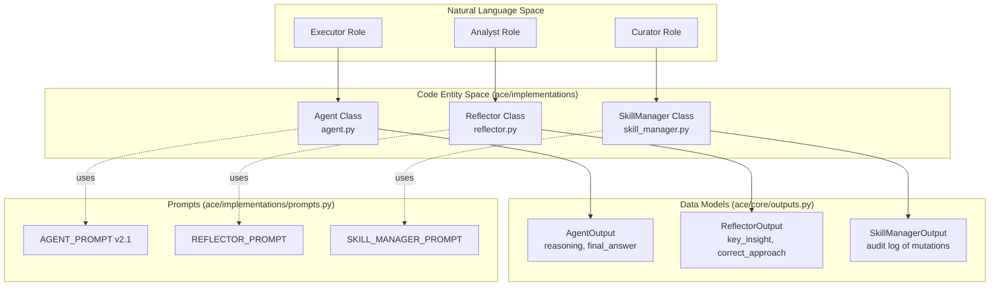
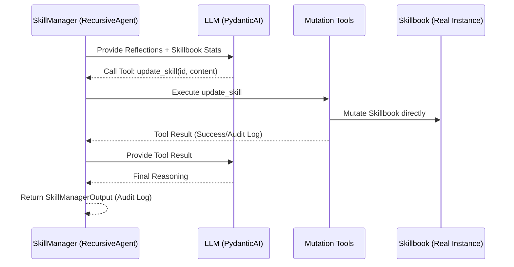

<!-- source: DeepWiki mcp.deepwiki.com · repo kayba-ai/agentic-context-engine · extra page Role Implementation · fetched 2026-10-27 -->

# Role Implementation

Relevant source files

The following files were used as context for generating this wiki page:

- [ace/core/context.py](ace/core/context.py)
- [ace/deduplication/__init__.py](ace/deduplication/__init__.py)
- [ace/deduplication/manager.py](ace/deduplication/manager.py)
- [ace/implementations/agent.py](ace/implementations/agent.py)
- [ace/implementations/prompts.py](ace/implementations/prompts.py)
- [ace/implementations/reflector.py](ace/implementations/reflector.py)
- [ace/implementations/skill_manager.py](ace/implementations/skill_manager.py)
- [ace/providers/registry.py](ace/providers/registry.py)
- [ace/steps/reflect.py](ace/steps/reflect.py)

This page documents the implementation of the three core ACE roles (`Agent`, `Reflector`, `SkillManager`) in the `ace/` directory. It covers class structures, prompt management, PydanticAI interaction patterns, and structured output handling.

## Overview

In the ACE architecture, roles are implemented as classes that communicate through structured data models. Each role utilizes PydanticAI for model interaction and structured output validation.

**Key Components:**
- **Role Classes**: `Agent` [ace/implementations/agent.py:25](), `Reflector` [ace/implementations/reflector.py:25](), and `SkillManager` [ace/implementations/skill_manager.py:58]().
- **Recursive Foundation**: `SkillManager` inherits from `RecursiveAgent` [ace/implementations/skill_manager.py:58](), enabling multi-turn tool use and budget management.
- **Prompt Templates**: Versioned templates (v2.1) defining identity and operational protocols [ace/implementations/prompts.py:1]().
- **Context Flow**: Roles consume `SkillbookView` for read-only access [ace/core/context.py:45]() and produce structured outputs like `AgentOutput` or `ReflectorOutput`.

Sources: [ace/implementations/agent.py:1-25](), [ace/implementations/reflector.py:1-25](), [ace/implementations/skill_manager.py:1-58](), [ace/core/context.py:45-55]()

## Role Class Architecture

The following diagram maps the Natural Language roles to their respective Code Entities and data structures.

Sources: [ace/implementations/agent.py:25](), [ace/implementations/reflector.py:25](), [ace/implementations/skill_manager.py:58](), [ace/implementations/prompts.py:68](), [ace/core/outputs.py:10-27]()

## Agent Implementation

The `Agent` class generates answers by applying strategic knowledge from a `Skillbook`. It is designed to be a single-pass executor that follows a strict "Skillbook Application Protocol" defined in its prompt.

### Implementation Details
- **Model Interaction**: Uses `PydanticAgent` from PydanticAI to enforce `AgentOutput` structure [ace/implementations/agent.py:63-69]().
- **Skill Injection**: Injects skills into the prompt using `skillbook.as_prompt()` [ace/implementations/agent.py:96]().
- **Usage Tracking**: Extracts token usage metadata from `result.usage()` via `_extract_usage` [ace/implementations/agent.py:108-117]().

### Agent Generate Flow
1. **Prompt Formatting**: Merges the `AGENT_PROMPT` template with the current `skillbook`, `question`, `context`, and any previous `reflection` [ace/implementations/agent.py:95-100]().
2. **Execution**: Calls `self._agent.run_sync(prompt)` [ace/implementations/agent.py:102]().
3. **Validation**: PydanticAI validates the LLM response against the `AgentOutput` schema, which requires `reasoning`, `final_answer`, and `answer_confidence` [ace/implementations/prompts.py:166-176]().

Sources: [ace/implementations/agent.py:25-118](), [ace/implementations/prompts.py:68-176]()

## Reflector Implementation

The `Reflector` analyzes the `AgentOutput` and environment `feedback` to extract lessons. It classifies strategy effectiveness and identifies root causes for failures.

### Key Characteristics
- **Mode Support**: This implementation handles **SIMPLE** mode (single-pass reflection). Recursive mode is delegated to the `RRStep` [ace/implementations/reflector.py:32-33]().
- **Evidence-Based**: Uses `make_skillbook_excerpt` to focus the LLM's attention only on the skills that were actually injected during the execution trace [ace/implementations/reflector.py:105-111]().
- **Structured Output**: Produces `ReflectorOutput` containing `reasoning`, `error_identification`, `root_cause_analysis`, `correct_approach`, and `key_insight` [ace/implementations/reflector.py:122-131]().

Sources: [ace/implementations/reflector.py:25-131](), [ace/steps/reflect.py:60-74]()

## SkillManager Implementation

The `SkillManager` is an agentic role that mutates the `Skillbook` directly via atomic tool calls. Unlike the other roles, it inherits from `RecursiveAgent` [ace/implementations/skill_manager.py:58]().

### Atomic Mutation Tools
The `SkillManager` does not return a list of proposed changes. Instead, it uses tools to modify the live `Skillbook` instance during its reasoning process:
- `add_skill`, `update_skill`, `remove_skill`, `tag_skill` [ace/implementations/skill_manager.py:31-39]().
- `search_skills`, `read_skill` for inspection [ace/implementations/skill_manager.py:35-36]().

### Data Flow and Recursion

### Deduplication Integration
If a `DeduplicationManager` is provided, the `SkillManager` generates a similarity report before running [ace/deduplication/manager.py:47-55](). This report is injected into the prompt, allowing the agent to use `MERGE` or `CONSOLIDATE` operations [ace/deduplication/manager.py:81-144]().

Sources: [ace/implementations/skill_manager.py:1-134](), [ace/deduplication/manager.py:27-166]()

## Prompt Engineering System

The prompts in `ace/implementations/prompts.py` are versioned (v2.1) and designed for "Strategic Problem Solving with Skillbook Application" [ace/implementations/prompts.py:68-76]().

### Skillbook Usage Instructions
All prompts that consume the skillbook include a standardized set of instructions [ace/implementations/prompts.py:15-28]():
- **Citation Requirement**: Agents must cite skill IDs in reasoning (e.g., `Following [content_extraction-00001]...`) [ace/implementations/prompts.py:18]().
- **Prioritization**: High success rates (helpful > harmful) should be prioritized [ace/implementations/prompts.py:22]().
- **Adaptation**: Strategies are learned patterns, not rigid rules [ace/implementations/prompts.py:27]().

### External Agent Injection
For third-party agents (e.g., LangChain or Browser-use), the `wrap_skillbook_for_external_agent` function provides a canonical way to format the strategic knowledge into a system message [ace/implementations/prompts.py:31-59]().

Sources: [ace/implementations/prompts.py:1-60]()

---

