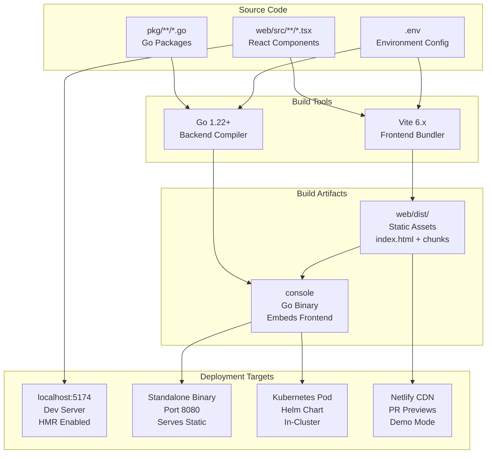
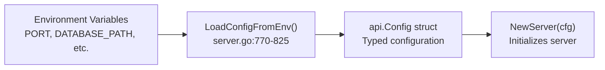
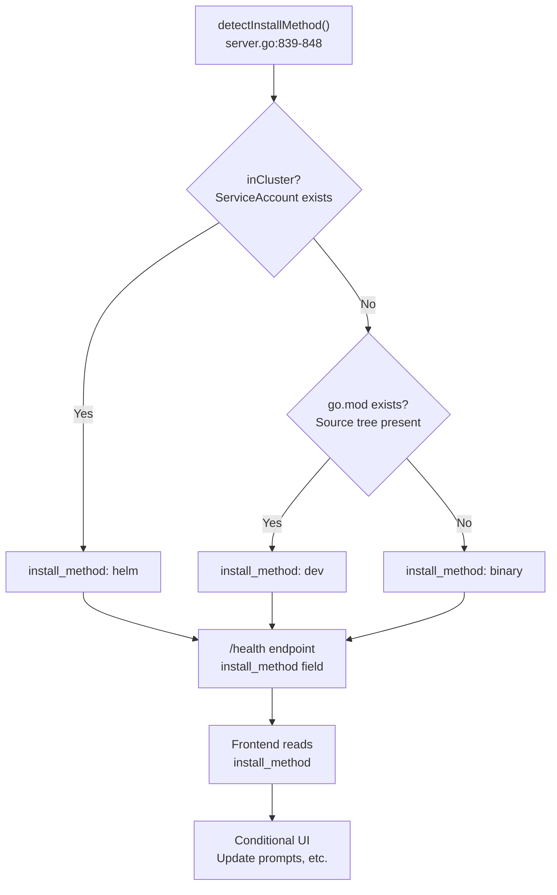

<!-- source: DeepWiki mcp.deepwiki.com · repo kubestellar/console · page 13 Build & Deployment · fetched 2026-10-27 -->

# Build & Deployment

<details>
<summary>Relevant source files</summary>

The following files were used as context for generating this wiki page:

- [.env.example](.env.example)
- [netlify.toml](netlify.toml)
- [pkg/api/handlers/analytics_proxy.go](pkg/api/handlers/analytics_proxy.go)
- [pkg/api/handlers/demo_data.go](pkg/api/handlers/demo_data.go)
- [pkg/api/handlers/gitops.go](pkg/api/handlers/gitops.go)
- [pkg/api/handlers/mcp.go](pkg/api/handlers/mcp.go)
- [pkg/api/handlers/sse.go](pkg/api/handlers/sse.go)
- [pkg/api/server.go](pkg/api/server.go)
- [pkg/k8s/client.go](pkg/k8s/client.go)
- [web/netlify/functions/analytics-collect.mts](web/netlify/functions/analytics-collect.mts)
- [web/package-lock.json](web/package-lock.json)
- [web/package.json](web/package.json)
- [web/src/components/agent/APIKeySettings.tsx](web/src/components/agent/APIKeySettings.tsx)
- [web/src/components/cards/ProactiveGPUNodeHealthMonitor.tsx](web/src/components/cards/ProactiveGPUNodeHealthMonitor.tsx)
- [web/src/config/cards/gpu-node-health.ts](web/src/config/cards/gpu-node-health.ts)
- [web/src/config/dashboards/gpu.ts](web/src/config/dashboards/gpu.ts)
- [web/src/hooks/mcp/types.ts](web/src/hooks/mcp/types.ts)
- [web/src/hooks/useLocalAgent.ts](web/src/hooks/useLocalAgent.ts)
- [web/src/lib/analytics.ts](web/src/lib/analytics.ts)
- [web/src/lib/sseClient.ts](web/src/lib/sseClient.ts)
- [web/vite.config.ts](web/vite.config.ts)

</details>


This page documents the build processes, environment configuration, and deployment options for the KubeStellar Console. It covers frontend (Vite) and backend (Go) compilation, environment variable management, and the four primary deployment modes: local development, binary distribution, containerized (Helm), and Netlify preview.

For information about the server initialization and routing, see [Backend Architecture](#2.2). For details on the CI/CD automation system, see [CI/CD Automation System](#7).

---

## Build System Overview

The console uses separate build systems for frontend and backend components, with environment variables coordinating configuration across both layers.



**Sources:** [web/vite.config.ts:1-192](), [web/package.json:1-115](), [pkg/api/server.go:1-849](), [netlify.toml:1-76]()

---

## Frontend Build (Vite)

The frontend uses **Vite 6.x** as its build tool, configured to optimize bundle size, enable lazy loading, and inject build-time metadata.

### Build Configuration

The primary configuration is in `vite.config.ts`:

| Configuration Aspect | Implementation | Purpose |
|---------------------|----------------|---------|
| **Entry Point** | `index.html` | SPA entry with script module |
| **Build Tool** | Vite + TypeScript + React plugin | Fast HMR, ESBuild transforms |
| **Minification** | Terser with drop_console | Remove logging in production |
| **Code Splitting** | Manual chunks: `vendor` | All node_modules in single chunk |
| **Dev Server** | Port 5174 (strict) | Prevents port conflicts |
| **Proxy** | `/api`, `/health`, `/auth`, `/ws` → `localhost:8080` | Backend API routing |

**Vite Configuration Reference:** [web/vite.config.ts:34-191]()

### Build Scripts

Available npm scripts for building and testing:

```bash
# Development (HMR + proxy to backend)
npm run dev

# Production build (TypeScript check + bundle)
npm run build

# Lint check (ESLint)
npm run lint

# Preview production build locally
npm run preview

# Unit tests (Vitest)
npm run test

# E2E tests (Playwright)
npm run test:e2e
```

**Sources:** [web/package.json:6-39]()

### Bundle Optimization

The build applies several optimizations to reduce initial load time:

**Terser Configuration:**
```typescript
// Drop console.log in production
compress: {
  drop_console: true,
  drop_debugger: true,
  pure_funcs: ['console.log', 'console.info', 'console.debug']
}
```

**Manual Code Splitting:**
```typescript
manualChunks: (id) => {
  // All node_modules → vendor chunk
  // Prevents circular dependency issues with React hooks
  if (id.includes('node_modules')) {
    return 'vendor'
  }
}
```

**Server Warmup (Pre-transform):**
The dev server pre-transforms frequently accessed route modules to eliminate cold-start latency on navigation:

```typescript
warmup: {
  clientFiles: [
    './src/components/dashboard/Dashboard.tsx',
    './src/components/clusters/Clusters.tsx',
    './src/components/cards/cardRegistry.ts',
    // ... 30+ modules
  ]
}
```

**Sources:** [web/vite.config.ts:68-140]()

### Build-Time Metadata Injection

Version information is injected at build time via Vite's `define` option:

| Variable | Source | Example Value |
|----------|--------|---------------|
| `__APP_VERSION__` | `git describe --tags` or `VITE_APP_VERSION` | `v0.3.6-nightly.20260124` |
| `__COMMIT_HASH__` | `git rev-parse HEAD` or `VITE_COMMIT_HASH` | `23946568a...` |
| `__BUILD_TIME__` | `new Date().toISOString()` | `2026-01-24T12:34:56.789Z` |
| `__DEV_MODE__` | `mode === 'development'` or `VITE_DEV_MODE` | `true` / `false` |

**Git Version Extraction:**
```typescript
function getGitVersion(): string {
  const describe = execSync('git describe --tags --always').trim()
  // Extract: v0.3.6-nightly.20260124-11-g23946568 → v0.3.6-nightly.20260124
  const match = describe.match(/^(v[\d.]+(?:-[^-]+)?(?:\.[^-]+)?))
  return match ? match[1] : describe
}
```

**Sources:** [web/vite.config.ts:9-49]()

---

## Backend Build (Go)

The backend is a Go binary built with the standard `go build` toolchain, with version information injected via `ldflags`.

### Compilation Process

```bash
# Standard build
go build -o console ./cmd/console

# Build with version injection
go build -ldflags "-X github.com/kubestellar/console/pkg/api.Version=v0.3.6" \
  -o console ./cmd/console

# Cross-compilation for Linux (common for containerization)
GOOS=linux GOARCH=amd64 go build -o console ./cmd/console
```

### Version Injection

The backend reads its version from a package-level variable that can be overridden at build time:

```go
// pkg/api/server.go
var Version = "dev"  // Default for development builds

// Injected at build time via ldflags:
// -ldflags "-X github.com/kubestellar/console/pkg/api.Version=v0.3.6"
```

The version is exposed in the `/health` endpoint for frontend version detection:

```go
func (s *Server) setupRoutes() {
  s.app.Get("/health", func(c *fiber.Ctx) error {
    return c.JSON(fiber.Map{
      "status":  "ok",
      "version": Version,  // Enables stale-frontend detection
      // ...
    })
  })
}
```

**Sources:** [pkg/api/server.go:38-40](), [pkg/api/server.go:313-338]()

### Configuration Loading

The server loads configuration from environment variables via `LoadConfigFromEnv()`:



**Configuration Priority:**
1. Environment variable (if set)
2. Hardcoded default (if defined)
3. Error (if required and missing)

**Example - Frontend URL:**
```go
frontendURL := os.Getenv("FRONTEND_URL")
// If not set, computed later in NewServer based on DevMode:
//   Dev:  http://localhost:5174
//   Prod: http://localhost:8080
```

**Sources:** [pkg/api/server.go:769-825]()

---

## Environment Configuration

Configuration is managed through environment variables, documented in `.env.example`. Variables fall into several categories:

### Core Server Configuration

| Variable | Required | Default | Purpose |
|----------|----------|---------|---------|
| `PORT` | No | `8080` | HTTP server listen port |
| `DATABASE_PATH` | No | `./data/console.db` | SQLite database location |
| `DEV_MODE` | No | `false` | Enable dev features (auto-login, verbose logs) |
| `FRONTEND_URL` | No | Computed | CORS origin, OAuth callback base URL |
| `JWT_SECRET` | Prod only | Generated in dev | Token signing secret (≥32 chars) |
| `KUBECONFIG` | No | `~/.kube/config` | Kubeconfig file path |

**Sources:** [.env.example:1-10](), [pkg/api/server.go:770-803]()

### Authentication (GitHub OAuth)

| Variable | Required | Purpose |
|----------|----------|---------|
| `GITHUB_CLIENT_ID` | For OAuth | OAuth App client ID |
| `GITHUB_CLIENT_SECRET` | For OAuth | OAuth App secret |

**Dev Mode Fallback:**
When OAuth is not configured in dev mode, the server auto-creates a demo user:

```go
DevUserLogin:  getEnvOrDefault("DEV_USER_LOGIN", "dev-user"),
DevUserEmail:  getEnvOrDefault("DEV_USER_EMAIL", "dev@localhost"),
DevUserAvatar: getEnvOrDefault("DEV_USER_AVATAR", ""),
```

**Sources:** [.env.example:1-5](), [pkg/api/server.go:805-808]()

### AI Provider Keys (Optional)

```bash
# At least one required for AI features
ANTHROPIC_API_KEY=sk-ant-api03-...
OPENAI_API_KEY=sk-...
GOOGLE_API_KEY=AIza...

# Model selection (optional)
CLAUDE_MODEL=claude-sonnet-4-5-20250514
OPENAI_MODEL=gpt-4-turbo
GEMINI_MODEL=gemini-2.0-flash
```

**Sources:** [.env.example:42-63]()

### Feedback & CI/CD Integration

| Variable | Purpose |
|----------|---------|
| `FEEDBACK_GITHUB_TOKEN` | PAT for creating GitHub issues (scope: `repo`) |
| `GITHUB_WEBHOOK_SECRET` | Validates GitHub webhook signatures |
| `FEEDBACK_REPO_OWNER` | GitHub org/user (e.g., `kubestellar`) |
| `FEEDBACK_REPO_NAME` | Repository name (e.g., `console`) |

**Sources:** [.env.example:17-25](), [pkg/api/server.go:810-814]()

### Analytics Configuration

```bash
# Real GA4 Measurement ID (proxied server-side)
GA4_REAL_MEASUREMENT_ID=G-PXWNVQ8D1T
```

The frontend uses a **decoy measurement ID** (`G-0000000000`) visible in source code. The backend proxy rewrites it to the real ID to prevent spam:

**Frontend (Decoy):**
```typescript
// web/src/lib/analytics.ts
const GA_MEASUREMENT_ID = 'G-0000000000'  // Rewritten by proxy
```

**Backend (Proxy Rewrite):**
```go
// pkg/api/handlers/analytics_proxy.go
realMeasurementID := os.Getenv("GA4_REAL_MEASUREMENT_ID")
if realMeasurementID == "" {
  realMeasurementID = "G-PXWNVQ8D1T"  // Fallback
}
params.Set("tid", realMeasurementID)  // Rewrite decoy → real
```

**Sources:** [.env.example:65-71](), [web/src/lib/analytics.ts:17](), [pkg/api/handlers/analytics_proxy.go:55-96]()

---

## Deployment Options

KubeStellar Console supports four deployment modes, each optimized for different use cases.

```mermaid
graph TB
    subgraph "Deployment Modes"
        LocalDev["Local Development<br/>npm run dev + go run"]
        Binary["Binary Distribution<br/>Single executable"]
        Helm["Kubernetes Helm<br/>StatefulSet + Service"]
        Netlify["Netlify Preview<br/>Static + Serverless"]
    end
    
    subgraph "Local Development Features"
        HMR["Hot Module Reload<br/>Vite Dev Server"]
        Proxy["API Proxy<br/>/api → :8080"]
        AutoLogin["Auto-Login<br/>dev-user"]
    end
    
    subgraph "Binary Features"
        Embedded["Embedded Frontend<br/>web/dist → binary"]
        SQLiteLocal["SQLite<br/>Local filesystem"]
        Kubeconfig["Kubeconfig<br/>~/.kube/config"]
    end
    
    subgraph "Helm Features"
        InCluster["In-Cluster Auth<br/>ServiceAccount"]
        PVC["Persistent Volume<br/>Database storage"]
        Ingress["Ingress/Route<br/>External access"]
    end
    
    subgraph "Netlify Features"
        StaticAssets["Static Assets<br/>CDN distribution"]
        Functions["Serverless Functions<br/>/.netlify/functions"]
        DemoMode["Demo Mode<br/>Mock data"]
    end
    
    LocalDev --> HMR
    LocalDev --> Proxy
    LocalDev --> AutoLogin
    
    Binary --> Embedded
    Binary --> SQLiteLocal
    Binary --> Kubeconfig
    
    Helm --> InCluster
    Helm --> PVC
    Helm --> Ingress
    
    Netlify --> StaticAssets
    Netlify --> Functions
    Netlify --> DemoMode
```



**Sources:** [pkg/api/server.go:839-848](), [netlify.toml:1-76]()

### Local Development

**Purpose:** Rapid iteration with hot module reload (HMR) for frontend changes and manual backend restart.

**Setup:**
```bash
# Terminal 1 - Backend
go run ./cmd/console --dev

# Terminal 2 - Frontend
cd web
npm run dev
```

**Architecture:**
- **Frontend:** Vite dev server on port 5174 with HMR
- **Backend:** Go server on port 8080
- **Proxy:** Vite proxies `/api`, `/health`, `/auth`, `/ws` to backend
- **Auth:** Auto-login as `dev-user` (no GitHub OAuth required)

**Environment:**
```bash
DEV_MODE=true
FRONTEND_URL=http://localhost:5174
```

**Proxy Configuration:**
```typescript
// vite.config.ts
server: {
  port: 5174,
  proxy: {
    '/api': { target: 'http://localhost:8080', changeOrigin: true },
    '/health': { target: 'http://localhost:8080', changeOrigin: true },
    '/auth/github': { target: 'http://localhost:8080', changeOrigin: true },
    '/ws': { target: 'ws://localhost:8080', ws: true },
  }
}
```

**Sources:** [web/vite.config.ts:91-170](), [pkg/api/server.go:769-825]()

### Binary Distribution

**Purpose:** Standalone executable for users who want to run the console locally without containers.

**Build:**
```bash
# Frontend
cd web && npm ci && npm run build

# Backend (embeds frontend)
go build -o console ./cmd/console
```

**Execution:**
```bash
./console
# Server starts on http://localhost:8080
```

**Architecture:**
- **Frontend:** Static files served from `./web/dist` by Fiber
- **Backend:** Single Go binary
- **Database:** SQLite at `./data/console.db`
- **Auth:** Requires `GITHUB_CLIENT_ID` and `GITHUB_CLIENT_SECRET` for OAuth

**Static File Serving:**
```go
// pkg/api/server.go:699-705
if !s.config.DevMode {
  s.app.Static("/", "./web/dist")
  s.app.Get("/*", func(c *fiber.Ctx) error {
    return c.SendFile("./web/dist/index.html")  // SPA routing
  })
}
```

**Install Method Detection:**
```go
func detectInstallMethod(inCluster bool) string {
  if inCluster { return "helm" }
  if _, err := os.Stat("go.mod"); err == nil { return "dev" }
  return "binary"
}
```

**Sources:** [pkg/api/server.go:699-706](), [pkg/api/server.go:839-848]()

### Containerized (Helm)

**Purpose:** Production deployment in Kubernetes clusters with persistent storage and in-cluster authentication.

**Architecture:**
- **Deployment:** StatefulSet with persistent volume for SQLite
- **Service:** ClusterIP service exposing port 8080
- **Ingress/Route:** External access via Ingress (K8s) or Route (OpenShift)
- **Auth:** ServiceAccount token for in-cluster API access

**In-Cluster Detection:**
```go
// pkg/k8s/client.go:620-627
if _, err := os.Stat(kubeconfig); os.IsNotExist(err) {
  // No kubeconfig file, try in-cluster config
  if inClusterConfig, err := rest.InClusterConfig(); err == nil {
    log.Println("Using in-cluster config")
    client.inClusterConfig = inClusterConfig
  }
}
```

**Health Endpoint Response:**
```go
resp := fiber.Map{
  "status":         "ok",
  "version":        Version,
  "in_cluster":     inCluster,
  "install_method": "helm",  // Detected automatically
}
```

**Sources:** [pkg/api/server.go:313-338](), [pkg/k8s/client.go:620-627]()

### Netlify Preview

**Purpose:** PR preview deployments with demo data, no backend required.

**Configuration:** [netlify.toml:1-76]()

**Build:**
```toml
[build]
  base = "web"
  command = "npm ci && npm run build"
  publish = "dist"

[build.environment]
  VITE_DEMO_MODE = "true"  # Forces demo mode
```

**Serverless Functions:**

The preview includes Netlify Functions for:
1. **Nightly E2E Status:** `/api/nightly-e2e/runs` → `/.netlify/functions/nightly-e2e`
2. **Presence Tracking:** `/api/active-users` → `/.netlify/functions/presence`
3. **Analytics Proxy:** `/api/m` → `/.netlify/functions/analytics-collect`

**Analytics Collect Function:**
```typescript
// web/netlify/functions/analytics-collect.mts
export default async (req: Request) => {
  // Decode base64 payload
  const encoded = url.searchParams.get("d")
  const gaParams = new URLSearchParams(atob(encoded))
  
  // Rewrite measurement ID
  const realId = Netlify.env.get("GA4_REAL_MEASUREMENT_ID")
  gaParams.set("tid", realId)
  
  // Forward client IP for geolocation
  const clientIp = req.headers.get("x-nf-client-connection-ip")
  gaParams.set("_uip", clientIp)
  
  // Proxy to GA4
  await fetch(`https://www.google-analytics.com/g/collect?${gaParams}`)
}

export const config: Config = {
  path: "/api/m"  // Matches frontend proxy path
}
```

**Redirects (SPA Routing):**
```toml
[[redirects]]
  from = "/*"
  to = "/index.html"
  status = 200
  force = false  # Only if file doesn't exist
```

**Sources:** [netlify.toml:1-76](), [web/netlify/functions/analytics-collect.mts:1-124]()

---

## Demo Mode

Demo mode allows the console to run without backend connectivity, serving mock data for UI testing and preview deployments.

### Activation

Demo mode is activated when:
1. **Netlify:** `VITE_DEMO_MODE=true` environment variable (set in netlify.toml)
2. **kc-agent:** Agent connection unavailable (auto-detected after connection failures)

**Frontend Detection:**
```typescript
// Forced demo mode (Netlify, configured via build env)
export const isDemoModeForced = import.meta.env.VITE_DEMO_MODE === 'true'

// Runtime detection (no agent connection)
const isAgentUnavailable = agentStatus === 'disconnected'
```

**Sources:** [web/src/hooks/useDemoMode.ts](), [netlify.toml:17-18]()

### Backend Demo Data Generation

The backend provides demo data endpoints that respond with mock data when the `X-Demo-Mode: true` header is present:

**Demo Mode Check:**
```go
// pkg/api/handlers/demo_data.go
func isDemoMode(c *fiber.Ctx) bool {
  return c.Get("X-Demo-Mode") == "true"
}
```

**Example Handler:**
```go
func (h *MCPHandlers) ListClusters(c *fiber.Ctx) error {
  if isDemoMode(c) {
    return demoResponse(c, "clusters", getDemoClusters())
  }
  // ... real implementation
}
```

**Demo Cluster Data:**
```go
func getDemoClusters() []k8s.ClusterInfo {
  return []k8s.ClusterInfo{
    {Name: "kind-local", Healthy: true, NodeCount: 1, PodCount: 15},
    {Name: "eks-prod-us-east-1", Healthy: true, NodeCount: 12, PodCount: 156},
    {Name: "vllm-gpu-cluster", Healthy: true, NodeCount: 8, PodCount: 124},
    // ... 12 demo clusters total
  }
}
```

**Sources:** [pkg/api/handlers/demo_data.go:1-49](), [pkg/api/handlers/mcp.go:100-105]()

### SSE Streaming in Demo Mode

Server-Sent Events (SSE) endpoints support demo mode with per-cluster streaming:

```go
func (h *MCPHandlers) GetPodsStream(c *fiber.Ctx) error {
  if isDemoMode(c) {
    return streamDemoSSE(c, "pods", getDemoPodsForStreaming())
  }
  // ... real streaming implementation
}

// Helper: simulates per-cluster streaming with artificial delays
func streamDemoSSE(c *fiber.Ctx, key string, data interface{}) error {
  c.Context().SetBodyStreamWriter(func(w *bufio.Writer) {
    writeSSEEvent(w, "connected", fiber.Map{"status": "streaming"})
    
    clusters := []string{"kind-local", "eks-prod", "gke-staging"}
    for _, cluster := range clusters {
      // Emit per-cluster data events
      writeSSEEvent(w, "cluster_data", fiber.Map{
        "cluster": cluster,
        key:       filterByCluster(data, cluster),
      })
      time.Sleep(200 * time.Millisecond)  // Simulate delay
    }
    
    writeSSEEvent(w, "done", fiber.Map{"clusters": len(clusters)})
  })
}
```

**Sources:** [pkg/api/handlers/sse.go:277-309](), [pkg/api/handlers/mcp.go:456-459]()

---

## Build Optimization Techniques

### Code Splitting Strategy

**Problem:** Initial bundle size of 2MB+ causes slow first load.

**Solution:** Manual chunk configuration prevents circular dependencies while enabling lazy loading:

```typescript
// vite.config.ts
rollupOptions: {
  output: {
    manualChunks: (id) => {
      // IMPORTANT: Libraries with React hooks MUST stay in vendor chunk
      // Splitting them causes "undefined" errors for useLayoutEffect, etc.
      if (id.includes('node_modules')) {
        return 'vendor'  // Single vendor chunk (~1.5MB)
      }
      // Route components split automatically by dynamic imports
    }
  }
}
```

**Card Lazy Loading:**
```typescript
// web/src/components/cards/cardRegistry.ts
export const CARD_COMPONENTS: Record<string, CardComponent> = {
  clusters_overview: {
    component: lazy(() => import('./ClustersOverviewCard')),
    // ... loaded on-demand when card is added to dashboard
  },
}
```

**Sources:** [web/vite.config.ts:80-88](), [web/src/components/cards/cardRegistry.ts]()

### Server Warmup

Vite's warmup feature pre-transforms modules during server startup, eliminating cold-start latency:

```typescript
warmup: {
  clientFiles: [
    './src/components/dashboard/Dashboard.tsx',
    './src/components/clusters/Clusters.tsx',
    './src/components/cards/cardRegistry.ts',
    // ... 30+ frequently accessed modules
  ]
}
```

**Impact:** First navigation to a route is instant instead of 500-1000ms delay.

**Sources:** [web/vite.config.ts:94-140]()

### Cache-Control Headers

**Static Assets (Immutable):**
```toml
# netlify.toml
[[headers]]
  for = "/assets/*"
  [headers.values]
    Cache-Control = "public, max-age=31536000, immutable"
```

**API Endpoints (No Cache):**
```go
// SSE streaming
c.Set("Cache-Control", "no-cache")
c.Set("Connection", "keep-alive")
```

**Sources:** [netlify.toml:57-60](), [pkg/api/handlers/sse.go:98-99]()

### Minification & Tree Shaking

**Terser Configuration:**
```typescript
minify: 'terser',
terserOptions: {
  compress: {
    drop_console: true,      // Remove console.log
    drop_debugger: true,     // Remove debugger statements
    pure_funcs: [            // Treat as side-effect-free
      'console.log',
      'console.info',
      'console.debug',
      'console.trace'
    ]
  }
}
```

**Result:** Production bundle is 30-40% smaller than unminified build.

**Sources:** [web/vite.config.ts:69-77]()

---

## Deployment Type Detection

The system automatically detects its deployment environment and adjusts behavior accordingly:



**Detection Logic:**
```go
func detectInstallMethod(inCluster bool) string {
  if inCluster { return "helm" }
  if _, err := os.Stat("go.mod"); err == nil { return "dev" }
  return "binary"
}
```

**Frontend Consumption:**
```typescript
// Fetch install method from /health
const { install_method } = await fetchHealth()

// Conditional update prompt
if (install_method === 'binary' && updateAvailable) {
  showUpdateBanner()  // "Download latest release"
} else if (install_method === 'helm') {
  showUpdateInstructions()  // "helm upgrade kubestellar/console"
}
```

**Sources:** [pkg/api/server.go:839-848](), [pkg/api/server.go:313-338]()

---

