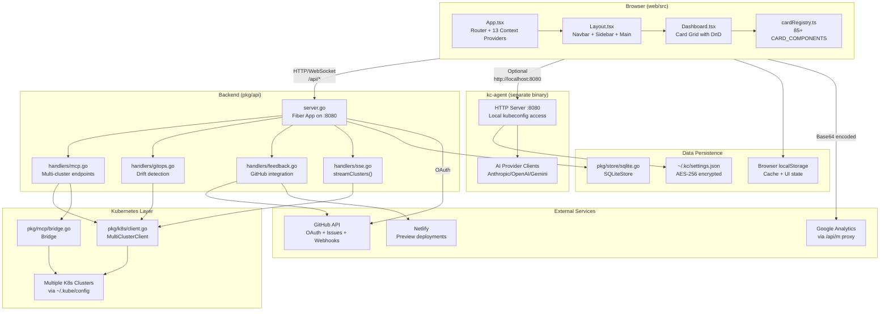
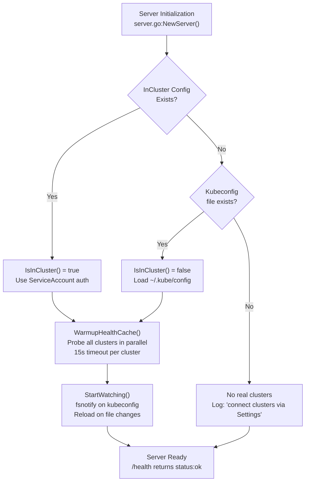
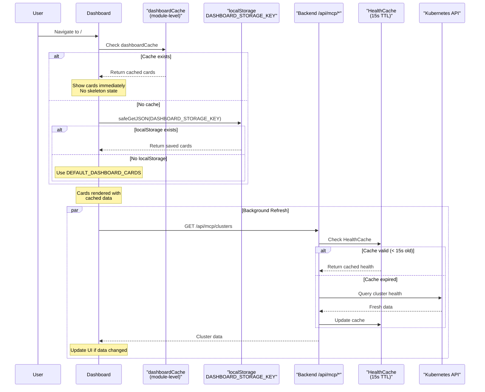
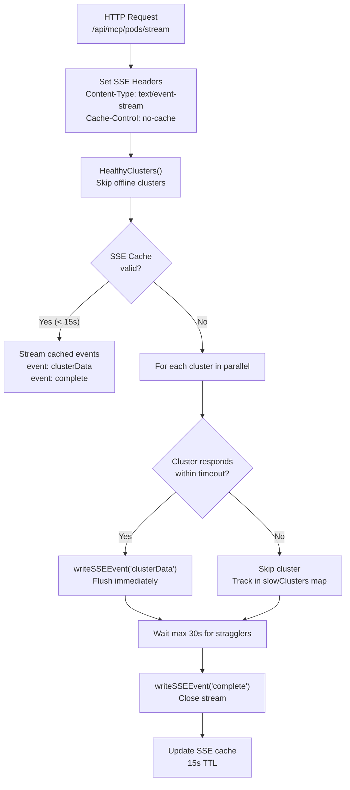
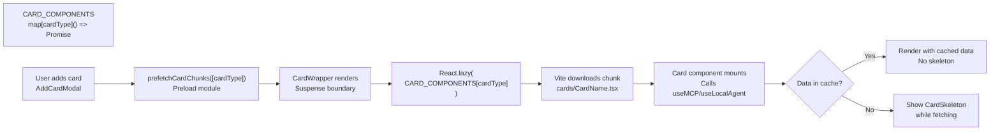
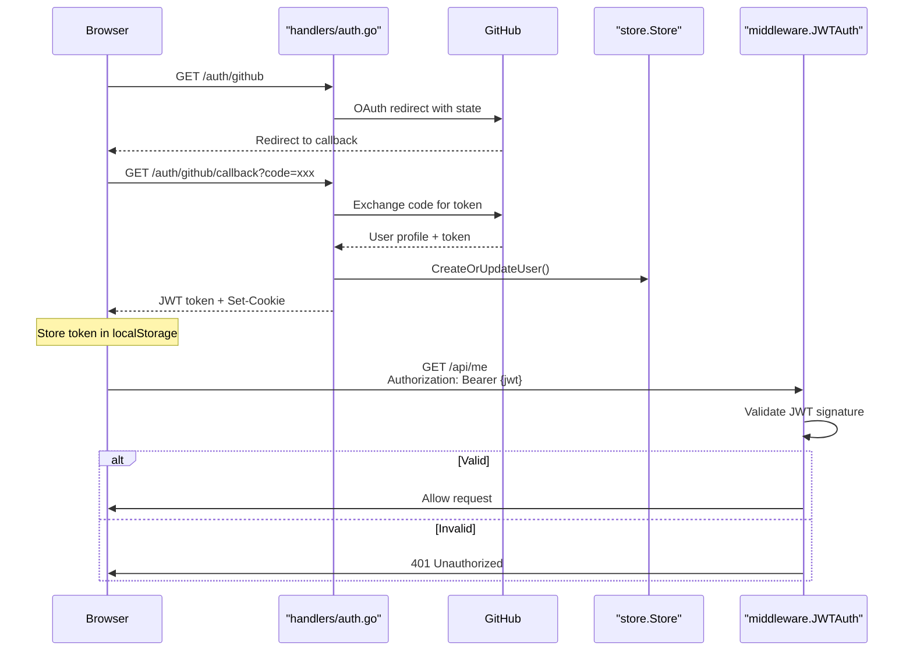
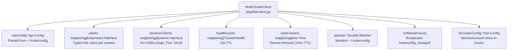
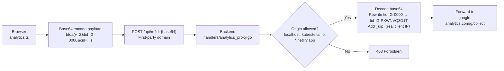

<!-- source: DeepWiki mcp.deepwiki.com · repo kubestellar/console · page 2 Architecture · fetched 2026-10-27 -->

# Architecture

<details>
<summary>Relevant source files</summary>

The following files were used as context for generating this wiki page:

- [.env.example](.env.example)
- [netlify.toml](netlify.toml)
- [pkg/api/handlers/analytics_proxy.go](pkg/api/handlers/analytics_proxy.go)
- [pkg/api/handlers/demo_data.go](pkg/api/handlers/demo_data.go)
- [pkg/api/handlers/gitops.go](pkg/api/handlers/gitops.go)
- [pkg/api/handlers/mcp.go](pkg/api/handlers/mcp.go)
- [pkg/api/handlers/sse.go](pkg/api/handlers/sse.go)
- [pkg/api/server.go](pkg/api/server.go)
- [pkg/k8s/client.go](pkg/k8s/client.go)
- [web/netlify/functions/analytics-collect.mts](web/netlify/functions/analytics-collect.mts)
- [web/package-lock.json](web/package-lock.json)
- [web/package.json](web/package.json)
- [web/src/App.tsx](web/src/App.tsx)
- [web/src/components/agent/APIKeySettings.tsx](web/src/components/agent/APIKeySettings.tsx)
- [web/src/components/cards/CardWrapper.tsx](web/src/components/cards/CardWrapper.tsx)
- [web/src/components/cards/ProactiveGPUNodeHealthMonitor.tsx](web/src/components/cards/ProactiveGPUNodeHealthMonitor.tsx)
- [web/src/components/compute/ClusterComparisonPage.tsx](web/src/components/compute/ClusterComparisonPage.tsx)
- [web/src/components/dashboard/CustomDashboard.tsx](web/src/components/dashboard/CustomDashboard.tsx)
- [web/src/components/dashboard/Dashboard.tsx](web/src/components/dashboard/Dashboard.tsx)
- [web/src/components/layout/Layout.tsx](web/src/components/layout/Layout.tsx)
- [web/src/config/cards/gpu-node-health.ts](web/src/config/cards/gpu-node-health.ts)
- [web/src/config/dashboards/gpu.ts](web/src/config/dashboards/gpu.ts)
- [web/src/hooks/mcp/types.ts](web/src/hooks/mcp/types.ts)
- [web/src/hooks/useCertManager.ts](web/src/hooks/useCertManager.ts)
- [web/src/hooks/useLocalAgent.ts](web/src/hooks/useLocalAgent.ts)
- [web/src/lib/analytics.ts](web/src/lib/analytics.ts)
- [web/src/lib/sseClient.ts](web/src/lib/sseClient.ts)
- [web/vite.config.ts](web/vite.config.ts)

</details>


This document provides a high-level overview of the KubeStellar Console system architecture, describing how the frontend, backend, local agent, and external services interact to deliver a Kubernetes management platform. It covers the main architectural layers, deployment modes, data flow patterns, and key subsystems.

For detailed information about specific subsystems:
- Frontend component structure and state management → [Frontend Architecture](#2.1)
- Backend API handlers and services → [Backend Architecture](#2.2)
- Local agent capabilities → [Local Agent (kc-agent)](#2.3)
- Caching strategies and SSE streaming → [Data Flow & Caching](#2.4)

---

## System Overview

The KubeStellar Console is a **hybrid local-first + cloud-enabled platform** for managing multiple Kubernetes clusters. It operates in three deployment modes:

1. **Local Development**: Full Go backend (`pkg/api/server.go`) + React frontend (`web/src/`) + optional `kc-agent`
2. **Containerized**: Helm-deployed backend with distributed frontend served from `web/dist/`
3. **Netlify Preview**: Serverless functions (`web/netlify/functions/`) + static hosting with demo data

**Architecture Overview**



**Sources**: [web/src/App.tsx:1-411](), [pkg/api/server.go:1-734](), [pkg/k8s/client.go:1-2500](), [pkg/api/handlers/mcp.go:1-1400]()

---

## Deployment Architecture

The system supports three deployment modes with different architectural characteristics:

| Deployment Mode | Backend | Frontend | Auth | Data Source |
|----------------|---------|----------|------|-------------|
| **Local Dev** | `go run cmd/server/main.go` | Vite dev server `:5174` | GitHub OAuth or dev-mode auto-login | Real clusters via kubeconfig |
| **Containerized** | Helm chart with Go binary | Static files served from `web/dist/` | GitHub OAuth required | Real clusters via in-cluster ServiceAccount or kubeconfig |
| **Netlify Preview** | Netlify Functions | Static CDN + SSG | Demo user (no auth) | Demo/mock data from `handlers/demo_data.go` |

**Deployment Mode Detection and Configuration**



**Sources**: [pkg/api/server.go:90-227](), [pkg/k8s/client.go:61-65](), [pkg/k8s/client.go:140-163]()

**Install Method Detection** ([pkg/api/server.go:323-325]()):

The backend detects its install method in the `/health` endpoint:

```
func detectInstallMethod(inCluster bool) string {
  if inCluster { return "helm" }
  if _, err := exec.LookPath("go"); err == nil { return "source" }
  return "binary"
}
```

This is used by the frontend update system ([web/src/hooks/useVersionCheck.ts]()) to determine the correct update strategy.

---

## Core Architectural Patterns

### 1. Progressive Disclosure with Multi-Tier Caching

The system implements a **stale-while-revalidate** pattern where cached data is shown instantly while background refresh occurs:

**Cache Hierarchy** (fastest to slowest):

1. **React State** (in-memory, component-scoped)
2. **Module-level cache** ([web/src/components/dashboard/Dashboard.tsx:60-67]()) — survives navigation
3. **localStorage** ([web/src/lib/utils/localStorage.ts]()) — survives page refresh
4. **Backend memory cache** ([pkg/k8s/client.go:50-59]()) — 15s-60s TTL
5. **Kubernetes API** — live cluster queries

**Data Flow Example: Dashboard Load**



**Sources**: [web/src/components/dashboard/Dashboard.tsx:60-67](), [web/src/components/dashboard/Dashboard.tsx:428-443](), [pkg/k8s/client.go:50-59]()

### 2. SSE Streaming for Multi-Cluster Aggregation

The backend uses **Server-Sent Events** to stream per-cluster results as they arrive, preventing slow/offline clusters from blocking the entire response:

**SSE Stream Handler Pattern** ([pkg/api/handlers/sse.go:38-162]()):



**Sources**: [pkg/api/handlers/sse.go:1-700](), [pkg/api/handlers/mcp.go:16-19]()

**Slow Cluster Tracking** ([pkg/k8s/client.go:58-59]()):

Clusters that time out are tracked in a `slowClusters map[string]time.Time`. On subsequent requests, these clusters get a **reduced timeout** (5s instead of 15s) to fail fast and not block the stream.

### 3. Card-Based UI with Lazy Loading

The dashboard is composed of **85+ card types** ([web/src/components/cards/cardRegistry.ts]()) that are lazy-loaded on demand:

**Card Loading Strategy**



**Sources**: [web/src/components/cards/cardRegistry.ts:1-300](), [web/src/components/cards/CardWrapper.tsx:1-1200](), [web/src/App.tsx:72-158]()

**Chunk Prefetching Strategy** ([web/src/App.tsx:114-158]()):

On initial page load, the frontend prefetches:
1. **Default dashboard cards** immediately ([web/src/App.tsx:291-295]())
2. **Enabled dashboard routes** after 500ms delay ([web/src/App.tsx:114-148]())
3. **Demo-only cards** after 15s in live mode ([web/src/App.tsx:308-312]())

This ensures that navigation to pre-loaded routes is **near-instantaneous** with no chunk download delay.

---

## API Route Structure

The backend exposes **40+ REST endpoints** plus **8 SSE streaming variants** for real-time data:

**Route Handler Mapping**

| Handler | File | Routes | Purpose |
|---------|------|--------|---------|
| `MCPHandlers` | [pkg/api/handlers/mcp.go]() | `/api/mcp/*` | Multi-cluster Kubernetes operations |
| `GitOpsHandlers` | [pkg/api/handlers/gitops.go]() | `/api/gitops/*` | Drift detection, Helm releases, Operators |
| `FeedbackHandler` | [pkg/api/handlers/feedback.go]() | `/api/feedback/*` | GitHub issue creation, webhooks |
| `AuthHandler` | [pkg/api/handlers/auth.go]() | `/auth/github/*` | OAuth flow, JWT tokens |
| `SettingsHandler` | [pkg/api/handlers/settings.go]() | `/api/settings` | Persistent settings CRUD |
| `WorkloadHandlers` | [pkg/api/handlers/workload.go]() | `/api/workloads/*` | Workload deployment, scaling |
| `GA4CollectProxy` | [pkg/api/handlers/analytics_proxy.go]() | `/api/m` | Analytics proxy (no auth) |

**MCP Handler Routes** (excerpt from [pkg/api/server.go:495-547]()):

```
GET  /api/mcp/clusters               → ListClusters()
GET  /api/mcp/clusters/health        → GetAllClusterHealth()
GET  /api/mcp/pods                   → GetPods()
GET  /api/mcp/pods/stream            → GetPodsStream() [SSE]
GET  /api/mcp/pod-issues             → FindPodIssues()
GET  /api/mcp/pod-issues/stream      → FindPodIssuesStream() [SSE]
GET  /api/mcp/deployments            → GetDeployments()
GET  /api/mcp/deployments/stream     → GetDeploymentsStream() [SSE]
GET  /api/mcp/events                 → GetEvents()
GET  /api/mcp/events/stream          → GetEventsStream() [SSE]
GET  /api/mcp/gpu-nodes              → GetGPUNodes()
GET  /api/mcp/gpu-nodes/stream       → GetGPUNodesStream() [SSE]
```

**Authentication Flow** ([pkg/api/server.go:340-356]()):



**Sources**: [pkg/api/server.go:340-357](), [pkg/api/handlers/auth.go:1-400](), [pkg/api/middleware/jwt.go]()

---

## Multi-Cluster Client Architecture

The `MultiClusterClient` ([pkg/k8s/client.go]()) manages connections to N Kubernetes clusters simultaneously:

**MultiClusterClient Structure**



**Sources**: [pkg/k8s/client.go:43-59]()

**Health Check with Cache** ([pkg/k8s/client.go:800-900]()):

The health check implements **aggressive caching** to avoid blocking on slow/offline clusters:

```
func (m *MultiClusterClient) HealthyClusters(ctx context.Context) ([]ClusterInfo, map[string]*ClusterHealth, error) {
  // Check cache first (15s TTL)
  m.mu.RLock()
  cachedHealth := make(map[string]*ClusterHealth)
  for name, health := range m.healthCache {
    if time.Since(health.checkedAt) < clusterCacheTTL {
      cachedHealth[name] = health
    }
  }
  m.mu.RUnlock()
  
  if len(cachedHealth) > 0 {
    return filterHealthyClusters(cachedHealth), cachedHealth, nil
  }
  
  // Cache miss - probe all clusters in parallel with timeout
  return m.probeAllClusters(ctx)
}
```

Clusters that fail health checks are **excluded from subsequent queries** via `HealthyClusters()`, preventing cascade failures when one cluster is offline.

**Warmup Strategy** ([pkg/api/server.go:148-151]()):

On server startup, the backend calls `WarmupHealthCache()` which probes all clusters in parallel **before serving the first request**. This prevents the first dashboard load from having a 30s+ delay waiting for all clusters (including offline ones) to time out.

---

## State Management and Context Providers

The frontend uses **13-layer React Context provider hierarchy** ([web/src/App.tsx:319-404]()) for global state:

**Context Provider Stack** (outermost to innermost):

```
<ThemeProvider>                    // Dark/light mode
  <AuthProvider>                   // User session, JWT token
    <UnifiedDemoProvider>          // Demo mode toggle
      <RewardsProvider>            // GitHub contribution tracking
        <ToastProvider>            // Toast notifications
          <GlobalFiltersProvider>  // Cluster/namespace filters
            <MissionProvider>      // AI mission state
              <CardEventProvider>  // Inter-card event bus
                <AlertsProvider>   // Alert notifications
                  <DashboardProvider>  // Dashboard CRUD
                    <DrillDownProvider>  // Modal drilldown state
                      <Layout>           // App shell
                        <Routes />       // React Router
```

**Sources**: [web/src/App.tsx:317-407]()

**Why No Redux?**

The codebase avoids Redux/MobX in favor of **custom hooks + React Context** because:
1. Most state is **request-scoped** (SWR/useCache pattern) not global
2. localStorage provides **cross-session persistence** for UI state
3. Context providers are **lazy-loaded** only when their routes mount
4. **SSE streaming** delivers real-time updates without a global state store

---

## Demo Mode Architecture

The system supports **forced demo mode** for Netlify preview deployments where no backend is available:

**Demo Mode Detection** ([web/src/hooks/useDemoMode.ts:10-20]()):

```typescript
export function isDemoModeForced(): boolean {
  // Netlify preview deployments
  if (import.meta.env.VITE_DEMO_MODE === 'true') return true
  // Also forced when backend is unreachable
  return false
}
```

**Demo Data Injection** ([pkg/api/handlers/demo_data.go:1-800]()):

When the frontend sends `X-Demo-Mode: true` header, the backend **short-circuits** all Kubernetes queries and returns mock data:

```go
func isDemoMode(c *fiber.Ctx) bool {
  return c.Get("X-Demo-Mode") == "true"
}

func (h *MCPHandlers) GetPods(c *fiber.Ctx) error {
  if isDemoMode(c) {
    return c.JSON(fiber.Map{"pods": getDemoPods()})
  }
  // Real logic...
}
```

This allows **PR preview deployments on Netlify** to function without a running Kubernetes cluster.

**Sources**: [web/src/hooks/useDemoMode.ts:1-100](), [pkg/api/handlers/demo_data.go:1-800]()

---

## Analytics and Privacy

The system implements a **stealth analytics architecture** designed to bypass ad blockers:

**Anti-Blocking Strategy**



**Sources**: [web/src/lib/analytics.ts:1-400](), [pkg/api/handlers/analytics_proxy.go:1-120]()

**Three-Layer Anti-Blocking**:

1. **No external scripts** — `gtag.js` is never loaded, custom tracker sends events directly
2. **First-party proxy** — `/api/m` path on same domain as app (ad blockers can't distinguish from legitimate API calls)
3. **Base64 encoding** — Payload encoded so network filters can't match on `tid=G-*` patterns

**User IP Forwarding** ([pkg/api/handlers/analytics_proxy.go:75-86]()):

The proxy extracts `X-Forwarded-For` header and adds it to the GA4 request as `_uip` so Google can perform **accurate geolocation** even though requests appear to come from the backend server.

---

## Build and Asset Pipeline

**Frontend Build** ([web/vite.config.ts:34-90]()):

```
vite build
  → TypeScript transpilation (tsc -b)
  → Bundle splitting:
      - vendor.js (all node_modules in ONE chunk to avoid circular deps)
      - cards/{CardName}.js (lazy-loaded per card type)
      - routes/{Page}.js (lazy-loaded per route)
  → Terser minification (drop console.log in production)
  → Output: web/dist/
```

**Critical Optimization** ([web/vite.config.ts:80-87]()):

ALL `node_modules` go into a **single vendor chunk** because splitting React-dependent libraries causes "undefined" errors for hooks (`useLayoutEffect`, `createContext`, etc.) due to circular dependencies.

**Backend Build**:

```
go build -ldflags "-X github.com/kubestellar/console/pkg/api.Version={git-tag}" ./cmd/server
  → Embeds version from git describe --tags
  → Single static binary with no runtime dependencies
  → Serves frontend from embedded filesystem or web/dist/
```

**Deployment Artifacts**:

- **Binary**: Single `console` binary (~50MB) with embedded assets
- **Container**: `ghcr.io/kubestellar/console:latest` (multi-arch)
- **Helm Chart**: `charts/console/` with configurable values
- **Netlify**: Static assets + serverless functions

**Sources**: [web/vite.config.ts:1-192](), [pkg/api/server.go:38-40]()

---

## Key Performance Optimizations

### 1. Lazy Mounting Removed

The codebase previously implemented `IntersectionObserver` to defer card rendering until they scrolled into view. This was **removed** ([web/src/components/cards/CardWrapper.tsx:106-119]()) because:

- It caused "empty cards" flash on page load even when cached data was available
- With only 4-8 cards visible at once, the performance benefit was negligible
- Cached data should be shown **instantly** for good UX

### 2. Module-Level Dashboard Cache

The dashboard keeps a **module-level cache** ([web/src/components/dashboard/Dashboard.tsx:60-67]()) that survives navigation:

```typescript
let dashboardCache: CachedDashboard | null = null

export function Dashboard() {
  const [localCards, setLocalCards] = useState<Card[]>(() => {
    // Priority: cache > localStorage > default cards
    if (dashboardCache?.cards?.length) return dashboardCache.cards
    // ...
  })
}
```

This prevents the dashboard from resetting when navigating away and back (e.g., Dashboard → Settings → Dashboard).

### 3. Route Chunk Prefetching

On initial page load, the frontend prefetches **only enabled dashboard chunks** to avoid downloading code for disabled features:

```typescript
await fetchEnabledDashboards()  // GET /health → enabledDashboards
const enabledIds = getEnabledDashboardIds()

const chunks = enabledIds
  ? Object.entries(DASHBOARD_CHUNKS)
      .filter(([id]) => enabledIds.includes(id) || ALWAYS_PREFETCH.has(id))
      .map(([, load]) => load)
  : Object.values(DASHBOARD_CHUNKS)
```

This allows admins to disable unused dashboards via `ENABLED_DASHBOARDS` env var, reducing initial bundle size.

**Sources**: [web/src/App.tsx:114-158](), [web/src/hooks/useSidebarConfig.ts]()

---

## Security Architecture

**JWT Authentication** ([pkg/api/middleware/jwt.go]()):

```
Authorization: Bearer {jwt}
  → Middleware validates signature with JWTSecret
  → Extracts user_id, role, github_login from claims
  → Sets c.Locals("user_id") for downstream handlers
  → Returns 401 if invalid/expired
```

**Sensitive Data Encryption** ([web/src/components/agent/APIKeySettings.tsx](), `kc-agent`):

AI provider API keys are stored in `~/.kc/settings.json` with **AES-256-GCM encryption**:

```
User enters API key
  → kc-agent encrypts with machine-specific salt
  → Stores in settings.json (never transmitted to backend)
  → Cards decrypt on-demand when calling AI providers
```

**RBAC Model** ([pkg/api/handlers/rbac.go]()):

- User roles: `user`, `admin`
- Admin-only routes: `/api/users/*`, `/api/rbac/bindings`, namespace deletion
- Per-resource permissions: checked before displaying edit/delete actions

**Analytics Privacy** ([web/src/lib/analytics.ts:196-213]()):

- SHA-256 hashed user IDs (never send raw GitHub username)
- localStorage opt-out flag (`STORAGE_KEY_ANALYTICS_OPT_OUT`)
- No cookies (uses `_ksc_cid` in localStorage instead)

**Sources**: [pkg/api/middleware/jwt.go](), [web/src/lib/analytics.ts:1-400](), [pkg/api/handlers/rbac.go]()

---

This architecture enables a **responsive, offline-capable Kubernetes management platform** with aggressive caching, real-time streaming, and flexible deployment options. The hybrid local-first + cloud-enabled design allows it to scale from single-user local development to multi-tenant production deployments.

---

