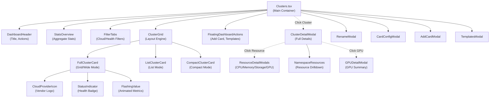
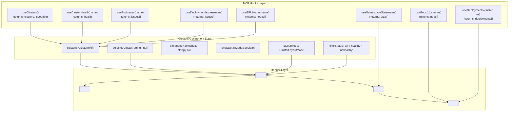
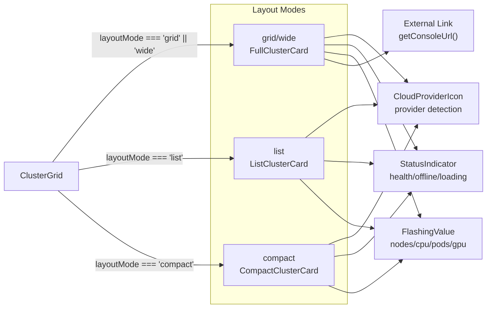
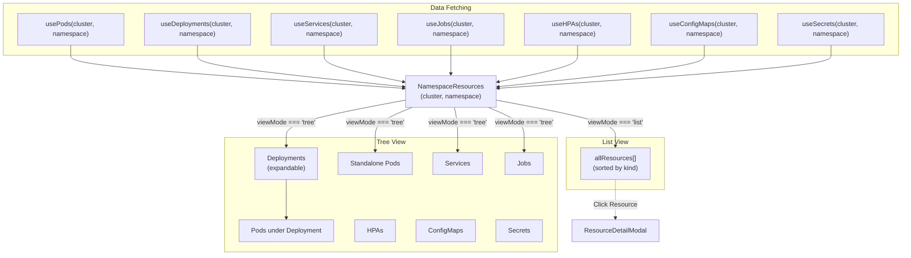
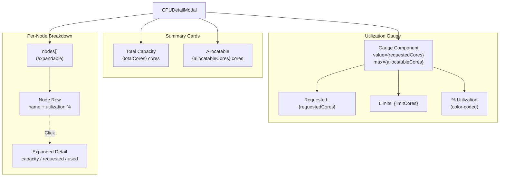
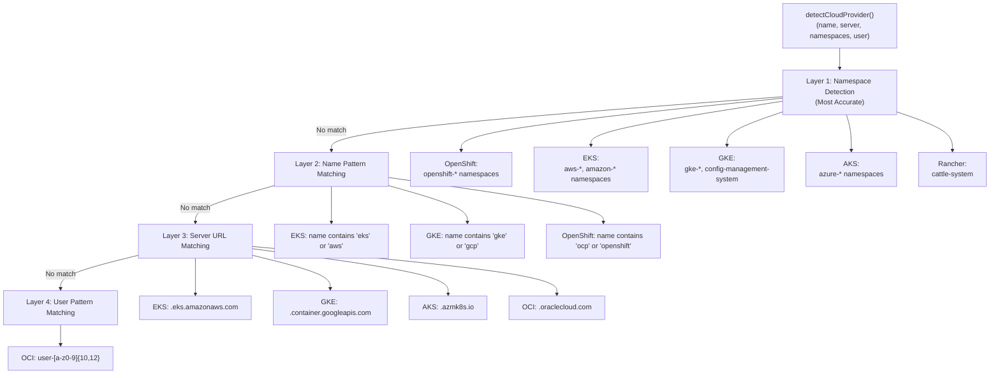

<!-- source: DeepWiki mcp.deepwiki.com · repo kubestellar/console · page 4.3 Cluster UI Components · fetched 2026-10-27 -->

# Cluster UI Components

<details>
<summary>Relevant source files</summary>

The following files were used as context for generating this wiki page:

- [web/src/components/clusters/ClusterDetailModal.tsx](web/src/components/clusters/ClusterDetailModal.tsx)
- [web/src/components/clusters/Clusters.tsx](web/src/components/clusters/Clusters.tsx)
- [web/src/components/clusters/ResourceDetailModals.tsx](web/src/components/clusters/ResourceDetailModals.tsx)
- [web/src/components/clusters/components/ClusterGrid.tsx](web/src/components/clusters/components/ClusterGrid.tsx)
- [web/src/components/clusters/components/GPUDetailModal.tsx](web/src/components/clusters/components/GPUDetailModal.tsx)
- [web/src/components/ui/CloudProviderIcon.tsx](web/src/components/ui/CloudProviderIcon.tsx)
- [web/src/hooks/useMCP.ts](web/src/hooks/useMCP.ts)

</details>


This document covers the frontend UI components responsible for displaying and interacting with Kubernetes clusters in the KubeStellar Console. These components provide multi-cluster visualization with support for various layout modes, drill-down into cluster details, namespace resources, and resource metrics.

For backend multi-cluster data fetching, see [MultiClusterClient](#4.1). For SSE streaming implementation, see [SSE Streaming Architecture](#4.2). For cloud provider detection logic, see [Cloud Provider Detection](#4.4).

## Overview

The Clusters UI system consists of several layered components:

- **Clusters.tsx** - Main page container managing state, filters, and card dashboard
- **ClusterGrid** - Grid component rendering clusters in multiple layout modes
- **ClusterDetailModal** - Full-screen modal with cluster health, resources, and namespace drilldown
- **ResourceDetailModals** - Specialized modals for CPU, Memory, Storage, and GPU metrics
- **NamespaceResources** - Tree/list view of resources within a namespace
- **Supporting Components** - CloudProviderIcon, StatusIndicator, NodeListItem, etc.

## Component Hierarchy



**Sources:** [web/src/components/clusters/Clusters.tsx:1-841](), [web/src/components/clusters/components/ClusterGrid.tsx:1-629](), [web/src/components/clusters/ClusterDetailModal.tsx:1-961]()

## Data Flow Architecture



**Sources:** [web/src/components/clusters/Clusters.tsx:13-53](), [web/src/hooks/useMCP.ts:1-4]()

## Clusters Component (`Clusters.tsx`)

The main `Clusters` component serves as the container for the cluster visualization page. It manages state, filters, and renders both the cluster grid and various modals.

### Core State Management

```typescript
const [selectedCluster, setSelectedCluster] = useState<string | null>(null)
const [renameCluster, setRenameCluster] = useState<string | null>(null)
const [expandedNamespace, setExpandedNamespace] = useState<string | null>(null)
const [layoutMode, setLayoutMode] = useState<ClusterLayoutMode>('grid')
```

**Layout Modes:**
| Mode | Description | Grid Class |
|------|-------------|-----------|
| `grid` | Default 3-column card layout | `grid-cols-1 md:grid-cols-2 lg:grid-cols-3` |
| `list` | Horizontal single-row cards | `flex flex-col gap-3` |
| `compact` | Dense 6-column mini cards | `grid-cols-2 md:grid-cols-3 lg:grid-cols-4 xl:grid-cols-6` |
| `wide` | 2-column large cards | `grid-cols-1 lg:grid-cols-2` |

**Sources:** [web/src/components/clusters/Clusters.tsx:118-172](), [web/src/components/clusters/components/ClusterGrid.tsx:571-577]()

### Cluster Filtering and Deduplication

The component implements sophisticated filtering based on cloud provider, health status, and search terms:

```typescript
// Filter by provider (e.g., 'eks', 'gke', 'aks')
const providerFilteredClusters = cloudProviderFilter === 'all' 
  ? deduplicatedClusters 
  : deduplicatedClusters.filter(c => 
      (c.distribution || detectCloudProvider(c.name, c.server, c.namespaces, c.user)) 
      === cloudProviderFilter
    )

// Filter by health status
const healthFilteredClusters = filterStatus === 'all' 
  ? providerFilteredClusters 
  : filterStatus === 'healthy' 
    ? providerFilteredClusters.filter(c => isClusterHealthy(c))
    : providerFilteredClusters.filter(c => !isClusterHealthy(c))
```

**Cluster Deduplication Logic:**

Clusters from the same physical infrastructure may appear multiple times in kubeconfig contexts with different names. The system deduplicates by comparing server URLs and groups aliases:

```typescript
// Primary cluster selection: prefers current context, then shortest name
const primary = group.find(c => c.isCurrent) || 
                group.reduce((min, c) => c.name.length < min.name.length ? c : min)

// All other names become aliases
const aliases = group
  .filter(c => c.name !== primary.name)
  .map(c => c.name)
```

**Sources:** [web/src/components/clusters/Clusters.tsx:173-256]()

### GPU Data Aggregation

GPU information is aggregated across clusters and deduplicated by node name to prevent counting the same physical GPU multiple times:

```typescript
const gpuByCluster = useMemo(() => {
  const map: Record<string, { total: number; allocated: number }> = {}
  
  // Deduplicate GPU nodes by name (same physical node may appear in multiple contexts)
  const seenNodes = new Map<string, typeof gpuNodes[0]>()
  gpuNodes.forEach(node => {
    if (!seenNodes.has(node.name)) {
      const primaryCluster = clusterNameMap[node.cluster] || node.cluster
      seenNodes.set(node.name, { ...node, cluster: primaryCluster })
    }
  })
  
  // Aggregate by primary cluster name
  Array.from(seenNodes.values()).forEach(node => {
    if (!map[node.cluster]) {
      map[node.cluster] = { total: 0, allocated: 0 }
    }
    map[node.cluster].total += node.gpuCount
    map[node.cluster].allocated += node.gpuAllocated
  })
  
  return map
}, [gpuNodes, clusterNameMap])
```

**Sources:** [web/src/components/clusters/Clusters.tsx:258-293]()

### Refresh Mechanism

Clusters support individual refresh with optimistic UI updates:

```typescript
const handleRefreshCluster = useCallback(async (clusterName: string) => {
  // Set refreshing flag for spinner animation
  setClustersRefreshing(prev => new Set(prev).add(clusterName))
  
  try {
    await refreshSingleCluster(clusterName)
  } finally {
    // Clear refreshing flag after minimum 1s spinner duration
    setTimeout(() => {
      setClustersRefreshing(prev => {
        const next = new Set(prev)
        next.delete(clusterName)
        return next
      })
    }, 1000)
  }
}, [])
```

The `useMinSpin` hook in `ClusterGrid` ensures the refresh spinner always completes at least one full rotation (1000ms) even if the data returns faster, preventing jarring flicker.

**Sources:** [web/src/components/clusters/Clusters.tsx:341-367](), [web/src/components/clusters/components/ClusterGrid.tsx:13-42]()

## ClusterGrid Component

The `ClusterGrid` component renders clusters in different visual layouts. It delegates to three specialized card components based on the `layoutMode` prop.

### Layout Mode Switching



**Sources:** [web/src/components/clusters/components/ClusterGrid.tsx:550-628]()

### FullClusterCard Component

The default card rendering for `grid` and `wide` layouts displays comprehensive cluster information:

**Visual Structure:**
- Gradient border colored by cloud provider
- Background watermark with provider logo (25% opacity)
- Status indicator with refresh button
- Provider icon + cluster name + aliases badge
- Rename button (for kubeconfig sources only)
- 4-column metrics grid (Nodes, CPUs, Pods, GPUs)
- Console link button (if provider supports it)
- Source label footer

**Health Status Logic:**

```typescript
function isClusterHealthy(cluster: ClusterInfo): boolean {
  // Unreachable = not healthy
  if (cluster.reachable === false) return false
  
  // If we have node data, cluster is working = healthy
  // (Optimistic - health check may lag behind actual cluster state)
  if (cluster.nodeCount !== undefined && cluster.nodeCount > 0) return true
  
  // No data yet - use health flag
  return cluster.healthy === true
}
```

This logic prevents false "unhealthy" states during the delay between cluster connection and health check completion.

**Token Expiration Detection:**

```typescript
function isTokenExpired(cluster: ClusterInfo): boolean {
  return cluster.errorType === 'auth'
}
```

Clusters with expired authentication tokens display a key icon instead of the standard health indicator.

**Sources:** [web/src/components/clusters/components/ClusterGrid.tsx:44-299]()

### ListClusterCard Component

Horizontal layout optimized for scanning many clusters quickly:

- Compact single-row design with right-side vendor watermark (15% opacity, gradient fade)
- Left-to-right flow: Status badge → Provider icon → Name → Server URL → Metrics → Actions
- Metrics displayed as inline icons with values (Server/CPU/Box icons)
- GPU metric only shown if `gpuInfo.total > 0`
- Responsive: Server URL hidden on mobile (`hidden md:flex`)

**Sources:** [web/src/components/clusters/components/ClusterGrid.tsx:302-457]()

### CompactClusterCard Component

Minimal card for high-density cluster overview:

- 2x2 metrics grid (Nodes/CPUs in top row, Pods/GPUs in bottom row)
- Tiny status dot (2x2px) instead of full badge
- Small provider icon (14px) and text (text-xs)
- No server URL, no console link, no rename button
- Optimized for 6+ columns on wide screens

**Sources:** [web/src/components/clusters/components/ClusterGrid.tsx:460-548]()

## ClusterDetailModal Component

Full-screen modal displaying comprehensive cluster information, metrics, and resource drilldown.

### Modal Structure

```mermaid
graph TB
    ClusterDetailModal["ClusterDetailModal"]
    
    subgraph "Header Section"
        StatusBadge["Status Badge<br/>(Healthy/Unhealthy/Offline)"]
        ClusterName["Cluster Name + Aliases"]
        ProviderButton["Provider Badge<br/>+ Console Link"]
        RenameButton["Rename Button"]
    end
    
    subgraph "AI Actions Panel"
        DiagnoseButton["Diagnose Button<br/>startMission(type: 'troubleshoot')"]
        RepairButton["Repair Button<br/>startMission(type: 'repair')"]
        AskButton["Ask Button<br/>startMission(type: 'custom')"]
    end
    
    subgraph "Interactive Stats Cards"
        NodesCard["Nodes Card<br/>Click → Expand Node List"]
        WorkloadsCard["Workloads Card<br/>Click → Show Namespaces"]
        GPUCard["GPU Card<br/>Click → GPUDetailModal"]
    end
    
    subgraph "Resource Metrics Cards"
        CPUCard["CPU Card<br/>Click → CPUDetailModal"]
        MemoryCard["Memory Card<br/>Click → MemoryDetailModal"]
        StorageCard["Storage Card<br/>Click → StorageDetailModal"]
    end
    
    subgraph "Expandable Sections"
        NodeDetails["Node Details Panel<br/>NodeListItem + NodeDetailPanel"]
        NamespaceList["Namespace List<br/>Click → NamespaceResources"]
    end
    
    ClusterDetailModal --> StatusBadge
    ClusterDetailModal --> ClusterName
    ClusterDetailModal --> ProviderButton
    ClusterDetailModal --> RenameButton
    
    ClusterDetailModal --> DiagnoseButton
    ClusterDetailModal --> RepairButton
    ClusterDetailModal --> AskButton
    
    ClusterDetailModal --> NodesCard
    ClusterDetailModal --> WorkloadsCard
    ClusterDetailModal --> GPUCard
    
    ClusterDetailModal --> CPUCard
    ClusterDetailModal --> MemoryCard
    ClusterDetailModal --> StorageCard
    
    NodesCard -.Toggle.-> NodeDetails
    WorkloadsCard -.Toggle.-> NamespaceList
    
    NamespaceList -.Expand NS.-> NSResources["NamespaceResources<br/>(Tree/List View)"]
```



**Sources:** [web/src/components/clusters/ClusterDetailModal.tsx:83-961]()

### Cluster Health Status Determination

The modal uses a three-state health model:

```typescript
const isUnreachable = health ? (
  health.reachable === false ||
  (health.errorType && ['timeout', 'network', 'certificate'].includes(health.errorType)) ||
  health.nodeCount === 0
) : false

const isHealthy = !isLoading && !isUnreachable && health?.healthy !== false
```

**Status Colors:**
- **Healthy (Green):** `bg-green-500/20 text-green-400` with `CheckCircle` icon
- **Unhealthy (Red):** `bg-red-500/20 text-red-400` with `AlertTriangle` icon
- **Offline (Yellow):** `bg-yellow-500/20 text-yellow-400` with `WifiOff` icon

**Sources:** [web/src/components/clusters/ClusterDetailModal.tsx:233-241]()

### AI Mission Integration

The modal provides three AI-assisted actions via the `useMissions` hook:

**1. Diagnose Mission:**
```typescript
const handleDiagnose = () => {
  const issuesSummary = [
    ...podIssues.map(p => `Pod ${p.name} in ${p.namespace}: ${p.status}`),
    ...deploymentIssues.map(d => `Deployment ${d.name} in ${d.namespace}: ${d.readyReplicas}/${d.replicas} ready`)
  ].slice(0, 10).join('\n')

  startMission({
    title: `Diagnose ${clusterName.split('/').pop()}`,
    description: `Analyzing cluster health and identifying issues`,
    type: 'troubleshoot',
    cluster: clusterName,
    initialPrompt: `Analyze the health of Kubernetes cluster "${clusterName}"...`,
    context: { clusterName, health, podIssuesCount, deploymentIssuesCount }
  })
}
```

**2. Repair Mission:**
- Automatically lists top 5 pod and deployment issues
- Provides step-by-step repair instructions
- Requires approval before executing kubectl commands

**3. Ask Mission:**
- Custom question about the cluster
- Includes current cluster state in context

**Sources:** [web/src/components/clusters/ClusterDetailModal.tsx:163-231](), [web/src/components/clusters/ClusterDetailModal.tsx:339-388]()

### Interactive Metric Cards

All three stat cards (Nodes, Workloads, GPUs) and all three resource cards (CPU, Memory, Storage) are clickable buttons that expand additional detail:

**Nodes Card → Node Details Panel:**
```typescript
<button
  onClick={() => !isUnreachable && !isLoading && setShowNodeDetails(!showNodeDetails)}
  disabled={isUnreachable || isLoading}
  className={`group p-4 rounded-lg bg-card/50 border transition-all ${
    !isUnreachable && !isLoading 
      ? 'hover:border-cyan-500/50 hover:bg-cyan-500/5 hover:shadow-lg cursor-pointer' 
      : 'cursor-default'
  }`}
>
  {/* Shows ChevronDown with rotate animation */}
</button>
```

The node details panel displays:
- List of nodes with `NodeListItem` component
- Per-node status, CPU, memory, pod count
- Click individual node → `NodeDetailPanel` with labels, taints, conditions

**Workloads Card → Namespace List:**
- Shows namespace count, deployment count, pod count
- Expands to show all namespaces with pod breakdown (running/pending/failed)
- Click namespace → `NamespaceResources` component (tree/list view)

**GPU Card → GPUDetailModal:**
- Only clickable if `clusterGPUs.length > 0`
- Opens separate modal with GPU breakdown by type and manufacturer

**Sources:** [web/src/components/clusters/ClusterDetailModal.tsx:391-492]()

### Cloud Provider Detection and Console Links

Provider detection uses a multi-layer strategy:

1. Check cached `clusterInfo.distribution` (from backend)
2. Fallback to client-side `detectCloudProvider(name, server, namespaces, user)`
3. Generate console URL with `getConsoleUrlForProvider(provider, name, server)`

**Console URL Generation Examples:**

| Provider | URL Pattern |
|----------|-------------|
| OpenShift | `https://console-openshift-console.apps.{domain}` (extracts from `api.{domain}`) |
| EKS | `https://{region}.console.aws.amazon.com/eks/home?region={region}#/clusters/{name}` |
| GKE | `https://console.cloud.google.com/kubernetes/clusters/details/{location}/{name}?project={project}` |
| AKS | `https://portal.azure.com/#view/HubsExtension/BrowseResource/...` |
| OCI | `https://cloud.oracle.com/containers/clusters?region={region}` |

**Sources:** [web/src/components/clusters/ClusterDetailModal.tsx:18-63](), [web/src/components/clusters/ClusterDetailModal.tsx:288-323]()

## NamespaceResources Component

Displays resources within a namespace with two view modes: tree view (hierarchical) and list view (flat).

### View Modes



**Sources:** [web/src/components/clusters/Clusters.tsx:326-851]()

### Tree View Implementation

Tree view groups pods under their owning deployments:

```typescript
const podsByDeployment = useMemo(() => {
  const groups: Record<string, typeof pods> = {}
  const standalone: typeof pods = []

  pods.forEach(pod => {
    // Match pod to deployment by name prefix
    const matchingDep = deployments.find(dep => pod.name.startsWith(dep.name + '-'))
    if (matchingDep) {
      if (!groups[matchingDep.name]) groups[matchingDep.name] = []
      groups[matchingDep.name].push(pod)
    } else {
      standalone.push(pod)
    }
  })
  
  return { byDeployment: groups, standalone }
}, [pods, deployments])
```

**Tree View Structure:**
```
📦 Deployments (5)
  └─ nginx-deployment [2/2 ready] (2 pods)
     ├─ nginx-deployment-abc123 (Running)
     └─ nginx-deployment-def456 (Running)
📦 Pods - Standalone (3)
  ├─ standalone-pod-1 (Running)
  └─ standalone-pod-2 (Pending)
🌐 Services (4)
  ├─ nginx-service (ClusterIP) 80/TCP
  └─ api-service (LoadBalancer) 443/TCP
💼 Jobs (2)
🔀 HPAs (1)
⚙️ ConfigMaps (6)
🔐 Secrets (8)
```

**Sources:** [web/src/components/clusters/Clusters.tsx:386-501]()

### List View Implementation

List view flattens all resources into a single sortable array:

```typescript
const allResources = useMemo(() => {
  const resources: Array<{
    kind: ResourceKind
    name: string
    namespace?: string
    status?: string
    statusColor: string
    detail?: string
    labels?: Record<string, string>
    annotations?: Record<string, string>
    data?: Record<string, unknown>
  }> = []

  deployments.forEach(dep => resources.push({
    kind: 'Deployment',
    name: dep.name,
    status: dep.status,
    statusColor: dep.status === 'running' ? 'green' : 'red',
    detail: `${dep.readyReplicas}/${dep.replicas}`,
    // ... labels, annotations, data
  }))

  // Similar for pods, services, jobs, hpas, configmaps, secrets
  
  return resources
}, [deployments, pods, services, jobs, hpas, configmaps, secrets])
```

Each resource row displays:
- Kind icon (colored by resource type)
- Resource name
- Status badge (colored by status)
- Detail string (e.g., replica count, port numbers)
- Eye icon button → opens `ResourceDetailModal`

**Sources:** [web/src/components/clusters/Clusters.tsx:403-613]()

### Resource Detail Modal

Clicking the eye icon on any resource opens a modal with three tabs:

**1. Describe Tab:**
```yaml
# kubectl describe {kind} {name} -n {namespace}
Name:       nginx-deployment-abc123
Namespace:  default
Cluster:    production-eks
status:     Running
ready:      1/1
restarts:   0
node:       ip-10-0-1-42.ec2.internal
age:        2h
```

**2. Labels & Annotations Tab:**
```
Labels (5):
  app=nginx
  version=v1.2.3
  team=platform

Annotations (3):
  deployment.kubernetes.io/revision=5
  kubectl.kubernetes.io/last-applied-configuration=...
```

**3. Logs Tab (Pods only):**
```
# kubectl logs {pod} -n {namespace}
[2024-01-15 10:30:45] INFO: Server started on port 80
[2024-01-15 10:30:46] INFO: Connected to database
```

Includes "Refresh" button to refetch logs via `usePodLogs` hook.

**AI Repair Integration:**

For pods with issues (`data.issues` array), the modal displays a "Repair Pod" button that launches an AI mission:

```typescript
const handleRepairPod = () => {
  startMission({
    title: `Repair ${resource.name}`,
    type: 'troubleshoot',
    cluster: resource.cluster,
    initialPrompt: `I need help troubleshooting and repairing a Kubernetes pod...
    
**Pod Details:**
- Name: ${resource.name}
- Namespace: ${resource.namespace}
- Status: ${status}
- Restarts: ${restarts}
- Issues: ${issues.join(', ')}

Please help me diagnose and fix this pod.`
  })
}
```

**Sources:** [web/src/components/clusters/Clusters.tsx:82-323]()

## ResourceDetailModals

Four specialized modal components for drilling into cluster resource metrics.

### CPUDetailModal

Displays CPU allocation across the cluster with per-node breakdown.

**Modal Structure:**


**Props Interface:**
```typescript
interface CPUDetailModalProps {
  clusterName: string
  totalCores: number          // Sum of node CPU capacity
  allocatableCores: number    // Sum of node CPU allocatable
  requestedCores?: number     // Sum of pod CPU requests
  limitCores?: number         // Sum of pod CPU limits
  nodes?: Array<{
    name: string
    cpuCapacity: number
    cpuAllocatable: number
    cpuRequested?: number
    cpuUsed?: number
  }>
  isLoading?: boolean
  onClose: () => void
}
```

**Color-Coded Utilization:**
- **Green:** < 60% utilization
- **Yellow:** 60-80% utilization
- **Red:** > 80% utilization

**Sources:** [web/src/components/clusters/ResourceDetailModals.tsx:18-171]()

### MemoryDetailModal

Similar structure to CPUDetailModal, but displays memory in GB/TB units:

```typescript
function formatMemory(gb: number): string {
  if (gb >= 1024) return `${(gb / 1024).toFixed(1)} TB`
  return `${Math.round(gb)} GB`
}
```

**Props:**
- `totalMemoryGB` - Sum of node memory capacity
- `allocatableMemoryGB` - Sum of node memory allocatable
- `requestedMemoryGB` - Sum of pod memory requests
- `limitMemoryGB` - Sum of pod memory limits
- `nodes[]` - Per-node memory breakdown

**Sources:** [web/src/components/clusters/ResourceDetailModals.tsx:173-330]()

### StorageDetailModal

Displays ephemeral storage (node-local) and optionally PVCs (persistent volumes).

**Dual Tab View:**
1. **PVCs Tab** - Lists all PersistentVolumeClaims
2. **Nodes Tab** - Shows ephemeral storage per node

**PVC Display:**
```typescript
pvcs.map((pvc) => (
  <div className="p-3 rounded-lg bg-card/50">
    <div className="flex items-center justify-between">
      <div>
        <span>{pvc.name}</span>
        <span className="text-xs">({pvc.namespace})</span>
      </div>
      <div>
        <span className={pvc.status === 'Bound' ? 'text-green-400' : 'text-yellow-400'}>
          {pvc.status}
        </span>
        <span>{formatMemory(pvc.capacityGB)}</span>
      </div>
    </div>
    <div className="text-xs">Storage Class: {pvc.storageClass}</div>
  </div>
))
```

**Sources:** [web/src/components/clusters/ResourceDetailModals.tsx:332-495]()

### GPUDetailModal

Comprehensive GPU resource view with manufacturer breakdown, GPU types, and per-cluster/per-node details.

**Data Aggregation:**
```typescript
// Group by GPU type
const gpuByType = useMemo(() => {
  const map: Record<string, { total: number; allocated: number; nodes: GPUNode[] }> = {}
  gpuNodes.forEach(node => {
    const type = node.gpuType || 'Unknown'
    if (!map[type]) {
      map[type] = { total: 0, allocated: 0, nodes: [] }
    }
    map[type].total += node.gpuCount
    map[type].allocated += node.gpuAllocated
    map[type].nodes.push(node)
  })
  return map
}, [gpuNodes])
```

**Modal Sections:**

1. **Summary Stats (4 cards):**
   - Total GPUs
   - Allocated GPUs (color-coded)
   - Available GPUs
   - Utilization %

2. **GPU Specifications:**
   - Total VRAM (summed across all nodes)
   - Architecture families (e.g., "Ampere, Hopper")
   - CUDA driver versions
   - MIG-capable GPU count

3. **NVIDIA Operator Status:**
   - GPU Operator state + driver version
   - Network Operator state

4. **Manufacturer Breakdown:**
   - Colored badges: NVIDIA (green), AMD (red), Intel (blue)

5. **GPU Types (expandable):**
   - Each type shows progress bar for allocation
   - Expands to show nodes with that GPU type
   - Per-node: GPU count, allocated, memory, utilization

6. **Per-Cluster Breakdown:**
   - Shows GPU distribution across clusters
   - Total/allocated counts per cluster

7. **GPU Nodes Table:**
   - Sortable table with columns: Node, Cluster, GPU Type, Memory, Used, Available, Total
   - MIG badge for MIG-capable GPUs

**Sources:** [web/src/components/clusters/components/GPUDetailModal.tsx:1-507](), [web/src/components/clusters/ResourceDetailModals.tsx:497-661]()

## CloudProviderIcon and Detection

Cloud provider detection is a critical part of the cluster UI, used for visual styling and console link generation.

### Detection Strategy

Multi-layered detection with priority order:



**Namespace Detection Examples:**

| Provider | Namespace Patterns |
|----------|-------------------|
| OpenShift | `openshift-*`, `openshift` |
| EKS | `aws-*`, `amazon-cloudwatch` |
| GKE | `gke-*`, `config-management-system` |
| AKS | `azure-*`, `azure-arc` |
| OCI | `oci-*`, `oraclecloud-*` |
| Rancher | `cattle-system`, `cattle-fleet-system` |
| K3s | `k3s-system` |

**Sources:** [web/src/components/ui/CloudProviderIcon.tsx:462-585]()

### Icon Components

Each provider has a custom SVG icon component:

| Provider | Icon Style | Colors |
|----------|-----------|--------|
| AWS EKS | Blue hexagon with "K" letter | `#6B7AE8` → `#4B5BD4` gradient |
| Google GKE | Blue rounded hexagon with 3D cube | `#4285F4` |
| Azure AKS | Purple 3D cubes pattern (16 cubes) | `#B77AF4` → `#773ADC` gradient |
| OpenShift | Red "O" ring with offset bars | `#EE0000` |
| Oracle OCI | Red square with "O" ring | `#C74634` |
| Alibaba ACK | Orange hexagon with cube nodes | `#FF6A00` |
| DigitalOcean | Blue arc with pixel squares | `#0080FF` |
| Rancher | Blue cow silhouette | `#2453FF` |
| CoreWeave | Blue waves pattern | `#3B5BFF` → `#2741E7` gradient |
| Kind | Ship in bottle (PNG image) | - |
| Minikube | Blue hexagon + container + helm wheel | `#326CE5` |
| K3s | Yellow with 3-blade propeller | `#FFC61C` |
| Kubernetes | Official K8s logo (blue heptagon + helm wheel) | `#326CE5` |

**Sources:** [web/src/components/ui/CloudProviderIcon.tsx:13-335]()

### Console URL Generation

The `getConsoleUrl()` function generates cloud provider console URLs:

**OpenShift URL Extraction:**
```typescript
// Transform: api.apps.mycluster.example.com
// Into: https://console-openshift-console.apps.mycluster.example.com
const apiMatch = apiServerUrl?.match(/(?:https?:\/\)?api\.([^:\/]+))
if (apiMatch) {
  return `https://console-openshift-console.apps.${apiMatch[1]}`
}
```

**EKS Region Detection:**
```typescript
// Priority 1: Extract from server URL
const urlRegionMatch = serverUrl.match(/\.([a-z]{2}-[a-z]+-\d)\.eks\.amazonaws\.com)

// Priority 2: Extract from cluster name
const nameRegionMatch = clusterName.match(/(us|eu|ap|sa|ca|me|af)-(north|south|east|west|central|northeast|southeast)-\d)

const region = urlRegionMatch?.[1] || nameRegionMatch?.[0] || 'us-east-1'
return `https://${region}.console.aws.amazon.com/eks/home?region=${region}#/clusters/${shortName}`
```

**GKE Project Parsing:**
```typescript
// Parse: gke_my-project_us-central1-a_cluster-name
const gkeMatch = clusterName.match(/gke_([^_]+)_([^_]+)_(.+))
if (gkeMatch) {
  const [, project, location, gkeName] = gkeMatch
  return `https://console.cloud.google.com/kubernetes/clusters/details/${location}/${gkeName}?project=${project}`
}
```

**Sources:** [web/src/components/ui/CloudProviderIcon.tsx:415-458]()

### Provider Colors and Styling

Each provider has an associated color used for borders, gradients, and accents:

```typescript
export function getProviderColor(provider: CloudProvider): string {
  switch (provider) {
    case 'eks': return '#5B6AD4'         // EKS Blue/Purple
    case 'gke': return '#4285F4'         // Google Blue
    case 'aks': return '#773ADC'         // AKS Purple
    case 'openshift': return '#EE0000'   // Red Hat Red
    case 'oci': return '#C74634'         // Oracle Red
    case 'alibaba': return '#FF6A00'     // Alibaba Orange
    case 'digitalocean': return '#0080FF' // DO Blue
    case 'rancher': return '#2453FF'     // Rancher Blue
    case 'coreweave': return '#2741E7'   // CoreWeave Blue
    case 'kind': return '#2496ED'        // Kind Blue
    case 'minikube': return '#326CE5'    // K8s Blue
    case 'k3s': return '#FFC61C'         // K3s Yellow
    default: return '#326CE5'            // Kubernetes Blue
  }
}
```

These colors are used in cluster card gradients:

```typescript
<div
  className="relative p-[1px] rounded-lg"
  style={{
    background: `linear-gradient(135deg, ${providerColor}80 0%, ${themeColor}60 100%)`,
  }}
>
```

**Sources:** [web/src/components/ui/CloudProviderIcon.tsx:377-393]()

## Supporting Components

### StatusIndicator

Displays cluster health status with animated indicators:

| Status | Icon | Animation | Color |
|--------|------|-----------|-------|
| `healthy` | CheckCircle | Pulse | Green |
| `unhealthy` | AlertTriangle | None | Red |
| `loading` | Loader2 | Spin | Blue |
| `offline` | WifiOff | None | Yellow |

Used in: `ClusterGrid` cards, `ClusterDetailModal` header

### FlashingValue

Animates value changes with brief color flash:

```typescript
<FlashingValue 
  value={cluster.nodeCount} 
  className={refreshing ? 'text-muted-foreground' : 'text-foreground'}
/>
```

Triggers 200ms yellow flash when value changes, used for all cluster metrics.

### NodeListItem

Displays individual node in cluster detail view:
- Node name (font-mono)
- Status badge (Ready/NotReady/Unknown)
- CPU/Memory/Pods metrics
- Role labels (control-plane, worker)
- Click → expands to show full node details

### NodeDetailPanel

Expanded view showing:
- **Info tab:** Labels, annotations, taints
- **Conditions tab:** Node conditions (Ready, MemoryPressure, DiskPressure, PIDPressure)
- **Pods tab:** All pods running on the node

### Gauge Component

Circular progress gauge used in resource detail modals:

```typescript
<Gauge 
  value={requestedCores} 
  max={allocatableCores} 
  size="lg" 
  label="Requested" 
/>
```

**Sources:** Files referenced throughout this section

---

## Summary

The Cluster UI Components system provides a comprehensive, multi-layered interface for visualizing and interacting with Kubernetes clusters:

- **ClusterGrid** renders clusters in 4 layout modes optimized for different screen sizes and information density
- **ClusterDetailModal** offers full cluster inspection with interactive metric cards and AI-powered diagnosis/repair
- **NamespaceResources** provides tree and list views of Kubernetes resources with drill-down to individual resource details
- **ResourceDetailModals** display CPU, Memory, Storage, and GPU metrics with per-node breakdowns
- **Cloud Provider Detection** uses namespace patterns, URLs, and names to identify providers and generate console links

All components support demo mode (for Netlify previews), offline cluster handling, and graceful degradation when data is unavailable.

---

