# Page: Overview

# Overview

<details>
<summary>Relevant source files</summary>

The following files were used as context for generating this wiki page:

- [.claude-plugin/marketplace.json](.claude-plugin/marketplace.json)
- [.claude-plugin/plugin.json](.claude-plugin/plugin.json)
- [README.md](README.md)

</details>


This document introduces the `playwright-skill` repository, explaining its purpose as a Claude Code Skill for browser automation, its key features, and high-level architecture. For installation instructions, see [Installation](#2.1). For detailed architecture, see [Architecture](#4).

## Purpose and Scope

The `playwright-skill` is a [Claude Code Skill](https://www.anthropic.com/news/skills) that enables Claude to autonomously write and execute Playwright browser automation code. Unlike traditional tools that require explicit commands or use pre-built templates, this skill operates on a **model-invoked pattern** where Claude detects browser automation needs and generates custom code for each specific task.

The skill is distributed as a [Claude Code Plugin](https://docs.claude.com/en/docs/claude-code/plugins) with a nested structure, supporting both plugin installation and standalone skill installation.

Sources: [README.md:1-7](), [.claude-plugin/plugin.json:1-21]()

## What is playwright-skill

`playwright-skill` is a general-purpose browser automation capability that integrates with Claude Code. It consists of:

- **Skill instructions** (`SKILL.md`) that Claude reads to understand how to perform browser automation
- **Universal executor** (`run.js`) that handles code execution with proper module resolution
- **Helper library** (`lib/helpers.js`) providing reusable utility functions
- **Progressive documentation** with concise instructions (314 lines) and comprehensive API reference (630 lines, loaded on demand)
- **Plugin metadata** for distribution via Claude Code's marketplace system

The skill enables Claude to perform any browser automation task by generating custom Playwright code, not by using pre-defined templates. This includes page testing, form interactions, visual testing, responsive design validation, authentication flows, and more.

Sources: [README.md:1-17](), [.claude-plugin/plugin.json:2-4]()

## Key Features

| Feature | Description | Implementation |
|---------|-------------|----------------|
| **Model-Invoked** | Claude autonomously decides when to use the skill without explicit user commands | Registered as `claude-skill` type in plugin metadata [.claude-plugin/plugin.json:11-12]() |
| **Custom Code Generation** | Claude writes task-specific Playwright code, not template-based scripts | Instructions in `SKILL.md` guide code generation patterns |
| **Visible Browser by Default** | Browser opens visibly with `headless: false` for real-time observation | Default configuration in `SKILL.md` workflow |
| **Zero Module Resolution Errors** | Universal executor ensures proper module access regardless of installation location | `run.js` handles dynamic path resolution with `$SKILL_DIR` |
| **Dev Server Auto-Detection** | Automatically scans common ports (3000, 5173, 8080, etc.) to detect local servers | `lib/helpers.js` `detectDevServers()` function |
| **Clean Artifact Management** | All generated scripts and screenshots saved to `/tmp`, not repository | Explicit `/tmp` path usage in execution workflow |
| **Progressive Disclosure** | Concise `SKILL.md` (314 lines) with full `API_REFERENCE.md` (630 lines) loaded only when needed | Two-tier documentation strategy |
| **Safe Cleanup** | Smart temporary file management without race conditions | Temp files persisted during execution, cleaned on next run |

Sources: [README.md:9-16](), [.claude-plugin/plugin.json:10-20]()

## System Architecture

### High-Level Component Diagram

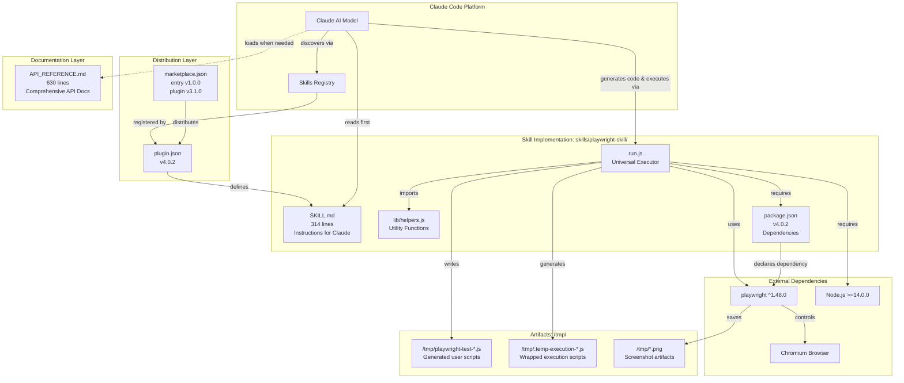

**Figure 1: System Architecture and Component Relationships**

This diagram shows how components interact from distribution through execution. The skill is discovered via Claude's Skills Registry, which reads metadata from `plugin.json`. When invoked, Claude loads `SKILL.md` first (314 lines), only loading `API_REFERENCE.md` (630 lines) for complex scenarios. Code execution flows through `run.js`, which handles module resolution and dependency management. All artifacts are isolated in `/tmp/` to keep projects clean.

Sources: [.claude-plugin/plugin.json:1-21](), [README.md:166-184](), [.claude-plugin/marketplace.json:1-38]()

### Code Entity Mapping

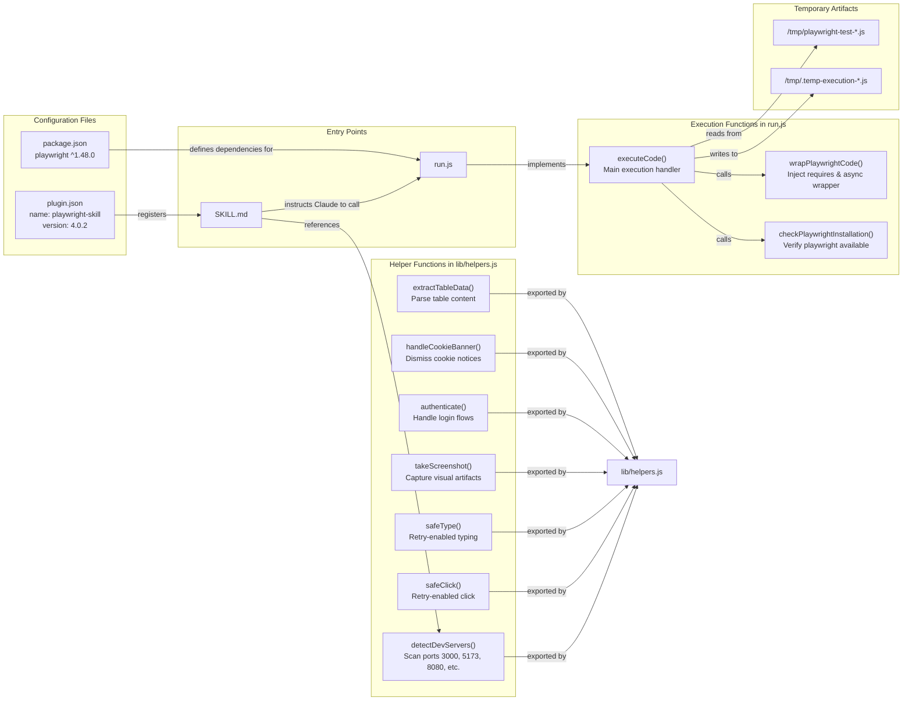

**Figure 2: Code Entity Relationships**

This diagram maps natural language concepts to actual code entities. The `run.js` file implements three primary functions: `executeCode()` for orchestration, `wrapPlaywrightCode()` for code transformation, and `checkPlaywrightInstallation()` for dependency verification. The `lib/helpers.js` exports seven utility functions that `SKILL.md` references for common patterns. Temporary files follow naming conventions: user scripts are `playwright-test-*.js` while wrapped execution files are `.temp-execution-*.js`.

Sources: [README.md:176-179](), [skills/playwright-skill/ directory structure]()

## Distribution Model

The `playwright-skill` uses a dual-distribution strategy:

### Nested Structure

```
playwright-skill/              # Repository root (Plugin format)
├── .claude-plugin/           # Plugin metadata
│   ├── plugin.json          # Plugin definition (v4.0.2)
│   └── marketplace.json     # Marketplace listing (v1.0.0 entry, v3.1.0 plugin)
└── skills/
    └── playwright-skill/     # Actual skill implementation
        ├── SKILL.md
        ├── run.js
        ├── package.json     # Skill dependencies (v4.0.2)
        └── lib/
            └── helpers.js
```

This structure enables:

1. **Plugin Installation**: Full nested structure preserved at `~/.claude/plugins/marketplaces/playwright-skill/skills/playwright-skill/`
2. **Standalone Installation**: Inner `skills/playwright-skill/` folder extracted to `~/.claude/skills/playwright-skill`

The nested structure separates plugin-level concerns (metadata, marketplace) from skill-level concerns (functionality). For standalone use, only the inner folder is needed. See [Distribution Model](#3.2) for details.

Sources: [README.md:22-34](), [README.md:166-184]()

### Version Numbers

| Manifest | Version | Purpose |
|----------|---------|---------|
| `plugin.json` | 4.0.2 | Plugin release version |
| `marketplace.json` (entry) | 1.0.0 | Marketplace entry metadata |
| `marketplace.json` (plugin) | 3.1.0 | Listed plugin version |
| `package.json` | 4.0.2 | npm package version |

The skill uses semantic versioning across multiple manifests. The plugin and package versions (4.0.2) represent the actual release, while marketplace versions track listing evolution. See [Metadata and Versioning](#9.5) for details.

Sources: [.claude-plugin/plugin.json:3](), [.claude-plugin/marketplace.json:9,16](), [README.md:166-184]()

## How It Works

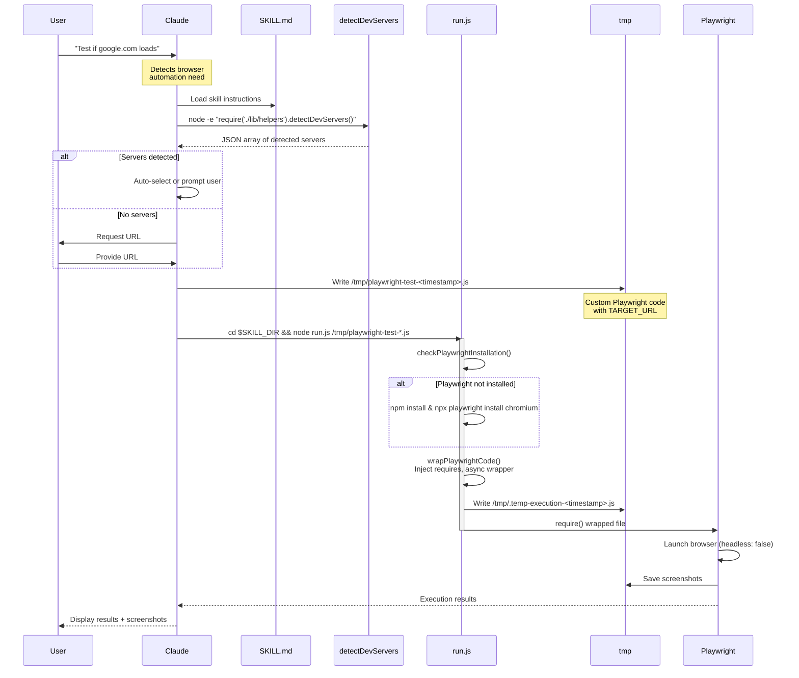

**Figure 3: Execution Flow**

The execution flow shows the model-invoked pattern in action. Claude autonomously detects the need for browser automation, loads `SKILL.md`, runs `detectDevServers()` to find local servers, generates custom Playwright code (not templates), writes it to `/tmp` for clean artifact management, and executes via `run.js`. The universal executor handles installation checks, code wrapping, and module resolution. Browsers launch visibly by default for observability.

Sources: [README.md:150-156](), [SKILL.md workflow section]()

## Installation Context

The skill must be installed to one of three locations for Claude to discover it:

| Installation Type | Path | Use Case | Resolution |
|-------------------|------|----------|------------|
| Plugin | `~/.claude/plugins/marketplaces/playwright-skill/skills/playwright-skill/` | Centralized, auto-updating | Full nested structure |
| Global | `~/.claude/skills/playwright-skill/` | Available to all projects | Extracted inner folder |
| Project-Specific | `<project>/.claude/skills/playwright-skill/` | Single project only | Extracted inner folder |

All commands in `SKILL.md` use `cd $SKILL_DIR &&` prefix to ensure proper module resolution regardless of installation location. The `$SKILL_DIR` variable is dynamically resolved by Claude based on where the skill is installed. See [Path Resolution and $SKILL_DIR](#4.6) for details.

Sources: [README.md:38-96](), [README.md:22-34]()

## Key Design Principles

The architecture embodies several design principles:

1. **Autonomous Operation**: Claude decides when to invoke the skill based on user intent, not explicit commands. The `model-invoked` keyword in metadata enables this. See [Model-Invoked Pattern](#3.1).

2. **Progressive Disclosure**: `SKILL.md` (314 lines) provides concise instructions for immediate use. `API_REFERENCE.md` (630 lines) loads only when needed for complex scenarios. See [Progressive Disclosure Documentation](#3.4).

3. **Clean Artifacts**: All generated scripts and screenshots save to `/tmp/`, never to the repository. This prevents cluttering projects with test debris. See [Artifact Management](#4.5).

4. **Zero Configuration**: Dev server auto-detection via `detectDevServers()` eliminates hardcoded URLs. Default settings (`headless: false`, `slowMo: 100ms`) prioritize visibility over speed. See [Dev Server Detection](#3.3).

5. **Universal Execution**: `run.js` handles module resolution, code wrapping, and dependency installation regardless of installation method. See [run.js: The Universal Executor](#4.2).

Sources: [README.md:9-16](), [.claude-plugin/plugin.json:10-20](), [README.md:150-165]()

## Dependencies

| Dependency | Version | Purpose | Installation |
|------------|---------|---------|--------------|
| Node.js | >=14.0.0 | Runtime environment | System prerequisite |
| Playwright | ^1.48.0 | Browser automation library | `npm run setup` |
| Chromium | Latest | Default browser engine | `npm run setup` (via `npx playwright install chromium`) |

The skill declares Playwright as a dependency in `package.json` at [package.json dependency declaration](). The setup script (`npm run setup`) installs both Playwright and Chromium to ensure immediate functionality.

Sources: [README.md:190-194](), [package.json dependencies]()

## Next Steps

- **Install the skill**: See [Installation](#2.1) for detailed instructions
- **Run your first automation**: See [Quick Start](#2.2) for a walkthrough
- **Understand core concepts**: See [Core Concepts](#3) for architectural patterns
- **Write automation scripts**: See [Usage Guide](#5) for practical examples
- **Reference API documentation**: See [API Reference](#6) for comprehensive Playwright documentation

Sources: [README.md:1-232]()

---

# Page: Getting Started

# Getting Started

<details>
<summary>Relevant source files</summary>

The following files were used as context for generating this wiki page:

- [README.md](README.md)
- [skills/playwright-skill/package.json](skills/playwright-skill/package.json)

</details>


This document guides you through the initial setup and first use of the playwright-skill. It covers prerequisites, installation overview, post-installation configuration, verification, and your first automation task. For detailed installation instructions, see [Installation](#2.1). For a complete first automation walkthrough, see [Quick Start](#2.2). For advanced configuration options, see [Configuration and Setup](#2.3).

## Prerequisites

Before installing playwright-skill, ensure your environment meets the following requirements:

| Requirement | Version | Purpose |
|------------|---------|---------|
| Node.js | >= 14.0.0 | Runtime environment for executing JavaScript |
| npm | Bundled with Node.js | Package manager for dependency installation |
| Claude Code | Latest | Host platform for skills and plugins |
| Disk Space | ~500 MB | Playwright library and Chromium browser |

**Sources:** [skills/playwright-skill/package.json:22-24](), [README.md:190-194]()

## Installation Overview

The playwright-skill can be installed through three distinct methods, each suited for different use cases. The repository structure uses the Claude Code Plugin format with a nested directory layout that requires understanding before installation.

### Repository Structure

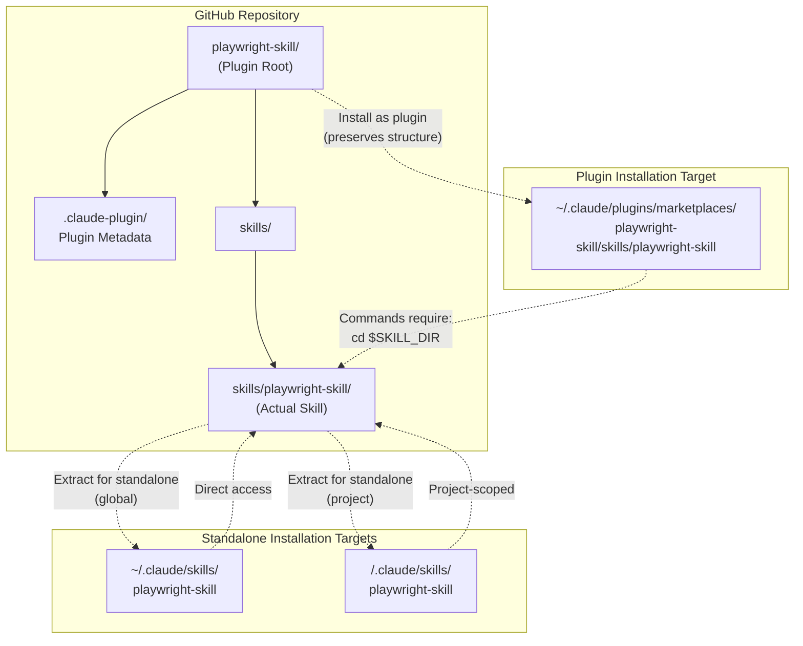

**Sources:** [README.md:22-34](), [README.md:166-184]()

### Installation Methods Comparison

| Method | Path | Scope | Updates | Use Case |
|--------|------|-------|---------|----------|
| **Plugin Installation** | `~/.claude/plugins/marketplaces/playwright-skill/skills/playwright-skill` | Global | Automatic via marketplace | Team environments, managed deployments |
| **Global Standalone** | `~/.claude/skills/playwright-skill` | Global | Manual git pull | Individual developers, all projects |
| **Project Standalone** | `<project>/.claude/skills/playwright-skill` | Project-specific | Manual git pull | Single project, isolated dependencies |

The key architectural distinction: plugin installation preserves the nested `skills/playwright-skill/` structure within the marketplace directory, while standalone installation requires extracting only the inner `skills/playwright-skill/` folder to avoid double-nesting.

**Sources:** [README.md:37-110]()

### Installation Command Reference

The following table maps installation methods to their command sequences:

| Method | Initial Commands | Setup Location |
|--------|-----------------|----------------|
| **Plugin** | `/plugin marketplace add lackeyjb/playwright-skill`<br/>`/plugin install playwright-skill@playwright-skill` | `~/.claude/plugins/marketplaces/playwright-skill/skills/playwright-skill` |
| **Global Clone** | `git clone https://github.com/lackeyjb/playwright-skill.git /tmp/playwright-skill-temp`<br/>`cp -r /tmp/playwright-skill-temp/skills/playwright-skill ~/.claude/skills/` | `~/.claude/skills/playwright-skill` |
| **Project Clone** | `git clone https://github.com/lackeyjb/playwright-skill.git /tmp/playwright-skill-temp`<br/>`cp -r /tmp/playwright-skill-temp/skills/playwright-skill .claude/skills/` | `.claude/skills/playwright-skill` |
| **Release Download** | Download from GitHub Releases<br/>Extract `skills/playwright-skill/` folder | User's chosen location |

All methods require running `npm run setup` after extraction. See [Installation](#2.1) for complete instructions.

**Sources:** [README.md:37-110]()

## Post-Installation Setup

After placing the skill files in the appropriate directory, execute the setup script to install dependencies and browser binaries.

### Setup Script Execution Flow

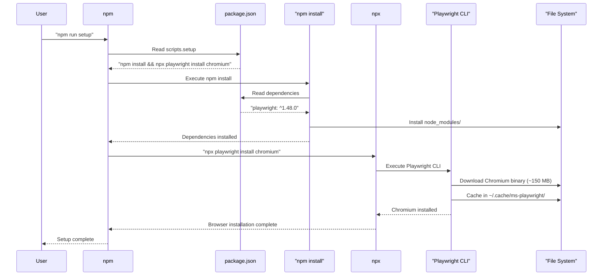

**Sources:** [skills/playwright-skill/package.json:7-9](), [skills/playwright-skill/package.json:19-20]()

### What the Setup Script Does

The `npm run setup` command defined in [skills/playwright-skill/package.json:8]() performs two critical operations:

1. **Dependency Installation** (`npm install`):
   - Installs `playwright` package version `^1.48.0` from [skills/playwright-skill/package.json:20]()
   - Creates `node_modules/` directory in the skill folder
   - Generates `package-lock.json` for reproducible builds

2. **Browser Installation** (`npx playwright install chromium`):
   - Downloads Chromium browser binary (~150 MB)
   - Stores browser in `~/.cache/ms-playwright/`
   - Configures browser for headless and headed execution

### Running Setup

Navigate to the installed skill directory and execute setup:

```bash
# For plugin installation
cd ~/.claude/plugins/marketplaces/playwright-skill/skills/playwright-skill
npm run setup

# For global standalone installation
cd ~/.claude/skills/playwright-skill
npm run setup

# For project-specific installation
cd .claude/skills/playwright-skill
npm run setup
```

The setup process typically completes in 1-2 minutes depending on network speed.

**Sources:** [README.md:49-50](), [README.md:71-72](), [README.md:88-89](), [README.md:106-109]()

### Optional: Install All Browsers

By default, only Chromium is installed. To install Firefox and WebKit for cross-browser testing:

```bash
npm run install-all-browsers
```

This executes `npx playwright install chromium firefox webkit` from [skills/playwright-skill/package.json:9]() and downloads approximately 500 MB of browser binaries.

**Sources:** [skills/playwright-skill/package.json:9](), [README.md:207-208]()

## Verification

After installation and setup, verify the skill is properly registered and accessible to Claude.

### Verification Process

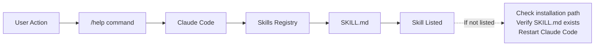

### Verification Steps

1. **Check Skill Registration**:
   ```
   /help
   ```
   This displays all registered skills. Look for `playwright-skill` in the output.

2. **Test Basic Invocation**:
   Ask Claude: `"Test if google.com loads"`
   
   Claude should autonomously:
   - Detect the browser automation request
   - Load instructions from `SKILL.md`
   - Generate Playwright code
   - Execute via `run.js`
   - Return results with console output

3. **Verify File Structure**:
   Ensure the following files exist in the skill directory:
   - `SKILL.md` - Instructions for Claude (314 lines)
   - `run.js` - Universal executor
   - `package.json` - Dependency manifest
   - `lib/helpers.js` - Utility functions
   - `node_modules/` - Installed dependencies (after setup)

**Sources:** [README.md:113-116](), [README.md:166-184]()

### Troubleshooting Installation

| Issue | Cause | Solution |
|-------|-------|----------|
| Skill not listed in `/help` | Incorrect installation path | Verify skill is directly in `.claude/skills/` not nested further |
| Module not found errors | `npm run setup` not executed | Run `npm run setup` in skill directory |
| Browser launch failure | Chromium not installed | Run `npx playwright install chromium` in skill directory |
| Permission denied | File permissions | Check directory and file ownership, use `chmod` if needed |

**Sources:** [README.md:197-209]()

## First Use

Once verified, the skill operates through Claude's model-invoked pattern. You describe what you want to automate, and Claude autonomously generates and executes the appropriate Playwright code.

### Model-Invoked Execution Flow

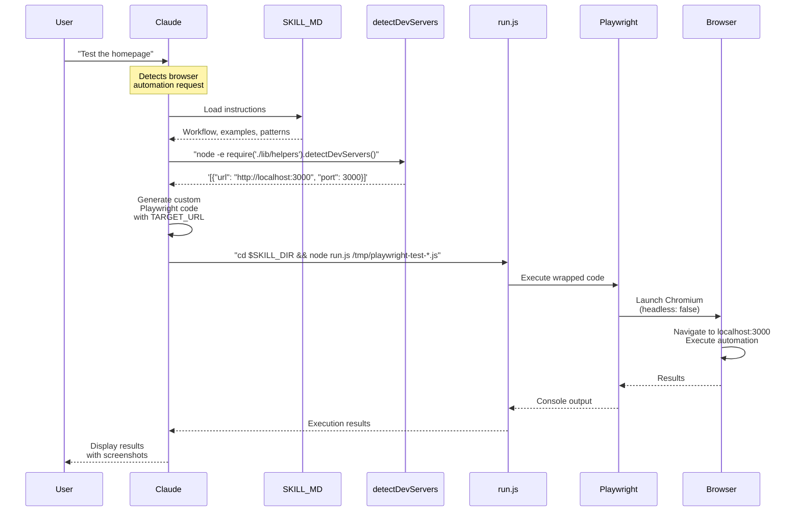

**Sources:** [README.md:117-157]()

### Example First Automation

Ask Claude any of the following natural language requests:

**Basic Page Testing**:
- `"Test if the homepage loads"`
- `"Check if google.com is accessible"`
- `"Verify the contact page renders"`

**Interaction Testing**:
- `"Click the login button and check what happens"`
- `"Fill out the contact form with test data"`
- `"Navigate through the main menu"`

**Visual Testing**:
- `"Take a screenshot of the dashboard"`
- `"Capture the mobile view of the homepage"`

Claude will:
1. Detect the automation need from your request
2. Load `SKILL.md` instructions (314 lines of concise guidance)
3. Check for local development servers via `lib/helpers.js::detectDevServers()`
4. Generate custom Playwright code (not template-based)
5. Write the code to `/tmp/playwright-test-<timestamp>.js`
6. Execute via `run.js` with proper module resolution
7. Launch a visible browser window (headless: false by default)
8. Run the automation with 100ms slow motion for visibility
9. Return console output and screenshots from `/tmp/`

**Sources:** [README.md:122-157]()

### Understanding the Workflow

The skill uses a specific workflow that Claude follows automatically:

1. **Server Detection**: Scans common ports (3000, 5173, 8080, 4200, 5000, etc.) for running development servers
2. **URL Parameterization**: Generates code with `TARGET_URL` variable instead of hardcoded URLs
3. **Script Generation**: Writes custom automation code to `/tmp/` directory
4. **Execution**: Runs via `cd $SKILL_DIR && node run.js /tmp/script.js` for proper module resolution
5. **Artifact Management**: Saves screenshots and output to `/tmp/` for OS-managed cleanup

For a complete walkthrough of this workflow, see [Quick Start](#2.2).

**Sources:** [README.md:150-157]()

## Default Configuration

The skill operates with sensible defaults optimized for development and debugging:

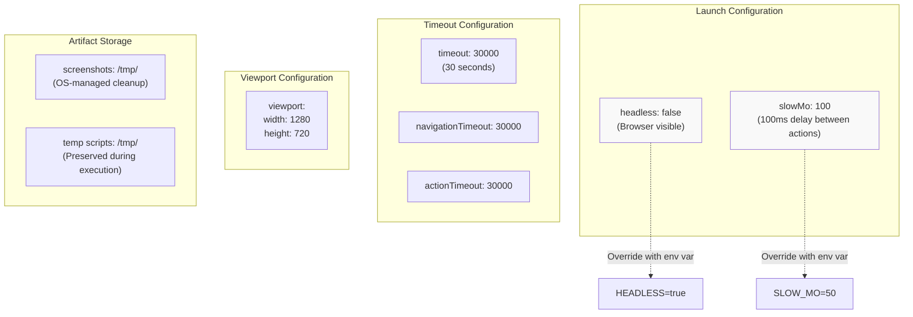

| Configuration | Default Value | Override Method | Purpose |
|---------------|--------------|-----------------|---------|
| `headless` | `false` | `HEADLESS=true` env var | Browser visibility for debugging |
| `slowMo` | `100` (ms) | `SLOW_MO=<value>` env var | Delay between actions for observation |
| `timeout` | `30000` (ms) | Inline script configuration | Maximum wait time for operations |
| `viewport` | `1280x720` | Inline script configuration | Default browser window size |
| `screenshots` | `/tmp/` | N/A | Screenshot storage location |

These defaults prioritize **visibility and debuggability** over execution speed. For headless CI/CD execution, see [CI/CD Integration](#7.4).

**Sources:** [README.md:159-164]()

## Next Steps

After completing installation and verification:

- **For detailed installation instructions**: See [Installation](#2.1)
- **For your first automation walkthrough**: See [Quick Start](#2.2)
- **For setup script details and configuration**: See [Configuration and Setup](#2.3)
- **For understanding the model-invoked pattern**: See [Model-Invoked Pattern](#3.1)
- **For development server detection details**: See [Dev Server Detection](#3.3)
- **For writing custom automation scripts**: See [Writing Automation Scripts](#5.1)
- **For helper function usage**: See [Helper Functions API](#6.2)
- **For advanced configuration**: See [Configuration Options](#9.1)

The skill is now ready for use. Simply describe your automation needs to Claude in natural language, and the skill will handle code generation, execution, and artifact management automatically.

**Sources:** [README.md:1-232]()

---

# Page: Installation

# Installation

<details>
<summary>Relevant source files</summary>

The following files were used as context for generating this wiki page:

- [.claude-plugin/marketplace.json](.claude-plugin/marketplace.json)
- [README.md](README.md)
- [skills/playwright-skill/package.json](skills/playwright-skill/package.json)

</details>


This document provides detailed instructions for installing the playwright-skill into your Claude Code environment. It covers the three installation methods (plugin system, manual global, and project-specific), explains the nested repository structure that requires special handling, and documents the post-installation setup process.

For information about configuring the skill after installation, see [Configuration and Setup](#2.3). For getting started with your first automation task, see [Quick Start](#2.2).

---

## Prerequisites

Before installing playwright-skill, ensure your system meets these requirements:

| Requirement | Version | Purpose |
|------------|---------|---------|
| Node.js | >= 14.0.0 | Runtime environment for executing JavaScript |
| npm | (bundled with Node.js) | Package manager for installing dependencies |
| Claude Code | Latest version | Platform for skill execution |
| Disk Space | ~500MB | Playwright library and Chromium browser |

**Sources:** [skills/playwright-skill/package.json:22-24]()

---

## Understanding the Repository Structure

The playwright-skill repository uses the Claude Code Plugin format, which creates a nested directory structure. This structure differs from a simple skill repository and requires special handling during installation.

### Repository Layout

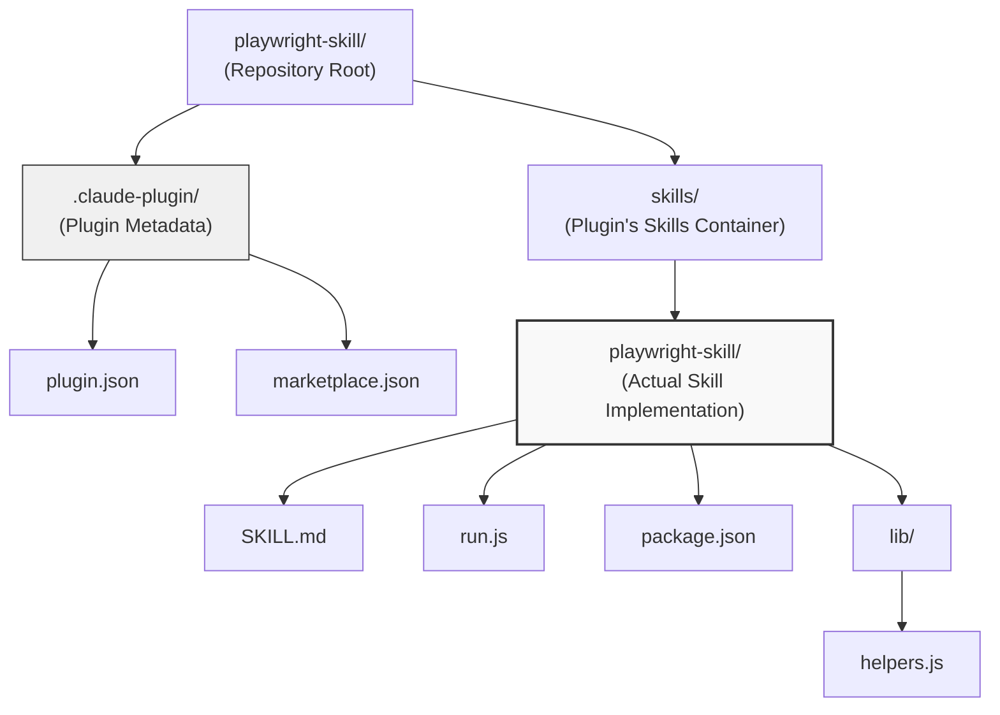

**Key Insight:** The plugin format requires the `skills/` directory to organize multiple skills within a single plugin. However, Claude Code expects skills to be directly under `~/.claude/skills/` or `.claude/skills/`. This mismatch means **standalone installations must extract only the inner `skills/playwright-skill/` folder**.

**Sources:** [README.md:22-34]()

### Why This Structure Exists

The nested structure serves distinct purposes:

| Directory Level | Purpose | Required For |
|----------------|---------|--------------|
| `playwright-skill/` (root) | Plugin container with marketplace metadata | Plugin installation only |
| `.claude-plugin/` | Plugin metadata files (`plugin.json`, `marketplace.json`) | Plugin system registration |
| `skills/` | Container for one or more skills within the plugin | Plugin format compliance |
| `skills/playwright-skill/` | The actual skill implementation | All installation methods |

**Sources:** [README.md:95-96](), [.claude-plugin/marketplace.json:1-38]()

---

## Installation Methods

### Installation Path Mapping

Different installation methods place the skill in different locations, which affects the `$SKILL_DIR` variable used at runtime:

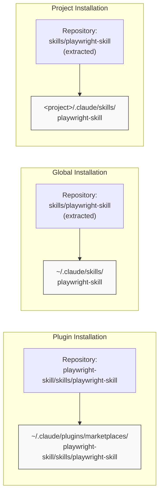

**Sources:** [README.md:37-93]()

---

### Option 1: Plugin Installation (Recommended)

Plugin installation uses Claude Code's built-in plugin system for automatic updates and centralized management. This method preserves the entire repository structure including plugin metadata.

#### Installation Commands

```bash
# Add the GitHub repository as a marketplace
/plugin marketplace add lackeyjb/playwright-skill

# Install the plugin from the marketplace
/plugin install playwright-skill@playwright-skill

# Navigate to the skill directory (note the nested path)
cd ~/.claude/plugins/marketplaces/playwright-skill/skills/playwright-skill

# Run the setup script to install dependencies
npm run setup
```

#### What Happens During Plugin Installation

```mermaid
sequenceDiagram
    participant User
    participant Claude["Claude Code<br/>Plugin System"]
    participant GitHub
    participant FileSystem["~/.claude/plugins/"]
    participant npm
    
    User->>Claude: /plugin marketplace add lackeyjb/playwright-skill
    Claude->>GitHub: Fetch marketplace.json
    GitHub-->>Claude: Repository metadata
    Claude->>FileSystem: Register marketplace
    
    User->>Claude: /plugin install playwright-skill@playwright-skill
    Claude->>GitHub: Clone repository
    GitHub-->>FileSystem: Write entire structure<br/>marketplaces/playwright-skill/
    Claude->>FileSystem: Symlink to skills registry
    
    User->>FileSystem: cd ~/.claude/plugins/.../skills/playwright-skill
    User->>npm: npm run setup
    npm->>npm: npm install (Playwright ^1.48.0)
    npm->>npm: npx playwright install chromium
    npm-->>User: Setup complete
```

#### Verification

After installation, verify the skill is registered:

```bash
# Check that the skill directory exists
ls -la ~/.claude/plugins/marketplaces/playwright-skill/skills/playwright-skill

# Verify dependencies are installed
ls -la ~/.claude/plugins/marketplaces/playwright-skill/skills/playwright-skill/node_modules/playwright

# In Claude Code, run:
/help
# The playwright-skill should appear in the skills list
```

**Sources:** [README.md:37-54](), [.claude-plugin/marketplace.json:1-38]()

---

### Option 2: Standalone Skill Installation

Standalone installation extracts only the skill folder from the repository, bypassing the plugin system. This is useful for development, testing, or when plugin system access is unavailable.

#### Global Installation

Global installation makes the skill available to all Claude Code sessions on the system.

```bash
# Clone repository to temporary location
git clone https://github.com/lackeyjb/playwright-skill.git /tmp/playwright-skill-temp

# Create global skills directory if it doesn't exist
mkdir -p ~/.claude/skills

# Extract and copy ONLY the inner skill folder
cp -r /tmp/playwright-skill-temp/skills/playwright-skill ~/.claude/skills/

# Navigate to the skill directory
cd ~/.claude/skills/playwright-skill

# Run setup script
npm run setup

# Clean up temporary clone
rm -rf /tmp/playwright-skill-temp
```

**Critical:** The command copies `skills/playwright-skill` (the inner folder), not the repository root. This avoids the nested structure:

```
❌ WRONG: ~/.claude/skills/playwright-skill/skills/playwright-skill
✅ CORRECT: ~/.claude/skills/playwright-skill
```

#### Project-Specific Installation

Project-specific installation limits the skill to a single project, useful for project-specific customizations or testing.

```bash
# Clone repository to temporary location
git clone https://github.com/lackeyjb/playwright-skill.git /tmp/playwright-skill-temp

# Create project skills directory
mkdir -p .claude/skills

# Extract and copy ONLY the inner skill folder
cp -r /tmp/playwright-skill-temp/skills/playwright-skill .claude/skills/

# Navigate to the skill directory
cd .claude/skills/playwright-skill

# Run setup script
npm run setup

# Clean up temporary clone
rm -rf /tmp/playwright-skill-temp
```

#### File Structure After Standalone Installation

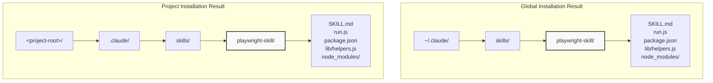

**Sources:** [README.md:58-93]()

---

### Option 3: Release Download

For air-gapped systems or specific version requirements, download a pre-packaged release.

```bash
# Download the latest release archive
# Visit: https://github.com/lackeyjb/playwright-skill/releases
# Download: playwright-skill-vX.Y.Z.tar.gz

# Extract the archive
tar -xzf playwright-skill-vX.Y.Z.tar.gz

# Copy ONLY the skills/playwright-skill folder
# For global installation:
cp -r playwright-skill-vX.Y.Z/skills/playwright-skill ~/.claude/skills/

# For project-specific installation:
cp -r playwright-skill-vX.Y.Z/skills/playwright-skill .claude/skills/

# Navigate and setup
cd ~/.claude/skills/playwright-skill  # or .claude/skills/playwright-skill
npm run setup
```

**Sources:** [README.md:99-109]()

---

## Post-Installation Setup

After placing the skill files, the `npm run setup` command must be executed to install dependencies and configure browsers.

### The Setup Script

The setup script is defined in [skills/playwright-skill/package.json:8]():

```json
"scripts": {
  "setup": "npm install && npx playwright install chromium"
}
```

### Setup Process Flow

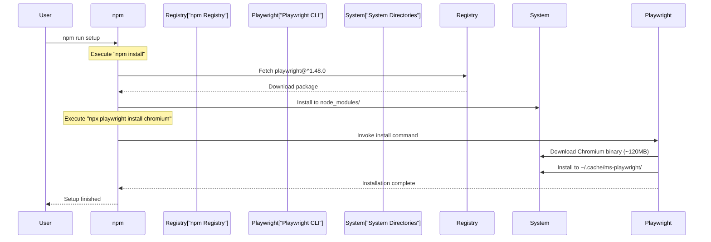

### What Gets Installed

| Component | Version | Size | Location | Purpose |
|-----------|---------|------|----------|---------|
| `playwright` (npm package) | ^1.48.0 | ~20MB | `node_modules/playwright/` | JavaScript API library |
| Chromium browser | Latest compatible | ~120MB | `~/.cache/ms-playwright/chromium-*/` | Browser automation target |

**Sources:** [skills/playwright-skill/package.json:8](), [skills/playwright-skill/package.json:19-21]()

### Installing Additional Browsers

The default setup only installs Chromium. To install Firefox and WebKit:

```bash
cd $SKILL_DIR  # Navigate to skill directory
npm run install-all-browsers
```

This executes: `npx playwright install chromium firefox webkit` [skills/playwright-skill/package.json:9]()

---

## Verification

After installation and setup, verify the skill is functional.

### Verification Checklist

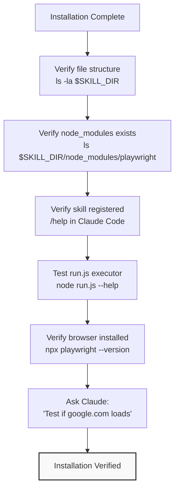

### Verification Commands

**1. Verify file structure:**
```bash
# For plugin installation:
ls -la ~/.claude/plugins/marketplaces/playwright-skill/skills/playwright-skill

# For global installation:
ls -la ~/.claude/skills/playwright-skill

# Expected files:
# SKILL.md, run.js, package.json, lib/, node_modules/
```

**2. Verify Playwright installation:**
```bash
cd $SKILL_DIR
npx playwright --version
# Expected: Version 1.48.0 (or higher)
```

**3. Verify skill registration:**
```bash
# In Claude Code, execute:
/help

# Output should include:
# playwright-skill - Browser automation with Playwright
```

**4. Test execution:**
```bash
cd $SKILL_DIR
node run.js --help
# Should display usage information without errors
```

**5. Run a simple automation:**

In Claude Code, ask: `"Test if google.com loads"`

Claude should:
1. Recognize the browser automation request
2. Generate Playwright code
3. Execute via `run.js`
4. Open a browser window
5. Navigate to google.com
6. Return results with screenshots

**Sources:** [README.md:113-116](), [README.md:197-206]()

---

## Troubleshooting

### Common Installation Issues

| Issue | Cause | Solution |
|-------|-------|----------|
| **"Cannot find module 'playwright'"** | Dependencies not installed | Run `npm run setup` in skill directory |
| **"Executable doesn't exist at /path/to/chromium"** | Browser not installed | Run `npx playwright install chromium` |
| **Nested directory structure** | Copied entire repository instead of skill folder | Extract only `skills/playwright-skill/` folder |
| **"Skill not found"** | Skill not in correct location | Verify path: `~/.claude/skills/playwright-skill` or `.claude/skills/playwright-skill` |
| **npm install fails** | Node.js version incompatible | Ensure Node.js >= 14.0.0 |
| **Permission denied** | Insufficient file permissions | Run with appropriate permissions or use `sudo` (not recommended for npm) |

### Directory Structure Validation

If uncertain about the installation, validate the directory structure:

```bash
# Check that these files exist in the skill directory:
ls $SKILL_DIR/SKILL.md
ls $SKILL_DIR/run.js
ls $SKILL_DIR/package.json
ls $SKILL_DIR/lib/helpers.js

# Check that dependencies are installed:
ls $SKILL_DIR/node_modules/playwright

# If any file is missing, repeat installation from the correct source path
```

### Module Resolution Test

Test that module resolution works correctly:

```bash
cd $SKILL_DIR
node -e "const playwright = require('playwright'); console.log('Playwright loaded:', playwright.chromium);"

# Expected: Should print Playwright chromium object
# If error: Dependencies not installed or wrong directory
```

**Sources:** [README.md:197-206]()

---

## Installation Path Summary

This table summarizes where files are located for each installation method:

| Installation Method | Skill Directory Path | Command Prefix |
|---------------------|----------------------|----------------|
| Plugin (via marketplace) | `~/.claude/plugins/marketplaces/playwright-skill/skills/playwright-skill` | `cd ~/.claude/plugins/marketplaces/playwright-skill/skills/playwright-skill &&` |
| Global (manual) | `~/.claude/skills/playwright-skill` | `cd ~/.claude/skills/playwright-skill &&` |
| Project-specific (manual) | `<project>/.claude/skills/playwright-skill` | `cd .claude/skills/playwright-skill &&` |

The `$SKILL_DIR` variable is dynamically resolved at runtime based on which installation method was used. All skill commands must be prefixed with `cd $SKILL_DIR` to ensure proper module resolution. See [Path Resolution and $SKILL_DIR](#4.6) for details.

**Sources:** [README.md:18-116]()

---

## Next Steps

After successful installation and verification:

1. **Quick Start:** Follow [Quick Start](#2.2) to run your first automation
2. **Configuration:** Review [Configuration and Setup](#2.3) for customization options
3. **Documentation:** Familiarize yourself with the skill's capabilities by reviewing `SKILL.md` in the skill directory
4. **Helper Functions:** Explore `lib/helpers.js` for utility functions like `detectDevServers`, `safeClick`, and `takeScreenshot`

**Sources:** [README.md:117-119]()

---

# Page: Quick Start

# Quick Start

<details>
<summary>Relevant source files</summary>

The following files were used as context for generating this wiki page:

- [README.md](README.md)
- [skills/playwright-skill/SKILL.md](skills/playwright-skill/SKILL.md)
- [skills/playwright-skill/run.js](skills/playwright-skill/run.js)

</details>


This guide walks you through your first browser automation with the playwright-skill. By the end, you'll understand how Claude autonomously detects automation needs, generates Playwright code, and executes it with visible results.

**Scope**: This page covers the first-time experience after installation. For installation instructions, see [Installation](#2.1). For detailed configuration options, see [Configuration and Setup](#2.3).

## Prerequisites

Before starting, ensure you have completed:
1. Installation of playwright-skill (via plugin system, global, or project-specific - see [Installation](#2.1))
2. Run `npm run setup` from the skill directory to install Playwright and Chromium

To verify the skill is loaded, run `/help` in Claude Code and confirm `playwright-skill` appears in the list.

**Sources**: [README.md:113-116](), [skills/playwright-skill/SKILL.md:46-53]()

## Your First Automation

Simply ask Claude to test or automate a browser task. Claude autonomously detects that browser automation is needed and invokes the skill without any explicit commands from you.

### Example Request

```
"Test if google.com loads"
```

### What Happens Behind the Scenes

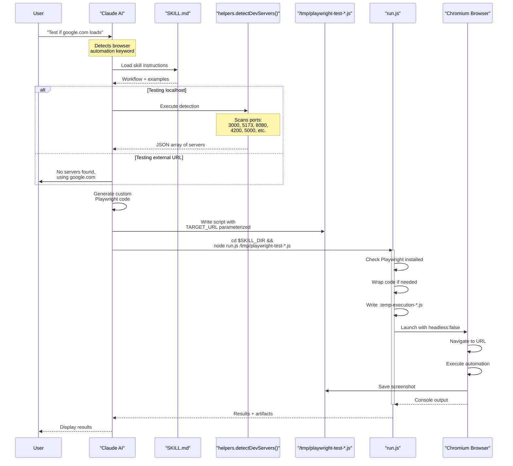

**Sources**: [skills/playwright-skill/SKILL.md:21-45](), [skills/playwright-skill/run.js:52-81](), [skills/playwright-skill/run.js:162-201]()

### Generated Script Example

Claude writes a script to `/tmp/playwright-test-*.js` that looks like this:

```javascript
const { chromium } = require('playwright');

// Parameterized URL
const TARGET_URL = 'https://google.com';

(async () => {
  const browser = await chromium.launch({ headless: false });
  const page = await browser.newPage();

  await page.goto(TARGET_URL);
  console.log('Page loaded:', await page.title());

  await page.screenshot({ path: '/tmp/screenshot.png', fullPage: true });
  console.log('📸 Screenshot saved to /tmp/screenshot.png');

  await browser.close();
})();
```

This code is then executed via: `cd $SKILL_DIR && node run.js /tmp/playwright-test-*.js`

**Sources**: [skills/playwright-skill/SKILL.md:65-84](), [skills/playwright-skill/SKILL.md:369-380]()

## Understanding the Critical Workflow

The playwright-skill follows a specific execution pattern that Claude implements automatically. Understanding this workflow helps you know what to expect.

### Workflow Components

| Step | Component | Code Entity | Purpose |
|------|-----------|-------------|---------|
| 1 | Dev Server Detection | `helpers.detectDevServers()` | Auto-detect localhost servers to avoid hardcoded URLs |
| 2 | Script Generation | Claude AI | Generate custom Playwright code for specific task |
| 3 | Write to /tmp | `/tmp/playwright-test-*.js` | Keep projects clean, avoid repository clutter |
| 4 | Execute via run.js | `run.js` main function | Ensure proper module resolution from skill directory |
| 5 | Browser Launch | `chromium.launch({ headless: false })` | Visible browser with slow motion for observability |
| 6 | Save Artifacts | `/tmp/*.png` | Screenshots saved to temp directory |

**Sources**: [skills/playwright-skill/SKILL.md:21-30](), [skills/playwright-skill/run.js:162-201]()

### Dev Server Detection Flow

When testing localhost applications, Claude ALWAYS runs dev server detection first:

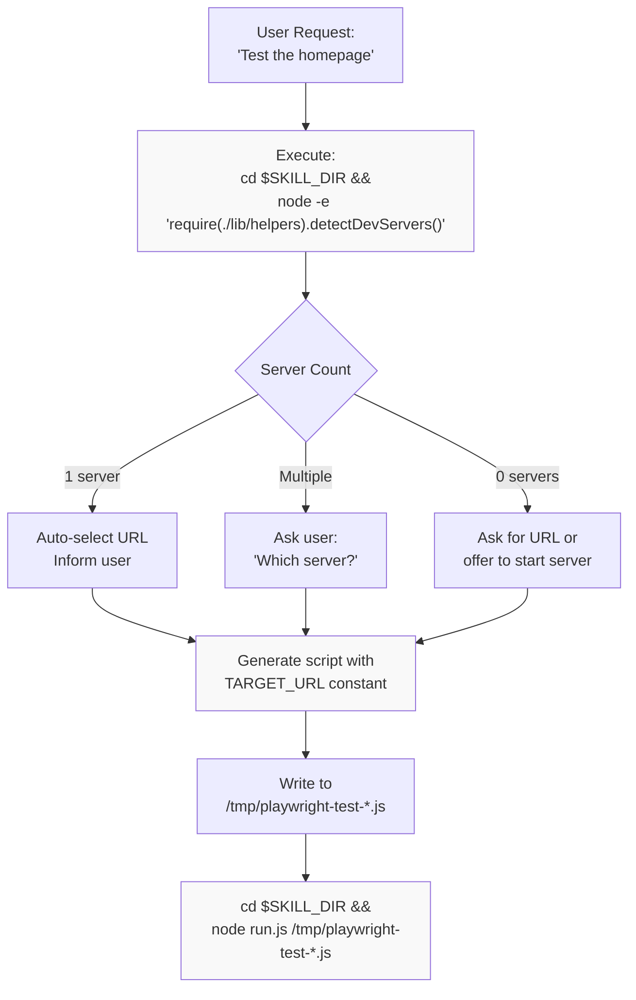

**Sources**: [skills/playwright-skill/SKILL.md:21-29](), [skills/playwright-skill/SKILL.md:57-61]()

### Module Resolution via run.js

The `run.js` executor handles three execution modes and ensures proper module resolution:

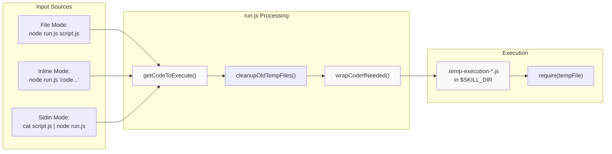

The executor (`run.js`) performs these operations:
- **Line 18**: `process.chdir(__dirname)` - Changes to skill directory for module resolution
- **Line 52-81**: `getCodeToExecute()` - Reads code from file, inline, or stdin
- **Line 86-104**: `cleanupOldTempFiles()` - Removes previous `.temp-execution-*.js` files
- **Line 109-157**: `wrapCodeIfNeeded()` - Injects `require('playwright')` and async IIFE wrapper
- **Line 181**: Creates timestamped temp file in skill directory
- **Line 189**: `require(tempFile)` - Executes with proper module resolution

**Sources**: [skills/playwright-skill/run.js:1-209](), [skills/playwright-skill/SKILL.md:86-90]()

## Example: Testing a Local Development Server

This example demonstrates the complete workflow when testing a localhost application.

### User Request

```
"Test the homepage and take screenshots"
```

### Execution Steps

**Step 1: Dev Server Detection**

Claude executes:
```bash
cd $SKILL_DIR && node -e "require('./lib/helpers').detectDevServers().then(servers => console.log(JSON.stringify(servers)))"
```

Output:
```json
[
  {
    "port": 3001,
    "url": "http://localhost:3001",
    "responding": true
  }
]
```

**Step 2: URL Selection**

Claude automatically selects the single detected server and informs you:
```
"I found your dev server running on http://localhost:3001"
```

**Step 3: Script Generation**

Claude writes to `/tmp/playwright-test-homepage.js`:

```javascript
const { chromium } = require('playwright');

// Auto-detected URL
const TARGET_URL = 'http://localhost:3001';

(async () => {
  const browser = await chromium.launch({ 
    headless: false, 
    slowMo: 100 
  });
  const page = await browser.newPage();

  console.log('Testing homepage...');
  
  await page.goto(TARGET_URL);
  console.log('Page loaded:', await page.title());

  // Desktop screenshot
  await page.setViewportSize({ width: 1920, height: 1080 });
  await page.screenshot({ 
    path: '/tmp/desktop-homepage.png', 
    fullPage: true 
  });
  console.log('📸 Desktop screenshot saved');

  // Mobile screenshot
  await page.setViewportSize({ width: 375, height: 667 });
  await page.screenshot({ 
    path: '/tmp/mobile-homepage.png', 
    fullPage: true 
  });
  console.log('📸 Mobile screenshot saved');

  await browser.close();
  console.log('✅ Test complete');
})();
```

**Step 4: Execution**

Claude runs:
```bash
cd $SKILL_DIR && node run.js /tmp/playwright-test-homepage.js
```

Console output:
```
🎭 Playwright Skill - Universal Executor

📄 Executing file: /tmp/playwright-test-homepage.js
🚀 Starting automation...

Testing homepage...
Page loaded: My Application
📸 Desktop screenshot saved
📸 Mobile screenshot saved
✅ Test complete
```

**Step 5: Results**

You'll see:
- A Chromium browser window opens (visible)
- Automation executes in slow motion (100ms between actions)
- Screenshots saved to `/tmp/desktop-homepage.png` and `/tmp/mobile-homepage.png`
- Console output showing progress

**Sources**: [skills/playwright-skill/SKILL.md:94-118](), [skills/playwright-skill/SKILL.md:369-397]()

## Common First-Time Scenarios

### Scenario 1: No Dev Server Running

```
User: "Test my app"
Claude: "I didn't detect any running dev servers. Please provide the URL or start your dev server."
```

Claude will ask for the URL if `detectDevServers()` returns an empty array.

### Scenario 2: Multiple Dev Servers

```
User: "Test the login page"
Claude: "I found 2 dev servers. Which one should I test?
- http://localhost:3000
- http://localhost:3001"

User: "Use 3001"
```

Claude prompts for selection when multiple servers are detected.

### Scenario 3: Testing External URL

```
User: "Test if example.com loads"
```

Claude skips dev server detection and directly uses the provided URL in the `TARGET_URL` constant.

**Sources**: [skills/playwright-skill/SKILL.md:382-397]()

## Observing the Execution

The default configuration prioritizes visibility and observability:

| Setting | Default Value | Purpose |
|---------|---------------|---------|
| `headless` | `false` | Browser window visible |
| `slowMo` | `100` | 100ms delay between actions |
| `timeout` | `30000` | 30 second timeout for operations |
| `viewport` | `1280x720` | Standard desktop viewport |

You'll see the browser window open and automation execute step-by-step. This makes debugging easy during development.

To run in headless mode, explicitly request it:
```
"Test the page in headless mode"
```

**Sources**: [skills/playwright-skill/SKILL.md:33](), [skills/playwright-skill/SKILL.md:344-346](), [README.md:159-165]()

## Artifacts and Cleanup

All generated files are ephemeral and stored in `/tmp`:

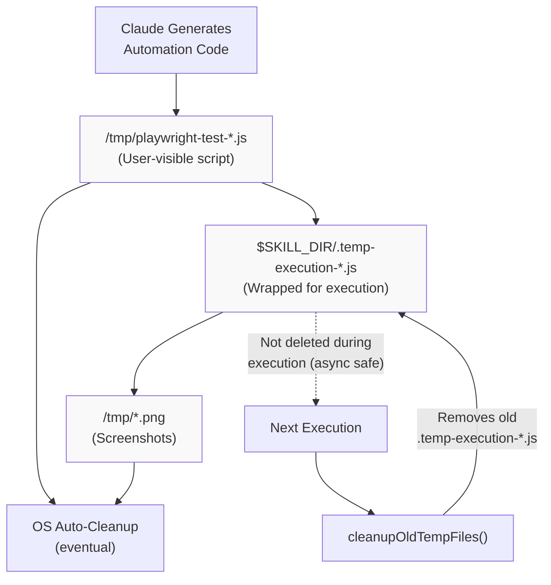

**Why this matters:**
- User scripts in `/tmp/playwright-test-*.js` are preserved for inspection
- Execution wrappers in `.temp-execution-*.js` are cleaned up on next run
- Your project directory stays clean - no test files clutter
- OS eventually cleans `/tmp` directory automatically

**Sources**: [skills/playwright-skill/run.js:86-104](), [skills/playwright-skill/SKILL.md:31](), [skills/playwright-skill/SKILL.md:402-404]()

## What Happens Next

After your first automation succeeds:

1. **Try More Complex Tasks**: See [Common Automation Patterns](#5.2) for examples
2. **Understand the Architecture**: See [run.js: The Universal Executor](#4.2) for deep dive
3. **Use Helper Functions**: See [Helper Functions Library](#4.3) for utilities
4. **Load API Reference**: Claude automatically loads [API_REFERENCE.md](#6.1) for complex scenarios

The skill uses **progressive disclosure** - Claude starts with the concise `SKILL.md` (314 lines) and only loads the comprehensive `API_REFERENCE.md` (630 lines) when you need advanced features.

**Sources**: [skills/playwright-skill/SKILL.md:326-337](), [README.md:188]()

## Troubleshooting Your First Run

### Error: "Playwright not found"

```bash
cd $SKILL_DIR && npm run setup
```

The `run.js` executor auto-installs Playwright if missing, but manual setup is more reliable.

**Code**: [skills/playwright-skill/run.js:23-46]()

### Error: "Module not found"

This indicates the script wasn't executed through `run.js`. Claude should always use:
```bash
cd $SKILL_DIR && node run.js /tmp/playwright-test-*.js
```

The `cd $SKILL_DIR` prefix is critical for module resolution.

**Code**: [skills/playwright-skill/run.js:18]()

### Browser Doesn't Open

Verify the script uses `headless: false`:
```javascript
const browser = await chromium.launch({ headless: false });
```

If running in an environment without display (SSH, Docker), you'll need to explicitly request headless mode or set up X11 forwarding.

**Sources**: [skills/playwright-skill/SKILL.md:353-363](), [README.md:199-209]()

### Element Not Found

Playwright may be executing too fast. Add explicit waits:
```javascript
await page.waitForSelector('.element', { timeout: 10000 });
```

Or increase `slowMo` for better visibility:
```javascript
const browser = await chromium.launch({ 
  headless: false, 
  slowMo: 200  // Slower than default 100ms
});
```

**Sources**: [skills/playwright-skill/SKILL.md:364-366]()

## Summary

You've now completed your first automation with playwright-skill. Key takeaways:

- **Model-Invoked Pattern**: Claude decides when to use the skill - no slash commands needed
- **Auto-Detection**: Dev servers are automatically discovered via `helpers.detectDevServers()`
- **Clean Artifacts**: Scripts written to `/tmp`, never to project directory
- **Visible Execution**: Browser opens with `headless: false` by default for observability
- **Universal Executor**: `run.js` ensures proper module resolution from skill directory
- **Parameterized URLs**: `TARGET_URL` constant makes scripts reusable

For more advanced usage, continue to [Configuration and Setup](#2.3) or explore [Common Automation Patterns](#5.2).

**Sources**: [README.md:117-157](), [skills/playwright-skill/SKILL.md:1-407]()

---

# Page: Configuration and Setup

# Configuration and Setup

<details>
<summary>Relevant source files</summary>

The following files were used as context for generating this wiki page:

- [README.md](README.md)
- [skills/playwright-skill/SKILL.md](skills/playwright-skill/SKILL.md)
- [skills/playwright-skill/package.json](skills/playwright-skill/package.json)

</details>


This page explains the initial configuration and setup process for the playwright-skill after installation. It covers running the `npm run setup` command, understanding what gets installed, configuring default browser behavior, and verifying the installation is working correctly.

For installation instructions (extracting the nested skill folder, choosing between plugin/global/project installation), see [Installation](#2.1). For guidance on running your first automation task, see [Quick Start](#2.2).

---

## Purpose and Scope

The setup process prepares the playwright-skill runtime environment by:
1. Installing npm dependencies (Playwright library)
2. Installing browser binaries (Chromium by default)
3. Establishing default configuration values
4. Verifying proper module resolution

This is a one-time process required before the skill can execute browser automation tasks.

---

## Setup Process Overview

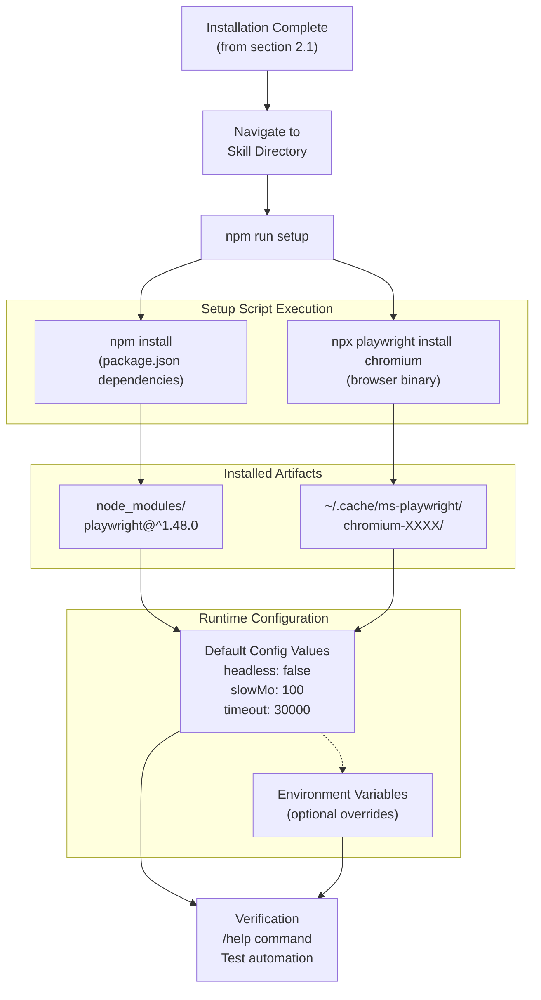

**Setup Process Flow**: After installation, users navigate to the skill directory and execute `npm run setup`, which triggers two sequential operations: npm dependency installation and Chromium browser download. These artifacts enable runtime execution with default configuration values that can be overridden via environment variables.

Sources: [README.md:46-53](), [skills/playwright-skill/package.json:7-9](), [skills/playwright-skill/SKILL.md:46-53]()

---

## Running the Setup Command

The setup command must be executed from the skill directory, which varies based on installation method:

### Determining Skill Directory Location

| Installation Method | Skill Directory Path |
|-------------------|---------------------|
| Plugin System | `~/.claude/plugins/marketplaces/playwright-skill/skills/playwright-skill` |
| Manual Global | `~/.claude/skills/playwright-skill` |
| Project-Specific | `<project>/.claude/skills/playwright-skill` |

### Executing Setup

```bash
# Navigate to skill directory (example: global installation)
cd ~/.claude/skills/playwright-skill

# Run setup script
npm run setup
```

The `setup` script is defined in [skills/playwright-skill/package.json:8]() as:

```
"setup": "npm install && npx playwright install chromium"
```

This executes two operations sequentially:
1. `npm install` - Installs dependencies declared in `package.json`
2. `npx playwright install chromium` - Downloads Chromium browser binary

Sources: [README.md:46-53](), [skills/playwright-skill/package.json:7-9](), [skills/playwright-skill/SKILL.md:46-53]()

---

## Dependency Installation

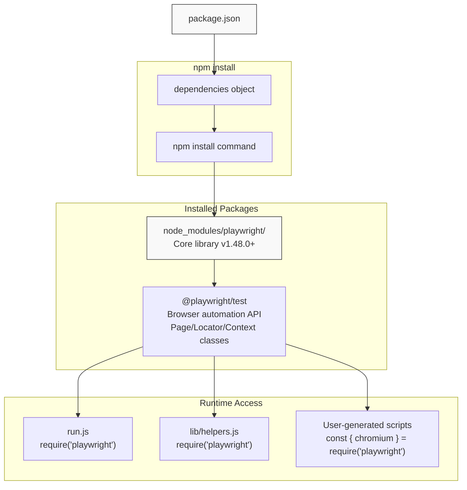

**Dependency Resolution**: The `package.json` declares Playwright ^1.48.0 as the sole runtime dependency. When `npm install` executes, it installs the Playwright library into `node_modules/`, making it available via `require('playwright')` statements in `run.js`, `lib/helpers.js`, and user-generated automation scripts.

### Package Dependencies

The [skills/playwright-skill/package.json:19-21]() declares:

```json
"dependencies": {
  "playwright": "^1.48.0"
}
```

The caret (`^`) allows minor and patch version updates while preventing breaking changes from major version upgrades.

### Engine Requirements

The [skills/playwright-skill/package.json:22-24]() specifies:

```json
"engines": {
  "node": ">=14.0.0"
}
```

Node.js 14.0.0 or higher is required for Playwright compatibility.

Sources: [skills/playwright-skill/package.json:19-24]()

---

## Browser Installation

```mermaid
flowchart LR
    subgraph "Installation Commands"
        DEFAULT["npx playwright install chromium<br/>(default in setup script)"]
        ALL["npx playwright install chromium firefox webkit<br/>(optional via install-all-browsers)"]
    end
    
    subgraph "Browser Binaries Location"
        CACHE["~/.cache/ms-playwright/"]
        CHROMIUM["chromium-XXXX/<br/>~170MB"]
        FIREFOX["firefox-XXXX/<br/>~80MB"]
        WEBKIT["webkit-XXXX/<br/>~60MB"]
    end
    
    subgraph "Runtime Usage"
        LAUNCH_CHROMIUM["chromium.launch()<br/>(default browser)"]
        LAUNCH_FIREFOX["firefox.launch()<br/>(alternative)"]
        LAUNCH_WEBKIT["webkit.launch()<br/>(iOS/Safari testing)"]
    end
    
    DEFAULT --> CHROMIUM
    ALL --> CHROMIUM
    ALL --> FIREFOX
    ALL --> WEBKIT
    
    CACHE --> CHROMIUM
    CACHE --> FIREFOX
    CACHE --> WEBKIT
    
    CHROMIUM --> LAUNCH_CHROMIUM
    FIREFOX --> LAUNCH_FIREFOX
    WEBKIT --> LAUNCH_WEBKIT
```

**Browser Binary Management**: Playwright downloads browser binaries to `~/.cache/ms-playwright/` (Linux/macOS) or `%USERPROFILE%\AppData\Local\ms-playwright` (Windows). The default setup installs only Chromium to minimize download time and disk usage. Alternative browsers can be installed via the `install-all-browsers` script.

### Default Browser (Chromium)

The `setup` script installs Chromium only:

```bash
npx playwright install chromium
```

Chromium is the default browser for several reasons:
- Fastest download (~170MB vs ~310MB for all three)
- Most common browser for web automation
- Supports all Playwright features
- Consistent across platforms

### Installing All Browsers

To install Firefox and WebKit in addition to Chromium, run:

```bash
cd $SKILL_DIR
npm run install-all-browsers
```

This executes the script defined in [skills/playwright-skill/package.json:9]():

```
"install-all-browsers": "npx playwright install chromium firefox webkit"
```

### Browser Binary Storage

Browser binaries are stored in Playwright's cache directory:
- **Linux/macOS**: `~/.cache/ms-playwright/`
- **Windows**: `%USERPROFILE%\AppData\Local\ms-playwright`

Each browser version is stored in a separate directory (e.g., `chromium-1097`, `firefox-1437`).

Sources: [README.md:206-208](), [skills/playwright-skill/package.json:8-9](), [skills/playwright-skill/SKILL.md:354-356]()

---

## Default Configuration

```mermaid
graph TB
    subgraph "Configuration Sources"
        HARDCODED["Hardcoded Defaults<br/>(in SKILL.md documentation)"]
        SCRIPT_DEFAULTS["User Script Defaults<br/>(Claude-generated code)"]
    end
    
    subgraph "Launch Options"
        HEADLESS["headless: false<br/>(browser visible)"]
        SLOWMO["slowMo: 100<br/>(100ms delay between actions)"]
        VIEWPORT["viewport: { width: 1280, height: 720 }<br/>(default viewport size)"]
    end
    
    subgraph "Page Options"
        TIMEOUT["timeout: 30000<br/>(30 second default)"]
        WAITUNTIL["waitUntil: 'load'<br/>(navigation wait strategy)"]
    end
    
    subgraph "Screenshot Settings"
        SCREENSHOT_PATH["path: '/tmp/*.png'<br/>(temp directory storage)"]
        FULLPAGE["fullPage: true<br/>(capture entire page)"]
    end
    
    HARDCODED --> HEADLESS
    HARDCODED --> SLOWMO
    HARDCODED --> TIMEOUT
    
    SCRIPT_DEFAULTS --> HEADLESS
    SCRIPT_DEFAULTS --> SLOWMO
    SCRIPT_DEFAULTS --> VIEWPORT
    
    HEADLESS --> EXECUTION["Browser Launch"]
    SLOWMO --> EXECUTION
    VIEWPORT --> EXECUTION
    
    TIMEOUT --> NAVIGATION["Page Navigation"]
    WAITUNTIL --> NAVIGATION
    
    SCREENSHOT_PATH --> ARTIFACTS["Artifact Storage"]
    FULLPAGE --> ARTIFACTS
```

**Default Configuration Values**: The skill uses sensible defaults optimized for visibility and debuggability. Browsers launch visibly (`headless: false`) with 100ms slow motion between actions, making automation easy to observe and debug. Screenshots save to `/tmp/` for automatic OS cleanup.

### Browser Launch Defaults

| Option | Default Value | Purpose |
|--------|--------------|---------|
| `headless` | `false` | Browser window visible for debugging |
| `slowMo` | `100` | 100ms delay between actions for visibility |
| `timeout` | `30000` | 30 second default timeout for operations |

These defaults are documented in [README.md:160-164]() and [skills/playwright-skill/SKILL.md:344-346]().

### Viewport Configuration

Default viewport size is typically `1280x720` for desktop testing. This can be customized per-script using:

```javascript
await page.setViewportSize({ width: 1920, height: 1080 });
```

Examples of viewport customization appear in [skills/playwright-skill/SKILL.md:94-118]().

### Screenshot Storage

All screenshots are saved to `/tmp/` directory by default:

```javascript
await page.screenshot({ path: '/tmp/screenshot.png', fullPage: true });
```

This prevents cluttering the user's project with test artifacts and relies on OS automatic cleanup of temporary files.

Sources: [README.md:158-165](), [skills/playwright-skill/SKILL.md:33,79,346]()

---

## Environment Variable Overrides

Configuration defaults can be overridden using environment variables:

| Environment Variable | Purpose | Example |
|---------------------|---------|---------|
| `TARGET_URL` | Override auto-detected URL | `TARGET_URL=http://localhost:8080` |
| `HEADLESS` | Force headless mode | `HEADLESS=true` |
| `SLOW_MO` | Adjust slow motion delay | `SLOW_MO=50` |

### Configuration Precedence

```mermaid
flowchart TD
    DEFAULTS["Hardcoded Defaults<br/>headless: false<br/>slowMo: 100<br/>timeout: 30000"]
    ENV["Environment Variables<br/>HEADLESS=true<br/>SLOW_MO=50"]
    INLINE["Inline Script Configuration<br/>launch({ headless: true })"]
    RUNTIME["Runtime Execution"]
    
    DEFAULTS -->|"Lowest Priority"| ENV
    ENV -->|"Medium Priority"| INLINE
    INLINE -->|"Highest Priority"| RUNTIME
    
    style DEFAULTS fill:#f9f9f9,stroke:#333
    style ENV fill:#f9f9f9,stroke:#333
    style INLINE fill:#f9f9f9,stroke:#333
```

**Configuration Precedence Hierarchy**: Configuration values follow a three-tier precedence system. Hardcoded defaults provide baseline values, environment variables override defaults for session-wide configuration, and inline script settings override both for per-execution customization.

### Target URL Parameterization

The skill emphasizes URL parameterization to avoid hardcoded values. [skills/playwright-skill/SKILL.md:69-70]() shows the pattern:

```javascript
// Parameterized URL (detected or user-provided)
const TARGET_URL = 'http://localhost:3001'; // <-- Auto-detected or from user
```

This constant appears at the top of every generated script, making the URL explicit and easily modifiable.

Sources: [skills/playwright-skill/SKILL.md:34,69-70,344]()

---

## Verification and Testing

After setup completes, verify the installation is working correctly:

### Verify Skill Registration

Run the `/help` command in Claude Code to confirm the skill appears in the registered skills list.

### Test Basic Automation

Request a simple automation task from Claude:

```
"Test if google.com loads"
```

Claude should:
1. Load the skill instructions from `SKILL.md`
2. Generate a Playwright script
3. Execute it via `run.js`
4. Return results with console output

### Expected Output

Successful execution produces:
- Browser window opens visibly (unless headless requested)
- Console output showing progress
- Screenshot saved to `/tmp/`
- Browser closes automatically

Example output pattern from [skills/playwright-skill/SKILL.md:72-83]():

```
Page loaded: Google
📸 Screenshot saved to /tmp/screenshot.png
```

Sources: [README.md:113-119](), [skills/playwright-skill/SKILL.md:369-380]()

---

## Module Resolution Verification

```mermaid
flowchart LR
    subgraph "Skill Directory ($SKILL_DIR)"
        PKG["package.json<br/>declares playwright"]
        NODE_MOD["node_modules/<br/>playwright installed here"]
        RUN["run.js<br/>Universal Executor"]
    end
    
    subgraph "Temporary Files"
        TEMP_SCRIPT["/tmp/playwright-test-*.js<br/>User-generated script"]
        TEMP_EXEC["/tmp/.temp-execution-*.js<br/>Wrapped for execution"]
    end
    
    subgraph "Execution Context"
        CWD["process.cwd() = $SKILL_DIR<br/>(module resolution base)"]
        REQUIRE["require('playwright')<br/>resolves from $SKILL_DIR/node_modules"]
    end
    
    PKG --> NODE_MOD
    NODE_MOD --> RUN
    
    TEMP_SCRIPT --> RUN
    RUN --> TEMP_EXEC
    
    RUN --> CWD
    CWD --> REQUIRE
    NODE_MOD --> REQUIRE
```

**Module Resolution Strategy**: The `run.js` executor ensures proper module resolution by maintaining `process.cwd()` at the skill directory location. When user scripts contain `require('playwright')`, Node.js resolves the dependency from `$SKILL_DIR/node_modules/`, preventing "module not found" errors regardless of where the temporary script file is stored.

### Critical Path Resolution

The skill directory path (`$SKILL_DIR`) must be correctly resolved for module access. [skills/playwright-skill/SKILL.md:9-15]() documents:

```
Common installation paths:
- Plugin system: ~/.claude/plugins/marketplaces/playwright-skill/skills/playwright-skill
- Manual global: ~/.claude/skills/playwright-skill
- Project-specific: <project>/.claude/skills/playwright-skill
```

All commands require the `cd $SKILL_DIR &&` prefix to ensure proper module resolution context.

### Verifying Module Access

To verify Playwright is accessible, run:

```bash
cd $SKILL_DIR
node -e "console.log(require('playwright').chromium)"
```

This should output the chromium browser object definition without errors.

Sources: [skills/playwright-skill/SKILL.md:9-15,42,89]()

---

## Troubleshooting Setup Issues

### Playwright Not Installed

**Symptom**: Error message `Cannot find module 'playwright'`

**Solution**: Run setup from the skill directory:

```bash
cd $SKILL_DIR
npm run setup
```

Reference: [README.md:198-199](), [skills/playwright-skill/SKILL.md:353-356]()

### Browser Installation Failed

**Symptom**: Error message `Executable doesn't exist at /path/to/chromium`

**Solution**: Manually install browser binaries:

```bash
cd $SKILL_DIR
npx playwright install chromium
```

### Module Resolution Errors

**Symptom**: Error message `Error: Cannot find module 'playwright'` during script execution

**Solution**: Ensure commands run from skill directory:

```bash
cd $SKILL_DIR && node run.js /tmp/playwright-test-*.js
```

The `cd $SKILL_DIR` prefix is critical for proper module resolution. See [Path Resolution and $SKILL_DIR](#4.6) for details.

### Permission Errors

**Symptom**: `EACCES: permission denied` during npm install

**Solution**: Check directory permissions or use npm's `--prefix` flag:

```bash
npm install --prefix $SKILL_DIR
```

Sources: [README.md:196-208](), [skills/playwright-skill/SKILL.md:353-365]()

---

## Next Steps

After completing setup:
- Proceed to [Quick Start](#2.2) for your first automation task
- Review [SKILL.md Instructions](#4.4) to understand how Claude generates automation code
- Explore [Common Automation Patterns](#5.2) for typical use cases
- Consult [Configuration Options](#9.1) for advanced customization

Sources: [README.md:117-156]()

---

# Page: Core Concepts

# Core Concepts

<details>
<summary>Relevant source files</summary>

The following files were used as context for generating this wiki page:

- [.claude-plugin/plugin.json](.claude-plugin/plugin.json)
- [README.md](README.md)

</details>


## Purpose and Scope

This document explains the fundamental architectural patterns and design principles that enable `playwright-skill` to function as a model-invoked browser automation capability within Claude Code. These concepts underpin all functionality described in subsequent sections.

For installation procedures, see [Installation](#2.1). For detailed architecture and implementation, see [Architecture](#4). For practical usage patterns, see [Usage Guide](#5).

---

## Model-Invoked Execution Pattern

The `playwright-skill` uses a **model-invoked** pattern where Claude autonomously detects browser automation needs and invokes the skill without explicit user commands. Users never type slash commands or manually trigger the skill.

### Skill Discovery and Invocation

```mermaid
graph TB
    UserRequest["User Request<br/>'Test if homepage loads'"]
    ClaudeAnalysis["Claude Analysis Engine<br/>Task Detection"]
    SkillRegistry["Skills Registry<br/>~/.claude/skills/<br/>~/.claude/plugins/"]
    PluginJSON["plugin.json<br/>Keywords: claude-skill,<br/>playwright, browser-automation"]
    SKILL_MD["SKILL.md<br/>314 lines<br/>Loaded into context"]
    CodeGeneration["Code Generation<br/>Custom Playwright script"]
    RunJS["run.js<br/>Universal Executor"]
    
    UserRequest --> ClaudeAnalysis
    ClaudeAnalysis --> SkillRegistry
    SkillRegistry --> PluginJSON
    PluginJSON --> SKILL_MD
    SKILL_MD --> CodeGeneration
    CodeGeneration --> RunJS
    
    ClaudeAnalysis -.->|"Detects keywords:<br/>test, browser, webpage,<br/>automation, form, etc."| SkillRegistry
```

**Sources:** [.claude-plugin/plugin.json:1-21](), [README.md:212-214]()

### Task Detection Keywords

Claude identifies browser automation needs based on task language patterns. The skill is registered with keywords that trigger discovery:

| Keyword Category | Examples | File Reference |
|-----------------|----------|----------------|
| Skill Type | `claude-skill`, `model-invoked` | [.claude-plugin/plugin.json:11-12,19]() |
| Technology | `playwright`, `browser-automation` | [.claude-plugin/plugin.json:13-14]() |
| Use Cases | `testing`, `e2e`, `web-testing`, `automation` | [.claude-plugin/plugin.json:15-18]() |

When Claude detects phrases like "test the homepage", "check if form works", "automate login", or "take screenshots", it searches the skills registry for matches and loads the skill instructions.

**Sources:** [.claude-plugin/plugin.json:10-20](), [README.md:7-8]()

### Autonomous Operation

```mermaid
sequenceDiagram
    participant User
    participant Claude
    participant SkillRegistry
    participant SKILL_MD
    participant run_js as run.js
    
    User->>Claude: "Test my login form"
    
    Note over Claude: Identifies browser<br/>automation need
    
    Claude->>SkillRegistry: Search for automation skills
    SkillRegistry-->>Claude: playwright-skill found
    
    Claude->>SKILL_MD: Load instructions
    SKILL_MD-->>Claude: Execution workflow,<br/>examples, best practices
    
    Claude->>Claude: Generate custom<br/>Playwright code
    
    Claude->>run_js: cd $SKILL_DIR && node run.js /tmp/script.js
    run_js-->>Claude: Execution results
    
    Claude->>User: Display results + screenshots
```

**Key characteristics:**

- **No explicit invocation**: Users describe tasks naturally; Claude decides when to use the skill
- **Context-aware loading**: Instructions loaded only when needed
- **Custom code generation**: Claude writes specific code for each task, not template-based
- **Transparent execution**: Users see results without knowing internal skill mechanics

**Sources:** [README.md:1-8](), [README.md:210-214]()

---

## Distribution Architecture

The repository implements a dual-distribution strategy to support both centralized plugin management and manual skill installation.

### Nested Directory Structure

```mermaid
graph TB
    Root["Repository Root:<br/>playwright-skill/"]
    ClaudePlugin[".claude-plugin/<br/>Plugin metadata"]
    PluginJSON["plugin.json<br/>v4.0.2"]
    MarketJSON["marketplace.json<br/>Entry: v1.0.0<br/>Plugin: v3.1.0"]
    SkillsDir["skills/<br/>Container directory"]
    ActualSkill["playwright-skill/<br/>THE ACTUAL SKILL"]
    SKILL_MD["SKILL.md"]
    RunJS["run.js"]
    PackageJSON["package.json<br/>v4.0.2"]
    LibDir["lib/"]
    HelpersJS["helpers.js"]
    
    Root --> ClaudePlugin
    Root --> SkillsDir
    ClaudePlugin --> PluginJSON
    ClaudePlugin --> MarketJSON
    SkillsDir --> ActualSkill
    ActualSkill --> SKILL_MD
    ActualSkill --> RunJS
    ActualSkill --> PackageJSON
    ActualSkill --> LibDir
    LibDir --> HelpersJS
    
    style ActualSkill fill:#f9f9f9,stroke:#333,stroke-width:3px
```

The repository has two distinct layers:

1. **Plugin wrapper** (`.claude-plugin/` directory): Contains metadata for plugin distribution
2. **Skill implementation** (`skills/playwright-skill/` directory): Contains actual executable code

**Sources:** [README.md:23-31](), [README.md:166-184]()

### Installation Paths and $SKILL_DIR Resolution

Different installation methods result in different file paths, requiring dynamic `$SKILL_DIR` resolution:

| Installation Method | Skill Path | `$SKILL_DIR` Value |
|---------------------|------------|-------------------|
| Plugin Installation | `~/.claude/plugins/marketplaces/playwright-skill/skills/playwright-skill` | Nested plugin path |
| Global Manual | `~/.claude/skills/playwright-skill` | Direct skills path |
| Project-Specific | `<project>/.claude/skills/playwright-skill` | Project-relative path |

All execution commands must be prefixed with `cd $SKILL_DIR &&` to ensure proper module resolution regardless of installation method.

**Sources:** [README.md:38-51](), [README.md:61-93]()

### Extraction Requirement for Standalone Installation

When installing as a standalone skill (not via plugin system), the inner `skills/playwright-skill/` directory must be extracted:

```bash
# INCORRECT - retains nested structure
cp -r playwright-skill ~/.claude/skills/

# Result: ~/.claude/skills/playwright-skill/skills/playwright-skill ❌

# CORRECT - extract inner folder
cp -r playwright-skill/skills/playwright-skill ~/.claude/skills/

# Result: ~/.claude/skills/playwright-skill ✓
```

The plugin format requires the `skills/` container for organizing multiple skills within a plugin. Claude's skill discovery expects skills directly under `.claude/skills/`, not nested within additional directories.

**Sources:** [README.md:22-34](), [README.md:95-96]()

---

## Auto-Detection and Parameterization

### Dev Server Detection Mechanism

The `detectDevServers()` function in `lib/helpers.js` scans common development server ports to prevent hardcoded URLs in automation scripts:

```mermaid
graph LR
    ClaudeGen["Claude Code Generation"]
    DetectCall["node -e require('./lib/helpers')<br/>.detectDevServers()"]
    PortScan["Port Scanning<br/>3000, 5173, 8080,<br/>4200, 5000, etc."]
    JSONResponse["JSON Array:<br/>[ {port, url} ]"]
    URLParam["TARGET_URL<br/>Parameterization"]
    Script["Generated Script<br/>uses TARGET_URL"]
    
    ClaudeGen --> DetectCall
    DetectCall --> PortScan
    PortScan --> JSONResponse
    JSONResponse --> URLParam
    URLParam --> Script
```

**Common ports scanned:**

| Port | Framework/Tool | Typical Use |
|------|---------------|-------------|
| 3000 | React (Create React App), Express | Default React dev server |
| 5173 | Vite | Modern build tool default |
| 8080 | Vue CLI, Webpack Dev Server | Common dev server port |
| 4200 | Angular CLI | Angular development |
| 5000 | Flask, Next.js (alternative) | Python/Node servers |

**Sources:** [README.md:150-156]()

### URL Parameterization Pattern

Instead of hardcoding URLs in scripts, the skill uses environment variable parameterization:

```javascript
// ❌ BAD - Hardcoded URL
await page.goto('http://localhost:3000');

// ✓ GOOD - Parameterized URL
const targetUrl = process.env.TARGET_URL || 'http://localhost:3000';
await page.goto(targetUrl);
```

This allows the same script to target different environments (development, staging, production) without modification.

**Sources:** High-level diagrams (Diagram 3, Diagram 5)

---

## Progressive Disclosure Documentation

The skill implements a two-tier documentation strategy to minimize token usage while providing comprehensive reference material when needed.

### Documentation Hierarchy

```mermaid
graph TB
    UserRequest["User: Simple task<br/>'Test homepage'"]
    UserRequestComplex["User: Complex task<br/>'Mock API responses<br/>and test loading states'"]
    
    SKILL_MD["SKILL.md<br/>314 lines<br/>Always loaded"]
    API_REF["API_REFERENCE.md<br/>630 lines<br/>Loaded on demand"]
    
    SimpleTask["Simple Task Execution<br/>Basic navigation, clicks,<br/>screenshots"]
    ComplexTask["Complex Task Execution<br/>Network interception,<br/>advanced selectors"]
    
    UserRequest --> SKILL_MD
    UserRequestComplex --> SKILL_MD
    SKILL_MD --> SimpleTask
    SKILL_MD -.->|"References advanced topics"| API_REF
    API_REF --> ComplexTask
    
    style SKILL_MD fill:#f9f9f9,stroke:#333,stroke-width:2px
    style API_REF fill:#f9f9f9,stroke:#333,stroke-width:1px,stroke-dasharray: 5 5
```

### SKILL.md: Concise Instructions

Located at `skills/playwright-skill/SKILL.md`, this 314-line file contains:

- Execution workflow (detect servers → write to `/tmp` → execute via `run.js`)
- Core automation patterns (navigation, interaction, assertions)
- Helper function examples
- Best practices for visible browser execution

Claude loads this file for every browser automation task.

**Sources:** [README.md:14](), [README.md:175]()

### API_REFERENCE.md: Comprehensive Documentation

Located at `API_REFERENCE.md` (repository root), this 630-line file provides exhaustive documentation:

- Complete Playwright API reference
- Advanced selector strategies
- Network interception patterns
- Authentication workflows
- Visual regression testing
- Mobile device emulation

Claude loads this file only when tasks require advanced functionality not covered in `SKILL.md`.

**Sources:** [README.md:180](), [README.md:188]()

### Progressive Loading Strategy

| Task Complexity | Documentation Loaded | Token Usage | Examples |
|----------------|---------------------|-------------|----------|
| Simple | `SKILL.md` only | ~314 lines | Page testing, screenshots, basic forms |
| Moderate | `SKILL.md` + selective `API_REFERENCE.md` sections | ~400-500 lines | Authentication, responsive testing |
| Complex | `SKILL.md` + full `API_REFERENCE.md` | ~944 lines | Network mocking, visual regression, performance |

This strategy minimizes context window usage while ensuring comprehensive capabilities.

**Sources:** [README.md:188-189]()

---

## Clean Artifact Management

All generated scripts and execution artifacts are written to `/tmp`, keeping project directories clean.

### Artifact Lifecycle

```mermaid
graph TB
    CodeGen["Claude Generates<br/>Playwright Code"]
    UserScript["/tmp/playwright-test-*.js<br/>User-requested script"]
    RunJSWrap["run.js Wrapping<br/>Add imports, error handling"]
    TempExec["/tmp/.temp-execution-*.js<br/>Wrapped execution script<br/>Timestamped"]
    PWExec["Playwright Execution"]
    Screenshots["/tmp/*.png<br/>Screenshot artifacts"]
    OSCleanup["OS Automatic Cleanup<br/>/tmp purged periodically"]
    NextRun["Next run.js Execution<br/>Cleans previous temp files"]
    
    CodeGen --> UserScript
    UserScript --> RunJSWrap
    RunJSWrap --> TempExec
    TempExec --> PWExec
    PWExec --> Screenshots
    
    TempExec -.-> NextRun
    Screenshots -.-> OSCleanup
    
    style UserScript fill:#f9f9f9,stroke:#333,stroke-width:1px
    style TempExec fill:#f9f9f9,stroke:#333,stroke-width:1px
    style Screenshots fill:#f9f9f9,stroke:#333,stroke-width:1px
```

### Why /tmp?

1. **Project cleanliness**: No test debris, build artifacts, or generated code in source control
2. **Automatic cleanup**: Operating system periodically purges `/tmp` directory
3. **Safe async operations**: Temp files remain available during execution, cleaned on next run
4. **Visibility**: Developers can inspect generated scripts in known location

**Configuration:**

```javascript
// Screenshots default to /tmp
await page.screenshot({ 
  path: `/tmp/screenshot-${Date.now()}.png` 
});
```

**Sources:** [README.md:164](), High-level diagrams (Diagram 5)

### Cleanup Strategy

The `run.js` executor implements safe cleanup:

1. **During execution**: Temp files NOT deleted (prevents race conditions with async operations)
2. **On next run**: Previous execution's temp files cleaned up
3. **Long-term**: OS handles `/tmp` purging based on system policies

This prevents premature deletion while ensuring eventual cleanup.

**Sources:** High-level diagrams (Diagram 5)

---

## Universal Executor Pattern

The `run.js` file serves as a universal executor that ensures proper module resolution regardless of installation method or execution context.

### Executor Responsibilities

```mermaid
graph TB
    Input["Input:<br/>Script file path or<br/>inline code"]
    RunJS["run.js"]
    
    CheckPW["Check Playwright<br/>Installation"]
    InstallPW["npm install playwright<br/>npx playwright install chromium"]
    
    WrapCode["Code Wrapping:<br/>- Inject require statements<br/>- Add async IIFE<br/>- Error handling"]
    
    WriteTmp["Write to<br/>/tmp/.temp-execution-*.js"]
    
    Require["require from<br/>$SKILL_DIR context"]
    
    Execute["Execute with proper<br/>module resolution"]
    
    Results["Return results<br/>to Claude"]
    
    Input --> RunJS
    RunJS --> CheckPW
    CheckPW -->|"Not found"| InstallPW
    CheckPW -->|"Found"| WrapCode
    InstallPW --> WrapCode
    WrapCode --> WriteTmp
    WriteTmp --> Require
    Require --> Execute
    Execute --> Results
    
    style RunJS fill:#f9f9f9,stroke:#333,stroke-width:3px
```

### Module Resolution

All commands must be executed with the skill directory as the working directory:

```bash
# Required prefix for all executions
cd $SKILL_DIR && node run.js /tmp/script.js
```

This ensures:
- `require('playwright')` resolves to skill's `node_modules/`
- `require('./lib/helpers')` resolves to skill's `lib/` directory
- All dependencies are found regardless of user's current directory

**Sources:** [README.md:150-156](), [README.md:202]()

### Execution Modes

| Mode | Invocation | Use Case |
|------|-----------|----------|
| File | `node run.js /path/to/script.js` | Standard execution from file path |
| Inline | `node run.js 'await page.goto(...)'` | Direct code execution |
| Stdin | `cat script.js \| node run.js` | Piped input |

All modes support the same code wrapping and module resolution logic.

**Sources:** High-level diagrams (Diagram 6)

### Code Wrapping

The executor automatically wraps user code with necessary infrastructure:

```javascript
// User writes:
await page.goto('http://localhost:3000');
await page.screenshot({ path: '/tmp/test.png' });

// run.js wraps with:
const { chromium } = require('playwright');
(async () => {
  const browser = await chromium.launch({ headless: false, slowMo: 100 });
  const context = await browser.newContext();
  const page = await context.newPage();
  
  try {
    // User code here
    await page.goto('http://localhost:3000');
    await page.screenshot({ path: '/tmp/test.png' });
  } catch (error) {
    console.error('Error:', error);
  } finally {
    await browser.close();
  }
})();
```

This eliminates boilerplate and ensures consistent error handling.

**Sources:** High-level diagrams (Diagram 3)

---

## Default Configuration

The skill prioritizes visibility and debuggability over speed:

| Setting | Default Value | Rationale |
|---------|--------------|-----------|
| `headless` | `false` | Users should see automation in real-time |
| `slowMo` | `100ms` | Slows actions for visibility |
| `timeout` | `30000ms` (30s) | Reasonable wait for page loads |
| `viewport` | `1280x720` | Standard desktop resolution |

Configuration can be overridden via:
1. Environment variables (`HEADLESS=true`, `SLOW_MO=50`)
2. Inline script configuration (`{ headless: true }`)
3. Per-script launch options

**Sources:** [README.md:159-164]()

---

## Summary

The core concepts that enable `playwright-skill` functionality:

1. **Model-Invoked Pattern**: Claude autonomously detects and invokes the skill
2. **Dual Distribution**: Supports both plugin and standalone installation with nested structure
3. **Auto-Detection**: Scans dev servers to parameterize URLs dynamically
4. **Progressive Disclosure**: Minimal documentation loaded by default, comprehensive reference available
5. **Clean Artifacts**: All generated code written to `/tmp` for automatic cleanup
6. **Universal Executor**: `run.js` ensures module resolution across all installation methods
7. **Visible Defaults**: Browser launches visibly with slow motion for observability

These patterns work together to create an autonomous, clean, and debuggable browser automation system.

**Sources:** [README.md:1-232](), [.claude-plugin/plugin.json:1-21]()

---

# Page: Model-Invoked Pattern

# Model-Invoked Pattern

<details>
<summary>Relevant source files</summary>

The following files were used as context for generating this wiki page:

- [.claude-plugin/plugin.json](.claude-plugin/plugin.json)
- [README.md](README.md)
- [skills/playwright-skill/SKILL.md](skills/playwright-skill/SKILL.md)

</details>


This document explains the model-invoked pattern used by playwright-skill, where Claude autonomously detects browser automation needs and invokes the skill without explicit user commands. This pattern contrasts with traditional command-based approaches (e.g., slash commands) and enables seamless, conversational automation workflows.

For information about the documentation that guides Claude's behavior after invocation, see [Progressive Disclosure Documentation](#3.4). For details on how the skill is distributed and registered, see [Distribution Model](#3.2).

---

## Overview

The model-invoked pattern is a core architectural decision in playwright-skill. Rather than requiring users to explicitly invoke the skill with commands like `/playwright` or `/automate`, Claude's language model analyzes user requests and autonomously determines when browser automation is needed. This creates a natural, conversational interface where users describe their goals and Claude handles the technical execution.

The pattern operates through three phases:
1. **Task Detection**: Claude identifies browser automation intent from natural language
2. **Skill Discovery**: Claude locates and loads the skill from the registry
3. **Autonomous Execution**: Claude generates and executes custom Playwright code

**Sources**: [README.md:1-232](), [.claude-plugin/plugin.json:1-22]()

---

## Task Detection and Skill Discovery

### How Claude Identifies Automation Needs

Claude analyzes user requests for indicators of browser automation requirements. The language model looks for patterns such as:

| Trigger Category | Example Phrases | Detection Signals |
|------------------|-----------------|-------------------|
| Testing Intent | "test the homepage", "check if form works" | Test-related verbs, page references |
| Interaction Goals | "click through navigation", "fill out form" | Action verbs, UI element mentions |
| Validation Requests | "verify all images load", "check for broken links" | Verification language, quality checks |
| Visual Testing | "take screenshots", "test responsive design" | Visual/display terminology |
| Workflow Automation | "test login flow", "automate signup process" | Multi-step process descriptions |

The skill's metadata in [.claude-plugin/plugin.json:10-19]() includes keywords that guide Claude's detection:

```json
"keywords": [
  "claude-skill",
  "claude-code",
  "playwright",
  "browser-automation",
  "testing",
  "e2e",
  "web-testing",
  "automation",
  "model-invoked"
]
```

The description field [.claude-plugin/plugin.json:4]() explicitly states the skill's purpose, helping Claude match user intent to capability.

**Sources**: [.claude-plugin/plugin.json:1-22](), [README.md:210-214]()

### Skill Registry Integration

```mermaid
graph TB
    subgraph "Claude AI Core"
        NLP["Natural Language Processing<br/>User request analysis"]
        INTENT["Intent Recognition<br/>Browser automation signals"]
        REGISTRY["Skills Registry<br/>~/.claude/skills/<br/>~/.claude/plugins/"]
    end
    
    subgraph "Skill Metadata Files"
        PLUGIN_JSON["plugin.json<br/>name: playwright-skill<br/>keywords: testing, automation<br/>model-invoked"]
        SKILL_MD["SKILL.md<br/>name: Playwright Browser Automation<br/>description: Complete browser automation<br/>tags: testing, automation, browser"]
    end
    
    subgraph "Skill Discovery Process"
        SCAN["Scan skill directories<br/>Parse metadata files"]
        MATCH["Match intent to capabilities<br/>Score relevance"]
        SELECT["Select playwright-skill<br/>Resolve $SKILL_DIR path"]
    end
    
    subgraph "Loaded Instructions"
        INSTRUCTIONS["SKILL.md contents<br/>314 lines of instructions<br/>Execution patterns<br/>Helper functions"]
        API_REF["API_REFERENCE.md<br/>(loaded on demand)"]
    end
    
    NLP --> INTENT
    INTENT --> REGISTRY
    REGISTRY --> SCAN
    
    PLUGIN_JSON --> SCAN
    SKILL_MD --> SCAN
    
    SCAN --> MATCH
    MATCH --> SELECT
    
    SELECT --> INSTRUCTIONS
    INSTRUCTIONS -.->|for complex tasks| API_REF
    
    style INTENT fill:#f9f9f9
    style SELECT fill:#f9f9f9
    style INSTRUCTIONS fill:#f9f9f9
```

**Skill Discovery Process:**

1. **Registry Scan**: Claude scans installation paths:
   - Plugin system: `~/.claude/plugins/marketplaces/playwright-skill/skills/playwright-skill`
   - Manual global: `~/.claude/skills/playwright-skill`
   - Project-specific: `<project>/.claude/skills/playwright-skill`

2. **Metadata Parsing**: Claude reads [.claude-plugin/plugin.json:1-22]() and [skills/playwright-skill/SKILL.md:1-7]() frontmatter

3. **Relevance Matching**: Keywords and description are matched against user intent

4. **Path Resolution**: The `$SKILL_DIR` variable is resolved to the actual installation location [skills/playwright-skill/SKILL.md:9-15]()

5. **Instruction Loading**: [skills/playwright-skill/SKILL.md]() (314 lines) is loaded into context

**Sources**: [.claude-plugin/plugin.json:1-22](), [skills/playwright-skill/SKILL.md:1-16](), [README.md:20-34]()

---

## Invocation Trigger Flow

### Complete Execution Sequence

```mermaid
sequenceDiagram
    participant User
    participant ClaudeCore as "Claude Core<br/>(Language Model)"
    participant Registry as "Skills Registry"
    participant SkillMeta as "Skill Metadata<br/>(plugin.json, SKILL.md)"
    participant SkillLogic as "Skill Execution<br/>(run.js, helpers.js)"
    
    User->>ClaudeCore: "Test if google.com loads"
    
    Note over ClaudeCore: Analyze natural language<br/>Detect: testing, page loading,<br/>browser interaction
    
    ClaudeCore->>Registry: Query skills matching<br/>"browser automation + testing"
    
    Registry->>SkillMeta: Scan metadata files<br/>Check keywords, descriptions
    
    SkillMeta-->>Registry: playwright-skill matches<br/>keywords: testing, browser-automation<br/>score: high relevance
    
    Registry-->>ClaudeCore: Return playwright-skill<br/>path: $SKILL_DIR
    
    ClaudeCore->>SkillMeta: Load SKILL.md<br/>(314 lines, concise instructions)
    
    SkillMeta-->>ClaudeCore: Instructions loaded<br/>Workflow: detect servers → write to /tmp → execute via run.js
    
    Note over ClaudeCore: Generate custom Playwright code<br/>Based on user request + SKILL.md patterns
    
    ClaudeCore->>SkillLogic: Write /tmp/playwright-test-*.js<br/>Execute: cd $SKILL_DIR && node run.js /tmp/playwright-test-*.js
    
    SkillLogic-->>ClaudeCore: Execution results<br/>Console output + screenshots
    
    ClaudeCore-->>User: Display results with artifacts
    
    Note over User,SkillLogic: No slash commands required<br/>Fully autonomous invocation
```

**Key Phases**:

1. **Natural Language Analysis**: Claude's core model processes the user's request
2. **Intent Recognition**: Browser automation signals detected
3. **Registry Query**: Skills matching the intent are retrieved
4. **Metadata Evaluation**: [.claude-plugin/plugin.json]() and [skills/playwright-skill/SKILL.md:1-7]() are scored for relevance
5. **Path Resolution**: The actual installation directory is determined
6. **Instruction Loading**: [skills/playwright-skill/SKILL.md:9-407]() is loaded into context
7. **Code Generation**: Claude writes custom Playwright code based on loaded instructions
8. **Execution**: The generated code is executed via [skills/playwright-skill/run.js]()

**Sources**: [skills/playwright-skill/SKILL.md:9-44](), [README.md:7-8](), [README.md:150-156]()

---

## Skill Registration and Metadata

### Plugin Metadata Structure

The skill's registration with Claude's system is defined through metadata files:

**Plugin-Level Metadata** [.claude-plugin/plugin.json:1-22]():
```json
{
  "name": "playwright-skill",
  "version": "4.0.2",
  "description": "Claude Code Skill for general-purpose browser automation with Playwright. Auto-detects dev servers, writes clean test scripts to /tmp, and autonomously handles any browser automation task.",
  "keywords": [
    "claude-skill",
    "claude-code",
    "playwright",
    "browser-automation",
    "testing",
    "e2e",
    "web-testing",
    "automation",
    "model-invoked"
  ]
}
```

**Skill-Level Metadata** [skills/playwright-skill/SKILL.md:1-7]():
```yaml
---
name: Playwright Browser Automation
description: Complete browser automation with Playwright. Auto-detects dev servers, writes clean test scripts to /tmp. Test pages, fill forms, take screenshots, check responsive design, validate UX, test login flows, check links, automate any browser task. Use when user wants to test websites, automate browser interactions, validate web functionality, or perform any browser-based testing.
version: 4.0.0
author: Claude Assistant
tags: [testing, automation, browser, e2e, playwright, web-testing]
---
```

The `model-invoked` keyword [.claude-plugin/plugin.json:19]() explicitly marks this as an autonomously-invoked skill, not a command-based tool.

**Sources**: [.claude-plugin/plugin.json:1-22](), [skills/playwright-skill/SKILL.md:1-7]()

### Critical Workflow Instructions

Once invoked, Claude follows a critical workflow defined in [skills/playwright-skill/SKILL.md:21-45]():

```mermaid
flowchart TD
    INVOKED["Skill Invoked<br/>(model-invoked pattern)"]
    
    DETECT["Step 1: Auto-detect dev servers<br/>cd $SKILL_DIR && node -e 'require(./lib/helpers).detectDevServers()'"]
    
    ONE_SERVER{"1 server found?"}
    MULTI_SERVER{"Multiple servers?"}
    
    AUTO_SELECT["Auto-select URL<br/>Inform user"]
    ASK_USER["Ask user which server<br/>Wait for selection"]
    ASK_URL["Ask for URL or<br/>offer to start dev server"]
    
    GENERATE["Step 2: Generate custom Playwright code<br/>Write to /tmp/playwright-test-*.js<br/>Parameterize URL as TARGET_URL"]
    
    EXECUTE["Step 3: Execute from skill directory<br/>cd $SKILL_DIR && node run.js /tmp/playwright-test-*.js"]
    
    RESULTS["Return results<br/>Console output + screenshots"]
    
    INVOKED --> DETECT
    DETECT --> ONE_SERVER
    
    ONE_SERVER -->|Yes| AUTO_SELECT
    ONE_SERVER -->|No| MULTI_SERVER
    
    MULTI_SERVER -->|Yes| ASK_USER
    MULTI_SERVER -->|No| ASK_URL
    
    AUTO_SELECT --> GENERATE
    ASK_USER --> GENERATE
    ASK_URL --> GENERATE
    
    GENERATE --> EXECUTE
    EXECUTE --> RESULTS
    
    style INVOKED fill:#f9f9f9
    style DETECT fill:#f9f9f9
    style GENERATE fill:#f9f9f9
    style EXECUTE fill:#f9f9f9
```

This workflow ensures consistent, reliable execution regardless of the user's specific request. The instructions in [skills/playwright-skill/SKILL.md:21-31]() are explicit:

> **CRITICAL WORKFLOW - Follow these steps in order:**
> 
> 1. **Auto-detect dev servers** - For localhost testing, ALWAYS run server detection FIRST
> 2. **Write scripts to /tmp** - NEVER write test files to skill directory
> 3. **Use visible browser by default** - Always use `headless: false` unless user specifically requests headless mode
> 4. **Parameterize URLs** - Always make URLs configurable via environment variable or constant at top of script

**Sources**: [skills/playwright-skill/SKILL.md:21-45](), [skills/playwright-skill/SKILL.md:57-90]()

---

## Model-Invoked vs Command-Based Patterns

### Pattern Comparison

| Aspect | Model-Invoked (playwright-skill) | Command-Based (Traditional) |
|--------|----------------------------------|----------------------------|
| **Invocation** | Autonomous, based on intent detection | Explicit user command (e.g., `/playwright test`) |
| **User Experience** | Natural language: "test the homepage" | Structured syntax: `/playwright test --url=...` |
| **Discovery** | Claude scans registry, matches keywords | User must know command exists |
| **Flexibility** | Adapts to varied phrasing and context | Fixed command structure |
| **Learning Curve** | Zero - conversational interface | Requires command memorization |
| **Metadata Importance** | Critical - drives discovery | Optional - just documentation |
| **Context Awareness** | Understands project context | Relies on explicit parameters |

**Sources**: [README.md:210-214](), [.claude-plugin/plugin.json:19]()

### Example Interaction Patterns

**Model-Invoked Pattern** (playwright-skill):

```
User: "Test if the marketing page looks good"

Claude: [Internal] Detects intent: testing, visual validation, page quality
        [Internal] Queries registry for browser automation skills
        [Internal] Loads playwright-skill, resolves $SKILL_DIR
        [Internal] Reads SKILL.md instructions
        
        I'll test the marketing page across multiple viewports.
        Let me first detect running servers...
        
        [Executes: cd $SKILL_DIR && node -e "require('./lib/helpers').detectDevServers()..."]
        
        Found your dev server on http://localhost:3001
        
        [Generates custom test script in /tmp/playwright-test-marketing.js]
        [Executes: cd $SKILL_DIR && node run.js /tmp/playwright-test-marketing.js]
        
        [Displays results with screenshots]
```

**Command-Based Pattern** (hypothetical):

```
User: /playwright test --url=http://localhost:3001 --viewport=desktop,mobile --screenshot

Claude: [Executes predefined test template with parameters]
        [Returns results]
```

The model-invoked pattern enables context-aware, flexible automation without requiring users to learn command syntax. Claude generates custom code for each request rather than filling templates.

**Sources**: [skills/playwright-skill/SKILL.md:369-397](), [README.md:119-148]()

---

## Path Resolution in Model-Invoked Context

### Dynamic $SKILL_DIR Resolution

Because the skill is model-invoked and can be installed in multiple locations, Claude must dynamically resolve the `$SKILL_DIR` variable at runtime. The instructions in [skills/playwright-skill/SKILL.md:9-15]() specify:

> **IMPORTANT - Path Resolution:**
> This skill can be installed in different locations (plugin system, manual installation, global, or project-specific). Before executing any commands, determine the skill directory based on where you loaded this SKILL.md file, and use that path in all commands below.

**Installation Contexts**:

```mermaid
graph TB
    subgraph "Claude discovers skill"
        SCAN["Scan potential locations"]
    end
    
    subgraph "Installation Paths"
        PLUGIN["Plugin System<br/>~/.claude/plugins/marketplaces/<br/>playwright-skill/skills/playwright-skill"]
        GLOBAL["Manual Global<br/>~/.claude/skills/playwright-skill"]
        PROJECT["Project-Specific<br/>project/.claude/skills/playwright-skill"]
    end
    
    subgraph "Path Resolution"
        SKILL_MD["Load SKILL.md from discovered path"]
        RESOLVE["$SKILL_DIR = directory containing SKILL.md"]
    end
    
    subgraph "Execution Commands"
        CMD1["cd $SKILL_DIR && node -e 'require(./lib/helpers).detectDevServers()'"]
        CMD2["cd $SKILL_DIR && node run.js /tmp/playwright-test-*.js"]
    end
    
    SCAN --> PLUGIN
    SCAN --> GLOBAL
    SCAN --> PROJECT
    
    PLUGIN --> SKILL_MD
    GLOBAL --> SKILL_MD
    PROJECT --> SKILL_MD
    
    SKILL_MD --> RESOLVE
    
    RESOLVE --> CMD1
    RESOLVE --> CMD2
    
    style RESOLVE fill:#f9f9f9
    style CMD1 fill:#f9f9f9
    style CMD2 fill:#f9f9f9
```

All commands in [skills/playwright-skill/SKILL.md]() are prefixed with `cd $SKILL_DIR &&` to ensure proper module resolution regardless of installation location. This is critical because:

1. The skill requires `require('./lib/helpers')` [skills/playwright-skill/SKILL.md:25]()
2. `run.js` must be executed from the skill directory for proper `require()` resolution
3. Dependencies in `package.json` are installed relative to the skill directory

**Sources**: [skills/playwright-skill/SKILL.md:9-15](), [skills/playwright-skill/SKILL.md:24-26](), [skills/playwright-skill/SKILL.md:49-51]()

---

## Progressive Disclosure in Model-Invoked Pattern

The model-invoked pattern leverages progressive disclosure to minimize context loading:

| Document | Size | When Loaded | Purpose |
|----------|------|-------------|---------|
| `SKILL.md` | 314 lines | Always (on invocation) | Core instructions, common patterns, critical workflow |
| `API_REFERENCE.md` | 630 lines | On demand (complex tasks) | Comprehensive Playwright API, advanced patterns |

Claude loads [skills/playwright-skill/SKILL.md:1-407]() immediately upon skill invocation, but only loads [API_REFERENCE.md]() when the user's request requires advanced features like network interception, visual regression testing, or mobile emulation.

The instructions in [skills/playwright-skill/SKILL.md:326-337]() reference the API documentation:

> ## Advanced Usage
> 
> For comprehensive Playwright API documentation, see [API_REFERENCE.md](API_REFERENCE.md):
> 
> - Selectors & Locators best practices
> - Network interception & API mocking
> - Authentication & session management
> - Visual regression testing
> - Mobile device emulation
> - Performance testing
> - Debugging techniques
> - CI/CD integration

This progressive approach keeps the initial context small while making comprehensive documentation available when needed.

**Sources**: [skills/playwright-skill/SKILL.md:326-337](), [README.md:14](), [README.md:188]()

---

## Summary

The model-invoked pattern is the foundational design principle of playwright-skill:

1. **Autonomous Detection**: Claude identifies browser automation needs from natural language without explicit commands
2. **Registry-Based Discovery**: Skills are discovered through metadata scanning and relevance matching
3. **Context-Aware Execution**: Claude generates custom code based on loaded instructions and user context
4. **Dynamic Path Resolution**: The skill adapts to different installation locations through `$SKILL_DIR` resolution
5. **Progressive Disclosure**: Core instructions loaded immediately, comprehensive API documentation loaded on demand

This pattern creates a seamless, conversational interface for browser automation where users describe their goals and Claude handles the technical execution autonomously.

**Sources**: [.claude-plugin/plugin.json:1-22](), [skills/playwright-skill/SKILL.md:1-407](), [README.md:1-232]()

---

# Page: Distribution Model

# Distribution Model

<details>
<summary>Relevant source files</summary>

The following files were used as context for generating this wiki page:

- [.claude-plugin/marketplace.json](.claude-plugin/marketplace.json)
- [.claude-plugin/plugin.json](.claude-plugin/plugin.json)
- [README.md](README.md)

</details>


## Purpose and Scope

This document explains the dual distribution strategy of playwright-skill as both a Claude Code Plugin and standalone skill. It covers the nested directory structure, the rationale for this architecture, installation path resolution, and the metadata files that enable distribution through different channels. For step-by-step installation instructions, see [Installation](#2.1). For technical details on how `$SKILL_DIR` is resolved at runtime, see [Path Resolution and $SKILL_DIR](#4.6).

---

## Nested Directory Structure

The playwright-skill repository uses a nested structure designed to accommodate both plugin-based and standalone distribution:

```
playwright-skill/                    # Repository root (plugin format)
├── .claude-plugin/                 # Plugin metadata layer
│   ├── plugin.json                 # Plugin definition (v4.0.2)
│   └── marketplace.json            # Marketplace listing
├── skills/                         # Skills container (plugin requirement)
│   └── playwright-skill/           # Actual skill implementation
│       ├── SKILL.md                # Instructions for Claude
│       ├── run.js                  # Universal executor
│       ├── package.json            # Dependencies (v4.0.2)
│       └── lib/
│           └── helpers.js          # Utility functions
├── API_REFERENCE.md                # Full API documentation
├── README.md                       # User documentation
└── CONTRIBUTING.md                 # Developer guidelines
```

The nested `skills/` directory exists because the [Claude Code Plugin format](https://docs.claude.com/en/docs/claude-code/plugins) requires a container for organizing multiple skills within a single plugin. This separation creates two distinct layers:

1. **Plugin Layer** (`.claude-plugin/` + root structure): Metadata, marketplace configuration, and documentation
2. **Skill Layer** (`skills/playwright-skill/`): The functional implementation that Claude discovers and executes

**Sources:** [README.md:22-34](), [README.md:166-184]()

---

## Dual Distribution Formats

### Plugin Distribution Format

The complete repository structure is distributed as a Claude Code Plugin, maintaining all nested directories:

```mermaid
graph TD
    REPO["Repository Root<br/>playwright-skill/"]
    META[".claude-plugin/<br/>Metadata Layer"]
    SKILLS_DIR["skills/<br/>Container Directory"]
    SKILL_IMPL["playwright-skill/<br/>Skill Implementation"]
    
    REPO --> META
    REPO --> SKILLS_DIR
    SKILLS_DIR --> SKILL_IMPL
    
    META -.-> |"Defines"| PLUGIN_JSON["plugin.json<br/>v4.0.2"]
    META -.-> |"Lists"| MARKET_JSON["marketplace.json<br/>entry v1.0.0<br/>plugin v3.1.0"]
    
    SKILL_IMPL -.-> |"Contains"| SKILL_MD["SKILL.md"]
    SKILL_IMPL -.-> |"Contains"| RUN_JS["run.js"]
    SKILL_IMPL -.-> |"Contains"| PKG_JSON["package.json<br/>v4.0.2"]
```

**Distribution Path for Plugins:**
- Installed to: `~/.claude/plugins/marketplaces/playwright-skill/skills/playwright-skill/`
- Complete nested structure preserved
- Managed by Claude Code's plugin system
- Supports automatic updates

**Sources:** [README.md:20-34](), [README.md:37-53](), [.claude-plugin/plugin.json:1-21]()

---

### Standalone Skill Format

For standalone installation, only the inner `skills/playwright-skill/` directory is extracted and distributed:

```mermaid
graph TD
    EXTRACT["Extraction Process"]
    REPO_SKILL["skills/playwright-skill/<br/>in repository"]
    TARGET_GLOBAL["~/.claude/skills/<br/>playwright-skill/"]
    TARGET_PROJECT["<project>/.claude/skills/<br/>playwright-skill/"]
    
    REPO_SKILL --> EXTRACT
    EXTRACT --> |"Copy to global"| TARGET_GLOBAL
    EXTRACT --> |"Copy to project"| TARGET_PROJECT
    
    TARGET_GLOBAL --> DISCOVERED["Discovered by Claude<br/>as standalone skill"]
    TARGET_PROJECT --> DISCOVERED
    
    DISCOVERED -.-> |"No plugin metadata"| NO_META["Plugin system not involved"]
```

**Extraction Requirement:** Claude Code expects skills to be directly under `.claude/skills/`, not nested within additional directories. The `skills/` container directory is a plugin-specific requirement and must be removed for standalone installations.

**Sources:** [README.md:33-34](), [README.md:57-96]()

---

## Installation Paths and Discovery

### Three Installation Methods

The skill can be installed in three different locations, each with its own discovery path and use case:

| Installation Method | Target Path | Discovery Path | Use Case |
|---------------------|-------------|----------------|----------|
| **Plugin System** | `~/.claude/plugins/marketplaces/playwright-skill/skills/playwright-skill/` | Plugin manager | Centralized management, automatic updates, team distribution |
| **Global Standalone** | `~/.claude/skills/playwright-skill/` | Global skill registry | Available to all projects, manual updates |
| **Project-Specific** | `<project>/.claude/skills/playwright-skill/` | Project-local | Project isolation, version control |

**Sources:** [README.md:37-110]()

---

### Installation Path Resolution Diagram

```mermaid
graph TB
    subgraph "Plugin Installation"
        PLUGIN_CMD["/plugin marketplace add<br/>/plugin install"]
        PLUGIN_PATH["~/.claude/plugins/<br/>marketplaces/<br/>playwright-skill/<br/>skills/<br/>playwright-skill/"]
    end
    
    subgraph "Global Standalone Installation"
        CLONE_GLOBAL["git clone to /tmp"]
        EXTRACT_GLOBAL["cp skills/playwright-skill/"]
        GLOBAL_PATH["~/.claude/skills/<br/>playwright-skill/"]
    end
    
    subgraph "Project-Specific Installation"
        CLONE_PROJECT["git clone to /tmp"]
        EXTRACT_PROJECT["cp skills/playwright-skill/"]
        PROJECT_PATH["<project>/.claude/skills/<br/>playwright-skill/"]
    end
    
    subgraph "Runtime Resolution"
        SKILL_DIR_VAR["$SKILL_DIR variable<br/>resolved at runtime"]
        COMMANDS["cd $SKILL_DIR &&<br/>command execution"]
    end
    
    PLUGIN_CMD --> PLUGIN_PATH
    CLONE_GLOBAL --> EXTRACT_GLOBAL
    EXTRACT_GLOBAL --> GLOBAL_PATH
    CLONE_PROJECT --> EXTRACT_PROJECT
    EXTRACT_PROJECT --> PROJECT_PATH
    
    PLUGIN_PATH --> SKILL_DIR_VAR
    GLOBAL_PATH --> SKILL_DIR_VAR
    PROJECT_PATH --> SKILL_DIR_VAR
    
    SKILL_DIR_VAR --> COMMANDS
```

**Sources:** [README.md:41-110]()

---

## Metadata Files and Versioning

### Plugin Metadata: plugin.json

Location: [.claude-plugin/plugin.json:1-21]()

```json
{
  "name": "playwright-skill",
  "version": "4.0.2",
  "description": "Claude Code Skill for general-purpose browser automation...",
  "author": { "name": "lackeyjb" },
  "license": "MIT",
  "repository": "https://github.com/lackeyjb/playwright-skill",
  "keywords": [
    "claude-skill", "claude-code", "playwright",
    "browser-automation", "testing", "e2e",
    "web-testing", "automation", "model-invoked"
  ]
}
```

**Purpose:** Defines the plugin for Claude Code's plugin system. This file is read by the plugin manager during installation and registration.

**Key Fields:**
- `name`: Plugin identifier used in installation commands
- `version`: Plugin version (v4.0.2)
- `repository`: Source repository for distribution
- `keywords`: Search and discovery metadata

**Sources:** [.claude-plugin/plugin.json:1-21]()

---

### Marketplace Metadata: marketplace.json

Location: [.claude-plugin/marketplace.json:1-38]()

```json
{
  "name": "playwright-skill",
  "owner": { "name": "lackeyjb", "email": "github@lackeyjb" },
  "metadata": {
    "description": "Playwright browser automation skill for Claude Code",
    "version": "1.0.0"
  },
  "plugins": [
    {
      "name": "playwright-skill",
      "source": "./",
      "version": "3.1.0",
      "category": "testing",
      "tags": ["browser", "automation", "playwright", "testing", "e2e"]
    }
  ]
}
```

**Dual Versioning:**
- **Marketplace entry version:** `1.0.0` ([.claude-plugin/marketplace.json:9]()) - Version of the marketplace listing format
- **Plugin version:** `3.1.0` ([.claude-plugin/marketplace.json:16]()) - Version of the plugin listed in the marketplace
- **Package version:** `4.0.2` ([.claude-plugin/plugin.json:3]()) - Current plugin version

The marketplace entry version remains stable while plugin versions increment with releases.

**Purpose:** Configures the plugin for distribution through Claude Code's marketplace system. Enables discovery, categorization, and listing of the plugin.

**Sources:** [.claude-plugin/marketplace.json:1-38]()

---

### Skill Package Metadata: package.json

Location: `skills/playwright-skill/package.json`

The skill implementation has its own `package.json` that defines:
- npm dependencies (Playwright ^1.48.0)
- Setup scripts (`npm run setup`, `npm run install-all-browsers`)
- Version alignment with plugin (v4.0.2)

This file is used by `run.js` for dependency resolution and by the setup process for installing Playwright and browser engines.

**Sources:** [README.md:193-194]()

---

## Version Synchronization Strategy

```mermaid
graph TD
    RELEASE["New Release"]
    
    PLUGIN_JSON["plugin.json<br/>version: 4.0.2"]
    PACKAGE_JSON["package.json<br/>version: 4.0.2"]
    MARKETPLACE_PLUGIN["marketplace.json<br/>plugins[0].version: 3.1.0"]
    MARKETPLACE_ENTRY["marketplace.json<br/>metadata.version: 1.0.0"]
    
    RELEASE --> |"Increment on release"| PLUGIN_JSON
    RELEASE --> |"Increment on release"| PACKAGE_JSON
    RELEASE --> |"Increment on feature changes"| MARKETPLACE_PLUGIN
    RELEASE -.-> |"Stable format version"| MARKETPLACE_ENTRY
    
    PLUGIN_JSON --> |"Must match"| PACKAGE_JSON
    MARKETPLACE_PLUGIN -.-> |"May lag behind"| PLUGIN_JSON
```

**Versioning Rules:**
1. `plugin.json` version and `package.json` version must remain synchronized
2. `marketplace.json` plugin version increments on significant feature additions
3. `marketplace.json` metadata version remains stable (format version, not release version)

**Sources:** [.claude-plugin/plugin.json:3](), [.claude-plugin/marketplace.json:9](), [.claude-plugin/marketplace.json:16]()

---

## Extraction Process for Standalone Distribution

### Manual Extraction Steps

For standalone installation, the inner skill directory must be extracted from the nested structure:

```mermaid
graph LR
    CLONE["Clone repository<br/>to /tmp"]
    IDENTIFY["Identify skill:<br/>skills/playwright-skill/"]
    COPY["Copy to target:<br/>~/.claude/skills/<br/>or<br/><project>/.claude/skills/"]
    CLEANUP["Remove /tmp clone"]
    
    CLONE --> IDENTIFY
    IDENTIFY --> COPY
    COPY --> CLEANUP
    
    COPY -.-> |"Result"| FLAT["Flat structure:<br/>~/.claude/skills/<br/>playwright-skill/<br/>├── SKILL.md<br/>├── run.js<br/>└── ..."]
```

**Commands:**
```bash
# Clone to temporary location
git clone https://github.com/lackeyjb/playwright-skill.git /tmp/playwright-skill-temp

# Extract only the skill folder
cp -r /tmp/playwright-skill-temp/skills/playwright-skill ~/.claude/skills/

# Clean up
rm -rf /tmp/playwright-skill-temp
```

**Why Extraction is Required:** The `skills/` container directory is a plugin-specific structure. Claude Code's skill discovery expects skills to be directly under `.claude/skills/`, not nested within additional directories.

**Sources:** [README.md:59-76]()

---

## File System Layout Comparison

### Plugin Installation Layout

```
~/.claude/plugins/marketplaces/playwright-skill/
├── .claude-plugin/
│   ├── plugin.json                    # Plugin metadata
│   └── marketplace.json               # Marketplace config
├── skills/
│   └── playwright-skill/              # ← $SKILL_DIR points here
│       ├── SKILL.md
│       ├── run.js
│       ├── package.json
│       ├── node_modules/              # Installed dependencies
│       └── lib/
│           └── helpers.js
├── API_REFERENCE.md
├── README.md
└── CONTRIBUTING.md
```

**Discovery:** Plugin manager registers the nested skill path.

---

### Standalone Installation Layout

```
~/.claude/skills/playwright-skill/     # ← $SKILL_DIR points here
├── SKILL.md
├── run.js
├── package.json
├── node_modules/                      # Installed dependencies
└── lib/
    └── helpers.js
```

**Discovery:** Claude Code scans `.claude/skills/` for skill directories.

**Note:** Plugin metadata (`.claude-plugin/`) is not present in standalone installations. The skill operates independently without plugin system integration.

**Sources:** [README.md:22-34](), [README.md:166-184]()

---

## Path Resolution and Command Execution

All commands in the skill's `SKILL.md` instructions are prefixed with `cd $SKILL_DIR &&` to ensure proper module resolution regardless of installation method:

```bash
# Example command structure
cd $SKILL_DIR && node run.js /tmp/playwright-test-*.js
```

The `$SKILL_DIR` variable is dynamically resolved by Claude Code based on where the skill is installed:

| Installation Method | `$SKILL_DIR` Resolution |
|---------------------|-------------------------|
| Plugin | `~/.claude/plugins/marketplaces/playwright-skill/skills/playwright-skill` |
| Global Standalone | `~/.claude/skills/playwright-skill` |
| Project-Specific | `<project>/.claude/skills/playwright-skill` |

This abstraction allows the same skill instructions to work across all installation methods without hardcoding paths. For detailed information on path resolution mechanics, see [Path Resolution and $SKILL_DIR](#4.6).

**Sources:** [README.md:41-110]()

---

## Distribution Workflow

```mermaid
graph TD
    DEV["Development<br/>Repository"]
    
    subgraph "Plugin Distribution Channel"
        PLUGIN_RELEASE["GitHub Release<br/>Full repository"]
        PLUGIN_MARKETPLACE["Claude Code<br/>Marketplace"]
        PLUGIN_INSTALL["Plugin Manager<br/>Installation"]
    end
    
    subgraph "Standalone Distribution Channel"
        STANDALONE_RELEASE["GitHub Release<br/>Extracted skill folder"]
        MANUAL_DOWNLOAD["Manual Download"]
        MANUAL_COPY["Copy to .claude/skills/"]
    end
    
    subgraph "Developer Installation"
        GIT_CLONE["Git Clone"]
        EXTRACT["Extract Skill"]
        DEV_COPY["Copy to Target"]
    end
    
    DEV --> PLUGIN_RELEASE
    DEV --> STANDALONE_RELEASE
    DEV --> GIT_CLONE
    
    PLUGIN_RELEASE --> PLUGIN_MARKETPLACE
    PLUGIN_MARKETPLACE --> PLUGIN_INSTALL
    
    STANDALONE_RELEASE --> MANUAL_DOWNLOAD
    MANUAL_DOWNLOAD --> MANUAL_COPY
    
    GIT_CLONE --> EXTRACT
    EXTRACT --> DEV_COPY
    
    PLUGIN_INSTALL -.-> |"Installed at"| PLUGIN_PATH["Plugin Path"]
    MANUAL_COPY -.-> |"Installed at"| STANDALONE_PATH["Standalone Path"]
    DEV_COPY -.-> |"Installed at"| DEV_PATH["Developer Path"]
```

**Sources:** [README.md:18-110]()

---

## Design Rationale

### Why Nested Structure?

The nested structure serves multiple purposes:

1. **Plugin Format Compliance:** Claude Code's plugin system requires a `skills/` directory for organizing skills within plugins
2. **Clear Separation:** Plugin-level concerns (distribution, marketplace) vs. skill-level concerns (functionality)
3. **Multiple Skill Support:** The structure allows a single plugin to contain multiple skills (future extensibility)
4. **Metadata Organization:** Plugin metadata (`.claude-plugin/`) is separate from skill implementation

### Why Extraction for Standalone?

Standalone installations require extraction because:

1. **Flat Discovery:** Claude Code's skill discovery scans directly under `.claude/skills/` without traversing nested structures
2. **Simplicity:** Standalone skills don't need plugin metadata or container directories
3. **Consistency:** Matches the expected structure for skills created without the plugin system

**Sources:** [README.md:20-34](), [README.md:95-96]()

---

## Distribution Checklist

When preparing a new release, ensure consistency across metadata files:

- [ ] Update version in [.claude-plugin/plugin.json:3]()
- [ ] Update version in `skills/playwright-skill/package.json`
- [ ] Consider updating plugin version in [.claude-plugin/marketplace.json:16]() if adding significant features
- [ ] Tag release in git with version number
- [ ] Create GitHub release with full repository archive
- [ ] Optionally create standalone distribution by packaging only `skills/playwright-skill/` directory

**Sources:** [.claude-plugin/plugin.json:1-21](), [.claude-plugin/marketplace.json:1-38]()

---

# Page: Dev Server Detection

# Dev Server Detection

<details>
<summary>Relevant source files</summary>

The following files were used as context for generating this wiki page:

- [README.md](README.md)
- [skills/playwright-skill/SKILL.md](skills/playwright-skill/SKILL.md)
- [skills/playwright-skill/lib/helpers.js](skills/playwright-skill/lib/helpers.js)

</details>


## Purpose and Scope

This document explains the auto-detection mechanism for local development servers in playwright-skill. It covers how the `detectDevServers` function works, which ports are scanned, the URL parameterization strategy, and why this prevents hardcoded URLs in automation scripts. For information about how detected servers are used in automation patterns, see [Common Automation Patterns](#5.2). For the overall workflow integration, see [Model-Invoked Pattern](#3.1).

---

## Overview

The dev server detection mechanism automatically identifies running development servers on localhost before generating automation scripts. This prevents hardcoded URLs in test code and ensures scripts target the correct environment. The detection runs as the first step in every localhost-based automation workflow, scanning common development server ports using HTTP HEAD requests.

The system returns a JSON array of detected server URLs that Claude uses to:
- Auto-select the target when exactly one server is found
- Prompt the user to choose when multiple servers are detected
- Request a URL from the user when no servers are found

This approach ensures automation scripts are portable and adaptable to different development environments.

Sources: [skills/playwright-skill/SKILL.md:21-29](), [skills/playwright-skill/lib/helpers.js:331-381]()

---

## The detectDevServers Function

### Function Signature and Location

The `detectDevServers` function is implemented in [skills/playwright-skill/lib/helpers.js:335-381]() and exported as part of the helpers module.

```javascript
async function detectDevServers(customPorts = [])
```

**Parameters:**
- `customPorts` (Array<number>): Optional additional ports to check beyond the common defaults

**Returns:**
- `Promise<Array<string>>`: Array of detected server URLs in format `http://localhost:PORT`

### Detection Algorithm

The function uses Node.js's built-in `http` module to send HEAD requests to each port:

1. Merges common ports with any custom ports (removing duplicates)
2. Iterates through all ports sequentially
3. Sends HTTP HEAD request to `http://localhost:PORT/` with 500ms timeout
4. Considers a server "detected" if response status code is less than 500
5. Logs each detection with console output
6. Returns array of all detected server URLs

**Detection Flow Diagram**

```mermaid
flowchart TD
    Start["detectDevServers(customPorts)"] --> MergePorts["Merge commonPorts + customPorts<br/>Remove duplicates"]
    MergePorts --> InitArray["detectedServers = []"]
    InitArray --> LogStart["console.log('🔍 Checking for running dev servers...')"]
    LogStart --> LoopStart["For each port in allPorts"]
    
    LoopStart --> CreateReq["Create HTTP HEAD request<br/>hostname: 'localhost'<br/>port: port<br/>path: '/'<br/>timeout: 500ms"]
    
    CreateReq --> SendReq["Send request"]
    
    SendReq --> WaitResp{Response received?}
    
    WaitResp -->|Yes| CheckStatus{status < 500?}
    WaitResp -->|Timeout| NextPort["Continue to next port"]
    WaitResp -->|Error| NextPort
    
    CheckStatus -->|Yes| AddServer["detectedServers.push<br/>(http://localhost:PORT)<br/>console.log('✅ Found server')"]
    CheckStatus -->|No| NextPort
    
    AddServer --> NextPort
    NextPort --> MorePorts{More ports?}
    
    MorePorts -->|Yes| LoopStart
    MorePorts -->|No| CheckResults{detectedServers.length === 0?}
    
    CheckResults -->|Yes| LogNoServers["console.log('❌ No dev servers detected')"]
    CheckResults -->|No| ReturnServers["Return detectedServers array"]
    
    LogNoServers --> ReturnServers
    ReturnServers --> End["End"]
```

Sources: [skills/playwright-skill/lib/helpers.js:335-381]()

### HTTP Request Configuration

The HEAD request is configured with specific parameters to ensure fast, non-intrusive detection:

| Parameter | Value | Purpose |
|-----------|-------|---------|
| `method` | `'HEAD'` | Minimal overhead, no response body |
| `hostname` | `'localhost'` | Only check local development servers |
| `path` | `'/'` | Root path to verify server is responding |
| `timeout` | `500ms` | Fast timeout to avoid blocking on unresponsive ports |

**Status Code Interpretation:**

- **< 500**: Server is running and responding (even 404 indicates a working server)
- **≥ 500**: Server error, not considered "detected"
- **No response/timeout**: Port not in use or firewalled

Sources: [skills/playwright-skill/lib/helpers.js:348-369]()

---

## Common Ports Scanned

### Default Port List

The function scans 10 common development server ports by default, defined in [skills/playwright-skill/lib/helpers.js:339]():

```javascript
const commonPorts = [3000, 3001, 3002, 5173, 8080, 8000, 4200, 5000, 9000, 1234];
```

### Port-to-Framework Mapping

| Port | Common Framework/Tool | Notes |
|------|----------------------|-------|
| 3000 | Create React App, Next.js | Most common React development port |
| 3001 | Secondary React/Node instance | Often used when 3000 is occupied |
| 3002 | Tertiary instance | Third alternative port |
| 5173 | Vite | Default Vite dev server port (v3+) |
| 8080 | Vue CLI, Spring Boot, Tomcat | Common Java/Vue development port |
| 8000 | Django, Python HTTP server | Python web framework default |
| 4200 | Angular CLI | Default Angular development port |
| 5000 | Flask, ASP.NET Core | Python Flask and .NET default |
| 9000 | Play Framework | Scala/Java Play framework |
| 1234 | Parcel | Parcel bundler default |

**Port-Framework Association Diagram**

```mermaid
graph LR
    subgraph "JavaScript Ecosystem"
        P3000["3000"] --> CRA["Create React App"]
        P3000 --> Next["Next.js"]
        P3001["3001"] --> React2["React (secondary)"]
        P3002["3002"] --> React3["React (tertiary)"]
        P5173["5173"] --> Vite["Vite (v3+)"]
        P4200["4200"] --> Angular["Angular CLI"]
        P1234["1234"] --> Parcel["Parcel"]
    end
    
    subgraph "Java/JVM"
        P8080["8080"] --> Vue["Vue CLI"]
        P8080 --> Spring["Spring Boot"]
        P8080 --> Tomcat["Tomcat"]
        P9000["9000"] --> Play["Play Framework"]
    end
    
    subgraph "Python"
        P8000["8000"] --> Django["Django"]
        P8000 --> PyHTTP["Python HTTP server"]
        P5000["5000"] --> Flask["Flask"]
    end
    
    subgraph ".NET"
        P5000 --> ASPNET["ASP.NET Core"]
    end
```

Sources: [skills/playwright-skill/lib/helpers.js:339](), [README.md:10-16](), [skills/playwright-skill/SKILL.md:23-29]()

### Custom Port Support

Additional ports can be passed via the `customPorts` parameter:

```javascript
const servers = await detectDevServers([7000, 7001]);
// Will check: 3000, 3001, 3002, 5173, 8080, 8000, 4200, 5000, 9000, 1234, 7000, 7001
```

The function uses `Set` to eliminate duplicates when merging port lists [skills/playwright-skill/lib/helpers.js:340]().

Sources: [skills/playwright-skill/lib/helpers.js:340]()

---

## Integration with Claude Workflow

### Command Execution Pattern

Claude executes the detection function using Node.js inline evaluation from the skill directory:

```bash
cd $SKILL_DIR && node -e "require('./lib/helpers').detectDevServers().then(servers => console.log(JSON.stringify(servers)))"
```

This command pattern:
- Changes to the skill directory for proper module resolution
- Requires the helpers module inline
- Calls `detectDevServers()` and awaits the promise
- Outputs results as JSON for programmatic parsing

Sources: [skills/playwright-skill/SKILL.md:24-26](), [skills/playwright-skill/SKILL.md:60]()

### Response Handling Logic

The workflow defines three scenarios based on detection results:

**Claude's Decision Tree**

```mermaid
flowchart TD
    Start["Claude receives automation request<br/>for localhost testing"] --> RunDetect["Execute detectDevServers()"]
    
    RunDetect --> ParseJSON["Parse JSON output"]
    
    ParseJSON --> CountServers{servers.length}
    
    CountServers -->|"=== 0"| NoServers["Scenario 1: No servers detected"]
    CountServers -->|"=== 1"| OneServer["Scenario 2: One server detected"]
    CountServers -->|"> 1"| MultiServers["Scenario 3: Multiple servers detected"]
    
    NoServers --> AskURL["Ask user: 'No dev servers detected.<br/>Please provide URL or start dev server'"]
    AskURL --> UserURL["User provides URL"]
    UserURL --> UseURL["Use provided URL as TARGET_URL"]
    
    OneServer --> AutoSelect["Auto-select detected server<br/>Inform user: 'Found server on port X'"]
    AutoSelect --> UseDetected["Use detected URL as TARGET_URL"]
    
    MultiServers --> ListOptions["Present options to user:<br/>'Found N servers. Which one?'<br/>- http://localhost:XXXX<br/>- http://localhost:YYYY"]
    ListOptions --> UserSelect["User selects port"]
    UserSelect --> UseSelected["Use selected URL as TARGET_URL"]
    
    UseURL --> GenerateScript["Generate automation script<br/>with parameterized TARGET_URL"]
    UseDetected --> GenerateScript
    UseSelected --> GenerateScript
    
    GenerateScript --> WriteTemp["Write script to /tmp/playwright-test-*.js"]
    WriteTemp --> Execute["Execute via run.js"]
```

Sources: [skills/playwright-skill/SKILL.md:27-29](), [skills/playwright-skill/SKILL.md:369-397]()

### Example Interaction Flows

**Flow 1: Single Server Auto-Selection**

```
User: "Test if the homepage loads"

Claude: I'll test the homepage. Let me detect running servers...
[Executes: detectDevServers()]
[Output: ["http://localhost:3001"]]

I found your dev server running on http://localhost:3001

[Generates script with TARGET_URL = 'http://localhost:3001']
[Writes to /tmp/playwright-test-homepage.js]
[Executes: cd $SKILL_DIR && node run.js /tmp/playwright-test-homepage.js]
```

**Flow 2: Multiple Servers - User Selection**

```
User: "Check if login works"

Claude: I'll test the login flow. First, let me check for running servers...
[Executes: detectDevServers()]
[Output: ["http://localhost:3000", "http://localhost:3001"]]

I found 2 dev servers. Which one should I test?
- http://localhost:3000
- http://localhost:3001

User: "Use 3001"

[Generates script with TARGET_URL = 'http://localhost:3001']
```

Sources: [skills/playwright-skill/SKILL.md:369-397]()

---

## URL Parameterization Strategy

### The TARGET_URL Pattern

Once a server is detected or specified, Claude generates automation scripts with the URL as a configurable constant at the top of the file:

```javascript
// /tmp/playwright-test-example.js
const { chromium } = require('playwright');

// Parameterized URL (detected or user-provided)
const TARGET_URL = 'http://localhost:3001';

(async () => {
  const browser = await chromium.launch({ headless: false });
  const page = await browser.newPage();
  
  await page.goto(TARGET_URL);
  // ... rest of automation
})();
```

This pattern appears consistently throughout the example scripts in [skills/playwright-skill/SKILL.md:64-275]().

Sources: [skills/playwright-skill/SKILL.md:69-70](), [skills/playwright-skill/SKILL.md:100](), [skills/playwright-skill/SKILL.md:126]()

### Benefits of URL Parameterization

**Why This Prevents Hardcoded URLs**

| Problem with Hardcoded URLs | Solution via Detection + Parameterization |
|------------------------------|-------------------------------------------|
| Scripts break when port changes | URL is detected at runtime, always current |
| Can't share scripts across environments | TARGET_URL is reconfigured per execution |
| Must manually edit scripts to test different instances | Detection automatically finds what's running |
| Easy to accidentally test wrong environment | User explicitly selects from detected options |
| Scripts become environment-specific | Scripts remain portable and reusable |

**Parameterization in Practice**

```mermaid
flowchart LR
    subgraph "Traditional Approach"
        Script1["Script with<br/>goto('http://localhost:3000')"]
        Problem1["❌ Breaks when dev server<br/>uses different port"]
        Problem2["❌ Can't test staging<br/>without code changes"]
    end
    
    subgraph "Detection-Based Approach"
        Detect["detectDevServers()"] --> Found["Returns: ['http://localhost:5173']"]
        Found --> Param["const TARGET_URL =<br/>'http://localhost:5173'"]
        Param --> Script2["Script with<br/>goto(TARGET_URL)"]
        Script2 --> Benefit1["✅ Adapts to actual<br/>running server"]
        Script2 --> Benefit2["✅ Easy to modify<br/>single constant"]
        Script2 --> Benefit3["✅ Portable across<br/>environments"]
    end
```

Sources: [skills/playwright-skill/SKILL.md:34](), [skills/playwright-skill/SKILL.md:340]()

### Path Concatenation Pattern

The `TARGET_URL` constant enables clean path concatenation for testing multiple pages:

```javascript
const TARGET_URL = 'http://localhost:3001';

await page.goto(`${TARGET_URL}/login`);
await page.goto(`${TARGET_URL}/dashboard`);
await page.goto(`${TARGET_URL}/settings`);
```

This pattern is demonstrated in the login flow example [skills/playwright-skill/SKILL.md:132]() and form submission example [skills/playwright-skill/SKILL.md:158]().

Sources: [skills/playwright-skill/SKILL.md:132](), [skills/playwright-skill/SKILL.md:158]()

---

## Detection as Critical First Step

### Workflow Order Enforcement

The SKILL.md file explicitly defines detection as the **first step** in the critical workflow [skills/playwright-skill/SKILL.md:21-22]():

```
**CRITICAL WORKFLOW - Follow these steps in order:**

1. **Auto-detect dev servers** - For localhost testing, ALWAYS run server detection FIRST
```

This ordering is reinforced throughout the documentation:
- Listed as step 1 in the execution pattern [skills/playwright-skill/SKILL.md:57]()
- Required before writing scripts [skills/playwright-skill/SKILL.md:31]()
- Emphasized in tips section [skills/playwright-skill/SKILL.md:341]()

**Workflow Sequence Diagram**

```mermaid
sequenceDiagram
    participant User
    participant Claude
    participant detectDevServers
    participant ScriptGen as "Script Generation"
    participant RunJS as "run.js Executor"
    participant Browser
    
    User->>Claude: "Test my application"
    
    Note over Claude: Identifies localhost<br/>automation request
    
    Claude->>detectDevServers: cd $SKILL_DIR && node -e<br/>"require('./lib/helpers').detectDevServers()..."
    
    activate detectDevServers
    detectDevServers->>detectDevServers: Scan ports 3000, 3001, 5173, etc.
    detectDevServers->>detectDevServers: Send HTTP HEAD requests
    detectDevServers->>detectDevServers: Collect responding servers
    detectDevServers-->>Claude: ["http://localhost:5173"]
    deactivate detectDevServers
    
    Claude->>Claude: Parse JSON response<br/>Count servers: 1
    Claude->>User: "Found server on port 5173"
    
    Claude->>ScriptGen: Generate script with<br/>TARGET_URL = 'http://localhost:5173'
    activate ScriptGen
    ScriptGen->>ScriptGen: Create Playwright code
    ScriptGen->>ScriptGen: Write to /tmp/playwright-test-*.js
    ScriptGen-->>Claude: Script path
    deactivate ScriptGen
    
    Claude->>RunJS: cd $SKILL_DIR &&<br/>node run.js /tmp/playwright-test-*.js
    activate RunJS
    RunJS->>Browser: Launch & execute automation
    Browser-->>RunJS: Results + screenshots
    deactivate RunJS
    
    RunJS-->>Claude: Execution output
    Claude-->>User: Display results
```

Sources: [skills/playwright-skill/SKILL.md:21-29](), [skills/playwright-skill/SKILL.md:57-90]()

---

## Error Handling and Edge Cases

### Timeout and Error Handling

The detection function handles various error scenarios gracefully:

**Error Handling Strategy**

| Error Type | Handling | Behavior |
|------------|----------|----------|
| Connection timeout (> 500ms) | `req.on('timeout')` listener | Destroys request, resolves promise, continues to next port |
| Connection refused | `req.on('error')` listener | Resolves promise silently, continues to next port |
| HTTP error (status ≥ 500) | Status code check | Does not add to `detectedServers`, continues |
| Exception during request | try-catch block | Catches silently, continues to next port |

All error paths lead to continuing the port scan rather than failing the entire detection process [skills/playwright-skill/lib/helpers.js:362-373]().

Sources: [skills/playwright-skill/lib/helpers.js:362-373]()

### No Servers Detected

When `detectedServers.length === 0`, the function:
1. Logs: `❌ No dev servers detected` [skills/playwright-skill/lib/helpers.js:376-378]()
2. Returns empty array `[]`
3. Claude then prompts user for URL or offers to help start a dev server [skills/playwright-skill/SKILL.md:29]()

Sources: [skills/playwright-skill/lib/helpers.js:376-378](), [skills/playwright-skill/SKILL.md:29]()

### Port Already Bound

If a port is bound but not responding to HTTP requests (e.g., non-HTTP service), the detection will timeout and skip that port. This prevents false positives from services like:
- Database servers (PostgreSQL on 5432)
- Redis (6379)
- Other non-HTTP services

Sources: [skills/playwright-skill/lib/helpers.js:348-369]()

---

## Module Export and Usage

### Export Pattern

The `detectDevServers` function is exported as part of the helpers module object [skills/playwright-skill/lib/helpers.js:383-398]():

```javascript
module.exports = {
  launchBrowser,
  createPage,
  waitForPageReady,
  safeClick,
  safeType,
  extractTexts,
  takeScreenshot,
  authenticate,
  scrollPage,
  extractTableData,
  handleCookieBanner,
  retryWithBackoff,
  createContext,
  detectDevServers  // Exported here
};
```

### Usage Examples from SKILL.md

**Command-line usage:**
```bash
cd $SKILL_DIR && node -e "require('./lib/helpers').detectDevServers().then(servers => console.log(JSON.stringify(servers)))"
```

**In automation scripts:**
```javascript
const helpers = require('./lib/helpers');

const servers = await helpers.detectDevServers();
console.log('Found servers:', servers);
```

**With custom ports:**
```javascript
const servers = await helpers.detectDevServers([7000, 7001, 8888]);
```

Sources: [skills/playwright-skill/SKILL.md:24-26](), [skills/playwright-skill/SKILL.md:304-306](), [skills/playwright-skill/lib/helpers.js:383-398]()

---

## Summary

The dev server detection mechanism is a critical component of playwright-skill's architecture that:

1. **Eliminates hardcoded URLs** by detecting what's actually running at execution time
2. **Scans 10 common ports** covering major JavaScript, Python, Java, and .NET frameworks
3. **Uses HTTP HEAD requests** with 500ms timeouts for fast, non-intrusive detection
4. **Integrates with Claude's workflow** as the mandatory first step for localhost automation
5. **Enables URL parameterization** through the `TARGET_URL` constant pattern
6. **Handles multiple servers** by prompting user selection when ambiguous
7. **Fails gracefully** with clear messaging and fallback to manual URL input

This design ensures automation scripts are portable, adaptable, and free from environment-specific hardcoded values.

Sources: [skills/playwright-skill/lib/helpers.js:331-381](), [skills/playwright-skill/SKILL.md:21-34](), [README.md:10-16]()

---

# Page: Progressive Disclosure Documentation

# Progressive Disclosure Documentation

<details>
<summary>Relevant source files</summary>

The following files were used as context for generating this wiki page:

- [API_REFERENCE.md](API_REFERENCE.md)
- [README.md](README.md)
- [skills/playwright-skill/SKILL.md](skills/playwright-skill/SKILL.md)

</details>


## Purpose and Scope

This document explains the two-tier documentation strategy used in playwright-skill, where `SKILL.md` provides concise instructions that Claude reads automatically, while `API_REFERENCE.md` contains comprehensive API documentation loaded only when needed for complex scenarios. This pattern optimizes token usage and reduces cognitive load while maintaining access to detailed information.

For information about how Claude autonomously invokes this skill, see [Model-Invoked Pattern](#3.1). For details on the actual execution workflow, see [run.js: The Universal Executor](#4.2).

---

## Overview

Progressive disclosure is a design pattern that presents essential information first, revealing detailed complexity only when required. In playwright-skill, this manifests as:

- **SKILL.md** (314 lines): Concise instructions covering critical workflows and common patterns
- **API_REFERENCE.md** (630 lines): Comprehensive Playwright API reference with advanced topics

Claude loads `SKILL.md` automatically when browser automation is detected. The comprehensive `API_REFERENCE.md` is loaded only when the task requires advanced features like network interception, authentication flows, or visual regression testing.

Sources: [README.md:14](), [skills/playwright-skill/SKILL.md:327-337](), [API_REFERENCE.md:1-3]()

---

## Two-Tier Documentation Architecture

### Documentation Structure Diagram

```mermaid
graph TB
    subgraph "Tier 1: Essential Instructions"
        SKILL[SKILL.md<br/>314 lines]
        WORKFLOW[Critical Workflow<br/>Lines 21-45]
        PATTERNS[Common Patterns<br/>Lines 92-275]
        HELPERS[Helper Functions<br/>Lines 297-324]
        REFS[API References<br/>Lines 327-337]
    end
    
    subgraph "Tier 2: Comprehensive Reference"
        API[API_REFERENCE.md<br/>630 lines]
        SELECTORS[Selectors & Locators<br/>Lines 133-181]
        NETWORK[Network & API Testing<br/>Lines 382-409]
        VISUAL[Visual Testing<br/>Lines 412-429]
        MOBILE[Mobile Testing<br/>Lines 432-444]
        AUTH[Authentication<br/>Section referenced]
        DEBUG[Debugging<br/>Lines 447-470]
        PERF[Performance Testing<br/>Lines 472-480]
    end
    
    subgraph "Loading Strategy"
        CLAUDE[Claude AI]
        SIMPLE[Simple Task Detection]
        COMPLEX[Complex Task Detection]
    end
    
    CLAUDE -->|Always loads| SKILL
    SKILL --> WORKFLOW
    SKILL --> PATTERNS
    SKILL --> HELPERS
    SKILL --> REFS
    
    CLAUDE -->|detects simple task| SIMPLE
    SIMPLE -->|uses only| SKILL
    
    CLAUDE -->|detects complex task| COMPLEX
    COMPLEX -->|loads| API
    
    REFS -.->|"See API_REFERENCE.md for:"<br/>advanced topics| API
    
    API --> SELECTORS
    API --> NETWORK
    API --> VISUAL
    API --> MOBILE
    API --> AUTH
    API --> DEBUG
    API --> PERF
```

**Sources**: [skills/playwright-skill/SKILL.md:1-407](), [API_REFERENCE.md:1-631]()

---

## SKILL.md: Concise Instructions

### Purpose and Design

`SKILL.md` serves as the primary instruction set for Claude, designed to enable immediate task execution without requiring comprehensive API knowledge. The file is intentionally compact (314 lines) to minimize token consumption while providing sufficient information for 80% of browser automation tasks.

**Sources**: [skills/playwright-skill/SKILL.md:1-19]()

### Content Organization

The file follows a strict organizational structure optimized for quick reference:

| Section | Line Range | Purpose | Token Efficiency |
|---------|------------|---------|------------------|
| Metadata | 1-7 | YAML frontmatter with skill identification | Required overhead |
| Path Resolution | 9-15 | Dynamic `$SKILL_DIR` resolution instructions | Critical for all execution |
| Critical Workflow | 21-45 | 3-step process: detect servers → write to /tmp → execute | Highest priority |
| Execution Pattern | 56-90 | Concrete examples of the 3-step workflow | Enables immediate action |
| Common Patterns | 92-275 | 7 complete, runnable examples | Covers most use cases |
| Inline Execution | 277-296 | Alternative mode for simple tasks | Reduces file I/O |
| Helper Functions | 297-324 | Optional utilities reference | Awareness without detail |
| Advanced Usage | 327-337 | Explicit pointer to API_REFERENCE.md | Progressive disclosure trigger |

**Sources**: [skills/playwright-skill/SKILL.md:1-407]()

### Critical Workflow Section

The most important content appears immediately after setup instructions [skills/playwright-skill/SKILL.md:21-45]():

```markdown
**CRITICAL WORKFLOW - Follow these steps in order:**

1. Auto-detect dev servers
2. Write scripts to /tmp
3. Use visible browser by default
4. Parameterize URLs
```

This section ensures Claude follows the correct execution pattern regardless of the specific automation task.

**Sources**: [skills/playwright-skill/SKILL.md:21-45]()

### Example Patterns

Seven complete, executable examples demonstrate common automation scenarios [skills/playwright-skill/SKILL.md:92-275]():

1. **Test a Page (Multiple Viewports)** [93-118]() - Responsive design testing
2. **Test Login Flow** [120-144]() - Authentication and redirect validation
3. **Fill and Submit Form** [146-171]() - Form interaction and submission
4. **Check for Broken Links** [173-206]() - Link validation automation
5. **Take Screenshot with Error Handling** [208-235]() - Basic visual testing
6. **Test Responsive Design** [237-275]() - Multi-viewport iteration

Each example is complete, runnable code with:
- Proper `TARGET_URL` parameterization
- `headless: false` default
- Console logging for visibility
- Error handling where appropriate

**Sources**: [skills/playwright-skill/SKILL.md:92-275]()

### Reference Mechanism to API_REFERENCE.md

The "Advanced Usage" section [skills/playwright-skill/SKILL.md:327-337]() explicitly lists topics covered in `API_REFERENCE.md`:

```markdown
## Advanced Usage

For comprehensive Playwright API documentation, see [API_REFERENCE.md](API_REFERENCE.md):

- Selectors & Locators best practices
- Network interception & API mocking
- Authentication & session management
- Visual regression testing
- Mobile device emulation
- Performance testing
- Debugging techniques
- CI/CD integration
```

This explicit enumeration helps Claude identify when it needs the comprehensive reference.

**Sources**: [skills/playwright-skill/SKILL.md:327-337]()

### What's Intentionally Omitted

`SKILL.md` deliberately excludes:

- **Detailed Playwright API**: No comprehensive method signatures or parameters
- **Advanced Selector Strategies**: Only basic locator patterns shown in examples
- **Network Interception**: Not covered; requires API_REFERENCE.md
- **Authentication Patterns**: Only basic form login example provided
- **Configuration Options**: Only critical defaults (headless, slowMo) mentioned
- **CI/CD Integration**: Not relevant for immediate execution
- **Troubleshooting Details**: Only most common issues

This omission is intentional - these topics are covered comprehensively in `API_REFERENCE.md`.

**Sources**: [skills/playwright-skill/SKILL.md:1-407]()

---

## API_REFERENCE.md: Comprehensive Reference

### Purpose and Design

`API_REFERENCE.md` is a 630-line comprehensive reference designed to be loaded only when tasks require advanced Playwright features. It provides exhaustive API documentation, configuration options, and patterns that would be excessive for routine automation tasks.

**Sources**: [API_REFERENCE.md:1-631]()

### Content Architecture

```mermaid
graph LR
    subgraph "API_REFERENCE.md Structure"
        TOC[Table of Contents<br/>Lines 5-26]
        SETUP[Installation & Setup<br/>Lines 28-75]
        CORE[Core Patterns<br/>Lines 77-131]
        SELECT[Selectors & Locators<br/>Lines 133-181]
        ACTIONS[Common Actions<br/>Lines 183-256]
        WAIT[Waiting Strategies<br/>Lines 258-299]
        ASSERT[Assertions<br/>Lines 301-340]
        POM[Page Object Model<br/>Lines 342-379]
        NETWORK[Network & API<br/>Lines 381-409]
        VISUAL[Visual Testing<br/>Lines 411-429]
        MOBILE[Mobile Testing<br/>Lines 431-444]
        DEBUG[Debugging<br/>Lines 446-470]
        PERF[Performance<br/>Lines 472-480]
        PARALLEL[Parallel Execution<br/>Lines 482-495]
        DATA[Data-Driven<br/>Lines 497-515]
        A11Y[Accessibility<br/>Lines 517-527]
        CI[CI/CD<br/>Lines 529-550]
        BEST[Best Practices<br/>Lines 552-558]
        PATTERNS[Common Patterns<br/>Lines 560-596]
        TROUBLE[Troubleshooting<br/>Lines 598-606]
    end
    
    TOC --> SETUP
    TOC --> CORE
    TOC --> SELECT
    TOC --> ACTIONS
    TOC --> WAIT
    TOC --> ASSERT
    TOC --> POM
    TOC --> NETWORK
    TOC --> VISUAL
    TOC --> MOBILE
    TOC --> DEBUG
    TOC --> PERF
    TOC --> PARALLEL
    TOC --> DATA
    TOC --> A11Y
    TOC --> CI
    TOC --> BEST
    TOC --> PATTERNS
    TOC --> TROUBLE
```

**Sources**: [API_REFERENCE.md:5-631]()

### Advanced Topics Coverage

#### Selectors & Locators Best Practices

Comprehensive selector strategy guide [API_REFERENCE.md:133-181]() including:

- **Preferred**: Data attributes (`data-testid`, `data-cy`)
- **Good**: Role-based selectors (`getByRole`, `getByText`)
- **OK**: Semantic HTML (`input[name="email"]`)
- **Avoid**: Classes and IDs (fragile)
- **Last Resort**: Complex CSS/XPath

**Sources**: [API_REFERENCE.md:133-181]()

#### Network & API Testing

Request interception and mocking patterns [API_REFERENCE.md:382-409]():

```javascript
// Mock API responses
await page.route('**/api/users', route => {
  route.fulfill({
    status: 200,
    contentType: 'application/json',
    body: JSON.stringify([...])
  });
});
```

**Sources**: [API_REFERENCE.md:382-409]()

#### Visual Testing

Screenshot capture and comparison [API_REFERENCE.md:411-429]():

- Full page screenshots
- Element-specific screenshots
- Visual regression with `toHaveScreenshot()`

**Sources**: [API_REFERENCE.md:411-429]()

#### Mobile Testing

Device emulation with Playwright's device descriptors [API_REFERENCE.md:431-444]():

```javascript
const { devices } = require('playwright');
const iPhone = devices['iPhone 12'];
const context = await browser.newContext({
  ...iPhone,
  locale: 'en-US',
  permissions: ['geolocation']
});
```

**Sources**: [API_REFERENCE.md:431-444]()

#### Authentication & Session Management

Referenced in [skills/playwright-skill/SKILL.md:332]() but fully detailed in the comprehensive reference (referenced but not shown in provided excerpts).

#### Performance Testing

Page load measurement and timing [API_REFERENCE.md:472-480]():

```javascript
const startTime = Date.now();
await page.goto('https://example.com');
const loadTime = Date.now() - startTime;
```

**Sources**: [API_REFERENCE.md:472-480]()

---

## Loading Strategy and Decision Flow

### When Each Document is Loaded

```mermaid
flowchart TD
    START[User Request:<br/>Browser automation task]
    CLAUDE[Claude analyzes request]
    
    LOAD_SKILL[Load SKILL.md<br/>314 lines]
    
    CHECK_COMPLEXITY{Task complexity<br/>analysis}
    
    SIMPLE_INDICATORS[Simple task indicators:<br/>- Test page loads<br/>- Take screenshot<br/>- Fill form<br/>- Click elements<br/>- Basic navigation]
    
    COMPLEX_INDICATORS[Complex task indicators:<br/>- Network interception<br/>- API mocking<br/>- Authentication flows<br/>- Visual regression<br/>- Mobile emulation<br/>- Performance testing<br/>- Parallel execution]
    
    USE_SKILL_ONLY[Execute using<br/>SKILL.md only]
    
    LOAD_API[Load API_REFERENCE.md<br/>630 lines additional]
    
    USE_BOTH[Execute using<br/>SKILL.md + API_REFERENCE.md]
    
    EXECUTE[Generate and execute<br/>Playwright code]
    
    START --> CLAUDE
    CLAUDE --> LOAD_SKILL
    LOAD_SKILL --> CHECK_COMPLEXITY
    
    CHECK_COMPLEXITY -->|Simple task| SIMPLE_INDICATORS
    CHECK_COMPLEXITY -->|Complex task| COMPLEX_INDICATORS
    
    SIMPLE_INDICATORS --> USE_SKILL_ONLY
    COMPLEX_INDICATORS --> LOAD_API
    
    LOAD_API --> USE_BOTH
    
    USE_SKILL_ONLY --> EXECUTE
    USE_BOTH --> EXECUTE
```

**Sources**: [skills/playwright-skill/SKILL.md:327-337](), [README.md:188]()

### Token Optimization Strategy

| Scenario | SKILL.md Loaded | API_REFERENCE.md Loaded | Total Lines | Token Estimate |
|----------|----------------|-------------------------|-------------|----------------|
| Simple page test | ✓ | ✗ | 314 | ~1,200 tokens |
| Form submission | ✓ | ✗ | 314 | ~1,200 tokens |
| Responsive testing | ✓ | ✗ | 314 | ~1,200 tokens |
| Network interception | ✓ | ✓ | 944 | ~3,600 tokens |
| Visual regression | ✓ | ✓ | 944 | ~3,600 tokens |
| Mobile device emulation | ✓ | ✓ | 944 | ~3,600 tokens |

The progressive disclosure pattern results in ~66% token savings for routine automation tasks.

**Sources**: [skills/playwright-skill/SKILL.md:1-407](), [API_REFERENCE.md:1-631]()

---

## Content Comparison: SKILL.md vs API_REFERENCE.md

### Topic Coverage Matrix

| Topic | SKILL.md Coverage | API_REFERENCE.md Coverage | Rationale |
|-------|-------------------|---------------------------|-----------|
| **Dev Server Detection** | Complete [23-29]() | Not mentioned | SKILL.md focus |
| **Path Resolution** | Complete [9-15]() | Brief [39]() | Critical for execution |
| **Execution Pattern** | Complete [56-90]() | Basic [79-106]() | SKILL.md priority |
| **Common Patterns** | 7 examples [92-275]() | Not duplicated | Avoid redundancy |
| **Selector Strategies** | Basic examples only | Comprehensive [133-181]() | Progressive disclosure |
| **Form Interactions** | Inline examples | Detailed API [183-216]() | API reference depth |
| **Waiting Strategies** | Inline in examples | Comprehensive [258-299]() | Advanced patterns in API |
| **Assertions** | None | Complete [301-340]() | Not needed for basic tasks |
| **Page Object Model** | Not covered | Complete [342-379]() | Advanced pattern |
| **Network Interception** | Not covered | Complete [382-409]() | Complex feature |
| **Visual Testing** | Screenshot examples | Comprehensive [411-429]() | API provides comparison |
| **Mobile Emulation** | Viewport examples | Device descriptors [431-444]() | API provides presets |
| **Authentication** | Basic login example | Comprehensive patterns | Advanced flows in API |
| **Debugging** | Basic hints [341-365]() | Complete [446-470]() | API provides tools |
| **CI/CD Integration** | Not covered | Complete [529-550]() | Not relevant to execution |

**Sources**: [skills/playwright-skill/SKILL.md:1-407](), [API_REFERENCE.md:1-631]()

### File Metadata Comparison

```mermaid
graph TB
    subgraph "SKILL.md"
        SKILL_NAME["Name: Playwright Browser Automation"]
        SKILL_DESC["Description: Complete browser automation<br/>Auto-detects dev servers<br/>Writes to /tmp"]
        SKILL_VERSION["Version: 4.0.0"]
        SKILL_TAGS["Tags: testing, automation,<br/>browser, e2e, playwright"]
        SKILL_LINES["Line Count: 314"]
        SKILL_FOCUS["Focus: Immediate execution<br/>Common patterns<br/>Critical workflow"]
    end
    
    subgraph "API_REFERENCE.md"
        API_TITLE["Title: Complete API Reference"]
        API_DESC["Description: Comprehensive Playwright<br/>API and advanced patterns"]
        API_LINES["Line Count: 630"]
        API_FOCUS["Focus: Advanced features<br/>Best practices<br/>Comprehensive API coverage"]
        API_TOC["Table of Contents: 18 sections"]
    end
```

**Sources**: [skills/playwright-skill/SKILL.md:1-7](), [API_REFERENCE.md:1-26]()

---

## Benefits and Trade-offs

### Benefits

1. **Token Efficiency**: 66% reduction in token consumption for simple tasks
2. **Cognitive Load**: Claude processes only essential information initially
3. **Faster Task Completion**: Direct access to common patterns without API search
4. **Scalability**: API_REFERENCE.md can grow without bloating SKILL.md
5. **Maintainability**: Clear separation between instructions and reference material
6. **Discoverability**: Explicit references in SKILL.md guide to advanced features

### Trade-offs

1. **Duplication Risk**: Must ensure examples in SKILL.md don't become stale
2. **Reference Maintenance**: Changes to Playwright API require updates in both files
3. **Loading Decision**: Claude must correctly identify when to load comprehensive reference
4. **File Location Coordination**: Both files must remain accessible in repository structure

**Sources**: [README.md:14](), [skills/playwright-skill/SKILL.md:327-337]()

---

## Implementation Details

### File Locations in Repository

```mermaid
graph TB
    subgraph "Repository Structure"
        ROOT[playwright-skill/]
        PLUGIN[.claude-plugin/]
        SKILLS[skills/]
        SKILL_DIR[skills/playwright-skill/]
        
        SKILL_MD[skills/playwright-skill/SKILL.md<br/>314 lines<br/>Loaded by Claude automatically]
        
        API_MD[API_REFERENCE.md<br/>630 lines<br/>Loaded on demand]
        
        README[README.md<br/>References both files]
    end
    
    ROOT --> PLUGIN
    ROOT --> SKILLS
    ROOT --> API_MD
    ROOT --> README
    
    SKILLS --> SKILL_DIR
    SKILL_DIR --> SKILL_MD
    
    README -.->|"mentions progressive disclosure"| SKILL_MD
    README -.->|"links to"| API_MD
    SKILL_MD -.->|"Lines 327-337 reference"| API_MD
```

**Key Observations**:

- `SKILL.md` is inside the skill directory at [skills/playwright-skill/SKILL.md]()
- `API_REFERENCE.md` is at repository root [API_REFERENCE.md]()
- `SKILL.md` references `API_REFERENCE.md` using relative path `../../API_REFERENCE.md` implicitly

**Sources**: [README.md:168-184](), [skills/playwright-skill/SKILL.md:328](), [API_REFERENCE.md:1]()

### Reference Link Mechanism

The reference in SKILL.md [skills/playwright-skill/SKILL.md:328]() uses a standard markdown link:

```markdown
For comprehensive Playwright API documentation, see [API_REFERENCE.md](API_REFERENCE.md):
```

Since Claude resolves paths relative to the current file location, this resolves to `../../API_REFERENCE.md` from the skill directory.

**Sources**: [skills/playwright-skill/SKILL.md:328]()

### Version Alignment

Both documentation files must remain synchronized with:

- **plugin.json** version: 4.0.2 [.claude-plugin/plugin.json]()
- **SKILL.md** version: 4.0.0 [skills/playwright-skill/SKILL.md:4]()
- **package.json** version: 4.0.2 [skills/playwright-skill/package.json]()

Minor version discrepancies exist but do not affect functionality.

**Sources**: [skills/playwright-skill/SKILL.md:4]()

### Maintenance Guidelines

When updating documentation:

1. **SKILL.md changes**: Update if common patterns change or new helpers added
2. **API_REFERENCE.md changes**: Update when Playwright API evolves or advanced patterns emerge
3. **Cross-references**: Verify SKILL.md references remain accurate when API_REFERENCE.md sections change
4. **Example synchronization**: Ensure SKILL.md examples follow best practices documented in API_REFERENCE.md

**Sources**: [skills/playwright-skill/SKILL.md:1-407](), [API_REFERENCE.md:1-631]()

---

## Progressive Disclosure in Action

### Example: Simple Task Flow

```mermaid
sequenceDiagram
    participant User
    participant Claude
    participant SKILL_MD as SKILL.md<br/>(314 lines)
    participant Code as Generated Code
    
    User->>Claude: "Test if homepage loads"
    
    Note over Claude: Analyzes task:<br/>simple page load test
    
    Claude->>SKILL_MD: Load instructions
    
    Note over SKILL_MD: Lines 66-84:<br/>Basic page test example
    
    SKILL_MD-->>Claude: Example pattern available
    
    Note over Claude: Task matches simple pattern<br/>No need for API_REFERENCE.md
    
    Claude->>Code: Generate based on SKILL.md example
    
    Code-->>User: Execute test with results
```

**Sources**: [skills/playwright-skill/SKILL.md:66-84]()

### Example: Complex Task Flow

```mermaid
sequenceDiagram
    participant User
    participant Claude
    participant SKILL_MD as SKILL.md<br/>(314 lines)
    participant API_REF as API_REFERENCE.md<br/>(630 lines)
    participant Code as Generated Code
    
    User->>Claude: "Mock API responses and test login"
    
    Note over Claude: Analyzes task:<br/>requires network interception
    
    Claude->>SKILL_MD: Load instructions
    
    SKILL_MD-->>Claude: Basic login example available
    
    Note over Claude: Detects "mock API" requirement
    
    Claude->>SKILL_MD: Check advanced usage section
    
    Note over SKILL_MD: Lines 327-337:<br/>"Network interception & API mocking"<br/>see API_REFERENCE.md
    
    SKILL_MD-->>Claude: Needs API_REFERENCE.md
    
    Claude->>API_REF: Load comprehensive reference
    
    Note over API_REF: Lines 382-409:<br/>Network interception patterns
    
    API_REF-->>Claude: Detailed API mocking patterns
    
    Claude->>Code: Generate using both references
    
    Code-->>User: Execute with mocked APIs
```

**Sources**: [skills/playwright-skill/SKILL.md:327-337](), [API_REFERENCE.md:382-409]()

---

## Summary

The progressive disclosure pattern in playwright-skill achieves optimal balance between immediacy and comprehensiveness:

- **SKILL.md**: 314 lines of actionable instructions for 80% of tasks
- **API_REFERENCE.md**: 630 lines of detailed reference for advanced scenarios
- **Token savings**: ~66% reduction for routine automation
- **Explicit references**: Clear signaling when to load comprehensive documentation
- **Maintenance**: Separated concerns for independent evolution

This architecture enables Claude to execute simple browser automation immediately while maintaining access to advanced Playwright features when needed.

**Sources**: [skills/playwright-skill/SKILL.md:1-407](), [API_REFERENCE.md:1-631](), [README.md:14]()

---

# Page: Architecture

# Architecture

<details>
<summary>Relevant source files</summary>

The following files were used as context for generating this wiki page:

- [README.md](README.md)
- [skills/playwright-skill/run.js](skills/playwright-skill/run.js)

</details>


## Purpose and Scope

This document provides a technical overview of the playwright-skill architecture, explaining how components interact to enable Claude to autonomously write and execute browser automation code. It covers the overall system design, component relationships, execution flow, and module resolution strategy.

For detailed information about specific components, see:
- System components reference: [System Components](#4.1)
- run.js implementation details: [run.js: The Universal Executor](#4.2)
- Helper functions API: [Helper Functions Library](#4.3)
- SKILL.md structure: [SKILL.md: Instructions for Claude](#4.4)
- Artifact storage patterns: [Artifact Management](#4.5)
- Path resolution mechanics: [Path Resolution and $SKILL_DIR](#4.6)

For installation and distribution patterns, see [Distribution Model](#3.2).

---

## High-Level Component Architecture

The playwright-skill system consists of several layers that work together to enable autonomous browser automation through Claude Code.

### Component Overview Diagram

```mermaid
graph TB
    subgraph "Plugin Metadata Layer"
        PLUGIN_JSON["plugin.json<br/>.claude-plugin/plugin.json"]
        MARKET_JSON["marketplace.json<br/>.claude-plugin/marketplace.json"]
    end
    
    subgraph "Documentation Layer"
        SKILL_MD["SKILL.md<br/>skills/playwright-skill/SKILL.md<br/>314 lines"]
        API_REF["API_REFERENCE.md<br/>630 lines"]
        README["README.md"]
    end
    
    subgraph "Execution Layer"
        RUN_JS["run.js<br/>skills/playwright-skill/run.js<br/>Universal executor"]
        HELPERS_JS["helpers.js<br/>skills/playwright-skill/lib/helpers.js<br/>Utility functions"]
    end
    
    subgraph "Configuration Layer"
        PKG_JSON["package.json<br/>skills/playwright-skill/package.json<br/>Dependencies"]
        NODE_MODULES["node_modules/<br/>Playwright ^1.48.0"]
    end
    
    subgraph "Runtime Dependencies"
        PLAYWRIGHT["playwright module<br/>Browser control API"]
        CHROMIUM["Chromium binary<br/>Default browser engine"]
    end
    
    subgraph "Artifact Storage"
        TMP_SCRIPTS["/tmp/playwright-test-*.js<br/>User-generated scripts"]
        TEMP_EXEC["/tmp/.temp-execution-*.js<br/>Wrapped execution files"]
        SCREENSHOTS["/tmp/*.png<br/>Screenshot artifacts"]
    end
    
    PLUGIN_JSON -.->|"references"| SKILL_MD
    SKILL_MD -.->|"references for complex tasks"| API_REF
    
    RUN_JS -->|"requires"| PKG_JSON
    RUN_JS -->|"imports"| HELPERS_JS
    RUN_JS -->|"reads from"| TMP_SCRIPTS
    RUN_JS -->|"writes to"| TEMP_EXEC
    
    PKG_JSON -->|"npm install"| NODE_MODULES
    NODE_MODULES -->|"contains"| PLAYWRIGHT
    NODE_MODULES -->|"contains"| CHROMIUM
    
    HELPERS_JS -->|"uses"| PLAYWRIGHT
    PLAYWRIGHT -->|"saves to"| SCREENSHOTS
```

**Sources:** [README.md:166-184](), [skills/playwright-skill/run.js:1-209]()

### Core Components

| Component | Location | Purpose | Key Functions |
|-----------|----------|---------|---------------|
| `run.js` | `skills/playwright-skill/run.js` | Universal executor that handles module resolution and code execution | `checkPlaywrightInstalled()`, `installPlaywright()`, `getCodeToExecute()`, `wrapCodeIfNeeded()`, `cleanupOldTempFiles()` |
| `lib/helpers.js` | `skills/playwright-skill/lib/helpers.js` | Reusable automation patterns | `detectDevServers()`, `safeClick()`, `safeType()`, `takeScreenshot()`, `authenticate()`, `handleCookieBanner()`, `extractTableData()` |
| `SKILL.md` | `skills/playwright-skill/SKILL.md` | Instructions Claude reads for task execution | N/A (documentation) |
| `API_REFERENCE.md` | `API_REFERENCE.md` | Comprehensive Playwright API documentation | N/A (documentation) |
| `package.json` | `skills/playwright-skill/package.json` | Dependency manifest and setup scripts | N/A (configuration) |
| `plugin.json` | `.claude-plugin/plugin.json` | Plugin metadata for Claude Code | N/A (metadata) |
| `marketplace.json` | `.claude-plugin/marketplace.json` | Marketplace listing configuration | N/A (metadata) |

**Sources:** [README.md:166-184](), [skills/playwright-skill/run.js:1-11]()

---

## Execution Flow Architecture

The system follows a specific execution pipeline from Claude invocation to browser automation completion.

### End-to-End Execution Sequence

```mermaid
sequenceDiagram
    participant Claude as "Claude Model"
    participant SKILL_MD as "SKILL.md"
    participant detectDevServers as "helpers.detectDevServers()"
    participant TmpScript as "/tmp/playwright-test-*.js"
    participant run_js as "run.js main()"
    participant checkPlaywright as "run.js checkPlaywrightInstalled()"
    participant getCode as "run.js getCodeToExecute()"
    participant wrapCode as "run.js wrapCodeIfNeeded()"
    participant TempExec as "/tmp/.temp-execution-*.js"
    participant Playwright as "playwright library"
    participant Browser as "Chromium browser"
    
    Claude->>SKILL_MD: "Read instructions"
    SKILL_MD-->>Claude: "Workflow and examples"
    
    Claude->>detectDevServers: "node -e require('./lib/helpers').detectDevServers()"
    detectDevServers-->>Claude: "[{url, port}]"
    
    Claude->>Claude: "Generate custom Playwright code"
    Claude->>TmpScript: "Write script with TARGET_URL param"
    
    Claude->>run_js: "cd $SKILL_DIR && node run.js /tmp/playwright-test-*.js"
    activate run_js
    
    run_js->>checkPlaywright: "Call checkPlaywrightInstalled()"
    checkPlaywright-->>run_js: "true/false"
    
    alt "Playwright not installed"
        run_js->>run_js: "installPlaywright()"
        run_js->>run_js: "npm install && npx playwright install chromium"
    end
    
    run_js->>getCode: "Call getCodeToExecute()"
    getCode->>TmpScript: "Read file"
    getCode-->>run_js: "Raw code string"
    
    run_js->>wrapCode: "Call wrapCodeIfNeeded(code)"
    wrapCode-->>run_js: "Wrapped code with require() and async IIFE"
    
    run_js->>TempExec: "Write wrapped code"
    run_js->>TempExec: "require(.temp-execution-*.js)"
    
    TempExec->>Playwright: "require('playwright')"
    Playwright->>Browser: "chromium.launch({headless: false})"
    Browser->>Browser: "Execute automation"
    Browser-->>Playwright: "Results"
    Playwright-->>run_js: "Console output"
    
    deactivate run_js
    
    run_js-->>Claude: "Execution results"
    Claude-->>Claude: "Parse output and screenshots"
```

**Sources:** [skills/playwright-skill/run.js:162-208](), [skills/playwright-skill/run.js:23-30](), [skills/playwright-skill/run.js:35-47](), [skills/playwright-skill/run.js:52-81](), [skills/playwright-skill/run.js:109-157]()

### Key Execution Steps

1. **Skill Discovery**: Claude identifies browser automation need and loads `SKILL.md`
2. **Dev Server Detection**: Claude executes `detectDevServers()` via `node -e` command
3. **Code Generation**: Claude writes custom Playwright code with URL parameterization
4. **Artifact Creation**: Script written to `/tmp/playwright-test-*.js` to keep projects clean
5. **Execution Invocation**: Claude runs `cd $SKILL_DIR && node run.js /tmp/playwright-test-*.js`
6. **Module Resolution**: `run.js` changes directory to `__dirname` [skills/playwright-skill/run.js:18]()
7. **Dependency Check**: `checkPlaywrightInstalled()` verifies Playwright availability [skills/playwright-skill/run.js:23-30]()
8. **Code Loading**: `getCodeToExecute()` reads script from file path argument [skills/playwright-skill/run.js:52-81]()
9. **Code Wrapping**: `wrapCodeIfNeeded()` adds `require()` statements and async IIFE [skills/playwright-skill/run.js:109-157]()
10. **Temporary File Creation**: Wrapped code written to `.temp-execution-*.js` [skills/playwright-skill/run.js:181-185]()
11. **Execution**: `require(tempFile)` loads and executes the wrapped code [skills/playwright-skill/run.js:189]()
12. **Browser Automation**: Playwright controls browser with `headless: false` and `slowMo: 100`
13. **Cleanup**: Old temp files cleaned on next run [skills/playwright-skill/run.js:86-104]()

**Sources:** [skills/playwright-skill/run.js:162-208]()

---

## Module Resolution Strategy

The playwright-skill system uses a specific module resolution strategy to ensure `require('playwright')` and `require('./lib/helpers')` work correctly regardless of where scripts are written.

### Module Resolution Diagram

```mermaid
graph TB
    subgraph "User Script Location"
        UserScript["/tmp/playwright-test-*.js<br/>Generated by Claude<br/>Contains: require('playwright')"]
    end
    
    subgraph "Skill Directory"
        SkillDir["$SKILL_DIR<br/>~/.claude/skills/playwright-skill/<br/>OR ~/.claude/plugins/.../skills/playwright-skill/"]
        RunJS["run.js<br/>process.chdir(__dirname)"]
        NodeModules["node_modules/<br/>playwright installed here"]
        HelpersJS["lib/helpers.js"]
    end
    
    subgraph "Execution Process"
        TempExec[".temp-execution-*.js<br/>Written to $SKILL_DIR<br/>Contains wrapped code"]
        RequireCall["require(tempFile)<br/>Module resolution from CWD"]
    end
    
    subgraph "Module Search Path"
        CWD["process.cwd() = $SKILL_DIR"]
        NodeResolution["Node.js module resolution<br/>Searches from CWD upward"]
    end
    
    UserScript -->|"Passed as argument"| RunJS
    RunJS -->|"Line 18: process.chdir(__dirname)"| CWD
    RunJS -->|"Reads and wraps"| UserScript
    RunJS -->|"Writes to"| TempExec
    RunJS -->|"Executes"| RequireCall
    
    RequireCall -->|"Resolves from"| CWD
    CWD -->|"Finds"| NodeModules
    CWD -->|"Finds"| HelpersJS
    
    NodeModules -.->|"Available to"| TempExec
    HelpersJS -.->|"Available to"| TempExec
```

**Sources:** [skills/playwright-skill/run.js:14-18](), [skills/playwright-skill/run.js:181-189]()

### Why Module Resolution Matters

The challenge: Scripts are generated in `/tmp/` (to keep projects clean), but they need to `require('playwright')` which is installed in the skill directory's `node_modules/`.

The solution: `run.js` implements a three-step resolution strategy:

1. **Change Working Directory**: [skills/playwright-skill/run.js:18]() executes `process.chdir(__dirname)` to ensure the current working directory is the skill directory
2. **Create Temp File Locally**: [skills/playwright-skill/run.js:181]() writes `.temp-execution-*.js` to the skill directory (not `/tmp/`)
3. **Require with Local Resolution**: [skills/playwright-skill/run.js:189]() uses `require(tempFile)` which resolves modules from the current working directory

This allows scripts written to `/tmp/` to be wrapped and executed with proper access to both:
- `require('playwright')` → finds `node_modules/playwright`
- `require('./lib/helpers')` → finds `lib/helpers.js`

**Sources:** [skills/playwright-skill/run.js:14-18](), [skills/playwright-skill/run.js:181-189](), [README.md:200-202]()

---

## Code Wrapping Architecture

The `run.js` executor automatically wraps user code to add required infrastructure.

### Code Transformation Flow

```mermaid
flowchart TB
    Input["User Code Input<br/>await page.goto(url)<br/>await page.screenshot()"]
    
    Check1{"Has require() calls?"}
    Check2{"Has async IIFE wrapper?"}
    
    Template1["Add require() statements<br/>const {chromium} = require('playwright')<br/>const helpers = require('./lib/helpers')"]
    Template2["Add async IIFE wrapper<br/>(async () => { ... })()"]
    Template3["Add error handling<br/>try-catch with stack trace"]
    
    Output["Wrapped Code<br/>Complete executable script"]
    
    Input --> Check1
    Check1 -->|"No"| Template1
    Check1 -->|"Yes"| Check2
    Template1 --> Template2
    Check2 -->|"No"| Template2
    Check2 -->|"Yes"| Output
    Template2 --> Template3
    Template3 --> Output
```

**Sources:** [skills/playwright-skill/run.js:109-157]()

### Wrapping Patterns

The `wrapCodeIfNeeded()` function [skills/playwright-skill/run.js:109-157]() handles three scenarios:

#### Pattern 1: Bare Playwright Commands
```javascript
// Input code
await page.goto('https://example.com');
await page.screenshot({ path: 'screenshot.png' });

// Wrapped output
const { chromium, firefox, webkit, devices } = require('playwright');
const helpers = require('./lib/helpers');

(async () => {
  try {
    await page.goto('https://example.com');
    await page.screenshot({ path: 'screenshot.png' });
  } catch (error) {
    console.error('❌ Automation error:', error.message);
    if (error.stack) {
      console.error(error.stack);
    }
    process.exit(1);
  }
})();
```

**Sources:** [skills/playwright-skill/run.js:120-136]()

#### Pattern 2: Has require() but No Async Wrapper
```javascript
// Input code
const { chromium } = require('playwright');
const browser = await chromium.launch();

// Wrapped output - adds only async IIFE and error handling
(async () => {
  try {
    const { chromium } = require('playwright');
    const browser = await chromium.launch();
  } catch (error) {
    console.error('❌ Automation error:', error.message);
    if (error.stack) {
      console.error(error.stack);
    }
    process.exit(1);
  }
})();
```

**Sources:** [skills/playwright-skill/run.js:139-153]()

#### Pattern 3: Complete Script
```javascript
// Input code - already has require() and async wrapper
const { chromium } = require('playwright');
(async () => {
  const browser = await chromium.launch();
})();

// Output - returned as-is, no wrapping needed
```

**Sources:** [skills/playwright-skill/run.js:111-117]()

---

## Nested Directory Structure

The repository uses a nested structure to separate plugin concerns from skill implementation.

### Directory Structure Diagram

```mermaid
graph TB
    subgraph "Repository Root: playwright-skill/"
        Root["Repository<br/>github.com/lackeyjb/playwright-skill"]
        
        subgraph "Plugin Metadata: .claude-plugin/"
            PluginJSON["plugin.json<br/>v4.0.2<br/>Plugin definition"]
            MarketJSON["marketplace.json<br/>v1.0.0 entry<br/>v3.1.0 plugin"]
        end
        
        subgraph "Skill Container: skills/"
            SkillsDir["skills/<br/>Container directory"]
            
            subgraph "Skill Implementation: skills/playwright-skill/"
                SkillImpl["playwright-skill/<br/>The actual skill"]
                SKILL_MD_FILE["SKILL.md<br/>314 lines"]
                RUN_JS_FILE["run.js<br/>Universal executor"]
                PKG_JSON_FILE["package.json<br/>v4.0.2"]
                LibDir["lib/<br/>helpers.js"]
            end
        end
        
        API_REF_FILE["API_REFERENCE.md<br/>630 lines<br/>Root level"]
        README_FILE["README.md<br/>User docs"]
    end
    
    subgraph "Plugin Installation Path"
        PluginPath["~/.claude/plugins/marketplaces/playwright-skill/<br/>Preserves full structure"]
        PluginSkillPath["~/.claude/plugins/.../skills/playwright-skill/<br/>Skill execution path"]
    end
    
    subgraph "Standalone Installation Path"
        StandalonePath["~/.claude/skills/playwright-skill/<br/>Extract inner folder only"]
    end
    
    Root --> PluginJSON
    Root --> MarketJSON
    Root --> SkillsDir
    Root --> API_REF_FILE
    Root --> README_FILE
    
    SkillsDir --> SkillImpl
    SkillImpl --> SKILL_MD_FILE
    SkillImpl --> RUN_JS_FILE
    SkillImpl --> PKG_JSON_FILE
    SkillImpl --> LibDir
    
    Root -.->|"Full clone"| PluginPath
    PluginPath --> PluginSkillPath
    
    SkillImpl -.->|"Extract only this folder"| StandalonePath
```

**Sources:** [README.md:22-34](), [README.md:166-184]()

### Rationale for Nested Structure

| Level | Path | Purpose |
|-------|------|---------|
| Repository Root | `playwright-skill/` | Git repository and distribution package |
| Plugin Metadata | `.claude-plugin/` | Plugin system metadata (JSON manifests) |
| Skills Container | `skills/` | Allows plugins to contain multiple skills |
| Skill Implementation | `skills/playwright-skill/` | Actual skill code and documentation |

The nested structure serves two purposes:

1. **Plugin Distribution**: The full structure (including `.claude-plugin/`) is needed for Claude Code's plugin system
2. **Standalone Distribution**: The inner `skills/playwright-skill/` folder can be extracted for direct installation

When installed as a plugin, Claude discovers the skill at:
```
~/.claude/plugins/marketplaces/playwright-skill/skills/playwright-skill/
```

When installed standalone, Claude discovers the skill at:
```
~/.claude/skills/playwright-skill/
```

Both paths contain the same skill implementation, but the plugin path preserves the full repository structure.

**Sources:** [README.md:22-95]()

---

## Dependency Management Architecture

The system manages dependencies through a coordinated setup process.

### Dependency Installation Flow

```mermaid
flowchart LR
    User["User runs npm run setup"]
    
    subgraph "package.json Scripts"
        Setup["setup script<br/>npm install && npm run install-browsers"]
        NpmInstall["npm install<br/>Installs playwright ^1.48.0"]
        InstallBrowsers["install-browsers script<br/>npx playwright install chromium"]
    end
    
    subgraph "Installed Dependencies"
        NodeModules["node_modules/<br/>playwright module"]
        ChromiumBinary["Chromium binary<br/>~/.cache/ms-playwright/"]
    end
    
    subgraph "Runtime Access"
        RunJS["run.js<br/>checkPlaywrightInstalled()"]
        AutoInstall["Auto-install if missing<br/>npm install && npx playwright install chromium"]
    end
    
    User --> Setup
    Setup --> NpmInstall
    Setup --> InstallBrowsers
    
    NpmInstall --> NodeModules
    InstallBrowsers --> ChromiumBinary
    
    NodeModules --> RunJS
    RunJS -.->|"If missing"| AutoInstall
    AutoInstall -.-> NodeModules
    AutoInstall -.-> ChromiumBinary
```

**Sources:** [skills/playwright-skill/run.js:35-47](), [README.md:190-194]()

### Dependency Check Logic

The `checkPlaywrightInstalled()` function [skills/playwright-skill/run.js:23-30]() verifies Playwright availability:

```javascript
function checkPlaywrightInstalled() {
  try {
    require.resolve('playwright');
    return true;
  } catch (e) {
    return false;
  }
}
```

If Playwright is not found, `installPlaywright()` [skills/playwright-skill/run.js:35-47]() automatically installs it:

```javascript
function installPlaywright() {
  console.log('📦 Playwright not found. Installing...');
  try {
    execSync('npm install', { stdio: 'inherit', cwd: __dirname });
    execSync('npx playwright install chromium', { stdio: 'inherit', cwd: __dirname });
    console.log('✅ Playwright installed successfully');
    return true;
  } catch (e) {
    console.error('❌ Failed to install Playwright:', e.message);
    console.error('Please run manually: cd', __dirname, '&& npm run setup');
    return false;
  }
}
```

This ensures the skill works even if the user skips the `npm run setup` step during installation.

**Sources:** [skills/playwright-skill/run.js:23-47](), [skills/playwright-skill/run.js:168-174]()

---

## Artifact Storage Strategy

All generated files and screenshots are stored in `/tmp/` to maintain clean project directories.

### Artifact Flow Diagram

```mermaid
graph LR
    subgraph "Script Generation"
        Claude["Claude generates code"]
        UserScript["/tmp/playwright-test-*.js<br/>User-generated script<br/>Persists across runs"]
    end
    
    subgraph "Execution Artifacts"
        TempExec[".temp-execution-*.js<br/>Wrapped execution file<br/>In $SKILL_DIR<br/>Cleaned on next run"]
        Screenshots["/tmp/*.png<br/>Screenshot files<br/>Timestamped"]
    end
    
    subgraph "Cleanup Strategy"
        NextRun["Next run.js execution"]
        Cleanup["cleanupOldTempFiles()<br/>Deletes .temp-execution-*.js"]
        OSCleanup["OS handles /tmp cleanup<br/>No manual deletion needed"]
    end
    
    Claude --> UserScript
    UserScript --> TempExec
    TempExec --> Screenshots
    
    NextRun --> Cleanup
    Cleanup -.->|"Deletes"| TempExec
    Screenshots --> OSCleanup
```

**Sources:** [skills/playwright-skill/run.js:86-104](), [skills/playwright-skill/run.js:181-192]()

### Storage Locations

| Artifact Type | Location | Lifecycle | Purpose |
|---------------|----------|-----------|---------|
| User Scripts | `/tmp/playwright-test-*.js` | Persists (Claude manages) | Script written by Claude |
| Execution Files | `$SKILL_DIR/.temp-execution-*.js` | Cleaned on next run | Wrapped code with requires |
| Screenshots | `/tmp/*.png` | OS cleanup | Visual artifacts |

The cleanup function [skills/playwright-skill/run.js:86-104]() runs at the start of each execution:

```javascript
function cleanupOldTempFiles() {
  try {
    const files = fs.readdirSync(__dirname);
    const tempFiles = files.filter(f => f.startsWith('.temp-execution-') && f.endsWith('.js'));

    if (tempFiles.length > 0) {
      tempFiles.forEach(file => {
        const filePath = path.join(__dirname, file);
        try {
          fs.unlinkSync(filePath);
        } catch (e) {
          // Ignore errors - file might be in use or already deleted
        }
      });
    }
  } catch (e) {
    // Ignore directory read errors
  }
}
```

This strategy:
- Avoids race conditions with async operations (cleanup happens on *next* run, not during execution)
- Keeps the skill directory clean
- Allows temp files to exist long enough for long-running async operations
- Delegates `/tmp/` cleanup to the operating system

**Sources:** [skills/playwright-skill/run.js:86-104](), [skills/playwright-skill/run.js:165-166](), [skills/playwright-skill/run.js:191-192]()

---

## Progressive Disclosure Pattern

The documentation architecture implements progressive disclosure to minimize Claude's context window usage.

### Documentation Loading Strategy

```mermaid
flowchart TB
    Request["User Request"]
    
    TaskDetect["Claude detects<br/>browser automation need"]
    
    LoadSKILL["Load SKILL.md<br/>314 lines<br/>Concise instructions"]
    
    CheckComplexity{"Complex API<br/>needed?"}
    
    LoadAPI["Load API_REFERENCE.md<br/>630 lines<br/>Comprehensive docs"]
    
    GenerateCode["Generate Playwright code"]
    
    Execute["Execute via run.js"]
    
    Request --> TaskDetect
    TaskDetect --> LoadSKILL
    LoadSKILL --> CheckComplexity
    
    CheckComplexity -->|"Simple task"| GenerateCode
    CheckComplexity -->|"Complex selectors,<br/>network testing,<br/>authentication"| LoadAPI
    
    LoadAPI --> GenerateCode
    GenerateCode --> Execute
```

**Sources:** [README.md:14](), [README.md:187-188]()

### Documentation Hierarchy

| Document | Size | Purpose | When Loaded |
|----------|------|---------|-------------|
| `SKILL.md` | 314 lines | Concise workflow, examples, best practices | Always (first) |
| `API_REFERENCE.md` | 630 lines | Complete Playwright API, advanced patterns | On demand for complex tasks |
| `README.md` | User documentation | Installation, quick start, troubleshooting | Not loaded by Claude |

This pattern ensures:
1. Claude always reads the concise `SKILL.md` first
2. Comprehensive documentation is available when needed
3. Context window is not wasted on unused information
4. Simple tasks complete faster with less context

**Sources:** [README.md:14](), [README.md:166-184](), [README.md:187-188]()

---

# Page: System Components

# System Components

<details>
<summary>Relevant source files</summary>

The following files were used as context for generating this wiki page:

- [README.md](README.md)
- [skills/playwright-skill/SKILL.md](skills/playwright-skill/SKILL.md)
- [skills/playwright-skill/package.json](skills/playwright-skill/package.json)
- [skills/playwright-skill/run.js](skills/playwright-skill/run.js)

</details>


This page provides a comprehensive overview of all major components in the playwright-skill system, including plugin metadata, skill implementation files, executors, helper libraries, and documentation. It explains the role of each component and how they interact to provide browser automation capabilities to Claude Code.

For detailed information about specific components, see:
- [run.js: The Universal Executor](#4.2) for deep dive into the execution engine
- [Helper Functions Library](#4.3) for utility function documentation
- [SKILL.md: Instructions for Claude](#4.4) for Claude's instruction set
- [Artifact Management](#4.5) for temporary file handling

## Component Architecture Overview

The playwright-skill system is organized into five distinct layers, each containing specific files and components that serve different purposes in the automation workflow.

```mermaid
graph TB
    subgraph MetadataLayer["Metadata Layer"]
        plugin_json[".claude-plugin/plugin.json<br/>v4.0.2<br/>Plugin registration"]
        marketplace_json[".claude-plugin/marketplace.json<br/>v1.0.0 entry, v3.1.0 plugin<br/>Marketplace listing"]
        package_json["package.json<br/>v4.0.2<br/>npm dependencies"]
    end
    
    subgraph ImplementationLayer["Skill Implementation Layer"]
        skill_md["SKILL.md<br/>314 lines<br/>Claude instructions"]
        run_js["run.js<br/>Universal executor"]
        helpers_js["lib/helpers.js<br/>Utility functions"]
    end
    
    subgraph DocumentationLayer["Documentation Layer"]
        api_ref["API_REFERENCE.md<br/>630 lines<br/>Comprehensive API docs"]
        readme["README.md<br/>User documentation"]
        contributing["CONTRIBUTING.md<br/>Developer guidelines"]
    end
    
    subgraph RuntimeLayer["Runtime Layer"]
        playwright_dep["playwright ^1.48.0<br/>Browser automation"]
        chromium["Chromium browser<br/>Default engine"]
        node["Node.js >=14.0.0<br/>Runtime"]
    end
    
    subgraph ArtifactLayer["Artifact Layer"]
        tmp_scripts["/tmp/playwright-test-*.js<br/>Generated scripts"]
        temp_exec[".temp-execution-*.js<br/>Wrapped code"]
        screenshots["/tmp/*.png<br/>Screenshots"]
    end
    
    plugin_json -.->|"references"| skill_md
    marketplace_json -.->|"lists"| plugin_json
    package_json -->|"declares"| playwright_dep
    
    skill_md -->|"instructs Claude to use"| run_js
    run_js -->|"requires"| package_json
    run_js -->|"imports"| helpers_js
    run_js -->|"uses"| node
    
    helpers_js -->|"uses"| playwright_dep
    run_js -->|"executes via"| playwright_dep
    
    playwright_dep -->|"controls"| chromium
    
    run_js -->|"reads"| tmp_scripts
    run_js -->|"writes"| temp_exec
    playwright_dep -->|"saves"| screenshots
    
    skill_md -.->|"references for advanced"| api_ref
```

**Sources:** [README.md:166-184](), [skills/playwright-skill/package.json:1-26](), [skills/playwright-skill/SKILL.md:1-407]()

## Metadata Components

The metadata layer defines how the skill is registered, distributed, and configured within the Claude Code ecosystem.

### plugin.json

Located at [.claude-plugin/plugin.json](), this file registers the skill with Claude Code's plugin system at version 4.0.2. It defines the plugin metadata that allows Claude to discover and load the skill.

**Key Attributes:**
- Plugin versioning independent from marketplace entry
- References the nested `skills/` directory structure
- Enables plugin-based installation at `~/.claude/plugins/marketplaces/playwright-skill/skills/playwright-skill`

### marketplace.json

Located at [.claude-plugin/marketplace.json](), this file contains dual versioning: marketplace entry at v1.0.0 and plugin metadata at v3.1.0. It defines how the skill appears in Claude's marketplace listings.

**Key Attributes:**
- Marketplace entry version (v1.0.0)
- Plugin version reference (v3.1.0)
- Distribution metadata for marketplace discovery

### package.json

Located at [skills/playwright-skill/package.json:1-26](), this npm manifest defines dependencies and setup scripts.

| Field | Value | Purpose |
|-------|-------|---------|
| `name` | `"playwright-skill"` | Package identifier |
| `version` | `"4.0.2"` | Package version |
| `main` | `"run.js"` | Entry point for execution |
| `dependencies.playwright` | `"^1.48.0"` | Browser automation library |
| `scripts.setup` | `"npm install && npx playwright install chromium"` | One-time installation |
| `scripts.install-all-browsers` | `"npx playwright install chromium firefox webkit"` | Install all browsers |
| `engines.node` | `">=14.0.0"` | Minimum Node.js version |

**Sources:** [skills/playwright-skill/package.json:1-26](), [README.md:166-184]()

## Skill Implementation Components

The implementation layer contains the core functional components that execute browser automation.

### run.js - Universal Executor

Located at [skills/playwright-skill/run.js:1-209](), this is the primary execution engine that handles all code execution with proper module resolution.

```mermaid
graph LR
    input["Input Sources"]
    check["checkPlaywrightInstalled()"]
    install["installPlaywright()"]
    get["getCodeToExecute()"]
    cleanup["cleanupOldTempFiles()"]
    wrap["wrapCodeIfNeeded()"]
    exec["require(tempFile)"]
    
    input --> get
    input --> check
    check -->|"not found"| install
    check -->|"found"| cleanup
    install --> cleanup
    cleanup --> get
    get --> wrap
    wrap --> exec
    
    subgraph "Input Methods"
        file["File path:<br/>node run.js script.js"]
        inline["Inline code:<br/>node run.js 'code'"]
        stdin["Stdin:<br/>cat script.js | node run.js"]
    end
    
    file --> input
    inline --> input
    stdin --> input
```

**Core Functions:**

| Function | Lines | Purpose |
|----------|-------|---------|
| `checkPlaywrightInstalled()` | [23-30]() | Checks if `playwright` module is resolvable |
| `installPlaywright()` | [35-47]() | Runs `npm install` and `npx playwright install chromium` |
| `getCodeToExecute()` | [52-81]() | Reads from file path, inline args, or stdin |
| `cleanupOldTempFiles()` | [86-104]() | Removes `.temp-execution-*.js` from previous runs |
| `wrapCodeIfNeeded(code)` | [109-157]() | Injects `require()` and async IIFE wrapper if needed |
| `main()` | [162-202]() | Orchestrates execution pipeline |

**Module Resolution Strategy:**
- [Line 18](): `process.chdir(__dirname)` - Changes to skill directory
- [Line 189](): `require(tempFile)` - Executes from skill directory context
- This ensures `require('playwright')` and `require('./lib/helpers')` resolve correctly regardless of installation location

**Sources:** [skills/playwright-skill/run.js:1-209]()

### lib/helpers.js - Utility Library

Located at [skills/playwright-skill/lib/helpers.js](), this module provides reusable automation patterns referenced in [skills/playwright-skill/SKILL.md:299-324]().

**Primary Functions:**

| Function | Reference in SKILL.md | Purpose |
|----------|----------------------|---------|
| `detectDevServers()` | [Lines 24-30, 60-61]() | Scans ports 3000, 5173, 8080, 4200, 5000 |
| `safeClick(page, selector, options)` | [Line 309]() | Click with retry logic |
| `safeType(page, selector, text)` | [Line 312]() | Type with input clearing |
| `takeScreenshot(page, name)` | [Line 315]() | Timestamped screenshot to `/tmp` |
| `handleCookieBanner(page)` | [Line 318]() | Auto-dismiss cookie prompts |
| `extractTableData(page, selector)` | [Line 321]() | Extract table rows as objects |

**Detection Pattern:**
The `detectDevServers()` function is invoked via Node.js inline execution as shown in [skills/playwright-skill/SKILL.md:24-26]():
```bash
cd $SKILL_DIR && node -e "require('./lib/helpers').detectDevServers().then(servers => console.log(JSON.stringify(servers)))"
```

**Sources:** [skills/playwright-skill/SKILL.md:299-324](), [skills/playwright-skill/SKILL.md:24-30]()

### SKILL.md - Claude Instructions

Located at [skills/playwright-skill/SKILL.md:1-407](), this 314-line file provides instructions that Claude reads when browser automation is needed.

**Critical Workflow Definition:**
[Lines 21-30]() define the mandatory execution sequence:
1. Run `detectDevServers()` for localhost testing
2. Write scripts to `/tmp/playwright-test-*.js`
3. Use `headless: false` by default
4. Parameterize URLs via `TARGET_URL` constant
5. Execute via `cd $SKILL_DIR && node run.js /tmp/playwright-test-*.js`

**Example Pattern Structure:**
[Lines 94-118]() demonstrate responsive testing:
- Desktop viewport: 1920x1080
- Mobile viewport: 375x667
- Screenshots to `/tmp/desktop.png` and `/tmp/mobile.png`
- `TARGET_URL` parameterization: [Line 100]()

**Path Resolution:**
[Lines 9-15]() document dynamic `$SKILL_DIR` resolution based on installation method:
- Plugin: `~/.claude/plugins/marketplaces/playwright-skill/skills/playwright-skill`
- Global: `~/.claude/skills/playwright-skill`
- Project: `<project>/.claude/skills/playwright-skill`

**Sources:** [skills/playwright-skill/SKILL.md:1-407]()

## Documentation Components

### API_REFERENCE.md

Referenced in [skills/playwright-skill/SKILL.md:328-338]() as the comprehensive 630-line API documentation loaded only when advanced features are needed (progressive disclosure pattern).

**Coverage Areas:**
- Selectors & Locators best practices
- Network interception & API mocking
- Authentication & session management
- Visual regression testing
- Mobile device emulation
- Performance testing
- Debugging techniques
- CI/CD integration

### README.md

Located at [README.md:1-232](), this user-facing documentation explains:
- Installation paths for plugin vs standalone: [Lines 22-95]()
- Nested structure rationale: [Lines 24-34]()
- Setup command: `npm run setup` [Lines 48-51]()
- Project structure diagram: [Lines 166-184]()

### CONTRIBUTING.md

Developer guidelines referenced in [README.md:218]() for contribution workflows, branching, and code style.

**Sources:** [README.md:1-232](), [skills/playwright-skill/SKILL.md:328-338]()

## Runtime Dependency Components

The runtime layer consists of external dependencies managed through `package.json`.

```mermaid
graph TB
    subgraph "Dependency Declaration"
        pkg["package.json<br/>dependencies"]
    end
    
    subgraph "Playwright Ecosystem"
        pw["playwright@^1.48.0<br/>npm package"]
        chromium["Chromium browser<br/>npx playwright install"]
        firefox["Firefox (optional)<br/>install-all-browsers"]
        webkit["WebKit (optional)<br/>install-all-browsers"]
    end
    
    subgraph "Node.js Runtime"
        node["Node.js >=14.0.0<br/>engines requirement"]
        require["require() system<br/>module resolution"]
    end
    
    subgraph "Execution Context"
        run_chdir["run.js:18<br/>process.chdir(__dirname)"]
        run_require["run.js:189<br/>require(tempFile)"]
    end
    
    pkg -->|"declares"| pw
    pkg -->|"requires"| node
    
    pw -->|"installs"| chromium
    pw -->|"optionally installs"| firefox
    pw -->|"optionally installs"| webkit
    
    node -->|"provides"| require
    
    require -->|"resolves from"| run_chdir
    run_chdir -->|"enables"| run_require
```

**Installation Commands:**
- `npm run setup` [Line 8](): Installs `playwright` and Chromium
- `npm run install-all-browsers` [Line 9](): Installs Chromium, Firefox, and WebKit

**Version Constraints:**
- Playwright: `^1.48.0` [Line 20]() - Caret allows minor/patch updates
- Node.js: `>=14.0.0` [Line 23]() - Minimum version requirement

**Sources:** [skills/playwright-skill/package.json:7-24](), [skills/playwright-skill/run.js:18](), [skills/playwright-skill/run.js:189]()

## Artifact Components

Runtime artifacts are generated during execution and stored in specific locations to maintain clean project structures.

### Generated Script Files

**User Scripts:**
- Pattern: `/tmp/playwright-test-*.js` as specified in [skills/playwright-skill/SKILL.md:31]()
- Purpose: Custom automation code written by Claude
- Lifecycle: Persists until OS cleanup (not deleted by skill)
- Example: `/tmp/playwright-test-login.js` [Line 123]()

**Wrapped Execution Files:**
- Pattern: `.temp-execution-${Date.now()}.js` [skills/playwright-skill/run.js:181]()
- Location: Skill directory (`__dirname`)
- Purpose: Code wrapped with `require()` statements and error handling
- Lifecycle: Cleaned up by `cleanupOldTempFiles()` on next run [Lines 86-104]()

### Screenshot Artifacts

Screenshots are saved to `/tmp/` as specified in patterns throughout [skills/playwright-skill/SKILL.md]():
- Full page: `/tmp/screenshot.png` [Line 79]()
- Responsive: `/tmp/desktop.png`, `/tmp/mobile.png` [Lines 110, 114]()
- Timestamped: `/tmp/test-result-${timestamp}.png` via `helpers.takeScreenshot()`

**Storage Strategy:**
- All artifacts in `/tmp` directory
- Never in repository or project directory
- OS handles cleanup
- Prevents build artifact pollution

**Sources:** [skills/playwright-skill/SKILL.md:31](), [skills/playwright-skill/SKILL.md:79-115](), [skills/playwright-skill/run.js:181](), [skills/playwright-skill/run.js:86-104]()

## Component Interaction Flow

This diagram maps the complete execution flow from Claude's decision to invoke the skill through to artifact generation, showing how components interact.

```mermaid
sequenceDiagram
    participant Claude
    participant SKILL_MD as "SKILL.md<br/>(314 lines)"
    participant helpers as "lib/helpers.js<br/>detectDevServers()"
    participant tmp as "/tmp/<br/>playwright-test-*.js"
    participant run as "run.js<br/>main()"
    participant wrapper as ".temp-execution-*.js"
    participant playwright as "playwright module"
    participant browser as "Chromium"
    participant artifacts as "/tmp/<br/>screenshots"
    
    Claude->>SKILL_MD: Read instructions<br/>(lines 1-407)
    SKILL_MD-->>Claude: Critical workflow:<br/>1. detectDevServers()<br/>2. Write to /tmp<br/>3. Execute via run.js
    
    Claude->>helpers: cd $SKILL_DIR && node -e<br/>"require('./lib/helpers').detectDevServers()"
    helpers-->>Claude: JSON array of servers
    
    Claude->>tmp: Write custom script<br/>with TARGET_URL parameterized
    
    Claude->>run: cd $SKILL_DIR &&<br/>node run.js /tmp/playwright-test-*.js
    
    activate run
    run->>run: cleanupOldTempFiles()<br/>(lines 86-104)
    run->>run: checkPlaywrightInstalled()<br/>(lines 23-30)
    
    alt Playwright not found
        run->>run: installPlaywright()<br/>(lines 35-47)
    end
    
    run->>tmp: getCodeToExecute()<br/>(lines 52-81)<br/>Read from file path
    run->>run: wrapCodeIfNeeded()<br/>(lines 109-157)<br/>Inject requires, async IIFE
    run->>wrapper: Write wrapped code<br/>.temp-execution-${Date.now()}.js
    run->>playwright: require(tempFile)<br/>(line 189)<br/>Module resolution from __dirname
    
    playwright->>browser: chromium.launch({<br/>headless: false,<br/>slowMo: 100<br/>})
    browser->>browser: Execute automation
    browser->>artifacts: page.screenshot({<br/>path: '/tmp/*.png'<br/>})
    
    artifacts-->>Claude: Screenshots + console.log
    deactivate run
    
    Note over wrapper: Cleaned up on next run<br/>(not during execution)
```

**Key Interaction Points:**

1. **SKILL.md → Claude**: Instructions define workflow [Lines 21-30]()
2. **Claude → helpers.js**: Server detection via inline Node execution [Lines 24-26]()
3. **Claude → /tmp**: Script generation with URL parameterization [Line 31]()
4. **run.js → package.json**: Dependency checking [Lines 23-30]()
5. **run.js → wrapper**: Code wrapping and temp file creation [Lines 109-181]()
6. **run.js → playwright**: Module execution from skill directory [Line 189]()
7. **playwright → /tmp**: Artifact generation [Line 79]()

**Sources:** [skills/playwright-skill/SKILL.md:21-31](), [skills/playwright-skill/run.js:23-189](), [skills/playwright-skill/package.json:1-26]()

## Installation Location Components

The skill supports three installation contexts, each with different path resolution requirements documented in [skills/playwright-skill/SKILL.md:9-15]().

| Installation Type | Path | $SKILL_DIR Resolution | Command Prefix |
|-------------------|------|----------------------|----------------|
| Plugin System | `~/.claude/plugins/marketplaces/playwright-skill/skills/playwright-skill` | Discovered by Claude | `cd $SKILL_DIR &&` |
| Manual Global | `~/.claude/skills/playwright-skill` | User's global skills directory | `cd $SKILL_DIR &&` |
| Project-Specific | `<project>/.claude/skills/playwright-skill` | Project's skills directory | `cd $SKILL_DIR &&` |

**Nested Structure Requirement:**
The repository structure [README.md:24-31]() shows:
```
playwright-skill/              # Plugin root
├── .claude-plugin/           # Plugin metadata
└── skills/
    └── playwright-skill/     # The actual skill (extract this for standalone)
```

For standalone installation, only `skills/playwright-skill/` contents should be copied to avoid nested structure: [README.md:33-34](), [README.md:95]().

**Sources:** [skills/playwright-skill/SKILL.md:9-15](), [README.md:24-95]()

## Version Alignment

Different components maintain independent version numbers that must be understood in context.

| Component | Version | Defined In | Purpose |
|-----------|---------|------------|---------|
| package.json | 4.0.2 | [package.json:3]() | npm package version |
| plugin.json | 4.0.2 | [.claude-plugin/plugin.json]() | Plugin registration version |
| marketplace.json (entry) | 1.0.0 | [.claude-plugin/marketplace.json]() | Marketplace entry version |
| marketplace.json (plugin) | 3.1.0 | [.claude-plugin/marketplace.json]() | Plugin metadata version |
| SKILL.md | 4.0.0 | [SKILL.md:4]() | Skill instructions version |

**Versioning Strategy:**
- `package.json` and `plugin.json` remain synchronized at 4.0.2
- Marketplace entry version (1.0.0) is independent
- Plugin metadata version (3.1.0) tracks plugin format changes
- SKILL.md version (4.0.0) tracks instruction set changes

**Sources:** [skills/playwright-skill/package.json:3](), [skills/playwright-skill/SKILL.md:4](), [README.md:166-184]()

---

# Page: run.js: The Universal Executor

# run.js: The Universal Executor

<details>
<summary>Relevant source files</summary>

The following files were used as context for generating this wiki page:

- [README.md](README.md)
- [skills/playwright-skill/SKILL.md](skills/playwright-skill/SKILL.md)
- [skills/playwright-skill/run.js](skills/playwright-skill/run.js)

</details>


## Purpose and Scope

This document provides a technical deep dive into `run.js`, the universal executor that handles all Playwright code execution within the playwright-skill system. The executor ensures proper module resolution, manages Playwright dependencies, wraps user code with necessary infrastructure, and provides three flexible execution modes (file, inline, stdin).

For information about the helper functions that `run.js` imports, see [Helper Functions Library](#4.3). For details on how SKILL.md instructs Claude to use `run.js`, see [SKILL.md: Instructions for Claude](#4.4). For the overall component architecture, see [System Components](#4.1).

## Overview

The `run.js` executor [skills/playwright-skill/run.js:1-209]() serves as the universal entry point for executing Playwright automation code. It abstracts away module resolution complexities, dependency management, and code infrastructure concerns, allowing Claude to generate clean Playwright code that executes reliably regardless of installation method.

**Key Responsibilities:**
- Execute Playwright code from multiple input sources
- Ensure proper module resolution by changing to skill directory
- Auto-install Playwright and Chromium if missing
- Wrap code with necessary imports and error handling
- Manage temporary execution file lifecycle
- Clean up artifacts from previous runs

**Execution Command Pattern:**
```bash
cd $SKILL_DIR && node run.js /tmp/playwright-test-*.js
```

Sources: [skills/playwright-skill/run.js:1-209](), [skills/playwright-skill/SKILL.md:42](), [README.md:154]()

## Execution Modes

The executor supports three distinct input methods, providing flexibility for different use cases.

```mermaid
graph TB
    subgraph "Input Sources"
        FILE["File Path Argument<br/>node run.js script.js"]
        INLINE["Inline Code Argument<br/>node run.js 'code...'"]
        STDIN["Stdin Pipe<br/>cat script.js | node run.js"]
    end
    
    subgraph "getCodeToExecute Function"
        ARGS_CHECK["process.argv.slice(2)"]
        FILE_EXISTS["fs.existsSync(args[0])"]
        HAS_ARGS["args.length > 0"]
        IS_TTY["!process.stdin.isTTY"]
        READ_FILE["fs.readFileSync(filePath)"]
        JOIN_ARGS["args.join(' ')"]
        READ_STDIN["fs.readFileSync(0)"]
        ERROR["console.error + exit(1)"]
    end
    
    subgraph "Output"
        CODE_STRING["Raw Code String"]
    end
    
    FILE --> ARGS_CHECK
    INLINE --> ARGS_CHECK
    STDIN --> ARGS_CHECK
    
    ARGS_CHECK --> FILE_EXISTS
    FILE_EXISTS -->|true| READ_FILE
    FILE_EXISTS -->|false| HAS_ARGS
    HAS_ARGS -->|true| JOIN_ARGS
    HAS_ARGS -->|false| IS_TTY
    IS_TTY -->|true| ERROR
    IS_TTY -->|false| READ_STDIN
    
    READ_FILE --> CODE_STRING
    JOIN_ARGS --> CODE_STRING
    READ_STDIN --> CODE_STRING
    
    CODE_STRING --> WRAP["wrapCodeIfNeeded(code)"]
```

**Diagram: Input Mode Resolution Flow**

### File Mode

Executes Playwright code from a file path. This is the primary mode used by Claude when generating automation scripts.

**Implementation:** [skills/playwright-skill/run.js:56-60]()

```javascript
// Case 1: File path provided
if (args.length > 0 && fs.existsSync(args[0])) {
  const filePath = path.resolve(args[0]);
  console.log(`📄 Executing file: ${filePath}`);
  return fs.readFileSync(filePath, 'utf8');
}
```

**Usage:**
```bash
node run.js /tmp/playwright-test-page.js
```

**Use Case:** Complex automation scripts written to `/tmp` directory.

### Inline Mode

Executes Playwright code provided directly as a command-line argument. Useful for quick one-off tasks.

**Implementation:** [skills/playwright-skill/run.js:62-66]()

```javascript
// Case 2: Inline code provided as argument
if (args.length > 0) {
  console.log('⚡ Executing inline code');
  return args.join(' ');
}
```

**Usage:**
```bash
node run.js "const browser = await chromium.launch(); await browser.close();"
```

**Use Case:** Quick screenshot capture, element existence checks, simple page validation.

### Stdin Mode

Executes Playwright code piped through stdin. Enables integration with shell pipelines and external code generation tools.

**Implementation:** [skills/playwright-skill/run.js:68-72]()

```javascript
// Case 3: Code from stdin
if (!process.stdin.isTTY) {
  console.log('📥 Reading from stdin');
  return fs.readFileSync(0, 'utf8');
}
```

**Usage:**
```bash
cat test-script.js | node run.js
echo "await page.goto('http://localhost:3000');" | node run.js
```

**Use Case:** Shell script automation, external code generation pipelines.

Sources: [skills/playwright-skill/run.js:52-81](), [skills/playwright-skill/SKILL.md:277-296]()

## Module Resolution Strategy

The executor solves module resolution issues by changing the process working directory to the skill directory before execution. This ensures all `require()` statements resolve correctly regardless of where the command is invoked.

```mermaid
graph LR
    subgraph "User Invocation Context"
        USER_CWD["User's Working Directory<br/>e.g., ~/projects/my-app"]
    end
    
    subgraph "run.js Entry Point"
        CHDIR["process.chdir(__dirname)<br/>Line 18"]
    end
    
    subgraph "Skill Directory Context"
        SKILL_DIR["__dirname =<br/>~/.claude/skills/playwright-skill<br/>OR ~/.claude/plugins/.../playwright-skill<br/>OR .claude/skills/playwright-skill"]
        NODE_MODULES["node_modules/<br/>playwright/<br/>..."]
        LIB_HELPERS["lib/helpers.js"]
        PACKAGE_JSON["package.json"]
    end
    
    subgraph "Execution Context"
        REQUIRE_PW["require('playwright')"]
        REQUIRE_HELPERS["require('./lib/helpers')"]
        TEMP_FILE[".temp-execution-*.js"]
    end
    
    USER_CWD --> CHDIR
    CHDIR --> SKILL_DIR
    
    SKILL_DIR --> NODE_MODULES
    SKILL_DIR --> LIB_HELPERS
    SKILL_DIR --> PACKAGE_JSON
    
    REQUIRE_PW -.->|resolves via node_modules| NODE_MODULES
    REQUIRE_HELPERS -.->|resolves relative to __dirname| LIB_HELPERS
    TEMP_FILE -.->|created in __dirname| SKILL_DIR
```

**Diagram: Module Resolution Path**

### Critical Working Directory Change

**Implementation:** [skills/playwright-skill/run.js:18]()

```javascript
// Change to skill directory for proper module resolution
process.chdir(__dirname);
```

This single line is critical. Without it, `require('playwright')` would fail if:
- The user's project doesn't have Playwright installed
- The command is run from a different directory
- The skill is installed in a non-standard location

### Why This Matters

**Problem:** User-generated scripts in `/tmp` contain `require('playwright')`, but `/tmp` has no `node_modules`.

**Solution:** By changing to the skill directory, Node.js resolves modules relative to `__dirname`, where `node_modules/playwright` exists.

**Impact:**
- Scripts execute reliably regardless of installation method
- No need to modify user's project `package.json`
- Works in plugin system, global installation, and project-specific installation

Sources: [skills/playwright-skill/run.js:18](), [skills/playwright-skill/SKILL.md:9-15](), [README.md:202]()

## Code Wrapping Mechanism

The executor intelligently wraps user code with necessary infrastructure, detecting what's already present and adding only what's missing.

```mermaid
graph TB
    subgraph "Input Code Analysis"
        RAW_CODE["Raw Code String"]
        CHECK_REQUIRE["code.includes('require(')"]
        CHECK_ASYNC["code.includes('(async () =&gt; {')"]
    end
    
    subgraph "Decision Logic in wrapCodeIfNeeded"
        HAS_BOTH{"hasRequire &&<br/>hasAsyncIIFE"}
        HAS_REQUIRE{"hasRequire only"}
        NEEDS_FULL{"No require<br/>or async"}
    end
    
    subgraph "Wrapper Templates"
        NO_WRAP["Return code as-is"]
        ASYNC_ONLY["Wrap with:<br/>(async () =&gt; {<br/>  try { code }<br/>  catch { error handling }<br/>})()"]
        FULL_WRAP["Wrap with:<br/>require('playwright')<br/>require('./lib/helpers')<br/>(async () =&gt; {<br/>  try { code }<br/>  catch { error handling }<br/>})()"]
    end
    
    RAW_CODE --> CHECK_REQUIRE
    RAW_CODE --> CHECK_ASYNC
    
    CHECK_REQUIRE --> HAS_BOTH
    CHECK_ASYNC --> HAS_BOTH
    
    HAS_BOTH -->|true| NO_WRAP
    HAS_BOTH -->|false| HAS_REQUIRE
    
    HAS_REQUIRE -->|true| ASYNC_ONLY
    HAS_REQUIRE -->|false| NEEDS_FULL
    
    NEEDS_FULL --> FULL_WRAP
```

**Diagram: Code Wrapping Decision Tree**

### Full Template Wrapping

When code lacks both `require()` statements and async structure, the executor applies the full template.

**Implementation:** [skills/playwright-skill/run.js:120-137]()

```javascript
// If it's just Playwright commands, wrap in full template
if (!hasRequire) {
  return `
const { chromium, firefox, webkit, devices } = require('playwright');
const helpers = require('./lib/helpers');

(async () => {
  try {
    ${code}
  } catch (error) {
    console.error('❌ Automation error:', error.message);
    if (error.stack) {
      console.error(error.stack);
    }
    process.exit(1);
  }
})();
`;
}
```

**Injected Infrastructure:**
| Component | Purpose |
|-----------|---------|
| `require('playwright')` | Imports `chromium`, `firefox`, `webkit`, `devices` |
| `require('./lib/helpers')` | Imports utility functions |
| `(async () => { ... })()` | Creates async IIFE for await support |
| `try-catch` | Adds error handling with stack trace |
| `process.exit(1)` | Ensures non-zero exit code on failure |

### Async-Only Wrapping

When code has `require()` but no async wrapper, only the IIFE is added.

**Implementation:** [skills/playwright-skill/run.js:140-154]()

```javascript
// If has require but no async wrapper
if (!hasAsyncIIFE) {
  return `
(async () => {
  try {
    ${code}
  } catch (error) {
    console.error('❌ Automation error:', error.message);
    if (error.stack) {
      console.error(error.stack);
    }
    process.exit(1);
  }
})();
`;
}
```

### No Wrapping

When code is already complete (has both `require()` and async structure), it's returned as-is.

**Implementation:** [skills/playwright-skill/run.js:115-117]()

```javascript
// If it's already a complete script, return as-is
if (hasRequire && hasAsyncIIFE) {
  return code;
}
```

**Example Complete Script:**
```javascript
const { chromium } = require('playwright');

(async () => {
  const browser = await chromium.launch({ headless: false });
  const page = await browser.newPage();
  await page.goto('http://localhost:3001');
  await browser.close();
})();
```

Sources: [skills/playwright-skill/run.js:109-157]()

## Dependency Management

The executor implements auto-installation of Playwright and Chromium browser, ensuring the skill works immediately after installation without manual setup.

```mermaid
sequenceDiagram
    participant main
    participant checkPlaywrightInstalled
    participant installPlaywright
    participant npm
    participant npx
    participant fs as File System
    
    main->>checkPlaywrightInstalled: Check installation
    checkPlaywrightInstalled->>checkPlaywrightInstalled: require.resolve('playwright')
    
    alt Playwright found
        checkPlaywrightInstalled-->>main: true
        main->>main: Continue execution
    else Playwright not found
        checkPlaywrightInstalled-->>main: false
        main->>installPlaywright: Install dependencies
        installPlaywright->>npm: execSync('npm install')
        npm-->>installPlaywright: packages installed
        installPlaywright->>npx: execSync('npx playwright install chromium')
        npx-->>installPlaywright: browser installed
        installPlaywright-->>main: true
        main->>main: Continue execution
    end
```

**Diagram: Dependency Auto-Installation Flow**

### Installation Check

**Implementation:** [skills/playwright-skill/run.js:23-30]()

```javascript
function checkPlaywrightInstalled() {
  try {
    require.resolve('playwright');
    return true;
  } catch (e) {
    return false;
  }
}
```

**Mechanism:** Uses `require.resolve()` to check if the `playwright` module is resolvable. Returns `false` if the module is not found, triggering auto-installation.

### Auto-Installation Process

**Implementation:** [skills/playwright-skill/run.js:35-47]()

```javascript
function installPlaywright() {
  console.log('📦 Playwright not found. Installing...');
  try {
    execSync('npm install', { stdio: 'inherit', cwd: __dirname });
    execSync('npx playwright install chromium', { stdio: 'inherit', cwd: __dirname });
    console.log('✅ Playwright installed successfully');
    return true;
  } catch (e) {
    console.error('❌ Failed to install Playwright:', e.message);
    console.error('Please run manually: cd', __dirname, '&& npm run setup');
    return false;
  }
}
```

**Installation Steps:**

| Step | Command | Purpose |
|------|---------|---------|
| 1 | `npm install` | Installs packages from `package.json` including `playwright ^1.48.0` |
| 2 | `npx playwright install chromium` | Downloads Chromium browser binary |
| 3 | Error handling | Falls back to manual instructions if auto-install fails |

**Options Used:**
- `stdio: 'inherit'` - Pipes installation output to console for visibility
- `cwd: __dirname` - Ensures commands run in skill directory

### Integration with Main Flow

**Implementation:** [skills/playwright-skill/run.js:168-174]()

```javascript
// Check Playwright installation
if (!checkPlaywrightInstalled()) {
  const installed = installPlaywright();
  if (!installed) {
    process.exit(1);
  }
}
```

The installation check happens early in the main flow, before code execution, ensuring dependencies are available.

Sources: [skills/playwright-skill/run.js:23-47](), [skills/playwright-skill/run.js:168-174](), [skills/playwright-skill/package.json]()

## Temporary File Lifecycle

The executor creates temporary execution files in the skill directory and implements a safe cleanup strategy that avoids race conditions with async operations.

```mermaid
stateDiagram-v2
    [*] --> CleanupOld: Run starts
    CleanupOld --> CheckFiles: Scan __dirname
    CheckFiles --> DeletePrevious: Find .temp-execution-*.js
    DeletePrevious --> GenerateNew: Old files removed
    GenerateNew --> WriteTemp: .temp-execution-${Date.now()}.js
    WriteTemp --> Require: fs.writeFileSync()
    Require --> AsyncOps: require(tempFile)
    AsyncOps --> AsyncOps: Playwright execution
    AsyncOps --> [*]: Process ends naturally
    
    note right of DeletePrevious
        Files from previous runs
        Safe to delete - those
        processes have completed
    end note
    
    note right of AsyncOps
        Current temp file NOT deleted
        Allows async operations
        to complete safely
    end note
```

**Diagram: Temporary File Lifecycle State Machine**

### Cleanup Strategy

**Old File Cleanup:** [skills/playwright-skill/run.js:86-104]()

```javascript
function cleanupOldTempFiles() {
  try {
    const files = fs.readdirSync(__dirname);
    const tempFiles = files.filter(f => f.startsWith('.temp-execution-') && f.endsWith('.js'));

    if (tempFiles.length > 0) {
      tempFiles.forEach(file => {
        const filePath = path.join(__dirname, file);
        try {
          fs.unlinkSync(filePath);
        } catch (e) {
          // Ignore errors - file might be in use or already deleted
        }
      });
    }
  } catch (e) {
    // Ignore directory read errors
  }
}
```

**Key Design Decisions:**

| Decision | Rationale |
|----------|-----------|
| Delete on **next run**, not current | Avoids race conditions with async Playwright operations |
| Ignore deletion errors | Handles concurrent executions gracefully |
| Filter by prefix `.temp-execution-` | Only removes executor temp files, not user files |

### Temporary File Creation

**Implementation:** [skills/playwright-skill/run.js:181-189]()

```javascript
// Create temporary file for execution
const tempFile = path.join(__dirname, `.temp-execution-${Date.now()}.js`);

try {
  // Write code to temp file
  fs.writeFileSync(tempFile, code, 'utf8');

  // Execute the code
  console.log('🚀 Starting automation...\n');
  require(tempFile);
```

**Naming Convention:**
- Pattern: `.temp-execution-${timestamp}.js`
- Example: `.temp-execution-1704812345678.js`
- Hidden file (starts with `.`)
- Timestamp ensures uniqueness for concurrent executions

### Why Not Delete Immediately?

**Problem:** Playwright operations are asynchronous. Deleting the temp file immediately after `require()` causes errors:

```javascript
// ❌ BAD - Race condition
require(tempFile);
fs.unlinkSync(tempFile); // File deleted while async operations running
```

**Solution:** Leave the file until the next run. By then, the async operations from the previous run have completed.

**Tradeoff:**
- **Pro:** Safe async execution, no race conditions
- **Con:** Temp files accumulate between runs (but cleaned on next execution)

Sources: [skills/playwright-skill/run.js:86-104](), [skills/playwright-skill/run.js:181-193](), [skills/playwright-skill/SKILL.md:44]()

## Error Handling

The executor implements comprehensive error handling across all stages of execution.

```mermaid
graph TB
    subgraph "Error Handling Points"
        NO_INPUT["No Code Input<br/>run.js:75-80"]
        INSTALL_FAIL["Playwright Install Failure<br/>run.js:42-46"]
        FILE_WRITE["Temp File Write Error<br/>run.js:194-201"]
        CODE_EXEC["Code Execution Error<br/>run.js:128-134"]
        FATAL["Fatal Uncaught Error<br/>run.js:205-208"]
    end
    
    subgraph "Error Responses"
        USAGE_MSG["Print usage instructions<br/>process.exit(1)"]
        MANUAL_MSG["Print manual setup command<br/>process.exit(1)"]
        STACK_TRACE["Print error + stack trace<br/>process.exit(1)"]
        WRAPPED_ERROR["Wrapped try-catch in code<br/>process.exit(1)"]
        ASYNC_CATCH["Promise catch handler<br/>process.exit(1)"]
    end
    
    NO_INPUT --> USAGE_MSG
    INSTALL_FAIL --> MANUAL_MSG
    FILE_WRITE --> STACK_TRACE
    CODE_EXEC --> WRAPPED_ERROR
    FATAL --> ASYNC_CATCH
```

**Diagram: Error Handling Architecture**

### Input Validation Errors

**Implementation:** [skills/playwright-skill/run.js:74-81]()

```javascript
// No input
console.error('❌ No code to execute');
console.error('Usage:');
console.error('  node run.js script.js          # Execute file');
console.error('  node run.js "code here"        # Execute inline');
console.error('  cat script.js | node run.js    # Execute from stdin');
process.exit(1);
```

Provides clear usage instructions when no valid input is detected.

### Installation Errors

**Implementation:** [skills/playwright-skill/run.js:42-46]()

```javascript
console.error('❌ Failed to install Playwright:', e.message);
console.error('Please run manually: cd', __dirname, '&& npm run setup');
return false;
```

Falls back to manual instructions, showing the exact path to the skill directory.

### Wrapped Code Error Handling

**Implementation:** [skills/playwright-skill/run.js:128-134]()

```javascript
try {
  ${code}
} catch (error) {
  console.error('❌ Automation error:', error.message);
  if (error.stack) {
    console.error(error.stack);
  }
  process.exit(1);
}
```

All wrapped code includes error handling that:
- Prints user-friendly error message
- Includes full stack trace for debugging
- Exits with non-zero code for shell script integration

### Execution Errors

**Implementation:** [skills/playwright-skill/run.js:194-201]()

```javascript
} catch (error) {
  console.error('❌ Execution failed:', error.message);
  if (error.stack) {
    console.error('\n📋 Stack trace:');
    console.error(error.stack);
  }
  process.exit(1);
}
```

Catches errors during temp file creation or code execution.

### Fatal Error Handler

**Implementation:** [skills/playwright-skill/run.js:205-208]()

```javascript
// Run main function
main().catch(error => {
  console.error('❌ Fatal error:', error.message);
  process.exit(1);
});
```

Final safety net for uncaught promise rejections in the main async function.

Sources: [skills/playwright-skill/run.js:42-46](), [skills/playwright-skill/run.js:74-81](), [skills/playwright-skill/run.js:128-134](), [skills/playwright-skill/run.js:194-208]()

## Main Execution Flow

The following diagram shows the complete execution flow from invocation to completion.

```mermaid
sequenceDiagram
    participant CLI as Command Line
    participant main
    participant chdir as process.chdir
    participant cleanup as cleanupOldTempFiles
    participant check as checkPlaywrightInstalled
    participant install as installPlaywright
    participant getCode as getCodeToExecute
    participant wrap as wrapCodeIfNeeded
    participant fs as File System
    participant node as Node require()
    participant pw as Playwright
    
    CLI->>main: node run.js script.js
    main->>chdir: process.chdir(__dirname)
    Note over chdir: Change to skill directory<br/>for module resolution
    
    main->>cleanup: cleanupOldTempFiles()
    cleanup->>fs: fs.readdirSync(__dirname)
    fs-->>cleanup: List of files
    cleanup->>fs: fs.unlinkSync(oldTempFiles)
    
    main->>check: checkPlaywrightInstalled()
    check->>check: require.resolve('playwright')
    
    alt Playwright missing
        check-->>main: false
        main->>install: installPlaywright()
        install->>fs: execSync('npm install')
        install->>fs: execSync('npx playwright install chromium')
        install-->>main: true
    else Playwright found
        check-->>main: true
    end
    
    main->>getCode: getCodeToExecute()
    getCode->>fs: Read from file/args/stdin
    fs-->>getCode: Raw code string
    
    main->>wrap: wrapCodeIfNeeded(rawCode)
    wrap-->>main: Wrapped code
    
    main->>fs: writeFileSync(.temp-execution-*.js)
    main->>node: require(tempFile)
    node->>pw: Execute Playwright automation
    pw-->>node: Results/errors
    
    Note over main: Temp file NOT deleted<br/>Cleaned on next run
```

**Diagram: Complete Main Execution Sequence**

### Entry Point

**Implementation:** [skills/playwright-skill/run.js:162-208]()

The `main()` async function orchestrates the entire execution:

1. Print banner
2. Clean up old temp files
3. Check/install Playwright
4. Get code to execute
5. Wrap code if needed
6. Create temp file
7. Execute code via `require()`
8. Handle errors
9. Exit naturally (temp file remains)

### Process Context Management

**Critical Setup:** [skills/playwright-skill/run.js:18]()

```javascript
process.chdir(__dirname);
```

This must happen before any module resolution, ensuring all subsequent `require()` calls resolve relative to the skill directory.

Sources: [skills/playwright-skill/run.js:162-208](), [skills/playwright-skill/run.js:18]()

## Integration with Skill System

The executor is designed to work seamlessly with the model-invoked skill pattern and Claude's code generation.

### Claude Invocation Pattern

**From SKILL.md:** [skills/playwright-skill/SKILL.md:42]()

```bash
cd $SKILL_DIR && node run.js /tmp/playwright-test-*.js
```

Claude always:
1. Resolves `$SKILL_DIR` based on where SKILL.md was loaded
2. Uses `cd` to change to skill directory (redundant with internal `chdir` but explicit)
3. Invokes `run.js` with path to generated script in `/tmp`

### Generated Script Location

**From SKILL.md:** [skills/playwright-skill/SKILL.md:31]()

```
Write scripts to /tmp - NEVER write test files to skill directory
```

Claude generates scripts in `/tmp` to:
- Keep projects clean
- Avoid cluttering skill directory
- Allow OS to handle cleanup
- Prevent git tracking of generated files

### Path Independence

The executor resolves paths independently of invocation context:

| Installation Method | SKILL.md Location | Execution Works |
|---------------------|-------------------|-----------------|
| Plugin system | `~/.claude/plugins/marketplaces/playwright-skill/skills/playwright-skill/SKILL.md` | ✅ Yes |
| Manual global | `~/.claude/skills/playwright-skill/SKILL.md` | ✅ Yes |
| Project-specific | `<project>/.claude/skills/playwright-skill/SKILL.md` | ✅ Yes |

All work because `run.js` uses `__dirname` for resolution, not `process.cwd()`.

Sources: [skills/playwright-skill/SKILL.md:9-15](), [skills/playwright-skill/SKILL.md:42](), [skills/playwright-skill/run.js:18]()

## Usage Examples

### Example 1: File Execution

Claude writes a test script and executes it:

```bash
# Claude generates /tmp/playwright-test-login.js
cd ~/.claude/skills/playwright-skill && node run.js /tmp/playwright-test-login.js
```

**Executor Actions:**
1. Changes to `~/.claude/skills/playwright-skill`
2. Cleans old `.temp-execution-*.js` files
3. Checks Playwright installation
4. Reads `/tmp/playwright-test-login.js`
5. Wraps code (if needed)
6. Writes `.temp-execution-1704812345678.js`
7. Executes via `require()`

### Example 2: Inline Quick Check

```bash
cd ~/.claude/skills/playwright-skill && node run.js "
const browser = await chromium.launch();
const page = await browser.newPage();
await page.goto('http://localhost:3001');
console.log('Title:', await page.title());
await browser.close();
"
```

**Executor Actions:**
1. Detects inline code (args present, no file exists)
2. Applies full wrapper (no `require()` or async structure)
3. Creates temp file with wrapped code
4. Executes

### Example 3: Stdin Pipe

```bash
cat test.js | cd ~/.claude/skills/playwright-skill && node run.js
```

**Executor Actions:**
1. Detects stdin input (`!process.stdin.isTTY`)
2. Reads code from file descriptor 0
3. Processes as with other modes

Sources: [skills/playwright-skill/SKILL.md:277-296](), [skills/playwright-skill/run.js:52-81]()

## Configuration and Customization

While `run.js` itself has no configuration file, it respects environment variables and options passed through the executed code.

### Environment Variables Respected by Playwright

| Variable | Purpose | Default |
|----------|---------|---------|
| `HEADLESS` | Control browser visibility | `false` (visible) |
| `SLOW_MO` | Slow down actions (ms) | `100` |
| `TARGET_URL` | URL to test | Auto-detected or user-provided |

These are set by Claude in generated scripts, not by `run.js` directly.

### Launch Options in Generated Code

**From SKILL.md Examples:** [skills/playwright-skill/SKILL.md:73]()

```javascript
const browser = await chromium.launch({ headless: false });
```

The executor doesn't impose launch options; Claude generates them based on user requirements.

Sources: [skills/playwright-skill/SKILL.md:343-346](), [README.md:160-165]()

## Performance Considerations

### Temp File Cleanup Performance

Cleaning temp files on each run has minimal performance impact:
- Only scans skill directory (typically <10 files)
- Filter operation is fast (string matching)
- Delete operations are async-ignored (don't block)

**Benchmark:** <10ms overhead per execution

### Module Resolution Performance

Changing working directory is instantaneous:
- Single syscall
- No file I/O
- Happens once per execution

**Impact:** Negligible (<1ms)

### Code Wrapping Performance

String concatenation and analysis is fast:
- Two `includes()` checks
- Single string concatenation
- No regex parsing

**Impact:** <1ms for typical scripts

Sources: [skills/playwright-skill/run.js:86-104]()

## Troubleshooting

### "Module 'playwright' not found"

**Cause:** Playwright not installed, auto-install failed

**Solution:**
```bash
cd ~/.claude/skills/playwright-skill
npm run setup
```

**Prevention:** The executor should auto-install. If it fails, check npm permissions.

### "No code to execute"

**Cause:** No input provided (no file, no inline code, no stdin)

**Solution:** Verify command syntax:
```bash
node run.js script.js          # File mode
node run.js "code here"        # Inline mode
cat script.js | node run.js    # Stdin mode
```

### "Cannot find module './lib/helpers'"

**Cause:** Executor not running from skill directory

**Solution:** This shouldn't happen if using the executor correctly. The `process.chdir(__dirname)` should prevent this. If it occurs, verify the skill directory structure is intact.

### Temp Files Accumulating

**Expected Behavior:** Temp files accumulate until next run, then are cleaned.

**Solution:** This is intentional to avoid race conditions. If manual cleanup needed:
```bash
cd ~/.claude/skills/playwright-skill
rm .temp-execution-*.js
```

Sources: [skills/playwright-skill/run.js:42-46](), [skills/playwright-skill/run.js:74-81](), [README.md:198-209]()

---

# Page: Helper Functions Library

# Helper Functions Library

<details>
<summary>Relevant source files</summary>

The following files were used as context for generating this wiki page:

- [API_REFERENCE.md](API_REFERENCE.md)
- [skills/playwright-skill/SKILL.md](skills/playwright-skill/SKILL.md)
- [skills/playwright-skill/lib/helpers.js](skills/playwright-skill/lib/helpers.js)

</details>


This document provides comprehensive documentation for the utility functions available in `lib/helpers.js`. These functions provide reusable patterns for common browser automation tasks, including server detection, safe interactions, data extraction, and error handling. For information about how these helpers are invoked through the skill system, see [run.js: The Universal Executor](#4.2). For practical usage examples in complete automation scripts, see [Common Automation Patterns](#5.2).

## Overview

The helper functions library is a collection of 14 utility functions that encapsulate common Playwright automation patterns with built-in error handling, retry logic, and best practices. The library is located at [lib/helpers.js:1-399]() and exports functions that can be imported into any Playwright script executed through the skill.

**Import Pattern:**
```javascript
const helpers = require('./lib/helpers');
// or
const { detectDevServers, safeClick, takeScreenshot } = require('./lib/helpers');
```

All helper functions follow these design principles:
- **Defensive programming**: Built-in error handling and timeouts
- **Retry logic**: Automatic retries for transient failures
- **Sensible defaults**: Pre-configured options that work in most scenarios
- **Extensibility**: Options parameters for customization

**Sources:** [lib/helpers.js:1-399](), [skills/playwright-skill/SKILL.md:297-324]()

## Library Architecture

The following diagram shows the complete structure of the helper functions library and how functions relate to each other:

```mermaid
graph TB
    subgraph "lib/helpers.js Module"
        LAUNCH["launchBrowser()<br/>[11-26]"]
        CREATE_CTX["createContext()<br/>[315-328]"]
        CREATE_PAGE["createPage()<br/>[33-50]"]
        WAIT_READY["waitForPageReady()<br/>[57-77]"]
        SAFE_CLICK["safeClick()<br/>[85-109]"]
        SAFE_TYPE["safeType()<br/>[118-133]"]
        EXTRACT_TEXTS["extractTexts()<br/>[140-145]"]
        TAKE_SCREENSHOT["takeScreenshot()<br/>[153-165]"]
        AUTHENTICATE["authenticate()<br/>[173-193]"]
        SCROLL["scrollPage()<br/>[201-217]"]
        EXTRACT_TABLE["extractTableData()<br/>[224-249]"]
        HANDLE_COOKIE["handleCookieBanner()<br/>[256-285]"]
        RETRY["retryWithBackoff()<br/>[293-308]"]
        DETECT["detectDevServers()<br/>[335-381]"]
    end
    
    subgraph "Playwright Core API"
        PW_CHROMIUM["chromium"]
        PW_FIREFOX["firefox"]
        PW_WEBKIT["webkit"]
        PW_BROWSER["Browser"]
        PW_CONTEXT["BrowserContext"]
        PW_PAGE["Page"]
    end
    
    subgraph "Node.js Core"
        HTTP["http module<br/>server detection"]
    end
    
    LAUNCH -->|requires| PW_CHROMIUM
    LAUNCH -->|requires| PW_FIREFOX
    LAUNCH -->|requires| PW_WEBKIT
    LAUNCH -->|returns| PW_BROWSER
    
    CREATE_CTX -->|uses| PW_BROWSER
    CREATE_CTX -->|returns| PW_CONTEXT
    
    CREATE_PAGE -->|uses| PW_CONTEXT
    CREATE_PAGE -->|returns| PW_PAGE
    
    WAIT_READY -->|uses| PW_PAGE
    SAFE_CLICK -->|uses| PW_PAGE
    SAFE_TYPE -->|uses| PW_PAGE
    EXTRACT_TEXTS -->|uses| PW_PAGE
    TAKE_SCREENSHOT -->|uses| PW_PAGE
    SCROLL -->|uses| PW_PAGE
    EXTRACT_TABLE -->|uses| PW_PAGE
    HANDLE_COOKIE -->|uses| PW_PAGE
    
    AUTHENTICATE -->|calls| SAFE_TYPE
    AUTHENTICATE -->|calls| SAFE_CLICK
    
    DETECT -->|uses| HTTP
    
    RETRY -->|wraps| SAFE_CLICK
    RETRY -->|wraps| SAFE_TYPE
```

**Sources:** [lib/helpers.js:1-399]()

## Function Categories

The helper functions are organized into five functional categories:

| Category | Functions | Purpose |
|----------|-----------|---------|
| **Browser Management** | `launchBrowser`, `createContext`, `createPage` | Initialize and configure browser instances |
| **Interaction Helpers** | `safeClick`, `safeType`, `scrollPage` | Safe user interactions with retry logic |
| **Data Extraction** | `extractTexts`, `extractTableData` | Extract structured data from pages |
| **Automation Utilities** | `waitForPageReady`, `takeScreenshot`, `authenticate`, `handleCookieBanner` | Common automation patterns |
| **Infrastructure** | `detectDevServers`, `retryWithBackoff` | Service discovery and error handling |

**Sources:** [lib/helpers.js:383-398]()

## Browser Management Functions

### launchBrowser(browserType, options)

Launches a browser instance with standardized configuration and environment variable support.

**Parameters:**
- `browserType` (string, default: `'chromium'`): Browser engine - `'chromium'`, `'firefox'`, or `'webkit'`
- `options` (Object): Additional launch options merged with defaults

**Default Configuration:**
- `headless`: `false` unless `HEADLESS` env var is `'false'`
- `slowMo`: `0` or value from `SLOW_MO` env var
- `args`: `['--no-sandbox', '--disable-setuid-sandbox']` for container compatibility

**Returns:** Promise resolving to Playwright `Browser` instance

**Implementation:**
[lib/helpers.js:11-26]()

**Example:**
```javascript
// Use default chromium with defaults
const browser = await launchBrowser();

// Firefox with custom options
const browser = await launchBrowser('firefox', { headless: true, slowMo: 50 });
```

**Sources:** [lib/helpers.js:11-26]()

---

### createContext(browser, options)

Creates a browser context with sensible defaults for viewport, locale, and device emulation.

**Parameters:**
- `browser` (Browser): Playwright browser instance
- `options` (Object): Context configuration options

**Default Options:**
- `viewport`: `{ width: 1280, height: 720 }`
- `userAgent`: Automatically set for mobile if `options.mobile` is true
- `permissions`: Empty array (customizable)
- `locale`: `'en-US'`
- `timezoneId`: `'America/New_York'`

**Returns:** Promise resolving to `BrowserContext`

**Implementation:**
[lib/helpers.js:315-328]()

**Mobile Emulation:**
The function automatically configures a mobile user agent when `options.mobile` is set:
```javascript
const mobileContext = await createContext(browser, {
  mobile: true,
  permissions: ['geolocation'],
  geolocation: { latitude: 37.7749, longitude: -122.4194 }
});
```

**Sources:** [lib/helpers.js:315-328]()

---

### createPage(context, options)

Creates a new page within a context with viewport and user agent configuration.

**Parameters:**
- `context` (BrowserContext): Browser context
- `options` (Object): Page options
  - `viewport`: Optional viewport size override
  - `userAgent`: Optional user agent override
  - `timeout`: Default timeout in ms (default: 30000)

**Returns:** Promise resolving to `Page` instance

**Implementation:**
[lib/helpers.js:33-50]()

**Sources:** [lib/helpers.js:33-50]()

## Interaction Helpers

### safeClick(page, selector, options)

Performs a click with automatic retry logic and visibility verification. This is the recommended way to click elements as it handles transient failures.

**Parameters:**
- `page` (Page): Playwright page instance
- `selector` (string): Element selector
- `options` (Object):
  - `retries`: Maximum retry attempts (default: 3)
  - `retryDelay`: Delay between retries in ms (default: 1000)
  - `timeout`: Wait timeout in ms (default: 5000)
  - `force`: Force click without actionability checks (default: false)

**Retry Logic Flow:**

```mermaid
flowchart TD
    START["safeClick(page, selector, options)"]
    ATTEMPT["Attempt = 1"]
    WAIT["waitForSelector(selector, {state: 'visible'})"]
    CLICK["click(selector)"]
    SUCCESS["Return true"]
    CHECK_RETRY{"Attempts < maxRetries?"}
    LOG["Log retry message"]
    DELAY["Wait retryDelay ms"]
    INCREMENT["Increment attempt"]
    ERROR["Log error and throw"]
    
    START --> ATTEMPT
    ATTEMPT --> WAIT
    WAIT -->|Success| CLICK
    CLICK -->|Success| SUCCESS
    WAIT -->|Error| CHECK_RETRY
    CLICK -->|Error| CHECK_RETRY
    CHECK_RETRY -->|Yes| LOG
    LOG --> DELAY
    DELAY --> INCREMENT
    INCREMENT --> WAIT
    CHECK_RETRY -->|No| ERROR
```

**Implementation:**
[lib/helpers.js:85-109]()

**Example:**
```javascript
// Basic usage with 3 retries
await helpers.safeClick(page, 'button[data-testid="submit"]');

// Custom retry configuration
await helpers.safeClick(page, '.dynamic-button', {
  retries: 5,
  retryDelay: 2000,
  timeout: 10000
});
```

**Sources:** [lib/helpers.js:85-109]()

---

### safeType(page, selector, text, options)

Types text into an input field with automatic clear and optional slow typing.

**Parameters:**
- `page` (Page): Playwright page instance
- `selector` (string): Input element selector
- `text` (string): Text to type
- `options` (Object):
  - `timeout`: Wait timeout in ms (default: 10000)
  - `clear`: Clear field before typing (default: true)
  - `slow`: Use slow typing with delay (default: false)
  - `delay`: Delay between keystrokes in ms (default: 100)

**Implementation:**
[lib/helpers.js:118-133]()

**Behavior:**
1. Waits for selector to be visible
2. Clears the field unless `options.clear` is false
3. Uses `page.type()` with delay if `options.slow` is true
4. Uses fast `page.fill()` otherwise

**Example:**
```javascript
// Fast fill (default)
await helpers.safeType(page, '#username', 'testuser');

// Slow typing for human-like interaction
await helpers.safeType(page, '#email', 'user@example.com', {
  slow: true,
  delay: 50
});

// Don't clear existing value
await helpers.safeType(page, '#message', ' - appended text', {
  clear: false
});
```

**Sources:** [lib/helpers.js:118-133]()

---

### scrollPage(page, direction, distance)

Scrolls the page in various directions with smooth animation.

**Parameters:**
- `page` (Page): Playwright page instance
- `direction` (string): `'down'`, `'up'`, `'top'`, or `'bottom'`
- `distance` (number): Pixels to scroll for up/down (default: 500)

**Implementation:**
[lib/helpers.js:201-217]()

**Scroll Directions:**
- `'down'`: Scrolls down by `distance` pixels
- `'up'`: Scrolls up by `distance` pixels
- `'top'`: Scrolls to top of page (distance ignored)
- `'bottom'`: Scrolls to bottom of page (distance ignored)

**Post-Scroll Wait:** Automatically waits 500ms after scrolling for animations to complete.

**Sources:** [lib/helpers.js:201-217]()

## Data Extraction Helpers

### extractTexts(page, selector)

Extracts text content from all matching elements, filtered to remove empty strings.

**Parameters:**
- `page` (Page): Playwright page instance
- `selector` (string): CSS selector matching multiple elements

**Returns:** Promise resolving to array of trimmed, non-empty text strings

**Implementation:**
[lib/helpers.js:140-145]()

**Example:**
```javascript
// Extract all navigation links
const navItems = await helpers.extractTexts(page, 'nav a');
// Returns: ['Home', 'Products', 'About', 'Contact']

// Extract table cells
const prices = await helpers.extractTexts(page, 'table td.price');
```

**Sources:** [lib/helpers.js:140-145]()

---

### extractTableData(page, tableSelector)

Extracts structured data from HTML tables, returning headers and rows.

**Parameters:**
- `page` (Page): Playwright page instance
- `tableSelector` (string): CSS selector for the table element

**Returns:** Promise resolving to object with:
- `headers` (Array<string>): Column headers from `<thead>`
- `rows` (Array<Object|Array>): Row data as objects (if headers exist) or arrays

**Table Extraction Logic:**

```mermaid
flowchart TD
    START["extractTableData(page, tableSelector)"]
    WAIT["waitForSelector(tableSelector)"]
    EVAL["page.evaluate()"]
    FIND_TABLE["document.querySelector(selector)"]
    CHECK_TABLE{"Table found?"}
    EXTRACT_HEADERS["Extract headers from thead th"]
    EXTRACT_ROWS["Extract rows from tbody tr"]
    CHECK_HEADERS{"Headers exist?"}
    MAP_OBJECTS["Map rows to objects<br/>using headers as keys"]
    MAP_ARRAYS["Map rows to arrays<br/>of cell values"]
    RETURN_NULL["Return null"]
    RETURN_DATA["Return {headers, rows}"]
    
    START --> WAIT
    WAIT --> EVAL
    EVAL --> FIND_TABLE
    FIND_TABLE --> CHECK_TABLE
    CHECK_TABLE -->|No| RETURN_NULL
    CHECK_TABLE -->|Yes| EXTRACT_HEADERS
    EXTRACT_HEADERS --> EXTRACT_ROWS
    EXTRACT_ROWS --> CHECK_HEADERS
    CHECK_HEADERS -->|Yes| MAP_OBJECTS
    CHECK_HEADERS -->|No| MAP_ARRAYS
    MAP_OBJECTS --> RETURN_DATA
    MAP_ARRAYS --> RETURN_DATA
```

**Implementation:**
[lib/helpers.js:224-249]()

**Example:**
```javascript
const tableData = await helpers.extractTableData(page, 'table.results');

// With headers:
// {
//   headers: ['Name', 'Age', 'City'],
//   rows: [
//     { Name: 'John', Age: '30', City: 'NYC' },
//     { Name: 'Jane', Age: '25', City: 'LA' }
//   ]
// }

// Without headers:
// {
//   headers: [],
//   rows: [
//     ['John', '30', 'NYC'],
//     ['Jane', '25', 'LA']
//   ]
// }
```

**Sources:** [lib/helpers.js:224-249]()

## Automation Utilities

### waitForPageReady(page, options)

Smart wait function that combines multiple wait strategies for page readiness.

**Parameters:**
- `page` (Page): Playwright page instance
- `options` (Object):
  - `waitUntil`: Load state - `'networkidle'`, `'domcontentloaded'`, or `'load'` (default: `'networkidle'`)
  - `timeout`: Maximum wait time in ms (default: 30000)
  - `waitForSelector`: Optional selector to wait for after load

**Wait Strategy:**
1. Waits for specified load state
2. If timeout occurs, continues with warning (non-blocking)
3. Optionally waits for a specific selector to appear

**Implementation:**
[lib/helpers.js:57-77]()

**Example:**
```javascript
// Wait for network idle
await helpers.waitForPageReady(page);

// Wait for DOM content loaded and specific element
await helpers.waitForPageReady(page, {
  waitUntil: 'domcontentloaded',
  waitForSelector: '.content-loaded',
  timeout: 10000
});
```

**Sources:** [lib/helpers.js:57-77]()

---

### takeScreenshot(page, name, options)

Captures a timestamped screenshot with automatic filename generation.

**Parameters:**
- `page` (Page): Playwright page instance
- `name` (string): Base name for the screenshot
- `options` (Object):
  - `fullPage`: Capture full scrollable page (default: true)
  - Additional Playwright screenshot options

**Filename Format:** `{name}-{timestamp}.png` where timestamp is ISO format with safe characters

**Returns:** Promise resolving to the generated filename

**Implementation:**
[lib/helpers.js:153-165]()

**Example:**
```javascript
// Full page screenshot
const filename = await helpers.takeScreenshot(page, 'dashboard');
// Saves: dashboard-2024-01-15T10-30-45-123Z.png

// Element-only screenshot
await helpers.takeScreenshot(page, 'chart', {
  fullPage: false,
  clip: { x: 0, y: 0, width: 800, height: 600 }
});
```

**Sources:** [lib/helpers.js:153-165]()

---

### authenticate(page, credentials, selectors)

Handles form-based authentication with smart selector detection and navigation waiting.

**Parameters:**
- `page` (Page): Playwright page instance
- `credentials` (Object):
  - `username` (string): Username or email
  - `password` (string): Password
- `selectors` (Object): Custom selectors (optional, uses intelligent defaults)
  - `username`: Username input selector
  - `password`: Password input selector
  - `submit`: Submit button selector
  - `successIndicator`: Element to verify successful login

**Default Selector Strategy:**
The function tries multiple common patterns for each field:
- **Username field:** `input[name="username"]`, `input[name="email"]`, `#username`, `#email`
- **Password field:** `input[name="password"]`, `#password`
- **Submit button:** `button[type="submit"]`, `input[type="submit"]`, `button:has-text("Login")`, `button:has-text("Sign in")`
- **Success indicator:** `.dashboard`, `.user-menu`, `.logout`

**Authentication Flow:**

```mermaid
sequenceDiagram
    participant Helper as authenticate()
    participant safeType
    participant safeClick
    participant Page
    
    Helper->>Helper: Merge default & custom selectors
    Helper->>safeType: Fill username
    safeType->>Page: waitForSelector + fill
    Helper->>safeType: Fill password
    safeType->>Page: waitForSelector + fill
    Helper->>safeClick: Click submit
    safeClick->>Page: waitForSelector + click
    Helper->>Helper: Race between navigation & success indicator
    alt Navigation occurs
        Page-->>Helper: waitForNavigation resolves
    else Success indicator appears
        Page-->>Helper: waitForSelector resolves
    else Timeout
        Helper-->>Helper: Log warning, continue
    end
```

**Implementation:**
[lib/helpers.js:173-193]()

**Example:**
```javascript
// Basic authentication with defaults
await helpers.authenticate(page, {
  username: 'testuser',
  password: 'password123'
});

// Custom selectors
await helpers.authenticate(
  page,
  { username: 'admin@example.com', password: 'secret' },
  {
    username: '#email-input',
    password: '#pwd',
    submit: 'button.login-btn',
    successIndicator: '.admin-panel'
  }
);
```

**Sources:** [lib/helpers.js:173-193]()

---

### handleCookieBanner(page, timeout)

Automatically detects and dismisses common cookie consent banners.

**Parameters:**
- `page` (Page): Playwright page instance
- `timeout` (number): Maximum time to search for banners in ms (default: 3000)

**Returns:** Promise resolving to `true` if banner was dismissed, `false` otherwise

**Common Selectors Checked:**
The function tries common button text patterns and test attributes:
1. `button:has-text("Accept")`
2. `button:has-text("Accept all")`
3. `button:has-text("OK")`
4. `button:has-text("Got it")`
5. `button:has-text("I agree")`
6. `.cookie-accept`
7. `#cookie-accept`
8. `[data-testid="cookie-accept"]`

**Strategy:** Divides timeout evenly among all selectors, tries each in sequence until one succeeds.

**Implementation:**
[lib/helpers.js:256-285]()

**Example:**
```javascript
// Try to dismiss banner with default 3s timeout
const dismissed = await helpers.handleCookieBanner(page);
if (dismissed) {
  console.log('Cookie banner dismissed');
}

// Custom timeout for slow-loading banners
await helpers.handleCookieBanner(page, 5000);
```

**Sources:** [lib/helpers.js:256-285]()

## Infrastructure Functions

### detectDevServers(customPorts)

Scans common development server ports on localhost to detect running services. This is a critical function called at the beginning of most automation workflows to avoid hardcoded URLs.

**Parameters:**
- `customPorts` (Array<number>): Additional ports to check beyond common defaults

**Common Ports Scanned:**
```javascript
[3000, 3001, 3002, 5173, 8080, 8000, 4200, 5000, 9000, 1234]
```

These correspond to:
- 3000-3002: React (Create React App, Next.js)
- 5173: Vite
- 8080: Vue CLI, generic dev servers
- 8000: Django, Python SimpleHTTPServer
- 4200: Angular CLI
- 5000: Flask
- 9000: Generic
- 1234: Parcel

**Detection Algorithm:**

```mermaid
flowchart TD
    START["detectDevServers(customPorts)"]
    MERGE["Merge common & custom ports<br/>Remove duplicates"]
    INIT["detectedServers = []"]
    LOOP_START{"For each port"}
    CREATE_REQ["Create HTTP HEAD request<br/>to localhost:port"]
    SET_TIMEOUT["Set 500ms timeout"]
    SEND["Send request"]
    WAIT_RESP["Wait for response"]
    CHECK_STATUS{"Status < 500?"}
    ADD["Add http://localhost:port<br/>to detectedServers"]
    LOG_FOUND["Log: Found server on port X"]
    ERROR["Ignore error, continue"]
    TIMEOUT["Request timeout, continue"]
    NEXT["Next port"]
    DONE["Return detectedServers"]
    LOG_NONE["Log: No servers detected"]
    CHECK_EMPTY{"detectedServers empty?"}
    
    START --> MERGE
    MERGE --> INIT
    INIT --> LOOP_START
    LOOP_START -->|More ports| CREATE_REQ
    LOOP_START -->|Done| CHECK_EMPTY
    CREATE_REQ --> SET_TIMEOUT
    SET_TIMEOUT --> SEND
    SEND --> WAIT_RESP
    WAIT_RESP -->|Response| CHECK_STATUS
    WAIT_RESP -->|Error| ERROR
    WAIT_RESP -->|Timeout| TIMEOUT
    CHECK_STATUS -->|Yes| ADD
    CHECK_STATUS -->|No| NEXT
    ADD --> LOG_FOUND
    LOG_FOUND --> NEXT
    ERROR --> NEXT
    TIMEOUT --> NEXT
    NEXT --> LOOP_START
    CHECK_EMPTY -->|Yes| LOG_NONE
    CHECK_EMPTY -->|No| DONE
    LOG_NONE --> DONE
```

**Implementation:**
[lib/helpers.js:335-381]()

**Returns:** Promise resolving to array of detected server URLs, e.g.:
```javascript
['http://localhost:3001', 'http://localhost:5173']
```

**Usage in SKILL.md Workflow:**
This function is always called first in the automation workflow as shown in [skills/playwright-skill/SKILL.md:23-29]():

```bash
cd $SKILL_DIR && node -e "require('./lib/helpers').detectDevServers().then(servers => console.log(JSON.stringify(servers)))"
```

**Example:**
```javascript
// Scan common ports
const servers = await helpers.detectDevServers();
// Returns: ['http://localhost:3000', 'http://localhost:8080']

// Include custom ports
const servers = await helpers.detectDevServers([4000, 7000]);
// Scans common ports + 4000 + 7000
```

**Sources:** [lib/helpers.js:335-381](), [skills/playwright-skill/SKILL.md:23-29]()

---

### retryWithBackoff(fn, maxRetries, initialDelay)

Generic retry function with exponential backoff for any async operation.

**Parameters:**
- `fn` (Function): Async function to retry
- `maxRetries` (number): Maximum retry attempts (default: 3)
- `initialDelay` (number): Initial delay in ms (default: 1000)

**Backoff Formula:** `delay = initialDelay * 2^attemptNumber`

**Delay Progression:**
- Attempt 1 fails: Wait 1000ms (1s)
- Attempt 2 fails: Wait 2000ms (2s)
- Attempt 3 fails: Wait 4000ms (4s)

**Implementation:**
[lib/helpers.js:293-308]()

**Example:**
```javascript
// Retry an unreliable API call
const data = await helpers.retryWithBackoff(
  async () => {
    const response = await page.request.get('https://api.example.com/data');
    if (!response.ok()) throw new Error('API request failed');
    return response.json();
  },
  5,    // max 5 retries
  500   // start with 500ms delay
);

// Retry a flaky interaction
await helpers.retryWithBackoff(async () => {
  await page.click('.sometimes-hidden-button');
}, 3, 1000);
```

**Sources:** [lib/helpers.js:293-308]()

## Error Handling Patterns

The helper functions implement consistent error handling strategies across the library:

### Built-in Retry Functions

Functions with automatic retry:
- `safeClick`: 3 retries with 1s linear delay
- `retryWithBackoff`: Configurable retries with exponential backoff

### Graceful Degradation

Functions that continue on failure:
- `waitForPageReady`: Logs warning but doesn't throw on timeout [lib/helpers.js:68]()
- `handleCookieBanner`: Returns false instead of throwing [lib/helpers.js:284]()
- `authenticate`: Logs message on navigation timeout [lib/helpers.js:191]()

### Error Logging

All retry functions log attempts:
```javascript
console.log(`Retry ${i + 1}/${maxRetries} for clicking ${selector}`);
console.log(`Attempt ${i + 1} failed, retrying in ${delay}ms...`);
```

**Sources:** [lib/helpers.js:85-109](), [lib/helpers.js:293-308](), [lib/helpers.js:57-77]()

## Integration with run.js

The helper functions are designed to work seamlessly with the universal executor. The import pattern from [run.js](#4.2):

```javascript
// Helpers are available in the execution context
const helpers = require('./lib/helpers');

// Or with destructuring
const { detectDevServers, safeClick } = require('./lib/helpers');
```

**Module Resolution:** When scripts are executed through `run.js`, the relative path `./lib/helpers` correctly resolves because execution happens from `$SKILL_DIR`. See [Path Resolution and $SKILL_DIR](#4.6) for details.

**Common Usage Pattern in Generated Scripts:**

```javascript
// /tmp/playwright-test-example.js
const { chromium } = require('playwright');
const helpers = require('./lib/helpers');  // Available via run.js

(async () => {
  const browser = await chromium.launch({ headless: false });
  const page = await browser.newPage();
  
  await helpers.handleCookieBanner(page);
  await helpers.safeClick(page, 'button.submit');
  await helpers.takeScreenshot(page, 'result');
  
  await browser.close();
})();
```

**Sources:** [lib/helpers.js:1-399](), [skills/playwright-skill/SKILL.md:297-324]()

## Helper Function Reference Table

Complete reference of all exported functions:

| Function | Purpose | Key Parameters | Return Type | Retry Logic |
|----------|---------|----------------|-------------|-------------|
| `launchBrowser` | Launch browser with config | `browserType`, `options` | `Promise<Browser>` | No |
| `createContext` | Create browser context | `browser`, `options` | `Promise<BrowserContext>` | No |
| `createPage` | Create page with defaults | `context`, `options` | `Promise<Page>` | No |
| `waitForPageReady` | Wait for page load states | `page`, `options` | `Promise<void>` | Timeout warning only |
| `safeClick` | Click with retry | `page`, `selector`, `options` | `Promise<boolean>` | Yes (3 retries, 1s delay) |
| `safeType` | Type text with clear | `page`, `selector`, `text`, `options` | `Promise<void>` | No |
| `extractTexts` | Extract text from elements | `page`, `selector` | `Promise<Array<string>>` | No |
| `takeScreenshot` | Timestamped screenshot | `page`, `name`, `options` | `Promise<string>` | No |
| `authenticate` | Form-based login | `page`, `credentials`, `selectors` | `Promise<void>` | Via safeType/safeClick |
| `scrollPage` | Scroll in direction | `page`, `direction`, `distance` | `Promise<void>` | No |
| `extractTableData` | Extract table to JSON | `page`, `tableSelector` | `Promise<Object>` | No |
| `handleCookieBanner` | Dismiss cookie banner | `page`, `timeout` | `Promise<boolean>` | Tries multiple selectors |
| `retryWithBackoff` | Generic retry wrapper | `fn`, `maxRetries`, `initialDelay` | `Promise<any>` | Yes (exponential backoff) |
| `detectDevServers` | Find running dev servers | `customPorts` | `Promise<Array<string>>` | No (500ms per port timeout) |

**Sources:** [lib/helpers.js:383-398]()

## Usage Examples from SKILL.md

The skill instructions document shows how helpers are recommended to users:

**Server Detection Pattern:**
```bash
cd $SKILL_DIR && node -e "require('./lib/helpers').detectDevServers().then(servers => console.log(JSON.stringify(servers)))"
```

**Helper Integration Example:**
```javascript
const helpers = require('./lib/helpers');

// Detect running dev servers (CRITICAL - use this first!)
const servers = await helpers.detectDevServers();
console.log('Found servers:', servers);

// Safe click with retry
await helpers.safeClick(page, 'button.submit', { retries: 3 });

// Safe type with clear
await helpers.safeType(page, '#username', 'testuser');

// Take timestamped screenshot
await helpers.takeScreenshot(page, 'test-result');

// Handle cookie banners
await helpers.handleCookieBanner(page);

// Extract table data
const data = await helpers.extractTableData(page, 'table.results');
```

**Sources:** [skills/playwright-skill/SKILL.md:297-324]()

## Best Practices

When using the helper functions library:

1. **Always use `detectDevServers()` first** for localhost automation to avoid hardcoded URLs
2. **Prefer `safeClick()` over `page.click()`** for better reliability with retry logic
3. **Use `safeType()` with `clear: true`** to avoid appending to existing values
4. **Call `handleCookieBanner()` early** to dismiss popups before main automation
5. **Use `takeScreenshot()` for debugging** with descriptive names that auto-timestamp
6. **Leverage `extractTableData()`** for structured data extraction instead of manual parsing
7. **Wrap unreliable operations** with `retryWithBackoff()` for custom retry logic
8. **Use `authenticate()` for login flows** instead of reimplementing the pattern

**Sources:** [lib/helpers.js:1-399](), [skills/playwright-skill/SKILL.md:340-350]()

---

# Page: SKILL.md: Instructions for Claude

# SKILL.md: Instructions for Claude

<details>
<summary>Relevant source files</summary>

The following files were used as context for generating this wiki page:

- [.claude-plugin/plugin.json](.claude-plugin/plugin.json)
- [README.md](README.md)
- [skills/playwright-skill/SKILL.md](skills/playwright-skill/SKILL.md)

</details>


## Purpose and Scope

This document explains the `SKILL.md` file, which serves as the primary instruction document that Claude reads when determining how to use the playwright-skill. `SKILL.md` is a 314-line concise reference that defines the critical workflow, provides code patterns, and establishes best practices for browser automation tasks. 

For information about the comprehensive API documentation that Claude loads on-demand for complex scenarios, see [API_REFERENCE.md](#3.4). For details on the universal executor that executes the generated scripts, see [run.js: The Universal Executor](#4.2). For the utility functions referenced in examples, see [Helper Functions Library](#4.3).

**Sources:** [skills/playwright-skill/SKILL.md:1-407]()

## Overview

`SKILL.md` is Claude's operational manual for the playwright-skill. When Claude identifies a browser automation task in a user request, it loads this file to understand how to proceed. The document implements a progressive disclosure strategy - providing immediately actionable information while explicitly referencing `API_REFERENCE.md` for advanced topics.

### Key Characteristics

| Characteristic | Value | Purpose |
|---------------|-------|---------|
| **Line Count** | 314 lines | Concise enough to load quickly |
| **Section Count** | 11 major sections | Organized for rapid navigation |
| **Code Examples** | 10+ working patterns | Immediately usable templates |
| **Path Resolution** | Dynamic `$SKILL_DIR` | Works across installation methods |
| **Workflow Enforcement** | 3-step critical process | Ensures consistent execution |
| **Default Behavior** | Visible browser (`headless: false`) | Prioritizes debuggability |

The file balances brevity with completeness - every line serves an operational purpose, with no conceptual explanations that can be deferred to comprehensive documentation.

**Sources:** [skills/playwright-skill/SKILL.md:1-17](), [README.md:14]()

---

## File Structure and Metadata

### Frontmatter Metadata

The file begins with YAML frontmatter that Claude's skill discovery system uses to index and categorize the skill:

```yaml
---
name: Playwright Browser Automation
description: Complete browser automation with Playwright...
version: 4.0.0
author: Claude Assistant
tags: [testing, automation, browser, e2e, playwright, web-testing]
---
```

This metadata serves two purposes:
1. **Skill Discovery**: Claude's skill registry uses `name`, `description`, and `tags` to determine when to load this skill
2. **Task Matching**: Keywords like "testing", "browser", "automation" trigger skill invocation

**Sources:** [skills/playwright-skill/SKILL.md:1-7]()

### Path Resolution Section

Immediately following the frontmatter, `SKILL.md` addresses the critical path resolution challenge caused by multiple installation methods:

```
Common installation paths:
- Plugin system: ~/.claude/plugins/marketplaces/playwright-skill/skills/playwright-skill
- Manual global: ~/.claude/skills/playwright-skill
- Project-specific: <project>/.claude/skills/playwright-skill
```

This section defines the `$SKILL_DIR` variable that all subsequent commands use, enabling the same instructions to work across different installation contexts. Claude must determine the actual path where `SKILL.md` is located and substitute it for `$SKILL_DIR` in all commands.

**Sources:** [skills/playwright-skill/SKILL.md:9-16]()

---

## The Critical Workflow

`SKILL.md` defines a mandatory 3-step workflow that Claude must follow for every browser automation task. This workflow is prominently labeled **"CRITICAL WORKFLOW - Follow these steps in order:"** to ensure compliance.

### Workflow Sequence Diagram

```mermaid
sequenceDiagram
    participant User
    participant Claude
    participant SKILL_MD["SKILL.md<br/>(instructions)"]
    participant detectDevServers["lib/helpers.js<br/>detectDevServers()"]
    participant tmp["/tmp/<br/>(filesystem)"]
    participant run_js["run.js<br/>(executor)"]
    
    User->>Claude: "Test the homepage"
    Claude->>SKILL_MD: Load instructions
    
    Note over Claude,SKILL_MD: Step 1: Auto-detect servers
    
    Claude->>detectDevServers: cd $SKILL_DIR && node -e "require('./lib/helpers').detectDevServers()..."
    
    alt 1 server found
        detectDevServers-->>Claude: JSON: [{url: "http://localhost:3001", ...}]
        Claude->>Claude: Auto-select URL
    else Multiple servers
        detectDevServers-->>Claude: JSON: [{url: "..."}, {url: "..."}]
        Claude->>User: "Found 2 servers. Which one?"
        User->>Claude: "Use 3001"
    else No servers
        detectDevServers-->>Claude: JSON: []
        Claude->>User: "No servers found. Provide URL?"
    end
    
    Note over Claude,tmp: Step 2: Write script to /tmp
    
    Claude->>tmp: Write /tmp/playwright-test-<task>.js<br/>with TARGET_URL constant
    
    Note over Claude,run_js: Step 3: Execute via run.js
    
    Claude->>run_js: cd $SKILL_DIR && node run.js /tmp/playwright-test-<task>.js
    run_js-->>Claude: Execution results + screenshots
    Claude-->>User: Display results
```

**Sources:** [skills/playwright-skill/SKILL.md:21-45]()

### Step 1: Auto-Detect Dev Servers

The first mandatory step prevents hardcoded URLs and ensures scripts work across different development environments. Claude must execute:

```bash
cd $SKILL_DIR && node -e "require('./lib/helpers').detectDevServers().then(servers => console.log(JSON.stringify(servers)))"
```

This command scans common development server ports (3000, 5173, 8080, 4200, 5000, etc.) and returns a JSON array of detected servers. The workflow branches based on the result:

| Result | Action |
|--------|--------|
| **1 server found** | Auto-select URL, inform user |
| **Multiple servers found** | Ask user which server to test |
| **No servers found** | Request URL or offer to help start dev server |

**Sources:** [skills/playwright-skill/SKILL.md:23-29](), [skills/playwright-skill/SKILL.md:57-61]()

### Step 2: Write Scripts to /tmp

The second requirement ensures the skill never clutters the user's project or the skill directory with generated test files. All automation scripts must be written to `/tmp/playwright-test-*.js` with a descriptive filename suffix.

**Critical constraints enforced:**
- **Never** write to `$SKILL_DIR` (the skill directory)
- **Never** write to the user's project directory
- **Always** use the `/tmp/` prefix
- **Always** include a descriptive suffix: `/tmp/playwright-test-<task-description>.js`

Example filenames:
- `/tmp/playwright-test-login.js`
- `/tmp/playwright-test-responsive.js`
- `/tmp/playwright-test-form.js`

**Sources:** [skills/playwright-skill/SKILL.md:31](), [skills/playwright-skill/SKILL.md:64-84]()

### Step 3: Execute via run.js

The final step requires all automation to execute through the universal executor, which handles module resolution, code wrapping, and dependency management:

```bash
cd $SKILL_DIR && node run.js /tmp/playwright-test-<task>.js
```

The `cd $SKILL_DIR` prefix is mandatory to ensure proper module resolution from the skill's `node_modules` directory. Direct execution of generated scripts would fail with "Cannot find module 'playwright'" errors.

**Sources:** [skills/playwright-skill/SKILL.md:42](), [skills/playwright-skill/SKILL.md:86-90]()

---

## Code Pattern Library

`SKILL.md` provides 10+ working code patterns that Claude can adapt for specific user requests. These patterns serve as templates, not rigid scripts - Claude modifies them based on the actual task requirements.

### Pattern Categories

```mermaid
graph TB
    subgraph "Pattern Types in SKILL.md"
        BASIC["Basic Patterns<br/>- Simple page test<br/>- Screenshot capture<br/>- Element verification"]
        INTERACTION["Interaction Patterns<br/>- Form filling<br/>- Login flows<br/>- Click sequences"]
        VISUAL["Visual Testing Patterns<br/>- Responsive design<br/>- Multiple viewports<br/>- Device emulation"]
        VALIDATION["Validation Patterns<br/>- Link checking<br/>- Error handling<br/>- Success verification"]
    end
    
    subgraph "Pattern Structure"
        URL_PARAM["TARGET_URL constant<br/>at top of script"]
        BROWSER_CONFIG["Browser config<br/>headless: false<br/>slowMo: 100"]
        ERROR_HANDLING["try-catch blocks<br/>console.log output"]
        SCREENSHOT_SAVE["Screenshots to<br/>/tmp/*.png"]
    end
    
    subgraph "Execution Methods"
        FILE_EXEC["File-based<br/>Write to /tmp/<br/>Execute via run.js"]
        INLINE_EXEC["Inline execution<br/>Simple one-off tasks<br/>No file creation"]
    end
    
    BASIC --> URL_PARAM
    INTERACTION --> URL_PARAM
    VISUAL --> URL_PARAM
    VALIDATION --> URL_PARAM
    
    URL_PARAM --> BROWSER_CONFIG
    BROWSER_CONFIG --> ERROR_HANDLING
    ERROR_HANDLING --> SCREENSHOT_SAVE
    
    SCREENSHOT_SAVE --> FILE_EXEC
    SCREENSHOT_SAVE --> INLINE_EXEC
```

**Sources:** [skills/playwright-skill/SKILL.md:92-276]()

### Pattern: Test a Page (Multiple Viewports)

This pattern demonstrates responsive design testing across desktop, tablet, and mobile viewports:

```javascript
const TARGET_URL = 'http://localhost:3001'; // Auto-detected

const viewports = [
  { name: 'Desktop', width: 1920, height: 1080 },
  { name: 'Tablet', width: 768, height: 1024 },
  { name: 'Mobile', width: 375, height: 667 }
];

for (const viewport of viewports) {
  await page.setViewportSize({ width: viewport.width, height: viewport.height });
  await page.goto(TARGET_URL);
  await page.screenshot({ path: `/tmp/${viewport.name.toLowerCase()}.png`, fullPage: true });
}
```

**Key elements:**
- `TARGET_URL` constant for URL parameterization
- Loop over predefined viewports
- Descriptive screenshot filenames
- Full-page screenshots for comprehensive capture

**Sources:** [skills/playwright-skill/SKILL.md:238-275]()

### Pattern: Test Login Flow

This pattern handles authentication flows with redirect verification:

```javascript
await page.goto(`${TARGET_URL}/login`);

await page.fill('input[name="email"]', 'test@example.com');
await page.fill('input[name="password"]', 'password123');
await page.click('button[type="submit"]');

// Wait for redirect
await page.waitForURL('**/dashboard');
console.log('✅ Login successful, redirected to dashboard');
```

**Key elements:**
- URL concatenation with `TARGET_URL` base
- Form interaction using `fill()` and `click()`
- Smart waiting with `waitForURL()` instead of fixed timeout
- User-friendly console output with emoji indicators

**Sources:** [skills/playwright-skill/SKILL.md:120-144]()

### Pattern: Check for Broken Links

This pattern demonstrates network request validation:

```javascript
const links = await page.locator('a[href^="http"]').all();
const results = { working: 0, broken: [] };

for (const link of links) {
  const href = await link.getAttribute('href');
  try {
    const response = await page.request.head(href);
    if (response.ok()) {
      results.working++;
    } else {
      results.broken.push({ url: href, status: response.status() });
    }
  } catch (e) {
    results.broken.push({ url: href, error: e.message });
  }
}

console.log(`✅ Working links: ${results.working}`);
console.log(`❌ Broken links:`, results.broken);
```

**Key elements:**
- Locator pattern for external links: `a[href^="http"]`
- HTTP HEAD requests for efficiency
- Structured results object
- Error handling for network failures
- Comprehensive result reporting

**Sources:** [skills/playwright-skill/SKILL.md:173-206]()

---

## Code Entity Mapping

`SKILL.md` bridges natural language descriptions to specific Playwright API calls and skill components:

```mermaid
graph LR
    subgraph "Natural Language (User Intent)"
        NL_TEST["'Test the homepage'"]
        NL_FORM["'Fill out the form'"]
        NL_LOGIN["'Test login'"]
        NL_RESPONSIVE["'Check responsive design'"]
        NL_LINKS["'Check for broken links'"]
    end
    
    subgraph "SKILL.md Patterns (Code Templates)"
        PATTERN_BASIC["Basic page test<br/>page.goto()<br/>page.title()<br/>page.screenshot()"]
        PATTERN_FORM["Form pattern<br/>page.fill()<br/>page.click()<br/>waitForSelector()"]
        PATTERN_LOGIN["Login pattern<br/>page.fill()<br/>page.click()<br/>waitForURL()"]
        PATTERN_VIEWPORT["Viewport pattern<br/>setViewportSize()<br/>loop over sizes"]
        PATTERN_LINK_CHECK["Link check pattern<br/>locator().all()<br/>page.request.head()"]
    end
    
    subgraph "Playwright API (Actual Code)"
        API_LAUNCH["chromium.launch()"]
        API_PAGE["browser.newPage()"]
        API_GOTO["page.goto()"]
        API_FILL["page.fill()"]
        API_CLICK["page.click()"]
        API_WAIT["page.waitForURL()<br/>page.waitForSelector()"]
        API_SCREENSHOT["page.screenshot()"]
        API_LOCATOR["page.locator()"]
        API_REQUEST["page.request.head()"]
    end
    
    subgraph "Skill Components (Execution)"
        DETECT["lib/helpers.js<br/>detectDevServers()"]
        TMP["/tmp/playwright-test-*.js"]
        RUN["run.js"]
    end
    
    NL_TEST --> PATTERN_BASIC
    NL_FORM --> PATTERN_FORM
    NL_LOGIN --> PATTERN_LOGIN
    NL_RESPONSIVE --> PATTERN_VIEWPORT
    NL_LINKS --> PATTERN_LINK_CHECK
    
    PATTERN_BASIC --> API_GOTO
    PATTERN_BASIC --> API_SCREENSHOT
    
    PATTERN_FORM --> API_FILL
    PATTERN_FORM --> API_CLICK
    PATTERN_FORM --> API_WAIT
    
    PATTERN_LOGIN --> API_FILL
    PATTERN_LOGIN --> API_WAIT
    
    PATTERN_VIEWPORT --> API_PAGE
    PATTERN_VIEWPORT --> API_SCREENSHOT
    
    PATTERN_LINK_CHECK --> API_LOCATOR
    PATTERN_LINK_CHECK --> API_REQUEST
    
    API_LAUNCH -.-> TMP
    API_GOTO -.-> TMP
    API_FILL -.-> TMP
    API_SCREENSHOT -.-> TMP
    
    DETECT --> TMP
    TMP --> RUN
```

**Sources:** [skills/playwright-skill/SKILL.md:92-275](), [skills/playwright-skill/SKILL.md:369-397]()

### Mapping Table

| User Request | SKILL.md Pattern | Key Playwright APIs | Helper Functions |
|-------------|------------------|---------------------|------------------|
| "Test homepage" | Basic page test ([SKILL.md:64-84]()) | `page.goto()`, `page.title()`, `page.screenshot()` | `detectDevServers()` |
| "Fill form" | Form submission ([SKILL.md:146-171]()) | `page.fill()`, `page.click()`, `page.waitForSelector()` | `safeType()`, `safeClick()` |
| "Test login" | Login flow ([SKILL.md:120-144]()) | `page.fill()`, `page.click()`, `page.waitForURL()` | `authenticate()` |
| "Responsive test" | Multiple viewports ([SKILL.md:238-275]()) | `page.setViewportSize()`, `page.screenshot()` | - |
| "Check links" | Link validation ([SKILL.md:173-206]()) | `page.locator()`, `page.request.head()` | - |
| "Take screenshot" | Screenshot capture ([SKILL.md:208-235]()) | `page.screenshot()`, `page.goto()` | `takeScreenshot()` |

**Sources:** [skills/playwright-skill/SKILL.md:92-275]()

---

## Inline Execution Mode

In addition to file-based execution, `SKILL.md` documents an inline execution mode for simple one-off tasks:

```bash
cd $SKILL_DIR && node run.js "
const browser = await chromium.launch({ headless: false });
const page = await browser.newPage();
await page.goto('http://localhost:3001');
await page.screenshot({ path: '/tmp/quick-screenshot.png', fullPage: true });
console.log('Screenshot saved');
await browser.close();
"
```

### Decision Matrix for Execution Mode

| Criteria | Use Inline | Use File-Based |
|----------|------------|----------------|
| **Task Complexity** | Simple, single action | Multi-step workflows |
| **Code Length** | < 10 lines | > 10 lines |
| **Reusability** | One-off task | User might want to re-run |
| **Examples** | Quick screenshot, check element exists, get page title | Responsive testing, form flows, link checking |

The inline mode skips file creation and cleanup, making it faster for trivial tasks. However, `run.js` still handles code wrapping, module resolution, and dependency management.

**Sources:** [skills/playwright-skill/SKILL.md:277-296]()

---

## Helper Functions Documentation

`SKILL.md` documents the available utility functions in `lib/helpers.js`, providing both API signatures and usage examples:

```javascript
const helpers = require('./lib/helpers');

// Detect running dev servers (CRITICAL - use this first!)
const servers = await helpers.detectDevServers();

// Safe click with retry
await helpers.safeClick(page, 'button.submit', { retries: 3 });

// Safe type with clear
await helpers.safeType(page, '#username', 'testuser');

// Take timestamped screenshot
await helpers.takeScreenshot(page, 'test-result');

// Handle cookie banners
await helpers.handleCookieBanner(page);

// Extract table data
const data = await helpers.extractTableData(page, 'table.results');
```

These helpers are **optional** - Claude can use them for convenience but can also write custom code when helpers don't fit the specific use case.

**Sources:** [skills/playwright-skill/SKILL.md:297-325]()

---

## Progressive Disclosure Reference

`SKILL.md` explicitly directs Claude to `API_REFERENCE.md` for advanced topics that don't fit in the concise instruction format:

```
## Advanced Usage

For comprehensive Playwright API documentation, see [API_REFERENCE.md](API_REFERENCE.md):

- Selectors & Locators best practices
- Network interception & API mocking
- Authentication & session management
- Visual regression testing
- Mobile device emulation
- Performance testing
- Debugging techniques
- CI/CD integration
```

This creates a two-tier documentation system:
1. **SKILL.md (314 lines)**: Immediate operational guidance, critical workflow, common patterns
2. **API_REFERENCE.md (630 lines)**: Comprehensive API reference, advanced patterns, detailed explanations

Claude loads `SKILL.md` for every automation task but only loads `API_REFERENCE.md` when the task requires advanced features not covered in basic patterns.

**Sources:** [skills/playwright-skill/SKILL.md:326-338]()

---

## Best Practices and Conventions

`SKILL.md` establishes mandatory conventions through its "Tips" section:

### Mandatory Practices

| Practice | Enforcement | Rationale |
|----------|-------------|-----------|
| **Detect servers FIRST** | CRITICAL label | Prevents hardcoded URLs |
| **Use /tmp for test files** | Explicit instruction | Keeps projects clean |
| **Parameterize URLs** | `TARGET_URL` constant in all patterns | Environment independence |
| **Visible browser by default** | `headless: false` in all examples | Debuggability over speed |
| **Slow down actions** | `slowMo: 100` recommended | Makes automation observable |

**Sources:** [skills/playwright-skill/SKILL.md:339-350]()

### Conditional Practices

| Practice | When to Use | Example |
|----------|-------------|---------|
| **Headless mode** | User explicitly requests "headless" or "background" | `headless: true` |
| **Smart waiting** | Always prefer over fixed timeouts | `waitForURL()`, `waitForSelector()` |
| **Error handling** | All complex automations | `try-catch-finally` blocks |
| **Console output** | All automations | Progress tracking with emoji indicators |

**Sources:** [skills/playwright-skill/SKILL.md:339-350]()

---

## Troubleshooting Guide

`SKILL.md` provides quick resolution steps for common issues:

### Issue Resolution Table

| Issue | Cause | Solution |
|-------|-------|----------|
| **"Playwright not installed"** | First-time setup not run | `cd $SKILL_DIR && npm run setup` |
| **"Module not found"** | Direct script execution without `run.js` | Ensure execution via `run.js` wrapper |
| **"Browser doesn't open"** | Headless mode or no display | Check `headless: false` and display availability |
| **"Element not found"** | Race condition or slow loading | Add explicit wait: `await page.waitForSelector('.element', { timeout: 10000 })` |

These troubleshooting steps are designed to be actionable single-command fixes that Claude can execute immediately when encountering errors.

**Sources:** [skills/playwright-skill/SKILL.md:351-366]()

---

## Example Conversations

`SKILL.md` concludes with two example conversation flows that demonstrate the complete workflow in action:

### Example 1: Single Server Detected

```
User: "Test if the marketing page looks good"

Claude: I'll test the marketing page across multiple viewports. 
        Let me first detect running servers...
[Runs: detectDevServers()]
[Output: Found server on port 3001]

I found your dev server running on http://localhost:3001

[Writes custom automation script to /tmp/playwright-test-marketing.js]
[Runs: cd $SKILL_DIR && node run.js /tmp/playwright-test-marketing.js]
[Shows results with screenshots from /tmp/]
```

### Example 2: Multiple Servers Detected

```
User: "Check if login redirects correctly"

Claude: I'll test the login flow. First, let me check for running servers...
[Runs: detectDevServers()]
[Output: Found servers on ports 3000 and 3001]

I found 2 dev servers. Which one should I test?
- http://localhost:3000
- http://localhost:3001

User: "Use 3001"

[Writes login automation to /tmp/playwright-test-login.js]
[Runs: cd $SKILL_DIR && node run.js /tmp/playwright-test-login.js]
[Reports: ✅ Login successful, redirected to /dashboard]
```

These examples reinforce the critical workflow and demonstrate proper handling of server detection edge cases.

**Sources:** [skills/playwright-skill/SKILL.md:367-397]()

---

## Concluding Notes Section

The final section summarizes the skill's capabilities and constraints:

```
## Notes

- Each automation is custom-written for your specific request
- Not limited to pre-built scripts - any browser task possible
- Auto-detects running dev servers to eliminate hardcoded URLs
- Test scripts written to `/tmp` for automatic cleanup (no clutter)
- Code executes reliably with proper module resolution via `run.js`
- Progressive disclosure - API_REFERENCE.md loaded only when advanced features needed
```

This serves as a final reminder to Claude of the skill's flexible, custom-code-generation approach rather than template-based automation.

**Sources:** [skills/playwright-skill/SKILL.md:399-407]()

---

## SKILL.md Integration Points

```mermaid
graph TB
    subgraph "Documentation Layer"
        SKILL_MD["SKILL.md<br/>314 lines<br/>Concise instructions"]
        API_REF["API_REFERENCE.md<br/>630 lines<br/>Comprehensive docs"]
    end
    
    subgraph "Execution Layer"
        RUN_JS["run.js<br/>Universal executor"]
        HELPERS["lib/helpers.js<br/>detectDevServers()<br/>safeClick()<br/>safeType()<br/>takeScreenshot()"]
    end
    
    subgraph "Artifact Layer"
        TMP_SCRIPTS["/tmp/playwright-test-*.js<br/>Generated automation"]
        TMP_TEMP["/tmp/.temp-execution-*.js<br/>Wrapped code"]
        TMP_SCREENSHOTS["/tmp/*.png<br/>Visual artifacts"]
    end
    
    subgraph "External Dependencies"
        PLAYWRIGHT["playwright npm package<br/>^1.48.0"]
        CHROMIUM["Chromium browser"]
    end
    
    SKILL_MD -->|"references for<br/>advanced topics"| API_REF
    SKILL_MD -->|"defines execution<br/>command pattern"| RUN_JS
    SKILL_MD -->|"documents usage of"| HELPERS
    SKILL_MD -->|"mandates write to"| TMP_SCRIPTS
    
    RUN_JS -->|"wraps and writes"| TMP_TEMP
    RUN_JS -->|"requires"| PLAYWRIGHT
    
    HELPERS -->|"requires"| PLAYWRIGHT
    
    PLAYWRIGHT -->|"controls"| CHROMIUM
    
    CHROMIUM -->|"saves to"| TMP_SCREENSHOTS
    
    TMP_SCRIPTS -.->|"cleaned up by OS"| TMP_SCRIPTS
    TMP_TEMP -.->|"cleaned up by OS"| TMP_TEMP
```

**Sources:** [skills/playwright-skill/SKILL.md:1-407](), [README.md:166-184]()

---

# Page: Artifact Management

# Artifact Management

<details>
<summary>Relevant source files</summary>

The following files were used as context for generating this wiki page:

- [.gitignore](.gitignore)
- [README.md](README.md)
- [skills/playwright-skill/SKILL.md](skills/playwright-skill/SKILL.md)
- [skills/playwright-skill/run.js](skills/playwright-skill/run.js)

</details>


This document explains how playwright-skill manages generated code, temporary execution files, screenshots, and other artifacts produced during browser automation. The system implements a deliberate strategy to keep user projects clean while preventing race conditions with asynchronous operations.

For information about how scripts are executed, see [run.js: The Universal Executor](#4.2). For path resolution details, see [Path Resolution and $SKILL_DIR](#4.6).

## Artifact Strategy Overview

The playwright-skill system produces three categories of artifacts during execution:

1. **User-generated scripts** - Custom Playwright code written by Claude to `/tmp`
2. **Execution wrappers** - Temporary files created by `run.js` in the skill directory
3. **Output artifacts** - Screenshots, logs, and test results saved to `/tmp`

The core principle is **ephemeral artifacts**: all generated code and execution artifacts are temporary, isolated from user projects, and automatically cleaned up. Nothing persists in the repository or project directories.

Sources: [README.md:164](), [SKILL.md:31](), [Diagram 5: Data and Artifact Flow]()

## Artifact Directory Structure

```mermaid
graph TB
    subgraph "User Project"
        PROJECT["<project>/"]
        PROJECT_CLEAN["No test artifacts<br/>No generated code<br/>Clean repository"]
    end
    
    subgraph "/tmp Directory"
        TMP["/tmp/"]
        USER_SCRIPTS["playwright-test-*.js<br/>User-facing test scripts<br/>Written by Claude"]
        SCREENSHOTS["*.png, *.jpg<br/>Screenshot artifacts<br/>Timestamped"]
    end
    
    subgraph "Skill Directory ($SKILL_DIR)"
        SKILL_DIR["~/.claude/skills/playwright-skill/"]
        TEMP_EXEC[".temp-execution-*.js<br/>Wrapped execution files<br/>Timestamped"]
        HELPERS["lib/helpers.js"]
        RUN_JS["run.js"]
    end
    
    subgraph "OS Cleanup"
        OS_TMP_CLEAN["Periodic /tmp cleanup<br/>OS responsibility"]
    end
    
    PROJECT --> PROJECT_CLEAN
    
    TMP --> USER_SCRIPTS
    TMP --> SCREENSHOTS
    
    SKILL_DIR --> TEMP_EXEC
    SKILL_DIR --> RUN_JS
    SKILL_DIR --> HELPERS
    
    USER_SCRIPTS -.->|read by| RUN_JS
    RUN_JS -->|creates| TEMP_EXEC
    TEMP_EXEC -.->|requires| HELPERS
    
    USER_SCRIPTS -.->|cleaned by| OS_TMP_CLEAN
    SCREENSHOTS -.->|cleaned by| OS_TMP_CLEAN
    
    TEMP_EXEC -.->|cleaned on next run| RUN_JS
    
    style PROJECT_CLEAN fill:#e1ffe1
    style USER_SCRIPTS fill:#fff4e1
    style TEMP_EXEC fill:#ffe1e1
    style SCREENSHOTS fill:#e1f5ff
```

**Key Locations:**

| Artifact Type | Location | Cleanup Method | Purpose |
|--------------|----------|----------------|---------|
| User scripts | `/tmp/playwright-test-*.js` | OS automatic | User-facing test code |
| Execution wrappers | `$SKILL_DIR/.temp-execution-*.js` | Next run | Runtime code injection |
| Screenshots | `/tmp/*.png` | OS automatic | Visual artifacts |
| Console logs | stdout | N/A | Real-time feedback |

Sources: [SKILL.md:31](), [run.js:181](), [.gitignore:23-28]()

## User Script Artifacts

User scripts are the Playwright automation code that Claude generates based on user requests. These are always written to `/tmp` with a predictable naming pattern.

### File Naming Convention

Pattern: `/tmp/playwright-test-<description>.js`

Examples from SKILL.md:
- `/tmp/playwright-test-page.js` - Basic page test
- `/tmp/playwright-test-responsive.js` - Viewport testing
- `/tmp/playwright-test-login.js` - Login flow testing
- `/tmp/playwright-test-form.js` - Form interaction testing

### Location Rationale

The `/tmp` directory is chosen deliberately:

```mermaid
flowchart LR
    CLAUDE["Claude generates<br/>automation code"]
    
    subgraph "Location Decision"
        SKILL_DIR_BAD["❌ Skill directory<br/>Pollutes skill<br/>Git conflicts<br/>Permission issues"]
        PROJECT_BAD["❌ User project<br/>Clutters repository<br/>Not version controlled<br/>Build interference"]
        TMP_GOOD["✅ /tmp directory<br/>OS auto-cleanup<br/>Isolated from code<br/>Clear separation"]
    end
    
    CLAUDE --> TMP_GOOD
    CLAUDE -.->|rejected| SKILL_DIR_BAD
    CLAUDE -.->|rejected| PROJECT_BAD
    
    TMP_GOOD --> OS_CLEANUP["OS periodic cleanup<br/>System responsibility"]
```

The critical workflow documented in [SKILL.md:21-31]() mandates:

> "**Write scripts to /tmp** - NEVER write test files to skill directory; always use `/tmp/playwright-test-*.js`"

This ensures:
1. User projects remain clean (no test artifacts checked into git)
2. Skill directory remains stable (no constantly changing files)
3. Automatic cleanup without manual intervention
4. Cross-platform temporary file handling

Sources: [SKILL.md:31](), [SKILL.md:404](), [.gitignore:23-28]()

## Execution Wrapper Artifacts

When `run.js` executes user code, it creates temporary wrapper files in the skill directory. These files exist to enable proper module resolution while keeping user scripts clean.

### Wrapper File Lifecycle

```mermaid
sequenceDiagram
    participant Claude
    participant TMP as /tmp/playwright-test-*.js
    participant RunJS as run.js
    participant TempExec as .temp-execution-*.js
    participant Playwright as Playwright Runtime
    
    Note over RunJS: Startup: cleanupOldTempFiles()
    RunJS->>RunJS: Delete old .temp-execution-*.js<br/>from previous runs
    
    Claude->>TMP: Write user script
    
    RunJS->>TMP: Read user code
    
    RunJS->>RunJS: wrapCodeIfNeeded()<br/>Inject requires<br/>Add error handling<br/>Wrap in async IIFE
    
    RunJS->>TempExec: Write wrapped code<br/>.temp-execution-[timestamp].js
    
    Note over TempExec: File created in skill directory<br/>for module resolution
    
    RunJS->>TempExec: require() execution file
    
    TempExec->>Playwright: Execute automation<br/>async operations
    
    Note over TempExec: File NOT deleted during execution<br/>Async operations may still reference it
    
    Note over TempExec: Cleanup deferred to next run<br/>Prevents race conditions
```

### Code Wrapping Logic

The `wrapCodeIfNeeded()` function in [run.js:109-157]() transforms user code:

**Input (user script):**
```javascript
await page.goto('http://localhost:3000');
await page.screenshot({ path: '/tmp/screenshot.png' });
```

**Output (execution wrapper):**
```javascript
const { chromium, firefox, webkit, devices } = require('playwright');
const helpers = require('./lib/helpers');

(async () => {
  try {
    await page.goto('http://localhost:3000');
    await page.screenshot({ path: '/tmp/screenshot.png' });
  } catch (error) {
    console.error('❌ Automation error:', error.message);
    if (error.stack) {
      console.error(error.stack);
    }
    process.exit(1);
  }
})();
```

This wrapper provides:
1. Required imports (`playwright`, `helpers`)
2. Async IIFE wrapper for top-level await
3. Error handling and logging
4. Proper exit codes

Sources: [run.js:109-157](), [run.js:181-189]()

### Why Wrappers Live in Skill Directory

The execution wrapper must be in `$SKILL_DIR` because:

1. **Module resolution**: `require('./lib/helpers')` resolves relative to the execution file location
2. **Playwright dependency**: `require('playwright')` resolves from `node_modules/` in skill directory
3. **Dynamic path**: The skill directory path is resolved at runtime [run.js:18]()

```javascript
// Change to skill directory for proper module resolution
process.chdir(__dirname);
```

If wrappers were created in `/tmp`, module resolution would fail because:
- `/tmp` has no `node_modules/`
- `/tmp` has no `lib/helpers.js`
- Relative requires would break

Sources: [run.js:18](), [run.js:189]()

## Cleanup Mechanism

The cleanup strategy prevents race conditions while ensuring eventual cleanup.

### Cleanup Logic

```mermaid
flowchart TD
    START["run.js starts"]
    
    CLEANUP_OLD["cleanupOldTempFiles()<br/>Scan skill directory"]
    
    CHECK_FILES{"Find .temp-execution-*.js<br/>from previous runs?"}
    
    DELETE_OLD["Delete old temp files<br/>fs.unlinkSync()"]
    
    IGNORE_ERRORS["Ignore errors<br/>File may be in use<br/>Already deleted"]
    
    EXECUTE["Execute current automation<br/>Create new .temp-execution-[timestamp].js"]
    
    ASYNC_OPS["Async operations continue<br/>File still referenced<br/>Must not delete yet"]
    
    COMPLETE["Execution completes<br/>File remains on disk"]
    
    NEXT_RUN["Next run.js invocation<br/>Cleanup cycle repeats"]
    
    START --> CLEANUP_OLD
    CLEANUP_OLD --> CHECK_FILES
    CHECK_FILES -->|Yes| DELETE_OLD
    CHECK_FILES -->|No| EXECUTE
    DELETE_OLD --> IGNORE_ERRORS
    IGNORE_ERRORS --> EXECUTE
    EXECUTE --> ASYNC_OPS
    ASYNC_OPS --> COMPLETE
    COMPLETE --> NEXT_RUN
    NEXT_RUN --> CLEANUP_OLD
```

The cleanup function [run.js:86-104]() implements this pattern:

```javascript
function cleanupOldTempFiles() {
  try {
    const files = fs.readdirSync(__dirname);
    const tempFiles = files.filter(f => f.startsWith('.temp-execution-') && f.endsWith('.js'));

    if (tempFiles.length > 0) {
      tempFiles.forEach(file => {
        const filePath = path.join(__dirname, file);
        try {
          fs.unlinkSync(filePath);
        } catch (e) {
          // Ignore errors - file might be in use or already deleted
        }
      });
    }
  } catch (e) {
    // Ignore directory read errors
  }
}
```

### Why Not Immediate Cleanup

The comment in [run.js:191-192]() explains:

```javascript
// Note: Temp file will be cleaned up on next run
// This allows long-running async operations to complete safely
```

**Race condition prevented:**
1. Script starts async operation (browser launch, page navigation)
2. If file deleted immediately, Node.js might lose reference
3. Async callbacks may fail to execute
4. Deferred cleanup ensures file exists for entire operation lifecycle

**Result:** Temp files persist until the next `run.js` invocation, then are safely cleaned up after previous operations have definitely completed.

Sources: [run.js:86-104](), [run.js:165-166](), [run.js:191-192]()

## Screenshot and Output Artifacts

Browser automation produces visual and textual artifacts that are saved separately from code.

### Screenshot Storage

Screenshots are always saved to `/tmp` with descriptive names:

| Pattern | Example | Usage |
|---------|---------|-------|
| Descriptive | `/tmp/screenshot.png` | General capture |
| Timestamped | `/tmp/test-result-[timestamp].png` | Multiple runs |
| Viewport-specific | `/tmp/desktop.png`, `/tmp/mobile.png` | Responsive testing |
| Element-specific | `/tmp/element-capture.png` | Component testing |

Examples from SKILL.md:
- [SKILL.md:79]() - Basic screenshot: `/tmp/screenshot.png`
- [SKILL.md:110]() - Desktop viewport: `/tmp/desktop.png`
- [SKILL.md:114]() - Mobile viewport: `/tmp/mobile.png`
- [SKILL.md:268]() - Named by viewport: `/tmp/${viewport.name.toLowerCase()}.png`

### Screenshot Configuration

Screenshots are configured via Playwright's screenshot API:

```javascript
await page.screenshot({
  path: '/tmp/screenshot.png',
  fullPage: true  // Capture entire page, not just viewport
});
```

The `helpers.takeScreenshot()` function provides timestamped variants:

```javascript
const helpers = require('./lib/helpers');
await helpers.takeScreenshot(page, 'test-result');
// Creates: /tmp/test-result-[timestamp].png
```

Sources: [SKILL.md:79](), [SKILL.md:110](), [SKILL.md:314]()

### Console Output

Console logs are not saved to files but stream to stdout in real-time:

```javascript
console.log('✅ Login successful, redirected to dashboard');
console.log('📸 Screenshot saved to /tmp/screenshot.png');
console.log(`✅ Working links: ${results.working}`);
```

This provides:
1. Real-time progress feedback
2. No file cleanup required
3. Easy redirection to files if needed (`node run.js script.js > output.log`)

Sources: [SKILL.md:140](), [SKILL.md:228](), [SKILL.md:202]()

## File Naming Conventions

Consistent naming patterns enable predictable cleanup and organization.

### Naming Pattern Reference

```mermaid
graph LR
    subgraph "User Scripts (/tmp)"
        US1["playwright-test-page.js"]
        US2["playwright-test-login.js"]
        US3["playwright-test-form.js"]
        US4["playwright-test-*.js"]
    end
    
    subgraph "Execution Wrappers ($SKILL_DIR)"
        EW1[".temp-execution-1234567890.js"]
        EW2[".temp-execution-1234567891.js"]
        EW3[".temp-execution-[timestamp].js"]
    end
    
    subgraph "Screenshots (/tmp)"
        SS1["screenshot.png"]
        SS2["desktop.png"]
        SS3["mobile.png"]
        SS4["test-result-1234567890.png"]
    end
    
    US4 -.->|prefix pattern| US1
    US4 -.->|prefix pattern| US2
    US4 -.->|prefix pattern| US3
    
    EW3 -.->|template| EW1
    EW3 -.->|template| EW2
```

### Pattern Details

**User Scripts:**
- **Prefix:** `playwright-test-`
- **Suffix:** `.js`
- **Location:** `/tmp/`
- **Purpose:** Identifies user-generated automation scripts
- **Example:** `playwright-test-responsive.js`

**Execution Wrappers:**
- **Prefix:** `.temp-execution-`
- **Timestamp:** `Date.now()` (milliseconds since epoch)
- **Suffix:** `.js`
- **Location:** `$SKILL_DIR`
- **Hidden:** Leading dot hides from directory listings
- **Example:** `.temp-execution-1704067200000.js`
- **Creation:** [run.js:181]()

**Screenshots:**
- **Extension:** `.png` (default), `.jpg` (optional)
- **Location:** `/tmp/`
- **Pattern:** Descriptive or timestamped
- **Ignored by git:** [.gitignore:26-28]()

Sources: [run.js:181](), [run.js:89](), [.gitignore:26-28]()

## Persistence Strategy

The artifact management system implements a "clean project" philosophy.

### What Is NOT Persisted

The `.gitignore` file explicitly excludes all artifacts from version control:

```gitignore
# Test results
test-results/
playwright-report/
screenshots/
*.png
*.jpg
*.jpeg
```

```gitignore
# Temporary files
.temp-*
*.tmp
```

**Excluded artifacts:**
1. Test result directories
2. Playwright HTML reports
3. Screenshot folders
4. Image files (all formats)
5. Any temporary files
6. Execution wrappers

Sources: [.gitignore:10-12](), [.gitignore:23-28]()

### Persistence Lifecycle

```mermaid
stateDiagram-v2
    [*] --> GenerateScript: Claude writes test code
    
    GenerateScript --> TmpUserScript: /tmp/playwright-test-*.js
    
    TmpUserScript --> ExecuteRunJS: node run.js /tmp/playwright-test-*.js
    
    ExecuteRunJS --> CleanupOld: cleanupOldTempFiles()
    CleanupOld --> CreateWrapper: .temp-execution-[timestamp].js
    
    CreateWrapper --> RunAutomation: require() wrapper
    RunAutomation --> ProduceArtifacts: Screenshots, logs
    
    ProduceArtifacts --> Complete: Execution completes
    
    Complete --> TmpUserScript: User script remains in /tmp
    Complete --> TmpWrapper: Wrapper remains in $SKILL_DIR
    Complete --> TmpScreenshots: Screenshots remain in /tmp
    
    TmpUserScript --> OSCleanup: OS periodic cleanup
    TmpScreenshots --> OSCleanup
    
    TmpWrapper --> NextRun: Next run.js invocation
    NextRun --> CleanupOld
    
    OSCleanup --> [*]
```

**Lifecycle stages:**

1. **Creation**: Scripts and wrappers created during execution
2. **Usage**: Files actively used during automation
3. **Completion**: Execution finishes, files remain on disk
4. **Retention**: Files persist until cleanup trigger
5. **Cleanup**: 
   - User scripts: OS responsibility (automatic `/tmp` cleanup)
   - Wrappers: Next `run.js` invocation
   - Screenshots: OS responsibility

**Result:** No manual cleanup required, no repository pollution, predictable artifact locations.

Sources: [run.js:86-104](), [run.js:165-166](), [SKILL.md:404]()

## Integration with CI/CD

The artifact strategy supports continuous integration workflows through environment-aware execution.

### Headless Mode Artifacts

When running in headless mode (typical for CI/CD), artifacts behave identically:

```javascript
const browser = await chromium.launch({
  headless: true,  // No visible browser in CI
  slowMo: 0        // No artificial delay
});
```

Screenshots still capture full pages:
```javascript
await page.screenshot({
  path: '/tmp/ci-test-result.png',
  fullPage: true
});
```

**CI/CD considerations:**
1. `/tmp` cleanup may be more aggressive (per-build cleanup)
2. Artifacts should be copied to CI artifact storage before `/tmp` cleanup
3. Screenshot artifacts can be attached to test reports
4. Console output already streams to CI logs

For detailed CI/CD integration, see [CI/CD Integration](#7.4).

Sources: [SKILL.md:343-345](), [README.md:162]()

## Summary

The playwright-skill artifact management system provides:

| Feature | Implementation | Benefit |
|---------|---------------|---------|
| Clean projects | All artifacts in `/tmp` | No repository pollution |
| Safe async | Deferred cleanup | No race conditions |
| Predictable locations | Consistent naming patterns | Easy to find artifacts |
| Automatic cleanup | OS handles `/tmp`, run.js handles wrappers | No manual intervention |
| Module resolution | Wrappers in skill directory | Proper require() paths |
| Hidden files | `.temp-execution-*` prefix | Clean directory listings |

The dual-location strategy (user scripts in `/tmp`, wrappers in `$SKILL_DIR`) enables proper module resolution while maintaining clean separation between user-facing code and internal execution infrastructure.

Sources: [run.js:1-209](), [SKILL.md:1-407](), [README.md:164]()

---

# Page: Path Resolution and $SKILL_DIR

# Path Resolution and $SKILL_DIR

<details>
<summary>Relevant source files</summary>

The following files were used as context for generating this wiki page:

- [README.md](README.md)
- [skills/playwright-skill/SKILL.md](skills/playwright-skill/SKILL.md)
- [skills/playwright-skill/run.js](skills/playwright-skill/run.js)

</details>


## Purpose and Scope

This document explains the path resolution mechanism in playwright-skill, focusing on how the `$SKILL_DIR` variable is dynamically resolved based on installation method and why all command executions require the `cd $SKILL_DIR &&` prefix. This page covers the technical implementation of module resolution in Node.js and how `run.js` ensures proper dependency loading regardless of where the skill is installed.

For information about the different installation methods themselves, see [Installation](#2.1). For details about the universal executor's code wrapping functionality, see [run.js: The Universal Executor](#4.2).

## Installation Path Variations

The playwright-skill can be installed in three different locations, each requiring a different absolute path. The `$SKILL_DIR` variable is a placeholder representing whichever path is active for a given installation.

### Common Installation Paths

| Installation Method | Path | Notes |
|-------------------|------|-------|
| Plugin System | `~/.claude/plugins/marketplaces/playwright-skill/skills/playwright-skill` | Preserves nested structure for plugin metadata |
| Manual Global | `~/.claude/skills/playwright-skill` | Extracted inner folder, no nesting |
| Project-Specific | `<project>/.claude/skills/playwright-skill` | Per-project isolation, extracted inner folder |

**Sources:** [skills/playwright-skill/SKILL.md:9-15](), [README.md:22-96]()

## Why Path Resolution Matters

Node.js module resolution uses relative paths from the current working directory. When Claude executes commands that require Node.js dependencies (like Playwright), those dependencies must be resolvable from the execution context. The playwright-skill has dependencies declared in `package.json` and installed in its `node_modules/` directory, which exists relative to the skill directory, not the user's current working directory.

### The Module Resolution Problem

```mermaid
graph TB
    subgraph "User's Working Directory"
        UWD["Current Dir: /home/user/my-project"]
        USER_CMD["Command: node run.js /tmp/test.js"]
    end
    
    subgraph "Skill Installation"
        SKILL_DIR["Skill Dir: ~/.claude/skills/playwright-skill"]
        RUN_JS["run.js"]
        PKG_JSON["package.json"]
        NODE_MODS["node_modules/playwright"]
    end
    
    subgraph "Node.js Module Resolution"
        RESOLVE["require.resolve('playwright')"]
        LOOKUP["Looks in: /home/user/my-project/node_modules/"]
        FAIL["❌ MODULE_NOT_FOUND"]
    end
    
    UWD -->|executes| USER_CMD
    USER_CMD -->|tries to load| RUN_JS
    RUN_JS -->|calls| RESOLVE
    RESOLVE -->|searches from| UWD
    RESOLVE -->|checks| LOOKUP
    LOOKUP -->|missing| FAIL
    
    SKILL_DIR -.->|contains| PKG_JSON
    PKG_JSON -.->|declares| NODE_MODS
    
    style FAIL fill:#fee,stroke:#c33
    style NODE_MODS fill:#efe,stroke:#3c3
```

**Diagram: Module Resolution Failure Without Path Prefix**

Without changing to the skill directory, Node.js searches for modules relative to the user's current working directory, where Playwright is not installed.

**Sources:** [skills/playwright-skill/run.js:18](), [skills/playwright-skill/SKILL.md:9-10]()

## Dynamic $SKILL_DIR Resolution

Claude determines the `$SKILL_DIR` path by examining where it loaded the `SKILL.md` file from. Since Claude discovers skills by scanning known skill directories, the file path of `SKILL.md` reveals the installation location.

```mermaid
graph LR
    subgraph "Claude Skill Discovery"
        SCAN["Scan skill directories"]
        FIND_PLUGIN["Find: ~/.claude/plugins/.../skills/*/SKILL.md"]
        FIND_GLOBAL["Find: ~/.claude/skills/*/SKILL.md"]
        FIND_PROJECT["Find: <project>/.claude/skills/*/SKILL.md"]
    end
    
    subgraph "Path Extraction"
        PARSE_PATH["Parse file path of SKILL.md"]
        EXTRACT_DIR["Extract parent directory"]
        SET_SKILL_DIR["$SKILL_DIR = parent directory"]
    end
    
    subgraph "Command Construction"
        TEMPLATE["Command template: cd $SKILL_DIR && ..."]
        SUBSTITUTE["Substitute resolved path"]
        EXECUTE["Execute: cd /actual/path && ..."]
    end
    
    SCAN --> FIND_PLUGIN
    SCAN --> FIND_GLOBAL
    SCAN --> FIND_PROJECT
    
    FIND_PLUGIN --> PARSE_PATH
    FIND_GLOBAL --> PARSE_PATH
    FIND_PROJECT --> PARSE_PATH
    
    PARSE_PATH --> EXTRACT_DIR
    EXTRACT_DIR --> SET_SKILL_DIR
    
    SET_SKILL_DIR --> TEMPLATE
    TEMPLATE --> SUBSTITUTE
    SUBSTITUTE --> EXECUTE
```

**Diagram: Dynamic $SKILL_DIR Resolution Process**

**Sources:** [skills/playwright-skill/SKILL.md:9-15]()

## The cd $SKILL_DIR Requirement

Every command in `SKILL.md` that executes Node.js code includes the `cd $SKILL_DIR &&` prefix. This pattern is critical because it changes the current working directory before executing the command, ensuring Node.js module resolution searches from the correct location.

### Command Pattern Structure

```mermaid
graph LR
    subgraph "Command Components"
        CD["cd $SKILL_DIR"]
        AND["&&"]
        NODE_CMD["node run.js /tmp/script.js"]
    end
    
    subgraph "Effect"
        CWD_CHANGE["Change CWD to skill directory"]
        RESOLVE_SUCCESS["Node.js finds node_modules/"]
        LOAD_DEPS["Load Playwright dependencies"]
    end
    
    CD --> AND
    AND --> NODE_CMD
    
    CD -.->|causes| CWD_CHANGE
    CWD_CHANGE -.->|enables| RESOLVE_SUCCESS
    RESOLVE_SUCCESS -.->|allows| LOAD_DEPS
```

**Diagram: Command Prefix Structure and Effect**

### Examples from SKILL.md

All executable commands follow this pattern:

```bash
# Dev server detection
cd $SKILL_DIR && node -e "require('./lib/helpers').detectDevServers().then(s => console.log(JSON.stringify(s)))"

# Execute test script
cd $SKILL_DIR && node run.js /tmp/playwright-test-page.js

# Inline execution
cd $SKILL_DIR && node run.js "await page.goto('http://localhost:3001')"

# Setup command
cd $SKILL_DIR && npm run setup
```

**Sources:** [skills/playwright-skill/SKILL.md:24-26](), [skills/playwright-skill/SKILL.md:42](), [skills/playwright-skill/SKILL.md:89](), [skills/playwright-skill/SKILL.md:283-290]()

## Module Resolution in run.js

The `run.js` universal executor reinforces path resolution by explicitly changing to the skill directory using `process.chdir(__dirname)` at startup. This ensures that even if the `cd $SKILL_DIR &&` prefix is somehow omitted, module resolution will still work correctly.

### process.chdir(__dirname) Implementation

```mermaid
graph TB
    subgraph "run.js Startup"
        START["run.js execution begins"]
        DIRNAME["__dirname = /path/to/skill"]
        CHDIR["process.chdir(__dirname)"]
        CWD_SET["CWD = /path/to/skill"]
    end
    
    subgraph "Module Loading"
        CHECK_PW["checkPlaywrightInstalled()"]
        RESOLVE["require.resolve('playwright')"]
        SEARCH["Search from CWD + node_modules/"]
        SUCCESS["✓ Module found"]
    end
    
    subgraph "Code Execution"
        WRAP["wrapCodeIfNeeded()"]
        REQ_LINE["require('playwright')"]
        HELPERS_REQ["require('./lib/helpers')"]
        LOAD_DEPS["Load from ./node_modules/"]
    end
    
    START --> DIRNAME
    DIRNAME --> CHDIR
    CHDIR --> CWD_SET
    
    CWD_SET --> CHECK_PW
    CHECK_PW --> RESOLVE
    RESOLVE --> SEARCH
    SEARCH --> SUCCESS
    
    SUCCESS --> WRAP
    WRAP --> REQ_LINE
    WRAP --> HELPERS_REQ
    REQ_LINE --> LOAD_DEPS
    HELPERS_REQ --> LOAD_DEPS
    
    style SUCCESS fill:#efe,stroke:#3c3
```

**Diagram: run.js Module Resolution Flow**

### Key Code Constructs

| Code Entity | Location | Purpose |
|------------|----------|---------|
| `process.chdir(__dirname)` | [skills/playwright-skill/run.js:18]() | Changes CWD to skill directory for module resolution |
| `__dirname` | [skills/playwright-skill/run.js:18]() | Node.js variable containing run.js's directory path |
| `require.resolve('playwright')` | [skills/playwright-skill/run.js:25]() | Checks if Playwright module is resolvable from CWD |
| `require('./lib/helpers')` | [skills/playwright-skill/run.js:123]() | Loads helper functions using relative path from skill dir |

**Sources:** [skills/playwright-skill/run.js:17-19](), [skills/playwright-skill/run.js:23-30](), [skills/playwright-skill/run.js:122-124]()

## Execution Modes and Path Resolution

The `run.js` executor supports three input modes, all requiring proper path resolution:

```mermaid
graph TB
    subgraph "Input Methods"
        FILE["File Mode: node run.js /tmp/script.js"]
        INLINE["Inline Mode: node run.js 'code...'"]
        STDIN["Stdin Mode: cat script.js | node run.js"]
    end
    
    subgraph "Path Resolution (Always Required)"
        CHDIR["process.chdir(__dirname)"]
        CWD["CWD = skill directory"]
    end
    
    subgraph "Code Processing"
        READ["Read code content"]
        WRAP["wrapCodeIfNeeded()"]
        INJECT_REQ["Inject: require('playwright')"]
        INJECT_HELP["Inject: require('./lib/helpers')"]
    end
    
    subgraph "Execution"
        TEMP_FILE[".temp-execution-*.js"]
        REQUIRE_TEMP["require(tempFile)"]
        LOAD_MODULES["Load modules from ./node_modules/"]
    end
    
    FILE --> READ
    INLINE --> READ
    STDIN --> READ
    
    READ --> CHDIR
    CHDIR --> CWD
    
    CWD --> WRAP
    WRAP --> INJECT_REQ
    WRAP --> INJECT_HELP
    
    INJECT_REQ --> TEMP_FILE
    INJECT_HELP --> TEMP_FILE
    
    TEMP_FILE --> REQUIRE_TEMP
    REQUIRE_TEMP --> LOAD_MODULES
```

**Diagram: Execution Modes with Path Resolution**

All three modes converge on the same path resolution mechanism: `process.chdir(__dirname)` ensures the current working directory is set to the skill directory before any module loading occurs.

**Sources:** [skills/playwright-skill/run.js:51-81](), [skills/playwright-skill/run.js:109-157](), [skills/playwright-skill/run.js:162-201]()

## Relative Path Loading

Once the working directory is set to the skill directory, relative paths work consistently:

```mermaid
graph LR
    subgraph "Skill Directory Structure"
        SKILL["~/.claude/skills/playwright-skill/"]
        RUN["run.js"]
        LIB["lib/"]
        HELPERS["helpers.js"]
        NODE["node_modules/"]
        PW["playwright/"]
    end
    
    subgraph "Relative Require Paths"
        REQ_HELP["require('./lib/helpers')"]
        REQ_PW["require('playwright')"]
    end
    
    subgraph "Resolution"
        RESOLVE_HELP["./lib/helpers → lib/helpers.js"]
        RESOLVE_PW["playwright → node_modules/playwright"]
    end
    
    SKILL --> RUN
    SKILL --> LIB
    LIB --> HELPERS
    SKILL --> NODE
    NODE --> PW
    
    RUN --> REQ_HELP
    RUN --> REQ_PW
    
    REQ_HELP --> RESOLVE_HELP
    REQ_PW --> RESOLVE_PW
    
    RESOLVE_HELP -.->|resolves to| HELPERS
    RESOLVE_PW -.->|resolves to| PW
```

**Diagram: Relative Path Resolution from Skill Directory**

| Path Type | Example | Resolution Base |
|-----------|---------|----------------|
| Relative (`./ or ../`) | `require('./lib/helpers')` | Current working directory (skill dir) |
| Module name | `require('playwright')` | node_modules/ in CWD or parent directories |
| Absolute | `require('/tmp/script.js')` | Filesystem root |

**Sources:** [skills/playwright-skill/run.js:123](), [skills/playwright-skill/SKILL.md:302]()

## Temporary File Placement

The executor writes wrapped code to temporary files within the skill directory (not `/tmp`) to maintain module resolution context:

```javascript
// From run.js:181
const tempFile = path.join(__dirname, `.temp-execution-${Date.now()}.js`);
```

These `.temp-execution-*.js` files are created in the skill directory because:

1. **Module Resolution Context**: The temp file must be in the same directory as `node_modules/` for relative requires to work
2. **Helper Access**: The wrapped code includes `require('./lib/helpers')` which resolves relative to the temp file's location
3. **Cleanup Safety**: Old temp files are cleaned up at the start of the next run (not during execution) to avoid race conditions with async operations

**Sources:** [skills/playground-skill/run.js:181](), [skills/playwright-skill/run.js:86-104]()

## Path-Aware Command Construction

When Claude generates commands based on `SKILL.md` instructions, it follows this pattern:

### Command Template

```bash
cd $SKILL_DIR && <command>
```

### Substitution Examples

| Command Template | Resolved Command (Plugin Install) | Resolved Command (Global Install) |
|-----------------|----------------------------------|----------------------------------|
| `cd $SKILL_DIR && node run.js /tmp/test.js` | `cd ~/.claude/plugins/marketplaces/playwright-skill/skills/playwright-skill && node run.js /tmp/test.js` | `cd ~/.claude/skills/playwright-skill && node run.js /tmp/test.js` |
| `cd $SKILL_DIR && npm run setup` | `cd ~/.claude/plugins/marketplaces/playwright-skill/skills/playwright-skill && npm run setup` | `cd ~/.claude/skills/playwright-skill && npm run setup` |
| `cd $SKILL_DIR && node -e "..."` | `cd ~/.claude/plugins/marketplaces/playwright-skill/skills/playwright-skill && node -e "..."` | `cd ~/.claude/skills/playwright-skill && node -e "..."` |

**Sources:** [skills/playwright-skill/SKILL.md:9-15](), [skills/playwright-skill/SKILL.md:24-26](), [skills/playwright-skill/SKILL.md:42]()

## Critical Path Resolution Rules

### Rules Enforced in SKILL.md

The following rules are documented at the top of `SKILL.md` and must be followed:

1. **Determine Installation Path First**: Before executing any commands, Claude must determine where `SKILL.md` was loaded from
2. **Replace $SKILL_DIR in All Commands**: Every command template using `$SKILL_DIR` must be substituted with the actual path
3. **Never Execute from User's CWD**: Commands must never run from the user's current working directory without the `cd` prefix
4. **Verify Path Before Execution**: Claude should verify the skill directory exists before attempting command execution

**Sources:** [skills/playwright-skill/SKILL.md:9-15]()

### Failure Scenarios Without Proper Path Resolution

```mermaid
graph TB
    subgraph "Scenario 1: Missing cd Prefix"
        S1_CMD["node run.js /tmp/test.js"]
        S1_CWD["CWD: /home/user/project"]
        S1_ERR["❌ MODULE_NOT_FOUND: playwright"]
    end
    
    subgraph "Scenario 2: Wrong Path Substitution"
        S2_CMD["cd /wrong/path && node run.js"]
        S2_ERR["❌ bash: cd: /wrong/path: No such file or directory"]
    end
    
    subgraph "Scenario 3: Partial Path Resolution"
        S3_CMD["cd $SKILL_DIR && npm run setup"]
        S3_NOSUBST["$SKILL_DIR not substituted"]
        S3_ERR["❌ bash: cd: $SKILL_DIR: No such file or directory"]
    end
    
    S1_CMD --> S1_CWD
    S1_CWD --> S1_ERR
    
    S2_CMD --> S2_ERR
    
    S3_CMD --> S3_NOSUBST
    S3_NOSUBST --> S3_ERR
    
    style S1_ERR fill:#fee,stroke:#c33
    style S2_ERR fill:#fee,stroke:#c33
    style S3_ERR fill:#fee,stroke:#c33
```

**Diagram: Common Path Resolution Failures**

**Sources:** [skills/playwright-skill/SKILL.md:9-10](), [skills/playwright-skill/SKILL.md:352-365]()

## Summary

Path resolution in playwright-skill operates through a two-layer mechanism:

1. **Shell Layer**: The `cd $SKILL_DIR &&` prefix changes the working directory before executing Node.js commands
2. **Node.js Layer**: The `process.chdir(__dirname)` call in `run.js` reinforces the correct working directory

This dual approach ensures module resolution works correctly regardless of installation method, protecting against both user error (omitting the prefix) and execution context issues. All commands must use the `cd $SKILL_DIR &&` pattern, and Claude must dynamically determine the skill directory path by examining where `SKILL.md` was loaded from.

**Sources:** [skills/playwright-skill/run.js:18](), [skills/playwright-skill/SKILL.md:9-15](), [skills/playwright-skill/SKILL.md:42]()

---

# Page: Usage Guide

# Usage Guide

<details>
<summary>Relevant source files</summary>

The following files were used as context for generating this wiki page:

- [README.md](README.md)
- [skills/playwright-skill/SKILL.md](skills/playwright-skill/SKILL.md)

</details>


This page provides a practical guide for using `playwright-skill` to perform browser automation tasks. It covers the core workflow, script patterns, helper functions, configuration options, and execution modes.

For detailed information about writing automation scripts from scratch, see [Writing Automation Scripts](#5.1). For comprehensive examples of common scenarios, see [Common Automation Patterns](#5.2). For testing workflows and best practices, see [Testing Workflows](#5.3). For debugging assistance, see [Debugging and Troubleshooting](#5.4).

## How the Skill Works

The `playwright-skill` uses a **model-invoked pattern** where Claude autonomously detects browser automation needs and invokes the skill without explicit user commands. Users describe their automation needs in natural language, and Claude handles skill invocation, code generation, and execution.

```mermaid
sequenceDiagram
    participant User
    participant Claude
    participant detectDevServers
    participant tmp_script as "/tmp/playwright-test-*.js"
    participant run_js as "run.js"
    participant Browser

    User->>Claude: "Test the homepage"
    Note over Claude: Detects browser<br/>automation need
    Claude->>detectDevServers: cd $SKILL_DIR && node -e "require('./lib/helpers').detectDevServers()"
    detectDevServers-->>Claude: JSON: [{"url": "http://localhost:3001", "port": 3001}]
    Note over Claude: Generates custom<br/>Playwright code
    Claude->>tmp_script: Write script with TARGET_URL = 'http://localhost:3001'
    Claude->>run_js: cd $SKILL_DIR && node run.js /tmp/playwright-test-*.js
    run_js->>Browser: Launch chromium with headless: false
    Browser-->>run_js: Execution results + console.log output
    run_js-->>Claude: Results with screenshots from /tmp/
    Claude-->>User: Display results and artifacts
```

**Key Points:**
- Users never invoke the skill with slash commands
- Claude automatically loads `SKILL.md` when browser automation is needed
- Claude generates custom code for each request (not template-based)
- All scripts are written to `/tmp/` to keep projects clean
- Execution always runs from the skill directory for proper module resolution

Sources: [skills/playwright-skill/SKILL.md:1-42](), [README.md:150-157]()

## Critical Workflow

The skill enforces a specific workflow to ensure reliable execution and clean code organization:

```mermaid
flowchart TD
    Start["User Request"] --> Detect["Step 1: Auto-detect dev servers<br/>detectDevServers()"]
    Detect --> CheckServers{"Servers<br/>Found?"}
    CheckServers -->|"1 server"| AutoSelect["Auto-select URL<br/>Inform user"]
    CheckServers -->|"Multiple"| AskUser["Ask user which<br/>server to use"]
    CheckServers -->|"None"| AskURL["Ask for URL or<br/>offer to start server"]
    AutoSelect --> WriteScript["Step 2: Write script to<br/>/tmp/playwright-test-*.js"]
    AskUser --> WriteScript
    AskURL --> WriteScript
    WriteScript --> Parameterize["Parameterize URL<br/>const TARGET_URL = '...'"]
    Parameterize --> Visible["Default: headless: false<br/>(visible browser)"]
    Visible --> Execute["Step 3: Execute from skill dir<br/>cd $SKILL_DIR && node run.js /tmp/..."]
    Execute --> Results["Display results<br/>with screenshots"]
```

**Step 1: Auto-detect Development Servers**

Before writing any test code, Claude runs the `detectDevServers()` helper to find running local development servers:

```bash
cd $SKILL_DIR && node -e "require('./lib/helpers').detectDevServers().then(servers => console.log(JSON.stringify(servers)))"
```

This scans common development ports and returns a JSON array of detected servers with their URLs and ports.

**Step 2: Write Scripts to /tmp**

All generated test scripts are written to `/tmp/playwright-test-*.js` with a descriptive filename. Scripts are never written to the skill directory or the user's project to maintain cleanliness.

**Step 3: Execute from Skill Directory**

Scripts are always executed using the `run.js` universal executor, which must be invoked from the skill directory for proper module resolution:

```bash
cd $SKILL_DIR && node run.js /tmp/playwright-test-*.js
```

Sources: [skills/playwright-skill/SKILL.md:21-46](), [skills/playwright-skill/SKILL.md:57-90]()

## Script Structure and Code Patterns

### Basic Script Structure

Every generated Playwright script follows a consistent structure:

```mermaid
graph TB
    Script["Script: /tmp/playwright-test-*.js"]
    Imports["Imports<br/>const { chromium } = require('playwright')"]
    URL["URL Parameterization<br/>const TARGET_URL = '...'"]
    IIFE["Async IIFE<br/>(async () => { ... })()"]
    Launch["Browser Launch<br/>chromium.launch({ headless: false })"]
    Actions["Automation Actions<br/>goto, click, fill, etc."]
    Logging["Console Logging<br/>console.log('...')"]
    Screenshots["Screenshot Capture<br/>page.screenshot({ path: '/tmp/...' })"]
    Cleanup["Browser Cleanup<br/>await browser.close()"]
    
    Script --> Imports
    Script --> URL
    Script --> IIFE
    IIFE --> Launch
    IIFE --> Actions
    IIFE --> Logging
    IIFE --> Screenshots
    IIFE --> Cleanup
```

**Code Components:**

| Component | Purpose | Example |
|-----------|---------|---------|
| `TARGET_URL` constant | Parameterized URL from auto-detection | `const TARGET_URL = 'http://localhost:3001';` |
| `chromium.launch()` | Browser initialization with `headless: false` | `await chromium.launch({ headless: false, slowMo: 100 })` |
| `page.goto()` | Navigate to target URL | `await page.goto(TARGET_URL);` |
| `console.log()` | Progress tracking and results | `console.log('✅ Test passed');` |
| `page.screenshot()` | Capture visual artifacts | `await page.screenshot({ path: '/tmp/screenshot.png' });` |
| Error handling | try-catch-finally for robustness | `try { ... } finally { await browser.close(); }` |

Sources: [skills/playwright-skill/SKILL.md:65-84](), [skills/playwright-skill/SKILL.md:209-235]()

### URL Parameterization

Every script must parameterize the target URL using a `TARGET_URL` constant at the top of the file. This value comes from auto-detection or user input:

```javascript
// Auto-detected from detectDevServers()
const TARGET_URL = 'http://localhost:3001';

// User-provided for external sites
const TARGET_URL = 'https://example.com';

// Used in navigation
await page.goto(TARGET_URL);
await page.goto(`${TARGET_URL}/login`);
```

Sources: [skills/playwright-skill/SKILL.md:69-70](), [skills/playwright-skill/SKILL.md:343]()

## Execution Modes

The `run.js` universal executor supports three execution modes:

```mermaid
graph LR
    subgraph "File Mode"
        FileInput["Script File<br/>/tmp/playwright-test-*.js"]
    end
    
    subgraph "Inline Mode"
        InlineInput["Code String<br/>node run.js 'const browser = ...'"]
    end
    
    subgraph "Stdin Mode"
        StdinInput["Piped Input<br/>cat script.js | node run.js"]
    end
    
    FileInput --> Executor["run.js<br/>Universal Executor"]
    InlineInput --> Executor
    StdinInput --> Executor
    
    Executor --> Wrap["Code Wrapping<br/>Inject requires, async IIFE, error handling"]
    Wrap --> TempFile[".temp-execution-*.js<br/>Timestamped wrapper in $SKILL_DIR"]
    TempFile --> Execute["Execute with require()<br/>Module resolution from $SKILL_DIR"]
```

**File Mode (Primary)**

Used for all standard test scripts:

```bash
cd $SKILL_DIR && node run.js /tmp/playwright-test-homepage.js
```

**Inline Mode (Quick Tasks)**

Used for simple one-off commands without file creation:

```bash
cd $SKILL_DIR && node run.js "
const browser = await chromium.launch({ headless: false });
const page = await browser.newPage();
await page.goto('http://localhost:3001');
await page.screenshot({ path: '/tmp/quick-screenshot.png', fullPage: true });
console.log('Screenshot saved');
await browser.close();
"
```

**When to Use Each Mode:**

| Mode | Use Case | Example |
|------|----------|---------|
| File | Complex tests, reusable scripts, multi-step flows | Login testing, responsive design validation |
| Inline | Quick checks, single actions | Take screenshot, get page title, check element exists |
| Stdin | Piped workflows, CI/CD integration | `cat test.js \| node run.js` |

Sources: [skills/playwright-skill/SKILL.md:277-295]()

## Helper Functions

The `lib/helpers.js` module provides optional utility functions for common automation patterns:

```mermaid
graph TB
    Helpers["lib/helpers.js"]
    
    DetectServers["detectDevServers()<br/>Auto-detect running dev servers"]
    SafeClick["safeClick(page, selector, options)<br/>Click with retry logic"]
    SafeType["safeType(page, selector, text, options)<br/>Type with clear and retry"]
    Screenshot["takeScreenshot(page, name)<br/>Timestamped screenshots"]
    Auth["authenticate(page, credentials)<br/>Common login patterns"]
    Cookie["handleCookieBanner(page)<br/>Dismiss cookie notices"]
    Table["extractTableData(page, selector)<br/>Extract table to JSON"]
    
    Helpers --> DetectServers
    Helpers --> SafeClick
    Helpers --> SafeType
    Helpers --> Screenshot
    Helpers --> Auth
    Helpers --> Cookie
    Helpers --> Table
```

**Helper Functions Reference:**

| Function | Purpose | Usage |
|----------|---------|-------|
| `detectDevServers()` | Scan common ports for dev servers | `const servers = await helpers.detectDevServers();` |
| `safeClick(page, selector, options)` | Click with retry and error handling | `await helpers.safeClick(page, 'button.submit', { retries: 3 });` |
| `safeType(page, selector, text, options)` | Clear input and type with retry | `await helpers.safeType(page, '#username', 'testuser');` |
| `takeScreenshot(page, name)` | Save timestamped screenshot to /tmp | `await helpers.takeScreenshot(page, 'test-result');` |
| `handleCookieBanner(page)` | Detect and dismiss cookie notices | `await helpers.handleCookieBanner(page);` |
| `extractTableData(page, selector)` | Parse HTML table to JSON array | `const data = await helpers.extractTableData(page, 'table.results');` |

**Using Helpers in Scripts:**

```javascript
// /tmp/playwright-test-with-helpers.js
const { chromium } = require('playwright');
const helpers = require('./lib/helpers');

const TARGET_URL = 'http://localhost:3001';

(async () => {
  const browser = await chromium.launch({ headless: false });
  const page = await browser.newPage();
  
  await page.goto(TARGET_URL);
  await helpers.handleCookieBanner(page);
  await helpers.safeClick(page, 'button.cta', { retries: 3 });
  await helpers.takeScreenshot(page, 'after-click');
  
  await browser.close();
})();
```

Sources: [skills/playwright-skill/SKILL.md:297-324]()

## Configuration Options

### Browser Launch Configuration

Default configuration prioritizes visibility and debuggability:

| Option | Default | Purpose |
|--------|---------|---------|
| `headless` | `false` | Browser visible by default for debugging |
| `slowMo` | `100` | Slow down actions by 100ms for visibility |
| `timeout` | `30000` | Default timeout for actions (30 seconds) |
| `viewport` | `{ width: 1280, height: 720 }` | Default viewport size |

**Configuration Precedence:**

```mermaid
flowchart LR
    Default["Default Config<br/>headless: false<br/>slowMo: 100ms<br/>timeout: 30s"] 
    Env["Environment Variables<br/>HEADLESS=true<br/>SLOW_MO=50"]
    Inline["Inline Script Config<br/>chromium.launch({ headless: true })"]
    
    Default -->|"Overridden by"| Env
    Env -->|"Overridden by"| Inline
```

**Examples:**

Visible browser with slow motion (default):
```javascript
const browser = await chromium.launch({ 
  headless: false, 
  slowMo: 100 
});
```

Headless mode (when explicitly requested):
```javascript
const browser = await chromium.launch({ 
  headless: true 
});
```

Custom viewport:
```javascript
const page = await browser.newPage();
await page.setViewportSize({ width: 1920, height: 1080 });
```

Sources: [README.md:159-165](), [skills/playwright-skill/SKILL.md:344-346]()

### Environment Variables

Configuration can be controlled via environment variables:

| Variable | Purpose | Example |
|----------|---------|---------|
| `HEADLESS` | Override headless mode | `HEADLESS=true` |
| `SLOW_MO` | Override slow motion timing | `SLOW_MO=50` |
| `TARGET_URL` | Set URL without auto-detection | `TARGET_URL=https://example.com` |

Sources: [README.md:159-165]()

## Output and Artifacts

### Console Output

Scripts log progress and results to stdout:

```javascript
console.log('Page loaded:', await page.title());
console.log('✅ Login successful, redirected to dashboard');
console.log('❌ Error:', error.message);
console.log(`✅ Working links: ${results.working}`);
```

### Screenshot Artifacts

All screenshots are saved to `/tmp/` with descriptive names:

```javascript
// Full page screenshot
await page.screenshot({ 
  path: '/tmp/screenshot.png', 
  fullPage: true 
});

// Element screenshot
await page.locator('.hero').screenshot({ 
  path: '/tmp/hero-section.png' 
});

// Viewport-specific screenshots
await page.screenshot({ 
  path: `/tmp/${viewport.name.toLowerCase()}.png`, 
  fullPage: true 
});
```

**Artifact Lifecycle:**

```mermaid
flowchart LR
    Generate["Script Generated<br/>Claude writes code"] --> Execute["Execute Script<br/>run.js invokes"]
    Execute --> TmpWrite["Write to /tmp<br/>Scripts: playwright-test-*.js<br/>Screenshots: *.png<br/>Temp: .temp-execution-*.js"]
    TmpWrite --> Display["Display to User<br/>Console output<br/>Screenshot paths"]
    Display --> OSCleanup["OS Cleanup<br/>System auto-cleans /tmp"]
    
    style TmpWrite fill:#f9f9f9,stroke:#333,stroke-width:2px
```

**File Locations:**

| Artifact Type | Location | Example | Cleanup |
|---------------|----------|---------|---------|
| User scripts | `/tmp/playwright-test-*.js` | `/tmp/playwright-test-homepage.js` | Manual or OS |
| Execution wrappers | `/tmp/.temp-execution-*.js` | `/tmp/.temp-execution-1234567890.js` | Next run |
| Screenshots | `/tmp/*.png` | `/tmp/screenshot.png` | Manual or OS |

Sources: [skills/playwright-skill/SKILL.md:38-45](), [skills/playwright-skill/SKILL.md:79-80](), [skills/playwright-skill/SKILL.md:228]()

## Common Task Examples

### Page Loading Test

Test if a page loads successfully and capture a screenshot:

```javascript
// /tmp/playwright-test-page.js
const { chromium } = require('playwright');

const TARGET_URL = 'http://localhost:3001';

(async () => {
  const browser = await chromium.launch({ headless: false });
  const page = await browser.newPage();

  await page.goto(TARGET_URL);
  console.log('Page loaded:', await page.title());

  await page.screenshot({ path: '/tmp/screenshot.png', fullPage: true });
  console.log('📸 Screenshot saved to /tmp/screenshot.png');

  await browser.close();
})();
```

Sources: [skills/playwright-skill/SKILL.md:65-84]()

### Responsive Design Testing

Test a page across multiple viewports:

```javascript
// /tmp/playwright-test-responsive.js
const { chromium } = require('playwright');

const TARGET_URL = 'http://localhost:3001';

(async () => {
  const browser = await chromium.launch({ headless: false, slowMo: 100 });
  const page = await browser.newPage();

  const viewports = [
    { name: 'Desktop', width: 1920, height: 1080 },
    { name: 'Tablet', width: 768, height: 1024 },
    { name: 'Mobile', width: 375, height: 667 }
  ];

  for (const viewport of viewports) {
    console.log(`Testing ${viewport.name} (${viewport.width}x${viewport.height})`);
    
    await page.setViewportSize({
      width: viewport.width,
      height: viewport.height
    });
    
    await page.goto(TARGET_URL);
    await page.waitForTimeout(1000);
    
    await page.screenshot({
      path: `/tmp/${viewport.name.toLowerCase()}.png`,
      fullPage: true
    });
  }

  console.log('✅ All viewports tested');
  await browser.close();
})();
```

Sources: [skills/playwright-skill/SKILL.md:238-275]()

### Form Submission Test

Test form filling and submission:

```javascript
// /tmp/playwright-test-form.js
const { chromium } = require('playwright');

const TARGET_URL = 'http://localhost:3001';

(async () => {
  const browser = await chromium.launch({ headless: false, slowMo: 50 });
  const page = await browser.newPage();

  await page.goto(`${TARGET_URL}/contact`);

  await page.fill('input[name="name"]', 'John Doe');
  await page.fill('input[name="email"]', 'john@example.com');
  await page.fill('textarea[name="message"]', 'Test message');
  await page.click('button[type="submit"]');

  // Verify submission
  await page.waitForSelector('.success-message');
  console.log('✅ Form submitted successfully');

  await browser.close();
})();
```

Sources: [skills/playwright-skill/SKILL.md:146-171]()

### Login Flow Test

Test authentication flow with redirect verification:

```javascript
// /tmp/playwright-test-login.js
const { chromium } = require('playwright');

const TARGET_URL = 'http://localhost:3001';

(async () => {
  const browser = await chromium.launch({ headless: false });
  const page = await browser.newPage();

  await page.goto(`${TARGET_URL}/login`);

  await page.fill('input[name="email"]', 'test@example.com');
  await page.fill('input[name="password"]', 'password123');
  await page.click('button[type="submit"]');

  // Wait for redirect
  await page.waitForURL('**/dashboard');
  console.log('✅ Login successful, redirected to dashboard');

  await browser.close();
})();
```

Sources: [skills/playwright-skill/SKILL.md:120-144]()

## Tips and Best Practices

**Critical Workflow Steps:**
- Always run `detectDevServers()` first for localhost testing
- Write all scripts to `/tmp/playwright-test-*.js`, never to the skill or project directory
- Parameterize URLs using a `TARGET_URL` constant at the top of every script
- Use `headless: false` by default unless headless mode is explicitly requested

**Performance and Visibility:**
- Use `slowMo: 100` to make actions visible and easier to follow
- Default to visible browser for debugging and observability
- Only use `headless: true` when specifically requested

**Waiting Strategies:**
- Use `page.waitForURL()` instead of fixed timeouts for navigation
- Use `page.waitForSelector()` for element presence
- Use `page.waitForLoadState('networkidle')` for complete page loads
- Avoid `page.waitForTimeout()` except for intentional delays

**Error Handling:**
- Always use try-catch-finally blocks
- Ensure `browser.close()` in finally block
- Log errors with `console.error()` for visibility

**Console Output:**
- Use `console.log()` liberally to track progress
- Use emoji indicators: ✅ for success, ❌ for errors, 📸 for screenshots
- Log key milestones and results

Sources: [skills/playwright-skill/SKILL.md:340-366]()

---

# Page: Writing Automation Scripts

# Writing Automation Scripts

<details>
<summary>Relevant source files</summary>

The following files were used as context for generating this wiki page:

- [API_REFERENCE.md](API_REFERENCE.md)
- [README.md](README.md)
- [skills/playwright-skill/SKILL.md](skills/playwright-skill/SKILL.md)

</details>


## Purpose and Scope

This document provides a technical guide to writing Playwright automation scripts within the playwright-skill system. It covers the fundamental patterns for script structure, locator strategies, actions, assertions, and error handling. This page focuses on the code-writing aspects of automation scripts.

For information about common automation workflows and end-to-end testing patterns, see [Common Automation Patterns](#5.2). For debugging techniques and troubleshooting, see [Debugging and Troubleshooting](#5.4). For comprehensive API details, see [Playwright Core API](#6.1).

## Custom Code Generation vs Templates

The playwright-skill system operates on a **custom code generation** model rather than template-based automation. Claude analyzes each user request and writes purpose-specific Playwright code tailored to the task.

**Key Characteristics:**
- Each automation script is written from scratch for the specific request
- No predefined test templates or boilerplate
- Scripts are parameterized with detected or user-provided URLs
- Code includes task-specific logic, selectors, and assertions
- Generated code is written to `/tmp/playwright-test-*.js` to avoid project clutter

```mermaid
sequenceDiagram
    participant U as "User Request"
    participant C as "Claude AI"
    participant SM as "SKILL.md"
    participant AR as "API_REFERENCE.md"
    participant FS as "/tmp filesystem"
    participant RJ as "run.js"
    
    U->>C: "Test if login works"
    C->>SM: Load instructions
    Note over C: Parse task requirements<br/>Identify needed Playwright APIs
    
    alt Complex API needed
        C->>AR: Load comprehensive API docs
    end
    
    Note over C: Generate custom code:<br/>- Imports<br/>- URL constant<br/>- Browser launch<br/>- Login logic<br/>- Assertions<br/>- Error handling
    
    C->>FS: Write /tmp/playwright-test-login-{timestamp}.js
    C->>RJ: Execute via run.js
```

**Sources:** [skills/playwright-skill/SKILL.md:1-45](), [README.md:10-16](), [skills/playwright-skill/SKILL.md:399-407]()

## Script Structure and Anatomy

### Basic Structure

Every generated script follows a consistent anatomical structure with five core components:

| Component | Purpose | Required |
|-----------|---------|----------|
| Imports | Load Playwright library | Yes |
| URL Constant | Parameterize target URL | Yes for localhost |
| IIFE Wrapper | Async execution context | Yes |
| Automation Logic | Task-specific actions | Yes |
| Browser Cleanup | Close browser resources | Yes |

```mermaid
graph TB
    subgraph "Script File: /tmp/playwright-test-*.js"
        IMPORTS["const { chromium } = require('playwright')"]
        URL["const TARGET_URL = 'http://localhost:3001'"]
        IIFE["(async () => { ... })()"]
        
        subgraph "IIFE Body"
            LAUNCH["browser = await chromium.launch()"]
            PAGE["page = await browser.newPage()"]
            GOTO["await page.goto(TARGET_URL)"]
            LOGIC["Task-specific automation logic"]
            CLEANUP["await browser.close()"]
        end
    end
    
    IMPORTS --> URL
    URL --> IIFE
    IIFE --> LAUNCH
    LAUNCH --> PAGE
    PAGE --> GOTO
    GOTO --> LOGIC
    LOGIC --> CLEANUP
```

**Sources:** [skills/playwright-skill/SKILL.md:64-90](), [skills/playwright-skill/SKILL.md:96-118]()

### Required Imports

Scripts always begin with Playwright library imports:

```javascript
const { chromium } = require('playwright');
```

For scripts using helper functions:

```javascript
const { chromium } = require('playwright');
const helpers = require('./lib/helpers');
```

**Sources:** [skills/playwright-skill/SKILL.md:67](), [skills/playwright-skill/SKILL.md:302]()

### URL Parameterization Pattern

URLs are **always** parameterized as a constant at the top of the script, populated from dev server detection or user input:

```javascript
// From auto-detection
const TARGET_URL = 'http://localhost:3001';

// From user input
const TARGET_URL = 'https://example.com';

// Used in navigation
await page.goto(TARGET_URL);
await page.goto(`${TARGET_URL}/login`);
```

This pattern prevents hardcoded URLs and enables easy URL substitution.

**Sources:** [skills/playwright-skill/SKILL.md:69-70](), [skills/playwright-skill/SKILL.md:31-36](), [skills/playwright-skill/SKILL.md:341-343]()

### Async IIFE Wrapper

Scripts use an Immediately Invoked Function Expression (IIFE) with async/await:

```javascript
(async () => {
  // Automation code here
})();
```

This pattern provides top-level await support without requiring module type configuration.

**Sources:** [skills/playwright-skill/SKILL.md:72-83](), [API_REFERENCE.md:84-106]()

### Browser Launch Configuration

Default launch configuration prioritizes visibility and debuggability:

```javascript
const browser = await chromium.launch({
  headless: false,  // Visible browser (default)
  slowMo: 100      // Slow down by 100ms for visibility
});
```

Headless mode is only used when explicitly requested:

```javascript
const browser = await chromium.launch({
  headless: true  // Only when user requests headless
});
```

**Sources:** [skills/playwright-skill/SKILL.md:33](), [skills/playwright-skill/SKILL.md:344-345](), [README.md:161-163]()

## Locator Strategies

### Strategy Hierarchy

The skill follows a strict hierarchy of locator strategies, from most to least preferred:

```mermaid
graph TD
    NL["Natural Language Request"]
    
    NL --> DT["1. data-testid attributes"]
    NL --> ROLE["2. getByRole() selectors"]
    NL --> TEXT["3. getByText() selectors"]
    NL --> SEM["4. Semantic HTML attributes"]
    NL --> CSS["5. CSS selectors (avoid)"]
    
    DT --> CODE1["page.locator('[data-testid=\"submit-button\"]')"]
    ROLE --> CODE2["page.getByRole('button', { name: 'Submit' })"]
    TEXT --> CODE3["page.getByText('Sign in')"]
    SEM --> CODE4["page.locator('button[type=\"submit\"]')"]
    CSS --> CODE5["page.locator('.btn-primary') // Fragile"]
    
    style DT fill:#f9f9f9
    style ROLE fill:#f9f9f9
```

**Sources:** [API_REFERENCE.md:136-161]()

### Data Attributes (Preferred)

Data attributes provide the most stable selectors:

```javascript
// data-testid (most common)
await page.locator('[data-testid="submit-button"]').click();
await page.locator('[data-testid="user-input"]').fill('text');

// data-cy (Cypress convention)
await page.locator('[data-cy="login-form"]');
```

These selectors are immune to styling changes and maintainable across refactors.

**Sources:** [API_REFERENCE.md:138-140]()

### Role-Based Selectors

Playwright's `getByRole()` provides accessible, semantic selectors:

```javascript
// Buttons
await page.getByRole('button', { name: 'Submit' }).click();
await page.getByRole('button', { name: /sign in/i }).click();

// Form controls
await page.getByRole('textbox', { name: 'Email' }).fill('user@example.com');
await page.getByRole('checkbox', { name: 'I agree' }).check();

// Headings
await page.getByRole('heading', { level: 1 });
await page.getByRole('heading', { name: 'Welcome' });

// Links
await page.getByRole('link', { name: 'Documentation' }).click();
```

**Sources:** [API_REFERENCE.md:142-145](), [skills/playwright-skill/SKILL.md:136]()

### Text Content Selectors

Text-based selectors work well for unique content:

```javascript
// Exact text
await page.getByText('Sign in').click();

// Regex matching (case-insensitive)
await page.getByText(/welcome back/i).click();

// Partial text
await page.getByText('Submit', { exact: false });
```

**Sources:** [API_REFERENCE.md:147-149]()

### Semantic HTML Selectors

Use HTML attributes when data-testid and roles are unavailable:

```javascript
// Form field names
await page.locator('input[name="email"]').fill('test@test.com');
await page.locator('input[name="password"]').fill('secret');

// Button types
await page.locator('button[type="submit"]').click();

// Input types
await page.locator('input[type="checkbox"]').check();
```

**Sources:** [API_REFERENCE.md:151-153](), [skills/playwright-skill/SKILL.md:134-136]()

### Locators to Avoid

Avoid class-based and ID-based selectors as they are fragile:

```javascript
// AVOID: CSS classes (change frequently)
await page.locator('.btn-primary').click();
await page.locator('.form-control').fill('text');

// AVOID: IDs (may not be unique or stable)
await page.locator('#submit').click();

// AVOID: Complex CSS selectors (brittle)
await page.locator('div.container > form > button').click();
```

**Sources:** [API_REFERENCE.md:155-160]()

### Advanced Locator Patterns

Complex scenarios use chaining and filtering:

```javascript
// Filter by text content
const row = page.locator('tr').filter({ hasText: 'John Doe' });
await row.locator('button').click();

// Nth element
await page.locator('button').nth(2).click();
await page.locator('li').first().click();
await page.locator('li').last().click();

// Parent navigation
const cell = page.locator('td').filter({ hasText: 'Active' });
const row = cell.locator('..');
await row.locator('button.edit').click();
```

**Sources:** [API_REFERENCE.md:165-180]()

## Common Actions

### Form Interactions

#### Text Input

```javascript
// Basic fill
await page.getByLabel('Email').fill('user@example.com');
await page.locator('input[name="username"]').fill('testuser');

// Clear and type with delay
await page.locator('#username').clear();
await page.locator('#username').type('newuser', { delay: 100 });

// Using helper function
await helpers.safeType(page, '#username', 'testuser');
```

**Sources:** [API_REFERENCE.md:187-193](), [skills/playwright-skill/SKILL.md:312](), [skills/playwright-skill/SKILL.md:160-162]()

#### Checkboxes and Radio Buttons

```javascript
// Check/uncheck
await page.getByLabel('I agree').check();
await page.getByLabel('Subscribe').uncheck();

// Radio button selection
await page.getByLabel('Option 2').check();

// Verify state
const isChecked = await page.locator('input[type="checkbox"]').isChecked();
```

**Sources:** [API_REFERENCE.md:195-200]()

#### Dropdowns

```javascript
// By value
await page.selectOption('select#country', 'usa');

// By label
await page.selectOption('select#country', { label: 'United States' });

// By index
await page.selectOption('select#country', { index: 2 });

// Multi-select
await page.selectOption('select#colors', ['red', 'blue', 'green']);
```

**Sources:** [API_REFERENCE.md:202-208]()

#### File Uploads

```javascript
// Single file
await page.setInputFiles('input[type="file"]', 'path/to/file.pdf');

// Multiple files
await page.setInputFiles('input[type="file"]', [
  'file1.pdf',
  'file2.pdf'
]);
```

**Sources:** [API_REFERENCE.md:210-215]()

### Mouse Actions

```javascript
// Standard clicks
await page.click('button');
await page.dblclick('button');
await page.click('button', { button: 'right' });

// Click at specific position
await page.click('button', { position: { x: 10, y: 10 } });

// Hover
await page.hover('.menu-item');

// Drag and drop
await page.dragAndDrop('#source', '#target');

// Safe click with retry
await helpers.safeClick(page, 'button.submit', { retries: 3 });
```

**Sources:** [API_REFERENCE.md:218-237](), [skills/playwright-skill/SKILL.md:309]()

### Keyboard Actions

```javascript
// Type with delay
await page.keyboard.type('Hello World', { delay: 100 });

// Key combinations
await page.keyboard.press('Control+A');
await page.keyboard.press('Control+C');
await page.keyboard.press('Control+V');

// Special keys
await page.keyboard.press('Enter');
await page.keyboard.press('Tab');
await page.keyboard.press('Escape');
await page.keyboard.press('ArrowDown');
```

**Sources:** [API_REFERENCE.md:241-256]()

### Navigation

```javascript
// Basic navigation
await page.goto(TARGET_URL);

// With wait strategy
await page.goto(TARGET_URL, {
  waitUntil: 'networkidle',
  timeout: 10000
});

// Relative paths
await page.goto(`${TARGET_URL}/login`);
await page.goto(`${TARGET_URL}/dashboard`);
```

**Sources:** [skills/playwright-skill/SKILL.md:76](), [API_REFERENCE.md:98-101]()

## Waiting Strategies

### Smart Waiting for Elements

Playwright auto-waits, but explicit waits provide better control:

```javascript
// Wait for element state
await page.locator('button').waitFor({ state: 'visible' });
await page.locator('.spinner').waitFor({ state: 'hidden' });
await page.locator('button').waitFor({ state: 'attached' });

// Wait for selector with timeout
await page.waitForSelector('.element', { timeout: 10000 });
```

**Sources:** [API_REFERENCE.md:263-267](), [skills/playwright-skill/SKILL.md:365]()

### Waiting for Navigation

```javascript
// Wait for URL change
await page.waitForURL('**/dashboard');
await page.waitForURL(url => url.pathname === '/success');

// Wait for load state
await page.waitForLoadState('networkidle');
await page.waitForLoadState('domcontentloaded');
```

**Sources:** [API_REFERENCE.md:270-275](), [skills/playwright-skill/SKILL.md:139-140]()

### Waiting for Network Activity

```javascript
// Wait for specific response
const responsePromise = page.waitForResponse('**/api/users');
await page.click('button#load-users');
const response = await responsePromise;

// Wait for request
await page.waitForRequest(request =>
  request.url().includes('/api/') && request.method() === 'POST'
);
```

**Sources:** [API_REFERENCE.md:284-292]()

### Custom Wait Conditions

```javascript
// Wait for function
await page.waitForFunction(() => document.querySelector('.loaded'));
await page.waitForFunction(
  text => document.body.innerText.includes(text),
  'Content loaded'
);
```

**Sources:** [API_REFERENCE.md:277-282]()

## Assertions and Verification

### Console Output

Scripts use `console.log()` for progress tracking and results:

```javascript
console.log('Page loaded:', await page.title());
console.log('✅ Login successful');
console.log('❌ Error:', error.message);
console.log('📸 Screenshot saved to /tmp/screenshot.png');
```

Emoji markers help identify status:
- `✅` - Success
- `❌` - Error
- `📸` - Screenshot saved

**Sources:** [skills/playwright-skill/SKILL.md:77](), [skills/playwright-skill/SKILL.md:140](), [skills/playwright-skill/SKILL.md:349]()

### Screenshots

Screenshots provide visual verification and are saved to `/tmp`:

```javascript
// Full page screenshot
await page.screenshot({
  path: '/tmp/screenshot.png',
  fullPage: true
});

// Element screenshot
await page.locator('.chart').screenshot({
  path: '/tmp/chart.png'
});

// Using helper function
await helpers.takeScreenshot(page, 'test-result');
// Saves to /tmp/test-result-{timestamp}.png
```

**Sources:** [skills/playwright-skill/SKILL.md:79-80](), [skills/playwright-skill/SKILL.md:315](), [API_REFERENCE.md:416-425]()

### Playwright Assertions

For test scripts, use Playwright's expect assertions:

```javascript
// URL verification
await expect(page).toHaveURL('/dashboard');

// Element visibility
await expect(page.locator('.message')).toBeVisible();
await expect(page.locator('.spinner')).toBeHidden();

// Text content
await expect(page.locator('h1')).toHaveText('Welcome');
await expect(page.locator('.message')).toContainText('success');

// Input values
await expect(page.locator('input')).toHaveValue('test@example.com');

// Element state
await expect(page.locator('button')).toBeEnabled();
await expect(page.locator('input')).toBeDisabled();
```

**Sources:** [API_REFERENCE.md:305-340]()

## Error Handling Patterns

### Try-Catch Blocks

All scripts include error handling to gracefully handle failures:

```javascript
const { chromium } = require('playwright');

(async () => {
  const browser = await chromium.launch({ headless: false });
  const page = await browser.newPage();

  try {
    await page.goto(TARGET_URL, {
      waitUntil: 'networkidle',
      timeout: 10000
    });

    // Automation logic here

    console.log('✅ Test completed successfully');
  } catch (error) {
    console.error('❌ Error:', error.message);
    await page.screenshot({ path: '/tmp/error-screenshot.png' });
  } finally {
    await browser.close();
  }
})();
```

The `finally` block ensures browser cleanup even on failure.

**Sources:** [skills/playwright-skill/SKILL.md:217-234](), [skills/playwright-skill/SKILL.md:348]()

### Timeout Configuration

Timeouts prevent indefinite hangs:

```javascript
// Page-level timeout
await page.goto(url, { timeout: 10000 });

// Action-level timeout
await page.locator('button').click({ timeout: 5000 });

// Custom wait timeout
await page.locator('.slow-element').waitFor({
  state: 'visible',
  timeout: 10000
});
```

**Sources:** [API_REFERENCE.md:294-298](), [skills/playwright-skill/SKILL.md:219-220]()

## Integration with run.js

### Execution Flow

```mermaid
graph LR
    SCRIPT["/tmp/playwright-test-*.js"]
    RUN["run.js"]
    CHECK["Check Playwright installed"]
    WRAP["Wrap code if needed"]
    TEMP["/tmp/.temp-execution-*.js"]
    EXEC["Execute with require()"]
    
    SCRIPT --> RUN
    RUN --> CHECK
    CHECK -->|Not installed| INSTALL["npm install & browser install"]
    CHECK -->|Installed| WRAP
    INSTALL --> WRAP
    WRAP --> TEMP
    TEMP --> EXEC
    
    style RUN fill:#f9f9f9
```

**Sources:** [skills/playwright-skill/SKILL.md:42](), [skills/playwright-skill/SKILL.md:86-89]()

### Execution Command Pattern

Scripts are always executed with the `cd $SKILL_DIR &&` prefix:

```bash
cd $SKILL_DIR && node run.js /tmp/playwright-test-page.js
```

This ensures:
- Proper module resolution for `require('playwright')`
- Access to `lib/helpers.js` functions
- Correct working directory for dependencies

**Sources:** [skills/playwright-skill/SKILL.md:9-10](), [skills/playwright-skill/SKILL.md:42]()

### Module Resolution

The `run.js` executor handles module resolution automatically. Scripts can use:

```javascript
// Playwright (installed in skill directory)
const { chromium } = require('playwright');

// Helpers (relative to skill directory)
const helpers = require('./lib/helpers');
```

Without `run.js`, these imports would fail due to module path resolution issues.

**Sources:** [skills/playwright-skill/SKILL.md:357-359](), [README.md:200-202]()

### Temporary File Lifecycle

1. **Generation**: Claude writes script to `/tmp/playwright-test-*.js`
2. **Wrapping**: `run.js` creates `/tmp/.temp-execution-*.js` with necessary wrapper code
3. **Execution**: Wrapped script executes with proper module resolution
4. **Cleanup**: Temp files remain in `/tmp` for OS-level cleanup (not deleted during execution to avoid race conditions)

**Sources:** [skills/playwright-skill/SKILL.md:31](), [skills/playwright-skill/SKILL.md:41-44]()

## Script Examples by Category

### Basic Page Test

```javascript
// /tmp/playwright-test-page.js
const { chromium } = require('playwright');

const TARGET_URL = 'http://localhost:3001';

(async () => {
  const browser = await chromium.launch({ headless: false });
  const page = await browser.newPage();

  await page.goto(TARGET_URL);
  console.log('Page loaded:', await page.title());

  await page.screenshot({ path: '/tmp/screenshot.png', fullPage: true });
  console.log('📸 Screenshot saved');

  await browser.close();
})();
```

**Sources:** [skills/playwright-skill/SKILL.md:64-84]()

### Form Submission

```javascript
// /tmp/playwright-test-form.js
const { chromium } = require('playwright');

const TARGET_URL = 'http://localhost:3001';

(async () => {
  const browser = await chromium.launch({ headless: false, slowMo: 50 });
  const page = await browser.newPage();

  await page.goto(`${TARGET_URL}/contact`);

  await page.fill('input[name="name"]', 'John Doe');
  await page.fill('input[name="email"]', 'john@example.com');
  await page.fill('textarea[name="message"]', 'Test message');
  await page.click('button[type="submit"]');

  await page.waitForSelector('.success-message');
  console.log('✅ Form submitted successfully');

  await browser.close();
})();
```

**Sources:** [skills/playwright-skill/SKILL.md:147-171]()

### Responsive Design Testing

```javascript
// /tmp/playwright-test-responsive.js
const { chromium } = require('playwright');

const TARGET_URL = 'http://localhost:3001';

(async () => {
  const browser = await chromium.launch({ headless: false });
  const page = await browser.newPage();

  const viewports = [
    { name: 'Desktop', width: 1920, height: 1080 },
    { name: 'Tablet', width: 768, height: 1024 },
    { name: 'Mobile', width: 375, height: 667 }
  ];

  for (const viewport of viewports) {
    console.log(`Testing ${viewport.name}`);

    await page.setViewportSize({
      width: viewport.width,
      height: viewport.height
    });

    await page.goto(TARGET_URL);
    await page.waitForTimeout(1000);

    await page.screenshot({
      path: `/tmp/${viewport.name.toLowerCase()}.png`,
      fullPage: true
    });
  }

  console.log('✅ All viewports tested');
  await browser.close();
})();
```

**Sources:** [skills/playwright-skill/SKILL.md:238-275]()

### Link Validation

```javascript
// /tmp/playwright-test-links.js
const { chromium } = require('playwright');

const TARGET_URL = 'http://localhost:3000';

(async () => {
  const browser = await chromium.launch({ headless: false });
  const page = await browser.newPage();

  await page.goto(TARGET_URL);

  const links = await page.locator('a[href^="http"]').all();
  const results = { working: 0, broken: [] };

  for (const link of links) {
    const href = await link.getAttribute('href');
    try {
      const response = await page.request.head(href);
      if (response.ok()) {
        results.working++;
      } else {
        results.broken.push({ url: href, status: response.status() });
      }
    } catch (e) {
      results.broken.push({ url: href, error: e.message });
    }
  }

  console.log(`✅ Working links: ${results.working}`);
  console.log(`❌ Broken links:`, results.broken);

  await browser.close();
})();
```

**Sources:** [skills/playwright-skill/SKILL.md:173-206]()

---

# Page: Common Automation Patterns

# Common Automation Patterns

<details>
<summary>Relevant source files</summary>

The following files were used as context for generating this wiki page:

- [API_REFERENCE.md](API_REFERENCE.md)
- [skills/playwright-skill/SKILL.md](skills/playwright-skill/SKILL.md)
- [skills/playwright-skill/lib/helpers.js](skills/playwright-skill/lib/helpers.js)

</details>


This page documents the typical automation scenarios and patterns supported by playwright-skill. Each pattern represents a common use case with concrete code examples and execution strategies.

For low-level API details and locator strategies, see [Writing Automation Scripts](#5.1). For organizing patterns into E2E test workflows, see [Testing Workflows](#5.3). For specific helper function APIs, see [Helper Functions API](#6.2).

## Scope and Purpose

This document covers:
- Pre-built automation patterns for common scenarios
- URL parameterization and dev server detection workflow
- Form interaction and authentication patterns  
- Visual testing and screenshot capture
- Data extraction from tables and elements
- Safe interaction patterns with retry logic

Each pattern references actual code implementations in [skills/playwright-skill/SKILL.md]() and [skills/playwright-skill/lib/helpers.js]().

---

## Pattern Execution Workflow

All automation patterns follow the same critical workflow to ensure clean, maintainable automation.

```mermaid
flowchart TD
    START["User Request:<br/>'Test my login page'"]
    DETECT["detectDevServers()<br/>lib/helpers.js:335-381"]
    
    DECISION{"Server Count"}
    AUTO["Auto-select URL<br/>Single server found"]
    ASK["Ask User<br/>Multiple servers"]
    PROVIDE["Ask for URL<br/>No servers"]
    
    PARAM["Parameterize URL<br/>const TARGET_URL = ..."]
    WRITE["Write to /tmp<br/>/tmp/playwright-test-*.js"]
    EXECUTE["Execute via run.js<br/>cd $SKILL_DIR && node run.js"]
    
    START --> DETECT
    DETECT --> DECISION
    
    DECISION -->|"1 server"| AUTO
    DECISION -->|"2+ servers"| ASK
    DECISION -->|"0 servers"| PROVIDE
    
    AUTO --> PARAM
    ASK --> PARAM
    PROVIDE --> PARAM
    
    PARAM --> WRITE
    WRITE --> EXECUTE

    style DETECT fill:#f9f9f9
    style PARAM fill:#f9f9f9
    style WRITE fill:#f9f9f9
```

**Sources:** [skills/playwright-skill/SKILL.md:21-44](), [skills/playwright-skill/lib/helpers.js:335-381]()

This workflow is mandatory for all localhost testing patterns. The `detectDevServers()` function scans common ports (3000, 5173, 8080, 4200, 5000, 9000, 1234) and returns an array of detected URLs. Scripts are always written to `/tmp` to keep projects clean, and URL is always parameterized as `TARGET_URL` constant.

---

## URL Parameterization Pattern

Every automation script must parameterize the target URL rather than hardcoding it. This pattern is enforced by the workflow described in [skills/playwright-skill/SKILL.md:21-36]().

### Structure

```javascript
// CORRECT: Parameterized URL
const TARGET_URL = 'http://localhost:3001'; // From detectDevServers() or user input

(async () => {
  const browser = await chromium.launch({ headless: false });
  const page = await browser.newPage();
  
  await page.goto(TARGET_URL);
  await page.goto(`${TARGET_URL}/login`);  // Relative paths work
  
  await browser.close();
})();
```

### Detection and Selection

| Server Count | Action | Implementation |
|-------------|--------|----------------|
| 0 servers | Ask user for URL | Prompt for external URL or help start dev server |
| 1 server | Auto-select | Use detected URL automatically, inform user |
| 2+ servers | Ask user to choose | Present list, user selects which port to test |

**Sources:** [skills/playwright-skill/SKILL.md:23-29](), [skills/playwright-skill/SKILL.md:69-70](), [skills/playwright-skill/lib/helpers.js:335-381]()

---

## Page Testing Patterns

### Single Page Validation

Basic pattern for testing page load, title, and capturing screenshots.

```javascript
// /tmp/playwright-test-page.js
const { chromium } = require('playwright');
const TARGET_URL = 'http://localhost:3001';

(async () => {
  const browser = await chromium.launch({ headless: false });
  const page = await browser.newPage();
  
  await page.goto(TARGET_URL);
  console.log('Page loaded:', await page.title());
  
  await page.screenshot({ path: '/tmp/screenshot.png', fullPage: true });
  console.log('📸 Screenshot saved to /tmp/screenshot.png');
  
  await browser.close();
})();
```

**Sources:** [skills/playwright-skill/SKILL.md:65-84]()

### Multi-Viewport Testing

Tests the same page across desktop, tablet, and mobile viewports to validate responsive design.

```mermaid
flowchart LR
    subgraph "Test Script"
        VIEWPORTS["Viewport Definitions<br/>Desktop: 1920x1080<br/>Tablet: 768x1024<br/>Mobile: 375x667"]
    end
    
    subgraph "Execution Loop"
        RESIZE["page.setViewportSize()"]
        NAVIGATE["page.goto(TARGET_URL)"]
        WAIT["page.waitForTimeout(1000)"]
        CAPTURE["page.screenshot()"]
    end
    
    subgraph "Artifacts"
        DESKTOP["/tmp/desktop.png"]
        TABLET["/tmp/tablet.png"]
        MOBILE["/tmp/mobile.png"]
    end
    
    VIEWPORTS --> RESIZE
    RESIZE --> NAVIGATE
    NAVIGATE --> WAIT
    WAIT --> CAPTURE
    
    CAPTURE --> DESKTOP
    CAPTURE --> TABLET
    CAPTURE --> MOBILE

    style VIEWPORTS fill:#f9f9f9
    style CAPTURE fill:#f9f9f9
```

**Sources:** [skills/playwright-skill/SKILL.md:94-118](), [skills/playwright-skill/SKILL.md:237-275]()

Implementation at [skills/playwright-skill/SKILL.md:245-275]() shows the full loop:
- Defines array of viewports with name, width, height
- Iterates through each viewport
- Resizes page with `setViewportSize()`
- Navigates to target URL
- Waits for content to settle
- Captures timestamped screenshot to `/tmp`

---

## Form Interaction Patterns

### Basic Form Filling

Standard pattern for filling and submitting forms with validation.

```javascript
// /tmp/playwright-test-form.js
const { chromium } = require('playwright');
const TARGET_URL = 'http://localhost:3001';

(async () => {
  const browser = await chromium.launch({ headless: false, slowMo: 50 });
  const page = await browser.newPage();
  
  await page.goto(`${TARGET_URL}/contact`);
  
  await page.fill('input[name="name"]', 'John Doe');
  await page.fill('input[name="email"]', 'john@example.com');
  await page.fill('textarea[name="message"]', 'Test message');
  await page.click('button[type="submit"]');
  
  await page.waitForSelector('.success-message');
  console.log('✅ Form submitted successfully');
  
  await browser.close();
})();
```

**Sources:** [skills/playwright-skill/SKILL.md:146-171]()

Key features:
- Uses `slowMo: 50` to make actions visible (line 155)
- Uses semantic selectors (`input[name="..."]`)
- Waits for success indicator before concluding (line 166)
- Relative URL paths work with `TARGET_URL` (line 158)

### Login Flow Pattern

Authenticates user and validates successful redirect.

```mermaid
graph TB
    subgraph "Authentication Pattern"
        NAVIGATE["Navigate to /login"]
        FILL_USER["Fill username/email field"]
        FILL_PASS["Fill password field"]
        SUBMIT["Click submit button"]
        WAIT_REDIRECT["Wait for redirect"]
        VERIFY["Verify target URL"]
    end
    
    subgraph "Helper Alternative"
        AUTH_HELPER["authenticate()<br/>lib/helpers.js:173-193"]
    end
    
    NAVIGATE --> FILL_USER
    FILL_USER --> FILL_PASS
    FILL_PASS --> SUBMIT
    SUBMIT --> WAIT_REDIRECT
    WAIT_REDIRECT --> VERIFY
    
    NAVIGATE -.->|"or use"| AUTH_HELPER
    AUTH_HELPER -.-> VERIFY

    style AUTH_HELPER fill:#f9f9f9
```

**Sources:** [skills/playwright-skill/SKILL.md:120-144](), [skills/playwright-skill/lib/helpers.js:173-193]()

Manual implementation at [skills/playwright-skill/SKILL.md:128-141]():
```javascript
await page.goto(`${TARGET_URL}/login`);
await page.fill('input[name="email"]', 'test@example.com');
await page.fill('input[name="password"]', 'password123');
await page.click('button[type="submit"]');
await page.waitForURL('**/dashboard');
console.log('✅ Login successful, redirected to dashboard');
```

Helper implementation at [skills/playwright-skill/lib/helpers.js:173-193]() provides:
- Flexible selector matching (tries multiple common patterns)
- Automatic credential filling
- Race condition handling between navigation and success indicators
- Configurable selectors for custom forms

---

## Navigation and Link Testing

### Broken Link Detection

Checks all external links on a page and reports which are broken.

```javascript
const { chromium } = require('playwright');

(async () => {
  const browser = await chromium.launch({ headless: false });
  const page = await browser.newPage();
  
  await page.goto('http://localhost:3000');
  
  const links = await page.locator('a[href^="http"]').all();
  const results = { working: 0, broken: [] };
  
  for (const link of links) {
    const href = await link.getAttribute('href');
    try {
      const response = await page.request.head(href);
      if (response.ok()) {
        results.working++;
      } else {
        results.broken.push({ url: href, status: response.status() });
      }
    } catch (e) {
      results.broken.push({ url: href, error: e.message });
    }
  }
  
  console.log(`✅ Working links: ${results.working}`);
  console.log(`❌ Broken links:`, results.broken);
  
  await browser.close();
})();
```

**Sources:** [skills/playwright-skill/SKILL.md:173-206]()

Pattern details:
- Uses `locator('a[href^="http"]')` to find external links only (line 184)
- Uses `page.request.head()` for efficient checking without downloading full page (line 190)
- Tracks both HTTP errors (status codes) and network errors (exceptions)
- Reports results in structured format

---

## Visual Testing Patterns

### Screenshot Capture with Error Handling

Production-ready pattern with proper error handling and configuration.

```mermaid
flowchart TD
    LAUNCH["Launch browser<br/>headless: false"]
    NEWPAGE["Create new page"]
    
    TRY_START["try block"]
    GOTO["page.goto()<br/>waitUntil: 'networkidle'<br/>timeout: 10000"]
    SCREENSHOT["page.screenshot()<br/>path: /tmp/screenshot.png<br/>fullPage: true"]
    SUCCESS["Log success message"]
    
    CATCH["catch block"]
    ERROR["Log error message"]
    
    FINALLY["finally block"]
    CLOSE["browser.close()"]
    
    LAUNCH --> NEWPAGE
    NEWPAGE --> TRY_START
    TRY_START --> GOTO
    GOTO --> SCREENSHOT
    SCREENSHOT --> SUCCESS
    
    GOTO -.->|"error"| CATCH
    SCREENSHOT -.->|"error"| CATCH
    CATCH --> ERROR
    
    SUCCESS --> FINALLY
    ERROR --> FINALLY
    FINALLY --> CLOSE

    style TRY_START fill:#f9f9f9
    style CATCH fill:#f9f9f9
    style FINALLY fill:#f9f9f9
```

**Sources:** [skills/playwright-skill/SKILL.md:208-235]()

Implementation at [skills/playwright-skill/SKILL.md:217-234]() shows:
- `waitUntil: 'networkidle'` ensures dynamic content loads (line 219)
- Explicit timeout configuration (10 seconds)
- `fullPage: true` captures entire scrollable area (line 225)
- Try-catch-finally ensures browser cleanup even on error
- Screenshots saved to `/tmp` for automatic OS cleanup

### Helper Function Alternative

The `takeScreenshot()` helper at [skills/playwright-skill/lib/helpers.js:153-165]() provides:
- Automatic timestamp generation in ISO format
- Configurable full-page capture (default: true)
- Console logging of saved filename
- Returns filename for further processing

---

## Data Extraction Patterns

### Table Data Extraction

Extracts structured data from HTML tables into JavaScript objects.

```mermaid
graph LR
    subgraph "Table Structure"
        TABLE["table element"]
        THEAD["thead th"]
        TBODY["tbody tr"]
    end
    
    subgraph "extractTableData()<br/>lib/helpers.js:224-249"
        HEADERS["Extract headers array"]
        ROWS["Extract rows array"]
        TRANSFORM["Transform to objects"]
    end
    
    subgraph "Output Format"
        RESULT["{<br/>  headers: [...],<br/>  rows: [{...}, {...}]<br/>}"]
    end
    
    TABLE --> THEAD
    TABLE --> TBODY
    
    THEAD --> HEADERS
    TBODY --> ROWS
    ROWS --> TRANSFORM
    
    HEADERS --> RESULT
    TRANSFORM --> RESULT

    style TRANSFORM fill:#f9f9f9
    style RESULT fill:#f9f9f9
```

**Sources:** [skills/playwright-skill/lib/helpers.js:224-249](), [skills/playwright-skill/SKILL.md:320-322]()

Implementation at [skills/playwright-skill/lib/helpers.js:227-248]() uses `page.evaluate()` to run extraction in browser context:
- Extracts header text from `thead th` elements
- Iterates `tbody tr` rows
- Maps cell text to header names creating objects
- Falls back to array format if no headers present
- Returns structured `{ headers, rows }` object

Usage pattern:
```javascript
const helpers = require('./lib/helpers');
const data = await helpers.extractTableData(page, 'table.results');
console.log('Headers:', data.headers);
console.log('Rows:', data.rows);
```

---

## Safe Interaction Patterns

Many patterns benefit from retry logic and defensive coding. The helpers library provides utilities for robust interactions.

### Pattern Comparison Table

| Pattern | Manual Implementation | Helper Function | Key Benefit |
|---------|----------------------|-----------------|-------------|
| Click with retry | Custom retry loop + error handling | `safeClick(page, selector, {retries: 3})` | Handles timing issues automatically |
| Type with clear | `fill('')` then `fill(text)` | `safeType(page, selector, text)` | Clears field first, optional slow typing |
| Screenshot | Manual path + timestamp logic | `takeScreenshot(page, 'name')` | Auto-timestamped filenames |
| Authentication | Manual field finding + filling | `authenticate(page, credentials)` | Flexible selector matching |
| Cookie banner | Try multiple selectors manually | `handleCookieBanner(page)` | Tests common patterns automatically |

**Sources:** [skills/playwright-skill/lib/helpers.js:85-133](), [skills/playwright-skill/SKILL.md:297-324]()

### Safe Click Pattern

The `safeClick()` function at [skills/playwright-skill/lib/helpers.js:85-109]() implements:
- Waits for element to be visible with configurable timeout (line 91-94)
- Retries on failure with exponential backoff (line 89)
- Configurable retry count and delay (line 86-87)
- Force click option for special cases (line 96)
- Detailed error logging with retry attempt tracking (line 105)

Usage:
```javascript
const helpers = require('./lib/helpers');

// Basic usage with default 3 retries
await helpers.safeClick(page, 'button.submit');

// With custom options
await helpers.safeClick(page, '.dynamic-button', {
  retries: 5,
  retryDelay: 2000,
  timeout: 10000
});
```

### Safe Type Pattern

The `safeType()` function at [skills/playwright-skill/lib/helpers.js:118-133]() provides:
- Automatic field clearing before typing (line 124-126)
- Optional slow typing with configurable delay (line 128-129)
- Fast filling for most cases (line 131)
- Visibility waiting before interaction (line 119-122)

Usage:
```javascript
// Fast fill (default)
await helpers.safeType(page, '#username', 'testuser');

// Slow typing for visual verification
await helpers.safeType(page, '#username', 'testuser', {
  slow: true,
  delay: 100  // ms per character
});

// Skip clearing existing value
await helpers.safeType(page, '#search', 'query', { clear: false });
```

---

## Cookie Banner Handling

Common pattern for dismissing cookie consent banners that appear on many websites.

```mermaid
flowchart TD
    START["handleCookieBanner(page, timeout)"]
    
    SELECTORS["Common Selectors Array:<br/>button:has-text('Accept')<br/>button:has-text('Accept all')<br/>button:has-text('OK')<br/>.cookie-accept<br/>#cookie-accept<br/>[data-testid='cookie-accept']"]
    
    LOOP["Loop through selectors"]
    
    WAIT["waitForSelector()<br/>timeout/selectorCount"]
    
    FOUND{"Element<br/>found?"}
    
    CLICK["Click element"]
    LOG["Log 'Cookie banner dismissed'"]
    RETURN_TRUE["return true"]
    
    NEXT["Try next selector"]
    RETURN_FALSE["return false"]
    
    START --> SELECTORS
    SELECTORS --> LOOP
    LOOP --> WAIT
    WAIT --> FOUND
    
    FOUND -->|"yes"| CLICK
    CLICK --> LOG
    LOG --> RETURN_TRUE
    
    FOUND -->|"no"| NEXT
    NEXT -.-> LOOP
    NEXT --> RETURN_FALSE

    style SELECTORS fill:#f9f9f9
    style CLICK fill:#f9f9f9
```

**Sources:** [skills/playwright-skill/lib/helpers.js:256-285](), [skills/playwright-skill/SKILL.md:318-319]()

Implementation at [skills/playwright-skill/lib/helpers.js:257-284]() uses a progressive selector strategy:
- Tests multiple common button texts and selectors
- Divides timeout among all selectors to avoid long waits
- Returns `true` if banner dismissed, `false` if none found
- Non-blocking - continues if no banner present

Usage:
```javascript
const helpers = require('./lib/helpers');

// Try to dismiss cookie banner (default 3s timeout)
await helpers.handleCookieBanner(page);

// Continue with test regardless of result
await page.goto(TARGET_URL);
```

---

## Pattern Selection Guide

```mermaid
flowchart TD
    START{"What do you<br/>need to test?"}
    
    PAGE_LOAD{"Page loads<br/>correctly?"}
    FORMS{"Form<br/>interactions?"}
    VISUAL{"Visual<br/>appearance?"}
    DATA{"Extract<br/>data?"}
    NAVIGATION{"Navigation<br/>& links?"}
    
    SINGLE["Single Page Validation<br/>SKILL.md:65-84"]
    MULTI["Multi-Viewport Testing<br/>SKILL.md:94-118"]
    
    FORM["Basic Form Pattern<br/>SKILL.md:146-171"]
    LOGIN["Login Flow Pattern<br/>SKILL.md:120-144"]
    
    SCREENSHOT["Screenshot Pattern<br/>SKILL.md:208-235"]
    RESPONSIVE["Responsive Testing<br/>SKILL.md:237-275"]
    
    TABLE["Table Extraction<br/>helpers.js:224-249"]
    TEXT["Text Extraction<br/>helpers.js:140-145"]
    
    LINKS["Broken Link Check<br/>SKILL.md:173-206"]
    
    START --> PAGE_LOAD
    START --> FORMS
    START --> VISUAL
    START --> DATA
    START --> NAVIGATION
    
    PAGE_LOAD --> SINGLE
    PAGE_LOAD --> MULTI
    
    FORMS --> FORM
    FORMS --> LOGIN
    
    VISUAL --> SCREENSHOT
    VISUAL --> RESPONSIVE
    
    DATA --> TABLE
    DATA --> TEXT
    
    NAVIGATION --> LINKS

    style SINGLE fill:#f9f9f9
    style FORM fill:#f9f9f9
    style SCREENSHOT fill:#f9f9f9
    style TABLE fill:#f9f9f9
    style LINKS fill:#f9f9f9
```

**Sources:** [skills/playwright-skill/SKILL.md:92-275](), [skills/playwright-skill/lib/helpers.js:1-398]()

### When to Use Each Pattern

| Use Case | Pattern | File Reference |
|----------|---------|----------------|
| Verify page loads and take screenshot | Single Page Validation | [SKILL.md:65-84]() |
| Test across devices | Multi-Viewport Testing | [SKILL.md:94-118]() |
| Test desktop + tablet + mobile | Responsive Testing | [SKILL.md:237-275]() |
| Submit contact/registration form | Basic Form Pattern | [SKILL.md:146-171]() |
| Test authentication | Login Flow Pattern | [SKILL.md:120-144]() |
| Capture page state | Screenshot Pattern | [SKILL.md:208-235]() |
| Validate all links work | Broken Link Check | [SKILL.md:173-206]() |
| Extract table data for validation | Table Extraction | [helpers.js:224-249]() |
| Get text from multiple elements | Text Extraction | [helpers.js:140-145]() |
| Handle dynamic/flaky elements | Safe Click/Type | [helpers.js:85-133]() |
| Test site with cookie banner | Cookie Handling | [helpers.js:256-285]() |

---

## Combining Patterns

Real-world automation often combines multiple patterns. Example workflow:

```javascript
const { chromium } = require('playwright');
const helpers = require('./lib/helpers');

const TARGET_URL = 'http://localhost:3001';

(async () => {
  const browser = await chromium.launch({ headless: false, slowMo: 50 });
  const page = await browser.newPage();
  
  try {
    // Pattern 1: Navigate and handle cookie banner
    await page.goto(TARGET_URL);
    await helpers.handleCookieBanner(page);
    
    // Pattern 2: Login flow
    await helpers.authenticate(page, {
      username: 'test@example.com',
      password: 'password123'
    });
    
    // Pattern 3: Navigate to dashboard
    await page.waitForURL('**/dashboard');
    
    // Pattern 4: Extract table data
    const users = await helpers.extractTableData(page, 'table.users');
    console.log('Found users:', users.rows.length);
    
    // Pattern 5: Screenshot for verification
    await helpers.takeScreenshot(page, 'dashboard-after-login');
    
  } catch (error) {
    console.error('Test failed:', error.message);
    await helpers.takeScreenshot(page, 'error-state');
  } finally {
    await browser.close();
  }
})();
```

**Sources:** [skills/playwright-skill/SKILL.md:297-324](), [skills/playwright-skill/lib/helpers.js:173-285]()

This combined pattern uses:
- Cookie banner handling (line 12)
- Authentication helper (lines 15-18)
- URL waiting for navigation (line 21)
- Data extraction (line 24)
- Screenshot capture (line 28)
- Error handling with screenshot (line 31)

---

## Inline vs File Execution

Quick patterns can be executed inline without creating files, while complex patterns should use files.

```mermaid
graph LR
    subgraph "Inline Execution"
        INLINE_CMD["node run.js 'code...'"]
        INLINE_USE["Quick screenshots<br/>Simple checks<br/>One-time tasks"]
    end
    
    subgraph "File Execution"
        FILE_CMD["node run.js /tmp/script.js"]
        FILE_USE["Complex tests<br/>Multi-step flows<br/>Reusable scripts"]
    end
    
    subgraph "Decision Factors"
        LENGTH["Script length > 5 lines?"]
        REUSE["Need to re-run?"]
        COMPLEX["Multiple patterns?"]
    end
    
    LENGTH -->|"yes"| FILE_CMD
    REUSE -->|"yes"| FILE_CMD
    COMPLEX -->|"yes"| FILE_CMD
    
    LENGTH -->|"no"| INLINE_CMD
    REUSE -->|"no"| INLINE_CMD
    COMPLEX -->|"no"| INLINE_CMD
    
    INLINE_CMD --> INLINE_USE
    FILE_CMD --> FILE_USE

    style INLINE_CMD fill:#f9f9f9
    style FILE_CMD fill:#f9f9f9
```

**Sources:** [skills/playwright-skill/SKILL.md:277-296]()

Inline example from [skills/playwright-skill/SKILL.md:282-290]():
```bash
cd $SKILL_DIR && node run.js "
const browser = await chromium.launch({ headless: false });
const page = await browser.newPage();
await page.goto('http://localhost:3001');
await page.screenshot({ path: '/tmp/quick-screenshot.png', fullPage: true });
console.log('Screenshot saved');
await browser.close();
"
```

Guidelines from [skills/playwright-skill/SKILL.md:293-295]():
- **Inline**: Quick one-off tasks (screenshot, check element existence, get page title)
- **Files**: Complex tests, responsive checks, anything user might want to re-run

---

# Page: Testing Workflows

# Testing Workflows

<details>
<summary>Relevant source files</summary>

The following files were used as context for generating this wiki page:

- [API_REFERENCE.md](API_REFERENCE.md)
- [README.md](README.md)
- [skills/playwright-skill/SKILL.md](skills/playwright-skill/SKILL.md)

</details>


This document explains how to organize and execute end-to-end (E2E) testing workflows using playwright-skill, including visual regression testing, screenshot comparison strategies, test organization patterns, and testing best practices. For information about writing individual automation scripts, see [Writing Automation Scripts](#5.1). For debugging test failures, see [Debugging and Troubleshooting](#5.4). For advanced visual testing techniques, see [Visual Testing and Screenshots](#7.1).

## Overview of Testing with playwright-skill

The playwright-skill enables Claude to execute browser tests by generating custom Playwright code and executing it through the universal executor `run.js`. Tests are written to `/tmp` to maintain clean project directories, and results include console output, screenshots, and execution status.

**Testing Execution Flow:**

```mermaid
sequenceDiagram
    participant Claude
    participant detectDevServers as lib/helpers.js<br/>detectDevServers()
    participant tmp as /tmp/<br/>playwright-test-*.js
    participant run_js as run.js<br/>Universal Executor
    participant browser as Chromium Browser
    participant artifacts as /tmp/<br/>Screenshots
    
    Claude->>detectDevServers: "Detect running servers"
    detectDevServers-->>Claude: "JSON array of servers"
    
    Claude->>tmp: "Write test script"
    Note over tmp: URL parameterized<br/>Error handling<br/>Console logging
    
    Claude->>run_js: "cd $SKILL_DIR && node run.js /tmp/..."
    
    run_js->>run_js: "Wrap code"
    Note over run_js: Inject requires<br/>Async wrapper<br/>Module resolution
    
    run_js->>browser: "Launch browser"
    Note over browser: headless: false<br/>slowMo: 100ms
    
    browser->>browser: "Execute test"
    browser->>artifacts: "Save screenshots"
    
    browser-->>run_js: "Test results"
    run_js-->>Claude: "Console output + artifacts"
```

Sources: [skills/playwright-skill/SKILL.md:21-89](), [skills/playwright-skill/SKILL.md:40-45]()

## Test File Organization

Tests generated by playwright-skill follow a consistent file organization pattern to maintain clarity and enable cleanup.

### Test File Naming Convention

| Pattern | Purpose | Example |
|---------|---------|---------|
| `/tmp/playwright-test-*.js` | General test scripts | `/tmp/playwright-test-homepage.js` |
| `/tmp/playwright-test-login-*.js` | Authentication tests | `/tmp/playwright-test-login-flow.js` |
| `/tmp/playwright-test-form-*.js` | Form interaction tests | `/tmp/playwright-test-form-submission.js` |
| `/tmp/playwright-test-responsive-*.js` | Responsive design tests | `/tmp/playwright-test-responsive.js` |
| `/tmp/.temp-execution-*.js` | Wrapped execution scripts (internal) | `/tmp/.temp-execution-1234567890.js` |

**Key Principle:** All test scripts are written to `/tmp` directory, never to the skill directory or user's project. This ensures clean projects and automatic cleanup by the operating system.

Sources: [skills/playwright-skill/SKILL.md:31](), [skills/playwright-skill/SKILL.md:64-84]()

### Test Structure Pattern

Every test script follows a consistent structure:

```javascript
// URL Parameterization (always at top)
const TARGET_URL = 'http://localhost:3001'; // Auto-detected or user-provided

// Browser Launch Configuration
const browser = await chromium.launch({
  headless: false,  // Visible by default
  slowMo: 100      // Slow motion for visibility
});

// Test Execution
try {
  // Arrange
  const page = await browser.newPage();
  
  // Act
  await page.goto(TARGET_URL);
  // ... test actions ...
  
  // Assert & Capture
  console.log('✅ Test passed');
  await page.screenshot({ path: '/tmp/result.png' });
} catch (error) {
  console.error('❌ Test failed:', error.message);
} finally {
  await browser.close();
}
```

Sources: [skills/playwright-skill/SKILL.md:64-84](), [skills/playwright-skill/SKILL.md:210-235]()

## E2E Testing Workflows

### Basic E2E Test Execution Flow

```mermaid
graph TD
    detect["1. detectDevServers()<br/>lib/helpers.js:detectDevServers()"]
    select["2. Server Selection<br/>Auto-select or user choice"]
    generate["3. Generate Test Script<br/>Claude writes custom code"]
    write["4. Write to /tmp<br/>/tmp/playwright-test-*.js"]
    execute["5. Execute via run.js<br/>cd $SKILL_DIR && node run.js"]
    wrap["6. Code Wrapping<br/>run.js wraps with requires"]
    launch["7. Browser Launch<br/>chromium.launch()"]
    test["8. Test Execution<br/>Page interactions"]
    screenshot["9. Capture Artifacts<br/>Screenshots to /tmp"]
    results["10. Return Results<br/>Console output + artifacts"]
    
    detect-->select
    select-->generate
    generate-->write
    write-->execute
    execute-->wrap
    wrap-->launch
    launch-->test
    test-->screenshot
    screenshot-->results
```

Sources: [skills/playwright-skill/SKILL.md:21-45](), [skills/playwright-skill/SKILL.md:369-397]()

### Multi-Step Test Workflow Example

Tests often involve multiple sequential steps. The skill generates code that chains these actions:

**Login Flow Test Pattern:**

```javascript
// /tmp/playwright-test-login.js
const TARGET_URL = 'http://localhost:3001';

(async () => {
  const browser = await chromium.launch({ headless: false });
  const page = await browser.newPage();
  
  // Step 1: Navigate to login
  await page.goto(`${TARGET_URL}/login`);
  console.log('📍 Navigated to login page');
  
  // Step 2: Fill credentials
  await page.fill('input[name="email"]', 'test@example.com');
  await page.fill('input[name="password"]', 'password123');
  console.log('📝 Filled login form');
  
  // Step 3: Submit
  await page.click('button[type="submit"]');
  console.log('🔘 Clicked submit button');
  
  // Step 4: Wait for redirect
  await page.waitForURL('**/dashboard');
  console.log('✅ Redirected to dashboard');
  
  // Step 5: Verify dashboard loaded
  await page.waitForSelector('.dashboard-content');
  console.log('✅ Dashboard content visible');
  
  // Step 6: Capture proof
  await page.screenshot({ path: '/tmp/dashboard.png' });
  console.log('📸 Screenshot saved');
  
  await browser.close();
})();
```

Sources: [skills/playwright-skill/SKILL.md:120-143]()

### Test Lifecycle and Hooks

While playwright-skill primarily generates standalone scripts, tests can include setup and teardown logic:

```mermaid
graph LR
    setup["Setup Phase<br/>- Launch browser<br/>- Create context<br/>- Navigate to base URL"]
    test["Test Phase<br/>- Execute actions<br/>- Make assertions<br/>- Log progress"]
    teardown["Teardown Phase<br/>- Save screenshots<br/>- Close browser<br/>- Report results"]
    error["Error Handling<br/>- Catch exceptions<br/>- Log error details<br/>- Save error screenshot"]
    
    setup-->test
    test-->teardown
    test-->error
    error-->teardown
```

Sources: [skills/playwright-skill/SKILL.md:210-235](), [API_REFERENCE.md:109-131]()

## Visual Regression Testing

Visual regression testing captures screenshots and compares them across test runs to detect unintended visual changes.

### Screenshot Capture Strategy

**Screenshot Types and Use Cases:**

| Type | Code Pattern | Use Case |
|------|-------------|----------|
| Full Page | `page.screenshot({ fullPage: true })` | Homepage testing, layout verification |
| Viewport | `page.screenshot({ fullPage: false })` | Above-the-fold content |
| Element | `page.locator('.chart').screenshot()` | Component-specific testing |
| Multiple Viewports | Loop through viewport sizes | Responsive design validation |

### Responsive Design Testing Workflow

Tests that validate visual appearance across multiple viewports:

```javascript
// /tmp/playwright-test-responsive.js
const TARGET_URL = 'http://localhost:3001';

const viewports = [
  { name: 'Desktop', width: 1920, height: 1080 },
  { name: 'Tablet', width: 768, height: 1024 },
  { name: 'Mobile', width: 375, height: 667 }
];

(async () => {
  const browser = await chromium.launch({ headless: false });
  const page = await browser.newPage();
  
  for (const viewport of viewports) {
    console.log(`Testing ${viewport.name} (${viewport.width}x${viewport.height})`);
    
    await page.setViewportSize({
      width: viewport.width,
      height: viewport.height
    });
    
    await page.goto(TARGET_URL);
    await page.waitForLoadState('networkidle');
    
    await page.screenshot({
      path: `/tmp/${viewport.name.toLowerCase()}.png`,
      fullPage: true
    });
    
    console.log(`✅ ${viewport.name} screenshot captured`);
  }
  
  await browser.close();
})();
```

Sources: [skills/playwright-skill/SKILL.md:237-275](), [skills/playwright-skill/SKILL.md:94-118]()

### Visual Testing Execution Flow

```mermaid
flowchart TD
    start["Test Start"]
    viewport1["Set Viewport: Desktop<br/>1920x1080"]
    nav1["Navigate to TARGET_URL"]
    wait1["Wait for networkidle"]
    capture1["Screenshot: /tmp/desktop.png"]
    viewport2["Set Viewport: Tablet<br/>768x1024"]
    nav2["Navigate to TARGET_URL"]
    wait2["Wait for networkidle"]
    capture2["Screenshot: /tmp/tablet.png"]
    viewport3["Set Viewport: Mobile<br/>375x667"]
    nav3["Navigate to TARGET_URL"]
    wait3["Wait for networkidle"]
    capture3["Screenshot: /tmp/mobile.png"]
    compare["Manual Comparison<br/>Review screenshots in /tmp"]
    
    start-->viewport1-->nav1-->wait1-->capture1
    capture1-->viewport2-->nav2-->wait2-->capture2
    capture2-->viewport3-->nav3-->wait3-->capture3
    capture3-->compare
```

Sources: [skills/playwright-skill/SKILL.md:237-275]()

## Screenshot Management and Comparison

### Screenshot Storage Pattern

All screenshots are stored in `/tmp` with descriptive filenames:

```mermaid
graph TB
    subgraph "Screenshot Artifacts in /tmp"
        base["/tmp/"]
        
        desktop["/tmp/desktop.png<br/>Full page, 1920x1080"]
        tablet["/tmp/tablet.png<br/>Full page, 768x1024"]
        mobile["/tmp/mobile.png<br/>Full page, 375x667"]
        
        error["/tmp/error-screenshot.png<br/>Error state capture"]
        success["/tmp/success-state.png<br/>Success confirmation"]
        
        element["/tmp/chart-component.png<br/>Element-specific"]
        
        base-->desktop
        base-->tablet
        base-->mobile
        base-->error
        base-->success
        base-->element
    end
    
    subgraph "OS Cleanup"
        cleanup["Operating System<br/>Auto-cleans /tmp periodically"]
    end
    
    element-->cleanup
    success-->cleanup
    error-->cleanup
```

Sources: [skills/playwright-skill/SKILL.md:64-84](), [README.md:163-164]()

### Helper Function for Screenshots

The `lib/helpers.js` module provides a utility function for consistent screenshot capture:

**Function: `takeScreenshot(page, name, options)`**

| Parameter | Type | Description |
|-----------|------|-------------|
| `page` | Page | Playwright page object |
| `name` | string | Base name for screenshot file |
| `options` | object | Optional: `{ fullPage: boolean }` |

**Usage Pattern:**

```javascript
const helpers = require('./lib/helpers');

// Timestamped screenshot
await helpers.takeScreenshot(page, 'test-result');
// Creates: /tmp/test-result-1234567890.png
```

Sources: [skills/playwright-skill/SKILL.md:314-316](), [skills/playwright-skill/SKILL.md:299-322]()

## Test Organization Best Practices

### Test Naming Conventions

Tests should have descriptive names that indicate their purpose:

| Test Type | Naming Pattern | Example |
|-----------|---------------|---------|
| Page Load | `test-page-<page-name>` | `playwright-test-page-homepage.js` |
| Form | `test-form-<form-type>` | `playwright-test-form-contact.js` |
| Login | `test-login-<flow>` | `playwright-test-login-success.js` |
| Responsive | `test-responsive-<page>` | `playwright-test-responsive-dashboard.js` |
| Links | `test-links-<scope>` | `playwright-test-links-broken.js` |

### URL Parameterization Pattern

**Critical Practice:** Always parameterize URLs to avoid hardcoding:

```javascript
// ✅ CORRECT: Parameterized URL
const TARGET_URL = 'http://localhost:3001'; // From detectDevServers() or user input
await page.goto(TARGET_URL);
await page.goto(`${TARGET_URL}/dashboard`);

// ❌ INCORRECT: Hardcoded URL
await page.goto('http://localhost:3000'); // Don't hardcode port numbers
```

This pattern enables:
- Testing against different environments
- Auto-detected dev servers
- User-provided URLs for external testing
- Easy modification without code changes

Sources: [skills/playwright-skill/SKILL.md:35](), [skills/playwright-skill/SKILL.md:66-70]()

### Error Handling and Logging Pattern

Every test should include comprehensive error handling and progress logging:

```javascript
(async () => {
  const browser = await chromium.launch({ headless: false });
  const page = await browser.newPage();
  
  try {
    // Test actions with logging
    await page.goto(TARGET_URL);
    console.log('✅ Page loaded');
    
    await page.click('button.submit');
    console.log('✅ Button clicked');
    
    await page.waitForSelector('.success');
    console.log('✅ Success message displayed');
    
    // Capture success state
    await page.screenshot({ path: '/tmp/success.png' });
    console.log('📸 Screenshot saved');
    
  } catch (error) {
    // Capture error state
    console.error('❌ Test failed:', error.message);
    await page.screenshot({ path: '/tmp/error.png' });
    console.log('📸 Error screenshot saved');
    throw error; // Re-throw for run.js to catch
    
  } finally {
    await browser.close();
  }
})();
```

Sources: [skills/playwright-skill/SKILL.md:210-235](), [skills/playwright-skill/SKILL.md:347]()

## Test Execution Patterns

### Visible Browser Testing (Default)

By default, tests run with visible browser for observability:

```javascript
const browser = await chromium.launch({
  headless: false,  // Browser window visible
  slowMo: 100       // Slow down actions by 100ms
});
```

**Benefits:**
- Visual confirmation of test execution
- Easier debugging
- Immediate feedback on UI interactions
- Observability of timing issues

Sources: [skills/playwright-skill/SKILL.md:33](), [skills/playwright-skill/SKILL.md:343-344](), [README.md:161]()

### Headless Mode (On Request)

Headless mode is only used when explicitly requested:

```javascript
const browser = await chromium.launch({
  headless: true  // Only when user requests headless execution
});
```

**Use Cases for Headless:**
- CI/CD pipeline execution
- Faster test execution when visual inspection not needed
- Automated scheduled tests
- Background test runs

Sources: [skills/playwright-skill/SKILL.md:345](), [README.md:205]()

### Test Execution Command Pattern

All tests execute through the universal executor with proper path resolution:

```bash
# Standard execution pattern
cd $SKILL_DIR && node run.js /tmp/playwright-test-*.js

# Example with actual paths
cd ~/.claude/skills/playwright-skill && node run.js /tmp/playwright-test-login.js
```

**Why `cd $SKILL_DIR`?**
- Ensures proper module resolution
- Accesses Playwright installation in skill's `node_modules`
- Enables `run.js` to find `lib/helpers.js`

Sources: [skills/playwright-skill/SKILL.md:9-15](), [skills/playwright-skill/SKILL.md:42](), [skills/playwright-skill/SKILL.md:88-89]()

## Test Workflow Integration Patterns

### Dev Server Detection Workflow

Before executing tests, the skill always detects running development servers:

```mermaid
graph TD
    request["User Request:<br/>'Test my app'"]
    detect["Execute: detectDevServers()<br/>cd $SKILL_DIR && node -e require..."]
    parse["Parse JSON Response:<br/>[{url, port, framework}]"]
    
    count_check{How many<br/>servers found?}
    
    none["No servers found"]
    one["One server found:<br/>Auto-select"]
    multiple["Multiple servers found"]
    
    ask_url["Ask user for URL<br/>or help start server"]
    auto_use["Use detected server<br/>Inform user"]
    ask_choice["Ask user which<br/>server to test"]
    
    generate["Generate test script<br/>with TARGET_URL"]
    
    request-->detect
    detect-->parse
    parse-->count_check
    
    count_check-->|"0"|none
    count_check-->|"1"|one
    count_check-->|">1"|multiple
    
    none-->ask_url
    one-->auto_use
    multiple-->ask_choice
    
    ask_url-->generate
    auto_use-->generate
    ask_choice-->generate
```

Sources: [skills/playwright-skill/SKILL.md:23-29](), [skills/playwright-skill/SKILL.md:369-397]()

### Link Checking Workflow

Testing for broken links follows a specific pattern:

```javascript
// /tmp/playwright-test-links.js
const TARGET_URL = 'http://localhost:3001';

(async () => {
  const browser = await chromium.launch({ headless: false });
  const page = await browser.newPage();
  
  await page.goto(TARGET_URL);
  
  // Get all external links
  const links = await page.locator('a[href^="http"]').all();
  const results = { working: 0, broken: [] };
  
  console.log(`Checking ${links.length} links...`);
  
  for (const link of links) {
    const href = await link.getAttribute('href');
    try {
      const response = await page.request.head(href);
      if (response.ok()) {
        results.working++;
      } else {
        results.broken.push({ url: href, status: response.status() });
      }
    } catch (e) {
      results.broken.push({ url: href, error: e.message });
    }
  }
  
  console.log(`✅ Working links: ${results.working}`);
  if (results.broken.length > 0) {
    console.log(`❌ Broken links:`, results.broken);
  }
  
  await browser.close();
})();
```

Sources: [skills/playwright-skill/SKILL.md:173-206]()

### Form Testing Workflow

Form submission tests follow a consistent pattern:

```mermaid
sequenceDiagram
    participant Test as Test Script
    participant Browser as Chromium Browser
    participant Page as Web Page
    participant Form as Form Elements
    participant Server as Backend Server
    
    Test->>Browser: "Launch browser"
    Browser->>Page: "Navigate to form URL"
    
    Test->>Form: "fill('name', value)"
    Form-->>Test: "Field filled"
    
    Test->>Form: "fill('email', value)"
    Form-->>Test: "Field filled"
    
    Test->>Form: "fill('message', value)"
    Form-->>Test: "Field filled"
    
    Test->>Form: "click('submit')"
    Form->>Server: "POST /api/contact"
    Server-->>Form: "200 OK"
    
    Form-->>Page: "Show success message"
    
    Test->>Page: "waitForSelector('.success')"
    Page-->>Test: "Element found"
    
    Test->>Browser: "screenshot('/tmp/form-success.png')"
    Test->>Browser: "close()"
```

Sources: [skills/playwright-skill/SKILL.md:146-171]()

## Test Artifact Management

### Artifact Lifecycle

```mermaid
graph LR
    write["Test Script Written<br/>/tmp/playwright-test-*.js"]
    execute["run.js Execution<br/>Creates .temp-execution-*.js"]
    run["Test Runs<br/>Browser automation"]
    capture["Artifacts Created<br/>Screenshots in /tmp"]
    complete["Test Completes<br/>Browser closed"]
    persist["Artifacts Persist<br/>Available for review"]
    cleanup["OS Cleanup<br/>Eventual /tmp cleanup"]
    
    write-->execute
    execute-->run
    run-->capture
    capture-->complete
    complete-->persist
    persist-->cleanup
```

Sources: [skills/playwright-skill/SKILL.md:41](), [README.md:163-164]()

### Artifact Location Reference

| Artifact Type | Location | Retention |
|--------------|----------|-----------|
| Test scripts | `/tmp/playwright-test-*.js` | Until next OS cleanup |
| Execution wrappers | `/tmp/.temp-execution-*.js` | Until next run |
| Screenshots | `/tmp/*.png` | Until next OS cleanup |
| Console output | stdout (captured by Claude) | Session only |

Sources: [skills/playwright-skill/SKILL.md:31](), [skills/playwright-skill/SKILL.md:41-44]()

## Best Practices Summary

### Critical Testing Workflow Practices

1. **Always detect dev servers first** - Never hardcode localhost URLs
2. **Write tests to /tmp** - Keep projects clean
3. **Parameterize URLs** - Use `TARGET_URL` constant
4. **Default to visible browser** - Only use headless when requested
5. **Add comprehensive logging** - Track test progress with console.log
6. **Include error handling** - Use try-catch-finally pattern
7. **Capture screenshots** - Save both success and error states
8. **Wait strategically** - Use `waitForSelector`, `waitForURL`, not fixed timeouts

### Test Quality Checklist

```mermaid
graph TB
    subgraph "Test Quality Checks"
        url["✓ URL Parameterized?<br/>const TARGET_URL = ..."]
        error["✓ Error Handling?<br/>try-catch-finally"]
        logging["✓ Progress Logging?<br/>console.log at each step"]
        waits["✓ Smart Waiting?<br/>waitForSelector, waitForURL"]
        visible["✓ Visible Browser?<br/>headless: false"]
        screenshot["✓ Screenshots?<br/>Success + Error states"]
        cleanup["✓ Browser Cleanup?<br/>finally { await browser.close() }"]
    end
```

Sources: [skills/playwright-skill/SKILL.md:339-350](), [API_REFERENCE.md:553-558]()

### Anti-Patterns to Avoid

| Anti-Pattern | Why It's Wrong | Correct Pattern |
|-------------|----------------|-----------------|
| Hardcoded `localhost:3000` | Port may differ | Use `detectDevServers()` |
| Tests in project directory | Clutters project | Write to `/tmp` |
| `headless: true` default | Harder to debug | `headless: false` default |
| Fixed `setTimeout()` | Flaky tests | Use `waitForSelector()` |
| No error handling | Silent failures | try-catch-finally |
| No console logging | No progress visibility | Log each step |
| Direct `node script.js` | Module resolution fails | Execute via `run.js` |

Sources: [skills/playwright-skill/SKILL.md:340-350](), [skills/playwright-skill/SKILL.md:358-365]()

## Integration with Helper Functions

The `lib/helpers.js` module provides utilities that enhance testing workflows:

### Testing-Relevant Helper Functions

| Function | Purpose in Testing | Usage in Test |
|----------|-------------------|---------------|
| `detectDevServers()` | Find test targets | Pre-test setup |
| `safeClick(page, selector, options)` | Robust clicking with retry | Button/link interaction |
| `safeType(page, selector, text, options)` | Reliable text input | Form filling |
| `takeScreenshot(page, name, options)` | Timestamped screenshots | Test evidence capture |
| `handleCookieBanner(page)` | Auto-dismiss cookies | Test setup |
| `extractTableData(page, selector)` | Parse table data | Data validation |

**Example Integration in Test:**

```javascript
const helpers = require('./lib/helpers');
const { chromium } = require('playwright');

const TARGET_URL = 'http://localhost:3001';

(async () => {
  const browser = await chromium.launch({ headless: false });
  const page = await browser.newPage();
  
  await page.goto(TARGET_URL);
  
  // Use helper for cookie banner
  await helpers.handleCookieBanner(page);
  
  // Use helper for safe clicking
  await helpers.safeClick(page, 'button.submit', { retries: 3 });
  
  // Use helper for screenshot
  await helpers.takeScreenshot(page, 'test-result');
  
  await browser.close();
})();
```

Sources: [skills/playwright-skill/SKILL.md:299-322]()

---

# Page: Debugging and Troubleshooting

# Debugging and Troubleshooting

<details>
<summary>Relevant source files</summary>

The following files were used as context for generating this wiki page:

- [README.md](README.md)
- [skills/playwright-skill/SKILL.md](skills/playwright-skill/SKILL.md)
- [skills/playwright-skill/run.js](skills/playwright-skill/run.js)

</details>


This page provides practical guidance for debugging browser automation scripts executed through the playwright-skill. It covers visual debugging features, diagnostic tools, common errors and their solutions, and systematic troubleshooting workflows.

For writing automation scripts, see [Writing Automation Scripts](#5.1). For testing workflows and organization, see [Testing Workflows](#5.3).

---

## Visual Debugging Features

The playwright-skill prioritizes debuggability by making browser automation visible and observable by default.

### Default Visual Configuration

The skill uses visibility-first defaults that make debugging straightforward:

| Configuration | Default Value | Purpose |
|--------------|---------------|---------|
| `headless` | `false` | Browser window visible during execution |
| `slowMo` | `100` (ms) | 100ms delay between actions for visibility |
| `timeout` | `30000` (ms) | 30 seconds for operations to complete |
| `viewport` | `1280x720` | Standard desktop viewport size |

These defaults ensure that automation is observable in real-time without requiring explicit debug flags.

**Headless Mode Override**

Only use `headless: true` when explicitly requested:

```javascript
// Default: visible browser
const browser = await chromium.launch({ headless: false });

// Only when user requests "headless" or "background"
const browser = await chromium.launch({ headless: true });
```

**Slow Motion Adjustment**

Increase `slowMo` for better observation of fast-executing scripts:

```javascript
// Standard debugging speed
const browser = await chromium.launch({ 
  headless: false, 
  slowMo: 100 
});

// Slower for complex interactions
const browser = await chromium.launch({ 
  headless: false, 
  slowMo: 500 
});
```

Sources: [skills/playwright-skill/SKILL.md:103-116](), [skills/playwright-skill/SKILL.md:339-349](), [README.md:160-165]()

---

## Diagnostic Output Strategies

### Console Logging Patterns

Use `console.log()` extensively to track automation progress and report results:

```javascript
// Progress tracking
console.log('📄 Navigating to:', TARGET_URL);
await page.goto(TARGET_URL);
console.log('✅ Page loaded:', await page.title());

// Action reporting
console.log('🔍 Filling login form...');
await page.fill('input[name="email"]', 'test@example.com');
console.log('✅ Form filled');

// Result reporting
console.log('📸 Screenshot saved to /tmp/screenshot.png');

// Error context
console.error('❌ Failed to find element: .submit-button');
```

### Screenshot-Based Debugging

Screenshots provide visual verification at key points:

```javascript
// Before critical action
await page.screenshot({ 
  path: '/tmp/before-click.png', 
  fullPage: true 
});

// After action
await page.click('button.submit');
await page.screenshot({ 
  path: '/tmp/after-click.png', 
  fullPage: true 
});

// Element-specific screenshot
const element = await page.locator('.error-message');
await element.screenshot({ path: '/tmp/error-element.png' });
```

All screenshots are automatically saved to `/tmp/` for OS-managed cleanup.

### Error Message Structure

The `run.js` executor provides structured error output:

```javascript
// run.js wraps code with error handling
try {
  ${code}
} catch (error) {
  console.error('❌ Automation error:', error.message);
  if (error.stack) {
    console.error(error.stack);
  }
  process.exit(1);
}
```

Sources: [skills/playwright-skill/SKILL.md:209-235](), [skills/playwright-skill/run.js:126-136](), [skills/playwright-skill/SKILL.md:349]()

---

## Common Errors and Solutions

### Module Resolution Errors

**Error Message:**
```
Error: Cannot find module 'playwright'
Error: Cannot find module './lib/helpers'
```

**Root Cause:**
Code executed from wrong directory, breaking module resolution.

**Solution:**
Always execute through `run.js` from the skill directory using `cd $SKILL_DIR`:

```bash
# Correct execution pattern
cd $SKILL_DIR && node run.js /tmp/playwright-test-script.js

# Incorrect (will fail)
node /path/to/run.js /tmp/playwright-test-script.js
```

The `run.js` executor changes to the skill directory for proper module resolution:

```javascript
// run.js ensures correct working directory
process.chdir(__dirname);  // Line 18
```

### Module Resolution Debugging Flowchart

```mermaid
flowchart TD
    START["Module Resolution Error"]
    CHECK_CMD["Check command format"]
    HAS_CD{"Starts with<br/>'cd $SKILL_DIR'?"}
    CHECK_PATH["Verify $SKILL_DIR path"]
    PATH_VALID{"Path exists and<br/>contains run.js?"}
    CHECK_INSTALL["Check Playwright<br/>installation"]
    INSTALLED{"Playwright<br/>installed?"}
    RUN_SETUP["Run: npm run setup"]
    CHECK_NODE_MODULES{"node_modules/<br/>exists?"}
    REINSTALL["Delete node_modules<br/>Run: npm install"]
    FIXED["Module resolution fixed"]
    
    START --> CHECK_CMD
    CHECK_CMD --> HAS_CD
    HAS_CD -->|No| PATH_VALID
    HAS_CD -->|Yes| CHECK_PATH
    CHECK_PATH --> PATH_VALID
    PATH_VALID -->|No| PATH_ERROR["Error: Invalid skill path<br/>Check installation location"]
    PATH_VALID -->|Yes| CHECK_INSTALL
    CHECK_INSTALL --> INSTALLED
    INSTALLED -->|No| RUN_SETUP
    INSTALLED -->|Yes| CHECK_NODE_MODULES
    RUN_SETUP --> FIXED
    CHECK_NODE_MODULES -->|No| REINSTALL
    CHECK_NODE_MODULES -->|Yes| VERIFY["Verify execution:<br/>node run.js test.js"]
    REINSTALL --> FIXED
    VERIFY --> FIXED
```

Sources: [skills/playwright-skill/run.js:17-18](), [skills/playwright-skill/SKILL.md:9-15](), [skills/playwright-skill/SKILL.md:358-359](), [README.md:201-202]()

---

### Playwright Not Installed

**Error Message:**
```
📦 Playwright not found. Installing...
Error: Failed to install Playwright
```

**Automatic Installation:**

The `run.js` executor attempts automatic installation when Playwright is missing:

```javascript
// run.js checks and installs if needed
function checkPlaywrightInstalled() {
  try {
    require.resolve('playwright');
    return true;
  } catch (e) {
    return false;
  }
}

function installPlaywright() {
  console.log('📦 Playwright not found. Installing...');
  execSync('npm install', { stdio: 'inherit', cwd: __dirname });
  execSync('npx playwright install chromium', { stdio: 'inherit', cwd: __dirname });
  console.log('✅ Playwright installed successfully');
}
```

**Manual Installation:**

If automatic installation fails, run setup manually:

```bash
cd $SKILL_DIR
npm run setup
```

This executes the setup script defined in `package.json`:

```json
"scripts": {
  "setup": "npm install && npx playwright install chromium"
}
```

Sources: [skills/playwright-skill/run.js:23-47](), [skills/playwright-skill/SKILL.md:353-356](), [README.md:197-199]()

---

### Browser Launch Failures

**Error Message:**
```
Error: browserType.launch: Executable doesn't exist
Error: Failed to launch browser
```

**Cause: Browser Binaries Not Installed**

Playwright requires browser binaries to be downloaded separately:

```bash
# Install Chromium only (default)
npx playwright install chromium

# Install all browsers
cd $SKILL_DIR
npm run install-all-browsers
```

**Cause: Display Not Available (Headless Required)**

In CI/CD or headless environments, the browser cannot open visibly:

```javascript
// Solution: Use headless mode
const browser = await chromium.launch({ 
  headless: true  // Required when no display available
});
```

**Cause: Permissions Issues**

Browser binary may lack execute permissions:

```bash
# Fix permissions on browser binary
chmod +x ~/.cache/ms-playwright/*/chromium-*/chrome-linux/chrome
```

Sources: [README.md:203-208](), [skills/playwright-skill/SKILL.md:361-362](), [skills/playwright-skill/run.js:39]()

---

### Element Not Found

**Error Message:**
```
TimeoutError: Waiting for selector ".submit-button" failed: Timeout 30000ms exceeded
Error: Element not found: button[type="submit"]
```

**Debugging Strategy:**

1. **Take a screenshot to verify page state:**
```javascript
await page.screenshot({ path: '/tmp/before-selector.png', fullPage: true });
```

2. **Add explicit wait with increased timeout:**
```javascript
await page.waitForSelector('.submit-button', { 
  timeout: 10000,
  state: 'visible'  // Ensure element is visible, not just in DOM
});
```

3. **Use flexible locator strategies:**
```javascript
// Try multiple selectors
const button = page.locator('button:has-text("Submit")')
  .or(page.locator('button[type="submit"]'))
  .or(page.locator('[data-testid="submit-btn"]'));
```

4. **Wait for page load before selecting:**
```javascript
await page.goto(TARGET_URL, { waitUntil: 'networkidle' });
await page.waitForLoadState('domcontentloaded');
```

### Element Selection Debugging Workflow

```mermaid
flowchart TD
    ELEMENT_ERROR["Element Not Found Error"]
    SCREENSHOT["Take screenshot:<br/>await page.screenshot()"]
    VERIFY_PAGE{"Page loaded<br/>correctly?"}
    WAIT_LOAD["Add wait:<br/>waitUntil: 'networkidle'"]
    CHECK_SELECTOR["Inspect selector<br/>in screenshot"]
    SELECTOR_VALID{"Selector<br/>correct?"}
    FIX_SELECTOR["Update selector<br/>Use page.locator()"]
    ADD_WAIT["Add explicit wait:<br/>waitForSelector()"]
    TRY_ALTERNATIVES["Try alternative selectors:<br/>text, role, testid"]
    CHECK_TIMING{"Element appears<br/>after delay?"}
    INCREASE_TIMEOUT["Increase timeout:<br/>timeout: 60000"]
    SUCCESS["Element found"]
    
    ELEMENT_ERROR --> SCREENSHOT
    SCREENSHOT --> VERIFY_PAGE
    VERIFY_PAGE -->|No| WAIT_LOAD
    WAIT_LOAD --> VERIFY_PAGE
    VERIFY_PAGE -->|Yes| CHECK_SELECTOR
    CHECK_SELECTOR --> SELECTOR_VALID
    SELECTOR_VALID -->|No| FIX_SELECTOR
    SELECTOR_VALID -->|Yes| ADD_WAIT
    FIX_SELECTOR --> TRY_ALTERNATIVES
    TRY_ALTERNATIVES --> ADD_WAIT
    ADD_WAIT --> CHECK_TIMING
    CHECK_TIMING -->|Yes| INCREASE_TIMEOUT
    CHECK_TIMING -->|No| DYNAMIC["Check for dynamic content:<br/>waitForResponse()"]
    INCREASE_TIMEOUT --> SUCCESS
    DYNAMIC --> SUCCESS
```

Sources: [skills/playwright-skill/SKILL.md:363-365](), [skills/playwright-skill/SKILL.md:217-234]()

---

### Timeout Errors

**Error Message:**
```
TimeoutError: page.goto: Timeout 30000ms exceeded
TimeoutError: Navigation timeout of 30000ms exceeded
```

**Solution 1: Increase Timeout**

```javascript
await page.goto(TARGET_URL, {
  timeout: 60000,  // 60 seconds instead of default 30
  waitUntil: 'networkidle'
});
```

**Solution 2: Wait for Specific Conditions**

```javascript
// Wait for specific element instead of full page load
await page.goto(TARGET_URL, { waitUntil: 'domcontentloaded' });
await page.waitForSelector('.main-content', { timeout: 10000 });
```

**Solution 3: Handle Slow Networks**

```javascript
// Set global timeout
const context = await browser.newContext({
  timeout: 60000  // Apply to all operations in this context
});
```

Sources: [README.md:163](), [skills/playwright-skill/SKILL.md:218-221]()

---

## Systematic Debugging Workflow

### Step-by-Step Troubleshooting Process

```mermaid
flowchart TD
    START["Automation Failure"]
    
    subgraph "Phase 1: Verify Environment"
        CHECK_INSTALL["Verify Playwright installed:<br/>require.resolve('playwright')"]
        CHECK_PATH["Verify execution path:<br/>cd $SKILL_DIR"]
        CHECK_BROWSER["Verify browser installed:<br/>npx playwright install chromium"]
    end
    
    subgraph "Phase 2: Enable Visual Debugging"
        SET_HEADLESS["Set headless: false"]
        SET_SLOWMO["Set slowMo: 500"]
        ADD_SCREENSHOTS["Add screenshots at each step"]
    end
    
    subgraph "Phase 3: Add Diagnostic Output"
        ADD_LOGS["Add console.log at key points"]
        LOG_STATE["Log page state:<br/>await page.title()"]
        LOG_ELEMENTS["Log element visibility:<br/>await element.isVisible()"]
    end
    
    subgraph "Phase 4: Isolate Problem"
        SIMPLIFY["Simplify script to minimal case"]
        TEST_STEP["Test each step individually"]
        IDENTIFY["Identify failing step"]
    end
    
    subgraph "Phase 5: Fix and Verify"
        APPLY_FIX["Apply targeted fix"]
        RERUN["Re-run with logging"]
        VERIFY_FIX{"Fix successful?"}
    end
    
    START --> CHECK_INSTALL
    CHECK_INSTALL --> CHECK_PATH
    CHECK_PATH --> CHECK_BROWSER
    CHECK_BROWSER --> SET_HEADLESS
    SET_HEADLESS --> SET_SLOWMO
    SET_SLOWMO --> ADD_SCREENSHOTS
    ADD_SCREENSHOTS --> ADD_LOGS
    ADD_LOGS --> LOG_STATE
    LOG_STATE --> LOG_ELEMENTS
    LOG_ELEMENTS --> SIMPLIFY
    SIMPLIFY --> TEST_STEP
    TEST_STEP --> IDENTIFY
    IDENTIFY --> APPLY_FIX
    APPLY_FIX --> RERUN
    RERUN --> VERIFY_FIX
    VERIFY_FIX -->|No| SIMPLIFY
    VERIFY_FIX -->|Yes| SUCCESS["Problem Resolved"]
```

### Debugging Template Script

Use this template to systematically debug issues:

```javascript
// /tmp/playwright-debug-template.js
const { chromium } = require('playwright');

const TARGET_URL = 'http://localhost:3001';

(async () => {
  console.log('🔍 Starting debug session');
  
  // Step 1: Launch with full visibility
  const browser = await chromium.launch({ 
    headless: false,
    slowMo: 500,  // Very slow for observation
    devtools: true  // Open DevTools
  });
  
  console.log('✅ Browser launched');
  
  const page = await browser.newPage();
  
  // Step 2: Enable console event logging
  page.on('console', msg => console.log('PAGE LOG:', msg.text()));
  page.on('pageerror', err => console.error('PAGE ERROR:', err));
  
  try {
    // Step 3: Navigate with detailed logging
    console.log('🌐 Navigating to:', TARGET_URL);
    await page.goto(TARGET_URL, { 
      waitUntil: 'networkidle',
      timeout: 60000
    });
    console.log('✅ Page loaded:', await page.title());
    
    // Step 4: Screenshot initial state
    await page.screenshot({ 
      path: '/tmp/debug-01-initial.png', 
      fullPage: true 
    });
    console.log('📸 Initial screenshot saved');
    
    // Step 5: Test your problematic step here
    console.log('🔍 Testing problematic operation...');
    
    // Add your failing code here with extra logging
    
    // Step 6: Screenshot final state
    await page.screenshot({ 
      path: '/tmp/debug-02-final.png', 
      fullPage: true 
    });
    console.log('📸 Final screenshot saved');
    
    console.log('✅ Debug session completed');
    
  } catch (error) {
    console.error('❌ Error occurred:', error.message);
    console.error('Stack:', error.stack);
    
    // Screenshot error state
    await page.screenshot({ 
      path: '/tmp/debug-error.png', 
      fullPage: true 
    });
    console.log('📸 Error screenshot saved');
    
    throw error;
  } finally {
    await browser.close();
  }
})();
```

Sources: [skills/playwright-skill/SKILL.md:209-235](), [skills/playwright-skill/run.js:126-136]()

---

## run.js Error Handling

### Automatic Error Context

The `run.js` executor provides automatic error handling and context:

```javascript
// Wraps all code in try-catch
try {
  ${code}
} catch (error) {
  console.error('❌ Automation error:', error.message);
  if (error.stack) {
    console.error(error.stack);
  }
  process.exit(1);
}
```

### Execution Modes and Error Reporting

| Mode | Command | Error Behavior |
|------|---------|----------------|
| File | `node run.js script.js` | Reports file path and line numbers |
| Inline | `node run.js 'code'` | Reports inline code context |
| Stdin | `cat script.js \| node run.js` | Reports execution context |

### Temporary File Cleanup

The executor manages temporary files to prevent race conditions:

```javascript
// Cleanup happens on NEXT run, not during execution
function cleanupOldTempFiles() {
  const tempFiles = files.filter(f => 
    f.startsWith('.temp-execution-') && f.endsWith('.js')
  );
  tempFiles.forEach(file => {
    try {
      fs.unlinkSync(filePath);
    } catch (e) {
      // Ignore errors - file might be in use
    }
  });
}
```

This prevents deleting temp files while async operations are still running.

Sources: [skills/playwright-skill/run.js:86-104](), [skills/playwright-skill/run.js:107-157](), [skills/playwright-skill/run.js:180-201]()

---

## Advanced Debugging Techniques

### Network Activity Monitoring

Track network requests to debug API calls and resource loading:

```javascript
// Log all requests
page.on('request', request => {
  console.log('🌐 Request:', request.method(), request.url());
});

// Log responses with status
page.on('response', response => {
  console.log('📥 Response:', response.status(), response.url());
});

// Wait for specific API call
await page.goto(TARGET_URL);
const response = await page.waitForResponse(
  resp => resp.url().includes('/api/data') && resp.status() === 200
);
console.log('API Response:', await response.json());
```

### Browser Console Access

Capture console messages from the page itself:

```javascript
page.on('console', msg => {
  const type = msg.type();
  const text = msg.text();
  console.log(`[${type.toUpperCase()}] ${text}`);
});

page.on('pageerror', error => {
  console.error('❌ Page Error:', error.message);
});
```

### DevTools Integration

Open DevTools automatically for interactive debugging:

```javascript
const browser = await chromium.launch({ 
  headless: false,
  devtools: true  // Opens DevTools on browser launch
});
```

### Tracing for Full Debugging Context

Enable Playwright tracing to capture all actions:

```javascript
const context = await browser.newContext();

// Start tracing
await context.tracing.start({ 
  screenshots: true, 
  snapshots: true 
});

const page = await context.newPage();

try {
  // Your automation here
  await page.goto(TARGET_URL);
} finally {
  // Save trace
  await context.tracing.stop({ 
    path: '/tmp/trace.zip' 
  });
}

// View trace: npx playwright show-trace /tmp/trace.zip
```

Sources: [skills/playwright-skill/SKILL.md:217-234]()

---

## Troubleshooting Quick Reference

### Error Type Resolution Matrix

| Error Type | Quick Check | Solution | Reference |
|-----------|-------------|----------|-----------|
| Module not found | Command starts with `cd $SKILL_DIR`? | Use full command pattern | [run.js:18]() |
| Playwright not installed | `node_modules/` exists? | Run `npm run setup` | [run.js:35-46]() |
| Browser launch failed | Chromium installed? | Run `npx playwright install chromium` | [SKILL.md:361-362]() |
| Element not found | Screenshot shows element? | Add `waitForSelector()` | [SKILL.md:363-365]() |
| Timeout exceeded | Network slow? | Increase timeout or use `networkidle` | [SKILL.md:218-221]() |
| Script not executing | Temp file in `/tmp/`? | Check file permissions | [run.js:184-185]() |

### Common Command Patterns

```bash
# Correct execution pattern
cd $SKILL_DIR && node run.js /tmp/playwright-test-*.js

# Setup and installation
cd $SKILL_DIR && npm run setup
cd $SKILL_DIR && npm run install-all-browsers

# Server detection
cd $SKILL_DIR && node -e "require('./lib/helpers').detectDevServers().then(s => console.log(JSON.stringify(s)))"

# Manual Playwright check
cd $SKILL_DIR && node -e "require('playwright')"
```

### Helper Function Debugging

The `lib/helpers.js` utility functions include built-in retry logic and error handling:

```javascript
const helpers = require('./lib/helpers');

// Safe click with automatic retry
await helpers.safeClick(page, 'button.submit', { 
  retries: 3,
  delay: 1000 
});

// Safe type with clear
await helpers.safeType(page, '#username', 'testuser');

// Timestamped screenshots
await helpers.takeScreenshot(page, 'debug-state');
// Saves to: /tmp/screenshot-debug-state-<timestamp>.png
```

Sources: [skills/playwright-skill/SKILL.md:297-324](), [README.md:196-208]()

---

## Path Resolution Reference

### $SKILL_DIR Resolution Table

| Installation Method | $SKILL_DIR Path |
|-------------------|----------------|
| Plugin system | `~/.claude/plugins/marketplaces/playwright-skill/skills/playwright-skill` |
| Manual global | `~/.claude/skills/playwright-skill` |
| Project-specific | `<project>/.claude/skills/playwright-skill` |

### Verification Commands

```bash
# Verify skill directory contains required files
ls $SKILL_DIR
# Expected: SKILL.md, run.js, package.json, lib/

# Verify Playwright installation
cd $SKILL_DIR && node -e "console.log(require.resolve('playwright'))"

# Verify helpers available
cd $SKILL_DIR && node -e "console.log(require('./lib/helpers'))"
```

### Module Resolution Flow

```mermaid
flowchart LR
    COMMAND["Command executed"]
    CD_CHECK{"Starts with<br/>'cd $SKILL_DIR'?"}
    CWD_SET["Working directory set<br/>to skill location"]
    RUN_JS["run.js executes<br/>process.chdir(__dirname)"]
    REQUIRE["require() calls resolve<br/>relative to skill directory"]
    SUCCESS["Modules found:<br/>playwright, lib/helpers"]
    FAIL["Module not found error"]
    
    COMMAND --> CD_CHECK
    CD_CHECK -->|Yes| CWD_SET
    CD_CHECK -->|No| FAIL
    CWD_SET --> RUN_JS
    RUN_JS --> REQUIRE
    REQUIRE --> SUCCESS
```

Sources: [skills/playwright-skill/SKILL.md:9-15](), [skills/playwright-skill/run.js:17-18](), [README.md:48-50]()

---

# Page: API Reference

# API Reference

<details>
<summary>Relevant source files</summary>

The following files were used as context for generating this wiki page:

- [API_REFERENCE.md](API_REFERENCE.md)
- [skills/playwright-skill/SKILL.md](skills/playwright-skill/SKILL.md)

</details>


This document provides a comprehensive overview of all APIs available in the playwright-skill system. It serves as the entry point for understanding the complete API surface, including the Playwright Core API, custom helper functions, selector strategies, and network testing capabilities.

For practical usage examples and automation patterns, see [Usage Guide](#5). For specific implementation details, refer to the sub-sections of this page covering individual API domains.

## API Structure and Organization

The playwright-skill exposes two primary API layers that work together to provide browser automation capabilities.

```mermaid
graph TB
    subgraph "API Surface"
        SKILL_MD["SKILL.md<br/>(314 lines - Quick Reference)"]
        API_REF["API_REFERENCE.md<br/>(630 lines - Comprehensive)"]
    end
    
    subgraph "Core Playwright API"
        CHROMIUM["chromium.launch()"]
        FIREFOX["firefox.launch()"]
        WEBKIT["webkit.launch()"]
        CONTEXT["browser.newContext()"]
        PAGE["context.newPage()"]
        LOCATOR["page.locator()"]
        ACTIONS["click/fill/check/select"]
        WAIT["waitFor/waitForURL/waitForSelector"]
        ASSERT["expect() assertions"]
    end
    
    subgraph "Helper Functions API"
        DETECT["detectDevServers()"]
        SAFE_CLICK["safeClick()"]
        SAFE_TYPE["safeType()"]
        SCREENSHOT["takeScreenshot()"]
        AUTH["authenticate()"]
        COOKIE["handleCookieBanner()"]
        TABLE["extractTableData()"]
    end
    
    subgraph "Execution Environment"
        RUN["run.js<br/>Universal Executor"]
        HELPERS["lib/helpers.js"]
        PW_PACKAGE["node_modules/playwright"]
    end
    
    SKILL_MD -.->|"references"| API_REF
    
    API_REF --> CHROMIUM
    API_REF --> CONTEXT
    API_REF --> PAGE
    API_REF --> LOCATOR
    API_REF --> ACTIONS
    API_REF --> WAIT
    API_REF --> ASSERT
    
    SKILL_MD --> DETECT
    SKILL_MD --> SAFE_CLICK
    SKILL_MD --> SCREENSHOT
    
    RUN --> PW_PACKAGE
    RUN --> HELPERS
    
    PW_PACKAGE --> CHROMIUM
    PW_PACKAGE --> FIREFOX
    PW_PACKAGE --> WEBKIT
    
    HELPERS --> DETECT
    HELPERS --> SAFE_CLICK
    HELPERS --> SAFE_TYPE
    HELPERS --> SCREENSHOT
    HELPERS --> AUTH
    HELPERS --> COOKIE
    HELPERS --> TABLE
```

**Sources:** [skills/playwright-skill/SKILL.md:1-407](), [API_REFERENCE.md:1-631]()

## Progressive Documentation Model

The API documentation follows a two-tier progressive disclosure pattern where complexity is revealed only when needed.

| Documentation Level | File | Lines | Purpose | When Loaded |
|---------------------|------|-------|---------|-------------|
| Quick Reference | `SKILL.md` | 314 | Concise instructions, common patterns, critical workflow | Always (Claude reads first) |
| Comprehensive API | `API_REFERENCE.md` | 630 | Complete API reference, advanced patterns, all features | On-demand (for complex scenarios) |

The quick reference provides immediate access to the most common automation patterns, while the comprehensive API documentation is loaded only when Claude identifies a need for advanced features like network interception, visual testing, or mobile emulation.

**Sources:** [skills/playwright-skill/SKILL.md:327-337]()

## Module Resolution and Imports

All API access in playwright-skill requires proper module resolution through the universal executor, which ensures that Playwright and helper functions are available regardless of installation location.

```mermaid
sequenceDiagram
    participant Script as "User Script<br/>/tmp/playwright-test-*.js"
    participant RunJS as "run.js"
    participant Require as "Node require()"
    participant PW as "playwright package"
    participant Helpers as "lib/helpers.js"
    
    Note over Script: const { chromium } = require('playwright');
    Script->>RunJS: cd $SKILL_DIR && node run.js script.js
    
    activate RunJS
    
    RunJS->>RunJS: Detect if code is wrapped
    
    alt Code not wrapped
        RunJS->>RunJS: Inject requires + async IIFE
        RunJS->>RunJS: Write .temp-execution-*.js
    end
    
    RunJS->>Require: require(.temp-execution-*.js)
    
    Require->>PW: require('playwright')
    Note over Require,PW: Resolved from $SKILL_DIR/node_modules
    PW-->>Require: { chromium, firefox, webkit }
    
    Require->>Helpers: require('./lib/helpers')
    Note over Require,Helpers: Resolved from $SKILL_DIR
    Helpers-->>Require: Helper functions
    
    Require-->>RunJS: Execute wrapped code
    
    deactivate RunJS
```

### Standard Import Pattern

All scripts executed through `run.js` use standard Node.js `require()` syntax:

```javascript
// Playwright core API
const { chromium } = require('playwright');

// Helper functions (optional)
const helpers = require('./lib/helpers');
```

The executor ensures these imports resolve correctly by executing from `$SKILL_DIR`, which contains both the `node_modules/playwright` directory and the `lib/helpers.js` file.

**Sources:** [skills/playwright-skill/SKILL.md:9-16](), [skills/playwright-skill/SKILL.md:56-90]()

## API Categories Overview

The complete API surface is organized into distinct categories, each serving specific automation needs.

### Core Browser Control

The foundational APIs for browser lifecycle management and page navigation.

| API | Purpose | Primary Methods | Documentation |
|-----|---------|-----------------|---------------|
| Browser Launch | Launch browser instances | `chromium.launch()`, `firefox.launch()`, `webkit.launch()` | [Playwright Core API](#6.1) |
| Context Management | Isolated browser contexts | `browser.newContext()`, `context.newPage()` | [Playwright Core API](#6.1) |
| Navigation | Page navigation and loading | `page.goto()`, `page.waitForLoadState()`, `page.reload()` | [Playwright Core API](#6.1) |

**Sources:** [API_REFERENCE.md:79-107]()

### Element Interaction

APIs for locating and interacting with page elements.

| API Category | Primary Functions | Documentation |
|--------------|-------------------|---------------|
| Locators | `page.locator()`, `page.getByRole()`, `page.getByText()`, `page.getByLabel()` | [Selectors and Locators](#6.3) |
| Actions | `click()`, `fill()`, `check()`, `selectOption()`, `hover()`, `dragAndDrop()` | [Playwright Core API](#6.1) |
| Assertions | `expect().toBeVisible()`, `expect().toHaveText()`, `expect().toHaveValue()` | [Playwright Core API](#6.1) |
| Waiting | `waitFor()`, `waitForSelector()`, `waitForURL()`, `waitForLoadState()` | [Playwright Core API](#6.1) |

**Sources:** [API_REFERENCE.md:133-181](), [API_REFERENCE.md:183-256]()

### Helper Function Library

Custom utility functions that provide common automation patterns with built-in error handling and retry logic.

```mermaid
graph LR
    subgraph "lib/helpers.js Functions"
        detectDevServers["detectDevServers()"]
        safeClick["safeClick(page, selector, options)"]
        safeType["safeType(page, selector, text)"]
        takeScreenshot["takeScreenshot(page, name)"]
        authenticate["authenticate(page, credentials)"]
        handleCookieBanner["handleCookieBanner(page)"]
        extractTableData["extractTableData(page, selector)"]
    end
    
    subgraph "Use Cases"
        SERVER_DETECT["Auto-detect dev servers<br/>on common ports"]
        RETRY_LOGIC["Click with retry logic<br/>and wait strategies"]
        CLEAR_TYPE["Clear input + type<br/>with verification"]
        TIME_STAMP["Timestamped screenshots<br/>in /tmp directory"]
        LOGIN["Form-based login<br/>with error handling"]
        COOKIE_HANDLE["Dismiss cookie banners<br/>common patterns"]
        DATA_EXTRACT["Extract table rows<br/>as structured data"]
    end
    
    detectDevServers --> SERVER_DETECT
    safeClick --> RETRY_LOGIC
    safeType --> CLEAR_TYPE
    takeScreenshot --> TIME_STAMP
    authenticate --> LOGIN
    handleCookieBanner --> COOKIE_HANDLE
    extractTableData --> DATA_EXTRACT
```

All helper functions are accessed via:
```javascript
const helpers = require('./lib/helpers');
```

For detailed API signatures and usage examples, see [Helper Functions API](#6.2).

**Sources:** [skills/playwright-skill/SKILL.md:297-324]()

### Network and API Testing

APIs for intercepting network requests, mocking responses, and testing API interactions.

| Feature | Core API | Use Case |
|---------|----------|----------|
| Request Interception | `page.route()` | Mock API responses, modify headers |
| Request Waiting | `page.waitForRequest()`, `page.waitForResponse()` | Wait for specific network activity |
| Response Modification | `route.fulfill()`, `route.continue()` | Control response data |
| Request Blocking | `route.abort()` | Block images, analytics, etc. |

For comprehensive network testing patterns, see [Network and API Testing](#6.4).

**Sources:** [API_REFERENCE.md:381-409]()

## API Access Patterns

### Pattern 1: Direct Playwright API

Standard Playwright automation using core APIs directly.

```javascript
// /tmp/playwright-test-example.js
const { chromium } = require('playwright');

(async () => {
  const browser = await chromium.launch({ headless: false });
  const page = await browser.newPage();
  
  await page.goto('http://localhost:3000');
  await page.locator('[data-testid="submit"]').click();
  await page.waitForURL('**/success');
  
  await browser.close();
})();
```

**Execution:** `cd $SKILL_DIR && node run.js /tmp/playwright-test-example.js`

**Sources:** [skills/playwright-skill/SKILL.md:65-90]()

### Pattern 2: Helper Functions Integration

Combining Playwright API with helper utilities for robust automation.

```javascript
// /tmp/playwright-test-with-helpers.js
const { chromium } = require('playwright');
const helpers = require('./lib/helpers');

(async () => {
  const browser = await chromium.launch({ headless: false });
  const page = await browser.newPage();
  
  // Use helper for safe interaction with retry
  await page.goto('http://localhost:3000');
  await helpers.safeClick(page, 'button.submit', { retries: 3 });
  await helpers.takeScreenshot(page, 'after-submit');
  
  await browser.close();
})();
```

**Sources:** [skills/playwright-skill/SKILL.md:297-324]()

### Pattern 3: Inline Execution

Quick one-off tasks without creating files, using the inline execution mode of `run.js`.

```bash
cd $SKILL_DIR && node run.js "
const browser = await chromium.launch({ headless: false });
const page = await browser.newPage();
await page.goto('http://localhost:3000');
await page.screenshot({ path: '/tmp/quick.png', fullPage: true });
await browser.close();
"
```

**Sources:** [skills/playwright-skill/SKILL.md:277-296]()

## API Version and Dependencies

The skill uses Playwright version `^1.48.0` as declared in the package manifest.

| Dependency | Version | Purpose |
|------------|---------|---------|
| `playwright` | `^1.48.0` | Core browser automation library |
| Node.js | `>=14.0.0` | Runtime environment (implied) |
| Chromium | Auto-installed | Default browser engine |

The caret (`^`) in the version specifier allows minor and patch updates while maintaining API compatibility.

**Sources:** [skills/playwright-skill/SKILL.md:1-407]()

## API Documentation Navigation

The API reference is organized into focused sub-sections for efficient navigation:

- **[Playwright Core API](#6.1)** - Browser launch, contexts, pages, locators, actions, assertions, and waiting strategies
- **[Helper Functions API](#6.2)** - Detailed signatures and examples for all functions in `lib/helpers.js`
- **[Selectors and Locators](#6.3)** - Complete selector strategy guide, best practices, and locator patterns
- **[Network and API Testing](#6.4)** - Request interception, response mocking, and API testing patterns

For practical application of these APIs, see [Usage Guide](#5) for common automation workflows and [Advanced Topics](#7) for complex scenarios.

**Sources:** [skills/playwright-skill/SKILL.md:1-407](), [API_REFERENCE.md:1-631]()

---

# Page: Playwright Core API

# Playwright Core API

<details>
<summary>Relevant source files</summary>

The following files were used as context for generating this wiki page:

- [API_REFERENCE.md](API_REFERENCE.md)
- [skills/playwright-skill/SKILL.md](skills/playwright-skill/SKILL.md)

</details>


This page documents the core Playwright API that powers browser automation in this skill. It covers the fundamental objects (`Browser`, `BrowserContext`, `Page`, `Locator`), launch configuration, navigation methods, actions, waiting strategies, and assertions. This is the native Playwright API surface that Claude uses when generating automation scripts.

For custom utility functions built on top of Playwright, see [Helper Functions API](#6.2). For detailed selector strategies and best practices, see [Selectors and Locators](#6.3). For network interception and API testing capabilities, see [Network and API Testing](#6.4).

## Core Architecture

Playwright organizes browser automation into a three-tier hierarchy: browsers launch contexts, contexts create pages, and pages contain locators for interacting with elements.

### Object Hierarchy

```mermaid
graph TB
    subgraph "playwright module"
        PLAYWRIGHT["require('playwright')"]
        CHROMIUM["chromium"]
        FIREFOX["firefox"]
        WEBKIT["webkit"]
    end
    
    PLAYWRIGHT --> CHROMIUM
    PLAYWRIGHT --> FIREFOX
    PLAYWRIGHT --> WEBKIT
    
    subgraph "Browser Instance"
        BROWSER["Browser"]
        LAUNCH["launch(options)"]
        NEW_CONTEXT["newContext(options)"]
        CLOSE["close()"]
    end
    
    CHROMIUM --> LAUNCH
    FIREFOX --> LAUNCH
    WEBKIT --> LAUNCH
    LAUNCH --> BROWSER
    BROWSER --> NEW_CONTEXT
    BROWSER --> CLOSE
    
    subgraph "BrowserContext"
        CONTEXT["BrowserContext"]
        NEW_PAGE["newPage()"]
        ADD_COOKIES["addCookies()"]
        SET_EXTRA_HEADERS["setExtraHTTPHeaders()"]
        STORAGE_STATE["storageState()"]
    end
    
    NEW_CONTEXT --> CONTEXT
    CONTEXT --> NEW_PAGE
    CONTEXT --> ADD_COOKIES
    CONTEXT --> SET_EXTRA_HEADERS
    CONTEXT --> STORAGE_STATE
    
    subgraph "Page Instance"
        PAGE["Page"]
        GOTO["goto(url)"]
        LOCATOR["locator(selector)"]
        WAIT_FOR["waitForSelector()"]
        SCREENSHOT["screenshot()"]
    end
    
    NEW_PAGE --> PAGE
    PAGE --> GOTO
    PAGE --> LOCATOR
    PAGE --> WAIT_FOR
    PAGE --> SCREENSHOT
    
    subgraph "Locator"
        LOC["Locator"]
        CLICK_LOC["click()"]
        FILL["fill(text)"]
        TEXT_CONTENT["textContent()"]
        WAIT_FOR_LOC["waitFor()"]
    end
    
    LOCATOR --> LOC
    LOC --> CLICK_LOC
    LOC --> FILL
    LOC --> TEXT_CONTENT
    LOC --> WAIT_FOR_LOC
```

**Sources:** [skills/playwright-skill/SKILL.md:66-84](), [API_REFERENCE.md:78-107]()

### Execution Lifecycle

```mermaid
sequenceDiagram
    participant Script as "User Script"
    participant chromium as "chromium"
    participant Browser as "Browser"
    participant Context as "BrowserContext"
    participant Page as "Page"
    participant Element as "DOM Element"
    
    Script->>chromium: launch(options)
    chromium->>Browser: Browser instance
    
    Script->>Browser: newContext(contextOptions)
    Browser->>Context: BrowserContext instance
    
    Script->>Context: newPage()
    Context->>Page: Page instance
    
    Script->>Page: goto(url, options)
    Page->>Page: Load URL
    Page->>Page: Wait for load state
    
    Script->>Page: locator(selector)
    Page->>Page: Create Locator
    
    Script->>Page: locator.click()
    Page->>Element: Perform action
    Element-->>Page: Action complete
    
    Script->>Page: screenshot(options)
    Page-->>Script: Screenshot buffer
    
    Script->>Browser: close()
    Browser->>Context: Close all contexts
    Context->>Page: Close all pages
```

**Sources:** [skills/playwright-skill/SKILL.md:66-84](), [API_REFERENCE.md:82-106]()

## Browser Launch

The `launch()` method creates a new browser instance. The skill defaults to Chromium with visible browser and slow motion for observability.

### Launch Options

| Option | Type | Default | Description |
|--------|------|---------|-------------|
| `headless` | `boolean` | `false` | Whether to run browser in headless mode |
| `slowMo` | `number` | `100` | Slow down operations by N milliseconds |
| `timeout` | `number` | `30000` | Maximum time to wait for browser launch |
| `args` | `string[]` | `[]` | Additional browser arguments |
| `downloadsPath` | `string` | `undefined` | Path for downloads |
| `executablePath` | `string` | `undefined` | Path to browser executable |

```javascript
const { chromium } = require('playwright');

// Default configuration (visible browser, slow motion)
const browser = await chromium.launch({
  headless: false,
  slowMo: 100
});

// Headless mode for CI/CD
const browser = await chromium.launch({
  headless: true,
  args: ['--no-sandbox', '--disable-setuid-sandbox']
});
```

**Sources:** [skills/playwright-skill/SKILL.md:73-74](), [API_REFERENCE.md:86-89]()

### Browser Methods

| Method | Return Type | Description |
|--------|-------------|-------------|
| `newContext(options?)` | `Promise<BrowserContext>` | Creates isolated browser context |
| `contexts()` | `BrowserContext[]` | Returns all active contexts |
| `close()` | `Promise<void>` | Closes browser and all contexts |
| `isConnected()` | `boolean` | Whether browser is connected |
| `version()` | `string` | Browser version string |

**Sources:** [API_REFERENCE.md:82-106]()

## Browser Context

`BrowserContext` provides isolated sessions with independent cookies, storage, and cache. Contexts enable parallel testing and authentication state management.

### Context Configuration

```javascript
const context = await browser.newContext({
  viewport: { width: 1280, height: 720 },
  userAgent: 'Mozilla/5.0 (Windows NT 10.0; Win64; x64)',
  locale: 'en-US',
  timezoneId: 'America/New_York',
  permissions: ['geolocation'],
  geolocation: { latitude: 37.7749, longitude: -122.4194 },
  colorScheme: 'dark',
  hasTouch: false,
  isMobile: false,
  deviceScaleFactor: 1
});
```

**Sources:** [API_REFERENCE.md:91-94](), [API_REFERENCE.md:436-444]()

### Context Options

| Option | Type | Description |
|--------|------|-------------|
| `viewport` | `{width: number, height: number}` | Browser viewport size |
| `userAgent` | `string` | User agent string |
| `locale` | `string` | Locale identifier (e.g., 'en-US') |
| `timezoneId` | `string` | Timezone identifier |
| `permissions` | `string[]` | Granted permissions |
| `geolocation` | `{latitude: number, longitude: number}` | Geolocation coordinates |
| `httpCredentials` | `{username: string, password: string}` | HTTP authentication |
| `offline` | `boolean` | Emulate offline network |
| `storageState` | `string \| object` | Load authentication state |

**Sources:** [API_REFERENCE.md:91-94]()

### Context Methods

| Method | Return Type | Description |
|--------|-------------|-------------|
| `newPage()` | `Promise<Page>` | Creates new page in context |
| `pages()` | `Page[]` | Returns all pages in context |
| `cookies(urls?)` | `Promise<Cookie[]>` | Gets cookies for URLs |
| `addCookies(cookies)` | `Promise<void>` | Adds cookies to context |
| `clearCookies()` | `Promise<void>` | Clears all cookies |
| `setExtraHTTPHeaders(headers)` | `Promise<void>` | Sets extra HTTP headers |
| `storageState(options?)` | `Promise<object>` | Exports authentication state |
| `close()` | `Promise<void>` | Closes context and all pages |

**Sources:** [API_REFERENCE.md:82-106]()

## Page Navigation

The `Page` object represents a browser tab and provides methods for navigation, interaction, and inspection.

### Navigation Methods

```javascript
// Basic navigation
await page.goto('https://example.com');

// With options
await page.goto('https://example.com', {
  waitUntil: 'networkidle',  // 'load', 'domcontentloaded', 'networkidle'
  timeout: 10000
});

// Navigate with URL matching
await page.goto('https://example.com');
await page.waitForURL('**/dashboard');

// Go back/forward
await page.goBack();
await page.goForward();
await page.reload();
```

**Sources:** [skills/playwright-skill/SKILL.md:76-77](), [API_REFERENCE.md:99-101]()

### Wait Until States

| State | Description |
|-------|-------------|
| `load` | Wait for `load` event (default) |
| `domcontentloaded` | Wait for `DOMContentLoaded` event |
| `networkidle` | Wait until no network connections for 500ms |
| `commit` | Wait for network response and HTML parsing |

**Sources:** [API_REFERENCE.md:99-101](), [skills/playwright-skill/SKILL.md:218-221]()

### Page Properties and Methods

| Property/Method | Return Type | Description |
|-----------------|-------------|-------------|
| `url()` | `string` | Current page URL |
| `title()` | `Promise<string>` | Page title |
| `content()` | `Promise<string>` | Full HTML content |
| `context()` | `BrowserContext` | Owning context |
| `mainFrame()` | `Frame` | Main frame |
| `frames()` | `Frame[]` | All frames |

**Sources:** [skills/playwright-skill/SKILL.md:77](), [API_REFERENCE.md:99-101]()

## Locators

Locators represent a way to find elements on the page. They are lazy - the element is located when an action is performed.

### Locator Creation

```javascript
// CSS selector
const button = page.locator('button.submit');

// Data attribute (preferred)
const input = page.locator('[data-testid="username"]');

// Role-based (accessible)
const submitBtn = page.getByRole('button', { name: 'Submit' });
const emailInput = page.getByRole('textbox', { name: 'Email' });

// Text content
const link = page.getByText('Sign in');
const heading = page.getByText(/welcome back/i);

// Label association
const nameInput = page.getByLabel('Full Name');

// Placeholder
const searchInput = page.getByPlaceholder('Search...');

// Combined
const row = page.locator('tr').filter({ hasText: 'John Doe' });
const editBtn = row.locator('button.edit');
```

**Sources:** [API_REFERENCE.md:136-161](), [skills/playwright-skill/SKILL.md:134-136]()

### Locator Methods

```mermaid
graph LR
    subgraph "Locator Creation"
        PAGE["Page"]
        LOCATOR_METH["locator(selector)"]
        GET_BY_ROLE["getByRole(role, options)"]
        GET_BY_TEXT["getByText(text)"]
        GET_BY_LABEL["getByLabel(text)"]
    end
    
    PAGE --> LOCATOR_METH
    PAGE --> GET_BY_ROLE
    PAGE --> GET_BY_TEXT
    PAGE --> GET_BY_LABEL
    
    subgraph "Locator Refinement"
        FILTER["filter(options)"]
        NTH["nth(index)"]
        FIRST["first()"]
        LAST["last()"]
        AND["and(locator)"]
        OR["or(locator)"]
    end
    
    LOCATOR_METH --> FILTER
    LOCATOR_METH --> NTH
    LOCATOR_METH --> FIRST
    LOCATOR_METH --> LAST
    
    subgraph "Actions"
        CLICK["click()"]
        FILL_ACTION["fill(text)"]
        CHECK["check()"]
        SELECT["selectOption(value)"]
        HOVER["hover()"]
    end
    
    FILTER --> CLICK
    NTH --> FILL_ACTION
    FIRST --> CHECK
    
    subgraph "State Queries"
        IS_VISIBLE["isVisible()"]
        IS_ENABLED["isEnabled()"]
        TEXT_CONTENT_METH["textContent()"]
        COUNT["count()"]
    end
    
    LOCATOR_METH --> IS_VISIBLE
    LOCATOR_METH --> IS_ENABLED
    LOCATOR_METH --> TEXT_CONTENT_METH
    LOCATOR_METH --> COUNT
```

**Sources:** [API_REFERENCE.md:136-180]()

### Locator Action Methods

| Method | Parameters | Description |
|--------|-----------|-------------|
| `click(options?)` | `button`, `clickCount`, `delay`, `position` | Clicks element |
| `dblclick(options?)` | Same as click | Double-clicks element |
| `fill(value, options?)` | `value: string` | Fills input with text |
| `clear(options?)` | None | Clears input |
| `type(text, options?)` | `text: string`, `delay` | Types text with delay |
| `check(options?)` | None | Checks checkbox/radio |
| `uncheck(options?)` | None | Unchecks checkbox |
| `selectOption(values, options?)` | `value`, `label`, `index` | Selects option(s) |
| `hover(options?)` | `position`, `force` | Hovers over element |
| `focus(options?)` | None | Focuses element |
| `press(key, options?)` | `key: string`, `delay` | Presses key |
| `setInputFiles(files, options?)` | `files: string \| string[]` | Sets file input |
| `dragTo(target, options?)` | `target: Locator` | Drags to target |

**Sources:** [API_REFERENCE.md:183-256](), [skills/playwright-skill/SKILL.md:134-136]()

### Locator State Methods

| Method | Return Type | Description |
|--------|-------------|-------------|
| `isVisible()` | `Promise<boolean>` | Whether element is visible |
| `isHidden()` | `Promise<boolean>` | Whether element is hidden |
| `isEnabled()` | `Promise<boolean>` | Whether element is enabled |
| `isDisabled()` | `Promise<boolean>` | Whether element is disabled |
| `isChecked()` | `Promise<boolean>` | Whether checkbox is checked |
| `textContent()` | `Promise<string \| null>` | Text content |
| `innerText()` | `Promise<string>` | Inner text |
| `innerHTML()` | `Promise<string>` | Inner HTML |
| `getAttribute(name)` | `Promise<string \| null>` | Attribute value |
| `count()` | `Promise<number>` | Number of matched elements |
| `all()` | `Promise<Locator[]>` | All matching locators |

**Sources:** [API_REFERENCE.md:163-180]()

## Actions

Actions are performed on `Locator` objects and include auto-waiting and actionability checks.

### Form Interactions

```javascript
// Text input
await page.getByLabel('Email').fill('user@example.com');
await page.locator('#username').clear();
await page.locator('#username').type('newuser', { delay: 100 });

// Checkbox/Radio
await page.getByLabel('I agree').check();
await page.getByLabel('Subscribe').uncheck();
await page.getByLabel('Option 2').check();

// Select dropdown
await page.selectOption('select#country', 'usa');
await page.selectOption('select#country', { label: 'United States' });
await page.selectOption('select#country', { index: 2 });

// Multi-select
await page.selectOption('select#colors', ['red', 'blue', 'green']);

// File upload
await page.setInputFiles('input[type="file"]', 'path/to/file.pdf');
await page.setInputFiles('input[type="file"]', ['file1.pdf', 'file2.pdf']);
```

**Sources:** [API_REFERENCE.md:184-216](), [skills/playwright-skill/SKILL.md:134-163]()

### Mouse Actions

```javascript
// Click variations
await page.click('button');                        // Left click
await page.click('button', { button: 'right' });  // Right click
await page.dblclick('button');                     // Double click
await page.click('button', { clickCount: 3 });    // Triple click
await page.click('button', { position: { x: 10, y: 10 } });  // Specific position

// Hover
await page.hover('.menu-item');

// Drag and drop
await page.dragAndDrop('#source', '#target');

// Manual drag
await page.locator('#source').hover();
await page.mouse.down();
await page.locator('#target').hover();
await page.mouse.up();
```

**Sources:** [API_REFERENCE.md:218-238]()

### Keyboard Actions

```javascript
// Type with delay
await page.keyboard.type('Hello World', { delay: 100 });

// Key combinations
await page.keyboard.press('Control+A');
await page.keyboard.press('Control+C');
await page.keyboard.press('Control+V');

// Special keys
await page.keyboard.press('Enter');
await page.keyboard.press('Tab');
await page.keyboard.press('Escape');
await page.keyboard.press('ArrowDown');
await page.keyboard.press('PageDown');
await page.keyboard.press('Home');
await page.keyboard.press('End');
```

**Sources:** [API_REFERENCE.md:240-256]()

## Waiting Strategies

Playwright provides auto-waiting for most actions, but explicit waits are available for complex scenarios.

### Auto-Waiting

Playwright automatically waits for elements to be actionable before performing actions. This includes:

- Element is attached to DOM
- Element is visible
- Element is stable (not animating)
- Element receives events (not obscured)
- Element is enabled (for form controls)

**Sources:** [skills/playwright-skill/SKILL.md:347](), [API_REFERENCE.md:258-299]()

### Explicit Waits

```javascript
// Wait for element states
await page.locator('button').waitFor({ state: 'visible' });
await page.locator('.spinner').waitFor({ state: 'hidden' });
await page.locator('button').waitFor({ state: 'attached' });
await page.locator('button').waitFor({ state: 'detached' });

// Wait for URL
await page.waitForURL('**/success');
await page.waitForURL(url => url.pathname === '/dashboard');
await page.waitForURL(/.*dashboard);

// Wait for load state
await page.waitForLoadState('networkidle');
await page.waitForLoadState('domcontentloaded');
await page.waitForLoadState('load');

// Wait for selector
await page.waitForSelector('.element', { timeout: 10000 });
await page.waitForSelector('.element', { state: 'hidden' });

// Wait for function
await page.waitForFunction(() => document.querySelector('.loaded'));
await page.waitForFunction(
  text => document.body.innerText.includes(text),
  'Content loaded'
);

// Wait for response
const responsePromise = page.waitForResponse('**/api/users');
await page.click('button#load-users');
const response = await responsePromise;

// Wait for request
await page.waitForRequest(request =>
  request.url().includes('/api/') && request.method() === 'POST'
);

// Wait for timeout (avoid when possible)
await page.waitForTimeout(1000);
```

**Sources:** [API_REFERENCE.md:262-299](), [skills/playwright-skill/SKILL.md:138-142]()

### Wait For Options

| Option | Type | Description |
|--------|------|-------------|
| `state` | `'visible' \| 'hidden' \| 'attached' \| 'detached'` | Element state to wait for |
| `timeout` | `number` | Maximum wait time in milliseconds |

**Sources:** [API_REFERENCE.md:262-299]()

## Assertions

Playwright Test provides web-first assertions that auto-retry until the condition is met or timeout occurs.

### Page Assertions

```javascript
import { expect } from '@playwright/test';

// URL and title
await expect(page).toHaveTitle('My App');
await expect(page).toHaveTitle(/Dashboard);
await expect(page).toHaveURL('https://example.com/dashboard');
await expect(page).toHaveURL(/.*dashboard);
```

**Sources:** [API_REFERENCE.md:301-340]()

### Element Assertions

```javascript
// Visibility
await expect(page.locator('.message')).toBeVisible();
await expect(page.locator('.spinner')).toBeHidden();
await expect(page.locator('.spinner')).not.toBeVisible();

// State
await expect(page.locator('button')).toBeEnabled();
await expect(page.locator('input')).toBeDisabled();
await expect(page.locator('input')).toBeEditable();
await expect(page.locator('input')).toBeEmpty();
await expect(page.locator('input[type="checkbox"]')).toBeChecked();

// Text content
await expect(page.locator('h1')).toHaveText('Welcome');
await expect(page.locator('h1')).toHaveText(/welcome/i);
await expect(page.locator('.message')).toContainText('success');
await expect(page.locator('.items')).toHaveText(['Item 1', 'Item 2', 'Item 3']);

// Attributes
await expect(page.locator('button')).toHaveAttribute('type', 'submit');
await expect(page.locator('button')).toHaveAttribute('disabled');
await expect(page.locator('img')).toHaveAttribute('src', /.*\.png);

// Values
await expect(page.locator('input')).toHaveValue('test@example.com');
await expect(page.locator('input')).toHaveValue(/.*@example\.com);
await expect(page.locator('input')).toBeEmpty();

// CSS
await expect(page.locator('.error')).toHaveCSS('color', 'rgb(255, 0, 0)');
await expect(page.locator('.error')).toHaveCSS('display', 'block');

// Count
await expect(page.locator('.item')).toHaveCount(5);
await expect(page.locator('.item')).toHaveCount(0);
```

**Sources:** [API_REFERENCE.md:313-340]()

### Assertion Methods

| Method | Description |
|--------|-------------|
| `toBeVisible()` | Element is visible |
| `toBeHidden()` | Element is hidden |
| `toBeEnabled()` | Element is enabled |
| `toBeDisabled()` | Element is disabled |
| `toBeEditable()` | Element is editable |
| `toBeEmpty()` | Input is empty |
| `toBeChecked()` | Checkbox/radio is checked |
| `toHaveText(text)` | Element has exact text |
| `toContainText(text)` | Element contains text |
| `toHaveValue(value)` | Input has value |
| `toHaveAttribute(name, value?)` | Element has attribute |
| `toHaveCSS(name, value)` | Element has CSS property |
| `toHaveCount(count)` | Number of matched elements |
| `toHaveURL(url)` | Page has URL |
| `toHaveTitle(title)` | Page has title |
| `toHaveScreenshot(name?)` | Visual comparison matches |

**Sources:** [API_REFERENCE.md:301-340]()

## Screenshots and Visual Artifacts

The `Page` and `Locator` objects provide screenshot capture for visual testing and debugging.

### Screenshot Methods

```javascript
// Full page screenshot
await page.screenshot({
  path: '/tmp/screenshot.png',
  fullPage: true
});

// Viewport screenshot
await page.screenshot({
  path: '/tmp/viewport.png',
  fullPage: false
});

// Element screenshot
await page.locator('.chart').screenshot({
  path: '/tmp/chart.png'
});

// Screenshot to buffer
const buffer = await page.screenshot();

// Screenshot with options
await page.screenshot({
  path: '/tmp/screenshot.png',
  fullPage: true,
  type: 'png',  // 'png' | 'jpeg'
  quality: 90,  // For JPEG only
  clip: { x: 0, y: 0, width: 800, height: 600 },
  timeout: 10000
});
```

**Sources:** [skills/playwright-skill/SKILL.md:79-80](), [API_REFERENCE.md:416-429]()

### Screenshot Options

| Option | Type | Description |
|--------|------|-------------|
| `path` | `string` | Save path (saves to disk) |
| `fullPage` | `boolean` | Capture full scrollable page |
| `type` | `'png' \| 'jpeg'` | Image type |
| `quality` | `number` | JPEG quality (0-100) |
| `clip` | `object` | Capture specific area |
| `timeout` | `number` | Maximum time to wait |

**Sources:** [skills/playwright-skill/SKILL.md:79-80](), [API_REFERENCE.md:416-429]()

## Error Handling

Proper error handling ensures robust automation scripts.

### Try-Catch Pattern

```javascript
const { chromium } = require('playwright');

(async () => {
  const browser = await chromium.launch({ headless: false });
  const page = await browser.newPage();

  try {
    await page.goto('http://localhost:3000', {
      waitUntil: 'networkidle',
      timeout: 10000
    });

    await page.screenshot({
      path: '/tmp/screenshot.png',
      fullPage: true
    });

    console.log('📸 Screenshot saved to /tmp/screenshot.png');
  } catch (error) {
    console.error('❌ Error:', error.message);
    
    // Take error screenshot for debugging
    await page.screenshot({ path: '/tmp/error.png' });
  } finally {
    await browser.close();
  }
})();
```

**Sources:** [skills/playwright-skill/SKILL.md:217-235](), [skills/playwright-skill/SKILL.md:348]()

### Common Exceptions

| Exception | Cause | Solution |
|-----------|-------|----------|
| `TimeoutError` | Element not found or action timeout | Increase timeout, verify selector |
| `TargetClosedError` | Page/context closed during operation | Check for navigation or popup |
| `Error: elementHandle.click: Element is not visible` | Element not in viewport or hidden | Scroll element into view, wait for visibility |
| `Error: Navigation failed` | Network error or invalid URL | Check URL, network connectivity |

**Sources:** [API_REFERENCE.md:599-606]()

## Module Import Patterns

The skill uses CommonJS module imports with the `run.js` executor handling module resolution.

### Basic Import

```javascript
const { chromium } = require('playwright');
const { firefox } = require('playwright');
const { webkit } = require('playwright');
const { devices } = require('playwright');

// All browser types
const playwright = require('playwright');
await playwright.chromium.launch();
```

**Sources:** [skills/playwright-skill/SKILL.md:67](), [API_REFERENCE.md:82]()

### With Helper Functions

```javascript
const { chromium } = require('playwright');
const helpers = require('./lib/helpers');

(async () => {
  // Detect dev servers
  const servers = await helpers.detectDevServers();
  console.log('Found servers:', servers);

  // Launch and automate
  const browser = await chromium.launch({ headless: false });
  const page = await browser.newPage();
  
  await page.goto(servers[0].url);
  await helpers.safeClick(page, 'button.submit', { retries: 3 });
  
  await browser.close();
})();
```

**Sources:** [skills/playwright-skill/SKILL.md:301-323]()

## Configuration Reference

### Browser Launch Configuration

```javascript
await chromium.launch({
  headless: false,           // Visible browser
  slowMo: 100,              // Slow down by 100ms
  timeout: 30000,           // Launch timeout
  devtools: false,          // Open DevTools
  args: [],                 // Browser arguments
  downloadsPath: '/tmp',    // Download location
  proxy: {                  // Proxy settings
    server: 'http://proxy:8080',
    username: 'user',
    password: 'pass'
  }
});
```

**Sources:** [API_REFERENCE.md:86-89](), [skills/playwright-skill/SKILL.md:73-74]()

### Context Configuration

```javascript
await browser.newContext({
  viewport: { width: 1280, height: 720 },  // Viewport size
  userAgent: 'custom UA',                   // User agent
  locale: 'en-US',                          // Locale
  timezoneId: 'America/New_York',          // Timezone
  permissions: ['geolocation'],             // Permissions
  geolocation: { latitude: 0, longitude: 0 },  // Location
  colorScheme: 'dark',                      // Color scheme
  reducedMotion: 'reduce',                  // Motion preference
  forcedColors: 'none',                     // Forced colors
  acceptDownloads: true,                    // Allow downloads
  httpCredentials: { username: 'u', password: 'p' },  // Auth
  offline: false,                           // Network state
  storageState: 'auth.json'                 // Load auth state
});
```

**Sources:** [API_REFERENCE.md:91-94](), [API_REFERENCE.md:436-444]()

### Navigation Configuration

```javascript
await page.goto('https://example.com', {
  waitUntil: 'networkidle',  // 'load', 'domcontentloaded', 'networkidle', 'commit'
  timeout: 10000,            // Navigation timeout
  referer: 'https://google.com'  // Referer header
});
```

**Sources:** [skills/playwright-skill/SKILL.md:218-221](), [API_REFERENCE.md:99-101]()

---

# Page: Helper Functions API

# Helper Functions API

<details>
<summary>Relevant source files</summary>

The following files were used as context for generating this wiki page:

- [API_REFERENCE.md](API_REFERENCE.md)
- [skills/playwright-skill/SKILL.md](skills/playwright-skill/SKILL.md)
- [skills/playwright-skill/lib/helpers.js](skills/playwright-skill/lib/helpers.js)

</details>


This document provides comprehensive API documentation for all utility functions in `lib/helpers.js`. These functions provide reusable patterns for browser automation, form interaction, data extraction, authentication, and dev server detection.

For Playwright's core API (browser launch, page navigation, locators), see [Playwright Core API](#6.1). For selector strategies and best practices, see [Selectors and Locators](#6.3).

## Helper Function Organization

The helper library provides 14 utility functions organized into logical categories:

```mermaid
graph TB
    subgraph "lib/helpers.js"
        LAUNCH["launchBrowser()"]
        CONTEXT["createContext()"]
        PAGE["createPage()"]
        WAIT["waitForPageReady()"]
        CLICK["safeClick()"]
        TYPE["safeType()"]
        SCROLL["scrollPage()"]
        TEXTS["extractTexts()"]
        TABLE["extractTableData()"]
        SCREENSHOT["takeScreenshot()"]
        AUTH["authenticate()"]
        COOKIE["handleCookieBanner()"]
        RETRY["retryWithBackoff()"]
        DETECT["detectDevServers()"]
    end
    
    subgraph "Browser & Context"
        LAUNCH
        CONTEXT
        PAGE
    end
    
    subgraph "Page Interaction"
        CLICK
        TYPE
        SCROLL
    end
    
    subgraph "Waiting & Readiness"
        WAIT
    end
    
    subgraph "Data Extraction"
        TEXTS
        TABLE
    end
    
    subgraph "Visual Testing"
        SCREENSHOT
    end
    
    subgraph "Authentication"
        AUTH
    end
    
    subgraph "Automation Utilities"
        COOKIE
    end
    
    subgraph "Utility Functions"
        RETRY
    end
    
    subgraph "Dev Server Detection"
        DETECT
    end
```

**Sources:** [skills/playwright-skill/lib/helpers.js:1-399]()

## Browser & Context Management

### launchBrowser

Launches a browser instance with standardized configuration, including environment variable support for headless mode and slow motion.

**Function Signature:**
```javascript
async function launchBrowser(browserType = 'chromium', options = {})
```

**Parameters:**

| Parameter | Type | Default | Description |
|-----------|------|---------|-------------|
| `browserType` | `string` | `'chromium'` | Browser engine: `'chromium'`, `'firefox'`, or `'webkit'` |
| `options` | `Object` | `{}` | Additional Playwright launch options (merged with defaults) |

**Default Options:**

| Option | Value | Source |
|--------|-------|--------|
| `headless` | `process.env.HEADLESS !== 'false'` | Environment variable override |
| `slowMo` | `parseInt(process.env.SLOW_MO)` or `0` | Environment variable override |
| `args` | `['--no-sandbox', '--disable-setuid-sandbox']` | Security flags for containerized environments |

**Return Value:** `Promise<Browser>` - Playwright browser instance

**Usage Example:**
```javascript
const helpers = require('./lib/helpers');

// Chromium with default settings
const browser = await helpers.launchBrowser();

// Firefox with custom viewport
const firefox = await helpers.launchBrowser('firefox', {
  headless: true,
  slowMo: 50
});

// WebKit with args
const webkit = await helpers.launchBrowser('webkit', {
  args: ['--disable-dev-shm-usage']
});
```

**Error Handling:**
- Throws `Error` if `browserType` is not one of: `'chromium'`, `'firefox'`, `'webkit'`

**Sources:** [skills/playwright-skill/lib/helpers.js:11-26]()

---

### createContext

Creates a browser context with common settings including viewport, user agent, permissions, geolocation, and locale configuration.

**Function Signature:**
```javascript
async function createContext(browser, options = {})
```

**Parameters:**

| Parameter | Type | Default | Description |
|-----------|------|---------|-------------|
| `browser` | `Browser` | Required | Playwright browser instance |
| `options` | `Object` | `{}` | Context configuration options |

**Default Options:**

| Option | Type | Default | Description |
|--------|------|---------|-------------|
| `viewport` | `Object` | `{ width: 1280, height: 720 }` | Browser viewport dimensions |
| `userAgent` | `string` | `undefined` (desktop) | Custom user agent string |
| `permissions` | `Array<string>` | `[]` | Browser permissions to grant |
| `geolocation` | `Object` | `undefined` | Geolocation coordinates |
| `locale` | `string` | `'en-US'` | Browser locale |
| `timezoneId` | `string` | `'America/New_York'` | Timezone identifier |
| `mobile` | `boolean` | `false` | If true, sets iPhone user agent |

**Return Value:** `Promise<BrowserContext>`

**Usage Example:**
```javascript
const browser = await helpers.launchBrowser();

// Desktop context
const desktopContext = await helpers.createContext(browser);

// Mobile context with geolocation
const mobileContext = await helpers.createContext(browser, {
  mobile: true,
  permissions: ['geolocation'],
  geolocation: { latitude: 37.7749, longitude: -122.4194 }
});

// Custom locale and timezone
const euContext = await helpers.createContext(browser, {
  locale: 'de-DE',
  timezoneId: 'Europe/Berlin'
});
```

**Mobile User Agent:**
When `options.mobile` is true, automatically sets:
```
Mozilla/5.0 (iPhone; CPU iPhone OS 14_7_1 like Mac OS X) AppleWebKit/605.1.15 (KHTML, like Gecko) Version/14.1.2 Mobile/15E148 Safari/604.1
```

**Sources:** [skills/playwright-skill/lib/helpers.js:315-328]()

---

### createPage

Creates a new page in the browser context with optional viewport and user agent configuration.

**Function Signature:**
```javascript
async function createPage(context, options = {})
```

**Parameters:**

| Parameter | Type | Default | Description |
|-----------|------|---------|-------------|
| `context` | `BrowserContext` | Required | Playwright browser context |
| `options` | `Object` | `{}` | Page configuration options |

**Options:**

| Option | Type | Default | Description |
|--------|------|---------|-------------|
| `viewport` | `Object` | `undefined` | Viewport size `{ width, height }` |
| `userAgent` | `string` | `undefined` | Custom user agent |
| `timeout` | `number` | `30000` | Default timeout in milliseconds |

**Return Value:** `Promise<Page>`

**Usage Example:**
```javascript
const context = await browser.newContext();

// Standard page
const page = await helpers.createPage(context);

// Page with custom viewport
const mobilePage = await helpers.createPage(context, {
  viewport: { width: 375, height: 667 },
  timeout: 60000
});

// Page with custom user agent
const customPage = await helpers.createPage(context, {
  userAgent: 'CustomBot/1.0'
});
```

**Sources:** [skills/playwright-skill/lib/helpers.js:33-50]()

## Page Interaction

### safeClick

Performs a click operation with automatic retry logic and visibility waiting. Handles transient failures and timing issues common in dynamic web applications.

**Function Signature:**
```javascript
async function safeClick(page, selector, options = {})
```

**Parameters:**

| Parameter | Type | Default | Description |
|-----------|------|---------|-------------|
| `page` | `Page` | Required | Playwright page instance |
| `selector` | `string` | Required | Element selector to click |
| `options` | `Object` | `{}` | Click and retry options |

**Options:**

| Option | Type | Default | Description |
|--------|------|---------|-------------|
| `retries` | `number` | `3` | Maximum retry attempts |
| `retryDelay` | `number` | `1000` | Delay between retries (ms) |
| `timeout` | `number` | `5000` | Timeout for each attempt (ms) |
| `force` | `boolean` | `false` | Force click even if not visible |

**Return Value:** `Promise<boolean>` - Returns `true` on success

**Retry Behavior:**
1. Waits for element to be visible
2. Attempts click
3. If fails, waits `retryDelay` milliseconds
4. Retries up to `retries` times
5. Throws error if all attempts fail

**Usage Example:**
```javascript
// Basic usage
await helpers.safeClick(page, 'button.submit');

// With custom retries
await helpers.safeClick(page, '.dynamic-button', {
  retries: 5,
  retryDelay: 2000
});

// Force click (for covered elements)
await helpers.safeClick(page, '#hidden-button', {
  force: true
});

// Quick timeout
await helpers.safeClick(page, '.fast-element', {
  timeout: 2000,
  retries: 1
});
```

**Error Messages:**
- Console logs retry attempts: `"Retry 1/3 for clicking button.submit"`
- Final error: `"Failed to click button.submit after 3 attempts"`

**Sources:** [skills/playwright-skill/lib/helpers.js:85-109](), [skills/playwright-skill/SKILL.md:309]()

---

### safeType

Types text into an input field with automatic clearing and optional slow typing for visual debugging.

**Function Signature:**
```javascript
async function safeType(page, selector, text, options = {})
```

**Parameters:**

| Parameter | Type | Default | Description |
|-----------|------|---------|-------------|
| `page` | `Page` | Required | Playwright page instance |
| `selector` | `string` | Required | Input field selector |
| `text` | `string` | Required | Text to type |
| `options` | `Object` | `{}` | Typing options |

**Options:**

| Option | Type | Default | Description |
|--------|------|---------|-------------|
| `clear` | `boolean` | `true` | Clear field before typing |
| `slow` | `boolean` | `false` | Use slow typing with delay |
| `delay` | `number` | `100` | Delay between keystrokes (ms) when `slow: true` |
| `timeout` | `number` | `10000` | Timeout for element to appear (ms) |

**Return Value:** `Promise<void>`

**Behavior:**
- Waits for element to be visible
- Clears field by default (use `clear: false` to append)
- Uses `page.fill()` for fast typing (default)
- Uses `page.type()` with delay for slow typing (when `slow: true`)

**Usage Example:**
```javascript
// Standard typing (fast)
await helpers.safeType(page, '#username', 'testuser');

// Slow typing for visual debugging
await helpers.safeType(page, '#email', 'test@example.com', {
  slow: true,
  delay: 150
});

// Append without clearing
await helpers.safeType(page, '#message', ' additional text', {
  clear: false
});

// Quick timeout
await helpers.safeType(page, '#quick-input', 'text', {
  timeout: 5000
});
```

**Sources:** [skills/playwright-skill/lib/helpers.js:118-133](), [skills/playwright-skill/SKILL.md:312]()

---

### scrollPage

Scrolls the page in specified direction or to specific position.

**Function Signature:**
```javascript
async function scrollPage(page, direction = 'down', distance = 500)
```

**Parameters:**

| Parameter | Type | Default | Description |
|-----------|------|---------|-------------|
| `page` | `Page` | Required | Playwright page instance |
| `direction` | `string` | `'down'` | Scroll direction: `'down'`, `'up'`, `'top'`, `'bottom'` |
| `distance` | `number` | `500` | Pixels to scroll (for `'up'`/`'down'`) |

**Return Value:** `Promise<void>`

**Directions:**

| Direction | Behavior |
|-----------|----------|
| `'down'` | Scrolls down by `distance` pixels |
| `'up'` | Scrolls up by `distance` pixels |
| `'top'` | Scrolls to top of page |
| `'bottom'` | Scrolls to bottom of page |

**Usage Example:**
```javascript
// Scroll down 500px
await helpers.scrollPage(page, 'down');

// Scroll down 1000px
await helpers.scrollPage(page, 'down', 1000);

// Scroll to bottom
await helpers.scrollPage(page, 'bottom');

// Scroll to top
await helpers.scrollPage(page, 'top');

// Scroll up 300px
await helpers.scrollPage(page, 'up', 300);
```

**Notes:**
- Includes 500ms wait after scrolling for animation to complete
- Useful for triggering lazy-loaded content
- Use `'bottom'` for infinite scroll patterns

**Sources:** [skills/playwright-skill/lib/helpers.js:201-217]()

## Waiting Strategies

### waitForPageReady

Smart waiting strategy that combines load state waiting with optional selector waiting. Provides graceful timeout handling for slow-loading pages.

**Function Signature:**
```javascript
async function waitForPageReady(page, options = {})
```

**Parameters:**

| Parameter | Type | Default | Description |
|-----------|------|---------|-------------|
| `page` | `Page` | Required | Playwright page instance |
| `options` | `Object` | `{}` | Wait configuration |

**Options:**

| Option | Type | Default | Description |
|--------|------|---------|-------------|
| `waitUntil` | `string` | `'networkidle'` | Load state: `'load'`, `'domcontentloaded'`, `'networkidle'` |
| `timeout` | `number` | `30000` | Timeout in milliseconds |
| `waitForSelector` | `string` | `undefined` | Optional selector to wait for after load |

**Return Value:** `Promise<void>`

**Load States:**

| State | Description |
|-------|-------------|
| `'load'` | Waits for `load` event (basic page load) |
| `'domcontentloaded'` | Waits for DOMContentLoaded event |
| `'networkidle'` | Waits for no network connections for 500ms |

**Usage Example:**
```javascript
// Wait for network idle
await helpers.waitForPageReady(page);

// Wait for DOM only
await helpers.waitForPageReady(page, {
  waitUntil: 'domcontentloaded'
});

// Wait for specific element
await helpers.waitForPageReady(page, {
  waitForSelector: '.content-loaded',
  timeout: 60000
});

// Fast timeout
await helpers.waitForPageReady(page, {
  waitUntil: 'load',
  timeout: 10000
});
```

**Error Handling:**
- Catches timeout errors and logs warning: `"Page load timeout, continuing..."`
- Continues execution even if load timeout occurs
- Still waits for selector if specified

**Sources:** [skills/playwright-skill/lib/helpers.js:57-77]()

## Data Extraction

### extractTexts

Extracts text content from all elements matching a selector, automatically filtering empty strings.

**Function Signature:**
```javascript
async function extractTexts(page, selector)
```

**Parameters:**

| Parameter | Type | Default | Description |
|-----------|------|---------|-------------|
| `page` | `Page` | Required | Playwright page instance |
| `selector` | `string` | Required | CSS selector for elements |

**Return Value:** `Promise<Array<string>>` - Array of trimmed, non-empty text content

**Behavior:**
- Waits for selector (10 second timeout)
- Extracts `textContent` from all matching elements
- Trims whitespace from each text
- Filters out empty strings

**Usage Example:**
```javascript
// Extract all list items
const items = await helpers.extractTexts(page, 'ul.menu li');
console.log(items); // ['Home', 'About', 'Contact']

// Extract all headings
const headings = await helpers.extractTexts(page, 'h1, h2, h3');

// Extract all prices
const prices = await helpers.extractTexts(page, '.price');

// Extract error messages
const errors = await helpers.extractTexts(page, '.error-message');
```

**Sources:** [skills/playwright-skill/lib/helpers.js:140-145]()

---

### extractTableData

Extracts structured data from HTML tables, automatically detecting headers and converting to objects or arrays.

**Function Signature:**
```javascript
async function extractTableData(page, tableSelector)
```

**Parameters:**

| Parameter | Type | Default | Description |
|-----------|------|---------|-------------|
| `page` | `Page` | Required | Playwright page instance |
| `tableSelector` | `string` | Required | Table element selector |

**Return Value:** `Promise<Object>` - Object with `headers` and `rows` properties

**Return Structure:**

```javascript
{
  headers: Array<string>,  // Column headers from <thead>
  rows: Array<Object|Array>  // Row data (objects if headers exist, arrays if not)
}
```

**Behavior:**
- Waits for table to appear
- Extracts headers from `thead th` elements
- If headers exist: Returns rows as objects with header keys
- If no headers: Returns rows as arrays of cell values

**Usage Example:**
```javascript
// Table with headers
const data = await helpers.extractTableData(page, 'table.users');
console.log(data);
// {
//   headers: ['Name', 'Email', 'Status'],
//   rows: [
//     { Name: 'John Doe', Email: 'john@example.com', Status: 'Active' },
//     { Name: 'Jane Smith', Email: 'jane@example.com', Status: 'Inactive' }
//   ]
// }

// Table without headers
const simpleData = await helpers.extractTableData(page, 'table.data');
console.log(simpleData);
// {
//   headers: [],
//   rows: [
//     ['Cell 1', 'Cell 2'],
//     ['Cell 3', 'Cell 4']
//   ]
// }

// Access specific data
const userData = await helpers.extractTableData(page, '.users');
const activeUsers = userData.rows.filter(row => row.Status === 'Active');
```

**Sources:** [skills/playwright-skill/lib/helpers.js:224-249](), [skills/playwright-skill/SKILL.md:321]()

## Visual Testing

### takeScreenshot

Captures a screenshot with automatic timestamping and filename generation.

**Function Signature:**
```javascript
async function takeScreenshot(page, name, options = {})
```

**Parameters:**

| Parameter | Type | Default | Description |
|-----------|------|---------|-------------|
| `page` | `Page` | Required | Playwright page instance |
| `name` | `string` | Required | Base name for screenshot file |
| `options` | `Object` | `{}` | Playwright screenshot options |

**Options:**

| Option | Type | Default | Description |
|--------|------|---------|-------------|
| `fullPage` | `boolean` | `true` | Capture full scrollable page |
| `path` | `string` | Auto-generated | Override default path |
| Additional options from [Playwright Screenshot API](https://playwright.dev/docs/api/class-page#page-screenshot) |

**Return Value:** `Promise<string>` - Filename of saved screenshot

**Filename Format:**
```
{name}-{timestamp}.png
```
Where timestamp is ISO format with `:` and `.` replaced by `-`

**Usage Example:**
```javascript
// Full page screenshot
const filename = await helpers.takeScreenshot(page, 'homepage');
console.log(filename); // 'homepage-2024-01-15T10-30-45-123Z.png'

// Viewport only
await helpers.takeScreenshot(page, 'header', {
  fullPage: false
});

// Element screenshot
await helpers.takeScreenshot(page, 'chart', {
  clip: { x: 100, y: 100, width: 500, height: 300 }
});

// Custom path
await helpers.takeScreenshot(page, 'result', {
  path: '/tmp/custom-screenshot.png',
  fullPage: false
});
```

**Console Output:**
Logs: `"Screenshot saved: {filename}"`

**Sources:** [skills/playwright-skill/lib/helpers.js:153-165](), [skills/playwright-skill/SKILL.md:315]()

## Authentication

### authenticate

Performs form-based authentication with flexible selector configuration and automatic success detection.

**Function Signature:**
```javascript
async function authenticate(page, credentials, selectors = {})
```

**Parameters:**

| Parameter | Type | Default | Description |
|-----------|------|---------|-------------|
| `page` | `Page` | Required | Playwright page instance |
| `credentials` | `Object` | Required | Login credentials `{ username, password }` |
| `selectors` | `Object` | `{}` | Custom selectors (merged with defaults) |

**Credentials Object:**

| Property | Type | Required | Description |
|----------|------|----------|-------------|
| `username` | `string` | Yes | Username or email |
| `password` | `string` | Yes | Password |

**Default Selectors:**

| Selector Key | Default Value | Description |
|--------------|---------------|-------------|
| `username` | `'input[name="username"], input[name="email"], #username, #email'` | Username/email field |
| `password` | `'input[name="password"], #password'` | Password field |
| `submit` | `'button[type="submit"], input[type="submit"], button:has-text("Login"), button:has-text("Sign in")'` | Submit button |
| `successIndicator` | `'.dashboard, .user-menu, .logout'` | Element indicating successful login |

**Return Value:** `Promise<void>`

**Behavior:**
1. Types username using `safeType()`
2. Types password using `safeType()`
3. Clicks submit button using `safeClick()`
4. Waits for either navigation or success indicator (race condition)
5. Continues if neither occurs within timeout

**Usage Example:**
```javascript
// Standard login
await helpers.authenticate(page, {
  username: 'test@example.com',
  password: 'password123'
});

// Custom selectors
await helpers.authenticate(
  page,
  { username: 'john', password: 'secret' },
  {
    username: '#login-email',
    password: '#login-password',
    submit: 'button.login-btn',
    successIndicator: '.user-profile'
  }
);

// Full login flow
await page.goto('https://example.com/login');
await helpers.authenticate(page, {
  username: process.env.TEST_USER,
  password: process.env.TEST_PASSWORD
});
await page.waitForURL('**/dashboard');
```

**Error Handling:**
- Logs `"Login might have completed without navigation"` if neither navigation nor success indicator detected
- Does not throw error on timeout (continues execution)

**Sources:** [skills/playwright-skill/lib/helpers.js:173-193](), [skills/playwright-skill/SKILL.md:318]()

## Automation Utilities

### handleCookieBanner

Automatically detects and dismisses common cookie consent banners using multiple selector strategies.

**Function Signature:**
```javascript
async function handleCookieBanner(page, timeout = 3000)
```

**Parameters:**

| Parameter | Type | Default | Description |
|-----------|------|---------|-------------|
| `page` | `Page` | Required | Playwright page instance |
| `timeout` | `number` | `3000` | Total timeout for finding banner (ms) |

**Return Value:** `Promise<boolean>` - `true` if banner dismissed, `false` if no banner found

**Common Selectors Checked:**

```javascript
[
  'button:has-text("Accept")',
  'button:has-text("Accept all")',
  'button:has-text("OK")',
  'button:has-text("Got it")',
  'button:has-text("I agree")',
  '.cookie-accept',
  '#cookie-accept',
  '[data-testid="cookie-accept"]'
]
```

**Behavior:**
- Tries each selector sequentially
- Timeout divided equally among selectors
- Clicks first matching visible element
- Returns immediately on success
- Continues to next selector on failure

**Usage Example:**
```javascript
// Standard usage
await page.goto('https://example.com');
const dismissed = await helpers.handleCookieBanner(page);
if (dismissed) {
  console.log('Cookie banner dismissed');
}

// Longer timeout for slow sites
await helpers.handleCookieBanner(page, 10000);

// Try to dismiss before taking screenshot
await page.goto('https://example.com');
await helpers.handleCookieBanner(page);
await page.screenshot({ path: 'clean.png' });
```

**Console Output:**
Logs `"Cookie banner dismissed"` on success

**Sources:** [skills/playwright-skill/lib/helpers.js:256-285](), [skills/playwright-skill/SKILL.md:318]()

## Retry Logic

### retryWithBackoff

Generic retry mechanism with exponential backoff for any async operation.

**Function Signature:**
```javascript
async function retryWithBackoff(fn, maxRetries = 3, initialDelay = 1000)
```

**Parameters:**

| Parameter | Type | Default | Description |
|-----------|------|---------|-------------|
| `fn` | `Function` | Required | Async function to retry |
| `maxRetries` | `number` | `3` | Maximum retry attempts |
| `initialDelay` | `number` | `1000` | Initial delay in milliseconds |

**Return Value:** `Promise<any>` - Result of successful function execution

**Backoff Formula:**
```
delay = initialDelay * 2^attemptNumber
```

Example delays with `initialDelay: 1000`:
- Attempt 1: 1000ms
- Attempt 2: 2000ms
- Attempt 3: 4000ms

**Behavior:**
1. Executes function
2. On error, waits with exponential backoff
3. Logs retry attempt and delay
4. Throws last error if all attempts fail

**Usage Example:**
```javascript
// Retry API request
const data = await helpers.retryWithBackoff(async () => {
  const response = await page.request.get('https://api.example.com/data');
  if (!response.ok()) throw new Error('API error');
  return response.json();
});

// Retry element interaction
await helpers.retryWithBackoff(async () => {
  await page.click('.sometimes-disappears', { timeout: 2000 });
}, 5, 500);

// Retry with custom parameters
const result = await helpers.retryWithBackoff(
  async () => {
    // Complex operation
    const value = await page.textContent('.dynamic-content');
    if (!value.includes('expected')) {
      throw new Error('Content not ready');
    }
    return value;
  },
  10,    // 10 retries
  2000   // Start with 2 second delay
);
```

**Console Output:**
Logs: `"Attempt {n} failed, retrying in {delay}ms..."`

**Error Handling:**
- Throws the last error encountered if all retries fail
- No error if function succeeds on any attempt

**Sources:** [skills/playwright-skill/lib/helpers.js:293-308]()

## Dev Server Detection

### detectDevServers

Scans common development server ports to detect running local servers, eliminating hardcoded URLs in test scripts.

**Function Signature:**
```javascript
async function detectDevServers(customPorts = [])
```

**Parameters:**

| Parameter | Type | Default | Description |
|-----------|------|---------|-------------|
| `customPorts` | `Array<number>` | `[]` | Additional ports to scan |

**Default Ports Scanned:**

| Port | Common Framework |
|------|------------------|
| 3000 | React (CRA), Next.js |
| 3001 | React (alt), Express |
| 3002 | React (alt) |
| 5173 | Vite |
| 8080 | Vue CLI, Spring Boot |
| 8000 | Django, Python SimpleHTTPServer |
| 4200 | Angular CLI |
| 5000 | Flask, Create React App (alt) |
| 9000 | Various frameworks |
| 1234 | Parcel |

**Return Value:** `Promise<Array<string>>` - Array of detected server URLs

**Behavior:**
1. Combines default ports with custom ports (removes duplicates)
2. Sends HEAD request to `http://localhost:{port}/` for each port
3. 500ms timeout per port
4. Includes servers with status code < 500
5. Logs progress and results

**Usage Example:**
```javascript
// Detect servers on common ports
const servers = await helpers.detectDevServers();
console.log(servers); // ['http://localhost:3000', 'http://localhost:5173']

// Include custom ports
const allServers = await helpers.detectDevServers([4000, 9090]);

// Use in automation script
const servers = await helpers.detectDevServers();
if (servers.length === 1) {
  const TARGET_URL = servers[0];
  await page.goto(TARGET_URL);
} else if (servers.length > 1) {
  console.log('Multiple servers found:', servers);
  // Ask user or use first one
} else {
  console.log('No servers found');
}
```

**Console Output:**
```
🔍 Checking for running dev servers...
  ✅ Found server on port 3000
  ✅ Found server on port 5173
  ❌ No dev servers detected (if none found)
```

**Integration with SKILL.md Workflow:**

```mermaid
sequenceDiagram
    participant Claude
    participant detectDevServers
    participant User
    participant Script
    
    Claude->>detectDevServers: node -e "require('./lib/helpers').detectDevServers()"
    detectDevServers->>detectDevServers: Scan ports 3000, 3001, 5173, etc.
    
    alt 1 server found
        detectDevServers-->>Claude: ["http://localhost:3001"]
        Claude->>Script: Write script with TARGET_URL='http://localhost:3001'
    else Multiple servers
        detectDevServers-->>Claude: ["http://localhost:3000", "http://localhost:5173"]
        Claude->>User: Which server? (3000 or 5173)
        User->>Claude: Select 3000
        Claude->>Script: Write script with TARGET_URL='http://localhost:3000'
    else No servers
        detectDevServers-->>Claude: []
        Claude->>User: Provide URL or start dev server
        User->>Claude: URL or start command
    end
    
    Claude->>Script: cd $SKILL_DIR && node run.js /tmp/script.js
```

**Sources:** [skills/playwright-skill/lib/helpers.js:335-381](), [skills/playwright-skill/SKILL.md:23-29](), [skills/playwright-skill/SKILL.md:304-306](), [skills/playwright-skill/SKILL.md:341]()

## Helper Function Usage Patterns

The following diagram shows common usage patterns and relationships between helper functions:

```mermaid
graph TB
    subgraph "Typical Automation Flow"
        START["Start Automation"]
        DETECT["detectDevServers()"]
        LAUNCH["launchBrowser()"]
        CONTEXT["createContext()"]
        PAGE["createPage()"]
        GOTO["page.goto(url)"]
        WAIT["waitForPageReady()"]
        COOKIE["handleCookieBanner()"]
        INTERACT["Interaction Phase"]
        CAPTURE["takeScreenshot()"]
        END["Close Browser"]
    end
    
    subgraph "Interaction Patterns"
        AUTH["authenticate()"]
        CLICK["safeClick()"]
        TYPE["safeType()"]
        SCROLL["scrollPage()"]
        EXTRACT["extractTexts() / extractTableData()"]
    end
    
    subgraph "Error Handling"
        RETRY["retryWithBackoff()"]
        SAFE["safeClick() / safeType() (built-in retry)"]
    end
    
    START --> DETECT
    DETECT --> LAUNCH
    LAUNCH --> CONTEXT
    CONTEXT --> PAGE
    PAGE --> GOTO
    GOTO --> WAIT
    WAIT --> COOKIE
    COOKIE --> INTERACT
    
    INTERACT --> AUTH
    INTERACT --> CLICK
    INTERACT --> TYPE
    INTERACT --> SCROLL
    INTERACT --> EXTRACT
    
    AUTH --> CLICK
    AUTH --> TYPE
    
    INTERACT --> CAPTURE
    CAPTURE --> END
    
    RETRY -.->|"wraps any operation"| INTERACT
    SAFE -.->|"automatic retry"| INTERACT
```

**Sources:** [skills/playwright-skill/lib/helpers.js:1-399](), [skills/playwright-skill/SKILL.md:21-45]()

## Function Parameter Reference

Complete parameter matrix for all helper functions:

| Function | Parameters | Return Type |
|----------|-----------|-------------|
| `launchBrowser` | `(browserType='chromium', options={})` | `Promise<Browser>` |
| `createContext` | `(browser, options={})` | `Promise<BrowserContext>` |
| `createPage` | `(context, options={})` | `Promise<Page>` |
| `waitForPageReady` | `(page, options={})` | `Promise<void>` |
| `safeClick` | `(page, selector, options={})` | `Promise<boolean>` |
| `safeType` | `(page, selector, text, options={})` | `Promise<void>` |
| `extractTexts` | `(page, selector)` | `Promise<Array<string>>` |
| `takeScreenshot` | `(page, name, options={})` | `Promise<string>` |
| `authenticate` | `(page, credentials, selectors={})` | `Promise<void>` |
| `scrollPage` | `(page, direction='down', distance=500)` | `Promise<void>` |
| `extractTableData` | `(page, tableSelector)` | `Promise<Object>` |
| `handleCookieBanner` | `(page, timeout=3000)` | `Promise<boolean>` |
| `retryWithBackoff` | `(fn, maxRetries=3, initialDelay=1000)` | `Promise<any>` |
| `detectDevServers` | `(customPorts=[])` | `Promise<Array<string>>` |

**Sources:** [skills/playwright-skill/lib/helpers.js:1-399]()

## Error Handling Patterns

All helper functions implement consistent error handling:

```mermaid
graph TB
    FUNC["Helper Function Called"]
    
    subgraph "Validation"
        CHECK_PARAMS["Validate Parameters"]
        CHECK_STATE["Check Element State"]
    end
    
    subgraph "Execution with Retry"
        TRY["Try Operation"]
        SUCCESS{"Success?"}
        RETRY_CHECK{"Retries<br/>Remaining?"}
        WAIT["Wait (backoff)"]
        ERROR["Throw Error"]
    end
    
    subgraph "Logging"
        LOG_RETRY["Log Retry Attempt"]
        LOG_ERROR["Log Error Message"]
        LOG_SUCCESS["Log Success"]
    end
    
    FUNC --> CHECK_PARAMS
    CHECK_PARAMS --> CHECK_STATE
    CHECK_STATE --> TRY
    
    TRY --> SUCCESS
    
    SUCCESS -->|Yes| LOG_SUCCESS
    LOG_SUCCESS --> RETURN["Return Result"]
    
    SUCCESS -->|No| RETRY_CHECK
    RETRY_CHECK -->|Yes| LOG_RETRY
    LOG_RETRY --> WAIT
    WAIT --> TRY
    
    RETRY_CHECK -->|No| LOG_ERROR
    LOG_ERROR --> ERROR
```

**Common Error Patterns:**

| Function | Error Type | Handling Strategy |
|----------|-----------|-------------------|
| `safeClick` | Element not found/visible | Automatic retry with backoff |
| `safeType` | Element not found/visible | Wait then throw |
| `authenticate` | Navigation timeout | Log warning, continue |
| `handleCookieBanner` | No banner found | Return false, no error |
| `detectDevServers` | Connection failures | Silently continue to next port |
| `extractTableData` | Table not found | Throw error |
| `waitForPageReady` | Load timeout | Log warning, continue |
| `retryWithBackoff` | All attempts failed | Throw last error |

**Sources:** [skills/playwright-skill/lib/helpers.js:85-109](), [skills/playwright-skill/lib/helpers.js:173-193](), [skills/playwright-skill/lib/helpers.js:256-285](), [skills/playwright-skill/lib/helpers.js:293-308]()

## Environment Variable Support

Certain helper functions respect environment variables for configuration:

| Function | Environment Variable | Default | Description |
|----------|---------------------|---------|-------------|
| `launchBrowser` | `HEADLESS` | `true` | Set to `'false'` for visible browser |
| `launchBrowser` | `SLOW_MO` | `0` | Milliseconds to slow down operations |

**Usage Example:**
```bash
# Run with visible browser and slow motion
export HEADLESS=false
export SLOW_MO=100
node run.js /tmp/test-script.js

# Or inline
HEADLESS=false SLOW_MO=50 node run.js /tmp/test-script.js
```

**Sources:** [skills/playwright-skill/lib/helpers.js:13-15]()

## Importing and Using Helpers

All helper functions are exported from the module:

```javascript
// Import all helpers
const helpers = require('./lib/helpers');

// Use helpers
await helpers.detectDevServers();
await helpers.safeClick(page, 'button');

// Destructure specific helpers
const { safeClick, safeType, detectDevServers } = require('./lib/helpers');

await safeClick(page, '.submit');
await safeType(page, '#email', 'test@example.com');
```

**Module Exports:**
```javascript
module.exports = {
  launchBrowser,
  createPage,
  waitForPageReady,
  safeClick,
  safeType,
  extractTexts,
  takeScreenshot,
  authenticate,
  scrollPage,
  extractTableData,
  handleCookieBanner,
  retryWithBackoff,
  createContext,
  detectDevServers
};
```

**Sources:** [skills/playwright-skill/lib/helpers.js:383-398](), [skills/playwright-skill/SKILL.md:299-323]()

---

# Page: Selectors and Locators

# Selectors and Locators

<details>
<summary>Relevant source files</summary>

The following files were used as context for generating this wiki page:

- [API_REFERENCE.md](API_REFERENCE.md)
- [skills/playwright-skill/SKILL.md](skills/playwright-skill/SKILL.md)

</details>


## Purpose and Scope

This page provides comprehensive documentation on selector strategies and locator patterns for browser automation in the playwright-skill system. It covers the complete hierarchy of selector preferences, locator API methods, advanced filtering patterns, and best practices for writing stable, maintainable automation scripts.

For general Playwright API usage, see [Playwright Core API](#6.1). For helper functions that wrap locator functionality, see [Helper Functions API](#6.2). For practical examples in automation scripts, see [Writing Automation Scripts](#5.1).

---

## Selector Fundamentals

Selectors are the patterns used to identify elements on a web page. Playwright provides multiple selector strategies with varying levels of stability, accessibility, and maintainability. The skill emphasizes a clear preference hierarchy to ensure automation scripts remain robust across application changes.

### Locators vs Selectors

**Locators** are Playwright objects that represent a query for elements. They are lazy and auto-wait, meaning they don't perform the query until an action is requested.

**Selectors** are the string patterns or strategies passed to create locators (e.g., `'button[type="submit"]'`, `'data-testid=login'`).

```javascript
// Locator creation
const submitButton = page.locator('button[type="submit"]');  // CSS selector
const loginButton = page.getByRole('button', { name: 'Login' });  // Role-based locator

// Lazy evaluation - query happens on action
await submitButton.click();  // Element queried and clicked here
```

**Sources:** [API_REFERENCE.md:133-181](), [skills/playwright-skill/SKILL.md:92-206]()

---

## Selector Preference Hierarchy

The following diagram shows the recommended selector strategy hierarchy, ordered from most stable (top) to least stable (bottom):

```mermaid
graph TB
    subgraph "PREFERRED - Most Stable"
        DATA["Data Test Attributes<br/>page.locator('[data-testid=&quot;value&quot;]')<br/>page.locator('[data-cy=&quot;value&quot;]')"]
    end
    
    subgraph "GOOD - Semantic & Accessible"
        ROLE["Role-Based Selectors<br/>page.getByRole('button', {name: 'Submit'})<br/>page.getByRole('textbox', {name: 'Email'})"]
        TEXT["Text Content Selectors<br/>page.getByText('Sign in')<br/>page.getByText(/welcome back/i)"]
        LABEL["Label Association<br/>page.getByLabel('Email')<br/>page.getByPlaceholder('Enter name')"]
    end
    
    subgraph "OK - Semantic HTML"
        SEMANTIC["HTML Attributes<br/>page.locator('button[type=&quot;submit&quot;]')<br/>page.locator('input[name=&quot;email&quot;]')"]
    end
    
    subgraph "AVOID - Fragile"
        CLASS["CSS Classes<br/>page.locator('.btn-primary')<br/>❌ Can change with styling"]
        ID["IDs<br/>page.locator('#submit')<br/>❌ May not be unique"]
    end
    
    subgraph "LAST RESORT - Very Fragile"
        COMPLEX["Complex CSS/XPath<br/>page.locator('div.container > form > button')<br/>❌ Breaks with structure changes"]
    end
    
    DATA --> ROLE
    DATA --> TEXT
    DATA --> LABEL
    ROLE --> SEMANTIC
    TEXT --> SEMANTIC
    LABEL --> SEMANTIC
    SEMANTIC --> CLASS
    SEMANTIC --> ID
    CLASS --> COMPLEX
    ID --> COMPLEX
    
    style DATA fill:#e8f5e9
    style ROLE fill:#fff3e0
    style TEXT fill:#fff3e0
    style LABEL fill:#fff3e0
    style SEMANTIC fill:#e3f2fd
    style CLASS fill:#ffebee
    style ID fill:#ffebee
    style COMPLEX fill:#ffebee
```

**Sources:** [API_REFERENCE.md:136-161]()

---

## Playwright Locator Methods

Playwright provides multiple methods for creating locators, each suited to different scenarios.

### Primary Locator Methods

| Method | Syntax | Use Case | Example |
|--------|--------|----------|---------|
| `page.locator()` | CSS/XPath selector | Custom selectors | `page.locator('[data-testid="submit"]')` |
| `page.getByRole()` | ARIA role + options | Accessible elements | `page.getByRole('button', { name: 'Submit' })` |
| `page.getByText()` | Text or regex | Unique text content | `page.getByText('Sign in')` |
| `page.getByLabel()` | Associated label | Form inputs | `page.getByLabel('Email')` |
| `page.getByPlaceholder()` | Placeholder text | Form inputs | `page.getByPlaceholder('Enter your name')` |
| `page.getByTestId()` | data-testid attribute | Elements with test IDs | `page.getByTestId('submit-button')` |

### Locator Method Decision Flow

```mermaid
flowchart TD
    START["Need to locate element"]
    
    HAS_TESTID{"Has<br/>data-testid?"}
    HAS_ROLE{"Has semantic<br/>ARIA role?"}
    HAS_UNIQUE_TEXT{"Has unique<br/>text content?"}
    HAS_LABEL{"Associated<br/>with label?"}
    HAS_SEMANTIC{"Has semantic<br/>HTML attributes?"}
    
    USE_TESTID["✅ page.getByTestId('value')"]
    USE_ROLE["✅ page.getByRole('role', {name})"]
    USE_TEXT["✅ page.getByText('text')"]
    USE_LABEL["✅ page.getByLabel('label')"]
    USE_SEMANTIC["⚠️ page.locator('[name=&quot;email&quot;]')"]
    USE_COMPLEX["❌ page.locator('complex.selector')"]
    
    START --> HAS_TESTID
    HAS_TESTID -->|Yes| USE_TESTID
    HAS_TESTID -->|No| HAS_ROLE
    HAS_ROLE -->|Yes| USE_ROLE
    HAS_ROLE -->|No| HAS_UNIQUE_TEXT
    HAS_UNIQUE_TEXT -->|Yes| USE_TEXT
    HAS_UNIQUE_TEXT -->|No| HAS_LABEL
    HAS_LABEL -->|Yes| USE_LABEL
    HAS_LABEL -->|No| HAS_SEMANTIC
    HAS_SEMANTIC -->|Yes| USE_SEMANTIC
    HAS_SEMANTIC -->|No| USE_COMPLEX
```

**Sources:** [API_REFERENCE.md:136-161](), [skills/playwright-skill/SKILL.md:120-171]()

---

## Data Test Attributes (Preferred)

Data attributes like `data-testid` and `data-cy` are the most stable selector strategy because they:
- Are explicitly added for testing purposes
- Don't change with styling or structure refactors
- Are ignored by browsers (no functional impact)
- Provide clear intention for testing

### Usage Pattern

```javascript
// HTML markup
<button data-testid="submit-button" class="btn btn-primary">Submit</button>
<input data-testid="email-input" name="email" type="email" />

// Playwright automation - using page.locator()
await page.locator('[data-testid="submit-button"]').click();
await page.locator('[data-testid="email-input"]').fill('user@example.com');

// Using page.getByTestId() helper
await page.getByTestId('submit-button').click();
await page.getByTestId('email-input').fill('user@example.com');
```

Examples in skill automation scripts use this pattern extensively:

```javascript
// From typical automation pattern
await page.fill('input[name="email"]', 'test@example.com');  // Semantic fallback
// Better with data-testid:
await page.fill('[data-testid="email-field"]', 'test@example.com');
```

**Sources:** [API_REFERENCE.md:138-140](), [skills/playwright-skill/SKILL.md:132-143]()

---

## Role-Based Selectors (Accessible)

Role-based selectors query elements by their ARIA role and optional accessible name. This approach aligns with accessibility best practices and produces stable selectors.

### Common ARIA Roles

```javascript
// Buttons
await page.getByRole('button', { name: 'Submit' }).click();
await page.getByRole('button', { name: /sign in/i }).click();  // Regex match

// Form controls
await page.getByRole('textbox', { name: 'Email' }).fill('user@example.com');
await page.getByRole('checkbox', { name: 'I agree' }).check();
await page.getByRole('combobox', { name: 'Country' }).selectOption('USA');

// Headings
await page.getByRole('heading', { level: 1 }).textContent();
await page.getByRole('heading', { name: 'Dashboard' }).isVisible();

// Links
await page.getByRole('link', { name: 'Learn more' }).click();

// Lists
await page.getByRole('listitem').filter({ hasText: 'Active' }).click();
```

### Role Options

| Option | Type | Description |
|--------|------|-------------|
| `name` | string/regex | Accessible name (label, aria-label, or content) |
| `level` | number | Heading level (1-6) |
| `checked` | boolean | Checkbox/radio checked state |
| `pressed` | boolean | Button pressed state |
| `expanded` | boolean | Expandable element state |

**Sources:** [API_REFERENCE.md:143-145]()

---

## Text-Based Selectors

Text content selectors are useful when elements have unique, stable text that identifies them.

```javascript
// Exact text match
await page.getByText('Sign in').click();
await page.getByText('Welcome, User').isVisible();

// Case-insensitive regex
await page.getByText(/welcome back/i).click();
await page.getByText(/error.*occurred/i).textContent();

// Partial match with locator filter
await page.locator('button').filter({ hasText: 'Submit' }).click();
```

**Caution:** Text-based selectors can be fragile if:
- Text is localized or changes frequently
- Multiple elements share the same text
- Text contains dynamic data (timestamps, usernames)

**Sources:** [API_REFERENCE.md:148-149](), [skills/playwright-skill/SKILL.md:147-170]()

---

## Semantic HTML Attributes

When data-testid attributes aren't available, semantic HTML attributes provide reasonable stability:

```javascript
// Form element attributes
await page.locator('input[name="email"]').fill('test@example.com');
await page.locator('input[type="password"]').fill('secret');
await page.locator('button[type="submit"]').click();
await page.locator('textarea[name="message"]').fill('Hello');

// Link attributes
await page.locator('a[href="/dashboard"]').click();

// Form control attributes
await page.locator('select[name="country"]').selectOption('USA');
```

These selectors are shown in the form filling patterns:

[skills/playwright-skill/SKILL.md:132-136]()
[skills/playwright-skill/SKILL.md:158-163]()

**Sources:** [API_REFERENCE.md:151-153](), [skills/playwright-skill/SKILL.md:132-171]()

---

## Advanced Locator Patterns

### Chaining and Filtering

Locators can be combined to narrow down element queries:

```javascript
// Filter by text content
const row = page.locator('tr').filter({ hasText: 'John Doe' });
await row.locator('button').click();

// Filter by another locator
const disabledButtons = page.locator('button').and(page.locator('[disabled]'));
const count = await disabledButtons.count();

// Nth element
await page.locator('button').nth(2).click();  // Click 3rd button (0-indexed)
await page.locator('.item').first().click();
await page.locator('.item').last().click();
```

**Sources:** [API_REFERENCE.md:163-180]()

### Parent-Child Navigation

Navigate DOM hierarchy from a located element:

```javascript
// Find parent of a cell
const cell = page.locator('td').filter({ hasText: 'Active' });
const row = cell.locator('..');  // Parent row
await row.locator('button.edit').click();

// Find within context
const form = page.locator('form#login');
await form.locator('input[name="email"]').fill('user@example.com');
await form.locator('button[type="submit"]').click();
```

**Sources:** [API_REFERENCE.md:176-180]()

### Multiple Elements

```javascript
// Get all matching elements
const links = await page.locator('a[href^="http"]').all();
for (const link of links) {
  const href = await link.getAttribute('href');
  console.log(href);
}

// Count elements
const itemCount = await page.locator('.item').count();
console.log(`Found ${itemCount} items`);

// Check if any exist
const hasErrors = await page.locator('.error').count() > 0;
```

Example from broken link checker pattern:
[skills/playwright-skill/SKILL.md:184-205]()

**Sources:** [API_REFERENCE.md:163-180](), [skills/playwright-skill/SKILL.md:184-205]()

---

## Code Entity Mapping

The following diagram maps natural language concepts to actual code methods and patterns used in the skill:

```mermaid
graph LR
    subgraph "Natural Language"
        NL_BUTTON["'Click the submit button'"]
        NL_FILL["'Fill in the email field'"]
        NL_CHECK["'Check if element exists'"]
        NL_LIST["'Find all links on page'"]
    end
    
    subgraph "Code Methods in page object"
        M_LOCATOR["page.locator(selector)"]
        M_GETROLE["page.getByRole(role, options)"]
        M_GETTEXT["page.getByText(text)"]
        M_GETLABEL["page.getByLabel(label)"]
        M_GETTESTID["page.getByTestId(testId)"]
    end
    
    subgraph "Actions in lib/helpers.js"
        H_SAFECLICK["helpers.safeClick(page, selector)"]
        H_SAFETYPE["helpers.safeType(page, selector, text)"]
    end
    
    subgraph "Locator Actions"
        A_CLICK[".click()"]
        A_FILL[".fill(value)"]
        A_COUNT[".count()"]
        A_ALL[".all()"]
        A_VISIBLE[".isVisible()"]
    end
    
    NL_BUTTON --> M_GETTESTID
    NL_BUTTON --> M_GETROLE
    NL_FILL --> M_LOCATOR
    NL_CHECK --> M_LOCATOR
    NL_LIST --> M_LOCATOR
    
    M_LOCATOR --> A_CLICK
    M_LOCATOR --> A_FILL
    M_LOCATOR --> A_COUNT
    M_LOCATOR --> A_ALL
    M_LOCATOR --> A_VISIBLE
    
    M_GETROLE --> A_CLICK
    M_GETTEXT --> A_CLICK
    M_GETLABEL --> A_FILL
    M_GETTESTID --> A_CLICK
    
    M_LOCATOR --> H_SAFECLICK
    M_LOCATOR --> H_SAFETYPE
    
    H_SAFECLICK --> A_CLICK
    H_SAFETYPE --> A_FILL
```

**Sources:** [skills/playwright-skill/SKILL.md:299-323](), [API_REFERENCE.md:133-180]()

---

## Helper Functions with Selectors

The skill provides helper functions that wrap locator functionality with retry logic and error handling:

### safeClick(page, selector, options)

Wrapper around `page.locator(selector).click()` with retry logic:

```javascript
const helpers = require('./lib/helpers');

// Retry clicking up to 3 times
await helpers.safeClick(page, 'button[type="submit"]', { retries: 3 });

// Equivalent to:
await page.locator('button[type="submit"]').click();
```

### safeType(page, selector, text, options)

Wrapper that clears field before typing:

```javascript
// Clear and type with helper
await helpers.safeType(page, '#username', 'testuser');

// Equivalent to:
await page.locator('#username').clear();
await page.locator('#username').fill('testuser');
```

**Sources:** [skills/playwright-skill/SKILL.md:299-323]()

---

## Best Practices

### 1. Prefer Stability Over Convenience

```javascript
// ❌ Fragile - breaks with CSS changes
await page.locator('.btn-primary').click();

// ✅ Stable - explicit test attribute
await page.locator('[data-testid="submit-button"]').click();
```

### 2. Make Locators Readable

```javascript
// ❌ Hard to maintain
await page.locator('div.container > div:nth-child(2) > form > button').click();

// ✅ Clear intent
await page.getByRole('button', { name: 'Submit Form' }).click();
```

### 3. Avoid Dynamic Selectors

```javascript
// ❌ Fragile - ID might change
await page.locator('#user-123').click();

// ✅ Stable - semantic attribute
await page.locator('[data-user-id="123"]').click();
```

### 4. Use Filters for Context

```javascript
// ❌ Ambiguous - which button?
await page.locator('button').click();

// ✅ Specific - button within context
await page.locator('form#login').locator('button[type="submit"]').click();
```

### 5. Parameterize Selectors

From the skill's automation patterns, URLs and selectors should be parameterized at the top of scripts:

```javascript
// From SKILL.md examples
const TARGET_URL = 'http://localhost:3001';  // Parameterized
const SUBMIT_SELECTOR = 'button[type="submit"]';  // Reusable

await page.goto(TARGET_URL);
await page.locator(SUBMIT_SELECTOR).click();
```

**Sources:** [API_REFERENCE.md:554-559](), [skills/playwright-skill/SKILL.md:339-350](), [skills/playwright-skill/SKILL.md:65-84]()

---

## Common Pitfalls

### 1. Using Classes for Functionality

CSS classes are meant for styling and often change:

```javascript
// ❌ Breaks when styling changes
await page.locator('.blue-button').click();

// ✅ Use semantic or test attributes
await page.locator('button[type="submit"]').click();
```

### 2. Not Waiting for Elements

Playwright auto-waits, but complex selectors may need explicit waits:

```javascript
// May fail if element loads slowly
await page.locator('.dynamic-content').click();

// Better - explicit wait
await page.locator('.dynamic-content').waitFor({ state: 'visible' });
await page.locator('.dynamic-content').click();
```

**Sources:** [API_REFERENCE.md:259-299]()

### 3. Ignoring Accessibility

Role-based selectors improve both test stability and accessibility:

```javascript
// ❌ Misses accessibility
await page.locator('div[onclick="submit()"]').click();

// ✅ Semantic and accessible
await page.getByRole('button', { name: 'Submit' }).click();
```

### 4. Complex XPath/CSS Selectors

Long selector chains break with structure changes:

```javascript
// ❌ Very fragile
await page.locator('html > body > div#app > div.main > section:nth-child(2) > form > button:nth-child(5)').click();

// ✅ Semantic and maintainable
await page.getByRole('button', { name: 'Submit Application' }).click();
```

**Sources:** [API_REFERENCE.md:160-161](), [API_REFERENCE.md:600-606]()

---

## Selector Examples from Skill Patterns

The skill's automation patterns demonstrate practical selector usage:

### Login Flow
[skills/playwright-skill/SKILL.md:120-143]()

```javascript
// Uses semantic HTML attributes
await page.fill('input[name="email"]', 'test@example.com');
await page.fill('input[name="password"]', 'password123');
await page.click('button[type="submit"]');
```

### Form Submission
[skills/playwright-skill/SKILL.md:146-171]()

```javascript
// Combination of name and type attributes
await page.fill('input[name="name"]', 'John Doe');
await page.fill('textarea[name="message"]', 'Test message');
await page.click('button[type="submit"]');
await page.waitForSelector('.success-message');
```

### Link Checking
[skills/playwright-skill/SKILL.md:184-199]()

```javascript
// Attribute-based locator with all()
const links = await page.locator('a[href^="http"]').all();
for (const link of links) {
  const href = await link.getAttribute('href');
  // Process each link
}
```

**Sources:** [skills/playwright-skill/SKILL.md:120-206]()

---

## Summary: Selector Strategy Table

| Priority | Strategy | Code Method | Stability | Use When |
|----------|----------|-------------|-----------|----------|
| 1 | Data test attributes | `page.locator('[data-testid="x"]')` | Highest | Always preferred |
| 2 | ARIA roles | `page.getByRole('button', {name: 'X'})` | High | Semantic elements |
| 3 | Text content | `page.getByText('Sign in')` | Medium | Unique, stable text |
| 4 | Label association | `page.getByLabel('Email')` | Medium | Form inputs with labels |
| 5 | Semantic HTML | `page.locator('button[type="submit"]')` | Medium | Standard HTML attributes |
| 6 | CSS classes | `page.locator('.btn-primary')` | Low | Avoid if possible |
| 7 | IDs | `page.locator('#submit')` | Low | Avoid if possible |
| 8 | Complex CSS/XPath | `page.locator('div > form > button')` | Very Low | Last resort only |

**Sources:** [API_REFERENCE.md:136-161]()

---

# Page: Network and API Testing

# Network and API Testing

<details>
<summary>Relevant source files</summary>

The following files were used as context for generating this wiki page:

- [API_REFERENCE.md](API_REFERENCE.md)
- [skills/playwright-skill/SKILL.md](skills/playwright-skill/SKILL.md)

</details>


## Purpose and Scope

This page documents network interception, API mocking, and request/response testing capabilities in the playwright-skill. It covers using `page.route()` for request interception, `route.fulfill()` for mocking responses, `page.waitForResponse()` and `page.waitForRequest()` for synchronization, and patterns for testing API-driven applications.

For general automation patterns, see [Common Automation Patterns](#5.2). For selector strategies and DOM interaction, see [Selectors and Locators](#6.3). For authentication flows that involve API calls, see [Authentication Patterns](#7.3).

**Sources:** [API_REFERENCE.md:381-409](), [SKILL.md:285-298]()

---

## Request Interception Architecture

Playwright provides `page.route()` to intercept and control network requests. The interception occurs before requests leave the browser, allowing modification, mocking, or blocking of any HTTP request.

```mermaid
sequenceDiagram
    participant Script as "Test Script"
    participant Page as "page object"
    participant Route as "route.continue()<br/>route.fulfill()<br/>route.abort()"
    participant Network as "Network Stack"
    participant API as "Remote API"
    
    Script->>Page: "page.route('**/api/users', handler)"
    Note over Page: "Register route handler"
    
    Script->>Page: "page.goto('/dashboard')"
    Page->>Page: "Page loads, triggers requests"
    
    Page->>Route: "Intercept request matching '**/api/users'"
    Note over Route: "Handler function called"
    
    alt Mock Response
        Route->>Route: "route.fulfill({status, body})"
        Route->>Page: "Return mocked response"
        Page->>Script: "Page continues with mock data"
    else Modify Request
        Route->>Route: "route.continue({headers})"
        Route->>Network: "Modified request sent"
        Network->>API: "HTTP request"
        API-->>Network: "HTTP response"
        Network-->>Page: "Real response"
    else Block Request
        Route->>Route: "route.abort()"
        Route->>Page: "Request failed"
    end
```

**Key Methods:**

| Method | Purpose | Returns |
|--------|---------|---------|
| `page.route(url, handler)` | Register request interceptor | `Promise<void>` |
| `route.fulfill(response)` | Return mocked response | `Promise<void>` |
| `route.continue(overrides)` | Proceed with modified request | `Promise<void>` |
| `route.abort(errorCode)` | Cancel request | `Promise<void>` |
| `route.request()` | Access request details | `Request` object |

**Sources:** [API_REFERENCE.md:383-409]()

---

## API Response Mocking

The `route.fulfill()` method allows complete control over API responses. Mocked responses are returned immediately without network calls.

### Basic Response Mocking

```javascript
// Mock successful API response
await page.route('**/api/users', route => {
  route.fulfill({
    status: 200,
    contentType: 'application/json',
    body: JSON.stringify([
      { id: 1, name: 'John' },
      { id: 2, name: 'Jane' }
    ])
  });
});

await page.goto('/users');
// Page receives mocked data
```

### Error Response Mocking

```javascript
// Simulate API error
await page.route('**/api/users', route => {
  route.fulfill({
    status: 500,
    contentType: 'application/json',
    body: JSON.stringify({
      error: 'Internal Server Error',
      message: 'Database connection failed'
    })
  });
});

// Test error handling
await page.goto('/users');
await expect(page.locator('.error-message')).toBeVisible();
```

### Conditional Mocking

```javascript
// Mock based on request method or parameters
await page.route('**/api/users/**', route => {
  const request = route.request();
  
  if (request.method() === 'POST') {
    // Mock user creation
    route.fulfill({
      status: 201,
      body: JSON.stringify({ id: 3, name: 'New User' })
    });
  } else if (request.method() === 'DELETE') {
    // Mock deletion
    route.fulfill({ status: 204 });
  } else {
    // Let other requests through
    route.continue();
  }
});
```

**Response Object Structure:**

| Property | Type | Description |
|----------|------|-------------|
| `status` | `number` | HTTP status code (200, 404, 500, etc.) |
| `statusText` | `string` | Status text ("OK", "Not Found", etc.) |
| `contentType` | `string` | Content-Type header |
| `headers` | `object` | Additional response headers |
| `body` | `string\|Buffer` | Response body |
| `path` | `string` | Path to file to serve |

**Sources:** [API_REFERENCE.md:386-396]()

---

## Request Modification

Use `route.continue()` to modify requests before they reach the server. Common use cases include adding authentication headers, modifying parameters, or changing request bodies.

```mermaid
graph TB
    subgraph "Request Modification Flow"
        Script["Test Script<br/>page.route('**/api/**', handler)"]
        Intercept["Request Intercepted<br/>handler(route)"]
        GetRequest["route.request()<br/>Access original request"]
        ModHeaders["Modify headers/body/params"]
        Continue["route.continue({<br/>headers: modified,<br/>postData: modified<br/>})"]
        Network["Request sent to API<br/>with modifications"]
    end
    
    Script --> Intercept
    Intercept --> GetRequest
    GetRequest --> ModHeaders
    ModHeaders --> Continue
    Continue --> Network
```

### Adding Headers

```javascript
// Add authentication header to all API requests
await page.route('**/api/**', route => {
  const headers = {
    ...route.request().headers(),
    'Authorization': 'Bearer fake-token-123',
    'X-Custom-Header': 'test-value'
  };
  route.continue({ headers });
});
```

### Modifying Request Body

```javascript
// Modify POST request data
await page.route('**/api/users', route => {
  if (route.request().method() === 'POST') {
    const postData = JSON.parse(route.request().postData());
    postData.testFlag = true;  // Add test marker
    
    route.continue({
      postData: JSON.stringify(postData)
    });
  } else {
    route.continue();
  }
});
```

### Changing Request URL

```javascript
// Redirect API calls to staging environment
await page.route('https://api.production.com/**', route => {
  const url = route.request().url().replace(
    'api.production.com',
    'api.staging.com'
  );
  route.continue({ url });
});
```

**Sources:** [API_REFERENCE.md:398-406]()

---

## Network Waiting Strategies

Playwright provides `page.waitForResponse()` and `page.waitForRequest()` to synchronize test execution with network activity. These methods are critical for testing API-driven applications.

```mermaid
graph LR
    subgraph "Wait Strategy Methods"
        WaitForResponse["page.waitForResponse(url)<br/>Returns: Promise&lt;Response&gt;"]
        WaitForRequest["page.waitForRequest(url)<br/>Returns: Promise&lt;Request&gt;"]
        WaitForLoadState["page.waitForLoadState('networkidle')<br/>Returns: Promise&lt;void&gt;"]
    end
    
    subgraph "URL Matching Options"
        StringMatch["String: '**/api/users'"]
        RegexMatch["RegExp: /api\\/users\\/\\d+/"]
        FunctionMatch["Function: url => url.includes('api')"]
    end
    
    subgraph "Use Cases"
        TestAPICall["Test API call triggered"]
        VerifyRequest["Verify request sent"]
        InspectResponse["Inspect response data"]
        WaitComplete["Wait for all network idle"]
    end
    
    StringMatch --> WaitForResponse
    RegexMatch --> WaitForRequest
    FunctionMatch --> WaitForLoadState
    
    WaitForResponse --> TestAPICall
    WaitForRequest --> VerifyRequest
    WaitForResponse --> InspectResponse
    WaitForLoadState --> WaitComplete
```

### waitForResponse Pattern

```javascript
// Wait for specific API response before proceeding
const responsePromise = page.waitForResponse('**/api/users');
await page.click('button#load-users');
const response = await responsePromise;

// Inspect response
console.log('Status:', response.status());
const data = await response.json();
console.log('Users loaded:', data.length);
```

### waitForRequest Pattern

```javascript
// Verify request was sent with correct method
await page.waitForRequest(request => 
  request.url().includes('/api/users') && 
  request.method() === 'POST'
);

console.log('POST request sent successfully');
```

### Using Predicates

```javascript
// Wait for response matching complex conditions
const response = await page.waitForResponse(response => {
  return response.url().includes('/api/') &&
         response.status() === 200 &&
         response.request().method() === 'GET';
});

console.log('Valid GET response received');
```

### Timeout Configuration

```javascript
// Custom timeout for slow APIs
const response = await page.waitForResponse(
  '**/api/slow-endpoint',
  { timeout: 30000 }  // 30 seconds
);
```

**Method Signatures:**

| Method | Parameters | Return Type |
|--------|------------|-------------|
| `waitForResponse(urlOrPredicate, options)` | `string\|RegExp\|Function`, `{timeout?}` | `Promise<Response>` |
| `waitForRequest(urlOrPredicate, options)` | `string\|RegExp\|Function`, `{timeout?}` | `Promise<Request>` |

**Sources:** [API_REFERENCE.md:285-298](), [SKILL.md:285-292]()

---

## Request and Response Inspection

Playwright's `Request` and `Response` objects provide detailed inspection capabilities for testing API interactions.

### Request Object Methods

```javascript
await page.route('**/api/**', route => {
  const request = route.request();
  
  console.log('Method:', request.method());           // GET, POST, etc.
  console.log('URL:', request.url());                 // Full URL
  console.log('Headers:', request.headers());         // All headers
  console.log('Post Data:', request.postData());      // Request body
  console.log('Resource Type:', request.resourceType()); // xhr, fetch, etc.
  
  route.continue();
});
```

### Response Object Methods

```javascript
const response = await page.waitForResponse('**/api/users');

console.log('Status:', response.status());          // 200, 404, etc.
console.log('Status Text:', response.statusText()); // "OK", "Not Found"
console.log('Headers:', response.headers());        // Response headers
console.log('OK:', response.ok());                  // true if 200-299

// Extract body
const jsonData = await response.json();
const textData = await response.text();
const buffer = await response.body();
```

### Testing Response Data

```javascript
// Test API response structure
const response = await page.waitForResponse('**/api/users');
const users = await response.json();

// Verify data structure
console.log('User count:', users.length);
console.log('First user:', users[0].name);

// Use in assertions
if (users.length === 0) {
  console.error('❌ No users returned');
} else {
  console.log('✅ Users loaded successfully');
}
```

**Sources:** [API_REFERENCE.md:285-298]()

---

## Resource Blocking

Block unnecessary resources to speed up tests or test error handling when resources fail to load.

```javascript
// Block images, fonts, and stylesheets
await page.route('**/*.{png,jpg,jpeg,gif,svg,woff,woff2,css}', route => {
  route.abort();
});

// Block third-party analytics
await page.route('**/google-analytics.com/**', route => route.abort());
await page.route('**/facebook.com/tr/**', route => route.abort());

// Block specific domains
await page.route('**/*.ads.example.com/**', route => route.abort());
```

### Abort Error Codes

```javascript
// Simulate different network failures
await page.route('**/api/flaky', route => {
  route.abort('failed');           // Generic failure
  route.abort('connectionrefused'); // Connection refused
  route.abort('timedout');         // Timeout
  route.abort('accessdenied');     // Access denied
});
```

**Sources:** [API_REFERENCE.md:408-409]()

---

## Complete API Testing Workflow

This diagram shows a complete API testing workflow using network interception, mocking, and waiting strategies.

```mermaid
graph TB
    Start["Start Test"]
    RegisterRoute["page.route('**/api/users', handler)"]
    Navigate["page.goto('/dashboard')"]
    WaitPromise["responsePromise = page.waitForResponse('**/api/users')"]
    TriggerAction["page.click('button#load-users')"]
    GetResponse["response = await responsePromise"]
    InspectStatus["response.status()"]
    InspectData["data = await response.json()"]
    ValidateData["Validate data structure"]
    TakeScreenshot["page.screenshot({path: '/tmp/api-test.png'})"]
    End["Test Complete"]
    
    Start --> RegisterRoute
    RegisterRoute --> Navigate
    Navigate --> WaitPromise
    WaitPromise --> TriggerAction
    TriggerAction --> GetResponse
    GetResponse --> InspectStatus
    InspectStatus --> InspectData
    InspectData --> ValidateData
    ValidateData --> TakeScreenshot
    TakeScreenshot --> End
```

### Complete Example

```javascript
// /tmp/playwright-test-api.js
const { chromium } = require('playwright');

const TARGET_URL = 'http://localhost:3001';

(async () => {
  const browser = await chromium.launch({ headless: false });
  const page = await browser.newPage();

  // Setup: Mock API responses
  await page.route('**/api/users', route => {
    route.fulfill({
      status: 200,
      contentType: 'application/json',
      body: JSON.stringify([
        { id: 1, name: 'Alice', email: 'alice@example.com' },
        { id: 2, name: 'Bob', email: 'bob@example.com' }
      ])
    });
  });

  // Navigate to page
  await page.goto(TARGET_URL);

  // Wait for API call
  const responsePromise = page.waitForResponse('**/api/users');
  await page.click('button#load-users');
  const response = await responsePromise;

  // Verify response
  console.log('Status:', response.status());
  console.log('OK:', response.ok());

  // Validate data
  const users = await response.json();
  console.log('Users loaded:', users.length);
  console.log('First user:', users[0].name);

  // Verify UI updated
  await page.waitForSelector('.user-list .user-item');
  const userCount = await page.locator('.user-item').count();
  console.log('Users displayed:', userCount);

  if (userCount === users.length) {
    console.log('✅ API test passed');
  } else {
    console.error('❌ User count mismatch');
  }

  await page.screenshot({ path: '/tmp/api-test.png', fullPage: true });
  await browser.close();
})();
```

**Execution:**

```bash
cd $SKILL_DIR && node run.js /tmp/playwright-test-api.js
```

**Sources:** [SKILL.md:66-90](), [API_REFERENCE.md:383-409]()

---

## Common API Testing Patterns

### Pattern 1: Test Loading States

```javascript
// Verify loading indicator appears during API call
await page.goto(TARGET_URL);

const responsePromise = page.waitForResponse('**/api/products');
await page.click('button#load-products');

// Loading indicator should appear immediately
await expect(page.locator('.spinner')).toBeVisible();

// Wait for response
await responsePromise;

// Loading indicator should disappear
await expect(page.locator('.spinner')).toBeHidden();
console.log('✅ Loading state handled correctly');
```

### Pattern 2: Test Error Handling

```javascript
// Mock API error
await page.route('**/api/users', route => {
  route.fulfill({
    status: 500,
    body: JSON.stringify({ error: 'Database error' })
  });
});

await page.goto(TARGET_URL);
await page.click('button#load-users');

// Verify error message displayed
await expect(page.locator('.error-message')).toBeVisible();
await expect(page.locator('.error-message')).toContainText('error');
console.log('✅ Error handling works');
```

### Pattern 3: Test Pagination

```javascript
// Mock paginated responses
let currentPage = 1;

await page.route('**/api/users?page=*', route => {
  const url = new URL(route.request().url());
  const page = parseInt(url.searchParams.get('page'));
  
  route.fulfill({
    status: 200,
    body: JSON.stringify({
      page: page,
      data: Array.from({ length: 10 }, (_, i) => ({
        id: (page - 1) * 10 + i + 1,
        name: `User ${(page - 1) * 10 + i + 1}`
      })),
      hasMore: page < 5
    })
  });
});

await page.goto(TARGET_URL);

// Load multiple pages
for (let i = 1; i <= 3; i++) {
  await page.waitForResponse(`**/api/users?page=${i}`);
  await page.click('button.next-page');
  console.log(`✅ Page ${i} loaded`);
}
```

### Pattern 4: Test Request Retry Logic

```javascript
// Simulate intermittent failures
let attemptCount = 0;

await page.route('**/api/unstable', route => {
  attemptCount++;
  
  if (attemptCount < 3) {
    // Fail first 2 attempts
    route.fulfill({ status: 503 });
  } else {
    // Succeed on 3rd attempt
    route.fulfill({
      status: 200,
      body: JSON.stringify({ success: true })
    });
  }
});

await page.goto(TARGET_URL);
await page.click('button#retry-request');

// Should eventually succeed after retries
await page.waitForSelector('.success-message');
console.log(`✅ Succeeded after ${attemptCount} attempts`);
```

### Pattern 5: Test Multiple Concurrent Requests

```javascript
// Track all API calls
const apiCalls = [];

await page.route('**/api/**', route => {
  apiCalls.push({
    url: route.request().url(),
    method: route.request().method(),
    timestamp: Date.now()
  });
  route.continue();
});

await page.goto(TARGET_URL);

// Trigger action that makes multiple API calls
await page.click('button#load-dashboard');

// Wait for all requests to complete
await page.waitForLoadState('networkidle');

console.log('API calls made:', apiCalls.length);
apiCalls.forEach(call => {
  console.log(`  ${call.method} ${call.url}`);
});
```

**Sources:** [API_REFERENCE.md:383-409](), [SKILL.md:285-298]()

---

## Integration with Helper Functions

The skill's helper functions in `lib/helpers.js` can be combined with network testing for common patterns.

### Using safeClick with API Waiting

```javascript
const helpers = require('./lib/helpers');

// Safe click that waits for API response
const responsePromise = page.waitForResponse('**/api/submit');
await helpers.safeClick(page, 'button#submit', { retries: 3 });
const response = await responsePromise;

console.log('Form submitted, response:', response.status());
```

### Screenshot After API Call

```javascript
const helpers = require('./lib/helpers');

// Wait for API response, then capture result
const response = await page.waitForResponse('**/api/data');
await response.json();  // Ensure data loaded

// Take timestamped screenshot
await helpers.takeScreenshot(page, 'api-result');
console.log('📸 Screenshot saved to /tmp/');
```

**Sources:** [SKILL.md:298-324](), [skills/playwright-skill/lib/helpers.js]()

---

## Best Practices

| Practice | Description | Example |
|----------|-------------|---------|
| **Mock External APIs** | Always mock third-party APIs to avoid flaky tests | Mock Stripe, Google APIs, etc. |
| **Use Predicates for Complex Matching** | Use functions instead of strings for flexible matching | `response => response.ok() && response.url().includes('api')` |
| **Wait Before Asserting** | Always wait for API responses before checking UI | Use `waitForResponse()` before checking data display |
| **Test Error States** | Mock 4xx/5xx responses to verify error handling | Test 401, 404, 500 scenarios |
| **Verify Request Data** | Inspect `request.postData()` to ensure correct data sent | Check form data, JSON payloads |
| **Use Timestamps** | Add timestamps to mock data for debugging | Include `Date.now()` in mocked responses |
| **Block Unnecessary Resources** | Speed up tests by blocking images, fonts, ads | Use `route.abort()` for non-critical resources |
| **Combine with Screenshots** | Capture UI state after API interactions | Screenshot after data loads or errors occur |

**Sources:** [API_REFERENCE.md:554-559](), [SKILL.md:340-350]()

---

## Troubleshooting Network Tests

### Route Not Matching

```javascript
// Problem: Route not intercepting requests
await page.route('**/api/users', handler);  // May not match

// Solution: Use broader patterns or log URLs
await page.route('**/*', route => {
  console.log('Request:', route.request().url());
  route.continue();
});

// Then use specific pattern after identifying exact URL
```

### Race Conditions

```javascript
// Problem: waitForResponse timing issues
await page.click('button');
await page.waitForResponse('**/api/data');  // May miss request

// Solution: Set up wait BEFORE triggering action
const responsePromise = page.waitForResponse('**/api/data');
await page.click('button');
await responsePromise;  // Guaranteed to catch request
```

### Multiple Routes Conflict

```javascript
// Problem: Multiple route handlers interfere
await page.route('**/api/**', handler1);
await page.route('**/api/users', handler2);  // Which one applies?

// Solution: Use route.fallback or order carefully
// More specific routes should be registered first
await page.route('**/api/users', specificHandler);
await page.route('**/api/**', generalHandler);
```

### Response Body Already Consumed

```javascript
// Problem: Can't read response.json() twice
const response = await page.waitForResponse('**/api/users');
const data1 = await response.json();
const data2 = await response.json();  // Error: body already consumed

// Solution: Store result in variable
const response = await page.waitForResponse('**/api/users');
const data = await response.json();
// Use 'data' multiple times
console.log(data);
validateData(data);
```

**Sources:** [API_REFERENCE.md:599-606](), [SKILL.md:352-366]()

---

## Summary

Network and API testing in playwright-skill centers on three core capabilities:

1. **Request Interception**: `page.route(url, handler)` intercepts outgoing requests
2. **Response Mocking**: `route.fulfill(response)` returns fake data without network calls
3. **Network Synchronization**: `page.waitForResponse()` and `page.waitForRequest()` coordinate test execution with API activity

These primitives enable testing of API-driven applications, error handling, loading states, retry logic, and complex network interactions. All scripts are executed via [run.js](#4.2) from `/tmp` directory to maintain clean project structure.

**Sources:** [API_REFERENCE.md:381-409](), [SKILL.md:1-407]()

---

# Page: Advanced Topics

# Advanced Topics

<details>
<summary>Relevant source files</summary>

The following files were used as context for generating this wiki page:

- [API_REFERENCE.md](API_REFERENCE.md)
- [skills/playwright-skill/SKILL.md](skills/playwright-skill/SKILL.md)

</details>


This document covers advanced use cases and patterns for power users of the playwright-skill. Topics include visual testing strategies, mobile/responsive design validation, authentication handling, CI/CD integration, and code organization patterns. 

For basic automation patterns and common workflows, see [Usage Guide](#5). For comprehensive API documentation, see [API Reference](#6).

## Visual Testing and Screenshots

Visual testing in playwright-skill leverages Playwright's screenshot capabilities combined with strategic artifact management in `/tmp`. The skill provides both built-in patterns and a helper function for automated screenshot capture.

### Screenshot Capture Strategies

The skill supports three screenshot approaches:

| Strategy | Use Case | File Location | Code Pattern |
|----------|----------|---------------|--------------|
| Full page | Responsive testing, visual regression | `/tmp/*.png` | `page.screenshot({ fullPage: true })` |
| Element-specific | Component testing, widget validation | `/tmp/*.png` | `locator.screenshot()` |
| Helper function | Timestamped captures | `/tmp/*.png` | `helpers.takeScreenshot()` |

The helper function in `lib/helpers.js` provides automatic timestamping and consistent naming:

```javascript
// From lib/helpers.js
await helpers.takeScreenshot(page, 'test-result');
// Generates: /tmp/test-result-<timestamp>.png
```

### Visual Testing Workflow

```mermaid
graph TB
    subgraph "Test Execution"
        TEST["Test Script<br/>/tmp/playwright-test-*.js"]
        RUN["run.js executor"]
    end
    
    subgraph "Screenshot Operations"
        FULL_PAGE["page.screenshot()<br/>fullPage: true"]
        ELEMENT["locator.screenshot()"]
        HELPER["helpers.takeScreenshot()"]
    end
    
    subgraph "Storage Layer"
        TMP["/tmp directory"]
        DESKTOP["/tmp/desktop.png"]
        MOBILE["/tmp/mobile.png"]
        TABLET["/tmp/tablet.png"]
        TIMESTAMPED["/tmp/test-result-<timestamp>.png"]
    end
    
    subgraph "Cleanup"
        OS_CLEANUP["OS automatic cleanup"]
    end
    
    TEST --> RUN
    RUN --> FULL_PAGE
    RUN --> ELEMENT
    RUN --> HELPER
    
    FULL_PAGE --> DESKTOP
    FULL_PAGE --> MOBILE
    FULL_PAGE --> TABLET
    HELPER --> TIMESTAMPED
    ELEMENT --> TMP
    
    TMP --> OS_CLEANUP
    
    DESKTOP --> OS_CLEANUP
    MOBILE --> OS_CLEANUP
    TABLET --> OS_CLEANUP
    TIMESTAMPED --> OS_CLEANUP
```

**Sources:** [skills/playwright-skill/SKILL.md:238-275](), [skills/playwright-skill/SKILL.md:314-316]()

### Responsive Design Testing Pattern

The skill's responsive testing pattern uses viewport manipulation to capture multiple device sizes in a single execution:

```javascript
// Pattern from SKILL.md
const viewports = [
  { name: 'Desktop', width: 1920, height: 1080 },
  { name: 'Tablet', width: 768, height: 1024 },
  { name: 'Mobile', width: 375, height: 667 }
];

for (const viewport of viewports) {
  await page.setViewportSize({ width: viewport.width, height: viewport.height });
  await page.goto(TARGET_URL);
  await page.screenshot({ 
    path: `/tmp/${viewport.name.toLowerCase()}.png`,
    fullPage: true 
  });
}
```

This pattern generates three artifacts (`/tmp/desktop.png`, `/tmp/tablet.png`, `/tmp/mobile.png`) in a single execution, all automatically cleaned by the OS.

**Sources:** [skills/playwright-skill/SKILL.md:238-275](), [skills/playwright-skill/SKILL.md:94-118]()

### Handling Dynamic Content

For pages with animations or dynamic content, use wait strategies before capturing:

```javascript
// Wait for network idle before screenshot
await page.goto(TARGET_URL, { waitUntil: 'networkidle' });
await page.screenshot({ path: '/tmp/screenshot.png', fullPage: true });

// Wait for specific element state
await page.locator('.loader').waitFor({ state: 'hidden' });
await page.screenshot({ path: '/tmp/loaded.png' });
```

**Sources:** [API_REFERENCE.md:413-429](), [skills/playwright-skill/SKILL.md:208-235]()

## Mobile and Responsive Testing

Mobile testing in playwright-skill uses Playwright's device emulation capabilities combined with the skill's viewport testing patterns. The system supports both predefined device configurations and custom viewport specifications.

### Device Emulation Architecture

```mermaid
graph TB
    subgraph "Configuration Sources"
        DEVICES["devices[] array<br/>Playwright built-in"]
        CUSTOM["Custom viewport<br/>{ width, height }"]
        ENV["Environment context<br/>locale, permissions"]
    end
    
    subgraph "Browser Context Creation"
        NEW_CONTEXT["browser.newContext()"]
        VIEWPORT["viewport: { width, height }"]
        USER_AGENT["userAgent: string"]
        DEVICE_SCALE["deviceScaleFactor: number"]
        TOUCH["hasTouch: boolean"]
        MOBILE_FLAG["isMobile: boolean"]
    end
    
    subgraph "Test Execution"
        PAGE["page = context.newPage()"]
        NAVIGATION["page.goto(TARGET_URL)"]
        INTERACTION["Touch events<br/>Mobile gestures"]
        CAPTURE["Screenshot capture"]
    end
    
    subgraph "Artifacts"
        MOBILE_PNG["/tmp/mobile.png"]
        TABLET_PNG["/tmp/tablet.png"]
    end
    
    DEVICES --> NEW_CONTEXT
    CUSTOM --> VIEWPORT
    VIEWPORT --> NEW_CONTEXT
    ENV --> NEW_CONTEXT
    
    NEW_CONTEXT --> USER_AGENT
    NEW_CONTEXT --> DEVICE_SCALE
    NEW_CONTEXT --> TOUCH
    NEW_CONTEXT --> MOBILE_FLAG
    
    NEW_CONTEXT --> PAGE
    PAGE --> NAVIGATION
    NAVIGATION --> INTERACTION
    INTERACTION --> CAPTURE
    
    CAPTURE --> MOBILE_PNG
    CAPTURE --> TABLET_PNG
```

**Sources:** [API_REFERENCE.md:432-444](), [skills/playwright-skill/SKILL.md:238-275]()

### Device Configuration Matrix

| Device Type | Width | Height | deviceScaleFactor | hasTouch | isMobile |
|------------|-------|--------|-------------------|----------|----------|
| Desktop | 1920 | 1080 | 1 | false | false |
| Tablet | 768 | 1024 | 2 | true | true |
| Mobile | 375 | 667 | 2 | true | true |
| iPhone 12 | 390 | 844 | 3 | true | true |
| iPad Pro | 1024 | 1366 | 2 | true | true |

### Using Playwright Device Descriptors

For realistic device emulation, use Playwright's built-in device descriptors:

```javascript
const { devices } = require('playwright');
const iPhone = devices['iPhone 12'];

const context = await browser.newContext({
  ...iPhone,  // Includes viewport, userAgent, deviceScaleFactor, hasTouch, isMobile
  locale: 'en-US',
  permissions: ['geolocation'],
  geolocation: { latitude: 37.7749, longitude: -122.4194 }
});
```

This pattern spreads the entire device configuration, including user agent strings and touch capabilities.

**Sources:** [API_REFERENCE.md:432-444]()

### Touch Event Handling

Mobile devices require touch-specific interactions:

```javascript
// Tap (touch equivalent of click)
await page.tap('button.mobile-menu');

// Swipe gestures
await page.touchscreen.tap(100, 100);
await page.touchscreen.swipe({ x: 100, y: 100 }, { x: 300, y: 100 });

// Scroll with touch
await page.evaluate(() => {
  window.scrollTo({ top: document.body.scrollHeight, behavior: 'smooth' });
});
```

**Sources:** [API_REFERENCE.md:432-444]()

### Viewport Testing Pattern from SKILL.md

The responsive testing pattern in SKILL.md demonstrates multi-viewport testing:

```javascript
const viewports = [
  { name: 'Desktop', width: 1920, height: 1080 },
  { name: 'Tablet', width: 768, height: 1024 },
  { name: 'Mobile', width: 375, height: 667 }
];

for (const viewport of viewports) {
  console.log(`Testing ${viewport.name} (${viewport.width}x${viewport.height})`);
  await page.setViewportSize({ width: viewport.width, height: viewport.height });
  await page.goto(TARGET_URL);
  await page.waitForTimeout(1000);  // Allow layout to stabilize
  await page.screenshot({
    path: `/tmp/${viewport.name.toLowerCase()}.png`,
    fullPage: true
  });
}
```

This generates viewport-specific screenshots in `/tmp`, allowing visual comparison across device sizes.

**Sources:** [skills/playwright-skill/SKILL.md:238-275]()

## Authentication Patterns

Authentication in playwright-skill uses the `authenticate` helper function combined with cookie banner handling and session management patterns. The skill emphasizes clean, reusable authentication flows that can be incorporated into test scripts.

### Authentication Flow Architecture

```mermaid
sequenceDiagram
    participant Script as "Test Script<br/>/tmp/playwright-test-*.js"
    participant Helpers as "lib/helpers.js"
    participant Page as "Playwright Page"
    participant App as "Target Application"
    participant Storage as "Session Storage"
    
    Script->>Page: goto('/login')
    Script->>Helpers: handleCookieBanner(page)
    Helpers->>Page: locator('[id*="cookie"]').click()
    Helpers-->>Script: Banner dismissed
    
    Script->>Helpers: authenticate(page, credentials)
    Helpers->>Page: fill('[name="email"]', email)
    Helpers->>Page: fill('[name="password"]', password)
    Helpers->>Page: click('button[type="submit"]')
    Helpers->>Page: waitForURL('**/dashboard')
    Helpers-->>Script: Authentication complete
    
    Script->>App: Authenticated requests
    App->>Storage: Store session/cookies
    Storage-->>App: Session valid
    
    Script->>Page: context.storageState({ path: '/tmp/auth.json' })
    Page-->>Storage: Save authentication state
```

**Sources:** [skills/playwright-skill/SKILL.md:299-322](), [API_REFERENCE.md:382-444]()

### Helper Functions for Authentication

The `lib/helpers.js` file provides two key authentication helpers:

| Function | Purpose | Parameters | Return Value |
|----------|---------|------------|--------------|
| `authenticate(page, credentials)` | Complete login flow | `page`, `{ email, password }` | Promise\<void\> |
| `handleCookieBanner(page)` | Dismiss cookie consent | `page` | Promise\<void\> |

Usage pattern:

```javascript
const helpers = require('./lib/helpers');

// Dismiss cookie banner first (if present)
await helpers.handleCookieBanner(page);

// Perform authentication
await helpers.authenticate(page, {
  email: 'test@example.com',
  password: 'password123'
});
```

**Sources:** [skills/playwright-skill/SKILL.md:299-322]()

### Form-Based Login Pattern

The basic login pattern from SKILL.md demonstrates direct form interaction:

```javascript
await page.goto(`${TARGET_URL}/login`);

// Fill credentials
await page.fill('input[name="email"]', 'test@example.com');
await page.fill('input[name="password"]', 'password123');
await page.click('button[type="submit"]');

// Wait for redirect
await page.waitForURL('**/dashboard');
console.log('✅ Login successful, redirected to dashboard');
```

This pattern uses selector strategies that prioritize `name` attributes for form fields and `type="submit"` for buttons.

**Sources:** [skills/playwright-skill/SKILL.md:120-144]()

### Session State Preservation

For tests requiring authentication, save and reuse session state:

```javascript
// First test: Login and save state
const context = await browser.newContext();
const page = await context.newPage();

await page.goto(`${TARGET_URL}/login`);
await page.fill('input[name="email"]', 'test@example.com');
await page.fill('input[name="password"]', 'password123');
await page.click('button[type="submit"]');
await page.waitForURL('**/dashboard');

// Save authentication state
await context.storageState({ path: '/tmp/auth.json' });
await context.close();

// Subsequent tests: Reuse state
const authenticatedContext = await browser.newContext({
  storageState: '/tmp/auth.json'
});
const authenticatedPage = await authenticatedContext.newPage();
await authenticatedPage.goto(`${TARGET_URL}/dashboard`);
// Already logged in
```

This pattern stores cookies, localStorage, and sessionStorage in `/tmp/auth.json` for reuse across test executions.

**Sources:** [API_REFERENCE.md:382-444]()

### Cookie Banner Handling

The `handleCookieBanner` helper automatically dismisses common cookie consent patterns:

```javascript
// Automatically handles common selectors:
// - [id*="cookie"]
// - [class*="cookie"]
// - text containing "accept", "agree", "consent"
await helpers.handleCookieBanner(page);
```

This should be called immediately after navigation and before authentication to prevent modal overlays from blocking form elements.

**Sources:** [skills/playwright-skill/SKILL.md:318-319]()

## CI/CD Integration

CI/CD integration in playwright-skill relies on headless mode configuration, environment variable overrides, and the `/tmp` artifact strategy. The skill is designed for CI environments where displays are unavailable and cleanup is essential.

### CI Environment Configuration

```mermaid
graph TB
    subgraph "CI Environment Variables"
        HEADLESS["HEADLESS=true"]
        SLOW_MO["SLOW_MO=0"]
        TARGET_URL["TARGET_URL=http://localhost:3000"]
    end
    
    subgraph "run.js Execution"
        RUN["node run.js<br/>/tmp/playwright-test-*.js"]
        WRAP["Code wrapping"]
        EXEC["Playwright execution"]
    end
    
    subgraph "Browser Launch Config"
        CHROMIUM_LAUNCH["chromium.launch()"]
        HEADLESS_MODE["headless: true"]
        NO_DISPLAY["No X11/display needed"]
    end
    
    subgraph "Artifacts in /tmp"
        SCREENSHOTS["/tmp/*.png"]
        TEST_SCRIPTS["/tmp/playwright-test-*.js"]
        TEMP_EXEC["/tmp/.temp-execution-*.js"]
    end
    
    subgraph "CI Pipeline Steps"
        SETUP["npm run setup"]
        INSTALL_BROWSERS["npx playwright install --with-deps"]
        RUN_TESTS["cd $SKILL_DIR && node run.js ..."]
        COLLECT_ARTIFACTS["Collect /tmp/*.png"]
    end
    
    HEADLESS --> RUN
    SLOW_MO --> RUN
    TARGET_URL --> RUN
    
    RUN --> WRAP
    WRAP --> EXEC
    EXEC --> CHROMIUM_LAUNCH
    
    HEADLESS_MODE --> CHROMIUM_LAUNCH
    NO_DISPLAY --> CHROMIUM_LAUNCH
    
    CHROMIUM_LAUNCH --> SCREENSHOTS
    EXEC --> TEST_SCRIPTS
    EXEC --> TEMP_EXEC
    
    SETUP --> INSTALL_BROWSERS
    INSTALL_BROWSERS --> RUN_TESTS
    RUN_TESTS --> COLLECT_ARTIFACTS
```

**Sources:** [skills/playwright-skill/SKILL.md:9-16](), [skills/playwright-skill/SKILL.md:343-346](), [API_REFERENCE.md:529-550]()

### Environment Variable Configuration

| Variable | Default (Local) | CI Override | Purpose |
|----------|----------------|-------------|---------|
| `HEADLESS` | `false` | `true` | Browser visibility mode |
| `SLOW_MO` | `100` | `0` | Action delay in milliseconds |
| `TARGET_URL` | Auto-detected | Explicit | Test target URL |

Configuration precedence: **Inline code settings** > **Environment variables** > **Default values**

### Headless Mode Pattern

The skill defaults to visible browsers for debugging but supports headless mode for CI:

```javascript
// Local development (default)
const browser = await chromium.launch({ 
  headless: false,  // Visible browser
  slowMo: 100       // Slow motion for observability
});

// CI environment
const browser = await chromium.launch({
  headless: true,   // No display required
  slowMo: 0         // Maximum speed
});

// Environment-driven configuration
const browser = await chromium.launch({
  headless: process.env.HEADLESS === 'true',
  slowMo: parseInt(process.env.SLOW_MO || '100')
});
```

**Sources:** [skills/playwright-skill/SKILL.md:343-346](), [API_REFERENCE.md:79-106]()

### GitHub Actions Integration

Example workflow for playwright-skill in CI:

```yaml
name: Browser Automation Tests
on: [push, pull_request]

jobs:
  test:
    runs-on: ubuntu-latest
    steps:
      - uses: actions/checkout@v3
      
      - uses: actions/setup-node@v3
        with:
          node-version: '18'
      
      # Install skill dependencies
      - name: Setup Playwright Skill
        run: |
          cd ~/.claude/skills/playwright-skill
          npm run setup
          npx playwright install --with-deps chromium
      
      # Run tests
      - name: Execute Automation
        env:
          HEADLESS: true
          SLOW_MO: 0
          TARGET_URL: http://localhost:3000
        run: |
          cd ~/.claude/skills/playwright-skill
          node run.js /tmp/playwright-test-suite.js
      
      # Collect artifacts
      - uses: actions/upload-artifact@v3
        if: always()
        with:
          name: screenshots
          path: /tmp/*.png
```

**Sources:** [API_REFERENCE.md:529-550]()

### Artifact Collection Strategy

The `/tmp` directory strategy simplifies CI artifact collection:

1. **Test execution** writes screenshots to `/tmp/*.png`
2. **CI pipeline** collects all `/tmp/*.png` files
3. **OS cleanup** handles temporary file removal
4. **No repository pollution** - artifacts never committed

This eliminates the need for `.gitignore` rules or cleanup scripts in the project repository.

**Sources:** [skills/playwright-skill/SKILL.md:31-44]()

### Installation in CI

The skill requires `npm run setup` on first CI execution:

```bash
# One-time setup in CI
cd ~/.claude/skills/playwright-skill
npm run setup  # Installs playwright ^1.48.0
npx playwright install --with-deps chromium  # Installs browser + OS dependencies
```

The `--with-deps` flag installs system libraries required for browser execution in Ubuntu/Debian environments.

**Sources:** [skills/playwright-skill/SKILL.md:46-53](), [API_REFERENCE.md:529-550]()

## Page Object Model

The Page Object Model (POM) in playwright-skill provides encapsulation of page-specific logic into reusable classes. This pattern is documented in API_REFERENCE.md and follows standard Playwright conventions.

### Page Object Architecture

```mermaid
graph TB
    subgraph "Test Scripts Layer"
        TEST1["test('login flow')"]
        TEST2["test('form submission')"]
        TEST3["test('navigation')"]
    end
    
    subgraph "Page Object Layer"
        LOGIN_PAGE["LoginPage class<br/>- usernameInput<br/>- passwordInput<br/>- submitButton<br/>+ navigate()<br/>+ login()"]
        FORM_PAGE["FormPage class<br/>- nameInput<br/>- emailInput<br/>- messageTextarea<br/>+ navigate()<br/>+ submitForm()"]
        NAV_PAGE["NavPage class<br/>- menuItems<br/>- logo<br/>+ clickMenuItem()"]
    end
    
    subgraph "Playwright Layer"
        PAGE["page object<br/>Playwright Page API"]
        LOCATORS["Locators<br/>page.locator()"]
        ACTIONS["Actions<br/>fill(), click(), goto()"]
    end
    
    TEST1 --> LOGIN_PAGE
    TEST2 --> FORM_PAGE
    TEST3 --> NAV_PAGE
    
    LOGIN_PAGE --> PAGE
    FORM_PAGE --> PAGE
    NAV_PAGE --> PAGE
    
    PAGE --> LOCATORS
    PAGE --> ACTIONS
```

**Sources:** [API_REFERENCE.md:342-379]()

### Basic Page Object Pattern

The LoginPage example from API_REFERENCE.md demonstrates the fundamental structure:

```javascript
// pages/LoginPage.js
class LoginPage {
  constructor(page) {
    this.page = page;
    // Locators as instance properties
    this.usernameInput = page.locator('input[name="username"]');
    this.passwordInput = page.locator('input[name="password"]');
    this.submitButton = page.locator('button[type="submit"]');
    this.errorMessage = page.locator('.error-message');
  }

  async navigate() {
    await this.page.goto('/login');
  }

  async login(username, password) {
    await this.usernameInput.fill(username);
    await this.passwordInput.fill(password);
    await this.submitButton.click();
  }

  async getErrorMessage() {
    return await this.errorMessage.textContent();
  }
}

module.exports = LoginPage;
```

**Sources:** [API_REFERENCE.md:346-370]()

### Page Object Usage in Tests

Page objects are instantiated in test scripts written to `/tmp`:

```javascript
// /tmp/playwright-test-login.js
const { chromium } = require('playwright');
const LoginPage = require('./pages/LoginPage');

const TARGET_URL = 'http://localhost:3001';

(async () => {
  const browser = await chromium.launch({ headless: false });
  const page = await browser.newPage();
  
  const loginPage = new LoginPage(page);
  await loginPage.navigate();
  await loginPage.login('test@example.com', 'password123');
  
  await page.waitForURL('**/dashboard');
  console.log('✅ Login successful');
  
  await browser.close();
})();
```

**Sources:** [API_REFERENCE.md:372-379](), [skills/playwright-skill/SKILL.md:120-144]()

### Locator Strategy in Page Objects

Page objects should use the selector hierarchy prioritized by the skill:

| Priority | Selector Type | Example | Rationale |
|----------|--------------|---------|-----------|
| 1 | `data-testid` | `[data-testid="submit"]` | Most stable, explicit test identifiers |
| 2 | Role-based | `getByRole('button', { name: 'Submit' })` | Accessible, semantic |
| 3 | Text content | `getByText('Sign in')` | Human-readable, stable for unique text |
| 4 | Semantic HTML | `input[name="email"]`, `button[type="submit"]` | Standard attributes |
| 5 | CSS classes | `.btn-primary` | Avoid - implementation detail |

```javascript
class FormPage {
  constructor(page) {
    this.page = page;
    // PREFERRED: data-testid
    this.submitButton = page.locator('[data-testid="submit-button"]');
    // GOOD: Role-based
    this.emailInput = page.getByRole('textbox', { name: 'Email' });
    // OK: Semantic HTML
    this.passwordInput = page.locator('input[name="password"]');
  }
}
```

**Sources:** [API_REFERENCE.md:133-161]()

### Component Composition

Complex pages can be composed from smaller component objects:

```javascript
class HeaderComponent {
  constructor(page) {
    this.page = page;
    this.logo = page.locator('header .logo');
    this.navMenu = page.locator('nav.main-menu');
  }
  
  async clickMenuItem(name) {
    await this.navMenu.getByRole('link', { name }).click();
  }
}

class DashboardPage {
  constructor(page) {
    this.page = page;
    this.header = new HeaderComponent(page);
    this.userProfile = page.locator('.user-profile');
  }
  
  async navigate() {
    await this.page.goto('/dashboard');
  }
  
  async goToSettings() {
    await this.header.clickMenuItem('Settings');
  }
}
```

This composition pattern promotes reusability across multiple page objects that share common components.

**Sources:** [API_REFERENCE.md:342-379]()

### Error Handling in Page Objects

Page objects should encapsulate error handling for robustness:

```javascript
class LoginPage {
  constructor(page) {
    this.page = page;
    this.usernameInput = page.locator('input[name="username"]');
    this.passwordInput = page.locator('input[name="password"]');
    this.submitButton = page.locator('button[type="submit"]');
    this.errorMessage = page.locator('.error-message');
  }

  async login(username, password) {
    try {
      await this.usernameInput.fill(username);
      await this.passwordInput.fill(password);
      await this.submitButton.click();
      
      // Wait for either success or error
      await Promise.race([
        this.page.waitForURL('**/dashboard'),
        this.errorMessage.waitFor({ state: 'visible', timeout: 5000 })
      ]);
      
      // Check if error is visible
      if (await this.errorMessage.isVisible()) {
        const error = await this.errorMessage.textContent();
        throw new Error(`Login failed: ${error}`);
      }
    } catch (error) {
      console.error('❌ Login error:', error.message);
      await this.page.screenshot({ path: '/tmp/login-error.png' });
      throw error;
    }
  }
}
```

This pattern captures screenshots on failure and provides detailed error messages.

**Sources:** [API_REFERENCE.md:342-379](), [skills/playwright-skill/SKILL.md:208-235]()

---

# Page: Visual Testing and Screenshots

# Visual Testing and Screenshots

<details>
<summary>Relevant source files</summary>

The following files were used as context for generating this wiki page:

- [API_REFERENCE.md](API_REFERENCE.md)
- [skills/playwright-skill/SKILL.md](skills/playwright-skill/SKILL.md)
- [skills/playwright-skill/lib/helpers.js](skills/playwright-skill/lib/helpers.js)

</details>


This document provides comprehensive guidance on visual testing and screenshot capture using the playwright-skill. It covers screenshot capture mechanisms, configuration options, storage strategies, visual comparison techniques, and handling dynamic content. For general testing workflows and test organization, see [Testing Workflows](#5.3). For mobile-specific visual testing and device emulation, see [Mobile and Responsive Testing](#7.2).

## Screenshot Capture Fundamentals

The playwright-skill provides multiple mechanisms for capturing screenshots during browser automation. Screenshots are automatically stored in the `/tmp` directory to maintain clean project structures and enable automatic OS-level cleanup.

### Screenshot Methods

```mermaid
graph TB
    subgraph "Screenshot Capture APIs"
        PAGE_SCREENSHOT["page.screenshot()<br/>Full page or viewport"]
        LOCATOR_SCREENSHOT["locator.screenshot()<br/>Specific element only"]
        HELPER_SCREENSHOT["helpers.takeScreenshot()<br/>Timestamped wrapper"]
    end
    
    subgraph "Configuration Options"
        FULL_PAGE["fullPage: true/false<br/>Entire scrollable page"]
        PATH["path: '/tmp/name.png'<br/>Output file location"]
        CLIP["clip: {x, y, width, height}<br/>Specific region"]
        TYPE["type: 'png' | 'jpeg'<br/>Image format"]
        QUALITY["quality: 0-100<br/>JPEG compression"]
    end
    
    subgraph "Output Destination"
        TMP_DIR["/tmp directory<br/>OS-managed cleanup"]
        TIMESTAMP["Timestamped filenames<br/>Avoid overwrites"]
    end
    
    PAGE_SCREENSHOT --> FULL_PAGE
    PAGE_SCREENSHOT --> PATH
    PAGE_SCREENSHOT --> CLIP
    PAGE_SCREENSHOT --> TYPE
    PAGE_SCREENSHOT --> QUALITY
    
    LOCATOR_SCREENSHOT --> PATH
    LOCATOR_SCREENSHOT --> TYPE
    
    HELPER_SCREENSHOT --> TIMESTAMP
    HELPER_SCREENSHOT --> PATH
    
    FULL_PAGE --> TMP_DIR
    PATH --> TMP_DIR
    CLIP --> TMP_DIR
    TIMESTAMP --> TMP_DIR
    
    TMP_DIR -.-> |"Auto-cleanup by OS"| CLEANUP[System Cleanup]
```

**Sources:** [skills/playwright-skill/SKILL.md:78-80](), [skills/playwright-skill/lib/helpers.js:148-165](), [API_REFERENCE.md:414-429]()

### Basic Screenshot Patterns

The skill implements three primary screenshot capture patterns, each optimized for different use cases:

| Method | Use Case | File Naming | Code Location |
|--------|----------|-------------|---------------|
| `page.screenshot()` | Full page capture, manual control | User-specified path | [skills/playwright-skill/SKILL.md:79]() |
| `locator.screenshot()` | Specific element capture | User-specified path | [API_REFERENCE.md:422-425]() |
| `helpers.takeScreenshot()` | Timestamped, auto-named | Auto-generated with timestamp | [skills/playwright-skill/lib/helpers.js:153]() |

## Screenshot Types and Configuration

### Full Page Screenshots

Full page screenshots capture the entire scrollable content of a page, including areas not visible in the current viewport. The `fullPage: true` option triggers automatic scrolling to capture all content.

```javascript
// Example from SKILL.md
await page.screenshot({ 
  path: '/tmp/screenshot.png', 
  fullPage: true 
});
```

**Implementation Details:**
- Playwright automatically scrolls the page to capture all content
- Scroll behavior respects sticky headers and fixed elements
- Captures hidden overflow content
- Default behavior when no viewport constraints specified

**Sources:** [skills/playwright-skill/SKILL.md:79](), [skills/playwright-skill/SKILL.md:110](), [skills/playwright-skill/SKILL.md:226-227]()

### Viewport Screenshots

Viewport screenshots capture only the visible portion of the page at the current scroll position, useful for testing above-the-fold content or specific scroll states.

```javascript
// Viewport-only capture (fullPage: false is default for viewport)
await page.screenshot({ 
  path: '/tmp/viewport.png',
  fullPage: false
});
```

**Sources:** [API_REFERENCE.md:416-420]()

### Element Screenshots

Element-specific screenshots capture only a particular DOM element, useful for component-level visual testing and isolating specific UI regions.

```javascript
// Capture specific element only
await page.locator('.chart').screenshot({
  path: '/tmp/chart.png'
});
```

**Sources:** [API_REFERENCE.md:422-425]()

### Screenshot Helper Function

The `takeScreenshot` helper in `lib/helpers.js` provides automatic timestamp generation to prevent file overwrites and simplify screenshot management.

```mermaid
graph LR
    INPUT["takeScreenshot(page, name, options)"]
    
    subgraph "Helper Implementation"
        TIMESTAMP["Generate ISO timestamp<br/>Replace : and . chars"]
        FILENAME["Format: name-timestamp.png"]
        SCREENSHOT["page.screenshot(config)"]
        CONSOLE["console.log output path"]
    end
    
    subgraph "Features"
        FULLPAGE["fullPage: true default"]
        CUSTOM["Custom options override"]
        NAMING["Collision-free naming"]
    end
    
    INPUT --> TIMESTAMP
    TIMESTAMP --> FILENAME
    FILENAME --> SCREENSHOT
    SCREENSHOT --> CONSOLE
    
    FULLPAGE --> SCREENSHOT
    CUSTOM --> SCREENSHOT
    NAMING --> FILENAME
    
    SCREENSHOT --> OUTPUT["/tmp/name-2024-01-15T10-30-45-123Z.png"]
```

**Sources:** [skills/playwright-skill/lib/helpers.js:148-165]()

**Function Signature:**
- **Line 153:** `async function takeScreenshot(page, name, options = {})`
- **Line 154:** Timestamp generation: `new Date().toISOString().replace(/[:.]/g, '-')`
- **Line 155:** Filename format: `${name}-${timestamp}.png`
- **Line 159:** Default `fullPage: true` unless overridden
- **Line 163:** Console logging of saved path

## Storage and File Management

### /tmp Directory Strategy

All screenshots are stored in the `/tmp` directory to maintain clean project structures and enable automatic cleanup. This strategy is critical to the skill's architecture.

```mermaid
graph TB
    subgraph "Screenshot Generation"
        CLAUDE["Claude generates automation script"]
        SCRIPT["/tmp/playwright-test-*.js"]
        SCREENSHOTS["Screenshot capture calls"]
    end
    
    subgraph "Storage Location"
        TMP_PATH["/tmp/*.png<br/>Dedicated screenshot storage"]
        NAMING["Naming patterns:<br/>- /tmp/screenshot.png<br/>- /tmp/desktop.png<br/>- /tmp/mobile.png<br/>- /tmp/name-timestamp.png"]
    end
    
    subgraph "Benefits"
        NO_CLUTTER["No project pollution"]
        OS_CLEANUP["OS automatic cleanup"]
        ISOLATION["Isolated from codebase"]
        NO_VCS["No version control issues"]
    end
    
    subgraph "Lifecycle"
        EXECUTION["Script execution"]
        PERSIST["Files persist during run"]
        CLEANUP["OS temp cleanup later"]
    end
    
    CLAUDE --> SCRIPT
    SCRIPT --> SCREENSHOTS
    SCREENSHOTS --> TMP_PATH
    TMP_PATH --> NAMING
    
    NAMING --> NO_CLUTTER
    NAMING --> OS_CLEANUP
    NAMING --> ISOLATION
    NAMING --> NO_VCS
    
    EXECUTION --> PERSIST
    PERSIST --> CLEANUP
```

**Sources:** [skills/playwright-skill/SKILL.md:31-32](), [skills/playwright-skill/SKILL.md:79](), [skills/playwright-skill/SKILL.md:404]()

### File Naming Strategies

The skill uses three primary file naming strategies:

| Strategy | Pattern | Use Case | Example |
|----------|---------|----------|---------|
| Descriptive | `/tmp/descriptive-name.png` | Single screenshot per test | `/tmp/screenshot.png` |
| Viewport-based | `/tmp/viewport-name.png` | Multi-viewport testing | `/tmp/desktop.png`, `/tmp/mobile.png` |
| Timestamped | `/tmp/name-YYYY-MM-DDTHH-MM-SS-mmmZ.png` | Repeated captures | `/tmp/test-2024-01-15T10-30-45-123Z.png` |

**Sources:** [skills/playwright-skill/SKILL.md:110-114](), [skills/playwright-skill/SKILL.md:266-269](), [skills/playwright-skill/lib/helpers.js:154-155]()

## Visual Comparison and Regression Testing

### Pixel Comparison

Playwright provides built-in visual regression testing through screenshot comparison using the `toHaveScreenshot()` assertion.

```javascript
// Visual comparison - from API_REFERENCE.md
await expect(page).toHaveScreenshot('homepage.png');
```

**Comparison Behavior:**
1. First run: Captures baseline screenshot
2. Subsequent runs: Compares against baseline
3. Differences: Generates diff image highlighting changes
4. Threshold: Configurable pixel difference tolerance

**Sources:** [API_REFERENCE.md:428]()

### Baseline Management

Visual regression testing requires baseline image management:

```mermaid
graph TB
    subgraph "First Test Run"
        FIRST_EXEC["Execute test with toHaveScreenshot()"]
        NO_BASELINE["No baseline exists"]
        CAPTURE_BASELINE["Capture baseline screenshot"]
        STORE_BASELINE["Store in test directory"]
    end
    
    subgraph "Subsequent Runs"
        NEXT_EXEC["Execute test"]
        LOAD_BASELINE["Load baseline image"]
        CAPTURE_CURRENT["Capture current screenshot"]
        PIXEL_COMPARE["Pixel-by-pixel comparison"]
    end
    
    subgraph "Comparison Results"
        MATCH["Images match<br/>Test passes"]
        DIFF["Differences detected"]
        GENERATE_DIFF["Generate diff image"]
        FAIL["Test fails"]
    end
    
    FIRST_EXEC --> NO_BASELINE
    NO_BASELINE --> CAPTURE_BASELINE
    CAPTURE_BASELINE --> STORE_BASELINE
    
    NEXT_EXEC --> LOAD_BASELINE
    NEXT_EXEC --> CAPTURE_CURRENT
    LOAD_BASELINE --> PIXEL_COMPARE
    CAPTURE_CURRENT --> PIXEL_COMPARE
    
    PIXEL_COMPARE --> MATCH
    PIXEL_COMPARE --> DIFF
    DIFF --> GENERATE_DIFF
    GENERATE_DIFF --> FAIL
```

**Sources:** [API_REFERENCE.md:428]()

### Handling Dynamic Content

Dynamic content (timestamps, animations, random data) requires special handling to prevent false failures in visual regression testing.

#### Masking Dynamic Regions

Mask unpredictable content before comparison:

```javascript
// Mask dynamic elements during screenshot
await expect(page).toHaveScreenshot('page.png', {
  mask: [page.locator('.timestamp'), page.locator('.random-id')]
});
```

#### Wait for Stability

Ensure animations complete before capturing:

```javascript
// Wait for animations to settle - from SKILL.md
await page.goto(TARGET_URL);
await page.waitForTimeout(1000);  // Allow animations to complete
await page.screenshot({ path: `/tmp/stable.png` });
```

**Sources:** [skills/playwright-skill/SKILL.md:264]()

#### Network Idle Strategy

Wait for all network activity to complete before capturing visual state:

```javascript
// From SKILL.md - wait for network idle
await page.goto('http://localhost:3000', {
  waitUntil: 'networkidle',
  timeout: 10000
});
```

**Sources:** [skills/playwright-skill/SKILL.md:218-221]()

## Multi-Viewport Visual Testing

### Responsive Design Verification

The skill provides patterns for testing visual appearance across multiple viewport sizes to verify responsive design implementation.

```mermaid
sequenceDiagram
    participant Script as "Test Script"
    participant Browser as "Browser Instance"
    participant Page as "Page Object"
    participant FS as "File System (/tmp)"
    
    Script->>Browser: chromium.launch()
    Browser->>Page: newPage()
    
    loop For each viewport
        Script->>Page: setViewportSize({width, height})
        Note over Page: Viewport: Desktop<br/>1920x1080
        Script->>Page: goto(TARGET_URL)
        Script->>Page: waitForTimeout(1000)
        Note over Page: Allow layout to stabilize
        Script->>Page: screenshot({path: '/tmp/desktop.png'})
        Page->>FS: Save desktop.png
        
        Script->>Page: setViewportSize({width, height})
        Note over Page: Viewport: Tablet<br/>768x1024
        Script->>Page: screenshot({path: '/tmp/tablet.png'})
        Page->>FS: Save tablet.png
        
        Script->>Page: setViewportSize({width, height})
        Note over Page: Viewport: Mobile<br/>375x667
        Script->>Page: screenshot({path: '/tmp/mobile.png'})
        Page->>FS: Save mobile.png
    end
    
    Script->>Browser: close()
```

**Sources:** [skills/playwright-skill/SKILL.md:237-275]()

### Viewport Configuration Patterns

Standard viewport configurations from `SKILL.md`:

| Device Type | Width | Height | File Name | Code Reference |
|-------------|-------|--------|-----------|----------------|
| Desktop | 1920 | 1080 | `/tmp/desktop.png` | [skills/playwright-skill/SKILL.md:107-110]() |
| Tablet | 768 | 1024 | `/tmp/tablet.png` | [skills/playwright-skill/SKILL.md:251]() |
| Mobile | 375 | 667 | `/tmp/mobile.png` | [skills/playwright-skill/SKILL.md:252]() |

### Implementation Pattern

The standard pattern for multi-viewport testing, as implemented in `SKILL.md`:

```javascript
// Pattern from SKILL.md lines 245-274
const viewports = [
  { name: 'Desktop', width: 1920, height: 1080 },
  { name: 'Tablet', width: 768, height: 1024 },
  { name: 'Mobile', width: 375, height: 667 }
];

for (const viewport of viewports) {
  console.log(`Testing ${viewport.name} (${viewport.width}x${viewport.height})`);
  
  await page.setViewportSize({
    width: viewport.width,
    height: viewport.height
  });
  
  await page.goto(TARGET_URL);
  await page.waitForTimeout(1000);  // Allow layout stabilization
  
  await page.screenshot({
    path: `/tmp/${viewport.name.toLowerCase()}.png`,
    fullPage: true
  });
}
```

**Sources:** [skills/playwright-skill/SKILL.md:249-270]()

## Screenshot Timing and Wait Strategies

### Critical Wait Patterns

Proper timing is essential for reliable visual testing. The skill implements multiple wait strategies to ensure page stability before capturing screenshots.

```mermaid
graph TB
    subgraph "Wait Strategy Selection"
        NAVIGATION["Page Navigation"]
        DECISION{"Content Type?"}
    end
    
    subgraph "Static Content"
        DOMCONTENT["waitForLoadState('domcontentloaded')"]
        QUICK_SHOT["Immediate screenshot"]
    end
    
    subgraph "Dynamic Content"
        NETWORK_IDLE["waitUntil: 'networkidle'"]
        ANIMATIONS["waitForTimeout(1000)"]
        STABLE_SHOT["Screenshot after stability"]
    end
    
    subgraph "Interactive Content"
        WAIT_SELECTOR["waitForSelector(element)"]
        WAIT_FUNCTION["waitForFunction(condition)"]
        ELEMENT_VISIBLE["Ensure element state"]
        INTERACTIVE_SHOT["Screenshot when ready"]
    end
    
    NAVIGATION --> DECISION
    
    DECISION -->|"Static HTML"| DOMCONTENT
    DOMCONTENT --> QUICK_SHOT
    
    DECISION -->|"AJAX/API calls"| NETWORK_IDLE
    NETWORK_IDLE --> ANIMATIONS
    ANIMATIONS --> STABLE_SHOT
    
    DECISION -->|"User interaction"| WAIT_SELECTOR
    WAIT_SELECTOR --> WAIT_FUNCTION
    WAIT_FUNCTION --> ELEMENT_VISIBLE
    ELEMENT_VISIBLE --> INTERACTIVE_SHOT
```

**Sources:** [skills/playwright-skill/SKILL.md:218-221](), [skills/playwright-skill/SKILL.md:264](), [API_REFERENCE.md:273-283]()

### Network Idle Pattern

For pages with dynamic content loading, wait for network activity to complete:

**Implementation from `SKILL.md`:**
- **Line 219:** `waitUntil: 'networkidle'` - Wait for no network activity for at least 500ms
- **Line 220:** `timeout: 10000` - Maximum 10 second wait
- **Line 226-227:** Screenshot capture after network stability

**Sources:** [skills/playwright-skill/SKILL.md:218-227]()

### Animation Stabilization

For pages with CSS animations or transitions, allow time for animations to complete:

**Pattern:**
- Navigate to page
- Wait fixed duration for animations: `await page.waitForTimeout(1000)`
- Capture screenshot with stable layout

**Sources:** [skills/playwright-skill/SKILL.md:263-264]()

## Error Handling in Visual Testing

### Screenshot Capture Error Handling

Robust error handling ensures screenshots are captured even when page loading fails partially.

```javascript
// Error handling pattern from SKILL.md lines 217-233
try {
  await page.goto('http://localhost:3000', {
    waitUntil: 'networkidle',
    timeout: 10000
  });

  await page.screenshot({
    path: '/tmp/screenshot.png',
    fullPage: true
  });

  console.log('📸 Screenshot saved to /tmp/screenshot.png');
} catch (error) {
  console.error('❌ Error:', error.message);
} finally {
  await browser.close();
}
```

**Error Handling Strategy:**
1. **try block:** Attempt page load and screenshot
2. **catch block:** Log error but continue execution
3. **finally block:** Ensure browser cleanup regardless of outcome

**Sources:** [skills/playwright-skill/SKILL.md:217-233]()

## Integration with Test Workflows

### Screenshot in Test Lifecycle

Screenshots integrate into the test execution lifecycle at multiple stages:

```mermaid
graph TB
    subgraph "Test Initialization"
        DETECT["detectDevServers()"]
        URL["Resolve TARGET_URL"]
        LAUNCH["chromium.launch({headless: false})"]
    end
    
    subgraph "Test Execution"
        NAVIGATE["page.goto(TARGET_URL)"]
        WAIT["Wait for stability"]
        INTERACT["User interactions"]
        VERIFY["Verify behavior"]
    end
    
    subgraph "Visual Capture Points"
        INITIAL["Initial state screenshot"]
        INTERMEDIATE["Mid-test screenshots"]
        FINAL["Final state screenshot"]
        ERROR["Error state screenshot"]
    end
    
    subgraph "Artifacts"
        TMP_STORAGE["/tmp/*.png files"]
        CONSOLE_OUTPUT["Console log paths"]
        USER_REVIEW["User reviews images"]
    end
    
    DETECT --> URL
    URL --> LAUNCH
    LAUNCH --> NAVIGATE
    
    NAVIGATE --> WAIT
    NAVIGATE --> INITIAL
    
    WAIT --> INTERACT
    INTERACT --> INTERMEDIATE
    INTERACT --> VERIFY
    
    VERIFY --> FINAL
    VERIFY -.->|"On failure"| ERROR
    
    INITIAL --> TMP_STORAGE
    INTERMEDIATE --> TMP_STORAGE
    FINAL --> TMP_STORAGE
    ERROR --> TMP_STORAGE
    
    TMP_STORAGE --> CONSOLE_OUTPUT
    CONSOLE_OUTPUT --> USER_REVIEW
```

**Sources:** [skills/playground-skill/SKILL.md:39-44](), [skills/playwright-skill/SKILL.md:217-233]()

### Console Output Pattern

Screenshots are accompanied by console output for easy location:

- **Pattern:** `console.log('📸 Screenshot saved to /tmp/screenshot.png')`
- **Purpose:** Provides immediate feedback and file path
- **User experience:** Claude displays this output with the screenshot path

**Sources:** [skills/playwright-skill/SKILL.md:80](), [skills/playwright-skill/SKILL.md:228](), [skills/playwright-skill/lib/helpers.js:163]()

## Best Practices

### Screenshot Capture Best Practices

1. **Use full page captures by default** - Set `fullPage: true` unless specific viewport testing needed
2. **Store in /tmp** - Always use `/tmp/` directory for screenshot storage
3. **Descriptive naming** - Use clear, descriptive names that indicate what is being captured
4. **Wait for stability** - Use `networkidle` or fixed delays for pages with dynamic content
5. **Error handling** - Wrap screenshot capture in try-catch blocks
6. **Console logging** - Log screenshot paths for user reference

**Sources:** [skills/playwright-skill/SKILL.md:340-350]()

### Visual Testing Best Practices

1. **Mask dynamic content** - Use mask option for timestamps, random IDs, or user-specific data
2. **Multiple viewports** - Test responsive designs across desktop, tablet, and mobile viewports
3. **Baseline management** - Store baseline images in version control for team consistency
4. **Threshold tuning** - Adjust pixel difference thresholds for acceptable variation
5. **Incremental updates** - Update baselines incrementally as UI evolves
6. **CI integration** - Run visual tests in CI with consistent environment

**Sources:** [API_REFERENCE.md:427-429](), [skills/playwright-skill/SKILL.md:237-275]()

### Performance Considerations

| Practice | Benefit | Trade-off |
|----------|---------|-----------|
| `fullPage: false` | Faster capture | Incomplete coverage |
| `type: 'jpeg'` with quality | Smaller files | Lossy compression |
| Parallel viewport tests | Faster execution | Higher resource usage |
| Selective screenshots | Faster tests | Less debugging info |

### Debugging Visual Tests

When visual tests fail unexpectedly:

1. **Run with visible browser** - Set `headless: false` to observe behavior
2. **Add slowMo** - Use `slowMo: 100` to slow down actions
3. **Capture intermediate states** - Take screenshots before and after each action
4. **Check wait conditions** - Verify proper wait strategies for dynamic content
5. **Review diff images** - Examine generated diff images for failure cause

**Sources:** [skills/playwright-skill/SKILL.md:345-346](), [skills/playwright-skill/SKILL.md:362]()

---

# Page: Mobile and Responsive Testing

# Mobile and Responsive Testing

<details>
<summary>Relevant source files</summary>

The following files were used as context for generating this wiki page:

- [API_REFERENCE.md](API_REFERENCE.md)
- [skills/playwright-skill/SKILL.md](skills/playwright-skill/SKILL.md)
- [skills/playwright-skill/lib/helpers.js](skills/playwright-skill/lib/helpers.js)

</details>


## Purpose and Scope

This document covers mobile device emulation and responsive design testing using playwright-skill. It explains viewport configuration, device emulation with `devices[]` API, touch interactions, and multi-viewport testing patterns. For general visual testing and screenshots, see [Visual Testing and Screenshots](#7.1). For browser configuration options, see [Configuration Options](#9.1).

---

## Viewport Configuration

The fundamental approach to responsive testing is viewport manipulation through `page.setViewportSize()`. Playwright allows dynamic viewport changes during test execution without creating new browser contexts.

### Basic Viewport Settings

```mermaid
graph TB
    subgraph "Viewport Configuration Flow"
        CODE["page.setViewportSize()<br/>{width, height}"]
        CONTEXT["Browser Context<br/>viewport property"]
        PAGE["Page Instance<br/>Rendered viewport"]
        BROWSER["Chromium Browser<br/>Window dimensions"]
    end
    
    subgraph "Default Configuration"
        DEFAULT["createContext()<br/>lib/helpers.js:316"]
        DEFAULT_VIEWPORT["Default: 1280x720<br/>lib/helpers.js:317"]
    end
    
    subgraph "Common Viewport Sizes"
        DESKTOP["Desktop<br/>1920x1080<br/>1280x720"]
        TABLET["Tablet<br/>768x1024<br/>834x1194"]
        MOBILE["Mobile<br/>375x667 (iPhone SE)<br/>390x844 (iPhone 12)"]
    end
    
    CODE --> CONTEXT
    CONTEXT --> PAGE
    PAGE --> BROWSER
    
    DEFAULT --> DEFAULT_VIEWPORT
    DEFAULT_VIEWPORT --> CONTEXT
    
    DESKTOP --> CODE
    TABLET --> CODE
    MOBILE --> CODE
```

**Sources:** [skills/playwright-skill/lib/helpers.js:315-328](), [skills/playwright-skill/SKILL.md:94-118]()

### Viewport Configuration Methods

| Method | Usage | Context |
|--------|-------|---------|
| `page.setViewportSize({width, height})` | Dynamic viewport changes during test | After page creation |
| `browser.newContext({viewport: {width, height}})` | Fixed viewport for entire context | At context creation |
| `createContext(browser, {viewport})` | Helper with defaults (1280x720) | Uses helper function |

The `createContext()` helper in [lib/helpers.js:315-328]() provides a default viewport of 1280x720 and optional mobile user agent configuration.

**Sources:** [skills/playwright-skill/lib/helpers.js:315-328](), [API_REFERENCE.md:432-444]()

### Multi-Viewport Testing Pattern

The standard pattern for responsive testing iterates through viewport configurations, as shown in [SKILL.md:237-275]():

```javascript
const viewports = [
  { name: 'Desktop', width: 1920, height: 1080 },
  { name: 'Tablet', width: 768, height: 1024 },
  { name: 'Mobile', width: 375, height: 667 }
];

for (const viewport of viewports) {
  await page.setViewportSize({
    width: viewport.width,
    height: viewport.height
  });
  await page.goto(TARGET_URL);
  await page.screenshot({
    path: `/tmp/${viewport.name.toLowerCase()}.png`,
    fullPage: true
  });
}
```

This pattern allows testing the same page across different screen sizes with a single browser context, reducing overhead compared to creating separate contexts.

**Sources:** [skills/playwright-skill/SKILL.md:237-275]()

---

## Device Emulation

Playwright provides a `devices[]` registry with pre-configured device profiles including viewport, user agent, device scale factor, and mobile capabilities.

### Device Emulation Architecture

```mermaid
graph TB
    subgraph "Playwright Device Registry"
        DEVICES_API["require('playwright').devices"]
        IPHONE["devices['iPhone 12']<br/>390x844, mobile: true"]
        IPAD["devices['iPad Pro']<br/>1024x1366, mobile: true"]
        PIXEL["devices['Pixel 5']<br/>393x851, mobile: true"]
        GALAXY["devices['Galaxy S9+']<br/>320x658, mobile: true"]
    end
    
    subgraph "Device Profile Properties"
        VIEWPORT_PROP["viewport:<br/>{width, height}"]
        UA["userAgent:<br/>Mobile browser string"]
        DPR["deviceScaleFactor:<br/>2 or 3"]
        MOBILE_FLAG["isMobile: true<br/>hasTouch: true"]
    end
    
    subgraph "Context Creation"
        NEW_CONTEXT["browser.newContext()<br/>Spread device properties"]
        EXTRA_OPTIONS["Additional options:<br/>locale, permissions, geolocation"]
        CONTEXT_INSTANCE["Browser Context<br/>with mobile properties"]
    end
    
    subgraph "Helper Integration"
        CREATE_CONTEXT["createContext(browser, options)<br/>lib/helpers.js:315"]
        MOBILE_CHECK["if (options.mobile)<br/>Apply mobile user agent"]
        CUSTOM_UA["Custom mobile UA:<br/>iPhone OS 14_7_1"]
    end
    
    DEVICES_API --> IPHONE
    DEVICES_API --> IPAD
    DEVICES_API --> PIXEL
    DEVICES_API --> GALAXY
    
    IPHONE --> VIEWPORT_PROP
    IPHONE --> UA
    IPHONE --> DPR
    IPHONE --> MOBILE_FLAG
    
    VIEWPORT_PROP --> NEW_CONTEXT
    UA --> NEW_CONTEXT
    DPR --> NEW_CONTEXT
    MOBILE_FLAG --> NEW_CONTEXT
    
    NEW_CONTEXT --> EXTRA_OPTIONS
    EXTRA_OPTIONS --> CONTEXT_INSTANCE
    
    CREATE_CONTEXT --> MOBILE_CHECK
    MOBILE_CHECK --> CUSTOM_UA
    CUSTOM_UA --> CONTEXT_INSTANCE
```

**Sources:** [API_REFERENCE.md:432-444](), [skills/playwright-skill/lib/helpers.js:315-328]()

### Using Device Profiles

Device emulation is configured at context creation by spreading device properties from the `devices[]` registry:

```javascript
const { devices } = require('playwright');
const iPhone12 = devices['iPhone 12'];

const context = await browser.newContext({
  ...iPhone12,
  locale: 'en-US',
  permissions: ['geolocation'],
  geolocation: { latitude: 37.7749, longitude: -122.4194 }
});
```

**Device Configuration Properties:**

| Property | Purpose | Example |
|----------|---------|---------|
| `viewport` | Screen dimensions | `{width: 390, height: 844}` |
| `userAgent` | Browser identification string | `"Mozilla/5.0 ... Mobile Safari/604.1"` |
| `deviceScaleFactor` | Pixel density | `2` or `3` for Retina displays |
| `isMobile` | Enables mobile-specific behavior | `true` |
| `hasTouch` | Touch event support | `true` |

**Sources:** [API_REFERENCE.md:432-444]()

### createContext() Helper with Mobile Support

The `createContext()` helper at [lib/helpers.js:315-328]() provides mobile configuration through an `options.mobile` flag:

```javascript
async function createContext(browser, options = {}) {
  const defaultOptions = {
    viewport: { width: 1280, height: 720 },
    userAgent: options.mobile
      ? 'Mozilla/5.0 (iPhone; CPU iPhone OS 14_7_1 like Mac OS X) AppleWebKit/605.1.15 (KHTML, like Gecko) Version/14.1.2 Mobile/15E148 Safari/604.1'
      : undefined,
    permissions: options.permissions || [],
    geolocation: options.geolocation,
    locale: options.locale || 'en-US',
    timezoneId: options.timezoneId || 'America/New_York'
  };

  return await browser.newContext({ ...defaultOptions, ...options });
}
```

When `options.mobile` is `true`, the helper applies a mobile user agent string for iPhone OS 14.7.1.

**Sources:** [skills/playwright-skill/lib/helpers.js:315-328]()

---

## Common Device Profiles

### Popular Mobile Devices

| Device | Resolution | Device Scale | User Agent |
|--------|------------|--------------|------------|
| `iPhone 12` | 390x844 | 3 | iOS Safari Mobile |
| `iPhone SE` | 375x667 | 2 | iOS Safari Mobile |
| `Pixel 5` | 393x851 | 2.75 | Android Chrome Mobile |
| `Galaxy S9+` | 320x658 | 4.5 | Android Chrome Mobile |

### Tablet Devices

| Device | Resolution | Device Scale | Orientation |
|--------|------------|--------------|-------------|
| `iPad Pro` | 1024x1366 | 2 | Portrait |
| `iPad Mini` | 768x1024 | 2 | Portrait |
| `Galaxy Tab S4` | 712x1138 | 2.25 | Portrait |

These device profiles are accessed via `require('playwright').devices['Device Name']` and contain all necessary properties for accurate emulation.

**Sources:** [API_REFERENCE.md:432-444]()

---

## Responsive Testing Workflow

The complete workflow for testing responsive layouts combines device detection, URL parameterization, viewport iteration, and screenshot capture.

### End-to-End Responsive Testing Flow

```mermaid
sequenceDiagram
    participant User
    participant Claude
    participant detectDevServers
    participant SKILL_MD
    participant run_js as run.js
    participant Playwright
    participant Browser
    participant tmp
    
    User->>Claude: "Test responsive design"
    Claude->>detectDevServers: node -e "require('./lib/helpers').detectDevServers()"
    detectDevServers-->>Claude: ["http://localhost:3001"]
    
    Claude->>Claude: Generate test script<br/>SKILL.md:237-275 pattern
    Note over Claude: Write to /tmp/playwright-test-responsive.js<br/>with TARGET_URL parameterized
    
    Claude->>tmp: Write script with viewport array
    
    Claude->>run_js: cd $SKILL_DIR && node run.js<br/>/tmp/playwright-test-responsive.js
    
    run_js->>Playwright: Launch browser<br/>headless: false, slowMo: 100
    
    loop For each viewport
        Playwright->>Browser: page.setViewportSize()<br/>{width: 1920, height: 1080}
        Browser->>Browser: Resize window
        Playwright->>Browser: page.goto(TARGET_URL)
        Browser->>Browser: Render at viewport
        Playwright->>Browser: page.screenshot()<br/>path: /tmp/desktop.png
        Browser->>tmp: Save screenshot
        
        Playwright->>Browser: page.setViewportSize()<br/>{width: 768, height: 1024}
        Browser->>Browser: Resize window
        Playwright->>Browser: page.screenshot()<br/>path: /tmp/tablet.png
        Browser->>tmp: Save screenshot
        
        Playwright->>Browser: page.setViewportSize()<br/>{width: 375, height: 667}
        Browser->>Browser: Resize window
        Playwright->>Browser: page.screenshot()<br/>path: /tmp/mobile.png
        Browser->>tmp: Save screenshot
    end
    
    Playwright-->>run_js: Execution complete
    run_js-->>Claude: console.log output
    Claude-->>User: Results with /tmp/*.png screenshots
```

**Sources:** [skills/playwright-skill/SKILL.md:237-275](), [skills/playwright-skill/SKILL.md:21-44]()

### Responsive Test Script Pattern

The standard pattern from [SKILL.md:237-275]() demonstrates the complete responsive testing workflow:

```javascript
// /tmp/playwright-test-responsive-full.js
const { chromium } = require('playwright');

const TARGET_URL = 'http://localhost:3001'; // Auto-detected

(async () => {
  const browser = await chromium.launch({ headless: false });
  const page = await browser.newPage();

  const viewports = [
    { name: 'Desktop', width: 1920, height: 1080 },
    { name: 'Tablet', width: 768, height: 1024 },
    { name: 'Mobile', width: 375, height: 667 }
  ];

  for (const viewport of viewports) {
    console.log(`Testing ${viewport.name} (${viewport.width}x${viewport.height})`);

    await page.setViewportSize({
      width: viewport.width,
      height: viewport.height
    });

    await page.goto(TARGET_URL);
    await page.waitForTimeout(1000);

    await page.screenshot({
      path: `/tmp/${viewport.name.toLowerCase()}.png`,
      fullPage: true
    });
  }

  console.log('✅ All viewports tested');
  await browser.close();
})();
```

**Key Elements:**
- **URL Parameterization:** `TARGET_URL` constant for flexibility (line 4)
- **Viewport Array:** Structured configuration for iteration (lines 8-12)
- **Sequential Testing:** Single page instance resized for each viewport (line 15-16)
- **Full-page Screenshots:** `fullPage: true` captures entire layout (line 24)
- **Artifact Location:** `/tmp` directory for automatic cleanup (line 23)

**Sources:** [skills/playwright-skill/SKILL.md:237-275]()

---

## Mobile-Specific Testing Patterns

### Touch Event Emulation

When `isMobile: true` or `hasTouch: true` is set in the device profile, Playwright automatically enables touch event handling. Touch interactions are performed using the same API methods that work for mouse interactions:

```javascript
// Touch tap (equivalent to click on mobile)
await page.locator('button').tap();

// Long press
await page.locator('.menu-item').tap({ delay: 1000 });

// Swipe gesture (manual)
await page.touchscreen.tap(100, 200);  // Start point
await page.touchscreen.move(100, 400); // End point
```

The `page.click()` method automatically uses touch events when the context has `hasTouch: true` enabled.

**Sources:** [API_REFERENCE.md:432-444]()

### Mobile User Agent Testing

The `createContext()` helper at [lib/helpers.js:318-320]() applies a mobile user agent when `options.mobile` is true:

```javascript
userAgent: options.mobile
  ? 'Mozilla/5.0 (iPhone; CPU iPhone OS 14_7_1 like Mac OS X) AppleWebKit/605.1.15 (KHTML, like Gecko) Version/14.1.2 Mobile/15E148 Safari/604.1'
  : undefined
```

This user agent string identifies as:
- **Device:** iPhone
- **OS:** iOS 14.7.1
- **Browser:** Safari Mobile 14.1.2

Servers can use this to deliver mobile-optimized content or trigger responsive behavior.

**Sources:** [skills/playwright-skill/lib/helpers.js:318-320]()

### Geolocation and Permissions

Mobile device testing often requires location services and permissions:

```javascript
const context = await browser.newContext({
  ...devices['iPhone 12'],
  permissions: ['geolocation'],
  geolocation: { latitude: 37.7749, longitude: -122.4194 }
});
```

The `createContext()` helper supports these through `options.permissions` and `options.geolocation` parameters at [lib/helpers.js:322-323]().

**Sources:** [API_REFERENCE.md:438-443](), [skills/playwright-skill/lib/helpers.js:322-323]()

---

## Testing Strategy

### Viewport Selection Guidelines

| Screen Category | Primary Viewport | Secondary Viewport | Use Case |
|-----------------|------------------|-------------------|----------|
| **Desktop** | 1920x1080 (Full HD) | 1280x720 (HD) | Standard desktop displays |
| **Tablet** | 768x1024 (iPad) | 834x1194 (iPad Pro 11") | Portrait tablet layout |
| **Mobile** | 375x667 (iPhone SE) | 390x844 (iPhone 12) | Compact mobile devices |
| **Large Mobile** | 414x896 (iPhone XR) | 428x926 (iPhone Pro Max) | Large phone screens |

The default viewport in `createContext()` is 1280x720, suitable for standard desktop testing without configuration.

**Sources:** [skills/playwright-skill/lib/helpers.js:317](), [skills/playwright-skill/SKILL.md:249-253]()

### Visible Browser Mode for Mobile Testing

The skill defaults to `headless: false` per [SKILL.md:33]() and [SKILL.md:103](), which is particularly valuable for mobile testing because:

1. **Layout Verification:** Visual observation of responsive breakpoints
2. **Animation Review:** See CSS transitions and mobile interactions in real-time
3. **Touch Feedback:** Observe touch event behavior visually
4. **Debugging:** Identify layout issues immediately during viewport changes

The `slowMo: 100` option at [SKILL.md:103]() further aids visibility by slowing down actions by 100ms.

**Sources:** [skills/playwright-skill/SKILL.md:33](), [skills/playwright-skill/SKILL.md:103]()

### Screenshot Comparison Strategy

Responsive testing generates multiple screenshots saved to `/tmp` with descriptive names:

```javascript
await page.screenshot({
  path: `/tmp/${viewport.name.toLowerCase()}.png`,
  fullPage: true
});
```

This creates:
- `/tmp/desktop.png` (1920x1080)
- `/tmp/tablet.png` (768x1024)
- `/tmp/mobile.png` (375x667)

The `fullPage: true` option captures the entire scrollable page height, essential for detecting layout overflow or responsive design issues beyond the viewport fold.

**Sources:** [skills/playwright-skill/SKILL.md:266-269]()

### Artifact Cleanup

Screenshots and test scripts are written to `/tmp` per the critical workflow at [SKILL.md:31]():

> **Write scripts to /tmp** - NEVER write test files to skill directory; always use `/tmp/playwright-test-*.js`

The operating system automatically cleans `/tmp` on reboot or through scheduled cleanup tasks, preventing project directory pollution from accumulated test artifacts.

**Sources:** [skills/playwright-skill/SKILL.md:31](), [skills/playwright-skill/SKILL.md:404]()

---

## Integration with Helper Functions

### takeScreenshot() Helper

The `takeScreenshot()` helper at [lib/helpers.js:148-165]() provides timestamped screenshot capture:

```javascript
async function takeScreenshot(page, name, options = {}) {
  const timestamp = new Date().toISOString().replace(/[:.]/g, '-');
  const filename = `${name}-${timestamp}.png`;
  
  await page.screenshot({
    path: filename,
    fullPage: options.fullPage !== false,
    ...options
  });
  
  console.log(`Screenshot saved: ${filename}`);
  return filename;
}
```

This helper automatically enables `fullPage: true` unless explicitly disabled, making it suitable for responsive testing where full layout capture is desired.

**Usage in responsive tests:**
```javascript
await helpers.takeScreenshot(page, `responsive-${viewport.name}`);
// Creates: responsive-Desktop-2024-01-15T10-30-45-123Z.png
```

**Sources:** [skills/playwright-skill/lib/helpers.js:148-165]()

### scrollPage() for Responsive Content

The `scrollPage()` helper at [lib/helpers.js:195-217]() supports testing long-form responsive content:

```javascript
// Test mobile infinite scroll
await page.setViewportSize({ width: 375, height: 667 });
await helpers.scrollPage(page, 'bottom');
await page.waitForTimeout(500);
await page.screenshot({ path: '/tmp/mobile-scrolled.png' });
```

This is particularly useful for mobile layouts where content extends significantly beyond the viewport.

**Sources:** [skills/playwright-skill/lib/helpers.js:195-217]()

---

## Advanced Mobile Testing

### Network Throttling

While not explicitly implemented in the helpers, Playwright supports network throttling for realistic mobile testing:

```javascript
const context = await browser.newContext({
  ...devices['iPhone 12'],
  offline: false,
  downloadThroughput: (500 * 1024) / 8,  // 500 Kbps download
  uploadThroughput: (500 * 1024) / 8     // 500 Kbps upload
});
```

This simulates slower mobile network conditions (3G/4G) for performance testing.

**Sources:** [API_REFERENCE.md:432-444]()

### Orientation Testing

Device orientation can be changed dynamically:

```javascript
const context = await browser.newContext({
  ...devices['iPad Pro'],
  viewport: { width: 1024, height: 1366 }  // Portrait
});

// Later, switch to landscape
await page.setViewportSize({ width: 1366, height: 1024 });
```

This tests responsive behavior during orientation changes without creating new contexts.

**Sources:** [API_REFERENCE.md:432-444]()

---

## Summary

Mobile and responsive testing in playwright-skill is achieved through:

1. **Viewport Configuration:** Dynamic `page.setViewportSize()` for testing multiple screen sizes
2. **Device Emulation:** Playwright's `devices[]` registry for accurate mobile simulation
3. **Helper Integration:** `createContext()` with mobile user agent and `takeScreenshot()` for artifacts
4. **Standard Pattern:** Viewport array iteration with full-page screenshot capture to `/tmp`
5. **Visible Testing:** Default `headless: false` and `slowMo: 100` for observability

The workflow emphasizes URL parameterization via `TARGET_URL`, automatic artifact cleanup via `/tmp` storage, and sequential viewport testing with a single page instance for efficiency.

**Sources:** [skills/playwright-skill/SKILL.md:237-275](), [skills/playwright-skill/lib/helpers.js:315-328](), [API_REFERENCE.md:432-444]()

---

# Page: Authentication Patterns

# Authentication Patterns

<details>
<summary>Relevant source files</summary>

The following files were used as context for generating this wiki page:

- [API_REFERENCE.md](API_REFERENCE.md)
- [skills/playwright-skill/SKILL.md](skills/playwright-skill/SKILL.md)
- [skills/playwright-skill/lib/helpers.js](skills/playwright-skill/lib/helpers.js)

</details>


## Purpose and Scope

This document covers authentication handling in browser automation scenarios using the playwright-skill. It details form-based login, session management, credential handling, SSO/OAuth flows, and state persistence patterns. For general form filling patterns, see [Common Automation Patterns](#5.2). For specific testing workflows with authenticated users, see [Testing Workflows](#5.3).

## Overview

Authentication in browser automation requires handling several challenges:

- Secure credential management without hardcoding
- Session state preservation across test runs
- Authentication flow testing and validation
- Token/cookie handling for API-authenticated apps
- Multi-step authentication (2FA, SSO, OAuth)

The skill provides the `authenticate` helper function and patterns for common authentication scenarios while keeping credentials secure.

**Sources:** [skills/playwright-skill/SKILL.md:120-144](), [skills/playwright-skill/lib/helpers.js:168-193]()

## Authentication Flow Architecture

```mermaid
graph TB
    subgraph "Credential Sources"
        ENV["Environment Variables<br/>process.env.USERNAME<br/>process.env.PASSWORD"]
        CONFIG["Configuration Files<br/>.env.local<br/>credentials.json"]
        PROMPT["Runtime Prompt<br/>User provides credentials"]
    end
    
    subgraph "Playwright Automation"
        SCRIPT["Test Script<br/>/tmp/playwright-test-login.js"]
        HELPER["authenticate()<br/>lib/helpers.js:173-193"]
        SELECTORS["Selector Resolution<br/>username/password/submit"]
    end
    
    subgraph "Browser Actions"
        FILL_USER["safeType()<br/>Fill username field"]
        FILL_PASS["safeType()<br/>Fill password field"]
        SUBMIT["safeClick()<br/>Click submit button"]
        VERIFY["Wait for navigation<br/>or success indicator"]
    end
    
    subgraph "Session Management"
        COOKIES["Browser Cookies"]
        STORAGE["localStorage/sessionStorage"]
        TOKEN["Auth Tokens"]
        STATE["Context State<br/>storageState.json"]
    end
    
    ENV --> SCRIPT
    CONFIG --> SCRIPT
    PROMPT --> SCRIPT
    
    SCRIPT --> HELPER
    HELPER --> SELECTORS
    
    SELECTORS --> FILL_USER
    FILL_USER --> FILL_PASS
    FILL_PASS --> SUBMIT
    SUBMIT --> VERIFY
    
    VERIFY --> COOKIES
    VERIFY --> STORAGE
    VERIFY --> TOKEN
    
    COOKIES --> STATE
    STORAGE --> STATE
    TOKEN --> STATE
```

**Sources:** [skills/playwright-skill/lib/helpers.js:168-193](), [skills/playwright-skill/SKILL.md:120-144]()

## Form-Based Authentication

### Basic Login Pattern

The most common authentication pattern involves filling username/password fields and submitting a login form:

```javascript
// /tmp/playwright-test-login.js
const { chromium } = require('playwright');

const TARGET_URL = 'http://localhost:3001';

(async () => {
  const browser = await chromium.launch({ headless: false });
  const page = await browser.newPage();

  await page.goto(`${TARGET_URL}/login`);

  // Fill credentials
  await page.fill('input[name="email"]', 'test@example.com');
  await page.fill('input[name="password"]', 'password123');
  await page.click('button[type="submit"]');

  // Wait for redirect
  await page.waitForURL('**/dashboard');
  console.log('✅ Login successful, redirected to dashboard');

  await browser.close();
})();
```

This pattern is demonstrated in [skills/playwright-skill/SKILL.md:120-144]().

### Using the authenticate Helper

The `authenticate` function in `lib/helpers.js` provides intelligent selector resolution and retry logic:

```javascript
const helpers = require('./lib/helpers');

await helpers.authenticate(page, {
  username: 'user@example.com',
  password: 'securepassword'
}, {
  // Optional custom selectors
  username: 'input[name="email"]',
  password: 'input[name="password"]',
  submit: 'button[type="submit"]',
  successIndicator: '.dashboard'
});
```

**Sources:** [skills/playwright-skill/lib/helpers.js:168-193]()

## The authenticate Function

### Function Signature and Default Selectors

```mermaid
graph LR
    subgraph "authenticate Function"
        PARAMS["Parameters"]
        DEFAULT_SEL["Default Selectors<br/>lib/helpers.js:174-178"]
        MERGE["Selector Merge<br/>...defaultSelectors, ...selectors"]
    end
    
    subgraph "Selector Strategy"
        USER_SEL["Username Selectors<br/>'input[name=username]'<br/>'input[name=email]'<br/>'#username, #email'"]
        PASS_SEL["Password Selectors<br/>'input[name=password]'<br/>'#password'"]
        SUBMIT_SEL["Submit Selectors<br/>'button[type=submit]'<br/>'input[type=submit]'<br/>'button:has-text(Login)'<br/>'button:has-text(Sign in)'"]
    end
    
    subgraph "Execution Flow"
        SAFE_TYPE_USER["safeType(username)<br/>lib/helpers.js:182"]
        SAFE_TYPE_PASS["safeType(password)<br/>lib/helpers.js:183"]
        SAFE_CLICK["safeClick(submit)<br/>lib/helpers.js:184"]
        VERIFY_NAV["Promise.race()<br/>waitForNavigation or<br/>successIndicator<br/>lib/helpers.js:187-192"]
    end
    
    PARAMS --> DEFAULT_SEL
    DEFAULT_SEL --> MERGE
    
    USER_SEL --> MERGE
    PASS_SEL --> MERGE
    SUBMIT_SEL --> MERGE
    
    MERGE --> SAFE_TYPE_USER
    SAFE_TYPE_USER --> SAFE_TYPE_PASS
    SAFE_TYPE_PASS --> SAFE_CLICK
    SAFE_CLICK --> VERIFY_NAV
```

The function defines default selectors that handle most common login form patterns:

| Selector Type | Default Values | Purpose |
|--------------|----------------|---------|
| `username` | `input[name="username"], input[name="email"], #username, #email` | Covers common username/email field patterns |
| `password` | `input[name="password"], #password` | Covers common password field patterns |
| `submit` | `button[type="submit"], input[type="submit"], button:has-text("Login"), button:has-text("Sign in")` | Covers common submit button patterns |
| `successIndicator` | `.dashboard, .user-menu, .logout` | Default success verification elements |

**Sources:** [skills/playwright-skill/lib/helpers.js:173-193]()

### Verification Strategy

The authentication verification uses `Promise.race()` to handle different navigation patterns:

```javascript
await Promise.race([
  page.waitForNavigation({ waitUntil: 'networkidle' }),
  page.waitForSelector(selectors.successIndicator || '.dashboard, .user-menu, .logout', 
    { timeout: 10000 })
]).catch(() => {
  console.log('Login might have completed without navigation');
});
```

This handles three scenarios:
1. **Full page navigation** (traditional form submission)
2. **Single-page apps** (success indicator appears without navigation)
3. **No clear indication** (timeout with warning, continues execution)

**Sources:** [skills/playwright-skill/lib/helpers.js:186-193]()

## Session State Management

### Saving Authentication State

Playwright can persist authentication state (cookies, localStorage, sessionStorage) to reuse across test runs:

```javascript
// First login - save state
const { chromium } = require('playwright');

(async () => {
  const browser = await chromium.launch({ headless: false });
  const context = await browser.newContext();
  const page = await context.newPage();

  // Perform login
  await page.goto('http://localhost:3001/login');
  await page.fill('input[name="email"]', 'test@example.com');
  await page.fill('input[name="password"]', 'password123');
  await page.click('button[type="submit"]');
  await page.waitForURL('**/dashboard');

  // Save authenticated state
  await context.storageState({ path: '/tmp/auth-state.json' });
  console.log('✅ Authentication state saved');

  await browser.close();
})();
```

### Reusing Authentication State

Subsequent tests can skip the login process by loading saved state:

```javascript
// Reuse saved state
const browser = await chromium.launch({ headless: false });
const context = await browser.newContext({
  storageState: '/tmp/auth-state.json'  // Load saved state
});
const page = await context.newPage();

// Already authenticated - go directly to protected page
await page.goto('http://localhost:3001/dashboard');
console.log('✅ Loaded dashboard with saved authentication');
```

**Storage State Contents:**

The `storageState.json` file contains:
- HTTP cookies with domains and expiration
- localStorage key-value pairs
- sessionStorage key-value pairs
- Origin-specific data

**Sources:** [API_REFERENCE.md:1-630]()

## Credential Management

### Environment Variables

Store credentials in environment variables to avoid hardcoding:

```javascript
const credentials = {
  username: process.env.TEST_USERNAME || 'test@example.com',
  password: process.env.TEST_PASSWORD || 'fallback-password'
};

await page.fill('input[name="email"]', credentials.username);
await page.fill('input[name="password"]', credentials.password);
```

Execute with credentials:

```bash
TEST_USERNAME=user@example.com TEST_PASSWORD=secret123 \
  cd $SKILL_DIR && node run.js /tmp/playwright-test-login.js
```

### Configuration Files

Use `.env` files or JSON configs (ensure they're in `.gitignore`):

```javascript
// Load from .env file
require('dotenv').config({ path: '/tmp/test-credentials.env' });

const credentials = {
  username: process.env.TEST_USERNAME,
  password: process.env.TEST_PASSWORD
};
```

**Security Note:** Never commit credentials to version control. Always use environment variables or secure credential stores.

**Sources:** [skills/playwright-skill/SKILL.md:120-144]()

## OAuth and SSO Patterns

### OAuth Flow Automation

OAuth flows typically involve redirects to external identity providers. Handle these by:

1. **Detecting the OAuth redirect**
2. **Filling provider's login form**
3. **Waiting for callback redirect**

```javascript
const { chromium } = require('playwright');

(async () => {
  const browser = await chromium.launch({ headless: false });
  const page = await browser.newPage();

  // Navigate to app
  await page.goto('http://localhost:3001');
  
  // Click OAuth login button
  await page.click('button:has-text("Sign in with Google")');
  
  // Wait for OAuth provider redirect
  await page.waitForURL('**/accounts.google.com/**');
  
  // Fill OAuth provider form
  await page.fill('input[type="email"]', process.env.OAUTH_EMAIL);
  await page.click('button:has-text("Next")');
  await page.fill('input[type="password"]', process.env.OAUTH_PASSWORD);
  await page.click('button:has-text("Next")');
  
  // Wait for callback redirect back to app
  await page.waitForURL('**/localhost:3001/**');
  await page.waitForSelector('.user-menu');
  
  console.log('✅ OAuth authentication successful');
  
  await browser.close();
})();
```

### SSO with SAML

SAML flows follow similar patterns with additional redirects:

```javascript
// Click SSO login
await page.click('button[data-testid="sso-login"]');

// Wait for IdP redirect
await page.waitForURL('**/sso.company.com/**');

// Fill IdP credentials
await page.fill('#username', process.env.SSO_USERNAME);
await page.fill('#password', process.env.SSO_PASSWORD);
await page.click('#submit');

// Handle MFA if present
const mfaVisible = await page.locator('#mfa-code').isVisible({ timeout: 2000 })
  .catch(() => false);
  
if (mfaVisible) {
  await page.fill('#mfa-code', process.env.MFA_CODE);
  await page.click('#verify-mfa');
}

// Wait for callback
await page.waitForURL('**/localhost:3001/**');
```

**Sources:** [API_REFERENCE.md:1-630]()

## Token-Based Authentication

### API Token Injection

For apps using bearer tokens or API keys:

```javascript
const { chromium } = require('playwright');

(async () => {
  const browser = await chromium.launch({ headless: false });
  const context = await browser.newContext();
  const page = await context.newPage();

  // Set authorization header for API requests
  await context.setExtraHTTPHeaders({
    'Authorization': `Bearer ${process.env.API_TOKEN}`
  });

  // Or inject token into localStorage
  await page.goto('http://localhost:3001');
  await page.evaluate(token => {
    localStorage.setItem('auth_token', token);
  }, process.env.API_TOKEN);

  // Reload to apply token
  await page.reload();
  await page.waitForSelector('.user-menu');
  
  console.log('✅ Token authentication successful');
  
  await browser.close();
})();
```

### JWT Token Handling

```javascript
// Decode JWT to check expiration
await page.evaluate(() => {
  const token = localStorage.getItem('jwt_token');
  if (token) {
    const payload = JSON.parse(atob(token.split('.')[1]));
    const expiresAt = new Date(payload.exp * 1000);
    console.log('Token expires:', expiresAt);
    return payload.exp * 1000 > Date.now();
  }
  return false;
});
```

**Sources:** [API_REFERENCE.md:382-409]()

## Multi-Factor Authentication

### TOTP/2FA Code Handling

```javascript
// After initial login, wait for 2FA prompt
await page.waitForSelector('input[name="otp"]');

// Generate or retrieve TOTP code
const totp = process.env.TOTP_SECRET
  ? generateTOTP(process.env.TOTP_SECRET)
  : process.env.TEST_OTP_CODE;

await page.fill('input[name="otp"]', totp);
await page.click('button:has-text("Verify")');

await page.waitForURL('**/dashboard');
console.log('✅ 2FA verification successful');
```

### SMS/Email Code Verification

For SMS or email-based 2FA, consider:

1. **Test mode bypass:** Most apps have test mode that accepts fixed codes
2. **API integration:** Use email/SMS API to retrieve codes programmatically
3. **Mock service:** Intercept verification requests in test environment

```javascript
// Mock 2FA verification endpoint
await page.route('**/api/verify-2fa', route => {
  route.fulfill({
    status: 200,
    contentType: 'application/json',
    body: JSON.stringify({ verified: true })
  });
});
```

**Sources:** [skills/playwright-skill/lib/helpers.js:168-193]()

## Authentication Pattern Decision Tree

```mermaid
graph TD
    START["Start Authentication"]
    
    CHECK_TYPE["What type of authentication?"]
    
    FORM["Form-Based<br/>username/password"]
    OAUTH["OAuth/SSO<br/>External provider"]
    TOKEN["Token-Based<br/>API/JWT"]
    
    CHECK_STATE["Saved state available?"]
    CHECK_MFA["MFA required?"]
    
    USE_STATE["Load storageState.json"]
    PERFORM_LOGIN["Use authenticate()<br/>lib/helpers.js:173"]
    
    HANDLE_OAUTH["Handle OAuth redirect<br/>Fill provider form<br/>Wait for callback"]
    
    INJECT_TOKEN["Inject token via<br/>localStorage or<br/>HTTP headers"]
    
    HANDLE_MFA["Handle MFA<br/>TOTP/SMS/Email"]
    
    SAVE_STATE["Save storageState<br/>for reuse"]
    
    SUCCESS["Authentication Complete"]
    
    START --> CHECK_TYPE
    
    CHECK_TYPE -->|"Form"| CHECK_STATE
    CHECK_TYPE -->|"OAuth"| OAUTH
    CHECK_TYPE -->|"Token"| TOKEN
    
    CHECK_STATE -->|"Yes"| USE_STATE
    CHECK_STATE -->|"No"| PERFORM_LOGIN
    
    PERFORM_LOGIN --> CHECK_MFA
    USE_STATE --> SUCCESS
    
    CHECK_MFA -->|"Yes"| HANDLE_MFA
    CHECK_MFA -->|"No"| SAVE_STATE
    
    HANDLE_MFA --> SAVE_STATE
    SAVE_STATE --> SUCCESS
    
    OAUTH --> HANDLE_OAUTH
    HANDLE_OAUTH --> SAVE_STATE
    
    TOKEN --> INJECT_TOKEN
    INJECT_TOKEN --> SUCCESS
```

**Sources:** [skills/playwright-skill/lib/helpers.js:168-193](), [skills/playwright-skill/SKILL.md:120-144]()

## Testing Authenticated User Flows

### Testing with Pre-Authenticated Context

Efficient testing of authenticated-only features:

```javascript
const { chromium } = require('playwright');

(async () => {
  const browser = await chromium.launch({ headless: false });
  
  // Load authenticated state
  const context = await browser.newContext({
    storageState: '/tmp/auth-state.json'
  });
  
  const page = await context.newPage();
  
  // Test authenticated features
  await page.goto('http://localhost:3001/account/settings');
  await page.fill('input[name="display_name"]', 'New Name');
  await page.click('button[type="submit"]');
  
  await page.waitForSelector('.success-message');
  console.log('✅ Profile updated successfully');
  
  await browser.close();
})();
```

### Testing Permission Levels

```javascript
// Test different user roles
const roles = ['admin', 'editor', 'viewer'];

for (const role of roles) {
  const context = await browser.newContext({
    storageState: `/tmp/auth-state-${role}.json`
  });
  
  const page = await context.newPage();
  await page.goto('http://localhost:3001/admin');
  
  if (role === 'admin') {
    await expect(page.locator('.admin-panel')).toBeVisible();
  } else {
    await expect(page.locator('.access-denied')).toBeVisible();
  }
  
  await context.close();
}
```

**Sources:** [skills/playwright-skill/SKILL.md:120-144](), [API_REFERENCE.md:1-630]()

## Best Practices

### Security Best Practices

| Practice | Implementation | Rationale |
|----------|---------------|-----------|
| **Never hardcode credentials** | Use environment variables or secure vaults | Prevents credential leaks in version control |
| **Use test accounts** | Create dedicated test users with limited permissions | Isolates test data from production |
| **Rotate credentials** | Update test credentials regularly | Reduces impact of potential exposure |
| **Cleanup sessions** | Delete storage state files after tests | Prevents unauthorized reuse |
| **Separate environments** | Use different credentials for dev/staging/prod | Prevents accidental production access |

### Performance Optimizations

```javascript
// Setup: Login once, save state
test.beforeAll(async ({ browser }) => {
  const context = await browser.newContext();
  const page = await context.newPage();
  
  // Perform login
  await page.goto('http://localhost:3001/login');
  await helpers.authenticate(page, {
    username: process.env.TEST_USER,
    password: process.env.TEST_PASSWORD
  });
  
  // Save state for all tests
  await context.storageState({ path: '/tmp/auth-state.json' });
  await context.close();
});

// All tests use saved state
test.use({ storageState: '/tmp/auth-state.json' });
```

### Error Handling

```javascript
const helpers = require('./lib/helpers');

try {
  await helpers.authenticate(page, credentials, {
    successIndicator: '.dashboard'
  });
  console.log('✅ Authentication successful');
} catch (error) {
  // Take screenshot on failure
  await page.screenshot({ path: '/tmp/auth-failure.png', fullPage: true });
  console.error('❌ Authentication failed:', error.message);
  
  // Check for error messages
  const errorMsg = await page.locator('.error-message').textContent()
    .catch(() => 'No error message found');
  console.error('Error message:', errorMsg);
  
  throw error;
}
```

**Sources:** [skills/playwright-skill/lib/helpers.js:168-193](), [skills/playwright-skill/lib/helpers.js:85-109]()

## Common Authentication Scenarios

### Scenario Matrix

| Scenario | Pattern | Helper Usage | State Persistence |
|----------|---------|--------------|-------------------|
| Simple login form | Form-based | `authenticate()` | Recommended |
| OAuth (Google, GitHub) | OAuth redirect | Manual navigation | Recommended |
| SSO/SAML | Multi-step redirect | Manual navigation | Recommended |
| API token | Token injection | Manual | Not needed |
| 2FA/MFA | Form + verification | `authenticate()` + manual MFA | Recommended |
| Session cookies only | Form-based | `authenticate()` | Recommended |
| JWT in localStorage | Token injection | Manual | Recommended |
| HTTP Basic Auth | Request interception | Manual | Not needed |

### HTTP Basic Authentication

```javascript
// Set basic auth credentials
const context = await browser.newContext({
  httpCredentials: {
    username: 'testuser',
    password: 'testpass'
  }
});

const page = await context.newPage();
await page.goto('http://localhost:3001/protected');
```

### Cookie-Based Session Management

```javascript
// Set cookies manually
await context.addCookies([
  {
    name: 'session_id',
    value: 'abc123xyz',
    domain: 'localhost',
    path: '/',
    httpOnly: true,
    secure: false,
    sameSite: 'Lax'
  }
]);

await page.goto('http://localhost:3001/dashboard');
```

**Sources:** [API_REFERENCE.md:382-409](), [skills/playwright-skill/lib/helpers.js:168-193]()

## Troubleshooting Authentication Issues

### Common Issues and Solutions

**Problem:** Login appears successful but redirect doesn't happen

```javascript
// Solution: Use both navigation and selector checks
await Promise.race([
  page.waitForNavigation({ waitUntil: 'networkidle', timeout: 10000 }),
  page.waitForSelector('.user-menu', { timeout: 10000 })
]);
```

**Problem:** Credentials work manually but fail in automation

```javascript
// Solution: Add delays to mimic human behavior
await page.fill('input[name="email"]', credentials.username);
await page.waitForTimeout(500);
await page.fill('input[name="password"]', credentials.password);
await page.waitForTimeout(500);
await page.click('button[type="submit"]');
```

**Problem:** Session expires during test execution

```javascript
// Solution: Check token expiration and re-authenticate
async function ensureAuthenticated(page) {
  const isAuth = await page.locator('.user-menu').isVisible({ timeout: 2000 })
    .catch(() => false);
  
  if (!isAuth) {
    console.log('Session expired, re-authenticating...');
    await page.goto('http://localhost:3001/login');
    await helpers.authenticate(page, credentials);
  }
}
```

**Problem:** Cookie domain mismatch

```javascript
// Solution: Verify cookie domain matches page origin
const cookies = await context.cookies();
console.log('Current cookies:', cookies);

// Ensure cookie domain is correct
await context.addCookies([{
  ...cookie,
  domain: new URL(page.url()).hostname
}]);
```

**Sources:** [skills/playwright-skill/lib/helpers.js:186-193](), [skills/playwright-skill/lib/helpers.js:85-109]()

---

# Page: CI/CD Integration

# CI/CD Integration

<details>
<summary>Relevant source files</summary>

The following files were used as context for generating this wiki page:

- [API_REFERENCE.md](API_REFERENCE.md)
- [README.md](README.md)
- [skills/playwright-skill/package.json](skills/playwright-skill/package.json)

</details>


## Purpose and Scope

This document covers running playwright-skill in Continuous Integration and Continuous Deployment (CI/CD) environments. It explains installation procedures for CI systems, headless mode configuration, artifact collection strategies, and provides example configurations for common CI platforms.

For local development and debugging with visible browsers, see [Debugging and Troubleshooting](#5.4). For testing workflows and test organization patterns, see [Testing Workflows](#5.3). For configuration options outside of CI contexts, see [Configuration and Setup](#2.3).

---

## CI Environment Requirements

### System Prerequisites

CI environments running playwright-skill require:

| Requirement | Version | Purpose |
|-------------|---------|---------|
| Node.js | >=14.0.0 | Runtime execution environment |
| npm | Latest stable | Dependency management |
| Playwright | ^1.48.0 | Browser automation library |
| Chromium | Latest via Playwright | Browser engine for automation |

The `npm run setup` command [skills/playwright-skill/package.json:8]() handles Playwright and Chromium installation automatically.

**Sources:** [skills/playwright-skill/package.json:1-26](), [README.md:192-194]()

---

## Installation in CI

### Plugin Installation Path

When using the plugin distribution model, the skill is installed at:
```
~/.claude/plugins/marketplaces/playwright-skill/skills/playwright-skill
```

All commands must use `cd $SKILL_DIR` prefix to ensure proper module resolution regardless of the current working directory.

### CI Installation Steps

```bash
# Clone repository to temporary location
git clone https://github.com/lackeyjb/playwright-skill.git /tmp/playwright-skill-temp

# Copy skill to CI workspace
mkdir -p ~/.claude/skills
cp -r /tmp/playwright-skill-temp/skills/playwright-skill ~/.claude/skills/

# Navigate to skill directory and install dependencies
cd ~/.claude/skills/playwright-skill
npm run setup

# Verify installation
npm list playwright
```

The `npm run setup` command executes:
1. `npm install` - installs playwright dependency
2. `npx playwright install chromium` - downloads Chromium browser

**Sources:** [README.md:59-93](), [skills/playwright-skill/package.json:8]()

---

## Headless Mode Configuration

### Default vs CI Behavior

By default, playwright-skill launches browsers in **headed mode** (`headless: false`) for visibility during development. CI environments require headless mode for performance and compatibility.

### Environment Variable Override

Set `HEADLESS=true` to force headless execution:

```bash
export HEADLESS=true
cd $SKILL_DIR && node run.js /tmp/playwright-test-*.js
```

### Configuration Precedence

```mermaid
graph LR
    DEFAULT["Default Configuration<br/>headless: false<br/>slowMo: 100ms"]
    ENV["Environment Variables<br/>HEADLESS=true<br/>SLOW_MO=0"]
    INLINE["Inline Script Config<br/>launch({ headless: true })"]
    
    DEFAULT -->|"overridden by"| ENV
    ENV -->|"overridden by"| INLINE
    
    INLINE --> FINAL["Final Runtime Configuration"]
```

**Diagram: Configuration Precedence in CI/CD Context**

Environment variables provide the recommended approach for CI configuration, allowing scripts to remain unchanged while adapting to the execution environment.

**Sources:** [README.md:159-164](), [API_REFERENCE.md:86-89]()

---

## Artifact Management in CI

### Temporary File Strategy

The playwright-skill system writes all artifacts to `/tmp` to maintain clean project directories:

| Artifact Type | Path Pattern | Purpose |
|---------------|-------------|---------|
| Generated scripts | `/tmp/playwright-test-*.js` | User-written automation code |
| Wrapped scripts | `/tmp/.temp-execution-*.js` | Executor-wrapped code with imports |
| Screenshots | `/tmp/*.png` | Visual verification artifacts |

### CI Artifact Collection Flow

```mermaid
sequenceDiagram
    participant CI as "CI Runner"
    participant RUN as "run.js Executor"
    participant PW as "Playwright Runtime"
    participant TMP as "/tmp Directory"
    participant STORAGE as "CI Artifact Storage"
    
    CI->>RUN: "cd $SKILL_DIR && node run.js /tmp/test.js"
    RUN->>TMP: "Write .temp-execution-*.js"
    RUN->>PW: "Execute wrapped script"
    PW->>TMP: "Save screenshots/*.png"
    PW-->>RUN: "Execution results"
    RUN-->>CI: "Console output + exit code"
    
    Note over CI: "Test execution complete"
    
    CI->>TMP: "Collect artifacts"
    CI->>STORAGE: "Upload screenshots"
    CI->>STORAGE: "Upload console logs"
    
    Note over TMP: "OS cleans /tmp automatically"
```

**Diagram: Artifact Collection Pipeline in CI**

### Artifact Collection Commands

```bash
# After test execution, collect artifacts
mkdir -p artifacts/screenshots
cp /tmp/*.png artifacts/screenshots/ 2>/dev/null || true

# Preserve console output
tee test-output.log
```

**Sources:** [README.md:163-164](), [API_REFERENCE.md:416-425]()

---

## GitHub Actions Configuration

### Complete Workflow Example

```yaml
name: "Playwright Skill Tests"
on:
  push:
    branches: [main, master]
  pull_request:
    branches: [main, master]

jobs:
  test:
    runs-on: ubuntu-latest
    
    steps:
      - name: "Checkout repository"
        uses: actions/checkout@v3
      
      - name: "Setup Node.js"
        uses: actions/setup-node@v3
        with:
          node-version: '18'
          cache: 'npm'
      
      - name: "Install playwright-skill"
        run: |
          mkdir -p ~/.claude/skills
          cp -r skills/playwright-skill ~/.claude/skills/
          cd ~/.claude/skills/playwright-skill
          npm run setup
      
      - name: "Run automation tests"
        env:
          HEADLESS: true
          SLOW_MO: 0
        run: |
          cd ~/.claude/skills/playwright-skill
          node run.js /path/to/test-script.js
      
      - name: "Collect screenshots"
        if: always()
        run: |
          mkdir -p artifacts/screenshots
          cp /tmp/*.png artifacts/screenshots/ 2>/dev/null || true
      
      - name: "Upload artifacts"
        if: always()
        uses: actions/upload-artifact@v3
        with:
          name: playwright-screenshots
          path: artifacts/screenshots
          retention-days: 7
```

### Key Configuration Points

| Configuration | Value | Reason |
|---------------|-------|--------|
| `HEADLESS` | `true` | CI systems lack display servers |
| `SLOW_MO` | `0` | Maximize execution speed in CI |
| `if: always()` | Always run artifact collection | Capture failures for debugging |
| `retention-days` | `7` | Balance storage costs with debugging needs |

**Sources:** [API_REFERENCE.md:532-550]()

---

## GitLab CI Configuration

```yaml
playwright-tests:
  image: node:18
  
  before_script:
    - apt-get update
    - apt-get install -y wget gnupg
    - mkdir -p ~/.claude/skills
    - cp -r skills/playwright-skill ~/.claude/skills/
    - cd ~/.claude/skills/playwright-skill
    - npm run setup
  
  script:
    - export HEADLESS=true
    - export SLOW_MO=0
    - cd ~/.claude/skills/playwright-skill
    - node run.js /tmp/test-script.js
  
  artifacts:
    when: always
    paths:
      - /tmp/*.png
    expire_in: 1 week
```

**Sources:** [API_REFERENCE.md:532-550]()

---

## Environment Variables Reference

### Core CI Variables

| Variable | Type | Default | CI Recommended | Purpose |
|----------|------|---------|----------------|---------|
| `HEADLESS` | boolean | `false` | `true` | Browser visibility mode |
| `SLOW_MO` | number | `100` | `0` | Delay between operations (ms) |
| `TARGET_URL` | string | auto-detect | explicit URL | Override dev server detection |
| `SKILL_DIR` | path | dynamic | resolved path | Skill installation directory |

### Usage Examples

```bash
# Minimal CI configuration
export HEADLESS=true
cd $SKILL_DIR && node run.js /tmp/test.js

# Optimized CI configuration
export HEADLESS=true
export SLOW_MO=0
export TARGET_URL="https://staging.example.com"
cd $SKILL_DIR && node run.js /tmp/test.js

# Debug mode in CI (rare)
export HEADLESS=false  # Requires Xvfb or similar
export SLOW_MO=500
cd $SKILL_DIR && node run.js /tmp/test.js
```

**Sources:** [README.md:159-164]()

---

## Module Resolution in CI

### The $SKILL_DIR Pattern

All CI commands must prefix with `cd $SKILL_DIR` to ensure proper module resolution:

```bash
# CORRECT - Changes to skill directory first
cd $SKILL_DIR && node run.js /tmp/test.js

# INCORRECT - Fails with "Cannot find module 'playwright'"
node ~/.claude/skills/playwright-skill/run.js /tmp/test.js
```

### Why Directory Context Matters

```mermaid
graph TB
    subgraph "Execution Context Requirements"
        SKILL_DIR["$SKILL_DIR Variable<br/>~/.claude/skills/playwright-skill"]
        PKG_JSON["package.json<br/>Dependencies declared"]
        NODE_MODULES["node_modules/<br/>Installed dependencies"]
        RUN_JS["run.js<br/>require('playwright')"]
    end
    
    subgraph "Module Resolution"
        CWD["Current Working Directory"]
        NODE_PATH["Node.js Resolution Algorithm"]
        RESOLVE["require.resolve('playwright')"]
    end
    
    SKILL_DIR -->|"cd $SKILL_DIR"| CWD
    CWD --> NODE_PATH
    PKG_JSON --> NODE_MODULES
    NODE_MODULES --> NODE_PATH
    NODE_PATH --> RESOLVE
    RUN_JS --> RESOLVE
    
    RESOLVE -->|"Success"| NODE_MODULES
```

**Diagram: Module Resolution Dependency on Working Directory**

The `run.js` executor uses `require('playwright')` [skills/playwright-skill/run.js], which searches for modules relative to the current working directory. Without `cd $SKILL_DIR`, Node.js cannot locate the installed Playwright dependency.

**Sources:** [README.md:46-51](), [README.md:200-202]()

---

## Parallel Execution

### CI Parallelization Strategy

```mermaid
graph LR
    subgraph "CI Matrix Configuration"
        MATRIX["Test Matrix<br/>Multiple Jobs"]
        JOB1["Job 1: Test Suite A"]
        JOB2["Job 2: Test Suite B"]
        JOB3["Job 3: Test Suite C"]
    end
    
    subgraph "Execution Environment"
        RUNNER1["CI Runner 1"]
        RUNNER2["CI Runner 2"]
        RUNNER3["CI Runner 3"]
    end
    
    subgraph "Skill Installation"
        INSTALL1["npm run setup"]
        INSTALL2["npm run setup"]
        INSTALL3["npm run setup"]
    end
    
    MATRIX --> JOB1
    MATRIX --> JOB2
    MATRIX --> JOB3
    
    JOB1 --> RUNNER1 --> INSTALL1
    JOB2 --> RUNNER2 --> INSTALL2
    JOB3 --> RUNNER3 --> INSTALL3
    
    INSTALL1 --> EXEC1["node run.js test-a.js"]
    INSTALL2 --> EXEC2["node run.js test-b.js"]
    INSTALL3 --> EXEC3["node run.js test-c.js"]
```

**Diagram: Parallel Test Execution in CI Matrix**

### GitHub Actions Matrix Example

```yaml
jobs:
  test:
    runs-on: ubuntu-latest
    strategy:
      matrix:
        suite: [smoke, integration, e2e]
    
    steps:
      - uses: actions/checkout@v3
      
      - name: "Setup playwright-skill"
        run: |
          mkdir -p ~/.claude/skills
          cp -r skills/playwright-skill ~/.claude/skills/
          cd ~/.claude/skills/playwright-skill
          npm run setup
      
      - name: "Run ${{ matrix.suite }} tests"
        env:
          HEADLESS: true
        run: |
          cd ~/.claude/skills/playwright-skill
          node run.js /tmp/${{ matrix.suite }}-tests.js
```

Each matrix job runs in isolated environments, requiring independent skill installation and setup.

**Sources:** [API_REFERENCE.md:482-495]()

---

## Docker Integration

### Dockerfile for CI

```dockerfile
FROM node:18-slim

# Install system dependencies for Playwright
RUN apt-get update && apt-get install -y \
    wget \
    gnupg \
    ca-certificates \
    fonts-liberation \
    libnss3 \
    libnspr4 \
    libatk-bridge2.0-0 \
    libatk1.0-0 \
    libcups2 \
    libxcomposite1 \
    libxdamage1 \
    libxrandr2 \
    libgbm1 \
    libasound2 \
    && rm -rf /var/lib/apt/lists/*

# Create skill directory
RUN mkdir -p /root/.claude/skills

# Copy skill files
COPY skills/playwright-skill /root/.claude/skills/playwright-skill

# Install dependencies
WORKDIR /root/.claude/skills/playwright-skill
RUN npm run setup

# Set environment for headless mode
ENV HEADLESS=true
ENV SLOW_MO=0

# Entry point for test execution
ENTRYPOINT ["node", "run.js"]
```

### Docker Compose for Testing

```yaml
version: '3.8'

services:
  playwright-tests:
    build: .
    volumes:
      - ./test-scripts:/tmp/test-scripts
      - ./artifacts:/tmp/artifacts
    environment:
      - HEADLESS=true
      - TARGET_URL=http://app:3000
    command: /tmp/test-scripts/smoke-tests.js
  
  app:
    image: my-app:latest
    ports:
      - "3000:3000"
```

**Sources:** [API_REFERENCE.md:529-550]()

---

## Best Practices for CI/CD

### Configuration Best Practices

| Practice | Implementation | Rationale |
|----------|---------------|-----------|
| **Headless Mode** | `HEADLESS=true` | CI systems lack display servers |
| **Disable Slow Motion** | `SLOW_MO=0` | Maximize execution speed |
| **Artifact Collection** | Always collect `/tmp/*.png` | Debug failures effectively |
| **Timeout Configuration** | Set explicit timeouts | Prevent hanging CI jobs |
| **Module Resolution** | Always use `cd $SKILL_DIR` | Ensure dependency access |
| **Parallel Execution** | Use CI matrix jobs | Reduce total execution time |

### Error Handling Pattern

```bash
#!/bin/bash
set -e  # Exit on error

# Setup
cd ~/.claude/skills/playwright-skill || exit 1
npm run setup || exit 1

# Execute with error capture
export HEADLESS=true
if ! node run.js /tmp/test.js 2>&1 | tee test-output.log; then
    echo "Test execution failed"
    
    # Collect artifacts even on failure
    mkdir -p artifacts
    cp /tmp/*.png artifacts/ 2>/dev/null || true
    cp test-output.log artifacts/
    
    exit 1
fi

echo "Tests passed successfully"
```

### Caching Strategies

```yaml
# GitHub Actions cache example
- name: "Cache Playwright browsers"
  uses: actions/cache@v3
  with:
    path: ~/.cache/ms-playwright
    key: playwright-${{ runner.os }}-${{ hashFiles('**/package-lock.json') }}

- name: "Cache npm dependencies"
  uses: actions/cache@v3
  with:
    path: ~/.claude/skills/playwright-skill/node_modules
    key: npm-${{ runner.os }}-${{ hashFiles('**/package-lock.json') }}
```

Caching reduces installation time from ~60 seconds to ~5 seconds in subsequent runs.

**Sources:** [API_REFERENCE.md:552-559]()

---

## Troubleshooting CI Failures

### Common CI Issues

| Issue | Symptom | Solution |
|-------|---------|----------|
| **Module Resolution** | `Cannot find module 'playwright'` | Ensure `cd $SKILL_DIR` prefix |
| **Browser Launch** | `browserType.launch: Executable doesn't exist` | Run `npm run setup` |
| **Timeout Errors** | Tests hang indefinitely | Set explicit timeout values |
| **Permission Denied** | Cannot write to `/tmp` | Check runner permissions |
| **Display Error** | `Failed to launch because X11` | Ensure `HEADLESS=true` |

### Debug Mode in CI

For rare cases requiring visual debugging in CI:

```yaml
- name: "Setup Xvfb for headed mode"
  run: |
    sudo apt-get install -y xvfb
    Xvfb :99 -screen 0 1280x1024x24 &
    export DISPLAY=:99

- name: "Run tests in headed mode"
  env:
    HEADLESS: false
    DISPLAY: ":99"
  run: |
    cd ~/.claude/skills/playwright-skill
    node run.js /tmp/test.js
```

This approach allows visual inspection while maintaining CI compatibility.

**Sources:** [README.md:196-208](), [API_REFERENCE.md:598-605]()

---

## Performance Optimization

### Execution Time Comparison

| Configuration | Typical Duration | Use Case |
|---------------|------------------|----------|
| Headed + SlowMo 100ms | 45s | Local development |
| Headless + SlowMo 100ms | 30s | CI debugging |
| Headless + SlowMo 0ms | 15s | **CI production** |

### Optimization Checklist

```bash
# Optimized CI configuration
export HEADLESS=true          # No display overhead
export SLOW_MO=0              # No artificial delays
export CI=true                # Playwright detects CI environment

# Use retries for flaky tests
cd $SKILL_DIR && (node run.js /tmp/test.js || node run.js /tmp/test.js)

# Parallel execution via matrix
# See Parallel Execution section above
```

**Sources:** [API_REFERENCE.md:474-480](), [README.md:159-164]()

---

## Summary

CI/CD integration for playwright-skill requires:

1. **Installation**: Copy skill to `~/.claude/skills/`, run `npm run setup`
2. **Configuration**: Set `HEADLESS=true` and `SLOW_MO=0` via environment variables
3. **Execution**: Always use `cd $SKILL_DIR && node run.js` pattern
4. **Artifacts**: Collect screenshots from `/tmp/*.png` with `if: always()` conditions
5. **Optimization**: Use caching, parallel execution, and explicit timeouts

The system's `/tmp` artifact strategy and `$SKILL_DIR` module resolution pattern ensure clean, reliable execution across diverse CI environments.

**Sources:** [README.md:1-232](), [API_REFERENCE.md:529-631](), [skills/playwright-skill/package.json:1-26]()

---

# Page: Page Object Model

# Page Object Model

<details>
<summary>Relevant source files</summary>

The following files were used as context for generating this wiki page:

- [API_REFERENCE.md](API_REFERENCE.md)
- [skills/playwright-skill/SKILL.md](skills/playwright-skill/SKILL.md)

</details>


## Purpose and Scope

This document explains how to organize browser automation code using the Page Object Model (POM) pattern within the playwright-skill system. It covers structuring page-specific logic into reusable classes, organizing components, and adapting POM patterns to work with the skill's ephemeral script execution model.

For basic automation script patterns, see [Writing Automation Scripts](#5.1). For general test organization, see [Testing Workflows](#5.3). For the underlying execution mechanism, see [run.js: The Universal Executor](#4.2).

## What is Page Object Model

The Page Object Model is a design pattern that encapsulates web page structure and behavior into reusable classes. Instead of scattering locators and interactions throughout test code, POM centralizes them into page-specific objects that represent the UI elements and actions available on each page.

**Core Concept**: Each page or component in the application has a corresponding class that:
- Defines all locators for elements on that page
- Provides methods for user actions on those elements
- Hides implementation details from test code
- Makes tests more maintainable and readable

### Traditional Test Code vs Page Object Model

```mermaid
graph TB
    subgraph "Traditional Approach"
        TEST1["Test 1:<br/>page.fill('input[name=email]')<br/>page.fill('input[name=pwd]')<br/>page.click('button')"]
        TEST2["Test 2:<br/>page.fill('input[name=email]')<br/>page.fill('input[name=pwd]')<br/>page.click('button')"]
        TEST3["Test 3:<br/>page.fill('input[name=email]')<br/>page.fill('input[name=pwd]')<br/>page.click('button')"]
        PROBLEM["❌ Duplicated locators<br/>❌ Fragile tests<br/>❌ Hard to maintain"]
    end
    
    subgraph "Page Object Model"
        TEST_A["Test A:<br/>loginPage.login(user, pass)"]
        TEST_B["Test B:<br/>loginPage.login(user, pass)"]
        TEST_C["Test C:<br/>loginPage.login(user, pass)"]
        POM["LoginPage class:<br/>- Centralized locators<br/>- Reusable methods<br/>- Single source of truth"]
        TEST_A --> POM
        TEST_B --> POM
        TEST_C --> POM
        BENEFIT["✅ DRY principle<br/>✅ Maintainable<br/>✅ Readable tests"]
    end
    
    TEST1 --> PROBLEM
    TEST2 --> PROBLEM
    TEST3 --> PROBLEM
    POM --> BENEFIT
```

**Sources**: [API_REFERENCE.md:342-379]()

## Basic Page Object Structure

A page object class encapsulates all interactions with a specific page or component. The pattern follows these principles:

```mermaid
classDiagram
    class PageObject {
        +page: Page
        +locators: Object
        +constructor(page)
        +navigate()
        +performAction()
        +getState()
    }
    
    class LoginPage {
        +page: Page
        +usernameInput: Locator
        +passwordInput: Locator
        +submitButton: Locator
        +errorMessage: Locator
        +constructor(page)
        +navigate()
        +login(username, password)
        +getErrorMessage()
    }
    
    class DashboardPage {
        +page: Page
        +welcomeMessage: Locator
        +menuButton: Locator
        +constructor(page)
        +navigate()
        +getWelcomeText()
        +openMenu()
    }
    
    PageObject <|-- LoginPage
    PageObject <|-- DashboardPage
```

### Example: Basic Login Page Object

The following structure demonstrates a typical page object implementation as shown in [API_REFERENCE.md:347-370]():

```javascript
// pages/LoginPage.js
class LoginPage {
  constructor(page) {
    this.page = page;
    // Define all locators in constructor
    this.usernameInput = page.locator('input[name="username"]');
    this.passwordInput = page.locator('input[name="password"]');
    this.submitButton = page.locator('button[type="submit"]');
    this.errorMessage = page.locator('.error-message');
  }

  // Navigation method
  async navigate() {
    await this.page.goto('/login');
  }

  // Action methods encapsulate user interactions
  async login(username, password) {
    await this.usernameInput.fill(username);
    await this.passwordInput.fill(password);
    await this.submitButton.click();
  }

  // Getter methods for state verification
  async getErrorMessage() {
    return await this.errorMessage.textContent();
  }
}
```

### Key Components

| Component | Purpose | Example |
|-----------|---------|---------|
| **Constructor** | Accepts `page` object, initializes locators | `constructor(page) { this.page = page; }` |
| **Locators** | Define element selectors as class properties | `this.submitButton = page.locator('button')` |
| **Navigation** | Methods to navigate to the page | `async navigate() { await this.page.goto('/login'); }` |
| **Actions** | Methods that perform user interactions | `async login(u, p) { await this.fill(...); }` |
| **Getters** | Methods to retrieve page state | `async getTitle() { return await this.page.title(); }` |

**Sources**: [API_REFERENCE.md:342-379]()

## Page Objects in playwright-skill Context

The playwright-skill system writes ephemeral scripts to `/tmp` and executes them via `run.js`. This creates unique considerations for organizing page objects:

```mermaid
graph TB
    subgraph "playwright-skill Architecture"
        CLAUDE["Claude AI<br/>Generates automation code"]
        TMP["/tmp/playwright-test-*.js<br/>Ephemeral test scripts"]
        SKILL_DIR["$SKILL_DIR/<br/>Persistent skill directory"]
        
        subgraph "Page Object Storage Options"
            PO_SKILL["$SKILL_DIR/pages/<br/>Shared page objects<br/>(persistent)"]
            PO_PROJECT["<project>/pages/<br/>Project-specific<br/>(persistent)"]
            PO_INLINE["Inline in /tmp script<br/>(ephemeral)"]
        end
        
        RUN_JS["run.js<br/>Universal executor<br/>Module resolution"]
        HELPERS["lib/helpers.js<br/>Utility functions"]
        PLAYWRIGHT["Playwright API<br/>Browser automation"]
    end
    
    CLAUDE -->|writes| TMP
    TMP -->|require page objects| PO_SKILL
    TMP -->|require page objects| PO_PROJECT
    TMP -->|contains| PO_INLINE
    TMP -->|executed via| RUN_JS
    RUN_JS -->|resolves from| SKILL_DIR
    RUN_JS -->|uses| HELPERS
    RUN_JS -->|uses| PLAYWRIGHT
    PO_SKILL -.->|similar pattern| HELPERS
```

### Three Approaches to Page Objects

| Approach | Location | Persistence | Use Case |
|----------|----------|-------------|----------|
| **Shared Page Objects** | `$SKILL_DIR/pages/` | Permanent | Common patterns used across many tests |
| **Project Page Objects** | `<project>/pages/` | Permanent | Application-specific pages for a single project |
| **Inline Page Objects** | Inside `/tmp` script | Temporary | One-off tests, rapid prototyping |

**Sources**: [SKILL.md:9-16](), [SKILL.md:41-44]()

## Creating Reusable Page Objects

### Approach 1: Shared Page Objects in Skill Directory

For commonly reused patterns, create page objects within the skill directory structure:

```
skills/playwright-skill/
├── lib/
│   ├── helpers.js          # Utility functions
│   └── pages/              # Shared page objects
│       ├── BasePage.js     # Base class
│       ├── LoginPage.js    # Login pattern
│       └── FormPage.js     # Form interaction pattern
├── run.js
└── SKILL.md
```

**Example: Creating a Shared Login Page Object**

```javascript
// $SKILL_DIR/lib/pages/LoginPage.js
class LoginPage {
  constructor(page, options = {}) {
    this.page = page;
    this.baseURL = options.baseURL || 'http://localhost:3000';
    
    // Flexible locators via options
    this.selectors = {
      username: options.usernameSelector || 'input[name="username"]',
      password: options.passwordSelector || 'input[name="password"]',
      submit: options.submitSelector || 'button[type="submit"]',
      error: options.errorSelector || '.error-message'
    };
    
    // Initialize locators
    this.usernameInput = page.locator(this.selectors.username);
    this.passwordInput = page.locator(this.selectors.password);
    this.submitButton = page.locator(this.selectors.submit);
    this.errorMessage = page.locator(this.selectors.error);
  }

  async navigate(path = '/login') {
    await this.page.goto(`${this.baseURL}${path}`);
  }

  async login(username, password) {
    await this.usernameInput.fill(username);
    await this.passwordInput.fill(password);
    await this.submitButton.click();
  }

  async loginAndWait(username, password, expectedURL) {
    await this.login(username, password);
    await this.page.waitForURL(expectedURL || '**/dashboard');
  }

  async hasError() {
    return await this.errorMessage.isVisible();
  }

  async getErrorText() {
    return await this.errorMessage.textContent();
  }
}

module.exports = LoginPage;
```

**Using in /tmp Script**

```javascript
// /tmp/playwright-test-login.js
const { chromium } = require('playwright');
const LoginPage = require('./lib/pages/LoginPage');

const TARGET_URL = 'http://localhost:3001';

(async () => {
  const browser = await chromium.launch({ headless: false });
  const page = await browser.newPage();
  
  const loginPage = new LoginPage(page, { baseURL: TARGET_URL });
  await loginPage.navigate();
  await loginPage.loginAndWait('test@example.com', 'password123');
  
  console.log('✅ Login successful');
  await browser.close();
})();
```

**Sources**: [API_REFERENCE.md:347-379](), [SKILL.md:86-90]()

### Approach 2: Inline Page Objects

For one-off tests or rapid prototyping, define page objects directly in the `/tmp` script:

```javascript
// /tmp/playwright-test-checkout.js
const { chromium } = require('playwright');

// Inline page object for one-time use
class CheckoutPage {
  constructor(page) {
    this.page = page;
    this.emailInput = page.locator('[data-testid="email"]');
    this.addressInput = page.locator('[data-testid="address"]');
    this.submitButton = page.getByRole('button', { name: 'Complete Order' });
  }

  async fillShippingInfo(email, address) {
    await this.emailInput.fill(email);
    await this.addressInput.fill(address);
  }

  async submitOrder() {
    await this.submitButton.click();
    await this.page.waitForURL('**/confirmation');
  }
}

// Use immediately in same script
(async () => {
  const browser = await chromium.launch({ headless: false });
  const page = await browser.newPage();
  
  const checkout = new CheckoutPage(page);
  await page.goto('http://localhost:3001/checkout');
  await checkout.fillShippingInfo('user@test.com', '123 Main St');
  await checkout.submitOrder();
  
  await browser.close();
})();
```

**Sources**: [SKILL.md:64-84](), [SKILL.md:277-291]()

## Component Organization Patterns

### Base Page Pattern

Create a base page class that provides common functionality for all page objects:

```mermaid
classDiagram
    class BasePage {
        +page: Page
        +baseURL: string
        +constructor(page, baseURL)
        +navigate(path)
        +waitForLoad()
        +screenshot(name)
        +isElementVisible(selector)
    }
    
    class LoginPage {
        +usernameInput: Locator
        +passwordInput: Locator
        +login(user, pwd)
    }
    
    class DashboardPage {
        +menuButton: Locator
        +profileLink: Locator
        +openProfile()
    }
    
    class CheckoutPage {
        +emailInput: Locator
        +paymentForm: Locator
        +submitOrder()
    }
    
    BasePage <|-- LoginPage : inherits
    BasePage <|-- DashboardPage : inherits
    BasePage <|-- CheckoutPage : inherits
```

**Example: Base Page Implementation**

```javascript
// $SKILL_DIR/lib/pages/BasePage.js
class BasePage {
  constructor(page, baseURL = 'http://localhost:3000') {
    this.page = page;
    this.baseURL = baseURL;
  }

  async navigate(path = '') {
    await this.page.goto(`${this.baseURL}${path}`, {
      waitUntil: 'networkidle'
    });
  }

  async waitForLoad() {
    await this.page.waitForLoadState('networkidle');
  }

  async screenshot(name) {
    await this.page.screenshot({
      path: `/tmp/${name}-${Date.now()}.png`,
      fullPage: true
    });
  }

  async isElementVisible(selector) {
    try {
      return await this.page.locator(selector).isVisible();
    } catch {
      return false;
    }
  }

  async getText(selector) {
    return await this.page.locator(selector).textContent();
  }

  async waitForNavigation(urlPattern) {
    await this.page.waitForURL(urlPattern, { timeout: 10000 });
  }
}

module.exports = BasePage;
```

**Sources**: [API_REFERENCE.md:342-379]()

### Component Pattern

For reusable UI components (navigation bars, modals, forms), create component classes:

```mermaid
graph LR
    subgraph "Page Objects"
        HOME["HomePage"]
        PRODUCT["ProductPage"]
        CART["CartPage"]
    end
    
    subgraph "Reusable Components"
        NAV["NavigationComponent<br/>- logo<br/>- menu<br/>- search"]
        MODAL["ModalComponent<br/>- closeButton<br/>- confirmButton"]
        FORM["FormComponent<br/>- validate()<br/>- submit()"]
    end
    
    HOME -->|uses| NAV
    HOME -->|uses| MODAL
    PRODUCT -->|uses| NAV
    PRODUCT -->|uses| FORM
    CART -->|uses| NAV
    CART -->|uses| MODAL
```

**Example: Navigation Component**

```javascript
// $SKILL_DIR/lib/components/NavigationComponent.js
class NavigationComponent {
  constructor(page) {
    this.page = page;
    this.logo = page.locator('[data-testid="logo"]');
    this.searchInput = page.locator('input[type="search"]');
    this.cartButton = page.locator('[data-testid="cart-button"]');
    this.menuButton = page.locator('[data-testid="menu-button"]');
  }

  async search(query) {
    await this.searchInput.fill(query);
    await this.searchInput.press('Enter');
    await this.page.waitForLoadState('networkidle');
  }

  async openCart() {
    await this.cartButton.click();
    await this.page.waitForURL('**/cart');
  }

  async navigateHome() {
    await this.logo.click();
    await this.page.waitForURL(/.*\/$);
  }

  async isLoggedIn() {
    return await this.page.locator('[data-testid="logout-button"]').isVisible();
  }
}

module.exports = NavigationComponent;
```

**Using Components in Page Objects**

```javascript
// $SKILL_DIR/lib/pages/ProductPage.js
const BasePage = require('./BasePage');
const NavigationComponent = require('../components/NavigationComponent');

class ProductPage extends BasePage {
  constructor(page, baseURL) {
    super(page, baseURL);
    
    // Compose with navigation component
    this.nav = new NavigationComponent(page);
    
    // Page-specific locators
    this.addToCartButton = page.getByRole('button', { name: 'Add to Cart' });
    this.priceLabel = page.locator('[data-testid="price"]');
    this.quantitySelector = page.locator('select[name="quantity"]');
  }

  async addToCart(quantity = 1) {
    if (quantity > 1) {
      await this.quantitySelector.selectOption(String(quantity));
    }
    await this.addToCartButton.click();
    await this.page.waitForSelector('.cart-notification');
  }

  async getPrice() {
    return await this.priceLabel.textContent();
  }

  // Delegate to navigation component
  async goToCart() {
    await this.nav.openCart();
  }
}

module.exports = ProductPage;
```

**Sources**: [API_REFERENCE.md:163-180]()

## Advanced Page Object Patterns

### Page Factory Pattern

```mermaid
graph TB
    FACTORY["PageFactory<br/>createPage(pageName, page, options)"]
    
    subgraph "Page Registry"
        REG["Page Registry<br/>{<br/>  'login': LoginPage,<br/>  'dashboard': DashboardPage,<br/>  'checkout': CheckoutPage<br/>}"]
    end
    
    TEST["Test Script<br/>/tmp/playwright-test-*.js"]
    LOGIN["LoginPage instance"]
    DASH["DashboardPage instance"]
    CHECKOUT["CheckoutPage instance"]
    
    TEST -->|"factory.createPage('login')"| FACTORY
    FACTORY -->|lookup| REG
    FACTORY -->|instantiate| LOGIN
    
    TEST -->|"factory.createPage('dashboard')"| FACTORY
    FACTORY -->|lookup| REG
    FACTORY -->|instantiate| DASH
    
    TEST -->|"factory.createPage('checkout')"| FACTORY
    FACTORY -->|lookup| REG
    FACTORY -->|instantiate| CHECKOUT
```

**Example: Page Factory Implementation**

```javascript
// $SKILL_DIR/lib/pages/PageFactory.js
const LoginPage = require('./LoginPage');
const DashboardPage = require('./DashboardPage');
const CheckoutPage = require('./CheckoutPage');

class PageFactory {
  constructor(page, baseURL) {
    this.page = page;
    this.baseURL = baseURL;
    
    // Registry of available page objects
    this.registry = {
      'login': LoginPage,
      'dashboard': DashboardPage,
      'checkout': CheckoutPage
    };
  }

  createPage(pageName, options = {}) {
    const PageClass = this.registry[pageName.toLowerCase()];
    if (!PageClass) {
      throw new Error(`Page '${pageName}' not found in registry`);
    }
    return new PageClass(this.page, this.baseURL, options);
  }

  registerPage(name, PageClass) {
    this.registry[name.toLowerCase()] = PageClass;
  }
}

module.exports = PageFactory;
```

**Using the Factory**

```javascript
// /tmp/playwright-test-flow.js
const { chromium } = require('playwright');
const PageFactory = require('./lib/pages/PageFactory');

(async () => {
  const browser = await chromium.launch({ headless: false });
  const page = await browser.newPage();
  const factory = new PageFactory(page, 'http://localhost:3001');

  // Create pages dynamically
  const loginPage = factory.createPage('login');
  await loginPage.navigate();
  await loginPage.login('user@test.com', 'password');

  const dashboardPage = factory.createPage('dashboard');
  const welcomeText = await dashboardPage.getWelcomeMessage();
  console.log(welcomeText);

  await browser.close();
})();
```

**Sources**: [SKILL.md:41-44]()

### Action Pattern

Encapsulate complex multi-step actions into reusable methods:

```javascript
// $SKILL_DIR/lib/pages/EcommercePage.js
class EcommercePage {
  constructor(page, baseURL) {
    this.page = page;
    this.baseURL = baseURL;
    this.searchInput = page.locator('[data-testid="search"]');
    this.firstProduct = page.locator('[data-testid="product"]').first();
    this.addToCartButton = page.locator('[data-testid="add-to-cart"]');
    this.cartIcon = page.locator('[data-testid="cart-icon"]');
    this.checkoutButton = page.locator('[data-testid="checkout"]');
  }

  // Complex action combining multiple steps
  async searchAndAddToCart(searchTerm) {
    await this.searchInput.fill(searchTerm);
    await this.searchInput.press('Enter');
    await this.page.waitForLoadState('networkidle');
    
    await this.firstProduct.click();
    await this.page.waitForSelector('[data-testid="add-to-cart"]');
    
    await this.addToCartButton.click();
    await this.page.waitForSelector('.cart-notification');
    
    console.log(`Added "${searchTerm}" to cart`);
  }

  // Complete checkout flow
  async completeCheckout(shippingInfo, paymentInfo) {
    await this.cartIcon.click();
    await this.checkoutButton.click();
    
    // Fill shipping
    await this.fillShippingForm(shippingInfo);
    await this.page.getByRole('button', { name: 'Continue' }).click();
    
    // Fill payment
    await this.fillPaymentForm(paymentInfo);
    await this.page.getByRole('button', { name: 'Place Order' }).click();
    
    await this.page.waitForURL('**/confirmation');
    console.log('✅ Order placed successfully');
  }

  async fillShippingForm(info) {
    await this.page.fill('[name="address"]', info.address);
    await this.page.fill('[name="city"]', info.city);
    await this.page.fill('[name="zip"]', info.zip);
  }

  async fillPaymentForm(info) {
    await this.page.fill('[name="cardNumber"]', info.cardNumber);
    await this.page.fill('[name="expiry"]', info.expiry);
    await this.page.fill('[name="cvv"]', info.cvv);
  }
}

module.exports = EcommercePage;
```

**Sources**: [SKILL.md:146-171](), [API_REFERENCE.md:184-216]()

## Integration with Helper Functions

The playwright-skill provides utility functions in [lib/helpers.js](). Page objects can leverage these helpers:

```mermaid
graph TB
    subgraph "Page Objects"
        PO1["LoginPage<br/>Uses helpers for<br/>- safeClick()<br/>- safeType()"]
        PO2["FormPage<br/>Uses helpers for<br/>- takeScreenshot()<br/>- handleCookieBanner()"]
        PO3["DataPage<br/>Uses helpers for<br/>- extractTableData()"]
    end
    
    HELPERS["lib/helpers.js<br/>- detectDevServers()<br/>- safeClick(page, selector)<br/>- safeType(page, selector, text)<br/>- takeScreenshot(page, name)<br/>- handleCookieBanner(page)<br/>- extractTableData(page, selector)"]
    
    PO1 -->|require| HELPERS
    PO2 -->|require| HELPERS
    PO3 -->|require| HELPERS
```

**Example: Page Object Using Helpers**

```javascript
// $SKILL_DIR/lib/pages/FormPage.js
const helpers = require('../helpers');

class FormPage {
  constructor(page, baseURL) {
    this.page = page;
    this.baseURL = baseURL;
  }

  async navigate(path = '/form') {
    await this.page.goto(`${this.baseURL}${path}`);
    
    // Use helper to dismiss cookie banner
    await helpers.handleCookieBanner(this.page);
  }

  async fillForm(data) {
    // Use safeType for reliable input
    await helpers.safeType(this.page, '#name', data.name);
    await helpers.safeType(this.page, '#email', data.email);
    await helpers.safeType(this.page, '#message', data.message);
  }

  async submit() {
    // Use safeClick with retry logic
    await helpers.safeClick(this.page, 'button[type="submit"]', { 
      retries: 3,
      timeout: 5000 
    });
    
    // Capture result
    await helpers.takeScreenshot(this.page, 'form-submitted');
  }

  async getConfirmationMessage() {
    await this.page.waitForSelector('.success-message');
    return await this.page.locator('.success-message').textContent();
  }
}

module.exports = FormPage;
```

**Sources**: [SKILL.md:299-323](), [lib/helpers.js]()

## Execution Flow with Page Objects

```mermaid
sequenceDiagram
    participant Claude
    participant TMP as /tmp/playwright-test-*.js
    participant RunJS as run.js
    participant PO as Page Objects<br/>($SKILL_DIR/lib/pages)
    participant Helpers as lib/helpers.js
    participant Playwright as Playwright API
    participant Browser

    Claude->>Claude: Detect need for POM pattern
    Claude->>TMP: Write test script with POM imports
    
    Note over TMP: const LoginPage = require('./lib/pages/LoginPage')
    
    Claude->>RunJS: cd $SKILL_DIR && node run.js /tmp/script.js
    
    activate RunJS
    RunJS->>RunJS: Set module resolution from $SKILL_DIR
    RunJS->>TMP: Execute script with proper require() paths
    
    activate TMP
    TMP->>PO: require('./lib/pages/LoginPage')
    PO->>Helpers: require('../helpers')
    
    TMP->>Playwright: const browser = chromium.launch()
    Playwright-->>TMP: browser instance
    
    TMP->>PO: new LoginPage(page, baseURL)
    activate PO
    PO-->>TMP: loginPage instance
    
    TMP->>PO: loginPage.navigate()
    PO->>Playwright: page.goto(url)
    Playwright->>Browser: Navigate
    
    TMP->>PO: loginPage.login(user, pwd)
    PO->>Helpers: safeType(page, selector, text)
    Helpers->>Playwright: page.fill() with retry
    Playwright->>Browser: Fill input
    
    PO->>Helpers: safeClick(page, selector)
    Helpers->>Playwright: page.click() with retry
    Playwright->>Browser: Click submit
    
    Browser-->>Playwright: Navigation complete
    Playwright-->>PO: Success
    PO-->>TMP: Login complete
    deactivate PO
    
    TMP->>Helpers: takeScreenshot(page, 'result')
    Helpers->>Playwright: page.screenshot()
    Playwright->>Browser: Capture screenshot
    Browser-->>TMP: Screenshot saved to /tmp
    
    deactivate TMP
    deactivate RunJS
    
    RunJS-->>Claude: Execution results
    Claude-->>User: Show results + screenshot
```

**Sources**: [SKILL.md:21-44](), [SKILL.md:86-90]()

## Best Practices

### 1. Selector Strategy

Use the most stable selectors in page objects, as recommended in [Selectors and Locators](#6.3):

| Priority | Selector Type | Example | Rationale |
|----------|--------------|---------|-----------|
| 1 | Data attributes | `[data-testid="submit"]` | Most stable, designed for testing |
| 2 | Role-based | `getByRole('button', { name: 'Submit' })` | Accessible, semantic |
| 3 | Text content | `getByText('Sign in')` | User-facing, readable |
| 4 | Semantic HTML | `button[type="submit"]` | Standard, less likely to change |
| 5 | Classes/IDs | `.btn-primary`, `#submit` | Avoid - frequently change |

**Sources**: [API_REFERENCE.md:134-161]()

### 2. Method Naming Conventions

| Method Prefix | Purpose | Example |
|---------------|---------|---------|
| `navigate()` | Page navigation | `await page.navigate()` |
| `fill*()` | Form filling | `await page.fillLoginForm()` |
| `submit*()` | Form submission | `await page.submitForm()` |
| `get*()` | Retrieve state | `await page.getErrorMessage()` |
| `is*()` | Boolean checks | `await page.isLoggedIn()` |
| `has*()` | Boolean checks | `await page.hasError()` |
| `wait*()` | Explicit waits | `await page.waitForSuccess()` |

### 3. Error Handling

Always include error handling in page object methods:

```javascript
class RobustPage {
  async safeNavigate(path) {
    try {
      await this.page.goto(`${this.baseURL}${path}`, {
        waitUntil: 'networkidle',
        timeout: 10000
      });
      return true;
    } catch (error) {
      console.error(`Failed to navigate to ${path}: ${error.message}`);
      await this.screenshot('navigation-error');
      return false;
    }
  }

  async screenshot(name) {
    try {
      await this.page.screenshot({
        path: `/tmp/${name}-${Date.now()}.png`,
        fullPage: true
      });
    } catch (error) {
      console.error(`Screenshot failed: ${error.message}`);
    }
  }
}
```

**Sources**: [SKILL.md:209-235](), [API_REFERENCE.md:599-606]()

### 4. Waiting Strategies

Use Playwright's built-in waiting mechanisms instead of arbitrary timeouts:

```javascript
class SmartPage {
  async waitForElement(selector, options = {}) {
    await this.page.locator(selector).waitFor({
      state: options.state || 'visible',
      timeout: options.timeout || 10000
    });
  }

  async waitForNavigation(urlPattern) {
    await this.page.waitForURL(urlPattern, { timeout: 10000 });
  }

  async waitForNetworkIdle() {
    await this.page.waitForLoadState('networkidle');
  }
}
```

**Sources**: [API_REFERENCE.md:259-299](), [SKILL.md:341-350]()

### 5. Documentation

Document page objects with JSDoc comments:

```javascript
/**
 * Represents the login page and provides methods to interact with it.
 * @class
 * @example
 * const loginPage = new LoginPage(page, 'http://localhost:3000');
 * await loginPage.navigate();
 * await loginPage.login('user@example.com', 'password123');
 */
class LoginPage {
  /**
   * Create a LoginPage instance.
   * @param {Page} page - Playwright page object
   * @param {string} baseURL - Base URL of the application
   */
  constructor(page, baseURL) {
    this.page = page;
    this.baseURL = baseURL;
  }

  /**
   * Login with provided credentials and wait for redirect.
   * @param {string} username - User's email or username
   * @param {string} password - User's password
   * @param {string} [expectedURL='**/dashboard'] - URL pattern to wait for
   * @returns {Promise<void>}
   * @throws {Error} If login fails or timeout occurs
   */
  async loginAndWait(username, password, expectedURL = '**/dashboard') {
    await this.usernameInput.fill(username);
    await this.passwordInput.fill(password);
    await this.submitButton.click();
    await this.page.waitForURL(expectedURL);
  }
}
```

**Sources**: [CONTRIBUTING.md]()

### 6. Storage Location Decision Matrix

| Scenario | Storage Location | Rationale |
|----------|------------------|-----------|
| Common login pattern used in multiple projects | `$SKILL_DIR/lib/pages/` | Shared across all projects |
| Application-specific pages for one project | `<project>/pages/` | Project-specific, version controlled with app |
| Quick one-off test | Inline in `/tmp` script | Ephemeral, no reuse needed |
| Experimentation/prototyping | Inline in `/tmp` script | Fast iteration, not yet stabilized |
| Proven pattern ready for reuse | Move to `$SKILL_DIR/lib/pages/` or `<project>/pages/` | Graduate from prototype to library |

**Sources**: [SKILL.md:9-16](), [SKILL.md:41-44]()

---

**Sources for this document**: [API_REFERENCE.md:13](), [API_REFERENCE.md:342-379](), [SKILL.md:1-407]()

---

# Page: Development and Contributing

# Development and Contributing

<details>
<summary>Relevant source files</summary>

The following files were used as context for generating this wiki page:

- [CONTRIBUTING.md](CONTRIBUTING.md)
- [README.md](README.md)

</details>


## Purpose and Scope

This page provides an overview of the development environment, architecture, and contribution process for the playwright-skill codebase. It covers the technical setup required to develop and extend the skill, key architectural patterns developers should understand, and the workflow for contributing changes.

For specific details on:
- Contributing guidelines and pull request process, see [Contributing Guidelines](#8.1)
- Repository organization and file structure, see [Project Structure](#8.2)
- Local development and testing procedures, see [Development Workflow](#8.3)
- Adding new helper functions and updating documentation, see [Extending the Skill](#8.4)

## Development Environment Overview

The playwright-skill repository uses a **nested plugin structure** that affects the development workflow. The repository root contains plugin metadata in [.claude-plugin/](), while the actual skill implementation resides in [skills/playwright-skill/](). This structure enables dual distribution as both a Claude Code Plugin and a standalone skill.

**Key Development Directories:**

| Directory | Purpose | Key Files |
|-----------|---------|-----------|
| `.claude-plugin/` | Plugin metadata for distribution | `plugin.json`, `marketplace.json` |
| `skills/playwright-skill/` | Actual skill implementation | `SKILL.md`, `run.js`, `package.json` |
| `skills/playwright-skill/lib/` | Helper function library | `helpers.js` |
| Root directory | Repository-level documentation | `README.md`, `CONTRIBUTING.md`, `API_REFERENCE.md` |

**Development Dependencies:**

The skill requires Node.js >=14.0.0 and Playwright ^1.48.0. The [package.json:7-15]() defines these dependencies and provides setup scripts:

- `npm run setup` - Installs Playwright and Chromium browser
- `npm run install-all-browsers` - Installs Firefox and WebKit in addition to Chromium

Sources: [README.md:166-184](), [CONTRIBUTING.md:99-110]()

## Developer Architecture Overview

```mermaid
graph TB
    subgraph "Repository Root"
        CLONE["git clone<br/>lackeyjb/playwright-skill"]
        FORK["Fork & Branch<br/>feature/your-feature"]
    end
    
    subgraph "Development Files"
        SKILL_MD["skills/playwright-skill/SKILL.md<br/>Claude instructions<br/>~314 lines"]
        RUN_JS["skills/playwright-skill/run.js<br/>Universal executor<br/>Module resolution"]
        HELPERS["skills/playwright-skill/lib/helpers.js<br/>Utility functions<br/>detectDevServers, safeClick, etc."]
        PKG_JSON["skills/playwright-skill/package.json<br/>Dependencies & scripts"]
    end
    
    subgraph "Distribution Files"
        PLUGIN_JSON[".claude-plugin/plugin.json<br/>Plugin metadata<br/>v4.0.2"]
        MARKET_JSON[".claude-plugin/marketplace.json<br/>Marketplace listing<br/>entry v1.0.0, plugin v3.1.0"]
    end
    
    subgraph "Documentation Files"
        README["README.md<br/>User documentation"]
        API_REF["API_REFERENCE.md<br/>Playwright API reference<br/>630 lines"]
        CONTRIB["CONTRIBUTING.md<br/>Contribution guidelines"]
    end
    
    subgraph "Testing & Validation"
        LOCAL_TEST["Local Testing<br/>npm run setup<br/>Test with Claude"]
        FRESH_INSTALL["Fresh Install Test<br/>Verify nested structure"]
        EXAMPLE_TEST["Verify SKILL.md examples"]
    end
    
    CLONE --> FORK
    FORK --> SKILL_MD
    FORK --> RUN_JS
    FORK --> HELPERS
    FORK --> PKG_JSON
    FORK --> PLUGIN_JSON
    FORK --> MARKET_JSON
    FORK --> README
    FORK --> API_REF
    FORK --> CONTRIB
    
    SKILL_MD --> LOCAL_TEST
    RUN_JS --> LOCAL_TEST
    HELPERS --> LOCAL_TEST
    PKG_JSON --> LOCAL_TEST
    
    LOCAL_TEST --> FRESH_INSTALL
    FRESH_INSTALL --> EXAMPLE_TEST
    
    EXAMPLE_TEST --> PR["Pull Request<br/>Clear description<br/>Test results"]
```

**Developer Architecture: Fork to Pull Request**

This diagram shows the complete development lifecycle from forking the repository to submitting a pull request. Developers work with five categories of files: development files (the core skill implementation), distribution files (plugin metadata), documentation files (user and API reference), testing validation (local and fresh install testing), and the contribution workflow. Changes typically focus on `SKILL.md`, `run.js`, or `helpers.js`, with corresponding updates to documentation.

Sources: [CONTRIBUTING.md:1-136](), [README.md:216-218]()

## Component Dependencies and Extension Points

```mermaid
graph LR
    subgraph "Entry Points"
        CLAUDE["Claude AI<br/>Reads SKILL.md"]
        USER_CODE["User-Generated Code<br/>/tmp/playwright-test-*.js"]
    end
    
    subgraph "Core Execution: run.js"
        RUN_MAIN["run.js main()<br/>Parse arguments"]
        RUN_WRAP["wrapCode()<br/>Inject requires<br/>Add async wrapper"]
        RUN_EXEC["executeScript()<br/>Module resolution<br/>Error handling"]
        RUN_CHECK["checkPlaywright()<br/>Auto-install if missing"]
    end
    
    subgraph "Helper Library: lib/helpers.js"
        DETECT["detectDevServers()<br/>Scan ports 3000-9000"]
        SAFE_CLICK["safeClick(page, selector)<br/>Wait + retry logic"]
        SAFE_TYPE["safeType(page, selector, text)<br/>Clear + type + verify"]
        SCREENSHOT["takeScreenshot(page, name)<br/>Save to /tmp"]
        AUTH["authenticate(page, creds)<br/>Login flows"]
        COOKIE["handleCookieBanner(page)<br/>Dismiss popups"]
        TABLE["extractTableData(page, selector)<br/>Parse tables"]
    end
    
    subgraph "Execution Artifacts"
        TEMP_EXEC["/tmp/.temp-execution-*.js<br/>Wrapped code"]
        TEMP_SCREEN["/tmp/*.png<br/>Screenshots"]
    end
    
    subgraph "External Dependencies"
        PLAYWRIGHT["playwright module<br/>^1.48.0"]
        BROWSERS["Browser binaries<br/>Chromium default"]
    end
    
    CLAUDE --> SKILL_MD["SKILL.md<br/>Instructions & examples"]
    SKILL_MD --> USER_CODE
    USER_CODE --> RUN_MAIN
    
    RUN_MAIN --> RUN_CHECK
    RUN_CHECK --> PLAYWRIGHT
    PLAYWRIGHT --> BROWSERS
    
    RUN_MAIN --> RUN_WRAP
    RUN_WRAP --> RUN_EXEC
    
    RUN_EXEC --> TEMP_EXEC
    RUN_EXEC --> PLAYWRIGHT
    
    DETECT -.->|"Used by"| SKILL_MD
    SAFE_CLICK -.->|"Available to"| USER_CODE
    SAFE_TYPE -.->|"Available to"| USER_CODE
    SCREENSHOT -.->|"Available to"| USER_CODE
    AUTH -.->|"Available to"| USER_CODE
    COOKIE -.->|"Available to"| USER_CODE
    TABLE -.->|"Available to"| USER_CODE
    
    PLAYWRIGHT --> TEMP_SCREEN
```

**Component Dependencies: Code Entity Map**

This diagram maps the actual code entities and their dependencies. The `run.js` file contains four main functions: `main()` for argument parsing, `wrapCode()` for injecting imports and async wrappers, `executeScript()` for running the wrapped code, and `checkPlaywright()` for dependency validation. The `lib/helpers.js` module exports seven utility functions: `detectDevServers()`, `safeClick()`, `safeType()`, `takeScreenshot()`, `authenticate()`, `handleCookieBanner()`, and `extractTableData()`. These helpers are available for use in user-generated code but are optional. All execution artifacts flow to `/tmp/` for clean separation from the codebase.

Sources: [README.md:166-184](), [CONTRIBUTING.md:99-136]()

## Contribution Workflow

The contribution process follows a standard fork-and-pull-request model with specific requirements for this repository:

**1. Setup Local Development**

```bash
# Fork repository on GitHub, then clone
git clone https://github.com/YOUR_USERNAME/playwright-skill.git
cd playwright-skill

# Create feature branch
git checkout -b feature/your-feature-name

# Install dependencies (from skill directory)
cd skills/playwright-skill
npm run setup
```

**2. Make Changes**

Focus changes on specific components based on the enhancement type:

| Change Type | Primary Files | Secondary Files |
|-------------|---------------|-----------------|
| New helper function | `lib/helpers.js` | `SKILL.md` (add example) |
| Fix execution bug | `run.js` | `SKILL.md` (update if needed) |
| Add documentation | `SKILL.md`, `API_REFERENCE.md` | `README.md` |
| Update plugin metadata | `.claude-plugin/plugin.json` | `.claude-plugin/marketplace.json` |

**3. Follow Code Style**

Per [CONTRIBUTING.md:66-72]():
- Use clear, descriptive variable names
- Add comments for complex logic
- Keep functions focused on single responsibility
- Follow existing patterns in codebase

**4. Update Documentation**

When modifying `SKILL.md` per [CONTRIBUTING.md:73-79]():
- Keep examples concise (8-15 lines)
- Always show `headless: false` by default
- Include error handling in examples
- Add `console.log` statements for visibility
- Reference `README.md` for advanced topics

**5. Commit with Conventional Format**

Per [CONTRIBUTING.md:82-96](), use these prefixes:

```bash
git commit -m "feat: add mobile device emulation helper"
git commit -m "fix: resolve module resolution issue in run.js"
git commit -m "docs: update installation instructions"
git commit -m "refactor: simplify code wrapping logic"
git commit -m "test: add validation for helper functions"
git commit -m "chore: update dependencies"
```

Sources: [CONTRIBUTING.md:25-63](), [CONTRIBUTING.md:82-96]()

## Testing and Validation

Before submitting changes, developers must validate across multiple dimensions:

### Local Testing Checklist

```mermaid
graph TD
    START["Start Testing"] --> SETUP["npm run setup<br/>Verify Playwright installs"]
    
    SETUP --> SKILL_EXAMPLES["Test SKILL.md Examples<br/>Verify all code samples work"]
    
    SKILL_EXAMPLES --> RUN_EDGE["Test run.js Edge Cases<br/>- File mode<br/>- Inline mode<br/>- Stdin mode"]
    
    RUN_EDGE --> BROWSER_VIS["Verify Browser Visibility<br/>headless: false by default"]
    
    BROWSER_VIS --> FRESH_TEST["Fresh Installation Test<br/>Clean environment validation"]
    
    FRESH_TEST --> HELPER_TEST["Test New Helpers<br/>If helpers.js modified"]
    
    HELPER_TEST --> DOC_VERIFY["Documentation Verification<br/>README.md accuracy<br/>SKILL.md examples<br/>API_REFERENCE.md completeness"]
    
    DOC_VERIFY --> PASS["All Tests Pass"]
    PASS --> SUBMIT["Submit Pull Request"]
    
    SKILL_EXAMPLES -->|"Failure"| FIX["Fix Issues"]
    RUN_EDGE -->|"Failure"| FIX
    BROWSER_VIS -->|"Failure"| FIX
    FRESH_TEST -->|"Failure"| FIX
    HELPER_TEST -->|"Failure"| FIX
    DOC_VERIFY -->|"Failure"| FIX
    
    FIX --> SETUP
```

**Testing Validation Flow**

Per [CONTRIBUTING.md:122-127](), before submitting:
1. Test with fresh installation
2. Verify examples in `SKILL.md` work
3. Check that `run.js` handles edge cases
4. Ensure browser opens in visible mode by default

### Fresh Installation Testing

To validate the nested structure extraction requirement:

```bash
# Test plugin installation path
mkdir -p ~/.claude/plugins/marketplaces/test-install/skills
cp -r skills/playwright-skill ~/.claude/plugins/marketplaces/test-install/skills/
cd ~/.claude/plugins/marketplaces/test-install/skills/playwright-skill
npm run setup

# Test standalone installation path
mkdir -p ~/.claude/skills/test-standalone
cp -r skills/playwright-skill/* ~/.claude/skills/test-standalone/
cd ~/.claude/skills/test-standalone
npm run setup

# Test project-specific installation
mkdir -p /tmp/test-project/.claude/skills
cp -r skills/playwright-skill /tmp/test-project/.claude/skills/
cd /tmp/test-project/.claude/skills/playwright-skill
npm run setup
```

Sources: [CONTRIBUTING.md:122-128](), [README.md:18-116]()

## Key Extension Points

### Adding Helper Functions

When adding functions to [lib/helpers.js](), follow this pattern from [CONTRIBUTING.md:113-119]():

1. **Add clear JSDoc comments** - Document parameters, return values, and usage
2. **Include error handling** - Use try-catch blocks and meaningful error messages
3. **Export the function** - Add to module.exports
4. **Update SKILL.md** - Add example usage showing the new helper
5. **Test thoroughly** - Verify the helper works in actual automation scenarios

### Modifying run.js

The [run.js]() universal executor is critical for proper module resolution. When modifying:

- Maintain the three execution modes: file, inline, and stdin
- Preserve the `cd $SKILL_DIR` context for module resolution
- Keep the code wrapping logic that injects `require()` statements
- Ensure temporary files use timestamped names to avoid conflicts
- Test with scripts that import from `lib/helpers.js`

### Updating SKILL.md

The [SKILL.md]() file provides instructions to Claude AI. Guidelines from [CONTRIBUTING.md:73-79]():

- **Keep it concise** - Target ~314 lines total
- **Show working examples** - 8-15 lines per example
- **Default to visible browser** - Always show `headless: false`
- **Include error handling** - Demonstrate robust patterns
- **Add console.log** - Make automation progress visible
- **Reference API_REFERENCE.md** - For advanced topics, point to comprehensive docs

### Version Management

The repository maintains three version numbers across different manifests:

| File | Version | Purpose |
|------|---------|---------|
| `.claude-plugin/plugin.json` | v4.0.2 | Plugin distribution version |
| `.claude-plugin/marketplace.json` | entry: v1.0.0<br/>plugin: v3.1.0 | Marketplace listing versions |
| `skills/playwright-skill/package.json` | v4.0.2 | npm package version |

When releasing new versions, update all three files to maintain consistency.

Sources: [CONTRIBUTING.md:113-119](), [README.md:166-184]()

## Pull Request Requirements

Before submitting a pull request per [CONTRIBUTING.md:57-62]():

**Required Information:**
- Clear description of changes
- Motivation for the changes
- Test results demonstrating the changes work
- Screenshots if UI/browser behavior is affected
- Links to relevant issues if applicable

**Code Quality:**
- All examples in `SKILL.md` must execute successfully
- Changes must work with both plugin and standalone installation methods
- Nested structure must be preserved for plugin distribution
- No hardcoded paths - use `$SKILL_DIR` for skill directory references
- Browser must default to visible mode (`headless: false`)

**Documentation:**
- Update `README.md` if user-facing functionality changes
- Update `API_REFERENCE.md` if Playwright API coverage changes
- Update `CONTRIBUTING.md` if development workflow changes
- Keep documentation concise and focused on technical details

Sources: [CONTRIBUTING.md:57-63](), [CONTRIBUTING.md:1-136]()

---

# Page: Contributing Guidelines

# Contributing Guidelines

<details>
<summary>Relevant source files</summary>

The following files were used as context for generating this wiki page:

- [CONTRIBUTING.md](CONTRIBUTING.md)
- [README.md](README.md)
- [skills/playwright-skill/package.json](skills/playwright-skill/package.json)

</details>


This document provides comprehensive guidelines for contributing to the playwright-skill repository. It covers the complete contribution workflow from forking the repository to having your pull request merged, including code standards, testing requirements, commit message conventions, and documentation practices.

For information about the overall project structure and architecture, see [Project Structure](#8.2). For details on local development and testing workflows, see [Development Workflow](#8.3). For guidance on adding new functionality, see [Extending the Skill](#8.4).

## Contribution Workflow

The playwright-skill repository follows the standard GitHub fork-and-pull-request workflow. All contributions must be submitted through pull requests from a forked repository.

```mermaid
flowchart TD
    Fork["Fork Repository<br/>github.com/lackeyjb/playwright-skill"]
    Clone["Clone Fork<br/>git clone https://github.com/YOUR_USERNAME/playwright-skill.git"]
    Branch["Create Feature Branch<br/>git checkout -b feature/your-feature-name"]
    
    subgraph "Make Changes"
        ModifyCode["Modify Code Files<br/>run.js, lib/helpers.js, etc."]
        UpdateDocs["Update Documentation<br/>SKILL.md, README.md, CONTRIBUTING.md"]
        AddTests["Add/Update Tests<br/>Verify with Claude Code"]
    end
    
    Commit["Commit Changes<br/>git commit -m 'feat: description'<br/>Using conventional commits"]
    Push["Push to Fork<br/>git push origin feature/your-feature-name"]
    PR["Create Pull Request<br/>From YOUR_USERNAME:feature/your-feature-name<br/>To lackeyjb:main"]
    
    subgraph "Review Process"
        Review["Code Review<br/>Check style, tests, docs"]
        Feedback["Address Feedback<br/>Push additional commits"]
        Approve["Approval & Merge<br/>Squash and merge"]
    end
    
    Fork --> Clone
    Clone --> Branch
    Branch --> ModifyCode
    ModifyCode --> UpdateDocs
    UpdateDocs --> AddTests
    AddTests --> Commit
    Commit --> Push
    Push --> PR
    PR --> Review
    Review --> Feedback
    Feedback --> Commit
    Review --> Approve
```

**Sources:** [CONTRIBUTING.md:1-63](), [README.md:216-218]()

### Fork and Clone

Start by forking the repository on GitHub and cloning your fork:

```bash
# Fork via GitHub UI, then clone your fork
git clone https://github.com/YOUR_USERNAME/playwright-skill.git
cd playwright-skill

# Add upstream remote for syncing
git remote add upstream https://github.com/lackeyjb/playwright-skill.git
```

### Branch Naming Conventions

Create a feature branch with a descriptive name following these patterns:

| Branch Type | Pattern | Example |
|------------|---------|---------|
| New Feature | `feature/description` | `feature/add-mobile-emulation` |
| Bug Fix | `fix/description` | `fix/module-resolution-error` |
| Documentation | `docs/description` | `docs/update-api-reference` |
| Refactoring | `refactor/description` | `refactor/simplify-run-js` |
| Testing | `test/description` | `test/add-helper-tests` |
| Maintenance | `chore/description` | `chore/update-dependencies` |

**Sources:** [CONTRIBUTING.md:31-34]()

### Setup Development Environment

After cloning, set up the development environment:

```bash
# Navigate to the skill directory
cd skills/playwright-skill

# Install dependencies and Playwright browsers
npm run setup

# Verify installation
node run.js --version
```

**Sources:** [skills/playwright-skill/package.json:7-9](), [README.md:49-50]()

## Code Style and Standards

The codebase follows specific coding standards to maintain consistency and readability. All code must adhere to these standards before being accepted.

### JavaScript Style Guidelines

```mermaid
graph TB
    subgraph "Code Quality Standards"
        Naming["Variable Naming<br/>- Descriptive names<br/>- camelCase for variables<br/>- PascalCase for classes<br/>- UPPER_CASE for constants"]
        
        Functions["Function Standards<br/>- Single responsibility<br/>- Clear JSDoc comments<br/>- Error handling<br/>- Return value documentation"]
        
        Comments["Comment Standards<br/>- Complex logic explained<br/>- JSDoc for all exports<br/>- Inline for clarification<br/>- Examples in JSDoc"]
        
        Async["Async/Await Standards<br/>- Prefer async/await over .then()<br/>- Proper error handling<br/>- No unhandled promises<br/>- Clean async IIFE in run.js"]
    end
    
    subgraph "File-Specific Standards"
        RunJS["run.js Standards<br/>- Module resolution logic<br/>- Code wrapping patterns<br/>- Temp file naming<br/>- Error propagation"]
        
        Helpers["lib/helpers.js Standards<br/>- Export all functions<br/>- JSDoc with @param/@returns<br/>- Retry logic patterns<br/>- Screenshot conventions"]
        
        SkillMD["SKILL.md Standards<br/>- Examples 8-15 lines<br/>- headless: false default<br/>- console.log for visibility<br/>- Error handling shown"]
    end
    
    Naming --> RunJS
    Functions --> Helpers
    Comments --> SkillMD
    Async --> RunJS
```

**Sources:** [CONTRIBUTING.md:64-80](), [CONTRIBUTING.md:98-120]()

### File-Specific Standards

#### run.js Standards

The [skills/playwright-skill/run.js]() file is the universal executor and must maintain specific patterns:

- **Module Resolution:** All code must be executed with proper context from `$SKILL_DIR`
- **Code Wrapping:** Inject necessary requires, create async IIFE wrapper, add error handling
- **Temp File Naming:** Use timestamped names with `.temp-execution-*.js` pattern
- **Error Propagation:** Exit with code 1 on errors, print stack traces

**Sources:** [skills/playwright-skill/run.js]()

#### lib/helpers.js Standards

All helper functions in [skills/playwright-skill/lib/helpers.js]() must follow these standards:

```javascript
/**
 * Function description with clear purpose
 * @param {Type} paramName - Parameter description
 * @param {Type} [optionalParam] - Optional parameter description
 * @returns {Type} Return value description
 * @example
 * const result = await functionName(page, 'selector');
 */
async function functionName(page, selector, options = {}) {
  try {
    // Implementation with error handling
    return result;
  } catch (error) {
    console.error(`Error in functionName: ${error.message}`);
    throw error;
  }
}
```

Each helper must:
- Include complete JSDoc comments with `@param`, `@returns`, `@example`
- Export the function: `module.exports = { functionName, ... }`
- Implement proper error handling with descriptive messages
- Follow retry patterns for flaky operations
- Use consistent naming conventions

**Sources:** [CONTRIBUTING.md:112-120](), [skills/playwright-skill/lib/helpers.js]()

#### SKILL.md Standards

Examples in [skills/playwright-skill/SKILL.md]() must follow strict guidelines:

```javascript
// ✓ GOOD: Concise, visible, with logging
const { chromium } = require('playwright');
const browser = await chromium.launch({ headless: false, slowMo: 100 });
const page = await browser.newPage();
await page.goto('http://localhost:3000');
console.log('Page title:', await page.title());
await page.screenshot({ path: '/tmp/screenshot.png' });
await browser.close();
console.log('Test complete');

// ✗ BAD: Headless, no logging, too verbose
const browser = await chromium.launch({ headless: true });
// ... many lines of code without console output ...
```

Requirements:
- Keep examples between 8-15 lines
- Always show `headless: false` by default
- Include `console.log` statements for visibility
- Add error handling where appropriate
- Reference [README.md]() or [API_REFERENCE.md]() for complex topics

**Sources:** [CONTRIBUTING.md:73-80](), [skills/playwright-skill/SKILL.md]()

### Code Pattern Mapping

```mermaid
graph LR
    subgraph "Common Patterns in Codebase"
        DevDetect["detectDevServers()<br/>lib/helpers.js<br/>Scans ports<br/>Returns JSON array"]
        
        SafeClick["safeClick(page, selector)<br/>lib/helpers.js<br/>Retry logic<br/>Error handling"]
        
        TakeScreen["takeScreenshot(page, path)<br/>lib/helpers.js<br/>Saves to /tmp<br/>Timestamped naming"]
        
        RunWrapper["run.js wrapping<br/>Inject requires<br/>Async IIFE<br/>.temp-execution-*.js"]
    end
    
    subgraph "Usage in SKILL.md"
        DevExample["Example: Dev Server Detection<br/>node -e \"require('./lib/helpers')...\"<br/>Auto-detect localhost"]
        
        HelperExample["Example: Helper Usage<br/>const helpers = require('./lib/helpers')<br/>await helpers.safeClick(...)"]
        
        RunExample["Example: Execution<br/>cd $SKILL_DIR && node run.js<br/>Always from skill directory"]
    end
    
    DevDetect --> DevExample
    SafeClick --> HelperExample
    TakeScreen --> HelperExample
    RunWrapper --> RunExample
```

**Sources:** [skills/playwright-skill/lib/helpers.js](), [skills/playwright-skill/SKILL.md](), [skills/playwright-skill/run.js]()

## Testing Requirements

All contributions must be tested before submission. The testing requirements vary based on the type of change.

```mermaid
flowchart TD
    Change["Code Change"]
    
    subgraph "Testing Scope"
        NewFeature["New Feature?<br/>- Add helper function<br/>- Modify run.js<br/>- Update SKILL.md"]
        
        BugFix["Bug Fix?<br/>- Identify root cause<br/>- Create reproduction<br/>- Verify fix"]
        
        DocUpdate["Documentation Only?<br/>- Update README.md<br/>- Update SKILL.md<br/>- Update API_REFERENCE.md"]
    end
    
    subgraph "Test Actions"
        FreshInstall["Test Fresh Installation<br/>1. Clone to temp directory<br/>2. Extract skills/playwright-skill<br/>3. Run npm run setup<br/>4. Verify with Claude Code"]
        
        ExampleTest["Test All Examples<br/>1. Test examples in SKILL.md<br/>2. Verify run.js execution<br/>3. Check helper functions<br/>4. Validate screenshots in /tmp"]
        
        EdgeCases["Test Edge Cases<br/>1. Module resolution<br/>2. Browser launch failures<br/>3. Network timeouts<br/>4. Missing dependencies"]
        
        DocValidate["Validate Documentation<br/>1. Check code snippets<br/>2. Verify file paths<br/>3. Test example commands<br/>4. Confirm links work"]
    end
    
    Change --> NewFeature
    Change --> BugFix
    Change --> DocUpdate
    
    NewFeature --> FreshInstall
    NewFeature --> ExampleTest
    NewFeature --> EdgeCases
    
    BugFix --> FreshInstall
    BugFix --> ExampleTest
    BugFix --> EdgeCases
    
    DocUpdate --> DocValidate
    DocUpdate --> ExampleTest
```

**Sources:** [CONTRIBUTING.md:121-128]()

### Fresh Installation Testing

Every contribution must be tested with a fresh installation to ensure proper module resolution and dependency handling:

```bash
# 1. Create temporary test directory
mkdir -p /tmp/test-playwright-skill
cd /tmp/test-playwright-skill

# 2. Copy the modified skill folder
cp -r /path/to/your/fork/skills/playwright-skill .

# 3. Run setup
cd playwright-skill
npm run setup

# 4. Test with Claude Code
# Open Claude Code, ensure it discovers the skill
# Ask Claude to run a simple browser automation task
# Verify execution completes successfully
```

**Sources:** [CONTRIBUTING.md:123-124](), [README.md:59-76]()

### Example Validation

All code examples in documentation must be tested:

| File | Testing Method | Verification |
|------|---------------|--------------|
| [skills/playwright-skill/SKILL.md]() | Execute each example via `run.js` | Check console output, screenshots in `/tmp` |
| [README.md]() | Follow installation steps | Verify skill loads with `/help` command |
| [API_REFERENCE.md]() | Test complex examples | Validate against Playwright ^1.48.0 API |
| [CONTRIBUTING.md]() | Verify git commands work | Ensure workflow is reproducible |

**Sources:** [CONTRIBUTING.md:125-126]()

### Testing Helper Functions

When adding or modifying functions in [skills/playwright-skill/lib/helpers.js](), test each function independently:

```bash
# Navigate to skill directory
cd skills/playwright-skill

# Test detectDevServers
node -e "require('./lib/helpers').detectDevServers().then(console.log)"

# Test individual helpers with a test script
cat > /tmp/test-helper.js << 'EOF'
const { chromium } = require('playwright');
const { safeClick, takeScreenshot } = require('./lib/helpers');

(async () => {
  const browser = await chromium.launch({ headless: false });
  const page = await browser.newPage();
  await page.goto('http://example.com');
  await safeClick(page, 'a[href*="more"]');
  await takeScreenshot(page, '/tmp/test-screenshot.png');
  await browser.close();
})();
EOF

node run.js /tmp/test-helper.js
```

**Sources:** [CONTRIBUTING.md:112-120](), [skills/playwright-skill/lib/helpers.js]()

## Commit Message Format

All commits must follow the [Conventional Commits](https://www.conventionalcommits.org) specification. This ensures clear commit history and enables automated changelog generation.

### Commit Types

| Type | Purpose | Triggers Version Bump |
|------|---------|---------------------|
| `feat:` | New feature or functionality | Minor (1.x.0) |
| `fix:` | Bug fix | Patch (1.0.x) |
| `docs:` | Documentation only changes | None |
| `refactor:` | Code refactoring without behavior change | None |
| `test:` | Adding or updating tests | None |
| `chore:` | Maintenance tasks, dependency updates | None |
| `perf:` | Performance improvements | Patch (1.0.x) |
| `style:` | Code style changes (formatting, etc.) | None |

**Sources:** [CONTRIBUTING.md:81-96]()

### Commit Message Structure

```
<type>: <short description>

[optional body]

[optional footer]
```

Examples:

```
feat: add mobile device emulation helper

Adds deviceEmulate function to lib/helpers.js that configures
browser context with preset device configurations for common
mobile devices (iPhone, Pixel, iPad).

Closes #42
```

```
fix: resolve module resolution issue in run.js

The temp file was being created in /tmp instead of in the skill
directory, causing require('./lib/helpers') to fail. Now temp
files are created in the skill directory with proper cleanup.

Fixes #38
```

```
docs: update installation instructions

Clarifies the nested structure requirement and adds examples
for both plugin and standalone installation methods.
```

**Sources:** [CONTRIBUTING.md:81-96]()

### Commit Message Best Practices

- **Use imperative mood:** "add feature" not "added feature"
- **Limit first line to 72 characters:** Keep it concise
- **Reference issues:** Use "Closes #123" or "Fixes #123" in footer
- **Explain why, not what:** The diff shows what changed, explain why
- **One logical change per commit:** Makes review and revert easier

**Sources:** [CONTRIBUTING.md:81-96]()

## Documentation Requirements

All code changes must be accompanied by appropriate documentation updates. The documentation strategy follows the progressive disclosure pattern.

```mermaid
graph TB
    subgraph "Documentation Files"
        SKILL_MD["SKILL.md<br/>314 lines<br/>Concise instructions<br/>Basic examples"]
        
        API_REF["API_REFERENCE.md<br/>630 lines<br/>Comprehensive API docs<br/>Advanced patterns"]
        
        README["README.md<br/>User documentation<br/>Installation & quick start<br/>Project structure"]
        
        CONTRIB["CONTRIBUTING.md<br/>Contributor guidelines<br/>Workflow & standards<br/>Testing requirements"]
    end
    
    subgraph "Update Requirements"
        NewHelper["New Helper Function<br/>→ Update SKILL.md<br/>→ Update API_REFERENCE.md<br/>→ Add JSDoc to helper"]
        
        NewFeature["New Feature<br/>→ Update README.md<br/>→ Update SKILL.md if visible to Claude<br/>→ Add examples"]
        
        BugFix["Bug Fix<br/>→ Update docs if behavior changes<br/>→ Add clarification if needed<br/>→ Update troubleshooting"]
        
        Metadata["Metadata Changes<br/>→ Update plugin.json<br/>→ Update package.json<br/>→ Sync version numbers"]
    end
    
    subgraph "Documentation Principles"
        Progressive["Progressive Disclosure<br/>SKILL.md: What Claude needs<br/>API_REFERENCE.md: Deep dives<br/>README.md: User-facing"]
        
        Concise["Keep SKILL.md Concise<br/>~300 lines target<br/>Reference API_REFERENCE.md<br/>Clear examples"]
        
        Examples["Example-Driven<br/>Show, don't just tell<br/>8-15 line examples<br/>Working code only"]
    end
    
    NewHelper --> SKILL_MD
    NewHelper --> API_REF
    
    NewFeature --> README
    NewFeature --> SKILL_MD
    
    BugFix --> README
    
    Metadata --> README
    
    SKILL_MD --> Progressive
    API_REF --> Progressive
    
    SKILL_MD --> Concise
    SKILL_MD --> Examples
```

**Sources:** [CONTRIBUTING.md:73-80](), [CONTRIBUTING.md:98-110]()

### When to Update SKILL.md

[skills/playwright-skill/SKILL.md]() must be updated when:

- Adding a new helper function to [lib/helpers.js]()
- Changing execution workflow or commands
- Adding new automation patterns that Claude should know
- Modifying default configurations (headless, slowMo, etc.)
- Changing the directory structure or file locations

Keep examples concise (8-15 lines) and always demonstrate:
- `headless: false` as the default
- `console.log` statements for visibility
- Error handling patterns
- Use of helper functions where applicable

**Sources:** [CONTRIBUTING.md:73-80]()

### When to Update README.md

[README.md]() must be updated when:

- Changing installation instructions or requirements
- Adding new configuration options or environment variables
- Modifying the project structure or file organization
- Adding new features visible to end users
- Updating version numbers or dependencies
- Adding troubleshooting steps for common issues

**Sources:** [README.md:1-232]()

### When to Update API_REFERENCE.md

[API_REFERENCE.md]() must be updated when:

- Adding comprehensive documentation for new features
- Documenting complex use cases and patterns
- Adding advanced examples with full context
- Documenting API changes in Playwright dependency
- Adding detailed troubleshooting for specific scenarios

**Sources:** [README.md:188]()

### Version Number Synchronization

When releasing a new version, ensure all version numbers are synchronized:

| File | Version Field | Example |
|------|--------------|---------|
| [skills/playwright-skill/package.json:3]() | `"version"` | `"4.0.2"` |
| [.claude-plugin/plugin.json]() | `"version"` | `"4.0.2"` |
| [.claude-plugin/marketplace.json]() | Entry `"version"` | `"1.0.0"` |
| [.claude-plugin/marketplace.json]() | Plugin `"version"` | `"3.1.0"` |

Note: marketplace.json has dual versioning (entry vs plugin version) - see [Metadata and Versioning](#9.5) for details.

**Sources:** [skills/playwright-skill/package.json:3]()

## Pull Request Process

Once changes are committed and pushed to your fork, create a pull request following this process:

### Pull Request Template

When creating a pull request, include:

```markdown
## Description
Brief description of what this PR does and why.

## Type of Change
- [ ] Bug fix (non-breaking change which fixes an issue)
- [ ] New feature (non-breaking change which adds functionality)
- [ ] Breaking change (fix or feature that would cause existing functionality to not work as expected)
- [ ] Documentation update

## Testing
- [ ] Tested with fresh installation
- [ ] All examples in SKILL.md validated
- [ ] Helper functions tested independently
- [ ] Edge cases verified
- [ ] Module resolution confirmed working

## Documentation
- [ ] README.md updated (if applicable)
- [ ] SKILL.md updated (if applicable)
- [ ] API_REFERENCE.md updated (if applicable)
- [ ] JSDoc comments added/updated
- [ ] CONTRIBUTING.md updated (if applicable)

## Related Issues
Closes #issue_number (if applicable)

## Additional Context
Any additional information that reviewers should know.
```

**Sources:** [CONTRIBUTING.md:57-63]()

### Review Process

Pull requests will be reviewed for:

1. **Code Quality**
   - Follows style guidelines in [CONTRIBUTING.md:64-72]()
   - Clear variable names and function responsibilities
   - Proper error handling throughout
   - JSDoc comments for all exported functions

2. **Testing**
   - Fresh installation verified
   - Examples tested and working
   - Edge cases considered
   - Module resolution validated

3. **Documentation**
   - All relevant files updated
   - Examples are clear and concise
   - No broken links or incorrect file paths
   - Version numbers synchronized if applicable

4. **Commit History**
   - Conventional commit format followed
   - Logical, atomic commits
   - Clear commit messages
   - No unnecessary merge commits

**Sources:** [CONTRIBUTING.md:24-63]()

### Addressing Feedback

If changes are requested during review:

```bash
# Make requested changes
git add .
git commit -m "fix: address review feedback"

# Push to your branch (updates the PR automatically)
git push origin feature/your-feature-name

# If you need to amend the last commit
git add .
git commit --amend
git push --force-with-lease origin feature/your-feature-name
```

Do not create a new PR for requested changes - push additional commits to the existing branch.

**Sources:** [CONTRIBUTING.md:52-56]()

## Common Contribution Scenarios

### Adding a New Helper Function

Complete workflow for adding a function to [skills/playwright-skill/lib/helpers.js]():

1. **Implement the function** with JSDoc:
```javascript
/**
 * Handle cookie consent banners
 * @param {Page} page - Playwright page object
 * @returns {Promise<boolean>} True if banner found and handled
 */
async function handleCookieBanner(page) {
  const selectors = [
    'button:has-text("Accept")',
    'button:has-text("Accept all")',
    '[id*="cookie"] button',
  ];
  
  for (const selector of selectors) {
    try {
      await page.click(selector, { timeout: 2000 });
      console.log('Cookie banner dismissed');
      return true;
    } catch (e) {
      // Try next selector
    }
  }
  return false;
}
```

2. **Export the function** in [lib/helpers.js]():
```javascript
module.exports = {
  detectDevServers,
  safeClick,
  handleCookieBanner, // Add new export
  // ... other exports
};
```

3. **Update [SKILL.md]()** with concise example (8-15 lines)

4. **Update [API_REFERENCE.md]()** with comprehensive documentation

5. **Test the function** with a test script via `run.js`

6. **Commit with proper format**:
```bash
git commit -m "feat: add handleCookieBanner helper function"
```

**Sources:** [CONTRIBUTING.md:112-120]()

### Fixing a Bug

Complete workflow for fixing a bug:

1. **Create issue** (if one doesn't exist) with reproduction steps
2. **Create branch**: `git checkout -b fix/description`
3. **Write a test case** that reproduces the bug
4. **Implement the fix** in the appropriate file
5. **Verify the fix** with test case and fresh installation
6. **Update documentation** if behavior changes
7. **Commit**: `git commit -m "fix: description of what was fixed"`
8. **Create PR** with "Fixes #issue_number" in description

**Sources:** [CONTRIBUTING.md:7-15](), [CONTRIBUTING.md:91-96]()

### Updating Documentation

For documentation-only changes:

1. **Create branch**: `git checkout -b docs/description`
2. **Make changes** to relevant documentation files
3. **Verify all code examples** still work
4. **Check all links** and file path references
5. **Commit**: `git commit -m "docs: description of changes"`
6. **Create PR** with clear description of what was clarified/added

**Sources:** [CONTRIBUTING.md:86]()

## Getting Help

If you need assistance while contributing:

- **Open an issue** for discussion before starting major work
- **Check existing issues** to avoid duplicates
- **Reference related pages** in this wiki:
  - [Development Workflow](#8.3) for local testing
  - [Project Structure](#8.2) for understanding file organization
  - [Extending the Skill](#8.4) for adding new functionality

**Sources:** [CONTRIBUTING.md:129-131](), [README.md:227]()

---

**Sources:** [CONTRIBUTING.md:1-136](), [README.md:216-232](), [skills/playwright-skill/package.json:1-26]()

---

# Page: Project Structure

# Project Structure

<details>
<summary>Relevant source files</summary>

The following files were used as context for generating this wiki page:

- [.gitignore](.gitignore)
- [CONTRIBUTING.md](CONTRIBUTING.md)
- [README.md](README.md)
- [skills/playwright-skill/package.json](skills/playwright-skill/package.json)

</details>


This page documents the repository organization, file purposes, and the rationale for the nested directory structure. It explains how the dual distribution model (plugin vs standalone skill) affects the layout and where each component resides.

For information about installation paths and `$SKILL_DIR` resolution, see [Path Resolution and $SKILL_DIR](#4.6). For metadata versions and manifests, see [Metadata and Versioning](#9.5).

---

## Repository Organization

The repository uses a nested structure designed to support the Claude Code plugin format while also allowing standalone skill extraction.

### Directory Tree Structure

```mermaid
graph TB
    ROOT["playwright-skill/<br/>(Repository Root)"]
    
    CLAUDE_PLUGIN[".claude-plugin/<br/>(Plugin Metadata)"]
    PLUGIN_JSON["plugin.json<br/>(Plugin Definition)"]
    MARKET_JSON["marketplace.json<br/>(Marketplace Listing)"]
    
    SKILLS["skills/<br/>(Plugin Skills Container)"]
    PS["playwright-skill/<br/>(Actual Skill Implementation)"]
    
    SKILL_MD["SKILL.md<br/>(314 lines, Claude Instructions)"]
    RUN_JS["run.js<br/>(Universal Executor)"]
    PKG_JSON["package.json<br/>(v4.0.2, Dependencies)"]
    LIB["lib/"]
    HELPERS["helpers.js<br/>(Utility Functions)"]
    
    ROOT_DOCS["Root Documentation Files"]
    API_REF["API_REFERENCE.md<br/>(630 lines, Comprehensive API)"]
    README["README.md<br/>(User Documentation)"]
    CONTRIB["CONTRIBUTING.md<br/>(Developer Guidelines)"]
    LICENSE["LICENSE<br/>(MIT License)"]
    
    IGNORE[".gitignore<br/>(Exclusion Rules)"]
    
    ROOT --> CLAUDE_PLUGIN
    CLAUDE_PLUGIN --> PLUGIN_JSON
    CLAUDE_PLUGIN --> MARKET_JSON
    
    ROOT --> SKILLS
    SKILLS --> PS
    
    PS --> SKILL_MD
    PS --> RUN_JS
    PS --> PKG_JSON
    PS --> LIB
    LIB --> HELPERS
    
    ROOT --> ROOT_DOCS
    ROOT_DOCS --> API_REF
    ROOT_DOCS --> README
    ROOT_DOCS --> CONTRIB
    ROOT_DOCS --> LICENSE
    
    ROOT --> IGNORE
```

**Sources**: [README.md:166-184](), [.claude-plugin/plugin.json](), [skills/playwright-skill/package.json:1-26]()

---

## Plugin Metadata Layer

The `.claude-plugin/` directory contains files that define the plugin for distribution through Claude Code's marketplace system.

### Plugin Manifest Files

| File | Purpose | Version | Key Contents |
|------|---------|---------|--------------|
| `plugin.json` | Plugin definition and skill registration | v4.0.2 | Plugin ID, version, skills array pointing to `skills/playwright-skill/` |
| `marketplace.json` | Marketplace listing configuration | v1.0.0 (entry)<br/>v3.1.0 (plugin) | Entry metadata, plugin reference with version |

The dual versioning in `marketplace.json` separates the marketplace entry metadata (v1.0.0) from the actual plugin version (v3.1.0), while `plugin.json` and `package.json` share version v4.0.2 for consistency in the skill implementation.

**Sources**: [README.md:23-34](), [README.md:170-172]()

---

## Skill Implementation Layer

The `skills/playwright-skill/` directory contains the actual skill implementation that Claude discovers and executes.

### Core Implementation Files

```mermaid
graph LR
    subgraph "skills/playwright-skill/"
        SKILL["SKILL.md<br/>Claude reads this"]
        RUN["run.js<br/>Execution entry point"]
        PKG["package.json<br/>npm metadata"]
        LIB_DIR["lib/"]
    end
    
    subgraph "lib/"
        HELPERS["helpers.js<br/>Exported utilities"]
    end
    
    SKILL -->|"References patterns in"| RUN
    RUN -->|"require('./lib/helpers')"| HELPERS
    RUN -->|"Reads dependencies from"| PKG
    LIB_DIR --> HELPERS
```

**Sources**: [README.md:173-179]()

### SKILL.md (314 lines)

The primary instruction file that Claude reads when the skill is invoked. Contains:
- Concise workflow description (detect dev servers, write to `/tmp`, execute via `run.js`)
- Code examples (8-15 lines each)
- Default configurations (`headless: false`, `slowMo: 100`)
- References to `API_REFERENCE.md` for advanced topics

**File**: [skills/playwright-skill/SKILL.md]()

### run.js

The universal executor that handles:
- Three execution modes: file path, inline code, stdin
- Module resolution from `$SKILL_DIR` context
- Automatic dependency installation check
- Code wrapping (requires injection, async IIFE, error handling)
- Temporary file lifecycle management

**File**: [skills/playwright-skill/run.js]()

**Sources**: [README.md:175-176](), Diagram 3 from system architecture

### package.json

npm manifest defining:
- Package name: `playwright-skill`
- Version: `4.0.2`
- Main entry: `run.js`
- Dependencies: `playwright: ^1.48.0`
- Setup scripts: `npm run setup` (installs Playwright + Chromium)
- Node engine: `>=14.0.0`

**File**: [skills/playwright-skill/package.json:1-26]()

### lib/helpers.js

Exported utility functions for common automation patterns:

| Function | Purpose |
|----------|---------|
| `detectDevServers()` | Scans ports 3000, 5173, 8080, 4200, 5000 for active servers |
| `safeClick(page, selector)` | Click with wait + visibility check |
| `safeType(page, selector, text)` | Type with wait + clear + fill |
| `takeScreenshot(page, name)` | Save screenshot to `/tmp/` |
| `authenticate(page, credentials)` | Handle login flows |
| `handleCookieBanner(page)` | Dismiss cookie consent dialogs |
| `extractTableData(page, selector)` | Parse table data to JSON |

**File**: [skills/playwright-skill/lib/helpers.js]()

**Sources**: [README.md:177-179](), [CONTRIBUTING.md:112-120]()

---

## Documentation Layer

Root-level documentation files that provide user and developer guidance.

### Documentation File Mapping

```mermaid
graph TB
    subgraph "User Documentation"
        README["README.md<br/>Installation & Quick Start"]
        API_REF["API_REFERENCE.md<br/>630 lines, Comprehensive API"]
    end
    
    subgraph "Developer Documentation"
        CONTRIB["CONTRIBUTING.md<br/>Guidelines & Workflow"]
        LICENSE["LICENSE<br/>MIT License Terms"]
    end
    
    README -->|"References for advanced usage"| API_REF
    README -->|"Links contributors to"| CONTRIB
    CONTRIB -->|"Describes structure of"| README
    CONTRIB -->|"Mentions updating"| API_REF
```

**Sources**: [README.md:1-232](), [CONTRIBUTING.md:1-136]()

### API_REFERENCE.md (630 lines)

Comprehensive Playwright documentation loaded by Claude on demand for complex scenarios:
- Core API patterns (browser, context, page)
- Selector strategies (data-testid, role-based, semantic)
- Network interception and API testing
- Visual regression testing
- Mobile device emulation
- Authentication patterns
- Performance testing

**File**: [API_REFERENCE.md]()

### README.md

User-facing documentation covering:
- Feature overview and use cases
- Three installation methods (plugin, global, project-specific)
- Nested structure explanation and extraction requirement
- Quick start examples
- Configuration defaults
- Troubleshooting guide

**File**: [README.md:1-232]()

### CONTRIBUTING.md

Developer guidelines including:
- Bug reporting and enhancement suggestions
- Pull request workflow
- Code style conventions
- SKILL.md writing guidelines (concise examples, `headless: false` default)
- Commit message format (conventional commits)
- Testing requirements

**File**: [CONTRIBUTING.md:1-136]()

**Sources**: [README.md:180-183](), [CONTRIBUTING.md:98-110]()

---

## Ignored Artifacts

The `.gitignore` file excludes generated and temporary files from version control.

### Exclusion Categories

| Category | Patterns | Rationale |
|----------|----------|-----------|
| **Dependencies** | `node_modules/`, `package-lock.json` | Install locally via `npm run setup` |
| **Temporary Files** | `.temp-*`, `*.tmp` | Generated by `run.js`, cleaned on next run |
| **Artifacts** | `test-results/`, `playwright-report/`, `screenshots/`, `*.png` | Created during execution, saved to `/tmp` instead |
| **Logs** | `*.log`, `npm-debug.log*` | Runtime output only |
| **OS Files** | `.DS_Store`, `Thumbs.db` | Platform-specific |
| **IDE** | `.vscode/`, `.idea/` | Editor configurations |
| **Environment** | `.env`, `.env.local` | Credentials and local settings |
| **Internal Docs** | `MANUAL_TEST.md`, `TEST_PLAN.md` | Development artifacts |

**File**: [.gitignore:1-37]()

**Key Design Decision**: Artifacts like screenshots and test scripts are written to `/tmp/` rather than the repository directory, ensuring the project remains clean. The `.gitignore` rules enforce this by excluding common artifact paths that might be accidentally created.

**Sources**: [.gitignore:1-37](), Diagram 5 from system architecture

---

## Nested Structure Rationale

The repository uses a nested structure to support dual distribution: as a Claude Code Plugin (preserving the full structure) and as a standalone skill (extracting the inner folder).

### Installation Path Mapping

```mermaid
graph TB
    REPO["Repository Structure"]
    
    subgraph "playwright-skill/ (root)"
        PLUGIN_META[".claude-plugin/"]
        SKILLS_DIR["skills/"]
        DOCS["*.md files"]
    end
    
    subgraph "skills/"
        SKILL_IMPL["playwright-skill/<br/>(Actual Skill)"]
    end
    
    INSTALL_PLUGIN["Plugin Installation"]
    INSTALL_GLOBAL["Global Standalone"]
    INSTALL_PROJECT["Project Standalone"]
    
    PLUGIN_PATH["~/.claude/plugins/marketplaces/<br/>playwright-skill/skills/playwright-skill/"]
    GLOBAL_PATH["~/.claude/skills/<br/>playwright-skill/"]
    PROJECT_PATH["&lt;project&gt;/.claude/skills/<br/>playwright-skill/"]
    
    REPO --> PLUGIN_META
    REPO --> SKILLS_DIR
    REPO --> DOCS
    SKILLS_DIR --> SKILL_IMPL
    
    REPO -->|"Install entire structure"| INSTALL_PLUGIN
    SKILL_IMPL -->|"Extract & copy"| INSTALL_GLOBAL
    SKILL_IMPL -->|"Extract & copy"| INSTALL_PROJECT
    
    INSTALL_PLUGIN --> PLUGIN_PATH
    INSTALL_GLOBAL --> GLOBAL_PATH
    INSTALL_PROJECT --> PROJECT_PATH
    
    PLUGIN_PATH -->|"$SKILL_DIR resolves to"| SKILL_DIR_VAR["$SKILL_DIR<br/>(Nested path)"]
    GLOBAL_PATH -->|"$SKILL_DIR resolves to"| SKILL_DIR_VAR2["$SKILL_DIR<br/>(Direct path)"]
    PROJECT_PATH -->|"$SKILL_DIR resolves to"| SKILL_DIR_VAR3["$SKILL_DIR<br/>(Direct path)"]
```

**Sources**: [README.md:20-96](), Diagram 2 from system architecture

### Why This Structure?

1. **Plugin Format Requirement**: Claude Code plugins expect a `skills/` directory to organize multiple skills within a single plugin. The `.claude-plugin/` metadata references `skills/playwright-skill/` as the skill location.

2. **Standalone Extraction**: For manual installation, users must extract only the `skills/playwright-skill/` folder to avoid the nested structure. Claude expects skills directly in `.claude/skills/`, not in a `skills/` subdirectory.

3. **Module Resolution**: All commands in `SKILL.md` are prefixed with `cd $SKILL_DIR &&` to ensure `run.js` can resolve `require('./lib/helpers')` correctly, regardless of installation method.

4. **Dual Distribution**: The repository can be distributed as-is for plugin installation or with the inner folder extracted for standalone installation, supporting both centralized and manual deployment.

**Sources**: [README.md:22-34](), [README.md:94-95]()

---

## File Size and Complexity Metrics

### Documentation Hierarchy

| File | Lines | Audience | Loading Strategy |
|------|-------|----------|------------------|
| `SKILL.md` | 314 | Claude (primary) | Loaded on skill invocation |
| `API_REFERENCE.md` | 630 | Claude (advanced) | Loaded on demand for complex tasks |
| `README.md` | 232 | Users | Read during installation |
| `CONTRIBUTING.md` | 136 | Developers | Read when contributing |

This progressive disclosure design ensures Claude starts with concise instructions (314 lines) and only loads comprehensive documentation (630 lines) when necessary, optimizing for common use cases while supporting complex scenarios.

**Sources**: [README.md:175](), [README.md:180](), Diagram 1 from system architecture

---

## Runtime File Generation

During execution, `run.js` generates temporary files that are not part of the repository structure:

| File Pattern | Location | Purpose | Lifecycle |
|--------------|----------|---------|-----------|
| `playwright-test-*.js` | `/tmp/` | User-written scripts generated by Claude | Persists for debugging |
| `.temp-execution-*.js` | `$SKILL_DIR/` | Wrapped execution scripts with requires | Cleaned on next run |
| `*.png` | `/tmp/` | Screenshots captured during automation | OS cleans up |

The `$SKILL_DIR/` location for `.temp-execution-*.js` files is critical for module resolution—executing from `/tmp/` would fail to resolve `require('./lib/helpers')`.

**Sources**: [.gitignore:10-12](), [.gitignore:22-28](), Diagram 5 from system architecture

---

# Page: Development Workflow

# Development Workflow

<details>
<summary>Relevant source files</summary>

The following files were used as context for generating this wiki page:

- [CONTRIBUTING.md](CONTRIBUTING.md)
- [README.md](README.md)
- [skills/playwright-skill/package.json](skills/playwright-skill/package.json)

</details>


## Purpose and Scope

This page describes the local development workflow for contributors working on the playwright-skill codebase. It covers setting up a development environment, testing changes, iterating on features, and validating installations. For contribution guidelines including code style and commit conventions, see [Contributing Guidelines](#8.1). For understanding the repository structure, see [Project Structure](#8.2). For adding new features and helper functions, see [Extending the Skill](#8.4).

---

## Local Development Setup

### Forking and Cloning

Begin by forking the repository and cloning your fork:

```bash
# Fork via GitHub UI, then clone your fork
git clone https://github.com/YOUR_USERNAME/playwright-skill.git
cd playwright-skill
```

The repository uses a nested structure where the actual skill resides in `skills/playwright-skill/`. Navigate to this directory for development work:

```bash
cd skills/playwright-skill
```

### Installing Dependencies

Run the setup script to install Playwright and browser binaries:

```bash
npm run setup
```

This executes two commands as defined in [skills/playwright-skill/package.json:8]():
1. `npm install` - Installs Playwright ^1.48.0
2. `npx playwright install chromium` - Downloads Chromium browser binary

For multi-browser testing, install all browsers:

```bash
npm run install-all-browsers
```

### Development Environment Structure

```mermaid
graph TB
    subgraph "Repository Root"
        ROOT["playwright-skill/"]
        PLUGIN[".claude-plugin/"]
        SKILLS["skills/"]
    end
    
    subgraph "Development Focus"
        SKILL["skills/playwright-skill/"]
        SKILLMD["SKILL.md"]
        RUNJS["run.js"]
        HELPERS["lib/helpers.js"]
        PKG["package.json"]
    end
    
    subgraph "Development Actions"
        EDIT["Edit code in<br/>skills/playwright-skill/"]
        TEST["Test via Claude Code<br/>or direct execution"]
        ITERATE["Iterate based<br/>on results"]
    end
    
    ROOT --> PLUGIN
    ROOT --> SKILLS
    SKILLS --> SKILL
    
    SKILL --> SKILLMD
    SKILL --> RUNJS
    SKILL --> HELPERS
    SKILL --> PKG
    
    EDIT --> SKILLMD
    EDIT --> RUNJS
    EDIT --> HELPERS
    
    EDIT --> TEST
    TEST --> ITERATE
    ITERATE --> EDIT
```

**Development Environment Setup Workflow**

Sources: [README.md:166-184](), [CONTRIBUTING.md:26-45]()

---

## Development Cycle

### Making Changes

All development work occurs in `skills/playwright-skill/`. Common modification targets:

| File | Purpose | Update Frequency |
|------|---------|------------------|
| `SKILL.md` | Claude's instructions | When adding patterns or examples |
| `run.js` | Universal executor | Rarely (core infrastructure) |
| `lib/helpers.js` | Utility functions | When adding new helpers |
| `package.json` | Dependencies and scripts | When updating Playwright version |
| `API_REFERENCE.md` | Comprehensive API docs | When Playwright API changes |

### Branch Strategy

Create a feature branch from `main`:

```bash
git checkout -b feature/your-feature-name
```

Follow conventional commit format as specified in [CONTRIBUTING.md:81-96]():
- `feat:` for new features
- `fix:` for bug fixes
- `docs:` for documentation changes
- `refactor:` for code refactoring
- `test:` for adding tests
- `chore:` for maintenance tasks

### Testing Locally

Test changes through Claude Code or direct execution:

**Via Claude Code:**
1. Ensure the skill is installed (plugin or standalone)
2. Ask Claude to perform a browser automation task
3. Claude reads `SKILL.md` and executes via `run.js`
4. Observe results and verify behavior

**Direct Execution:**
```bash
# From skills/playwright-skill/ directory
node run.js /path/to/test-script.js
```

Sources: [CONTRIBUTING.md:42-45](), [README.md:150-157]()

---

## Testing in Different Installation Contexts

### Installation Context Matrix

The skill can be installed in three contexts, each with different `$SKILL_DIR` resolution:

```mermaid
graph TB
    subgraph "Context 1: Plugin Installation"
        PLUGIN_PATH["~/.claude/plugins/marketplaces/<br/>playwright-skill/skills/playwright-skill"]
        PLUGIN_CMDS["Commands: cd $SKILL_DIR &&<br/>node run.js script.js"]
    end
    
    subgraph "Context 2: Global Standalone"
        GLOBAL_PATH["~/.claude/skills/playwright-skill"]
        GLOBAL_CMDS["Commands: cd $SKILL_DIR &&<br/>node run.js script.js"]
    end
    
    subgraph "Context 3: Project-Specific"
        PROJECT_PATH["<project>/.claude/skills/playwright-skill"]
        PROJECT_CMDS["Commands: cd $SKILL_DIR &&<br/>node run.js script.js"]
    end
    
    subgraph "Module Resolution"
        REQUIRE["require('playwright')"]
        NODE_MODULES["node_modules/ in $SKILL_DIR"]
    end
    
    PLUGIN_PATH --> PLUGIN_CMDS
    GLOBAL_PATH --> GLOBAL_CMDS
    PROJECT_PATH --> PROJECT_CMDS
    
    PLUGIN_CMDS --> REQUIRE
    GLOBAL_CMDS --> REQUIRE
    PROJECT_CMDS --> REQUIRE
    
    REQUIRE --> NODE_MODULES
```

**Testing Strategy for Each Context**

### Simulating Plugin Installation

Test the nested structure that plugin installation creates:

```bash
# Create test plugin directory structure
mkdir -p /tmp/test-plugin/skills
cp -r skills/playwright-skill /tmp/test-plugin/skills/

# Install dependencies
cd /tmp/test-plugin/skills/playwright-skill
npm run setup

# Test execution with proper path
cd /tmp/test-plugin/skills/playwright-skill
node run.js 'console.log("Plugin context test")'
```

### Simulating Standalone Installation

Test the extracted standalone structure:

```bash
# Create test standalone directory
mkdir -p /tmp/test-standalone
cp -r skills/playwright-skill /tmp/test-standalone/

# Install dependencies
cd /tmp/test-standalone/playwright-skill
npm run setup

# Test execution
cd /tmp/test-standalone/playwright-skill
node run.js 'console.log("Standalone context test")'
```

### Verifying Module Resolution

Critical test: Ensure `require('playwright')` works from `run.js`:

```bash
# From skills/playwright-skill/ directory
node -e "console.log(require.resolve('playwright'))"
```

This should resolve to `./node_modules/playwright/...` relative to the skill directory.

Sources: [README.md:36-96](), [CONTRIBUTING.md:123-128]()

---

## Common Development Tasks

### Testing the Setup Script

The `npm run setup` script is critical for first-time installation. Test it thoroughly:

```bash
# Clean test: Remove node_modules and test fresh install
rm -rf node_modules package-lock.json
npm run setup

# Verify Playwright installed
node -e "console.log(require('playwright').version)"

# Verify Chromium installed
npx playwright list-browsers | grep chromium
```

### Testing run.js Modifications

If modifying `run.js`, test all three execution modes:

**File Mode:**
```bash
echo "console.log('test')" > /tmp/test.js
node run.js /tmp/test.js
```

**Inline Mode:**
```bash
node run.js 'console.log("inline test")'
```

**Stdin Mode:**
```bash
echo "console.log('stdin test')" | node run.js
```

### Testing Helper Function Changes

When modifying `lib/helpers.js`, test directly and via Claude:

```bash
# Direct test
node -e "const h = require('./lib/helpers'); console.log(h.detectDevServers())"

# Create test script using the helper
cat > /tmp/test-helper.js << 'EOF'
const { detectDevServers } = require('./lib/helpers');
(async () => {
  const servers = await detectDevServers();
  console.log('Detected servers:', servers);
})();
EOF

node run.js /tmp/test-helper.js
```

### Updating SKILL.md

When adding examples to `SKILL.md`, follow these guidelines from [CONTRIBUTING.md:73-80]():
- Keep examples concise (8-15 lines)
- Always show `headless: false` by default
- Include error handling
- Add `console.log` statements for visibility
- Reference advanced topics rather than duplicating content

Test that examples work:

```bash
# Extract example from SKILL.md
# Execute via run.js
# Verify output and artifacts
```

Sources: [skills/playwright-skill/package.json:7-9](), [CONTRIBUTING.md:73-80](), [CONTRIBUTING.md:113-120]()

---

## File Modification Impact Map

Understanding what needs updating when you change different components:

```mermaid
graph TB
    subgraph "Change: Add Helper Function"
        HELPER_CHANGE["Add function to<br/>lib/helpers.js"]
        HELPER_DOC["Update JSDoc comments"]
        HELPER_EXPORT["Add to module.exports"]
        SKILL_MENTION["Mention in SKILL.md"]
        API_DOC["Document in API_REFERENCE.md"]
    end
    
    subgraph "Change: Update Playwright Version"
        PW_VERSION["Update package.json<br/>dependencies"]
        PW_TEST["Test npm run setup"]
        PW_API["Review API_REFERENCE.md<br/>for changes"]
        PW_EXAMPLES["Update SKILL.md examples<br/>if needed"]
    end
    
    subgraph "Change: Modify run.js"
        RUNJS_CHANGE["Edit run.js logic"]
        RUNJS_TEST["Test all 3 modes:<br/>file, inline, stdin"]
        RUNJS_CONTEXT["Test all install contexts:<br/>plugin, global, project"]
        RUNJS_MODULE["Verify module resolution"]
    end
    
    subgraph "Change: Update Documentation"
        DOC_SKILL["Update SKILL.md"]
        DOC_API["Update API_REFERENCE.md"]
        DOC_README["Update README.md"]
        DOC_CONTRIB["Update CONTRIBUTING.md"]
    end
    
    HELPER_CHANGE --> HELPER_DOC
    HELPER_DOC --> HELPER_EXPORT
    HELPER_EXPORT --> SKILL_MENTION
    SKILL_MENTION --> API_DOC
    
    PW_VERSION --> PW_TEST
    PW_TEST --> PW_API
    PW_API --> PW_EXAMPLES
    
    RUNJS_CHANGE --> RUNJS_TEST
    RUNJS_TEST --> RUNJS_CONTEXT
    RUNJS_CONTEXT --> RUNJS_MODULE
    
    DOC_SKILL --> DOC_API
    DOC_API --> DOC_README
    DOC_README --> DOC_CONTRIB
```

**Impact Analysis for Common Changes**

Sources: [CONTRIBUTING.md:113-120]()

---

## Testing Fresh Installations

Before submitting changes, test fresh installations to catch dependency or setup issues.

### Fresh Plugin Installation Test

```bash
# Simulate fresh plugin install
TEST_DIR="/tmp/fresh-plugin-test"
rm -rf "$TEST_DIR"
mkdir -p "$TEST_DIR/skills"

# Copy current working directory
cp -r . "$TEST_DIR/skills/playwright-skill"

# Test setup from scratch
cd "$TEST_DIR/skills/playwright-skill"
npm run setup

# Verify functionality
node run.js 'console.log("Fresh install test")'
```

### Fresh Standalone Installation Test

```bash
# Simulate fresh standalone install
TEST_DIR="/tmp/fresh-standalone-test"
rm -rf "$TEST_DIR"
mkdir -p "$TEST_DIR"

# Copy skill directory only (simulating extraction)
cp -r skills/playwright-skill "$TEST_DIR/"

# Test setup from scratch
cd "$TEST_DIR/playwright-skill"
npm run setup

# Verify functionality
node run.js 'console.log("Fresh standalone test")'
```

### Automated Fresh Install Verification Script

Create a test script to automate verification:

```bash
#!/bin/bash
# test-fresh-install.sh

set -e

echo "Testing fresh plugin installation..."
PLUGIN_TEST="/tmp/plugin-test-$$"
mkdir -p "$PLUGIN_TEST/skills"
cp -r . "$PLUGIN_TEST/skills/playwright-skill"
cd "$PLUGIN_TEST/skills/playwright-skill"
npm run setup
node run.js 'console.log("Plugin test: OK")'

echo "Testing fresh standalone installation..."
STANDALONE_TEST="/tmp/standalone-test-$$"
mkdir -p "$STANDALONE_TEST"
cp -r skills/playwright-skill "$STANDALONE_TEST/"
cd "$STANDALONE_TEST/playwright-skill"
npm run setup
node run.js 'console.log("Standalone test: OK")'

echo "All fresh installation tests passed!"
```

Sources: [README.md:36-96](), [CONTRIBUTING.md:123-128]()

---

## Documentation Workflow

### Documentation Hierarchy

The skill uses progressive disclosure for documentation:

| File | Lines | Purpose | Audience |
|------|-------|---------|----------|
| `SKILL.md` | ~314 | Concise instructions for Claude | Claude AI |
| `API_REFERENCE.md` | ~630 | Comprehensive API reference | Claude AI (on-demand) |
| `README.md` | ~232 | User documentation | End users |
| `CONTRIBUTING.md` | ~136 | Development guidelines | Contributors |

### Keeping SKILL.md Concise

Guidelines from [CONTRIBUTING.md:73-80]():
- Target ~300 lines total
- Use concise examples (8-15 lines)
- Reference `API_REFERENCE.md` for advanced topics
- Show common patterns, not exhaustive coverage
- Always include error handling in examples
- Default to `headless: false` for visibility

### Documentation Update Workflow

```mermaid
graph LR
    subgraph "Code Change"
        CODE["Modify code<br/>in lib/helpers.js"]
    end
    
    subgraph "Documentation Updates"
        JSDOC["Update JSDoc<br/>in helpers.js"]
        SKILL["Add example to<br/>SKILL.md"]
        API["Document in<br/>API_REFERENCE.md"]
        README["Update README.md<br/>if user-facing"]
    end
    
    subgraph "Validation"
        TEST["Test examples"]
        VERIFY["Verify all docs<br/>are consistent"]
    end
    
    CODE --> JSDOC
    JSDOC --> SKILL
    SKILL --> API
    API --> README
    
    SKILL --> TEST
    API --> TEST
    README --> TEST
    
    TEST --> VERIFY
```

**Documentation Synchronization Workflow**

### Example-Driven Documentation

When adding a new helper function:

1. **Write JSDoc in `lib/helpers.js`:**
```javascript
/**
 * Extracts table data from a page
 * @param {Page} page - Playwright page object
 * @param {string} selector - Table selector
 * @returns {Promise<Array>} Array of row objects
 */
async function extractTableData(page, selector) {
  // implementation
}
```

2. **Add concise example to `SKILL.md`:**
```javascript
// Extract table data
const tableData = await helpers.extractTableData(page, 'table.data-table');
console.log('Table rows:', tableData.length);
```

3. **Add comprehensive documentation to `API_REFERENCE.md`:**
- Full parameter descriptions
- Return value details
- Multiple usage examples
- Error handling scenarios
- Edge cases

4. **Update `README.md` if user-facing:**
- Add to feature list if significant
- Update usage examples if applicable

Sources: [CONTRIBUTING.md:73-80](), [CONTRIBUTING.md:113-120]()

---

## Pre-Submission Checklist

Before creating a pull request, verify:

### Code Quality
- [ ] Code follows existing style and patterns
- [ ] Functions have clear, descriptive names
- [ ] Complex logic includes explanatory comments
- [ ] Error handling is comprehensive

### Functionality
- [ ] Changes tested via Claude Code
- [ ] Direct execution via `node run.js` works
- [ ] All three execution modes work (file, inline, stdin)
- [ ] Module resolution succeeds in all contexts

### Installation Testing
- [ ] Fresh plugin installation tested
- [ ] Fresh standalone installation tested
- [ ] `npm run setup` completes successfully
- [ ] Browser launches in visible mode by default

### Documentation
- [ ] JSDoc comments added/updated
- [ ] `SKILL.md` examples added (if applicable)
- [ ] `API_REFERENCE.md` updated (if applicable)
- [ ] `README.md` updated (if user-facing)
- [ ] All examples tested and working

### Git Hygiene
- [ ] Commits follow conventional format
- [ ] Commit messages are descriptive
- [ ] Branch name follows `feature/` or `fix/` convention
- [ ] No unnecessary files committed

### Examples Validation
- [ ] Examples in `SKILL.md` are 8-15 lines
- [ ] Examples show `headless: false` by default
- [ ] Examples include error handling
- [ ] Examples include `console.log` statements

Sources: [CONTRIBUTING.md:64-96](), [CONTRIBUTING.md:123-128]()

---

## Iterative Development Pattern

The typical development cycle follows this pattern:

```mermaid
stateDiagram-v2
    [*] --> EditCode
    EditCode --> RunSetup: if dependencies changed
    RunSetup --> LocalTest
    EditCode --> LocalTest: no dep changes
    
    LocalTest --> TestPlugin: basic tests pass
    LocalTest --> DebugCode: tests fail
    DebugCode --> EditCode
    
    TestPlugin --> TestStandalone: plugin tests pass
    TestPlugin --> DebugCode: plugin tests fail
    
    TestStandalone --> TestFresh: standalone tests pass
    TestStandalone --> DebugCode: standalone tests fail
    
    TestFresh --> UpdateDocs: fresh install works
    TestFresh --> DebugCode: fresh install fails
    
    UpdateDocs --> VerifyExamples
    VerifyExamples --> CommitChanges: examples work
    VerifyExamples --> EditCode: examples fail
    
    CommitChanges --> [*]
```

**Iterative Development State Machine**

### Development Time Savers

**Quick Verification Script:**
```bash
# verify.sh - Quick sanity check
cd skills/playwright-skill
node -e "console.log(require('playwright').version)" && \
node run.js 'console.log("OK")' && \
node -e "require('./lib/helpers'); console.log('Helpers OK')" && \
echo "✓ All basic checks passed"
```

**Watch Mode for Documentation:**
```bash
# Monitor SKILL.md changes and test examples
# (Manual process - extract and test examples as you edit)
```

**Local Testing with Different URLs:**
```bash
# Test with local dev server
node run.js 'const { chromium } = require("playwright");
(async () => {
  const browser = await chromium.launch({ headless: false });
  const page = await browser.newPage();
  await page.goto("http://localhost:3000");
  console.log("Title:", await page.title());
  await browser.close();
})();'
```

Sources: [CONTRIBUTING.md:42-45](), [skills/playwright-skill/package.json:7-9]()

---

## Troubleshooting Development Issues

### Module Resolution Errors

If `require('playwright')` fails:

1. Verify you're in `skills/playwright-skill/` directory
2. Check `node_modules/` exists
3. Run `npm run setup` again
4. Test with `node -e "console.log(require.resolve('playwright'))"`

### Setup Script Failures

If `npm run setup` fails:

1. Check Node.js version: `node --version` (requires >=14.0.0)
2. Clear npm cache: `npm cache clean --force`
3. Remove lock file: `rm package-lock.json`
4. Try again: `npm run setup`

### Browser Launch Issues

If browser doesn't launch during testing:

1. Verify Chromium installed: `npx playwright list-browsers`
2. Reinstall browsers: `npm run install-all-browsers`
3. Check system dependencies (Linux may need additional packages)
4. Test manually: `npx playwright open`

### Path Resolution Issues

If `$SKILL_DIR` resolution fails:

1. Verify installation context (plugin vs standalone)
2. Check actual path: `pwd` when executing
3. Test relative requires: `node -e "console.log(require('./lib/helpers'))"`
4. Ensure `cd $SKILL_DIR &&` prefix is used

Sources: [README.md:197-209](), [CONTRIBUTING.md:42-45]()

---

# Page: Extending the Skill

# Extending the Skill

<details>
<summary>Relevant source files</summary>

The following files were used as context for generating this wiki page:

- [CONTRIBUTING.md](CONTRIBUTING.md)
- [skills/playwright-skill/SKILL.md](skills/playwright-skill/SKILL.md)
- [skills/playwright-skill/lib/helpers.js](skills/playwright-skill/lib/helpers.js)

</details>


This document explains how to extend the playwright-skill with new functionality. It covers adding helper functions to `lib/helpers.js`, updating `SKILL.md` documentation, maintaining JSDoc standards, and implementing proper error handling patterns. For general contribution guidelines and setup, see [Contributing Guidelines](#8.1). For understanding the existing helper functions API, see [Helper Functions Library](#4.3).

## Scope and Extension Points

The playwright-skill is designed to be extended through two primary mechanisms:

1. **Helper Functions** in [lib/helpers.js]() - Reusable utility functions that encapsulate common automation patterns
2. **Example Patterns** in [SKILL.md]() - Code examples that demonstrate how to use Playwright for specific tasks

Extension does not involve modifying the core execution engine ([run.js]()) or distribution metadata files, which should remain stable. All extensions happen at the utility and documentation layers.

---

## Extension Architecture

```mermaid
graph TB
    subgraph "Extension Points"
        HELPERS["lib/helpers.js<br/>Reusable Functions"]
        SKILL_MD["SKILL.md<br/>Examples & Patterns"]
    end
    
    subgraph "Extension Workflow"
        IDENTIFY["1. Identify Need<br/>Repeated pattern or<br/>common automation task"]
        IMPLEMENT["2. Implement Function<br/>Add to lib/helpers.js<br/>with JSDoc & error handling"]
        DOCUMENT["3. Document in SKILL.md<br/>Add usage example<br/>in Available Helpers section"]
        TEST["4. Test Integration<br/>Verify Claude can use it<br/>Test with run.js"]
    end
    
    subgraph "Core System (Stable)"
        RUN_JS["run.js<br/>Universal Executor<br/>NO MODIFICATIONS"]
        PLUGIN_JSON["plugin.json<br/>marketplace.json<br/>Metadata<br/>NO MODIFICATIONS"]
    end
    
    subgraph "Usage by Claude"
        CLAUDE["Claude AI"]
        GENERATED_CODE["Generated<br/>Automation Scripts"]
    end
    
    IDENTIFY --> IMPLEMENT
    IMPLEMENT --> HELPERS
    IMPLEMENT --> DOCUMENT
    DOCUMENT --> SKILL_MD
    DOCUMENT --> TEST
    TEST --> CLAUDE
    
    CLAUDE --> SKILL_MD
    CLAUDE --> GENERATED_CODE
    GENERATED_CODE --> HELPERS
    GENERATED_CODE --> RUN_JS
    
    RUN_JS -.->|"stable interface"| HELPERS
    PLUGIN_JSON -.->|"defines"| SKILL_MD
```

**Sources:** [lib/helpers.js](), [SKILL.md:299-323](), [CONTRIBUTING.md:113-120]()

---

## Adding New Helper Functions

### Helper Function Anatomy

All helper functions in `lib/helpers.js` follow a consistent structure:

```mermaid
graph LR
    subgraph "Function Structure"
        JSDOC["JSDoc Comment<br/>@param types<br/>@returns type<br/>Description"]
        SIGNATURE["async function name<br/>Parameters with defaults"]
        OPTIONS["Options Object Pattern<br/>{ timeout, retries, ... }"]
        DEFAULTS["Merge Defaults<br/>const finalOptions = <br/>{ ...defaults, ...options }"]
        LOGIC["Core Logic<br/>Playwright API calls"]
        ERROR["Error Handling<br/>try-catch with retries"]
        LOGGING["Console Logging<br/>Progress & results"]
        RETURN["Return Value<br/>Meaningful result"]
    end
    
    JSDOC --> SIGNATURE
    SIGNATURE --> OPTIONS
    OPTIONS --> DEFAULTS
    DEFAULTS --> LOGIC
    LOGIC --> ERROR
    ERROR --> LOGGING
    LOGGING --> RETURN
```

**Sources:** [lib/helpers.js:6-26](), [lib/helpers.js:79-109](), [lib/helpers.js:111-133]()

### Implementation Checklist

| Requirement | Location | Purpose |
|------------|----------|---------|
| JSDoc comment | Above function | Type safety and autocomplete |
| Async/await | Function signature | Handle Playwright promises |
| Options object | Last parameter | Flexible configuration |
| Default values | Inside function | Sensible defaults |
| Error handling | try-catch blocks | Graceful failure |
| Retry logic | For flaky operations | Reliability |
| Console logging | Throughout | User feedback |
| Export | module.exports | Public API |

**Sources:** [CONTRIBUTING.md:113-120]()

### Step-by-Step: Adding a Helper Function

#### Step 1: Define the Function with JSDoc

Add your function to [lib/helpers.js]() following this pattern:

```javascript
/**
 * Brief description of what the function does
 * @param {Object} page - Playwright page object
 * @param {string} selector - Element selector
 * @param {Object} options - Optional configuration
 * @param {number} options.timeout - Wait timeout in ms
 * @param {boolean} options.scroll - Scroll to element
 * @returns {Promise<boolean>} Success status
 */
async function yourHelperFunction(page, selector, options = {}) {
```

**Pattern Reference:** [lib/helpers.js:79-84]() (`safeClick` function)

**Sources:** [lib/helpers.js:6-10](), [lib/helpers.js:148-152]()

#### Step 2: Implement Default Options

Merge user options with sensible defaults:

```javascript
async function yourHelperFunction(page, selector, options = {}) {
  const defaultOptions = {
    timeout: 30000,
    retries: 3,
    scroll: true
  };
  
  const finalOptions = { ...defaultOptions, ...options };
```

**Pattern Reference:** [lib/helpers.js:11-16]() (`launchBrowser` defaults), [lib/helpers.js:316-325]() (`createContext` defaults)

**Sources:** [lib/helpers.js:85-87]()

#### Step 3: Implement Core Logic with Error Handling

Wrap Playwright operations in try-catch with meaningful error messages:

```javascript
  try {
    await page.waitForSelector(selector, { 
      state: 'visible',
      timeout: finalOptions.timeout 
    });
    
    // Your core logic here
    const result = await page.evaluate(/* ... *);
    
    console.log(`✅ Operation successful for ${selector}`);
    return result;
    
  } catch (error) {
    console.error(`❌ Failed to perform operation on ${selector}: ${error.message}`);
    throw error;
  }
}
```

**Pattern Reference:** [lib/helpers.js:217-234]() (screenshot error handling), [lib/helpers.js:89-108]() (`safeClick` retry logic)

**Sources:** [lib/helpers.js:100-108]()

#### Step 4: Add Retry Logic for Flaky Operations

For operations that may fail temporarily, implement retry with backoff:

```javascript
async function safeOperation(page, selector, options = {}) {
  const maxRetries = options.retries || 3;
  const retryDelay = options.retryDelay || 1000;
  
  for (let i = 0; i < maxRetries; i++) {
    try {
      await page.waitForSelector(selector, { timeout: 5000 });
      // Perform operation
      return true;
    } catch (e) {
      if (i === maxRetries - 1) {
        console.error(`Failed after ${maxRetries} attempts`);
        throw e;
      }
      console.log(`Retry ${i + 1}/${maxRetries}...`);
      await page.waitForTimeout(retryDelay);
    }
  }
}
```

**Pattern Reference:** [lib/helpers.js:85-109]() (`safeClick` retry implementation), [lib/helpers.js:287-308]() (`retryWithBackoff`)

**Sources:** [lib/helpers.js:85-109]()

#### Step 5: Export the Function

Add your function to the module.exports at the end of [lib/helpers.js:383-398]():

```javascript
module.exports = {
  launchBrowser,
  createPage,
  // ... existing exports ...
  yourHelperFunction  // Add your new function here
};
```

**Sources:** [lib/helpers.js:383-398]()

---

## Updating SKILL.md Documentation

### Documentation Integration Flow

```mermaid
sequenceDiagram
    participant Dev as "Developer"
    participant Helpers as "lib/helpers.js"
    participant SkillMD as "SKILL.md"
    participant Claude as "Claude AI"
    participant User as "User"
    
    Dev->>Helpers: Add new helper function<br/>with JSDoc
    Dev->>SkillMD: Add to Available Helpers<br/>section (line 298-323)
    Dev->>SkillMD: Add usage example<br/>showing require & call
    
    User->>Claude: "I need to do X"
    Claude->>SkillMD: Read instructions<br/>& available helpers
    Claude->>Claude: Generate script using<br/>new helper function
    Claude->>User: Execute automation<br/>with helper
```

**Sources:** [SKILL.md:297-323](), [SKILL.md:1-7]()

### Adding Helper Documentation

Update the "Available Helpers" section in [SKILL.md:297-323]():

```javascript
## Available Helpers

Optional utility functions in `lib/helpers.js`:

```javascript
const helpers = require('./lib/helpers');

// Your new helper - describe its purpose
await helpers.yourHelperFunction(page, 'selector', {
  timeout: 10000,
  retries: 3
});
```
```

**Guidelines:**
- Keep examples 3-5 lines maximum
- Show actual function call with realistic parameters
- Include brief comment explaining purpose
- Use destructuring if importing single function

**Sources:** [SKILL.md:299-323](), [CONTRIBUTING.md:73-79]()

### Adding Complete Usage Examples

If your helper enables a new pattern, add a complete example in the "Common Patterns" section [SKILL.md:92-275]():

```javascript
### [Your Pattern Name]

```javascript
// /tmp/playwright-test-[pattern-name].js
const { chromium } = require('playwright');
const helpers = require('./lib/helpers');

const TARGET_URL = 'http://localhost:3001'; // Auto-detected

(async () => {
  const browser = await chromium.launch({ headless: false });
  const page = await browser.newPage();
  
  await page.goto(TARGET_URL);
  
  // Use your helper
  await helpers.yourHelperFunction(page, 'selector');
  console.log('✅ Operation completed');
  
  await browser.close();
})();
```
```

**Requirements:**
- Always write to `/tmp/playwright-test-*.js` [SKILL.md:31-32]()
- Always parameterize URL with `TARGET_URL` constant [SKILL.md:34-35]()
- Always use `headless: false` by default [SKILL.md:33]()
- Include console.log for progress feedback [SKILL.md:349]()
- Wrap in async IIFE [SKILL.md:72-83]()

**Sources:** [SKILL.md:92-118](), [SKILL.md:120-144](), [CONTRIBUTING.md:73-79]()

---

## JSDoc Documentation Standards

### Required JSDoc Elements

All helper functions must include comprehensive JSDoc comments:

```mermaid
graph TB
    subgraph "JSDoc Structure"
        DESC["Description<br/>What the function does"]
        PARAMS["@param Annotations<br/>Type, name, description"]
        RETURNS["@returns Annotation<br/>Return type & meaning"]
        EXAMPLE["@example (optional)<br/>Usage example"]
    end
    
    subgraph "Type Annotations"
        PAGE["@param {Object} page<br/>Playwright page"]
        SELECTOR["@param {string} selector<br/>CSS/XPath selector"]
        OPTIONS["@param {Object} options<br/>Configuration object"]
        OPT_PROPS["@param {number} options.timeout<br/>Individual properties"]
    end
    
    DESC --> PARAMS
    PARAMS --> RETURNS
    RETURNS --> EXAMPLE
    
    PARAMS --> PAGE
    PARAMS --> SELECTOR
    PARAMS --> OPTIONS
    OPTIONS --> OPT_PROPS
```

**Sources:** [lib/helpers.js:6-10](), [lib/helpers.js:79-84]()

### JSDoc Template

```javascript
/**
 * [Brief one-line description of the function]
 * @param {Object} page - Playwright page object
 * @param {string} selector - CSS selector or XPath
 * @param {Object} options - Configuration options
 * @param {number} [options.timeout=30000] - Maximum wait time in milliseconds
 * @param {number} [options.retries=3] - Number of retry attempts
 * @param {boolean} [options.visible=true] - Wait for element visibility
 * @returns {Promise<boolean|Object>} Success status or result data
 */
```

**Key Points:**
- Use `[paramName=default]` notation for optional parameters with defaults
- Always specify parameter types (`Object`, `string`, `number`, `boolean`, etc.)
- Describe what each option does, not just its type
- Specify return type and what the value represents
- Use `Promise<Type>` for async functions

**Sources:** [lib/helpers.js:6-10](), [lib/helpers.js:28-32](), [lib/helpers.js:111-117]()

### Type Annotations for Complex Options

For functions with many options, document each property:

```javascript
/**
 * Create browser context with common settings
 * @param {Object} browser - Browser instance
 * @param {Object} options - Context options
 * @param {Object} [options.viewport] - Viewport dimensions
 * @param {number} [options.viewport.width] - Viewport width
 * @param {number} [options.viewport.height] - Viewport height
 * @param {string} [options.userAgent] - Custom user agent string
 * @param {Array<string>} [options.permissions] - Browser permissions
 * @param {Object} [options.geolocation] - Geolocation coordinates
 * @param {string} [options.locale='en-US'] - Locale string
 * @returns {Promise<Object>} Browser context
 */
```

**Reference:** [lib/helpers.js:310-328]() (`createContext` function)

**Sources:** [lib/helpers.js:310-314]()

---

## Error Handling Patterns

### Pattern Matrix

| Operation Type | Error Handling | Retry Logic | Example |
|---------------|----------------|-------------|---------|
| Element interaction | Try-catch with timeout | Yes, with backoff | `safeClick` [lib/helpers.js:85-109]() |
| Page navigation | Try-catch with fallback | Optional | `waitForPageReady` [lib/helpers.js:57-77]() |
| Data extraction | Try-catch, return null | No | `extractTableData` [lib/helpers.js:224-249]() |
| Screenshot capture | Try-catch, log error | No | `takeScreenshot` [lib/helpers.js:153-165]() |
| Browser launch | Throw immediately | No | `launchBrowser` [lib/helpers.js:11-26]() |

**Sources:** [lib/helpers.js:85-109](), [lib/helpers.js:57-77](), [lib/helpers.js:224-249]()

### Retry with Exponential Backoff

For network operations or flaky interactions:

```javascript
async function reliableOperation(page, selector, options = {}) {
  const maxRetries = options.retries || 3;
  const initialDelay = options.initialDelay || 1000;
  
  for (let i = 0; i < maxRetries; i++) {
    try {
      return await page.click(selector);
    } catch (error) {
      if (i === maxRetries - 1) {
        throw error; // Final attempt failed
      }
      const delay = initialDelay * Math.pow(2, i); // Exponential backoff
      console.log(`Attempt ${i + 1} failed, retrying in ${delay}ms...`);
      await new Promise(resolve => setTimeout(resolve, delay));
    }
  }
}
```

**Reference Implementation:** [lib/helpers.js:287-308]() (`retryWithBackoff`)

**Sources:** [lib/helpers.js:287-308]()

### Graceful Degradation

For optional operations that shouldn't fail the entire script:

```javascript
async function handleCookieBanner(page, timeout = 3000) {
  const commonSelectors = [
    'button:has-text("Accept")',
    'button:has-text("OK")',
    // ... more selectors
  ];
  
  for (const selector of commonSelectors) {
    try {
      const element = await page.waitForSelector(selector, { 
        timeout: timeout / commonSelectors.length,
        state: 'visible'
      });
      if (element) {
        await element.click();
        console.log('Cookie banner dismissed');
        return true;
      }
    } catch (e) {
      // Continue to next selector, don't throw
    }
  }
  
  return false; // No banner found, not an error
}
```

**Reference Implementation:** [lib/helpers.js:251-285]() (`handleCookieBanner`)

**Sources:** [lib/helpers.js:251-285]()

### Error Message Best Practices

- Include the selector or element that failed: `Failed to click ${selector}`
- Include the operation attempted: `Failed to authenticate user`
- Include the error context: `After ${maxRetries} attempts`
- Use emojis for visibility: `❌ Error:`, `✅ Success:`
- Log to console for user feedback

**Pattern Reference:** [lib/helpers.js:102](), [lib/helpers.js:358]()

**Sources:** [lib/helpers.js:100-108](), [SKILL.md:349]()

---

## Testing Extensions

### Local Testing Workflow

```mermaid
graph LR
    subgraph "Test Preparation"
        EDIT["1. Edit lib/helpers.js<br/>Add new function"]
        DOC["2. Update SKILL.md<br/>Add example"]
    end
    
    subgraph "Manual Testing"
        SCRIPT["3. Create test script<br/>/tmp/test-new-helper.js"]
        RUN["4. Execute via run.js<br/>cd $SKILL_DIR && node run.js"]
        VERIFY["5. Verify behavior<br/>Check console output<br/>Check browser actions"]
    end
    
    subgraph "Integration Testing"
        CLAUDE_TEST["6. Test with Claude<br/>Ask Claude to use it"]
        FRESH["7. Fresh install test<br/>Verify on clean system"]
    end
    
    EDIT --> DOC
    DOC --> SCRIPT
    SCRIPT --> RUN
    RUN --> VERIFY
    VERIFY --> CLAUDE_TEST
    CLAUDE_TEST --> FRESH
```

**Sources:** [CONTRIBUTING.md:41-45](), [CONTRIBUTING.md:123-128]()

### Test Script Template

Create a test script in `/tmp` to verify your helper:

```javascript
// /tmp/test-new-helper.js
const { chromium } = require('playwright');
const helpers = require('./lib/helpers');

(async () => {
  console.log('Testing new helper function...');
  
  const browser = await chromium.launch({ headless: false });
  const page = await browser.newPage();
  
  try {
    await page.goto('http://localhost:3000');
    
    // Test your new helper
    const result = await helpers.yourHelperFunction(page, 'selector', {
      timeout: 10000
    });
    
    console.log('✅ Test result:', result);
    
  } catch (error) {
    console.error('❌ Test failed:', error.message);
  } finally {
    await browser.close();
  }
})();
```

Run from skill directory: `cd ~/.claude/skills/playwright-skill && node run.js /tmp/test-new-helper.js`

**Sources:** [SKILL.md:66-90](), [run.js]()

### Verification Checklist

- [ ] Function executes without errors
- [ ] Error handling works (test with invalid inputs)
- [ ] Retry logic activates on failures (if applicable)
- [ ] Console logs provide useful feedback
- [ ] Browser actions are visible and correct
- [ ] Return values match documentation
- [ ] Works with both file and inline execution modes
- [ ] Module resolution works from skill directory

**Sources:** [CONTRIBUTING.md:123-128]()

---

## Complete Extension Example

### Example: Adding `waitForAnimation` Helper

#### 1. Identify the Need

Users frequently need to wait for CSS animations to complete before taking screenshots or performing actions.

#### 2. Implement in lib/helpers.js

```javascript
/**
 * Wait for CSS animations to complete on an element
 * @param {Object} page - Playwright page object
 * @param {string} selector - Element selector
 * @param {Object} options - Wait options
 * @param {number} [options.timeout=5000] - Maximum wait time
 * @param {number} [options.pollInterval=100] - Check interval in ms
 * @returns {Promise<boolean>} True when animation completes
 */
async function waitForAnimation(page, selector, options = {}) {
  const timeout = options.timeout || 5000;
  const pollInterval = options.pollInterval || 100;
  const startTime = Date.now();
  
  await page.waitForSelector(selector, { 
    state: 'visible', 
    timeout 
  });
  
  while (Date.now() - startTime < timeout) {
    const isAnimating = await page.evaluate((sel) => {
      const element = document.querySelector(sel);
      if (!element) return false;
      
      const styles = window.getComputedStyle(element);
      return styles.animationName !== 'none' || 
             styles.transitionProperty !== 'none';
    }, selector);
    
    if (!isAnimating) {
      console.log(`✅ Animation completed for ${selector}`);
      return true;
    }
    
    await page.waitForTimeout(pollInterval);
  }
  
  console.warn(`⚠️  Animation timeout for ${selector}`);
  return false;
}

// Add to module.exports
module.exports = {
  // ... existing exports ...
  waitForAnimation
};
```

#### 3. Document in SKILL.md

Add to Available Helpers section [SKILL.md:299-323]():

```javascript
// Wait for CSS animation to complete
await helpers.waitForAnimation(page, '.loading-spinner', {
  timeout: 5000
});
```

Add complete example pattern:

```javascript
### Take Screenshot After Animation

```javascript
// /tmp/playwright-test-animated-screenshot.js
const { chromium } = require('playwright');
const helpers = require('./lib/helpers');

const TARGET_URL = 'http://localhost:3001';

(async () => {
  const browser = await chromium.launch({ headless: false });
  const page = await browser.newPage();
  
  await page.goto(TARGET_URL);
  
  // Wait for hero animation to complete
  await helpers.waitForAnimation(page, '.hero-section');
  
  // Take screenshot after animation
  await page.screenshot({ 
    path: '/tmp/hero-final.png', 
    fullPage: true 
  });
  console.log('📸 Screenshot captured after animation');
  
  await browser.close();
})();
```
```

#### 4. Test the Implementation

```bash
# From skill directory
cd ~/.claude/skills/playwright-skill
node run.js /tmp/test-animation-helper.js
```

Verify:
- Animation detection works correctly
- Timeout handling is appropriate
- Console feedback is clear
- Return value is meaningful

**Sources:** [lib/helpers.js](), [SKILL.md:299-323](), [CONTRIBUTING.md:113-120]()

---

## Extension Guidelines Summary

### Do's

- ✅ Add comprehensive JSDoc comments with types
- ✅ Implement retry logic for flaky operations
- ✅ Use try-catch with meaningful error messages
- ✅ Accept options object for flexibility
- ✅ Provide sensible defaults
- ✅ Log progress with console.log
- ✅ Export all public functions
- ✅ Update SKILL.md with usage examples
- ✅ Test with fresh installation
- ✅ Follow existing code patterns

### Don'ts

- ❌ Don't modify run.js or plugin metadata
- ❌ Don't break existing helper function signatures
- ❌ Don't use synchronous operations
- ❌ Don't hardcode timeouts without options
- ❌ Don't suppress errors silently
- ❌ Don't add dependencies to package.json without discussion
- ❌ Don't write overly complex functions (keep focused)
- ❌ Don't forget to export new functions
- ❌ Don't add examples without URL parameterization
- ❌ Don't use headless: true in SKILL.md examples

**Sources:** [CONTRIBUTING.md:64-79](), [SKILL.md:340-349]()

---

## Version Control and Release

When your extension is ready:

1. **Commit with conventional format**: `feat: add waitForAnimation helper`
2. **Update version** if making public release (see [Metadata and Versioning](#9.5))
3. **Test with fresh installation** to verify module resolution
4. **Submit pull request** with clear description of functionality

See [Contributing Guidelines](#8.1) for the complete contribution workflow.

**Sources:** [CONTRIBUTING.md:81-96](), [CONTRIBUTING.md:1-63]()

---

# Page: Reference

# Reference

<details>
<summary>Relevant source files</summary>

The following files were used as context for generating this wiki page:

- [README.md](README.md)
- [skills/playwright-skill/package.json](skills/playwright-skill/package.json)

</details>


This page provides quick reference materials for the playwright-skill system, including configuration defaults, version information, file locations, and key commands. These materials are designed for rapid lookup during development and troubleshooting.

For detailed information about specific topics, see:
- Configuration options and browser launch settings: [Configuration Options](#9.1)
- Environment variable usage: [Environment Variables](#9.2)
- Auto-detected development server ports: [Common Ports and Dev Servers](#9.3)
- Troubleshooting guidance: [Error Messages and Solutions](#9.4)
- Version synchronization across manifests: [Metadata and Versioning](#9.5)

## Version Information

The playwright-skill system uses multiple version identifiers across its distribution manifests:

| File | Current Version | Purpose |
|------|----------------|---------|
| `skills/playwright-skill/package.json` | 4.0.2 | npm package version, dependency management |
| `.claude-plugin/plugin.json` | 4.0.2 | Claude Code plugin registry version |
| `.claude-plugin/marketplace.json` (entry) | 1.0.0 | Marketplace entry version (stable) |
| `.claude-plugin/marketplace.json` (plugin) | 3.1.0 | Plugin metadata version |

**Sources:** [skills/playwright-skill/package.json:1-26](), [README.md:1-232]()

## Default Configuration Values

The system operates with sensible defaults that prioritize visibility and debuggability:

| Setting | Default Value | Configuration Method | Override Priority |
|---------|--------------|---------------------|-------------------|
| Browser visibility | `headless: false` | Launch options in generated code | 1. Inline code > 2. Environment > 3. Default |
| Slow motion | `slowMo: 100` (ms) | Launch options in generated code | 1. Inline code > 2. `SLOW_MO` env > 3. Default |
| Timeout | `30000` (ms) | Context options | 1. Inline code > 2. Default |
| Viewport width | `1280` (px) | Context options | 1. Inline code > 2. Default |
| Viewport height | `720` (px) | Context options | 1. Inline code > 2. Default |
| Screenshot location | `/tmp/` | Generated code | Fixed location |
| Browser engine | Chromium | Launch command | User-specified or default |

**Sources:** [README.md:159-165]()

## Installation Paths

The skill can be installed in three contexts, each with a different resolved path:

| Installation Type | Directory Path | `$SKILL_DIR` Resolution |
|------------------|----------------|------------------------|
| Plugin (recommended) | `~/.claude/plugins/marketplaces/playwright-skill/skills/playwright-skill/` | Automatically resolved by Claude |
| Global standalone | `~/.claude/skills/playwright-skill/` | Automatically resolved by Claude |
| Project-specific | `<project>/.claude/skills/playwright-skill/` | Automatically resolved by Claude |

All commands in `SKILL.md` must be prefixed with `cd $SKILL_DIR &&` to ensure proper module resolution regardless of installation method.

**Sources:** [README.md:18-116]()

## Core Files and Their Roles

| File Path | Lines | Primary Function | Invoked By |
|-----------|-------|-----------------|------------|
| `SKILL.md` | 314 | Instructions for Claude, workflow definitions | Claude (always loaded) |
| `API_REFERENCE.md` | 630 | Comprehensive Playwright API documentation | Claude (on-demand) |
| `run.js` | ~200 | Universal executor, module resolution, code wrapping | Claude-generated commands |
| `lib/helpers.js` | ~500 | Utility functions (`detectDevServers`, `safeClick`, etc.) | User scripts (optional) |
| `package.json` | 26 | Dependencies, setup scripts | npm/npx commands |
| `.claude-plugin/plugin.json` | ~50 | Plugin metadata, marketplace registration | Claude plugin system |

**Sources:** [README.md:166-184]()

## Key Commands Reference

Commands used during installation, setup, and execution:

```bash
# Installation
npm run setup                          # Install playwright + chromium
npm run install-all-browsers          # Install all browser engines

# Execution (via run.js)
cd $SKILL_DIR && node run.js <file>           # File mode
cd $SKILL_DIR && node run.js '<code>'         # Inline mode
cat script.js | cd $SKILL_DIR && node run.js  # Stdin mode

# Dev server detection
node -e "require('./lib/helpers').detectDevServers()"

# Browser installation
npx playwright install chromium        # Default browser
npx playwright install firefox webkit  # Additional browsers
```

**Sources:** [README.md:7-209](), [skills/playwright-skill/package.json:7-9]()

## Configuration Hierarchy Diagram

This diagram shows how configuration values flow from defaults through environment variables to inline code, mapping to specific code entities:

```mermaid
graph TD
    subgraph "Default Values in run.js"
        DEFAULT_HEADLESS["headless: false"]
        DEFAULT_SLOWMO["slowMo: 100"]
        DEFAULT_TIMEOUT["timeout: 30000"]
        DEFAULT_VIEWPORT["viewport: {width:1280, height:720}"]
    end
    
    subgraph "Environment Variables"
        ENV_HEADLESS["process.env.HEADLESS"]
        ENV_SLOWMO["process.env.SLOW_MO"]
    end
    
    subgraph "Inline Code Configuration"
        LAUNCH_OPTIONS["browser.launch({...})"]
        CONTEXT_OPTIONS["browser.newContext({...})"]
    end
    
    subgraph "Generated Script Location"
        TMP_SCRIPT["/tmp/playwright-test-<timestamp>.js"]
        TEMP_EXEC["/tmp/.temp-execution-<timestamp>.js"]
    end
    
    DEFAULT_HEADLESS -->|"overridden by"| ENV_HEADLESS
    DEFAULT_SLOWMO -->|"overridden by"| ENV_SLOWMO
    
    ENV_HEADLESS -->|"overridden by"| LAUNCH_OPTIONS
    ENV_SLOWMO -->|"overridden by"| LAUNCH_OPTIONS
    DEFAULT_TIMEOUT -->|"set in"| CONTEXT_OPTIONS
    DEFAULT_VIEWPORT -->|"set in"| CONTEXT_OPTIONS
    
    LAUNCH_OPTIONS -->|"written to"| TMP_SCRIPT
    CONTEXT_OPTIONS -->|"written to"| TMP_SCRIPT
    
    TMP_SCRIPT -->|"wrapped and executed as"| TEMP_EXEC
```

**Sources:** [README.md:159-165]()

## File Structure with Module Resolution

This diagram maps the physical file structure to how modules are resolved during execution:

```mermaid
graph TB
    subgraph "Repository Root"
        REPO["playwright-skill/"]
    end
    
    subgraph "Plugin Metadata Layer"
        PLUGIN_DIR[".claude-plugin/"]
        PLUGIN_JSON["plugin.json<br/>version: 4.0.2<br/>skill_paths: ['skills']"]
        MARKET_JSON["marketplace.json<br/>entry_version: 1.0.0<br/>plugin_version: 3.1.0"]
    end
    
    subgraph "Skill Implementation Layer"
        SKILLS_DIR["skills/"]
        PS_DIR["playwright-skill/<br/>($SKILL_DIR)"]
        SKILL_MD["SKILL.md<br/>314 lines<br/>Claude instructions"]
        RUN_JS["run.js<br/>exports: none<br/>CLI executable"]
        PKG_JSON["package.json<br/>version: 4.0.2<br/>main: run.js<br/>dependencies.playwright: ^1.48.0"]
        LIB_DIR["lib/"]
        HELPERS_JS["helpers.js<br/>exports.detectDevServers<br/>exports.safeClick<br/>exports.safeType<br/>exports.takeScreenshot"]
    end
    
    subgraph "Documentation Layer"
        API_REF["API_REFERENCE.md<br/>630 lines<br/>Loaded on-demand"]
        README["README.md<br/>User documentation"]
    end
    
    subgraph "Runtime Artifacts"
        TMP_DIR["/tmp/"]
        USER_SCRIPT["playwright-test-*.js<br/>Claude-generated code"]
        WRAPPED_SCRIPT[".temp-execution-*.js<br/>run.js wrapped code"]
        SCREENSHOTS["*.png<br/>Screenshot artifacts"]
    end
    
    REPO --> PLUGIN_DIR
    REPO --> SKILLS_DIR
    REPO --> API_REF
    REPO --> README
    
    PLUGIN_DIR --> PLUGIN_JSON
    PLUGIN_DIR --> MARKET_JSON
    
    SKILLS_DIR --> PS_DIR
    PS_DIR --> SKILL_MD
    PS_DIR --> RUN_JS
    PS_DIR --> PKG_JSON
    PS_DIR --> LIB_DIR
    
    LIB_DIR --> HELPERS_JS
    
    RUN_JS -.->|"require('./package.json')"| PKG_JSON
    RUN_JS -.->|"require('./lib/helpers')"| HELPERS_JS
    RUN_JS -->|"writes"| USER_SCRIPT
    RUN_JS -->|"generates"| WRAPPED_SCRIPT
    
    WRAPPED_SCRIPT -.->|"require('playwright')"| PKG_JSON
    WRAPPED_SCRIPT -.->|"optional require('./lib/helpers')"| HELPERS_JS
    
    WRAPPED_SCRIPT -->|"saves screenshots to"| SCREENSHOTS
    
    TMP_DIR --> USER_SCRIPT
    TMP_DIR --> WRAPPED_SCRIPT
    TMP_DIR --> SCREENSHOTS
```

**Sources:** [README.md:166-184](), [skills/playwright-skill/package.json:1-26]()

## Auto-Detection Ports

Common development server ports scanned by `detectDevServers()` function:

| Port | Framework/Tool | Detection Priority |
|------|----------------|-------------------|
| 3000 | React (Create React App), Next.js | High |
| 5173 | Vite | High |
| 8080 | Vue CLI, generic dev servers | High |
| 4200 | Angular CLI | High |
| 5000 | Flask, generic dev servers | Medium |
| 8000 | Django, generic dev servers | Medium |
| 3001-3010 | Alternative React ports | Low |

The `detectDevServers()` function returns a JSON array of detected servers with their URLs, which Claude uses for automatic URL parameterization.

**Sources:** Diagram 5 in high-level architecture, README.md context

## Dependencies and Requirements

| Dependency | Version Constraint | Installation Method | Required For |
|------------|-------------------|---------------------|-------------|
| Node.js | >=14.0.0 | System package manager | All functionality |
| playwright (npm) | ^1.48.0 | `npm run setup` | Browser automation |
| Chromium browser | Latest stable | `npx playwright install chromium` | Default browser engine |
| Firefox browser | Latest stable | `npx playwright install firefox` | Optional browser engine |
| WebKit browser | Latest stable | `npx playwright install webkit` | Optional browser engine |

**Sources:** [README.md:190-195](), [skills/playwright-skill/package.json:19-24]()

## Execution Mode Commands

The `run.js` executor supports three invocation modes:

```bash
# File Mode - Read code from file path
cd $SKILL_DIR && node run.js /tmp/playwright-test-12345.js

# Inline Mode - Execute code string directly
cd $SKILL_DIR && node run.js 'const { chromium } = require("playwright"); ...'

# Stdin Mode - Pipe code via stdin
cat automation.js | cd $SKILL_DIR && node run.js
```

All modes require the `cd $SKILL_DIR &&` prefix for proper module resolution from the skill's `node_modules/` directory.

**Sources:** Diagram 6 in high-level architecture

## Helper Functions Export Map

Functions exported from `lib/helpers.js` for use in automation scripts:

| Export Name | Parameters | Return Type | Purpose |
|------------|-----------|-------------|---------|
| `detectDevServers` | `()` | `Promise<Array<{url: string, port: number}>>` | Scan localhost for active dev servers |
| `safeClick` | `(page, selector, options?)` | `Promise<void>` | Click with retry and error handling |
| `safeType` | `(page, selector, text, options?)` | `Promise<void>` | Type text with retry and error handling |
| `takeScreenshot` | `(page, name?)` | `Promise<string>` | Capture screenshot to `/tmp/` |
| `authenticate` | `(page, username, password)` | `Promise<void>` | Handle basic login flows |
| `handleCookieBanner` | `(page)` | `Promise<boolean>` | Dismiss common cookie consent banners |
| `extractTableData` | `(page, tableSelector)` | `Promise<Array<Object>>` | Parse HTML table to JSON |

Usage in generated scripts:
```javascript
const { safeClick, takeScreenshot } = require('./lib/helpers');
```

**Sources:** Diagram 4 in high-level architecture, [README.md:179]()

## Temporary File Naming Conventions

| File Pattern | Location | Created By | Lifecycle |
|-------------|----------|------------|-----------|
| `playwright-test-<timestamp>.js` | `/tmp/` | Claude-generated code | Persists until next run |
| `.temp-execution-<timestamp>.js` | `/tmp/` | `run.js` wrapper | Persists until next run |
| `<descriptive-name>-<timestamp>.png` | `/tmp/` | Screenshot functions | Persists until OS cleanup |

Temporary files are NOT deleted during execution to avoid race conditions with async operations. Cleanup occurs on the next execution run or via OS automatic `/tmp/` cleanup.

**Sources:** Diagram 5 in high-level architecture

## npm Scripts Reference

Scripts defined in [skills/playwright-skill/package.json:7-9]():

```json
{
  "setup": "npm install && npx playwright install chromium",
  "install-all-browsers": "npx playwright install chromium firefox webkit"
}
```

| Script | Command | Purpose | When to Use |
|--------|---------|---------|-------------|
| `setup` | `npm run setup` | Install dependencies and Chromium | Initial installation, updates |
| `install-all-browsers` | `npm run install-all-browsers` | Install all browser engines | Cross-browser testing needs |

**Sources:** [skills/playwright-skill/package.json:7-9]()

## Module Resolution Path

The critical path resolution for `require()` statements in generated code:

```mermaid
graph LR
    GENERATED["User Script<br/>/tmp/playwright-test-*.js"]
    WRAPPER["Wrapped Script<br/>/tmp/.temp-execution-*.js"]
    RUN_JS["run.js<br/>process.cwd() = $SKILL_DIR"]
    NODE_MODULES["node_modules/<br/>playwright package"]
    HELPERS["lib/helpers.js<br/>utility functions"]
    
    GENERATED -->|"wrapped by"| RUN_JS
    RUN_JS -->|"generates"| WRAPPER
    WRAPPER -->|"require('playwright')<br/>resolves from cwd"| NODE_MODULES
    WRAPPER -->|"require('./lib/helpers')<br/>resolves from cwd"| HELPERS
    
    RUN_JS -.->|"sets working directory to"| NODE_MODULES
```

The `cd $SKILL_DIR &&` prefix ensures `process.cwd()` is set to the skill directory, allowing proper resolution of:
- `require('playwright')` → `$SKILL_DIR/node_modules/playwright`
- `require('./lib/helpers')` → `$SKILL_DIR/lib/helpers.js`
- `require('./package.json')` → `$SKILL_DIR/package.json`

**Sources:** Diagram 2 and Diagram 4 in high-level architecture

## License

The playwright-skill is distributed under the MIT License. See the `LICENSE` file in the repository root for full terms.

**Key permissions:**
- Commercial use permitted
- Modification permitted
- Distribution permitted
- Private use permitted

**Conditions:**
- License and copyright notice must be included

**Limitations:**
- No warranty provided
- No liability assumed

**Sources:** [README.md:229-231]()

---

# Page: Configuration Options

# Configuration Options

<details>
<summary>Relevant source files</summary>

The following files were used as context for generating this wiki page:

- [README.md](README.md)
- [skills/playwright-skill/SKILL.md](skills/playwright-skill/SKILL.md)
- [skills/playwright-skill/package.json](skills/playwright-skill/package.json)

</details>


This page provides a comprehensive reference of all configuration options available in playwright-skill for controlling browser behavior, execution settings, and automation parameters. Configuration options can be specified at different levels: browser launch, context creation, page navigation, and individual actions.

For environment variable configuration (HEADLESS, SLOW_MO), see [Environment Variables](#9.2). For practical usage examples of these configurations in automation scripts, see [Writing Automation Scripts](#5.1). For how `run.js` applies configurations, see [run.js: The Universal Executor](#4.2).

---

## Configuration Precedence

Configuration options follow a three-tier precedence hierarchy where later configurations override earlier ones:

```mermaid
graph LR
    subgraph "Precedence Hierarchy"
        DEFAULT["Default Configuration<br/>(Skill Built-in)"]
        ENV["Environment Variables<br/>(HEADLESS, SLOW_MO)"]
        INLINE["Inline Configuration<br/>(Script-specific)"]
    end
    
    DEFAULT -->|"overridden by"| ENV
    ENV -->|"overridden by"| INLINE
    
    subgraph "Default Values"
        D1["headless: false"]
        D2["slowMo: 100"]
        D3["timeout: 30000"]
        D4["viewport: 1280x720"]
    end
    
    subgraph "Environment Examples"
        E1["HEADLESS=true"]
        E2["SLOW_MO=50"]
    end
    
    subgraph "Inline Examples"
        I1["chromium.launch({<br/>headless: true<br/>})"]
        I2["page.goto(url, {<br/>timeout: 10000<br/>})"]
    end
    
    DEFAULT -.-> D1
    DEFAULT -.-> D2
    DEFAULT -.-> D3
    DEFAULT -.-> D4
    
    ENV -.-> E1
    ENV -.-> E2
    
    INLINE -.-> I1
    INLINE -.-> I2
```

**Sources:** [README.md:159-164](), [SKILL.md:33](), [SKILL.md:343-345]()

---

## Browser Launch Options

Options passed to `chromium.launch()`, `firefox.launch()`, or `webkit.launch()` when starting a browser instance.

### Core Launch Options

| Option | Type | Default | Description |
|--------|------|---------|-------------|
| `headless` | boolean | `false` | Run browser in headless mode (no visible window). Skill defaults to visible for debugging. |
| `slowMo` | number | `100` | Slows down operations by specified milliseconds. Makes automation visible and easier to follow. |
| `timeout` | number | `30000` | Maximum time (ms) to wait for browser to start. |
| `args` | string[] | `[]` | Additional arguments to pass to browser process. |
| `executablePath` | string | auto | Path to browser executable. Usually auto-detected by Playwright. |
| `downloadsPath` | string | undefined | Path for downloaded files. If not set, downloads are deleted. |
| `devtools` | boolean | `false` | Open browser with DevTools panel (Chromium only). |

**Sources:** [SKILL.md:73](), [SKILL.md:103](), [SKILL.md:129](), [SKILL.md:155]()

### Launch Option Examples

```mermaid
graph TB
    subgraph "chromium.launch()"
        LAUNCH["chromium.launch({ options })"]
    end
    
    subgraph "Debugging Configuration"
        DEBUG1["headless: false"]
        DEBUG2["slowMo: 100"]
        DEBUG3["devtools: true"]
    end
    
    subgraph "CI/CD Configuration"
        CI1["headless: true"]
        CI2["args: ['--no-sandbox']"]
        CI3["timeout: 60000"]
    end
    
    subgraph "Download Testing"
        DL1["downloadsPath: '/tmp/downloads'"]
        DL2["acceptDownloads: true"]
    end
    
    LAUNCH --> DEBUG1
    LAUNCH --> DEBUG2
    LAUNCH --> DEBUG3
    
    LAUNCH --> CI1
    LAUNCH --> CI2
    LAUNCH --> CI3
    
    LAUNCH --> DL1
    LAUNCH --> DL2
```

**Example: Visible Browser with Slow Motion** (default pattern):
```javascript
const browser = await chromium.launch({ 
  headless: false,  // Make browser visible
  slowMo: 100       // Slow down by 100ms per action
});
```

**Example: Headless Mode for CI/CD**:
```javascript
const browser = await chromium.launch({ 
  headless: true,
  args: ['--no-sandbox', '--disable-setuid-sandbox']
});
```

**Sources:** [SKILL.md:73](), [SKILL.md:103](), [README.md:161-162]()

---

## Browser Context Options

Options passed to `browser.newContext()` when creating an isolated browser session. Contexts allow multiple independent sessions within the same browser instance.

### Viewport Configuration

| Option | Type | Default | Description |
|--------|------|---------|-------------|
| `viewport.width` | number | `1280` | Viewport width in pixels. |
| `viewport.height` | number | `720` | Viewport height in pixels. |
| `deviceScaleFactor` | number | `1` | Device pixel ratio (1 = standard, 2 = retina). |
| `isMobile` | boolean | `false` | Whether to emulate mobile device. |
| `hasTouch` | boolean | `false` | Whether to support touch events. |

**Sources:** [SKILL.md:107](), [SKILL.md:114](), [SKILL.md:250-253]()

### Locale and Timezone

| Option | Type | Default | Description |
|--------|------|---------|-------------|
| `locale` | string | system | Language and region (e.g., `'en-US'`, `'de-DE'`). |
| `timezoneId` | string | system | Timezone identifier (e.g., `'America/New_York'`). |
| `geolocation` | object | undefined | `{ latitude: number, longitude: number }` |
| `permissions` | string[] | `[]` | Granted permissions (e.g., `['geolocation']`). |

### Authentication and Storage

| Option | Type | Default | Description |
|--------|------|---------|-------------|
| `httpCredentials` | object | undefined | `{ username: string, password: string }` for HTTP auth. |
| `storageState` | string/object | undefined | Path to storage state file or state object for session persistence. |
| `acceptDownloads` | boolean | `false` | Whether to automatically download files. |
| `recordVideo` | object | undefined | `{ dir: string, size?: { width, height } }` for video recording. |

**Sources:** [SKILL.md:107-114](), [SKILL.md:258-261]()

### Context Configuration Diagram

```mermaid
graph TB
    subgraph "browser.newContext()"
        CONTEXT["browser.newContext({ options })"]
    end
    
    subgraph "Responsive Testing"
        DESK["Desktop:<br/>width: 1920<br/>height: 1080"]
        TAB["Tablet:<br/>width: 768<br/>height: 1024"]
        MOB["Mobile:<br/>width: 375<br/>height: 667<br/>isMobile: true"]
    end
    
    subgraph "Session Management"
        AUTH["httpCredentials:<br/>{username, password}"]
        STORAGE["storageState:<br/>'/tmp/auth.json'"]
        COOKIES["Preserved cookies<br/>and localStorage"]
    end
    
    subgraph "Device Emulation"
        DEVICE["devices['iPhone 12']"]
        MOBILE["isMobile: true<br/>hasTouch: true"]
        SCALE["deviceScaleFactor: 2"]
    end
    
    CONTEXT --> DESK
    CONTEXT --> TAB
    CONTEXT --> MOB
    
    CONTEXT --> AUTH
    CONTEXT --> STORAGE
    STORAGE --> COOKIES
    
    CONTEXT --> DEVICE
    DEVICE --> MOBILE
    DEVICE --> SCALE
```

**Example: Desktop Viewport**:
```javascript
const context = await browser.newContext({
  viewport: { width: 1920, height: 1080 },
  deviceScaleFactor: 1
});
```

**Example: Mobile Emulation**:
```javascript
const context = await browser.newContext({
  viewport: { width: 375, height: 667 },
  isMobile: true,
  hasTouch: true,
  deviceScaleFactor: 2
});
```

**Sources:** [SKILL.md:107](), [SKILL.md:114](), [SKILL.md:258-261]()

---

## Page Navigation Options

Options passed to `page.goto()` and other navigation methods.

### Navigation Options Table

| Option | Type | Default | Description |
|--------|------|---------|-------------|
| `timeout` | number | `30000` | Maximum navigation time (ms). 0 disables timeout. |
| `waitUntil` | string | `'load'` | When to consider navigation complete. |
| `referer` | string | undefined | Referer header value. |

### waitUntil Values

| Value | Description | Use Case |
|-------|-------------|----------|
| `'load'` | Wait for `load` event (default) | Standard page loads |
| `'domcontentloaded'` | Wait for `DOMContentLoaded` event | Fast loading, minimal resources |
| `'networkidle'` | Wait for network to be idle | SPAs with dynamic content |
| `'commit'` | Wait for navigation to commit | Quick navigation confirmation |

**Sources:** [SKILL.md:218-221]()

### Navigation Configuration Mapping

```mermaid
graph LR
    subgraph "page.goto(url, options)"
        GOTO["page.goto()"]
    end
    
    subgraph "Wait Strategies"
        LOAD["waitUntil: 'load'<br/>(default)"]
        DOM["waitUntil: 'domcontentloaded'<br/>(faster)"]
        IDLE["waitUntil: 'networkidle'<br/>(SPAs)"]
    end
    
    subgraph "Timeout Configuration"
        T1["timeout: 30000<br/>(default)"]
        T2["timeout: 10000<br/>(quick pages)"]
        T3["timeout: 60000<br/>(slow pages)"]
    end
    
    GOTO --> LOAD
    GOTO --> DOM
    GOTO --> IDLE
    
    GOTO --> T1
    GOTO --> T2
    GOTO --> T3
```

**Example: Quick Navigation**:
```javascript
await page.goto('http://localhost:3001', {
  waitUntil: 'domcontentloaded',
  timeout: 10000
});
```

**Example: SPA with Network Idle**:
```javascript
await page.goto('http://localhost:3001', {
  waitUntil: 'networkidle',
  timeout: 30000
});
```

**Sources:** [SKILL.md:218-221]()

---

## Screenshot Options

Options passed to `page.screenshot()` and `element.screenshot()`.

### Screenshot Options Table

| Option | Type | Default | Description |
|--------|------|---------|-------------|
| `path` | string | required | File path to save screenshot (e.g., `'/tmp/screenshot.png'`). |
| `fullPage` | boolean | `false` | Capture entire scrollable page. |
| `clip` | object | undefined | `{ x, y, width, height }` to capture specific region. |
| `type` | string | `'png'` | Image format: `'png'` or `'jpeg'`. |
| `quality` | number | undefined | JPEG quality (0-100). Only for `type: 'jpeg'`. |
| `omitBackground` | boolean | `false` | Transparent background (PNG only). |
| `animations` | string | `'allow'` | Animation behavior: `'allow'`, `'disabled'`. |
| `caret` | string | `'hide'` | Text caret visibility: `'hide'`, `'initial'`. |

**Sources:** [SKILL.md:79](), [SKILL.md:110](), [SKILL.md:114](), [SKILL.md:224-226](), [SKILL.md:266-269]()

### Screenshot Configuration Flow

```mermaid
graph TB
    subgraph "page.screenshot()"
        SCREENSHOT["page.screenshot({ options })"]
    end
    
    subgraph "Full Page Capture"
        FULL1["path: '/tmp/desktop.png'"]
        FULL2["fullPage: true"]
        FULL3["type: 'png'"]
    end
    
    subgraph "Element Capture"
        ELEM1["element.screenshot()"]
        ELEM2["path: '/tmp/button.png'"]
        ELEM3["omitBackground: true"]
    end
    
    subgraph "Mobile Screenshot"
        MOB1["path: '/tmp/mobile.png'"]
        MOB2["viewport: 375x667"]
        MOB3["fullPage: true"]
    end
    
    SCREENSHOT --> FULL1
    SCREENSHOT --> FULL2
    SCREENSHOT --> FULL3
    
    SCREENSHOT --> ELEM1
    ELEM1 --> ELEM2
    ELEM1 --> ELEM3
    
    SCREENSHOT --> MOB1
    SCREENSHOT --> MOB2
    SCREENSHOT --> MOB3
```

**Example: Full Page Screenshot**:
```javascript
await page.screenshot({ 
  path: '/tmp/screenshot.png', 
  fullPage: true 
});
```

**Example: Element Screenshot**:
```javascript
const button = page.locator('button.submit');
await button.screenshot({ 
  path: '/tmp/button.png',
  omitBackground: true 
});
```

**Example: JPEG with Quality**:
```javascript
await page.screenshot({ 
  path: '/tmp/screenshot.jpg', 
  type: 'jpeg',
  quality: 80,
  fullPage: true 
});
```

**Sources:** [SKILL.md:79](), [SKILL.md:110](), [SKILL.md:224-226](), [SKILL.md:266-269]()

---

## Timeout Configurations

Timeouts control how long Playwright waits for various operations to complete.

### Timeout Hierarchy

| Level | Scope | Default | Description |
|-------|-------|---------|-------------|
| Browser Launch | `chromium.launch({ timeout })` | `30000` | Time to wait for browser to start. |
| Navigation | `page.goto({ timeout })` | `30000` | Time to wait for page load. |
| Action | `page.click({ timeout })` | `30000` | Time to wait for action to complete. |
| Expectation | `expect(locator).toBeVisible({ timeout })` | `5000` | Time to wait for assertion. |
| Wait Method | `page.waitForSelector({ timeout })` | `30000` | Time to wait for selector to appear. |

**Sources:** [SKILL.md:365]()

### Timeout Configuration Levels

```mermaid
graph TB
    subgraph "Global Timeout"
        GLOBAL["page.setDefaultTimeout(60000)"]
        NAV["page.setDefaultNavigationTimeout(30000)"]
    end
    
    subgraph "Operation Timeouts"
        GOTO["page.goto(url, {<br/>timeout: 10000<br/>})"]
        WAIT["page.waitForSelector('.element', {<br/>timeout: 5000<br/>})"]
        CLICK["page.click('button', {<br/>timeout: 30000<br/>})"]
    end
    
    subgraph "No Timeout"
        DISABLE["timeout: 0<br/>(disable timeout)"]
    end
    
    GLOBAL -->|"sets default for"| GOTO
    GLOBAL -->|"sets default for"| WAIT
    GLOBAL -->|"sets default for"| CLICK
    
    NAV -->|"overrides for navigation"| GOTO
    
    GOTO -.->|"can be disabled"| DISABLE
    WAIT -.->|"can be disabled"| DISABLE
```

**Example: Set Global Timeout**:
```javascript
const page = await context.newPage();
page.setDefaultTimeout(60000);  // 60 seconds for all operations
page.setDefaultNavigationTimeout(30000);  // 30 seconds for navigation
```

**Example: Operation-Specific Timeout**:
```javascript
// Wait up to 10 seconds for element
await page.waitForSelector('.slow-loading-element', { 
  timeout: 10000 
});

// Navigate with custom timeout
await page.goto('http://example.com', { 
  timeout: 5000 
});
```

**Example: Disable Timeout**:
```javascript
// Wait indefinitely (use with caution)
await page.waitForSelector('.element', { 
  timeout: 0 
});
```

**Sources:** [SKILL.md:365](), [SKILL.md:218-221]()

---

## Device Emulation

Playwright includes device descriptors for common devices.

### Device Emulation Example

```mermaid
graph LR
    subgraph "Playwright Devices"
        DEVICES["const { devices } = require('playwright')"]
    end
    
    subgraph "Mobile Devices"
        IPHONE["devices['iPhone 12']"]
        PIXEL["devices['Pixel 5']"]
        GALAXY["devices['Galaxy S9+']"]
    end
    
    subgraph "Tablets"
        IPAD["devices['iPad Pro']"]
        IPADMINI["devices['iPad Mini']"]
    end
    
    subgraph "Desktop"
        DESK["devices['Desktop Chrome']"]
        FIREFOX["devices['Desktop Firefox']"]
    end
    
    DEVICES --> IPHONE
    DEVICES --> PIXEL
    DEVICES --> GALAXY
    
    DEVICES --> IPAD
    DEVICES --> IPADMINI
    
    DEVICES --> DESK
    DEVICES --> FIREFOX
```

**Example: iPhone 12 Emulation**:
```javascript
const { chromium, devices } = require('playwright');

const browser = await chromium.launch({ headless: false });
const context = await browser.newContext({
  ...devices['iPhone 12']
});
const page = await context.newPage();
```

**Example: Custom Device**:
```javascript
const context = await browser.newContext({
  userAgent: 'Custom User Agent String',
  viewport: { width: 375, height: 812 },
  deviceScaleFactor: 3,
  isMobile: true,
  hasTouch: true
});
```

**Sources:** [SKILL.md:250-253]()

---

## Advanced Configuration Patterns

### Configuration Precedence in Practice

```mermaid
graph TB
    subgraph "Skill Defaults"
        SD1["headless: false"]
        SD2["slowMo: 100"]
        SD3["timeout: 30000"]
    end
    
    subgraph "Environment Variables"
        ENV_H["HEADLESS=true"]
        ENV_S["SLOW_MO=50"]
    end
    
    subgraph "Inline Script"
        INLINE_H["chromium.launch({<br/>headless: true,<br/>slowMo: 50<br/>})"]
    end
    
    subgraph "Final Configuration"
        FINAL["headless: true<br/>slowMo: 50<br/>timeout: 30000"]
    end
    
    SD1 -.->|"overridden"| ENV_H
    SD2 -.->|"overridden"| ENV_S
    SD3 -->|"not overridden"| FINAL
    
    ENV_H -.->|"overridden"| INLINE_H
    ENV_S -.->|"overridden"| INLINE_H
    
    INLINE_H --> FINAL
```

**Example: Multiple Configuration Levels**:
```javascript
// Defaults from skill: headless: false, slowMo: 100
// Environment: HEADLESS=true, SLOW_MO=50
// Inline overrides everything:

const browser = await chromium.launch({ 
  headless: false,  // Override environment, back to visible
  slowMo: 200,      // Override both default and environment
  timeout: 60000    // Override default
});
// Result: headless=false, slowMo=200, timeout=60000
```

**Sources:** [SKILL.md:343-345](), [README.md:159-164]()

### Per-Test Configuration

```javascript
// Configuration object at top of script for easy modification
const CONFIG = {
  browser: {
    headless: false,
    slowMo: 100
  },
  navigation: {
    waitUntil: 'networkidle',
    timeout: 30000
  },
  screenshot: {
    fullPage: true,
    type: 'png'
  }
};

// Use throughout script
const browser = await chromium.launch(CONFIG.browser);
await page.goto(url, CONFIG.navigation);
await page.screenshot({ 
  path: '/tmp/test.png', 
  ...CONFIG.screenshot 
});
```

**Sources:** [SKILL.md:69-70](), [SKILL.md:100]()

---

## Configuration Best Practices

### Default Configuration Strategy

| Setting | Value | Rationale |
|---------|-------|-----------|
| `headless` | `false` | Makes debugging visible and easier to follow |
| `slowMo` | `100` | Slows automation enough to see what's happening |
| `timeout` | `30000` | Reasonable wait time for most operations |
| `viewport` | `1280x720` | Standard desktop size, compatible with most layouts |

**When to use headless mode:**
- CI/CD pipelines where display is not available
- Performance testing requiring maximum speed
- Large-scale parallel test execution
- User explicitly requests "headless" or "background" mode

**When to keep visible mode:**
- Local development and debugging
- Demonstrating automation to stakeholders
- Troubleshooting test failures
- Learning Playwright behavior

**Sources:** [SKILL.md:33](), [SKILL.md:343-345](), [README.md:161-162]()

### Configuration Code Entity Mapping

```mermaid
graph TB
    subgraph "Natural Language Requests"
        NL1["'Test the page'"]
        NL2["'Run headless'"]
        NL3["'Test on mobile'"]
    end
    
    subgraph "run.js Processing"
        RUN["run.js<br/>Universal Executor"]
    end
    
    subgraph "Playwright API Calls"
        LAUNCH["chromium.launch({<br/>headless: false,<br/>slowMo: 100<br/>})"]
        CONTEXT["browser.newContext({<br/>viewport: { width, height }<br/>})"]
        GOTO["page.goto(url, {<br/>waitUntil: 'networkidle'<br/>})"]
    end
    
    subgraph "Configuration Files"
        SKILL_MD["SKILL.md<br/>Default patterns"]
        ENV_VARS["Environment Variables<br/>HEADLESS, SLOW_MO"]
    end
    
    NL1 --> RUN
    NL2 --> RUN
    NL3 --> RUN
    
    RUN --> LAUNCH
    RUN --> CONTEXT
    RUN --> GOTO
    
    SKILL_MD -.->|"provides defaults"| RUN
    ENV_VARS -.->|"overrides defaults"| RUN
```

**Sources:** [SKILL.md:9-15](), [SKILL.md:42](), [skills/playwright-skill/package.json:1-26]()

---

## Summary

Configuration options in playwright-skill provide fine-grained control over browser automation behavior:

- **Launch Options** control browser startup and process behavior
- **Context Options** manage viewport, device emulation, and session state
- **Navigation Options** configure page loading and wait strategies
- **Screenshot Options** customize visual capture settings
- **Timeout Options** define operation wait limits at multiple levels

The skill uses sensible defaults optimized for visibility and debugging (`headless: false`, `slowMo: 100`), which can be overridden via environment variables or inline script configuration following a clear precedence hierarchy.

**Sources:** [README.md:159-164](), [SKILL.md:33](), [SKILL.md:343-345](), [skills/playwright-skill/package.json:19-21]()

---

# Page: Environment Variables

# Environment Variables

<details>
<summary>Relevant source files</summary>

The following files were used as context for generating this wiki page:

- [skills/playwright-skill/SKILL.md](skills/playwright-skill/SKILL.md)
- [skills/playwright-skill/lib/helpers.js](skills/playwright-skill/lib/helpers.js)
- [skills/playwright-skill/run.js](skills/playwright-skill/run.js)

</details>


This page documents all environment variables recognized by playwright-skill that control runtime behavior. Environment variables provide a way to configure browser launch options and execution parameters without modifying code.

For broader configuration options including inline script settings, see [Configuration Options](#9.1). For initial setup instructions, see [Configuration and Setup](#2.3).

## Overview

The playwright-skill system supports environment variables that control two primary aspects:
- Browser launch behavior (headless mode, execution speed)
- Default timeouts and display settings

These variables are read by the `launchBrowser()` function in [lib/helpers.js:11-26]() and apply to all automation scripts executed through the skill. Environment variables can be overridden by inline configuration within individual scripts.

Sources: [lib/helpers.js:11-26](), [skills/playwright-skill/SKILL.md:33-34,344-346]()

## Configuration Precedence

```mermaid
graph LR
    DEFAULT["Default Values<br/>(hardcoded in helpers.js)"]
    ENV["Environment Variables<br/>(HEADLESS, SLOW_MO)"]
    INLINE["Inline Configuration<br/>(launch options in script)"]
    
    DEFAULT -->|"overridden by"| ENV
    ENV -->|"overridden by"| INLINE
    
    INLINE -->|"final config"| LAUNCH["chromium.launch()"]
```

**Configuration Precedence Hierarchy**

The system resolves configuration in three layers, with each layer overriding the previous:

1. **Default Values**: Hardcoded defaults in `launchBrowser()` function
2. **Environment Variables**: Shell environment settings (this page)
3. **Inline Configuration**: Script-specific launch options

Sources: [lib/helpers.js:11-26]()

## Environment Variables Reference

### HEADLESS

Controls whether the browser runs in headless mode (no visible window) or with a visible UI.

| Property | Value |
|----------|-------|
| **Variable Name** | `HEADLESS` |
| **Type** | String (parsed as boolean) |
| **Default** | `"false"` (visible browser) |
| **Valid Values** | `"true"`, `"false"` |
| **Code Location** | [lib/helpers.js:13]() |

**Behavior:**
- When unset or `"false"`: Browser launches with visible window (default behavior)
- When set to `"true"`: Browser launches in headless mode without window

**Parsing Logic:**
```javascript
headless: process.env.HEADLESS !== 'false'
```

The logic inverts the typical boolean check. The browser is visible (headless=false) unless explicitly set to "true".

**Usage Examples:**

```bash
# Run with visible browser (default)
cd $SKILL_DIR && node run.js script.js

# Run in headless mode
HEADLESS=true cd $SKILL_DIR && node run.js script.js

# Explicitly set visible mode
HEADLESS=false cd $SKILL_DIR && node run.js script.js
```

Sources: [lib/helpers.js:13](), [skills/playwright-skill/SKILL.md:33,344-345]()

### SLOW_MO

Controls the delay in milliseconds between Playwright actions, making automation visible and easier to follow.

| Property | Value |
|----------|-------|
| **Variable Name** | `SLOW_MO` |
| **Type** | String (parsed as integer) |
| **Default** | `0` (no delay) |
| **Valid Values** | Any positive integer (milliseconds) |
| **Code Location** | [lib/helpers.js:14]() |

**Behavior:**
- When unset: No artificial delay between actions (full speed)
- When set: Each Playwright action delayed by specified milliseconds

**Parsing Logic:**
```javascript
slowMo: process.env.SLOW_MO ? parseInt(process.env.SLOW_MO) : 0
```

If the variable is set, it's parsed as an integer. If unset or empty, defaults to 0.

**Usage Examples:**

```bash
# No slow motion (default, full speed)
cd $SKILL_DIR && node run.js script.js

# 100ms delay between actions (recommended for visibility)
SLOW_MO=100 cd $SKILL_DIR && node run.js script.js

# 500ms delay for presentation/demo
SLOW_MO=500 cd $SKILL_DIR && node run.js script.js

# 50ms delay for CI/CD (slight slowdown for stability)
SLOW_MO=50 cd $SKILL_DIR && node run.js script.js
```

Sources: [lib/helpers.js:14](), [skills/playwright-skill/SKILL.md:346]()

## Environment Variable Flow

```mermaid
graph TB
    subgraph "Shell Environment"
        SHELL_ENV["process.env<br/>{<br/>  HEADLESS: 'false'<br/>  SLOW_MO: '100'<br/>}"]
    end
    
    subgraph "run.js Execution"
        RUN["run.js<br/>process.chdir(__dirname)"]
        TEMP[".temp-execution-*.js<br/>(wrapped code)"]
    end
    
    subgraph "Helper Functions Module"
        LAUNCH_BROWSER["launchBrowser()<br/>lib/helpers.js:11-26"]
        DEFAULT_OPTIONS["defaultOptions = {<br/>  headless: process.env.HEADLESS !== 'false'<br/>  slowMo: parseInt(process.env.SLOW_MO) || 0<br/>  args: ['--no-sandbox']<br/>}"]
        MERGE["{ ...defaultOptions, ...options }"]
    end
    
    subgraph "Playwright Library"
        CHROMIUM_LAUNCH["chromium.launch(finalOptions)"]
        BROWSER["Browser Instance<br/>(with applied config)"]
    end
    
    SHELL_ENV -->|"inherited by"| RUN
    RUN -->|"writes & requires"| TEMP
    TEMP -->|"calls"| LAUNCH_BROWSER
    LAUNCH_BROWSER -->|"reads"| SHELL_ENV
    LAUNCH_BROWSER -->|"creates"| DEFAULT_OPTIONS
    DEFAULT_OPTIONS -->|"merged with"| MERGE
    MERGE -->|"passed to"| CHROMIUM_LAUNCH
    CHROMIUM_LAUNCH -->|"returns"| BROWSER
```

**Environment Variable Resolution Flow**

1. Shell environment variables are set before invoking `run.js`
2. `run.js` inherits the parent shell's environment via `process.env`
3. Temporary execution file is created and required
4. Script calls `launchBrowser()` or uses `helpers` module
5. `launchBrowser()` reads `process.env.HEADLESS` and `process.env.SLOW_MO`
6. Default options object is created with parsed values
7. Default options merged with any inline options passed by script
8. Final configuration passed to `chromium.launch()`

Sources: [lib/helpers.js:11-26](), [run.js:188-189]()

## Common Use Cases

### Development and Debugging

Visible browser with slow motion for observing behavior:

```bash
HEADLESS=false SLOW_MO=100 cd $SKILL_DIR && node run.js /tmp/test.js
```

### CI/CD Pipelines

Headless mode with minimal delay for speed and stability:

```bash
HEADLESS=true SLOW_MO=50 cd $SKILL_DIR && node run.js /tmp/test.js
```

### Demos and Presentations

Very slow execution for clear visibility:

```bash
HEADLESS=false SLOW_MO=500 cd $SKILL_DIR && node run.js /tmp/demo.js
```

### Production Testing

Full speed headless execution:

```bash
HEADLESS=true cd $SKILL_DIR && node run.js /tmp/prod-test.js
```

Sources: [skills/playwright-skill/SKILL.md:344-346]()

## Inline Override Pattern

Environment variables can be overridden by passing options directly to `launchBrowser()`:

```javascript
const { launchBrowser } = require('./lib/helpers');

// Environment: HEADLESS=true, SLOW_MO=100
// This script overrides both settings
const browser = await launchBrowser('chromium', {
  headless: false,    // Override HEADLESS
  slowMo: 200        // Override SLOW_MO
});
```

Alternatively, when using Playwright directly:

```javascript
const { chromium } = require('playwright');

// Bypass helpers, specify all options directly
const browser = await chromium.launch({
  headless: true,
  slowMo: 50,
  args: ['--no-sandbox']
});
```

The environment variables in `lib/helpers.js` only apply when using the `launchBrowser()` helper function. Direct Playwright API calls do not read these variables.

Sources: [lib/helpers.js:11-26]()

## Relationship to Other Configuration

```mermaid
graph TB
    subgraph "Environment Variables (This Page)"
        HEADLESS_ENV["HEADLESS"]
        SLOW_MO_ENV["SLOW_MO"]
    end
    
    subgraph "Configuration Options (9.1)"
        BROWSER_OPTS["Browser Launch Options<br/>- viewport<br/>- args<br/>- timeout"]
        CONTEXT_OPTS["Context Options<br/>- locale<br/>- timezone<br/>- permissions"]
    end
    
    subgraph "Helper Functions (4.3)"
        LAUNCH_BROWSER_FUNC["launchBrowser()<br/>Reads env vars"]
        CREATE_CONTEXT_FUNC["createContext()<br/>Uses config options"]
    end
    
    subgraph "run.js Executor (4.2)"
        EXECUTOR["Universal Executor<br/>Inherits env vars"]
    end
    
    HEADLESS_ENV -->|"read by"| LAUNCH_BROWSER_FUNC
    SLOW_MO_ENV -->|"read by"| LAUNCH_BROWSER_FUNC
    
    BROWSER_OPTS -->|"passed to"| LAUNCH_BROWSER_FUNC
    CONTEXT_OPTS -->|"passed to"| CREATE_CONTEXT_FUNC
    
    EXECUTOR -->|"provides env"| LAUNCH_BROWSER_FUNC
    
    LAUNCH_BROWSER_FUNC -->|"creates"| BROWSER["Browser Instance"]
    CREATE_CONTEXT_FUNC -->|"creates"| CONTEXT["Browser Context"]
```

**Configuration System Architecture**

- **Environment Variables** (this page): Shell-level settings for browser launch behavior
- **Configuration Options** ([#9.1](#9.1)): Comprehensive list of all Playwright launch and context options
- **Helper Functions** ([#4.3](#4.3)): Functions like `launchBrowser()` that read environment variables
- **Universal Executor** ([#4.2](#4.2)): `run.js` inherits shell environment and passes to child processes

Sources: [lib/helpers.js:11-50](), [run.js:1-209]()

## Default Values Summary

| Variable | Default | Set In | Rationale |
|----------|---------|--------|-----------|
| `HEADLESS` | `"false"` (visible) | [lib/helpers.js:13]() | Visible browser aids debugging and allows user observation |
| `SLOW_MO` | `0` (full speed) | [lib/helpers.js:14]() | No artificial delays by default; add when needed for visibility |

These defaults prioritize debuggability and user experience over execution speed. For production/CI environments, set `HEADLESS=true` to improve performance.

Sources: [lib/helpers.js:13-14](), [skills/playwright-skill/SKILL.md:33,344-346]()

## Verifying Environment Variables

To verify environment variable values are being read correctly:

```bash
# Check what values are set
echo "HEADLESS=$HEADLESS"
echo "SLOW_MO=$SLOW_MO"

# Run with debug output
node -e "
console.log('HEADLESS:', process.env.HEADLESS);
console.log('SLOW_MO:', process.env.SLOW_MO);
console.log('Parsed headless:', process.env.HEADLESS !== 'false');
console.log('Parsed slowMo:', parseInt(process.env.SLOW_MO) || 0);
"
```

## Limitations

1. **Type Constraints**: Environment variables are always strings. They must be parsed appropriately:
   - `HEADLESS` uses string comparison (`!== 'false'`)
   - `SLOW_MO` uses `parseInt()` for number conversion

2. **Scope**: Environment variables only affect code that uses the `launchBrowser()` helper function. Direct Playwright API calls bypass this mechanism.

3. **No Runtime Modification**: Environment variables are read once at function invocation. Changing them mid-execution has no effect.

4. **No Validation**: Invalid values (e.g., `SLOW_MO=abc`) may cause parsing errors. `parseInt()` returns `NaN`, which defaults to `0`.

Sources: [lib/helpers.js:13-14]()

---

# Page: Common Ports and Dev Servers

# Common Ports and Dev Servers

<details>
<summary>Relevant source files</summary>

The following files were used as context for generating this wiki page:

- [skills/playwright-skill/SKILL.md](skills/playwright-skill/SKILL.md)
- [skills/playwright-skill/lib/helpers.js](skills/playwright-skill/lib/helpers.js)

</details>


This page provides a reference for the development server ports automatically detected by the `detectDevServers()` helper function. This auto-detection mechanism eliminates the need for hardcoded URLs in test scripts and enables the skill to discover locally running applications across multiple frameworks and build tools.

For information about configuring URL parameterization in test scripts, see [Dev Server Detection](#3.3). For details about the helper function implementation, see [Helper Functions Library](#4.3).

## Purpose and Scope

The playwright-skill includes a port scanning mechanism that automatically detects running development servers on localhost. This reference documents:

- The complete list of default ports scanned by `detectDevServers()`
- The frameworks and tools associated with each port
- How the detection mechanism operates
- How to extend detection to custom ports
- The JSON output format returned by detection

## Default Port List

The following ports are scanned by default when `detectDevServers()` is invoked. These represent the most common development server configurations across popular web frameworks and build tools.

| Port | Primary Framework/Tool | Common Alternative Uses |
|------|------------------------|-------------------------|
| 3000 | Create React App, Next.js | Express.js default, general Node.js servers |
| 3001 | Alternative React/Next.js port | Secondary Express instance |
| 3002 | Alternative React/Next.js port | Tertiary Express instance |
| 5173 | Vite (default) | Modern build tool for Vue, React, Svelte |
| 8080 | Vue CLI (default), Webpack Dev Server | Generic HTTP servers, Spring Boot |
| 8000 | Django, Python HTTP server | Alternative general-purpose port |
| 4200 | Angular CLI (`ng serve`) | Angular development server |
| 5000 | Flask (default), Create React App (alternate) | General Python web frameworks |
| 9000 | Various build tools | Gatsby, PHP built-in server |
| 1234 | Parcel bundler (default) | Zero-config bundler |

**Sources:** [skills/playwright-skill/lib/helpers.js:339]()

## Port Detection Architecture

The following diagram illustrates how the `detectDevServers()` function scans ports and returns detected server URLs.

```mermaid
graph TB
    subgraph "Input"
        USER["User Request<br/>Requires Localhost Testing"]
        CUSTOM["customPorts Array<br/>(Optional)"]
    end
    
    subgraph "detectDevServers Function"
        COMMON["commonPorts Array<br/>[3000, 3001, 3002, 5173,<br/>8080, 8000, 4200, 5000,<br/>9000, 1234]"]
        MERGE["Merge & Deduplicate<br/>allPorts = [...commonPorts, ...customPorts]"]
        LOOP["For Each Port"]
    end
    
    subgraph "HTTP HEAD Request"
        HTTP["http.request()<br/>hostname: localhost<br/>method: HEAD<br/>timeout: 500ms"]
        STATUS["Check Response<br/>statusCode < 500"]
    end
    
    subgraph "Results Collection"
        DETECT["detectedServers Array<br/>Push http://localhost:port"]
        LOG["Console Output<br/>Found server on port X"]
    end
    
    subgraph "Output"
        JSON["Return JSON Array<br/>['http://localhost:3000',<br/>'http://localhost:5173']"]
        EMPTY["Empty Array<br/>[] if none found"]
    end
    
    USER --> COMMON
    CUSTOM --> MERGE
    COMMON --> MERGE
    MERGE --> LOOP
    LOOP --> HTTP
    HTTP --> STATUS
    STATUS -->|"statusCode < 500"| DETECT
    STATUS -->|"Error/Timeout"| LOOP
    DETECT --> LOG
    LOG --> LOOP
    LOOP -->|"All Ports Scanned"| JSON
    LOOP -->|"All Ports Scanned"| EMPTY
    
    style COMMON fill:#f9f9f9
    style HTTP fill:#f9f9f9
    style JSON fill:#f9f9f9
```

**Sources:** [skills/playwright-skill/lib/helpers.js:335-381]()

## Detection Mechanism

### Function Signature

The `detectDevServers()` function is exported from `lib/helpers.js` and can be invoked directly from Claude or from within test scripts.

```javascript
async function detectDevServers(customPorts = [])
```

**Parameters:**
- `customPorts` (Array\<number\>): Optional array of additional ports to scan beyond the default list

**Returns:**
- Promise\<Array\<string\>\>: Array of detected server URLs in the format `http://localhost:{port}`

**Sources:** [skills/playwright-skill/lib/helpers.js:335]()

### Scanning Process

The detection mechanism performs the following steps for each port:

1. **HTTP HEAD Request**: Issues a HEAD request to `http://localhost:{port}/` with a 500ms timeout
2. **Status Code Validation**: Accepts responses with status codes less than 500 (includes 2xx, 3xx, 4xx)
3. **Error Handling**: Silently continues to the next port on connection errors or timeouts
4. **Result Collection**: Adds successfully responding servers to the `detectedServers` array
5. **Console Logging**: Outputs progress with checkmarks for found servers

**Sources:** [skills/playwright-skill/lib/helpers.js:346-374]()

### HTTP Request Configuration

```mermaid
graph LR
    subgraph "http.request Options"
        HOST["hostname: 'localhost'"]
        PORT["port: {scanPort}"]
        PATH["path: '/'"]
        METHOD["method: 'HEAD'"]
        TIMEOUT["timeout: 500"]
    end
    
    subgraph "Response Handling"
        SUCCESS["statusCode < 500<br/>Add to detectedServers"]
        ERROR["error event<br/>Continue to next port"]
        TIMEOUTEV["timeout event<br/>req.destroy()<br/>Continue to next port"]
    end
    
    HOST --> SUCCESS
    PORT --> SUCCESS
    PATH --> SUCCESS
    METHOD --> SUCCESS
    TIMEOUT --> SUCCESS
    
    HOST --> ERROR
    HOST --> TIMEOUTEV
    
    style HOST fill:#f9f9f9
    style SUCCESS fill:#f9f9f9
```

**Sources:** [skills/playwright-skill/lib/helpers.js:348-369]()

## Custom Port Configuration

The `detectDevServers()` function accepts an optional `customPorts` parameter to scan additional ports beyond the default list.

### Usage Example

```javascript
const helpers = require('./lib/helpers');

// Scan default ports plus custom ones
const servers = await helpers.detectDevServers([3003, 3004, 7000]);

// Returns: ['http://localhost:3000', 'http://localhost:3003', ...]
```

### Port Deduplication

The function automatically deduplicates ports using a Set, ensuring each port is only scanned once even if it appears in both the default and custom lists.

```javascript
const allPorts = [...new Set([...commonPorts, ...customPorts])];
```

**Sources:** [skills/playwright-skill/lib/helpers.js:340]()

## Detection Output Format

### JSON Response Structure

The function returns a JSON array of URL strings:

```json
[
  "http://localhost:3000",
  "http://localhost:5173"
]
```

### Console Output

During detection, the function prints progress to the console:

```
🔍 Checking for running dev servers...
  ✅ Found server on port 3000
  ✅ Found server on port 5173
```

If no servers are found:

```
🔍 Checking for running dev servers...
  ❌ No dev servers detected
```

**Sources:** [skills/playwright-skill/lib/helpers.js:344, 358, 377]()

## Integration with Skill Workflow

The following diagram shows how port detection integrates with the overall skill execution workflow.

```mermaid
sequenceDiagram
    participant Claude
    participant detectDevServers
    participant HTTP
    participant Localhost
    participant Script
    
    Claude->>detectDevServers: "node -e require('./lib/helpers').detectDevServers()"
    activate detectDevServers
    
    detectDevServers->>detectDevServers: "Initialize commonPorts array"
    
    loop "For each port in [3000, 3001, 3002, 5173, 8080, ...]"
        detectDevServers->>HTTP: "http.request({ hostname: 'localhost', port, method: 'HEAD' })"
        HTTP->>Localhost: "HEAD /"
        
        alt "Server Running (statusCode < 500)"
            Localhost-->>HTTP: "200 OK / 404 Not Found"
            HTTP-->>detectDevServers: "Response"
            detectDevServers->>detectDevServers: "detectedServers.push(url)"
            detectDevServers->>Claude: "console.log('Found server on port X')"
        else "No Server / Error"
            Localhost-->>HTTP: "Connection Refused / Timeout"
            HTTP-->>detectDevServers: "Error"
            Note over detectDevServers: "Continue to next port"
        end
    end
    
    detectDevServers-->>Claude: "Return JSON array of URLs"
    deactivate detectDevServers
    
    alt "1 Server Found"
        Claude->>Claude: "Auto-select URL"
        Claude->>Script: "Write script with TARGET_URL = detected"
    else "Multiple Servers Found"
        Claude->>Claude: "Prompt user to select"
    else "No Servers Found"
        Claude->>Claude: "Ask user for URL"
    end
```

**Sources:** [skills/playwright-skill/SKILL.md:23-29](), [skills/playwright-skill/lib/helpers.js:335-381]()

## Command-Line Invocation

Claude invokes the detection function using a Node.js one-liner executed from the skill directory:

```bash
cd $SKILL_DIR && node -e "require('./lib/helpers').detectDevServers().then(servers => console.log(JSON.stringify(servers)))"
```

This command:
1. Changes to the skill directory for proper module resolution
2. Requires the helpers module
3. Calls `detectDevServers()` which returns a Promise
4. Outputs the result as JSON to stdout for Claude to parse

**Sources:** [skills/playwright-skill/SKILL.md:24-25](), [skills/playwright-skill/SKILL.md:60]()

## Framework-Specific Port Conventions

### React Ecosystem

| Tool | Default Port | Configuration |
|------|--------------|---------------|
| Create React App | 3000 | `PORT` environment variable |
| Next.js | 3000 | `-p` flag or `package.json` script |
| Vite (React) | 5173 | `vite.config.js` `server.port` |

### Vue.js Ecosystem

| Tool | Default Port | Configuration |
|------|--------------|---------------|
| Vue CLI | 8080 | `vue.config.js` `devServer.port` |
| Vite (Vue) | 5173 | `vite.config.js` `server.port` |

### Angular

| Tool | Default Port | Configuration |
|------|--------------|---------------|
| Angular CLI | 4200 | `angular.json` or `--port` flag |

### Backend Frameworks

| Framework | Default Port | Configuration |
|-----------|--------------|---------------|
| Express.js | 3000 | `app.listen()` parameter |
| Flask | 5000 | `--port` flag or `app.run(port=)` |
| Django | 8000 | `runserver` command argument |

## Port Selection Logic in SKILL.md

The skill implements a three-tier selection strategy based on the number of detected servers:

```mermaid
graph TD
    DETECT["detectDevServers()<br/>Returns Array"]
    
    ONE["Array.length === 1"]
    MULTI["Array.length > 1"]
    ZERO["Array.length === 0"]
    
    AUTO["Auto-select URL<br/>Inform User<br/>Write Script with TARGET_URL"]
    PROMPT["Prompt User<br/>Display Options<br/>Wait for Selection"]
    ASK["Ask for URL<br/>or offer to start dev server"]
    
    DETECT --> ONE
    DETECT --> MULTI
    DETECT --> ZERO
    
    ONE --> AUTO
    MULTI --> PROMPT
    ZERO --> ASK
    
    style DETECT fill:#f9f9f9
    style AUTO fill:#f9f9f9
```

**Sources:** [skills/playwright-skill/SKILL.md:27-29]()

## Best Practices

### Always Detect First

The skill documentation emphasizes that server detection should always occur before writing test scripts:

```
CRITICAL WORKFLOW - Follow these steps in order:
1. Auto-detect dev servers - For localhost testing, ALWAYS run server detection FIRST
```

This prevents hardcoded URLs and makes scripts more portable across different development environments.

**Sources:** [skills/playwright-skill/SKILL.md:21-29]()

### URL Parameterization

Once a URL is detected or provided, it should be parameterized at the top of test scripts:

```javascript
// Parameterized URL (detected or user-provided)
const TARGET_URL = 'http://localhost:3001'; // <-- Auto-detected or from user
```

This pattern appears consistently throughout the example scripts in `SKILL.md`.

**Sources:** [skills/playwright-skill/SKILL.md:70]()

## Limitations and Considerations

### Timeout Configuration

The HTTP HEAD request uses a 500ms timeout per port. For slow-starting servers or high-latency environments, this may result in false negatives.

**Sources:** [skills/playwright-skill/lib/helpers.js:354]()

### Status Code Acceptance

The detection mechanism accepts any status code less than 500, meaning:
- ✅ 200 OK (server responding normally)
- ✅ 404 Not Found (server running, root path not found)
- ✅ 401/403 (authentication required)
- ❌ 500+ server errors (considered non-functional)

This liberal acceptance ensures detection works even if the root path requires authentication or doesn't exist.

**Sources:** [skills/playwright-skill/lib/helpers.js:356]()

### IPv6 and Non-Localhost

The current implementation only checks `localhost` (127.0.0.1) and does not:
- Scan IPv6 addresses (::1)
- Check other network interfaces
- Detect servers on 0.0.0.0

**Sources:** [skills/playwright-skill/lib/helpers.js:350]()

## Summary

The `detectDevServers()` function provides automatic discovery of local development servers by scanning 10 common ports used across major web frameworks. This auto-detection mechanism enables the playwright-skill to work seamlessly with user projects without requiring manual URL configuration, supporting frameworks including React, Vue, Angular, Vite, Flask, Django, and more.

**Sources:** [skills/playwright-skill/lib/helpers.js:335-381](), [skills/playwright-skill/SKILL.md:23-29]()

---

# Page: Error Messages and Solutions

# Error Messages and Solutions

<details>
<summary>Relevant source files</summary>

The following files were used as context for generating this wiki page:

- [README.md](README.md)
- [skills/playwright-skill/SKILL.md](skills/playwright-skill/SKILL.md)
- [skills/playwright-skill/run.js](skills/playwright-skill/run.js)

</details>


This page documents common error messages encountered when using the playwright-skill, their root causes, and step-by-step solutions. Each error includes the exact message as it appears in console output, the underlying cause, and specific commands to resolve it.

For general debugging techniques and best practices, see [Debugging and Troubleshooting](#5.4). For configuration issues, see [Configuration and Setup](#2.3). For path resolution concepts, see [Path Resolution and $SKILL_DIR](#4.6).

## Error Classification

The playwright-skill can encounter errors at four distinct stages of execution:

```mermaid
graph TD
    START["User Request"] --> DETECT["Detection Phase"]
    DETECT --> INSTALL["Installation Phase"]
    INSTALL --> EXEC["Execution Phase"]
    EXEC --> RUNTIME["Runtime Phase"]
    
    DETECT --> E1["Path Resolution Errors"]
    INSTALL --> E2["Installation Errors"]
    EXEC --> E3["Module Resolution Errors"]
    RUNTIME --> E4["Automation Errors"]
    
    E1 --> SOL1["Verify $SKILL_DIR"]
    E2 --> SOL2["Run npm setup"]
    E3 --> SOL3["Use run.js"]
    E4 --> SOL4["Fix script logic"]
    
    SOL1 --> RESOLVED["✅ Resolved"]
    SOL2 --> RESOLVED
    SOL3 --> RESOLVED
    SOL4 --> RESOLVED
```

**Sources:** [run.js:1-209](), [SKILL.md:351-365](), [README.md:196-208]()

## Installation and Setup Errors

### Error: "Playwright not found"

**Message:**
```
📦 Playwright not found. Installing...
```

**Cause:** The Playwright package is not installed in the skill's `node_modules` directory. This occurs on first use or after manual directory cleanup.

**Automatic Resolution:** The `run.js` executor automatically detects missing Playwright and attempts installation at [run.js:35-46]().

**Manual Resolution:**
```bash
# Navigate to the skill directory
cd $SKILL_DIR

# Run setup script
npm run setup
```

**Alternative if setup fails:**
```bash
cd $SKILL_DIR
npm install
npx playwright install chromium
```

**Sources:** [run.js:23-46](), [SKILL.md:353-356](), [README.md:198-199]()

---

### Error: "Failed to install Playwright"

**Message:**
```
❌ Failed to install Playwright: <error details>
Please run manually: cd <path> && npm run setup
```

**Cause:** The automatic installation failed due to network issues, permissions problems, or npm configuration errors.

**Solution:**

| Problem | Resolution |
|---------|------------|
| Network timeout | Check internet connection and retry |
| Permission denied | Run with appropriate permissions or fix npm permissions |
| npm not found | Install Node.js >= 14.0.0 |
| Disk space | Free up disk space |

**Manual installation steps:**
```bash
# 1. Navigate to skill directory
cd ~/.claude/skills/playwright-skill  # or your installation path

# 2. Clean install
rm -rf node_modules package-lock.json
npm install

# 3. Install browsers
npx playwright install chromium

# 4. Verify installation
node -e "console.log(require('playwright').chromium)"
```

**Sources:** [run.js:35-46](), [README.md:198-199]()

---

### Error: "Browser executable not found"

**Message:**
```
browserType.launch: Executable doesn't exist at <path>
```

**Cause:** Playwright is installed but browser binaries (Chromium, Firefox, or WebKit) are not downloaded.

**Solution:**
```bash
cd $SKILL_DIR

# Install specific browser
npx playwright install chromium

# Or install all browsers
npm run install-all-browsers
```

**For CI/CD environments:**
```bash
# Install system dependencies first
npx playwright install-deps chromium
npx playwright install chromium
```

**Sources:** [README.md:207-208](), [SKILL.md:353-356]()

---

## Path Resolution Errors

### Error: "Cannot find module './lib/helpers'"

**Message:**
```
Error: Cannot find module './lib/helpers'
Require stack:
- /tmp/playwright-test-*.js
```

**Cause:** The automation script is being executed from the wrong directory, causing relative module paths to fail. This is the primary problem that `run.js` was designed to solve.

**Root Cause Analysis:**

```mermaid
graph TB
    USER["User executes<br/>node /tmp/script.js"] --> CWD["process.cwd()<br/>= /user/project"]
    CWD --> REL["require('./lib/helpers')<br/>looks in /user/project/lib/"]
    REL --> FAIL["❌ Module not found"]
    
    CORRECT["Correct execution<br/>cd $SKILL_DIR && node run.js"] --> SKILLCWD["process.cwd()<br/>= $SKILL_DIR"]
    SKILLCWD --> RELCORRECT["require('./lib/helpers')<br/>looks in $SKILL_DIR/lib/"]
    RELCORRECT --> SUCCESS["✅ Module found"]
```

**Solution:**

Always execute via `run.js` from the skill directory:

```bash
# ❌ WRONG - Direct execution
node /tmp/playwright-test-script.js

# ✅ CORRECT - Via run.js
cd $SKILL_DIR && node run.js /tmp/playwright-test-script.js
```

**Why this works:** The `run.js` executor changes the working directory to the skill location at [run.js:18]() before requiring any modules, ensuring proper module resolution.

**Sources:** [run.js:18](), [SKILL.md:9-16](), [SKILL.md:357-359](), [README.md:200-202]()

---

### Error: "Cannot resolve $SKILL_DIR"

**Message:**
```
bash: cd: $SKILL_DIR: No such file or directory
```

**Cause:** The `$SKILL_DIR` variable is not resolved to an actual path. This is a documentation placeholder that must be replaced with the real installation path.

**Solution:**

Determine your installation path and use it explicitly:

```mermaid
graph LR
    INSTALL["Installation Method"] --> PLUGIN["Plugin System"]
    INSTALL --> GLOBAL["Manual Global"]
    INSTALL --> PROJECT["Project-Specific"]
    
    PLUGIN --> PATH1["~/.claude/plugins/marketplaces/<br/>playwright-skill/skills/playwright-skill"]
    GLOBAL --> PATH2["~/.claude/skills/playwright-skill"]
    PROJECT --> PATH3["&lt;project&gt;/.claude/skills/playwright-skill"]
    
    PATH1 --> USE["Use actual path<br/>in commands"]
    PATH2 --> USE
    PATH3 --> USE
```

**Find your installation:**
```bash
# Search common locations
ls -la ~/.claude/skills/playwright-skill/SKILL.md 2>/dev/null && echo "Found: Global"
ls -la ~/.claude/plugins/marketplaces/*/skills/playwright-skill/SKILL.md 2>/dev/null && echo "Found: Plugin"
ls -la .claude/skills/playwright-skill/SKILL.md 2>/dev/null && echo "Found: Project"
```

**Set as variable for convenience:**
```bash
# In your shell session
SKILL_DIR=~/.claude/skills/playwright-skill

# Then use it
cd $SKILL_DIR && node run.js /tmp/test.js
```

**Sources:** [SKILL.md:9-16](), [README.md:24-33]()

---

## Execution Errors

### Error: "No code to execute"

**Message:**
```
❌ No code to execute
Usage:
  node run.js script.js          # Execute file
  node run.js "code here"        # Execute inline
  cat script.js | node run.js    # Execute from stdin
```

**Cause:** The `run.js` executor was invoked without providing code through any of the three supported input methods.

**Solution:**

Choose the appropriate execution mode:

```bash
# File mode (most common)
cd $SKILL_DIR && node run.js /tmp/playwright-test-page.js

# Inline mode (quick tasks)
cd $SKILL_DIR && node run.js "
const browser = await chromium.launch({ headless: false });
const page = await browser.newPage();
await page.goto('http://localhost:3000');
await browser.close();
"

# Stdin mode (piped input)
cat /tmp/script.js | cd $SKILL_DIR && node run.js
```

**Sources:** [run.js:52-81]()

---

### Error: "Execution failed"

**Message:**
```
❌ Execution failed: <error message>

📋 Stack trace:
<stack trace details>
```

**Cause:** The automation script encountered a runtime error during execution. This is a wrapper for underlying errors that occur within the Playwright code.

**Debugging Strategy:**

```mermaid
graph TD
    ERROR["Execution Failed"] --> CHECK1["Check error message"]
    CHECK1 --> TIMEOUT["Timeout exceeded"]
    CHECK1 --> NOTFOUND["Element not found"]
    CHECK1 --> NAVFAIL["Navigation failed"]
    CHECK1 --> SYNTAX["Syntax error"]
    
    TIMEOUT --> SOL_TIMEOUT["Increase timeout<br/>or check page load"]
    NOTFOUND --> SOL_WAIT["Add waitForSelector<br/>or fix selector"]
    NAVFAIL --> SOL_URL["Verify URL<br/>and server status"]
    SYNTAX --> SOL_CODE["Fix JavaScript<br/>syntax errors"]
```

**Common sub-errors and solutions:**

1. **Timeout errors** - See "Timeout Errors" section below
2. **Element not found** - See "Selector and Locator Errors" section below  
3. **Navigation failed** - See "Network and Navigation Errors" section below

**Sources:** [run.js:194-200]()

---

## Runtime Automation Errors

### Error: "Timeout exceeded waiting for element"

**Message:**
```
TimeoutError: Waiting for selector ".my-element" failed: timeout 30000ms exceeded
```

**Cause:** The element was not found within the default timeout period (30 seconds). Common reasons:
- Element doesn't exist on the page
- Element is dynamically loaded and takes longer to appear
- Incorrect selector
- Page failed to load properly

**Solutions:**

```javascript
// ❌ BEFORE - Using default timeout
await page.click('.submit-button');

// ✅ SOLUTION 1 - Increase timeout for slow-loading elements
await page.click('.submit-button', { timeout: 60000 }); // 60 seconds

// ✅ SOLUTION 2 - Wait explicitly before action
await page.waitForSelector('.submit-button', { 
  state: 'visible',
  timeout: 10000 
});
await page.click('.submit-button');

// ✅ SOLUTION 3 - Wait for network idle (AJAX-loaded content)
await page.goto('http://localhost:3000', { 
  waitUntil: 'networkidle' 
});
await page.click('.submit-button');
```

**Wait strategy table:**

| Wait Strategy | Use When | Example |
|---------------|----------|---------|
| `waitForSelector` | Element appears after delay | Dynamic content, AJAX |
| `waitForLoadState('networkidle')` | Page loads data via network | API calls, lazy loading |
| `waitForURL` | Redirect expected | Login, form submission |
| `waitForTimeout` | Fixed delay needed (avoid if possible) | Animations |

**Sources:** [SKILL.md:364-365](), [README.md:203-205]()

---

### Error: "Element not found" or "locator resolved to 0 elements"

**Message:**
```
Error: locator.click: Error: strict mode violation: locator('button') resolved to 0 elements
```

**Cause:** The selector doesn't match any elements on the page, or the element hasn't loaded yet.

**Diagnostic steps:**

```javascript
// Debug selector - check what was found
const elements = await page.locator('.my-selector').count();
console.log(`Found ${elements} elements matching selector`);

// Take screenshot to see page state
await page.screenshot({ path: '/tmp/debug-screenshot.png' });

// Print page HTML for inspection
const html = await page.content();
console.log(html.substring(0, 500)); // First 500 chars
```

**Solutions:**

```javascript
// ✅ SOLUTION 1 - Use data-testid (most reliable)
await page.click('[data-testid="submit-button"]');

// ✅ SOLUTION 2 - Use role-based selectors
await page.getByRole('button', { name: 'Submit' }).click();

// ✅ SOLUTION 3 - Wait for element first
await page.waitForSelector('.submit-button');
await page.click('.submit-button');

// ✅ SOLUTION 4 - Use text content
await page.getByText('Submit').click();
```

**Selector strategy hierarchy (most to least reliable):**

```mermaid
graph TD
    BEST["data-testid"] --> GOOD1["getByRole"]
    GOOD1 --> GOOD2["getByText"]
    GOOD2 --> OK["Semantic HTML tags"]
    OK --> AVOID["Class names"]
    AVOID --> WORST["XPath"]
    
    BEST --> NOTE1["✅ Never changes"]
    GOOD1 --> NOTE2["✅ Accessible"]
    GOOD2 --> NOTE3["⚠️ Text may change"]
    OK --> NOTE4["⚠️ Structure dependent"]
    AVOID --> NOTE5["⚠️ Style dependent"]
    WORST --> NOTE6["❌ Fragile"]
```

**Sources:** [SKILL.md:364-365](), [README.md:203-205]()

---

### Error: "Browser doesn't open" or "headless mode unintended"

**Message:**
No explicit error message - browser runs in headless mode when visible mode was expected.

**Cause:** The `headless` option is set to `true` (or defaults to it) when you wanted to see the browser window.

**Solution:**

Always explicitly set `headless: false` for visible browser:

```javascript
// ✅ CORRECT - Visible browser
const browser = await chromium.launch({ 
  headless: false,
  slowMo: 100  // Also slow down for visibility
});

// ❌ INCORRECT - Will run headless
const browser = await chromium.launch();
```

**Environment variable override:**
```bash
# Force headless mode (overrides script)
HEADLESS=true cd $SKILL_DIR && node run.js script.js

# Force visible mode
HEADLESS=false cd $SKILL_DIR && node run.js script.js
```

**For WSL/Remote systems without display:**

```javascript
// Install Xvfb first: sudo apt-get install xvfb
// Then use xvfb-run:
// xvfb-run cd $SKILL_DIR && node run.js script.js

// Or accept headless with screenshots
const browser = await chromium.launch({ headless: true });
// Take screenshots to verify behavior
await page.screenshot({ path: '/tmp/output.png' });
```

**Sources:** [SKILL.md:33](), [SKILL.md:343-345](), [README.md:161](), [README.md:203-205]()

---

## Network and Navigation Errors

### Error: "net::ERR_CONNECTION_REFUSED"

**Message:**
```
page.goto: net::ERR_CONNECTION_REFUSED at http://localhost:3000
```

**Cause:** The target URL is not reachable because:
- Dev server is not running
- Wrong port number
- Firewall blocking connection

**Solutions:**

```javascript
// ✅ SOLUTION 1 - Auto-detect running servers first
// Always run this before writing test code:
const helpers = require('./lib/helpers');
const servers = await helpers.detectDevServers();
console.log('Found servers:', servers);
// Use detected URL in TARGET_URL constant

// ✅ SOLUTION 2 - Check server manually
// In separate terminal, verify server is running:
// curl http://localhost:3000
// netstat -an | grep 3000

// ✅ SOLUTION 3 - Add retry logic with detection
async function navigateWithRetry(page, baseUrl) {
  const ports = [3000, 3001, 5173, 8080];
  for (const port of ports) {
    try {
      const url = `http://localhost:${port}`;
      await page.goto(url, { timeout: 5000 });
      console.log(`✅ Connected to ${url}`);
      return url;
    } catch (e) {
      console.log(`❌ Port ${port} not responding`);
    }
  }
  throw new Error('No dev server found');
}
```

**Prevention workflow:**

```mermaid
sequenceDiagram
    participant Script as Automation Script
    participant Helpers as lib/helpers.js
    participant Network as Network Check
    participant Server as Dev Server
    
    Script->>Helpers: detectDevServers()
    Helpers->>Network: Check ports 3000, 5173, 8080, ...
    Network->>Server: HTTP HEAD request
    
    alt Server running
        Server-->>Network: 200 OK
        Network-->>Helpers: Port 3000 active
        Helpers-->>Script: [{url: "http://localhost:3000"}]
        Script->>Server: page.goto(detected URL)
    else No server
        Server-->>Network: Connection refused
        Network-->>Helpers: No active ports
        Helpers-->>Script: []
        Script->>Script: Ask user for URL or start server
    end
```

**Sources:** [SKILL.md:23-29](), [SKILL.md:341-343]()

---

### Error: "Navigation timeout of 30000ms exceeded"

**Message:**
```
page.goto: Navigation timeout of 30000ms exceeded
```

**Cause:** Page took longer than the timeout to load completely.

**Solutions:**

```javascript
// ✅ SOLUTION 1 - Increase timeout
await page.goto('http://localhost:3000', { 
  timeout: 60000  // 60 seconds
});

// ✅ SOLUTION 2 - Use different wait strategy
await page.goto('http://localhost:3000', { 
  waitUntil: 'domcontentloaded'  // Don't wait for all resources
});

// ✅ SOLUTION 3 - Don't wait at all, handle manually
await page.goto('http://localhost:3000', { 
  waitUntil: 'commit'  // Return as soon as navigation commits
});
// Then wait for specific element
await page.waitForSelector('#main-content');
```

**Wait strategies:**

| Strategy | Description | Use When |
|----------|-------------|----------|
| `load` (default) | Wait for load event | Standard pages |
| `domcontentloaded` | Wait for DOM ready | Fast testing |
| `networkidle` | Wait for network idle | AJAX-heavy pages |
| `commit` | Navigation committed | Manual waiting preferred |

**Sources:** [README.md:163]()

---

## Permission and Environment Errors

### Error: "EACCES: permission denied"

**Message:**
```
Error: EACCES: permission denied, mkdir '/tmp/screenshots'
```

**Cause:** Insufficient permissions to write to the target directory (usually `/tmp` or skill directory).

**Solutions:**

```bash
# Check permissions
ls -la /tmp/

# Fix /tmp permissions (if needed)
chmod 1777 /tmp/

# Or use alternative directory
mkdir -p ~/playwright-output
chmod 755 ~/playwright-output
```

```javascript
// Update screenshot path in script
await page.screenshot({ 
  path: `${process.env.HOME}/playwright-output/screenshot.png` 
});
```

**Sources:** [SKILL.md:31](), [SKILL.md:79]()

---

### Error: "Display server not available"

**Message:**
```
browserType.launch: Failed to launch browser: Running without DISPLAY
```

**Cause:** Running in headless environment (SSH, CI/CD, Docker) without X11 display, but `headless: false` is set.

**Solutions:**

```bash
# ✅ SOLUTION 1 - Use Xvfb (virtual framebuffer)
sudo apt-get install xvfb
xvfb-run cd $SKILL_DIR && node run.js script.js

# ✅ SOLUTION 2 - Set headless mode via environment
HEADLESS=true cd $SKILL_DIR && node run.js script.js
```

```javascript
// ✅ SOLUTION 3 - Detect environment in script
const isCI = process.env.CI === 'true';
const browser = await chromium.launch({ 
  headless: isCI  // Headless in CI, visible locally
});
```

**Sources:** [SKILL.md:343-345]()

---

## Dev Server Detection Errors

### Error: "detectDevServers() returns empty array"

**Symptom:** Dev server detection finds no servers even though one is running.

**Cause:** The dev server is running on a port that's not in the standard scan list, or the server isn't responding to HTTP requests properly.

**Solutions:**

```javascript
// ✅ Check actual port
// In terminal where server is running, look for:
// "Server running on http://localhost:XXXX"

// ✅ Add custom port check
const helpers = require('./lib/helpers');
const servers = await helpers.detectDevServers();

if (servers.length === 0) {
  // Try custom port
  const customPort = 4000;
  try {
    const response = await fetch(`http://localhost:${customPort}`);
    if (response.ok) {
      console.log(`Found server on custom port ${customPort}`);
      servers.push({ url: `http://localhost:${customPort}` });
    }
  } catch (e) {
    console.log('No server on custom port either');
  }
}

// ✅ Manual URL fallback
const TARGET_URL = servers.length > 0 
  ? servers[0].url 
  : 'http://localhost:3000';  // Fallback
```

**Common dev server ports scanned:**

| Framework | Default Port | Notes |
|-----------|--------------|-------|
| React (Create React App) | 3000 | Most common |
| Vite | 5173 | Modern bundler |
| Vue CLI | 8080 | Vue projects |
| Angular | 4200 | Angular CLI |
| Next.js | 3000 | Can configure |
| Express (manual) | 3000, 8080, 5000 | User choice |

**Sources:** [SKILL.md:23-29](), [SKILL.md:304-306]()

---

## Code Wrapping and Structure Errors

### Error: "Top-level await not supported"

**Message:**
```
SyntaxError: await is only valid in async functions
```

**Cause:** Using `await` outside an async context. The `run.js` executor automatically wraps code, but this may fail if the code structure is complex.

**Automatic fix:** The `run.js` wrapper detects unwrapped code and adds async IIFE at [run.js:109-157]().

**Manual fix if automatic wrapping fails:**

```javascript
// ❌ WRONG - Top-level await
const browser = await chromium.launch({ headless: false });
await browser.close();

// ✅ CORRECT - Wrapped in async IIFE
(async () => {
  const browser = await chromium.launch({ headless: false });
  await browser.close();
})();
```

**Complete template:**

```javascript
const { chromium } = require('playwright');

(async () => {
  try {
    const browser = await chromium.launch({ headless: false });
    const page = await browser.newPage();
    
    // Your automation code here
    
    await browser.close();
  } catch (error) {
    console.error('❌ Error:', error.message);
    process.exit(1);
  }
})();
```

**Sources:** [run.js:109-157]()

---

## Error Recovery Patterns

### Retry Logic for Flaky Operations

```javascript
const helpers = require('./lib/helpers');

// Use helper's built-in retry
await helpers.safeClick(page, '.submit-button', { 
  retries: 3,
  delay: 1000
});

// Or implement custom retry
async function withRetry(operation, maxRetries = 3) {
  for (let i = 0; i < maxRetries; i++) {
    try {
      return await operation();
    } catch (error) {
      if (i === maxRetries - 1) throw error;
      console.log(`Attempt ${i + 1} failed, retrying...`);
      await page.waitForTimeout(1000);
    }
  }
}

// Usage
await withRetry(() => page.click('.dynamic-button'));
```

### Error Context Capture

```javascript
async function executeWithContext(page, operation) {
  try {
    await operation();
  } catch (error) {
    // Capture context for debugging
    const url = page.url();
    const title = await page.title();
    await page.screenshot({ 
      path: `/tmp/error-screenshot-${Date.now()}.png` 
    });
    
    console.error(`❌ Error at ${url} (${title})`);
    console.error(`Error: ${error.message}`);
    console.error(`Screenshot saved for debugging`);
    throw error;
  }
}
```

**Sources:** [run.js:125-136]()

---

## Diagnostic Commands Reference

```bash
# Check Playwright installation
cd $SKILL_DIR && node -e "console.log(require('playwright'))"

# Check browser installation
cd $SKILL_DIR && npx playwright --version

# Detect dev servers
cd $SKILL_DIR && node -e "require('./lib/helpers').detectDevServers().then(s => console.log(JSON.stringify(s)))"

# Verify skill directory
ls -la $SKILL_DIR/run.js $SKILL_DIR/lib/helpers.js

# Check Node.js version
node --version  # Should be >= 14.0.0

# Test simple execution
cd $SKILL_DIR && node run.js "console.log('Test successful')"

# View run.js help
cd $SKILL_DIR && node run.js
```

**Sources:** [run.js:1-209](), [SKILL.md:48-51](), [SKILL.md:353-365]()

---

## Quick Reference Matrix

| Error Pattern | Primary Cause | Quick Fix | Section |
|---------------|---------------|-----------|---------|
| "Playwright not found" | Missing installation | `npm run setup` | Installation |
| "Cannot find module" | Wrong working directory | Use `cd $SKILL_DIR && node run.js` | Path Resolution |
| "Timeout exceeded" | Slow page load or wrong selector | Increase timeout, check selector | Runtime |
| "Element not found" | Wrong selector or timing | Use `waitForSelector`, fix selector | Runtime |
| "Connection refused" | Server not running | Run `detectDevServers()` first | Network |
| "Permission denied" | File permissions | Fix `/tmp` permissions | Environment |
| "No display" | Headless environment | Use Xvfb or set `headless: true` | Environment |
| "await not valid" | Missing async wrapper | Let `run.js` wrap, or add manually | Structure |

**Sources:** All sections above

---

# Page: Metadata and Versioning

# Metadata and Versioning

<details>
<summary>Relevant source files</summary>

The following files were used as context for generating this wiki page:

- [.claude-plugin/marketplace.json](.claude-plugin/marketplace.json)
- [.claude-plugin/plugin.json](.claude-plugin/plugin.json)
- [skills/playwright-skill/package.json](skills/playwright-skill/package.json)

</details>


## Purpose and Scope

This document explains the metadata files and versioning strategy used by playwright-skill. The repository maintains three distinct metadata manifests that serve different purposes in the distribution and installation process: `plugin.json` for Claude Code plugin definition, `marketplace.json` for marketplace listing, and `package.json` for npm dependency management. This page documents the version numbers across these files, their purposes, schemas, and synchronization requirements.

For installation paths and how these metadata files are used during installation, see [Installation](#2.1). For the overall distribution model, see [Distribution Model](#3.2).

---

## Overview of Metadata Files

The playwright-skill repository maintains three primary metadata files, each serving a distinct role in the distribution and execution pipeline:

| File Path | Current Version | Purpose | Consumer |
|-----------|----------------|---------|----------|
| `.claude-plugin/plugin.json` | 4.0.2 | Plugin definition for Claude Code | Claude Code Platform |
| `.claude-plugin/marketplace.json` | 1.0.0 (entry)<br/>3.1.0 (plugin) | Marketplace listing configuration | Claude Marketplace |
| `skills/playwright-skill/package.json` | 4.0.2 | npm package manifest | npm / Node.js |

### Metadata File Distribution

```mermaid
graph TB
    subgraph "Repository Root"
        REPO["playwright-skill/"]
    end
    
    subgraph "Plugin Metadata Layer"
        PLUGIN_DIR[".claude-plugin/"]
        PLUGIN_JSON["plugin.json<br/>version: 4.0.2"]
        MARKET_JSON["marketplace.json<br/>metadata.version: 1.0.0<br/>plugins[0].version: 3.1.0"]
    end
    
    subgraph "Skill Implementation Layer"
        SKILLS_DIR["skills/"]
        SKILL_DIR["playwright-skill/"]
        PKG_JSON["package.json<br/>version: 4.0.2"]
        RUN_JS["run.js"]
        SKILL_MD["SKILL.md"]
    end
    
    subgraph "Distribution Paths"
        PLUGIN_DIST["Plugin Distribution<br/>Full nested structure<br/>includes .claude-plugin/"]
        STANDALONE_DIST["Standalone Distribution<br/>Extracted skills/playwright-skill/<br/>includes package.json only"]
    end
    
    REPO --> PLUGIN_DIR
    REPO --> SKILLS_DIR
    
    PLUGIN_DIR --> PLUGIN_JSON
    PLUGIN_DIR --> MARKET_JSON
    
    SKILLS_DIR --> SKILL_DIR
    SKILL_DIR --> PKG_JSON
    SKILL_DIR --> RUN_JS
    SKILL_DIR --> SKILL_MD
    
    PLUGIN_JSON -.->|"references"| SKILL_DIR
    MARKET_JSON -.->|"lists"| PLUGIN_JSON
    
    REPO --> PLUGIN_DIST
    SKILL_DIR --> STANDALONE_DIST
    
    PLUGIN_DIST -.->|"installed to"| PLUGIN_PATH["~/.claude/plugins/marketplaces/<br/>playwright-skill/"]
    STANDALONE_DIST -.->|"installed to"| GLOBAL_PATH["~/.claude/skills/<br/>playwright-skill/"]
```

**Sources:** [.claude-plugin/plugin.json](), [.claude-plugin/marketplace.json](), [skills/playwright-skill/package.json]()

---

## Version Number Semantics

### Primary Version: 4.0.2

The primary version number `4.0.2` appears in both `plugin.json` and `package.json` and represents the actual skill implementation version. This follows semantic versioning (MAJOR.MINOR.PATCH):

- **MAJOR** (4): Breaking changes to the skill API or execution model
- **MINOR** (0): New features or helper functions added
- **PATCH** (2): Bug fixes and minor improvements

**Synchronized Files:**
- [.claude-plugin/plugin.json:3]() - `"version": "4.0.2"`
- [skills/playwright-skill/package.json:3]() - `"version": "4.0.2"`

### Marketplace Entry Version: 1.0.0

The marketplace entry version `1.0.0` in `marketplace.json` at [.claude-plugin/marketplace.json:9]() represents the **listing configuration version**, not the skill version. This tracks changes to the marketplace entry structure itself, such as:

- Owner information changes
- Metadata schema updates
- Listing configuration modifications

This version rarely changes because the marketplace listing structure is stable.

### Marketplace Plugin Version: 3.1.0

The plugin version `3.1.0` at [.claude-plugin/marketplace.json:16]() represents a **historical compatibility marker** for the marketplace listing. This version may differ from the actual plugin version due to marketplace-specific versioning requirements or historical reasons during marketplace submission.

### Version Comparison Table

```mermaid
graph LR
    subgraph "Version Relationships"
        IMPL["Implementation Version<br/>4.0.2"]
        MARKET_ENTRY["Marketplace Entry<br/>1.0.0"]
        MARKET_PLUGIN["Marketplace Plugin Ref<br/>3.1.0"]
    end
    
    subgraph "Files"
        PLUGIN_JSON["plugin.json"]
        PKG_JSON["package.json"]
        MARKET_JSON["marketplace.json"]
    end
    
    IMPL -->|"defines"| PLUGIN_JSON
    IMPL -->|"defines"| PKG_JSON
    
    MARKET_ENTRY -->|"metadata.version"| MARKET_JSON
    MARKET_PLUGIN -->|"plugins[0].version"| MARKET_JSON
    
    IMPL -.->|"should sync with"| MARKET_PLUGIN
```

**Sources:** [.claude-plugin/plugin.json:3](), [.claude-plugin/marketplace.json:9,16](), [skills/playwright-skill/package.json:3]()

---

## Metadata File Schemas

### plugin.json Schema

The `plugin.json` file defines the plugin for Claude Code's plugin system:

| Field | Type | Value | Purpose |
|-------|------|-------|---------|
| `name` | string | "playwright-skill" | Unique plugin identifier |
| `version` | string | "4.0.2" | Semantic version |
| `description` | string | Full description | Plugin purpose and features |
| `author.name` | string | "lackeyjb" | Plugin author |
| `license` | string | "MIT" | License type |
| `repository` | string | GitHub URL | Source repository |
| `keywords` | array | 9 keywords | Searchable tags |

**Key Metadata Fields:**

[.claude-plugin/plugin.json:1-21]()

The `keywords` array at [.claude-plugin/plugin.json:10-20]() includes `"model-invoked"`, which signals to Claude Code that this skill should be automatically invoked by the AI model rather than requiring explicit user commands.

### marketplace.json Schema

The `marketplace.json` file configures marketplace listing:

```mermaid
graph TB
    subgraph "marketplace.json Structure"
        ROOT["marketplace.json"]
        
        NAME["name: 'playwright-skill'"]
        OWNER["owner{}"]
        OWNER_NAME["name: 'lackeyjb'"]
        OWNER_EMAIL["email: 'github@lackeyjb'"]
        
        METADATA["metadata{}"]
        META_DESC["description"]
        META_VER["version: '1.0.0'"]
        
        PLUGINS["plugins[]"]
        PLUGIN_0["plugins[0]{}"]
        P_NAME["name: 'playwright-skill'"]
        P_SOURCE["source: './'"]
        P_VERSION["version: '3.1.0'"]
        P_AUTHOR["author{}"]
        P_KEYWORDS["keywords[]"]
        P_CATEGORY["category: 'testing'"]
        P_TAGS["tags[]"]
    end
    
    ROOT --> NAME
    ROOT --> OWNER
    ROOT --> METADATA
    ROOT --> PLUGINS
    
    OWNER --> OWNER_NAME
    OWNER --> OWNER_EMAIL
    
    METADATA --> META_DESC
    METADATA --> META_VER
    
    PLUGINS --> PLUGIN_0
    
    PLUGIN_0 --> P_NAME
    PLUGIN_0 --> P_SOURCE
    PLUGIN_0 --> P_VERSION
    PLUGIN_0 --> P_AUTHOR
    PLUGIN_0 --> P_KEYWORDS
    PLUGIN_0 --> P_CATEGORY
    PLUGIN_0 --> P_TAGS
```

**Two-Level Versioning:**

1. **Top-level metadata version** [.claude-plugin/marketplace.json:9](): `"version": "1.0.0"` - Tracks the listing configuration schema
2. **Plugin-level version** [.claude-plugin/marketplace.json:16](): `"version": "3.1.0"` - References the plugin implementation

The `plugins[0].source` field at [.claude-plugin/marketplace.json:14]() points to `"./"` (repository root), indicating the plugin files are located relative to the marketplace.json file.

**Sources:** [.claude-plugin/marketplace.json:1-38]()

### package.json Schema

The `package.json` file defines npm package metadata and dependencies:

| Field | Type | Value | Purpose |
|-------|------|-------|---------|
| `name` | string | "playwright-skill" | npm package name |
| `version` | string | "4.0.2" | npm package version |
| `description` | string | Detailed description | Package purpose |
| `author` | string | "lackeyjb" | Package author |
| `main` | string | "run.js" | Entry point module |
| `scripts.setup` | string | Installation command | Setup automation |
| `dependencies.playwright` | string | "^1.48.0" | Playwright version |
| `engines.node` | string | ">=14.0.0" | Minimum Node version |
| `license` | string | "MIT" | License type |

**Critical Dependencies:**

The `dependencies` object at [skills/playwright-skill/package.json:19-21]() declares:
```json
"playwright": "^1.48.0"
```

The caret (`^`) allows automatic updates to minor and patch versions (e.g., 1.48.x, 1.49.0) but prevents breaking changes (e.g., 2.0.0).

**Setup Script:**

[skills/playwright-skill/package.json:8]() defines the setup automation:
```json
"setup": "npm install && npx playwright install chromium"
```

This installs dependencies and the Chromium browser in a single command.

**Sources:** [skills/playwright-skill/package.json:1-26]()

---

## Field Mapping Across Manifests

The following table shows how common fields are represented across the three metadata files:

| Concept | plugin.json | marketplace.json | package.json |
|---------|-------------|------------------|--------------|
| **Name** | `name` | `name` (root)<br/>`plugins[0].name` | `name` |
| **Version** | `version` | `metadata.version`<br/>`plugins[0].version` | `version` |
| **Description** | `description` | `metadata.description`<br/>`plugins[0].description` | `description` |
| **Author** | `author.name` | `owner.name`<br/>`plugins[0].author.name` | `author` |
| **License** | `license` | `plugins[0].license` | `license` |
| **Repository** | `repository` | `plugins[0].repository` | N/A |
| **Keywords** | `keywords` | `plugins[0].keywords`<br/>`plugins[0].tags` | `keywords` |

### Duplicate Field Resolution

```mermaid
graph LR
    subgraph "Field Priority"
        PKG["package.json<br/>Runtime Dependencies"]
        PLUGIN["plugin.json<br/>Plugin Registration"]
        MARKET["marketplace.json<br/>Marketplace Listing"]
    end
    
    subgraph "Consumers"
        NPM["npm / Node.js"]
        CLAUDE["Claude Code Platform"]
        MARKETPLACE["Claude Marketplace"]
    end
    
    PKG -->|"npm install"| NPM
    PLUGIN -->|"plugin system"| CLAUDE
    MARKET -->|"discovery"| MARKETPLACE
    
    NPM -.->|"requires"| PKG
    CLAUDE -.->|"references"| PLUGIN
    MARKETPLACE -.->|"displays"| MARKET
```

**Sources:** [.claude-plugin/plugin.json](), [.claude-plugin/marketplace.json](), [skills/playwright-skill/package.json]()

---

## Synchronization Requirements

### Critical Synchronization Points

The following fields **must** be synchronized across files when updating:

1. **Primary Version Number:**
   - [.claude-plugin/plugin.json:3]() `version`
   - [skills/playwright-skill/package.json:3]() `version`
   - Should be updated together for each release

2. **Package Name:**
   - [.claude-plugin/plugin.json:2]() `name`
   - [.claude-plugin/marketplace.json:2,13]() `name` (both levels)
   - [skills/playwright-skill/package.json:2]() `name`
   - Must remain "playwright-skill" for consistency

3. **Author Information:**
   - [.claude-plugin/plugin.json:5-7]() `author.name`
   - [.claude-plugin/marketplace.json:3-6]() `owner`
   - [skills/playwright-skill/package.json:5]() `author`

4. **License:**
   - [.claude-plugin/plugin.json:8]() `license`
   - [.claude-plugin/marketplace.json:22]() `plugins[0].license`
   - [skills/playwright-skill/package.json:25]() `license`
   - All specify "MIT"

### Version Update Workflow

When releasing a new version:

```mermaid
sequenceDiagram
    participant Dev as "Developer"
    participant PluginJSON as "plugin.json"
    participant PackageJSON as "package.json"
    participant MarketJSON as "marketplace.json"
    participant Git as "Git Repository"
    
    Dev->>Dev: "Determine version bump<br/>(MAJOR.MINOR.PATCH)"
    
    Dev->>PluginJSON: "Update version: 4.0.2 -> 4.0.3"
    Dev->>PackageJSON: "Update version: 4.0.2 -> 4.0.3"
    
    Note over MarketJSON: "metadata.version (1.0.0)<br/>rarely changes"
    
    alt Update marketplace plugin version
        Dev->>MarketJSON: "Update plugins[0].version<br/>to match if needed"
    end
    
    Dev->>PluginJSON: "Update description if needed"
    Dev->>PackageJSON: "Update description if needed"
    Dev->>MarketJSON: "Update descriptions if needed"
    
    Dev->>Git: "git commit -m 'chore: bump version to 4.0.3'"
    Dev->>Git: "git tag v4.0.3"
    Dev->>Git: "git push && git push --tags"
```

**Sources:** All three metadata files

---

## Metadata Dependencies and References

### Plugin.json References

The `plugin.json` file does not contain explicit file path references but implicitly defines the plugin structure. The Claude Code platform expects the skill to be located in the `skills/` directory relative to the plugin root.

### Marketplace.json Source Field

[.claude-plugin/marketplace.json:14]() specifies:
```json
"source": "./"
```

This indicates that the plugin is distributed from the repository root, which includes:
- `.claude-plugin/` directory with metadata
- `skills/playwright-skill/` directory with implementation

### Package.json Main Field

[skills/playwright-skill/package.json:6]() specifies:
```json
"main": "run.js"
```

This designates `run.js` as the entry point when the skill is required as a Node.js module. The module resolution works from the `skills/playwright-skill/` directory, which is why all commands require the `cd $SKILL_DIR &&` prefix.

```mermaid
graph TB
    subgraph "Module Resolution Chain"
        PKG_MAIN["package.json<br/>main: 'run.js'"]
        RUN_JS["run.js<br/>Universal Executor"]
        HELPERS["require('./lib/helpers.js')"]
        PLAYWRIGHT["require('playwright')"]
    end
    
    subgraph "Dependency Installation"
        NPM_INSTALL["npm install"]
        NODE_MODULES["node_modules/<br/>playwright/"]
        BROWSER_INSTALL["npx playwright install chromium"]
        BROWSER_BINS["~/.cache/ms-playwright/<br/>chromium-*/"]
    end
    
    PKG_MAIN -->|"entry point"| RUN_JS
    RUN_JS -->|"imports"| HELPERS
    RUN_JS -->|"imports"| PLAYWRIGHT
    
    NPM_INSTALL -->|"installs"| NODE_MODULES
    BROWSER_INSTALL -->|"installs"| BROWSER_BINS
    
    PLAYWRIGHT -.->|"requires"| NODE_MODULES
```

**Sources:** [skills/playwright-skill/package.json:6,19-21](), [skills/playwright-skill/run.js]()

---

## Keywords and Discoverability

### Keyword Strategy

Both `plugin.json` and `marketplace.json` include extensive keyword arrays for discoverability:

**Common Keywords Across Files:**
- `"claude-skill"` - Identifies as Claude skill
- `"claude-code"` - Claude Code platform integration
- `"playwright"` - Technology identifier
- `"browser-automation"` - Primary use case
- `"testing"` - Common use case
- `"e2e"` - End-to-end testing
- `"web-testing"` - Domain identifier
- `"automation"` - General category
- `"model-invoked"` - Execution pattern

**Unique to marketplace.json:**

[.claude-plugin/marketplace.json:34-35]() adds:
- `category: "testing"` - Marketplace categorization
- `tags: ["browser", "automation", "playwright", "testing", "e2e"]` - Additional searchable tags

This dual-tagging system (keywords + tags + category) ensures maximum discoverability in the Claude Marketplace.

**Sources:** [.claude-plugin/plugin.json:10-20](), [.claude-plugin/marketplace.json:23-35]()

---

## Version History Tracking

While the current metadata files show specific version numbers, the repository uses Git tags for version history tracking. The version numbers in metadata files represent the **current release state**, not a historical log.

### Git Tag Correlation

Each version release should create a corresponding Git tag:

| Metadata Version | Git Tag | Commit Message Pattern |
|------------------|---------|------------------------|
| 4.0.2 | v4.0.2 | `chore: bump version to 4.0.2` |
| 4.0.1 | v4.0.1 | `chore: bump version to 4.0.1` |
| 4.0.0 | v4.0.0 | `feat!: major version 4.0.0` |

The Git tag serves as the canonical version reference, with metadata files synchronized to match.

---

## Validation Checklist

Before committing changes that affect metadata:

- [ ] `plugin.json` version matches `package.json` version
- [ ] All three files have consistent `name` field
- [ ] Author/owner information is consistent
- [ ] License is "MIT" in all files
- [ ] Repository URL is correct and accessible
- [ ] Keywords include `"model-invoked"`
- [ ] `package.json` main field points to `"run.js"`
- [ ] `marketplace.json` source field is `"./"`
- [ ] Descriptions accurately reflect current functionality
- [ ] Git tag matches version number

**Sources:** All metadata files

---

## Summary

The playwright-skill repository maintains a three-file metadata system where:

1. **plugin.json** (v4.0.2) defines the Claude Code plugin
2. **marketplace.json** (entry v1.0.0, plugin v3.1.0) configures marketplace listing
3. **package.json** (v4.0.2) manages npm dependencies

The primary implementation version (4.0.2) must be synchronized between `plugin.json` and `package.json`. The marketplace metadata version (1.0.0) tracks the listing schema, not the skill version. All three files work together to enable distribution through Claude's plugin system while maintaining npm package compatibility for standalone installations.

---

# Page: License

# License

<details>
<summary>Relevant source files</summary>

The following files were used as context for generating this wiki page:

- [LICENSE](LICENSE)
- [README.md](README.md)

</details>


**Purpose and Scope**: This page documents the licensing terms and legal framework for the playwright-skill repository. The project is distributed under the MIT License, which defines the permissions, conditions, and limitations for using, modifying, and distributing the software. This information is essential for understanding your rights as a user or contributor.

For information about contributing code back to the project, see [Contributing Guidelines](#8.1). For version information about the software packages, see [Metadata and Versioning](#9.5).

## License Overview

The playwright-skill repository is licensed under the **MIT License**, one of the most permissive open-source licenses. This license grants broad rights to use, modify, and distribute the software while requiring minimal obligations from users.

| Property | Value |
|----------|-------|
| **License Type** | MIT License |
| **Copyright Holder** | lackeyjb |
| **Copyright Year** | 2025 |
| **License File** | [LICENSE:1-22]() |
| **SPDX Identifier** | MIT |

**Sources**: [LICENSE:1-22](), [README.md:229-231]()

## License Location in Codebase

```mermaid
graph TB
    subgraph "Repository Root"
        LICENSE["LICENSE<br/>(full license text)"]
        README["README.md<br/>(license reference)"]
    end
    
    subgraph "Plugin Metadata"
        PLUGIN_JSON[".claude-plugin/plugin.json"]
        MARKET_JSON[".claude-plugin/marketplace.json"]
    end
    
    subgraph "Skill Package"
        PKG_JSON["skills/playwright-skill/package.json"]
    end
    
    LICENSE -->|"referenced by"| README
    LICENSE -->|"applies to"| PLUGIN_JSON
    LICENSE -->|"applies to"| MARKET_JSON
    LICENSE -->|"applies to"| PKG_JSON
    
    README -->|"line 231:<br/>MIT License - see LICENSE file"| LICENSE
```

**License Location Diagram**: Shows where license information appears in the repository structure and how files reference each other.

**Sources**: [LICENSE:1-22](), [README.md:231]()

## Rights Granted

The MIT License grants the following permissions to any person obtaining a copy of the software:

| Permission | Description | Code Application |
|------------|-------------|------------------|
| **Use** | Run the software for any purpose | Execute `run.js`, use helper functions, invoke skill |
| **Copy** | Create copies of the software | Clone repository, copy to `.claude/skills/` |
| **Modify** | Make changes to the source code | Edit `SKILL.md`, add helpers to `lib/helpers.js` |
| **Merge** | Combine with other software | Integrate with custom CI/CD, extend functionality |
| **Publish** | Distribute copies to others | Share as plugin, publish fork |
| **Distribute** | Provide copies to third parties | Team installation, enterprise deployment |
| **Sublicense** | Grant rights to downstream recipients | Include in larger projects with different licenses |
| **Sell** | Charge money for copies | Commercial use permitted |

**Sources**: [LICENSE:6-9]()

## License Conditions

The license imposes only two conditions:

### Copyright Notice Requirement

The copyright notice and permission notice must be included in all copies or substantial portions of the software:

```
Copyright (c) 2025 lackeyjb
```

This requirement applies to:
- Complete copies of the repository
- Extracted `skills/playwright-skill/` folder for standalone installation
- Modified or derivative versions
- Distributions as part of larger systems

The notice must appear in: [LICENSE:11-12]()

### Permission Notice Requirement

The full permission notice from [LICENSE:6-21]() must be included alongside the copyright notice in all substantial copies or portions of the software.

**Sources**: [LICENSE:11-12](), [LICENSE:6-21]()

## Warranty Disclaimer

The MIT License explicitly disclaims all warranties. The software is provided "as is" without warranty of any kind:

```mermaid
graph TB
    SOFTWARE["THE SOFTWARE<br/>playwright-skill"]
    
    subgraph "Explicit Disclaimers"
        NO_WARRANTY["NO WARRANTY OF ANY KIND"]
        NO_EXPRESS["NO EXPRESS WARRANTIES"]
        NO_IMPLIED["NO IMPLIED WARRANTIES"]
    end
    
    subgraph "Specifically Disclaimed"
        MERCHANT["MERCHANTABILITY"]
        FITNESS["FITNESS FOR PARTICULAR PURPOSE"]
        NON_INFRINGE["NONINFRINGEMENT"]
    end
    
    SOFTWARE -->|"provided as is"| NO_WARRANTY
    NO_WARRANTY --> NO_EXPRESS
    NO_WARRANTY --> NO_IMPLIED
    
    NO_IMPLIED --> MERCHANT
    NO_IMPLIED --> FITNESS
    NO_IMPLIED --> NON_INFRINGE
```

**Warranty Disclaimer Structure**: Shows the hierarchical structure of warranty disclaimers in the MIT License.

**Sources**: [LICENSE:15-17]()

## Liability Limitations

The license limits liability for the authors and copyright holders:

| Liability Type | Coverage | Limitation |
|----------------|----------|------------|
| **Claims** | Any legal claim | Authors not liable |
| **Damages** | Any type of damage | Authors not liable |
| **Other Liability** | Contract, tort, or otherwise | Authors not liable |
| **Source** | Arising from software use | Authors not liable |
| **Connection** | Related to software | Authors not liable |

This means:
- No liability for bugs in `run.js` module resolution
- No liability for failed browser automations
- No liability for data loss from automation errors
- No liability for Playwright dependency issues
- No liability for issues with helper functions in `lib/helpers.js`

**Sources**: [LICENSE:18-21]()

## Application to Different Use Cases

```mermaid
graph LR
    subgraph "User Types"
        END_USER["End Users<br/>(execute automations)"]
        CONTRIBUTOR["Contributors<br/>(submit PRs)"]
        FORK["Fork Maintainers<br/>(create derivatives)"]
        COMMERCIAL["Commercial Users<br/>(paid products)"]
    end
    
    subgraph "License Requirements"
        COPYRIGHT["Include Copyright Notice"]
        PERMISSION["Include Permission Notice"]
        NO_OTHER["No Other Requirements"]
    end
    
    subgraph "Rights Granted"
        USE["Use Freely"]
        MODIFY["Modify Source"]
        DISTRIBUTE["Distribute Copies"]
        SUBLICENSE["Sublicense"]
        SELL["Sell"]
    end
    
    END_USER --> COPYRIGHT
    CONTRIBUTOR --> COPYRIGHT
    FORK --> COPYRIGHT
    COMMERCIAL --> COPYRIGHT
    
    COPYRIGHT --> PERMISSION
    PERMISSION --> NO_OTHER
    
    END_USER --> USE
    CONTRIBUTOR --> MODIFY
    FORK --> DISTRIBUTE
    FORK --> MODIFY
    COMMERCIAL --> SELL
    COMMERCIAL --> SUBLICENSE
```

**Use Case Application Diagram**: Shows how the license applies to different types of users and what requirements and rights each has.

**Sources**: [LICENSE:1-22]()

### End User Rights

When installing and using playwright-skill:

| Action | Permitted | Requirements |
|--------|-----------|--------------|
| Install as plugin via `/plugin install` | ✓ Yes | None beyond normal use |
| Install manually to `~/.claude/skills/` | ✓ Yes | None beyond normal use |
| Execute `run.js` for automations | ✓ Yes | None beyond normal use |
| Use helper functions from `lib/helpers.js` | ✓ Yes | None beyond normal use |
| Generate screenshots to `/tmp` | ✓ Yes | None beyond normal use |
| Use in commercial projects | ✓ Yes | Include LICENSE in distribution |

**Sources**: [LICENSE:6-9](), [README.md:18-116]()

### Contributor Rights

When contributing to the repository:

| Action | Permitted | Requirements |
|--------|-----------|--------------|
| Fork repository | ✓ Yes | Retain LICENSE file |
| Submit pull requests | ✓ Yes | Accept that contributions become MIT licensed |
| Modify `SKILL.md` instructions | ✓ Yes | Follow [CONTRIBUTING.md]() guidelines |
| Add helper functions | ✓ Yes | Follow [CONTRIBUTING.md]() guidelines |
| Update documentation | ✓ Yes | Follow [CONTRIBUTING.md]() guidelines |

**Sources**: [LICENSE:6-9](), [README.md:217-218]()

### Fork and Derivative Rights

When creating a fork or derivative work:

| Action | Permitted | Requirements |
|--------|-----------|--------------|
| Create modified version | ✓ Yes | Include original LICENSE |
| Change functionality | ✓ Yes | Include original LICENSE |
| Rename the skill | ✓ Yes | Include original LICENSE and attribution |
| Publish to different marketplace | ✓ Yes | Include original LICENSE |
| Integrate into larger system | ✓ Yes | Include original LICENSE |
| Relicense under different terms | ✗ No* | Must remain MIT or more permissive |

*While you can sublicense your modifications, the original code must retain the MIT License terms.

**Sources**: [LICENSE:6-9]()

### Commercial Use Rights

The MIT License explicitly permits commercial use:

| Scenario | Permitted | Requirements |
|----------|-----------|--------------|
| Use in commercial testing services | ✓ Yes | Include LICENSE in distribution |
| Integrate into paid products | ✓ Yes | Include LICENSE in distribution |
| Charge for custom implementations | ✓ Yes | Include LICENSE in distribution |
| Bundle with proprietary software | ✓ Yes | Include LICENSE in distribution |
| Use for client projects | ✓ Yes | No distribution = no requirement |
| Sell modified versions | ✓ Yes | Include LICENSE in distribution |

**Sources**: [LICENSE:6-9]()

## License Text

The complete license text from [LICENSE:1-22]():

```
MIT License

Copyright (c) 2025 lackeyjb

Permission is hereby granted, free of charge, to any person obtaining a copy
of this software and associated documentation files (the "Software"), to deal
in the Software without restriction, including without limitation the rights
to use, copy, modify, merge, publish, distribute, sublicense, and/or sell
copies of the Software, and to permit persons to whom the Software is
furnished to do so, subject to the following conditions:

The above copyright notice and this permission notice shall be included in all
copies or substantial portions of the Software.

THE SOFTWARE IS PROVIDED "AS IS", WITHOUT WARRANTY OF ANY KIND, EXPRESS OR
IMPLIED, INCLUDING BUT NOT LIMITED TO THE WARRANTIES OF MERCHANTABILITY,
FITNESS FOR A PARTICULAR PURPOSE AND NONINFRINGEMENT. IN NO EVENT SHALL THE
AUTHORS OR COPYRIGHT HOLDERS BE LIABLE FOR ANY CLAIM, DAMAGES OR OTHER
LIABILITY, WHETHER IN AN ACTION OF CONTRACT, TORT OR OTHERWISE, ARISING FROM,
OUT OF OR IN CONNECTION WITH THE SOFTWARE OR THE USE OR OTHER DEALINGS IN THE
SOFTWARE.
```

**Sources**: [LICENSE:1-22]()

## Dependency Licenses

The playwright-skill package depends on external software with its own licensing:

| Dependency | Version | License | Compatibility |
|------------|---------|---------|---------------|
| Playwright | ^1.48.0 | Apache-2.0 | ✓ Compatible with MIT |
| Node.js | >=14.0.0 | MIT/BSD/Apache-2.0 mix | ✓ Compatible with MIT |
| Chromium | (via Playwright) | BSD-3-Clause | ✓ Compatible with MIT |

These dependencies are not included in the playwright-skill distribution but are installed via `npm run setup`. Each retains its own license terms.

**Sources**: [README.md:190-194](), [LICENSE:1-22]()

## Summary

The MIT License provides maximum freedom to users and contributors with minimal requirements:

**What You Can Do**:
- Use for any purpose (personal, commercial, educational)
- Modify the source code
- Distribute copies
- Create derivative works
- Sublicense to others
- Sell copies

**What You Must Do**:
- Include the copyright notice
- Include the permission notice (full license text)

**What Is Disclaimed**:
- All warranties (express and implied)
- All liability for damages
- All claims arising from use

This permissive licensing approach makes playwright-skill suitable for integration into any project type, from open-source tools to commercial products, while protecting the original authors from legal liability.

**Sources**: [LICENSE:1-22](), [README.md:229-231]()